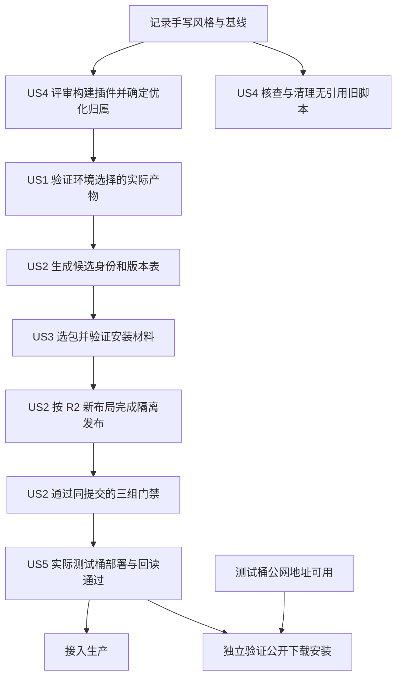

# 对话经过

会话 `01a215de-36db-7eb2-940e-537dffb2e5ab` · 轮次 `01a2167a-50ad-7e43-84e5-d6c60e815ce8`

<!-- foundry-detail 01a215de-36db-7eb2-940e-537dffb2e5ab 01a2167a-50ad-7e43-84e5-d6c60e815ce8 -->
<!-- foundry-event 1ba12d452b88220c43abd67cfe1dd7bea57373ccf5cd44db0afa1d8d4736d85c -->

## 工具调用 `exec_command` · `call_87o1YQ7h8lqLQxiiSuxRt3rx`

- 来源定位：字节 2304113

```text
工作目录：/home/ena/workspace/ena/agent-foundry/feature/init
{"cmd":"rg -n 'scanCollections\\(|scanSkills\\(|vitePluginEngine\\(' packages/skills --glob '*.{ts,mjs}' | head -80; rg -n 'publishOnly' packages/skills --glob '*.{ts,mjs}' | head -70; cat package.json | sed -n '1,60p'; cat packages/skills/package.json | sed -n '1,28p'","max_output_tokens":3500}
```

<!-- foundry-event daaa50cad9c8ec220a4a9272a0c99ba62f56d65dc3a3bc621de9345c1de5df02 -->

## 工具结果 `call_87o1YQ7h8lqLQxiiSuxRt3rx`

- 来源定位：字节 2312474

```text
Chunk ID: 5a789a
Wall time: 0.0000 seconds
Process exited with code 0
Original token count: 1244
Output:
packages/skills/utils/scan-skills.ts:61:export async function scanCollections(
packages/skills/utils/scan-skills.ts:116:export async function scanSkills(
packages/skills/utils/scan-skills.ts:129:  const collections = await scanCollections(sourceDir, { ...options, skipNonRegularConfig: false })
packages/skills/src/workflow/plugin/vite-plugin-speckit-mount/index.ts:23:      const skills = (await scanSkills(sourceDir, { publishOnly: this.environment.config.mode === 'release' }))
packages/skills/build/plugins/vite-plugin-engine/index.ts:16:export default async function vitePluginEngine(publishOnly = false): Promise<PluginOption[]> {
packages/skills/build/plugins/vite-plugin-engine/index.ts:22:    ...(await scanCollections(fileURLToPath(import.meta.resolve('#src')), { publishOnly }))
packages/skills/vite.config.ts:14:  plugins: [vitePluginSkill(), vitePluginCurl(), vitePluginVersion(), vitePluginEngine(mode === 'release')],
packages/skills/build/plugins/vite-plugin-engine/sub-plugins/vite-plugin-hidden-install/index.ts:49:      const enabledSkills = await scanSkills(undefined, { publishOnly: this.environment.config.mode === 'release' })
packages/skills/tests/distribution/vite-plugin-engine.test.mjs:65:  return vitePluginEngine()
packages/skills/build/plugins/vite-plugin-skill/index.ts:151:      const skills = await scanSkills(undefined, {
packages/skills/src/workflow/plugin/vite-plugin-speckit-mount/index.ts:23:      const skills = (await scanSkills(sourceDir, { publishOnly: this.environment.config.mode === 'release' }))
packages/skills/build/plugins/vite-plugin-skill/index.ts:152:        publishOnly: this.environment.config.mode === 'release',
packages/skills/build/plugins/vite-plugin-engine/index.ts:12: * @param publishOnly 是否只从选择发布的集合发现子插件。
packages/skills/build/plugins/vite-plugin-engine/index.ts:16:export default async function vitePluginEngine(publishOnly = false): Promise<PluginOption[]> {
packages/skills/build/plugins/vite-plugin-engine/index.ts:22:    ...(await scanCollections(fileURLToPath(import.meta.resolve('#src')), { publishOnly }))
packages/skills/utils/scan-skills.ts:47:  publishOnly?: boolean
packages/skills/utils/scan-skills.ts:57: * @param options.publishOnly 是否仅扫描选择参加发布构建的集合。
packages/skills/utils/scan-skills.ts:63:  { skipNonRegularConfig = true, publishOnly = false, onMissingConfig }: CollectionScanOptions = {},
packages/skills/utils/scan-skills.ts:100:    if (publishOnly && config.publish !== true)
packages/skills/build/plugins/vite-plugin-engine/sub-plugins/vite-plugin-hidden-install/index.ts:49:      const enabledSkills = await scanSkills(undefined, { publishOnly: this.environment.config.mode === 'release' })
{
  "name": "@ena/agent-foundry",
  "type": "module",
  "private": true,
  "license": "ISC",
  "engines": {
    "node": ">=22.20.0"
  },
  "devEngines": {
    "packageManager": {
      "name": "pnpm",
      "version": "12",
      "onFail": "download"
    }
  },
  "scripts": {
    "dev": "pnpm --filter @foundry/docs run dev",
    "build": "turbo run build --filter=!@foundry/skills-distribution-urgent",
    "build:packages": "turbo run build --filter=@foundry/preset-config --filter=@foundry/skills",
    "build:candidate": "pnpm --filter @foundry/skills-distribution-urgent run build",
    "lint": "turbo run lint",
    "check-types": "turbo run check-types",
    "prepare:workspace": "pnpm --filter @foundry/preset-config run build && pnpm --filter @foundry/docs run nuxt:prepare",
    "skills:link": "bash scripts/dev/actions/link-skills/link-skills.sh packages/skills-distribution-urgent/src .agents/skills",
    "mcp:test": "uv run --project apps/mcp --frozen --group dev pytest apps/mcp/tests",
    "postinstall": "pnpm prepare:workspace"
  },
  "devDependencies": {
    "@foundry/preset-config": "workspace:*",
    "eslint": "catalog:dev",
    "prettier": "catalog:dev",
    "turbo": "catalog:dev",
    "typescript": "catalog:dev"
  }
}
{
  "name": "@foundry/skills",
  "type": "module",
  "version": "0.1.0",
  "private": false,
  "description": "ENA suite 自定义 agent skill 内容包（scripts/dev 软链挂载源，发布渠道推后到有真实消费者时启用）",
  "license": "ISC",
  "publishConfig": { "registry": "https://npm.pkg.github.com" },
  "imports": {
    "#package.json": "./package.json",
    "#install.source.sh": "./build/plugins/vite-plugin-curl/install.source.sh",
    "#src": "./src",
    "#src/*": "./src/*.ts",
    "#utils/*": "./utils/*.ts",
    "#build/*": "./build/*.ts"
  },
  "files": ["dist"],
  "scripts": {
    "build": "vite build",
    "lint": "eslint .",
    "check-types": "tsc --noEmit",
    "test": "python -B -m unittest discover -s tests -p \"test_*.py\"",
    "test:distribution": "node tests/distribution/test-distribution.mjs"
  },
  "devDependencies": {
    "@foundry/preset-config": "workspace:*",
    "@types/node": "catalog:types",
    "consola": "catalog:shared",

```

<!-- foundry-event f4da17bebadfeab7cb7b079b761276338c286f65dacf215b9ff778e4cb63bbbd -->

## 工具调用 `exec_command` · `call_9T2gSiBBfeytwWT2FQ4bHtxi`

- 来源定位：字节 2328712

```text
工作目录：/home/ena/workspace/ena/agent-foundry/feature/init
{"cmd":"cat .specify/feature.json 2>/dev/null; cat specs/skills/003-skills-release-pipeline/implementation/T001.md | sed -n '1,90p'; sed -n '1,90p' specs/skills/003-skills-release-pipeline/implementation/T002.md; sed -n '1,115p' specs/skills/003-skills-release-pipeline/plan.md","max_output_tokens":6000}
```

<!-- foundry-event 7528a409a9f314dafde34f3bf46970c8c383e99e8ad5126c3ffd501eda887397 -->

## 工具结果 `call_9T2gSiBBfeytwWT2FQ4bHtxi`

- 来源定位：字节 2347661

````text
Chunk ID: 9bb271
Wall time: 0.0000 seconds
Process exited with code 0
Original token count: 3985
Output:
{
  "feature_directory": "specs/skills/002-conversation-to-skill"
}
# T001 实施方案

**认可** 2026-11-25，用户在询问 T001 的任务含义后回复「开始吧」。认可范围为此前提出的手写风格提炼、基线复跑和证据记录。 [原任务](../tasks.md#构建插件评审与优化) · [功能规格](../spec.md#functional-requirements) · [里程碑](../mvu.md#构建插件评审与优化)

## 做法与范围

从用户手写分工的原始记录及对应迁移提交核实风格来源。使用 1a72446 中的集合工厂、coding 集合、Vite 配置和技能插件作为历史样本，并对照当前源码。代码样本要能按提交、路径和符号复核。把可观察的写法与当前中文多行 JSDoc、严格 TypeScript 和工作区导出约定一并记录，注明各自依据。 [手写分工原始记录](../../001-skills-distribution/requirements/raw/2026-11-12-track-ownership-and-repository.md) · [工程约定](../../../../AGENTS.md) · [调研依据](../research.md#评审范围与手写源码依据)

对提交 1bcc1bd35c0447e888c87180ccad149b0eb9f7fd 建立临时源码快照，隔离安装依赖、构建和测试。该提交未跟踪 pnpm-lock.yaml，作为本次验收输入另取当前工作区锁文件并记录 SHA-256。冻结安装先复用本机 pnpm 缓存，需要时拉取锁定依赖。把 jq 补齐到隔离工具路径并记录版本。快照和临时生成物在验收后清理。

顺序为先构建共享预设，再执行技能包的 lint、类型检查、默认及 release 构建、四组 Node 分发回归和包内 Python 回归。记录构建后的技能清单、VERSION 和代表性交付物。两个旧工作流入口另行复跑并记录其真实结果。当前动态挂载类型检查缺口和已退役工作流属基线差异，交由对应的后续 Task。 [基线命令](../quickstart.md#1-本地工具和基线) · [已有基线](../spec.md#当前分支依据)

## 验收与交付

将经核对的风格条目及示例归入仓库代码风格文档。本文保存源码 SHA、锁文件来源与摘要、工具版本、实际命令、构建信号和回归结果。证据区分通过、失败、缺前置和未执行。现存失败及工具限制按证据记录。T002 可用同一基线识别后续代码变化。T001 的交付范围为风格与基线记录，代码评审、修复、发布和远端操作分别沿后续原任务。 [仓库代码风格](../coding-style.md) · [复跑结果](#实际复跑结果)

写入后运行仓库 Markdown 格式检查，读回核对任务引用、来源和验证结果，再据实际证据更新 T001 和对应里程碑依据。

## 隔离输入

- 源码来自 `git archive` 导出的 `1bcc1bd35c0447e888c87180ccad149b0eb9f7fd`。取工作区依赖、构建入口和相关测试所需路径。复跑 Python 时补入同一提交的退役运行时脚本供合成夹具消费。 [Python 夹具入口](../../../../packages/skills/tests/test_shadow_runtime.py)
- 提交中未跟踪 `pnpm-lock.yaml`。本次以仓库本地锁文件作为独立依赖输入，安装前后 SHA-256 均为 `74b08c1ad4b87987d643d34282e13e1585ec728468d3b60139abbd0d686a07ea`。
- 环境为 Linux x64，Node.js 26.8.1、pnpm 12.8.1、Vite 8.3.8、TypeScript 6.0.3、ESLint 10.14.0、Python 3.14.7、uv 0.12.10、Git 2.53.0。jq 1.8.1 在临时路径用发行版软件包解包，供该次回归使用。

## 实际复跑结果

表中命令均从隔离快照根运行。`$pnpm_store_root` 为本次使用的 pnpm 内容存储根。Node 安装用例继承隔离 jq 的运行路径。

| 检查             | 实际命令与观察                                                                                                                                                                                                            | 结果                                                     |
| ---------------- | ------------------------------------------------------------------------------------------------------------------------------------------------------------------------------------------------------------------------- | -------------------------------------------------------- |
| 冻结安装         | `pnpm install --offline --frozen-lockfile --ignore-scripts`，缓存缺少依赖元数据，退出 1。随后 `pnpm install --frozen-lockfile --ignore-scripts --store-dir "$pnpm_store_root"` 通过锁文件策略检查，复用 1088 个已缓存包。 | 重跑通过，退出 0                                         |
| 共享预设         | `pnpm --filter @foundry/preset-config run build`，生成 ESLint 与 TSConfig 等导出。Vite 报告已有的配置导入缺扩展名提示。                                                                                                   | 通过，退出 0                                             |
| 技能包 lint      | `pnpm --filter @foundry/skills run lint`。                                                                                                                                                                                | 通过，退出 0                                             |
| 技能包类型检查   | `pnpm --filter @foundry/skills run check-types`。另以 `pnpm --filter @foundry/skills exec tsc --noEmit --listFilesOnly` 核对检查范围。                                                                                    | 通过，退出 0。动态挂载插件未列入默认检查，沿 T007 处理。 |
| 默认构建         | `pnpm --filter @foundry/skills run build`。共 11 项，来自 coding 1、eval 3、frontend 2、profile 1、workflow 4。                                                                                                           | 通过，退出 0                                             |
| release 构建     | `pnpm --filter @foundry/skills run build --mode release`。共 7 项，来自 coding 1、frontend 2、workflow 4。                                                                                                                | 通过，退出 0                                             |
| 四组 Node 回归   | `node --test --test-reporter=tap packages/skills/tests/distribution/{vite-plugin-skill,vite-plugin-engine,speckit-mount,hidden-contract}.test.mjs`。                                                                      | 64 通过，0 失败，0 跳过，退出 0                          |
| 包内 Python 回归 | `pnpm --filter @foundry/skills run test`。首轮快照漏了测试引用的退役运行时脚本，39 项中出现 24 个失败记录和 4 个错误记录。补入同提交的该脚本后重跑。                                                                      | 重跑 39 项通过，退出 0                                   |
| 两个旧工作流测试 | `node --test --test-reporter=tap packages/skills/tests/distribution/{pipeline-workflow,runner-archive}.test.mjs`。两个入口分别读取该提交中不存在的 `skill-release.yml` 和 `publish.yml`，均报 `ENOENT`。                  | 2 项失败，退出 1。沿 T015 筛选可复用断言。               |

两种构建的 `VERSION` 均为 `0.1.0` 加 LF，均生成 `curl/install.sh`、`engine/install.sh`、`engine/script/hidden-install.sh` 和 `engine/script/speckit-mount.sh`。实测 `curl/skills.tsv`、`README.md` 与 `LICENSE` 只在 release 构建生成。上述结果是旧实现的实际基线。环境选择、时间戳和候选身份的目标以现行规格及其后续任务验收。 [规格基线](../spec.md#当前分支依据) · [后续验证](../quickstart.md)

本轮执行本地基线。容器构建、真实发布、R2 回读与公网安装的工程验收分别由 T008、T018 至 T020 取证。
# T002 实施方案

2026-11-25，用户在看到「评审主线构建插件及其构建、安装和测试入口，记录源码位置、影响、验证和处置」的说明后回复「开始」。本项交付评审报告，代码优化沿 T003 或对应专项任务推进。 [原任务](../tasks.md#构建插件评审与优化) · [规格](../spec.md#functional-requirements) · [里程碑](../mvu.md#构建插件评审与优化)

先核对 T001 复跑的提交和本轮实际源码差异。逐文件阅读 `packages/skills/build/plugins`，从 Vite 入口追到扫描、直接和动态插件入口、脚本模板、产物、安装及测试消费者。按原始需求并行核查独立的引擎与挂载、下载与安装、流水线与测试。主评审复跑构建并交叉核对每项结论。 [原始评审需求](../../../../temp/b/2.md) · [代码风格](../coding-style.md) · [T001 复跑基线](T001.md#实际复跑结果)

在独立源码快照用正常构建入口核对默认与发布输出、输出目录覆盖、脚本语法和主要分发回归。按需加入最小的隔离检查，用实际路径、退出码或产物核对发现。将历史基线、当轮复跑、静态判断及缺前置的检查分别标明。验证环境及未纳入的工作区变更按实际记录。 [调研依据](../research.md#评审范围与手写源码依据)

在 `analysis/build-plugin-review.md` 记录每个插件及辅助文件的调用路径、行为、发现、影响、当轮证据和对应 Task。专项验证和实现沿已有任务，旧脚本全量消费者核查沿 T004。报告通过 Markdown 检查和读回核验后更新 T002 的原任务及里程碑引用。
# Implementation Plan: 主线技能按环境构建与发布

**Branch** feature/init · **Spec Kit 功能标识** 003-skills-release-pipeline · **Date** 2026-11-25
**Input** [功能规格与四项澄清](spec.md) · [调研与决策](research.md)

## Summary

在主线技能构建中由 Vite 当次 mode 统一选择集合与技能，把同一份经核验的候选交给版本表准备、发布与回读。release 先通过三组测试门禁和实际测试桶对象回读，再接入面向选定提交的手动生产发布。公开下载根补齐后独立验收测试桶安装。安装新版本时先核对归档 SHA-256、字节长度与包内 VERSION 时间戳，再写入项目。 [构建与发布契约](contracts/build-and-publish.md) · [安装契约](contracts/install.md)

环境标识使用 `development`、`release`、`production`。普通构建不覆盖 Vite 的默认 `production`，不进入正式发布；生产候选的集合范围和发布材料随生产入口验收。

按两份原始需求为每个功能点设置一个里程碑。先记录手写风格和插件评审基线，旧脚本调用可独立核查。环境选择、版本准备与安装器逐步接上隔离发布链，真实门禁通过后才进行测试桶部署与同次回读。同目标从读表到写回和回读串行，部署失败终止并记录现场。门禁和实际测试桶回读通过后接入生产，测试桶公网下载安装随真实地址具备单独验收。闭环详情见 [mvu.md](mvu.md)。

## Technical Context

| 项目       | 计划采用                                                                                                                                      |
| ---------- | --------------------------------------------------------------------------------------------------------------------------------------------- |
| 语言与版本 | 严格 TypeScript 6、ESM、Bash 与 Node.js。使用仓库 mise 工具链、pnpm 12 和锁定的 Vite 8.3.8。                                                  |
| 主要依赖   | 已有 Vite/Rolldown、Node 内建 crypto、Bash/curl/tar/jq/uv、GitHub Actions artifacts、AWS CLI v2 的 S3 API。干净工作区先构建技能包的预设依赖。 |
| 存储       | release 与 production 各一 R2 桶，沿用共用凭据配置。桶根是安装入口和有序版本表，归档是独立的固定键。CI 制品传递同次候选和读表快照。           |
| 测试       | 以真实 Vite 产物、实际安装器和隔离对象存储边界执行三组 Node 门禁。既有 Node、Python 回归与真实 S3、公网安装分别记录。                         |
| 目标平台   | CI 沿用 Ubuntu 24.04，主线验收在 Linux 的隔离 Codex 项目，本地配置入口继续使用实际 Vite 默认 mode。                                           |
| 项目类型   | 主线技能包构建、发布流水线和 Bash 安装入口。                                                                                                  |
| 性能与规模 | 每个 R2 目标同时只处理一个发布，平台队列及单次对象上传上限按调研取证。归档用流式摘要，历史有序保留。规格以正确性和可核验性为度量。            |
| 边界       | 临时版本逻辑放入独立目录，源码版本与发布时间戳各自保存。本期不含回退机制、紧急版及 MCP 清单改造。                                             |

## Constitution Check

| 宪章要求                     | Phase 0 前检查                                                     | Phase 1 后复核                                                                     |
| ---------------------------- | ------------------------------------------------------------------ | ---------------------------------------------------------------------------------- |
| 职责、产物及范围（I、II、V） | 以现行规格和四项实际澄清为输入，目标为技能包 003 的规划产物。      | 方案、数据、契约、验收步骤与状态图按各自职责保存。                                 |
| 小闭环和技术前置（III）      | 列出 Vite 配置时序、跨 job 交接、R2 状态边界及下载校验等验证目标。 | 小闭环记录假设、输入、可观察信号、证据及依赖。尚需远端或实施的检查按实际状态登记。 |
| 最小充分验证（IV）           | 复用适用的现有测试，三组门禁针对同次候选和真实消费。               | 验收指南给出隔离构建与安装、失败注入、授权 S3 回读和公开验证步骤。                 |
| 生产顺序与授权（VI）         | release 实际环境证据先于生产接入，外部操作依目标授权。             | 公网安装证据有独立前置，现阶段保留待执行状态。                                     |
| 后续任务规划及清理（VII）    | 本阶段完成总体方案。                                               | 生成任务时复核分支、闭环及技术前置，使用唯一工程状态，并安排结案前的末尾清理。     |

## Project Structure

### Documentation (this feature)

研究和技术前置依据见 [research.md](research.md)。字段与状态见 [data-model.md](data-model.md)，主要流程见 [diagrams.md](diagrams.md)，可执行验收及前置见 [quickstart.md](quickstart.md)。

### Source Code (repository root)

```text
.github/workflows/
├── skills-test.yml
├── skills-deploy-release.yml
├── skills-deploy-common.yml
└── skills-deploy-prod.yml.example
packages/skills/
├── vite.config.ts
├── utils/
├── src/*/collection.config.ts
├── src/workflow/plugin/vite-plugin-speckit-mount/
├── build/plugins/
├── script/                       # 含待核查旧脚本，计划新增 temporary-release/
├── tests/distribution/
├── deploy/Dockerfile
└── README.md
scripts/dev/mount-speckit.sh
```

沿用现有入口及集合插件结构。在受信工作流作业中复用包内独立的临时版本管理逻辑。是否需调入口脚本、移除旧脚本或补类型检查范围，由对应现有调用和验证证据决定。生产草稿按 release 实际门禁与回读证据接入。

## Complexity Tracking

当前方案无须偏离宪章。首版并发队列、实际远端对象语义和测试公网根是实施与运行需分别取证的条件，使用现有工程流程记录结果。

````

<!-- foundry-event 2913ccbab70b2bba5265093bf01b1dfcab80bf39147b57bf14a0a538031daee7 -->

## 工具调用 `apply_patch` · `call_blu56XChEQRAzrjNyGSEt85O`

- 来源定位：字节 2421892

```text
工作目录：/home/ena/workspace/ena/agent-foundry/feature/init
*** Begin Patch
*** Add File: specs/skills/003-skills-release-pipeline/requirements/raw/2026-11-26-default-production-environment.md
+# 默认环境按生产环境处理
+
+来源：2026-11-26，用户在 003 主线技能发布规格的环境机制讨论中提出。
+
+> 不不不，变量未设置就是默认的生产环境
+>
+> 我们先不管有工作流和直接调用 Vite 的脚本，我们先实现环境区分
*** Update File: specs/skills/003-skills-release-pipeline/spec.md
@@
 ### Session 2026-11-26

-- [环境标识使用全拼](requirements/raw/2026-11-26-environment-naming.md)：采用 `development`、`release`、`production`，不再另设生产模式别名。普通构建沿用 Vite 默认的 `production`，不传 `--mode`。默认构建不等于正式发布；保留本地 `profile`，只在正式生产候选排除。当前只接测试发布，生产发布材料与生产入口留到生产接入验收。
+- [环境标识使用全拼](requirements/raw/2026-11-26-environment-naming.md)与[默认环境确认](requirements/raw/2026-11-26-default-production-environment.md)：环境值为 `development`、`release`、`production`。扫描环境变量未设置时默认 `production`，不存在另一个“普通构建”环境；原 `build` 因未设置变量而按 `production` 选集合，新增 `build:prod` 作为显式同义入口。生产环境构建仅生成本地产物，不代表部署。本次先实现包内环境区分，暂不改工作流和直接调用 Vite 的脚本。
@@
-**独立验证** 分别构建 `development`、`release` 和默认 `production`，用集合级与技能级开关的正反夹具检查实际技能目录、启用的集合插件及其派生产物。正式生产候选的集合结果在生产接入时验证。
+**独立验证** 分别构建 `development`、`release` 和默认 `production`，用集合级与技能级开关的正反夹具检查实际技能目录、启用的集合插件及其派生产物。未设置环境变量的 `build` 与显式 `build:prod` 应采用相同的生产集合选择。
@@
-1. `development`、`release` 和普通构建的产物应包含 `profile` 中启用的技能。正式 `production` 候选不交付该集合的技能、插件及适用派生内容；不得仅凭 `mode === 'production'` 排除本地 `profile`。
+1. `development` 和 `release` 构建按集合配置交付 `profile` 中启用的技能；环境变量未设置的默认构建和显式 `build:prod` 均按 `production` 处理，不交付该环境关闭的集合、技能、插件及适用派生内容。
@@
 4. 本地普通构建未指定环境时，使用现有入口的默认配置。以本期 `profile` 配置执行普通构建时，默认产物应包含 `profile`。
*** End Patch

```

<!-- foundry-event b30de0c79c9ee385fa081f7a5dd729dff03eacf958ffbeb4b4183caf04f8061e -->

## 工具结果 `call_blu56XChEQRAzrjNyGSEt85O`

- 来源定位：字节 2429520

```text
Exit code: 0
Wall time: 0 seconds
Output:
Success. Updated the following files:
A specs/skills/003-skills-release-pipeline/requirements/raw/2026-11-26-default-production-environment.md
M specs/skills/003-skills-release-pipeline/spec.md

```

<!-- foundry-event 6b3c8e4f5f76982ab5983bb03c725f2ceae7d8824f387218a18e824e42cf0204 -->

## 工具调用 `apply_patch` · `call_2GAzoBUBErfUH27XqAMLtCUM`

- 来源定位：字节 2436140

```text
工作目录：/home/ena/workspace/ena/agent-foundry/feature/init
*** Begin Patch
*** Update File: specs/skills/003-skills-release-pipeline/spec.md
@@
-- Q: 本地直接执行 `pnpm build` 且未指定环境时，应该使用开发环境还是生产环境的集合配置？ → A: 使用默认配置。本地普通构建沿用入口现有默认值，生产发布显式使用 `prod`。（生产标识及其使用方式由下节更新。）
+- Q: 本地直接执行 `pnpm build` 且未指定环境时，应该使用开发环境还是生产环境的集合配置？ → A: 使用默认配置。本地普通构建沿用入口现有默认值，生产发布显式使用 `prod`。（2026-11-26 后续确认修正了默认环境解释，见下节。）
@@
-4. 本地普通构建未指定环境时，使用现有入口的默认配置。以本期 `profile` 配置执行普通构建时，默认产物应包含 `profile`。
+4. 未设置环境变量的 `build` 使用默认 `production` 集合选择；显式 `build:prod` 与其选择一致。生产环境构建不自动部署。
@@
-- **FR-001** 集合配置 `defineCollectionHandle` 必须支持集合级布尔字段 `enabled`，可直接声明或根据当次 Vite `mode` 求值。环境标识为 `development`、测试发布 `release` 和 `production`。在扫描入口先判断集合，再按 `skill` 下各项的 `enabled` 选择技能。正式生产候选的交付范围由发布入口区分，不把默认 `production` 当作发布信号。
-- **FR-002** 同次构建的集合选择必须共同约束技能复制、集合插件发现、隐匿候选和挂载脚本。未指定环境的本地普通构建沿用现有入口的默认配置。普通构建、直接构建、内存挂载构建、容器构建及发布构建均须核对适用的环境和交付结果。发布候选应保有供安装消费的技能目录、入口、适用的引擎和挂载材料、交付清单、说明和许可证。
+- **FR-001** 集合配置 `defineCollectionHandle` 必须支持集合级布尔字段 `enabled`，可直接声明或根据技能包构建环境求值。环境值为 `development`、`release` 或 `production`。扫描入口从 `FOUNDRY_SKILLS_ENV` 读取环境；变量未设置时使用 `production`，未知值须明确报错。扫描先判断集合，再按 `skill` 下各项的 `enabled` 选择技能。
+- **FR-002** 同次构建的集合选择必须共同约束技能复制、集合插件发现、隐匿候选和挂载脚本。`build` 未设置环境变量时按 `production` 选择；`build:development`、`build:release` 和 `build:prod` 分别显式选择对应环境，且 `build` 与 `build:prod` 的集合选择一致。发布材料及真实部署行为仍按发布入口处理；本次环境区分实现暂不修改工作流和直接调用 Vite 的脚本。
@@
-- **SC-001** 核验 `development`、`release` 和不传 `--mode` 的 `production` 普通构建，产物均包含 `profile`。用禁用集合夹具验其技能及适用派生内容的残留数为 0。正式生产候选在生产接入时另验 `profile` 残留数为 0。同次构建四类消费者的集合选择矛盾数为 0。
+- **SC-001** 分别核验 `development`、`release` 和 `production` 的实际构建产物。按集合配置启用的集合及适用派生内容与环境一致；未设置环境变量的 `build` 与 `build:prod` 的选择结果相同。同次构建四类消费者的集合选择矛盾数为 0。
@@
-- 确认各入口如何使用 Vite 当次环境、缺少集合级 `enabled` 时如何承接旧 `publish` 行为。先核对开发、默认构建、容器、内存挂载和 `release`；正式 `production` 候选的交付范围与材料在生产接入时核对。
+- 环境选择由 `FOUNDRY_SKILLS_ENV` 提供；未设置时默认 `production`。本轮先验收技能包脚本和扫描逻辑，工作流与直接 Vite 调用脚本留待后续接入。
*** End Patch

```

<!-- foundry-event 5f6ecca7ef98e71ca7a3442af152b372395e3c3d4a2a47b906b0a98c7a81d0e7 -->

## 工具结果 `call_2GAzoBUBErfUH27XqAMLtCUM`

- 来源定位：字节 2446852

```text
Exit code: 0
Wall time: 0 seconds
Output:
Success. Updated the following files:
M specs/skills/003-skills-release-pipeline/spec.md

```

<!-- foundry-event 470e6852e72dbbbb2056d0f74b80e6ee89702240fdebcf88925b57cfdebbbb98 -->

## 工具调用 `apply_patch` · `call_qdmIxPi6ukLfmxBjtxkHz4Sj`

- 来源定位：字节 2453711

```text
工作目录：/home/ena/workspace/ena/agent-foundry/feature/init
*** Begin Patch
*** Update File: specs/skills/003-skills-release-pipeline/data-model.md
@@
-| 构建环境 | Vite 当次 mode，环境标识为 development、release、production。                                            | 未指定时沿用 Vite 默认值 production；mode 本身不代表启动正式发布。                                |
-| 集合配置 | 集合目录、packageName、enabled、已有 publish、plugin 与 skill 配置。集合级 enabled 可依据当次 env 求值。 | 先判集合启用再读取技能启用项。旧配置在缺少 enabled 时适用兼容规则。校验配置与已选技能名称及文件。 |
+| 构建环境 | 技能包环境变量 `FOUNDRY_SKILLS_ENV`；值为 development、release、production。                               | 变量未设置时默认为 production；未知值报错。build 与 build:prod 选择一致。                          |
+| 集合配置 | 集合目录、packageName、enabled、已有 publish、plugin 与 skill 配置。集合级 enabled 可依据技能包环境求值。 | 先判集合启用再读取技能启用项。显式 enabled 优先；旧配置在缺少 enabled 时沿 publish 兼容规则。     |
@@
-| target / mode                             | 正式候选的目标与 mode 必须一致：release 对应测试桶，production 对应生产桶。                        |
+| target / environment                      | 正式候选目标与环境必须一致：release 对应测试桶，production 对应生产桶。                             |
*** Update File: specs/skills/003-skills-release-pipeline/contracts/build-and-publish.md
@@
-普通根构建、直接 Vite 构建、容器及 Spec Kit 内存构建沿用 Vite 默认的 `production`，不另传 `--mode`。测试发布显式使用 `release`。正式生产候选也用 `production`，但由生产发布入口区分交付范围，不能仅以默认 mode 判定发布。集合配置支持静态对象与接收只读 env 的函数形式。扫描使用当次 mode，先判集合启用，再形成同次只读技能清单。下表是迁移预期，后续以实测输出核对。
+技能包脚本以 `FOUNDRY_SKILLS_ENV` 选择集合环境；变量未设置时扫描器默认使用 `production`。`build` 保持不设置变量，`build:prod` 显式设置 `production`，两者集合选择一致；`build:development` 与 `build:release` 显式设置对应值。集合配置支持静态布尔值与按环境计算的 `enabled`。扫描先解析集合启用状态，再形成同次技能清单。本轮暂不修改工作流和直接调用 Vite 的脚本。下表是目标矩阵，后续以实测输出核对。
@@
-| 集合     | development 与默认构建 | release | 正式 production 候选 |
-| -------- | ---------------------- | ------- | ---- |
-| coding   | 启用                   | 启用    | 启用 |
-| frontend | 启用                   | 启用    | 启用 |
-| workflow | 启用                   | 启用    | 启用 |
-| eval     | 沿当前本地开关         | 排除    | 排除 |
-| profile  | 启用                   | 启用    | 排除 |
+| 集合     | development | release | production（含默认 build） |
+| -------- | ----------- | ------- | -------------------------- |
+| coding   | 启用        | 启用    | 启用                       |
+| frontend | 启用        | 启用    | 启用                       |
+| workflow | 启用        | 启用    | 启用                       |
+| eval     | 沿当前本地开关 | 排除  | 排除                       |
+| profile  | 启用        | 启用    | 排除                       |
@@
-集合 enabled 存在时采用明确的布尔值。未声明时，`release` 和正式 `production` 候选延续 publish 为 true 才纳入，普通构建延续本地规则。随后才选择技能级 enabled。集合插件发现额外尊重已有 plugin 开关，可以运行没有启用技能但声明了适用插件的启用集合。继续保留已有的缺配置、导入错误、链接和安装名冲突处理，并确认消费者间原有差异的实际影响。
+集合 enabled 存在时采用明确的布尔值或按当前环境计算的结果，并优先于旧 publish。未声明时，development 沿用本地纳入行为，release 与 production 仅纳入 publish 为 true 的集合。随后才选择技能级 enabled。集合插件发现额外尊重已有 plugin 开关，可以运行没有启用技能但声明了适用插件的启用集合。继续保留已有的缺配置、导入错误、链接和安装名冲突处理，并确认消费者间原有差异的实际影响。
*** Update File: specs/skills/003-skills-release-pipeline/research.md
@@
-**当前决定（2026-11-26 更新）** 扫描使用 Vite 当次 mode，先判集合启用，并在引擎子插件注册前准备同次只读选择结果。集合可导出布尔 enabled 的静态配置，也可导出接收只读 env 的配置函数。显式 enabled 优先；未声明时，`release` 和正式 `production` 候选沿用 `publish: true` 筛选，普通构建沿原有纳入规则。生产候选的专属材料留到生产接入。 [环境标识确认](spec.md#session-2026-11-26) · [构建与发布契约](contracts/build-and-publish.md)
+**当前决定（2026-11-26 更新）** 扫描从 `FOUNDRY_SKILLS_ENV` 读取环境，缺省 `production`；环境值先在扫描层统一解析，再判断集合启用并由后续消费者使用。环境为 `development`、`release`、`production`。技能包 `build` 沿用缺省生产选择，另提供 `build:development`、`build:release`、`build:prod`。集合可声明静态或按环境求值的 enabled；显式值优先，未声明时由 release/production 的 publish 兼容规则筛选。当前增量先实现包内脚本与扫描，工作流及直接 Vite 调用后续接入。 [确认记录](spec.md#session-2026-11-26) · [构建与发布契约](contracts/build-and-publish.md)
@@
-**理由** Vite CLI 和 JS build 默认 mode 均是 `production`。根构建、Dockerfile 和开发挂载脚本都沿用此默认值，测试发布入口显式传 `release`。引擎决定是否加载集合插件早于 generateBundle，现行技能、引擎、隐匿和挂载路径各自扫描。预先选集可以让四者核对同一输入，并保持无共享可变环境的顺序构建。 [当前构建入口](../../../packages/skills/vite.config.ts) · [开发挂载](../../../scripts/dev/mount-speckit.sh) · [Vite 模式](https://vite.dev/guide/env-and-mode#-modes) · [Vite 8.3.8 JS 入口](https://github.com/vitejs/vite/blob/v8.3.8/packages/vite/src/node/build.ts#L558-L575) · [Vite 插件配置时序](https://vite.dev/guide/api-plugin#config)
+**理由** Vite 默认 mode 与项目集合环境是两层输入。本次选择通过进程环境变量给扫描器读取，不要求把 mode 从配置入口逐层透传。包脚本同步设置所需环境，release 脚本仍显式给 Vite `--mode release` 以保留现有发布材料行为；普通 build 不额外设置环境值。 [当前构建入口](../../../packages/skills/vite.config.ts) · [开发挂载](../../../scripts/dev/mount-speckit.sh) · [Vite 模式](https://vite.dev/guide/env-and-mode#-modes) · [Vite 插件配置时序](https://vite.dev/guide/api-plugin#config)
@@
-**备选** 各插件独立按照 mode 重扫会引入上下文漂移。可变全局环境变量与模块顶层求值会使同进程多次构建依赖求值顺序。仅按 `production` 切换发布选集会改变本地默认构建并影响挂载，因此不把 mode 当作正式发布信号。
+**备选** 各插件独立按照 mode 重扫会引入上下文漂移。让每个插件各自读不同配置或保留 publishOnly 参数会导致集合选择与插件发现不一致，因此统一由扫描器解析环境并应用集合开关。未设置变量时按用户确认默认为 production，不再另造普通构建环境。
*** End Patch

```

<!-- foundry-event 21d298816e05d40d80482c486dadfbf7ab3e044fd47e638e13f3119ad3632a28 -->

## 工具结果 `call_qdmIxPi6ukLfmxBjtxkHz4Sj`

- 来源定位：字节 2472807

```text
Exit code: 0
Wall time: 0 seconds
Output:
Success. Updated the following files:
M specs/skills/003-skills-release-pipeline/data-model.md
M specs/skills/003-skills-release-pipeline/contracts/build-and-publish.md
M specs/skills/003-skills-release-pipeline/research.md

```

<!-- foundry-event 3204ceb28953875972b4699e8ec89c071b4dabc16e659944bcc3e772aa9322cc -->

## 工具调用 `apply_patch` · `call_lRoYikAHSGG6hIiHBNQ1iKKd`

- 来源定位：字节 2479073

```text
工作目录：/home/ena/workspace/ena/agent-foundry/feature/init
*** Begin Patch
*** Update File: specs/skills/003-skills-release-pipeline/mvu.md
@@
-**节点与关键逻辑** 先用同进程各模式、真实默认、隔离 outDir 和内存构建验证 Vite 配置时序。扫描使用当次 mode，按契约处理 enabled 与旧 publish；普通构建沿用 `production`，正式生产候选另由发布入口区分。挂载子插件纳入严格类型检查后处理已复现的 TS2345 并保留现有行为。测试选择覆盖独立插件和集合、技能两级禁用项。 [构建契约](contracts/build-and-publish.md#构建入口) · [依赖验证](research.md#构建模式与集合选择)
+**节点与关键逻辑** 先验证环境变量未设置时扫描器采用 `production`、显式三环境值分别选择正确集合，再实现扫描层统一读取和过滤。技能包增加 `build:development`、`build:release`、`build:prod`，既有 `build` 保持缺省生产环境。显式集合 enabled 可按环境计算并优先于旧 publish；旧配置沿兼容规则。当前范围不改工作流与直接调用 Vite 的脚本，后续分别接入。 [构建契约](contracts/build-and-publish.md#构建入口) · [环境决策](research.md#构建模式与集合选择)
@@
-**验收信号** `development`、`release` 和默认 `production` 构建均包含 `profile`，禁用集合夹具不交付技能及适用派生数据，`release` 输出测试发布材料。四类消费者一致，覆盖输出目录和内存构建无写盘两项行为。通过现有 Dockerfile 实际构建并导出 artifacts，核对默认模式的技能、入口、引擎及容器附带归档成员。正式生产候选排除 `profile` 与发布材料完整性由 T019 验收。
+**验收信号** 环境未设置与 `build:prod` 均按 `production` 排除配置关闭的集合；`build:development` 与 `build:release` 的实际选择符合各集合声明。显式关闭的集合无技能及适用派生产物，未知环境明确失败。当前先验收扫描和包脚本；工作流及直接调用 Vite 的入口不在本步范围。
*** End Patch

```

<!-- foundry-event 62b377bdec42dc3265c0b789472bd07dce61ebfe5c52dec50b5cf51c1b6f6888 -->

## 工具结果 `call_lRoYikAHSGG6hIiHBNQ1iKKd`

- 来源定位：字节 2482531

```text
apply_patch verification failed: Failed to find expected lines in /home/ena/workspace/ena/agent-foundry/feature/init/specs/skills/003-skills-release-pipeline/mvu.md:
**验收信号** `development`、`release` 和默认 `production` 构建均包含 `profile`，禁用集合夹具不交付技能及适用派生数据，`release` 输出测试发布材料。四类消费者一致，覆盖输出目录和内存构建无写盘两项行为。通过现有 Dockerfile 实际构建并导出 artifacts，核对默认模式的技能、入口、引擎及容器附带归档成员。正式生产候选排除 `profile` 与发布材料完整性由 T019 验收。
```

<!-- foundry-event 855b80d233f7c26216bc03ed17f18bb2d48d80fc78f435c5c8359899d14d70db -->

## 工具调用 `exec_command` · `call_IrEQftElv3p8aFxV965Yvgj6`

- 来源定位：字节 2488445

```text
工作目录：/home/ena/workspace/ena/agent-foundry/feature/init
{"cmd":"sed -n '32,43p' specs/skills/003-skills-release-pipeline/mvu.md"}
```

<!-- foundry-event a4d26da31196b20471d62c961f6067478f43575006d4783d20a539bce6bb5976 -->

## 工具结果 `call_IrEQftElv3p8aFxV965Yvgj6`

- 来源定位：字节 2492278

```text
Chunk ID: 104983
Wall time: 0.0000 seconds
Process exited with code 0
Original token count: 379
Output:

**闭环结果** 集合作者能按环境控制实际交付。同次构建的技能复制、插件发现、隐匿候选、Spec Kit 挂载共用同一选择。覆盖 FR-001、FR-002、SC-001。

**节点与关键逻辑** 先用同进程各模式、真实默认、隔离 outDir 和内存构建验证 Vite 配置时序。扫描使用当次 mode，按契约处理 enabled 与旧 publish；普通构建沿用 `production`，正式生产候选另由发布入口区分。挂载子插件纳入严格类型检查后处理已复现的 TS2345 并保留现有行为。测试选择覆盖独立插件和集合、技能两级禁用项。 [构建契约](contracts/build-and-publish.md#构建入口) · [依赖验证](research.md#构建模式与集合选择)

**关联 Task** [T006、T007、T008](tasks.md#环境机制) 分别验证构建时序与输出、接通共享选择、复验模式及派生材料。

**验收信号** `development`、`release` 和默认 `production` 构建均包含 `profile`，禁用集合夹具不交付技能及适用派生数据，`release` 输出测试发布材料。四类消费者一致，覆盖输出目录和内存构建无写盘两项行为。通过现有 Dockerfile 实际构建并导出 artifacts，核对默认模式的技能、入口、引擎及附带归档成员。正式生产候选排除 `profile` 与发布材料完整性由 T019 验收。

## 临时版本管理

**状态** 未开始。**依据** 已确认时间戳、索引及安装校验契约，新实现尚无实际验收证据。

```

<!-- foundry-event 74136271a75be5760a23ad1a6c5085134246ded77f39e2914e66a58be19dabc3 -->

## 工具调用 `apply_patch` · `call_lCiPlSftOeJUy2nebn27qaUV`

- 来源定位：字节 2499045

```text
工作目录：/home/ena/workspace/ena/agent-foundry/feature/init
*** Begin Patch
*** Update File: specs/skills/003-skills-release-pipeline/mvu.md
@@
-**节点与关键逻辑** 先用同进程各模式、真实默认、隔离 outDir 和内存构建验证 Vite 配置时序。扫描使用当次 mode，按契约处理 enabled 与旧 publish；普通构建沿用 `production`，正式生产候选另由发布入口区分。挂载子插件纳入严格类型检查后处理已复现的 TS2345 并保留现有行为。测试选择覆盖独立插件和集合、技能两级禁用项。 [构建契约](contracts/build-and-publish.md#构建入口) · [依赖验证](research.md#构建模式与集合选择)
+**节点与关键逻辑** 先验证环境变量未设置时扫描器采用 `production`、显式三环境值分别选择正确集合，再实现扫描层统一读取和过滤。技能包增加 `build:development`、`build:release`、`build:prod`，既有 `build` 保持缺省生产环境。显式集合 enabled 可按环境计算并优先于旧 publish；旧配置沿兼容规则。当前范围不改工作流与直接调用 Vite 的脚本，后续分别接入。 [构建契约](contracts/build-and-publish.md#构建入口) · [环境决策](research.md#构建模式与集合选择)
@@
-**验收信号** `development`、`release` 和默认 `production` 构建均包含 `profile`，禁用集合夹具不交付技能及适用派生数据，`release` 输出测试发布材料。四类消费者一致，覆盖输出目录和内存构建无写盘两项行为。通过现有 Dockerfile 实际构建并导出 artifacts，核对默认模式的技能、入口、引擎及附带归档成员。正式生产候选排除 `profile` 与发布材料完整性由 T019 验收。
+**验收信号** 环境未设置与 `build:prod` 均按 `production` 排除配置关闭的集合；`build:development` 与 `build:release` 的实际选择符合各集合声明。显式关闭的集合无技能及适用派生产物，未知环境明确失败。当前先验收扫描和包脚本；工作流及直接调用 Vite 的入口不在本步范围。
*** End Patch

```

<!-- foundry-event 36fdf09fffa63cd46f9ff558fce38a678cc8e189d986a478b3d23fbf49bd9edc -->

## 工具结果 `call_lCiPlSftOeJUy2nebn27qaUV`

- 来源定位：字节 2505156

```text
Exit code: 0
Wall time: 0 seconds
Output:
Success. Updated the following files:
M specs/skills/003-skills-release-pipeline/mvu.md

```

<!-- foundry-event 109f25e2526e46b31ed371d06f88d736fe1c867f2e61f7e42fa6b0d99511d941 -->

## 工具调用 `apply_patch` · `call_sXrcboIJ9AUDJHWaUrfsZqNq`

- 来源定位：字节 2511267

```text
工作目录：/home/ena/workspace/ena/agent-foundry/feature/init
*** Begin Patch
*** Update File: specs/skills/003-skills-release-pipeline/plan.md
@@
-环境标识使用 `development`、`release`、`production`。普通构建不覆盖 Vite 的默认 `production`，不进入正式发布；生产候选的集合范围和发布材料随生产入口验收。
+集合环境统一由 `FOUNDRY_SKILLS_ENV` 提供，允许 `development`、`release`、`production`，缺省为 `production`。包内保留 `build` 缺省生产选择，并新增 `build:development`、`build:release`、`build:prod`；后者显式指定生产环境，与默认 `build` 选择一致。生产构建只生成本地产物，不代表部署。当前先完成包内环境区分，工作流和直接调用 Vite 的脚本留到后续接入。
@@
-沿用现有入口及集合插件结构。在受信工作流作业中复用包内独立的临时版本管理逻辑。是否需调入口脚本、移除旧脚本或补类型检查范围，由对应现有调用和验证证据决定。生产草稿按 release 实际门禁与回读证据接入。
+沿用现有入口及集合插件结构。构建环境由包脚本设置，扫描器读取统一变量并先解析集合启用状态；显式 `enabled` 优先，缺少时兼容旧 `publish` 规则。第一步完成隔离验证及包内脚本、集合配置和共享扫描，保留工作流、开发挂载脚本及其直接 Vite 调用不变。随后按现有里程碑补齐分发消费者、容器及门禁；生产草稿按 release 实际门禁与回读证据接入。
*** End Patch

```

<!-- foundry-event 0bf4932bcdaa2e19ef3f64f10fb8a368ac8bf59eaae9dbe4c8d573b38f88ce41 -->

## 工具结果 `call_sXrcboIJ9AUDJHWaUrfsZqNq`

- 来源定位：字节 2516312

```text
Exit code: 0
Wall time: 0 seconds
Output:
Success. Updated the following files:
M specs/skills/003-skills-release-pipeline/plan.md

```

<!-- foundry-event 9289683d23cb2c83d55b214386c2a9a563e62994372aec94e77a4564947f02db -->

## 工具调用 `apply_patch` · `call_6uqC6O7bs7N5pL5GFT8xZMlB`

- 来源定位：字节 2544368

```text
工作目录：/home/ena/workspace/ena/agent-foundry/feature/init
*** Begin Patch
*** Update File: specs/skills/003-skills-release-pipeline/tasks.md
@@
-- [ ] T006 [US1] 在 T001 和 T002 后，用 packages/skills/tests/distribution/vite-plugin-skill.test.mjs 的隔离构建模式验证 Vite 同进程多模式、默认 mode、outDir 和 write:false，记录一次求值与磁盘效果信号，保留通过的夹具供共享选择使用。
-- [ ] T007 [US1] 在 T006 的验证通过后，从 packages/skills/vite.config.ts 向技能、引擎、隐匿和挂载统一传递实际 mode 与同次选择。按 packages/skills/src 各集合配置保留默认及旧 publish 行为，确认发布材料、outDir、动态挂载类型检查及现有缺项和冲突行为。 按 [数据模型](data-model.md) 核对以下约束。「未显式指定时使用入口的原有默认 mode。发布作业使用目标白名单决定 mode。」 「先判集合启用再读取技能启用项。旧配置在缺少 enabled 时适用兼容规则。校验配置与已选技能名称及文件。」 「同一选择供复制、交付清单、集合插件发现、隐匿及挂载。复制与输出文件引用同一组有效相对路径。」
-- [ ] T008 [US1] 在 T007 后扩展 packages/skills/tests/distribution 的构建、引擎和挂载回归，实测 `development`、`release` 和不传 `--mode` 的默认 `production`。验证四类消费者一致、启用和禁用集合的正反结果，以及 `release` 的完整测试发布材料。按 [容器验收](quickstart.md#容器构建与产物导出) 使用 packages/skills/deploy/Dockerfile 构建并导出 artifacts，核对默认模式的 profile、VERSION、安装入口、引擎文件与容器附带归档的对应成员。正式生产候选的验收由 T019 负责。
+- [ ] T006 [US1] 在 T001 和 T002 后，用隔离 Node 子进程验证环境变量可由包脚本传入动态加载的集合配置、三种允许值可稳定识别且未设置时可采用生产缺省。记录输入、子进程观察值和失败边界，形成 T007 可复用的验证依据；不改工作流或直接调用 Vite 的脚本。
+- [ ] T007 [US1] 在 T006 验证通过后，为集合配置增加布尔值或按环境求值的 `enabled`，由共享扫描函数读取 `FOUNDRY_SKILLS_ENV`（未设置默认为 `production`，非法值失败），先过滤集合再扫描技能；显式 `enabled` 优先，缺省时兼容旧 `publish`。在 packages/skills/package.json 增加 `build:development`、`build:release`、`build:prod`，令既有 `build` 保持默认生产选择。更新集合配置与分发回归，确认环境选择及 `build`/`build:prod` 一致；暂不改工作流、scripts/dev/mount-speckit.sh 和其他直接调用 Vite 的脚本。
+- [ ] T008 [US1] 在 T007 后复验技能复制、集合插件、隐匿及挂载消费者实际采用同次选择，覆盖默认 production、`build:prod`、development、release、禁用集合及技能级禁用项。处理当前被明确延后的直接 Vite 调用及容器集成，核对 outDir、write:false 和默认容器归档；生产发布完整材料仍由 T019 按正式接入范围验收。
@@
-- [ ] T014 [US2] 在 T010、T012 和 T013 的适用前置通过后整理 .github/workflows/skills-deploy-common.yml 与 packages/skills/script/temporary-release，验证目标白名单、同次候选交接、读表至回读串行、固定归档后写入口再条件写表，以及失败终止和零重试。同步包内说明的构建和发布入口。 按 [数据模型](data-model.md) 核对以下约束。「正式候选的目标与 mode 一致：release 对应测试桶，production 对应生产桶；先接 release，生产入口由 T019 接入。」 「固定键 release/<时间戳>/skills.tar.gz、正的安全整数字节数、小写 64 字符十六进制 SHA-256。」 「同候选的入口原字节摘要和长度，上传根入口前后核对。」 「由目标确定的 HTTPS 下载根。access 标明公网或需认证的 S3 验收，仅作为交接和运行证据。」 「工作流运行身份，供跨 job 核对和结果追溯。」
+- [ ] T014 [US2] 在 T010、T012 和 T013 的适用前置通过后整理 .github/workflows/skills-deploy-common.yml 与 packages/skills/script/temporary-release，验证目标白名单、同次候选交接、读表至回读串行、固定归档后写入口再条件写表，以及失败终止和零重试。将测试目标构建接到 `build:release`，同步包内说明的构建和发布入口。按 [数据模型](data-model.md) 核对以下约束。「正式候选的目标与环境一致：release 对应测试桶，production 对应生产桶；先接 release，生产入口由 T019 接入。」 「固定键 release/<时间戳>/skills.tar.gz、正的安全整数字节数、小写 64 字符十六进制 SHA-256。」 「同候选的入口原字节摘要和长度，上传根入口前后核对。」 「由目标确定的 HTTPS 下载根。access 标明公网或需认证的 S3 验收，仅作为交接和运行证据。」 「工作流运行身份，供跨 job 核对和结果追溯。」
@@
-- [ ] T019 [US5] 在 T018 的三组门禁与实际回读通过后，参考已有的 `.github/workflows/skills-deploy-prod.yml.example` 草稿接入 `.github/workflows/skills-deploy-production.yml` 手动入口。每次生产发布先对所选提交实际运行三组门禁，核对测试、`production` 构建和交接候选的 SHA 一致及生产桶身份；确认正式候选排除 `profile` 及其派生数据、发布材料齐备，且未改变默认构建。用受控失败场景验证门禁失败、跳过、结果缺失或 SHA 不符均为零部署。实际外部操作按对应授权执行。
+- [ ] T019 [US5] 在 T018 的三组门禁与实际回读通过后，参考已有的 `.github/workflows/skills-deploy-prod.yml.example` 草稿接入 `.github/workflows/skills-deploy-production.yml` 手动入口。每次生产发布先对所选提交实际运行三组门禁，核对测试、`build:prod` 构建和交接候选的 SHA 一致及生产桶身份；确认正式候选排除 `profile` 及其派生数据、发布材料齐备，且未改变默认 `build`。用受控失败场景验证门禁失败、跳过、结果缺失或 SHA 不符均为零部署。实际外部操作按对应授权执行。
@@
-| US1 按环境交付       | [T006 至 T008](#环境机制)                                                                | 读取真实产物，development、release 和默认 production 均包含 profile，禁用集合不产生对应交付内容。四类消费者一致。         |
+| US1 按环境交付       | [T006 至 T008](#环境机制)                                                                | 读取真实产物，build 与 build:prod 采用 production 选择，development/release 按声明选择；四类消费者一致。                   |
*** End Patch

```

<!-- foundry-event 914a9c3163b2bef6b2730896b0d5004e19d221ad1ba7c8e7f1095b64a5b30ec2 -->

## 工具结果 `call_6uqC6O7bs7N5pL5GFT8xZMlB`

- 来源定位：字节 2562088

```text
Exit code: 0
Wall time: 0 seconds
Output:
Success. Updated the following files:
M specs/skills/003-skills-release-pipeline/tasks.md

```

<!-- foundry-event 009b254100ff9011ab6294648db58b3c4c92a01872a5de99ac2eec8eb7ab1b87 -->

## 工具调用 `exec_command` · `call_LWhBfTbLfL4PQHtXhP3Irklt`

- 来源定位：字节 2571714

```text
工作目录：/home/ena/workspace/ena/agent-foundry/feature/init
{"cmd":"sed -n '26,82p;112,130p' specs/skills/003-skills-release-pipeline/quickstart.md"}
```

<!-- foundry-event 7489d56a4cdf03eeebbf11e023ed3aa2e281a684ed96bab85859e8631b6e6cc7 -->

## 工具结果 `call_LWhBfTbLfL4PQHtXhP3Irklt`

- 来源定位：字节 2580750

````text
Chunk ID: 9a9999
Wall time: 0.0000 seconds
Process exited with code 0
Original token count: 1655
Output:
command -v jq
command -v uv
git rev-parse HEAD
pnpm --filter @foundry/skills run test:release
```

| 用例         | 输入和操作                                                                                                                                   | 预期观察                                                                                                                                               |
| ------------ | -------------------------------------------------------------------------------------------------------------------------------------------- | ------------------------------------------------------------------------------------------------------------------------------------------------------ |
| 按环境选择   | 构建 `development`、`release` 和无显式 mode 的 `production`，加入禁用集合夹具。核对同进程多次构建、覆盖 outDir 和 write:false。 | 三种构建均含 `profile`，禁用集合不产生适用派生内容。`release` 含完整测试发布材料。四类消费者一致，产物在指定目录，内存构建不写盘。 |
| 安装器选包   | 生成两份标记不同的真实归档，用隔离 HTTPS 夹具提供倒序版本与根入口。分别默认选首条、显式选另一条，再分别让 SHA-256、长度和包内时间戳不一致。  | 请求的下载地址与实际安装文件都对应选中记录。三类失败各返回失败且无项目写入。默认挂载、--no-mount、--hidden 沿原接口复核。                              |
| 持久化与顺序 | 在独立对象存储边界执行实际版本准备及发布逻辑，首发后补发旧提交，并模拟同目标连续请求、读表错误、条件冲突和中途写入失败。                     | 第一轮从确认缺失开始，第二轮置顶并保留首发。归档目录和 VERSION 同值。失败运行零重试、零未完整条目登记。                                                |

本地隔离门禁无需真实桶凭据。作业证据保留三组结果、被测提交、关键产物和失败阶段。失败、工具缺失和必需测试跳过均阻止放行。队列调度及 R2 对象语义还需实际平台前置验证。 [发布契约](contracts/build-and-publish.md)

### 容器构建与产物导出

这是 T008 的单独产物验收。从仓库根设置本次待验的 SOURCE_REVISION 为实际提交 SHA。Dockerfile 使用该提交的源码作为构建上下文，并按本地默认配置构建。依赖和导出放在隔离目录。

```bash
(
  set -euo pipefail
  : "${SOURCE_REVISION:?需要待验提交 SHA}"
  docker_check_dir="$(mktemp -d)"
  mkdir "$docker_check_dir/source"
  git archive "$SOURCE_REVISION" | tar -xf - -C "$docker_check_dir/source"
  docker buildx build \
    --file "$docker_check_dir/source/packages/skills/deploy/Dockerfile" \
    --target artifacts --output "type=local,dest=$docker_check_dir/artifacts" \
    "$docker_check_dir/source"
  test -f "$docker_check_dir/artifacts/VERSION"
  test -f "$docker_check_dir/artifacts/curl/install.sh"
  test -f "$docker_check_dir/artifacts/engine/install.sh"
  test -f "$docker_check_dir/artifacts/skill/profile/conversation-recording/SKILL.md"
  tar -tzf "$docker_check_dir/artifacts/skills.tar.gz" |
    grep -Fx -- 'skill/profile/conversation-recording/SKILL.md'
  printf '容器构建提交与导出目录：%s %s\n' "$SOURCE_REVISION" "$docker_check_dir/artifacts"
)
```

记录待验 SHA、Docker 构建结果及 artifacts 的实际文件。预期未指定发布 mode 的容器构建保有 profile、VERSION、安装入口与引擎入口。容器附带归档应包含对应技能成员。Docker 不可用时，记录该验证缺前置。

## 3. 比较同源构建与交接候选

用两个干净输出目录和同一已确认的源码 SHA、依赖、构建模式、下载根及固定时间戳。下例中的下载根是隔离测试夹具输入。实现后的构建以这两个变量接收冻结值和下载根。

```bash
export FOUNDRY_SKILLS_RELEASE_TIMESTAMP=20261125T120905123Z
export FOUNDRY_SKILLS_DOWNLOAD_BASE_URL=https://downloads.fixture.invalid
comparison_dir="$(mktemp -d)"
pnpm --filter @foundry/skills exec vite build --mode release --outDir "$comparison_dir/first"
pnpm --filter @foundry/skills exec vite build --mode release --outDir "$comparison_dir/second"
diff -qr "$comparison_dir/first" "$comparison_dir/second"
```

预期两份输出的文件相对路径和原字节一致。CI 实际发布另对冻结归档的 SHA-256 与字节长度核验，复核包内入口和从构建作业交接给发布作业的入口字节一致。归档可记录 tar/gzip 元数据差异，实际上传使用候选制品交接的原字节。

## 4. 从测试桶回读同次对象
    "$readback_dir/release.json"
)
```

发布窗口内优先使用同次作业保存的回读件。另验收时若已发生后续发布，当前根对象可能属于随后运行，需使用保存的同次证据或另作授权的验收。预期归档实际 SHA-256 和字节数一致，入口原字节一致，首条的 version、url、bytes、sha256 全部对应实际候选和归档键。任一读取或比对失败即结束本次验收并返回失败。第一次明确缺表、第二次含历史及故障结果各按实际过程记录。缺公网域时使用认证 S3 回读证据。

## 5. 公网验证与生产接入

完成三组门禁和测试桶回读后，可依授权接入手动生产入口。每次手动运行对该次所选提交实际执行三组门禁。核对测试、`production` 构建和交接候选的 SHA 一致以及生产桶身份。检查候选归档不含 `profile` 技能、插件及适用派生内容，并具备构建契约要求的完整发布材料。分别以门禁失败、跳过、缺结果和候选 SHA 不符进行受控验收，预期均无部署。

测试桶公网下载安装在实际 HTTPS 根和授权具备后独立执行。先核对该次候选入口绑定的真实下载根和实际版本表。历史条目若存认证 S3 地址，备份版本表并按对象键逐项核对归档长度和摘要。取得维护者授权后迁移必要 URL，确认回读只改变下载地址，版本、顺序和固定归档保持一致。记录迁移及缓存核对结果。 [下载根与切换](contracts/build-and-publish.md#下载根与切换)

```bash
(
  set -euo pipefail
  : "${PUBLIC_DOWNLOAD_ROOT:?需要实际公网 HTTPS 下载根}"
  : "${ISOLATED_SPEC_KIT_PROJECT:?需要已准备的隔离项目}"
  : "${CANDIDATE_ENTRY:?需要对应公网发布的原始入口路径}"
  if [[ -n "${HISTORICAL_RELEASE_VERSION:-}" ]]; then

````

<!-- foundry-event 940eaf34b5e8afb187bd5b1e646ea068ffbd80b4b570e391d88b5127bf450bc7 -->

## 工具调用 `apply_patch` · `call_qROGNOIcmLBginzDHAcdxwIX`

- 来源定位：字节 2594078

```text
工作目录：/home/ena/workspace/ena/agent-foundry/feature/init
*** Begin Patch
*** Update File: specs/skills/003-skills-release-pipeline/quickstart.md
@@
-| 按环境选择   | 构建 `development`、`release` 和无显式 mode 的 `production`，加入禁用集合夹具。核对同进程多次构建、覆盖 outDir 和 write:false。 | 三种构建均含 `profile`，禁用集合不产生适用派生内容。`release` 含完整测试发布材料。四类消费者一致，产物在指定目录，内存构建不写盘。 |
+| 按环境选择   | 运行 `build:development`、`build:release`、未设置环境变量的 `build` 和显式 `build:prod`，加入集合与技能级开关夹具。 | `build` 与 `build:prod` 都按 `production` 选择且结果一致；各环境按配置过滤集合，`release` 生成测试发布材料。未知环境失败。 |
@@
-  test -f "$docker_check_dir/artifacts/skill/profile/conversation-recording/SKILL.md"
+  test ! -e "$docker_check_dir/artifacts/skill/profile/conversation-recording/SKILL.md"
   tar -tzf "$docker_check_dir/artifacts/skills.tar.gz" |
-    grep -Fx -- 'skill/profile/conversation-recording/SKILL.md'
+    grep -Fx -- 'skill/coding/document-changed-symbols/SKILL.md'
@@
-记录待验 SHA、Docker 构建结果及 artifacts 的实际文件。预期未指定发布 mode 的容器构建保有 profile、VERSION、安装入口与引擎入口。容器附带归档应包含对应技能成员。Docker 不可用时，记录该验证缺前置。
+记录待验 SHA、Docker 构建结果及 artifacts 的实际文件。预期未指定 `FOUNDRY_SKILLS_ENV` 的容器构建按 `production` 选择，不含 profile，且保有 VERSION、安装入口与引擎入口。容器附带归档应包含已启用集合的技能成员。Docker 不可用时，记录该验证缺前置。
@@
-export FOUNDRY_SKILLS_RELEASE_TIMESTAMP=20261125T120905123Z
-export FOUNDRY_SKILLS_DOWNLOAD_BASE_URL=https://downloads.fixture.invalid
+export FOUNDRY_SKILLS_RELEASE_TIMESTAMP=20261125T120905123Z
+export FOUNDRY_SKILLS_DOWNLOAD_BASE_URL=https://downloads.fixture.invalid
 comparison_dir="$(mktemp -d)"
-pnpm --filter @foundry/skills exec vite build --mode release --outDir "$comparison_dir/first"
-pnpm --filter @foundry/skills exec vite build --mode release --outDir "$comparison_dir/second"
+pnpm --filter @foundry/skills run build:release -- --outDir "$comparison_dir/first"
+pnpm --filter @foundry/skills run build:release -- --outDir "$comparison_dir/second"
@@
-完成三组门禁和测试桶回读后，可依授权接入手动生产入口。每次手动运行对该次所选提交实际执行三组门禁。核对测试、`production` 构建和交接候选的 SHA 一致以及生产桶身份。检查候选归档不含 `profile` 技能、插件及适用派生内容，并具备构建契约要求的完整发布材料。分别以门禁失败、跳过、缺结果和候选 SHA 不符进行受控验收，预期均无部署。
+完成三组门禁和测试桶回读后，可依授权接入手动生产入口。每次手动运行对该次所选提交实际执行三组门禁。核对测试、`build:prod` 构建和交接候选的 SHA 一致以及生产桶身份。检查候选归档不含 `profile` 技能、插件及适用派生内容，并具备构建契约要求的完整发布材料。分别以门禁失败、跳过、缺结果和候选 SHA 不符进行受控验收，预期均无部署。
*** End Patch

```

<!-- foundry-event 2f8af4e718b78bd68835e624597a1709308c7382f9265277264ce9dd2ef81aab -->

## 工具结果 `call_qROGNOIcmLBginzDHAcdxwIX`

- 来源定位：字节 2603665

```text
Exit code: 0
Wall time: 0 seconds
Output:
Success. Updated the following files:
M specs/skills/003-skills-release-pipeline/quickstart.md

```

<!-- foundry-event 1229af50c2fb6a1bc8a96475f25f0e4fe65e4ffa63476a4c33a56dbc607dd446 -->

## 工具调用 `exec_command` · `call_ulpjzz0J53iSCv0FehC2GWgZ`

- 来源定位：字节 2612473

```text
工作目录：/home/ena/workspace/ena/agent-foundry/feature/init
{"cmd":"sed -n '12,23p;31,54p' specs/skills/003-skills-release-pipeline/analysis/spec-analysis/README.md; sed -n '1,35p' specs/skills/003-skills-release-pipeline/mvu.md; sed -n '67,94p' specs/skills/003-skills-release-pipeline/tasks.md; rg -n '默认.*profile|默认.*包含 profile|production 候选|普通构建|prod\\b|build --mode release' specs/skills/003-skills-release-pipeline/{spec,plan,mvu,tasks,data-model,quickstart,research.md,contracts/build-and-publish.md,analysis/spec-analysis/README.md} | cut -c1-350","max_output_tokens":4900}
```

<!-- foundry-event 6dc6d444978cc2135fee5d23fe78a18c1c7e7b4df62c63b6f9e597ee8d8ba9e7 -->

## 工具结果 `call_ulpjzz0J53iSCv0FehC2GWgZ`

- 来源定位：字节 2630669

````text
Chunk ID: 38271f
Wall time: 0.0000 seconds
Process exited with code 0
Original token count: 3615
Output:

## 环境机制

集合作者配置启用条件，维护者从技能、插件、隐匿和挂载观察同次选择。当前 Vite 入口仍逐处扫描，拟由扫描逻辑使用实际 mode 统一筛选。环境标识为 `development`、`release`、`production`；普通构建沿用 Vite 默认 `production`，保留 `profile`。这一步只核对 `release` 的发布材料，排除 `profile` 的正式生产候选及其材料留到生产接入。容器验收从明确提交构建并实际导出材料。 [构建契约](../../contracts/build-and-publish.md#构建入口) · [选择与派生流程](../../diagrams.md#一次构建共享同一份技能选择) · [里程碑](../../mvu.md#环境机制) · [T006 至 T008](../../tasks.md#环境机制)

## 临时版本管理

一次独立发布产生一个时间戳，连接包内 VERSION、固定归档键和版本表条目。索引准备时只有明确缺失才可初始化，历史保留。安装者使用固定入口选择首条或指定条目，下载后核对 SHA-256、长度和包内时间戳再写项目。现行入口仍用示例根和 MD5，正式版本工具接管与故障回退已留待后续。 [数据模型](../../data-model.md) · [安装技术流程](../../diagrams.md#安装器核对同一个选中版本) · [里程碑](../../mvu.md#临时版本管理) · [T009 至 T012](../../tasks.md#临时版本管理)

## R2 目录结构修改

现行公共流程按提交和运行标识上传，计划迁为两个环境各自的固定归档键和根入口、根索引。同目标从读表到写回排队。归档与安装入口验过后才登记版本，明确失败终止该次发布，提交结果不明时只记录可复核证据。隔离验证先提供实际发布路径，三组门禁通过后再进入测试桶回读。生产接入依赖该回读，每次生产发布须通过其所选提交的三组门禁。公网安装依赖真实地址，早期需认证的历史地址经授权切换后，单独核对历史版本的安装结果。 [发布契约](../../contracts/build-and-publish.md#r2-写入与核验顺序) · [发布技术流程](../../diagrams.md#同目标串行准备与写入) · [里程碑](../../mvu.md#r2-目录结构修改) · [T013 至 T015](../../tasks.md#r2-目录结构修改) · [T018 至 T021](../../tasks.md#环境接入与验收)
同一个 R2 里程碑先完成隔离发布，再接续真实部署。图中两步通过测试流水线的放行结果衔接。故事标记对应 [任务清单中的独立验收](../../tasks.md#用户故事与独立验收)，并行前置见 [并行安排](../../tasks.md#并行安排)。归属和验收信号见 [里程碑详情](../../mvu.md)。具体代码位置分别见 [构建、发布及安装流程图](../../diagrams.md)。


# 主线技能构建与发布里程碑

2026-11-25 Increment 按用户确认的「每个功能点就是一个里程碑」调整既有规划。两份原始需求共六项。本页按实施依赖排列，保留四项发布需求的原功能点归属。安装校验、测试桶回读、生产接入和公网验收仍沿已确认的规格，分别落在相关原功能点的交付范围内。 [发布原始需求](../../../temp/b/1.md) · [构建评审原始需求](../../../temp/b/2.md) · [汇总提示词](requirements/prompts/2026-11-25-skills-release-pipeline.md) · [规格与澄清](spec.md) · [方案](plan.md)

## 构建插件评审与优化

**状态** 进行中。**依据** T001 已交付手写风格及构建、回归基线。T002 已完成逐项评审和隔离复跑，四项独立优化范围有复验信号，环境、版本和安装差异已分配到相应任务。T003 仍须落实独立优化并复验。 [代码风格](coding-style.md) · [T001 复跑基线](implementation/T001.md#实际复跑结果) · [T002 评审证据](analysis/build-plugin-review.md)

**闭环结果** 维护者可复查全量构建插件的发现、调用影响和验收结果。首次代码变更前，Spec 内已有从可定位手写源码提炼的编码风格。覆盖 FR-003、FR-005 和 SC-006 的插件部分。

**节点与关键逻辑** 先定位手写样例与当前工程约定，再逐项阅读插件及其构建、安装、测试调用链。对证据确认的问题分配唯一的修复职责。环境选择、版本文件、安装入口分别由后续里程碑接手其专项优化。已知 outDir 写散和挂载类型检查遗漏按正常入口复验。 [审查基线及技术前置](research.md)

**关联 Task** [T001、T002、T003](tasks.md#构建插件评审与优化) 分别保存用户风格及基线、全量评审并安排处置、落实确认的插件优化及回归。

**验收信号** 审查记录能逐项找到源码位置、受影响调用方、处置决定及可重放的验证。修改遵循已保存的风格，现有适用行为有回归证据。隔离验证须明确缺前置或实际失败。

## 旧脚本引用核查与清理

**状态** 进行中。**依据** T004 已逐文件核对 15 项，实测主线包不交付旧脚本，并验证旧入口的默认路径失效及显式测试覆盖。`old/` 保留依据和 `curl/.gitkeep` 清理候选已记录，实际清理及回归由 T005 负责。 [T004 核查报告](analysis/legacy-script-review.md)

**闭环结果** 维护者能区分仍有消费者、用途待核实和已证实可删的脚本。清理保留有效入口与历史证据。覆盖 FR-004 和 SC-006 的旧脚本部分。

**节点与关键逻辑** 审查范围含 script/old、script/curl 和相关实际调用。与插件评审可并行核查，任何删除依据需补足配置、导出、工作流、安装、动态环境变量、历史及测试证据。引擎对归档内旧隐匿路径的兼容另有实际消费者证据。用途未决的文件逐项说明。 [旧路径基线](research.md#评审范围与手写源码依据)

**关联 Task** [T004、T005](tasks.md#旧脚本引用核查与清理) 分别核查消费者和执行有依据的清理。

**验收信号** 每个删除项都有可复查的无消费者依据。仍被使用的代码有调用方及用途，保留项有理由。对受影响的现行入口和历史夹具分别复验，当前失效入口单列。

## 环境机制

**状态** 未开始。**依据** 默认构建的 11 项和现行 release 的 7 项是旧基线，本期模式矩阵与共享选择尚未验收。

**闭环结果** 集合作者能按环境控制实际交付。同次构建的技能复制、插件发现、隐匿候选、Spec Kit 挂载共用同一选择。覆盖 FR-001、FR-002、SC-001。

**节点与关键逻辑** 先验证环境变量未设置时扫描器采用 `production`、显式三环境值分别选择正确集合，再实现扫描层统一读取和过滤。技能包增加 `build:development`、`build:release`、`build:prod`，既有 `build` 保持缺省生产环境。显式集合 enabled 可按环境计算并优先于旧 publish；旧配置沿兼容规则。当前范围不改工作流与直接调用 Vite 的脚本，后续分别接入。 [构建契约](contracts/build-and-publish.md#构建入口) · [环境决策](research.md#构建模式与集合选择)
| US1 按环境交付       | [T006 至 T008](#环境机制)                                                                | 读取真实产物，build 与 build:prod 采用 production 选择，development/release 按声明选择；四类消费者一致。                   |
| US2 连续发布         | [T009、T010](#临时版本管理)、[T013 至 T015](#r2-目录结构修改)、[T016、T017](#测试流水线) | 从无索引起在隔离目标连续发布两次，首条指向后次，首发仍可取回。故障时同次零重试和未完成版本零登记，门禁按同提交取实际结果。 |
| US3 固定入口安装     | [T011、T012](#临时版本管理)                                                              | 用两份真实归档核对默认首条和显式版本的实际下载、安装文件。摘要、长度或包内版本不匹配均为零项目写入。                       |
| US4 插件评审与旧脚本 | [T001 至 T003](#构建插件评审与优化)、[T004、T005](#旧脚本引用核查与清理)                 | 从源码复核风格、逐项评审、直接和动态引用及处置记录，带有效消费者的文件零误删。                                             |
| US5 分阶段接入       | [T018 至 T021](#环境接入与验收)                                                          | 同次测试桶归档、入口和索引首条读回与候选一致。生产使用选定提交和生产桶，公网安装由实际 HTTPS 地址独立验证。                |

## 依赖与推荐顺序

T001 先固定风格和回归基线。T002 与 T004 的调用调查可并行，各自写评审记录。T003 与后续专项改动按实际共用文件协调。T009 依赖环境产物，T011 的包读取夹具和 T013 的平台调查可在其间独立推进。所有实现和授权检查沿原 Task 的适用前置生效。

隔离发布的 T015 为 T016 第三组门禁提供实际逻辑。T017 通过后进入 T018，T019 与 T020 在 T018 后按各自条件推进。T020 的公网状态单独报告，生产接入以 T018 的门禁及实际 S3 回读为准。T022 位于执行序列末尾。

[用户故事和里程碑依赖图](analysis/spec-analysis/README.md#里程碑流转) 展示共享前置、隔离发布对测试门禁的输入，以及测试环境验收后的两个分支。

## 并行安排

- US4 起步时 T001 与 T004 可并行调查，分别记录用户手写风格和旧脚本调用。T005 依赖两者的结果。
- US1 与 US3 在 T001、T002 完成后可以分别推进 T006 的 Vite 夹具和 T011 的归档夹具。安装入口改动仍等候选身份和安装前置通过。
- US2 可同时准备 T013 的制品与存储边界验证。发布作业按同次版本表和候选依赖接通，三组门禁在三类结果具备后统一接入。
- US5 在 T018 通过后，T019 生产入口准备与 T020 公网验证可按各自前置独立推进，共享同次测试桶证据。

## 交付顺序

首个可独立验收的交付范围是 US1 环境机制。先完成 T001、T002 的风格与评审前置，随后用 T006 至 T008 交付可核对的模式产物。接下来交付版本身份和安装，再完成隔离发布、三组门禁及经过授权的测试桶回读。末尾复用 T022 做结案前清理。
rg: specs/skills/003-skills-release-pipeline/spec: No such file or directory (os error 2)
rg: specs/skills/003-skills-release-pipeline/plan: No such file or directory (os error 2)
rg: specs/skills/003-skills-release-pipeline/mvu: No such file or directory (os error 2)
rg: specs/skills/003-skills-release-pipeline/tasks: No such file or directory (os error 2)
rg: specs/skills/003-skills-release-pipeline/data-model: No such file or directory (os error 2)
rg: specs/skills/003-skills-release-pipeline/quickstart: No such file or directory (os error 2)
specs/skills/003-skills-release-pipeline/analysis/spec-analysis/README.md:15:集合作者配置启用条件，维护者从技能、插件、隐匿和挂载观察同次选择。当前 Vite 入口仍逐处扫描，拟由扫描逻辑使用实际 mode 统一筛选。环境标识为 `development`、`release`、`production`；普通构建沿用 Vite 默认 `production`，保留 `profile`。这一步只核对 `release` 的发布材料，排除 `profile` 的正式生产候选及其材料留到生产接入。容器验收从明确提交构建并实际导出材料。 [构建契约](../../contracts/build-and-publish.md#构
specs/skills/003-skills-release-pipeline/contracts/build-and-publish.md:5:技能包脚本以 `FOUNDRY_SKILLS_ENV` 选择集合环境；变量未设置时扫描器默认使用 `production`。`build` 保持不设置变量，`build:prod` 显式设置 `production`，两者集合选择一致；`build:development` 与 `build:release` 显式设置对应值。集合配置支持静态布尔值与按环境计算的 `enabled`。扫描先解析集合启用状态，再形成同次技能清单。本轮暂不修改工作流和直接调用 Vite 的脚本。下表是目标矩阵，后续以实测输出核对。
specs/skills/003-skills-release-pipeline/contracts/build-and-publish.md:17:同次快照为技能复制、引擎插件发现、隐匿列表和 Spec Kit 挂载提供依据。真实写出使用当次解析的输出目录。内存构建只读取生成的挂载材料，保持磁盘输出不被改写。测试发布和正式生产归档都应包含同次 VERSION、curl/install.sh、适用的 engine 与 skill 内容、安装映射、说明、许可和实际必要的通知文件；生产候选材料在生产接入阶段处理，不改变普通构建。
specs/skills/003-skills-release-pipeline/research.md:9:**当前决定（2026-11-26 更新）** 扫描从 `FOUNDRY_SKILLS_ENV` 读取环境，缺省 `production`；环境值先在扫描层统一解析，再判断集合启用并由后续消费者使用。环境为 `development`、`release`、`production`。技能包 `build` 沿用缺省生产选择，另提供 `build:development`、`build:release`、`build:prod`。集合可声明静态或按环境求值的 enabled；显式值优先，未声明时由 release/production 的 publish 兼容规则筛选。当前增量先实现包内
specs/skills/003-skills-release-pipeline/research.md:13:**备选** 各插件独立按照 mode 重扫会引入上下文漂移。让每个插件各自读不同配置或保留 publishOnly 参数会导致集合选择与插件发现不一致，因此统一由扫描器解析环境并应用集合开关。未设置变量时按用户确认默认为 production，不再另造普通构建环境。

````

<!-- foundry-event f3b4b35aef200e25ad7103e5d9fd4ceb42afc8f0bf6a861eb4be1b70f851aee4 -->

## 工具调用 `exec_command` · `call_OmXlk8hxbYJDIfU1QMXNrAl8`

- 来源定位：字节 2681926

```text
工作目录：/home/ena/workspace/ena/agent-foundry/feature/init
{"cmd":"rg -n 'FOUNDRY_SKILLS_ENV|SKILLS_ENV|SKILL.*MODE' packages/skills .github scripts --glob '!**/dist/**' || true; sed -n '1,24p' specs/skills/003-skills-release-pipeline/analysis/spec-analysis/README.md"}
```

<!-- foundry-event c892fb1f0a7cd63746b2d6ddaed702505d34bf295e87117abfbe77f60dd9e076 -->

## 工具结果 `call_OmXlk8hxbYJDIfU1QMXNrAl8`

- 来源定位：字节 2688810

```text
Chunk ID: fb44fd
Wall time: 0.0000 seconds
Process exited with code 0
Original token count: 1006
Output:
# 主线技能构建与发布功能分析

本页解释当前计划。运行现状依据源码与已记录的基线。实现、测试桶回读和公网验收由任务及其实际证据判定。2026-11-25 用户确认按每个原功能点设一个里程碑。 [发布原始需求](../../../../../temp/b/1.md) · [评审原始需求](../../../../../temp/b/2.md) · [规格与已确认事项](../../spec.md) · [总体方案](../../plan.md) · [里程碑详情](../../mvu.md) · [任务清单](../../tasks.md)

## 构建插件评审与优化

维护者需要知道每个插件如何影响构建、安装和验证。评审从用户手写代码和已知基线开始，依据实际调用确定优化归属。当前已知自定义输出目录和动态挂载类型检查问题。环境、版本和安装专项由相关任务处理，共用本里程碑的风格及证据。评审交付是记录和可复查的回归，适用流程见各正常入口。 [评审调研](../../research.md#评审范围与手写源码依据) · [里程碑](../../mvu.md#构建插件评审与优化) · [T001 至 T003](../../tasks.md#构建插件评审与优化)

## 旧脚本引用核查与清理

仓库仍有失效的默认脚本路径和可覆盖的动态路径。维护者先区分历史夹具、实际消费者和待核实用途，再删除已有证据支持的旧文件。引擎仍消费的旧归档内隐匿路径由其原接口负责。此项的工作流是调用链追溯、处置和回归取证，可与插件评审独立开展。 [旧脚本调研](../../research.md#评审范围与手写源码依据) · [里程碑](../../mvu.md#旧脚本引用核查与清理) · [T004 至 T005](../../tasks.md#旧脚本引用核查与清理)

## 环境机制

集合作者配置启用条件，维护者从技能、插件、隐匿和挂载观察同次选择。当前 Vite 入口仍逐处扫描，拟由扫描逻辑使用实际 mode 统一筛选。环境标识为 `development`、`release`、`production`；普通构建沿用 Vite 默认 `production`，保留 `profile`。这一步只核对 `release` 的发布材料，排除 `profile` 的正式生产候选及其材料留到生产接入。容器验收从明确提交构建并实际导出材料。 [构建契约](../../contracts/build-and-publish.md#构建入口) · [选择与派生流程](../../diagrams.md#一次构建共享同一份技能选择) · [里程碑](../../mvu.md#环境机制) · [T006 至 T008](../../tasks.md#环境机制)

## 临时版本管理

一次独立发布产生一个时间戳，连接包内 VERSION、固定归档键和版本表条目。索引准备时只有明确缺失才可初始化，历史保留。安装者使用固定入口选择首条或指定条目，下载后核对 SHA-256、长度和包内时间戳再写项目。现行入口仍用示例根和 MD5，正式版本工具接管与故障回退已留待后续。 [数据模型](../../data-model.md) · [安装技术流程](../../diagrams.md#安装器核对同一个选中版本) · [里程碑](../../mvu.md#临时版本管理) · [T009 至 T012](../../tasks.md#临时版本管理)

## R2 目录结构修改

现行公共流程按提交和运行标识上传，计划迁为两个环境各自的固定归档键和根入口、根索引。同目标从读表到写回排队。归档与安装入口验过后才登记版本，明确失败终止该次发布，提交结果不明时只记录可复核证据。隔离验证先提供实际发布路径，三组门禁通过后再进入测试桶回读。生产接入依赖该回读，每次生产发布须通过其所选提交的三组门禁。公网安装依赖真实地址，早期需认证的历史地址经授权切换后，单独核对历史版本的安装结果。 [发布契约](../../contracts/build-and-publish.md#r2-写入与核验顺序) · [发布技术流程](../../diagrams.md#同目标串行准备与写入) · [里程碑](../../mvu.md#r2-目录结构修改) · [T013 至 T015](../../tasks.md#r2-目录结构修改) · [T018 至 T021](../../tasks.md#环境接入与验收)


```

<!-- foundry-event c7a9c6b389aa2fb1e62aa6f0ba495898043ea7c8cee723584ec464a3006d4ae3 -->

## 工具调用 `apply_patch` · `call_Okds1BVjsZVBUhO1jTXn7xU4`

- 来源定位：字节 2699986

```text
工作目录：/home/ena/workspace/ena/agent-foundry/feature/init
*** Begin Patch
*** Update File: specs/skills/003-skills-release-pipeline/analysis/spec-analysis/README.md
@@
-集合作者配置启用条件，维护者从技能、插件、隐匿和挂载观察同次选择。当前 Vite 入口仍逐处扫描，拟由扫描逻辑使用实际 mode 统一筛选。环境标识为 `development`、`release`、`production`；普通构建沿用 Vite 默认 `production`，保留 `profile`。这一步只核对 `release` 的发布材料，排除 `profile` 的正式生产候选及其材料留到生产接入。容器验收从明确提交构建并实际导出材料。 [构建契约](../../contracts/build-and-publish.md#构建入口) · [选择与派生流程](../../diagrams.md#一次构建共享同一份技能选择) · [里程碑](../../mvu.md#环境机制) · [T006 至 T008](../../tasks.md#环境机制)
+集合作者配置启用条件，维护者从技能、插件、隐匿和挂载观察同次选择。扫描器读取 `FOUNDRY_SKILLS_ENV`，变量未设置时默认 `production`；既有 `build` 因而与显式 `build:prod` 采用相同集合选择。包脚本还提供 `build:development` 与 `build:release`。集合显式 `enabled` 可按环境计算并优先于旧 `publish` 规则。当前先交付包脚本和扫描环境区分，不修改工作流及直接调用 Vite 的脚本；这些入口和容器、输出副作用的集成验证留在后续验收。 [环境决策](../../research.md#构建模式与集合选择) · [构建契约](../../contracts/build-and-publish.md#构建入口) · [选择与派生流程](../../diagrams.md#一次构建共享同一份技能选择) · [里程碑](../../mvu.md#环境机制) · [T006 至 T008](../../tasks.md#环境机制)
*** End Patch

```

<!-- foundry-event a6b58b414dcc7fedd0af63ff0c36d349ebffc0169a76ab7a4c139babcd19678f -->

## 工具结果 `call_Okds1BVjsZVBUhO1jTXn7xU4`

- 来源定位：字节 2705410

```text
Exit code: 0
Wall time: 0 seconds
Output:
Success. Updated the following files:
M specs/skills/003-skills-release-pipeline/analysis/spec-analysis/README.md

```

<!-- foundry-event d2d85a52a3a009322db005ef564ea1e391ee8da1b823c1a586964256a5640746 -->

## 工具调用 `exec_command` · `call_o0lLN7zbNvXYAODNop3BAQgT`

- 来源定位：字节 2714167

```text
工作目录：/home/ena/workspace/ena/agent-foundry/feature/init
{"cmd":"rg -n 'Vite 当次 mode|普通构建|默认.*profile|默认.*产物|FOUNDRY_SKILLS_ENV|环境变量|publishOnly|production.*release|release.*production|explicit.*prod|prod\\b' specs/skills/003-skills-release-pipeline/{spec.md,plan.md,mvu.md,tasks.md,data-model.md,quickstart.md,research.md,contracts/build-and-publish.md,analysis/spec-analysis/README.md} | cut -c1-470","max_output_tokens":4500}
```

<!-- foundry-event bf97c29ed23a15001982c28ae242da43ead343eb7acc0cbc6662f12ecca59e06 -->

## 工具结果 `call_o0lLN7zbNvXYAODNop3BAQgT`

- 来源定位：字节 2737432

```text
Chunk ID: ccaf77
Wall time: 0.0000 seconds
Process exited with code 0
Original token count: 5010
Output:
Warning: truncated output (original token count: 5010)
Total output lines: 42

specs/skills/003-skills-release-pipeline/analysis/spec-analysis/README.md:15:集合作者配置启用条件，维护者从技能、插件、隐匿和挂载观察同次选择。扫描器读取 `FOUNDRY_SKILLS_ENV`，变量未设置时默认 `production`；既有 `build` 因而与显式 `build:prod` 采用相同集合选择。包脚本还提供 `build:development` 与 `build:release`。集合显式 `enabled` 可按环境计算并优先于旧 `publish` 规则。当前先交付包脚本和扫描环境区分，不修改工作流及直接调用 Vite 的脚本；这些入口和容器、输出副作用的集成验证留在后续验收。 [环境决策](../../research.md#构建模式与集合选择) · [构建契约](../../contracts/build-and-publish.md#构建入口) · [选择与派生流程](../../diagrams.md#一次构建共享
specs/skills/003-skills-release-pipeline/data-model.md:9:| 构建环境 | 技能包环境变量 `FOUNDRY_SKILLS_ENV`；值为 development、release、production。                               | 变量未设置时默认为 production；未知值报错。build 与 build:prod 选择一致。                          |
specs/skills/003-skills-release-pipeline/data-model.md:19:| target / environment                      | 正式候选目标与环境必须一致：release 对应测试桶，production 对应生产桶。                             |
specs/skills/003-skills-release-pipeline/contracts/build-and-publish.md:5:技能包脚本以 `FOUNDRY_SKILLS_ENV` 选择集合环境；变量未设置时扫描器默认使用 `production`。`build` 保持不设置变量，`build:prod` 显式设置 `production`，两者集合选择一致；`build:development` 与 `build:release` 显式设置对应值。集合配置支持静态布尔值与按环境计算的 `enabled`。扫描先解析集合启用状态，再形成同次技能清单。本轮暂不修改工作流和直接调用 Vite 的脚本。下表是目标矩阵，后续以实测输出核对。
specs/skills/003-skills-release-pipeline/contracts/build-and-publish.md:7:| 集合     | development | release | production（含默认 build） |
specs/skills/003-skills-release-pipeline/contracts/build-and-publish.md:15:集合 enabled 存在时采用明确的布尔值或按当前环境计算的结果，并优先于旧 publish。未声明时，development 沿用本地纳入行为，release 与 production 仅纳入 publish 为 true 的集合。随后才选择技能级 enabled。集合插件发现额外尊重已有 plugin 开关，可以运行没有启用技能但声明了适用插件的启用集合。继续保留已有的缺配置、导入错误、链接和安装名冲突处理，并确认消费者间原有差异的实际影响。
specs/skills/003-skills-release-pipeline/contracts/build-and-publish.md:17:同次快照为技能复制、引擎插件发现、隐匿列表和 Spec Kit 挂载提供依据。真实写出使用当次解析的输出目录。内存构建只读取生成的挂载材料，保持磁盘输出不被改写。测试发布和正式生产归档都应包含同次 VERSION、curl/install.sh、适用的 engine 与 skill 内容、安装映射、说明、许可和实际必要的通知文件；生产候选材料在生产接入阶段处理，不改变普通构建。
specs/skills/003-skills-release-pipeline/contracts/build-and-publish.md:22:- 公共流程按阶段接入 `release` 和 `production`，核对目标、mode、环境绑定与各自 R2 桶。沿用 SKILL_DEPLOY_RELEASE_R2 / SKILL_DEPLOY_R2 的账户和桶变量以及共用凭据。计划给相应前缀提供 DOWNLOAD_BASE_URL 非秘密配置。R2 作业只执行受信工作流版本的脚本，候选字节作为输入读取。选中源码的构建与测试无 R2 凭据。
specs/skills/003-skills-release-pipeline/tasks.md:24:- [ ] T006 [US1] 在 T001 和 T002 后，用隔离 Node 子进程验证环境变量可由包脚本传入动态加载的集合配置、三种允许值可稳定识别且未设置时可采用生产缺省。记录输入、子进程观察值和失败边界，形成 T007 可复用的验证依据；不改工作流或直接调用 Vite 的脚本。
specs/skills/003-skills-release-pipeline/tasks.md:25:- [ ] T007 [US1] 在 T006 验证通过后，为集合配置增加布尔值或按环境求值的 `enabled`，由共享扫描函数读取 `FOUNDRY_SKILLS_ENV`（未设置默认为 `production`，非法值失败），先过滤集合再扫描技能；显式 `enabled` 优先，缺省时兼容旧 `publish`。在 packages/skills/package.json 增加 `build:development`、`build:release`、`build:prod`，令既有 `build` 保持默认生产选择。更新集合配置与分发回归，确认环境选择及 `build`/`build:prod` 一致；暂不改工作流、scripts/dev/mount-speckit.sh 和其他直接调用 Vite 的脚本。
specs/skills/003-skills-release-pipeline/tasks.md:26:- [ ] T008 [US1] 在 T007 后复验技能复制、集合插件、隐匿及挂载消费者实际采用同次选择，覆盖默认 production、`build:prod`、development、release、禁用集合及技能级禁用项。处理当前被明确延后的直接 Vite 调用及容器集成，核对 outDir、write:false 和默认容器归档；生产发布完整材料仍由 T019 按正式接入范围验收。
specs/skills/003-skills-release-pipeline/tasks.md:40:- [ ] T014 [US2] 在 T010、T012 和 T013 的适用前置通过后整理 .github/workflows/skills-deploy-common.yml 与 packages/skills/script/temporary-release，验证目标白名单、同次候选交接、读表至回读串行、固定归档后写入口再条件写表，以及失败终止和零重试。将测试目标构建接到 `build:release`，同步包内说明的构建和发布入口。按 [数据模型](data-model.md) 核对以下约束。「正式候选的目标与环境一致：release 对应测试桶，production 对应生产桶；先接 release，生产入口由 T019 接入。」 「固定键 release/<时间戳>/skills.tar.gz、正的安全整数字节数、小写 64 字符十六进制 SHA-256。」 「同候选的入口原字节摘要和长度，上传根入口前后核对。
specs/skills/003-skills-release-pipeline/tasks.md:53:- [ ] T019 [US5] 在 T018 的三组门禁与实际回读通过后，参考已有的 `.github/workflows/skills-deploy-prod.yml.example` 草稿接入 `.github/workflows/skills-deploy-production.yml` 手动入口。每次生产发布先对所选提交实际运行三组门禁，核对测试、`build:prod` 构建和交接候选的 SHA 一致及生产桶身份；确认正式候选排除 `profile` 及其派生数据、发布材料齐备，且未改变默认 `build`。用受控失败场景验证门禁失败、跳过、结果缺失或 SHA 不符均为零部署。实际外部操作按对应授权执行。
specs/skills/003-skills-release-pipeline/tasks.md:67:| US1 按环境交付       | [T006 至 T008](#环境机制)                                                                | 读取真实产物，build 与 build:prod 采用 production 选择，development/release 按声明选择；四类消费者一致。                   |
specs/skills/003-skills-release-pipeline/mvu.md:23:**节点与关键逻辑** 审查范围含 script/old、script/curl 和相关实际调用。与插件评审可并行核查，任何删除依据需补足配置、导出、工作流、安装、动态环境变量、历史及测试证据。引擎对归档内旧隐匿路径的兼容另有实际消费者证据。用途未决的文件逐项说明。 [旧路径基线](research.md#评审范围与手写源码依据)
specs/skills/003-skills-release-pipeline/mvu.md:35:**节点与关键逻辑** 先验证环境变量未设置时扫描器采用 `production`、显式三环境值分别选择正确集合，再实现扫描层统一读取和过滤。技能包增加 `build:development`、`build:release`、`build:prod`，既有 `build` 保持缺省生产环境。显式集合 enabled 可按环境计算并优先于旧 publish；旧配置沿兼容规则。当前范围不改工作流与直接调用 Vite 的脚本，后续分别接入。 [构建契约](contracts/build-and-publish.md#构建入口) · [环境决策](research.md#构建模式与集合选择)
specs/skills/003-skills-release-pipeline/mvu.md:39:**验收信号** 环境未设置与 `build:prod` 均按 `production` 排除配置关闭的集合；`build:development` 与 `build:release` 的实际选择符合各集合声明。显式关闭的集合无技能及适用派生产物，未知环境明确失败。当前先验收扫描和包脚本；工作流及直接调用 Vite 的入口不在本步范围。
specs/skills/003-skills-release-pipeline/research.md:9:**当前决定（2026-11-26 更新）** 扫描从 `FOUNDRY_SKILLS_ENV` 读取环境，缺省 `production`；环境值先在扫描层统一解析，再判断集合启用并由后续消费者使用。环境为 `development`、`release`、`production`。技能包 `build` 沿用缺省生产选择，另提供 `build:development`…510 tokens truncated…s/003-skills-release-pipeline/quickstart.md:7:以待验证的明确提交建立干净工作区。安装仓库锁定依赖及 mise 工具链。安装验收需要 Linux、Bash、curl、Node、npm、tar、jq、uv，真实挂载另需已初始化的隔离 Spec Kit 项目与 Specify。验证覆盖普通构建、直接 Vite、容器及内存挂载，容器步骤需可用 Docker。
specs/skills/003-skills-release-pipeline/quickstart.md:34:| 按环境选择   | 运行 `build:development`、`build:release`、未设置环境变量的 `build` 和显式 `build:prod`，加入集合与技能级开关夹具。 | `build` 与 `build:prod` 都按 `production` 选择且结果一致；各环境按配置过滤集合，`release` 生成测试发布材料。未知环境失败。 |
specs/skills/003-skills-release-pipeline/quickstart.md:65:记录待验 SHA、Docker 构建结果及 artifacts 的实际文件。预期未指定 `FOUNDRY_SKILLS_ENV` 的容器构建按 `production` 选择，不含 profile，且保有 VERSION、安装入口与引擎入口。容器附带归档应包含已启用集合的技能成员。Docker 不可用时，记录该验证缺前置。
specs/skills/003-skills-release-pipeline/quickstart.md:120:完成三组门禁和测试桶回读后，可依授权接入手动生产入口。每次手动运行对该次所选提交实际执行三组门禁。核对测试、`build:prod` 构建和交接候选的 SHA 一致以及生产桶身份。检查候选归档不含 `profile` 技能、插件及适用派生内容，并具备构建契约要求的完整发布材料。分别以门禁失败、跳过、缺结果和候选 SHA 不符进行受控验收，预期均无部署。
specs/skills/003-skills-release-pipeline/spec.md:23:- Q: 本地直接执行 `pnpm build` 且未指定环境时，应该使用开发环境还是生产环境的集合配置？ → A: 使用默认配置。本地普通构建沿用入口现有默认值，生产发布显式使用 `prod`。（2026-11-26 后续确认修正了默认环境解释，见下节。）
specs/skills/003-skills-release-pipeline/spec.md:27:- [环境标识使用全拼](requirements/raw/2026-11-26-environment-naming.md)与[默认环境确认](requirements/raw/2026-11-26-default-production-environment.md)：环境值为 `development`、`release`、`production`。扫描环境变量未设置时默认 `production`，不存在另一个“普通构建”环境；原 `build` 因未设置变量而按 `production` 选集合，新增 `build:prod` 作为显式同义入口。生产环境构建仅生成本地产物，不代表部署。本次先实现包内环境区分，暂不改工作流和直接调用 Vite 的脚本。
specs/skills/003-skills-release-pipeline/spec.md:37:**独立验证** 分别构建 `development`、`release` 和默认 `production`，用集合级与技能级开关的正反夹具检查实际技能目录、启用的集合插件及其派生产物。未设置环境变量的 `build` 与显式 `build:prod` 应采用相同的生产集合选择。
specs/skills/003-skills-release-pipeline/spec.md:39:1. `development` 和 `release` 构建按集合配置交付 `profile` 中启用的技能；环境变量未设置的默认构建和显式 `build:prod` 均按 `production` 处理，不交付该环境关闭的集合、技能、插件及适用派生内容。
specs/skills/003-skills-release-pipeline/spec.md:42:4. 未设置环境变量的 `build` 使用默认 `production` 集合选择；显式 `build:prod` 与其选择一致。生产环境构建不自动部署。
specs/skills/003-skills-release-pipeline/spec.md:93:2. 三组测试门禁与测试桶对象回读全部通过后，即可接入生产入口。每次手动生产发布须先通过本次所选提交的三组门禁，再用同一提交构建 `production` 候选并写入生产桶。测试入口继续使用 `release` 与测试桶。
specs/skills/003-skills-release-pipeline/spec.md:108:- **FR-001** 集合配置 `defineCollectionHandle` 必须支持集合级布尔字段 `enabled`，可直接声明或根据技能包构建环境求值。环境值为 `development`、`release` 或 `production`。扫描入口从 `FOUNDRY_SKILLS_ENV` 读取环境；变量未设置时使用 `production`，未知值须明确报错。扫描先判断集合，再按 `skill` 下各项的 `enabled` 选择技能。
specs/skills/003-skills-release-pipeline/spec.md:109:- **FR-002** 同次构建的集合选择必须共同约束技能复制、集合插件发现、隐匿候选和挂载脚本。`build` 未设置环境变量时按 `production` 选择；`build:development`、`build:release` 和 `build:prod` 分别显式选择对应环境，且 `build` 与 `build:prod` 的集合选择一致。发布材料及真实部署行为仍按发布入口处理；本次环境区分实现暂不修改工作流和直接调用 Vite 的脚本。
specs/skills/003-skills-release-pipeline/spec.md:134:- **SC-001** 分别核验 `development`、`release` 和 `production` 的实际构建产物。按集合配置启用的集合及适用派生内容与环境一致；未设置环境变量的 `build` 与 `build:prod` 的选择结果相同。同次构建四类消费者的集合选择矛盾数为 0。
specs/skills/003-skills-release-pipeline/spec.md:153:- 根普通构建、包构建和现存 Dockerfile 可触发主线构建，开发挂载脚本用内存构建提取挂载产物。引擎、隐匿和工作流挂载插件分别参与集合选择或派生产物生成。 [根脚本](../../../package.json) · [技能包脚本](../../../packages/skills/package.json) · [容器构建](../../../packages/skills/deploy/Dockerfile) · [开发挂载](../../../scripts/dev/mount-speckit.sh) · [引擎](../../../packages/skills/build/plugins/vite-plugin-engine/index.ts) · [隐匿](../../../packages/skills/build/plugins/vite-plugin-engine/sub-plugins/vite
specs/skills/003-skills-release-pipeline/spec.md:154:- 从 `1bcc1bd` 的隔离源码构建，默认模式 `production`、显式 `development` 和显式 `prod` 均交付 11 项技能，包含 `eval` 与 `profile`。`release` 交付 7 项，来自 `coding`、`frontend`、`workflow`，且只有该模式交付 `curl/skills.tsv`。覆盖 `outDir` 时，`VERSION` 等资产写入指定目录，技能仍写到固定 `dist/skill`。完整配置的 `write: false` 复跑返回 8 项资产，未创建输出目录。默认类型检查通过，但遗漏动态挂载源码，临时纳入后复现一处 TS2345。这些是当前实现的实测差异，供环境机制专项核对。 [T002 专项发现](analysis/build-plugin-review.md#已有专项任务接手的问题) · [实测记录](analysis/build-pl
specs/skills/003-skills-release-pipeline/spec.md:155:- 当前 `VERSION` 仅有包版本。部署流程固定使用 `release` 构建、会取消同目标在途运行，并按源码 SHA 和运行标识上传。测试放行是占位，生产文件是草稿。安装源使用示例下载根，已有首条与显式版本选择，以及下载校验后调用引擎的行为。 [通用部署](../../../.github/workflows/skills-deploy-common.yml) · [测试放行](../../../.github/workflows/skills-test.yml) · [测试环境入口](../../../.github/workflows/skills-deploy-release.yml) · [生产草稿](../../../.github/workflows/skills-deploy-prod.yml.example) · [版本文件](../../../packages/skills/build/plugi
specs/skills/003-skills-release-pipeline/spec.md:163:- 环境选择由 `FOUNDRY_SKILLS_ENV` 提供；未设置时默认 `production`。本轮先验收技能包脚本和扫描逻辑，工作流与直接 Vite 调用脚本留待后续接入。
specs/skills/003-skills-release-pipeline/plan.md:8:在主线技能构建中由 Vite 当次 mode 统一选择集合与技能，把同一份经核验的候选交给版本表准备、发布与回读。release 先通过三组测试门禁和实际测试桶对象回读，再接入面向选定提交的手动生产发布。公开下载根补齐后独立验收测试桶安装。安装新版本时先核对归档 SHA-256、字节长度与包内 VERSION 时间戳，再写入项目。 [构建与发布契约](contracts/build-and-publish.md) · [安装契约](contracts/install.md)
specs/skills/003-skills-release-pipeline/plan.md:10:集合环境统一由 `FOUNDRY_SKILLS_ENV` 提供，允许 `development`、`release`、`production`，缺省为 `production`。包内保留 `build` 缺省生产选择，并新增 `build:development`、`build:release`、`build:prod`；后者显式指定生产环境，与默认 `build` 选择一致。生产构建只生成本地产物，不代表部署。当前先完成包内环境区分，工作流和直接调用 Vite 的脚本留到后续接入。
specs/skills/003-skills-release-pipeline/plan.md:20:| 存储       | release 与 production 各一 R2 桶，沿用共用凭据配置。桶根是安装入口和有序版本表，归档是独立的固定键。CI 制品传递同次候选和读表快照。           |
specs/skills/003-skills-release-pipeline/plan.md:50:└── skills-deploy-prod.yml.example

```

<!-- foundry-event 34b2147b2a3f8d72272b04f341cea3855e3d522b1504e21ee318b065884a9967 -->

## 工具调用 `apply_patch` · `call_vT2wF45dQtmk7dvOmCGvP4Na`

- 来源定位：字节 2792188

```text
工作目录：/home/ena/workspace/ena/agent-foundry/feature/init
*** Begin Patch
*** Update File: specs/skills/003-skills-release-pipeline/spec.md
@@
-- **FR-002** 同次构建的集合选择必须共同约束技能复制、集合插件发现、隐匿候选和挂载脚本。`build` 未设置环境变量时按 `production` 选择；`build:development`、`build:release` 和 `build:prod` 分别显式选择对应环境，且 `build` 与 `build:prod` 的集合选择一致。发布材料及真实部署行为仍按发布入口处理；本次环境区分实现暂不修改工作流和直接调用 Vite 的脚本。
+- **FR-002** 同次构建的集合选择必须共同约束技能复制、集合插件发现、隐匿候选和挂载脚本。`build` 未设置环境变量时按 `production` 选择；`build:development`、`build:release` 和 `build:prod` 分别显式选择对应环境，且 `build` 与 `build:prod` 的集合选择一致。发布材料及真实部署行为仍按发布入口处理。
*** Update File: specs/skills/003-skills-release-pipeline/plan.md
@@
-在主线技能构建中由 Vite 当次 mode 统一选择集合与技能，把同一份经核验的候选交给版本表准备、发布与回读。release 先通过三组测试门禁和实际测试桶对象回读，再接入面向选定提交的手动生产发布。公开下载根补齐后独立验收测试桶安装。安装新版本时先核对归档 SHA-256、字节长度与包内 VERSION 时间戳，再写入项目。 [构建与发布契约](contracts/build-and-publish.md) · [安装契约](contracts/install.md)
+在主线技能构建中由扫描器读取明确的技能包环境并统一选择集合与技能，把同一份经核验的候选交给版本表准备、发布与回读。release 先通过三组测试门禁和实际测试桶对象回读，再接入面向选定提交的手动生产发布。公开下载根补齐后独立验收测试桶安装。安装新版本时先核对归档 SHA-256、字节长度与包内 VERSION 时间戳，再写入项目。 [构建与发布契约](contracts/build-and-publish.md) · [安装契约](contracts/install.md)
@@
-| 目标平台   | CI 沿用 Ubuntu 24.04，主线验收在 Linux 的隔离 Codex 项目，本地配置入口继续使用实际 Vite 默认 mode。                                           |
+| 目标平台   | CI 沿用 Ubuntu 24.04，主线验收在 Linux 的隔离 Codex 项目；技能包脚本用环境变量选择集合，本地 `build` 缺省为 production。                         |
*** End Patch

```

<!-- foundry-event 84c39b30e9d1b6a4384fc0df43f58000030c306c510f940b4ec20f5c033697f3 -->

## 工具结果 `call_vT2wF45dQtmk7dvOmCGvP4Na`

- 来源定位：字节 2800359

```text
Exit code: 0
Wall time: 0 seconds
Output:
Success. Updated the following files:
M specs/skills/003-skills-release-pipeline/spec.md
M specs/skills/003-skills-release-pipeline/plan.md

```

<!-- foundry-event fc9c05561c578563851b036bc49de9e2b7b517beccccb9132e4bdd908c5b2939 -->

## 工具调用 `apply_patch` · `call_I16kzxKWiZsghAvf3dfXUm4T`

- 来源定位：字节 2810381

```text
工作目录：/home/ena/workspace/ena/agent-foundry/feature/init
*** Begin Patch
*** Update File: specs/skills/003-skills-release-pipeline/tasks.md
@@
-- [ ] T007 [US1] 在 T006 验证通过后，为集合配置增加布尔值或按环境求值的 `enabled`，由共享扫描函数读取 `FOUNDRY_SKILLS_ENV`（未设置默认为 `production`，非法值失败），先过滤集合再扫描技能；显式 `enabled` 优先，缺省时兼容旧 `publish`。在 packages/skills/package.json 增加 `build:development`、`build:release`、`build:prod`，令既有 `build` 保持默认生产选择。更新集合配置与分发回归，确认环境选择及 `build`/`build:prod` 一致；暂不改工作流、scripts/dev/mount-speckit.sh 和其他直接调用 Vite 的脚本。
+- [ ] T007 [US1] 在 T006 验证通过后，为集合配置增加布尔值或按环境求值的 `enabled`，由共享扫描函数读取 `FOUNDRY_SKILLS_ENV`（未设置默认为 `production`，非法值失败），先过滤集合再扫描技能；显式 `enabled` 优先，缺省时兼容旧 `publish`。移除扫描调用方各自传入的 `publishOnly` 环境判断，避免与统一环境来源冲突。在 packages/skills/package.json 增加 `build:development`、`build:release`、`build:prod`，令既有 `build` 保持默认生产选择。更新集合配置与分发回归，确认环境选择及 `build`/`build:prod` 一致；暂不改工作流、scripts/dev/mount-speckit.sh 和其他直接调用 Vite 的脚本。
*** Update File: specs/skills/003-skills-release-pipeline/mvu.md
@@
-2026-11-25 Increment 按用户确认的「每个功能点就是一个里程碑」调整既有规划。两份原始需求共六项。本页按实施依赖排列，保留四项发布需求的原功能点归属。安装校验、测试桶回读、生产接入和公网验收仍沿已确认的规格，分别落在相关原功能点的交付范围内。 [发布原始需求](../../../temp/b/1.md) · [构建评审原始需求](../../../temp/b/2.md) · [汇总提示词](requirements/prompts/2026-11-25-skills-release-pipeline.md) · [规格与澄清](spec.md) · [方案](plan.md)
+2026-11-25 Increment 按用户确认的「每个功能点就是一个里程碑」调整既有规划。两份原始需求共六项。本页按实施依赖排列，保留四项发布需求的原功能点归属。安装校验、测试桶回读、生产接入和公网验收仍沿已确认的规格，分别落在相关原功能点的交付范围内。2026-11-26 用户进一步确认环境变量缺省为生产环境，本轮先完成包内环境区分，工作流和直接 Vite 调用后续接入。 [默认环境确认](requirements/raw/2026-11-26-default-production-environment.md) · [发布原始需求](../../../temp/b/1.md) · [构建评审原始需求](../../../temp/b/2.md) · [汇总提示词](requirements/prompts/2026-11-25-skills-release-pipeline.md) · [规格与澄清](spec.md) · [方案](plan.md)
*** End Patch

```

<!-- foundry-event a2bad5125812fa8ed539f01eef32563cbd8256a597c5507d624240ece4a6b5af -->

## 工具结果 `call_I16kzxKWiZsghAvf3dfXUm4T`

- 来源定位：字节 2819059

```text
Exit code: 0
Wall time: 0 seconds
Output:
Success. Updated the following files:
M specs/skills/003-skills-release-pipeline/tasks.md
M specs/skills/003-skills-release-pipeline/mvu.md

```

<!-- foundry-event 8e51a64097a9fabc0e40036fbc5f064e8f21b7003809442c6f7b610ed814a2f0 -->

## 工具调用 `apply_patch` · `call_eNLsLoWpVUAk4YZ7vXrNzvKk`

- 来源定位：字节 2836202

```text
工作目录：/home/ena/workspace/ena/agent-foundry/feature/init
*** Begin Patch
*** Add File: specs/skills/003-skills-release-pipeline/implementation/T006.md
+# T006 环境变量传递前置验证方案
+
+**方案状态**：待用户确认，尚未执行。
+**关联任务**：[T006](../tasks.md#环境机制) · **下游**：[T007](../tasks.md#环境机制)
+**需求来源**：[默认环境确认](../requirements/raw/2026-11-26-default-production-environment.md) · [当前有效规格](../spec.md#session-2026-11-26)
+
+## 目标与边界
+
+验证 Linux 包脚本启动的 Node 子进程能收到显式环境变量，并能由动态导入的集合配置读取；未设置时保持未设置，由后续扫描器负责采用 `production` 缺省。此任务只验证进程环境传递，不实现集合筛选，不修改工作流、直接调用 Vite 的脚本或生产源代码。
+
+环境变量名建议使用 `FOUNDRY_SKILLS_ENV`，允许值为 `development`、`release`、`production`。该名称是本方案的工程建议；用户已确认变量缺省语义和本轮范围，但尚未单独确认该变量名。
+
+## 方法
+
+1. 使用 Node 内建模块和临时目录建立一个仅导出当前环境变量值的 ESM 配置夹具，不增加依赖、不写仓库生成物。
+2. 从 `packages/skills` 工作区分别启动隔离子进程，输入三种显式值，动态导入夹具并输出读取值；另以删除该变量的子进程验证未设置时仍为缺省状态。
+3. 以非法值作为负向输入，记录该阶段只是传值验证；实际拒绝非法环境值由 T007 的扫描器实现和测试负责。
+4. 清理临时夹具，记录命令、Node/pnpm 版本、输入、标准输出、退出码及失败/未执行项。保留后续可复用的最小回归夹具或将其沉淀到 T007 的分发测试中。
+
+## 验收信号
+
+- 三种允许值分别从启动脚本进程传入，动态导入的 Node 模块读取到完全相同的值。
+- 删除变量后，子进程确认该变量不存在；不会从 Vite 默认 `mode` 或 `NODE_ENV` 偷渡替代值。
+- 临时目录和进程均隔离；无环境输入泄漏至仓库或其他测试。
+- 验证通过只证明环境变量的进程传递可用，不证明 T007 的默认值、集合选择或最终构建产物通过。
+
+## 执行顺序
+
+1. 读取当前包脚本及测试约定，确认测试只在临时目录操作。
+2. 运行隔离子进程验证四种输入情形并留结果。
+3. 对结果逐项检查并补充 T006 证据；通过后才开始 T007。
*** Add File: specs/skills/003-skills-release-pipeline/implementation/T007.md
+# T007 集合环境筛选与包脚本方案
+
+**方案状态**：待用户确认及 T006 前置验证通过，尚未实施。
+**关联任务**：[T007](../tasks.md#环境机制) · **前置**：[T006](T006.md) · **需求**：[FR-001、FR-002](../spec.md#functional-requirements)
+**决策依据**：[默认环境确认](../requirements/raw/2026-11-26-default-production-environment.md) · [集合扫描](../../../../packages/skills/utils/scan-skills.ts) · [现有集合类型](../../../../packages/skills/utils/define-collection-handle.ts)
+
+## 目标与范围
+
+让集合作者能按 `development`、`release`、`production` 声明集合启用条件；共享扫描器先判集合，再扫描集合内已启用技能。技能包既有 `build` 在环境变量缺省时按 `production` 选择；增加三个显式入口，其中 `build:prod` 与既有 `build` 选择一致。本任务只接包内脚本、配置、扫描及其回归，不执行部署。
+
+本任务不改 `.github/workflows`、`scripts/dev/mount-speckit.sh` 或其他直接调用 Vite 的脚本。工作流之后接到 `build:release`；直接调用入口之后按其职责指定环境。它们在本任务完成后仍可能按缺省生产环境筛选，作为已知的后续接入项，不伪报为本任务通过范围。
+
+## 建议的数据与选择逻辑
+
+1. 集合环境类型限制为 `development | release | production`。`CollectionOption.enabled` 保持可选，支持布尔值或接收当前环境并返回布尔值的函数。
+2. 每次扫描只读取一次 `process.env.FOUNDRY_SKILLS_ENV`。变量未设置时回退到 `production`；空字符串或其他未知值直接报出包含变量名和值的错误，避免静默回退到错误环境。
+3. 集合选择按以下优先级执行：
+   - 配置有 `enabled`：用布尔值或当前环境求值结果决定是否纳入，显式结果优先于旧 `publish`。
+   - 配置没有 `enabled`：`development` 沿用原本地纳入行为；`release` 与 `production` 仅纳入 `publish: true` 的旧配置。
+   - 集合通过后再读取技能项并按技能级 `enabled` 过滤；集合插件开关仍按原有逻辑处理。
+4. 移除扫描选项及调用点各自按 Vite mode 传入的 `publishOnly`，避免扫描器环境和插件环境各自做集合筛选。发布材料目前仍由原 Vite `release` 构建逻辑产生，不在本任务扩展到生产材料。
+
+## 包脚本
+
+在 `packages/skills/package.json`：
+
+- 保持 `build: "vite build"` 不变；变量未设置，扫描器采用 `production`。
+- `build:development` 设置 `FOUNDRY_SKILLS_ENV=development` 并以 Vite `development` mode 构建。
+- `build:release` 设置 `FOUNDRY_SKILLS_ENV=release` 并以 Vite `release` mode 构建，保留当前测试发布材料行为。
+- `build:prod` 设置 `FOUNDRY_SKILLS_ENV=production`，直接使用 Vite 默认构建 mode，不额外覆盖默认值。
+
+当前工程明确支持 Linux/Codex 项目环境，脚本可用 POSIX 环境变量前缀，不新增跨平台脚本依赖。
+
+## 代码落点与步骤
+
+1. 在 `utils/define-collection-handle.ts` 增加带中文多行 JSDoc 的环境类型与集合 `enabled` 类型；保留配置工厂已有默认值。
+2. 在 `utils/scan-skills.ts` 集中解析环境、验证允许值、评估集合开关，并在读取技能项前过滤集合。保留缺失配置回调、路径安全、软链接、名称冲突及附件检查。
+3. 调整技能复制、引擎发现、隐匿和 Spec Kit 挂载插件的扫描调用，使它们消费同一扫描规则；保留发布材料生成与发布 mode 的职责，不顺带更改无关插件。
+4. 将 `profile` 配成非 `production` 环境启用；将 `eval` 配成仅 `development` 启用；其他现有 `publish` 声明维持原样，借显式 enabled 优先规则支持 release 中的显式启用项。
+5. 添加三个包脚本。默认 `build` 不注入环境变量；`build` 和 `build:prod` 都应排除在 production 关闭的集合。
+6. 在现有 distribution 测试增加四环境输入、显式开关优先级、旧 publish 回退、非法值失败及 `build`/`build:prod` 集合清单一致性断言。隔离 fixture 不修改真实集合源和用户工作区材料。
+
+## 验收与复核
+
+- 环境变量未设置、三种允许值、空值和未知值均有实际测试结果；未设置等同 `production`，无效输入明确失败。
+- `build` 与 `build:prod` 读取到相同集合和技能集合；`build:development`、`build:release` 按对应集合开关选择。
+- 显式 `enabled` 可纳入 `publish` 未开启的集合，也可排除 `publish: true` 的集合；未声明 `enabled` 的 legacy 配置保持约定兼容。
+- 环境过滤发生在技能枚举前；现有技能安全校验和集合插件发现回归不丢失。
+- 运行 `pnpm --filter @foundry/skills run lint`、`check-types` 及相关 distribution Node 测试。工作流、直接 Vite 调用、Docker 导出、真实 R2 和生产发布不作为本 Task 的通过证据。
+
+## 当前待确认
+
+- 用户确认的范围与缺省语义已记录；`FOUNDRY_SKILLS_ENV` 名称、非法值拒绝策略及 `enabled` 函数签名是本方案建议，需在进入 T007 前获得认可。
+- T006 的实际结果尚不存在。不得把方案描述当成环境变量验证通过或源码已实现。
*** End Patch

```

<!-- foundry-event 90bee7b94096b37fc94b3e48c368a3455278853017cac655e4fe31840fcf3bfb -->

## 工具结果 `call_eNLsLoWpVUAk4YZ7vXrNzvKk`

- 来源定位：字节 2854255

```text
Exit code: 0
Wall time: 0 seconds
Output:
Success. Updated the following files:
A specs/skills/003-skills-release-pipeline/implementation/T006.md
A specs/skills/003-skills-release-pipeline/implementation/T007.md

```

<!-- foundry-event 34a80c2a05ce56832e4d0144d7bf33f86c3561bfbb14fbbb16ee014febf2b74d -->

## 工具调用 `apply_patch` · `call_1444tRNRBtrjUcrjOtt7wWST`

- 来源定位：字节 2873732

```text
工作目录：/home/ena/workspace/ena/agent-foundry/feature/init
*** Begin Patch
*** Update File: specs/skills/003-skills-release-pipeline/tasks.md
@@
-- [ ] T006 [US1] 在 T001 和 T002 后，用隔离 Node 子进程验证环境变量可由包脚本传入动态加载的集合配置、三种允许值可稳定识别且未设置时可采用生产缺省。记录输入、子进程观察值和失败边界，形成 T007 可复用的验证依据；不改工作流或直接调用 Vite 的脚本。
-- [ ] T007 [US1] 在 T006 验证通过后，为集合配置增加布尔值或按环境求值的 `enabled`，由共享扫描函数读取 `FOUNDRY_SKILLS_ENV`（未设置默认为 `production`，非法值失败），先过滤集合再扫描技能；显式 `enabled` 优先，缺省时兼容旧 `publish`。移除扫描调用方各自传入的 `publishOnly` 环境判断，避免与统一环境来源冲突。在 packages/skills/package.json 增加 `build:development`、`build:release`、`build:prod`，令既有 `build` 保持默认生产选择。更新集合配置与分发回归，确认环境选择及 `build`/`build:prod` 一致；暂不改工作流、scripts/dev/mount-speckit.sh 和其他直接调用 Vite 的脚本。
+- [ ] T006 [US1] 在 T001 和 T002 后，用隔离 Node 子进程验证环境变量可由包脚本传入动态加载的集合配置、三种允许值可稳定识别且未设置时可采用生产缺省。记录输入、子进程观察值和失败边界，形成 T007 可复用的验证依据；不改工作流或直接调用 Vite 的脚本。 [实施方案](implementation/T006.md)
+- [ ] T007 [US1] 在 T006 验证通过后，为集合配置增加布尔值或按环境求值的 `enabled`，由共享扫描函数读取 `FOUNDRY_SKILLS_ENV`（未设置默认为 `production`，非法值失败），先过滤集合再扫描技能；显式 `enabled` 优先，缺省时兼容旧 `publish`。移除扫描调用方各自传入的 `publishOnly` 环境判断，避免与统一环境来源冲突。在 packages/skills/package.json 增加 `build:development`、`build:release`、`build:prod`，令既有 `build` 保持默认生产选择。更新集合配置与分发回归，确认环境选择及 `build`/`build:prod` 一致；暂不改工作流、scripts/dev/mount-speckit.sh 和其他直接调用 Vite 的脚本。 [实施方案](implementation/T007.md)
*** End Patch

```

<!-- foundry-event f4b84d7d02c917fa6999ca22d1e93f4a6a4cffef30582bb26d37637eaf5989df -->

## 工具结果 `call_1444tRNRBtrjUcrjOtt7wWST`

- 来源定位：字节 2880723

```text
Exit code: 0
Wall time: 0 seconds
Output:
Success. Updated the following files:
M specs/skills/003-skills-release-pipeline/tasks.md

```

<!-- foundry-event 9276c4f36955fab2c4edba70b6d3cd6c5ece3b6108daf7da76361e168f3d0bc7 -->

## 工具调用 `apply_patch` · `call_s8SeFhHj1epTRgf636lovFrD`

- 来源定位：字节 2889707

```text
工作目录：/home/ena/workspace/ena/agent-foundry/feature/init
*** Begin Patch
*** Update File: specs/skills/003-skills-release-pipeline/diagrams.md
@@
-    entry["构建入口给出当次 mode"]
+    entry["包脚本设置环境；缺省为 production"]
+    environment["扫描器读取环境变量并校验"]
     collection["先判断集合是否启用"]
@@
-    entry --> collection --> selection
+    entry --> environment --> collection --> selection
*** End Patch

```

<!-- foundry-event 27c85aac619126358b1c9d2a58a75aef94a0446e88cd4d78c2892039412248c3 -->

## 工具结果 `call_s8SeFhHj1epTRgf636lovFrD`

- 来源定位：字节 2892608

```text
Exit code: 0
Wall time: 0 seconds
Output:
Success. Updated the following files:
M specs/skills/003-skills-release-pipeline/diagrams.md

```

<!-- foundry-event 92a076e08d662ff316e4ee138a6525bc777fc54d56ae1064ab7767bd22c985ed -->

## 工具调用 `exec_command` · `call_ql1m1HIpCOru6vT096IqSyQy`

- 来源定位：字节 2912719

```text
工作目录：/home/ena/workspace/ena/agent-foundry/feature/init
{"cmd":"cat .agents/skills/artifact-spec-analysis/SKILL.md; sed -n '6,24p' specs/skills/003-skills-release-pipeline/plan.md; sed -n '1,15p' specs/skills/003-skills-release-pipeline/requirements/raw/2026-11-26-default-production-environment.md","max_output_tokens":3800}
```

<!-- foundry-event f5db1e787234d7b32835a00b777dee254982de5ecb0c68496d60a7ea90cb3e0e -->

## 工具结果 `call_ql1m1HIpCOru6vT096IqSyQy`

- 来源定位：字节 2922942

```text
Chunk ID: e9500d
Wall time: 0.0000 seconds
Process exited with code 0
Original token count: 1758
Output:
---
name: artifact-spec-analysis
description: Spec Kit 任务生成后或 Increment 规划保存后，需要创建或刷新所属 Spec 的逐功能综合分析时使用。
---

# Spec 功能分析

将当前有效需求、总体方案、业务闭环和任务关联成可阅读的功能说明。任务生成后的 after_tasks 与 Increment 规划保存后的显式调用使用本技能；分析是阅读材料，实施与验收仍由原任务和证据负责。

## 取得当前依据

沿调用方明确的目标项目、Spec 和写入范围，读取项目工作流治理、需求摘要及有效原文/确认、spec、plan、tasks、既有分析与必要证据。明确打开 plan 同级的 mvu.md 并读取有效详情；旧项目尚未分离时读取原 plan 详情并注明兼容来源，不另做迁移。核对引用中的实际代码或待建位置，区分项目事实、计划、未确认建议和历史要求。缺项或冲突写明具体来源、影响及待核实内容，只分析已有依据支持的范围。

## 按功能解释

以主要功能名称逐项独立成块，用简洁完整的文字解释谁在什么情境获得什么结果，以及必要的先后关系、判断和失败边界。将相关 Task、闭环与证据链接自然融入说明；细节沿有效来源阅读，不抄录整份规格或活动 MVU 定义。暂停方向说明当前边界，尚未实现或缺实际验收的能力按真实依据说明，不能由任务生成、配置存在或分析保存推断已交付。

在这些功能说明及必要的补充内容中覆盖适用的六类分析：业务分析、业务流程图、技术分析、技术流程图、MVU 里程碑、MVU 流转图。业务内容解释用户结果和关键决策；技术内容说明职责、数据或调用关系及实际/计划位置；里程碑与流转说明可观察交付结果、必要依赖和验收衔接，引用 mvu/tasks 的有效详情。没有材料支持或当前不适用的类别说明具体原因，不填造内容。已有有效图优先引用，需要新增时使用 Mermaid，一图一事、术语配通俗解释，并注明实际代码或计划位置；技术图沿既有 diagrams.md 导航，不维护相互冲突的图示副本。

功能内容按阅读需要组织，不强制每项填固定栏目或字数，不以覆盖总表替代各功能说明。工程 checkbox 只在原 tasks，分析引用来源，不创建工程状态清单、完成比例、状态文件或另一份活动闭环定义。

## 创建、刷新与恢复

默认入口为所属 Spec 的 analysis/spec-analysis/README.md，已有布局优先复用；内容较多时分文档并维护索引。写前读取现有内容，依据最新需求及已保存的规划更新相关功能、引用和缺口，保留有效历史来源。没有实质变化保持内容稳定，不靠新时间戳或重复附录制造更新。

按目标项目格式要求逐份保存、检查并读回，核对本地引用和输入覆盖，再报告实际创建/更新及未完成部分。失败分别说明已写、未写、影响和恢复入口；续接从实际文件补缺，不宣称跨文件原子回滚。只阻断依赖该分析结果的后续动作，不替调用方重做规划、修改完成标记或实施业务。

两种调用复用同一份技能和目标，不注册 after_increment、不创建另一个生成器。正式安装/注册由调用方处理，本技能不因分析请求取得迁移、挂载、发布或外部写入授权。
## Summary

在主线技能构建中由扫描器读取明确的技能包环境并统一选择集合与技能，把同一份经核验的候选交给版本表准备、发布与回读。release 先通过三组测试门禁和实际测试桶对象回读，再接入面向选定提交的手动生产发布。公开下载根补齐后独立验收测试桶安装。安装新版本时先核对归档 SHA-256、字节长度与包内 VERSION 时间戳，再写入项目。 [构建与发布契约](contracts/build-and-publish.md) · [安装契约](contracts/install.md)

集合环境统一由 `FOUNDRY_SKILLS_ENV` 提供，允许 `development`、`release`、`production`，缺省为 `production`。包内保留 `build` 缺省生产选择，并新增 `build:development`、`build:release`、`build:prod`；后者显式指定生产环境，与默认 `build` 选择一致。生产构建只生成本地产物，不代表部署。当前先完成包内环境区分，工作流和直接调用 Vite 的脚本留到后续接入。

按两份原始需求为每个功能点设置一个里程碑。先记录手写风格和插件评审基线，旧脚本调用可独立核查。环境选择、版本准备与安装器逐步接上隔离发布链，真实门禁通过后才进行测试桶部署与同次回读。同目标从读表到写回和回读串行，部署失败终止并记录现场。门禁和实际测试桶回读通过后接入生产，测试桶公网下载安装随真实地址具备单独验收。闭环详情见 [mvu.md](mvu.md)。

## Technical Context

| 项目       | 计划采用                                                                                                                                      |
| ---------- | --------------------------------------------------------------------------------------------------------------------------------------------- |
| 语言与版本 | 严格 TypeScript 6、ESM、Bash 与 Node.js。使用仓库 mise 工具链、pnpm 12 和锁定的 Vite 8.3.8。                                                  |
| 主要依赖   | 已有 Vite/Rolldown、Node 内建 crypto、Bash/curl/tar/jq/uv、GitHub Actions artifacts、AWS CLI v2 的 S3 API。干净工作区先构建技能包的预设依赖。 |
| 存储       | release 与 production 各一 R2 桶，沿用共用凭据配置。桶根是安装入口和有序版本表，归档是独立的固定键。CI 制品传递同次候选和读表快照。           |
| 测试       | 以真实 Vite 产物、实际安装器和隔离对象存储边界执行三组 Node 门禁。既有 Node、Python 回归与真实 S3、公网安装分别记录。                         |
| 目标平台   | CI 沿用 Ubuntu 24.04，主线验收在 Linux 的隔离 Codex 项目；技能包脚本用环境变量选择集合，本地 `build` 缺省为 production。                         |
| 项目类型   | 主线技能包构建、发布流水线和 Bash 安装入口。                                                                                                  |
| 性能与规模 | 每个 R2 目标同时只处理一个发布，平台队列及单次对象上传上限按调研取证。归档用流式摘要，历史有序保留。规格以正确性和可核验性为度量。            |
# 默认环境按生产环境处理

来源：2026-11-26，用户在 003 主线技能发布规格的环境机制讨论中提出。

> 不不不，变量未设置就是默认的生产环境
>
> 我们先不管有工作流和直接调用 Vite 的脚本，我们先实现环境区分

```

<!-- foundry-event ade73fc8e9606d025df098fe9a070bcadaafb8d2436673d1d073f12e5d682ff1 -->

## 工具调用 `apply_patch` · `call_WOqyDXNZGFkw3XKWh6jdGWj7`

- 来源定位：字节 2937365

```text
工作目录：/home/ena/workspace/ena/agent-foundry/feature/init
*** Begin Patch
*** Update File: specs/skills/003-skills-release-pipeline/requirements/raw/2026-11-26-default-production-environment.md
@@
 > 不不不，变量未设置就是默认的生产环境
 >
+> 在 加一个 build:prod.... ,我们的方案确定了吗，还有什么需要补充的
+>
 > 我们先不管有工作流和直接调用 Vite 的脚本，我们先实现环境区分
*** Update File: specs/skills/003-skills-release-pipeline/plan.md
@@
-**Branch** feature/init · **Spec Kit 功能标识** 003-skills-release-pipeline · **Date** 2026-11-25
+**Branch** feature/init · **Spec Kit 功能标识** 003-skills-release-pipeline · **Updated** 2026-11-26
*** Update File: specs/skills/003-skills-release-pipeline/analysis/spec-analysis/README.md
@@
-集合作者配置启用条件，维护者从技能、插件、隐匿和挂载观察同次选择。扫描器读取 `FOUNDRY_SKILLS_ENV`，变量未设置时默认 `production`；既有 `build` 因而与显式 `build:prod` 采用相同集合选择。包脚本还提供 `build:development` 与 `build:release`。集合显式 `enabled` 可按环境计算并优先于旧 `publish` 规则。当前先交付包脚本和扫描环境区分，不修改工作流及直接调用 Vite 的脚本；这些入口和容器、输出副作用的集成验证留在后续验收。 [环境决策](../../research.md#构建模式与集合选择) · [构建契约](../../contracts/build-and-publish.md#构建入口) · [选择与派生流程](../../diagrams.md#一次构建共享同一份技能选择) · [里程碑](../../mvu.md#环境机制) · [T006 至 T008](../../tasks.md#环境机制)
+集合作者配置启用条件，维护者从技能、插件、隐匿和挂载观察同次选择。扫描器拟读取 `FOUNDRY_SKILLS_ENV`，变量未设置时默认 `production`；既有 `build` 因而与显式 `build:prod` 采用相同集合选择。包脚本还提供 `build:development` 与 `build:release`。集合显式 `enabled` 可按环境计算并优先于旧 `publish` 规则。当前方案待确认，T006 前置验证和 T007 实施尚未执行；本轮范围不改工作流及直接调用 Vite 的脚本，这些入口、容器和输出副作用留待后续验收。 [环境决策](../../research.md#构建模式与集合选择) · [构建契约](../../contracts/build-and-publish.md#构建入口) · [选择与派生流程](../../diagrams.md#一次构建共享同一份技能选择) · [里程碑](../../mvu.md#环境机制) · [T006 至 T008](../../tasks.md#环境机制)
*** End Patch

```

<!-- foundry-event 8accf73c1cd4a47d9b92fc48a6c3de4f947f008d06ca741ac9d9da7f54f7f199 -->

## 工具结果 `call_WOqyDXNZGFkw3XKWh6jdGWj7`

- 来源定位：字节 2944831

```text
Exit code: 0
Wall time: 0 seconds
Output:
Success. Updated the following files:
M specs/skills/003-skills-release-pipeline/requirements/raw/2026-11-26-default-production-environment.md
M specs/skills/003-skills-release-pipeline/plan.md
M specs/skills/003-skills-release-pipeline/analysis/spec-analysis/README.md

```

<!-- foundry-event 2bf713a5a4be4a5fca4611dcc01fadd61c16a254eb09aa74dad370514369e175 -->

## 工具调用 `exec_command` · `call_OYlTZVvPdChsC4V9IBuqZUZV`

- 来源定位：字节 2965494

```text
工作目录：/home/ena/workspace/ena/agent-foundry/feature/init
{"cmd":"d=specs/skills/003-skills-release-pipeline\npnpm exec eslint --fix \\\n  \"$d/spec.md\" \"$d/plan.md\" \"$d/mvu.md\" \"$d/tasks.md\" \"$d/data-model.md\" \"$d/research.md\" \\\n  \"$d/contracts/build-and-publish.md\" \"$d/quickstart.md\" \"$d/diagrams.md\" \\\n  \"$d/analysis/spec-analysis/README.md\" \\\n  \"$d/requirements/raw/2026-11-26-default-production-environment.md\" \\\n  \"$d/implementation/T006.md\" \"$d/implementation/T007.md\"\ngit diff --check -- \"$d\"\npython - <<'PY'\nfrom pathlib import Path\nimport re, subprocess\nroot=Path('specs/skills/003-skills-release-pipeline')\nfiles=[root/'spec.md',root/'plan.md',root/'mvu.md',root/'tasks.md',root/'data-model.md',root/'research.md',root/'contracts/build-and-publish.md',root/'quickstart.md',root/'diagrams.md',root/'analysis/spec-analysis/README.md',root/'requirements/raw/2026-11-26-default-production-environment.md',root/'implementation/T006.md',root/'implementation/T007.md']\nmissing=[]\nfor f in files:\n    text=f.read_text()\n    for link in re.findall(r'\\[[^]]*\\]\\(([^)]+)\\)', text):\n        target=link.split('#',1)[0]\n        if not target or '://' in target or target.startswith('mailto:'):\n            continue\n        if not (f.parent/target).exists():\n            missing.append((str(f),link))\nif missing:\n    for item in missing: print('MISSING',*item)\n    raise SystemExit(1)\nprint(f'local markdown links checked: {len(files)} files, all resolved')\nold=subprocess.check_output(['git','show',f'HEAD:{root}/tasks.md'],text=True)\nnew=(root/'tasks.md').read_text()\npattern=r'^- \\[[ x]\\] T\\d{3}'\nold_ids=re.findall(pattern,old,re.M); new_ids=re.findall(pattern,new,re.M)\nassert old_ids==new_ids, (old_ids,new_ids)\nprint(f'task IDs/states preserved: {len(new_ids)} entries')\nPY\n","yield_time_ms":1000,"max_output_tokens":3600}
```

<!-- foundry-event 693f22849d9236c442bcb822349c5e1907eceefe8113792f33d3f62ad189c310 -->

## 工具结果 `call_OYlTZVvPdChsC4V9IBuqZUZV`

- 来源定位：字节 2968858

```text
[已省略环境变量值或认证内容]
```

<!-- foundry-event a413adbb26817b29a41265641a98880e42bb15a2135ff4653a2b80df580eb2dc -->

## 工具调用 `write_stdin` · `call_ulWenM6WArhlti6aqYfyvrMM`

- 来源定位：字节 2982639

```text
工作目录：/home/ena/workspace/ena/agent-foundry/feature/init
{"session_id":5098,"chars":"","yield_time_ms":1000,"max_output_tokens":3600}
```

<!-- foundry-event 0b0912e1b84bdf91bb5aed2493344a410434f5d3f359e7973ea98b9d7151db0e -->

## 工具结果 `call_ulWenM6WArhlti6aqYfyvrMM`

- 来源定位：字节 2984126

```text
Chunk ID: 8c1cd5
Wall time: 0.0000 seconds
Process exited with code 1
Original token count: 1058
Output:

/home/ena/workspace/ena/agent-foundry/feature/init/specs/skills/003-skills-release-pipeline/analysis/spec-analysis/README.md
  0:0  warning  File ignored because of a matching ignore pattern. Use "--no-ignore" to disable file ignore settings or use "--no-warn-ignored" to suppress this warning

/home/ena/workspace/ena/agent-foundry/feature/init/specs/skills/003-skills-release-pipeline/contracts/build-and-publish.md
  0:0  warning  File ignored because of a matching ignore pattern. Use "--no-ignore" to disable file ignore settings or use "--no-warn-ignored" to suppress this warning

/home/ena/workspace/ena/agent-foundry/feature/init/specs/skills/003-skills-release-pipeline/data-model.md
  0:0  warning  File ignored because of a matching ignore pattern. Use "--no-ignore" to disable file ignore settings or use "--no-warn-ignored" to suppress this warning

/home/ena/workspace/ena/agent-foundry/feature/init/specs/skills/003-skills-release-pipeline/diagrams.md
  0:0  warning  File ignored because of a matching ignore pattern. Use "--no-ignore" to disable file ignore settings or use "--no-warn-ignored" to suppress this warning

/home/ena/workspace/ena/agent-foundry/feature/init/specs/skills/003-skills-release-pipeline/implementation/T006.md
  0:0  warning  File ignored because of a matching ignore pattern. Use "--no-ignore" to disable file ignore settings or use "--no-warn-ignored" to suppress this warning

/home/ena/workspace/ena/agent-foundry/feature/init/specs/skills/003-skills-release-pipeline/implementation/T007.md
  0:0  warning  File ignored because of a matching ignore pattern. Use "--no-ignore" to disable file ignore settings or use "--no-warn-ignored" to suppress this warning

/home/ena/workspace/ena/agent-foundry/feature/init/specs/skills/003-skills-release-pipeline/mvu.md
  0:0  warning  File ignored because of a matching ignore pattern. Use "--no-ignore" to disable file ignore settings or use "--no-warn-ignored" to suppress this warning

/home/ena/workspace/ena/agent-foundry/feature/init/specs/skills/003-skills-release-pipeline/plan.md
  0:0  warning  File ignored because of a matching ignore pattern. Use "--no-ignore" to disable file ignore settings or use "--no-warn-ignored" to suppress this warning

/home/ena/workspace/ena/agent-foundry/feature/init/specs/skills/003-skills-release-pipeline/quickstart.md
  0:0  warning  File ignored because of a matching ignore pattern. Use "--no-ignore" to disable file ignore settings or use "--no-warn-ignored" to suppress this warning

/home/ena/workspace/ena/agent-foundry/feature/init/specs/skills/003-skills-release-pipeline/requirements/raw/2026-11-26-default-production-environment.md
  0:0  warning  File ignored because of a matching ignore pattern. Use "--no-ignore" to disable file ignore settings or use "--no-warn-ignored" to suppress this warning

/home/ena/workspace/ena/agent-foundry/feature/init/specs/skills/003-skills-release-pipeline/research.md
  0:0  warning  File ignored because of a matching ignore pattern. Use "--no-ignore" to disable file ignore settings or use "--no-warn-ignored" to suppress this warning

/home/ena/workspace/ena/agent-foundry/feature/init/specs/skills/003-skills-release-pipeline/spec.md
  0:0  warning  File ignored because of a matching ignore pattern. Use "--no-ignore" to disable file ignore settings or use "--no-warn-ignored" to suppress this warning

/home/ena/workspace/ena/agent-foundry/feature/init/specs/skills/003-skills-release-pipeline/tasks.md
  0:0  warning  File ignored because of a matching ignore pattern. Use "--no-ignore" to disable file ignore settings or use "--no-warn-ignored" to suppress this warning

✖ 13 problems (0 errors, 13 warnings)

specs/skills/003-skills-release-pipeline/plan.md:3: trailing whitespace.
+**Branch** feature/init · **Spec Kit 功能标识** 003-skills-release-pipeline · **Updated** 2026-11-26
MISSING specs/skills/003-skills-release-pipeline/spec.md ../../../temp/b/2.md
MISSING specs/skills/003-skills-release-pipeline/mvu.md ../../../temp/b/2.md
MISSING specs/skills/003-skills-release-pipeline/tasks.md ../../../temp/b/2.md
MISSING specs/skills/003-skills-release-pipeline/analysis/spec-analysis/README.md ../../../../../temp/b/2.md

```

<!-- foundry-event b6439144979f010f2ce9cc7f024b2b5fa516e2e91ba662c36a26322b5e06f389 -->

## 工具调用 `apply_patch` · `call_kenVnVVBgBX8dsM9sOcgLShB`

- 来源定位：字节 3005220

```text
工作目录：/home/ena/workspace/ena/agent-foundry/feature/init
*** Begin Patch
*** Update File: specs/skills/003-skills-release-pipeline/plan.md
@@
-**Branch** feature/init · **Spec Kit 功能标识** 003-skills-release-pipeline · **Updated** 2026-11-26
+**Branch** feature/init · **Spec Kit 功能标识** 003-skills-release-pipeline · **Updated** 2026-11-26
*** End Patch

```

<!-- foundry-event 412a726d829d26080110fbf5af6675d8592832fc88c84b55aad62faa94b32ed8 -->

## 工具结果 `call_kenVnVVBgBX8dsM9sOcgLShB`

- 来源定位：字节 3007890

```text
Exit code: 0
Wall time: 0 seconds
Output:
Success. Updated the following files:
M specs/skills/003-skills-release-pipeline/plan.md

```

<!-- foundry-event f07784b4438d9955ec2fa765a8f3293332a0981fda92082a7c1218e35d40d1c3 -->

## 工具调用 `exec_command` · `call_a04Q3lQNj73h2sMnvRsfXMxh`

- 来源定位：字节 3015765

```text
工作目录：/home/ena/workspace/ena/agent-foundry/feature/init
{"cmd":"sed -n '18,44p;104,140p;158,167p' specs/skills/003-skills-release-pipeline/spec.md; sed -n '6,25p' specs/skills/003-skills-release-pipeline/plan.md; sed -n '32,43p' specs/skills/003-skills-release-pipeline/mvu.md; sed -n '7,31p;68,93p' specs/skills/003-skills-release-pipeline/tasks.md; sed -n '1,25p' specs/skills/003-skills-release-pipeline/contracts/build-and-publish.md","max_output_tokens":7200}
```

<!-- foundry-event d1253e2d486325a8025eed082b4febcb95c141216a127906ac4348ef3a1a7997 -->

## 工具结果 `call_a04Q3lQNj73h2sMnvRsfXMxh`

- 来源定位：字节 3048123

```text
Chunk ID: 42c39f
Wall time: 0.0000 seconds
Process exited with code 0
Original token count: 7209
Output:
Warning: truncated output (original token count: 7209)
Total output lines: 179


- Q: 安装新发布的时间戳版本时，安装器必须通过哪些检查才能写入项目？ → A: 新版本对象记录归档的 SHA-256 和字节长度。安装器必须验证归档摘要、长度及包内 `VERSION` 时间戳，三项均通过后才能写入项目。

- Q: 构建和打包已完成，但上传中途失败时，重跑应继续发布原候选，还是发起一次新发布？ → A: 算部署失败，不重试。

- Q: 本地直接执行 `pnpm build` 且未指定环境时，应该使用开发环境还是生产环境的集合配置？ → A: 使用默认配置。本地普通构建沿用入口现有默认值，生产发布显式使用 `prod`。（2026-11-26 后续确认修正了默认环境解释，见下节。）

### Session 2026-11-26

- [环境标识使用全拼](requirements/raw/2026-11-26-environment-naming.md)与[默认环境确认](requirements/raw/2026-11-26-default-production-environment.md)：环境值为 `development`、`release`、`production`。扫描环境变量未设置时默认 `production`，不存在另一个“普通构建”环境；原 `build` 因未设置变量而按 `production` 选集合，新增 `build:prod` 作为显式同义入口。生产环境构建仅生成本地产物，不代表部署。本次先实现包内环境区分，暂不改工作流和直接调用 Vite 的脚本。

## User Scenarios & Testing _(mandatory)_

### User Story 1 - 按环境确认交付内容 (P1)

集合作者希望在同一份集合配置中声明启用条件，并能从各环境的实际构建产物确认技能及其派生交付内容。

**优先理由** 发布产物与本地挂载都依赖正确的集合选择。

**独立验证** 分别构建 `development`、`release` 和默认 `production`，用集合级与技能级开关的正反夹具检查实际技能目录、启用的集合插件及其派生产物。未设置环境变量的 `build` 与显式 `build:prod` 应采用相同的生产集合选择。

1. `development` 和 `release` 构建按集合配置交付 `profile` 中启用的技能；环境变量未设置的默认构建和显式 `build:prod` 均按 `production` 处理，不交付该环境关闭的集合、技能、插件及适用派生内容。
2. 在集合按布尔值启用时，只交付其中启用且符合现有交付规则的技能。集合关闭时，组内技能即使开启也应全部跳过。
3. 针对同次构建核对技能目录、集合插件、隐匿候选和 Spec Kit 挂载材料时，各处应使用一致的集合选择。
4. 未设置环境变量的 `build` 使用默认 `production` 集合选择；显式 `build:prod` 与其选择一致。生产环境构建不自动部署。

### User Story 2 - 连续发布并保留已交付版本 (P1)
## Requirements _(mandatory)_

### Functional Requirements

- **FR-001** 集合配置 `defineCollectionHandle` 必须支持集合级布尔字段 `enabled`，可直接声明或根据技能包构建环境求值。环境值为 `development`、`release` 或 `production`。扫描入口从 `FOUNDRY_SKILLS_ENV` 读取环境；变量未设置时使用 `production`，未知值须明确报错。扫描先判断集合，再按 `skill` 下各项的 `enabled` 选择技能。
- **FR-002** 同次构建的集合选择必须共同约束技能复制、集合插件发现、隐匿候选和挂载脚本。`build` 未设置环境变量时按 `production` 选择；`build:development`、`build:release` 和 `build:prod` 分别显式选择对应环境，且 `build` 与 `build:prod` 的集合选择一致。发布材料及真实部署行为仍按发布入口处理。
- **FR-003** 评审必须完整覆盖 `packages/skills/build/plugins`、`packages/skills/script` 及其构建、安装和测试调用链。对构建插件逐项记录问题和调用影响，实施评审确定的范围内优化，并附可复验的验收证据。
- **FR-004** 清理旧脚本前必须核对直接引用、导出与配置、动态路径、工作流、安装入口、测试和历史使用依据。确认无引用后清理对应旧代码，并记录实删项。仍被引用的代码须记录调用方与用途，证据不足时须说明保留依据。
- **FR-005** 本功能后续新增或修改代码前，须在本 Spec 目录保存从用户手写代码中提炼的规则与可定位源码示例，并依该记录编写和审查改动。
- **FR-006** 测试和生产必须使用各自的 R2 桶，沿用共用访问凭据配置。各桶的发布对象为根 `install.sh`、根 `release.json` 和 `release/<时间戳>/skills.tar.gz`。旧 SHA 目录由维护者手动处理。
- **FR-007** 构建必须在 `VERSION` 保有源码包版本并新增本次发布的时间戳。归档目录、包内发布标识与版本表 `version` 取同一个值。源码包版本以 `package.json.version` 为准。本地构建可在无线上版本表和凭据的情况下完成。
- **FR-008** 在候选构建和打包之后，版本表准备作业必须经目标桶的 S3 接口读取现有根版本表，在工作区生成更新版本表。只在确知对象缺失时初始化。新版本对象包含本次时间戳、固定归档下载信息、归档 SHA-256 摘要和实际字节长度，并置于有序数组首条，原记录与原顺序保留。补发旧提交遵循当次成功发布顺序。
- **FR-009** 独立发布作业须在归档、安装脚本和更新后的版本表全部就绪后开始上传。先上传并校验归档，再写桶根入口，最后写桶根版本表。同目标串行边界覆盖读表至写回，后续请求排队，已开始的发布继续执行直至成功或失败。部署步骤失败时，本次运行标记失败并终止，不重试。若维护者另行发起发布，使用该次发布自己的时间戳，并读取当时的版本表。
- **FR-010** 临时版本管理逻辑须在独立临时目录集中维护。本期默认版本由首条记录表达。正式版本工具接管和故障后的回退机制留待后续。
- **FR-011** 桶根安装入口运行时须从对应环境的下载根读取 `release.json`。默认使用数组首条，显式版本按 `version` 精确匹配一条记录，按记录的 `url` 获取归档。安装新发布的时间戳版本时，入口必须核对归档的 SHA-256 和字节长度，并确认包内 `VERSION` 时间戳等于记录的 `version`。三项均通过后才可写入项目，字段缺失或核对失败时须报告原因。项目级技能安装及适用的挂载和隐匿接口纳入兼容核对。面向公网的版本表须使用实际 HTTPS 归档地址。
- **FR-012** 测试和生产的每次发布均须由 `skills-test` 针对候选提交运行三组真实最小用例，验证三环境集合选择、默认安装首条以及连续两次发布。三组全部通过且被测提交与候选提交一致才允许发布，结果须可追溯到被测提交。
- **FR-013** 测试环境应保有当前 `feature/init` 推送和可复用调用入口，分支删除事件跳过部署。测试阶段须从实际对象键经 S3 回读三份材料，核对同次运行的归档 SHA-256、入口原字节和索引首条与候选身份。公网根补齐后须用真实公开入口验下载安装。测试、对象回读和公网安装须各自记录通过、失败或缺前置未执行的证据。
- **FR-014** 生产入口接入所需的测试环境验收证据为 FR-012 的三组门禁和 FR-013 的测试桶对象回读均通过。测试桶公网安装作为地址补齐后的独立验收。正式生产候选沿用 Vite 的 `production` 模式，由生产发布入口选定交付范围并生成完整发布材料，使用相同的版本和发布契约写入生产桶。实际外部部署、发布和资源变更须有适用授权。

### Key Entities _(include if feature involves data)_

- **集合配置**。集合标识、当次构建模式、集合开关、技能开关和适用的插件及安装附属材料。
- **发布候选**。同次构建产生的归档和安装入口，关联源码提交、源码包版本、发布时间戳和核验摘要。
- **版本表**。由目标 R2 桶持久化的有序发布记录。每个版本对象记录唯一发布标识和固定归档下载地址。新发布的版本对象还记录该归档的 SHA-256 摘要和字节长度。首条是默认选择。
- **验收记录**。被测提交、目标环境、动作、预期信号和实际结果。部署证据还关联真实对象键和同次候选。

## Success Criteria _(mandatory)_

### Measurable Outcomes

- **SC-001** 分别核验 `development`、`release` 和 `production` 的实际构建产物。按集合配置启用的集合及适用派生内容与环境一致；未设置环境变量的 `build` 与 `build:prod` 的选择结果相同。同次构建四类消费者的集合选择矛盾数为 0。
- **SC-002** 同一提交三组门禁用例全部有真实执行结果。任一失败、跳过或未执行时的错误放行次数为 0。
- **SC-003** 两份可区分的归档各完成一次实际安装验证，分别覆盖默认首条和显式历史版本。下载和安装内容与选中归档的匹配率为 100%。归档 SHA-256、字节长度及包内 `VERSION` 时间戳各验证一次独立不匹配情形，产生的项目写入次数均为 0。
- **SC-004** 从无索引起连续成功发布两次时，两个版本的包内标识、归档目录及索引标识各自完全一致，第二次保留首发条目。并行触发和失败场景中，已登记的不同内容归档覆盖数、已交付记录丢失数和未完成版本入表数均为 0。至少验证一次部署写入中途失败，运行结果为失败，同次发布的后续部署尝试次数为 0。
- **SC-005** 至少一次测试桶实际部署可按对象键回读三份材料，归档摘要、入口字节和索引首条三项均与同次候选对应。公网地址具备后，在至少一个隔离项目经真实公开入口完成一次下载、校验与安装，分别留存三类结果。
- **SC-006** 插件审查结果逐项附问题、调用影响及验收依据，旧脚本审查覆盖其直接和动态使用路径。清理项有证据的比例为 100%，有有效消费者的旧代码误删数为 0。本 Spec 内有一份可按实际用户源码复核的风格记录。
- **SC-007** 每次接入生产都须有三组门禁与测试桶对象回读均通过的证据。即使测试桶公网安装仍缺前置，上述两项通过后也可接入。对测试与生产入口各核对一次目标环境和提交，提前接入、错提交及跨环境写入次数均为 0。
- 首版发布门禁、R2 新布局的实际部署和对象回读、公开安装仍待对应任务验收。 [验收入口](quickstart.md)

### 规划时待确认与复核

- 依据 T002 的评审证据确定 T003 的优化范围，并在处理后复验。依据 T004 的逐文件结论复核 T005 的清理候选，再核对有效入口和历史夹具。 [评审与清理任务](tasks.md#构建插件评审与优化)
- 环境选择由 `FOUNDRY_SKILLS_ENV` 提供；未设置时默认 `production`。本轮先验收技能包脚本和扫描逻辑，工作流与直接 Vite 调用脚本留待后续接入。
- 确认 `VERSION` 字段格式、时间戳粒度，以及同一发布输入的重复构建比较口径。 [旧规格的同源构建验收](../001-skills-distribution/spec.md)
- 核对旧公开地址或 SemVer 条目的真实消费者，确定兼容范围。核对包内 `curl/install.sh` 和 `engine/install.sh` 的接口，以及旧安装器是否仍需读取 `md5` 字段。 [旧安装交付契约](../001-skills-distribution/contracts/curl-delivery.md#版本表与固定对象)
- 确认真实 HTTPS 下载根及缓存对公网安装验收的影响。缺少公网地址时，测试桶仍可按实际对象键完成回读验收，公网验证结果记为缺前置。
- 后续调整任务清单时，依本规格、方案及调研记录复核当前分支、可复用入口和验证方式。若代码或证据范围发生变化，先补齐相关材料，保留测试环境验收先于生产接入的依赖关系。 [任务清单](tasks.md)
## Summary

在主线技能构建中由扫描器读取明确的技能包环境并统一选择集合与技能，把同一份经核验的候选交给版本表准备、发布与回读。release 先通过三组测试门禁和实际测试桶对象回读，再接入面向选定提交的手动生产发布。公开下载根补齐后独立验收测试桶安装。安装新版本时先核对归档 SHA-256、字节长度与包内 VERSION 时间戳，再写入项目。 [构建与发布契约](contracts/build-and-publish.md) · [安装契约](contracts/install.md)

集合环境统一由 `FOUNDRY_SKILLS_ENV` 提供，允许 `development`、`release`、`production`，缺省为 `production`。包内保留 `build` 缺省生产选择，并新增 `build:development`、`build:release`、`build:prod`；后者显式指定生产环境，与默认 `build` 选择一致。生产构建只生成本地产物，不代表部署。当前先完成包内环境区分，工作流和直接调用 Vite 的脚本留到后续接入。

按两份原始需求为每个功能点设置一个里程碑。先记录手写风格和插件评审基线，旧脚本调用可独立核查。环境选择、版本准备与安装器逐步接上隔离发布链，真实门禁通过后才进行测试桶部署与同次回读。同目标从读表到写回和回读串行，部署失败终止并记录现场。门禁和实际测试桶回读通过后接入生产，测试桶公网下载安装随真实地址具备单独验收。闭环详情见 [mvu.md](mvu.md)。

## Technical Context

| 项目       | 计划采用                                                                                                                                      |
| ---------- | --------------------------------------------------------------------------------------------------------------------------------------------- |
| 语言与版本 | 严格 TypeScript 6、ESM、Bash 与 Node.js。使用仓库 mise 工具链、pnpm 12 和锁定的 Vite 8.3.8。                                                  |
| 主要依赖   | 已有 Vite/Rolldown、Node 内建 crypto、Bash/curl/tar/jq/uv、GitHub Actions artifacts、AWS CLI v2 的 S3 API。干净工作区先构建技能包的预设依赖。 |
| 存储       | release 与 production 各一 R2 桶，沿用共用凭据配置。桶…9 tokens truncated…归档是独立的固定键。CI 制品传递同次候选和读表快照。           |
| 测试       | 以真实 Vite 产物、实际安装器和隔离对象存储边界执行三组 Node 门禁。既有 Node、Python 回归与真实 S3、公网安装分别记录。                         |
| 目标平台   | CI 沿用 Ubuntu 24.04，主线验收在 Linux 的隔离 Codex 项目；技能包脚本用环境变量选择集合，本地 `build` 缺省为 production。                         |
| 项目类型   | 主线技能包构建、发布流水线和 Bash 安装入口。                                                                                                  |
| 性能与规模 | 每个 R2 目标同时只处理一个发布，平台队列及单次对象上传上限按调研取证。归档用流式摘要，历史有序保留。规格以正确性和可核验性为度量。            |
| 边界       | 临时版本逻辑放入独立目录，源码版本与发布时间戳各自保存。本期不含回退机制、紧急版及 MCP 清单改造。                                             |

**闭环结果** 集合作者能按环境控制实际交付。同次构建的技能复制、插件发现、隐匿候选、Spec Kit 挂载共用同一选择。覆盖 FR-001、FR-002、SC-001。

**节点与关键逻辑** 先验证环境变量未设置时扫描器采用 `production`、显式三环境值分别选择正确集合，再实现扫描层统一读取和过滤。技能包增加 `build:development`、`build:release`、`build:prod`，既有 `build` 保持缺省生产环境。显式集合 enabled 可按环境计算并优先于旧 publish；旧配置沿兼容规则。当前范围不改工作流与直接调用 Vite 的脚本，后续分别接入。 [构建契约](contracts/build-and-publish.md#构建入口) · [环境决策](research.md#构建模式与集合选择)

**关联 Task** [T006、T007、T008](tasks.md#环境机制) 分别验证构建时序与输出、接通共享选择、复验模式及派生材料。

**验收信号** 环境未设置与 `build:prod` 均按 `production` 排除配置关闭的集合；`build:development` 与 `build:release` 的实际选择符合各集合声明。显式关闭的集合无技能及适用派生产物，未知环境明确失败。当前先验收扫描和包脚本；工作流及直接调用 Vite 的入口不在本步范围。

## 临时版本管理

**状态** 未开始。**依据** 已确认时间戳、索引及安装校验契约，新实现尚无实际验收证据。
## 准备与前置验证

按待验提交建立干净输入，执行 [工具与基线检查](quickstart.md#1-本地工具和基线) 并将结果纳入 T001。其它功能正在开发的 profile 源码以所属工作的实际提交为准，组装候选时核对被测 SHA 和来源文件清单。T006、T011、T013 分别承担构建时序、安装包校验和发布边界的技术前置，后续实现沿各自通过的验证骨架推进。

## 构建插件评审与优化

- [x] T001 [US4] 在仓库代码风格文档记录用户手写风格、可定位源码和当前规则，在 T001 实施记录保存构建及回归基线。 [代码风格](coding-style.md) · [T001 实施记录与复跑基线](implementation/T001.md)
- [x] T002 [US4] 在 T001 后全量评审 packages/skills/build/plugins 及其构建、安装和测试调用链，将问题、调用影响、实际证据和处置归属存入本 Spec 的 analysis/build-plugin-review.md。 [实施方案](implementation/T002.md) · [评审与复跑证据](analysis/build-plugin-review.md)
- [ ] T003 [US4] 在 T002 后优化 packages/skills/build/plugins 中评审确认的范围，对已由专项任务覆盖的问题记录原职责。用受影响的正常入口和 packages/skills/tests/distribution 的回归证据核对处理结果。

## 旧脚本引用核查与清理

- [x] T004 [P] [US4] 逐文件审阅 packages/skills/script，核对直接和动态引用、构建入口、安装、工作流、测试与历史迁移，将真实消费者、失效路径、夹具和用途未定项写入本 Spec 的 analysis/legacy-script-review.md。 [实施方案](implementation/T004.md) · [逐文件核查与复跑](analysis/legacy-script-review.md)
- [ ] T005 [US4] 在 T001 和 T004 后，仅清理 packages/skills/script 内已证实无消费者的旧代码，用受影响的调用及回归核对删除结果，在 analysis/legacy-script-review.md 逐项记录保留理由。

## 环境机制

- [ ] T006 [US1] 在 T001 和 T002 后，用隔离 Node 子进程验证环境变量可由包脚本传入动态加载的集合配置、三种允许值可稳定识别且未设置时可采用生产缺省。记录输入、子进程观察值和失败边界，形成 T007 可复用的验证依据；不改工作流或直接调用 Vite 的脚本。 [实施方案](implementation/T006.md)
- [ ] T007 [US1] 在 T006 验证通过后，为集合配置增加布尔值或按环境求值的 `enabled`，由共享扫描函数读取 `FOUNDRY_SKILLS_ENV`（未设置默认为 `production`，非法值失败），先过滤集合再扫描技能；显式 `enabled` 优先，缺省时兼容旧 `publish`。移除扫描调用方各自传入的 `publishOnly` 环境判断，避免与统一环境来源冲突。在 packages/skills/package.json 增加 `build:development`、`build:release`、`build:prod`，令既有 `build` 保持默认生产选择。更新集合配置与分发回归，确认环境选择及 `build`/`build:prod` 一致；暂不改工作流、scripts/dev/mount-speckit.sh 和其他直接调用 Vite 的脚本。 [实施方案](implementation/T007.md)
- [ ] T008 [US1] 在 T007 后复验技能复制、集合插件、隐匿及挂载消费者实际采用同次选择，覆盖默认 production、`build:prod`、development、release、禁用集合及技能级禁用项。处理当前被明确延后的直接 Vite 调用及容器集成，核对 outDir、write:false 和默认容器归档；生产发布完整材料仍由 T019 按正式接入范围验收。

## 临时版本管理

- [ ] T009 [US2] 在 T001、T002 和 T008 后更新 packages/skills/build/plugins/vite-plugin-version/index.ts 及构建输入，冻结 UTC 毫秒发布标识。验证 VERSION 两字段、同源固定输入的构建字节一致及候选中标识对齐。 按 [数据模型](data-model.md) 核对以下约束。「源码包 package.json 的版本，进包后保持可独立读取。」 「UTC 毫秒时间戳，固定宽度 YYYYMMDDTHHmmssSSSZ。解析后须回格式化为同值。对同一目标属于唯一发布标识。」
- [ ] T010 [US2] 在 T009 后于 packages/skills/script/temporary-release 实现读取源表、明确缺失初始化与准备新表的可复用逻辑。隔离验证新条目置顶、历史顺序保留、标识冲突及非缺失错误拒绝，并记录供发布作业消费的表身份。 按 [数据模型](data-model.md) 核对以下约束。「候选 releaseTimestamp，唯一。固定归档键及包根 VERSION 均取同值。」 「实际目标下固定归档的绝对 HTTPS URL。无 URL 内凭据、短期签名、控制字符或片段。」 「归档原始字节长度，正的 JSON 安全整数。」 「归档原始字节的 SHA-256，64 位小写十六进制。」
| US2 连续发布         | [T009、T010](#临时版本管理)、[T013 至 T015](#r2-目录结构修改)、[T016、T017](#测试流水线) | 从无索引起在隔离目标连续发布两次，首条指向后次，首发仍可取回。故障时同次零重试和未完成版本零登记，门禁按同提交取实际结果。 |
| US3 固定入口安装     | [T011、T012](#临时版本管理)                                                              | 用两份真实归档核对默认首条和显式版本的实际下载、安装文件。摘要、长度或包内版本不匹配均为零项目写入。                       |
| US4 插件评审与旧脚本 | [T001 至 T003](#构建插件评审与优化)、[T004、T005](#旧脚本引用核查与清理)                 | 从源码复核风格、逐项评审、直接和动态引用及处置记录，带有效消费者的文件零误删。                                             |
| US5 分阶段接入       | [T018 至 T021](#环境接入与验收)                                                          | 同次测试桶归档、入口和索引首条读回与候选一致。生产使用选定提交和生产桶，公网安装由实际 HTTPS 地址独立验证。                |

## 依赖与推荐顺序

T001 先固定风格和回归基线。T002 与 T004 的调用调查可并行，各自写评审记录。T003 与后续专项改动按实际共用文件协调。T009 依赖环境产物，T011 的包读取夹具和 T013 的平台调查可在其间独立推进。所有实现和授权检查沿原 Task 的适用前置生效。

隔离发布的 T015 为 T016 第三组门禁提供实际逻辑。T017 通过后进入 T018，T019 与 T020 在 T018 后按各自条件推进。T020 的公网状态单独报告，生产接入以 T018 的门禁及实际 S3 回读为准。T022 位于执行序列末尾。

[用户故事和里程碑依赖图](analysis/spec-analysis/README.md#里程碑流转) 展示共享前置、隔离发布对测试门禁的输入，以及测试环境验收后的两个分支。

## 并行安排

- US4 起步时 T001 与 T004 可并行调查，分别记录用户手写风格和旧脚本调用。T005 依赖两者的结果。
- US1 与 US3 在 T001、T002 完成后可以分别推进 T006 的 Vite 夹具和 T011 的归档夹具。安装入口改动仍等候选身份和安装前置通过。
- US2 可同时准备 T013 的制品与存储边界验证。发布作业按同次版本表和候选依赖接通，三组门禁在三类结果具备后统一接入。
- US5 在 T018 通过后，T019 生产入口准备与 T020 公网验证可按各自前置独立推进，共享同次测试桶证据。

## 交付顺序

首个可独立验收的交付范围是 US1 环境机制。先完成 T001、T002 的风格与评审前置，随后用 T006 至 T008 交付可核对的模式产物。接下来交付版本身份和安装，再完成隔离发布、三组门禁及经过授权的测试桶回读。末尾复用 T022 做结案前清理。
# 构建与发布契约

## 构建入口

技能包脚本以 `FOUNDRY_SKILLS_ENV` 选择集合环境；变量未设置时扫描器默认使用 `production`。`build` 保持不设置变量，`build:prod` 显式设置 `production`，两者集合选择一致；`build:development` 与 `build:release` 显式设置对应值。集合配置支持静态布尔值与按环境计算的 `enabled`。扫描先解析集合启用状态，再形成同次技能清单。本轮暂不修改工作流和直接调用 Vite 的脚本。下表是目标矩阵，后续以实测输出核对。

| 集合     | development | release | production（含默认 build） |
| -------- | ----------- | ------- | -------------------------- |
| coding   | 启用        | 启用    | 启用                       |
| frontend | 启用        | 启用    | 启用                       |
| workflow | 启用        | 启用    | 启用                       |
| eval     | 沿当前本地开关 | 排除  | 排除                       |
| profile  | 启用        | 启用    | 排除                       |

集合 enabled 存在时采用明确的布尔值或按当前环境计算的结果，并优先于旧 publish。未声明时，development 沿用本地纳入行为，release 与 production 仅纳入 publish 为 true 的集合。随后才选择技能级 enabled。集合插件发现额外尊重已有 plugin 开关，可以运行没有启用技能但声明了适用插件的启用集合。继续保留已有的缺配置、导入错误、链接和安装名冲突处理，并确认消费者间原有差异的实际影响。

同次快照为技能复制、引擎插件发现、隐匿列表和 Spec Kit 挂载提供依据。真实写出使用当次解析的输出目录。内存构建只读取生成的挂载材料，保持磁盘输出不被改写。测试发布和正式生产归档都应包含同次 VERSION、curl/install.sh、适用的 engine 与 skill 内容、安装映射、说明、许可和实际必要的通知文件；生产候选材料在生产接入阶段处理，不改变普通构建。

## 入口、配置与制品交接

- 测试入口沿用 feature/init 推送与复用调用，删除事件跳过。生产入口通过受信工作流的手动触发选择提交，于三组门禁及测试桶真实回读通过后接入。显式选中的提交在仅持内容读取权限的测试和构建作业检出，触发及制品证据一致。手动工作流可触发性按仓库默认分支的实际设置核验。 [GitHub 手动运行前置](https://docs.github.com/en/actions/how-tos/manage-workflow-runs/manually-run-a-workflow)
- 公共流程按阶段接入 `release` 和 `production`，核对目标、mode、环境绑定与各自 R2 桶。沿用 SKILL_DEPLOY_RELEASE_R2 / SKILL_DEPLOY_R2 的账户和桶变量以及共用凭据。计划给相应前缀提供 DOWNLOAD_BASE_URL 非秘密配置。R2 作业只执行受信工作流版本的脚本，候选字节作为输入读取。选中源码的构建与测试无 R2 凭据。
- 每次测试或手动生产发布，三组门禁须有该次所选 SHA 的实际通过记录。门禁失败、跳过、结果缺失或候选 SHA 与被测 SHA 不符时停止部署。构建使用与门禁一致的锁定依赖和工具配置，直接构建该包生成目标模式的候选。补发旧提交也须通过现行门禁和候选核验。候选核对获准集合和必要附件，排除项目个人材料、工作区凭据与环境文件。用同一工作流运行的制品传递归档、根入口字节及候选元数据，下载后逐项验证身份、长度和摘要。版本表准备作业另交接新表及源状态。 [数据模型](../data-model.md)
- 从调度进入到 S3 回读，整条公共发布流程按已验证目标分组，启用 queue: max 且不取消在途。多次触发以实际成功登记顺序置顶。队列满由平台取消，保留运行记录。旧工作流运行的重新尝试不进入部署，维护者另行触发时生成独立候选。 [GitHub 并发队列](https://docs.github.com/en/actions/how-tos/write-workflows/choose-when-workflows-run/control-workflow-concurrency)


```

<!-- foundry-event 33589cf4cffe0048f888e0964aa440e2f31a536d4c821657553dabc31c989f24 -->

## 工具调用 `apply_patch` · `call_XWEi95iDU3ocM557iw61lxi8`

- 来源定位：字节 3105403

```text
工作目录：/home/ena/workspace/ena/agent-foundry/feature/init
*** Begin Patch
*** Update File: specs/skills/003-skills-release-pipeline/spec.md
@@
-- [环境标识使用全拼](requirements/raw/2026-11-26-environment-naming.md)与[默认环境确认](requirements/raw/2026-11-26-default-production-environment.md)：环境值为 `development`、`release`、`production`。扫描环境变量未设置时默认 `production`，不存在另一个“普通构建”环境；原 `build` 因未设置变量而按 `production` 选集合，新增 `build:prod` 作为显式同义入口。生产环境构建仅生成本地产物，不代表部署。本次先实现包内环境区分，暂不改工作流和直接调用 Vite 的脚本。
+- [环境标识使用全拼](requirements/raw/2026-11-26-environment-naming.md)与[默认环境确认](requirements/raw/2026-11-26-default-production-environment.md)：环境值为 `development`、`release`、`production`。扫描环境变量未设置时默认 `production`，不存在另一个“普通构建”环境；原 `build` 因未设置变量而按 `production` 选集合，新增 `build:prod` 作为显式同义入口。生产环境构建仅生成本地产物，不代表部署。本次先实现包内环境区分，暂不改工作流和直接调用 Vite 的脚本。实施细节建议待确认：变量名使用 `FOUNDRY_SKILLS_ENV`，空值或未知值报错。
@@
-- **FR-001** 集合配置 `defineCollectionHandle` 必须支持集合级布尔字段 `enabled`，可直接声明或根据技能包构建环境求值。环境值为 `development`、`release` 或 `production`。扫描入口从 `FOUNDRY_SKILLS_ENV` 读取环境；变量未设置时使用 `production`，未知值须明确报错。扫描先判断集合，再按 `skill` 下各项的 `enabled` 选择技能。
+- **FR-001** 集合配置 `defineCollectionHandle` 必须支持集合级布尔字段 `enabled`，可直接声明或根据技能包构建环境求值。环境值为 `development`、`release` 或 `production`。扫描入口从环境变量读取环境；变量未设置时使用 `production`。扫描先判断集合，再按 `skill` 下各项的 `enabled` 选择技能。
*** Update File: specs/skills/003-skills-release-pipeline/data-model.md
@@
-| 构建环境 | 技能包环境变量 `FOUNDRY_SKILLS_ENV`；值为 development、release、production。                               | 变量未设置时默认为 production；未知值报错。build 与 build:prod 选择一致。                          |
+| 构建环境 | 技能包环境变量（建议名 `FOUNDRY_SKILLS_ENV`）；值为 development、release、production。                       | 变量未设置时默认为 production；build 与 build:prod 选择一致。无效值策略见 T007 方案。              |
*** Update File: specs/skills/003-skills-release-pipeline/plan.md
@@
-集合环境统一由 `FOUNDRY_SKILLS_ENV` 提供，允许 `development`、`release`、`production`，缺省为 `production`。包内保留 `build` 缺省生产选择，并新增 `build:development`、`build:release`、`build:prod`；后者显式指定生产环境，与默认 `build` 选择一致。生产构建只生成本地产物，不代表部署。当前先完成包内环境区分，工作流和直接调用 Vite 的脚本留到后续接入。
+集合环境由技能包环境变量提供，允许 `development`、`release`、`production`，缺省为 `production`；环境变量建议名为 `FOUNDRY_SKILLS_ENV`。包内保留 `build` 缺省生产选择，并新增 `build:development`、`build:release`、`build:prod`；后者显式指定生产环境，与默认 `build` 选择一致。生产构建只生成本地产物，不代表部署。当前先完成包内环境区分，工作流和直接调用 Vite 的脚本留到后续接入。
*** Update File: specs/skills/003-skills-release-pipeline/tasks.md
@@
-- [ ] T006 [US1] 在 T001 和 T002 后，用隔离 Node 子进程验证环境变量可由包脚本传入动态加载的集合配置、三种允许值可稳定识别且未设置时可采用生产缺省。记录输入、子进程观察值和失败边界，形成 T007 可复用的验证依据；不改工作流或直接调用 Vite 的脚本。 [实施方案](implementation/T006.md)
+- [ ] T006 [US1] 在 T001 和 T002 后，用隔离 Node 子进程验证包脚本设置的三种环境值能被动态加载的集合配置读取，变量未设置时仍保持未设置以供扫描器应用生产缺省。记录输入、子进程观察值和失败边界，形成 T007 可复用的验证依据；不改工作流或直接调用 Vite 的脚本。 [实施方案](implementation/T006.md)
*** End Patch

```

<!-- foundry-event 0ddd3ed5c58415e98e9fbcd6d7d2c31c2249953c5f914a98b53d06b5fe4d0a12 -->

## 工具结果 `call_XWEi95iDU3ocM557iw61lxi8`

- 来源定位：字节 3118765

```text
Exit code: 0
Wall time: 0 seconds
Output:
Success. Updated the following files:
M specs/skills/003-skills-release-pipeline/spec.md
M specs/skills/003-skills-release-pipeline/data-model.md
M specs/skills/003-skills-release-pipeline/plan.md
M specs/skills/003-skills-release-pipeline/tasks.md

```

<!-- foundry-event 070dfcbafb56eeea626254bd31bc8fd6fd72676bb6f7687e1c3b936427d4be2a -->

## 工具调用 `exec_command` · `call_bCByYZEAmrVw0JLT1HY6SPbO`

- 来源定位：字节 3125468

```text
工作目录：/home/ena/workspace/ena/agent-foundry/feature/init
{"cmd":"rg -n '默认.*profile|普通构建.*profile|Vite 当次 mode|由 Vite 当次 mode|Vite 默认.*选择|正式生产候选|prod\\b|mode===' specs/skills/003-skills-release-pipeline/{spec.md,plan.md,mvu.md,tasks.md,data-model.md,quickstart.md,research.md,contracts/build-and-publish.md,diagrams.md,analysis/spec-analysis/README.md,implementation/T006.md,implementation/T007.md} | cut -c1-440; git diff --check -- specs/skills/003-skills-release-pipeline","max_output_tokens":3000}
```

<!-- foundry-event 9d16bc50a0856f0903914bce25cfd3f4c73e329bce156a9907ff32d0335c18b3 -->

## 工具结果 `call_bCByYZEAmrVw0JLT1HY6SPbO`

- 来源定位：字节 3142790

```text
Chunk ID: 11eb32
Wall time: 0.0000 seconds
Process exited with code 0
Original token count: 3464
Output:
Warning: truncated output (original token count: 3464)
Total output lines: 30

specs/skills/003-skills-release-pipeline/implementation/T007.md:9:让集合作者能按 `development`、`release`、`production` 声明集合启用条件；共享扫描器先判集合，再扫描集合内已启用技能。技能包既有 `build` 在环境变量缺省时按 `production` 选择；增加三个显式入口，其中 `build:prod` 与既有 `build` 选择一致。本任务只接包内脚本、配置、扫描及其回归，不执行部署。
specs/skills/003-skills-release-pipeline/implementation/T007.md:30:- `build:prod` 设置 `FOUNDRY_SKILLS_ENV=production`，直接使用 Vite 默认构建 mode，不额外覆盖默认值。
specs/skills/003-skills-release-pipeline/implementation/T007.md:40:5. 添加三个包脚本。默认 `build` 不注入环境变量；`build` 和 `build:prod` 都应排除在 production 关闭的集合。
specs/skills/003-skills-release-pipeline/implementation/T007.md:41:6. 在现有 distribution 测试增加四环境输入、显式开关优先级、旧 publish 回退、非法值失败及 `build`/`build:prod` 集合清单一致性断言。隔离 fixture 不修改真实集合源和用户工作区材料。
specs/skills/003-skills-release-pipeline/implementation/T007.md:46:- `build` 与 `build:prod` 读取到相同集合和技能集合；`build:development`、`build:release` 按对应集合开关选择。
specs/skills/003-skills-release-pipeline/contracts/build-and-publish.md:5:技能包脚本以 `FOUNDRY_SKILLS_ENV` 选择集合环境；变量未设置时扫描器默认使用 `production`。`build` 保持不设置变量，`build:prod` 显式设置 `production`，两者集合选择一致；`build:development` 与 `build:release` 显式设置对应值。集合配置支持静态布尔值与按环境计算的 `enabled`。扫描先解析集合启用状态，再形成同次技能清单。本轮暂不修改工作流和直接调用 Vite 的脚本。下表是目标矩阵，后续以实测输出核对。
specs/skills/003-skills-release-pipeline/quickstart.md:34:| 按环境选择   | 运行 `build:development`、`build:release`、未设置环境变量的 `build` 和显式 `build:prod`，加入集合与技能级开关夹具。 | `build` 与 `build:prod` 都按 `production` 选择且结果一致；各环境按配置过滤集合，`release` 生成测试发布材料。未知环境失败。 |
specs/skills/003-skills-release-pipeline/quickstart.md:120:完成三组门禁和测试桶回读后，可依授权接入手动生产入口。每次手动运行对该次所选提交实际执行三组门禁。核对测试、`build:prod` 构建和交接候选的 SHA 一致以及生产桶身份。检查候选归档不含 `profile` 技能、插件及适用派生内容，并具备构建契约要求的完整发布材料。分别以门禁失败、跳过、缺结果和候选 SHA 不符进行受控验收，预期均无部署。
specs/skills/003-skills-release-pipeline/analysis/spec-analysis/README.md:15:集合作者配置启用条件，维护者从技能、插件、隐匿和挂载观察同次选择。扫描器拟读取 `FOUNDRY_SKILLS_ENV`，变量未设置时默认 `production`；既有 `build` 因而与显式 `build:prod` 采用相同集合选择。包脚本还提供 `build:development` 与 `build:release`。集合显式 `enabled` 可按环境计算并优先于旧 `publish` 规则。当前方案待确认，T006 前置验证和 T007 实施尚未执行；本轮范围不改工作流及直接调用 Vite 的脚本，这些入口、容器和输出副作用留待后续验收。 [环境决策](../../research.md#构建模式与集合选择) · [构建契约](../../contracts/build-and-publish.m
specs/skills/003-skills-release-pipeline/data-model.md:9:| 构建环境 | 技能包环境变量（建议名 `FOUNDRY_SKILLS_ENV`）；值为 development、release、production。                       | 变量未设置时默认为 production；build 与 build:prod 选择一致。无效值策略见 T007 方案。              |
specs/skills/003-skills-release-pipeline/mvu.md:35:**节点与关键逻辑** 先验证环境变量未设置时扫描器采用 `production`、显式三环境值分别选择正确集合，再实现扫描层统一读取和过滤。技能包增加 `build:development`、`build:release`、`build:prod`，既有 `build` 保持缺省生产环境。显式集合 enabled 可按环境计算并优先于旧 publish；旧配置沿兼容规则。当前范围不改工作流与直接调用 Vite 的脚本，后续分别接入。 [构建契约](contracts/build-and-publish.md#构建入口) · [环境决策](research.md#构建模式与集合选择)
specs/skills/003-skills-release-pipeline/mvu.md:39:**验收信号** 环境未设置与 `build:prod` 均按 `production` 排除配置关闭的集合；`build:development` 与 `build:release` 的实际选择符合各集合声明。显式关闭的集合无技能及适用派生产物，未知环境明确失败。当前先验收扫描和包脚本；工作流及直接调用 Vite 的入口不在本步范围。
specs/skills/003-skills-release-pipeline/plan.md:10:集合环境由技能包环境变量提供，允许 `development`、`release`、`production`，缺省为 `production`；环境变量建议名为 `FOUNDRY_SKILLS_ENV`。包内保留 `build` 缺省生产选择，并新增 `build:development`、`build:release`、`build:prod`；后者显式指定生产环境，与默认 `build` 选择一致。生产构建只生成本地产物，不代表部署。当前先完成包内环境区分，工作流和直接调用 Vite 的脚本留到后续接入。
specs/skills/003-skills-release-pipeline/plan.md:50:└── skills-deploy-prod.yml.example
specs/skills/003-skills-release-pipeline/research.md:9:**当前决定（2026-11-26 更新）** 扫描从 `FOUNDRY_SKILLS_ENV` 读取环境，缺省 `production`；环境值先在扫描层统一解析，再判断集合启用并由后续消费者使用。环境为 `development`、`release`、`production`。技能包 `build` 沿用缺省生产选择…464 tokens truncated…口。生产环境构建仅生成本地产物，不代表部署。本次先实现包内环境区分，暂不改工作流和直接调用 Vite 的脚本。实施细节建议待确认：变量名使用 `FOUNDRY_SKILLS_ENV`，空值或未知值报错。
specs/skills/003-skills-release-pipeline/spec.md:37:**独立验证** 分别构建 `development`、`release` 和默认 `production`，用集合级与技能级开关的正反夹具检查实际技能目录、启用的集合插件及其派生产物。未设置环境变量的 `build` 与显式 `build:prod` 应采用相同的生产集合选择。
specs/skills/003-skills-release-pipeline/spec.md:39:1. `development` 和 `release` 构建按集合配置交付 `profile` 中启用的技能；环境变量未设置的默认构建和显式 `build:prod` 均按 `production` 处理，不交付该环境关闭的集合、技能、插件及适用派生内容。
specs/skills/003-skills-release-pipeline/spec.md:42:4. 未设置环境变量的 `build` 使用默认 `production` 集合选择；显式 `build:prod` 与其选择一致。生产环境构建不自动部署。
specs/skills/003-skills-release-pipeline/spec.md:109:- **FR-002** 同次构建的集合选择必须共同约束技能复制、集合插件发现、隐匿候选和挂载脚本。`build` 未设置环境变量时按 `production` 选择；`build:development`、`build:release` 和 `build:prod` 分别显式选择对应环境，且 `build` 与 `build:prod` 的集合选择一致。发布材料及真实部署行为仍按发布入口处理。
specs/skills/003-skills-release-pipeline/spec.md:121:- **FR-014** 生产入口接入所需的测试环境验收证据为 FR-012 的三组门禁和 FR-013 的测试桶对象回读均通过。测试桶公网安装作为地址补齐后的独立验收。正式生产候选沿用 Vite 的 `production` 模式，由生产发布入口选定交付范围并生成完整发布材料，使用相同的版本和发布契约写入生产桶。实际外部部署、发布和资源变更须有适用授权。
specs/skills/003-skills-release-pipeline/spec.md:134:- **SC-001** 分别核验 `development`、`release` 和 `production` 的实际构建产物。按集合配置启用的集合及适用派生内容与环境一致；未设置环境变量的 `build` 与 `build:prod` 的选择结果相同。同次构建四类消费者的集合选择矛盾数为 0。
specs/skills/003-skills-release-pipeline/spec.md:154:- 从 `1bcc1bd` 的隔离源码构建，默认模式 `production`、显式 `development` 和显式 `prod` 均交付 11 项技能，包含 `eval` 与 `profile`。`release` 交付 7 项，来自 `coding`、`frontend`、`workflow`，且只有该模式交付 `curl/skills.tsv`。覆盖 `outDir` 时，`VERSION` 等资产写入指定目录，技能仍写到固定 `dist/skill`。完整配置的 `write: false` 复跑返回 8 项资产，未创建输出目录。默认类型检查通过，但遗漏动态挂载源码，临时纳入后复现一处 TS2345。这些是当前实现的实测差异，供环境机制专项核对。 [T002 专项发现](analysis/build-plugin-review.md#已有专项任务接手的
specs/skills/003-skills-release-pipeline/spec.md:155:- 当前 `VERSION` 仅有包版本。部署流程固定使用 `release` 构建、会取消同目标在途运行，并按源码 SHA 和运行标识上传。测试放行是占位，生产文件是草稿。安装源使用示例下载根，已有首条与显式版本选择，以及下载校验后调用引擎的行为。 [通用部署](../../../.github/workflows/skills-deploy-common.yml) · [测试放行](../../../.github/workflows/skills-test.yml) · [测试环境入口](../../../.github/workflows/skills-deploy-release.yml) · [生产草稿](../../../.github/workflows/skills-deploy-prod.yml.example) · [版本文件](../../
specs/skills/003-skills-release-pipeline/tasks.md:25:- [ ] T007 [US1] 在 T006 验证通过后，为集合配置增加布尔值或按环境求值的 `enabled`，由共享扫描函数读取 `FOUNDRY_SKILLS_ENV`（未设置默认为 `production`，非法值失败），先过滤集合再扫描技能；显式 `enabled` 优先，缺省时兼容旧 `publish`。移除扫描调用方各自传入的 `publishOnly` 环境判断，避免与统一环境来源冲突。在 packages/skills/package.json 增加 `build:development`、`build:release`、`build:prod`，令既有 `build` 保持默认生产选择。更新集合配置与分发回归，确认环境选择及 `build`/`build:prod` 一致；暂不改工作流、scripts/dev/mount-speckit.sh
specs/skills/003-skills-release-pipeline/tasks.md:26:- [ ] T008 [US1] 在 T007 后复验技能复制、集合插件、隐匿及挂载消费者实际采用同次选择，覆盖默认 production、`build:prod`、development、release、禁用集合及技能级禁用项。处理当前被明确延后的直接 Vite 调用及容器集成，核对 outDir、write:false 和默认容器归档；生产发布完整材料仍由 T019 按正式接入范围验收。
specs/skills/003-skills-release-pipeline/tasks.md:53:- [ ] T019 [US5] 在 T018 的三组门禁与实际回读通过后，参考已有的 `.github/workflows/skills-deploy-prod.yml.example` 草稿接入 `.github/workflows/skills-deploy-production.yml` 手动入口。每次生产发布先对所选提交实际运行三组门禁，核对测试、`build:prod` 构建和交接候选的 SHA 一致及生产桶身份；确认正式候选排除 `profile` 及其派生数据、发布材料齐备，且未改变默认 `build`。用受控失败场景验证门禁失败、跳过、结果缺失或 SHA 不符均为零部署。实际外部操作按对应授权执行。
specs/skills/003-skills-release-pipeline/tasks.md:67:| US1 按环境交付       | [T006 至 T008](#环境机制)                                                                | 读取真实产物，build 与 build:prod 采用 production 选择，development/release 按声明选择；四类消费者一致。                   |

```

<!-- foundry-event aec9244ad1b17a3bb6fc65620e3ea64c86a2c90f38d939be6699cc0a77bbadf0 -->

## 工具调用 `apply_patch` · `call_uctFAlgFYZ4eKkADUUwJhkUx`

- 来源定位：字节 3174067

```text
工作目录：/home/ena/workspace/ena/agent-foundry/feature/init
*** Begin Patch
*** Update File: specs/skills/003-skills-release-pipeline/tasks.md
@@
-- [ ] T008 [US1] 在 T007 后复验技能复制、集合插件、隐匿及挂载消费者实际采用同次选择，覆盖默认 production、`build:prod`、development、release、禁用集合及技能级禁用项。处理当前被明确延后的直接 Vite 调用及容器集成，核对 outDir、write:false 和默认容器归档；生产发布完整材料仍由 T019 按正式接入范围验收。
+- [ ] T008 [US1] 在 T007 后复验技能复制、集合插件、隐匿及挂载消费者实际采用同次选择，覆盖默认 production、`build:prod`、development、release、禁用集合及技能级禁用项，并确认 `build:release` 保留测试发布材料。处理当前被明确延后的直接 Vite 调用及容器集成，核对 outDir、write:false 和默认容器归档；生产发布完整材料仍由 T019 按正式接入范围验收。
*** End Patch

```

<!-- foundry-event 624406ca733279da34df42c3d5f34c8a7a29a34d5c3175fad4768f6af77f6193 -->

## 工具结果 `call_uctFAlgFYZ4eKkADUUwJhkUx`

- 来源定位：字节 3178711

```text
Exit code: 0
Wall time: 0 seconds
Output:
Success. Updated the following files:
M specs/skills/003-skills-release-pipeline/tasks.md

```

<!-- foundry-event 0251c2612bc09e7af56fae5fdc7b1beb9644b61930f5e29aa42d70a4e8ad9103 -->

## 工具调用 `exec_command` · `call_tWIiDyEIJqldErVnmGEU9TN4`

- 来源定位：字节 3195599

```text
工作目录：/home/ena/workspace/ena/agent-foundry/feature/init
{"cmd":"d=specs/skills/003-skills-release-pipeline\npnpm exec eslint --fix \\\n  \"$d/spec.md\" \"$d/plan.md\" \"$d/mvu.md\" \"$d/tasks.md\" \"$d/data-model.md\" \"$d/research.md\" \\\n  \"$d/contracts/build-and-publish.md\" \"$d/quickstart.md\" \"$d/diagrams.md\" \\\n  \"$d/analysis/spec-analysis/README.md\" \\\n  \"$d/requirements/raw/2026-11-26-default-production-environment.md\" \\\n  \"$d/implementation/T006.md\" \"$d/implementation/T007.md\"\ngit diff --check -- \"$d\"\npython - <<'PY'\nfrom pathlib import Path\nimport re, subprocess\nroot=Path('specs/skills/003-skills-release-pipeline')\nfiles=[root/'spec.md',root/'plan.md',root/'mvu.md',root/'tasks.md',root/'data-model.md',root/'research.md',root/'contracts/build-and-publish.md',root/'quickstart.md',root/'diagrams.md',root/'analysis/spec-analysis/README.md',root/'requirements/raw/2026-11-26-default-production-environment.md',root/'implementation/T006.md',root/'implementation/T007.md']\nmissing=[]\nfor f in files:\n    text=f.read_text()\n    for link in re.findall(r'\\[[^]]*\\]\\(([^)]+)\\)', text):\n        target=link.split('#',1)[0]\n        if not target or '://' in target or target.startswith('mailto:'):\n            continue\n        if not (f.parent/target).exists(): missing.append((str(f),link))\nprint('Missing local links:', missing)\nold=subprocess.check_output(['git','show',f'HEAD:{root}/tasks.md'],text=True)\nnew=(root/'tasks.md').read_text()\npattern=r'^- \\[[ x]\\] T\\d{3}'\nold_ids=re.findall(pattern,old,re.M); new_ids=re.findall(pattern,new,re.M)\nassert old_ids==new_ids, (old_ids,new_ids)\nprint(f'Task identities/states preserved: {len(new_ids)} entries')\nPY\n","yield_time_ms":1000,"max_output_tokens":2200}
```

<!-- foundry-event f6a0b904cdbf29ccde9dda17c8b91a73d97fabd1fa847be0f7ce3d2373e4c463 -->

## 工具结果 `call_tWIiDyEIJqldErVnmGEU9TN4`

- 来源定位：字节 3198838

```text
[已省略环境变量值或认证内容]
```

<!-- foundry-event 48192fd229c6add07b42ffc7fbd8392bd5549fdf2027b7cd8170d74927fe15ae -->

## 工具调用 `write_stdin` · `call_OgOaUqnmzBZEoBGqSOjjZpEM`

- 来源定位：字节 3212261

```text
工作目录：/home/ena/workspace/ena/agent-foundry/feature/init
{"session_id":81594,"chars":"","yield_time_ms":1000,"max_output_tokens":2600}
```

<!-- foundry-event 9b030b49fa77eebf928f9c30a51d73df7036a99d2608b23073d6a2905d2ca3ec -->

## 工具结果 `call_OgOaUqnmzBZEoBGqSOjjZpEM`

- 来源定位：字节 3213754

```text
Chunk ID: aa4cdb
Wall time: 0.0000 seconds
Process exited with code 0
Original token count: 1029
Output:

/home/ena/workspace/ena/agent-foundry/feature/init/specs/skills/003-skills-release-pipeline/analysis/spec-analysis/README.md
  0:0  warning  File ignored because of a matching ignore pattern. Use "--no-ignore" to disable file ignore settings or use "--no-warn-ignored" to suppress this warning

/home/ena/workspace/ena/agent-foundry/feature/init/specs/skills/003-skills-release-pipeline/contracts/build-and-publish.md
  0:0  warning  File ignored because of a matching ignore pattern. Use "--no-ignore" to disable file ignore settings or use "--no-warn-ignored" to suppress this warning

/home/ena/workspace/ena/agent-foundry/feature/init/specs/skills/003-skills-release-pipeline/data-model.md
  0:0  warning  File ignored because of a matching ignore pattern. Use "--no-ignore" to disable file ignore settings or use "--no-warn-ignored" to suppress this warning

/home/ena/workspace/ena/agent-foundry/feature/init/specs/skills/003-skills-release-pipeline/diagrams.md
  0:0  warning  File ignored because of a matching ignore pattern. Use "--no-ignore" to disable file ignore settings or use "--no-warn-ignored" to suppress this warning

/home/ena/workspace/ena/agent-foundry/feature/init/specs/skills/003-skills-release-pipeline/implementation/T006.md
  0:0  warning  File ignored because of a matching ignore pattern. Use "--no-ignore" to disable file ignore settings or use "--no-warn-ignored" to suppress this warning

/home/ena/workspace/ena/agent-foundry/feature/init/specs/skills/003-skills-release-pipeline/implementation/T007.md
  0:0  warning  File ignored because of a matching ignore pattern. Use "--no-ignore" to disable file ignore settings or use "--no-warn-ignored" to suppress this warning

/home/ena/workspace/ena/agent-foundry/feature/init/specs/skills/003-skills-release-pipeline/mvu.md
  0:0  warning  File ignored because of a matching ignore pattern. Use "--no-ignore" to disable file ignore settings or use "--no-warn-ignored" to suppress this warning

/home/ena/workspace/ena/agent-foundry/feature/init/specs/skills/003-skills-release-pipeline/plan.md
  0:0  warning  File ignored because of a matching ignore pattern. Use "--no-ignore" to disable file ignore settings or use "--no-warn-ignored" to suppress this warning

/home/ena/workspace/ena/agent-foundry/feature/init/specs/skills/003-skills-release-pipeline/quickstart.md
  0:0  warning  File ignored because of a matching ignore pattern. Use "--no-ignore" to disable file ignore settings or use "--no-warn-ignored" to suppress this warning

/home/ena/workspace/ena/agent-foundry/feature/init/specs/skills/003-skills-release-pipeline/requirements/raw/2026-11-26-default-production-environment.md
  0:0  warning  File ignored because of a matching ignore pattern. Use "--no-ignore" to disable file ignore settings or use "--no-warn-ignored" to suppress this warning

/home/ena/workspace/ena/agent-foundry/feature/init/specs/skills/003-skills-release-pipeline/research.md
  0:0  warning  File ignored because of a matching ignore pattern. Use "--no-ignore" to disable file ignore settings or use "--no-warn-ignored" to suppress this warning

/home/ena/workspace/ena/agent-foundry/feature/init/specs/skills/003-skills-release-pipeline/spec.md
  0:0  warning  File ignored because of a matching ignore pattern. Use "--no-ignore" to disable file ignore settings or use "--no-warn-ignored" to suppress this warning

/home/ena/workspace/ena/agent-foundry/feature/init/specs/skills/003-skills-release-pipeline/tasks.md
  0:0  warning  File ignored because of a matching ignore pattern. Use "--no-ignore" to disable file ignore settings or use "--no-warn-ignored" to suppress this warning

✖ 13 problems (0 errors, 13 warnings)

Missing local links: [('specs/skills/003-skills-release-pipeline/spec.md', '../../../temp/b/2.md'), ('specs/skills/003-skills-release-pipeline/mvu.md', '../../../temp/b/2.md'), ('specs/skills/003-skills-release-pipeline/tasks.md', '../../../temp/b/2.md'), ('specs/skills/003-skills-release-pipeline/analysis/spec-analysis/README.md', '../../../../../temp/b/2.md')]
Task identities/states preserved: 22 entries

```

<!-- foundry-event 1c592de8d378fbf27f0a57ba274632f880cab707f5bab6db827e750bd3c6a9c9 -->

## 工具调用 `exec_command` · `call_yismVdMiElbgRnG7IvqoDwc5`

- 来源定位：字节 3233694

```text
工作目录：/home/ena/workspace/ena/agent-foundry/feature/init
{"cmd":"git status --short -- specs/skills/003-skills-release-pipeline; git diff --stat -- specs/skills/003-skills-release-pipeline; git diff --check -- specs/skills/003-skills-release-pipeline; test ! -e temp/b/2.md && git ls-files --error-unmatch temp/b/2.md >/dev/null 2>&1 && echo 'confirmed: temp/b/2.md is a tracked file deleted in worktree'; git diff --quiet -- packages/skills/utils/scan-skills.ts packages/skills/utils/define-collection-handle.ts packages/skills/package.json && echo 'no environment implementation changes yet'","max_output_tokens":2200}
```

<!-- foundry-event b3d9cca551086ae9732239f397529a7f848140b3cdc158e96b7be1c8a614dd6b -->

## 工具结果 `call_yismVdMiElbgRnG7IvqoDwc5`

- 来源定位：字节 3239017

```text
Chunk ID: 089b63
Wall time: 0.0000 seconds
Process exited with code 0
Original token count: 407
Output:
 M specs/skills/003-skills-release-pipeline/analysis/spec-analysis/README.md
 M specs/skills/003-skills-release-pipeline/contracts/build-and-publish.md
 M specs/skills/003-skills-release-pipeline/data-model.md
 M specs/skills/003-skills-release-pipeline/diagrams.md
 M specs/skills/003-skills-release-pipeline/mvu.md
 M specs/skills/003-skills-release-pipeline/plan.md
 M specs/skills/003-skills-release-pipeline/quickstart.md
 M specs/skills/003-skills-release-pipeline/research.md
 M specs/skills/003-skills-release-pipeline/spec.md
 M specs/skills/003-skills-release-pipeline/tasks.md
?? specs/skills/003-skills-release-pipeline/implementation/T006.md
?? specs/skills/003-skills-release-pipeline/implementation/T007.md
?? specs/skills/003-skills-release-pipeline/requirements/raw/
 .../analysis/spec-analysis/README.md               |  6 +++---
 .../contracts/build-and-publish.md                 | 22 ++++++++++----------
 .../003-skills-release-pipeline/data-model.md      |  6 +++---
 .../skills/003-skills-release-pipeline/diagrams.md |  5 +++--
 specs/skills/003-skills-release-pipeline/mvu.md    |  8 ++++----
 specs/skills/003-skills-release-pipeline/plan.md   | 12 ++++++-----
 .../003-skills-release-pipeline/quickstart.md      | 14 ++++++-------
 .../skills/003-skills-release-pipeline/research.md |  6 +++---
 specs/skills/003-skills-release-pipeline/spec.md   | 24 +++++++++++++---------
 specs/skills/003-skills-release-pipeline/tasks.md  | 12 +++++------
 10 files changed, 61 insertions(+), 54 deletions(-)
confirmed: temp/b/2.md is a tracked file deleted in worktree
no environment implementation changes yet

```
