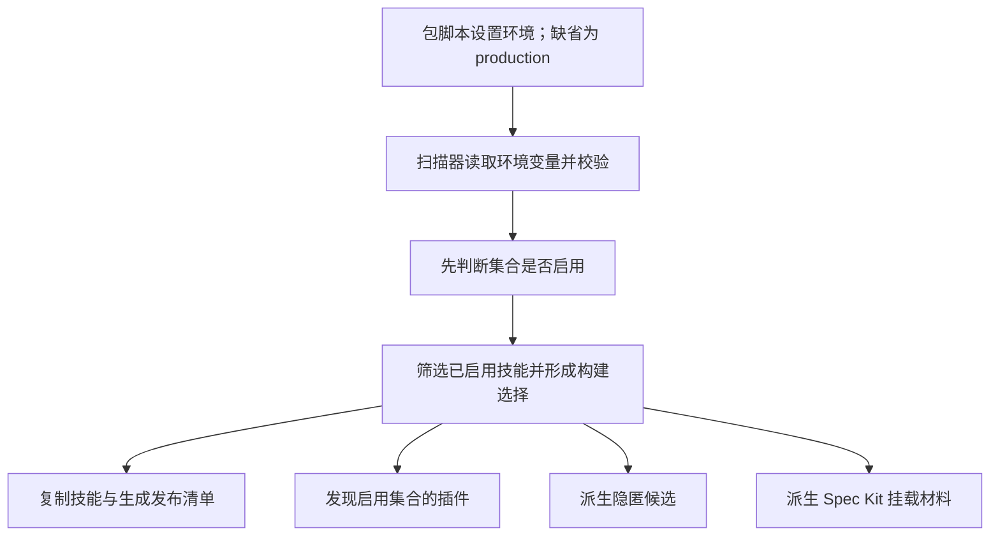

# 对话经过

会话 `01a215de-36db-7eb2-940e-537dffb2e5ab` · 轮次 `01a21693-8a4e-7fc0-838e-e9fba55de900`

<!-- foundry-detail 01a215de-36db-7eb2-940e-537dffb2e5ab 01a21693-8a4e-7fc0-838e-e9fba55de900 -->
<!-- foundry-event 83501a3ff375e870a39ef9b4350ff3c98e15fdee21b959a2e5a2f4d4f12fd116 -->
## 工具调用 `exec_command` · `call_tB7unqOF4VhhmEjvnOz897ot`

- 来源定位：字节 3438139

~~~text
工作目录：/home/ena/workspace/ena/agent-foundry/feature/init
{"cmd":"git status --short --branch; cat .agents/skills/conversation-recording/SKILL.md >/dev/null; cat .agents/skills/task-increment/SKILL.md >/dev/null; cat .agents/skills/artifact-spec-analysis/SKILL.md >/dev/null; rg -n 'FOUNDRY_SKILLS_ENV|变量.*环境|环境变量|process\\.env|当次 mode|Vite mode|publishOnly|build:prod|T006|T007' specs/skills/003-skills-release-pipeline/{spec.md,plan.md,mvu.md,tasks.md,research.md,data-model.md,quickstart.md,diagrams.md,contracts/build-and-publish.md,analysis/spec-analysis/README.md,implementation/T006.md,implementation/T007.md}","max_output_tokens":5700}
~~~

<!-- foundry-event 6ef60a093bc224ed7f88c17c2958174689b786352c79663c2b2f400ba4aafc12 -->
## 工具结果 `call_tB7unqOF4VhhmEjvnOz897ot`

- 来源定位：字节 3467038

~~~text
Chunk ID: e3f352
Wall time: 0.0000 seconds
Process exited with code 0
Original token count: 6248
Output:
Warning: truncated output (original token count: 6248)
Total output lines: 112

## feature/init...origin/feature/init
 M .codex/config.toml
 M .codex/hooks.json
 M packages/skills/src/profile/conversation-recording/references/recording-timing.md
 D packages/skills/src/profile/conversation-recording/scripts/events.py
 D packages/skills/src/profile/conversation-recording/scripts/install.py
 M packages/skills/src/profile/conversation-recording/scripts/post_tool_use.py
 D packages/skills/src/profile/conversation-recording/scripts/record.py
 M packages/skills/src/profile/conversation-recording/scripts/stop.py
 M packages/skills/src/profile/conversation-recording/scripts/user_prompt_submit.py
 M packages/skills/tests/conversation-workflow/helpers/recording-hook-probe.py
 M packages/skills/tests/test_conversation_recording.py
 M specs/skills/002-conversation-to-skill/analysis/recording-acceptance.md
 M specs/skills/002-conversation-to-skill/checklists/requirements.md
 M specs/skills/002-conversation-to-skill/implementation/T033.md
 M specs/skills/002-conversation-to-skill/implementation/T035.md
 M specs/skills/002-conversation-to-skill/mvu.md
 M specs/skills/002-conversation-to-skill/plan.md
 M specs/skills/002-conversation-to-skill/quickstart.md
 M specs/skills/002-conversation-to-skill/spec.md
 M specs/skills/002-conversation-to-skill/tasks.md
 M specs/skills/003-skills-release-pipeline/analysis/spec-analysis/README.md
 M specs/skills/003-skills-release-pipeline/contracts/build-and-publish.md
 M specs/skills/003-skills-release-pipeline/data-model.md
 M specs/skills/003-skills-release-pipeline/diagrams.md
 M specs/skills/003-skills-release-pipeline/mvu.md
 M specs/skills/003-skills-release-pipeline/plan.md
 M specs/skills/003-skills-release-pipeline/quickstart.md
 M specs/skills/003-skills-release-pipeline/research.md
 M specs/skills/003-skills-release-pipeline/spec.md
 M specs/skills/003-skills-release-pipeline/tasks.md
 D temp/a/figma-make-prompt.md
 D temp/a/speckit-prompt.md
 M temp/b/1.md
 D temp/b/2.md
?? .specify/memory/conversation-recording/records/2026-11-26/
?? packages/skills/src/profile/conversation-recording/install.py
?? packages/skills/src/profile/conversation-recording/recording/
?? specs/docs/
?? specs/skills/002-conversation-to-skill/requirements/discussions/2026-11-26-recording-title-source-research.md
?? specs/skills/002-conversation-to-skill/requirements/prompts/2026-11-26-recording-layout-and-curl-installation.md
?? specs/skills/002-conversation-to-skill/requirements/raw/2026-11-26-recording-codex-title-change.md
?? specs/skills/002-conversation-to-skill/requirements/raw/2026-11-26-recording-hook-trust-once.md
?? specs/skills/002-conversation-to-skill/requirements/raw/2026-11-26-recording-layout-and-curl-installation.md
?? specs/skills/002-conversation-to-skill/requirements/raw/2026-11-26-recording-local-copy-first.md
?? specs/skills/002-conversation-to-skill/requirements/raw/2026-11-26-recording-title-collision.md
?? specs/skills/002-conversation-to-skill/requirements/raw/2026-11-26-recording-title-fallback.md
?? specs/skills/002-conversation-to-skill/requirements/raw/2026-11-26-recording-title-rename.md
?? specs/skills/002-conversation-to-skill/requirements/raw/2026-11-26-recording-title-sync-timing.md
?? specs/skills/003-skills-release-pipeline/implementation/T006.md
?? specs/skills/003-skills-release-pipeline/implementation/T007.md
?? specs/skills/003-skills-release-pipeline/requirements/raw/
?? temp/a/1.md
specs/skills/003-skills-release-pipeline/implementation/T007.md:1:# T007 集合环境筛选与包脚本方案
specs/skills/003-skills-release-pipeline/implementation/T007.md:3:**方案状态**：待用户确认及 T006 前置验证通过，尚未实施。  
specs/skills/003-skills-release-pipeline/implementation/T007.md:4:**关联任务**：[T007](../tasks.md#环境机制) · **前置**：[T006](T006.md) · **需求**：[FR-001、FR-002](../spec.md#functional-requirements)  
specs/skills/003-skills-release-pipeline/implementation/T007.md:9:让集合作者能按 `development`、`release`、`production` 声明集合启用条件；共享扫描器先判集合，再扫描集合内已启用技能。技能包既有 `build` 在环境变量缺省时按 `production` 选择；增加三个显式入口，其中 `build:prod` 与既有 `build` 选择一致。本任务只接包内脚本、配置、扫描及其回归，不执行部署。
specs/skills/003-skills-release-pipeline/implementation/T007.md:16:2. 每次扫描只读取一次 `process.env.FOUNDRY_SKILLS_ENV`。变量未设置时回退到 `production`；空字符串或其他未知值直接报出包含变量名和值的错误，避免静默回退到错误环境。
specs/skills/003-skills-release-pipeline/implementation/T007.md:21:4. 移除扫描选项及调用点各自按 Vite mode 传入的 `publishOnly`，避免扫描器环境和插件环境各自做集合筛选。发布材料目前仍由原 Vite `release` 构建逻辑产生，不在本任务扩展到生产材料。
specs/skills/003-skills-release-pipeline/implementation/T007.md:28:- `build:development` 设置 `FOUNDRY_SKILLS_ENV=development` 并以 Vite `development` mode 构建。
specs/skills/003-skills-release-pipeline/implementation/T007.md:29:- `build:release` 设置 `FOUNDRY_SKILLS_ENV=release` 并以 Vite `release` mode 构建，保留当前测试发布材料行为。
specs/skills/003-skills-release-pipeline/implementation/T007.md:30:- `build:prod` 设置 `FOUNDRY_SKILLS_ENV=production`，直接使用 Vite 默认构建 mode，不额外覆盖默认值。
specs/skills/003-skills-release-pipeline/implementation/T007.md:32:当前工程明确支持 Linux/Codex 项目环境，脚本可用 POSIX 环境变量前缀，不新增跨平台脚本依赖。
specs/skills/003-skills-release-pipeline/implementation/T007.md:40:5. 添加三个包脚本。默认 `build` 不注入环境变量；`build` 和 `build:prod` 都应排除在 production 关闭的集合。
specs/skills/003-skills-release-pipeline/implementation/T007.md:41:6. 在现有 distribution 测试增加四环境输入、显式开关优先级、旧 publish 回退、非法值失败及 `build`/`build:prod` 集合清单一致性断言。隔离 fixture 不修改真实集合源和用户工作区材料。
specs/skills/003-skills-release-pipeline/implementation/T007.md:45:- 环境变量未设置、三种允许值、空值和未知值均有实际测试结果；未设置等同 `production`，无效输入明确失败。
specs/skills/003-skills-release-pipeline/implementation/T007.md:46:- `build` 与 `build:prod` 读取到相同集合和技能集合；`build:development`、`build:release` 按对应集合开关选择。
specs/skills/003-skills-release-pipeline/implementation/T007.md:53:- 用户确认的范围与缺省语义已记录；`FOUNDRY_SKILLS_ENV` 名称、非法值拒绝策略及 `enabled` 函数签名是本方案建议，需在进入 T007 前获得认可。
specs/skills/003-skills-release-pipeline/implementation/T007.md:54:- T006 的实际结果尚不存在。不得把方案描述当成环境变量验证通过或源码已实现。
specs/skills/003-skills-release-pipeline/analysis/spec-analysis/README.md:15:集合作者配置启用条件，维护者从技能、插件、隐匿和挂载观察同次选择。扫描器拟读取 `FOUNDRY_SKILLS_ENV`，变量未设置时默认 `production`；既有 `build` 因而与显式 `build:prod` 采用相同集合选择。包脚本还提供 `build:development` 与 `build:release`。集合显式 `enabled` 可按环境计算并优先于旧 `publish` 规则。当前方案待确认，T006 前置验证和 T007 实施尚未执行；本轮范围不改工作流及直接调用 Vite 的脚本，这些入口、容器和输出副作用留待后续验收。 [环境决策](../../research.md#构建模式与集合选择) · [构建契约](../../contracts/build-and-publish.md#构建入口) · [选择与派生流程](../../diagrams.md#一次构建共享同一份技能选择) · [里程碑](../../mvu.md#环境机制) · [T006 至 T008](../../tasks.md#环境机制)
specs/skills/003-skills-release-pipeline/contracts/build-and-publish.md:5:技能包脚本以 `FOUNDRY_SKILLS_ENV` 选择集合环境；变量未设置时扫描器默认使用 `production`。`build` 保持不设置变量，`build:prod` 显式设置 `production`，两者集合选择一致；`build:development` 与 `build:release` 显式设置对应值。集合配置支持静态布尔值与按环境计算的 `enabled`。扫描先解析集合启用状态，再形成同次技能清单。本轮暂不修改工作流和直接调用 Vite 的脚本。下表是目标矩阵，后续以实测输出核对。
specs/skills/003-skills-release-pipeline/diagrams.md:12:    environment["扫描器读取环境变量并校验"]
specs/skills/003-skills-release-pipeline/implementation/T006.md:1:# T006 环境变量传递前置验证方案
specs/skills/003-skills-release-pipeline/implementation/T006.md:4:**关联任务**：[T006](../tasks.md#环境机制) · **下游**：[T007](../tasks.md#环境机制)  
specs/skills/003-skills-release-pipeline/implementation/T006.md:9:验证 Linux 包脚本启动的 Node 子进程能收到显式环境变量，并能由动态导入的集合配置读取；未设置时保持未设置，由后续扫描器负责采用 `production` 缺省。此任务只验证进程环境传递，不实现集合筛选，不修改工作流、直接调用 Vite 的脚本或生产源代码。
specs/skills/003-skills-release-pipeline/implementation/T006.md:11:环境变量名建议使用 `FOUNDRY_SKILLS_ENV`，允许值为 `development`、`release`、`production`。该名称是本方案的工程建议；用户已确认变量缺省语义和本轮范围，但尚未单独确认该变量名。
specs/skills/003-skills-release-pipeline/implementation/T006.md:15:1. 使用 Node 内建模块和临时目录建立一个仅导出当前环境变量值的 ESM 配置夹具，不增加依赖、不写仓库生成物。
specs/skills/003-skills-release-pipeline/implementation/T006.md:17:3. 以非法值作为负向输入，记录该阶段只是传值验证；实际拒绝非法环境值由 T007 的扫描器实现和测试负责。
specs/skills/003-skills-release-pipeline/implementation/T006.md:18:4. 清理临时夹具，记录命令、Node/pnpm 版本、输入、标准输出、退出码及失败/未执行项。保留后续可复用的最小回归夹具或将其沉淀到 T007 的分发测试中。
specs/skills/003-skills-release-pipeline/implementation/T006.md:25:- 验证通过只证明环境变量的进程传递可用，不证明 T007 的默认值、集合选择或最终构建产物通过。
specs/skills/003-skills-release-pipeline/implementation/T006.md:31:3. 对结果逐项检查并补充 T006 证据；通过后才开始 T007。
specs/skills/003-skills-release-pipeline/quickstart.md:34:| 按环境选择   | 运行 `build:development`、`build:release`、未设置环境变量的 `build` 和显式 `build:prod`，加入集合与技能级开关夹具。 | `build` 与 `build:prod` 都按 `production` 选择且结果一致；各环境按配置过滤集合，`release` 生成测试发布材料。未知环境失败。 |
specs/skills/003-skills-release-pipeline/quickstart.md:65:记录待验 SHA、Docker 构建结果及 artifacts 的实际文件。预期未指定 `FOUNDRY_SKILLS_ENV` 的容器构建按 `production` 选择，不含 profile，且保有 VERSION、安装入口与…548 tokens truncated…](../../../scripts/dev/mount-speckit.sh) · [Vite 模式](https://vite.dev/guide/env-and-mode#-modes) · [Vite 插件配置时序](https://vite.dev/guide/api-plugin#config)
specs/skills/003-skills-release-pipeline/research.md:13:**备选** 各插件独立按照 mode 重扫会引入上下文漂移。让每个插件各自读不同配置或保留 publishOnly 参数会导致集合选择与插件发现不一致，因此统一由扫描器解析环境并应用集合开关。未设置变量时按用户确认默认为 production，不再另造普通构建环境。
specs/skills/003-skills-release-pipeline/research.md:43:**前置验证** 在隔离运行证明本仓库接受队列语法，连续三次同目标触发时有正在运行、排队和后入队的独立记录，后一轮读表发生在前一轮结束后。检查平台满额、取消和超时可见性，以及跨 job 制品身份、校验失败、环境变量可见性、触发 SHA 与旧运行重跑拒绝。没有远端运行授权时保留待验证状态。 [GitHub Actions 限制](https://docs.github.com/en/actions/reference/limits) · [运行变量](https://docs.github.com/en/actions/reference/workflows-and-actions/variables)
specs/skills/003-skills-release-pipeline/tasks.md:9:按待验提交建立干净输入，执行 [工具与基线检查](quickstart.md#1-本地工具和基线) 并将结果纳入 T001。其它功能正在开发的 profile 源码以所属工作的实际提交为准，组装候选时核对被测 SHA 和来源文件清单。T006、T011、T013 分别承担构建时序、安装包校验和发布边界的技术前置，后续实现沿各自通过的验证骨架推进。
specs/skills/003-skills-release-pipeline/tasks.md:24:- [ ] T006 [US1] 在 T001 和 T002 后，用隔离 Node 子进程验证包脚本设置的三种环境值能被动态加载的集合配置读取，变量未设置时仍保持未设置以供扫描器应用生产缺省。记录输入、子进程观察值和失败边界，形成 T007 可复用的验证依据；不改工作流或直接调用 Vite 的脚本。 [实施方案](implementation/T006.md)
specs/skills/003-skills-release-pipeline/tasks.md:25:- [ ] T007 [US1] 在 T006 验证通过后，为集合配置增加布尔值或按环境求值的 `enabled`，由共享扫描函数读取 `FOUNDRY_SKILLS_ENV`（未设置默认为 `production`，非法值失败），先过滤集合再扫描技能；显式 `enabled` 优先，缺省时兼容旧 `publish`。移除扫描调用方各自传入的 `publishOnly` 环境判断，避免与统一环境来源冲突。在 packages/skills/package.json 增加 `build:development`、`build:release`、`build:prod`，令既有 `build` 保持默认生产选择。更新集合配置与分发回归，确认环境选择及 `build`/`build:prod` 一致；暂不改工作流、scripts/dev/mount-speckit.sh 和其他直接调用 Vite 的脚本。 [实施方案](implementation/T007.md)
specs/skills/003-skills-release-pipeline/tasks.md:26:- [ ] T008 [US1] 在 T007 后复验技能复制、集合插件、隐匿及挂载消费者实际采用同次选择，覆盖默认 production、`build:prod`、development、release、禁用集合及技能级禁用项，并确认 `build:release` 保留测试发布材料。处理当前被明确延后的直接 Vite 调用及容器集成，核对 outDir、write:false 和默认容器归档；生产发布完整材料仍由 T019 按正式接入范围验收。
specs/skills/003-skills-release-pipeline/tasks.md:53:- [ ] T019 [US5] 在 T018 的三组门禁与实际回读通过后，参考已有的 `.github/workflows/skills-deploy-prod.yml.example` 草稿接入 `.github/workflows/skills-deploy-production.yml` 手动入口。每次生产发布先对所选提交实际运行三组门禁，核对测试、`build:prod` 构建和交接候选的 SHA 一致及生产桶身份；确认正式候选排除 `profile` 及其派生数据、发布材料齐备，且未改变默认 `build`。用受控失败场景验证门禁失败、跳过、结果缺失或 SHA 不符均为零部署。实际外部操作按对应授权执行。
specs/skills/003-skills-release-pipeline/tasks.md:67:| US1 按环境交付       | [T006 至 T008](#环境机制)                                                                | 读取真实产物，build 与 build:prod 采用 production 选择，development/release 按声明选择；四类消费者一致。                   |
specs/skills/003-skills-release-pipeline/tasks.md:84:- US1 与 US3 在 T001、T002 完成后可以分别推进 T006 的 Vite 夹具和 T011 的归档夹具。安装入口改动仍等候选身份和安装前置通过。
specs/skills/003-skills-release-pipeline/tasks.md:90:首个可独立验收的交付范围是 US1 环境机制。先完成 T001、T002 的风格与评审前置，随后用 T006 至 T008 交付可核对的模式产物。接下来交付版本身份和安装，再完成隔离发布、三组门禁及经过授权的测试桶回读。末尾复用 T022 做结案前清理。
specs/skills/003-skills-release-pipeline/plan.md:10:集合环境由技能包环境变量提供，允许 `development`、`release`、`production`，缺省为 `production`；环境变量建议名为 `FOUNDRY_SKILLS_ENV`。包内保留 `build` 缺省生产选择，并新增 `build:development`、`build:release`、`build:prod`；后者显式指定生产环境，与默认 `build` 选择一致。生产构建只生成本地产物，不代表部署。当前先完成包内环境区分，工作流和直接调用 Vite 的脚本留到后续接入。
specs/skills/003-skills-release-pipeline/plan.md:22:| 目标平台   | CI 沿用 Ubuntu 24.04，主线验收在 Linux 的隔离 Codex 项目；技能包脚本用环境变量选择集合，本地 `build` 缺省为 production。                         |
specs/skills/003-skills-release-pipeline/spec.md:27:- [环境标识使用全拼](requirements/raw/2026-11-26-environment-naming.md)与[默认环境确认](requirements/raw/2026-11-26-default-production-environment.md)：环境值为 `development`、`release`、`production`。扫描环境变量未设置时默认 `production`，不存在另一个“普通构建”环境；原 `build` 因未设置变量而按 `production` 选集合，新增 `build:prod` 作为显式同义入口。生产环境构建仅生成本地产物，不代表部署。本次先实现包内环境区分，暂不改工作流和直接调用 Vite 的脚本。实施细节建议待确认：变量名使用 `FOUNDRY_SKILLS_ENV`，空值或未知值报错。
specs/skills/003-skills-release-pipeline/spec.md:37:**独立验证** 分别构建 `development`、`release` 和默认 `production`，用集合级与技能级开关的正反夹具检查实际技能目录、启用的集合插件及其派生产物。未设置环境变量的 `build` 与显式 `build:prod` 应采用相同的生产集合选择。
specs/skills/003-skills-release-pipeline/spec.md:39:1. `development` 和 `release` 构建按集合配置交付 `profile` 中启用的技能；环境变量未设置的默认构建和显式 `build:prod` 均按 `production` 处理，不交付该环境关闭的集合、技能、插件及适用派生内容。
specs/skills/003-skills-release-pipeline/spec.md:42:4. 未设置环境变量的 `build` 使用默认 `production` 集合选择；显式 `build:prod` 与其选择一致。生产环境构建不自动部署。
specs/skills/003-skills-release-pipeline/spec.md:108:- **FR-001** 集合配置 `defineCollectionHandle` 必须支持集合级布尔字段 `enabled`，可直接声明或根据技能包构建环境求值。环境值为 `development`、`release` 或 `production`。扫描入口从环境变量读取环境；变量未设置时使用 `production`。扫描先判断集合，再按 `skill` 下各项的 `enabled` 选择技能。
specs/skills/003-skills-release-pipeline/spec.md:109:- **FR-002** 同次构建的集合选择必须共同约束技能复制、集合插件发现、隐匿候选和挂载脚本。`build` 未设置环境变量时按 `production` 选择；`build:development`、`build:release` 和 `build:prod` 分别显式选择对应环境，且 `build` 与 `build:prod` 的集合选择一致。发布材料及真实部署行为仍按发布入口处理。
specs/skills/003-skills-release-pipeline/spec.md:134:- **SC-001** 分别核验 `development`、`release` 和 `production` 的实际构建产物。按集合配置启用的集合及适用派生内容与环境一致；未设置环境变量的 `build` 与 `build:prod` 的选择结果相同。同次构建四类消费者的集合选择矛盾数为 0。
specs/skills/003-skills-release-pipeline/spec.md:163:- 环境选择由 `FOUNDRY_SKILLS_ENV` 提供；未设置时默认 `production`。本轮先验收技能包脚本和扫描逻辑，工作流与直接 Vite 调用脚本留待后续接入。
specs/skills/003-skills-release-pipeline/mvu.md:3:2026-11-25 Increment 按用户确认的「每个功能点就是一个里程碑」调整既有规划。两份原始需求共六项。本页按实施依赖排列，保留四项发布需求的原功能点归属。安装校验、测试桶回读、生产接入和公网验收仍沿已确认的规格，分别落在相关原功能点的交付范围内。2026-11-26 用户进一步确认环境变量缺省为生产环境，本轮先完成包内环境区分，工作流和直接 Vite 调用后续接入。 [默认环境确认](requirements/raw/2026-11-26-default-production-environment.md) · [发布原始需求](../../../temp/b/1.md) · [构建评审原始需求](../../../temp/b/2.md) · [汇总提示词](requirements/prompts/2026-11-25-skills-release-pipeline.md) · [规格与澄清](spec.md) · [方案](plan.md)
specs/skills/003-skills-release-pipeline/mvu.md:23:**节点与关键逻辑** 审查范围含 script/old、script/curl 和相关实际调用。与插件评审可并行核查，任何删除依据需补足配置、导出、工作流、安装、动态环境变量、历史及测试证据。引擎对归档内旧隐匿路径的兼容另有实际消费者证据。用途未决的文件逐项说明。 [旧路径基线](research.md#评审范围与手写源码依据)
specs/skills/003-skills-release-pipeline/mvu.md:35:**节点与关键逻辑** 先验证环境变量未设置时扫描器采用 `production`、显式三环境值分别选择正确集合，再实现扫描层统一读取和过滤。技能包增加 `build:development`、`build:release`、`build:prod`，既有 `build` 保持缺省生产环境。显式集合 enabled 可按环境计算并优先于旧 publish；旧配置沿兼容规则。当前范围不改工作流与直接调用 Vite 的脚本，后续分别接入。 [构建契约](contracts/build-and-publish.md#构建入口) · [环境决策](research.md#构建模式与集合选择)
specs/skills/003-skills-release-pipeline/mvu.md:37:**关联 Task** [T006、T007、T008](tasks.md#环境机制) 分别验证构建时序与输出、接通共享选择、复验模式及派生材料。
specs/skills/003-skills-release-pipeline/mvu.md:39:**验收信号** 环境未设置与 `build:prod` 均按 `production` 排除配置关闭的集合；`build:development` 与 `build:release` 的实际选择符合各集合声明。显式关闭的集合无技能及适用派生产物，未知环境明确失败。当前先验收扫描和包脚本；工作流及直接调用 Vite 的入口不在本步范围。

~~~

<!-- foundry-event d4a3bd3d4a6a3d6caaa8d297b31e218d8b014d695ffa14a39c994650c80a66c6 -->
## 工具调用 `exec_command` · `call_K8e5ZXEU8HdusUABHvinIwUF`

- 来源定位：字节 3514122

~~~text
工作目录：/home/ena/workspace/ena/agent-foundry/feature/init
{"cmd":"sed -n '1,18p' specs/skills/003-skills-release-pipeline/research.md; sed -n '1,22p' specs/skills/003-skills-release-pipeline/data-model.md; sed -n '1,24p' specs/skills/003-skills-release-pipeline/contracts/build-and-publish.md; sed -n '1,44p' specs/skills/003-skills-release-pipeline/diagrams.md; sed -n '1,85p' specs/skills/003-skills-release-pipeline/quickstart.md","max_output_tokens":6900}
~~~

<!-- foundry-event 0e5b9f5103864d96bd9e1c38ad2f71096def6599a01841d684a43cc334ee3912 -->
## 工具结果 `call_K8e5ZXEU8HdusUABHvinIwUF`

- 来源定位：字节 3536531

~~~text
Chunk ID: 88a6b4
Wall time: 0.0000 seconds
Process exited with code 0
Original token count: 4605
Output:
# Phase 0 调研：主线技能按环境构建与发布

**证据日期** 2026-11-25 · **源码基线** 1bcc1bd · **输入** [功能规格](spec.md)

本次核对现有构建、脚本、安装器和工作流，并对照公开文档。下面的技术前置仍须按实施阶段的实际工具和运行结果取证。 [验收指南](quickstart.md)

## 构建模式与集合选择

**当前决定（2026-11-26 更新）** 扫描从 `FOUNDRY_SKILLS_ENV` 读取环境，缺省 `production`；环境值先在扫描层统一解析，再判断集合启用并由后续消费者使用。环境为 `development`、`release`、`production`。技能包 `build` 沿用缺省生产选择，另提供 `build:development`、`build:release`、`build:prod`。集合可声明静态或按环境求值的 enabled；显式值优先，未声明时由 release/production 的 publish 兼容规则筛选。当前增量先实现包内脚本与扫描，工作流及直接 Vite 调用后续接入。 [确认记录](spec.md#session-2026-11-26) · [构建与发布契约](contracts/build-and-publish.md)

**理由** Vite 默认 mode 与项目集合环境是两层输入。本次选择通过进程环境变量给扫描器读取，不要求把 mode 从配置入口逐层透传。包脚本同步设置所需环境，release 脚本仍显式给 Vite `--mode release` 以保留现有发布材料行为；普通 build 不额外设置环境值。 [当前构建入口](../../../packages/skills/vite.config.ts) · [开发挂载](../../../scripts/dev/mount-speckit.sh) · [Vite 模式](https://vite.dev/guide/env-and-mode#-modes) · [Vite 插件配置时序](https://vite.dev/guide/api-plugin#config)

**备选** 各插件独立按照 mode 重扫会引入上下文漂移。让每个插件各自读不同配置或保留 publishOnly 参数会导致集合选择与插件发现不一致，因此统一由扫描器解析环境并应用集合开关。未设置变量时按用户确认默认为 production，不再另造普通构建环境。

**前置验证** 用相同进程顺序构建三种模式，再运行一次 write:false 挂载构建和一次隔离 outDir 构建。读取实际技能、派生数据和输出路径，核对同次选择及文件系统副作用。现行目录覆盖实测显示正文写到固定 dist/skill，应把这个边界纳入评审和回归。测试缺配置、非普通配置、导入失败和安装名冲突的既有行为，再确定需要保留的分支。 [集合扫描](../../../packages/skills/utils/scan-skills.ts) · [技能插件](../../../packages/skills/build/plugins/vite-plugin-skill/index.ts) · [现行构建测试](../../../packages/skills/tests/distribution/vite-plugin-skill.test.mjs)

## 评审范围与手写源码依据

# 数据模型：集合构建与技能发布

**依据** [功能规格](spec.md) · [方案](plan.md)

## 构建环境与集合选择

| 数据     | 字段与关系                                                                                               | 验证                                                                                              |
| -------- | -------------------------------------------------------------------------------------------------------- | ------------------------------------------------------------------------------------------------- |
| 构建环境 | 技能包环境变量（建议名 `FOUNDRY_SKILLS_ENV`）；值为 development、release、production。                       | 变量未设置时默认为 production；build 与 build:prod 选择一致。无效值策略见 T007 方案。              |
| 集合配置 | 集合目录、packageName、enabled、已有 publish、plugin 与 skill 配置。集合级 enabled 可依据技能包环境求值。 | 先判集合启用再读取技能启用项。显式 enabled 优先；旧配置在缺少 enabled 时沿 publish 兼容规则。     |
| 构建选择 | 启用集合、各集合启用的技能及适用派生数据。范围是一次构建。                                               | 同一选择供复制、交付清单、集合插件发现、隐匿及挂载。复制与输出文件引用同一组有效相对路径。        |

## 发布候选

每次独立发布冻结一份候选，关联目标、触发提交、发布模式、发布时间戳和同次制品。候选制品中的包内 curl/install.sh 与上传根 install.sh 字节一致。

| 字段                                      | 含义与校验                                                                                         |
| ----------------------------------------- | -------------------------------------------------------------------------------------------------- |
| target / environment                      | 正式候选目标与环境必须一致：release 对应测试桶，production 对应生产桶。                             |
| sourceRevision                            | 实际检出的完整提交 SHA，三组门禁、构建及制品核验采用同值。                                         |
| packageVersion                            | 源码包 package.json 的版本，进包后保持可独立读取。                                                 |
| releaseTimestamp                          | UTC 毫秒时间戳，固定宽度 YYYYMMDDTHHmmssSSSZ。解析后须回格式化为同值。对同一目标属于唯一发布标识。 |
# 构建与发布契约

## 构建入口

技能包脚本以 `FOUNDRY_SKILLS_ENV` 选择集合环境；变量未设置时扫描器默认使用 `production`。`build` 保持不设置变量，`build:prod` 显式设置 `production`，两者集合选择一致；`build:development` 与 `build:release` 显式设置对应值。集合配置支持静态布尔值与按环境计算的 `enabled`。扫描先解析集合启用状态，再形成同次技能清单。本轮暂不修改工作流和直接调用 Vite 的脚本。下表是目标矩阵，后续以实测输出核对。

| 集合     | development | release | production（含默认 build） |
| -------- | ----------- | ------- | -------------------------- |
| coding   | 启用        | 启用    | 启用                       |
| frontend | 启用        | 启用    | 启用                       |
| workflow | 启用        | 启用    | 启用                       |
| eval     | 沿当前本地开关 | 排除  | 排除                       |
| profile  | 启用        | 启用    | 排除                       |

集合 enabled 存在时采用明确的布尔值或按当前环境计算的结果，并优先于旧 publish。未声明时，development 沿用本地纳入行为，release 与 production 仅纳入 publish 为 true 的集合。随后才选择技能级 enabled。集合插件发现额外尊重已有 plugin 开关，可以运行没有启用技能但声明了适用插件的启用集合。继续保留已有的缺配置、导入错误、链接和安装名冲突处理，并确认消费者间原有差异的实际影响。

同次快照为技能复制、引擎插件发现、隐匿列表和 Spec Kit 挂载提供依据。真实写出使用当次解析的输出目录。内存构建只读取生成的挂载材料，保持磁盘输出不被改写。测试发布和正式生产归档都应包含同次 VERSION、curl/install.sh、适用的 engine 与 skill 内容、安装映射、说明、许可和实际必要的通知文件；生产候选材料在生产接入阶段处理，不改变普通构建。

## 入口、配置与制品交接

- 测试入口沿用 feature/init 推送与复用调用，删除事件跳过。生产入口通过受信工作流的手动触发选择提交，于三组门禁及测试桶真实回读通过后接入。显式选中的提交在仅持内容读取权限的测试和构建作业检出，触发及制品证据一致。手动工作流可触发性按仓库默认分支的实际设置核验。 [GitHub 手动运行前置](https://docs.github.com/en/actions/how-tos/manage-workflow-runs/manually-run-a-workflow)
- 公共流程按阶段接入 `release` 和 `production`，核对目标、mode、环境绑定与各自 R2 桶。沿用 SKILL_DEPLOY_RELEASE_R2 / SKILL_DEPLOY_R2 的账户和桶变量以及共用凭据。计划给相应前缀提供 DOWNLOAD_BASE_URL 非秘密配置。R2 作业只执行受信工作流版本的脚本，候选字节作为输入读取。选中源码的构建与测试无 R2 凭据。
- 每次测试或手动生产发布，三组门禁须有该次所选 SHA 的实际通过记录。门禁失败、跳过、结果缺失或候选 SHA 与被测 SHA 不符时停止部署。构建使用与门禁一致的锁定依赖和工具配置，直接构建该包生成目标模式的候选。补发旧提交也须通过现行门禁和候选核验。候选核对获准集合和必要附件，排除项目个人材料、工作区凭据与环境文件。用同一工作流运行的制品传递归档、根入口字节及候选元数据，下载后逐项验证身份、长度和摘要。版本表准备作业另交接新表及源状态。 [数据模型](../data-model.md)
- 从调度进入到 S3 回读，整条公共发布流程按已验证目标分组，启用 queue: max 且不取消在途。多次触发以实际成功登记顺序置顶。队列满由平台取消，保留运行记录。旧工作流运行的重新尝试不进入部署，维护者另行触发时生成独立候选。 [GitHub 并发队列](https://docs.github.com/en/actions/how-tos/write-workflows/choose-when-workflows-run/control-workflow-concurrency)
# 流程图：主线技能构建与发布

## 一次构建共享同一份技能选择

构建选择是本轮允许交付的集合和技能名单。副作用由各自插件负责。

**代码位置** [Vite 配置](../../../packages/skills/vite.config.ts) · [扫描](../../../packages/skills/utils/scan-skills.ts) · [技能插件](../../../packages/skills/build/plugins/vite-plugin-skill/index.ts) · [引擎插件](../../../packages/skills/build/plugins/vite-plugin-engine/index.ts) · [隐匿插件](../../../packages/skills/build/plugins/vite-plugin-engine/sub-plugins/vite-plugin-hidden-install/index.ts) · [挂载插件](../../../packages/skills/src/workflow/plugin/vite-plugin-speckit-mount/index.ts)



## 同目标串行准备与写入

版本表是安装器选包的依据。最后写表成功才登记新版本。ETag 是读取现有表时取得的对象标识，用它防止别人修改过的版本表被覆盖。

**代码位置** [测试入口](../../../.github/workflows/skills-deploy-release.yml) · [现行门禁](../../../.github/workflows/skills-test.yml) · [公共工作流](../../../.github/workflows/skills-deploy-common.yml) · [脚本目录](../../../packages/skills/script)下计划新增 temporary-release。

```mermaid
flowchart TD
    tests["同一提交三组门禁通过"]
    queue["等待同目标的发布槽位"]
    build["构建并打包归档及入口"]
    read["S3 读表并在本地准备新表"]
    archive["条件创建归档并回读核验"]
    entry["写根入口并核对原字节"]
    register["按缺失或源 ETag 条件写表"]
    proof["回读同次对象并记录证据"]
    fail["终止本次部署并记录失败步骤"]
    tests --> queue --> build --> read
    read --> archive --> entry --> register --> proof
# 验收指南：主线技能按环境构建与发布

在功能实现后按以下步骤复验，独立保存门禁、S3 回读和公网安装结果。当前规划继承已核对的基线，尚无新功能部署结果。 [范围与现状](spec.md) · [数据模型](data-model.md)

## 1. 本地工具和基线

以待验证的明确提交建立干净工作区。安装仓库锁定依赖及 mise 工具链。安装验收需要 Linux、Bash、curl、Node、npm、tar、jq、uv，真实挂载另需已初始化的隔离 Spec Kit 项目与 Specify。验证覆盖普通构建、直接 Vite、容器及内存挂载，容器步骤需可用 Docker。

```bash
git rev-parse HEAD
pnpm install --frozen-lockfile
pnpm --filter @foundry/preset-config run build
pnpm --filter @foundry/skills run check-types
pnpm --filter @foundry/skills run lint
pnpm --filter @foundry/skills run test
node --test packages/skills/tests/distribution/{vite-plugin-skill,vite-plugin-engine,speckit-mount,hidden-contract}.test.mjs
```

预期满足目标包的类型检查和相关回归。验证实际动态加载的挂载子插件也进入类型检查。此前基线为 Node 64 项和 Python 39 项，Node 运行前需具备 jq。旧工作流测试的缺文件结果按现状记录，复用到新入口的断言有独立判定。

## 2. 在同一提交运行三组门禁

实现阶段提供技能包 test:release 命令，CI 与本地验收均调用同一个入口。提交核对后执行如下命令。

```bash
command -v jq
command -v uv
git rev-parse HEAD
pnpm --filter @foundry/skills run test:release
```

| 用例         | 输入和操作                                                                                                                                   | 预期观察                                                                                                                                               |
| ------------ | -------------------------------------------------------------------------------------------------------------------------------------------- | ------------------------------------------------------------------------------------------------------------------------------------------------------ |
| 按环境选择   | 运行 `build:development`、`build:release`、未设置环境变量的 `build` 和显式 `build:prod`，加入集合与技能级开关夹具。 | `build` 与 `build:prod` 都按 `production` 选择且结果一致；各环境按配置过滤集合，`release` 生成测试发布材料。未知环境失败。 |
| 安装器选包   | 生成两份标记不同的真实归档，用隔离 HTTPS 夹具提供倒序版本与根入口。分别默认选首条、显式选另一条，再分别让 SHA-256、长度和包内时间戳不一致。  | 请求的下载地址与实际安装文件都对应选中记录。三类失败各返回失败且无项目写入。默认挂载、--no-mount、--hidden 沿原接口复核。                              |
| 持久化与顺序 | 在独立对象存储边界执行实际版本准备及发布逻辑，首发后补发旧提交，并模拟同目标连续请求、读表错误、条件冲突和中途写入失败。                     | 第一轮从确认缺失开始，第二轮置顶并保留首发。归档目录和 VERSION 同值。失败运行零重试、零未完整条目登记。                                                |

本地隔离门禁无需真实桶凭据。作业证据保留三组结果、被测提交、关键产物和失败阶段。失败、工具缺失和必需测试跳过均阻止放行。队列调度及 R2 对象语义还需实际平台前置验证。 [发布契约](contracts/build-and-publish.md)

### 容器构建与产物导出

这是 T008 的单独产物验收。从仓库根设置本次待验的 SOURCE_REVISION 为实际提交 SHA。Dockerfile 使用该提交的源码作为构建上下文，并按本地默认配置构建。依赖和导出放在隔离目录。

```bash
(
  set -euo pipefail
  : "${SOURCE_REVISION:?需要待验提交 SHA}"
  docker_check_dir="$(mktemp -d)"
  mkdir "$docker_check_dir/source"
  git archive "$SOURCE_REVISION" | tar -xf - -C "$docker_check_dir/source"
  docker buildx build \
    --file "$docker_check_dir/source/packages/skills/deploy/Dockerfile" \
    --target artifacts --output "type=local,dest=$docker_check_dir/artifacts" \
    "$docker_check_dir/source"
  test -f "$docker_check_dir/artifacts/VERSION"
  test -f "$docker_check_dir/artifacts/curl/install.sh"
  test -f "$docker_check_dir/artifacts/engine/install.sh"
  test ! -e "$docker_check_dir/artifacts/skill/profile/conversation-recording/SKILL.md"
  tar -tzf "$docker_check_dir/artifacts/skills.tar.gz" |
    grep -Fx -- 'skill/coding/document-changed-symbols/SKILL.md'
  printf '容器构建提交与导出目录：%s %s\n' "$SOURCE_REVISION" "$docker_check_dir/artifacts"
)
```

记录待验 SHA、Docker 构建结果及 artifacts 的实际文件。预期未指定 `FOUNDRY_SKILLS_ENV` 的容器构建按 `production` 选择，不含 profile，且保有 VERSION、安装入口与引擎入口。容器附带归档应包含已启用集合的技能成员。Docker 不可用时，记录该验证缺前置。

## 3. 比较同源构建与交接候选

用两个干净输出目录和同一已确认的源码 SHA、依赖、构建模式、下载根及固定时间戳。下例中的下载根是隔离测试夹具输入。实现后的构建以这两个变量接收冻结值和下载根。

```bash
export FOUNDRY_SKILLS_RELEASE_TIMESTAMP=20261125T120905123Z
export FOUNDRY_SKILLS_DOWNLOAD_BASE_URL=https://downloads.fixture.invalid
comparison_dir="$(mktemp -d)"
pnpm --filter @foundry/skills run build:release -- --outDir "$comparison_dir/first"
pnpm --filter @foundry/skills run build:release -- --outDir "$comparison_dir/second"
diff -qr "$comparison_dir/first" "$comparison_dir/second"
```

预期两份输出的文件相对路径和原字节一致。CI 实际发布另对冻结归档的 SHA-256 与字节长度核验，复核包内入口和从构建作业交接给发布作业的入口字节一致。归档可记录 tar/gzip 元数据差异，实际上传使用候选制品交接的原字节。

## 4. 从测试桶回读同次对象

获得对 release 测试桶的适用授权后，通过现行测试发布入口运行目标提交。记录触发 SHA、三组门禁、候选 SHA-256、入口制品、发布时间戳及实际对象键。以下命令在已有授权配置的 AWS CLI 环境中只读运行。使用实际 release 桶、R2 S3 endpoint 与发布版本。


~~~

<!-- foundry-event 520c23b2fa70519e35fd26584005b84551e866bc702fdceae3cb8bc61d8f6462 -->
## 工具调用 `apply_patch` · `call_J4kglepw3oDw58s19XYJVQr2`

- 来源定位：字节 3562357

~~~text
工作目录：/home/ena/workspace/ena/agent-foundry/feature/init
*** Begin Patch
*** Add File: specs/skills/003-skills-release-pipeline/requirements/raw/2026-11-26-vite-built-in-mode.md
+# 使用 Vite 内置 mode 区分环境
+
+来源：2026-11-26，用户确认环境选择方案时提出。
+
+> 为什么不用vite的内置变量
+>
+> 是的，修订方案
+
+确认含义：采用 Vite 当前构建的 `mode` 作为集合环境，不再增加项目自定义环境变量。原始问题指向上一轮建议的自定义变量方案。
*** Update File: specs/skills/003-skills-release-pipeline/spec.md
@@
-- [环境标识使用全拼](requirements/raw/2026-11-26-environment-naming.md)与[默认环境确认](requirements/raw/2026-11-26-default-production-environment.md)：环境值为 `development`、`release`、`production`。扫描环境变量未设置时默认 `production`，不存在另一个“普通构建”环境；原 `build` 因未设置变量而按 `production` 选集合，新增 `build:prod` 作为显式同义入口。生产环境构建仅生成本地产物，不代表部署。本次先实现包内环境区分，暂不改工作流和直接调用 Vite 的脚本。实施细节建议待确认：变量名使用 `FOUNDRY_SKILLS_ENV`，空值或未知值报错。
+- [环境标识使用全拼](requirements/raw/2026-11-26-environment-naming.md)、[默认环境确认](requirements/raw/2026-11-26-default-production-environment.md)与[Vite mode 决策](requirements/raw/2026-11-26-vite-built-in-mode.md)：使用 Vite 当次 `mode` 作为集合环境，不新增自定义环境变量。支持值为 `development`、`release`、`production`；`build` 沿用 Vite 默认 `production`，`build:prod` 显式指定同一 mode，二者集合选择一致。生产环境构建仅生成本地产物，不代表部署。本次先实现包内环境区分，暂不改工作流和直接调用 Vite 的脚本。
@@
-- **FR-001** 集合配置 `defineCollectionHandle` 必须支持集合级布尔字段 `enabled`，可直接声明或根据技能包构建环境求值。环境值为 `development`、`release` 或 `production`。扫描入口从环境变量读取环境；变量未设置时使用 `production`。扫描先判断集合，再按 `skill` 下各项的 `enabled` 选择技能。
-- **FR-002** 同次构建的集合选择必须共同约束技能复制、集合插件发现、隐匿候选和挂载脚本。`build` 未设置环境变量时按 `production` 选择；`build:development`、`build:release` 和 `build:prod` 分别显式选择对应环境，且 `build` 与 `build:prod` 的集合选择一致。发布材料及真实部署行为仍按发布入口处理。
+- **FR-001** 集合配置 `defineCollectionHandle` 必须支持集合级布尔字段 `enabled`，可直接声明或根据当次 Vite `mode` 求值。环境值为 `development`、`release` 或 `production`。扫描先判断集合，再按 `skill` 下各项的 `enabled` 选择技能。
+- **FR-002** 同次构建的集合选择必须共同约束技能复制、集合插件发现、隐匿候选和挂载脚本。`build` 沿用 Vite 默认 `production` mode；`build:development`、`build:release` 和 `build:prod` 分别显式使用对应 mode，且 `build` 与 `build:prod` 的集合选择一致。发布材料及真实部署行为仍按发布入口处理。
@@
-- **SC-001** 分别核验 `development`、`release` 和 `production` 的实际构建产物。按集合配置启用的集合及适用派生内容与环境一致；未设置环境变量的 `build` 与 `build:prod` 的选择结果相同。同次构建四类消费者的集合选择矛盾数为 0。
+- **SC-001** 分别核验 `development`、`release` 和 `production` 的实际构建产物。按集合配置启用的集合及适用派生内容与环境一致；默认 `build` 与显式 `build:prod` 的选择结果相同。同次构建四类消费者的集合选择矛盾数为 0。
@@
-- 环境选择由 `FOUNDRY_SKILLS_ENV` 提供；未设置时默认 `production`。本轮先验收技能包脚本和扫描逻辑，工作流与直接 Vite 调用脚本留待后续接入。
+- 环境选择使用 Vite 当前 `mode`；本轮先验收技能包脚本和扫描逻辑，工作流与直接 Vite 调用脚本留待后续接入。
*** End Patch

~~~

<!-- foundry-event 570be1bec5f855c9c8bb6c0f50f49da939a13a3bcec3e0bb01af271c44d78b8e -->
## 工具结果 `call_J4kglepw3oDw58s19XYJVQr2`

- 来源定位：字节 3573811

~~~text
Exit code: 0
Wall time: 0 seconds
Output:
Success. Updated the following files:
A specs/skills/003-skills-release-pipeline/requirements/raw/2026-11-26-vite-built-in-mode.md
M specs/skills/003-skills-release-pipeline/spec.md

~~~

<!-- foundry-event ca2cd2638b78634dd5fd9236b0184955c5eaf03a82e59e4926f7c5f696b42232 -->
## 工具调用 `apply_patch` · `call_O4r4Kz5TEtyVrz3ONvfEW4ZQ`

- 来源定位：字节 3597647

~~~text
工作目录：/home/ena/workspace/ena/agent-foundry/feature/init
*** Begin Patch
*** Update File: specs/skills/003-skills-release-pipeline/data-model.md
@@
-| 构建环境 | 技能包环境变量（建议名 `FOUNDRY_SKILLS_ENV`）；值为 development、release、production。                       | 变量未设置时默认为 production；build 与 build:prod 选择一致。无效值策略见 T007 方案。              |
-| 集合配置 | 集合目录、packageName、enabled、已有 publish、plugin 与 skill 配置。集合级 enabled 可依据技能包环境求值。 | 先判集合启用再读取技能启用项。显式 enabled 优先；旧配置在缺少 enabled 时沿 publish 兼容规则。     |
+| 构建环境 | Vite 当次 mode；值为 development、release、production。                                                    | `build` 沿用 Vite 默认 production；build 与 build:prod 选择一致。未知 mode 的处理见 T007 方案。    |
+| 集合配置 | 集合目录、packageName、enabled、已有 publish、plugin 与 skill 配置。集合级 enabled 可依据当次 mode 求值。 | 先判集合启用再读取技能启用项。显式 enabled 优先；旧配置在缺少 enabled 时沿 publish 兼容规则。     |
*** Update File: specs/skills/003-skills-release-pipeline/contracts/build-and-publish.md
@@
-技能包脚本以 `FOUNDRY_SKILLS_ENV` 选择集合环境；变量未设置时扫描器默认使用 `production`。`build` 保持不设置变量，`build:prod` 显式设置 `production`，两者集合选择一致；`build:development` 与 `build:release` 显式设置对应值。集合配置支持静态布尔值与按环境计算的 `enabled`。扫描先解析集合启用状态，再形成同次技能清单。本轮暂不修改工作流和直接调用 Vite 的脚本。下表是目标矩阵，后续以实测输出核对。
+集合选择直接使用 Vite 当次 `mode`。技能包脚本保持 `build` 使用 Vite 默认 `production`，新增 `build:development`、`build:release` 和 `build:prod` 显式选择 mode；默认 `build` 与 `build:prod` 选择一致。扫描函数接收 Vite 配置回调或插件上下文提供的 mode，不在 Node 扫描模块读取 `import.meta.env.MODE`，也不增加自定义环境变量。集合配置支持静态布尔值与按 mode 计算的 `enabled`。本轮暂不修改工作流和直接调用 Vite 的脚本。下表是目标矩阵，后续以实测输出核对。
*** Update File: specs/skills/003-skills-release-pipeline/research.md
@@
-**当前决定（2026-11-26 更新）** 扫描从 `FOUNDRY_SKILLS_ENV` 读取环境，缺省 `production`；环境值先在扫描层统一解析，再判断集合启用并由后续消费者使用。环境为 `development`、`release`、`production`。技能包 `build` 沿用缺省生产选择，另提供 `build:development`、`build:release`、`build:prod`。集合可声明静态或按环境求值的 enabled；显式值优先，未声明时由 release/production 的 publish 兼容规则筛选。当前增量先实现包内脚本与扫描，工作流及直接 Vite 调用后续接入。 [确认记录](spec.md#session-2026-11-26) · [构建与发布契约](contracts/build-and-publish.md)
+**当前决定（2026-11-26 更新）** 使用 Vite 当次 `mode` 作为唯一环境选择，不增加自定义环境变量。`build` 沿用 Vite 默认 `production`，另提供 `build:development`、`build:release`、`build:prod`。集合配置可声明静态或按 mode 求值的 enabled；显式值优先，未声明时由 release/production 的 publish 兼容规则筛选。Vite config 回调和插件上下文都可取得当次 mode，再将其传给 Node 扫描函数；不在 Node 动态导入模块中直接使用 Vite 替换的 `import.meta.env.MODE`。本轮先实现包内脚本、扫描及消费者接线，工作流与直接 Vite 调用脚本后续处理。 [用户确认](spec.md#session-2026-11-26) · [构建与发布契约](contracts/build-and-publish.md)
@@
-**理由** Vite 默认 mode 与项目集合环境是两层输入。本次选择通过进程环境变量给扫描器读取，不要求把 mode 从配置入口逐层透传。包脚本同步设置所需环境，release 脚本仍显式给 Vite `--mode release` 以保留现有发布材料行为；普通 build 不额外设置环境值。 [当前构建入口](../../../packages/skills/vite.config.ts) · [开发挂载](../../../scripts/dev/mount-speckit.sh) · [Vite 模式](https://vite.dev/guide/env-and-mode#-modes) · [Vite 插件配置时序](https://vite.dev/guide/api-plugin#config)
+**理由** Vite 已提供唯一、与真实构建一致的 `mode`，避免自定义进程变量和 Vite mode 不一致。配置回调取得 mode 后交给在配置阶段创建的引擎插件；运行期插件从其 Vite 环境读取 mode，再传给共享扫描函数。普通 `vite build` 的默认 mode 就是 `production`。Node 动态导入的集合配置本身不是 Vite 转换的应用模块，因此扫描函数需要接收 mode 参数，而不是直接读 `import.meta.env.MODE`。 [当前构建入口](../../../packages/skills/vite.config.ts) · [开发挂载](../../../scripts/dev/mount-speckit.sh) · [Vite 模式](https://vite.dev/guide/env-and-mode#-modes) · [Vite 配置](https://vite.dev/config/) · [Vite 插件上下文](https://vite.dev/guide/api-plugin#config)
@@
-**备选** 各插件独立按照 mode 重扫会引入上下文漂移。让每个插件各自读不同配置或保留 publishOnly 参数会导致集合选择与插件发现不一致，因此统一由扫描器解析环境并应用集合开关。未设置变量时按用户确认默认为 production，不再另造普通构建环境。
+**备选** 各插件独立按照 mode 重扫会引入上下文漂移。由每个插件保留 `publishOnly` 布尔值会丢失实际环境信息，并与集合配置的 enabled 规则分离；改为各扫描调用传入 Vite 当前 mode，由扫描器统一过滤。
*** Update File: specs/skills/003-skills-release-pipeline/diagrams.md
@@
-    entry["包脚本设置环境；缺省为 production"]
-    environment["扫描器读取环境变量并校验"]
+    entry["Vite 提供当次 mode；默认 production"]
+    environment["Node 扫描函数接收 mode"]
@@
-    entry --> environment --> collection --> selection
+    entry --> environment --> collection --> selection
*** End Patch

~~~

<!-- foundry-event bae3720720866526c087b05a140c02f10253307b1f107ac929a0600fc7ee9cc6 -->
## 工具结果 `call_O4r4Kz5TEtyVrz3ONvfEW4ZQ`

- 来源定位：字节 3613317

~~~text
Exit code: 0
Wall time: 0 seconds
Output:
Success. Updated the following files:
M specs/skills/003-skills-release-pipeline/data-model.md
M specs/skills/003-skills-release-pipeline/contracts/build-and-publish.md
M specs/skills/003-skills-release-pipeline/research.md
M specs/skills/003-skills-release-pipeline/diagrams.md

~~~

<!-- foundry-event 7d59c10576254815d713ea968d1c868917dd4f6be9cb7d355f998de7966e66ab -->
## 工具调用 `apply_patch` · `call_atl4g0wdVIRkca6H5lX4T7w8`

- 来源定位：字节 3620481

~~~text
工作目录：/home/ena/workspace/ena/agent-foundry/feature/init
*** Begin Patch
*** Update File: specs/skills/003-skills-release-pipeline/spec.md
@@
-- [环境标识使用全拼](requirements/raw/2026-11-26-environment-naming.md)、[默认环境确认](requirements/raw/2026-11-26-default-production-environment.md)与[Vite mode 决策](requirements/raw/2026-11-26-vite-built-in-mode.md)：使用 Vite 当次 `mode` 作为集合环境，不新增自定义环境变量。支持值为 `development`、`release`、`production`；`build` 沿用 Vite 默认 `production`，`build:prod` 显式指定同一 mode，二者集合选择一致。生产环境构建仅生成本地产物，不代表部署。本次先实现包内环境区分，暂不改工作流和直接调用 Vite 的脚本。
+- [环境标识使用全拼](requirements/raw/2026-11-26-environment-naming.md)、[默认环境确认](requirements/raw/2026-11-26-default-production-environment.md)与[Vite mode 决策](requirements/raw/2026-11-26-vite-built-in-mode.md)：使用 Vite 当次 `mode` 作为集合环境，不新增自定义环境变量。支持值为 `development`、`release`、`production`；`build` 沿用 Vite 默认 `production`，`build:prod` 显式指定同一 mode，二者集合选择一致。生产环境构建仅生成本地产物，不代表部署。本次先实现包内环境区分，暂不改工作流和直接调用 Vite 的脚本。Node 扫描函数通过 Vite 配置/插件上下文接收 mode，不直接读取应用代码中的 `import.meta.env.MODE`。
@@
-**独立验证** 分别构建 `development`、`release` 和默认 `production`，用集合级与技能级开关的正反夹具检查实际技能目录、启用的集合插件及其派生产物。未设置环境变量的 `build` 与显式 `build:prod` 应采用相同的生产集合选择。
+**独立验证** 分别构建 `development`、`release` 和默认 `production`，用集合级与技能级开关的正反夹具检查实际技能目录、启用的集合插件及其派生产物。默认 `build` 与显式 `build:prod` 应采用相同的生产集合选择。
@@
-1. `development` 和 `release` 构建按集合配置交付 `profile` 中启用的技能；环境变量未设置的默认构建和显式 `build:prod` 均按 `production` 处理，不交付该环境关闭的集合、技能、插件及适用派生内容。
+1. `development` 和 `release` 构建按集合配置交付 `profile` 中启用的技能；默认构建和显式 `build:prod` 均按 Vite 的 `production` mode 处理，不交付该环境关闭的集合、技能、插件及适用派生内容。
@@
-4. 未设置环境变量的 `build` 使用默认 `production` 集合选择；显式 `build:prod` 与其选择一致。生产环境构建不自动部署。
+4. 未传 `--mode` 的 `build` 使用 Vite 默认 `production` 集合选择；显式 `build:prod` 与其选择一致。生产环境构建不自动部署。
@@
-- **FR-002** 同次构建的集合选择必须共同约束技能复制、集合插件发现、隐匿候选和挂载脚本。`build` 沿用 Vite 默认 `production` mode；`build:development`、`build:release` 和 `build:prod` 分别显式使用对应 mode，且 `build` 与 `build:prod` 的集合选择一致。发布材料及真实部署行为仍按发布入口处理。
+- **FR-002** 同次构建的集合选择必须共同约束技能复制、集合插件发现、隐匿候选和挂载脚本。`build` 沿用 Vite 默认 `production` mode；`build:development`、`build:release` 和 `build:prod` 分别显式使用对应 mode，且 `build` 与 `build:prod` 的集合选择一致。发布材料及真实部署行为仍按发布入口处理。
@@
-- **SC-001** 分别核验 `development`、`release` 和 `production` 的实际构建产物。按集合配置启用的集合及适用派生内容与环境一致；未设置环境变量的 `build` 与 `build:prod` 的选择结果相同。同次构建四类消费者的集合选择矛盾数为 0。
+- **SC-001** 分别核验 `development`、`release` 和 `production` 的实际构建产物。按集合配置启用的集合及适用派生内容与环境一致；默认 `build` 与 `build:prod` 的选择结果相同。同次构建四类消费者的集合选择矛盾数为 0。
@@
-- 环境选择使用 Vite 当前 `mode`；本轮先验收技能包脚本和扫描逻辑，工作流与直接 Vite 调用脚本留待后续接入。
+- 环境选择使用 Vite 当前 `mode`；本轮先验收包内 mode 传递与扫描逻辑，工作流和直接调用脚本留待后续接入。
*** End Patch

~~~

<!-- foundry-event 90b26b9a43bf0c947a426b2131079b4b82205349b8e78914b8c3ebfa896ea640 -->
## 工具结果 `call_atl4g0wdVIRkca6H5lX4T7w8`

- 来源定位：字节 3626393

~~~text
apply_patch verification failed: Failed to find expected lines in /home/ena/workspace/ena/agent-foundry/feature/init/specs/skills/003-skills-release-pipeline/spec.md:
- **SC-001** 分别核验 `development`、`release` 和 `production` 的实际构建产物。按集合配置启用的集合及适用派生内容与环境一致；未设置环境变量的 `build` 与 `build:prod` 的选择结果相同。同次构建四类消费者的集合选择矛盾数为 0。
~~~

<!-- foundry-event dc5457d7281b3c112f125e0f1a08f42f57ee90c77ebc1038154291fe2b009f93 -->
## 工具调用 `exec_command` · `call_BpEEBKIqsE8tKhOz5CiTilXr`

- 来源定位：字节 3632091

~~~text
工作目录：/home/ena/workspace/ena/agent-foundry/feature/init
{"cmd":"sed -n '24,44p;106,137p;160,166p' specs/skills/003-skills-release-pipeline/spec.md"}
~~~

<!-- foundry-event d2aba01dfb6c1dc847b4cf3dc44fbebddeeeee2f9feb5bec189dc8e1aca8ee6b -->
## 工具结果 `call_BpEEBKIqsE8tKhOz5CiTilXr`

- 来源定位：字节 3644328

~~~text
Chunk ID: dda48a
Wall time: 0.0000 seconds
Process exited with code 0
Original token count: 2470
Output:

### Session 2026-11-26

- [环境标识使用全拼](requirements/raw/2026-11-26-environment-naming.md)、[默认环境确认](requirements/raw/2026-11-26-default-production-environment.md)与[Vite mode 决策](requirements/raw/2026-11-26-vite-built-in-mode.md)：使用 Vite 当次 `mode` 作为集合环境，不新增自定义环境变量。支持值为 `development`、`release`、`production`；`build` 沿用 Vite 默认 `production`，`build:prod` 显式指定同一 mode，二者集合选择一致。生产环境构建仅生成本地产物，不代表部署。本次先实现包内环境区分，暂不改工作流和直接调用 Vite 的脚本。

## User Scenarios & Testing _(mandatory)_

### User Story 1 - 按环境确认交付内容 (P1)

集合作者希望在同一份集合配置中声明启用条件，并能从各环境的实际构建产物确认技能及其派生交付内容。

**优先理由** 发布产物与本地挂载都依赖正确的集合选择。

**独立验证** 分别构建 `development`、`release` 和默认 `production`，用集合级与技能级开关的正反夹具检查实际技能目录、启用的集合插件及其派生产物。未设置环境变量的 `build` 与显式 `build:prod` 应采用相同的生产集合选择。

1. `development` 和 `release` 构建按集合配置交付 `profile` 中启用的技能；环境变量未设置的默认构建和显式 `build:prod` 均按 `production` 处理，不交付该环境关闭的集合、技能、插件及适用派生内容。
2. 在集合按布尔值启用时，只交付其中启用且符合现有交付规则的技能。集合关闭时，组内技能即使开启也应全部跳过。
3. 针对同次构建核对技能目录、集合插件、隐匿候选和 Spec Kit 挂载材料时，各处应使用一致的集合选择。
4. 未设置环境变量的 `build` 使用默认 `production` 集合选择；显式 `build:prod` 与其选择一致。生产环境构建不自动部署。

### User Story 2 - 连续发布并保留已交付版本 (P1)
### Functional Requirements

- **FR-001** 集合配置 `defineCollectionHandle` 必须支持集合级布尔字段 `enabled`，可直接声明或根据当次 Vite `mode` 求值。环境值为 `development`、`release` 或 `production`。扫描先判断集合，再按 `skill` 下各项的 `enabled` 选择技能。
- **FR-002** 同次构建的集合选择必须共同约束技能复制、集合插件发现、隐匿候选和挂载脚本。`build` 沿用 Vite 默认 `production` mode；`build:development`、`build:release` 和 `build:prod` 分别显式使用对应 mode，且 `build` 与 `build:prod` 的集合选择一致。发布材料及真实部署行为仍按发布入口处理。
- **FR-003** 评审必须完整覆盖 `packages/skills/build/plugins`、`packages/skills/script` 及其构建、安装和测试调用链。对构建插件逐项记录问题和调用影响，实施评审确定的范围内优化，并附可复验的验收证据。
- **FR-004** 清理旧脚本前必须核对直接引用、导出与配置、动态路径、工作流、安装入口、测试和历史使用依据。确认无引用后清理对应旧代码，并记录实删项。仍被引用的代码须记录调用方与用途，证据不足时须说明保留依据。
- **FR-005** 本功能后续新增或修改代码前，须在本 Spec 目录保存从用户手写代码中提炼的规则与可定位源码示例，并依该记录编写和审查改动。
- **FR-006** 测试和生产必须使用各自的 R2 桶，沿用共用访问凭据配置。各桶的发布对象为根 `install.sh`、根 `release.json` 和 `release/<时间戳>/skills.tar.gz`。旧 SHA 目录由维护者手动处理。
- **FR-007** 构建必须在 `VERSION` 保有源码包版本并新增本次发布的时间戳。归档目录、包内发布标识与版本表 `version` 取同一个值。源码包版本以 `package.json.version` 为准。本地构建可在无线上版本表和凭据的情况下完成。
- **FR-008** 在候选构建和打包之后，版本表准备作业必须经目标桶的 S3 接口读取现有根版本表，在工作区生成更新版本表。只在确知对象缺失时初始化。新版本对象包含本次时间戳、固定归档下载信息、归档 SHA-256 摘要和实际字节长度，并置于有序数组首条，原记录与原顺序保留。补发旧提交遵循当次成功发布顺序。
- **FR-009** 独立发布作业须在归档、安装脚本和更新后的版本表全部就绪后开始上传。先上传并校验归档，再写桶根入口，最后写桶根版本表。同目标串行边界覆盖读表至写回，后续请求排队，已开始的发布继续执行直至成功或失败。部署步骤失败时，本次运行标记失败并终止，不重试。若维护者另行发起发布，使用该次发布自己的时间戳，并读取当时的版本表。
- **FR-010** 临时版本管理逻辑须在独立临时目录集中维护。本期默认版本由首条记录表达。正式版本工具接管和故障后的回退机制留待后续。
- **FR-011** 桶根安装入口运行时须从对应环境的下载根读取 `release.json`。默认使用数组首条，显式版本按 `version` 精确匹配一条记录，按记录的 `url` 获取归档。安装新发布的时间戳版本时，入口必须核对归档的 SHA-256 和字节长度，并确认包内 `VERSION` 时间戳等于记录的 `version`。三项均通过后才可写入项目，字段缺失或核对失败时须报告原因。项目级技能安装及适用的挂载和隐匿接口纳入兼容核对。面向公网的版本表须使用实际 HTTPS 归档地址。
- **FR-012** 测试和生产的每次发布均须由 `skills-test` 针对候选提交运行三组真实最小用例，验证三环境集合选择、默认安装首条以及连续两次发布。三组全部通过且被测提交与候选提交一致才允许发布，结果须可追溯到被测提交。
- **FR-013** 测试环境应保有当前 `feature/init` 推送和可复用调用入口，分支删除事件跳过部署。测试阶段须从实际对象键经 S3 回读三份材料，核对同次运行的归档 SHA-256、入口原字节和索引首条与候选身份。公网根补齐后须用真实公开入口验下载安装。测试、对象回读和公网安装须各自记录通过、失败或缺前置未执行的证据。
- **FR-014** 生产入口接入所需的测试环境验收证据为 FR-012 的三组门禁和 FR-013 的测试桶对象回读均通过。测试桶公网安装作为地址补齐后的独立验收。正式生产候选沿用 Vite 的 `production` 模式，由生产发布入口选定交付范围并生成完整发布材料，使用相同的版本和发布契约写入生产桶。实际外部部署、发布和资源变更须有适用授权。

### Key Entities _(include if feature involves data)_

- **集合配置**。集合标识、当次构建模式、集合开关、技能开关和适用的插件及安装附属材料。
- **发布候选**。同次构建产生的归档和安装入口，关联源码提交、源码包版本、发布时间戳和核验摘要。
- **版本表**。由目标 R2 桶持久化的有序发布记录。每个版本对象记录唯一发布标识和固定归档下载地址。新发布的版本对象还记录该归档的 SHA-256 摘要和字节长度。首条是默认选择。
- **验收记录**。被测提交、目标环境、动作、预期信号和实际结果。部署证据还关联真实对象键和同次候选。

## Success Criteria _(mandatory)_

### Measurable Outcomes

- **SC-001** 分别核验 `development`、`release` 和 `production` 的实际构建产物。按集合配置启用的集合及适用派生内容与环境一致；默认 `build` 与显式 `build:prod` 的选择结果相同。同次构建四类消费者的集合选择矛盾数为 0。
- **SC-002** 同一提交三组门禁用例全部有真实执行结果。任一失败、跳过或未执行时的错误放行次数为 0。
- **SC-003** 两份可区分的归档各完成一次实际安装验证，分别覆盖默认首条和显式历史版本。下载和安装内容与选中归档的匹配率为 100%。归档 SHA-256、字节长度及包内 `VERSION` 时间戳各验证一次独立不匹配情形，产生的项目写入次数均为 0。
- **SC-004** 从无索引起连续成功发布两次时，两个版本的包内标识、归档目录及索引标识各自完全一致，第二次保留首发条目。并行触发和失败场景中，已登记的不同内容归档覆盖数、已交付记录丢失数和未完成版本入表数均为 0。至少验证一次部署写入中途失败，运行结果为失败，同次发布的后续部署尝试次数为 0。
### 规划时待确认与复核

- 依据 T002 的评审证据确定 T003 的优化范围，并在处理后复验。依据 T004 的逐文件结论复核 T005 的清理候选，再核对有效入口和历史夹具。 [评审与清理任务](tasks.md#构建插件评审与优化)
- 环境选择使用 Vite 当前 `mode`；本轮先验收技能包脚本和扫描逻辑，工作流与直接 Vite 调用脚本留待后续接入。
- 确认 `VERSION` 字段格式、时间戳粒度，以及同一发布输入的重复构建比较口径。 [旧规格的同源构建验收](../001-skills-distribution/spec.md)
- 核对旧公开地址或 SemVer 条目的真实消费者，确定兼容范围。核对包内 `curl/install.sh` 和 `engine/install.sh` 的接口，以及旧安装器是否仍需读取 `md5` 字段。 [旧安装交付契约](../001-skills-distribution/contracts/curl-delivery.md#版本表与固定对象)
- 确认真实 HTTPS 下载根及缓存对公网安装验收的影响。缺少公网地址时，测试桶仍可按实际对象键完成回读验收，公网验证结果记为缺前置。

~~~

<!-- foundry-event 1738df466b735d9b737aa9f820adbb3929ef91835663cf8817371fda07ee8475 -->
## 工具调用 `apply_patch` · `call_D0FBQ3ZObQHc4MsAgnZLNwdK`

- 来源定位：字节 3659538

~~~text
工作目录：/home/ena/workspace/ena/agent-foundry/feature/init
*** Begin Patch
*** Update File: specs/skills/003-skills-release-pipeline/spec.md
@@
-- [环境标识使用全拼](requirements/raw/2026-11-26-environment-naming.md)、[默认环境确认](requirements/raw/2026-11-26-default-production-environment.md)与[Vite mode 决策](requirements/raw/2026-11-26-vite-built-in-mode.md)：使用 Vite 当次 `mode` 作为集合环境，不新增自定义环境变量。支持值为 `development`、`release`、`production`；`build` 沿用 Vite 默认 `production`，`build:prod` 显式指定同一 mode，二者集合选择一致。生产环境构建仅生成本地产物，不代表部署。本次先实现包内环境区分，暂不改工作流和直接调用 Vite 的脚本。
+- [环境标识使用全拼](requirements/raw/2026-11-26-environment-naming.md)、[默认环境确认](requirements/raw/2026-11-26-default-production-environment.md)与[Vite mode 决策](requirements/raw/2026-11-26-vite-built-in-mode.md)：使用 Vite 当次 `mode` 作为集合环境，不新增自定义环境变量。支持值为 `development`、`release`、`production`；`build` 沿用 Vite 默认 `production`，`build:prod` 显式指定同一 mode，二者集合选择一致。生产环境构建仅生成本地产物，不代表部署。本次先实现包内环境区分，暂不改工作流和直接调用 Vite 的脚本。Node 扫描函数通过 Vite 配置/插件上下文接收 mode，不直接读取应用代码中的 `import.meta.env.MODE`。
@@
-**独立验证** 分别构建 `development`、`release` 和默认 `production`，用集合级与技能级开关的正反夹具检查实际技能目录、启用的集合插件及其派生产物。未设置环境变量的 `build` 与显式 `build:prod` 应采用相同的生产集合选择。
+**独立验证** 分别构建 `development`、`release` 和默认 `production`，用集合级与技能级开关的正反夹具检查实际技能目录、启用的集合插件及其派生产物。默认 `build` 与显式 `build:prod` 应采用相同的生产集合选择。
@@
-1. `development` 和 `release` 构建按集合配置交付 `profile` 中启用的技能；环境变量未设置的默认构建和显式 `build:prod` 均按 `production` 处理，不交付该环境关闭的集合、技能、插件及适用派生内容。
+1. `development` 和 `release` 构建按集合配置交付 `profile` 中启用的技能；默认构建和显式 `build:prod` 均按 Vite 的 `production` mode 处理，不交付该环境关闭的集合、技能、插件及适用派生内容。
@@
-4. 未设置环境变量的 `build` 使用默认 `production` 集合选择；显式 `build:prod` 与其选择一致。生产环境构建不自动部署。
+4. 未传 `--mode` 的 `build` 使用 Vite 默认 `production` 集合选择；显式 `build:prod` 与其选择一致。生产环境构建不自动部署。
@@
-- 环境选择使用 Vite 当前 `mode`；本轮先验收技能包脚本和扫描逻辑，工作流与直接 Vite 调用脚本留待后续接入。
+- 环境选择使用 Vite 当前 `mode`；本轮先验收包内 mode 传递与扫描逻辑，工作流和直接调用脚本留待后续接入。
*** End Patch

~~~

<!-- foundry-event a3055d2e6c26e12c32c261f922392a550a1f7686a69a05c96652c80a1aba0365 -->
## 工具结果 `call_D0FBQ3ZObQHc4MsAgnZLNwdK`

- 来源定位：字节 3668632

~~~text
Exit code: 0
Wall time: 0 seconds
Output:
Success. Updated the following files:
M specs/skills/003-skills-release-pipeline/spec.md

~~~

<!-- foundry-event 22d50784f6f8617b130c514c48ec2bdd2a37ac43e9c5752145f9443cf2e7f60e -->
## 工具调用 `apply_patch` · `call_oGzv7ND9HF3Utwg38ITDMnAr`

- 来源定位：字节 3674108

~~~text
工作目录：/home/ena/workspace/ena/agent-foundry/feature/init
*** Begin Patch
*** Update File: specs/skills/003-skills-release-pipeline/plan.md
@@
-集合环境由技能包环境变量提供，允许 `development`、`release`、`production`，缺省为 `production`；环境变量建议名为 `FOUNDRY_SKILLS_ENV`。包内保留 `build` 缺省生产选择，并新增 `build:development`、`build:release`、`build:prod`；后者显式指定生产环境，与默认 `build` 选择一致。生产构建只生成本地产物，不代表部署。当前先完成包内环境区分，工作流和直接调用 Vite 的脚本留到后续接入。
+集合环境使用 Vite 当次 `mode`，支持 `development`、`release`、`production`。扫描函数从配置回调或插件上下文取得 mode；不另设环境变量。包内保留 `build` 的 Vite 默认生产选择，并新增 `build:development`、`build:release`、`build:prod`；后者显式指定 production，与默认 `build` 选择一致。生产构建只生成本地产物，不代表部署。当前先完成包内环境区分，工作流和直接调用 Vite 的脚本留到后续接入。
@@
-| 目标平台   | CI 沿用 Ubuntu 24.04，主线验收在 Linux 的隔离 Codex 项目；技能包脚本用环境变量选择集合，本地 `build` 缺省为 production。                         |
+| 目标平台   | CI 沿用 Ubuntu 24.04，主线验收在 Linux 的隔离 Codex 项目；技能包脚本用 Vite `--mode` 选择集合，本地 `build` 缺省为 production。                    |
@@
-沿用现有入口及集合插件结构。构建环境由包脚本设置，扫描器读取统一变量并先解析集合启用状态；显式 `enabled` 优先，缺少时兼容旧 `publish` 规则。第一步完成隔离验证及包内脚本、集合配置和共享扫描，保留工作流、开发挂载脚本及其直接 Vite 调用不变。随后按现有里程碑补齐分发消费者、容器及门禁；生产草稿按 release 实际门禁与回读证据接入。
+沿用现有入口及集合插件结构。包脚本通过 Vite `--mode` 选择环境，既有默认 `production` 不需覆盖；扫描器接收同一 mode 并先解析集合启用状态，显式 `enabled` 优先，缺少时兼容旧 `publish` 规则。第一步验证 Vite mode 在配置/插件路径中的传递，再完成包内脚本、集合配置和共享扫描；保留工作流与直接 Vite 调用脚本不变。随后按现有里程碑补齐分发消费者、容器及门禁；生产草稿按 release 实际门禁与回读证据接入。
*** Update File: specs/skills/003-skills-release-pipeline/mvu.md
@@
-2026-11-25 Increment 按用户确认的「每个功能点就是一个里程碑」调整既有规划。两份原始需求共六项。本页按实施依赖排列，保留四项发布需求的原功能点归属。安装校验、测试桶回读、生产接入和公网验收仍沿已确认的规格，分别落在相关原功能点的交付范围内。2026-11-26 用户进一步确认环境变量缺省为生产环境，本轮先完成包内环境区分，工作流和直接 Vite 调用后续接入。 [默认环境确认](requirements/raw/2026-11-26-default-production-environment.md) · [发布原始需求](../../../temp/b/1.md) · [构建评审原始需求](../../../temp/b/2.md) · [汇总提示词](requirements/prompts/2026-11-25-skills-release-pipeline.md) · [规格与澄清](spec.md) · [方案](plan.md)
+2026-11-25 Increment 按用户确认的「每个功能点就是一个里程碑」调整既有规划。两份原始需求共六项。本页按实施依赖排列，保留四项发布需求的原功能点归属。安装校验、测试桶回读、生产接入和公网验收仍沿已确认的规格，分别落在相关原功能点的交付范围内。2026-11-26 用户确认以 Vite 内置 mode 作为集合环境，不新增自定义环境变量；本轮先完成包内 mode 区分，工作流和直接 Vite 调用后续接入。 [Vite mode 决策](requirements/raw/2026-11-26-vite-built-in-mode.md) · [默认环境确认](requirements/raw/2026-11-26-default-production-environment.md) · [发布原始需求](../../../temp/b/1.md) · [构建评审原始需求](../../../temp/b/2.md) · [汇总提示词](requirements/prompts/2026-11-25-skills-release-pipeline.md) · [规格与澄清](spec.md) · [方案](plan.md)
@@
-**节点与关键逻辑** 先验证环境变量未设置时扫描器采用 `production`、显式三环境值分别选择正确集合，再实现扫描层统一读取和过滤。技能包增加 `build:development`、`build:release`、`build:prod`，既有 `build` 保持缺省生产环境。显式集合 enabled 可按环境计算并优先于旧 publish；旧配置沿兼容规则。当前范围不改工作流与直接调用 Vite 的脚本，后续分别接入。 [构建契约](contracts/build-and-publish.md#构建入口) · [环境决策](research.md#构建模式与集合选择)
+**节点与关键逻辑** 先验证 Vite 配置回调和插件上下文能提供当次 mode，再把它传入共享扫描函数。技能包增加三个显式 mode 脚本，既有 `build` 保持 Vite 默认生产环境。显式集合 enabled 可按 mode 计算并优先于旧 publish；旧配置沿兼容规则。当前范围不改工作流与直接调用 Vite 的脚本，后续分别接入。 [构建契约](contracts/build-and-publish.md#构建入口) · [环境决策](research.md#构建模式与集合选择)
@@
-**验收信号** 环境未设置与 `build:prod` 均按 `production` 排除配置关闭的集合；`build:development` 与 `build:release` 的实际选择符合各集合声明。显式关闭的集合无技能及适用派生产物，未知环境明确失败。当前先验收扫描和包脚本；工作流及直接调用 Vite 的入口不在本步范围。
+**验收信号** 默认 `build` 与 `build:prod` 均按 `production` 排除配置关闭的集合；`build:development` 与 `build:release` 的实际选择符合各集合声明。显式关闭的集合无技能及适用派生产物，受支持集合之外的 mode 明确失败。当前先验收扫描和包脚本；工作流及直接调用 Vite 的入口不在本步范围。
*** End Patch

~~~

<!-- foundry-event 8497e39dd00a969108b489ad60195176f52ffa0f1aee13456d068f9a9b588db5 -->
## 工具结果 `call_oGzv7ND9HF3Utwg38ITDMnAr`

- 来源定位：字节 3689042

~~~text
Exit code: 0
Wall time: 0 seconds
Output:
Success. Updated the following files:
M specs/skills/003-skills-release-pipeline/plan.md
M specs/skills/003-skills-release-pipeline/mvu.md

~~~

<!-- foundry-event 7b135a5368bc1a88d0999e16f6998e2b38da9acf848fa4be1151ca1387f76ec5 -->
## 工具调用 `apply_patch` · `call_AHqZS2oDUsjYej2SmsvJUfcW`

- 来源定位：字节 3698390

~~~text
工作目录：/home/ena/workspace/ena/agent-foundry/feature/init
*** Begin Patch
*** Update File: specs/skills/003-skills-release-pipeline/tasks.md
@@
-- [ ] T006 [US1] 在 T001 和 T002 后，用隔离 Node 子进程验证包脚本设置的三种环境值能被动态加载的集合配置读取，变量未设置时仍保持未设置以供扫描器应用生产缺省。记录输入、子进程观察值和失败边界，形成 T007 可复用的验证依据；不改工作流或直接调用 Vite 的脚本。 [实施方案](implementation/T006.md)
-- [ ] T007 [US1] 在 T006 验证通过后，为集合配置增加布尔值或按环境求值的 `enabled`，由共享扫描函数读取 `FOUNDRY_SKILLS_ENV`（未设置默认为 `production`，非法值失败），先过滤集合再扫描技能；显式 `enabled` 优先，缺省时兼容旧 `publish`。移除扫描调用方各自传入的 `publishOnly` 环境判断，避免与统一环境来源冲突。在 packages/skills/package.json 增加 `build:development`、`build:release`、`build:prod`，令既有 `build` 保持默认生产选择。更新集合配置与分发回归，确认环境选择及 `build`/`build:prod` 一致；暂不改工作流、scripts/dev/mount-speckit.sh 和其他直接调用 Vite 的脚本。 [实施方案](implementation/T007.md)
+- [ ] T006 [US1] 在 T001 和 T002 后，用隔离 Vite 构建验证配置回调和插件上下文能取得实际 `mode`：默认 build 为 `production`，显式 development、release、production 分别保持原值；在同一进程连续构建时不得串用上次 mode。记录命令、观察值和失败边界，形成 T007 的 mode 传递验证依据；不改工作流或直接调用 Vite 的脚本。 [实施方案](implementation/T006.md)
+- [ ] T007 [US1] 在 T006 验证通过后，为集合配置增加布尔值或按 Vite mode 求值的 `enabled`，由共享扫描函数接收并校验当次 mode，先过滤集合再扫描技能；显式 `enabled` 优先，缺省时兼容旧 `publish`。移除扫描调用方各自传入的 `publishOnly` 环境判断，避免与统一 mode 来源冲突。在 packages/skills/package.json 增加 `build:development`、`build:release`、`build:prod`，令既有 `build` 保持 Vite 默认 production。更新集合配置与分发回归，确认环境选择及 `build`/`build:prod` 一致；暂不改工作流、scripts/dev/mount-speckit.sh 和其他直接调用 Vite 的脚本。 [实施方案](implementation/T007.md)
*** End Patch

~~~

<!-- foundry-event 1bd4b9edd08c8e815a73b10c477e6d94db8c185fc556b5e7ca6d47f2f3d350e0 -->
## 工具结果 `call_AHqZS2oDUsjYej2SmsvJUfcW`

- 来源定位：字节 3705662

~~~text
Exit code: 0
Wall time: 0 seconds
Output:
Success. Updated the following files:
M specs/skills/003-skills-release-pipeline/tasks.md

~~~

<!-- foundry-event e91184536a3212d43e31da2028c19d0ac4ba080d8ef845bbbd0fe497dc2da0dc -->
## 工具调用 `apply_patch` · `call_cBFrOExyIY9J8brT9ktMpy0J`

- 来源定位：字节 3712527

~~~text
工作目录：/home/ena/workspace/ena/agent-foundry/feature/init
*** Begin Patch
*** Delete File: specs/skills/003-skills-release-pipeline/implementation/T006.md
*** End Patch

~~~

<!-- foundry-event 7de98484e8dc0d032110e18fcd7cdac725dd87db1ea03d0eb3d27766e219de2a -->
## 工具结果 `call_cBFrOExyIY9J8brT9ktMpy0J`

- 来源定位：字节 3717078

~~~text
Exit code: 0
Wall time: 0 seconds
Output:
Success. Updated the following files:
D specs/skills/003-skills-release-pipeline/implementation/T006.md

~~~

<!-- foundry-event 393365a0ce938c9bd2147ff4594fbad41a47711dfb7a38a235f60fffe754fcae -->
## 工具调用 `apply_patch` · `call_fRACUNJ81YlDdK1D0Uu2d8VB`

- 来源定位：字节 3719646

~~~text
工作目录：/home/ena/workspace/ena/agent-foundry/feature/init
*** Begin Patch
*** Add File: specs/skills/003-skills-release-pipeline/implementation/T006.md
+# T006 Vite mode 传递前置验证方案
+
+**方案状态**：用户已确认使用 Vite 内置 `mode`；验证尚未执行。  
+**关联任务**：[T006](../tasks.md#环境机制) · **下游**：[T007](../tasks.md#环境机制)  
+**需求来源**：[Vite mode 决策](../requirements/raw/2026-11-26-vite-built-in-mode.md) · [当前有效规格](../spec.md#session-2026-11-26)
+
+## 目标与边界
+
+证明 Vite 为每次构建提供正确的 mode，配置回调和插件钩子可读取该值，并可在同一 Node 进程连续构建时区分各次输入。默认构建应观察到 `production`；显式构建应准确得到 `development`、`release`、`production`。
+
+不使用自定义环境变量，不在 Node 模块直接读取 `import.meta.env.MODE`。本任务只建立 T007 所需的 Vite mode 传递证据，不实施集合过滤，不改工作流或直接调用 Vite 的脚本。
+
+## 方法
+
+1. 在现有 distribution 测试中使用 Vite Node API 和隔离临时目录建立观察构建，配置一个仅记录解析后 `mode` 的最小临时插件。
+2. 在同一进程依次构建：不指定 mode、`development`、`release`、显式 `production`。记录每轮回调及插件观察到的 mode，不复用前一次配置状态。
+3. 使用完整技能包 Vite 配置再跑适用的最小隔离构建，确认配置回调中的 mode 可交给配置阶段创建的插件；运行期插件可从对应 Vite 环境取得当前 mode。不得据此宣称集合筛选已经实现。
+4. 对每项记录输入、预期、stdout/实际观察、退出码及临时目录副作用；清理临时构建输出，留下可复用的隔离测试骨架。
+
+## 验收信号
+
+- 默认 `vite build` / Node API `build()` 的解析 mode 为 `production`。
+- 三个显式 mode 与输入逐字一致；连续构建的观察顺序与输入顺序相同，无前次值残留。
+- 验证依赖现有 Vite，无新增依赖、网络、工作流或直接调用脚本修改。
+- 通过只证明 Vite mode 可在所需配置/插件路径取得；集合过滤与消费者一致性仍由 T007/T008 验收。
+
+## 执行顺序
+
+1. 复核当前测试 harness 的隔离构建方式及 Vite 版本。
+2. 添加 mode 观察夹具，运行默认和三个显式 mode 的同进程序列。
+3. 检查构建返回值、记录证据并保存测试骨架；通过后再进入 T007。
*** End Patch

~~~

<!-- foundry-event b9b3f439723606dad67ad093b08eeca8f55e116960c06e4be162f00bda48ce0b -->
## 工具结果 `call_fRACUNJ81YlDdK1D0Uu2d8VB`

- 来源定位：字节 3726583

~~~text
Exit code: 0
Wall time: 0 seconds
Output:
Success. Updated the following files:
A specs/skills/003-skills-release-pipeline/implementation/T006.md

~~~

<!-- foundry-event 05a064158ef8acaaf9c675ef1c3329219652c2c753f490be83be3b51019fff4b -->
## 工具调用 `apply_patch` · `call_ovnIWUTCWfWRsNvXHnbs0weA`

- 来源定位：字节 3733204

~~~text
工作目录：/home/ena/workspace/ena/agent-foundry/feature/init
*** Begin Patch
*** Delete File: specs/skills/003-skills-release-pipeline/implementation/T007.md
*** End Patch

~~~

<!-- foundry-event 03eb4a8c9fa74fe80d9e39a3fa67a773ede5d011427fd04a6c8d414e272f99ea -->
## 工具结果 `call_ovnIWUTCWfWRsNvXHnbs0weA`

- 来源定位：字节 3740719

~~~text
Exit code: 0
Wall time: 0 seconds
Output:
Success. Updated the following files:
D specs/skills/003-skills-release-pipeline/implementation/T007.md

~~~

<!-- foundry-event 3500a3b3a6fe0ce7001d3bcda83916f42b9fc7a41f8819930e14ead7c55bfcaf -->
## 工具调用 `apply_patch` · `call_S3zJmFUmBElDou32tfXL1Xpg`

- 来源定位：字节 3743286

~~~text
工作目录：/home/ena/workspace/ena/agent-foundry/feature/init
*** Begin Patch
*** Add File: specs/skills/003-skills-release-pipeline/implementation/T007.md
+# T007 集合环境筛选与包脚本方案
+
+**方案状态**：已按用户确认改为 Vite 内置 mode；T006 前置验证及本任务实施尚未执行。  
+**关联任务**：[T007](../tasks.md#环境机制) · **前置**：[T006](T006.md) · **需求**：[FR-001、FR-002](../spec.md#functional-requirements)  
+**决策依据**：[Vite mode 决策](../requirements/raw/2026-11-26-vite-built-in-mode.md) · [集合扫描](../../../../packages/skills/utils/scan-skills.ts) · [现有集合类型](../../../../packages/skills/utils/define-collection-handle.ts)
+
+## 目标与范围
+
+让集合作者能按 Vite `mode` 声明集合启用条件；共享扫描器先判集合，再扫描集合内已启用技能。既有 `build` 沿用 Vite 默认 `production`；增加 `build:development`、`build:release`、`build:prod`，其中 `build:prod` 显式指定 `production`，与默认 `build` 选择一致。本任务只接包内脚本、配置、扫描及其回归，不执行部署。
+
+本任务不改 `.github/workflows`、`scripts/dev/mount-speckit.sh` 或其他直接调用 Vite 的脚本。工作流和脚本后续按职责明确 mode；在此之前，未显式指定 mode 的直接调用自然采用 Vite 默认 `production`。
+
+## 建议的数据与选择逻辑
+
+1. 集合环境类型限制为 `development | release | production`。`CollectionOption.enabled` 保持可选，支持布尔值或接收当前 mode 并返回布尔值的函数。
+2. 扫描函数接收当前 Vite mode。Vite 的 `build` 默认提供 `production`；独立调用扫描函数时可默认 `production`。不读进程环境变量，不直接在 Node 扫描模块中用 `import.meta.env.MODE`。
+3. 对本功能支持范围外的 mode 明确报错，避免集合误按默认 production 或 development 纳入。
+4. 集合选择优先级：
+   - 配置有 `enabled`：用布尔值或当前 mode 的求值结果决定是否纳入，显式结果优先于旧 `publish`。
+   - 配置没有 `enabled`：`development` 沿用原本地纳入行为；`release` 与 `production` 仅纳入 `publish: true` 的旧配置。
+   - 集合通过后再读取技能项并按技能级 `enabled` 过滤；集合插件开关仍按原有逻辑处理。
+5. 移除扫描选项及调用点各自按 Vite mode 传入的 `publishOnly` 布尔值，统一传递实际 mode，避免重复环境判定。发布材料仍由 Vite `release` 构建逻辑产生，不在本任务扩展生产材料。
+
+## 包脚本
+
+在 `packages/skills/package.json`：
+
+- 保持 `build: "vite build"` 不变；Vite 默认 mode 为 `production`。
+- `build:development` 运行 `vite build --mode development`。
+- `build:release` 运行 `vite build --mode release`，保留当前测试发布材料行为。
+- `build:prod` 运行 `vite build --mode production`，作为显式生产构建入口。
+
+脚本只选择 Vite mode，不设置自定义环境变量。命令执行在仓库约定的 Linux 环境。
+
+## 代码落点与步骤
+
+1. 在 `utils/define-collection-handle.ts` 定义带中文多行 JSDoc 的环境类型与集合 `enabled` 类型；保留配置工厂已有默认值。
+2. 在 `utils/scan-skills.ts` 接收、校验 mode，并在读取技能项前过滤集合。保留缺失配置回调、路径安全、软链接、名称冲突及附件检查。
+3. 调整技能复制、引擎发现、隐匿和 Spec Kit 挂载插件的扫描调用：配置回调将 mode 交给引擎插件，运行期插件使用对应 Vite 环境的 mode。保留发布材料生成和输出职责。
+4. 将 `profile` 配成非 `production` 环境启用；将 `eval` 配成仅 `development` 启用；其他现有 `publish` 声明维持原样，借显式 enabled 优先规则支持 release 中的显式启用项。
+5. 添加三个包脚本。默认 `build` 不覆盖 mode；`build` 和 `build:prod` 都应排除 production 中关闭的集合。
+6. 在现有 distribution 测试增加三种 mode、显式开关优先级、旧 publish 回退、未知 mode 失败及 `build`/`build:prod` 集合清单一致性断言。隔离 fixture 不修改真实集合源和用户工作区材料。
+
+## 验收与复核
+
+- 默认构建解析为 `production`；三个脚本传入的 mode 与脚本名称对应的全拼环境一致。
+- `build` 与 `build:prod` 选择相同集合和技能；development/release 按各集合声明选择。
+- 显式 `enabled` 可纳入 `publish` 未开启的集合，也可排除 `publish: true` 的集合；未声明 `enabled` 的 legacy 配置保持兼容。
+- 环境过滤发生在技能枚举前；现有技能安全校验和集合插件发现回归不丢失。
+- 运行 `pnpm --filter @foundry/skills run lint`、`check-types` 及相关 distribution Node 测试。工作流、直接 Vite 调用、Docker 导出、真实 R2 和生产发布不作为本 Task 的通过证据。
+
+## 尚未执行
+
+- T006 的实际 Vite mode 传递结果尚不存在；不得把方案描述当成技术验证通过。
+- 此方案不修改工作流和直接调用 Vite 的脚本，相关入口的显式 mode 接入留待后续任务。
*** End Patch

~~~

<!-- foundry-event ebea58fa4ef11af3ce1479b12e5ec1ce77441387a5aeaaa0f2cf3307061ae5c2 -->
## 工具结果 `call_S3zJmFUmBElDou32tfXL1Xpg`

- 来源定位：字节 3755670

~~~text
Exit code: 0
Wall time: 0 seconds
Output:
Success. Updated the following files:
A specs/skills/003-skills-release-pipeline/implementation/T007.md

~~~

<!-- foundry-event f5479c0aa347d898e640697c7840b32dd695d5c007b6a0ca92e043d09893fd74 -->
## 工具调用 `apply_patch` · `call_yT6eWqXm0vYj57eJQOnkCGEc`

- 来源定位：字节 3762612

~~~text
工作目录：/home/ena/workspace/ena/agent-foundry/feature/init
*** Begin Patch
*** Update File: specs/skills/003-skills-release-pipeline/quickstart.md
@@
-| 按环境选择   | 运行 `build:development`、`build:release`、未设置环境变量的 `build` 和显式 `build:prod`，加入集合与技能级开关夹具。 | `build` 与 `build:prod` 都按 `production` 选择且结果一致；各环境按配置过滤集合，`release` 生成测试发布材料。未知环境失败。 |
+| 按环境选择   | 运行 `build:development`、`build:release`、默认 `build` 和显式 `build:prod`，加入集合与技能级开关夹具。 | `build` 与 `build:prod` 都按 `production` 选择且结果一致；各 mode 按配置过滤集合，`release` 生成测试发布材料。未知 mode 失败。 |
@@
-记录待验 SHA、Docker 构建结果及 artifacts 的实际文件。预期未指定 `FOUNDRY_SKILLS_ENV` 的容器构建按 `production` 选择，不含 profile，且保有 VERSION、安装入口与引擎入口。容器附带归档应包含已启用集合的技能成员。Docker 不可用时，记录该验证缺前置。
+记录待验 SHA、Docker 构建结果及 artifacts 的实际文件。预期未指定 Vite `--mode` 的容器构建按默认 `production` 选择，不含 profile，且保有 VERSION、安装入口与引擎入口。容器附带归档应包含已启用集合的技能成员。Docker 不可用时，记录该验证缺前置。
*** Update File: specs/skills/003-skills-release-pipeline/analysis/spec-analysis/README.md
@@
-集合作者配置启用条件，维护者从技能、插件、隐匿和挂载观察同次选择。扫描器拟读取 `FOUNDRY_SKILLS_ENV`，变量未设置时默认 `production`；既有 `build` 因而与显式 `build:prod` 采用相同集合选择。包脚本还提供 `build:development` 与 `build:release`。集合显式 `enabled` 可按环境计算并优先于旧 `publish` 规则。当前方案待确认，T006 前置验证和 T007 实施尚未执行；本轮范围不改工作流及直接调用 Vite 的脚本，这些入口、容器和输出副作用留待后续验收。 [环境决策](../../research.md#构建模式与集合选择) · [构建契约](../../contracts/build-and-publish.md#构建入口) · [选择与派生流程](../../diagrams.md#一次构建共享同一份技能选择) · [里程碑](../../mvu.md#环境机制) · [T006 至 T008](../../tasks.md#环境机制)
+集合作者配置启用条件，维护者从技能、插件、隐匿和挂载观察同次选择。用户已确认扫描使用 Vite 当次 `mode`，不新增自定义变量；默认 `build` 为 `production`，与显式 `build:prod` 选择一致。包脚本还提供 `build:development` 与 `build:release`。集合显式 `enabled` 可按 mode 计算并优先于旧 `publish` 规则。T006 的 mode 传递前置验证和 T007 实施尚未执行；本轮范围不改工作流及直接调用 Vite 的脚本，这些入口、容器和输出副作用留待后续验收。 [环境决策](../../research.md#构建模式与集合选择) · [构建契约](../../contracts/build-and-publish.md#构建入口) · [选择与派生流程](../../diagrams.md#一次构建共享同一份技能选择) · [里程碑](../../mvu.md#环境机制) · [T006 至 T008](../../tasks.md#环境机制)
*** End Patch

~~~

<!-- foundry-event c74d069925c39736e4e2bf1eecb304ea5abb787360f6c371987a404caee58137 -->
## 工具结果 `call_yT6eWqXm0vYj57eJQOnkCGEc`

- 来源定位：字节 3772073

~~~text
Exit code: 0
Wall time: 0 seconds
Output:
Success. Updated the following files:
M specs/skills/003-skills-release-pipeline/quickstart.md
M specs/skills/003-skills-release-pipeline/analysis/spec-analysis/README.md

~~~

<!-- foundry-event a626164635e021e51248a55cffff49af7af3bfa02e1c19eeb35938f7bf2649d3 -->
## 工具调用 `exec_command` · `call_lD9tpt9bfaFzUABfRoYpBaxX`

- 来源定位：字节 3778696

~~~text
工作目录：/home/ena/workspace/ena/agent-foundry/feature/init
{"cmd":"rg -n 'FOUNDRY_SKILLS_ENV|环境变量|变量未设置|process\\.env|env var|环境变量.*production|Vite 默认|当次 mode|实际 mode|publishOnly' specs/skills/003-skills-release-pipeline/{spec.md,plan.md,mvu.md,tasks.md,research.md,data-model.md,quickstart.md,diagrams.md,contracts/build-and-publish.md,analysis/spec-analysis/README.md,implementation/T006.md,implementation/T007.md}","max_output_tokens":3400}
~~~

<!-- foundry-event 114492473af3a617f65716faee7c69ec37bdb7481e0f395dcaa378ec57391008 -->
## 工具结果 `call_lD9tpt9bfaFzUABfRoYpBaxX`

- 来源定位：工具事件 call_lD9tpt9bfaFzUABfRoYpBaxX

~~~text
[已省略环境变量值或认证内容]
~~~

<!-- foundry-event 782e63296996e0e2900ca44702f1005c1cfcced3fdccc6da9b21a9dc171c84b6 -->
## 工具调用 `exec_command` · `call_aX2ORoeEeBRs5etLVQEOsVWU`

- 来源定位：字节 3813938

~~~text
工作目录：/home/ena/workspace/ena/agent-foundry/feature/init
{"cmd":"rg -n 'FOUNDRY_SKILLS_ENV|FOUNDRY_SKILLS_ENVIRONMENT|自定义环境变量|未设置环境变量|环境变量.*缺省|变量未设置' specs/skills/003-skills-release-pipeline || true; sed -n '1,18p' specs/skills/003-skills-release-pipeline/research.md; sed -n '20,29p' specs/skills/003-skills-release-pipeline/tasks.md; sed -n '1,24p' specs/skills/003-skills-release-pipeline/implementation/T006.md; sed -n '1,70p' specs/skills/003-skills-release-pipeline/implementation/T007.md","max_output_tokens":5500}
~~~

<!-- foundry-event 38b016d5ecb99f2a0a60d17fbc6389088bde9e6749681f2a60fe5bbdc1c5d58a -->
## 工具结果 `call_aX2ORoeEeBRs5etLVQEOsVWU`

- 来源定位：字节 3834147

~~~text
Chunk ID: 6911f6
Wall time: 0.0000 seconds
Process exited with code 0
Original token count: 3994
Output:
specs/skills/003-skills-release-pipeline/contracts/build-and-publish.md:5:集合选择直接使用 Vite 当次 `mode`。技能包脚本保持 `build` 使用 Vite 默认 `production`，新增 `build:development`、`build:release` 和 `build:prod` 显式选择 mode；默认 `build` 与 `build:prod` 选择一致。扫描函数接收 Vite 配置回调或插件上下文提供的 mode，不在 Node 扫描模块读取 `import.meta.env.MODE`，也不增加自定义环境变量。集合配置支持静态布尔值与按 mode 计算的 `enabled`。本轮暂不修改工作流和直接调用 Vite 的脚本。下表是目标矩阵，后续以实测输出核对。
specs/skills/003-skills-release-pipeline/research.md:9:**当前决定（2026-11-26 更新）** 使用 Vite 当次 `mode` 作为唯一环境选择，不增加自定义环境变量。`build` 沿用 Vite 默认 `production`，另提供 `build:development`、`build:release`、`build:prod`。集合配置可声明静态或按 mode 求值的 enabled；显式值优先，未声明时由 release/production 的 publish 兼容规则筛选。Vite config 回调和插件上下文都可取得当次 mode，再将其传给 Node 扫描函数；不在 Node 动态导入模块中直接使用 Vite 替换的 `import.meta.env.MODE`。本轮先实现包内脚本、扫描及消费者接线，工作流与直接 Vite 调用脚本后续处理。 [用户确认](spec.md#session-2026-11-26) · [构建与发布契约](contracts/build-and-publish.md)
specs/skills/003-skills-release-pipeline/implementation/T007.md:33:脚本只选择 Vite mode，不设置自定义环境变量。命令执行在仓库约定的 Linux 环境。
specs/skills/003-skills-release-pipeline/implementation/T006.md:11:不使用自定义环境变量，不在 Node 模块直接读取 `import.meta.env.MODE`。本任务只建立 T007 所需的 Vite mode 传递证据，不实施集合过滤，不改工作流或直接调用 Vite 的脚本。
specs/skills/003-skills-release-pipeline/spec.md:27:- [环境标识使用全拼](requirements/raw/2026-11-26-environment-naming.md)、[默认环境确认](requirements/raw/2026-11-26-default-production-environment.md)与[Vite mode 决策](requirements/raw/2026-11-26-vite-built-in-mode.md)：使用 Vite 当次 `mode` 作为集合环境，不新增自定义环境变量。支持值为 `development`、`release`、`production`；`build` 沿用 Vite 默认 `production`，`build:prod` 显式指定同一 mode，二者集合选择一致。生产环境构建仅生成本地产物，不代表部署。本次先实现包内环境区分，暂不改工作流和直接调用 Vite 的脚本。Node 扫描函数通过 Vite 配置/插件上下文接收 mode，不直接读取应用代码中的 `import.meta.env.MODE`。
specs/skills/003-skills-release-pipeline/mvu.md:3:2026-11-25 Increment 按用户确认的「每个功能点就是一个里程碑」调整既有规划。两份原始需求共六项。本页按实施依赖排列，保留四项发布需求的原功能点归属。安装校验、测试桶回读、生产接入和公网验收仍沿已确认的规格，分别落在相关原功能点的交付范围内。2026-11-26 用户确认以 Vite 内置 mode 作为集合环境，不新增自定义环境变量；本轮先完成包内 mode 区分，工作流和直接 Vite 调用后续接入。 [Vite mode 决策](requirements/raw/2026-11-26-vite-built-in-mode.md) · [默认环境确认](requirements/raw/2026-11-26-default-production-environment.md) · [发布原始需求](../../../temp/b/1.md) · [构建评审原始需求](../../../temp/b/2.md) · [汇总提示词](requirements/prompts/2026-11-25-skills-release-pipeline.md) · [规格与澄清](spec.md) · [方案](plan.md)
specs/skills/003-skills-release-pipeline/requirements/raw/2026-11-26-default-production-environment.md:5:> 不不不，变量未设置就是默认的生产环境
specs/skills/003-skills-release-pipeline/requirements/raw/2026-11-26-vite-built-in-mode.md:9:确认含义：采用 Vite 当前构建的 `mode` 作为集合环境，不再增加项目自定义环境变量。原始问题指向上一轮建议的自定义变量方案。
# Phase 0 调研：主线技能按环境构建与发布

**证据日期** 2026-11-25 · **源码基线** 1bcc1bd · **输入** [功能规格](spec.md)

本次核对现有构建、脚本、安装器和工作流，并对照公开文档。下面的技术前置仍须按实施阶段的实际工具和运行结果取证。 [验收指南](quickstart.md)

## 构建模式与集合选择

**当前决定（2026-11-26 更新）** 使用 Vite 当次 `mode` 作为唯一环境选择，不增加自定义环境变量。`build` 沿用 Vite 默认 `production`，另提供 `build:development`、`build:release`、`build:prod`。集合配置可声明静态或按 mode 求值的 enabled；显式值优先，未声明时由 release/production 的 publish 兼容规则筛选。Vite config 回调和插件上下文都可取得当次 mode，再将其传给 Node 扫描函数；不在 Node 动态导入模块中直接使用 Vite 替换的 `import.meta.env.MODE`。本轮先实现包内脚本、扫描及消费者接线，工作流与直接 Vite 调用脚本后续处理。 [用户确认](spec.md#session-2026-11-26) · [构建与发布契约](contracts/build-and-publish.md)

**理由** Vite 已提供唯一、与真实构建一致的 `mode`，避免自定义进程变量和 Vite mode 不一致。配置回调取得 mode 后交给在配置阶段创建的引擎插件；运行期插件从其 Vite 环境读取 mode，再传给共享扫描函数。普通 `vite build` 的默认 mode 就是 `production`。Node 动态导入的集合配置本身不是 Vite 转换的应用模块，因此扫描函数需要接收 mode 参数，而不是直接读 `import.meta.env.MODE`。 [当前构建入口](../../../packages/skills/vite.config.ts) · [开发挂载](../../../scripts/dev/mount-speckit.sh) · [Vite 模式](https://vite.dev/guide/env-and-mode#-modes) · [Vite 配置](https://vite.dev/config/) · [Vite 插件上下文](https://vite.dev/guide/api-plugin#config)

**备选** 各插件独立按照 mode 重扫会引入上下文漂移。由每个插件保留 `publishOnly` 布尔值会丢失实际环境信息，并与集合配置的 enabled 规则分离；改为各扫描调用传入 Vite 当前 mode，由扫描器统一过滤。

**前置验证** 用相同进程顺序构建三种模式，再运行一次 write:false 挂载构建和一次隔离 outDir 构建。读取实际技能、派生数据和输出路径，核对同次选择及文件系统副作用。现行目录覆盖实测显示正文写到固定 dist/skill，应把这个边界纳入评审和回归。测试缺配置、非普通配置、导入失败和安装名冲突的既有行为，再确定需要保留的分支。 [集合扫描](../../../packages/skills/utils/scan-skills.ts) · [技能插件](../../../packages/skills/build/plugins/vite-plugin-skill/index.ts) · [现行构建测试](../../../packages/skills/tests/distribution/vite-plugin-skill.test.mjs)

## 评审范围与手写源码依据

- [ ] T005 [US4] 在 T001 和 T004 后，仅清理 packages/skills/script 内已证实无消费者的旧代码，用受影响的调用及回归核对删除结果，在 analysis/legacy-script-review.md 逐项记录保留理由。

## 环境机制

- [ ] T006 [US1] 在 T001 和 T002 后，用隔离 Vite 构建验证配置回调和插件上下文能取得实际 `mode`：默认 build 为 `production`，显式 development、release、production 分别保持原值；在同一进程连续构建时不得串用上次 mode。记录命令、观察值和失败边界，形成 T007 的 mode 传递验证依据；不改工作流或直接调用 Vite 的脚本。 [实施方案](implementation/T006.md)
- [ ] T007 [US1] 在 T006 验证通过后，为集合配置增加布尔值或按 Vite mode 求值的 `enabled`，由共享扫描函数接收并校验当次 mode，先过滤集合再扫描技能；显式 `enabled` 优先，缺省时兼容旧 `publish`。移除扫描调用方各自传入的 `publishOnly` 环境判断，避免与统一 mode 来源冲突。在 packages/skills/package.json 增加 `build:development`、`build:release`、`build:prod`，令既有 `build` 保持 Vite 默认 production。更新集合配置与分发回归，确认环境选择及 `build`/`build:prod` 一致；暂不改工作流、scripts/dev/mount-speckit.sh 和其他直接调用 Vite 的脚本。 [实施方案](implementation/T007.md)
- [ ] T008 [US1] 在 T007 后复验技能复制、集合插件、隐匿及挂载消费者实际采用同次选择，覆盖默认 production、`build:prod`、development、release、禁用集合及技能级禁用项，并确认 `build:release` 保留测试发布材料。处理当前被明确延后的直接 Vite 调用及容器集成，核对 outDir、write:false 和默认容器归档；生产发布完整材料仍由 T019 按正式接入范围验收。

## 临时版本管理

# T006 Vite mode 传递前置验证方案

**方案状态**：用户已确认使用 Vite 内置 `mode`；验证尚未执行。  
**关联任务**：[T006](../tasks.md#环境机制) · **下游**：[T007](../tasks.md#环境机制)  
**需求来源**：[Vite mode 决策](../requirements/raw/2026-11-26-vite-built-in-mode.md) · [当前有效规格](../spec.md#session-2026-11-26)

## 目标与边界

证明 Vite 为每次构建提供正确的 mode，配置回调和插件钩子可读取该值，并可在同一 Node 进程连续构建时区分各次输入。默认构建应观察到 `production`；显式构建应准确得到 `development`、`release`、`production`。

不使用自定义环境变量，不在 Node 模块直接读取 `import.meta.env.MODE`。本任务只建立 T007 所需的 Vite mode 传递证据，不实施集合过滤，不改工作流或直接调用 Vite 的脚本。

## 方法

1. 在现有 distribution 测试中使用 Vite Node API 和隔离临时目录建立观察构建，配置一个仅记录解析后 `mode` 的最小临时插件。
2. 在同一进程依次构建：不指定 mode、`development`、`release`、显式 `production`。记录每轮回调及插件观察到的 mode，不复用前一次配置状态。
3. 使用完整技能包 Vite 配置再跑适用的最小隔离构建，确认配置回调中的 mode 可交给配置阶段创建的插件；运行期插件可从对应 Vite 环境取得当前 mode。不得据此宣称集合筛选已经实现。
4. 对每项记录输入、预期、stdout/实际观察、退出码及临时目录副作用；清理临时构建输出，留下可复用的隔离测试骨架。

## 验收信号

- 默认 `vite build` / Node API `build()` 的解析 mode 为 `production`。
- 三个显式 mode 与输入逐字一致；连续构建的观察顺序与输入顺序相同，无前次值残留。
- 验证依赖现有 Vite，无新增依赖、网络、工作流或直接调用脚本修改。
# T007 集合环境筛选与包脚本方案

**方案状态**：已按用户确认改为 Vite 内置 mode；T006 前置验证及本任务实施尚未执行。  
**关联任务**：[T007](../tasks.md#环境机制) · **前置**：[T006](T006.md) · **需求**：[FR-001、FR-002](../spec.md#functional-requirements)  
**决策依据**：[Vite mode 决策](../requirements/raw/2026-11-26-vite-built-in-mode.md) · [集合扫描](../../../../packages/skills/utils/scan-skills.ts) · [现有集合类型](../../../../packages/skills/utils/define-collection-handle.ts)

## 目标与范围

让集合作者能按 Vite `mode` 声明集合启用条件；共享扫描器先判集合，再扫描集合内已启用技能。既有 `build` 沿用 Vite 默认 `production`；增加 `build:development`、`build:release`、`build:prod`，其中 `build:prod` 显式指定 `production`，与默认 `build` 选择一致。本任务只接包内脚本、配置、扫描及其回归，不执行部署。

本任务不改 `.github/workflows`、`scripts/dev/mount-speckit.sh` 或其他直接调用 Vite 的脚本。工作流和脚本后续按职责明确 mode；在此之前，未显式指定 mode 的直接调用自然采用 Vite 默认 `production`。

## 建议的数据与选择逻辑

1. 集合环境类型限制为 `development | release | production`。`CollectionOption.enabled` 保持可选，支持布尔值或接收当前 mode 并返回布尔值的函数。
2. 扫描函数接收当前 Vite mode。Vite 的 `build` 默认提供 `production`；独立调用扫描函数时可默认 `production`。不读进程环境变量，不直接在 Node 扫描模块中用 `import.meta.env.MODE`。
3. 对本功能支持范围外的 mode 明确报错，避免集合误按默认 production 或 development 纳入。
4. 集合选择优先级：
   - 配置有 `enabled`：用布尔值或当前 mode 的求值结果决定是否纳入，显式结果优先于旧 `publish`。
   - 配置没有 `enabled`：`development` 沿用原本地纳入行为；`release` 与 `production` 仅纳入 `publish: true` 的旧配置。
   - 集合通过后再读取技能项并按技能级 `enabled` 过滤；集合插件开关仍按原有逻辑处理。
5. 移除扫描选项及调用点各自按 Vite mode 传入的 `publishOnly` 布尔值，统一传递实际 mode，避免重复环境判定。发布材料仍由 Vite `release` 构建逻辑产生，不在本任务扩展生产材料。

## 包脚本

在 `packages/skills/package.json`：

- 保持 `build: "vite build"` 不变；Vite 默认 mode 为 `production`。
- `build:development` 运行 `vite build --mode development`。
- `build:release` 运行 `vite build --mode release`，保留当前测试发布材料行为。
- `build:prod` 运行 `vite build --mode production`，作为显式生产构建入口。

脚本只选择 Vite mode，不设置自定义环境变量。命令执行在仓库约定的 Linux 环境。

## 代码落点与步骤

1. 在 `utils/define-collection-handle.ts` 定义带中文多行 JSDoc 的环境类型与集合 `enabled` 类型；保留配置工厂已有默认值。
2. 在 `utils/scan-skills.ts` 接收、校验 mode，并在读取技能项前过滤集合。保留缺失配置回调、路径安全、软链接、名称冲突及附件检查。
3. 调整技能复制、引擎发现、隐匿和 Spec Kit 挂载插件的扫描调用：配置回调将 mode 交给引擎插件，运行期插件使用对应 Vite 环境的 mode。保留发布材料生成和输出职责。
4. 将 `profile` 配成非 `production` 环境启用；将 `eval` 配成仅 `development` 启用；其他现有 `publish` 声明维持原样，借显式 enabled 优先规则支持 release 中的显式启用项。
5. 添加三个包脚本。默认 `build` 不覆盖 mode；`build` 和 `build:prod` 都应排除 production 中关闭的集合。
6. 在现有 distribution 测试增加三种 mode、显式开关优先级、旧 publish 回退、未知 mode 失败及 `build`/`build:prod` 集合清单一致性断言。隔离 fixture 不修改真实集合源和用户工作区材料。

## 验收与复核

- 默认构建解析为 `production`；三个脚本传入的 mode 与脚本名称对应的全拼环境一致。
- `build` 与 `build:prod` 选择相同集合和技能；development/release 按各集合声明选择。
- 显式 `enabled` 可纳入 `publish` 未开启的集合，也可排除 `publish: true` 的集合；未声明 `enabled` 的 legacy 配置保持兼容。
- 环境过滤发生在技能枚举前；现有技能安全校验和集合插件发现回归不丢失。
- 运行 `pnpm --filter @foundry/skills run lint`、`check-types` 及相关 distribution Node 测试。工作流、直接 Vite 调用、Docker 导出、真实 R2 和生产发布不作为本 Task 的通过证据。

## 尚未执行

- T006 的实际 Vite mode 传递结果尚不存在；不得把方案描述当成技术验证通过。
- 此方案不修改工作流和直接调用 Vite 的脚本，相关入口的显式 mode 接入留待后续任务。

~~~

<!-- foundry-event 45ea10599851f90d48bda9fa0193f0d1b79d8162f67ab523ed648b700d4e0c85 -->
## 工具调用 `exec_command` · `call_4zaEQv4MJnmQBi7K6FsvtVSW`

- 来源定位：字节 3870047

~~~text
工作目录：/home/ena/workspace/ena/agent-foundry/feature/init
{"cmd":"sed -n '1,25p' specs/skills/003-skills-release-pipeline/plan.md; sed -n '10,17p' specs/skills/003-skills-release-pipeline/analysis/spec-analysis/README.md; rg -n 'FOUNDRY_SKILLS_ENV|变量未设置|环境变量' specs/skills/003-skills-release-pipeline --glob '*.md'","max_output_tokens":2300}
~~~

<!-- foundry-event 5c1194112758c488bf86f3c8101249b7e5633b055cab9460e3fe18f3ba82612f -->
## 工具结果 `call_4zaEQv4MJnmQBi7K6FsvtVSW`

- 来源定位：字节 3884618

~~~text
Chunk ID: 97e120
Wall time: 0.0000 seconds
Process exited with code 0
Original token count: 2832
Output:
Warning: truncated output (original token count: 2832)
Total output lines: 45

# Implementation Plan: 主线技能按环境构建与发布

**Branch** feature/init · **Spec Kit 功能标识** 003-skills-release-pipeline · **Updated** 2026-11-26
**Input** [功能规格与四项澄清](spec.md) · [调研与决策](research.md)

## Summary

在主线技能构建中由扫描器读取明确的技能包环境并统一选择集合与技能，把同一份经核验的候选交给版本表准备、发布与回读。release 先通过三组测试门禁和实际测试桶对象回读，再接入面向选定提交的手动生产发布。公开下载根补齐后独立验收测试桶安装。安装新版本时先核对归档 SHA-256、字节长度与包内 VERSION 时间戳，再写入项目。 [构建与发布契约](contracts/build-and-publish.md) · [安装契约](contracts/install.md)

集合环境使用 Vite 当次 `mode`，支持 `development`、`release`、`production`。扫描函数从配置回调或插件上下文取得 mode；不另设环境变量。包内保留 `build` 的 Vite 默认生产选择，并新增 `build:development`、`build:release`、`build:prod`；后者显式指定 production，与默认 `build` 选择一致。生产构建只生成本地产物，不代表部署。当前先完成包内环境区分，工作流和直接调用 Vite 的脚本留到后续接入。

按两份原始需求为每个功能点设置一个里程碑。先记录手写风格和插件评审基线，旧脚本调用可独立核查。环境选择、版本准备与安装器逐步接上隔离发布链，真实门禁通过后才进行测试桶部署与同次回读。同目标从读表到写回和回读串行，部署失败终止并记录现场。门禁和实际测试桶回读通过后接入生产，测试桶公网下载安装随真实地址具备单独验收。闭环详情见 [mvu.md](mvu.md)。

## Technical Context

| 项目       | 计划采用                                                                                                                                      |
| ---------- | --------------------------------------------------------------------------------------------------------------------------------------------- |
| 语言与版本 | 严格 TypeScript 6、ESM、Bash 与 Node.js。使用仓库 mise 工具链、pnpm 12 和锁定的 Vite 8.3.8。                                                  |
| 主要依赖   | 已有 Vite/Rolldown、Node 内建 crypto、Bash/curl/tar/jq/uv、GitHub Actions artifacts、AWS CLI v2 的 S3 API。干净工作区先构建技能包的预设依赖。 |
| 存储       | release 与 production 各一 R2 桶，沿用共用凭据配置。桶根是安装入口和有序版本表，归档是独立的固定键。CI 制品传递同次候选和读表快照。           |
| 测试       | 以真实 Vite 产物、实际安装器和隔离对象存储边界执行三组 Node 门禁。既有 Node、Python 回归与真实 S3、公网安装分别记录。                         |
| 目标平台   | CI 沿用 Ubuntu 24.04，主线验收在 Linux 的隔离 Codex 项目；技能包脚本用 Vite `--mode` 选择集合，本地 `build` 缺省为 production。                    |
| 项目类型   | 主线技能包构建、发布流水线和 Bash 安装入口。                                                                                                  |
| 性能与规模 | 每个 R2 目标同时只处理一个发布，平台队列及单次对象上传上限按调研取证。归档用流式摘要，历史有序保留。规格以正确性和可核验性为度量。            |
| 边界       | 临时版本逻辑放入独立目录，源码版本与发布时间戳各自保存。本期不含回退机制、紧急版及 MCP 清单改造。                                             |

仓库仍有失效的默认脚本路径和可覆盖的动态路径。维护者先区分历史夹具、实际消费者和待核实用途，再删除已有证据支持的旧文件。引擎仍消费的旧归档内隐匿路径由其原接口负责。此项的工作流是调用链追溯、处置和回归取证，可与插件评审独立开展。 [旧脚本调研](../../research.md#评审范围与手写源码依据) · [里程碑](../../mvu.md#旧脚本引用核查与清理) · [T004 至 T005](../../tasks.md#旧脚本引用核查与清理)

## 环境机制

集合作者配置启用条件，维护者从技能、插件、隐匿和挂载观察同次选择。用户已确认扫描使用 Vite 当次 `mode`，不新增自定义变量；默认 `build` 为 `production`，与显式 `build:prod` 选择一致。包脚本还提…532 tokens truncated…ills/003-skills-release-pipeline/research.md:43:**前置验证** 在隔离运行证明本仓库接受队列语法，连续三次同目标触发时有正在运行、排队和后入队的独立记录，后一轮读表发生在前一轮结束后。检查平台满额、取消和超时可见性，以及跨 job 制品身份、校验失败、环境变量可见性、触发 SHA 与旧运行重跑拒绝。没有远端运行授权时保留待验证状态。 [GitHub Actions 限制](https://docs.github.com/en/actions/reference/limits) · [运行变量](https://docs.github.com/en/actions/reference/workflows-and-actions/variables)
specs/skills/003-skills-release-pipeline/plan.md:10:集合环境使用 Vite 当次 `mode`，支持 `development`、`release`、`production`。扫描函数从配置回调或插件上下文取得 mode；不另设环境变量。包内保留 `build` 的 Vite 默认生产选择，并新增 `build:development`、`build:release`、`build:prod`；后者显式指定 production，与默认 `build` 选择一致。生产构建只生成本地产物，不代表部署。当前先完成包内环境区分，工作流和直接调用 Vite 的脚本留到后续接入。
specs/skills/003-skills-release-pipeline/implementation/T006.md:11:不使用自定义环境变量，不在 Node 模块直接读取 `import.meta.env.MODE`。本任务只建立 T007 所需的 Vite mode 传递证据，不实施集合过滤，不改工作流或直接调用 Vite 的脚本。
specs/skills/003-skills-release-pipeline/mvu.md:3:2026-11-25 Increment 按用户确认的「每个功能点就是一个里程碑」调整既有规划。两份原始需求共六项。本页按实施依赖排列，保留四项发布需求的原功能点归属。安装校验、测试桶回读、生产接入和公网验收仍沿已确认的规格，分别落在相关原功能点的交付范围内。2026-11-26 用户确认以 Vite 内置 mode 作为集合环境，不新增自定义环境变量；本轮先完成包内 mode 区分，工作流和直接 Vite 调用后续接入。 [Vite mode 决策](requirements/raw/2026-11-26-vite-built-in-mode.md) · [默认环境确认](requirements/raw/2026-11-26-default-production-environment.md) · [发布原始需求](../../../temp/b/1.md) · [构建评审原始需求](../../../temp/b/2.md) · [汇总提示词](requirements/prompts/2026-11-25-skills-release-pipeline.md) · [规格与澄清](spec.md) · [方案](plan.md)
specs/skills/003-skills-release-pipeline/mvu.md:23:**节点与关键逻辑** 审查范围含 script/old、script/curl 和相关实际调用。与插件评审可并行核查，任何删除依据需补足配置、导出、工作流、安装、动态环境变量、历史及测试证据。引擎对归档内旧隐匿路径的兼容另有实际消费者证据。用途未决的文件逐项说明。 [旧路径基线](research.md#评审范围与手写源码依据)
specs/skills/003-skills-release-pipeline/implementation/T007.md:16:2. 扫描函数接收当前 Vite mode。Vite 的 `build` 默认提供 `production`；独立调用扫描函数时可默认 `production`。不读进程环境变量，不直接在 Node 扫描模块中用 `import.meta.env.MODE`。
specs/skills/003-skills-release-pipeline/implementation/T007.md:33:脚本只选择 Vite mode，不设置自定义环境变量。命令执行在仓库约定的 Linux 环境。
specs/skills/003-skills-release-pipeline/spec.md:27:- [环境标识使用全拼](requirements/raw/2026-11-26-environment-naming.md)、[默认环境确认](requirements/raw/2026-11-26-default-production-environment.md)与[Vite mode 决策](requirements/raw/2026-11-26-vite-built-in-mode.md)：使用 Vite 当次 `mode` 作为集合环境，不新增自定义环境变量。支持值为 `development`、`release`、`production`；`build` 沿用 Vite 默认 `production`，`build:prod` 显式指定同一 mode，二者集合选择一致。生产环境构建仅生成本地产物，不代表部署。本次先实现包内环境区分，暂不改工作流和直接调用 Vite 的脚本。Node 扫描函数通过 Vite 配置/插件上下文接收 mode，不直接读取应用代码中的 `import.meta.env.MODE`。
specs/skills/003-skills-release-pipeline/requirements/raw/2026-11-26-vite-built-in-mode.md:9:确认含义：采用 Vite 当前构建的 `mode` 作为集合环境，不再增加项目自定义环境变量。原始问题指向上一轮建议的自定义变量方案。
specs/skills/003-skills-release-pipeline/requirements/raw/2026-11-26-default-production-environment.md:5:> 不不不，变量未设置就是默认的生产环境

~~~

<!-- foundry-event 83e2bf1298d778cd8b8234ff25f74892a4e08bf1b255d3d1f9f743f30422407e -->
## 进度原话

- 来源定位：字节 3908787

~~~text
 
~~~

<!-- foundry-event 4f57d01167114cd475f5ba48fb251f7ec17e1a380dbefb78fab9a795d79dabc9 -->
## 工具调用 `apply_patch` · `call_mr5POkJSD05SQbSiCAK2ifgf`

- 来源定位：字节 3909608

~~~text
工作目录：/home/ena/workspace/ena/agent-foundry/feature/init
*** Begin Patch
*** Update File: specs/skills/003-skills-release-pipeline/plan.md
@@
-在主线技能构建中由扫描器读取明确的技能包环境并统一选择集合与技能，把同一份经核验的候选交给版本表准备、发布与回读。release 先通过三组测试门禁和实际测试桶对象回读，再接入面向选定提交的手动生产发布。公开下载根补齐后独立验收测试桶安装。安装新版本时先核对归档 SHA-256、字节长度与包内 VERSION 时间戳，再写入项目。 [构建与发布契约](contracts/build-and-publish.md) · [安装契约](contracts/install.md)
+在主线技能构建中由扫描器接收 Vite 当次 `mode` 并统一选择集合与技能，把同一份经核验的候选交给版本表准备、发布与回读。release 先通过三组测试门禁和实际测试桶对象回读，再接入面向选定提交的手动生产发布。公开下载根补齐后独立验收测试桶安装。安装新版本时先核对归档 SHA-256、字节长度与包内 VERSION 时间戳，再写入项目。 [构建与发布契约](contracts/build-and-publish.md) · [安装契约](contracts/install.md)
*** End Patch

~~~

<!-- foundry-event 536dff4e0633d48c9fcdfdb9cdefedcd7ab2bf71df8091200a486679b506b2a7 -->
## 工具结果 `call_mr5POkJSD05SQbSiCAK2ifgf`

- 来源定位：字节 3913941

~~~text
Exit code: 0
Wall time: 0 seconds
Output:
Success. Updated the following files:
M specs/skills/003-skills-release-pipeline/plan.md

~~~

<!-- foundry-event 03684dd1a081eb06e7ce3d13f8534db7892dfeee6e0e13bf8fb184fb251ec16a -->
## 工具调用 `exec_command` · `call_IeQofBvMynMhTcJ3wavp6UtZ`

- 来源定位：字节 3920031

~~~text
工作目录：/home/ena/workspace/ena/agent-foundry/feature/init
{"cmd":"d=specs/skills/003-skills-release-pipeline\npnpm exec eslint --fix \\\n  \"$d/spec.md\" \"$d/plan.md\" \"$d/mvu.md\" \"$d/tasks.md\" \"$d/data-model.md\" \"$d/research.md\" \\\n  \"$d/contracts/build-and-publish.md\" \"$d/quickstart.md\" \"$d/diagrams.md\" \\\n  \"$d/analysis/spec-analysis/README.md\" \\\n  \"$d/requirements/raw/2026-11-26-vite-built-in-mode.md\" \\\n  \"$d/implementation/T006.md\" \"$d/implementation/T007.md\"\ngit diff --check -- \"$d\"\npython - <<'PY'\nfrom pathlib import Path\nimport re, subprocess\nroot=Path('specs/skills/003-skills-release-pipeline')\nfiles=[root/'spec.md',root/'plan.md',root/'mvu.md',root/'tasks.md',root/'data-model.md',root/'research.md',root/'contracts/build-and-publish.md',root/'quickstart.md',root/'diagrams.md',root/'analysis/spec-analysis/README.md',root/'requirements/raw/2026-11-26-vite-built-in-mode.md',root/'implementation/T006.md',root/'implementation/T007.md']\nmissing=[]\nfor f in files:\n    for link in re.findall(r'\\[[^]]*\\]\\(([^)]+)\\)', f.read_text()):\n        target=link.split('#',1)[0]\n        if not target or '://' in target or target.startswith('mailto:'): continue\n        if not (f.parent/target).exists(): missing.append((str(f),link))\nprint('Missing local links:', missing)\nold=subprocess.check_output(['git','show',f'HEAD:{root}/tasks.md'],text=True)\nnew=(root/'tasks.md').read_text()\npattern=r'^- \\[[ x]\\] T\\d{3}'\nassert re.findall(pattern,old,re.M)==re.findall(pattern,new,re.M)\nprint('Task IDs and checkbox states preserved.')\nPY\nrg -n 'FOUNDRY_SKILLS_ENV' \"$d\" --glob '*.md' || true\n","yield_time_ms":1000,"max_output_tokens":2600}
~~~

<!-- foundry-event 1452ed21cb2ee96e0c5294411051d25e93f9b034e16222c0798bb9f14dfcdadb -->
## 工具结果 `call_IeQofBvMynMhTcJ3wavp6UtZ`

- 来源定位：字节 3923220

~~~text
[已省略环境变量值或认证内容]
~~~

<!-- foundry-event 1dd956c8113a453f688611e0a36264712472cef02c4e605d8cba13d7be641435 -->
## 工具调用 `write_stdin` · `call_z4oQsU3xooFfgC0O5quYteY5`

- 来源定位：字节 3936470

~~~text
工作目录：/home/ena/workspace/ena/agent-foundry/feature/init
{"session_id":89221,"chars":"","yield_time_ms":1000,"max_output_tokens":3400}
~~~

<!-- foundry-event abbd5bd461e5f450d39bccf79e2dff56eae1fb687be0790fdb622f2e40625b82 -->
## 工具结果 `call_z4oQsU3xooFfgC0O5quYteY5`

- 来源定位：字节 3937961

~~~text
Chunk ID: fd5340
Wall time: 0.0000 seconds
Process exited with code 0
Original token count: 1025
Output:

/home/ena/workspace/ena/agent-foundry/feature/init/specs/skills/003-skills-release-pipeline/analysis/spec-analysis/README.md
  0:0  warning  File ignored because of a matching ignore pattern. Use "--no-ignore" to disable file ignore settings or use "--no-warn-ignored" to suppress this warning

/home/ena/workspace/ena/agent-foundry/feature/init/specs/skills/003-skills-release-pipeline/contracts/build-and-publish.md
  0:0  warning  File ignored because of a matching ignore pattern. Use "--no-ignore" to disable file ignore settings or use "--no-warn-ignored" to suppress this warning

/home/ena/workspace/ena/agent-foundry/feature/init/specs/skills/003-skills-release-pipeline/data-model.md
  0:0  warning  File ignored because of a matching ignore pattern. Use "--no-ignore" to disable file ignore settings or use "--no-warn-ignored" to suppress this warning

/home/ena/workspace/ena/agent-foundry/feature/init/specs/skills/003-skills-release-pipeline/diagrams.md
  0:0  warning  File ignored because of a matching ignore pattern. Use "--no-ignore" to disable file ignore settings or use "--no-warn-ignored" to suppress this warning

/home/ena/workspace/ena/agent-foundry/feature/init/specs/skills/003-skills-release-pipeline/implementation/T006.md
  0:0  warning  File ignored because of a matching ignore pattern. Use "--no-ignore" to disable file ignore settings or use "--no-warn-ignored" to suppress this warning

/home/ena/workspace/ena/agent-foundry/feature/init/specs/skills/003-skills-release-pipeline/implementation/T007.md
  0:0  warning  File ignored because of a matching ignore pattern. Use "--no-ignore" to disable file ignore settings or use "--no-warn-ignored" to suppress this warning

/home/ena/workspace/ena/agent-foundry/feature/init/specs/skills/003-skills-release-pipeline/mvu.md
  0:0  warning  File ignored because of a matching ignore pattern. Use "--no-ignore" to disable file ignore settings or use "--no-warn-ignored" to suppress this warning

/home/ena/workspace/ena/agent-foundry/feature/init/specs/skills/003-skills-release-pipeline/plan.md
  0:0  warning  File ignored because of a matching ignore pattern. Use "--no-ignore" to disable file ignore settings or use "--no-warn-ignored" to suppress this warning

/home/ena/workspace/ena/agent-foundry/feature/init/specs/skills/003-skills-release-pipeline/quickstart.md
  0:0  warning  File ignored because of a matching ignore pattern. Use "--no-ignore" to disable file ignore settings or use "--no-warn-ignored" to suppress this warning

/home/ena/workspace/ena/agent-foundry/feature/init/specs/skills/003-skills-release-pipeline/requirements/raw/2026-11-26-vite-built-in-mode.md
  0:0  warning  File ignored because of a matching ignore pattern. Use "--no-ignore" to disable file ignore settings or use "--no-warn-ignored" to suppress this warning

/home/ena/workspace/ena/agent-foundry/feature/init/specs/skills/003-skills-release-pipeline/research.md
  0:0  warning  File ignored because of a matching ignore pattern. Use "--no-ignore" to disable file ignore settings or use "--no-warn-ignored" to suppress this warning

/home/ena/workspace/ena/agent-foundry/feature/init/specs/skills/003-skills-release-pipeline/spec.md
  0:0  warning  File ignored because of a matching ignore pattern. Use "--no-ignore" to disable file ignore settings or use "--no-warn-ignored" to suppress this warning

/home/ena/workspace/ena/agent-foundry/feature/init/specs/skills/003-skills-release-pipeline/tasks.md
  0:0  warning  File ignored because of a matching ignore pattern. Use "--no-ignore" to disable file ignore settings or use "--no-warn-ignored" to suppress this warning

✖ 13 problems (0 errors, 13 warnings)

Missing local links: [('specs/skills/003-skills-release-pipeline/spec.md', '../../../temp/b/2.md'), ('specs/skills/003-skills-release-pipeline/mvu.md', '../../../temp/b/2.md'), ('specs/skills/003-skills-release-pipeline/tasks.md', '../../../temp/b/2.md'), ('specs/skills/003-skills-release-pipeline/analysis/spec-analysis/README.md', '../../../../../temp/b/2.md')]
Task IDs and checkbox states preserved.

~~~

