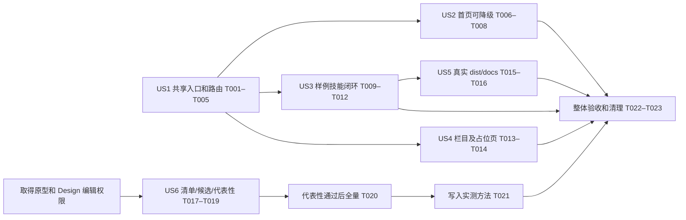

# 对话经过

会话 `01a21707-c48a-7431-a446-9aed2cb46638` · 轮次 `01a21723-64fa-7043-acae-07c1fbc514c1`

<!-- foundry-detail 01a21707-c48a-7431-a446-9aed2cb46638 01a21723-64fa-7043-acae-07c1fbc514c1 -->
<!-- foundry-event c9120f581b503e5d75f0334effbcda436f595a72466e9eb9313414883afeda81 -->
## 进度原话

- 来源定位：字节 915806

~~~text
我会只为 `specs/docs/001-docs-site-framework` 生成任务清单；`.specify/feature.json` 仍指向另一个 Spec，因此会显式指定目标目录且不改全局指针。完成后还要按已配置的 `after_tasks` 钩子刷新该 Spec 的综合分析。
~~~

<!-- foundry-event cd34b2f51c40bef423c7f1d4ee655e858a28550eec67d7e27daa798edfd49dd6 -->
## 工具调用 `exec_command` · `call_tRfqJoRziMVPrbPViMfeMutk`

- 来源定位：字节 916886

~~~text
工作目录：/home/ena/workspace/ena/agent-foundry/feature/init
{"cmd":"git status --short --branch | awk 'NR==1 || /specs\\/docs\\/001-docs-site-framework|\\.specify\\/feature.json/'; node - <<'JS'\nconst yaml=require(process.cwd()+'/node_modules/.pnpm/js-yaml@4.3.2/node_modules/js-yaml'); const c=yaml.load(require('node:fs').readFileSync('.specify/extensions.yml','utf8')); for(const k of ['before_tasks','after_tasks']) console.log(k,JSON.stringify(c.hooks?.[k]??[]));\nJS\nSPECIFY_FEATURE_NO_PERSIST=1 SPECIFY_FEATURE_DIRECTORY=specs/docs/001-docs-site-framework .specify/scripts/bash/setup-tasks.sh --json","yield_time_ms":30000,"max_output_tokens":2500}
~~~

<!-- foundry-event 43c2dc5da46d08c6a24fb3254cf07b1bbd16f1fad47dac622b2cbdd85230a23a -->
## 工具调用 `exec_command` · `call_tyidKGdk14R8OXAj4m35trc8`

- 来源定位：字节 918015

~~~text
工作目录：/home/ena/workspace/ena/agent-foundry/feature/init
{"cmd":"cat .agents/skills/business-node-delivery/SKILL.md; cat .agents/skills/artifact-spec-analysis/SKILL.md; cat specs/docs/001-docs-site-framework/plan.md; cat specs/docs/001-docs-site-framework/mvu.md; cat specs/docs/001-docs-site-framework/data-model.md; cat specs/docs/001-docs-site-framework/contracts/site-navigation.md; cat specs/docs/docs 2>/dev/null || true","max_output_tokens":9400}
~~~

<!-- foundry-event e11adc5a4ecbc9987951b75d316ab9e5642ee6bba0c26b2cd90090ee4fd158c1 -->
## 工具调用 `exec_command` · `call_8t7QwzWI1hvGsYmRyOXGBskl`

- 来源定位：字节 918930

~~~text
工作目录：/home/ena/workspace/ena/agent-foundry/feature/init
{"cmd":"cat specs/docs/001-docs-site-framework/spec.md; cat specs/docs/001-docs-site-framework/research.md; cat specs/docs/001-docs-site-framework/quickstart.md; cat .specify/memory/constitution.md","max_output_tokens":13000}
~~~

<!-- foundry-event f4d6c85ef7987f22d8624b1be2942db25836e015b02aa0c66f4033acc9868a4c -->
## 工具结果 `call_8t7QwzWI1hvGsYmRyOXGBskl`

- 来源定位：字节 1051262

~~~text
Chunk ID: 2950ba
Wall time: 0.0000 seconds
Process exited with code 0
Original token count: 11407
Output:
Warning: truncated output (original token count: 11407)
Total output lines: 502

# Feature Specification: Agent Foundry 文档站框架

**Feature Branch** `feature/init`

**Created** 2026-11-26

**Status** Draft

**Input** 用户提供的文档站规格提示词和评审材料。 [需求依据](requirements/README.md)

本期为 Agent Foundry 的读者提供可浏览、可扩展的文档站框架。设计协作者可以把已完成的 Figma Make 原型批量转成后续可编辑的设计稿。技能集合说明在技能包的文档产物就绪后接入。

## Clarifications

### Session 2026-11-26

- Q: 把 Figma Make 原型批量转成设计稿时，除了各页面或视图的默认画面，哪些交互状态也必须各生成一块画板? → A: 各页面或视图的默认画面，以及会改变可见导航布局的展开态。每种状态在其适用的视口分别生成画板。

- Q: 在技能包的真实文档产物就绪前，读者打开新版 `/skills` 时，应看到什么内容? → A: `/skills` 仅展示示例目录。现有九项紧急版技能说明留在仓库历史中。

- Q: 批量转换后的 Figma 画板文字和布局都能编辑，但字体或图片与原型有差异时，怎样才算通过验收? → A: 正文和导航状态须与原型一致。字体或图片有替代时，须逐项记录并经设计协作者确认。

## User Scenarios & Testing _(mandatory)_

### User Story 1 - 从全局菜单进入文档并返回首页 (P1)

读者在任意模块都能找到其他文档和返回首页的入口，并继续使用已保存的站内链接。

**优先理由** 全局入口把五个模块连成可浏览的站点。

**独立验证** 使用五个模块的最小页面，在桌面和手机上分别操作菜单，再从外部直接打开兼容地址和未知地址。

**验收场景**

1. **Given** 读者打开任一模块，**When** 查看全局菜单，**Then** 能访问技能文档、MCP 文档、与 Spec Kit 协作和项目开发文档四个一级入口。只有技能文档提供集合子菜单，点击品牌返回首页。
2. **Given** 读者在手机上打开任一模块，**When** 展开菜单、选择一个模块，再返回并收起菜单，**Then** 四个一级入口和技能集合子菜单均可操作，面板可开可关，选择后到达对应页面。
3. **Given** 读者保存了 `/`、`/skills`、`/mcp`、`/workflow` 或 `/getting-started/installation`，**When** 从地址栏打开或刷新，**Then** 分别到达首页、技能入口、MCP 入口、工作流与 Spec Kit 入口或安装指南。
4. **Given** 任意不存在的页面地址，**When** 读者直接访问，**Then** 收到 404 并看到文档不存在的提示。

### User Story 2 - 翻阅首页章节并在 3D 加载失败时继续浏览 (P1)

读者纵向翻阅首页，了解项目中与 AI 相关的包，也能随时前往文档。

**优先理由** 首页承担项目介绍和向各文档模块导流的职责。

**独立验证** 在桌面和手机上翻阅 Skills、MCP 两章，再分别让每章的 3D 内容加载失败并访问文档入口。

**验收场景**

1. **Given** 首页配置了 Skills 和 MCP 两个示例，**When** 读者从首屏向下翻阅，**Then** 两章按全屏杂志式页面流依次出现，每章有包名、占位正文和独立的 3D 模型。
2. **Given** 任一章的模型加载失败或设备无法渲染 3D，**When** 读者浏览该章并使用菜单，**Then** 该章显示可辨识的静态替代，包名与正文仍可阅读，读者可通过全局菜单继续访问四个文档模块。

### User Story 3 - 按集合查找技能并直达技能详情 (P1)

读者通过集合定位技能，打开详情后能识别当前集合和技能名称，也可以分享该技能地址。

**优先理由** 集合和技能构成技能文档的主要浏览路径。

**独立验证** 装入一份含 frontend、workflow 两个集合及示例技能的数据，检查两个导航入口的一致性、目录操作及直达行为。

**验收场景**

1. **Given** 技能包文档产物尚未就绪，示例数据包含两个集合和各自的技能，**When** 读者打开 `/skills`，再从顶部集合子菜单和左侧目录分别点击同一集合，**Then** `/skills` 仅展示示例目录，两处集合列表与页面目标一致，集合页包含可替换的集合说明区域。
2. **Given** 技能文档使用两级文件夹目录，**When** 读者展开或收起一级集合，再打开二级技能，**Then** 目录能切换展开状态，选中技能有当前标记，详情标题为技能名称，正文显示「文档待补充」。
3. **Given** 一个有效的集合或技能地址，**When** 读者从地址栏直接打开或刷新，**Then** 页面保持对应内容，目录标识当前项，技能详情所在的集合可见。手机上也能打开与收起目录并选择集合或技能。
4. **Given** 不存在的集合或技能地址，**When** 读者直接访问，**Then** 收到 404 和文档不存在提示。

### User Story 4 - 切换 Spec Kit 栏目并打开两类占位文档 (P1)

读者可在与 Spec Kit 协作模块切换栏目，也可以访问 MCP 文档和项目开发文档各自的入口。

**优先理由** 三个模块提供独立可浏览的骨架，便于后续补充正式内容。

**独立验证** 在桌面和手机上切换两个 Spec Kit 示例栏目，再直接打开两个占位文档的地址。

**验收场景**

1. **Given** 与 Spec Kit 协作模块有「栏目 A」和「栏目 B」，**When** 读者在一级左侧导航选择其中一项，**Then** 该项显示为选中，主区显示对应的占位标题和正文。手机上也能访问同一组栏目并切换。
2. **Given** 两个共用简洁布局的模块各有页面地址，**When** 读者从菜单打开或直接刷新 `/mcp` 和项目开发文档地址，**Then** 分别显示 MCP 文档和项目开发文档自己的标题与占位说明。

### User Story 5 - 在技能包产物就绪后接入集合说明 (P2)

维护者可以为集合提供说明。读者仍能浏览未提供说明、主动关闭说明或说明文件缺失的集合。

**优先理由** 真实说明依赖技能包交付。站点框架可先用样例独立验收。

**独立验证** 在技能包正式提供文档产物后，用覆盖默认文件、自定义文件、停用和文件缺失的集合验证生成结果和站内呈现。

**验收场景**

1. **Given** 数个集合分别省略文档字段、设为 `true` 或指定文件名，并具有对应文件，**When** 技能包提供文档产物并由站点接入，**Then** 前两种集合使用各自默认 README，第三种使用所在集合目录中的指定文件，每份说明呈现在对应集合页。
2. **Given** 一个集合的文档字段为 `false`，**When** 处理该集合，**Then** 不读取说明文件，目录及技能详情仍可访问。
3. **Given** 一个集合所需的说明文件不存在且另一个集合有有效说明，**When** 处理这些集合，**Then** 维护者看到能定位缺失文件的告警，该集合使用占位说明，其他集合照常接入。

### User Story 6 - 一次启动将原型页面和状态转换为可编辑画板 (P2)

设计协作者希望在一个 Figma Design 文件内继续编辑整站设计，并用经过验证的同一流程转换后续迭代。

**优先理由** 批量转换节省逐页采集操作，项目可行性须先由小批实测确认。

**独立验证** 以实际 Figma Make 原型为输入完成代表性批次和全量批次，按清单核对画板及可编辑性。此故事可独立于正式站点开发验证。

**验收场景**

1. **Given** 可访问的实际原型或可运行的原型源码和可编辑的目标文件或工作区，**When** 维护者盘点实际原型并比较候选方式，**Then** 有覆盖五个模块及模块内可达页面或视图的清单，并逐项标明适用的桌面或手机视口、默认画面、须另生成画板的导航展开态，以及各候选方式的覆盖情况。
2. **Given** 代表性清单包含首页和至少一个内页的桌面与移动版本，**When** 维护者启动一次转换，**Then** 清单项在同一个 Figma Design 文件中生成可定位的具名画板，常规文字可修改，布局图层可独立选择和调整。画板正文和导航状态与原型一致。字体和图片与原型一致，或使用逐项记录并经设计协作者确认的替代。3D 和动画的保留效果、静态替代或待人工补齐部分均有记录。
3. **Given** 代表性批次已通过验收，**When** 维护者对实际清单启动一次全量转换，**Then** 每个清单项都能在同一文件内唯一定位到对应的具名画板，每块画板均符合代表性批次的可编辑性及与原型比对的验收条件。使用人只需启动批次，无需逐页打开、复制和粘贴。
4. **Given** 代表性批次或全量批次已尝试执行，或因缺前置无法启动，**When** 维护者保存验收记录，**Then** 记录包含输入、运行方式、画板链接、逐项检查结果和差异，受阻项有原因与恢复条件。全量验收通过后，在规格末尾补齐可复现的方法。

### Edge Cases

- 首页模型加载或渲染受限时，保留章节文字、静态替代和全局入口。原型转换中的 3D 与动画差异在画板验收时留证。
- 直接访问未知文档、集合或技能地址时，站点返回 404。有效的旧地址及有效的新页面直达继续可用。
- 缺少集合说明文件时，告警只关联缺文件的集合，其他集合的说明继续处理。
- 批次部分成功时，逐项记录已生成画板、失败或未执行项及恢复条件。全量结果待全部清单项满足验收后判定。

## Requirements _(mandatory)_

### Functional Requirements

- **FR-001** 站点须提供五个模块和四套布局。首页使用 `home`，技能集合与详情使用 `skill`，与 Spec Kit 协作使用 `work-with-speckit`，MCP 文档与项目开发文档共用 `empty`。
- **FR-002** 五个模块须共享顶部品牌和四个一级入口。品牌链接回首页。仅技能文档显示集合子菜单，子菜单中的集合及目标页须与技能左侧目录一致。
- **FR-003** 首页须呈现纵向翻阅的全屏杂志式章节。Skills 和 MCP 为可替换的示例，每章呈现包名、占位正文和自己的 3D 模型。
- **FR-004** 任一章 3D 加载或渲染失败时，该章须显示静态替代，保留可读文字和可操作的全局文档入口。
- **FR-005** 技能模块须提供两级可展开的文件夹目录，一级为集合，二级为技能，并标识当前项。集合页预留说明区域，详情页按技能名称显示标题和可替换的占位正文。导航使用同一份可替换的样例集合与技能数据验收。技能包文档产物就绪前，`/skills` 仅展示示例目录。原有九项紧急版技能说明留在仓库历史中。
- **FR-006** 与 Spec Kit 协作模块须提供一级左侧导航。选择栏目后须同步切换导航选中项和对应占位标题、正文。栏目名称与正文须可替换。
- **FR-007** MCP 文档与项目开发文档须提供各自可直达的占位页，分别显示自身标题和说明，MCP 使用 `/mcp`。
- **FR-008** 手机端须提供可开关的全局菜单和技能目录，并保留桌面端可访问的模块、集合、技能和 Spec Kit 栏目切换能力。
- **FR-009** 模块入口、技能集合和技能详情须支持从地址栏直接打开和刷新。现有有效地址须继续到达对应文档入口。无效的文档、集合及技能地址须返回 404 并提示文档不存在。
- **FR-010** 技能模块须能从独立的技能包文档产物接入集合说明，真实接入随产物就绪后验收。该产物的来源规则须覆盖字段省略或 `true` 读默认 README、字符串读集合目录中的指定文件、`false` 跳过。文件缺失须告警、跳过该说明并继续处理其他集合。
- **FR-011** 设计转换须按实际原型盘点五个模块的可达页面或视图。清单须包含各适用视口的默认画面，以及实际原型中会改变可见导航布局的展开态，例如手机全局菜单、技能集合子菜单和技能目录的展开态。正文不同的 Spec Kit 栏目各作为一个视图。维护者须比较批量导入工具与基于 AI 或脚本的清单采集方式，核对各自能覆盖的视图及状态。
- **FR-012** 后续 Plan 须安排代表性实测，以实际原型中的首页和至少一个内页覆盖桌面、移动版本。一次启动须在同一个 Figma Design 文件中生成对应画板。每块画板的常规文字和布局须可编辑，正文和导航状态须与原型一致。字体和图片须与原型一致，使用替代时须逐项记录并经设计协作者确认。3D 与动画须记录实测保留效果及替代或补齐方式。
- **FR-013** 代表性实测通过后须运行一次全量批次。同一个 Figma Design 文件须包含与实际清单逐项对应的具名画板，每块画板均须符合 FR-012 的画板验收条件。使用人只需启动一次批次，无需逐页执行打开、复制和粘贴。
- **FR-014** 转换验收须留存原型输入、页面状态清单、运行方式、画板链接、逐项检查结果和差异。记录须区分通过、失败、缺前置和未执行，受阻项须写明恢复条件。全量验收通过后，须在本规格末尾记录实际可复用的方法。

### Key Entities _(include if feature involves data)_

- **首页章节** 对应一个项目包，有包名、正文、模型与静态替代。
- **技能集合与技能** 一个集合包含多项可直达的技能，并可关联集合说明。站内两处集合导航使用同一组集合。
- **Spec Kit 栏目** 拥有可替换的名称、标题和正文，选中项决定当前呈现的栏目。
- **转换清单项** 标识一个原型模块、页面或视图、桌面或手机视口，以及默认画面或须转换的导航展开态，并关联对应画板及验收结果。

## Success Criteria _(mandatory)_

### Measurable Outcomes

- **SC-001** 在桌面和手机各验收一轮。每轮均可从全局菜单到达 4 个文档模块并从任一模块通过品牌回到首页，技能集合子菜单与左侧目录的名称或目标差异为 0。
- **SC-002** 在桌面和手机上均能翻阅 2 个全屏示例章节。单独模拟任一章 3D 失败后，受影响章节的文字和静态替代均可见，失效的全局文档入口为 0。
- **SC-003** 技能包文档产物就绪前，`/skills` 的目录与样例数据一致。至少 2 个样例集合、每集合至少 1 个技能可通过目录到达。所有样例的集合页和详情页均可直达并刷新，详情标题与技能名称的差异为 0，均有占位正文。
- **SC-004** 两个 Spec Kit 示例栏目的选中状态与正文均正确切换，2 个共用布局的模块均展示各自的占位信息。5 个已知现有地址均可打开对应文档入口，未知文档、集合、技能 3 类地址均返回 404。
- **SC-005** 技能包就绪后，覆盖省略、`true`、指定文件、`false` 和文件缺失 5 类输入，说明展示或跳过结果全部符合规则。缺文件告警可定位，其他有效说明导入受影响数为 0。
- **SC-006** 代表性批次中，首页和至少 1 个内页各覆盖桌面与手机，1 次启动产出至少 4 个可编辑画板。每块画板均符合 FR-012 的画板验收条件，3D 和动画的处理均有核对记录。
- **SC-007** 代表性验证通过后，1 次全量启动覆盖全部清单项，清单项到具名画板的核对覆盖率为 100%，符合 FR-012 画板验收条件的比例为 100%，用户逐页采集操作数为 0。全量通过时，每一项均可查到目标画板和检查结果，并可按记录的方法复现转换。

## Assumptions

### 本期范围和现有站点

- 正式首页章节和正文、技能详情正文、Spec Kit 正式栏目、MCP 和项目开发文档正文随各自后续交付补充。本期以 Skills、MCP、frontend、workflow 和「栏目 A」「栏目 B」等可替换示例验收。
- 现有兼容路径依据站点内容与路由源码核对。安装指南作为既有兼容内容独立可访问，新增地址由 Plan 明确。 [当前站点入口](../../../apps/docs/content/index.md) · [当前文档路由](../../../apps/docs/app/pages/%5B...slug%5D.vue)
- 技能包的发布按现行规格先完成测试环境约定的验收，再接入生产。测试范围与版本回退边界沿用该规格。站点样例验收可独立开展，真实跨包接入等待技能包文档产物。 [主线技能构建与发布规格](../../skills/003-skills-release-pipeline/spec.md)
- 进入开发后，独立且无需阻塞主代理的调研、核对和审查尽量并行交给子代理。主代理继续推进，子代理取得结论后主动汇报。 [本轮原始需求](requirements/raw/2026-11-26-original-request.md)

### 后续 Plan 的技术验证输入

- 按用户指定采用 Nuxt UI。验证其能支撑四套布局的导航交互，以及桌面和手机菜单、技能目录的可操作性。
- 按用户指定使用 Three.js 渲染首页章节。验证两个独立模型、手机端呈现及强制加载失败时的静态替代与导航可达性。
- 技能包产物契约以 `dist/core` 对应核心构建产物，新增 `dist/docs` 提供集合说明。Plan 须验证站点读取 `dist/docs` 及缺失说明的处理，真实输入待技能包交付。
- Figma 批量转换的代表性实测需实际原型的可访问入口或可运行源码，以及可编辑的目标 Figma Design 文件或具有编辑权限的工作区。本次规格依据公开文档和已保存的需求。实测状态为缺前置，取得上述材料和权限后可启动。 [转换方式的文档依据](requirements/README.md#figma-转换调研依据)

## 转换方法复用

全量转换验收通过后，在本节保存已实测的方法、采用的工具、输入和权限、页面清单的维护方式、批量运行步骤、设计稿组织及链接、动态内容处理和失败重跑方式。这些内容以实际运行记录为依据。
# 方案调研：Agent Foundry 文档站框架

**日期**：2026-11-26  
**范围**：为 Plan 核对当前站点、需求所指定技术与外部转换前置；不是实现或运行验收记录。

## 当前仓库事实

- `apps/docs` 已使用 Nuxt、Nuxt Content、UnoCSS，配置为读取 `content/` 文档集合，并以 `app/pages/[...slug].vue` 按路径查询；不存在文档时抛出 404。
- 当前仅有 `default` 布局、一个动态内容页和现有文档侧栏/目录组件。根脚本提供 docs workspace 的 `lint`、`check-types`、`build`，没有根 `test` 脚本，docs package 也未定义测试脚本。
- 当前应用依赖未声明 Nuxt UI 或 Three.js；不能将其安装、集成或模型降级路径写成已在仓库验证。
- `packages/skills` 的正式文档说明产物尚未成为本轮已具备输入；规格将其约定为 `dist/docs`。实际发布和跨包接入须等待源产物。

## 决策记录

### R-001：扩展现有 Nuxt 文档应用，不新建站点或服务

**Decision**：在 `apps/docs` 现有 Nuxt Content 路由、工作区检查及内容目录上演进。

**Rationale**：规格明确针对现有站点及兼容地址；已有动态文档查询和 404 路径可复用。单应用足以交付布局、内容与浏览器交互。

**Alternatives considered**：新建独立站点或引入后端。没有需求收益，反而扩大部署与路由迁移范围，故不选。

### R-002：Nuxt UI 是规格要求，但兼容性须先实测

**Decision**：按需求采用 Nuxt UI，但把正式依赖加入、版本选定、模块配置，以及与现有 UnoCSS 属性化样式的共存作为开发前置核验，不预设集成无冲突。

**Rationale**：源码表明目前是 UnoCSS `presetWind3` 与 `presetAttributify({ prefix: 'un-' })`；Nuxt UI 不在 `ap…1407 tokens truncated…据。
# 验收快速指南：Agent Foundry 文档站框架

本文是实现后的执行指南，不声称本 Plan 阶段已完成任何页面或浏览器验收。

## 前置

- 从仓库根目录安装依赖：`pnpm install`。
- 确保 Node 符合根 `package.json` 的 `>=22.20.0` 要求，pnpm 版本符合仓库约定（12）。
- 真实技能说明接入用例须等 `packages/skills` 提供正式 `dist/docs`；Figma 转换须另外取得真实原型入口/源码与目标文件编辑权限。

## 静态工程检查

在仓库根目录执行：

```bash
pnpm --filter @foundry/docs run lint
pnpm --filter @foundry/docs run check-types
pnpm --filter @foundry/docs run build
```

预期：命令成功；lint、类型检查及构建均无新增错误。失败项记录命令、输出、阻塞范围与恢复条件，不得通过删除验收断言或放宽规则消除。

## 运行站点

在仓库根目录启动：

```bash
pnpm --filter @foundry/docs run dev
```

预期：本地文档站启动。按实现输出的地址打开浏览器；当前应用默认配置端口为 7000，若配置调整则以实际运行输出为准。

## 桌面与手机浏览器验收

桌面与手机视口分别完整执行。逐项记录实际路径、视口、操作和观察结果：

1. 从每个模块检查品牌及四个一级入口；使用品牌返回首页。技能模块顶部集合子菜单与左侧目录对照名称和目标。
2. 在手机视口打开/关闭全局菜单，进入模块；在技能模块打开/关闭目录，选择集合和技能。
3. 直接地址栏访问并刷新 `/`、`/skills`、`/mcp`、`/workflow`、`/getting-started/installation`，确认页面内容和导航状态。项目开发文档地址以及实现后的集合/技能地址也应逐一检查。
4. 打开未知模块、未知集合、未知技能地址，确认 404 状态和「文档不存在」提示。
5. 打开技能目录中至少两个样例集合，并各进入一项技能；对集合页和技能详情分别直接打开、刷新，核对集合/技能当前标记、技能名称标题和占位正文。
6. 切换至少两个 Spec Kit 栏目，确认选中项、标题和正文同步变化。
7. 首页纵向翻阅 Skills、MCP 两章，确认标题、包名、占位正文、各自模型和全局导航；分别让任一章模型加载失败/渲染不可用，确认静态替代与文字仍在，另一章及全局入口仍可用。

## 技能说明接入（前置满足后）

使用技能包实际构建并验收的 `dist/docs`，覆盖文档字段省略、`true`、指定文件、`false` 和指定文件缺失。保存实际产物来源及每种输入的展示/跳过结果；缺失警告须定位到集合，其他有效集合仍正常展示。未取得真实产物前标注「缺前置」，不得用临时模拟文件记作跨包通过。

## Figma 转换验收（前置满足后）

记录原型入口或源码版本、目标 Figma Design 文件/权限、候选方法及清单。按清单先转换首页和至少一个内页各自适用的桌面/手机画面，一次运行生成同一文件内至少四块画板；通过文字/布局编辑性、正文、导航状态、字体/图片差异及 3D/动画处理检查。代表性批次通过后再启动全量批次，并逐项核对清单与具名画板、保存链接、差异、结果和可复现步骤。缺输入/权限、未执行、失败均单独记录，不计入通过。

## 证据记录

对每个验收项保存实际输入、命令或操作、目标视口/地址、预期与实际观察、失败/差异以及恢复条件。工程检查通过不能代替浏览器交互或业务结果验收；Figma 和真实 docs 产物各自的证据不得互相替代。
<!--
Sync Impact Report（审阅后于提交前移除）
- 版本变化：未制定（占位模板，无既有版本）→ 1.0.0。
- 版本依据：首次依据用户提供的完整原则输入制定 Spec Kit 工作流宪章。
- 原则变化：原模板五项未定义原则替换为以下七项正式原则：
  I. 工作流职责与边界；II. 产物契约与一致性；III. 业务闭环（MVU）与技术前置验证；
  IV. 最小充分验证；V. 增量规划与范围控制；VI. 阶段门禁与协作授权；
  VII. 轻量任务、共同准备与详细方案。
- 新增章节：产物目录与定位、开发工作流；填充 Governance。
- 移除章节：无既有有效治理章节；移除模板占位符及示例注释。
- 日期依据：本次首次制定，批准日期及最后修订日期均为 2026-11-14。
- 同步范围：仅更新本宪章；依赖模板与命令在运行时读取，不在本次修改。
- 待办：无占位符或延期治理项；本报告供审阅，审阅后须于提交前移除。
-->

# Agent Foundry Spec Kit 工作流宪章

## Core Principles

### I. 工作流职责与边界

本宪章 MUST 只规范 Spec Kit 的需求澄清、方案规划、任务生成、实施协作、验证门禁及流程验收。
条款 MUST 围绕工作流输入、产物、推进条件和记录职责制定，不定义项目技术栈、源码分层、编码样式、
工程检查命令、安全操作或日常仓库协作规则，不为其他规范设置读取入口或优先级关系。

### II. 产物契约与一致性

spec MUST 保存需求、范围和验收；plan 保存总体方案、顺序、依赖及一处 mvu.md 文件级链接；
与 plan 同级的 mvu.md 集中保存小闭环详情；tasks 保留简洁任务和唯一工程 checkbox。详细实施
方案由原 Task 链接，清单不预先展开全部做法。
分析与证据引用有效来源，不重复维护活动闭环详情或工程状态。生成或更新下游产物前
MUST 读取有效上游输入；缺少必要材料时报告缺项，不靠猜测补造已确认需求或已通过结果。

需求、范围或验收变化时 MUST 在受影响产物间核对覆盖、引用和依赖，记录变更依据及未同步部分。
不以更新某一文档自动完成工程任务，也不以历史材料覆盖后续已确认的要求。

需求实质变化时 MUST 在所属 Spec 保留原始输入、可知来源和实际日期，整理稿和后续确认不能
覆盖原文。相关工作流操作须提供简洁分段摘要，讲清问题、解决方向、本次变化、确认或待定与
日期，并关联原文及必要讨论；普通进度和 AI 建议不能被记录成用户原始要求。

### III. 业务闭环（MVU）与技术前置验证

MVU MUST 以可观察、可验收的业务结果为目标，按“有业务意义、能够验收、范围适合推进、顺序有
依据”说明划分、依赖、暂缓内容和调整条件，并结合真实反馈修订。业务结果可以属于当前 Task 的
局部职责，不强制贯穿全部页面、接口和存储层，不以建表或技术联通直接代替业务验收。

AI MUST 在规划时主动识别技术假设、细化时核对证据、实施发现新风险时补充验证。命中任一条件即
须安排必要的技术前置验证：① 引入仓库无使用先例的新依赖/框架/协议；② 外部交互失败模式未验证；
③ 计划依赖未经证实的高风险条件；④ 首次建立跨包或跨进程契约。同时满足“已有同类已验证实现、
无新依赖与外部交互、失败可被 lint/类型检查/现有测试兜底”三项时可豁免，MUST 记录依据。
已有证据可在核对适用范围后复用；用户熟悉技术或画像中的偏好不能代替项目验证证据。

必要技术验证 MUST 编入对应业务闭环的前置 Task 或原 Task 内步骤，写明可证伪假设、具体输入、
可核验信号、实际证据与下游依赖。验证未通过不得填充依赖该假设的业务逻辑；失败 MUST 报告证据并
回到方案调整路线，只阻止受影响下游，不无理由冻结无关工作。通过的验证实现 MUST 保留为后续增量
骨架，不推倒重写；技术验证通过后仍须按业务条件验收，不自动完成业务闭环。

每条闭环在 mvu.md 中 MUST 用几小段说明闭环结果、节点与关键逻辑、关联 Task 及其职责、可观察
验收信号。必要范围、顺序理由与技术前置可简述或引用已有依据，不强制完整设计、全分支图或 Task
八栏目副本。尚无任务时写明职责关联待补，任务生成后 MUST 补齐真实身份与职责。

plan 保留总体方案、推荐顺序、依赖和一处 mvu.md 文件级链接，不列逐条闭环索引、锚点跳转或
Task 范围列表；技术假设与验证依据可引用相关材料。已有 plan 缺
mvu.md 时 MUST 兼容原详情并按修改范围迁移；只有 mvu.md 不能绕过缺 plan 的前置。迁移保留原
定位、Task 要求、完成事实、历史证据与有效引用，旧锚点可留跳转，不维持两份活动详情。已有文件
先复用，重复更新不另建同一闭环。tasks 保存简洁工程任务与唯一工程状态，详细做法在原 Task 方案；
闭环和节点只作阅读定位，不建立独立工程身份、checkbox 或第二套状态系统。
非 Spec Kit 项目沿用目标项目已有等价方案布局。

### IV. 最小充分验证

工作流验收按复杂度和失败影响选择：小型验证单项规则或功能，中型验证一个完整用户流程，大型验证
跨模式、持久化恢复或端到端集成。不强制每个需求包含全部级别。计划与验收记录 MUST 写明选择依据、
具体命令或操作、输入、预期可观察结果和实际证据；未运行、失败与推测分别记录，不以设计说明代替
通过。实际实现所需的检查 MUST 在任务中明确，不用流程验收替代实现验收。

### V. 增量规划与范围控制

每次 Spec Kit 操作 MUST 明确目标 Spec、可选 Task、有效输入及本次允许修改的产物范围。已有材料
能够覆盖目标时复用并增量补缺，不为重复请求另建同一需求、方案或任务体系。Increment 仅定位 Spec
并接受可选描述，不接受 Task 定位参数，已有 Task 只作现状与职责关联。规划保存只完成规划职责，
不自动进入主要实现、其他模式或下游阶段；发现范围或验收需要改变时先说明影响并取得对应确认。

### VI. 阶段门禁与协作授权

阶段顺序、模式分工及确认点 MUST 以当前有效规格、方案、任务和用户明确授权为依据；技术依赖通过
不自动成为跨阶段批准，准备性核查也不无依据新增批准点。阶段完成后按其原验收报告结果、限制和
未完成项；要求真实用户确认、实践或学习证据时，MUST 保留尚未满足的条件，不用 agent 演练替代。

失败只阻止依赖该结果的推进，保留已完成事实与可复用骨架。模式切换或中断后按 VII 从原材料恢复，
不因会话结束、局部代写或一次局部成功扩大原授权或自动改变分工。

### VII. 轻量任务、共同准备与详细方案

每个正式 Task MUST 在 tasks.md 保留稳定 ID、简洁目标、必要边界/依赖、可核验验收和唯一
工程 checkbox，不强制八栏目或预先内联全部详细步骤。旧任务身份、目标、验收、已完成事实
及证据保持；重排不重新编号，新工作使用未占用 ID，不为格式变化重开完成任务。

真正开工前 MUST 有适用且经真实讨论认可、成功保存并读回的实现方案。自然语言实施与显式
Implement 使用同一实施准备能力，实际读取原 Task、需求、plan、同级 MVU、存量代码、目标
项目既有约定、方案及证据；无有效方案先讨论。用户可提供方向，AI 也可基于项目提议，经真实
认可后继续；文件自称、AI 自评或模拟回复不得替代用户认可，不强制用户先独立完成设计。

详细方案在所属 Spec 的专门目录一 Task 一文件，默认 implementation/<Task ID>.md，由原
任务链接。写清必要目标、逻辑与数据关系、理由、顺序、验收、讨论来源和调整依据即可，不设
固定栏目、字数或全部未来文件清单。新增文件和写法先查既有实现及约定，优先复用；普通工程
安排可以在已确认逻辑内合理调整并留依据，逻辑/职责/范围/验收的实质变化先停受影响部分重议。
已有适用认可和授权复用，不重复审批正常续做；认可不替代技术、工程、业务或阶段验收。

每个实际进入业务实施的 Task 都须完整消费共同准备并核对自身有效方案、确认范围、保存结果、
前置与授权。一次 hook 或 A 的认可不放行 B，连续/并行/批量与恢复仍逐项核对。hook 缺失、禁用、
解析/执行失败或条件跳过不豁免条件；能力/材料缺失、过期或不可读先报告影响与恢复条件，
只做允许的核查、讨论或修复，不推进受影响业务。此为 agent 执行约定，不宣称程序锁或全聊天拦截。

治理修订、独立资料核查和隔离候选验证须明确范围及授权，不把尚未交付的实施能力设为无输入
依赖的资料工作前置，也不把准备动作当业务实施授权。候选验证须保留实际来源；候选成功不等于
最终来源已安装/消费。最终来源变化后须刷新隔离正式入口，核对版本、完整正文、必要附件及
真实读取并复验；不得直接读取源文件冒充正式消费。

任务、方案、分析和证据不得重复维护工程 checkbox，不建立独立子任务身份、状态服务、管理脚本
或 state.json。模式是否启用/暂停及其分工沿有效范围；Tutor 启用时在原 Task 方案和记录增加必要
基础、讲解、用户实践、反馈及掌握验证，默认用户主写，局部代写不扩大授权。工程/学习/报告
分别判断，AI 示例、测试或会话结束不是掌握证据；正式报告沿既有内容体系，不自动发布。

切换模式、中断或重复请求时 MUST 读取原 Task、相关计划、实际文件与已有证据，恢复当前思路、
分工、有效授权、确认与待定事项及下一动作，不重复实施、不串用其他 Task 的状态、不静默改验收。

续接必须复用已确认结论：先核对用户已确认的修复、最终保留代码及已撤回方案。记录与代码不一致时
先报告差异，不得仅依据旧诊断或任务未勾选重复修复；检查未通过时如实记录。

每次必要写入 MUST 核对原要求覆盖、引用和保存结果，按项目格式检查并读回后才标记完成或推进
依赖步骤。失败报告已写、未写、影响及恢复办法，先修复受影响记录；不声称跨文件原子回滚。

历史独立子任务、编号、已完成结果与证据 MUST 保留，不追溯改写。遇到实际存在的历史未完成记录，
先核对其仍有效做法与原验收覆盖，把未完成部分衔接回原 Task 并保留来源；链接、覆盖或保存有问题
先处理，不删原依据、不复制当前状态。没有实际旧记录时不虚构迁移，也不自动批量重做既有任务。

生成或更新需求任务清单时 MUST 在有效执行序列末尾安排开发过程产物清理，先核对并复用等价的
未完成末尾收尾 Task，补齐其清理范围与验收，不重复创建。末尾指执行顺序，与编号大小无关；若
只有历史已完成收尾 Task，MUST 保留其身份、完成事实与记录，为新增范围使用未占用 ID，不重开
旧任务。清理在需求实现及必要验证完成后、整体结案前执行；任务 MUST 明确对象位置、处置依据和
验收结果，无须清理时也 MUST 记录核查范围、依据与结果。

清理对象包括文件、代码段、文档及局部段落、注释、失效代码、临时复核说明、失效迁移或进度描述、
临时试验产物。MUST 按实际用途和依据处置，保护正式交付、有效治理、历史任务事实、验收证据、
复用骨架及有效引用。代码用途须结合调用点、导出/配置、历史和适用测试核对，文档及注释须核对
当前语义与引用；单次文本搜索无命中不能作为可删除依据。用途无法确认的内容 MUST 保留，记录
文件路径及符号/标题/片段位置、保留原因和后续处理条件，不因用途不明而阻断其他可完成的清理。

清理记录 MUST 作为原 Task 的证据，写明对象定位、依据、实际处置或保留结果与引用检查，不另建
对象身份或状态系统。其余应清理内容处理完毕、必要验证及引用检查通过后，清理部分才可判完成；
存在未处理应清理项、保存失败、必要验证失败或引用受损时不得标记完成，按既有恢复规则处理，
只阻止受影响的依赖动作。清理完成不自动满足其他结案条件；复用综合收尾 Task 时，仍须满足该
Task 的全部原验收和项目要求的用户批准，才能勾选其工程 checkbox。

## 产物目录与定位

功能目录按包分层落盘为 `specs/<包>/NNN-功能名/`，禁止扁平
`specs/NNN-` 产出：`<包>` 为 `apps/*` 或 `packages/*` 下的目录名（如 `preset-config`），不带
`apps/`、`packages/` 前缀；用户未明确指定包时，按需求描述推断并向用户确认一次后再建目录。NNN
为 3 位编号，包内独立递增：创建前扫描 `specs/<包>/` 下既有 `NNN-` 目录，取该包下一编号；不同
包之间编号互不影响。speckit-specify 默认产出扁平目录，执行时必须显式传入
`SPECIFY_FEATURE_DIRECTORY=specs/<包>/NNN-功能名` 覆盖；speckit-plan、speckit-tasks 等下游命令经
`.specify/feature.json` 定位目录，无需重复传参。speckit.plan 凡涉及数据同步、状态机或异步回调的
核心逻辑，必须在特性目录新增 `diagrams.md` 用 Mermaid 图示（术语配大白话解释、每张图标注代码
位置、一图一事），plan.md 不塞流程图。

Spec 内资料按职责安排，原生主文件不搬移：原始输入默认 requirements/raw，讨论与确认
requirements/discussions，整理提示词 requirements/prompts，简洁需求导航可用 requirements/README.md；
单 Task 方案 implementation，分析与实际验收 analysis，图示及导航 diagrams 和既有 diagrams.md。
模式启用时的学习等过程资料沿其既有职责归档。

这是基础布局，不是穷尽文件清单。新增资料结合用途、已有约定及阅读需要选择位置/名称/粒度，
必要时扩充分类并更新有效导航，不预列全部未来文件、不新增文件注册或状态系统、不批量迁移
无关 Spec，也不以新布局覆盖原始输入、工程事实或历史证据。

## 开发工作流

Spec Kit 命令及协作模式 MUST 按自身职责读取有效输入、执行对应操作、保存产物和证据，再核对覆盖、
引用及继续条件。规划、实施准备、工程实现、学习掌握和报告验收分别判断，不把一个阶段的产物存在
当作另一个阶段已经通过。原有任务和真实证据始终可追溯，历史快照保留其发生时的适用范围。

## Governance

本宪章的修订与合规核查仅适用于 Spec Kit 工作流及其产物，不承担项目通用工程规则的维护或裁决。

修订程序：任何修订须以明确的工作流治理输入提出，经本文档更新并附带 Sync Impact Report（审阅后
于提交前移除）说明变更范围；版本号按语义化规则递增：MAJOR 为流程治理项移除或不兼容重定义，
MINOR 为新增原则或实质扩展，PATCH 为措辞澄清与非语义修订。Spec Kit 产物与流程验收 MUST 对照
本宪章核验，发现不符合项时明确报告；历史任务、已完成事实及旧版本实测不因新修订而追溯改写。

**Version**: 1.0.0 | **Ratified**: 2026-11-14 | **Last Amended**: 2026-11-14

~~~

<!-- foundry-event 5d5fc4ee9c74829a0c2f9302628e7f687a0993b5f48a0bb9c96aa4a00cecd6ad -->
## 工具结果 `call_tyidKGdk14R8OXAj4m35trc8`

- 来源定位：字节 1022159

~~~text
Chunk ID: 8383f5
Wall time: 0.0000 seconds
Process exited with code 0
Original token count: 7048
Output:
---
name: business-node-delivery
description: 需要规划、实现或继续开发业务功能、业务接口，或安排数据、后端、验证与页面之间的开发步骤和依赖时使用。适用于从业务目标细化实施路径、单接口开发、页面接入和中断后续做；不以已有正式任务、MVU、Spec Kit 或协作模式为触发前提。仅修改文案、格式、视觉样式，或只解释概念且不涉及业务实现路径时不使用。
---

# 业务节点实施顺序

在原任务内完成当前局部结果，核对真实前置后推进依赖它的步骤。节点是推进范围，沿用项目原任务与证据，不另建节点身份、编号、checkbox 或状态。

业务目标已明确、尚无正式任务时也可加载本技能，用于规划当前节点的实施路径；加载后仍核对目标项目及当前模式要求的材料与授权，缺少实施前置时只做允许的规划或核查，不自动补建正式任务或进入实现。

1. 读取目标项目有效规范、原目标/任务、当前节点、相关实现、依赖与实际证据，核对本次是规划还是已授权实施。Spec Kit 项目沿用其有效材料；其他项目沿用已有目标、任务和记录布局，不要求创建 `.specify`、MVU 或 Task ID。缺少必要目标、前置或授权时说明具体影响，仅暂停依赖它的操作；可继续已授权的无关工作。
2. 在原任务步骤中给出当前节点的预期结果、改动范围、适用顺序和可观察验收。默认展开当前节点适用的“数据设计/实现 → 后端业务或接口 → 验证逻辑 → 前端页面”。实际核对并复用已有成果与适用证据；无数据/后端职责时说明不适用层。需要调序时写明可核验的依赖与理由，例如先观察只读原型的文案布局；标明原型验证范围和仍缺的正式业务验收。
3. 在有效前置上仅实施已授权的当前范围。一个节点可只是一条接口，不必先补完整个 MVU 或所有业务后端，也不必为每条接口制作页面。页面依赖多个接口时，分别完成并验证接口，再汇合接入；正式页面接入后仍按其职责验证实际交互和所属业务结果。
4. 按职责和风险选择自动测试、实际接口请求、必要的临时页面或其组合，沿用项目必需检查。记录具体输入、预期和实际结果，覆盖正常及适用异常、权限边界；编译或路径存在不能代替业务验证。失败、未执行、证据不足分别如实保留，不计通过；仅阻止受影响下游，修复后实际复验再续接，无关且已授权工作可继续。
5. 按原任务或已有等价记录保存：本次范围与顺序理由、复用/不适用依据、实际改动、验证及未测范围、影响下游和下一动作。重复调用或恢复先读原记录与真实文件，只续做未完成部分。节点通过、原任务完成、MVU 业务验收、用户认可和学习掌握各按原条件判断，不能相互代替。

调用本规则不扩大工程、数据写入、外部操作或协作分工授权。由宿主根据本技能的 description 与当前请求发现并加载，也可显式点名调用；无需协作模式链接本文件或声明加载依赖。显式请求本技能但来源不可用时，如实报告，不能声称已应用或复制规则冒充已安装来源。
---
name: artifact-spec-analysis
description: Spec Kit 任务生成后或 Increment 规划保存后，需要创建或刷新所属 Spec 的逐功能综合分析时使用。
---

# Spec 功能分析

将当前有效需求、总体方案、业务闭环和任务关联成可阅读的功能说明。任务生成后的 after_tasks 与 Increment 规划保存后的显式调用使用本技能；分析是阅读材料，实施与验收仍由原任务和证据负责。

## 取得当前依据

沿调用方明确的目标项目、Spec 和写入范围，读取项目工作流治理、需求摘要及有效原文/确认、spec、plan、tasks、既有分析与必要证据。明确打开 plan 同级的 mvu.md 并读取有效详情；旧项目尚未分离时读取原 plan 详情并注明兼容来源，不另做迁移。核对引用中的实际代码或待建位置，区分项目事实、计划、未确认建议和历史要求。缺项或冲突写明具体来源、影响及待核实内容，只分析已有依据支持的范围。

## 按功能解释

以主要功能名称逐项独立成块，用简洁完整的文字解释谁在什么情境获得什么结果，以及必要的先后关系、判断和失败边界。将相关 Task、闭环与证据链接自然融入说明；细节沿有效来源阅读，不抄录整份规格或活动 MVU 定义。暂停方向说明当前边界，尚未实现或缺实际验收的能力按真实依据说明，不能由任务生成、配置存在或分析保存推断已交付。

在这些功能说明及必要的补充内容中覆盖适用的六类分析：业务分析、业务流程图、技术分析、技术流程图、MVU 里程碑、MVU 流转图。业务内容解释用户结果和关键决策；技术内容说明职责、数据或调用关系及实际/计划位置；里程碑与流转说明可观察交付结果、必要依赖和验收衔接，引用 mvu/tasks 的有效详情。没有材料支持或当前不适用的类别说明具体原因，不填造内容。已有有效图优先引用，需要新增时使用 Mermaid，一图一事、术语配通俗解释，并注明实际代码或计划位置；技术图沿既有 diagrams.md 导航，不维护相互冲突的图示副本。

功能内容按阅读需要组织，不强制每项填固定栏目或字数，不以覆盖总表替代各功能说明。工程 checkbox 只在原 tasks，分析引用来源，不创建工程状态清单、完成比例、状态文件或另一份活动闭环定义。

## 创建、刷新与恢复

默认入口为所属 Spec 的 analysis/spec-analysis/README.md，已有布局优先复用；内容较多时分文档并维护索引。写前读取现有内容，依据最新需求及已保存的规划更新相关功能、引用和缺口，保留有效历史来源。没有实质变化保持内容稳定，不靠新时间戳或重复附录制造更新。

按目标项目格式要求逐份保存、检查并读回，核对本地引用和输入覆盖，再报告实际创建/更新及未完成部分。失败分别说明已写、未写、影响和恢复入口；续接从实际文件补缺，不宣称跨文件原子回滚。只阻断依赖该分析结果的后续动作，不替调用方重做规划、修改完成标记或实施业务。

两种调用复用同一份技能和目标，不注册 after_increment、不创建另一个生成器。正式安装/注册由调用方处理，本技能不因分析请求取得迁移、挂载、发布或外部写入授权。
# Implementation Plan: Agent Foundry 文档站框架

**Branch**: `feature/init` | **Date**: 2026-11-26 | **Spec**: [spec.md](spec.md)

**Input**: Feature specification from `specs/docs/001-docs-site-framework/spec.md`

## Summary

在现有 `apps/docs` Nuxt Content 文档站上扩展五模块、四布局的可直达浏览框架，以一份显式样例数据驱动技能集合导航和页面。首页在保留 SSR 可读正文与全局入口的前提下，以客户端 Three.js 展示两个独立模型并提供静态降级。先交付不依赖外部权限的站点框架；技能真实文档接入等待 `packages/skills` 提供 `dist/docs`，Figma 转换以独立调研和实测轨道推进，缺少原型或目标文件权限时不阻塞站点。

## Technical Context

**Language/Version**: TypeScript / Vue 3，沿用仓库 Node.js `>=22.20.0`、pnpm 12 与 ESM。

**Primary Dependencies**: 复用 `apps/docs` 已有 Nuxt、Nuxt Content、UnoCSS；按规格要求规划引入 Nuxt UI 与 Three.js。二者当前未列入文档应用依赖，版本、与现有 UnoCSS 预设的集成及客户端渲染边界须在实现前核实。

**Storage**: 无业务数据库；页面与样例导航为仓库文件。技能说明未来由独立 `packages/skills` 构建产物 `dist/docs` 提供，不复制发布内容到文档应用。

**Testing**: 使用 `apps/docs` 的 `pnpm --filter @foundry/docs run lint`、`check-types`、`build`；仓库没有根测试脚本，文档应用当前也无专属测试脚本。补充桌面/手机浏览器验收，逐项验证导航、直接访问与刷新、404、目录切换及 3D 失败降级。测试自动化方式在任务拆分时依据仓库已有能力确定，不预设新增测试框架。

**Target Platform**: Nuxt 文档站支持的现代桌面与手机浏览器；Node 构建环境符合仓库引擎要求。

**Project Type**: 现有 monorepo 中的 Nuxt Web 应用，源码位于 `apps/docs/`。

**Performance Goals**: 沿用规格 SC-001 至 SC-007；首屏文本、品牌与导航不依赖 3D 成功加载，模型失败不阻断阅读和链接操作。

**Constraints**: SSR 路由和现有文档地址须保留；未知地址返回 404。Three.js/WebGL 仅在客户端运行，静态回退保留正文。技能 `dist/docs` 和真实 Figma 输入/编辑权限是延后轨道的外部前置。Figma 小批未通过前不得宣称或依赖全量转换成功。

**Scale/Scope**: 5 个模块、4 套布局、样例技能至少 2 个集合且每集合至少 1 项；Figma 清单须覆盖实际原型可达视图与适用导航展开态，实际总量待原型盘点。

## Constitution Check

_GATE: Must pass before Phase 0 research. Re-check after Phase 1 design._

- **职责与产物**：本 Plan 记录方案、顺序与依赖；详细闭环集中在同目录 [mvu.md](mvu.md)，实现任务由后续 `tasks.md` 唯一跟踪。通过。
- **闭环与技术前置**：Nuxt UI、Three.js 属于文档应用当前未使用的依赖；先核对兼容配置和客户端失败路径，再推进依赖这些选择的完整页面。真实技能产物与 Figma 权限作为独立外部前置，不误标为已具备。通过，前置工作须进入后续任务。
- **最小充分验证**：构建、lint、类型检查之外，规划浏览器流程验证桌面/手机操作、直达刷新、404 和强制模型失败；Figma 另按代表性批次、全量批次留证。通过。
- **范围控制与协作**：不改技能包未完成构建插件、不导入紧急版技能正文；不以 Figma 或 `dist/docs` 缺失冻结可独立交付的框架。通过。
- **结构复杂度**：沿用 `apps/docs` 单一 Nuxt 应用、Content 数据与现有工作区，不增服务、数据库或管理状态系统。通过，无例外。

## 推荐实施顺序与依赖

1. **复核现状及技术前置**：对照 `apps/docs` 当前内容路由、集合定义、共享布局及 Nuxt/UnoCSS 配置；核实 Nuxt UI 对现有样式模块的安装与兼容方式、Three.js 的客户端隔离和渲染失败处理。若依赖冲突或客户端模型不能安全降级，先调整方案，不直接堆叠实现。
2. **建立路由、布局与共享导航**：先处理品牌、四个一级入口、技能集合入口及四套布局，使五模块在桌面/手机都有可操作路径；保持已确认的 `/`、`/skills`、`/mcp`、`/workflow`、`/getting-started/installation`，为其他模块确定新增地址。集中核对旧地址、未知地址和刷新行为。
3. **以样例数据闭合技能浏览**：定义单一集合/技能数据源，生成顶部子菜单和左侧两级目录；完成选中状态、展开收起、集合说明占位、技能详情占位、移动目录。以页面直达和刷新验收集合与详情路由。样例阶段不读取或发布现存九项紧急版说明。
4. **交付其他模块的最小可浏览内容**：完成 Spec Kit 两个可替换栏目及各自选中/正文状态，MCP 与项目开发文档占位页。与路由框架一并验收各入口及 404。
5. **实现首页及 3D 降级**：先保证 Skills、MCP 两章的正文、包名、全局入口与静态替代可见，再分别加载各自 Three.js 模型。桌面/手机浏览并分别触发两个模型失败，确认降级互相隔离且导航仍可用。
6. **独立准备 Figma 代表性转换**：获得实际 Make 原型可访问入口或可运行源码，及可编辑 Figma Design 文件/工作区权限后，盘点五模块所有可达页面/视图、适用桌面/手机视口、默认态和会改变可见导航布局的展开态；比较批量 URL 导入与 Figma MCP Code to canvas 等采集方式的覆盖。先对首页和至少一个内页各做桌面/手机代表性批次。检查文字和布局可编辑、正文/导航态一致，并逐项记录字体/图片替代、3D/动画差异。代表性验收通过后才启动全量批次，按 FR-014 留存输入、运行方式、画板链接、逐项差异及可复现方法。此轨道不阻塞前五步；缺前置时只记录阻塞原因和恢复条件。
7. **接入正式集合说明（延后）**：等技能包正式提供 `dist/docs` 后，按省略/`true`、文件名、`false` 和缺文件五类输入接入；用真实产物做联调，缺失仅告警并隔离该集合，其他集合继续显示。前置未就绪时仅完成样例说明区域和可替换的输入边界，不伪造已完成真实接入。
8. **整体验收及收尾**：按 [quickstart.md](quickstart.md) 执行目标 workspace 检查及浏览器用例，失败、未执行、缺前置分开记录；完成后核对文档站范围内临时产物与有效引用。Figma 全量结果和真实技能接入分别按各自前置与证据单独报告。

**依赖关系**：步骤 1 是站点实现的技术前置；步骤 2 是步骤 3–5 的共用基础；步骤 6 可与步骤 2–5 并行，但代表性转换依赖真实原型与编辑权限，全量依赖代表性验收；步骤 7 依赖 `dist/docs` 真实产物，可在站点样例闭环后独立续接；步骤 8 对已具备前置的交付范围执行，不把受阻的可选轨道伪报为通过。

## Project Structure

### Documentation (this feature)

```text
specs/docs/001-docs-site-framework/
├── spec.md
├── plan.md
├── mvu.md
├── research.md
├── data-model.md
├── quickstart.md
└── contracts/
    └── site-navigation.md
```

### Source Code (repository root)

```text
apps/docs/
├── app/
│   ├── components/       # 全局导航、技能目录、首页章节/模型
│   ├── layouts/          # home、skill、work-with-speckit、empty
│   └── pages/            # 模块入口、集合/详情与兼容路径
├── content/              # 文档正文及可替换占位内容
├── content.config.ts     # 内容集合定义及未来 docs 产物输入
├── nuxt.config.ts        # Nuxt UI 配置与应用模块
└── package.json          # 经核实后声明新增依赖
```

**Structure Decision**: 保持现有单一 `apps/docs` Nuxt 应用和 `app/`、`content/` 目录组织。是否需要拆分新的数据文件或组件子目录由任务按现有源码实际结构决定；不另建后端、数据库或 monorepo 包。

## Complexity Tracking

无宪章例外。
# 业务闭环：Agent Foundry 文档站框架

本文集中说明 Plan 阶段确定的业务结果和依赖；任务身份及职责待 `$speckit-tasks` 生成后补齐。工程状态只由后续 `tasks.md` checkbox 管理。

## 闭环 A：读者从任何模块找到目标文档并可直达

**结果**：桌面和手机读者都能从全局菜单浏览四个文档模块，返回首页；保存的有效地址可直达和刷新，无效地址明确 404。技能集合的全局入口与本地目录目标一致。

**关键节点**：复核当前 Content catch-all 路由和旧地址 → 确定模块/布局与地址映射 → 共享导航 → 以集合/技能样例数据生成目录和详情 → 加入 Spec Kit 栏目与 MCP/开发占位页 → 在桌面/手机及直接 URL 下验收。

**依赖与顺序理由**：导航与地址映射是各模块共享基础，先于页面分支；样例数据独立于技能包正式产物，可先验收。正式集合说明导入另成延后节点。

**Task 关联**：待后续任务生成；任务应覆盖旧地址、模块路径、移动操作、集合和技能直达、刷新及 404 的可观察结果，不将组件编译通过当作浏览验收。

## 闭环 B：首页章节在 3D 失败时仍可浏览

**结果**：Skills 和 MCP 章节按顺序呈现；模型正常时独立展示，任一模型加载/渲染失败时仍显示静态替代、包名和正文，全球导航持续可用。

**关键节点**：核实 Three.js 依赖及客户端边界 → 先建立含正文和替代图的章节 → 分别接入两模型 → 注入单模型失败并在桌面/手机检查其余页面。

**依赖与顺序理由**：Three.js 当前未安装，需要先验证依赖与浏览器端运行；章节语义不能依赖模型成功。页面文字骨架可不等待模型细节。

**Task 关联**：待后续任务生成；任务需包含独立失败输入及本章/另一章/全局入口观察结果。

## 闭环 C：批量转换原型并留下可复用方法

**结果**：设计协作者先用代表性页面验证候选方式与可编辑性，再以一次全量运行覆盖实际清单；真实输入、权限、画板和差异均有记录。

**关键节点**：取得实际原型和目标文件编辑权 → 盘点视图及状态 → 比较采集方式 → 首页与内页桌面/手机代表性批次 → 验收通过 → 全量批次 → 把实测方法补入 spec。

**依赖与顺序理由**：代表性批次证明路线可行后才能投入全量；该调研/实测独立于站点页面编码，可以并行准备，但缺输入时不阻塞其他闭环。

**Task 关联**：待后续任务生成；当前明确缺原型入口/源码和可编辑 Figma Design 目标。拿到两项前置后再恢复实测。

## 闭环 D：正式技能集合说明接入

**结果**：站点从技能包构建产物读取集合说明；按契约处理默认、指定、关闭和缺失情形，缺失集合占位且其他集合不中断。

**关键节点**：站点样例闭环完成 → 技能包真实 `dist/docs` 产物和元数据规则就绪 → 核对五类输入 → 跨包真实导入和缺失行为验收。

**依赖与顺序理由**：当前没有可验证的正式产物，模拟内容不代表发布契约成立；主站样例和页面骨架独立先行。

**Task 关联**：待后续任务生成；恢复条件为技能包在其发布流程中完成验收并交付实际 `dist/docs`。
# 数据模型：Agent Foundry 文档站框架

本文描述页面渲染所需的数据形状与约束，不预设具体 TypeScript 声明或新增存储。

## 模块与布局

| 字段      | 含义                                              | 约束                                                                             |
| --------- | ------------------------------------------------- | -------------------------------------------------------------------------------- |
| 模块标识  | 首页、技能、Spec Kit、MCP、项目开发文档的稳定类型 | 恰好五个模块；不得因布局复用而合并其可见入口                                     |
| 入口路径  | 模块主入口                                        | `/`、`/skills`、`/workflow`、`/mcp` 兼容；项目开发文档新增路径由实现方案确定     |
| 布局标识  | 页面所用的布局类型                                | 取 `home`、`skill`、`work-with-speckit`、`empty`；MCP 与项目开发文档共用 `empty` |
| 标题/说明 | 入口和占位页可读内容                              | 两个占位模块须各自显示自身标题和说明                                             |

模块入口均显示共享品牌与四个一级文档入口。技能集合子菜单仅在技能模块可见。

## 技能集合

| 字段     | 含义                         | 约束                                           |
| -------- | ---------------------------- | ---------------------------------------------- |
| 集合标识 | 稳定路由段和选中键           | 同层唯一、非空；对应集合可直达和刷新           |
| 名称     | 顶部子菜单、侧栏目录可见标签 | 两处使用相同数据，不能维护两份映射             |
| 说明来源 | 集合简介内容状态             | 样例阶段可替换；正式接入遵守技能包文档字段规则 |
| 技能项   | 集合下的详情条目集合         | 样例至少两个集合，每个集合至少一个技能         |

## 技能项

| 字段     | 含义                     | 约束                                         |
| -------- | ------------------------ | -------------------------------------------- |
| 技能标识 | 集合内详情路由段和选中键 | 在所属集合内唯一、非空                       |
| 名称     | 详情标题和目录标签       | 详情标题与技能名称一致                       |
| 正文     | 技能说明                 | 样例阶段显示可替换的「文档待补充」占位       |
| 所属集合 | 父集合关联               | 每个技能恰有一个有效集合，详情页可识别其集合 |

集合和技能形成两级导航树：集合可展开/收起，技能项可选中；当前集合和详情技能都有清晰选中状态。移动端须可开关目录。

## Spec Kit 栏目

| 字段       | 含义         | 约束                                 |
| ---------- | ------------ | ------------------------------------ |
| 栏目标识   | 栏目选择键   | 样例至少两个且唯一                   |
| 栏目名称   | 一级侧栏展示 | 可替换                               |
| 标题与正文 | 主内容       | 选择项决定显示内容和选中态，二者一致 |

## 首页章节与模型状态

| 字段              | 含义                                   | 约束                                         |
| ----------------- | -------------------------------------- | -------------------------------------------- |
| 章节标识/顺序     | 章节唯一定位与纵向次序                 | Skills、MCP 两章顺序明确                     |
| 包名与正文        | 章节可读信息                           | 无模型或 WebGL 时仍显示                      |
| 静态替代          | 模型不能加载时的视觉内容               | 每章独立提供，不替代正文或导航               |
| 模型资源/运行状态 | 每章独立 3D 输入及加载、成功、失败状态 | 一章失败不改变另一章状态；任何状态均保留入口 |

浏览器能力、加载异常是运行状态，不持久化到服务端或数据库。

## Figma 转换清单项及验收

| 字段               | 含义                                     | 约束                                                               |
| ------------------ | ---------------------------------------- | ------------------------------------------------------------------ |
| 原型模块/页面/视图 | 指向实际原型可达项                       | 五个模块覆盖；不同正文的 Spec Kit 栏目分别列项                     |
| 视口               | 桌面、手机或该项适用的视口               | 与实际布局适配情况对应，不伪造不适用组合                           |
| 交互状态           | 默认画面或改变可见导航布局的展开态       | 手机全局菜单、技能集合子菜单、技能目录展开态按原型实际存在情况列项 |
| 具名画板引用       | 转换后 Design 文件中的目标               | 每个清单项唯一对应一个可定位画板                                   |
| 检查结果与差异     | 编辑性、正文/导航、字体图片、3D/动画核对 | 区分通过、失败、缺前置、未执行；替代须逐项记录并经设计协作者确认   |

该清单在拿到真实原型后生成或更新；当前缺输入及编辑权限，不能实例化实际页面项。

## 技能说明来源规则

正式导入按集合独立处理：文档字段省略或 `true` 读取集合默认 README；字符串读取该集合内指定文件；`false` 不读取说明；指定文件不存在时对该集合告警并显示占位，不能阻止其他有效集合。样例闭环不代表真实产物验收。
# 站点导航与地址契约

本文件定义读者可见路由与导航行为，不新增 HTTP API。页面可由 Nuxt Content 渲染，但业务可见路径不依赖内容文件的内部组织方式。

## 模块入口

| 模块          | 路径               | 布局                | 入口行为                                          |
| ------------- | ------------------ | ------------------- | ------------------------------------------------- |
| 首页          | `/`                | `home`              | 品牌返回目标；显示 Skills、MCP 章节               |
| 技能文档      | `/skills`          | `skill`             | 显示集合/技能样例目录；可从全局集合子菜单进入集合 |
| Spec Kit 协作 | `/workflow`        | `work-with-speckit` | 提供可替换的栏目侧栏和正文                        |
| MCP 文档      | `/mcp`             | `empty`             | MCP 独立标题与占位说明                            |
| 项目开发文档  | 实施时确定唯一地址 | `empty`             | 自身标题与占位说明；新增地址须在实现中记录        |

`/getting-started/installation` 是既有有效地址，必须保持可直接打开与刷新，不得因新增布局/路由被吞并或改写。

## 技能路由

- 集合详情地址须由稳定集合标识构成，且可由全局技能子菜单、技能目录到达。
- 技能详情地址须同时包含所属集合标识和技能标识，支持直接打开与刷新。
- 顶部集合入口与左侧集合目录读取同一组数据，名称及目标路径完全相同。
- 选择集合或技能时更新当前标记；详情页面可辨识技能名称和所属集合。
- 不存在的集合和技能均为 404，显示文档不存在提示。

具体动态段格式应沿用现有项目路由约定并在新增路由落地时列出；此处不预先规定未经源码核对的路径拼写。

## 全局导航

- 五模块共享品牌和四个一级文档入口；品牌链接到 `/`。
- 只有技能模块显示集合子菜单；子菜单不生成与左侧目录不同的数据副本。
- 手机端全局菜单可打开、关闭，并可导航到四个入口；技能集合子菜单可操作。
- 手机技能目录可打开和关闭，并能选择集合或技能。
- 交互控件可通过键盘访问，链接有可识别名称，当前页面通过语义状态标明。

## 响应及失败行为

| 请求                                 | 预期                                             |
| ------------------------------------ | ------------------------------------------------ |
| 已知模块/集合/技能地址，含刷新       | 返回对应页面及当前导航标记                       |
| `/getting-started/installation`      | 继续到达现有安装指南                             |
| 不存在的文档、集合或技能             | HTTP/路由结果为 404，界面提示文档不存在          |
| 首页任一模型加载/渲染失败            | 仅该章节展示静态替代；标题、正文、全局导航仍可用 |
| 技能集合说明文件缺失（正式接入阶段） | 对缺失集合告警并使用占位；其他集合说明照常显示   |

## 页面转换契约（Figma）

真实原型清单中的每一项必须唯一映射到同一 Figma Design 文件内具名画板；同一次批次启动覆盖选定清单。画板常规文字可修改、布局图层可选择调整，正文与可见导航状态符合原型。字体、图片、3D 与动画的差异逐项记录；替代经设计协作者确认。未取得原型输入或目标文件编辑权限时，此契约状态为缺前置，不作通过判断。

~~~

<!-- foundry-event 9f4857a5b440447be9034f5f1cc60bbe61e88647adf7a00916d41b316506909f -->
## 工具结果 `call_tRfqJoRziMVPrbPViMfeMutk`

- 来源定位：字节 1011125

~~~text
Chunk ID: 51228a
Wall time: 0.3558 seconds
Process exited with code 0
Original token count: 2795
Output:
Warning: truncated output (original token count: 2795)
Total output lines: 17

## feature/init...origin/feature/init
A  specs/docs/001-docs-site-framework/checklists/requirements.md
A  specs/docs/001-docs-site-framework/requirements/README.md
R  temp/a/figma-make-prompt.md -> specs/docs/001-docs-site-framework/requirements/prompts/figma-make-prompt.md
A  specs/docs/001-docs-site-framework/requirements/prompts/speckit-prompt.md
A  specs/docs/001-docs-site-framework/requirements/raw/2026-11-20-a.md
A  specs/docs/001-docs-site-framework/requirements/raw/2026-11-26-original-request.md
A  specs/docs/001-docs-site-framework/spec.md
?? specs/docs/001-docs-site-framework/contracts/
?? specs/docs/001-docs-site-framework/data-model.md
?? specs/docs/001-docs-site-framework/mvu.md
?? specs/docs/001-docs-site-framework/plan.md
?? specs/docs/001-docs-site-framework/quickstart.md
?? specs/docs/001-docs-site-framework/research.md
before_tasks []
after_tasks [{"extension":"artifact-spec-analysis","command":"artifact-spec-analysis","enabled":true,"optional":false,"priority":20,"prompt":"以当前任务生成操作的目标 Spec 为准，完整读取 artifact-spec-analysis 并传入所属 Spec 最新需求及确认、spec、plan、同级 mvu、tasks、必要证据、已有分析索引和目标位置，沿目标项目现行治理及格式要求创建或刷新分析、检查并读回；Increment 规划保存后显式复用同一能力，不注册 after_increment。","description":"","condition":null}]
{"FEATURE_DIR":"/home/ena/workspace/ena/agent-foundry/feature/init/specs/docs/001-docs-site-framework","AVAILABLE_DOCS":["research.md","data-model.md","contracts/","quickstart.md"],"TASKS_TEMPLATE":"/home/ena/workspace/ena/agent-foundry/feature/init/.specify/templates/tasks-template.md","TASKS_TEMPLATE_CONTENT":"---\n\ndescription: \"Task list template for feature implementation\"\n---\n\n# Tasks: [FEATURE NAME]\n\n**Input**: Design documents from `/specs/[###-feature-name]/`\n\n**Prerequisites**: plan.md (required), spec.md (required for user stories), research.md, data-model.md, contracts/\n\n**Tests**: The examples below include test tasks. Tests are OPTIONAL - only include them if explicitly requested in the feature specification.\n\n**Organization**: Tasks are grouped by user story to enable independent implementation and testing of each story.\n\n## Format: `[ID] [P?] [Story] Description`\n\n- **[P]**: Can run in parallel (different files, no dependencies)\n- **[Story]**: Which user story this task belongs to (e.g., US1, US2, US3)\n- Include exact file paths in descriptions\n\n## Path Conventions\n\n- **Single project**: `src/`, `tests/` at repository root\n- **Web app**: `backend/src/`, `frontend/src/`\n- **Mobile**: `api/src/`, `ios/src/` or `android/src/`\n- Paths shown below assume single project - adjust based on plan.md structure\n\n<!--\n  ============================================================================\n  IMPORTANT: The tasks below are SAMPLE TASKS for illustration purposes only.\n\n  The $speckit-tasks command MUST replace these with actual tasks based on:\n  - User stories from spec.md (with their priorities P1, P2, P3...)\n  - Feature requirements from plan.md\n  - Entities from data-model.md\n  - Endpoints from contracts/\n\n  Tasks MUST be organized by user story so each story can be:\n  - Implemented independently\n  - Tested independently\n  - Delivered as an MVP increment\n\n  DO NOT keep these sample tasks in the generated tasks.md file.\n  ============================================================================\n-->\n\n## Phase 1: Setup (Shared Infrastructure)\n\n**Purpose**: Project initialization and basic structure\n\n- [ ] T001 Create project structure per implementation plan\n- [ ] T002 Initialize [language] project with [framework] dependencies\n- [ ] T003 [P] Configure linting and formatting tools\n\n---\n\n## Phase 2: Foundational (Blocking Prerequisites)\n\n**Purpose**: Core infrastructure that MUST be complete before ANY user story can be implemented\n\n**⚠️ CRITICAL**: No user story work can begin until this phase is complete\n\nExamples of foundational tasks (adjust based on your project):\n\n- [ ] T004 Setup database schema and migrations framework\n- [ ] T005 [P] Implement authentication/authorization framework\n- [ ] T006 [P] Setup API routing and middleware structure\n- [ ] T007 Create base models/entities that all stories depend on\n- [ ] T008 Configure error handling and logging infrastructure\n- [ ] T009 Setup environment configuration management\n\n**Checkpoint**: Foundation ready - user story implementation can now begin in parallel\n\n---\n\n## Phase 3: User Story 1 - [Title] (Priority: P1) 🎯 MVP\n\n**Goal**: [Brief description of what this story delivers]\n\n**Independent Test**: [How to verify this story works on its own]\n\n### Tests for User Story 1 (OPTIONAL - only if tests requested) ⚠️\n\n> **NOTE: Write these tests FIRST, ensure they FAIL before implementation**\n\n- [ ] T010 [P] [US1] Contract test for [endpoint] in tests/contr…295 tokens truncated…US2] Create [Entity] model in src/models/[entity].py\n- [ ] T021 [US2] Implement [Service] in src/services/[service].py\n- [ ] T022 [US2] Implement [endpoint/feature] in src/[location]/[file].py\n- [ ] T023 [US2] Integrate with User Story 1 components (if needed)\n\n**Checkpoint**: At this point, User Stories 1 AND 2 should both work independently\n\n---\n\n## Phase 5: User Story 3 - [Title] (Priority: P3)\n\n**Goal**: [Brief description of what this story delivers]\n\n**Independent Test**: [How to verify this story works on its own]\n\n### Tests for User Story 3 (OPTIONAL - only if tests requested) ⚠️\n\n- [ ] T024 [P] [US3] Contract test for [endpoint] in tests/contract/test_[name].py\n- [ ] T025 [P] [US3] Integration test for [user journey] in tests/integration/test_[name].py\n\n### Implementation for User Story 3\n\n- [ ] T026 [P] [US3] Create [Entity] model in src/models/[entity].py\n- [ ] T027 [US3] Implement [Service] in src/services/[service].py\n- [ ] T028 [US3] Implement [endpoint/feature] in src/[location]/[file].py\n\n**Checkpoint**: All user stories should now be independently functional\n\n---\n\n[Add more user story phases as needed, following the same pattern]\n\n---\n\n## Phase N: Polish & Cross-Cutting Concerns\n\n**Purpose**: Improvements that affect multiple user stories\n\n- [ ] TXXX [P] Documentation updates in docs/\n- [ ] TXXX Code cleanup and refactoring\n- [ ] TXXX Performance optimization across all stories\n- [ ] TXXX [P] Additional unit tests (if requested) in tests/unit/\n- [ ] TXXX Security hardening\n- [ ] TXXX Run quickstart.md validation\n\n---\n\n## Dependencies & Execution Order\n\n### Phase Dependencies\n\n- **Setup (Phase 1)**: No dependencies - can start immediately\n- **Foundational (Phase 2)**: Depends on Setup completion - BLOCKS all user stories\n- **User Stories (Phase 3+)**: All depend on Foundational phase completion\n  - User stories can then proceed in parallel (if staffed)\n  - Or sequentially in priority order (P1 → P2 → P3)\n- **Polish (Final Phase)**: Depends on all desired user stories being complete\n\n### User Story Dependencies\n\n- **User Story 1 (P1)**: Can start after Foundational (Phase 2) - No dependencies on other stories\n- **User Story 2 (P2)**: Can start after Foundational (Phase 2) - May integrate with US1 but should be independently testable\n- **User Story 3 (P3)**: Can start after Foundational (Phase 2) - May integrate with US1/US2 but should be independently testable\n\n### Within Each User Story\n\n- Tests (if included) MUST be written and FAIL before implementation\n- Models before services\n- Services before endpoints\n- Core implementation before integration\n- Story complete before moving to next priority\n\n### Parallel Opportunities\n\n- All Setup tasks marked [P] can run in parallel\n- All Foundational tasks marked [P] can run in parallel (within Phase 2)\n- Once Foundational phase completes, all user stories can start in parallel (if team capacity allows)\n- All tests for a user story marked [P] can run in parallel\n- Models within a story marked [P] can run in parallel\n- Different user stories can be worked on in parallel by different team members\n\n---\n\n## Parallel Example: User Story 1\n\n```bash\n# Launch all tests for User Story 1 together (if tests requested):\nTask: \"Contract test for [endpoint] in tests/contract/test_[name].py\"\nTask: \"Integration test for [user journey] in tests/integration/test_[name].py\"\n\n# Launch all models for User Story 1 together:\nTask: \"Create [Entity1] model in src/models/[entity1].py\"\nTask: \"Create [Entity2] model in src/models/[entity2].py\"\n```\n\n---\n\n## Implementation Strategy\n\n### MVP First (User Story 1 Only)\n\n1. Complete Phase 1: Setup\n2. Complete Phase 2: Foundational (CRITICAL - blocks all stories)\n3. Complete Phase 3: User Story 1\n4. **STOP and VALIDATE**: Test User Story 1 independently\n5. Deploy/demo if ready\n\n### Incremental Delivery\n\n1. Complete Setup + Foundational → Foundation ready\n2. Add User Story 1 → Test independently → Deploy/Demo (MVP!)\n3. Add User Story 2 → Test independently → Deploy/Demo\n4. Add User Story 3 → Test independently → Deploy/Demo\n5. Each story adds value without breaking previous stories\n\n### Parallel Team Strategy\n\nWith multiple developers:\n\n1. Team completes Setup + Foundational together\n2. Once Foundational is done:\n   - Developer A: User Story 1\n   - Developer B: User Story 2\n   - Developer C: User Story 3\n3. Stories complete and integrate independently\n\n---\n\n## Notes\n\n- [P] tasks = different files, no dependencies\n- [Story] label maps task to specific user story for traceability\n- Each user story should be independently completable and testable\n- Verify tests fail before implementing\n- Commit after each task or logical group\n- Stop at any checkpoint to validate story independently\n- Avoid: vague tasks, same file conflicts, cross-story dependencies that break independence\n"}

~~~

<!-- foundry-event ebf76a291344b2271d9873d9b23e9a19002d9d7a46a26ed58945a05bd6641f9a -->
## 工具调用 `apply_patch` · `call_JujfZPIcnYg5UXewlXvBw7CO`

- 来源定位：字节 1143349

~~~text
工作目录：/home/ena/workspace/ena/agent-foundry/feature/init
*** Begin Patch
*** Add File: specs/docs/001-docs-site-framework/tasks.md
+---
+description: "Agent Foundry 文档站框架的实现任务"
+---
+
+# Tasks: Agent Foundry 文档站框架
+
+**Input**: `specs/docs/001-docs-site-framework/` 中的 `spec.md`、`plan.md`、`mvu.md`、`research.md`、`data-model.md`、`contracts/site-navigation.md` 与 `quickstart.md`
+
+**Organization**: 按 Spec 的六个用户故事分阶段。每个 checkbox 是唯一工程状态；详细实现方案由后续实现准备写入 `implementation/<Task ID>.md`。
+
+## Phase 1: Setup（共享技术前置）
+
+**Purpose**: 验证 Nuxt UI 与现有应用基础的集成，为模块页面和导航提供共享组件能力。
+
+- [ ] T001 在 `apps/docs/package.json`、`apps/docs/nuxt.config.ts` 和根 `pnpm-lock.yaml` 接入 Nuxt UI；核对其 Nuxt 配置及与现有 UnoCSS `presetWind3`、属性化前缀 `un-` 的样式共存，运行 docs workspace lint、类型检查和构建。若发现冲突，记录可复现输入、影响与恢复方案，不静默替换 Nuxt UI。
+
+## Phase 2: Foundational（共享路由与布局基础）
+
+**Purpose**: 确立五模块共同消费的页面路由和四种布局边界。
+
+- [ ] T002 在 `apps/docs/app/pages/`、`apps/docs/app/layouts/` 与 `apps/docs/app/app.vue` 建立模块路径到 `home`、`skill`、`work-with-speckit`、`empty` 四种布局的路由骨架；逐一确认已知兼容路径可解析、未知路径进入 404，并在 `specs/docs/001-docs-site-framework/contracts/site-navigation.md` 记录新增项目开发文档地址和技能集合/技能路由格式。
+
+## Phase 3: User Story 1 - 从全局菜单进入文档并返回首页（Priority: P1）
+
+**Goal**: 所有模块共享品牌和四个一级入口；桌面、手机导航可用，历史有效地址可直达，未知地址明确 404。
+
+**Independent Test**: 桌面和手机分别从五个模块使用全局入口与品牌导航；地址栏直达并刷新五个既有地址；访问未知文档确认 404 和提示。
+
+### Implementation
+
+- [ ] T003 [US1] 在 `apps/docs/app/components/` 实现共享品牌和四个一级入口组件；首页品牌指向 `/`，模块入口目标使用 `contracts/site-navigation.md` 确定的路由。
+- [ ] T004 [US1] 在 `apps/docs/app/components/` 为手机端实现可开关的全局菜单，将四个模块入口接入同一导航数据；在开发服务中操作打开、关闭、选择入口，并确认桌面导航仍可使用。
+- [ ] T005 [US1] 在 `apps/docs/app/pages/[...slug].vue` 与 `apps/docs/app/error.vue`（若现有错误处理可满足契约则复用而不重复创建）保持未知文档 404 和「文档不存在」提示；直接访问并刷新 `/`、`/skills`、`/mcp`、`/workflow`、`/getting-started/installation`，逐项核验入口可达。
+
+## Phase 4: User Story 2 - 翻阅首页章节并在 3D 加载失败时继续浏览（Priority: P1）
+
+**Goal**: 首页展示 Skills、MCP 两个全屏章节；两个模型相互独立，模型失败时章节文字、静态替代和全局导航仍可用。
+
+**Independent Test**: 桌面和手机纵向翻阅两章；分别令每章的模型输入失败或 WebGL 不可用，确认只影响对应模型区域，文字与导航可用。
+
+### Implementation
+
+- [ ] T006 [US2] 在 `apps/docs/package.json`、`pnpm-lock.yaml` 和 `apps/docs/app/components/` 加入 Three.js 并验证客户端渲染隔离；使用最小场景核实浏览器不可用或资源失败时可捕获失败并释放渲染资源，再运行 docs 类型检查和构建。
+- [ ] T007 [P] [US2] 在 `apps/docs/app/pages/index.vue` 和 `apps/docs/app/components/` 建立按顺序纵向翻阅的 Skills、MCP 全屏章节；每章均配置包名、可替换占位正文及不依赖模型加载的静态替代，并在桌面/手机检查内容可读。
+- [ ] T008 [US2] 在 `apps/docs/app/components/` 为两章分别接入独立 Three.js 模型与失败回退；分别注入每章模型加载失败，确认本章替代可见、另一章不受影响且共享菜单入口可操作。
+
+## Phase 5: User Story 3 - 按集合查找技能并直达技能详情（Priority: P1）
+
+**Goal**: `/skills` 仅呈现样例目录；顶部集合菜单和左侧两级目录来自同一数据源，集合和技能可展开、选中、直达及刷新。
+
+**Independent Test**: 使用 frontend、workflow 两个样例集合且各至少一项技能；比较两处集合入口目标，操作展开/收起，直达并刷新集合和技能页，核对标题、归属与占位正文，未知目标为 404。
+
+### Implementation
+
+- [ ] T009 [US3] 在 `apps/docs/app/data/skills.ts` 定义可替换的样例集合与技能数据；至少包含 frontend、workflow 两个集合且每集合至少一个技能，为集合标识、名称、说明占位、技能标识、技能名称及归属提供稳定字段。
+- [ ] T010 [US3] 在 `apps/docs/app/components/` 实现由 `apps/docs/app/data/skills.ts` 唯一数据源生成的顶部集合子菜单和左侧两级目录；支持集合展开/收起、当前集合/技能标记及手机目录开关，检查同集合两处目标路径一致。
+- [ ] T011 [US3] 在 `apps/docs/app/pages/` 实现集合页和技能详情路由，使用 `skill` 布局；集合页显示可替换说明区域，详情标题等于技能名称、正文显示「文档待补充」且可辨识所属集合。
+- [ ] T012 [US3] 在 `apps/docs/app/pages/` 为不存在的集合及技能返回 404 和文档不存在提示；在 `apps/docs/content/skills/`（若页面内容采用 Vue 数据则沿实际方案调整并同步路由）确保样例数据而非紧急版九项说明驱动 `/skills`，并逐项直达/刷新有效集合与技能地址。
+
+## Phase 6: User Story 4 - 切换 Spec Kit 栏目并打开两类占位文档（Priority: P1）
+
+**Goal**: Spec Kit 模块可在两个示例栏目间切换；MCP 与项目开发文档有各自可直达的占位入口。
+
+**Independent Test**: 桌面和手机切换两个栏目并核对选中态、标题和正文；打开并刷新 `/mcp` 与项目开发文档地址，确认标题和说明各自正确。
+
+### Implementation
+
+- [ ] T013 [US4] 在 `apps/docs/app/data/workflow.ts` 定义至少两个可替换的 Spec Kit 栏目名称、标题与正文；在 `apps/docs/app/pages/workflow/` 和 `apps/docs/app/components/` 实现一级侧栏，选择栏目时 URL、选中态及正文同步，桌面/手机均可切换。
+- [ ] T014 [US4] 在 `apps/docs/app/pages/mcp/` 与项目开发文档对应页面实现各自独立的占位标题和说明并使用 `empty` 布局；按 `contracts/site-navigation.md` 中 T002 确认的地址直接打开、刷新，确认全局导航可达且两页内容不混淆。
+
+## Phase 7: User Story 5 - 在技能包产物就绪后接入集合说明（Priority: P2）
+
+**Goal**: 从技能包实际 `dist/docs` 读取集合说明，遵守省略、`true`、文件名、`false` 和缺失文件规则；缺失隔离于单个集合。
+
+**Independent Test**: 使用技能包真实构建并验收的 `dist/docs`，验证省略/`true` 读 README、字符串读取指定文件、`false` 不读取、缺文件告警并占位且其他集合继续显示。
+
+### Implementation
+
+- [ ] T015 [US5] 在实现 `apps/docs/` 接入前确认 `packages/skills` 已交付并通过其发布流程验收的真实 `dist/docs` 产物；将源产物路径、元数据字段及默认 README/指定文件布局记录在 `specs/docs/001-docs-site-framework/analysis/` 的实际验收材料中，前置缺失时记录缺项与恢复条件，不以临时模拟内容判定已接入。
+- [ ] T016 [US5] 在 `apps/docs/content.config.ts`、`apps/docs/nuxt.config.ts` 及 `apps/docs/app/` 按真实产物接入各集合说明；省略或 `true` 读取默认 README、字符串读取集合目录指定文件、`false` 跳过说明；分别以真实五类输入验收，缺文件警告准确定位且仅影响该集合，其他有效说明仍展示。
+
+## Phase 8: User Story 6 - 一次启动将原型页面和状态转换为可编辑画板（Priority: P2）
+
+**Goal**: 基于实际原型清单先验收代表性批次，再运行一次全量转换并保存可复用方法和逐项证据。
+
+**Independent Test**: 获得真实原型与可编辑目标 Design 文件后，先用首页和至少一个内页的桌面/手机版本一次生成至少四块可编辑画板；代表性验收通过后再一次全量运行并核对全部清单。
+
+### Implementation
+
+- [ ] T017 [P] [US6] 在 `specs/docs/001-docs-site-framework/analysis/figma-conversion.md` 建立真实原型盘点和输入记录；取得可访问的 Figma Make 原型或可运行源码、以及可编辑目标 Design 文件/工作区权限后，逐项记录五模块可达页面/视图、适用桌面/手机视口、默认画面、改变可见导航布局的展开态和不同正文的 Spec Kit 栏目。缺任何前置时记录阻塞原因与恢复条件。
+- [ ] T018 [US6] 在 `specs/docs/001-docs-site-framework/analysis/figma-conversion.md` 对照真实清单比较批量 URL 导入与 Figma MCP Code to canvas 等候选的覆盖能力；记录交互态采集限制、实际采用方式、运行输入及目标文件，不以公开文档能力替代本项目实测。
+- [ ] T019 [US6] 在 `specs/docs/001-docs-site-framework/analysis/figma-conversion.md` 执行一次代表性转换：覆盖首页和至少一个内页各自适用的桌面、手机视图，一次启动在同一 Design 文件生成至少四块具名画板；逐项检查文字/布局可编辑性、正文/导航状态、字体/图片差异及 3D/动画处理，保存画板链接、结果和设计协作者对替代项的确认。
+- [ ] T020 [US6] 仅在 T019 代表性批次验收通过后，于 `specs/docs/001-docs-site-framework/analysis/figma-conversion.md` 对真实全量清单执行一次转换；核对清单每项唯一对应同一 Design 文件内具名画板，满足 FR-012 条件的比例为 100%，保存全部链接、逐项结果、差异和失败/未执行恢复条件。
+- [ ] T021 [US6] 仅在 T020 全量验收通过后，将实际可复用输入、权限、页面清单维护方式、批量运行步骤、画板组织/链接、动态内容处理和失败重跑方法写入 `specs/docs/001-docs-site-framework/spec.md` 的「转换方法复用」章节；未通过或前置缺失时如实记录结果，不填写推测的方法。
+
+## Phase 9: Polish & Cross-Cutting Concerns
+
+**Purpose**: 对已具备前置的交付范围完成工程和端到端核验，并清理开发过程产物。
+
+- [ ] T022 在 `specs/docs/001-docs-site-framework/quickstart.md` 和 `specs/docs/001-docs-site-framework/analysis/` 记录实际执行的 docs lint、类型检查、build 及桌面/手机验收输入、预期和结果；失败、未执行、缺前置分别列明，不把构建成功代替用户流程验收。
+- [ ] T023 在 `apps/docs/` 及 `specs/docs/001-docs-site-framework/` 按代码调用、配置、文档语义和引用核对开发期间产生的临时/失效产物；清理可确认无用项并在 `specs/docs/001-docs-site-framework/analysis/` 记录定位、依据、处置与引用检查，无需清理或用途未明的项也记录范围、保留理由和后续条件。
+
+## 依赖与执行顺序
+
+### 阶段依赖
+
+- **Setup（Phase 1）**：Nuxt UI 安装及与 UnoCSS 的兼容核验先于依赖该组件库的模块实现；失败只阻止受影响组件工作，不能未经确认替换既定技术。
+- **Foundational（Phase 2）**：模块路由、布局边界和地址契约先于各故事页面。
+- **P1 故事（Phase 3–6）**：US1 共用导航/路由完成后，US2、US3、US4 可按文件隔离并行；它们各自仍须独立完成并按故事标准验收。
+- **US5（Phase 7）**：依赖技能包真实且已验收的 `dist/docs`；前置缺失不阻塞站点样例故事。
+- **US6（Phase 8）**：T017 依赖原型输入与目标文件权限；T018 依赖 T017 清单；T019 依赖 T017/T018 及同一编辑权限；T020 严格依赖 T019 通过；T021 严格依赖 T020 通过。整个 Figma 轨道可与站点实现并行。
+- **Polish（Phase 9）**：T022 在已实现且前置具备的范围上执行；T023 是执行序列最后的收尾 Task，不得提前完成。
+
+### 用户故事依赖
+
+- **US1（P1）**：依赖 Setup 和 Foundational，是全站浏览入口与兼容地址的 MVP。
+- **US2（P1）**：依赖共享全局导航；单独受 Three.js 客户端技术验证约束。
+- **US3（P1）**：依赖共享导航/布局及技能路由契约；样例验收不依赖正式技能包产物。
+- **US4（P1）**：依赖共享导航/布局；独立于首页模型和正式技能说明输入。
+- **US5（P2）**：依赖 US3 样例集合页和真实 `dist/docs`。
+- **US6（P2）**：独立于站点实现；代表性批次通过是全量转换的必要门槛。
+
+### 可并行机会
+
+- T007 的首页文字/章节骨架可与 US3 的样例数据和 US4 的栏目数据分文件开发，但需待共同路由/布局基础完成。
+- US2、US3、US4 可在 US1 共享入口就绪后并行；避免并行改动同一个组件或 Nuxt 配置文件。
+- T017 的原型盘点可与站点故事并行；T018–T021 依赖关系严格串行。
+- US5 真实产物接入可在样例站点完成后独立续接，不阻塞 MVP。
+
+## 并行示例：路由基础后的独立 P1 故事
+
+```text
+任务 A：T007 首页章节文字与静态替代（apps/docs/app/pages/index.vue、首页组件）
+任务 B：T009 技能样例数据（apps/docs/app/data/skills.ts）
+任务 C：T013 Spec Kit 栏目数据与页面（apps/docs/app/data/workflow.ts、workflow 页面）
+```
+
+开始并行前需完成 T001、T002、T003–T005 中提供的导航/路由基础；合并时各故事分别执行自己的浏览器验收。
+
+## 实施策略
+
+### MVP（优先验证 US1）
+
+1. 完成 Nuxt UI 前置和共享路由/布局（T001–T002）。
+2. 完成 US1 全局菜单、手机交互、兼容地址和 404（T003–T005），按独立测试停止并验收。
+3. 继续 US2、US3、US4，形成可浏览的五模块与样例闭环。
+4. US5、US6 有各自明确外部前置，满足后单独恢复，不作为 MVP 发布的虚假通过条件。
+
+### 完整增量交付
+
+按 US1 → US2/US3/US4 → US5 与 US6 的依赖推进；每个故事单独运行相应场景。所有工程检查及可执行浏览器验收完成后执行 T022，最后执行 T023。
+
+## Notes
+
+- `[P]` 只标记文件隔离且无未完成依赖的任务；任务 checkbox 是唯一工程状态。
+- 本清单未另列测试框架/TDD任务；规格未要求特定测试框架，故事测试通过浏览器操作作为任务验收内容。
+- 每个任务进入实施前须按项目实现准备流程读取其原始方案、实际源码与前置；未满足任务内写明的外部条件时，仅记录缺项与恢复条件，不伪报通过。
*** End Patch

~~~

<!-- foundry-event 7e1b44ad4218f0a51d1485822a457a6d336c392d1f14944e02d0b45a0cefbd8e -->
## 工具结果 `call_JujfZPIcnYg5UXewlXvBw7CO`

- 来源定位：字节 1175528

~~~text
Exit code: 0
Wall time: 0 seconds
Output:
Success. Updated the following files:
A specs/docs/001-docs-site-framework/tasks.md

~~~

<!-- foundry-event 430e2a5d0f49ccbb8015b9df8ce4d7d09128b99077059b443030f23cf4586f26 -->
## 工具调用 `apply_patch` · `call_zLOlbOIXEXSl0JFIptSW4zrq`

- 来源定位：字节 1187262

~~~text
工作目录：/home/ena/workspace/ena/agent-foundry/feature/init
*** Begin Patch
*** Update File: specs/docs/001-docs-site-framework/tasks.md
@@
-- [ ] T007 [P] [US2] 在 `apps/docs/app/pages/index.vue` 和 `apps/docs/app/components/` 建立按顺序纵向翻阅的 Skills、MCP 全屏章节；每章均配置包名、可替换占位正文及不依赖模型加载的静态替代，并在桌面/手机检查内容可读。
+- [ ] T007 [US2] 在 `apps/docs/app/pages/index.vue` 和 `apps/docs/app/components/HomeSection.vue` 建立按顺序纵向翻阅的 Skills、MCP 全屏章节；每章均配置包名、可替换占位正文及不依赖模型加载的静态替代，并在桌面/手机检查内容可读。
@@
-- [ ] T012 [US3] 在 `apps/docs/app/pages/` 为不存在的集合及技能返回 404 和文档不存在提示；在 `apps/docs/content/skills/`（若页面内容采用 Vue 数据则沿实际方案调整并同步路由）确保样例数据而非紧急版九项说明驱动 `/skills`，并逐项直达/刷新有效集合与技能地址。
+- [ ] T012 [US3] 在 `apps/docs/app/pages/skills/[collection]/index.vue` 与 `apps/docs/app/pages/skills/[collection]/[skill].vue` 处理无效集合/技能 404，并确保 `/skills` 仅渲染 T009 的样例数据而非紧急版九项说明；逐项直达并刷新有效集合和技能地址。
*** End Patch

~~~

<!-- foundry-event c1392aa76bfc2a51df3952ff0c35660e2510035e6b96c5195cf4fe526fe53988 -->
## 工具结果 `call_zLOlbOIXEXSl0JFIptSW4zrq`

- 来源定位：字节 1192579

~~~text
Exit code: 0
Wall time: 0 seconds
Output:
Success. Updated the following files:
M specs/docs/001-docs-site-framework/tasks.md

~~~

<!-- foundry-event 900db61ca2d1f40d21a821165680e710a788c4a04daf1474577b37e12adfd830 -->
## 工具调用 `apply_patch` · `call_WmAqRHqMIMp1AKpues7nAHTJ`

- 来源定位：字节 1195117

~~~text
工作目录：/home/ena/workspace/ena/agent-foundry/feature/init
*** Begin Patch
*** Update File: specs/docs/001-docs-site-framework/mvu.md
@@
-**Task 关联**：待后续任务生成；任务应覆盖旧地址、模块路径、移动操作、集合和技能直达、刷新及 404 的可观察结果，不将组件编译通过当作浏览验收。
+**Task 关联**：T001–T005。T001 验证共享 Nuxt UI 基础；T002 固定模块路由与布局；T003–T005 交付全局入口、手机菜单、兼容地址和 404。验收覆盖桌面/手机操作、旧地址刷新及未知路径，不将组件编译通过当作浏览验收。
@@
-**Task 关联**：待后续任务生成；任务需包含独立失败输入及本章/另一章/全局入口观察结果。
+**Task 关联**：T006–T008。T006 验证 Three.js 客户端边界及失败处理，T007 建立模型无关的章节文字和静态替代，T008 接入独立模型并分别验证失败隔离与全局入口。
@@
-**Task 关联**：待后续任务生成；当前明确缺原型入口/源码和可编辑 Figma Design 目标。拿到两项前置后再恢复实测。
+**Task 关联**：T017–T021。T017 依赖原型输入和目标文件权限并产出实际清单；T018 比较候选覆盖；T019 代表性批次通过后 T020 才执行全量；T021 仅在全量验收通过后沉淀方法。当前仍缺原型入口/源码和可编辑 Figma Design 目标。
@@
-**Task 关联**：待后续任务生成；恢复条件为技能包在其发布流程中完成验收并交付实际 `dist/docs`。
+**Task 关联**：T015–T016。T015 核对技能包正式 `dist/docs` 输入与发布验收，T016 以真实产物实现并核验五类字段行为。当前恢复条件为技能包完成验收并交付实际产物。
*** End Patch

~~~

<!-- foundry-event f902b5823072eb238df11a373c10e6f6300b54bbb144c24ac21ac72e3362ca4f -->
## 工具结果 `call_WmAqRHqMIMp1AKpues7nAHTJ`

- 来源定位：字节 1200584

~~~text
Exit code: 0
Wall time: 0 seconds
Output:
Success. Updated the following files:
M specs/docs/001-docs-site-framework/mvu.md

~~~

<!-- foundry-event 1513b9ada94686dafac0b208e5a4c5f88c3f9fc3a9e20696356f967ae1363962 -->
## 进度原话

- 来源定位：字节 1209797

~~~text
`after_tasks` 注册了必执行的 `artifact-spec-analysis`。我先将生成的 Task ID 回填到 MVU 并完成 Markdown 格式检查，然后按钩子要求基于最新 `spec/plan/mvu/tasks` 刷新功能分析。
~~~

<!-- foundry-event 906d57884857cc082a0d472915fb3f1b132c40424e50d75faa8968bd30efcb4f -->
## 工具调用 `exec_command` · `call_t0AKFhlxZ6axG0GAygkYEMhy`

- 来源定位：字节 1210830

~~~text
工作目录：/home/ena/workspace/ena/agent-foundry/feature/init
{"cmd":"pnpm exec eslint --fix --no-ignore specs/docs/001-docs-site-framework/tasks.md specs/docs/001-docs-site-framework/mvu.md && python - <<'PY'\nfrom pathlib import Path\nimport re\np=Path('specs/docs/001-docs-site-framework/tasks.md')\ns=p.read_text()\nlines=[line for line in s.splitlines() if line.startswith('- [')]\npat=re.compile(r'^- \\[ \\] T\\d{3}(?: \\[P\\])?(?: \\[US\\d+\\])? .+`[^`]+`')\nbad=[x for x in lines if not pat.match(x)]\nprint('checkbox count:',len(lines),'bad task formats:',bad)\nfor story in range(1,7): print(f'US{story}:',sum(f'[US{story}]' in x for x in lines))\nprint('unique IDs:',len(set(re.findall(r'^- \\[ \\] (T\\d{3})',s,re.M))))\nif bad: raise SystemExit(1)\nPY\nfind specs/docs/001-docs-site-framework -maxdepth 3 -type f | sort; git diff --check -- specs/docs/001-docs-site-framework","yield_time_ms":30000,"max_output_tokens":1800}
~~~

<!-- foundry-event 5e30ad8734aa1578f295fdd44c5f4e35fa98ea0c991196ffde79ee0855badff9 -->
## 工具结果 `call_t0AKFhlxZ6axG0GAygkYEMhy`

- 来源定位：字节 1216343

~~~text
Chunk ID: d555e4
Wall time: 4.8137 seconds
Process exited with code 0
Original token count: 225
Output:
checkbox count: 23 bad task formats: []
US1: 3
US2: 3
US3: 4
US4: 2
US5: 2
US6: 5
unique IDs: 23
specs/docs/001-docs-site-framework/checklists/requirements.md
specs/docs/001-docs-site-framework/contracts/site-navigation.md
specs/docs/001-docs-site-framework/data-model.md
specs/docs/001-docs-site-framework/mvu.md
specs/docs/001-docs-site-framework/plan.md
specs/docs/001-docs-site-framework/quickstart.md
specs/docs/001-docs-site-framework/requirements/README.md
specs/docs/001-docs-site-framework/requirements/prompts/figma-make-prompt.md
specs/docs/001-docs-site-framework/requirements/prompts/speckit-prompt.md
specs/docs/001-docs-site-framework/requirements/raw/2026-11-20-a.md
specs/docs/001-docs-site-framework/requirements/raw/2026-11-26-original-request.md
specs/docs/001-docs-site-framework/research.md
specs/docs/001-docs-site-framework/spec.md
specs/docs/001-docs-site-framework/tasks.md

~~~

<!-- foundry-event 761c4baac0f663de3d727f4514a7484b1da5da7c6f8833d1aa03dd1420a23cb2 -->
## 工具调用 `exec_command` · `call_EdnrBczgBrPuCnGRjvSOWABz`

- 来源定位：字节 1222656

~~~text
工作目录：/home/ena/workspace/ena/agent-foundry/feature/init
{"cmd":"find specs -path '*/analysis/spec-analysis/README.md' -type f | head -6 | xargs -r -n1 sh -c 'echo ===$0; sed -n \"1,200p\" \"$0\"'","max_output_tokens":5000}
~~~

<!-- foundry-event 9efb98492c160bbf46500db22af9083c07bbf874d05605cfa3a83a0b4bfea399 -->
## 工具调用 `exec_command` · `call_YrzuxP1S6N06ICPho3kqTyI3`

- 来源定位：字节 1223349

~~~text
工作目录：/home/ena/workspace/ena/agent-foundry/feature/init
{"cmd":"find specs/docs/001-docs-site-framework -type f -name '*.md' -print0 | xargs -0 rg -n '^\\[[^]]+\\]\\([^)]+' | head -100; git status --short -- specs/docs/001-docs-site-framework .specify/feature.json","max_output_tokens":2000}
~~~

<!-- foundry-event 4280602be3b92bbff9c2d2d7cd88e7f79543baa41769dd90178e96ce5b254653 -->
## 工具结果 `call_EdnrBczgBrPuCnGRjvSOWABz`

- 来源定位：工具事件 call_EdnrBczgBrPuCnGRjvSOWABz

~~~text
[已省略环境变量值或认证内容]
~~~

<!-- foundry-event 50d2bc8185928a79d7f81f957268164a2fbe7f9f6f2d1025b285f972c737f296 -->
## 工具结果 `call_YrzuxP1S6N06ICPho3kqTyI3`

- 来源定位：字节 1314686

~~~text
Chunk ID: 9edf7d
Wall time: 0.0001 seconds
Process exited with code 0
Original token count: 207
Output:
A  specs/docs/001-docs-site-framework/checklists/requirements.md
A  specs/docs/001-docs-site-framework/requirements/README.md
A  specs/docs/001-docs-site-framework/requirements/prompts/figma-make-prompt.md
A  specs/docs/001-docs-site-framework/requirements/prompts/speckit-prompt.md
A  specs/docs/001-docs-site-framework/requirements/raw/2026-11-20-a.md
A  specs/docs/001-docs-site-framework/requirements/raw/2026-11-26-original-request.md
A  specs/docs/001-docs-site-framework/spec.md
?? specs/docs/001-docs-site-framework/contracts/
?? specs/docs/001-docs-site-framework/data-model.md
?? specs/docs/001-docs-site-framework/mvu.md
?? specs/docs/001-docs-site-framework/plan.md
?? specs/docs/001-docs-site-framework/quickstart.md
?? specs/docs/001-docs-site-framework/research.md
?? specs/docs/001-docs-site-framework/tasks.md

~~~

<!-- foundry-event 22fd3caeed978bffc73b882b0ec5e2210b05d57599f1eb56dab263b6c3d65fa6 -->
## 工具调用 `apply_patch` · `call_cdMheTEqRNuupJ9AkpmgUU42`

- 来源定位：字节 1329753

~~~text
工作目录：/home/ena/workspace/ena/agent-foundry/feature/init
*** Begin Patch
*** Update File: specs/docs/001-docs-site-framework/plan.md
@@
 7. **接入正式集合说明（延后）**：等技能包正式提供 `dist/docs` 后，按省略/`true`、文件名、`false` 和缺文件五类输入接入；用真实产物做联调，缺失仅告警并隔离该集合，其他集合继续显示。前置未就绪时仅完成样例说明区域和可替换的输入边界，不伪造已完成真实接入。
 8. **整体验收及收尾**：按 [quickstart.md](quickstart.md) 执行目标 workspace 检查及浏览器用例，失败、未执行、缺前置分开记录；完成后核对文档站范围内临时产物与有效引用。Figma 全量结果和真实技能接入分别按各自前置与证据单独报告。
 
 **依赖关系**：步骤 1 是站点实现的技术前置；步骤 2 是步骤 3–5 的共用基础；步骤 6 可与步骤 2–5 并行，但代表性转换依赖真实原型与编辑权限，全量依赖代表性验收；步骤 7 依赖 `dist/docs` 真实产物，可在站点样例闭环后独立续接；步骤 8 对已具备前置的交付范围执行，不把受阻的可选轨道伪报为通过。
+
+首页模型加载属于异步状态流：具体边界与低门槛说明见同目录 [diagrams.md](diagrams.md)。三维前置验证与实现任务须按实际代码位置同步该图。
@@
 ├── research.md
 ├── data-model.md
+├── diagrams.md
 ├── quickstart.md
*** End Patch

~~~

<!-- foundry-event 07f62588475236003c8e5f38c6e5837a7f702b7108119517d66e21e347401c39 -->
## 工具结果 `call_cdMheTEqRNuupJ9AkpmgUU42`

- 来源定位：字节 1333568

~~~text
Exit code: 0
Wall time: 0 seconds
Output:
Success. Updated the following files:
M specs/docs/001-docs-site-framework/plan.md

~~~

<!-- foundry-event 024ab35ed02a4195a44611fb08c96e5cfb9b9eea113a657709e61cf71ffc3780 -->
## 工具调用 `apply_patch` · `call_BqplADAAc5u7W2cQuQ8Q7wtz`

- 来源定位：字节 1336106

~~~text
工作目录：/home/ena/workspace/ena/agent-foundry/feature/init
*** Begin Patch
*** Update File: specs/docs/001-docs-site-framework/tasks.md
@@
-- [ ] T006 [US2] 在 `apps/docs/package.json`、`pnpm-lock.yaml` 和 `apps/docs/app/components/` 加入 Three.js 并验证客户端渲染隔离；使用最小场景核实浏览器不可用或资源失败时可捕获失败并释放渲染资源，再运行 docs 类型检查和构建。
+- [ ] T006 [US2] 在 `apps/docs/package.json`、`pnpm-lock.yaml` 和 `apps/docs/app/components/ModelScene.client.vue` 加入 Three.js 并验证客户端渲染隔离；使用最小场景核实浏览器不可用或资源失败时可捕获失败并释放渲染资源，将真实状态/失败转移更新到 `specs/docs/001-docs-site-framework/diagrams.md`，再运行 docs 类型检查和构建。
@@
-- [ ] T008 [US2] 在 `apps/docs/app/components/` 为两章分别接入独立 Three.js 模型与失败回退；分别注入每章模型加载失败，确认本章替代可见、另一章不受影响且共享菜单入口可操作。
+- [ ] T008 [US2] 在 `apps/docs/app/components/ModelScene.client.vue` 为两章分别接入独立 Three.js 模型与失败回退；分别注入每章模型加载失败，确认本章替代可见、另一章不受影响且共享菜单入口可操作，并按实际实现复核 `specs/docs/001-docs-site-framework/diagrams.md`。
*** End Patch

~~~

<!-- foundry-event 090dc53e6e2590977f2559bb8623a202b93af1db17f10015bbc24de9ed00ebff -->
## 工具结果 `call_BqplADAAc5u7W2cQuQ8Q7wtz`

- 来源定位：字节 1341024

~~~text
Exit code: 0
Wall time: 0 seconds
Output:
Success. Updated the following files:
M specs/docs/001-docs-site-framework/tasks.md

~~~

<!-- foundry-event 1ac639badda2b213e9f59edb12626e71feac23fe9e36a4b142173c63a51ed3a2 -->
## 工具调用 `apply_patch` · `call_aSAYI51MZyq9FbqXbtGZxlY9`

- 来源定位：字节 1343559

~~~text
工作目录：/home/ena/workspace/ena/agent-foundry/feature/init
*** Begin Patch
*** Add File: specs/docs/001-docs-site-framework/diagrams.md
+# 文档站技术图示
+
+本文件只记录跨越客户端加载、运行状态和回退的核心关系；每图一事。图中代码路径是计划位置，实施后须按真实源码更新。当前没有实际模型资产、运行证据或已交付转换结果。
+
+## 首页 3D 模型加载与独立回退
+
+**用途**：解释单个章节模型从浏览器初始化到成功渲染或回退静态内容的状态关系。此处“客户端”指访客的浏览器，“回退”指模型不可用时仍显示静态替代，并非跳转离开页面。
+
+**计划代码位置**：`apps/docs/app/components/ModelScene.client.vue` 提供浏览器端模型区域；`apps/docs/app/components/HomeSection.vue` 持有包名、正文、静态替代与模型区域；`apps/docs/app/pages/index.vue` 组合 Skills 和 MCP 章节。
+
+```mermaid
+flowchart TD
+    A["SSR 输出章节文字、全局入口和静态替代"] --> B["浏览器加载独立 ModelScene 客户端组件"]
+    B --> C{"WebGL / 资源初始化成功？"}
+    C -->|成功| D["渲染本章 3D 模型"]
+    C -->|失败或异常| E["释放本章已创建资源"]
+    E --> F["显示本章静态替代"]
+    D --> G["正文与全局导航持续可用"]
+    F --> G
+```
+
+**边界**：Skills 与 MCP 各自拥有模型状态；一个章节失败不触发另一章节回退。无论模型状态如何，正文、静态替代和共享菜单必须可读、可操作。实现时须依据实际加载/卸载路径补齐资源清理和异常分支，并用逐章故障注入验证。
*** End Patch

~~~

<!-- foundry-event 2398e25caf67c85ff5790e846c9284b88dcddfd0d8048b124919e0bed08bb2fa -->
## 工具结果 `call_aSAYI51MZyq9FbqXbtGZxlY9`

- 来源定位：字节 1348797

~~~text
Exit code: 0
Wall time: 0 seconds
Output:
Success. Updated the following files:
A specs/docs/001-docs-site-framework/diagrams.md

~~~

<!-- foundry-event d81763f17c1ce46a2ed920e73692c0e93058a3a708ae44678feb8121196c24da -->
## 工具调用 `apply_patch` · `call_GYpA4ncSuwaDRBgx7lzvIvN0`

- 来源定位：字节 1355942

~~~text
工作目录：/home/ena/workspace/ena/agent-foundry/feature/init
*** Begin Patch
*** Add File: specs/docs/001-docs-site-framework/analysis/spec-analysis/README.md
+# Agent Foundry 文档站框架：功能分析
+
+**分析依据（2026-11-26）**：当前 [需求及澄清](../../spec.md)、[总体方案](../../plan.md)、[业务闭环](../../mvu.md)、[任务清单](../../tasks.md)、[数据模型](../../data-model.md)、[路由契约](../../contracts/site-navigation.md)、[技术研究](../../research.md)、[技术状态图](../../diagrams.md) 与 [验收指南](../../quickstart.md)。本分析用于阅读和追踪功能，不是实现证据、工程状态清单或业务验收报告。
+
+## 当前源码基线与边界
+
+仓库当前的 `apps/docs` 是使用 Nuxt Content 与 UnoCSS 的文档应用，现有动态内容路由查询 `docs` 集合，未查到页面时返回 404；应用目前仅有 `default` 布局、catch-all 文档页和文档侧栏/目录组件。相关源码位置为 `apps/docs/nuxt.config.ts`、`apps/docs/content.config.ts`、`apps/docs/app/pages/[...slug].vue`、`apps/docs/app/layouts/default.vue` 及 `apps/docs/app/components/`。这是本轮核对时的项目事实，并不代表新规格的模块、布局和交互已经交付。
+
+文档框架仍处于 Spec/Plan/Tasks 规划阶段。Nuxt UI 与 Three.js 尚未成为 docs 应用依赖；技能真实 `dist/docs`、Figma 原型访问/可运行源码和可编辑目标文件权限目前均为外部前置。下文所述新页面和组件均为计划位置。任务状态只读取 [tasks.md](../../tasks.md)，不从本页有无说明推断完成。
+
+## 全局入口、兼容地址与四套布局
+
+**业务分析**：读者从首页或任一模块出发，可借共享品牌回首页、借四个一级入口切换模块。技能集合子菜单只在技能模块出现，未知文档给出 404。用户已保存的 `/`、`/skills`、`/mcp`、`/workflow`、`/getting-started/installation` 应继续直达并支持刷新。此项支撑 US1、FR-001/002/008/009、SC-001/004。
+
+**关键判断与技术关系**：布局为 `home`、`skill`、`work-with-speckit`、`empty`；MCP 和项目开发文档共用 `empty` 但入口、标题和说明保持独立。保留当前 Nuxt Content catch-all 路由并避免有效旧路径被其覆盖；模块路径表和动态集合/技能路由形式须在 T002 依据真实路由确定。共享导航组件消费经 Nuxt UI 集成验证后的组件能力，手机菜单需满足明确开关和选中导航行为。计划代码范围是 `apps/docs/app/layouts/`、`apps/docs/app/pages/`、`apps/docs/app/components/` 及 Nuxt 应用配置；具体文件以任务为准。
+
+**流程与验收**：T001 先验证 Nuxt UI/UnoCSS 集成，T002 固定入口映射和布局，T003–T005 实现并核对品牌、菜单、兼容地址和 404。独立验收是在桌面、手机从各模块使用导航，并在地址栏打开/刷新已知地址及访问未知地址；构建通过不代替可操作性结果。
+
+## 首页章节与模型失败降级
+
+**业务分析**：访客纵向阅读 Skills、MCP 两个全屏示例章节，了解包名和占位内容。3D 提供视觉内容但不是阅读前置；任一模型加载失败或设备不支持渲染时，该章节保留静态替代、文字和文档入口，另一章照常运行。此项支撑 US2、FR-003/004、SC-002。
+
+**技术分析**：Plan 选择在当前 Nuxt SSR 页面内隔离浏览器专属 Three.js 运行部分，不把整页变为客户端专属。初始 HTML 仍应包含可读章节内容及回退；每个章节持有独立模型状态，失败路径只改变自己的模型区域并释放已初始化资源。Three.js 依赖和模型加载错误行为尚待 T006 真实技术验证；计划组件位置为 `apps/docs/app/components/ModelScene.client.vue`、`HomeSection.vue` 与 `apps/docs/app/pages/index.vue`。
+
+**技术流程图**：[diagrams.md](../../diagrams.md#首页-3d-模型加载与独立回退) 描绘 SSR 正文与客户端模型分界、成功和失败状态。它是计划逻辑图，不是已验证的实现流程。
+
+**Task 与验收**：T006 验证客户端隔离和异常/资源清理并更新状态图；T007 先交付不依赖模型的章节骨架；T008 接入独立模型。分别注入 Skills、MCP 模型失败，在桌面/手机确认只有对应模型回退、正文/导航仍可用。图上的实现路径须在实施后按实际代码核准。
+
+## 技能集合、技能详情与目录
+
+**业务分析**：技能包正式文档说明就绪前，读者打开 `/skills` 只能看到至少两个样例集合及每集合至少一个样例技能。读者从顶部集合入口或侧栏到达同一集合，能展开/收起集合、辨认当前项；技能详情显示技能名称、所属集合及「文档待补充」占位，集合页保留说明区域。手机目录可开关。此项支撑 US3、FR-005/008/009、SC-003/004。
+
+**数据与技术关系**：计划以单一集合/技能数据源驱动全局技能子菜单和本地两级目录，避免路径分叉；集合标识和技能标识形成可直达层级。有效路径须存在对应数据，无效标识转为 404。计划数据位置 `apps/docs/app/data/skills.ts`，计划页面位于 `apps/docs/app/pages/skills/`；动态段和现有 catch-all 的优先关系须按 T002 契约实施。不得复制现存九项紧急版说明。
+
+**Task 与验收**：T009 建样例数据，T010 实现共享目录来源及桌面/移动操作，T011 交付集合/详情内容，T012 核验有效/无效直达与刷新。单一列表字符串相同不足以证明闭环；需实际点选两处入口并核对 URL、当前状态和详情内容。
+
+## Spec Kit 栏目、MCP 与项目开发入口
+
+**业务分析**：读者能在 Spec Kit 模块切换两个栏目，并看到与选中栏目匹配的占位标题/正文。MCP 和项目开发文档都有独立可直达页面，尽管共用简洁布局，内容不互相混淆。此项支撑 US4、FR-006/007/009、SC-004。
+
+**技术与流程**：Spec Kit 栏目用可替换的栏目标识、名称、标题、正文驱动侧栏和内容；项目开发文档新路径目前不是既有地址，须在路由契约与实现中确定。计划源文件位置 `apps/docs/app/data/workflow.ts`、`apps/docs/app/pages/workflow/` 以及 MCP/项目开发页面，真实目录可能经实现准备核对后调整。
+
+**Task 与验收**：T013 实现栏目切换及选中/正文同步；T014 实现 MCP 与项目开发占位页。桌面、手机切换栏目，再对两类占位地址直接打开和刷新；同时确认共享品牌导航存在。
+
+## 技能包集合说明的真实产物接入
+
+**业务分析**：维护者在技能包正式产物可用后可为集合配置默认说明、指定说明或关闭说明。文件缺失时维护者能定位告警；读者看到该集合占位，其他有效集合仍正常展示。此项支撑 US5、FR-010、SC-005。
+
+**技术分析**：源边界是技能包正式且已验收的 `dist/docs`，不是紧急版源码、临时复制文件或本地模拟成功。字段省略/`true` 选集合默认 README，字符串在本集合目录内选择指定文件，`false` 跳过读取；缺文件按集合隔离并继续处理其他集合。当前只有计划契约，没有可供真实联调的产物。可能涉及 `apps/docs/content.config.ts`、`apps/docs/nuxt.config.ts` 和消费组件，确切机制须等 T015 核对真实目录后确定。
+
+**Task 与恢复**：T015 以发布验收过的真实产物记录来源和元数据，T016 据实际路径实施接入并逐类验收。恢复条件是技能包完成适用发布流程并交付真实 `dist/docs`。此前可验收 US3 样例目录，不得称正式跨包接入通过。
+
+## Figma 原型到可编辑 Design 画板
+
+**业务分析**：设计协作者希望一次启动覆盖实际原型清单，将页面、视图与会改变可见导航的展开状态转换到同一 Figma Design 文件，并继续编辑文字和布局。工具可行性必须先由小批实测，不根据工具宣传推断本项目支持。此项支撑 US6、FR-011–014、SC-006/007。
+
+**清单与判定**：真实原型到手后按模块盘点可达页面/视图、适用桌面或手机视口、默认态及可见导航布局变化态；正文不同的 Spec Kit 栏目分别建项。比较 URL 批量导入和 Figma MCP Code to canvas 等候选的真实覆盖。代表性批次至少首页加一个内页且桌面/手机适用版本一次产出至少四块画板；文字/布局可编辑、正文和导航状态相符，替代内容须逐项记录并获设计协作者确认；代表性通过后才能启动全量。每项状态区分通过、失败、缺前置、未执行。
+
+**Task 与恢复**：T017 盘点真实清单；T018 比较覆盖；T019 代表性批次；T020 通过后全量批次；T021 全量通过后把可复现方法写入 Spec。产物及逐项证据保存在计划位置 `analysis/figma-conversion.md`。当前缺原型入口/可运行源码和目标文件编辑权限，因此这些 Task 受阻，不能冻结其余站点闭环，也不能填入猜测的方法。
+
+## MVU 里程碑与流转
+
+实际用户结果、闭环节点、依赖和验收以同级 [mvu.md](../../mvu.md) 为唯一详情来源；Task 身份及唯一工程 checkbox 以 [tasks.md](../../tasks.md) 为准。
+
+| 里程碑 | 可观察结果 | 任务衔接 |
+| --- | --- | --- |
+| 可浏览站点入口 | 桌面/手机可切换五个模块、品牌可返回、有效旧地址直达、未知路径 404 | US1：T001–T005 |
+| 首页可靠浏览 | 两章文字和静态替代不依赖 3D，独立模型失败不带走入口 | US2：T006–T008 |
+| 样例技能导航 | 同源集合入口、详情直达、手机目录和错误地址符合契约 | US3：T009–T012 |
+| 其余模块可用 | Spec Kit 栏目状态同步，MCP 和开发文档内容独立 | US4：T013–T014 |
+| 正式技能文档 | 真实产物五种规则通过，缺失只影响一个集合 | US5：T015–T016，依赖正式 `dist/docs` |
+| 原型设计转换 | 代表性通过后全量画板 100% 映射并保留可复现方法 | US6：T017–T021，依赖原型及编辑权限 |
+| 收尾 | 已具备范围按指南留验收记录，过程产物清理及引用检查有依据 | T022–T023 |
+
+```mermaid
+flowchart LR
+    A["US1 共享入口和路由 T001–T005"] --> B["US2 首页可降级 T006–T008"]
+    A --> C["US3 样例技能闭环 T009–T012"]
+    A --> D["US4 栏目及占位页 T013–T014"]
+    C --> E["US5 真实 dist/docs T015–T016"]
+    F["取得原型和 Design 编辑权限"] --> G["US6 清单/候选/代表性 T017–T019"]
+    G --> H["代表性通过后全量 T020"]
+    H --> I["写入实测方法 T021"]
+    B --> J["整体验收和清理 T022–T023"]
+    C --> J
+    D --> J
+    E --> J
+    I --> J
+```
+
+上图是任务依赖的业务视图，不表示阻塞轨道已经执行。T022 只对已具备输入的交付范围验证；因缺外部前置而未执行的 US5/US6 项保留明确状态和恢复条件。T023 最后执行并保护正式交付、有效治理及验收证据。
+
+## 不适用分析类别
+
+- **后端/API 与持久化数据分析**：本规格是静态内容型 Nuxt 应用，没有业务服务、写入数据库或对外 HTTP API 要求；契约定义的是浏览器路由和可见行为，不新增 API。
+- **部署/运行容量结论**：Spec 未要求部署方式、用户规模或量化性能目标；不基于现有开发配置推导生产部署验收。
+- **Figma/真实产物实测结论**：属于计划内独立工作，不是当前证据。具体输入缺失时只保留任务、阻塞说明和恢复条件。
*** End Patch

~~~

<!-- foundry-event 9e465c2523375eed2e9506e986ac9247567de5ef9965976fd52fa31f03e6c977 -->
## 工具结果 `call_GYpA4ncSuwaDRBgx7lzvIvN0`

- 来源定位：字节 1381485

~~~text
Exit code: 0
Wall time: 0 seconds
Output:
Success. Updated the following files:
A specs/docs/001-docs-site-framework/analysis/spec-analysis/README.md

~~~

<!-- foundry-event 112834aeeaea327fca8350fa1a115b39bddade1e570df0ae6c15a7da107e46e6 -->
## 工具调用 `apply_patch` · `call_bknaKW1I3agzz8GEZH1WcdRY`

- 来源定位：字节 1392347

~~~text
工作目录：/home/ena/workspace/ena/agent-foundry/feature/init
*** Begin Patch
*** Update File: specs/docs/001-docs-site-framework/plan.md
@@
 ├── research.md
 ├── data-model.md
 ├── diagrams.md
 ├── quickstart.md
 ├── contracts/
 │   └── site-navigation.md
+├── analysis/
+│   └── spec-analysis/
+│       └── README.md
+└── tasks.md
 ```
*** End Patch

~~~

<!-- foundry-event 90d8f5d4662417feb2a6706db83f0bc8028b2ed001b0110ceae68388734d8797 -->
## 工具结果 `call_bknaKW1I3agzz8GEZH1WcdRY`

- 来源定位：字节 1394097

~~~text
apply_patch verification failed: Failed to find expected lines in /home/ena/workspace/ena/agent-foundry/feature/init/specs/docs/001-docs-site-framework/plan.md:
├── research.md
├── data-model.md
├── diagrams.md
├── quickstart.md
├── contracts/
│   └── site-navigation.md
```
~~~

<!-- foundry-event af801560a1a170b99ff5e35284cfe239777546f526407febe5a0cc746ba9277e -->
## 工具调用 `exec_command` · `call_W1yGAkYKoJX4CXJAhSwXJ5nn`

- 来源定位：字节 1399575

~~~text
工作目录：/home/ena/workspace/ena/agent-foundry/feature/init
{"cmd":"sed -n '69,98p' specs/docs/001-docs-site-framework/plan.md"}
~~~

<!-- foundry-event 23074ca7d268f1897c6a4d2078502c418195c2ed41c2759f43d6cc34252dc387 -->
## 工具结果 `call_W1yGAkYKoJX4CXJAhSwXJ5nn`

- 来源定位：字节 1402834

~~~text
Chunk ID: e0df88
Wall time: 0.0000 seconds
Process exited with code 0
Original token count: 238
Output:
└── contracts/
    └── site-navigation.md
```

### Source Code (repository root)

```text
apps/docs/
├── app/
│   ├── components/       # 全局导航、技能目录、首页章节/模型
│   ├── layouts/          # home、skill、work-with-speckit、empty
│   └── pages/            # 模块入口、集合/详情与兼容路径
├── content/              # 文档正文及可替换占位内容
├── content.config.ts     # 内容集合定义及未来 docs 产物输入
├── nuxt.config.ts        # Nuxt UI 配置与应用模块
└── package.json          # 经核实后声明新增依赖
```

**Structure Decision**: 保持现有单一 `apps/docs` Nuxt 应用和 `app/`、`content/` 目录组织。是否需要拆分新的数据文件或组件子目录由任务按现有源码实际结构决定；不另建后端、数据库或 monorepo 包。

## Complexity Tracking

无宪章例外。

~~~

<!-- foundry-event ab942e3b9f700f05cc3bc25b73daa6f4932885d8c9ae13c6866aa97048616209 -->
## 工具调用 `exec_command` · `call_MmXlbmdjbvOqR9zMvOyedprd`

- 来源定位：字节 1406317

~~~text
工作目录：/home/ena/workspace/ena/agent-foundry/feature/init
{"cmd":"sed -n '56,76p' specs/docs/001-docs-site-framework/plan.md"}
~~~

<!-- foundry-event a671523a464b824799507edf09b1fc6efd72325292f58fa1fab5cefdcd2c6073 -->
## 工具结果 `call_MmXlbmdjbvOqR9zMvOyedprd`

- 来源定位：字节 1408981

~~~text
Chunk ID: 3bdcbd
Wall time: 0.0000 seconds
Process exited with code 0
Original token count: 90
Output:
## Project Structure

### Documentation (this feature)

```text
specs/docs/001-docs-site-framework/
├── spec.md
├── plan.md
├── mvu.md
├── research.md
├── data-model.md
├── diagrams.md
├── quickstart.md
└── contracts/
    └── site-navigation.md
```

### Source Code (repository root)

```text
apps/docs/

~~~

<!-- foundry-event e62efbff6c3b99aac43a9e8adc62805691a6f45e2dd3d6ec8a61c720917e755b -->
## 工具调用 `apply_patch` · `call_rGUr2NMWtIt7AoTeWLOVk0nS`

- 来源定位：字节 1411867

~~~text
工作目录：/home/ena/workspace/ena/agent-foundry/feature/init
*** Begin Patch
*** Update File: specs/docs/001-docs-site-framework/plan.md
@@
 ├── data-model.md
 ├── diagrams.md
 ├── quickstart.md
-└── contracts/
+├── contracts/
     └── site-navigation.md
+├── analysis/spec-analysis/README.md
+└── tasks.md
 ```
*** End Patch

~~~

<!-- foundry-event d19e56f0c3e27d46321ae6252b95489d78cc8589dae13d740bb4bff54df04fb5 -->
## 工具结果 `call_rGUr2NMWtIt7AoTeWLOVk0nS`

- 来源定位：字节 1414395

~~~text
Exit code: 0
Wall time: 0 seconds
Output:
Success. Updated the following files:
M specs/docs/001-docs-site-framework/plan.md

~~~

<!-- foundry-event 1864cd4c439e5adb34ffe5881ffdd102fd4024842aef0fd2113196975e80f102 -->
## 工具调用 `apply_patch` · `call_UHv5HN2mORLeO1MEDNKGvmRO`

- 来源定位：字节 1420216

~~~text
工作目录：/home/ena/workspace/ena/agent-foundry/feature/init
*** Begin Patch
*** Update File: specs/docs/001-docs-site-framework/plan.md
@@
 ├── quickstart.md
 ├── contracts/
-    └── site-navigation.md
+│   └── site-navigation.md
*** End Patch

~~~

<!-- foundry-event 3d70595568588d9827f68479df19c779a5cd3d3c85b421c9712b11873ebbfa61 -->
## 工具结果 `call_UHv5HN2mORLeO1MEDNKGvmRO`

- 来源定位：字节 1422599

~~~text
Exit code: 0
Wall time: 0 seconds
Output:
Success. Updated the following files:
M specs/docs/001-docs-site-framework/plan.md

~~~

<!-- foundry-event 312b230b880942f528cd39fdfe00a1aad805162a929d52026b3f4c16a4765bde -->
## 工具调用 `exec_command` · `call_uotyNZBb6pzOFtoq91sV85T6`

- 来源定位：字节 1428378

~~~text
工作目录：/home/ena/workspace/ena/agent-foundry/feature/init
{"cmd":"pnpm exec eslint --fix --no-ignore specs/docs/001-docs-site-framework/plan.md specs/docs/001-docs-site-framework/tasks.md specs/docs/001-docs-site-framework/mvu.md specs/docs/001-docs-site-framework/diagrams.md specs/docs/001-docs-site-framework/analysis/spec-analysis/README.md; git diff --check -- specs/docs/001-docs-site-framework; python - <<'PY'\nfrom pathlib import Path\nimport re\nbase=Path('specs/docs/001-docs-site-framework')\nt=base/'tasks.md'; text=t.read_text(); lines=[s for s in text.splitlines() if s.startswith('- [')]\npat=re.compile(r'^- \\[ \\] T\\d{3}(?: \\[P\\])?(?: \\[US\\d+\\])? .+`[^`]+`')\nbad=[s for s in lines if not pat.match(s)]\nids=re.findall(r'^- \\[ \\] (T\\d{3})',text,re.M)\nprint(f'tasks={len(lines)}, unique={len(set(ids))}, malformed={len(bad)}')\nfor n in range(1,7): print(f'US{n}={sum(f\"[US{n}]\" in s for s in lines)}')\nprint('malformed:',bad)\nfor f in base.rglob('*.md'):\n data=f.read_text()\n for m in re.finditer(r'\\[[^\\]]+\\]\\(([^)#]+)(?:#[^)]*)?\\)',data):\n  target=m.group(1)\n  if target.startswith(('http:','https:','mailto:')): continue\n  dest=(f.parent/target).resolve()\n  if not dest.exists(): print('BROKEN LINK',f.relative_to(base),target)\nif bad or len(ids)!=len(set(ids)): raise SystemExit(1)\nPY\n\ngit status --short -- specs/docs/001-docs-site-framework .specify/feature.json","yield_time_ms":30000,"max_output_tokens":1800}
~~~

<!-- foundry-event 366b5cf4837a3f8f44a30c642c75078b23b91c686643bc5f4cb72d3c6ecc0e8b -->
## 工具调用 `exec_command` · `call_0gG7phn6E75jwr2c0z7VC1D2`

- 来源定位：字节 1430363

~~~text
工作目录：/home/ena/workspace/ena/agent-foundry/feature/init
{"cmd":"cat specs/docs/001-docs-site-framework/analysis/spec-analysis/README.md","max_output_tokens":4800}
~~~

<!-- foundry-event 943b2aedf3c073bf84672770ff581673aed286559b07abb05ef0deb2f384f331 -->
## 工具结果 `call_0gG7phn6E75jwr2c0z7VC1D2`

- 来源定位：字节 1450880

~~~text
Chunk ID: ecfb4d
Wall time: 0.0000 seconds
Process exited with code 0
Original token count: 2883
Output:
# Agent Foundry 文档站框架：功能分析

**分析依据（2026-11-26）**：当前 [需求及澄清](../../spec.md)、[总体方案](../../plan.md)、[业务闭环](../../mvu.md)、[任务清单](../../tasks.md)、[数据模型](../../data-model.md)、[路由契约](../../contracts/site-navigation.md)、[技术研究](../../research.md)、[技术状态图](../../diagrams.md) 与 [验收指南](../../quickstart.md)。本分析用于阅读和追踪功能，不是实现证据、工程状态清单或业务验收报告。

## 当前源码基线与边界

仓库当前的 `apps/docs` 是使用 Nuxt Content 与 UnoCSS 的文档应用，现有动态内容路由查询 `docs` 集合，未查到页面时返回 404；应用目前仅有 `default` 布局、catch-all 文档页和文档侧栏/目录组件。相关源码位置为 `apps/docs/nuxt.config.ts`、`apps/docs/content.config.ts`、`apps/docs/app/pages/[...slug].vue`、`apps/docs/app/layouts/default.vue` 及 `apps/docs/app/components/`。这是本轮核对时的项目事实，并不代表新规格的模块、布局和交互已经交付。

文档框架仍处于 Spec/Plan/Tasks 规划阶段。Nuxt UI 与 Three.js 尚未成为 docs 应用依赖；技能真实 `dist/docs`、Figma 原型访问/可运行源码和可编辑目标文件权限目前均为外部前置。下文所述新页面和组件均为计划位置。任务状态只读取 [tasks.md](../../tasks.md)，不从本页有无说明推断完成。

## 全局入口、兼容地址与四套布局

**业务分析**：读者从首页或任一模块出发，可借共享品牌回首页、借四个一级入口切换模块。技能集合子菜单只在技能模块出现，未知文档给出 404。用户已保存的 `/`、`/skills`、`/mcp`、`/workflow`、`/getting-started/installation` 应继续直达并支持刷新。此项支撑 US1、FR-001/002/008/009、SC-001/004。

**关键判断与技术关系**：布局为 `home`、`skill`、`work-with-speckit`、`empty`；MCP 和项目开发文档共用 `empty` 但入口、标题和说明保持独立。保留当前 Nuxt Content catch-all 路由并避免有效旧路径被其覆盖；模块路径表和动态集合/技能路由形式须在 T002 依据真实路由确定。共享导航组件消费经 Nuxt UI 集成验证后的组件能力，手机菜单需满足明确开关和选中导航行为。计划代码范围是 `apps/docs/app/layouts/`、`apps/docs/app/pages/`、`apps/docs/app/components/` 及 Nuxt 应用配置；具体文件以任务为准。

**流程与验收**：T001 先验证 Nuxt UI/UnoCSS 集成，T002 固定入口映射和布局，T003–T005 实现并核对品牌、菜单、兼容地址和 404。独立验收是在桌面、手机从各模块使用导航，并在地址栏打开/刷新已知地址及访问未知地址；构建通过不代替可操作性结果。

## 首页章节与模型失败降级

**业务分析**：访客纵向阅读 Skills、MCP 两个全屏示例章节，了解包名和占位内容。3D 提供视觉内容但不是阅读前置；任一模型加载失败或设备不支持渲染时，该章节保留静态替代、文字和文档入口，另一章照常运行。此项支撑 US2、FR-003/004、SC-002。

**技术分析**：Plan 选择在当前 Nuxt SSR 页面内隔离浏览器专属 Three.js 运行部分，不把整页变为客户端专属。初始 HTML 仍应包含可读章节内容及回退；每个章节持有独立模型状态，失败路径只改变自己的模型区域并释放已初始化资源。Three.js 依赖和模型加载错误行为尚待 T006 真实技术验证；计划组件位置为 `apps/docs/app/components/ModelScene.client.vue`、`HomeSection.vue` 与 `apps/docs/app/pages/index.vue`。

**技术流程图**：[diagrams.md](../../diagrams.md#首页-3d-模型加载与独立回退) 描绘 SSR 正文与客户端模型分界、成功和失败状态。它是计划逻辑图，不是已验证的实现流程。

**Task 与验收**：T006 验证客户端隔离和异常/资源清理并更新状态图；T007 先交付不依赖模型的章节骨架；T008 接入独立模型。分别注入 Skills、MCP 模型失败，在桌面/手机确认只有对应模型回退、正文/导航仍可用。图上的实现路径须在实施后按实际代码核准。

## 技能集合、技能详情与目录

**业务分析**：技能包正式文档说明就绪前，读者打开 `/skills` 只能看到至少两个样例集合及每集合至少一个样例技能。读者从顶部集合入口或侧栏到达同一集合，能展开/收起集合、辨认当前项；技能详情显示技能名称、所属集合及「文档待补充」占位，集合页保留说明区域。手机目录可开关。此项支撑 US3、FR-005/008/009、SC-003/004。

**数据与技术关系**：计划以单一集合/技能数据源驱动全局技能子菜单和本地两级目录，避免路径分叉；集合标识和技能标识形成可直达层级。有效路径须存在对应数据，无效标识转为 404。计划数据位置 `apps/docs/app/data/skills.ts`，计划页面位于 `apps/docs/app/pages/skills/`；动态段和现有 catch-all 的优先关系须按 T002 契约实施。不得复制现存九项紧急版说明。

**Task 与验收**：T009 建样例数据，T010 实现共享目录来源及桌面/移动操作，T011 交付集合/详情内容，T012 核验有效/无效直达与刷新。单一列表字符串相同不足以证明闭环；需实际点选两处入口并核对 URL、当前状态和详情内容。

## Spec Kit 栏目、MCP 与项目开发入口

**业务分析**：读者能在 Spec Kit 模块切换两个栏目，并看到与选中栏目匹配的占位标题/正文。MCP 和项目开发文档都有独立可直达页面，尽管共用简洁布局，内容不互相混淆。此项支撑 US4、FR-006/007/009、SC-004。

**技术与流程**：Spec Kit 栏目用可替换的栏目标识、名称、标题、正文驱动侧栏和内容；项目开发文档新路径目前不是既有地址，须在路由契约与实现中确定。计划源文件位置 `apps/docs/app/data/workflow.ts`、`apps/docs/app/pages/workflow/` 以及 MCP/项目开发页面，真实目录可能经实现准备核对后调整。

**Task 与验收**：T013 实现栏目切换及选中/正文同步；T014 实现 MCP 与项目开发占位页。桌面、手机切换栏目，再对两类占位地址直接打开和刷新；同时确认共享品牌导航存在。

## 技能包集合说明的真实产物接入

**业务分析**：维护者在技能包正式产物可用后可为集合配置默认说明、指定说明或关闭说明。文件缺失时维护者能定位告警；读者看到该集合占位，其他有效集合仍正常展示。此项支撑 US5、FR-010、SC-005。

**技术分析**：源边界是技能包正式且已验收的 `dist/docs`，不是紧急版源码、临时复制文件或本地模拟成功。字段省略/`true` 选集合默认 README，字符串在本集合目录内选择指定文件，`false` 跳过读取；缺文件按集合隔离并继续处理其他集合。当前只有计划契约，没有可供真实联调的产物。可能涉及 `apps/docs/content.config.ts`、`apps/docs/nuxt.config.ts` 和消费组件，确切机制须等 T015 核对真实目录后确定。

**Task 与恢复**：T015 以发布验收过的真实产物记录来源和元数据，T016 据实际路径实施接入并逐类验收。恢复条件是技能包完成适用发布流程并交付真实 `dist/docs`。此前可验收 US3 样例目录，不得称正式跨包接入通过。

## Figma 原型到可编辑 Design 画板

**业务分析**：设计协作者希望一次启动覆盖实际原型清单，将页面、视图与会改变可见导航的展开状态转换到同一 Figma Design 文件，并继续编辑文字和布局。工具可行性必须先由小批实测，不根据工具宣传推断本项目支持。此项支撑 US6、FR-011–014、SC-006/007。

**清单与判定**：真实原型到手后按模块盘点可达页面/视图、适用桌面或手机视口、默认态及可见导航布局变化态；正文不同的 Spec Kit 栏目分别建项。比较 URL 批量导入和 Figma MCP Code to canvas 等候选的真实覆盖。代表性批次至少首页加一个内页且桌面/手机适用版本一次产出至少四块画板；文字/布局可编辑、正文和导航状态相符，替代内容须逐项记录并获设计协作者确认；代表性通过后才能启动全量。每项状态区分通过、失败、缺前置、未执行。

**Task 与恢复**：T017 盘点真实清单；T018 比较覆盖；T019 代表性批次；T020 通过后全量批次；T021 全量通过后把可复现方法写入 Spec。产物及逐项证据保存在计划位置 `analysis/figma-conversion.md`。当前缺原型入口/可运行源码和目标文件编辑权限，因此这些 Task 受阻，不能冻结其余站点闭环，也不能填入猜测的方法。

## MVU 里程碑与流转

实际用户结果、闭环节点、依赖和验收以同级 [mvu.md](../../mvu.md) 为唯一详情来源；Task 身份及唯一工程 checkbox 以 [tasks.md](../../tasks.md) 为准。

| 里程碑 | 可观察结果 | 任务衔接 |
| --- | --- | --- |
| 可浏览站点入口 | 桌面/手机可切换五个模块、品牌可返回、有效旧地址直达、未知路径 404 | US1：T001–T005 |
| 首页可靠浏览 | 两章文字和静态替代不依赖 3D，独立模型失败不带走入口 | US2：T006–T008 |
| 样例技能导航 | 同源集合入口、详情直达、手机目录和错误地址符合契约 | US3：T009–T012 |
| 其余模块可用 | Spec Kit 栏目状态同步，MCP 和开发文档内容独立 | US4：T013–T014 |
| 正式技能文档 | 真实产物五种规则通过，缺失只影响一个集合 | US5：T015–T016，依赖正式 `dist/docs` |
| 原型设计转换 | 代表性通过后全量画板 100% 映射并保留可复现方法 | US6：T017–T021，依赖原型及编辑权限 |
| 收尾 | 已具备范围按指南留验收记录，过程产物清理及引用检查有依据 | T022–T023 |



上图是任务依赖的业务视图，不表示阻塞轨道已经执行。T022 只对已具备输入的交付范围验证；因缺外部前置而未执行的 US5/US6 项保留明确状态和恢复条件。T023 最后执行并保护正式交付、有效治理及验收证据。

## 不适用分析类别

- **后端/API 与持久化数据分析**：本规格是静态内容型 Nuxt 应用，没有业务服务、写入数据库或对外 HTTP API 要求；契约定义的是浏览器路由和可见行为，不新增 API。
- **部署/运行容量结论**：Spec 未要求部署方式、用户规模或量化性能目标；不基于现有开发配置推导生产部署验收。
- **Figma/真实产物实测结论**：属于计划内独立工作，不是当前证据。具体输入缺失时只保留任务、阻塞说明和恢复条件。

~~~

<!-- foundry-event 3a34d6faf0b7a26cb6a4b3d9158c3854c1dfecc2d0649834f5023d0179e8b6db -->
## 工具结果 `call_uotyNZBb6pzOFtoq91sV85T6`

- 来源定位：字节 1448995

~~~text
Chunk ID: 3d9ffa
Wall time: 3.8994 seconds
Process exited with code 0
Original token count: 310
Output:
tasks=23, unique=23, malformed=0
US1=3
US2=3
US3=4
US4=2
US5=2
US6=5
malformed: []
BROKEN LINK spec.md ../../../apps/docs/app/pages/%5B...slug%5D.vue
BROKEN LINK requirements/prompts/speckit-prompt.md ../../specs/skills/003-skills-release-pipeline/spec.md
BROKEN LINK requirements/prompts/speckit-prompt.md ./1.md
A  specs/docs/001-docs-site-framework/checklists/requirements.md
A  specs/docs/001-docs-site-framework/requirements/README.md
A  specs/docs/001-docs-site-framework/requirements/prompts/figma-make-prompt.md
A  specs/docs/001-docs-site-framework/requirements/prompts/speckit-prompt.md
A  specs/docs/001-docs-site-framework/requirements/raw/2026-11-20-a.md
A  specs/docs/001-docs-site-framework/requirements/raw/2026-11-26-original-request.md
A  specs/docs/001-docs-site-framework/spec.md
?? specs/docs/001-docs-site-framework/analysis/
?? specs/docs/001-docs-site-framework/contracts/
?? specs/docs/001-docs-site-framework/data-model.md
?? specs/docs/001-docs-site-framework/diagrams.md
?? specs/docs/001-docs-site-framework/mvu.md
?? specs/docs/001-docs-site-framework/plan.md
?? specs/docs/001-docs-site-framework/quickstart.md
?? specs/docs/001-docs-site-framework/research.md
?? specs/docs/001-docs-site-framework/tasks.md

~~~

<!-- foundry-event 038c23b595baa2cfcdfc1204c0bf591ea1bca8ce220b3cc4460bddaef79a0916 -->
## 工具调用 `exec_command` · `call_a083Fs0tjcDZGvmqaweZDIAF`

- 来源定位：字节 1478931

~~~text
工作目录：/home/ena/workspace/ena/agent-foundry/feature/init
{"cmd":"pnpm exec eslint --fix --no-ignore specs/docs/001-docs-site-framework/plan.md specs/docs/001-docs-site-framework/tasks.md specs/docs/001-docs-site-framework/mvu.md specs/docs/001-docs-site-framework/diagrams.md specs/docs/001-docs-site-framework/analysis/spec-analysis/README.md && git diff --check -- specs/docs/001-docs-site-framework && node - <<'JS'\nconst fs=require('fs');\nfor (const p of ['specs/docs/001-docs-site-framework/tasks.md','specs/docs/001-docs-site-framework/mvu.md','specs/docs/001-docs-site-framework/plan.md','specs/docs/001-docs-site-framework/diagrams.md','specs/docs/001-docs-site-framework/analysis/spec-analysis/README.md']) {\n const s=fs.readFileSync(p,'utf8'); console.log(p, s.length, 'bytes');\n}\nconst t=fs.readFileSync('specs/docs/001-docs-site-framework/tasks.md','utf8');\nconst ids=[...t.matchAll(/^- \\[ \\] (T\\d{3})/gm)].map(m=>m[1]);\nif(ids.length!==23 || new Set(ids).size!==23) throw Error(`task IDs invalid: ${ids.length}`);\nfor(let n=1;n<=6;n++){let c=(t.match(new RegExp(`\\\\[US${n}\\\\]`,'g'))||[]).length; console.log('US'+n,c);}\nJS\n","yield_time_ms":30000,"max_output_tokens":900}
~~~

<!-- foundry-event d953ca0585a07c4a93e8ea8849d47a0d843962d581448e4577a079918dbeb918 -->
## 工具结果 `call_a083Fs0tjcDZGvmqaweZDIAF`

- 来源定位：工具事件 call_a083Fs0tjcDZGvmqaweZDIAF

~~~text
[已省略环境变量值或认证内容]
~~~

