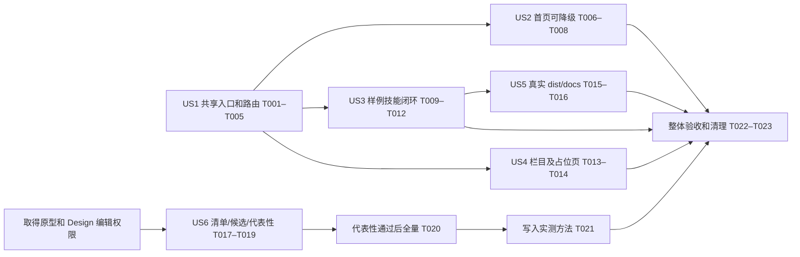

# 对话经过

会话 `01a21707-c48a-7431-a446-9aed2cb46638` · 轮次 `01a21733-f13f-7a62-8960-f42a4a2581d5`

<!-- foundry-detail 01a21707-c48a-7431-a446-9aed2cb46638 01a21733-f13f-7a62-8960-f42a4a2581d5 -->
<!-- foundry-event 87d20a29fb0e66b7b83ea41c0ca6519d8851d023b88bb4d265d9da84b3dc2a36 -->
## 进度原话

- 来源定位：字节 1760508

~~~text
我会按增量规划修复 A1–A3：澄清 US1 与技能子菜单的验收/依赖，补足任务目标路径，并明确 Figma 候选比较需涵盖 AI 或脚本采集。先核对当前文件状态和增量规划约定，再同步受影响的 tasks、plan、MVU 与分析说明。
~~~

<!-- foundry-event 662987bc769a6a717a33fa82c579a02ee90f928827ab92be2db5d390587be220 -->
## 工具调用 `exec_command` · `call_d9RZrLpTaamqoAGlyh3o5Iiv`

- 来源定位：字节 1761609

~~~text
工作目录：/home/ena/workspace/ena/agent-foundry/feature/init
{"cmd":"git status --short --branch | awk 'NR==1 || /specs\\/docs\\/001-docs-site-framework|\\.specify\\/feature.json/'; cat .agents/skills/task-increment/SKILL.md; cat .agents/skills/conversation-recording/SKILL.md; node - <<'JS'\nconst yaml=require(process.cwd()+'/node_modules/.pnpm/js-yaml@4.3.2/node_modules/js-yaml');const c=yaml.load(require('node:fs').readFileSync('.specify/extensions.yml','utf8'));for(const k of Object.keys(c.hooks??{}))if(k.includes('increment')||k.includes('analyze'))console.log(k,JSON.stringify(c.hooks[k]));\nJS","max_output_tokens":5000}
~~~

<!-- foundry-event 0703816c27944c8748ab1f727b26ec46936b08473ef6047f1154ba9c58c12a2c -->
## 工具结果 `call_d9RZrLpTaamqoAGlyh3o5Iiv`

- 来源定位：字节 1792215

~~~text
Chunk ID: d7ad2d
Wall time: 0.0000 seconds
Process exited with code 0
Original token count: 6687
Output:
Warning: truncated output (original token count: 6687)
Total output lines: 173

## feature/init...origin/feature/init
A  specs/docs/001-docs-site-framework/checklists/requirements.md
A  specs/docs/001-docs-site-framework/requirements/README.md
R  temp/a/figma-make-prompt.md -> specs/docs/001-docs-site-framework/requirements/prompts/figma-make-prompt.md
A  specs/docs/001-docs-site-framework/requirements/prompts/speckit-prompt.md
A  specs/docs/001-docs-site-framework/requirements/raw/2026-11-20-a.md
A  specs/docs/001-docs-site-framework/requirements/raw/2026-11-26-original-request.md
A  specs/docs/001-docs-site-framework/spec.md
?? specs/docs/001-docs-site-framework/analysis/
?? specs/docs/001-docs-site-framework/contracts/
?? specs/docs/001-docs-site-framework/data-model.md
?? specs/docs/001-docs-site-framework/diagrams.md
?? specs/docs/001-docs-site-framework/mvu.md
?? specs/docs/001-docs-site-framework/plan.md
?? specs/docs/001-docs-site-framework/quickstart.md
?? specs/docs/001-docs-site-framework/research.md
?? specs/docs/001-docs-site-framework/tasks.md
---
name: task-increment
description: 用户在已有 Spec Kit 方案上需要规划或增量调整业务闭环、任务拆分、依赖或推进顺序时使用。仅修订 Spec 的需求定义、业务规则或验收表述且不涉及实施规划变化时不使用。
destructive: false
---

# 增量规划

本技能只推进规划。先读取已有材料，再决定允许写入哪些文件；规划保存成功不代表业务实现、工程验收或用户学习通过。

## 先核对是否需要实施规划

按用户实际要改变的内容及已知上下文判断，不将“调整需求”当成固定规划口令。有描述但尚未说明改什么时，只补必要澄清，不猜测修改内容或按无描述分支重排任务；明确的无描述规划请求仍沿原分支处理。

仅修订已有Spec且不改变实施规划时，不进入下文规划分支：将请求交回调用方沿已确认范围修订原Spec，不以缺少plan、mvu或Task阻止该文档修订，也不为此补建规划材料、创建新功能或要求先有单Task实施方案。已有下游可读取核对影响，但无变化就保持；仅某Task的验收或实现说明受影响时，只衔接相关记录，不据此重写未变的MVU。

确实需要改变闭环、拆分、依赖或执行顺序时，才进入本技能并应用下述规划前置。需求定义同时变化，先沿目标项目治理保存获确认的原始变更及必要摘要、修订原Spec，再规划真正受影响的部分；需求本身未变则不顺带改Spec。规划不自动进入代码，实际实施仍按目标项目原Task准备与认可条件执行，不在这里另造分派入口。

## 定位与约束

1. 当前适用已初始化的 Spec Kit 项目。读取目标项目的 `.specify/memory/constitution.md` 和已有操作约定，遵循其中的任务、历史保护与续接规则；不在技能内另建一套任务状态规则。项目或必要治理不可用时说明缺项及继续条件，不自动初始化。
2. 入口定位 Spec，不接受 Task 定位参数。优先使用用户明确指定的 Spec/材料路径，再使用项目现有指针或唯一可确定的上下文。指针失效时检索已有材料，只有唯一匹配才说明依据后续接；有歧义时补问必要定位信息，不猜归属或改指针掩盖问题。
3. 读取需求、方案、闭环详情、任务及其引用的实际证据，记录本次目标、原任务 ID/状态/验收和可写范围。在 plan 同级明确检查 `mvu.md`，不能仅凭文件发现清单判断其不存在。复用现有材料；不得重置历史或把已完成事实重新规划成新任务。

## 可选规划描述

调用由 Spec 定位和可选自由文本规划描述组成，不要求固定格式。先区分定位与描述：未提供文字、空白或仅 Spec 定位时走原材料分支，不要求补写，也不把上轮聊天当本轮新指令；仍读取已保存的有效方案和事实。含义不明的文字应说明疑问，不静默丢弃。进入实施规划范围后，有描述和无描述两条分支均须有 plan。

收到明确旧式 Task 定位（如 `Task:T005`）时，说明该参数已不受支持，请调用方改用 Spec 加业务规划描述；未明确当前意图前不据旧参数写规划，也不静默删除参数后全量重排。自由描述中提及已有 Task 可作为项目现状、职责和依赖引用，结合业务结果判断调整范围，不把这些引用一并拒绝。无关任务和已完成事实保留，不因 Spec 定位而重排整份清单。

有描述时按以下顺序工作：

1. 从原文提取业务优先级、验收衔接、步骤偏好和范围约束；实际读取需求、方案、已有闭环、任务、相关实现及证据。核对角色/权限边界、必要前置、主要及失败路径、验收是否支持目标。
2. 对照项目补全遗漏，分清用户原意、项目事实、AI 补充与待确认假设，并引用依据。已有确认直接复用；影响范围、权限、验收或关键依赖的未知，列明问题及影响后只暂停受影响规划。与正式要求或必要验证冲突时，指出具体依赖和最小调整建议；需变更需求或推进约定时，先按治理确认并同步上游，再落实下游，不暗改用户方向。
3. 先形成可观察、可验收的小业务 MVU，再生成或调整 Task。一个服务可以有多个闭环，技术层不是业务 MVU。用户给出的步骤链在每个适用闭环内展开：已有实现和证据复用，不适用层说明理由；不为凑层新增页面或测试框架。保留用户要求的验收后再推进关系，不能先横向做完所有模块的数据层才反馈。
4. 将原意来源、补全/调整理由、最终 MVU 与 Task 对应及待确认事项，写入项目已有需求/方案/闭环/任务的相关段落。普通细化沿有效授权，业务需求变化先确认并同步规格；tasks 保持轻量，详细实施思路留到实际开工前讨论。保存遵循后文顺序和保护规则，规划不自动进入实施。

例如用户提出“权限验收后记账、再日程，按表设计→service→接口→测试页面→正式页面推进”，先结合该项目确定权限的小业务结果和验收，再展开相关任务；已有权限 service 直接复用。该例不是所有项目的业务顺序或每条闭环必做的五层模板。

无实质变化保持原文件；换描述或恢复时对照已保存材料，仅更新必要安排并保留原依据、身份、完成事实和证据。先 MVU 后 Task 的规划过程与保存、分析结果分别报告。已有 Task 用于现状和职责关联，不构成独立入口或对后续实施的授权。

## 需求原文与简洁摘要

读取所属Spec已有的简洁需求摘要/导航和当前有效要求，需要核对变化或纠正时沿链接追溯原始输入、讨论及确认；摘要用于定位，不代替正式定义。本轮描述与现行要求不同，先区分实质需求变化、既有目标内的规划调整和普通进度，不能把AI补全或上轮聊天默认为新的用户要求。

在材料前置满足且本次获授权写入的分支中，实质变化按目标项目治理和既有布局保留本次可见原始输入、可知来源及实际日期，默认requirements/raw；已有相同原文直接引用。AI建议、讨论和润色提示词按职责另存，不能覆盖或冒充原话及认可；未知来源/日期或不可见历史明确说明。简洁摘要用短段说明问题、解决方向、本次变化、确认或待定和日期，链接原文、必要讨论及当前有效要求；可复用requirements/README.md，不复制完整规格或创建固定字段/文件注册。新材料按实际用途归类，不批量迁移无关Spec。

先保存、检查并读回原文和必要讨论，再同步摘要及获确认的受影响上游，之后按原规则落实MVU和Task。未确认的实质变化保留待定，不据此改写有效范围或越过必要前置。无实质变化、重复调用或仅问进度不重复归档、强造原文；无plan仍按材料分支停止规划写入。任一步失败按保存与恢复规则报告已写/未写和受影响引用，恢复时重读实际文件，仅补未完成部分，不凭记忆覆盖来源。

## 既有画像的参考

沿目标项目已有治理定位当前画像或协作理解摘要，主要读取当前有效描述；需要核对纠正、来源或适用情境时再追溯相关结论和讨论，不要求每轮重读全部日志。画像帮助理解协作方式、步骤偏好和推荐理由，实际需求、代码、依赖、授权及技术验证仍以项目事实为准；两者冲突时说明依据，不用画像改写需求或跳过前置。

没有已有画像时依据有效材料继续规划，不强制建档或推测个人偏好。形成新的有效认识时按目标项目既有记录约定处理；普通任务选择、无描述请求或读取成功本身不构成新结论，不为本轮规划强造画像。这里不规定个人文件名或跨仓库路径，不把来源仓库的用户资料复制到目标项目。

## 按实际材料选择路径

| 材料状态                               | 本次动作                                                                                                                                            |
| -------------------------------------- | --------------------------------------------------------------------------------------------------------------------------------------------------- |
| 无 plan，包含仅有孤立 mvu/tasks 的情况 | 说明缺少方案前置，停止规划写入，建议先完成方案规划；不代建 plan/tasks，不实现业务。                                                                 |
| 有 plan，无 tasks                      | 在 mvu 或已有等价详情中整理闭环，plan 保存一处文件级链接、总体顺序及必要前置；按项目原…1687 tokens truncated…工程安排在该方案中维护，规划完成不代表已有实施认可。已有方案、原任务要求和历史完成事实继续保留，只在本次允许修改范围增量衔接，不为换格式重开或删除已完成任务。

## MVU 状态

每条标题下用一行保存 `**状态**：未开始。**依据**：尚无本闭环实施记录，关联职责待任务生成补齐。` 已有任务或证据时改写为真实依据，引用对应 Task、步骤或验收记录；保留后面的四项详情。状态只取以下五种：

| 状态   | 判定依据                                                                                                               |
| ------ | ---------------------------------------------------------------------------------------------------------------------- |
| 未开始 | 本闭环职责尚无实施记录；仅完成规划或生成任务仍属此状态。                                                               |
| 进行中 | 本闭环已有实际推进，仍有实现或修订工作可继续；未勾选 Task 内已完成的步骤也可作为依据。                                 |
| 待验收 | 本闭环所需实现已具备，仍缺按验收信号执行的闭环验证或结论；单独组件/技术验证通过不足以标已通过。                        |
| 已通过 | 已有覆盖本闭环验收信号的实际通过证据，且未出现使其失效的新结果；引用该证据。                                           |
| 受阻   | 真实障碍使本闭环当前必要下一步无法继续；依据写明障碍、影响及恢复条件。仍有可独立推进的部分时保持进行中并说明局部阻塞。 |

按本闭环的具体职责和实际证据判断，不按所有关联 Task 的勾选数量机械汇总；共享 Task 在其他闭环的进度不能证明本闭环已推进或已通过。全部关联 Task 勾选也不能代替闭环验收证据，局部闭环通过也不反向勾选覆盖范围更大的 Task。迁移、增量规划及任务生成后核对状态；相关任务/步骤、验收结果或阻塞条件变化，以及中断恢复时，重新读取来源并在授权保存范围内更新状态与依据。无新事实则保持稳定；新结果推翻旧结论时保留原证据和变更原因，不沿用失效的已通过。

状态是阅读摘要，tasks 与实际证据仍是判定来源，不新增状态文件、独立状态服务、完成比例或并行工程 checkbox。材料不足时写清待核实的依据和影响，不猜测实施已开始或验收已通过；已有摘要无法核实时标明未复核，不伪造状态转移。只读分析只报告不一致，不借核对状态修改材料。

## 任务正文的重组与边界

MVU 改变了有效任务的分组或推进顺序时，将变化落实到任务清单正文。概览、映射表或“建议下一步”只能辅助阅读，不能让正文继续表达旧的执行路径。任务身份与历史需要稳定，未完成任务的旧位置不因此固定。

1. 对照本次 Spec 与规划描述的授权范围，把有效待办关联到业务结果，识别必要技术前置、共享任务、暂缓工作和已完成的可复用事实。已有 Task 作为现状和职责依据，只调整与本轮业务结果有必要关联的范围，不借局部规划重排整个项目。
2. 先满足真实依赖，再按尽早获得可验收业务结果的推荐顺序，移动完整原 Task 区块并更新所属分组、有效阶段导航和依赖说明。编号只作身份，不按新位置重新编号；原目标、范围、验收、项目要求的字段及证据随区块保留，已确认的阶段批准点不被静默删除或越过。
3. 共享前置只放一处，各闭环引用同一个 Task。跨闭环依赖允许任务不连续，不为凑分组复制工程状态、拆散原交付或把共同前置重复规划。保留已完成及归档内容，不能将它们重新列成待办。
4. 保存前比较原身份/完成事实、验收覆盖和引用；核对新正文的可执行顺序、下一组任务、技术阻塞边及末尾收尾。确认未引入循环、断链或重复条目，旧分组与新正文冲突的导航一并更新。重复调用以已保存正文为准，无实际变化时保持稳定。

按实际材料处理不适合移动的部分：

| 核查结果                                                      | 处理方式                                                                                                                                                  |
| ------------------------------------------------------------- | --------------------------------------------------------------------------------------------------------------------------------------------------------- |
| 原正文已经符合本次闭环、依赖和有效阶段安排                    | 复用原顺序；无其他缺口时不改 tasks，不为记录“检查过”追加无信息章节。                                                                                      |
| 阶段/外部执行约定明确固定某区段，或有其他执行者正在写入该范围 | 保持该段原位与事实，说明具体位置、约束依据和解除条件；重组不受约束的部分。需要改变已确认安排时先列影响并取得对应确认，不把已有 Phase 标题本身当冻结依据。 |
| 循环依赖、身份冲突或必要材料缺失，无法安全确定局部顺序        | 指出冲突 Task、缺失依据及影响边界，不猜顺序、不偷偷删除依赖；只暂缓相关重排，其他有依据的部分继续。核对或确认后再从原身份续接。                           |
| 保存或格式检查受阻                                            | 按下节报告已写/未写与恢复入口，停止依赖该保存结果的动作；不改权限、替换保护文件或伪报已经重排。                                                           |

保留或暂缓必须对应可核实的约束，输出受影响范围、当前仍可推进的路径和继续条件。编号不连续、旧技术分组、跨闭环共享或依赖较多，都不构成整份清单保持旧序的理由；局部受限不能报告为全量完成，也不能无依据阻止其他调整。

## 保存与恢复

1. 先核对可写范围与原 Task/证据，复用项目已有历史来源；先保存闭环详情并检查格式、读回，再收敛 plan 为一处文件级链接并更新总体推荐顺序，最后保存获授权的任务及其他引用，并依实际任务/证据核对 mvu 的状态＋依据。逐份核对引用、覆盖与原 ID/状态/验收/证据，确认每条 MVU 状态有依据、plan 无逐条 MVU 索引或 Task 范围列表，且未自动增加整份方案快照，才报告本轮规划保存成功。无实际变化时不为表示“检查过”改写文件。
2. 任一保存、格式检查或读回失败，停止受影响的后续动作。报告具体失败、已写入与未写入部分、尚未一致的引用及恢复入口；不宣称原子回滚、全部保存或验证通过。
3. 不通过改权限、替换受保护文件或绕过项目限制来掩盖失败。障碍解除后，从实际已保存材料恢复，只补未完成写入与检查，复用已建立的单元和任务身份。
4. 规划同步、格式检查及读回成功后，显式加载并调用同一 `artifact-spec-analysis` 技能刷新分析。传入最新需求/确认、spec、plan 总体方案与推荐顺序、同级 mvu 的实际路径及有效详情、tasks、必要证据、已有分析索引和目标位置；未迁移的旧详情说明兼容来源。消费者须明确读取同级 mvu，不依赖 plan 的逐条索引或文件发现清单；实际打开并核对四项和职责，不以发现文件代替消费。分析引用有效详情，不保存另一份活动 MVU 定义。沿用目标项目布局，不另写分析生成器或注册 after_increment。
5. 该分析技能尚未交付或当前环境不可用时，分别报告“规划已保存”和“分析阶段未完成”及影响，不虚报整次成功，也不以其他分析代替。可用时实际核对其保存结果；失败报告已写/未写及恢复入口，只阻断依赖分析结果的动作。重复或恢复先核对原分析和已保存材料，再调用同一能力补齐，不凭时间戳制造变化。
6. 输出本次材料路径、推荐及依据、正文分组/顺序的实际变化或保留理由、当前下一组任务、规划与分析各自的校验结果及未完成项。局部受限列明范围、约束和继续条件。未经授权不进入业务实现、安装、挂载或其他外部操作；后续步骤须以真实保存结果为前置。
---
name: conversation-recording
description: 核对 Codex CLI 项目级对话记录、资料位置和保存缺口，适用于首条消息、普通问答、业务请求、提交停写及会话恢复。
compatibility: 项目级自动入口适用于 Linux 上已启用分页会话的 Codex CLI 0.172.0，安装与回调需要 Python 3.10 或更高版本。
---

# 保存 Codex 会话记录

项目级安装交付本 Skill 和 Codex Hook。已从正式入口安装并在 Codex 完成信任时，首条用户原话、已完成的工具活动和实际最终回复由 Hook 保存。查阅记录或处理缺口时按[触发和保存时机](references/recording-timing.md)定位。把修复、实际 Git 提交和后续普通动作拆成独立调用，使每次提交及其结果可按发生顺序跳过记录。

项目安装位于 `.agents/skills/conversation-recording`，安装归属可从同目录的 `.foundry-recording-install.json` 核对。直接处理用户请求，由宿主 Hook 完成记录。用户要求查阅记录时，把查阅作为本轮业务。根据[资料契约](references/storage-contract.md)定位主记录和详情，根据[写入失败与重试](references/write-failures.md)说明仍缺失的范围。

~~~

<!-- foundry-event f1ddd931ac4628e57a73dd343ec4b529e34c760cdec00174c176f270392d3db3 -->
## 工具调用 `exec_command` · `call_a7TofIeAVn4Uy7lbwOBK4D9K`

- 来源定位：字节 1846587

~~~text
工作目录：/home/ena/workspace/ena/agent-foundry/feature/init
{"cmd":"sed -n '1,260p' .agents/skills/task-increment/SKILL.md; cat specs/docs/001-docs-site-framework/mvu.md; cat specs/docs/001-docs-site-framework/tasks.md; cat specs/docs/001-docs-site-framework/analysis/spec-analysis/README.md","max_output_tokens":15000}
~~~

<!-- foundry-event 0e0bc375968ae128e8f996cce6c957621ea8da708bfa34f9a3303f9e56b2960c -->
## 工具结果 `call_a7TofIeAVn4Uy7lbwOBK4D9K`

- 来源定位：字节 1905493

~~~text
Chunk ID: 368353
Wall time: 0.0001 seconds
Process exited with code 0
Original token count: 13833
Output:
Warning: truncated output (original token count: 13833)
Total output lines: 442

---
name: task-increment
description: 用户在已有 Spec Kit 方案上需要规划或增量调整业务闭环、任务拆分、依赖或推进顺序时使用。仅修订 Spec 的需求定义、业务规则或验收表述且不涉及实施规划变化时不使用。
destructive: false
---

# 增量规划

本技能只推进规划。先读取已有材料，再决定允许写入哪些文件；规划保存成功不代表业务实现、工程验收或用户学习通过。

## 先核对是否需要实施规划

按用户实际要改变的内容及已知上下文判断，不将“调整需求”当成固定规划口令。有描述但尚未说明改什么时，只补必要澄清，不猜测修改内容或按无描述分支重排任务；明确的无描述规划请求仍沿原分支处理。

仅修订已有Spec且不改变实施规划时，不进入下文规划分支：将请求交回调用方沿已确认范围修订原Spec，不以缺少plan、mvu或Task阻止该文档修订，也不为此补建规划材料、创建新功能或要求先有单Task实施方案。已有下游可读取核对影响，但无变化就保持；仅某Task的验收或实现说明受影响时，只衔接相关记录，不据此重写未变的MVU。

确实需要改变闭环、拆分、依赖或执行顺序时，才进入本技能并应用下述规划前置。需求定义同时变化，先沿目标项目治理保存获确认的原始变更及必要摘要、修订原Spec，再规划真正受影响的部分；需求本身未变则不顺带改Spec。规划不自动进入代码，实际实施仍按目标项目原Task准备与认可条件执行，不在这里另造分派入口。

## 定位与约束

1. 当前适用已初始化的 Spec Kit 项目。读取目标项目的 `.specify/memory/constitution.md` 和已有操作约定，遵循其中的任务、历史保护与续接规则；不在技能内另建一套任务状态规则。项目或必要治理不可用时说明缺项及继续条件，不自动初始化。
2. 入口定位 Spec，不接受 Task 定位参数。优先使用用户明确指定的 Spec/材料路径，再使用项目现有指针或唯一可确定的上下文。指针失效时检索已有材料，只有唯一匹配才说明依据后续接；有歧义时补问必要定位信息，不猜归属或改指针掩盖问题。
3. 读取需求、方案、闭环详情、任务及其引用的实际证据，记录本次目标、原任务 ID/状态/验收和可写范围。在 plan 同级明确检查 `mvu.md`，不能仅凭文件发现清单判断其不存在。复用现有材料；不得重置历史或把已完成事实重新规划成新任务。

## 可选规划描述

调用由 Spec 定位和可选自由文本规划描述组成，不要求固定格式。先区分定位与描述：未提供文字、空白或仅 Spec 定位时走原材料分支，不要求补写，也不把上轮聊天当本轮新指令；仍读取已保存的有效方案和事实。含义不明的文字应说明疑问，不静默丢弃。进入实施规划范围后，有描述和无描述两条分支均须有 plan。

收到明确旧式 Task 定位（如 `Task:T005`）时，说明该参数已不受支持，请调用方改用 Spec 加业务规划描述；未明确当前意图前不据旧参数写规划，也不静默删除参数后全量重排。自由描述中提及已有 Task 可作为项目现状、职责和依赖引用，结合业务结果判断调整范围，不把这些引用一并拒绝。无关任务和已完成事实保留，不因 Spec 定位而重排整份清单。

有描述时按以下顺序工作：

1. 从原文提取业务优先级、验收衔接、步骤偏好和范围约束；实际读取需求、方案、已有闭环、任务、相关实现及证据。核对角色/权限边界、必要前置、主要及失败路径、验收是否支持目标。
2. 对照项目补全遗漏，分清用户原意、项目事实、AI 补充与待确认假设，并引用依据。已有确认直接复用；影响范围、权限、验收或关键依赖的未知，列明问题及影响后只暂停受影响规划。与正式要求或必要验证冲突时，指出具体依赖和最小调整建议；需变更需求或推进约定时，先按治理确认并同步上游，再落实下游，不暗改用户方向。
3. 先形成可观察、可验收的小业务 MVU，再生成或调整 Task。一个服务可以有多个闭环，技术层不是业务 MVU。用户给出的步骤链在每个适用闭环内展开：已有实现和证据复用，不适用层说明理由；不为凑层新增页面或测试框架。保留用户要求的验收后再推进关系，不能先横向做完所有模块的数据层才反馈。
4. 将原意来源、补全/调整理由、最终 MVU 与 Task 对应及待确认事项，写入项目已有需求/方案/闭环/任务的相关段落。普通细化沿有效授权，业务需求变化先确认并同步规格；tasks 保持轻量，详细实施思路留到实际开工前讨论。保存遵循后文顺序和保护规则，规划不自动进入实施。

例如用户提出“权限验收后记账、再日程，按表设计→service→接口→测试页面→正式页面推进”，先结合该项目确定权限的小业务结果和验收，再展开相关任务；已有权限 service 直接复用。该例不是所有项目的业务顺序或每条闭环必做的五层模板。

无实质变化保持原文件；换描述或恢复时对照已保存材料，仅更新必要安排并保留原依据、身份、完成事实和证据。先 MVU 后 Task 的规划过程与保存、分析结果分别报告。已有 Task 用于现状和职责关联，不构成独立入口或对后续实施的授权。

## 需求原文与简洁摘要

读取所属Spec已有的简洁需求摘要/导航和当前有效要求，需要核对变化或纠正时沿链接追溯原始输入、讨论及确认；摘要用于定位，不代替正式定义。本轮描述与现行要求不同，先区分实质需求变化、既有目标内的规划调整和普通进度，不能把AI补全或上轮聊天默认为新的用户要求。

在材料前置满足且本次获授权写入的分支中，实质变化按目标项目治理和既有布局保留本次可见原始输入、可知来源及实际日期，默认requirements/raw；已有相同原文直接引用。AI建议、讨论和润色提示词按职责另存，不能覆盖或冒充原话及认可；未知来源/日期或不可见历史明确说明。简洁摘要用短段说明问题、解决方向、本次变化、确认或待定和日期，链接原文、必要讨论及当前有效要求；可复用requirements/README.md，不复制完整规格或创建固定字段/文件注册。新材料按实际用途归类，不批量迁移无关Spec。

先保存、检查并读回原文和必要讨论，再同步摘要及获确认的受影响上游，之后按原规则落实MVU和Task。未确认的实质变化保留待定，不据此改写有效范围或越过必要前置。无实质变化、重复调用或仅问进度不重复归档、强造原文；无plan仍按材料分支停止规划写入。任一步失败按保存与恢复规则报告已写/未写和受影响引用，恢复时重读实际文件，仅补未完成部分，不凭记忆覆盖来源。

## 既有画像的参考

沿目标项目已有治理定位当前画像或协作理解摘要，主要读取当前有效描述；需要核对纠正、来源或适用情境时再追溯相关结论和讨论，不要求每轮重读全部日志。画像帮助理解协作方式、步骤偏好和推荐理由，实际需求、代码、依赖、授权及技术验证仍以项目事实为准；两者冲突时说明依据，不用画像改写需求或跳过前置。

没有已有画像时依据有效材料继续规划，不强制建档或推测个人偏好。形成新的有效认识时按目标项目既有记录约定处理；普通任务选择、无描述请求或读取成功本身不构成新结论，不为本轮规划强造画像。这里不规定个人文件名或跨仓库路径，不把来源仓库的用户资料复制到目标项目。

## 按实际材料选择路径

| 材料状态                               | 本次动作                                                                                                                                            |
| -------------------------------------- | --------------------------------------------------------------------------------------------------------------------------------------------------- |
| 无 plan，包含仅有孤立 mvu/tasks 的情况 | 说明缺少方案前置，停止规划写入，建议先完成方案规划；不代建 plan/tasks，不实现业务。                                                                 |
| 有 plan，无 tasks                      | 在 mvu 或已有等价详情中整理闭环，plan 保存一处文件级链接、总体顺序及必要前置；按项目原生格式生成 tasks，再补齐真实 Task 职责。                      |
| 有 plan 和 tasks                       | 先读取 mvu；尚未迁移时读取原 plan 详情。核对实现与证据，补齐闭环及任务缺口，按新的业务顺序同步重组任务正文；保留原 ID、完成标记、目标、范围和验收。 |

## 业务闭环与推荐依据

闭环以用户能观察的业务结果划分，可以只覆盖原 Task 的局部职责，不要求每个闭环贯穿所有技术层。每次推荐写清以下内容，已有方案覆盖时直接引用并补缺：

| 原则         | 推荐中必须说明的内容                                                             |
| ------------ | -------------------------------------------------------------------------------- |
| 有业务意义   | 谁在什么情境获得什么结果；技术联通、建表或文件生成仅作为前置，不能代替业务结果。 |
| 可验收       | 具体输入、操作和可观察的成功/失败信号，以及原 Task 验收如何保留。                |
| 范围适合推进 | 本次最小可推进范围、暂缓内容及理由；不为凑完整链路增加未授权业务。               |
| 顺序有依据   | 推荐顺序、必要依赖、可独立推进部分，以及风险、真实反馈或条件变化后如何调整推荐。 |

检查原方案是否只按“全部数据层、全部接口、最后界面”批量推进，或过晚才能得到业务反馈。依据真实依赖、风险和反馈解释取舍，不把推荐包装成唯一粒度或固定顺序。用户思路或画像依据不足时，给出有理由的建议，标明待反馈事项，不虚构偏好、接受或验证结果。

## 技术前置与骨架复用

规划时主动逐项扫描 C1～C4，并在细化时核对现有证据的适用范围：C1 无使用先例的新依赖/框架/协议；C2 外部系统失败模式未验证；C3 高风险条件未经证实；C4 首次跨包或跨进程契约。记录命中事实；无命中或复用已有验证时也说明依据，用户熟悉技术不能替代证据。豁免条件遵循目标项目治理。

每项必要技术验证写入关联业务闭环的前置 Task 或原 Task 内步骤，包含可证伪假设、具体输入、可核验信号、已有/待补证据及下游依赖。验证通过前不填充依赖该假设的业务；失败记录实际证据并调整路线，只阻断依赖下游，无关工作仍可推进。保留通过的原文件与最小骨架，后续在其上增量填充并复验原技术信号，再独立验收业务结果；技术通过不自动完成业务闭环。

## 增量写法

- Spec Kit 项目由同级 `mvu.md` 集中保存业务闭环详情。plan 的闭环导航只用一处文件级链接：`闭环详情见 [mvu.md](mvu.md)。` 总体方案、推荐顺序和依赖用方案文字说明；逐条 MVU 标题/索引、锚点跳转和 Task 范围列表集中在 mvu/tasks，plan 不再列出。每条详情用几小段说明**闭环结果、节点与关键逻辑、关联 Task 及各自职责、验收信号**；必要范围、顺序理由和技术前置可简述或引用已有依据，不强制完整设计、全分支图或复制 Task 八栏目。
- 每条采用一个稳定标题，标题下先写“状态＋依据”，再接四个详情短段，段首分别为“闭环结果”“节点与关键逻辑”“关联 Task”“验收信号”。结果说明本次局部价值；节点用紧凑顺序或必要判断串起；Task 段说明各自职责；信号段给出具体操作与可观察结果。范围或技术前置在相关短段简述或链接现有方案/验证依据，详细实施方案在实际开工前另存，避免把闭环或任务清单扩成完整功能设计。
- 已有 mvu 先复用原编号、标题和有效内容；尚无 mvu 时读取原 plan 详情并按本次范围迁出，保留原闭环定位在 mvu 中。保存详情后，将 plan 的逐条详情或索引合并为上述一处文件级链接；核对指向旧 plan 锚点的实际引用，在授权范围内改为 mvu 中的对应位置，保留任务与证据事实。不能修改的引用说明位置、影响及恢复条件，不以残留逐条索引掩盖未完成迁移。plan 已是导航时不重新导入为详情；两份活动详情冲突先核对来源与影响，只处理可确定的范围，不凭时间戳覆盖。
- 产物沿用本次授权的 plan、mvu、tasks 及必要引用；历史保护使用项目已有历史材料或版本记录，不自动新建 `plan.history.md` 或其他整份方案快照。既有历史文件不因这条规则自动删除或重写，迁移时保留有效技术方案、原 Task 要求、完成事实及历史证据。
- 闭环及节点不建立独立工程身份或 checkbox；MVU 状态仅展示下节规定的事实摘要。已有 Task 引用真实 ID 并说明职责；任务尚未生成时明确关联待补，生成后补齐实际 ID/职责。一个 Task 可被多闭环引用，工程完成仍按该 Task 原验收判断，不从关联关系自动汇总。
- 写前扫描既有验证单元和全部任务 ID（包括保留历史），先复用覆盖同一目标的条目；只有实际缺口才新增，使用未占用 ID。步骤细化遵循目标项目治理，保留原任务身份及要求。
- 失效规划注明原条目、替代条目及原因，保留历史来源；目标、范围或验收需要变化时先说明影响并按项目治理确认，不把调整做法当成改写已完成事实的授权。
- 对照需求确认没有遗漏原验收；计划、任务和证据引用必须可定位。新增或细化实施任务保持未完成，不能因规划完成勾选。
- 生成或更新任务清单时读取并遵循目标项目的末尾收尾约定，先核对等价未完成收尾 Task 的覆盖与复用；清理范围、局部内容保护、用途待核实项和结案条件均由目标治理决定，不在技能中复制本仓库的完整清理规则，也不因规划而执行清理。
- 重复调用或恢复时重新读取磁盘材料和证据，根据已保存内容继续；不依据聊天记忆重复追加单元/任务，不用新的状态文件管理进度。

## 轻量任务与实施方案

任务条目保存稳定 ID、简洁目标、必要范围/约束/依赖、可核验的整体验收及唯一工程 checkbox；这些是信息职责，不是固定八栏目。先确定 MVU 的业务结果和关系，再把实际工程缺口映射到 Task，不在规划阶段预先填满实现步骤或批量创建方案文件。

实际开工前沿项目治理讨论并保存单 Task 方案，默认位于所属 Spec 的 `implementation/<Task ID>.md`，由原任务链接；详细逻辑和重要工程安排在该方案中维护，规划完成不代表已有实施认可。已有方案、原任务要求和历史完成事实继续保留，只在本次允许修改范围增量衔接，不为换格式重开或删除已完成任务。

## MVU 状态

每条标题下用一行保存 `**状态**：未开始。**依据**：尚无本闭环实施记录，关联职责待任务生成补齐。` 已有任务或证据时改写为真实依据，引用对应 Task、步骤或验收记录；保留后面的四项详情。状态只取以下五种：

| 状态   | 判定依据                                                                                                               |
| ------ | ---------------------------------------------------------------------------------------------------------------------- |
| 未开始 | 本闭环职责尚无实施记录；仅完成规划或生成任务仍属此状态。                                                               |
| 进行中 | 本闭环已有实际推进，仍有实现或修订工作可继续；未勾选 Task 内已完成的步骤也可作为依据。                                 |
| 待验收 | 本闭环所需实现已具备，仍缺按验收信号执行的闭环验证或结论；单独组件/技术验证通过不足以标已通过。                        |
| 已通过 | 已有覆盖本闭环验收信号的实际通过证据，且未出现使其失效的新结果；引用该证据。                                           |
| 受阻   | 真实障碍使本闭环当前必要下一步无法继续；依据写明障碍、影响及恢复条件。仍有可独立推进的部分时保持进行中并说明局部阻塞。 |

按本闭环的具体职责和实际证据判断，不按所有关联 Task 的勾选数量机械汇总；共享 Task 在其他闭环的进度不能证明本闭环已推进或已通过。全部关联 Task 勾选也不能代替闭环验收证据，局部闭环通过也不反向勾选覆盖范围更大的 Task。迁移、增量规划及任务生成后核对状态；相关任务/步骤、验收结果或阻塞条件变化，以及中断恢复时，重新读取来源并在授权保存范围内更新状态与依据。无新事实则保持稳定；新结果推翻旧结论时保留原证据和变更原因，不沿用失效的已通过。

状态是阅读摘要，tasks 与实际证据仍是判定来源，不新增状态文件、独立状态服务、完成比例或并行工程 checkbox。材料不足时写清待核实的依据和影响，不猜测实施已开始或验收已通过；已有摘要无法核实时标明未复核，不伪造状态转移。只读分析只报告不一致，不借核对状态修改材料。

## 任务正文的重组与边界

MVU 改变了有效任务的分组或推进顺序时，将变化落实到任务清单正文。概览、映射表或“建议下一步”只能辅助阅读，不能让正文继续表达旧的执行路径。任务身份与历史需要稳定，未完成任务的旧位置不因此固定。

1. 对照本次 Spec 与规划描述的授权范围，把有效待办关联到业务结果，识别必要技术前置、共享任务、暂缓工作和已完成的可复用事实。已有 Task 作为现状和职责依据，只调整与本轮业务结果有必要关联的范围，不借局部规划重排整个项目。
2. 先满足真实依赖，再按尽早获得可验收业务结果的推荐顺序，移动完整原 Task 区块并更新所属分组、有效阶段导航和依赖说明。编号只作身份，不按新位置重新编号；原目标、范围、验收、项目要求的字段及证据随区块保留，已确认的阶段批准点不被静默删除或越过。
3. 共享前置只放一处，各闭环引用同一个 Task。跨闭环依赖允许任务不连续，不为凑分组复制工程状态、拆散原交付或把共同前置重复规划。保留已完成及归档内容，不能将它们重新列成待办。
4. 保存前比较原身份/完成事实、验收覆盖和引用；核对新正文的可执行顺序、下一组任务、技术阻塞边及末尾收尾。确认未引入循环、断链或重复条目，旧分组与新正文冲突的导航一并更新。重复调用以已…3833 tokens truncated…说明，遵守省略、`true`、文件名、`false` 和缺失文件规则；缺失隔离于单个集合。

**Independent Test**: 使用技能包真实构建并验收的 `dist/docs`，验证省略/`true` 读 README、字符串读取指定文件、`false` 不读取、缺文件告警并占位且其他集合继续显示。

### Implementation

- [ ] T015 [US5] 在实现 `apps/docs/` 接入前确认 `packages/skills` 已交付并通过其发布流程验收的真实 `dist/docs` 产物；将源产物路径、元数据字段及默认 README/指定文件布局记录在 `specs/docs/001-docs-site-framework/analysis/` 的实际验收材料中，前置缺失时记录缺项与恢复条件，不以临时模拟内容判定已接入。
- [ ] T016 [US5] 在 `apps/docs/content.config.ts`、`apps/docs/nuxt.config.ts` 及 `apps/docs/app/` 按真实产物接入各集合说明；省略或 `true` 读取默认 README、字符串读取集合目录指定文件、`false` 跳过说明；分别以真实五类输入验收，缺文件警告准确定位且仅影响该集合，其他有效说明仍展示。

## Phase 8: User Story 6 - 一次启动将原型页面和状态转换为可编辑画板（Priority: P2）

**Goal**: 基于实际原型清单先验收代表性批次，再运行一次全量转换并保存可复用方法和逐项证据。

**Independent Test**: 获得真实原型与可编辑目标 Design 文件后，先用首页和至少一个内页的桌面/手机版本一次生成至少四块可编辑画板；代表性验收通过后再一次全量运行并核对全部清单。

### Implementation

- [ ] T017 [P] [US6] 在 `specs/docs/001-docs-site-framework/analysis/figma-conversion.md` 建立真实原型盘点和输入记录；取得可访问的 Figma Make 原型或可运行源码、以及可编辑目标 Design 文件/工作区权限后，逐项记录五模块可达页面/视图、适用桌面/手机视口、默认画面、改变可见导航布局的展开态和不同正文的 Spec Kit 栏目。缺任何前置时记录阻塞原因与恢复条件。
- [ ] T018 [US6] 在 `specs/docs/001-docs-site-framework/analysis/figma-conversion.md` 对照真实清单比较批量 URL 导入与 Figma MCP Code to canvas 等候选的覆盖能力；记录交互态采集限制、实际采用方式、运行输入及目标文件，不以公开文档能力替代本项目实测。
- [ ] T019 [US6] 在 `specs/docs/001-docs-site-framework/analysis/figma-conversion.md` 执行一次代表性转换：覆盖首页和至少一个内页各自适用的桌面、手机视图，一次启动在同一 Design 文件生成至少四块具名画板；逐项检查文字/布局可编辑性、正文/导航状态、字体/图片差异及 3D/动画处理，保存画板链接、结果和设计协作者对替代项的确认。
- [ ] T020 [US6] 仅在 T019 代表性批次验收通过后，于 `specs/docs/001-docs-site-framework/analysis/figma-conversion.md` 对真实全量清单执行一次转换；核对清单每项唯一对应同一 Design 文件内具名画板，满足 FR-012 条件的比例为 100%，保存全部链接、逐项结果、差异和失败/未执行恢复条件。
- [ ] T021 [US6] 仅在 T020 全量验收通过后，将实际可复用输入、权限、页面清单维护方式、批量运行步骤、画板组织/链接、动态内容处理和失败重跑方法写入 `specs/docs/001-docs-site-framework/spec.md` 的「转换方法复用」章节；未通过或前置缺失时如实记录结果，不填写推测的方法。

## Phase 9: Polish & Cross-Cutting Concerns

**Purpose**: 对已具备前置的交付范围完成工程和端到端核验，并清理开发过程产物。

- [ ] T022 在 `specs/docs/001-docs-site-framework/quickstart.md` 和 `specs/docs/001-docs-site-framework/analysis/` 记录实际执行的 docs lint、类型检查、build 及桌面/手机验收输入、预期和结果；失败、未执行、缺前置分别列明，不把构建成功代替用户流程验收。
- [ ] T023 在 `apps/docs/` 及 `specs/docs/001-docs-site-framework/` 按代码调用、配置、文档语义和引用核对开发期间产生的临时/失效产物；清理可确认无用项并在 `specs/docs/001-docs-site-framework/analysis/` 记录定位、依据、处置与引用检查，无需清理或用途未明的项也记录范围、保留理由和后续条件。

## 依赖与执行顺序

### 阶段依赖

- **Setup（Phase 1）**：Nuxt UI 安装及与 UnoCSS 的兼容核验先于依赖该组件库的模块实现；失败只阻止受影响组件工作，不能未经确认替换既定技术。
- **Foundational（Phase 2）**：模块路由、布局边界和地址契约先于各故事页面。
- **P1 故事（Phase 3–6）**：US1 共用导航/路由完成后，US2、US3、US4 可按文件隔离并行；它们各自仍须独立完成并按故事标准验收。
- **US5（Phase 7）**：依赖技能包真实且已验收的 `dist/docs`；前置缺失不阻塞站点样例故事。
- **US6（Phase 8）**：T017 依赖原型输入与目标文件权限；T018 依赖 T017 清单；T019 依赖 T017/T018 及同一编辑权限；T020 严格依赖 T019 通过；T021 严格依赖 T020 通过。整个 Figma 轨道可与站点实现并行。
- **Polish（Phase 9）**：T022 在已实现且前置具备的范围上执行；T023 是执行序列最后的收尾 Task，不得提前完成。

### 用户故事依赖

- **US1（P1）**：依赖 Setup 和 Foundational，是全站浏览入口与兼容地址的 MVP。
- **US2（P1）**：依赖共享全局导航；单独受 Three.js 客户端技术验证约束。
- **US3（P1）**：依赖共享导航/布局及技能路由契约；样例验收不依赖正式技能包产物。
- **US4（P1）**：依赖共享导航/布局；独立于首页模型和正式技能说明输入。
- **US5（P2）**：依赖 US3 样例集合页和真实 `dist/docs`。
- **US6（P2）**：独立于站点实现；代表性批次通过是全量转换的必要门槛。

### 可并行机会

- T007 的首页文字/章节骨架可与 US3 的样例数据和 US4 的栏目数据分文件开发，但需待共同路由/布局基础完成。
- US2、US3、US4 可在 US1 共享入口就绪后并行；避免并行改动同一个组件或 Nuxt 配置文件。
- T017 的原型盘点可与站点故事并行；T018–T021 依赖关系严格串行。
- US5 真实产物接入可在样例站点完成后独立续接，不阻塞 MVP。

## 并行示例：路由基础后的独立 P1 故事

```text
任务 A：T007 首页章节文字与静态替代（apps/docs/app/pages/index.vue、首页组件）
任务 B：T009 技能样例数据（apps/docs/app/data/skills.ts）
任务 C：T013 Spec Kit 栏目数据与页面（apps/docs/app/data/workflow.ts、workflow 页面）
```

开始并行前需完成 T001、T002、T003–T005 中提供的导航/路由基础；合并时各故事分别执行自己的浏览器验收。

## 实施策略

### MVP（优先验证 US1）

1. 完成 Nuxt UI 前置和共享路由/布局（T001–T002）。
2. 完成 US1 全局菜单、手机交互、兼容地址和 404（T003–T005），按独立测试停止并验收。
3. 继续 US2、US3、US4，形成可浏览的五模块与样例闭环。
4. US5、US6 有各自明确外部前置，满足后单独恢复，不作为 MVP 发布的虚假通过条件。

### 完整增量交付

按 US1 → US2/US3/US4 → US5 与 US6 的依赖推进；每个故事单独运行相应场景。所有工程检查及可执行浏览器验收完成后执行 T022，最后执行 T023。

## Notes

- `[P]` 只标记文件隔离且无未完成依赖的任务；任务 checkbox 是唯一工程状态。
- 本清单未另列测试框架/TDD任务；规格未要求特定测试框架，故事测试通过浏览器操作作为任务验收内容。
- 每个任务进入实施前须按项目实现准备流程读取其原始方案、实际源码与前置；未满足任务内写明的外部条件时，仅记录缺项与恢复条件，不伪报通过。
# Agent Foundry 文档站框架：功能分析

**分析依据（2026-11-26）**：当前 [需求及澄清](../../spec.md)、[总体方案](../../plan.md)、[业务闭环](../../mvu.md)、[任务清单](../../tasks.md)、[数据模型](../../data-model.md)、[路由契约](../../contracts/site-navigation.md)、[技术研究](../../research.md)、[技术状态图](../../diagrams.md) 与 [验收指南](../../quickstart.md)。本分析用于阅读和追踪功能，不是实现证据、工程状态清单或业务验收报告。

## 当前源码基线与边界

仓库当前的 `apps/docs` 是使用 Nuxt Content 与 UnoCSS 的文档应用，现有动态内容路由查询 `docs` 集合，未查到页面时返回 404；应用目前仅有 `default` 布局、catch-all 文档页和文档侧栏/目录组件。相关源码位置为 `apps/docs/nuxt.config.ts`、`apps/docs/content.config.ts`、`apps/docs/app/pages/[...slug].vue`、`apps/docs/app/layouts/default.vue` 及 `apps/docs/app/components/`。这是本轮核对时的项目事实，并不代表新规格的模块、布局和交互已经交付。

文档框架仍处于 Spec/Plan/Tasks 规划阶段。Nuxt UI 与 Three.js 尚未成为 docs 应用依赖；技能真实 `dist/docs`、Figma 原型访问/可运行源码和可编辑目标文件权限目前均为外部前置。下文所述新页面和组件均为计划位置。任务状态只读取 [tasks.md](../../tasks.md)，不从本页有无说明推断完成。

## 全局入口、兼容地址与四套布局

**业务分析**：读者从首页或任一模块出发，可借共享品牌回首页、借四个一级入口切换模块。技能集合子菜单只在技能模块出现，未知文档给出 404。用户已保存的 `/`、`/skills`、`/mcp`、`/workflow`、`/getting-started/installation` 应继续直达并支持刷新。此项支撑 US1、FR-001/002/008/009、SC-001/004。

**关键判断与技术关系**：布局为 `home`、`skill`、`work-with-speckit`、`empty`；MCP 和项目开发文档共用 `empty` 但入口、标题和说明保持独立。保留当前 Nuxt Content catch-all 路由并避免有效旧路径被其覆盖；模块路径表和动态集合/技能路由形式须在 T002 依据真实路由确定。共享导航组件消费经 Nuxt UI 集成验证后的组件能力，手机菜单需满足明确开关和选中导航行为。计划代码范围是 `apps/docs/app/layouts/`、`apps/docs/app/pages/`、`apps/docs/app/components/` 及 Nuxt 应用配置；具体文件以任务为准。

**流程与验收**：T001 先验证 Nuxt UI/UnoCSS 集成，T002 固定入口映射和布局，T003–T005 实现并核对品牌、菜单、兼容地址和 404。独立验收是在桌面、手机从各模块使用导航，并在地址栏打开/刷新已知地址及访问未知地址；构建通过不代替可操作性结果。

## 首页章节与模型失败降级

**业务分析**：访客纵向阅读 Skills、MCP 两个全屏示例章节，了解包名和占位内容。3D 提供视觉内容但不是阅读前置；任一模型加载失败或设备不支持渲染时，该章节保留静态替代、文字和文档入口，另一章照常运行。此项支撑 US2、FR-003/004、SC-002。

**技术分析**：Plan 选择在当前 Nuxt SSR 页面内隔离浏览器专属 Three.js 运行部分，不把整页变为客户端专属。初始 HTML 仍应包含可读章节内容及回退；每个章节持有独立模型状态，失败路径只改变自己的模型区域并释放已初始化资源。Three.js 依赖和模型加载错误行为尚待 T006 真实技术验证；计划组件位置为 `apps/docs/app/components/ModelScene.client.vue`、`HomeSection.vue` 与 `apps/docs/app/pages/index.vue`。

**技术流程图**：[diagrams.md](../../diagrams.md#首页-3d-模型加载与独立回退) 描绘 SSR 正文与客户端模型分界、成功和失败状态。它是计划逻辑图，不是已验证的实现流程。

**Task 与验收**：T006 验证客户端隔离和异常/资源清理并更新状态图；T007 先交付不依赖模型的章节骨架；T008 接入独立模型。分别注入 Skills、MCP 模型失败，在桌面/手机确认只有对应模型回退、正文/导航仍可用。图上的实现路径须在实施后按实际代码核准。

## 技能集合、技能详情与目录

**业务分析**：技能包正式文档说明就绪前，读者打开 `/skills` 只能看到至少两个样例集合及每集合至少一个样例技能。读者从顶部集合入口或侧栏到达同一集合，能展开/收起集合、辨认当前项；技能详情显示技能名称、所属集合及「文档待补充」占位，集合页保留说明区域。手机目录可开关。此项支撑 US3、FR-005/008/009、SC-003/004。

**数据与技术关系**：计划以单一集合/技能数据源驱动全局技能子菜单和本地两级目录，避免路径分叉；集合标识和技能标识形成可直达层级。有效路径须存在对应数据，无效标识转为 404。计划数据位置 `apps/docs/app/data/skills.ts`，计划页面位于 `apps/docs/app/pages/skills/`；动态段和现有 catch-all 的优先关系须按 T002 契约实施。不得复制现存九项紧急版说明。

**Task 与验收**：T009 建样例数据，T010 实现共享目录来源及桌面/移动操作，T011 交付集合/详情内容，T012 核验有效/无效直达与刷新。单一列表字符串相同不足以证明闭环；需实际点选两处入口并核对 URL、当前状态和详情内容。

## Spec Kit 栏目、MCP 与项目开发入口

**业务分析**：读者能在 Spec Kit 模块切换两个栏目，并看到与选中栏目匹配的占位标题/正文。MCP 和项目开发文档都有独立可直达页面，尽管共用简洁布局，内容不互相混淆。此项支撑 US4、FR-006/007/009、SC-004。

**技术与流程**：Spec Kit 栏目用可替换的栏目标识、名称、标题、正文驱动侧栏和内容；项目开发文档新路径目前不是既有地址，须在路由契约与实现中确定。计划源文件位置 `apps/docs/app/data/workflow.ts`、`apps/docs/app/pages/workflow/` 以及 MCP/项目开发页面，真实目录可能经实现准备核对后调整。

**Task 与验收**：T013 实现栏目切换及选中/正文同步；T014 实现 MCP 与项目开发占位页。桌面、手机切换栏目，再对两类占位地址直接打开和刷新；同时确认共享品牌导航存在。

## 技能包集合说明的真实产物接入

**业务分析**：维护者在技能包正式产物可用后可为集合配置默认说明、指定说明或关闭说明。文件缺失时维护者能定位告警；读者看到该集合占位，其他有效集合仍正常展示。此项支撑 US5、FR-010、SC-005。

**技术分析**：源边界是技能包正式且已验收的 `dist/docs`，不是紧急版源码、临时复制文件或本地模拟成功。字段省略/`true` 选集合默认 README，字符串在本集合目录内选择指定文件，`false` 跳过读取；缺文件按集合隔离并继续处理其他集合。当前只有计划契约，没有可供真实联调的产物。可能涉及 `apps/docs/content.config.ts`、`apps/docs/nuxt.config.ts` 和消费组件，确切机制须等 T015 核对真实目录后确定。

**Task 与恢复**：T015 以发布验收过的真实产物记录来源和元数据，T016 据实际路径实施接入并逐类验收。恢复条件是技能包完成适用发布流程并交付真实 `dist/docs`。此前可验收 US3 样例目录，不得称正式跨包接入通过。

## Figma 原型到可编辑 Design 画板

**业务分析**：设计协作者希望一次启动覆盖实际原型清单，将页面、视图与会改变可见导航的展开状态转换到同一 Figma Design 文件，并继续编辑文字和布局。工具可行性必须先由小批实测，不根据工具宣传推断本项目支持。此项支撑 US6、FR-011–014、SC-006/007。

**清单与判定**：真实原型到手后按模块盘点可达页面/视图、适用桌面或手机视口、默认态及可见导航布局变化态；正文不同的 Spec Kit 栏目分别建项。比较 URL 批量导入和 Figma MCP Code to canvas 等候选的真实覆盖。代表性批次至少首页加一个内页且桌面/手机适用版本一次产出至少四块画板；文字/布局可编辑、正文和导航状态相符，替代内容须逐项记录并获设计协作者确认；代表性通过后才能启动全量。每项状态区分通过、失败、缺前置、未执行。

**Task 与恢复**：T017 盘点真实清单；T018 比较覆盖；T019 代表性批次；T020 通过后全量批次；T021 全量通过后把可复现方法写入 Spec。产物及逐项证据保存在计划位置 `analysis/figma-conversion.md`。当前缺原型入口/可运行源码和目标文件编辑权限，因此这些 Task 受阻，不能冻结其余站点闭环，也不能填入猜测的方法。

## MVU 里程碑与流转

实际用户结果、闭环节点、依赖和验收以同级 [mvu.md](../../mvu.md) 为唯一详情来源；Task 身份及唯一工程 checkbox 以 [tasks.md](../../tasks.md) 为准。

| 里程碑         | 可观察结果                                                        | 任务衔接                             |
| -------------- | ----------------------------------------------------------------- | ------------------------------------ |
| 可浏览站点入口 | 桌面/手机可切换五个模块、品牌可返回、有效旧地址直达、未知路径 404 | US1：T001–T005                       |
| 首页可靠浏览   | 两章文字和静态替代不依赖 3D，独立模型失败不带走入口               | US2：T006–T008                       |
| 样例技能导航   | 同源集合入口、详情直达、手机目录和错误地址符合契约                | US3：T009–T012                       |
| 其余模块可用   | Spec Kit 栏目状态同步，MCP 和开发文档内容独立                     | US4：T013–T014                       |
| 正式技能文档   | 真实产物五种规则通过，缺失只影响一个集合                          | US5：T015–T016，依赖正式 `dist/docs` |
| 原型设计转换   | 代表性通过后全量画板 100% 映射并保留可复现方法                    | US6：T017–T021，依赖原型及编辑权限   |
| 收尾           | 已具备范围按指南留验收记录，过程产物清理及引用检查有依据          | T022–T023                            |



上图是任务依赖的业务视图，不表示阻塞轨道已经执行。T022 只对已具备输入的交付范围验证；因缺外部前置而未执行的 US5/US6 项保留明确状态和恢复条件。T023 最后执行并保护正式交付、有效治理及验收证据。

## 不适用分析类别

- **后端/API 与持久化数据分析**：本规格是静态内容型 Nuxt 应用，没有业务服务、写入数据库或对外 HTTP API 要求；契约定义的是浏览器路由和可见行为，不新增 API。
- **部署/运行容量结论**：Spec 未要求部署方式、用户规模或量化性能目标；不基于现有开发配置推导生产部署验收。
- **Figma/真实产物实测结论**：属于计划内独立工作，不是当前证据。具体输入缺失时只保留任务、阻塞说明和恢复条件。

~~~

<!-- foundry-event 9d0432f8275f9d04e90f414c0563f46c83475313dfe073cb87d10073fdf78c31 -->
## 工具调用 `exec_command` · `call_1He4k36rQbRnLR5W2dtq6oCi`

- 来源定位：字节 1951220

~~~text
工作目录：/home/ena/workspace/ena/agent-foundry/feature/init
{"cmd":"cat specs/docs/001-docs-site-framework/mvu.md; sed -n '215,350p' .agents/skills/task-increment/SKILL.md;","max_output_tokens":4500}
~~~

<!-- foundry-event 5b79fd55073a61e92d02a54b208834ff7a70824ccbb0512ffdbaaa4a51df3fa0 -->
## 工具结果 `call_1He4k36rQbRnLR5W2dtq6oCi`

- 来源定位：字节 1957644

~~~text
Chunk ID: 29b109
Wall time: 0.0000 seconds
Process exited with code 0
Original token count: 961
Output:
# 业务闭环：Agent Foundry 文档站框架

本文集中说明 Plan 阶段确定的业务结果和依赖；任务身份及职责待 `$speckit-tasks` 生成后补齐。工程状态只由后续 `tasks.md` checkbox 管理。

## 闭环 A：读者从任何模块找到目标文档并可直达

**结果**：桌面和手机读者都能从全局菜单浏览四个文档模块，返回首页；保存的有效地址可直达和刷新，无效地址明确 404。技能集合的全局入口与本地目录目标一致。

**关键节点**：复核当前 Content catch-all 路由和旧地址 → 确定模块/布局与地址映射 → 共享导航 → 以集合/技能样例数据生成目录和详情 → 加入 Spec Kit 栏目与 MCP/开发占位页 → 在桌面/手机及直接 URL 下验收。

**依赖与顺序理由**：导航与地址映射是各模块共享基础，先于页面分支；样例数据独立于技能包正式产物，可先验收。正式集合说明导入另成延后节点。

**Task 关联**：T001–T005。T001 验证共享 Nuxt UI 基础；T002 固定模块路由与布局；T003–T005 交付全局入口、手机菜单、兼容地址和 404。验收覆盖桌面/手机操作、旧地址刷新及未知路径，不将组件编译通过当作浏览验收。

## 闭环 B：首页章节在 3D 失败时仍可浏览

**结果**：Skills 和 MCP 章节按顺序呈现；模型正常时独立展示，任一模型加载/渲染失败时仍显示静态替代、包名和正文，全球导航持续可用。

**关键节点**：核实 Three.js 依赖及客户端边界 → 先建立含正文和替代图的章节 → 分别接入两模型 → 注入单模型失败并在桌面/手机检查其余页面。

**依赖与顺序理由**：Three.js 当前未安装，需要先验证依赖与浏览器端运行；章节语义不能依赖模型成功。页面文字骨架可不等待模型细节。

**Task 关联**：T006–T008。T006 验证 Three.js 客户端边界及失败处理，T007 建立模型无关的章节文字和静态替代，T008 接入独立模型并分别验证失败隔离与全局入口。

## 闭环 C：批量转换原型并留下可复用方法

**结果**：设计协作者先用代表性页面验证候选方式与可编辑性，再以一次全量运行覆盖实际清单；真实输入、权限、画板和差异均有记录。

**关键节点**：取得实际原型和目标文件编辑权 → 盘点视图及状态 → 比较采集方式 → 首页与内页桌面/手机代表性批次 → 验收通过 → 全量批次 → 把实测方法补入 spec。

**依赖与顺序理由**：代表性批次证明路线可行后才能投入全量；该调研/实测独立于站点页面编码，可以并行准备，但缺输入时不阻塞其他闭环。

**Task 关联**：T017–T021。T017 依赖原型输入和目标文件权限并产出实际清单；T018 比较候选覆盖；T019 代表性批次通过后 T020 才执行全量；T021 仅在全量验收通过后沉淀方法。当前仍缺原型入口/源码和可编辑 Figma Design 目标。

## 闭环 D：正式技能集合说明接入

**结果**：站点从技能包构建产物读取集合说明；按契约处理默认、指定、关闭和缺失情形，缺失集合占位且其他集合不中断。

**关键节点**：站点样例闭环完成 → 技能包真实 `dist/docs` 产物和元数据规则就绪 → 核对五类输入 → 跨包真实导入和缺失行为验收。

**依赖与顺序理由**：当前没有可验证的正式产物，模拟内容不代表发布契约成立；主站样例和页面骨架独立先行。

**Task 关联**：T015–T016。T015 核对技能包正式 `dist/docs` 输入与发布验收，T016 以真实产物实现并核验五类字段行为。当前恢复条件为技能包完成验收并交付实际产物。

~~~

<!-- foundry-event 9794efd0b9622a4ae3884bf4a438746024e31c8721d4346fe8f606d08427373a -->
## 工具调用 `apply_patch` · `call_Pq7zPsQU8jq2YOTHUYCrp42a`

- 来源定位：字节 2009400

~~~text
工作目录：/home/ena/workspace/ena/agent-foundry/feature/init
*** Begin Patch
*** Update File: specs/docs/001-docs-site-framework/tasks.md
@@
-## Phase 2: Foundational（共享路由与布局基础）
+## Phase 2: Foundational（共享路由、布局与技能样例数据）
 
-**Purpose**: 确立五模块共同消费的页面路由和四种布局边界。
+**Purpose**: 建立足以独立验收全局导航的五模块最小页面骨架、四种布局和导航共用的样例数据。
 
-- [ ] T002 在 `apps/docs/app/pages/`、`apps/docs/app/layouts/` 与 `apps/docs/app/app.vue` 建立模块路径到 `home`、`skill`、`work-with-speckit`、`empty` 四种布局的路由骨架；逐一确认已知兼容路径可解析、未知路径进入 404，并在 `specs/docs/001-docs-site-framework/contracts/site-navigation.md` 记录新增项目开发文档地址和技能集合/技能路由格式。
+- [ ] T002 在 `apps/docs/app/app.vue`、`apps/docs/app/layouts/home.vue`、`apps/docs/app/layouts/skill.vue`、`apps/docs/app/layouts/work-with-speckit.vue`、`apps/docs/app/layouts/empty.vue` 及 `apps/docs/app/pages/index.vue`、`apps/docs/app/pages/skills/index.vue`、`apps/docs/app/pages/mcp.vue`、`apps/docs/app/pages/workflow/index.vue`、`apps/docs/app/pages/development.vue` 建立五模块最小可达页与四种布局骨架；确认五个既有有效路径可解析并刷新，未知路径返回现有 404。
+- [ ] T009 在 `apps/docs/app/data/skills.ts` 定义可替换的 frontend、workflow 两个样例集合且每集合至少一个技能，为集合标识、名称、说明占位、技能标识、技能名称及归属提供稳定字段；此共享数据供全局集合子菜单和后续 US3 目录共同消费，不导入紧急版技能内容。
@@
-- [ ] T003 [US1] 在 `apps/docs/app/components/` 实现共享品牌和四个一级入口组件；首页品牌指向 `/`，模块入口目标使用 `contracts/site-navigation.md` 确定的路由。
-- [ ] T004 [US1] 在 `apps/docs/app/components/` 为手机端实现可开关的全局菜单，将四个模块入口接入同一导航数据；在开发服务中操作打开、关闭、选择入口，并确认桌面导航仍可使用。
-- [ ] T005 [US1] 在 `apps/docs/app/pages/[...slug].vue` 与 `apps/docs/app/error.vue`（若现有错误处理可满足契约则复用而不重复创建）保持未知文档 404 和「文档不存在」提示；直接访问并刷新 `/`、`/skills`、`/mcp`、`/workflow`、`/getting-started/installation`，逐项核验入口可达。
+- [ ] T003 [US1] 在 `apps/docs/app/components/GlobalNavigation.vue` 实现共享品牌、四个一级入口及仅在技能模块显示的集合子菜单；首页品牌指向 `/`，模块入口与集合子菜单分别使用契约确定的路径和 T009 单一样例数据。
+- [ ] T004 [US1] 在 `apps/docs/app/components/MobileGlobalMenu.vue` 实现手机端可开关的全局菜单，包含四个一级入口及技能模块的集合子菜单；在开发服务逐项操作开关和导航，确认选择集合可到达其路由骨架，桌面导航仍可用。
+- [ ] T005 [US1] 在现有 `apps/docs/app/pages/[...slug].vue` 保持未知文档 404 和「文档不存在」提示；直接访问并刷新 `/`、`/skills`、`/mcp`、`/workflow`、`/development`、`/getting-started/installation`，逐项核验入口可达。
@@
-- [ ] T009 [US3] 在 `apps/docs/app/data/skills.ts` 定义可替换的样例集合与技能数据；至少包含 frontend、workflow 两个集合且每集合至少一个技能，为集合标识、名称、说明占位、技能标识、技能名称及归属提供稳定字段。
-- [ ] T010 [US3] 在 `apps/docs/app/components/` 实现由 `apps/docs/app/data/skills.ts` 唯一数据源生成的顶部集合子菜单和左侧两级目录；支持集合展开/收起、当前集合/技能标记及手机目录开关，检查同集合两处目标路径一致。
-- [ ] T011 [US3] 在 `apps/docs/app/pages/` 实现集合页和技能详情路由，使用 `skill` 布局；集合页显示可替换说明区域，详情标题等于技能名称、正文显示「文档待补充」且可辨识所属集合。
-- [ ] T012 [US3] 在 `apps/docs/app/pages/skills/[collection]/index.vue` 与 `apps/docs/app/pages/skills/[collection]/[skill].vue` 处理无效集合/技能 404，并确保 `/skills` 仅渲染 T009 的样例数据而非紧急版九项说明；逐项直达并刷新有效集合和技能地址。
+- [ ] T010 [US3] 在 `apps/docs/app/components/SkillDirectory.vue` 实现由 `apps/docs/app/data/skills.ts` 唯一数据源生成的左侧两级目录；支持集合展开/收起、当前集合/技能标记及手机目录开关，并核对其集合目标与 `GlobalNavigation.vue` 一致。
+- [ ] T011 [US3] 在 `apps/docs/app/pages/skills/[collection]/index.vue` 与 `apps/docs/app/pages/skills/[collection]/[skill].vue` 实现集合页和技能详情路由并使用 `skill` 布局；集合页显示可替换说明区域，详情标题等于技能名称、正文显示「文档待补充」且可辨识所属集合。
+- [ ] T012 [US3] 在 `apps/docs/app/pages/skills/[collection]/index.vue` 与 `apps/docs/app/pages/skills/[collection]/[skill].vue` 为无效集合/技能返回 404 和文档不存在提示；确保 `/skills` 仅渲染 T009 样例而非紧急版九项说明，并逐项直达、刷新有效集合与技能地址。
@@
-- [ ] T013 [US4] 在 `apps/docs/app/data/workflow.ts` 定义至少两个可替换的 Spec Kit 栏目名称、标题与正文；在 `apps/docs/app/pages/workflow/` 和 `apps/docs/app/components/` 实现一级侧栏，选择栏目时 URL、选中态及正文同步，桌面/手机均可切换。
-- [ ] T014 [US4] 在 `apps/docs/app/pages/mcp/` 与项目开发文档对应页面实现各自独立的占位标题和说明并使用 `empty` 布局；按 `contracts/site-navigation.md` 中 T002 确认的地址直接打开、刷新，确认全局导航可达且两页内容不混淆。
+- [ ] T013 [US4] 在 `apps/docs/app/data/workflow.ts` 定义至少两个可替换的 Spec Kit 栏目名称、标题与正文；在 `apps/docs/app/pages/workflow/[section].vue` 和 `apps/docs/app/components/WorkflowNavigation.vue` 实现一级侧栏，选择栏目时 URL、选中态及正文同步，桌面/手机均可切换。
+- [ ] T014 [US4] 在 `apps/docs/app/pages/mcp.vue` 与 `apps/docs/app/pages/development.vue` 实现各自独立的占位标题和说明并使用 `empty` 布局；直接打开并刷新 `/mcp` 与 `/development`，确认全局导航可达且两页内容不混淆。
@@
-- **Foundational（Phase 2）**：模块路由、布局边界和地址契约先于各故事页面。
-- **P1 故事（Phase 3–6）**：US1 共用导航/路由完成后，US2、US3、US4 可按文件隔离并行；它们各自仍须独立完成并按故事标准验收。
+- **Foundational（Phase 2）**：T002 提供五个最小路由页，T009 提供全局集合子菜单和技能目录共用的样例数据；完成后 US1 可独立操作全站模块入口及集合子菜单。
+- **P1 故事（Phase 3–6）**：US1 的完整全局菜单完成后，US2、US3、US4 可按文件隔离并行；它们各自仍须独立完成并按故事标准验收。
@@
-- **US1（P1）**：依赖 Setup 和 Foundational，是全站浏览入口与兼容地址的 MVP。
+- **US1（P1）**：依赖 Setup 和 Foundational（含 T009 样例集合数据）；T002 的最小模块/集合路由骨架使其可以不等待 US2–US4 的正式内容而独立验收。
@@
-- T007 的首页文字/章节骨架可与 US3 的样例数据和 US4 的栏目数据分文件开发，但需待共同路由/布局基础完成。
+- T007 的首页文字/章节骨架可与 US3 的目录组件及 US4 的栏目数据/页面分文件开发，但需待共同路由/布局基础完成；样例技能数据 T009 属共享前置，先完成再并行。
@@
-任务 B：T009 技能样例数据（apps/docs/app/data/skills.ts）
-任务 C：T013 Spec Kit 栏目数据与页面（apps/docs/app/data/workflow.ts、workflow 页面）
+任务 B：T010 技能左侧目录（apps/docs/app/components/SkillDirectory.vue）
+任务 C：T013 Spec Kit 栏目数据与页面（apps/docs/app/data/workflow.ts、apps/docs/app/pages/workflow/[section].vue）
 ```
 
-开始并行前需完成 T001、T002、T003–T005 中提供的导航/路由基础；合并时各故事分别执行自己的浏览器验收。
+开始并行前需完成 T001、T002、T009 和 T003–T005 中提供的导航/路由基础；合并时各故事分别执行自己的浏览器验收。
@@
-1. 完成 Nuxt UI 前置和共享路由/布局（T001–T002）。
+1. 完成 Nuxt UI 前置、五个最小路由页/布局及技能样例数据（T001–T002、T009）。
*** End Patch

~~~

<!-- foundry-event a4cf952bb7f2a4f1d1330af29521a6dbdef18df324d803c845c3713ff40ea8d1 -->
## 工具结果 `call_Pq7zPsQU8jq2YOTHUYCrp42a`

- 来源定位：字节 2029805

~~~text
Exit code: 0
Wall time: 0 seconds
Output:
Success. Updated the following files:
M specs/docs/001-docs-site-framework/tasks.md

~~~

<!-- foundry-event 9870a291967cd8eb31aa8d9a89a0c83414406d897f3205ba4877659bcb7e3e21 -->
## 工具调用 `apply_patch` · `call_X8oyfIEStEWvXO7iKwc3TDBE`

- 来源定位：字节 2038874

~~~text
工作目录：/home/ena/workspace/ena/agent-foundry/feature/init
*** Begin Patch
*** Update File: specs/docs/001-docs-site-framework/tasks.md
@@
-- [ ] T002 在 `apps/docs/app/app.vue`、`apps/docs/app/layouts/home.vue`、`apps/docs/app/layouts/skill.vue`、`apps/docs/app/layouts/work-with-speckit.vue`、`apps/docs/app/layouts/empty.vue` 及 `apps/docs/app/pages/index.vue`、`apps/docs/app/pages/skills/index.vue`、`apps/docs/app/pages/mcp.vue`、`apps/docs/app/pages/workflow/index.vue`、`apps/docs/app/pages/development.vue` 建立五模块最小可达页与四种布局骨架；确认五个既有有效路径可解析并刷新，未知路径返回现有 404。
+- [ ] T002 在 `apps/docs/app/app.vue`、`apps/docs/app/layouts/home.vue`、`apps/docs/app/layouts/skill.vue`、`apps/docs/app/layouts/work-with-speckit.vue`、`apps/docs/app/layouts/empty.vue` 及 `apps/docs/app/pages/index.vue`、`apps/docs/app/pages/skills/index.vue`、`apps/docs/app/pages/skills/[collection]/index.vue`、`apps/docs/app/pages/mcp.vue`、`apps/docs/app/pages/workflow/index.vue`、`apps/docs/app/pages/development.vue` 建立五模块及样例集合最小可达页/四种布局骨架；确认五个既有有效路径可解析并刷新，未知路径返回现有 404。
@@
 - `[P]` 只标记文件隔离且无未完成依赖的任务；任务 checkbox 是唯一工程状态。
+- Phase 顺序表达实际依赖；T009 从原 US3 阶段移为共享 Foundational 后保留原 Task ID，不按阶段位置重编号。
*** End Patch

~~~

<!-- foundry-event 8b40097318be16b1ebb85cfaa94a7c2e3a1ae15d6cd2472dc8a9b11c9528412c -->
## 工具结果 `call_X8oyfIEStEWvXO7iKwc3TDBE`

- 来源定位：字节 2044237

~~~text
Exit code: 0
Wall time: 0 seconds
Output:
Success. Updated the following files:
M specs/docs/001-docs-site-framework/tasks.md

~~~

<!-- foundry-event ea1d05415964eaeb5a6c7172e9a1fcb6b34df66ac273a547698e2c7f23dde4fc -->
## 工具调用 `apply_patch` · `call_0rAqWjQJWtQuQr6UUeaQLLO8`

- 来源定位：字节 2046778

~~~text
工作目录：/home/ena/workspace/ena/agent-foundry/feature/init
*** Begin Patch
*** Update File: specs/docs/001-docs-site-framework/contracts/site-navigation.md
@@
-| 项目开发文档  | 实施时确定唯一地址 | `empty`             | 自身标题与占位说明；新增地址须在实现中记录        |
+| 项目开发文档  | `/development`    | `empty`             | 自身标题与占位说明                                |
@@
-具体动态段格式应沿用现有项目路由约定并在新增路由落地时列出；此处不预先规定未经源码核对的路径拼写。
+集合详情使用 `/skills/{collection}`，技能详情使用 `/skills/{collection}/{skill}`；动态段值来自共享样例/正式数据，未知标识返回 404。
*** End Patch

~~~

<!-- foundry-event f458794c5f0172d56ff077de7f9caaaa1cc2d995dc6e3a0d4abf040f88a74ed0 -->
## 工具结果 `call_0rAqWjQJWtQuQr6UUeaQLLO8`

- 来源定位：字节 2050320

~~~text
Exit code: 0
Wall time: 0 seconds
Output:
Success. Updated the following files:
M specs/docs/001-docs-site-framework/contracts/site-navigation.md

~~~

<!-- foundry-event 8c137a100ca23045320cf7666dd75028b2cfa594334cddc88c5936f5186b09d9 -->
## 工具调用 `apply_patch` · `call_POxvypCAq1DFSFfEKbhixANy`

- 来源定位：字节 2056121

~~~text
工作目录：/home/ena/workspace/ena/agent-foundry/feature/init
*** Begin Patch
*** Update File: specs/docs/001-docs-site-framework/plan.md
@@
-2. **建立路由、布局与共享导航**：先处理品牌、四个一级入口、技能集合入口及四套布局，使五模块在桌面/手机都有可操作路径；保持已确认的 `/`、`/skills`、`/mcp`、`/workflow`、`/getting-started/installation`，为其他模块确定新增地址。集中核对旧地址、未知地址和刷新行为。
-3. **以样例数据闭合技能浏览**：定义单一集合/技能数据源，生成顶部子菜单和左侧两级目录；完成选中状态、展开收起、集合说明占位、技能详情占位、移动目录。以页面直达和刷新验收集合与详情路由。样例阶段不读取或发布现存九项紧急版说明。
+2. **建立路由、布局与共享导航**：先提供五个模块及样例集合可到达的最小页面骨架和四套布局，再交付品牌、四个一级入口、技能集合入口，使 US1 能在不等待各模块正式内容时独立验收；保持 `/`、`/skills`、`/mcp`、`/workflow`、`/getting-started/installation`，项目开发文档地址定为 `/development`。集中核对旧地址、未知地址和刷新行为。
+3. **以共享样例数据闭合技能浏览**：建立单一集合/技能数据源，供 US1 全局集合子菜单与本阶段左侧两级目录共同消费；完成选中状态、展开收起、集合说明占位、技能详情占位、移动目录。以页面直达和刷新验收集合与详情路由。样例阶段不读取或发布现存九项紧急版说明。
@@
-**依赖关系**：步骤 1 是站点实现的技术前置；步骤 2 是步骤 3–5 的共用基础；步骤 6 可与步骤 2–5 并行，但代表性转换依赖真实原型与编辑权限，全量依赖代表性验收；步骤 7 依赖 `dist/docs` 真实产物，可在站点样例闭环后独立续接；步骤 8 对已具备前置的交付范围执行，不把受阻的可选轨道伪报为通过。
+**依赖关系**：步骤 1 是站点实现的技术前置；步骤 2 含全局导航所需的样例数据和模块/集合最小路由，使 US1 可以先独立验收；步骤 3–5 在其上补齐技能、栏目及首页体验；步骤 6 可与站点开发并行，但代表性转换依赖真实原型与编辑权限，全量依赖代表性验收；步骤 7 依赖 `dist/docs` 真实产物，可在站点样例闭环后独立续接；步骤 8 对已具备前置的交付范围执行，不把受阻的可选轨道伪报为通过。
*** End Patch

~~~

<!-- foundry-event da7d5edbfeb871aa05ce684972d5043f49800d54ec910cfb405243ac48e827fd -->
## 工具结果 `call_POxvypCAq1DFSFfEKbhixANy`

- 来源定位：字节 2063714

~~~text
Exit code: 0
Wall time: 0 seconds
Output:
Success. Updated the following files:
M specs/docs/001-docs-site-framework/plan.md

~~~

<!-- foundry-event bb117602b6c82dd670823905f8f969723d0aa7fa376da13669ed4fd97807fae3 -->
## 工具调用 `apply_patch` · `call_nd4ObKYJ6nhGZedTgBMzstQ3`

- 来源定位：字节 2070435

~~~text
工作目录：/home/ena/workspace/ena/agent-foundry/feature/init
*** Begin Patch
*** Delete File: specs/docs/001-docs-site-framework/mvu.md
*** End Patch

~~~

<!-- foundry-event d1414db7a944c51047abe68bd343c621f342f99ef8288a426c95354c79458eac -->
## 工具结果 `call_nd4ObKYJ6nhGZedTgBMzstQ3`

- 来源定位：字节 2076397

~~~text
Exit code: 0
Wall time: 0 seconds
Output:
Success. Updated the following files:
D specs/docs/001-docs-site-framework/mvu.md

~~~

<!-- foundry-event 5775937eaaa41cf30e799c53935c10ba4f00ddc6e7c50307436bfc75f6d2c1a5 -->
## 工具调用 `apply_patch` · `call_arkfB83PhytOxTBSwj5mLMQ5`

- 来源定位：字节 2078934

~~~text
工作目录：/home/ena/workspace/ena/agent-foundry/feature/init
*** Begin Patch
*** Add File: specs/docs/001-docs-site-framework/mvu.md
+# 业务闭环：Agent Foundry 文档站框架
+
+工程状态只由 `tasks.md` 的 checkbox 管理；本文件保存闭环结果、依赖及验收信号。
+
+## MVU-001：读者可从全局入口到达模块和技能集合
+
+**状态**：未开始。**依据**：当前只有规划材料和未勾选任务，没有实现或浏览器验收证据。
+
+**闭环结果**：桌面和手机读者都能从五个模块的最小可达页面使用四个一级入口、品牌返回首页，并在技能模块访问集合子菜单。已保存的五个有效地址可直达和刷新，未知文档明确 404。
+
+**节点与关键逻辑**：Nuxt UI 技术前置 → 五模块及样例集合路由/布局骨架和共享样例数据 → 桌面全局导航与技能集合子菜单 → 手机全局菜单 → 兼容地址及未知地址验收。T002 先提供足以独立验证入口的页面骨架；T009 的技能样例数据是全局集合子菜单与后续目录的共同数据源，因此 US1 不必等待 US2–US4 的完整内容。
+
+**关联 Task**：T001 核验共享 Nuxt UI；T002 建立五模块和集合最小路由/布局；T009 建立共享技能样例数据；T003 实现品牌、一级入口和集合子菜单；T004 实现手机菜单；T005 核对直接访问、刷新和 404。
+
+**验收信号**：桌面和手机分别从五模块最小页导航并回首页；在技能页操作集合子菜单并到达对应集合路由；地址栏直达并刷新 `/`、`/skills`、`/mcp`、`/workflow`、`/development`、`/getting-started/installation`；未知文档返回 404 并显示文档不存在。各操作有实际浏览器观察记录。
+
+## MVU-002：首页章节在 3D 失败时仍可浏览
+
+**状态**：未开始。**依据**：当前只有规划材料和未勾选任务，没有 Three.js 技术验证、模型实现或浏览器验收证据。
+
+**闭环结果**：读者可纵向浏览 Skills 和 MCP 章节。任一模型加载/渲染失败时，该章仍显示静态替代、包名和正文，全局导航持续可用，另一章不受影响。
+
+**节点与关键逻辑**：核验 Three.js 客户端运行、失败捕获和资源释放 → 建立不依赖模型的章节内容 → 各自接入模型 → 分别注入失败并检查隔离回退。模型是视觉增强，不是文字或导航的前置。
+
+**关联 Task**：T006 验证依赖及状态/失败路径并更新技术图；T007 建立章节文字与静态替代；T008 接入独立模型并验证故障隔离和导航。
+
+**验收信号**：在桌面/手机浏览两章；分别使 Skills、MCP 模型失败或 WebGL 不可用，观察只有对应模型区域显示静态替代，正文可读、另一章不受影响、全局入口可操作。
+
+## MVU-003：设计协作者批量转换原型并沉淀方法
+
+**状态**：未开始。**依据**：转换尚未执行；实际原型入口/可运行源码和可编辑 Design 目标权限仍是必要前置。
+
+**闭环结果**：设计协作者先以代表性清单验证可编辑画板和候选方式，再一次运行全量转换；输入、权限、具名画板、差异和可复现方法均有真实记录。
+
+**节点与关键逻辑**：取得可访问原型或源码及目标文件编辑权 → 盘点模块/页面/状态/视口 → 比较批量 URL 与 AI 或脚本驱动的清单采集方式（包含 Figma MCP Code to canvas 等适用候选）→ 首页和内页桌面/手机代表性批次 → 代表性通过后全量转换 → 将实测方法写回 Spec。代表性未通过时不得启动全量；缺少外部输入只阻止此闭环。
+
+**关联 Task**：T017 记录输入并盘点真实清单；T018 比较候选方式及覆盖；T019 执行并验收代表性批次；T020 仅在代表性通过后执行全量；T021 仅在全量验收通过后沉淀可复现方法。
+
+**验收信号**：代表性批次一次启动在同一 Design 文件生成至少四块具名可编辑画板，正文与导航状态一致，替代项逐一记录并获设计协作者确认，3D/动画有实测处理记录；通过后全量逐项 100% 映射到同一文件的具名画板并保留链接/检查结果/复现步骤。
+
+## MVU-004：技能集合说明从正式产物接入
+
+**状态**：未开始。**依据**：真实且通过技能包发布验收的 `dist/docs` 尚未交付，当前没有跨包联调证据。
+
+**闭环结果**：维护者通过技能包正式构建产物为集合提供说明；缺失文件只影响对应集合，读者仍可看到占位，其他有效集合继续显示。
+
+**节点与关键逻辑**：先完成站点样例目录 → 等待技能包正式 `dist/docs` 及其发布验收 → 核对集合元数据和实际文件布局 → 按五类配置接入及联调。省略或 `true` 使用默认 README，字符串使用集合内指定文件，`false` 不读取说明；缺文件告警并对该集合降级。
+
+**关联 Task**：T015 核对正式产物来源、元数据及实际布局；T016 基于真实输入完成接入并核验五类规则。任务前置未具备时记录阻塞和恢复条件，不使用临时样例替代真实接入验收。
+
+**验收信号**：以真实 `dist/docs` 覆盖字段省略、`true`、指定文件、`false` 和指定文件缺失；展示/跳过规则符合契约，告警能定位集合，缺文件集合使用占位且其他有效说明照常显示。
*** End Patch

~~~

<!-- foundry-event 2984c917b6a183f08a34b8ddcb16c6636c868b9256e6af6d587cb4aaab28f1ce -->
## 工具结果 `call_arkfB83PhytOxTBSwj5mLMQ5`

- 来源定位：字节 2091806

~~~text
Exit code: 0
Wall time: 0 seconds
Output:
Success. Updated the following files:
A specs/docs/001-docs-site-framework/mvu.md

~~~

<!-- foundry-event b2bdd8bbfbc102794cf20f06b36f07653085989aa31eb446a15660b62b672a18 -->
## 工具调用 `apply_patch` · `call_heaK33hRkXUSIjj9jXziShWq`

- 来源定位：字节 2101809

~~~text
工作目录：/home/ena/workspace/ena/agent-foundry/feature/init
*** Begin Patch
*** Update File: specs/docs/001-docs-site-framework/tasks.md
@@
-**Independent Test**: 桌面和手机分别从五个模块使用全局入口与品牌导航；地址栏直达并刷新五个既有地址；访问未知文档确认 404 和提示。
+**Independent Test**: 仅依赖共享路由骨架与样例数据，桌面和手机分别从五个模块最小页使用全局入口与品牌导航，并在技能模块打开集合子菜单选择样例集合；地址栏直达并刷新五个既有地址；访问未知文档确认 404 和提示。无需等待首页章节、技能详情正文或 Spec Kit 栏目实现。
*** End Patch

~~~

<!-- foundry-event 015768f968b238d7dda705ff4f14e4ed073320b0c9ec27210af4f77eb6e932cc -->
## 工具结果 `call_heaK33hRkXUSIjj9jXziShWq`

- 来源定位：字节 2105049

~~~text
Exit code: 0
Wall time: 0 seconds
Output:
Success. Updated the following files:
M specs/docs/001-docs-site-framework/tasks.md

~~~

<!-- foundry-event 07ff8c9486193f5e8dd7e7694b414f1b43fe88375271ad3e68bad8b9279c6f72 -->
## 工具调用 `exec_command` · `call_hTOQhdoFwN5iI3FZh4PziKZW`

- 来源定位：字节 2111493

~~~text
工作目录：/home/ena/workspace/ena/agent-foundry/feature/init
{"cmd":"rg -n '候选|脚本|Code to canvas|批量 URL|development|项目开发' specs/docs/001-docs-site-framework/{plan.md,research.md,contracts/site-navigation.md,tasks.md,analysis/spec-analysis/README.md,mvu.md}"}
~~~

<!-- foundry-event 44f29919296ad11b91bae763dccaa6cc3d15802001c44379c3d9a2876ba611f7 -->
## 工具结果 `call_hTOQhdoFwN5iI3FZh4PziKZW`

- 来源定位：字节 2125035

~~~text
Chunk ID: 9dbb1b
Wall time: 0.0000 seconds
Process exited with code 0
Original token count: 2710
Output:
specs/docs/001-docs-site-framework/mvu.md:15:**验收信号**：桌面和手机分别从五模块最小页导航并回首页；在技能页操作集合子菜单并到达对应集合路由；地址栏直达并刷新 `/`、`/skills`、`/mcp`、`/workflow`、`/development`、`/getting-started/installation`；未知文档返回 404 并显示文档不存在。各操作有实际浏览器观察记录。
specs/docs/001-docs-site-framework/mvu.md:33:**闭环结果**：设计协作者先以代表性清单验证可编辑画板和候选方式，再一次运行全量转换；输入、权限、具名画板、差异和可复现方法均有真实记录。
specs/docs/001-docs-site-framework/mvu.md:35:**节点与关键逻辑**：取得可访问原型或源码及目标文件编辑权 → 盘点模块/页面/状态/视口 → 比较批量 URL 与 AI 或脚本驱动的清单采集方式（包含 Figma MCP Code to canvas 等适用候选）→ 首页和内页桌面/手机代表性批次 → 代表性通过后全量转换 → 将实测方法写回 Spec。代表性未通过时不得启动全量；缺少外部输入只阻止此闭环。
specs/docs/001-docs-site-framework/mvu.md:37:**关联 Task**：T017 记录输入并盘点真实清单；T018 比较候选方式及覆盖；T019 执行并验收代表性批次；T020 仅在代表性通过后执行全量；T021 仅在全量验收通过后沉淀可复现方法。
specs/docs/001-docs-site-framework/analysis/spec-analysis/README.md:15:**关键判断与技术关系**：布局为 `home`、`skill`、`work-with-speckit`、`empty`；MCP 和项目开发文档共用 `empty` 但入口、标题和说明保持独立。保留当前 Nuxt Content catch-all 路由并避免有效旧路径被其覆盖；模块路径表和动态集合/技能路由形式须在 T002 依据真实路由确定。共享导航组件消费经 Nuxt UI 集成验证后的组件能力，手机菜单需满足明确开关和选中导航行为。计划代码范围是 `apps/docs/app/layouts/`、`apps/docs/app/pages/`、`apps/docs/app/components/` 及 Nuxt 应用配置；具体文件以任务为准。
specs/docs/001-docs-site-framework/analysis/spec-analysis/README.md:37:## Spec Kit 栏目、MCP 与项目开发入口
specs/docs/001-docs-site-framework/analysis/spec-analysis/README.md:39:**业务分析**：读者能在 Spec Kit 模块切换两个栏目，并看到与选中栏目匹配的占位标题/正文。MCP 和项目开发文档都有独立可直达页面，尽管共用简洁布局，内容不互相混淆。此项支撑 US4、FR-006/007/009、SC-004。
specs/docs/001-docs-site-framework/analysis/spec-analysis/README.md:41:**技术与流程**：Spec Kit 栏目用可替换的栏目标识、名称、标题、正文驱动侧栏和内容；项目开发文档新路径目前不是既有地址，须在路由契约与实现中确定。计划源文件位置 `apps/docs/app/data/workflow.ts`、`apps/docs/app/pages/workflow/` 以及 MCP/项目开发页面，真实目录可能经实现准备核对后调整。
specs/docs/001-docs-site-framework/analysis/spec-analysis/README.md:43:**Task 与验收**：T013 实现栏目切换及选中/正文同步；T014 实现 MCP 与项目开发占位页。桌面、手机切换栏目，再对两类占位地址直接打开和刷新；同时确认共享品牌导航存在。
specs/docs/001-docs-site-framework/analysis/spec-analysis/README.md:57:**清单与判定**：真实原型到手后按模块盘点可达页面/视图、适用桌面或手机视口、默认态及可见导航布局变化态；正文不同的 Spec Kit 栏目分别建项。比较 URL 批量导入和 Figma MCP Code to canvas 等候选的真实覆盖。代表性批次至少首页加一个内页且桌面/手机适用版本一次产出至少四块画板；文字/布局可编辑、正文和导航状态相符，替代内容须逐项记录并获设计协作者确认；代表性通过后才能启动全量。每项状态区分通过、失败、缺前置、未执行。
specs/docs/001-docs-site-framework/analysis/spec-analysis/README.md:81:    F["取得原型和 Design 编辑权限"] --> G["US6 清单/候选/代表性 T017–T019"]
specs/docs/001-docs-site-framework/tasks.md:21:- [ ] T002 在 `apps/docs/app/app.vue`、`apps/docs/app/layouts/home.vue`、`apps/docs/app/layouts/skill.vue`、`apps/docs/app/layouts/work-with-speckit.vue`、`apps/docs/app/layouts/empty.vue` 及 `apps/docs/app/pages/index.vue`、`apps/docs/app/pages/skills/index.vue`、`apps/docs/app/pages/skills/[collection]/index.vue`、`apps/docs/app/pages/mcp.vue`、`apps/docs/app/pages/workflow/index.vue`、`apps/docs/app/pages/development.vue` 建立五模块及样例集合最小可达页/四种布局骨架；确认五个既有有效路径可解析并刷新，未知路径返回现有 404。
specs/docs/001-docs-site-framework/tasks.md:34:- [ ] T005 [US1] 在现有 `apps/docs/app/pages/[...slug].vue` 保持未知文档 404 和「文档不存在」提示；直接访问并刷新 `/`、`/skills`、`/mcp`、`/workflow`、`/development`、`/getting-started/installation`，逐项核验入口可达。
specs/docs/001-docs-site-framework/tasks.md:62:**Goal**: Spec Kit 模块可在两个示例栏目间切换；MCP 与项目开发文档有各自可直达的占位入口。
specs/docs/001-docs-site-framework/tasks.md:64:**Independent Test**: 桌面和手机切换两个栏目并核对选中态、标题和正文；打开并刷新 `/mcp` 与项目开发文档地址，确认标题和说明各自正确。
specs/docs/001-docs-site-framework/tasks.md:69:- [ ] T014 [US4] 在 `apps/docs/app/pages/mcp.vue` 与 `apps/docs/app/pages/development.vue` 实现各自独立的占位标题和说明并使用 `empty` 布局；直接打开并刷新 `/mcp` 与 `/development`，确认全局导航可达且两页内容不混淆。
specs/docs/001-docs-site-framework/tasks.md:91:- [ ] T018 [US6] 在 `specs/docs/001-docs-site-framework/analysis/figma-conversion.md` 对照真实清单比较批量 URL 导入与 Figma MCP Code to canvas 等候选的覆盖能力；记录交互态采集限制、实际采用方式、运行输入及目标文件，不以公开文档能力替代本项目实测。
specs/docs/001-docs-site-framework/plan.md:19:**Testing**: 使用 `apps/docs` 的 `pnpm --filter @foundry/docs run lint`、`check-types`、`build`；仓库没有根测试脚本，文档应用当前也无专属测试脚本。补充桌面/手机浏览器验收，逐项验证导航、直接访问与刷新、404、目录切换及 3D 失败降级。测试自动化方式在任务拆分时依据仓库已有能力确定，不预设新增测试框架。
specs/docs/001-docs-site-framework/plan.md:44:2. **建立路由、布局与共享导航**：先提供五个模块及样例集合可到达的最小页面骨架和四套布局，再交付品牌、四个一级入口、技能集合入口，使 US1 能在不等待各模块正式内容时独立验收；保持 `/`、`/skills`、`/mcp`、`/workflow`、`/getting-started/installation`，项目开发文档地址定为 `/development`。集中核对旧地址、未知地址和刷新行为。
specs/docs/001-docs-site-framework/plan.md:46:4. **交付其他模块的最小可浏览内容**：完成 Spec Kit 两个可替换栏目及各自选中/正文状态，MCP 与项目开发文档占位页。与路由框架一并验收各入口及 404。
specs/docs/001-docs-site-framework/plan.md:48:6. **独立准备 Figma 代表性转换**：获得实际 Make 原型可访问入口或可运行源码，及可编辑 Figma Design 文件/工作区权限后，盘点五模块所有可达页面/视图、适用桌面/手机视口、默认态和会改变可见导航布局的展开态；比较批量 URL 导入与 Figma MCP Code to canvas 等采集方式的覆盖。先对首页和至少一个内页各做桌面/手机代表性批次。检查文字和布局可编辑、正文/导航态一致，并逐项记录字体/图片替代、3D/动画差异。代表性验收通过后才启动全量批次，按 FR-014 留存输入、运行方式、画板链接、逐项差异及可复现方法。此轨道不阻塞前五步；缺前置时只记录阻塞原因和恢复条件。
specs/docs/001-docs-site-framework/research.md:9:- 当前仅有 `default` 布局、一个动态内容页和现有文档侧栏/目录组件。根脚本提供 docs workspace 的 `lint`、`check-types`、`build`，没有根 `test` 脚本，docs package 也未定义测试脚本。
specs/docs/001-docs-site-framework/research.md:27:**Rationale**：源码表明目前是 UnoCSS `presetWind3` 与 `presetAttributify({ prefix: 'un-' })`；Nuxt UI 不在 `apps/docs/package.json` 中。Nuxt UI 官方文档显示 NavigationMenu 支持水平/垂直列表及子项，Sidebar 在桌面可内联折叠、手机可切换为菜单，并提供响应式 open 状态；可作为四套布局所需交互的候选组件。文档存在不等同于当前项目安装或样式兼容证明。
specs/docs/001-docs-site-framework/research.md:39:**Alternatives considered**：整页仅客户端渲染。会让正文和导航依赖客户端脚本，违背失败时仍可阅读的要求，不选。
specs/docs/001-docs-site-framework/research.md:61:**Decision**：依次盘点原型可达视图与交互状态、比较批量 URL 导入和 Figma MCP Code to canvas 等候选、执行代表性批次、通过后再执行全量批次。每个画板核对编辑性、正文与导航状态，记录经确认的字体/图片替代及动态效果处置。
specs/docs/001-docs-site-framework/research.md:63:**Rationale**：规格 SC-006/007 要求先验证代表性批次再运行全量，且 Figma 实测可以独立于站点实现。URL 批导不能据此推定可采集仅靠交互打开的状态；各候选覆盖能力须对照真实清单验证。
specs/docs/001-docs-site-framework/research.md:65:**Alternatives considered**：直接承诺脚本或 AI 自动生成整站 Figma 画板。缺少项目原型、目标文件权限和实测证据，不能判断可行或承诺结果。
specs/docs/001-docs-site-framework/research.md:67:**Evidence and blockers**：需求依据记录了公开 Figma Make「复制设计」、Figma MCP Code to canvas、html.to.design 批量 URL 导入的候选资料；源文档链接与限制见 [requirements/README.md](requirements/README.md#figma-转换调研依据)。本项目转换仍标记**缺前置**：需要实际原型入口或可运行源码，以及可编辑的目标 Design 文件/工作区。未在本轮启动转换。
specs/docs/001-docs-site-framework/research.md:74:- Figma、批量导入候选资料：来源、限制及链接见本 Spec 的需求依据索引。
specs/docs/001-docs-site-framework/contracts/site-navigation.md:13:| 项目开发文档  | `/development`    | `empty`             | 自身标题与占位说明                                |

~~~

<!-- foundry-event 612b9257206312ec7826b5ad7d076a7ddead5e9917ba89710d0e3c10e0ab77a9 -->
## 工具调用 `apply_patch` · `call_7Ibly6J2Q5n7S6c6lJZAbmRf`

- 来源定位：字节 2144927

~~~text
工作目录：/home/ena/workspace/ena/agent-foundry/feature/init
*** Begin Patch
*** Update File: specs/docs/001-docs-site-framework/tasks.md
@@
-- [ ] T018 [US6] 在 `specs/docs/001-docs-site-framework/analysis/figma-conversion.md` 对照真实清单比较批量 URL 导入与 Figma MCP Code to canvas 等候选的覆盖能力；记录交互态采集限制、实际采用方式、运行输入及目标文件，不以公开文档能力替代本项目实测。
+- [ ] T018 [US6] 在 `specs/docs/001-docs-site-framework/analysis/figma-conversion.md` 对照真实清单比较批量 URL 导入、Figma MCP Code to canvas，以及至少一种 AI 或脚本驱动的清单采集方式对页面/交互状态的覆盖能力；记录各自限制、实际采用方式、运行输入及目标文件，不以公开文档能力替代本项目实测。
*** End Patch

~~~

<!-- foundry-event a0e0c4b7d9ee265192d9e3a058a4e69ca8d8628418ae8f9b73596d6b8ff0faae -->
## 工具结果 `call_7Ibly6J2Q5n7S6c6lJZAbmRf`

- 来源定位：字节 2149340

~~~text
Exit code: 0
Wall time: 0 seconds
Output:
Success. Updated the following files:
M specs/docs/001-docs-site-framework/tasks.md

~~~

<!-- foundry-event 415b96412c91d92be4239796d2fd62f3bdd5f7095b0f6daa134bfa0a3a4f7c4d -->
## 工具调用 `apply_patch` · `call_rcUmG50p7BWr5OKdFcq1ZCF4`

- 来源定位：字节 2151881

~~~text
工作目录：/home/ena/workspace/ena/agent-foundry/feature/init
*** Begin Patch
*** Update File: specs/docs/001-docs-site-framework/plan.md
@@
-6. **独立准备 Figma 代表性转换**：获得实际 Make 原型可访问入口或可运行源码，及可编辑 Figma Design 文件/工作区权限后，盘点五模块所有可达页面/视图、适用桌面/手机视口、默认态和会改变可见导航布局的展开态；比较批量 URL 导入与 Figma MCP Code to canvas 等采集方式的覆盖。先对首页和至少一个内页各做桌面/手机代表性批次。检查文字和布局可编辑、正文/导航态一致，并逐项记录字体/图片替代、3D/动画差异。代表性验收通过后才启动全量批次，按 FR-014 留存输入、运行方式、画板链接、逐项差异及可复现方法。此轨道不阻塞前五步；缺前置时只记录阻塞原因和恢复条件。
+6. **独立准备 Figma 代表性转换**：获得实际 Make 原型可访问入口或可运行源码，及可编辑 Figma Design 文件/工作区权限后，盘点五模块所有可达页面/视图、适用桌面/手机视口、默认态和会改变可见导航布局的展开态；比较批量 URL 导入、Figma MCP Code to canvas 与至少一种 AI 或脚本驱动的清单采集方式对真实页面/交互状态的覆盖。先对首页和至少一个内页各做桌面/手机代表性批次。检查文字和布局可编辑、正文/导航态一致，并逐项记录字体/图片替代、3D/动画差异。代表性验收通过后才启动全量批次，按 FR-014 留存输入、运行方式、画板链接、逐项差异及可复现方法。此轨道不阻塞前五步；缺前置时只记录阻塞原因和恢复条件。
*** End Patch

~~~

<!-- foundry-event 26dda7f9d73b959753734d925eb8967ca722af6273457d6bdefbbc07dc3637c1 -->
## 工具结果 `call_rcUmG50p7BWr5OKdFcq1ZCF4`

- 来源定位：字节 2157827

~~~text
Exit code: 0
Wall time: 0 seconds
Output:
Success. Updated the following files:
M specs/docs/001-docs-site-framework/plan.md

~~~

<!-- foundry-event 33d93cec96213246d32892a75a48b661e247a7b98425da61fda1775722e3abbe -->
## 工具调用 `apply_patch` · `call_n1TegEvgxS8Ej18kwZfTG0AR`

- 来源定位：字节 2160364

~~~text
工作目录：/home/ena/workspace/ena/agent-foundry/feature/init
*** Begin Patch
*** Update File: specs/docs/001-docs-site-framework/research.md
@@
-**Decision**：依次盘点原型可达视图与交互状态、比较批量 URL 导入和 Figma MCP Code to canvas 等候选、执行代表性批次、通过后再执行全量批次。每个画板核对编辑性、正文与导航状态，记录经确认的字体/图片替代及动态效果处置。
+**Decision**：依次盘点原型可达视图与交互状态、比较批量 URL 导入、Figma MCP Code to canvas 及至少一种 AI 或脚本驱动的清单采集方式、执行代表性批次、通过后再执行全量批次。每个画板核对编辑性、正文与导航状态，记录经确认的字体/图片替代及动态效果处置。
@@
-**Rationale**：规格 SC-006/007 要求先验证代表性批次再运行全量，且 Figma 实测可以独立于站点实现。URL 批导不能据此推定可采集仅靠交互打开的状态；各候选覆盖能力须对照真实清单验证。
+**Rationale**：规格 SC-006/007 要求先验证代表性批次再运行全量，FR-011 明确要求比较批量导入和 AI/脚本清单采集，且 Figma 实测可以独立于站点实现。URL 批导不能据此推定可采集仅靠交互打开的状态；各候选覆盖能力须对照真实清单验证。
@@
-**Evidence and blockers**：需求依据记录了公开 Figma Make「复制设计」、Figma MCP Code to canvas、html.to.design 批量 URL 导入的候选资料；源文档链接与限制见 [requirements/README.md](requirements/README.md#figma-转换调研依据)。本项目转换仍标记**缺前置**：需要实际原型入口或可运行源码，以及可编辑的目标 Design 文件/工作区。未在本轮启动转换。
+**Evidence and blockers**：需求依据记录了公开 Figma Make「复制设计」、Figma MCP Code to canvas、html.to.design 批量 URL 导入的候选资料；源文档链接与限制见 [requirements/README.md](requirements/README.md#figma-转换调研依据)。AI/脚本驱动候选的实际覆盖将在取得原型并盘点清单后对比，不预先假定可行。本项目转换仍标记**缺前置**：需要实际原型入口或可运行源码，以及可编辑的目标 Design 文件/工作区。未在本轮启动转换。
*** End Patch

~~~

<!-- foundry-event ca4bb4f21140456388e0ca3cf109a00ab65520c6ae229981d3b7ef7cece78db9 -->
## 工具结果 `call_n1TegEvgxS8Ej18kwZfTG0AR`

- 来源定位：字节 2166910

~~~text
Exit code: 0
Wall time: 0 seconds
Output:
Success. Updated the following files:
M specs/docs/001-docs-site-framework/research.md

~~~

<!-- foundry-event 4736a5abd4375a29481dd13cb4e21d97fd5a01c5da898fabcf8285a9aefdef0c -->
## 工具调用 `apply_patch` · `call_zYfu4V8zuHWrtHa13eb5crWN`

- 来源定位：字节 2172866

~~~text
工作目录：/home/ena/workspace/ena/agent-foundry/feature/init
*** Begin Patch
*** Update File: specs/docs/001-docs-site-framework/analysis/spec-analysis/README.md
@@
-**关键判断与技术关系**：布局为 `home`、`skill`、`work-with-speckit`、`empty`；MCP 和项目开发文档共用 `empty` 但入口、标题和说明保持独立。保留当前 Nuxt Content catch-all 路由并避免有效旧路径被其覆盖；模块路径表和动态集合/技能路由形式须在 T002 依据真实路由确定。共享导航组件消费经 Nuxt UI 集成验证后的组件能力，手机菜单需满足明确开关和选中导航行为。计划代码范围是 `apps/docs/app/layouts/`、`apps/docs/app/pages/`、`apps/docs/app/components/` 及 Nuxt 应用配置；具体文件以任务为准。
+**关键判断与技术关系**：布局为 `home`、`skill`、`work-with-speckit`、`empty`；MCP 和项目开发文档共用 `empty` 但入口、标题和说明保持独立。项目开发文档地址已定为 `/development`。T002 建立五模块和样例集合最小路由骨架，兼容现有 Nuxt Content catch-all；T009 提供共享技能样例数据，保证 US1 不需等待技能详情实现即可操作集合子菜单。共享导航组件消费经 Nuxt UI 集成验证后的组件能力。计划文件路径详见相关 Task。
 
-**流程与验收**：T001 先验证 Nuxt UI/UnoCSS 集成，T002 固定入口映射和布局，T003–T005 实现并核对品牌、菜单、兼容地址和 404。独立验收是在桌面、手机从各模块使用导航，并在地址栏打开/刷新已知地址及访问未知地址；构建通过不代替可操作性结果。
+**流程与验收**：T001 先验证 Nuxt UI/UnoCSS 集成；T002 建最小模块及集合路由骨架；T009 准备顶部子菜单和技能目录共同使用的样例数据；T003–T005 完成并核对品牌、桌面/手机菜单、集合子菜单、兼容地址和 404。US1 独立验收仅依赖这些前置，可从五模块最小页完成导航，不等待 US2–US4 的完整内容。构建通过不代替可操作性结果。
@@
-**数据与技术关系**：计划以单一集合/技能数据源驱动全局技能子菜单和本地两级目录，避免路径分叉；集合标识和技能标识形成可直达层级。有效路径须存在对应数据，无效标识转为 404。计划数据位置 `apps/docs/app/data/skills.ts`，计划页面位于 `apps/docs/app/pages/skills/`；动态段和现有 catch-all 的优先关系须按 T002 契约实施。不得复制现存九项紧急版说明。
+**数据与技术关系**：T009 在共享 Foundational 阶段定义集合/技能样例数据，驱动全局子菜单和本地两级目录，避免路径分叉；集合标识和技能标识形成可直达层级。有效路径须存在对应数据，无效标识转为 404。目录组件计划位置 `apps/docs/app/components/SkillDirectory.vue`，集合/详情页面为 `apps/docs/app/pages/skills/[collection]/index.vue` 与 `[skill].vue`。不得复制现存九项紧急版说明。
 
-**Task 与验收**：T009 建样例数据，T010 实现共享目录来源及桌面/移动操作，T011 交付集合/详情内容，T012 核验有效/无效直达与刷新。单一列表字符串相同不足以证明闭环；需实际点选两处入口并核对 URL、当前状态和详情内容。
+**Task 与验收**：复用共享前置 T009；T010 实现左侧目录与移动操作，T011 交付集合/详情内容，T012 核验有效/无效直达与刷新。单一列表字符串相同不足以证明闭环；需实际点选两处入口并核对 URL、当前状态和详情内容。
@@
-**技术与流程**：Spec Kit 栏目用可替换的栏目标识、名称、标题、正文驱动侧栏和内容；项目开发文档新路径目前不是既有地址，须在路由契约与实现中确定。计划源文件位置 `apps/docs/app/data/workflow.ts`、`apps/docs/app/pages/workflow/` 以及 MCP/项目开发页面，真实目录可能经实现准备核对后调整。
+**技术与流程**：Spec Kit 栏目用可替换的栏目标识、名称、标题、正文驱动侧栏和内容；项目开发文档新地址定为 `/development`。计划源文件位置 `apps/docs/app/data/workflow.ts`、`apps/docs/app/pages/workflow/[section].vue`、`apps/docs/app/components/WorkflowNavigation.vue`、`apps/docs/app/pages/mcp.vue` 和 `apps/docs/app/pages/development.vue`。
@@
-**清单与判定**：真实原型到手后按模块盘点可达页面/视图、适用桌面或手机视口、默认态及可见导航布局变化态；正文不同的 Spec Kit 栏目分别建项。比较 URL 批量导入和 Figma MCP Code to canvas 等候选的真实覆盖。代表性批次至少首页加一个内页且桌面/手机适用版本一次产出至少四块画板；文字/布局可编辑、正文和导航状态相符，替代内容须逐项记录并获设计协作者确认；代表性通过后才能启动全量。每项状态区分通过、失败、缺前置、未执行。
+**清单与判定**：真实原型到手后按模块盘点可达页面/视图、适用桌面或手机视口、默认态及可见导航布局变化态；正文不同的 Spec Kit 栏目分别建项。比较 URL 批量导入、Figma MCP Code to canvas 和至少一种 AI 或脚本驱动的清单采集候选对真实页面/交互状态的覆盖。代表性批次至少首页加一个内页且桌面/手机适用版本一次产出至少四块画板；文字/布局可编辑、正文和导航状态相符，替代内容须逐项记录并获设计协作者确认；代表性通过后才能启动全量。每项状态区分通过、失败、缺前置、未执行。
@@
-| 可浏览站点入口 | 桌面/手机可切换五个模块、品牌可返回、有效旧地址直达、未知路径 404 | US1：T001–T005 |
+| 可浏览站点入口 | 桌面/手机可切换五个模块及样例集合、品牌可返回、有效旧地址直达、未知路径 404 | US1：T001–T005，T009 共享数据前置 |
@@
-| 样例技能导航 | 同源集合入口、详情直达、手机目录和错误地址符合契约 | US3：T009–T012 |
+| 样例技能导航 | 同源集合入口、详情直达、手机目录和错误地址符合契约 | US3：T010–T012，复用共享 T009 |
*** End Patch

~~~

<!-- foundry-event 6257ed752c8803d4c20155c9ae74b10d7a4e55fa5b5cef5a74ed315f907445d5 -->
## 工具结果 `call_zYfu4V8zuHWrtHa13eb5crWN`

- 来源定位：字节 2180514

~~~text
apply_patch verification failed: Failed to find expected lines in /home/ena/workspace/ena/agent-foundry/feature/init/specs/docs/001-docs-site-framework/analysis/spec-analysis/README.md:
| 可浏览站点入口 | 桌面/手机可切换五个模块、品牌可返回、有效旧地址直达、未知路径 404 | US1：T001–T005 |
~~~

<!-- foundry-event 5d4f82c56480950b4c7ace3f0a68a4ee72217fe6dd58c46b60d61f6b2967b71e -->
## 工具调用 `exec_command` · `call_7Xl70kFZPnCJUSZpIjdNZCiL`

- 来源定位：字节 2186156

~~~text
工作目录：/home/ena/workspace/ena/agent-foundry/feature/init
{"cmd":"sed -n '13,62p' specs/docs/001-docs-site-framework/analysis/spec-analysis/README.md; sed -n '65,84p' specs/docs/001-docs-site-framework/analysis/spec-analysis/README.md"}
~~~

<!-- foundry-event 87d06a2f668b9e925b798e154ed237398088929e920ed4552b04c789bf5c6845 -->
## 工具结果 `call_7Xl70kFZPnCJUSZpIjdNZCiL`

- 来源定位：字节 2198384

~~~text
Chunk ID: 349367
Wall time: 0.0000 seconds
Process exited with code 0
Original token count: 2344
Output:
**业务分析**：读者从首页或任一模块出发，可借共享品牌回首页、借四个一级入口切换模块。技能集合子菜单只在技能模块出现，未知文档给出 404。用户已保存的 `/`、`/skills`、`/mcp`、`/workflow`、`/getting-started/installation` 应继续直达并支持刷新。此项支撑 US1、FR-001/002/008/009、SC-001/004。

**关键判断与技术关系**：布局为 `home`、`skill`、`work-with-speckit`、`empty`；MCP 和项目开发文档共用 `empty` 但入口、标题和说明保持独立。保留当前 Nuxt Content catch-all 路由并避免有效旧路径被其覆盖；模块路径表和动态集合/技能路由形式须在 T002 依据真实路由确定。共享导航组件消费经 Nuxt UI 集成验证后的组件能力，手机菜单需满足明确开关和选中导航行为。计划代码范围是 `apps/docs/app/layouts/`、`apps/docs/app/pages/`、`apps/docs/app/components/` 及 Nuxt 应用配置；具体文件以任务为准。

**流程与验收**：T001 先验证 Nuxt UI/UnoCSS 集成，T002 固定入口映射和布局，T003–T005 实现并核对品牌、菜单、兼容地址和 404。独立验收是在桌面、手机从各模块使用导航，并在地址栏打开/刷新已知地址及访问未知地址；构建通过不代替可操作性结果。

## 首页章节与模型失败降级

**业务分析**：访客纵向阅读 Skills、MCP 两个全屏示例章节，了解包名和占位内容。3D 提供视觉内容但不是阅读前置；任一模型加载失败或设备不支持渲染时，该章节保留静态替代、文字和文档入口，另一章照常运行。此项支撑 US2、FR-003/004、SC-002。

**技术分析**：Plan 选择在当前 Nuxt SSR 页面内隔离浏览器专属 Three.js 运行部分，不把整页变为客户端专属。初始 HTML 仍应包含可读章节内容及回退；每个章节持有独立模型状态，失败路径只改变自己的模型区域并释放已初始化资源。Three.js 依赖和模型加载错误行为尚待 T006 真实技术验证；计划组件位置为 `apps/docs/app/components/ModelScene.client.vue`、`HomeSection.vue` 与 `apps/docs/app/pages/index.vue`。

**技术流程图**：[diagrams.md](../../diagrams.md#首页-3d-模型加载与独立回退) 描绘 SSR 正文与客户端模型分界、成功和失败状态。它是计划逻辑图，不是已验证的实现流程。

**Task 与验收**：T006 验证客户端隔离和异常/资源清理并更新状态图；T007 先交付不依赖模型的章节骨架；T008 接入独立模型。分别注入 Skills、MCP 模型失败，在桌面/手机确认只有对应模型回退、正文/导航仍可用。图上的实现路径须在实施后按实际代码核准。

## 技能集合、技能详情与目录

**业务分析**：技能包正式文档说明就绪前，读者打开 `/skills` 只能看到至少两个样例集合及每集合至少一个样例技能。读者从顶部集合入口或侧栏到达同一集合，能展开/收起集合、辨认当前项；技能详情显示技能名称、所属集合及「文档待补充」占位，集合页保留说明区域。手机目录可开关。此项支撑 US3、FR-005/008/009、SC-003/004。

**数据与技术关系**：计划以单一集合/技能数据源驱动全局技能子菜单和本地两级目录，避免路径分叉；集合标识和技能标识形成可直达层级。有效路径须存在对应数据，无效标识转为 404。计划数据位置 `apps/docs/app/data/skills.ts`，计划页面位于 `apps/docs/app/pages/skills/`；动态段和现有 catch-all 的优先关系须按 T002 契约实施。不得复制现存九项紧急版说明。

**Task 与验收**：T009 建样例数据，T010 实现共享目录来源及桌面/移动操作，T011 交付集合/详情内容，T012 核验有效/无效直达与刷新。单一列表字符串相同不足以证明闭环；需实际点选两处入口并核对 URL、当前状态和详情内容。

## Spec Kit 栏目、MCP 与项目开发入口

**业务分析**：读者能在 Spec Kit 模块切换两个栏目，并看到与选中栏目匹配的占位标题/正文。MCP 和项目开发文档都有独立可直达页面，尽管共用简洁布局，内容不互相混淆。此项支撑 US4、FR-006/007/009、SC-004。

**技术与流程**：Spec Kit 栏目用可替换的栏目标识、名称、标题、正文驱动侧栏和内容；项目开发文档新路径目前不是既有地址，须在路由契约与实现中确定。计划源文件位置 `apps/docs/app/data/workflow.ts`、`apps/docs/app/pages/workflow/` 以及 MCP/项目开发页面，真实目录可能经实现准备核对后调整。

**Task 与验收**：T013 实现栏目切换及选中/正文同步；T014 实现 MCP 与项目开发占位页。桌面、手机切换栏目，再对两类占位地址直接打开和刷新；同时确认共享品牌导航存在。

## 技能包集合说明的真实产物接入

**业务分析**：维护者在技能包正式产物可用后可为集合配置默认说明、指定说明或关闭说明。文件缺失时维护者能定位告警；读者看到该集合占位，其他有效集合仍正常展示。此项支撑 US5、FR-010、SC-005。

**技术分析**：源边界是技能包正式且已验收的 `dist/docs`，不是紧急版源码、临时复制文件或本地模拟成功。字段省略/`true` 选集合默认 README，字符串在本集合目录内选择指定文件，`false` 跳过读取；缺文件按集合隔离并继续处理其他集合。当前只有计划契约，没有可供真实联调的产物。可能涉及 `apps/docs/content.config.ts`、`apps/docs/nuxt.config.ts` 和消费组件，确切机制须等 T015 核对真实目录后确定。

**Task 与恢复**：T015 以发布验收过的真实产物记录来源和元数据，T016 据实际路径实施接入并逐类验收。恢复条件是技能包完成适用发布流程并交付真实 `dist/docs`。此前可验收 US3 样例目录，不得称正式跨包接入通过。

## Figma 原型到可编辑 Design 画板

**业务分析**：设计协作者希望一次启动覆盖实际原型清单，将页面、视图与会改变可见导航的展开状态转换到同一 Figma Design 文件，并继续编辑文字和布局。工具可行性必须先由小批实测，不根据工具宣传推断本项目支持。此项支撑 US6、FR-011–014、SC-006/007。

**清单与判定**：真实原型到手后按模块盘点可达页面/视图、适用桌面或手机视口、默认态及可见导航布局变化态；正文不同的 Spec Kit 栏目分别建项。比较 URL 批量导入和 Figma MCP Code to canvas 等候选的真实覆盖。代表性批次至少首页加一个内页且桌面/手机适用版本一次产出至少四块画板；文字/布局可编辑、正文和导航状态相符，替代内容须逐项记录并获设计协作者确认；代表性通过后才能启动全量。每项状态区分通过、失败、缺前置、未执行。

**Task 与恢复**：T017 盘点真实清单；T018 比较覆盖；T019 代表性批次；T020 通过后全量批次；T021 全量通过后把可复现方法写入 Spec。产物及逐项证据保存在计划位置 `analysis/figma-conversion.md`。当前缺原型入口/可运行源码和目标文件编辑权限，因此这些 Task 受阻，不能冻结其余站点闭环，也不能填入猜测的方法。

## MVU 里程碑与流转

| 里程碑         | 可观察结果                                                        | 任务衔接                             |
| -------------- | ----------------------------------------------------------------- | ------------------------------------ |
| 可浏览站点入口 | 桌面/手机可切换五个模块、品牌可返回、有效旧地址直达、未知路径 404 | US1：T001–T005                       |
| 首页可靠浏览   | 两章文字和静态替代不依赖 3D，独立模型失败不带走入口               | US2：T006–T008                       |
| 样例技能导航   | 同源集合入口、详情直达、手机目录和错误地址符合契约                | US3：T009–T012                       |
| 其余模块可用   | Spec Kit 栏目状态同步，MCP 和开发文档内容独立                     | US4：T013–T014                       |
| 正式技能文档   | 真实产物五种规则通过，缺失只影响一个集合                          | US5：T015–T016，依赖正式 `dist/docs` |
| 原型设计转换   | 代表性通过后全量画板 100% 映射并保留可复现方法                    | US6：T017–T021，依赖原型及编辑权限   |
| 收尾           | 已具备范围按指南留验收记录，过程产物清理及引用检查有依据          | T022–T023                            |

```mermaid
flowchart LR
    A["US1 共享入口和路由 T001–T005"] --> B["US2 首页可降级 T006–T008"]
    A --> C["US3 样例技能闭环 T009–T012"]
    A --> D["US4 栏目及占位页 T013–T014"]
    C --> E["US5 真实 dist/docs T015–T016"]
    F["取得原型和 Design 编辑权限"] --> G["US6 清单/候选/代表性 T017–T019"]
    G --> H["代表性通过后全量 T020"]
    H --> I["写入实测方法 T021"]
    B --> J["整体验收和清理 T022–T023"]

~~~

<!-- foundry-event 5cd41ef7fa631e5ebb14712ee17b928a16b5fc37bb0e255e8e237ec095a67f7c -->
## 工具调用 `apply_patch` · `call_cSdEJziSxsky5vfrChNWRueh`

- 来源定位：字节 2213111

~~~text
工作目录：/home/ena/workspace/ena/agent-foundry/feature/init
*** Begin Patch
*** Update File: specs/docs/001-docs-site-framework/analysis/spec-analysis/README.md
@@
-**关键判断与技术关系**：布局为 `home`、`skill`、`work-with-speckit`、`empty`；MCP 和项目开发文档共用 `empty` 但入口、标题和说明保持独立。保留当前 Nuxt Content catch-all 路由并避免有效旧路径被其覆盖；模块路径表和动态集合/技能路由形式须在 T002 依据真实路由确定。共享导航组件消费经 Nuxt UI 集成验证后的组件能力，手机菜单需满足明确开关和选中导航行为。计划代码范围是 `apps/docs/app/layouts/`、`apps/docs/app/pages/`、`apps/docs/app/components/` 及 Nuxt 应用配置；具体文件以任务为准。
+**关键判断与技术关系**：布局为 `home`、`skill`、`work-with-speckit`、`empty`；MCP 和项目开发文档共用 `empty` 但入口、标题和说明保持独立。项目开发文档地址已定为 `/development`。T002 建立五模块和样例集合最小路由骨架，兼容当前 Nuxt Content catch-all；T009 提供共享技能样例数据，保证 US1 无需等待详情实现即可操作集合子菜单。共享导航组件消费经 Nuxt UI 集成验证后的组件能力。计划文件位置详见相关 Task。
 
-**流程与验收**：T001 先验证 Nuxt UI/UnoCSS 集成，T002 固定入口映射和布局，T003–T005 实现并核对品牌、菜单、兼容地址和 404。独立验收是在桌面、手机从各模块使用导航，并在地址栏打开/刷新已知地址及访问未知地址；构建通过不代替可操作性结果。
+**流程与验收**：T001 先验证 Nuxt UI/UnoCSS 集成；T002 建模块及样例集合最小路由骨架；T009 准备集合子菜单和目录共用的样例数据；T003–T005 实现并核对品牌、桌面/手机菜单、集合子菜单、兼容地址和 404。US1 独立验收依赖上述基础，但不等待 US2–US4 的正式内容；构建通过不代替可操作性结果。
@@
-**数据与技术关系**：计划以单一集合/技能数据源驱动全局技能子菜单和本地两级目录，避免路径分叉；集合标识和技能标识形成可直达层级。有效路径须存在对应数据，无效标识转为 404。计划数据位置 `apps/docs/app/data/skills.ts`，计划页面位于 `apps/docs/app/pages/skills/`；动态段和现有 catch-all 的优先关系须按 T002 契约实施。不得复制现存九项紧急版说明。
+**数据与技术关系**：T009 在共享前置阶段定义集合/技能样例数据，驱动全局子菜单和本地两级目录，避免路径分叉；集合标识和技能标识形成可直达层级。有效路径须存在对应数据，无效标识转为 404。计划数据位置 `apps/docs/app/data/skills.ts`，目录组件为 `apps/docs/app/components/SkillDirectory.vue`，集合/详情页面为 `apps/docs/app/pages/skills/[collection]/index.vue` 与 `[skill].vue`。不得复制现存九项紧急版说明。
 
-**Task 与验收**：T009 建样例数据，T010 实现共享目录来源及桌面/移动操作，T011 交付集合/详情内容，T012 核验有效/无效直达与刷新。单一列表字符串相同不足以证明闭环；需实际点选两处入口并核对 URL、当前状态和详情内容。
+**Task 与验收**：复用共享前置 T009；T010 实现左侧目录及桌面/移动操作，T011 交付集合/详情内容，T012 核验有效/无效直达与刷新。单一列表字符串相同不足以证明闭环；需实际点选两处入口并核对 URL、当前状态和详情内容。
@@
-**技术与流程**：Spec Kit 栏目用可替换的栏目标识、名称、标题、正文驱动侧栏和内容；项目开发文档新路径目前不是既有地址，须在路由契约与实现中确定。计划源文件位置 `apps/docs/app/data/workflow.ts`、`apps/docs/app/pages/workflow/` 以及 MCP/项目开发页面，真实目录可能经实现准备核对后调整。
+**技术与流程**：Spec Kit 栏目用可替换的栏目标识、名称、标题、正文驱动侧栏和内容；项目开发文档新地址定为 `/development`。计划文件为 `apps/docs/app/data/workflow.ts`、`apps/docs/app/pages/workflow/[section].vue`、`apps/docs/app/components/WorkflowNavigation.vue`、`apps/docs/app/pages/mcp.vue` 和 `apps/docs/app/pages/development.vue`。
@@
-**清单与判定**：真实原型到手后按模块盘点可达页面/视图、适用桌面或手机视口、默认态及可见导航布局变化态；正文不同的 Spec Kit 栏目分别建项。比较 URL 批量导入和 Figma MCP Code to canvas 等候选的真实覆盖。代表性批次至少首页加一个内页且桌面/手机适用版本一次产出至少四块画板；文字/布局可编辑、正文和导航状态相符，替代内容须逐项记录并获设计协作者确认；代表性通过后才能启动全量。每项状态区分通过、失败、缺前置、未执行。
+**清单与判定**：真实原型到手后按模块盘点可达页面/视图、适用桌面或手机视口、默认态及可见导航布局变化态；正文不同的 Spec Kit 栏目分别建项。比较 URL 批量导入、Figma MCP Code to canvas 和至少一种 AI 或脚本驱动的清单采集候选对真实页面/交互状态的覆盖。代表性批次至少首页加一个内页且桌面/手机适用版本一次产出至少四块画板；文字/布局可编辑、正文和导航状态相符，替代内容须逐项记录并获设计协作者确认；代表性通过后才能启动全量。每项状态区分通过、失败、缺前置、未执行。
@@
-| 可浏览站点入口 | 桌面/手机可切换五个模块、品牌可返回、有效旧地址直达、未知路径 404 | US1：T001–T005                       |
+| 可浏览站点入口 | 桌面/手机可切换五个模块及样例集合、品牌可返回、有效旧地址直达、未知路径 404 | US1：T001–T005，复用 T009 |
@@
-| 样例技能导航   | 同源集合入口、详情直达、手机目录和错误地址符合契约                | US3：T009–T012                       |
+| 样例技能导航   | 同源集合入口、详情直达、手机目录和错误地址符合契约                | US3：T010–T012，复用 T009 |
*** End Patch

~~~

<!-- foundry-event 72e07ac9512d297c2a4b61f4c5bdac826094b868bb2d3e71a24e7e4ac35c3758 -->
## 工具结果 `call_cSdEJziSxsky5vfrChNWRueh`

- 来源定位：字节 2228216

~~~text
Exit code: 0
Wall time: 0 seconds
Output:
Success. Updated the following files:
M specs/docs/001-docs-site-framework/analysis/spec-analysis/README.md

~~~

<!-- foundry-event de0f22c43474e6112ef16eb6179b6c717dd88bafdff6dc54dc157883537f580e -->
## 工具调用 `apply_patch` · `call_htB6Od7HaBkNlhuvZ4VRSVEO`

- 来源定位：字节 2239675

~~~text
工作目录：/home/ena/workspace/ena/agent-foundry/feature/init
*** Begin Patch
*** Update File: specs/docs/001-docs-site-framework/analysis/spec-analysis/README.md
@@
-**业务分析**：读者从首页或任一模块出发，可借共享品牌回首页、借四个一级入口切换模块。技能集合子菜单只在技能模块出现，未知文档给出 404。用户已保存的 `/`、`/skills`、`/mcp`、`/workflow`、`/getting-started/installation` 应继续直达并支持刷新。此项支撑 US1、FR-001/002/008/009、SC-001/004。
+**业务分析**：读者从首页或任一模块出发，可借共享品牌回首页、借四个一级入口切换模块。技能集合子菜单只在技能模块出现，未知文档给出 404。用户已保存的 `/`、`/skills`、`/mcp`、`/workflow`、`/getting-started/installation` 应继续直达并支持刷新；新增项目开发入口为 `/development`。此项支撑 US1、FR-001/002/008/009、SC-001/004。
@@
-    A["US1 共享入口和路由 T001–T005"] --> B["US2 首页可降级 T006–T008"]
-    A --> C["US3 样例技能闭环 T009–T012"]
+    A["US1 共享入口和路由 T001–T005，复用T009"] --> B["US2 首页可降级 T006–T008"]
+    A --> C["US3 样例技能闭环 T010–T012"]
*** End Patch

~~~

<!-- foundry-event 79bb5bd698a866cc79790fe0b68d6f59905f9de9c846062b28415239218e8bb0 -->
## 工具结果 `call_htB6Od7HaBkNlhuvZ4VRSVEO`

- 来源定位：字节 2244193

~~~text
Exit code: 0
Wall time: 0 seconds
Output:
Success. Updated the following files:
M specs/docs/001-docs-site-framework/analysis/spec-analysis/README.md

~~~

<!-- foundry-event c73aa73b766af813fb6a9a96079e830135b74e712fed9ee19def1e07204b594c -->
## 工具调用 `apply_patch` · `call_eTGZVxgQJIkANrq3AdfXlgVU`

- 来源定位：字节 2246757

~~~text
工作目录：/home/ena/workspace/ena/agent-foundry/feature/init
*** Begin Patch
*** Update File: specs/docs/001-docs-site-framework/quickstart.md
@@
-3. 直接地址栏访问并刷新 `/`、`/skills`、`/mcp`、`/workflow`、`/getting-started/installation`，确认页面内容和导航状态。项目开发文档地址以及实现后的集合/技能地址也应逐一检查。
+3. 直接地址栏访问并刷新 `/`、`/skills`、`/mcp`、`/workflow`、`/development`、`/getting-started/installation`，确认页面内容和导航状态；实现后的集合/技能地址也应逐一检查。
*** End Patch

~~~

<!-- foundry-event daadc6344c02a009282856b7f1d65561ae017f4a0bf1786f1844b3267b1d6e23 -->
## 工具结果 `call_eTGZVxgQJIkANrq3AdfXlgVU`

- 来源定位：字节 2250030

~~~text
Exit code: 0
Wall time: 0 seconds
Output:
Success. Updated the following files:
M specs/docs/001-docs-site-framework/quickstart.md

~~~

<!-- foundry-event f167488e8a461f8f77d2eb5c7540597aa87c7066aa3bbb7bd97892db3e831a15 -->
## 工具调用 `exec_command` · `call_8BNj9iW4lSkDnye4v01L8zw5`

- 来源定位：字节 2258229

~~~text
工作目录：/home/ena/workspace/ena/agent-foundry/feature/init
{"cmd":"sed -n '41,54p' specs/docs/001-docs-site-framework/plan.md; sed -n '11,42p' specs/docs/001-docs-site-framework/tasks.md; sed -n '100,145p' specs/docs/001-docs-site-framework/tasks.md; cat specs/docs/001-docs-site-framework/contracts/site-navigation.md | head -28","max_output_tokens":6000}
~~~

<!-- foundry-event dc2a1bf17ff39cd70df2868b7e9ff32c338f505c80d8f513904c9c4c20bf015c -->
## 工具结果 `call_8BNj9iW4lSkDnye4v01L8zw5`

- 来源定位：字节 2274783

~~~text
Chunk ID: 902c41
Wall time: 0.0000 seconds
Process exited with code 0
Original token count: 3301
Output:
## 推荐实施顺序与依赖

1. **复核现状及技术前置**：对照 `apps/docs` 当前内容路由、集合定义、共享布局及 Nuxt/UnoCSS 配置；核实 Nuxt UI 对现有样式模块的安装与兼容方式、Three.js 的客户端隔离和渲染失败处理。若依赖冲突或客户端模型不能安全降级，先调整方案，不直接堆叠实现。
2. **建立路由、布局与共享导航**：先提供五个模块及样例集合可到达的最小页面骨架和四套布局，再交付品牌、四个一级入口、技能集合入口，使 US1 能在不等待各模块正式内容时独立验收；保持 `/`、`/skills`、`/mcp`、`/workflow`、`/getting-started/installation`，项目开发文档地址定为 `/development`。集中核对旧地址、未知地址和刷新行为。
3. **以共享样例数据闭合技能浏览**：建立单一集合/技能数据源，供 US1 全局集合子菜单与本阶段左侧两级目录共同消费；完成选中状态、展开收起、集合说明占位、技能详情占位、移动目录。以页面直达和刷新验收集合与详情路由。样例阶段不读取或发布现存九项紧急版说明。
4. **交付其他模块的最小可浏览内容**：完成 Spec Kit 两个可替换栏目及各自选中/正文状态，MCP 与项目开发文档占位页。与路由框架一并验收各入口及 404。
5. **实现首页及 3D 降级**：先保证 Skills、MCP 两章的正文、包名、全局入口与静态替代可见，再分别加载各自 Three.js 模型。桌面/手机浏览并分别触发两个模型失败，确认降级互相隔离且导航仍可用。
6. **独立准备 Figma 代表性转换**：获得实际 Make 原型可访问入口或可运行源码，及可编辑 Figma Design 文件/工作区权限后，盘点五模块所有可达页面/视图、适用桌面/手机视口、默认态和会改变可见导航布局的展开态；比较批量 URL 导入、Figma MCP Code to canvas 与至少一种 AI 或脚本驱动的清单采集方式对真实页面/交互状态的覆盖。先对首页和至少一个内页各做桌面/手机代表性批次。检查文字和布局可编辑、正文/导航态一致，并逐项记录字体/图片替代、3D/动画差异。代表性验收通过后才启动全量批次，按 FR-014 留存输入、运行方式、画板链接、逐项差异及可复现方法。此轨道不阻塞前五步；缺前置时只记录阻塞原因和恢复条件。
7. **接入正式集合说明（延后）**：等技能包正式提供 `dist/docs` 后，按省略/`true`、文件名、`false` 和缺文件五类输入接入；用真实产物做联调，缺失仅告警并隔离该集合，其他集合继续显示。前置未就绪时仅完成样例说明区域和可替换的输入边界，不伪造已完成真实接入。
8. **整体验收及收尾**：按 [quickstart.md](quickstart.md) 执行目标 workspace 检查及浏览器用例，失败、未执行、缺前置分开记录；完成后核对文档站范围内临时产物与有效引用。Figma 全量结果和真实技能接入分别按各自前置与证据单独报告。

**依赖关系**：步骤 1 是站点实现的技术前置；步骤 2 含全局导航所需的样例数据和模块/集合最小路由，使 US1 可以先独立验收；步骤 3–5 在其上补齐技能、栏目及首页体验；步骤 6 可与站点开发并行，但代表性转换依赖真实原型与编辑权限，全量依赖代表性验收；步骤 7 依赖 `dist/docs` 真实产物，可在站点样例闭环后独立续接；步骤 8 对已具备前置的交付范围执行，不把受阻的可选轨道伪报为通过。

首页模型加载属于异步状态流：具体边界与低门槛说明见同目录 [diagrams.md](diagrams.md)。三维前置验证与实现任务须按实际代码位置同步该图。
## Phase 1: Setup（共享技术前置）

**Purpose**: 验证 Nuxt UI 与现有应用基础的集成，为模块页面和导航提供共享组件能力。

- [ ] T001 在 `apps/docs/package.json`、`apps/docs/nuxt.config.ts` 和根 `pnpm-lock.yaml` 接入 Nuxt UI；核对其 Nuxt 配置及与现有 UnoCSS `presetWind3`、属性化前缀 `un-` 的样式共存，运行 docs workspace lint、类型检查和构建。若发现冲突，记录可复现输入、影响与恢复方案，不静默替换 Nuxt UI。

## Phase 2: Foundational（共享路由、布局与技能样例数据）

**Purpose**: 建立足以独立验收全局导航的五模块最小页面骨架、四种布局和导航共用的样例数据。

- [ ] T002 在 `apps/docs/app/app.vue`、`apps/docs/app/layouts/home.vue`、`apps/docs/app/layouts/skill.vue`、`apps/docs/app/layouts/work-with-speckit.vue`、`apps/docs/app/layouts/empty.vue` 及 `apps/docs/app/pages/index.vue`、`apps/docs/app/pages/skills/index.vue`、`apps/docs/app/pages/skills/[collection]/index.vue`、`apps/docs/app/pages/mcp.vue`、`apps/docs/app/pages/workflow/index.vue`、`apps/docs/app/pages/development.vue` 建立五模块及样例集合最小可达页/四种布局骨架；确认五个既有有效路径可解析并刷新，未知路径返回现有 404。
- [ ] T009 在 `apps/docs/app/data/skills.ts` 定义可替换的 frontend、workflow 两个样例集合且每集合至少一个技能，为集合标识、名称、说明占位、技能标识、技能名称及归属提供稳定字段；此共享数据供全局集合子菜单和后续 US3 目录共同消费，不导入紧急版技能内容。

## Phase 3: User Story 1 - 从全局菜单进入文档并返回首页（Priority: P1）

**Goal**: 所有模块共享品牌和四个一级入口；桌面、手机导航可用，历史有效地址可直达，未知地址明确 404。

**Independent Test**: 仅依赖共享路由骨架与样例数据，桌面和手机分别从五个模块最小页使用全局入口与品牌导航，并在技能模块打开集合子菜单选择样例集合；地址栏直达并刷新五个既有地址；访问未知文档确认 404 和提示。无需等待首页章节、技能详情正文或 Spec Kit 栏目实现。

### Implementation

- [ ] T003 [US1] 在 `apps/docs/app/components/GlobalNavigation.vue` 实现共享品牌、四个一级入口及仅在技能模块显示的集合子菜单；首页品牌指向 `/`，模块入口与集合子菜单分别使用契约确定的路径和 T009 单一样例数据。
- [ ] T004 [US1] 在 `apps/docs/app/components/MobileGlobalMenu.vue` 实现手机端可开关的全局菜单，包含四个一级入口及技能模块的集合子菜单；在开发服务逐项操作开关和导航，确认选择集合可到达其路由骨架，桌面导航仍可用。
- [ ] T005 [US1] 在现有 `apps/docs/app/pages/[...slug].vue` 保持未知文档 404 和「文档不存在」提示；直接访问并刷新 `/`、`/skills`、`/mcp`、`/workflow`、`/development`、`/getting-started/installation`，逐项核验入口可达。

## Phase 4: User Story 2 - 翻阅首页章节并在 3D 加载失败时继续浏览（Priority: P1）

**Goal**: 首页展示 Skills、MCP 两个全屏章节；两个模型相互独立，模型失败时章节文字、静态替代和全局导航仍可用。

**Independent Test**: 桌面和手机纵向翻阅两章；分别令每章的模型输入失败或 WebGL 不可用，确认只影响对应模型区域，文字与导航可用。

### Implementation
- [ ] T022 在 `specs/docs/001-docs-site-framework/quickstart.md` 和 `specs/docs/001-docs-site-framework/analysis/` 记录实际执行的 docs lint、类型检查、build 及桌面/手机验收输入、预期和结果；失败、未执行、缺前置分别列明，不把构建成功代替用户流程验收。
- [ ] T023 在 `apps/docs/` 及 `specs/docs/001-docs-site-framework/` 按代码调用、配置、文档语义和引用核对开发期间产生的临时/失效产物；清理可确认无用项并在 `specs/docs/001-docs-site-framework/analysis/` 记录定位、依据、处置与引用检查，无需清理或用途未明的项也记录范围、保留理由和后续条件。

## 依赖与执行顺序

### 阶段依赖

- **Setup（Phase 1）**：Nuxt UI 安装及与 UnoCSS 的兼容核验先于依赖该组件库的模块实现；失败只阻止受影响组件工作，不能未经确认替换既定技术。
- **Foundational（Phase 2）**：T002 提供五个最小路由页，T009 提供全局集合子菜单和技能目录共用的样例数据；完成后 US1 可独立操作全站模块入口及集合子菜单。
- **P1 故事（Phase 3–6）**：US1 的完整全局菜单完成后，US2、US3、US4 可按文件隔离并行；它们各自仍须独立完成并按故事标准验收。
- **US5（Phase 7）**：依赖技能包真实且已验收的 `dist/docs`；前置缺失不阻塞站点样例故事。
- **US6（Phase 8）**：T017 依赖原型输入与目标文件权限；T018 依赖 T017 清单；T019 依赖 T017/T018 及同一编辑权限；T020 严格依赖 T019 通过；T021 严格依赖 T020 通过。整个 Figma 轨道可与站点实现并行。
- **Polish（Phase 9）**：T022 在已实现且前置具备的范围上执行；T023 是执行序列最后的收尾 Task，不得提前完成。

### 用户故事依赖

- **US1（P1）**：依赖 Setup 和 Foundational（含 T009 样例集合数据）；T002 的最小模块/集合路由骨架使其可以不等待 US2–US4 的正式内容而独立验收。
- **US2（P1）**：依赖共享全局导航；单独受 Three.js 客户端技术验证约束。
- **US3（P1）**：依赖共享导航/布局及技能路由契约；样例验收不依赖正式技能包产物。
- **US4（P1）**：依赖共享导航/布局；独立于首页模型和正式技能说明输入。
- **US5（P2）**：依赖 US3 样例集合页和真实 `dist/docs`。
- **US6（P2）**：独立于站点实现；代表性批次通过是全量转换的必要门槛。

### 可并行机会

- T007 的首页文字/章节骨架可与 US3 的目录组件及 US4 的栏目数据/页面分文件开发，但需待共同路由/布局基础完成；样例技能数据 T009 属共享前置，先完成再并行。
- US2、US3、US4 可在 US1 共享入口就绪后并行；避免并行改动同一个组件或 Nuxt 配置文件。
- T017 的原型盘点可与站点故事并行；T018–T021 依赖关系严格串行。
- US5 真实产物接入可在样例站点完成后独立续接，不阻塞 MVP。

## 并行示例：路由基础后的独立 P1 故事

```text
任务 A：T007 首页章节文字与静态替代（apps/docs/app/pages/index.vue、首页组件）
任务 B：T010 技能左侧目录（apps/docs/app/components/SkillDirectory.vue）
任务 C：T013 Spec Kit 栏目数据与页面（apps/docs/app/data/workflow.ts、apps/docs/app/pages/workflow/[section].vue）
```

开始并行前需完成 T001、T002、T009 和 T003–T005 中提供的导航/路由基础；合并时各故事分别执行自己的浏览器验收。

## 实施策略

### MVP（优先验证 US1）

1. 完成 Nuxt UI 前置、五个最小路由页/布局及技能样例数据（T001–T002、T009）。
2. 完成 US1 全局菜单、手机交互、兼容地址和 404（T003–T005），按独立测试停止并验收。
# 站点导航与地址契约

本文件定义读者可见路由与导航行为，不新增 HTTP API。页面可由 Nuxt Content 渲染，但业务可见路径不依赖内容文件的内部组织方式。

## 模块入口

| 模块          | 路径               | 布局                | 入口行为                                          |
| ------------- | ------------------ | ------------------- | ------------------------------------------------- |
| 首页          | `/`                | `home`              | 品牌返回目标；显示 Skills、MCP 章节               |
| 技能文档      | `/skills`          | `skill`             | 显示集合/技能样例目录；可从全局集合子菜单进入集合 |
| Spec Kit 协作 | `/workflow`        | `work-with-speckit` | 提供可替换的栏目侧栏和正文                        |
| MCP 文档      | `/mcp`             | `empty`             | MCP 独立标题与占位说明                            |
| 项目开发文档  | `/development`    | `empty`             | 自身标题与占位说明                                |

`/getting-started/installation` 是既有有效地址，必须保持可直接打开与刷新，不得因新增布局/路由被吞并或改写。

## 技能路由

- 集合详情地址须由稳定集合标识构成，且可由全局技能子菜单、技能目录到达。
- 技能详情地址须同时包含所属集合标识和技能标识，支持直接打开与刷新。
- 顶部集合入口与左侧集合目录读取同一组数据，名称及目标路径完全相同。
- 选择集合或技能时更新当前标记；详情页面可辨识技能名称和所属集合。
- 不存在的集合和技能均为 404，显示文档不存在提示。

集合详情使用 `/skills/{collection}`，技能详情使用 `/skills/{collection}/{skill}`；动态段值来自共享样例/正式数据，未知标识返回 404。

## 全局导航


~~~

<!-- foundry-event 46ac6c42f428b91da5b7c32e8c4de92a688a3b68e6d2c76a45e97d88e784c768 -->
## 工具调用 `apply_patch` · `call_CDpM2CrVgLJ8rZiw3ee28kNc`

- 来源定位：字节 2306324

~~~text
工作目录：/home/ena/workspace/ena/agent-foundry/feature/init
*** Begin Patch
*** Update File: specs/docs/001-docs-site-framework/plan.md
@@
-3. **以共享样例数据闭合技能浏览**：建立单一集合/技能数据源，供 US1 全局集合子菜单与本阶段左侧两级目录共同消费；完成选中状态、展开收起、集合说明占位、技能详情占位、移动目录。以页面直达和刷新验收集合与详情路由。样例阶段不读取或发布现存九项紧急版说明。
+3. **以共享样例数据闭合技能浏览**：复用 Foundational 阶段建立的单一集合/技能数据源，供 US1 全局集合子菜单与本阶段左侧两级目录共同消费；完成选中状态、展开收起、集合说明占位、技能详情占位、移动目录。以页面直达和刷新验收集合与详情路由。样例阶段不读取或发布现存九项紧急版说明。
*** End Patch

~~~

<!-- foundry-event e642374b0e3fa3704829251df0d685a9870c0c1d0cb7dda8f0802c488a1f634f -->
## 工具结果 `call_CDpM2CrVgLJ8rZiw3ee28kNc`

- 来源定位：字节 2310633

~~~text
Exit code: 0
Wall time: 0 seconds
Output:
Success. Updated the following files:
M specs/docs/001-docs-site-framework/plan.md

~~~

<!-- foundry-event 162460f8f66e9e4e0200644a4b463832d0eea702760be10c0c51b49a437d1a39 -->
## 工具调用 `apply_patch` · `call_0KJXmqjvMoE1htQLHqyQEFak`

- 来源定位：字节 2313174

~~~text
工作目录：/home/ena/workspace/ena/agent-foundry/feature/init
*** Begin Patch
*** Update File: specs/docs/001-docs-site-framework/tasks.md
@@
-- [ ] T002 在 `apps/docs/app/app.vue`、`apps/docs/app/layouts/home.vue`、`apps/docs/app/layouts/skill.vue`、`apps/docs/app/layouts/work-with-speckit.vue`、`apps/docs/app/layouts/empty.vue` 及 `apps/docs/app/pages/index.vue`、`apps/docs/app/pages/skills/index.vue`、`apps/docs/app/pages/skills/[collection]/index.vue`、`apps/docs/app/pages/mcp.vue`、`apps/docs/app/pages/workflow/index.vue`、`apps/docs/app/pages/development.vue` 建立五模块及样例集合最小可达页/四种布局骨架；确认五个既有有效路径可解析并刷新，未知路径返回现有 404。
+- [ ] T002 在 `apps/docs/app/app.vue`、`apps/docs/app/layouts/home.vue`、`apps/docs/app/layouts/skill.vue`、`apps/docs/app/layouts/work-with-speckit.vue`、`apps/docs/app/layouts/empty.vue` 及 `apps/docs/app/pages/index.vue`、`apps/docs/app/pages/skills/index.vue`、`apps/docs/app/pages/skills/[collection]/index.vue`、`apps/docs/app/pages/mcp.vue`、`apps/docs/app/pages/workflow/index.vue`、`apps/docs/app/pages/development.vue` 建立五模块及样例集合最小可达页/四种布局骨架；确认五个既有有效路径可解析并刷新，未知模块/文档路径返回现有 404。
*** End Patch

~~~

<!-- foundry-event ec73a3314bbda4e53da06af2438f9d7822633aa0b93de191efcdfe3ad1cf5c52 -->
## 工具结果 `call_0KJXmqjvMoE1htQLHqyQEFak`

- 来源定位：字节 2318042

~~~text
Exit code: 0
Wall time: 0 seconds
Output:
Success. Updated the following files:
M specs/docs/001-docs-site-framework/tasks.md

~~~

<!-- foundry-event 9892845c7af9fa1024d078129fcc19f28ec7c492ab0439455e9c83e48168d563 -->
## 工具调用 `exec_command` · `call_aauehEEMg1LZu4elpV18BZ5f`

- 来源定位：字节 2324336

~~~text
工作目录：/home/ena/workspace/ena/agent-foundry/feature/init
{"cmd":"rg -n 'T009 建|T009–T012|T009–|项目开发文档新|须在路由契约|没有明确|批量导入和 Figma MCP|仅 URL|US1.*US3|T003–T005' specs/docs/001-docs-site-framework/{plan.md,tasks.md,mvu.md,contracts/site-navigation.md,research.md,analysis/spec-analysis/README.md,quickstart.md}","max_output_tokens":2600}
~~~

<!-- foundry-event 302a017a1d7af002cdef7ad5d86eb30ff1b9f342ae4611446f7d51b65892ad14 -->
## 工具结果 `call_aauehEEMg1LZu4elpV18BZ5f`

- 来源定位：字节 2329345

~~~text
Chunk ID: a0f4d3
Wall time: 0.0000 seconds
Process exited with code 0
Original token count: 511
Output:
specs/docs/001-docs-site-framework/mvu.md:13:**关联 Task**：T001 核验共享 Nuxt UI；T002 建立五模块和集合最小路由/布局；T009 建立共享技能样例数据；T003 实现品牌、一级入口和集合子菜单；T004 实现手机菜单；T005 核对直接访问、刷新和 404。
specs/docs/001-docs-site-framework/analysis/spec-analysis/README.md:17:**流程与验收**：T001 先验证 Nuxt UI/UnoCSS 集成；T002 建模块及样例集合最小路由骨架；T009 准备集合子菜单和目录共用的样例数据；T003–T005 实现并核对品牌、桌面/手机菜单、集合子菜单、兼容地址和 404。US1 独立验收依赖上述基础，但不等待 US2–US4 的正式内容；构建通过不代替可操作性结果。
specs/docs/001-docs-site-framework/analysis/spec-analysis/README.md:41:**技术与流程**：Spec Kit 栏目用可替换的栏目标识、名称、标题、正文驱动侧栏和内容；项目开发文档新地址定为 `/development`。计划文件为 `apps/docs/app/data/workflow.ts`、`apps/docs/app/pages/workflow/[section].vue`、`apps/docs/app/components/WorkflowNavigation.vue`、`apps/docs/app/pages/mcp.vue` 和 `apps/docs/app/pages/development.vue`。
specs/docs/001-docs-site-framework/tasks.md:109:- **P1 故事（Phase 3–6）**：US1 的完整全局菜单完成后，US2、US3、US4 可按文件隔离并行；它们各自仍须独立完成并按故事标准验收。
specs/docs/001-docs-site-framework/tasks.md:138:开始并行前需完成 T001、T002、T009 和 T003–T005 中提供的导航/路由基础；合并时各故事分别执行自己的浏览器验收。
specs/docs/001-docs-site-framework/tasks.md:145:2. 完成 US1 全局菜单、手机交互、兼容地址和 404（T003–T005），按独立测试停止并验收。
specs/docs/001-docs-site-framework/tasks.md:151:按 US1 → US2/US3/US4 → US5 与 US6 的依赖推进；每个故事单独运行相应场景。所有工程检查及可执行浏览器验收完成后执行 T022，最后执行 T023。

~~~

<!-- foundry-event c2c0355309f4a3b658b32697ac7b61b702b189f5832698ed835f13634161a161 -->
## 工具调用 `exec_command` · `call_0aCWuybYwgV9NRYSwAHsXccf`

- 来源定位：字节 2340416

~~~text
工作目录：/home/ena/workspace/ena/agent-foundry/feature/init
{"cmd":"pnpm exec eslint --fix --no-ignore specs/docs/001-docs-site-framework/plan.md specs/docs/001-docs-site-framework/tasks.md specs/docs/001-docs-site-framework/mvu.md specs/docs/001-docs-site-framework/research.md specs/docs/001-docs-site-framework/contracts/site-navigation.md specs/docs/001-docs-site-framework/quickstart.md specs/docs/001-docs-site-framework/analysis/spec-analysis/README.md && git diff --check -- specs/docs/001-docs-site-framework && python - <<'PY'\nfrom pathlib import Path\nimport re, urllib.parse\nbase=Path('specs/docs/001-docs-site-framework')\nt=(base/'tasks.md').read_text()\nitems=[line for line in t.splitlines() if line.startswith('- [')]\npat=re.compile(r'^- \\[ \\] T\\d{3}(?: \\[P\\])?(?: \\[US\\d+\\])? .+`[^`]+`')\nbad=[line for line in items if not pat.match(line)]\nids=re.findall(r'^- \\[ \\] (T\\d{3})',t,re.M)\nprint(f'tasks={len(items)} unique_ids={len(set(ids))} malformed={len(bad)}')\nfor n in range(1,7): print(f'US{n}={sum(f\"[US{n}]\" in line for line in items)}')\nif bad or len(ids)!=len(set(ids)): print('BAD',bad); raise SystemExit(1)\nfor f in [base/'plan.md',base/'tasks.md',base/'mvu.md',base/'research.md',base/'contracts/site-navigation.md',base/'quickstart.md',base/'analysis/spec-analysis/README.md']:\n for m in re.finditer(r'\\[[^\\]]+\\]\\(([^)#]+)(?:#[^)]*)?\\)',f.read_text()):\n  u=m.group(1)\n  if u.startswith(('http:','https:','mailto:')): continue\n  path=urllib.parse.unquote(u)\n  if not (f.parent/path).resolve().exists(): print('BROKEN',f.relative_to(base),u)\nprint('mvu refs in plan:',len(re.findall(r'\\]\\(mvu\\.md\\)',(base/'plan.md').read_text())))\nprint('Figma AI/script requirement:', '至少一种 AI 或脚本驱动' in t)\nprint('US1 stub-independent:', '无需等待' in t)\nPY\n\ngit status --short -- specs/docs/001-docs-site-framework .specify/feature.json","yield_time_ms":30000,"max_output_tokens":1600}
~~~

<!-- foundry-event b98cf8753a03ba2615445758e281f9b46749dc849bdda9cbef7d1f81506acafe -->
## 工具结果 `call_0aCWuybYwgV9NRYSwAHsXccf`

- 来源定位：字节 2349223

~~~text
Chunk ID: 338581
Wall time: 5.4032 seconds
Process exited with code 0
Original token count: 270
Output:
tasks=23 unique_ids=23 malformed=0
US1=3
US2=3
US3=3
US4=2
US5=2
US6=5
mvu refs in plan: 1
Figma AI/script requirement: True
US1 stub-independent: True
A  specs/docs/001-docs-site-framework/checklists/requirements.md
A  specs/docs/001-docs-site-framework/requirements/README.md
A  specs/docs/001-docs-site-framework/requirements/prompts/figma-make-prompt.md
A  specs/docs/001-docs-site-framework/requirements/prompts/speckit-prompt.md
A  specs/docs/001-docs-site-framework/requirements/raw/2026-11-20-a.md
A  specs/docs/001-docs-site-framework/requirements/raw/2026-11-26-original-request.md
A  specs/docs/001-docs-site-framework/spec.md
?? specs/docs/001-docs-site-framework/analysis/
?? specs/docs/001-docs-site-framework/contracts/
?? specs/docs/001-docs-site-framework/data-model.md
?? specs/docs/001-docs-site-framework/diagrams.md
?? specs/docs/001-docs-site-framework/mvu.md
?? specs/docs/001-docs-site-framework/plan.md
?? specs/docs/001-docs-site-framework/quickstart.md
?? specs/docs/001-docs-site-framework/research.md
?? specs/docs/001-docs-site-framework/tasks.md

~~~

