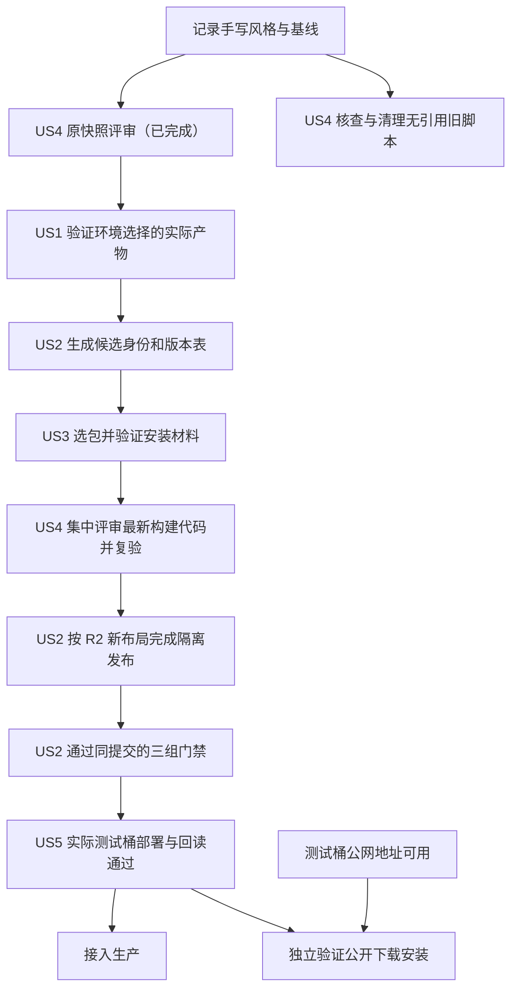

# 对话经过

会话 `01a2174d-dd90-74b1-8444-b2b62149b17b` · 轮次 `01a21753-efaa-7d43-8ad6-a235e915cb7a`

<!-- foundry-detail 01a2174d-dd90-74b1-8444-b2b62149b17b 01a21753-efaa-7d43-8ad6-a235e915cb7a -->
<!-- foundry-event abe9ef4e8733befd367ad32af956706e95047fc681c57b6d481e5b73b12c25ac -->
## 进度原话

- 来源定位：字节 1198251

~~~text
我会用 `speckit-specify` 核对 003 的现行规格，把 T008 的复验结果和待确认的修复方案同步到相关文档。
~~~

<!-- foundry-event aa363f4b6405fd2c1f90c7ff0d95718d68cdca440868fe2bbb01cb850f2a2ba9 -->
## 工具调用 `exec` · `call_b9eb8cc13402414d84a48812ec159a43`

- 来源定位：字节 1199232

~~~text
工作目录：/home/ena/workspace/ena/agent-foundry/feature/init
// @exec: {"max_output_tokens": 10500}
const cwd="/home/ena/workspace/ena/agent-foundry/feature/init";
const results=await Promise.allSettled([
  tools.exec_command({cmd:"git status --short --branch -- AGENTS.md specs/skills/003-skills-release-pipeline && git diff --stat -- specs/skills/003-skills-release-pipeline && cat .agents/skills/speckit-specify/SKILL.md",workdir:cwd,max_output_tokens:6500}),
  tools.exec_command({cmd:"rg -n 'T008|outDir|write: false|当前分支依据|回归|未通过|验收缺' specs/skills/003-skills-release-pipeline/{spec.md,plan.md,mvu.md,tasks.md,quickstart.md,research.md,contracts/build-and-publish.md,analysis/spec-analysis/README.md} && sed -n '16,60p' specs/skills/003-skills-release-pipeline/implementation/T008.md",workdir:cwd,max_output_tokens:8500}),
]);for(const r of results){if(r.status==="fulfilled")text(r.value.output);else text(r);}

~~~

<!-- foundry-event f8f8a6816377138db75886290c34386c25d5fdb8fff5718a6d16c3f5dfc1cb58 -->
## 宿主命令执行

- 来源定位：字节 1200654

~~~text
{
  "command": "[已省略环境变量值] -lc 'rg -n '\"'\"'T008|outDir|write: false|当前分支依据|回归|未通过|验收缺'\"'\"' specs/skills/003-skills-release-pipeline/{spec.md,plan.md,mvu.md,tasks.md,quickstart.md,research.md,contracts/build-and-publish.md,analysis/spec-analysis/README.md} && sed -n '\"'\"'16,60p'\"'\"' specs/skills/003-skills-release-pipeline/implementation/T008.md'",
  "workdir": "file:///home/ena/workspace/ena/agent-foundry/feature/init",
  "exitCode": 0,
  "status": "completed"
}
~~~

<!-- foundry-event d6189fef91aaeeb9bcbb80c2ffdc9d91aa5030543631624d53efe78ddd8bdc88 -->
## 工具结果 `exec-c970448d-1da4-4b75-81c6-72d3a2e661f8`

- 来源定位：字节 1200654

~~~text
specs/skills/003-skills-release-pipeline/analysis/spec-analysis/README.md:11:仓库仍有失效的默认脚本路径和可覆盖的动态路径。维护者先区分历史夹具、实际消费者和待核实用途，再删除已有证据支持的旧文件。引擎仍消费的旧归档内隐匿路径由其原接口负责。此项的工作流是调用链追溯、处置和回归取证，可与插件评审独立开展。 [旧脚本调研](../../research.md#评审范围与手写源码依据) · [里程碑](../../mvu.md#旧脚本引用核查与清理) · [T004 至 T005](../../tasks.md#旧脚本引用核查与清理)
specs/skills/003-skills-release-pipeline/analysis/spec-analysis/README.md:15:集合作者可按 Vite 当次 `mode` 配置启用条件，不需额外环境变量。技能包只保留 `build`，用 `--mode` 显式选择。T008 的默认与显式 `production` 产物逐字节一致，三个模式均按现有配置启用 `profile`；独立夹具确认禁用集合的技能及派生产物不会进入构建。该结果不改变正式生产候选的要求。`write: false` 已通过，但自定义 `outDir` 仍没有技能正文，挂载相关回归有失败，容器验收因缺含待验输入的真实提交未执行，T008 整体仍未通过。 [环境决策](../../research.md#构建模式与集合选择) · [构建契约](../../contracts/build-and-publish.md#构建入口) · [选择与派生流程](../../diagrams.md#一次构建共享同一份技能选择) · [里程碑](../../mvu.md#环境机制) · [T008 验收记录](../../implementation/T008.md#实际结果)
specs/skills/003-skills-release-pipeline/analysis/spec-analysis/README.md:27:现行 skills-test 固定放行。计划以环境产物、实际首条安装和隔离两次发布作为三组输入，接入同一提交的运行。用例失败、跳过或缺工具均阻止部署。已有 Node 与 Python 基线可供回归，旧工作流缺文件的失败及未来的实际 R2 回读各自留证。 [用例与证据](../../quickstart.md#2-在同一提交运行三组门禁) · [里程碑](../../mvu.md#测试流水线) · [T016 至 T017](../../tasks.md#测试流水线)
specs/skills/003-skills-release-pipeline/contracts/build-and-publish.md:5:集合选择直接使用 Vite 当次 `mode`。技能包仅保留 `build`：不传 `--mode` 时使用默认 `production`，也可传入 `--mode development`、`--mode release` 或 `--mode production`。默认与显式 `production` 选择一致。扫描函数接收插件从 Vite 构建环境取得的 mode，`vite.config.ts` 不代传，不在 Node 扫描模块读取 `import.meta.env.MODE`，也不增加自定义环境变量。集合配置支持静态布尔值与按 mode 计算的 `enabled`。下表是 T008 已验证的当前集合配置，不是正式生产发布的候选清单。 [验收结果](../implementation/T008.md#实际结果)
specs/skills/003-skills-release-pipeline/contracts/build-and-publish.md:17:同次快照为技能复制、引擎插件发现、隐匿列表和 Spec Kit 挂载提供依据。真实写出必须使用当次解析的输出目录；该要求在 T008 的自定义 `outDir` 验收中尚未通过。内存构建返回生成的挂载材料，保持磁盘输出不被改写。测试发布和正式生产归档都应包含同次 VERSION、curl/install.sh、适用的 engine 与 skill 内容、安装映射、说明、许可和实际必要的通知文件；正式生产候选的交付范围和材料由 T019 验收，不改变默认 `build`。
specs/skills/003-skills-release-pipeline/quickstart.md:7:以待验证的明确提交建立干净工作区。安装仓库锁定依赖及 mise 工具链。安装验收需要 Linux、Bash、curl、Node、npm、tar、jq、uv，真实挂载另需已初始化的隔离 Spec Kit 项目与 Specify。T008 用隔离 Vite 构建检查正式挂载产物及内存构建行为，不调用临时手动挂载脚本。容器验收需可用 Docker。
specs/skills/003-skills-release-pipeline/quickstart.md:19:预期满足目标包的类型检查和相关回归。验证实际动态加载的挂载子插件也进入类型检查。此前基线为 Node 64 项和 Python 39 项，Node 运行前需具备 jq。旧工作流测试的缺文件结果按现状记录，复用到新入口的断言有独立判定。
specs/skills/003-skills-release-pipeline/quickstart.md:42:这是 T008 的单独产物验收。从仓库根设置本次待验的 SOURCE_REVISION 为实际提交 SHA。Dockerfile 使用该提交的源码作为构建上下文，并按本地默认配置构建。依赖和导出放在隔离目录。
specs/skills/003-skills-release-pipeline/quickstart.md:66:记录待验 SHA、Docker 构建结果及 artifacts 的实际文件。按 [T008 确认的验收口径](implementation/T008.md)，未指定 Vite `--mode` 的容器构建按默认 `production` 选择，包含当前启用的 `profile`，不含仅开发模式启用的 `eval`，且保有 VERSION、安装入口与引擎入口。容器附带归档应包含已启用集合的技能成员。若缺可用 Docker 或含待验输入的真实提交，记录缺前置；本项不代替 T019 的生产发布验收。
specs/skills/003-skills-release-pipeline/quickstart.md:76:pnpm --filter @foundry/skills run build --mode release --outDir "$comparison_dir/first"
specs/skills/003-skills-release-pipeline/quickstart.md:77:pnpm --filter @foundry/skills run build --mode release --outDir "$comparison_dir/second"
specs/skills/003-skills-release-pipeline/tasks.md:13:- [x] T001 [US4] 在仓库代码风格文档记录用户手写风格、可定位源码和当前规则，在 T001 实施记录保存构建及回归基线。 [代码风格](coding-style.md) · [T001 实施记录与复跑基线](implementation/T001.md)
specs/skills/003-skills-release-pipeline/tasks.md:21:- [ ] T005 [US4] 在 T001 和 T004 后，仅清理 packages/skills/script 内已证实无消费者的旧代码，用受影响的调用及回归核对删除结果，在 analysis/legacy-script-review.md 逐项记录保留理由。
specs/skills/003-skills-release-pipeline/tasks.md:25:T007 保留实施当时的任务与证据；当前构建入口和集合矩阵按 [T008 验收口径](implementation/T008.md)，不再要求 T007 当时的三个独立构建脚本。
specs/skills/003-skills-release-pipeline/tasks.md:28:- [x] T007 [US1] 在 T006 验证通过后，为集合配置增加布尔值或按 Vite mode 求值的 `enabled`，由共享扫描函数接收并校验当次 mode，先过滤集合再扫描技能；显式 `enabled` 优先，缺省时兼容旧 `publish`。移除扫描调用方各自传入的 `publishOnly` 环境判断，避免与统一 mode 来源冲突。在 packages/skills/package.json 增加 `build:development`、`build:release`、`build:prod`，令既有 `build` 保持 Vite 默认 production。更新集合配置与分发回归，确认环境选择及 `build`/`build:prod` 一致；暂不改工作流、scripts/dev/mount-speckit.sh 和其他直接调用 Vite 的脚本。 [实施方案与实测](implementation/T007.md)
specs/skills/003-skills-release-pipeline/tasks.md:29:- [ ] T008 [US1] 在 T007 后复验技能复制、集合插件、隐匿及包内挂载产物均采用同次选择。通过同一 `build` 覆盖默认 `production` 和显式 `--mode production`、`development`、`release`，按当前配置保留 `profile`，用隔离夹具验证禁用集合及技能级禁用项，并确认 `release` 保留测试发布材料。用隔离 Vite 构建验证 `outDir`、`write: false`，并验证默认容器导出及归档。不修改或执行临时脚本 `scripts/dev/mount-speckit.sh`，不改工作流；生产发布要求仍由 T019 验收。 [验收方案与实测](implementation/T008.md) · [范围确认](requirements/raw/2026-11-26-temporary-mount-script-scope.md)
specs/skills/003-skills-release-pipeline/tasks.md:33:- [ ] T009 [US2] 在 T001、T002 和 T008 后更新 packages/skills/build/plugins/vite-plugin-version/index.ts 及构建输入，冻结 UTC 毫秒发布标识。验证 VERSION 两字段、同源固定输入的构建字节一致及候选中标识对齐。 按 [数据模型](data-model.md) 核对以下约束。「源码包 package.json 的版本，进包后保持可独立读取。」 「UTC 毫秒时间戳，固定宽度 YYYYMMDDTHHmmssSSSZ。解析后须回格式化为同值。对同一目标属于唯一发布标识。」
specs/skills/003-skills-release-pipeline/tasks.md:40:- [ ] T003 [US4] 在 T002、T009 和 T012 完成后、T014 接入发布工作流前，先评审本轮评审开始前的最新 `packages/skills/build/plugins` 及相关调用链，记录评审快照和纳入的相关未提交改动。对照 T002 历史结果确认仍成立的问题和新发现，再实施确认范围内的优化；专项问题保留原任务归属，用正常入口和分发回归核对处理结果。 [评审输入确认](requirements/raw/2026-11-26-review-current-code.md)
specs/skills/003-skills-release-pipeline/tasks.md:52:- [ ] T016 [US2] 在 T008、T012 和 T015 后于 packages/skills/package.json 串起 test:release，实际运行已有三组构建、选包和连续发布证据，验证缺工具、失败、跳过均返回不放行。
specs/skills/003-skills-release-pipeline/tasks.md:66:- [ ] T022 在本期实施及适用验证后、整体结案前，核对 packages/skills、.github/workflows 和本 Spec 中的临时探针、失效代码与过程文档。记录位置、用途依据、清理或保留结果及引用回归。保护有效版本管理逻辑、验证骨架、历史事实及证据。无清理项时同样留证。
specs/skills/003-skills-release-pipeline/tasks.md:74:| US1 按环境交付       | [T006 至 T008](#环境机制)                                                                | 读取真实产物，默认 `build` 与显式 `--mode production` 选择一致；`development`、`release` 按声明选择，四类消费者一致。 |
specs/skills/003-skills-release-pipeline/tasks.md:82:T001 先固定风格和回归基线。T002 与 T004 的调用调查可并行，各自写评审记录。主线先做 T008 环境产物验收，再做 T009 版本插件与 T012 安装入口；两项代码改动完成后做 T003 集中评审，用评审开始时的最新代码验证整体构建行为，再接入 T014 发布工作流。T011 的包读取夹具和 T013 的平台调查可独立推进。所有实现和授权检查沿原 Task 的适用前置生效。
specs/skills/003-skills-release-pipeline/tasks.md:97:首个可独立验收的交付范围是 US1 环境机制。先完成 T001、T002 的风格与评审前置，随后用 T006 至 T008 交付可核对的模式产物。接下来交付版本身份和安装，复核最新构建代码及适用回归，再完成隔离发布、三组门禁及经过授权的测试桶回读。末尾复用 T022 做结案前清理。
specs/skills/003-skills-release-pipeline/mvu.md:7:**状态** 进行中。**依据** T001 已交付手写风格及构建、回归基线。T002 已完成 `1bcc1bd` 快照的逐项评审和隔离复跑，其结果保留作历史依据。T003 尚未开始，等版本插件和安装入口生成的专项改动完成后再进行。 [代码风格](coding-style.md) · [T001 复跑基线](implementation/T001.md#实际复跑结果) · [T002 评审证据](analysis/build-plugin-review.md)
specs/skills/003-skills-release-pipeline/mvu.md:11:**节点与关键逻辑** 先复用已保存的手写风格和历史评审，完成环境产物复验、版本文件及安装入口的专项工作，再在接入发布工作流前集中评审，避免对即将改动的代码重复取证。评审开始前固定当时的最新代码，再逐项核对插件及其构建、安装、测试调用链。按证据确认问题和修复归属；已知 outDir 写散和挂载类型检查遗漏按正常入口复验。 [评审输入确认](requirements/raw/2026-11-26-review-current-code.md) · [审查基线及技术前置](research.md)
specs/skills/003-skills-release-pipeline/mvu.md:13:**关联 Task** [T001、T002](tasks.md#构建插件评审与优化) 分别保存用户风格及基线、交付原快照全量评审。[T003](tasks.md#专项改动后的构建评审与优化) 在 T009 和 T012 完成后评审最新代码，落实确认的优化及回归；T014 接入发布工作流前须完成 T003，T013 的平台前置核查可独立推进。
specs/skills/003-skills-release-pipeline/mvu.md:15:**验收信号** 审查记录能逐项找到源码位置、受影响调用方、处置决定及可重放的验证。修改遵循已保存的风格，现有适用行为有回归证据。隔离验证须明确缺前置或实际失败。
specs/skills/003-skills-release-pipeline/mvu.md:19:**状态** 进行中。**依据** T004 已逐文件核对 15 项，实测主线包不交付旧脚本，并验证旧入口的默认路径失效及显式测试覆盖。`old/` 保留依据和 `curl/.gitkeep` 清理候选已记录，实际清理及回归由 T005 负责。 [T004 核查报告](analysis/legacy-script-review.md)
specs/skills/003-skills-release-pipeline/mvu.md:31:**状态** 进行中。**依据** T006 已验证连续构建的 mode 传递；T007 已接通集合筛选。T008 按当前单一 `build` 入口验收，四类消费者的选择一致，`write: false` 通过；指定 `outDir` 时技能正文仍写入默认目录，挂载相关回归有失败，容器验收缺少含当前输入的真实提交。临时手动挂载脚本不纳入本期。 [T006 实测](implementation/T006.md#实际验证结果) · [T007 历史实测](implementation/T007.md#实际验证结果) · [T008 实测](implementation/T008.md#实际结果) · [范围确认](requirements/raw/2026-11-26-temporary-mount-script-scope.md)
specs/skills/003-skills-release-pipeline/mvu.md:35:**节点与关键逻辑** 各插件直接从 Vite 构建环境读取当次 mode，再交给共享扫描函数；`vite.config.ts` 不代传。T008 按当前包的单一 `build` 验收：不加参数使用默认 `production`，其他情况加 `--mode`；当前 `profile` 各模式均启用。隔离构建验证正式挂载产物，不调用临时手动入口；工作流及正式生产候选的要求按发布阶段接入。 [构建契约](contracts/build-and-publish.md#构建入口) · [环境决策](research.md#构建模式与集合选择)
specs/skills/003-skills-release-pipeline/mvu.md:37:**关联 Task** [T006、T007、T008](tasks.md#环境机制) 分别验证构建时序与输出、接通共享选择、复验模式及派生材料。
specs/skills/003-skills-release-pipeline/mvu.md:39:**验收信号** 默认 `build` 与传入 `--mode production` 的产物一致；`--mode development` 与 `--mode release` 的实际选择符合各集合声明。显式关闭的集合无技能及适用派生产物，未知 mode 明确失败。T008 保留 `outDir`、`write: false` 和容器产物验收；不改工作流，不修改或执行临时手动入口。
specs/skills/003-skills-release-pipeline/mvu.md:61:**关联 Task** [T013 至 T015](tasks.md#r2-目录结构修改) 核验平台前置、接通发布并完成隔离回归。[T018 至 T021](tasks.md#环境接入与验收) 负责测试桶回读、生产接入、公网安装及说明对齐。实际测试桶回读以前一阶段完成 T017 为前置。
specs/skills/003-skills-release-pipeline/mvu.md:63:**验收信号** 隔离发布验证固定键、排队以及失败不重试。经授权从实际测试桶回读归档、入口和首条，分别核对 SHA-256、原字节及候选身份。每次生产发布均以选定提交的三组门禁放行同 SHA 的 `production` 候选，核对其排除 `profile` 且发布材料齐备；门禁未通过或提交不符时无部署。公网地址具备后，核对绑定真实根的入口，按授权处理需要迁移的历史地址，再独立验收默认版本和受影响历史版本的安装。
specs/skills/003-skills-release-pipeline/mvu.md:67:**状态** 未开始。**依据** skills-test 当前固定放行，现有局部回归证据尚未构成三组真实门禁。
specs/skills/003-skills-release-pipeline/mvu.md:73:**关联 Task** [T016、T017](tasks.md#测试流水线) 分别形成可执行的三组测试和工作流放行。组内依据来自 T008 的构建、T012 的安装和 T015 的隔离发布。
specs/skills/003-skills-release-pipeline/research.md:9:**当前决定（2026-11-26 更新）** 使用 Vite 当次 `mode` 作为唯一环境选择，不增加自定义环境变量。仅保留 `build`，未传 `--mode` 时沿用默认 `production`。集合配置可声明静态或按 mode 求值的 `enabled`；当前配置工厂默认启用，扫描器只在输入没有 `enabled` 时兼容旧 `publish`。插件从构建环境取得当次 mode 并交给 Node 扫描函数，不在 Node 动态导入模块中直接读取 `import.meta.env.MODE`。工作流与直接调用 Vite 的脚本在本阶段不改动。 [用户确认](spec.md#session-2026-11-26) · [构建与发布契约](contracts/build-and-publish.md) · [环境验收记录](implementation/T008.md#实际结果)
specs/skills/003-skills-release-pipeline/research.md:15:**前置验证** 用相同进程顺序构建三种模式，再运行一次 write:false 挂载构建和一次隔离 outDir 构建。读取实际技能、派生数据和输出路径，核对同次选择及文件系统副作用。现行目录覆盖实测显示正文写到固定 dist/skill，应把这个边界纳入评审和回归。测试缺配置、非普通配置、导入失败和安装名冲突的既有行为，再确定需要保留的分支。 [集合扫描](../../../packages/skills/build/utils/scan-skills.ts) · [技能插件](../../../packages/skills/build/plugins/vite-plugin-skill/index.ts) · [现行构建测试](../../../packages/skills/tests/distribution/vite-plugin-skill.test.mjs)
specs/skills/003-skills-release-pipeline/research.md:67:**理由** 本地现有基线为四组 Node 64 项和 Python 39 项通过，Node 运行前隔离补齐 jq。旧 runner-archive 与 pipeline-workflow 因引用已删除工作流失败，实际断言需按当前入口复用。技能包 check-types 在已有预设 dist 的工作区通过，干净安装需先构建预设依赖。listFilesOnly 显示动态导入的挂载插件未进入检查，临时纳入同一严格配置时在 mount-script.ts:51 复现可选捕获组的 TS2345。改动挂载消费者时补入检查并保持现有缺 description 的行为。 [当前基线](spec.md#当前分支依据) · [技能包类型配置](../../../packages/skills/tsconfig.json) · [预设导出](../../../packages/preset-config/package.json)
specs/skills/003-skills-release-pipeline/spec.md:28:- [T008 验收口径确认](requirements/raw/2026-11-26-sync-build-acceptance.md)：技能包只保留 `build`，不传 `--mode` 即使用 Vite 默认 `production`，需要显式选择时传 `--mode <环境>`。当前 `profile` 在三个模式均启用，用独立夹具验收禁用集合。默认生产模式构建不等于正式生产发布；T019 的候选范围、完整发布材料及部署门禁不变。
specs/skills/003-skills-release-pipeline/spec.md:80:**优先理由** 审查结果为有调用方的构建和安装能力提供回归依据，也确定清理范围。
specs/skills/003-skills-release-pipeline/spec.md:82:**独立验证** 对照插件和脚本清单抽查审查记录、调用依据、已删文件或保留决定及回归结果，核对风格说明中的实际源码示例与本功能的改动。
specs/skills/003-skills-release-pipeline/spec.md:96:1. 三组测试门禁或测试桶对象回读任一未通过时，生产入口应保持待接入。
specs/skills/003-skills-release-pipeline/spec.md:151:- 新版根布局、时间戳发布标识和首版三个测试场景采用本次确认。旧 `curl/` 桶路径、SemVer 发布键及早期门禁假设沿原记录追溯。已有有效安装行为纳入回归核对。 [旧安装交付契约](../001-skills-distribution/contracts/curl-delivery.md) · [已确认的 R2 发布布局](../002-conversation-to-skill/requirements/raw/2026-11-24-r2-release-layout.md)
specs/skills/003-skills-release-pipeline/spec.md:158:- 从 `1bcc1bd` 的隔离源码构建，默认模式 `production`、显式 `development` 和显式 `prod` 均交付 11 项技能，包含 `eval` 与 `profile`。`release` 交付 7 项，来自 `coding`、`frontend`、`workflow`，且只有该模式交付 `curl/skills.tsv`。覆盖 `outDir` 时，`VERSION` 等资产写入指定目录，技能仍写到固定 `dist/skill`。完整配置的 `write: false` 复跑返回 8 项资产，未创建输出目录。默认类型检查通过，但遗漏动态挂载源码，临时纳入后复现一处 TS2345。这些是 T002 快照的历史结果。 [T002 专项发现](analysis/build-plugin-review.md#已有专项任务接手的问题) · [实测记录](analysis/build-plugin-review.md#本轮验证记录)
specs/skills/003-skills-release-pipeline/spec.md:159:- T008 隔离验收的当前源码是含未提交改动的工作区快照。默认与显式 `production` 产物逐字节一致，各 8 项技能；`development` 为 11 项，`release` 为 8 项并保留测试发布材料。集合过滤、派生产物及 `write: false` 已通过；自定义 `outDir` 仍将技能写入默认 `dist/skill`，动态挂载相关类型检查及 Python 回归有失败，容器导出缺少包含待验输入的真实提交。T008 整体未通过。 [T008 验收记录](implementation/T008.md#实际结果)
specs/skills/003-skills-release-pipeline/spec.md:162:- T004 已核对 `packages/skills/script` 的 15 项文件。实际 release 构建和本地 `pnpm pack` 确认当前发布包不含旧脚本。旧默认路径已失效，显式指向 `script/old` 后，8 项定向 Node 调度测试通过。`script/old` 的 14 项有测试、内部依赖或历史用途未决等保留依据。空占位 `script/curl/.gitkeep` 是 T005 唯一清理候选，实际清理及回归待执行。归档内 `script/hidden-install.sh` 的回退由现行引擎及其回归覆盖。 [逐文件核查](analysis/legacy-script-review.md#逐文件处置依据) · [T004 实测](analysis/legacy-script-review.md#本轮验证)
specs/skills/003-skills-release-pipeline/plan.md:23:| 测试       | 以真实 Vite 产物、实际安装器和隔离对象存储边界执行三组 Node 门禁。既有 Node、Python 回归与真实 S3、公网安装分别记录。                         |
specs/skills/003-skills-release-pipeline/plan.md:65:沿用现有入口及集合插件结构。扫描器接收同一 mode 并先解析集合启用状态，使用集合配置的有效 `enabled`，仅在扫描输入未提供该字段时兼容旧 `publish` 规则。环境区分已完成消费者的本地验证，仍需处理自定义输出目录和挂载相关回归，并以包含待验输入的真实提交完成容器验收。 [环境验收记录](implementation/T008.md#实际结果) 工作流与直接 Vite 调用脚本在环境验收阶段保持不变；生产草稿在 release 实际门禁与回读通过后接入。
## 实际结果

2026-11-26，Linux、Node.js `v24.22.2`、pnpm `12.16.1`、Vite `8.3.8`。基线提交为 `e731936e2bddde4d9efeb21080d3d5b5ff6f2387`，被测内容为技能包当前工作区的跟踪文件（含暂存、未暂存改动），不是该提交本身。隔离复制的文件清单 SHA-256 为 `aaaa98a174b51d8bdc60163200eb59d7b5342ab817e337550e8be1801041187d`，未复制工作区原有 `dist`，复用已安装依赖。局部副本不能重装完整 workspace；用 `pnpm --config.verifyDepsBeforeRun=false run build`（隔离复跑时不触发自动安装）及相同 mode 参数得到与首轮逐字节一致的四组文件。

| 输入 | 实际技能与隐匿候选 | Spec Kit 挂载资产 | 测试发布材料 |
| --- | --- | --- | --- |
| 默认 `build` | 8 项，含 `profile`，不含 `eval` | 有，统一引擎入口已引用 | 无 |
| `build --mode production` | 8 项，与默认产物逐字节一致 | 有 | 无 |
| `build --mode development` | 11 项，额外纳入 3 项启用的 `eval` 技能，未纳入 `eval-short-rule` | 有 | 无 |
| `build --mode release` | 8 项，含 `profile`，不含 `eval` | 有 | `curl/skills.tsv`、`README.md`、`LICENSE` 齐全；映射的 8 条记录均指向实际正文 |

- **通过：开关与派生内容。** 隔离探针集合仅在 `development` 交付已启用技能、隐匿候选及子插件的 mode 标记，夹具内另一项有真实正文但关闭的技能未进入任何产物。`release`、`production` 均无探针集合产物。单独关闭 `workflow` 后，`release` 中对应 4 项技能及隐匿候选消失，Spec Kit 挂载脚本未生成，也不再被引擎入口引用；技能映射剩 4 条有效记录。生成的 Shell 资产均通过 `bash -n`。显式 `--mode staging` 构建以“不支持的技能构建模式”失败，原 `dist` 未被改动。
- **通过：`write: false`。** 完整 Vite 配置执行 `build({ mode: 'release', build: { write: false, outDir } })`，返回 8 项资产，含挂载、隐匿及安装映射。指定目录未创建，原 `dist` 的文件路径与 SHA-256 未变。
- **失败：`outDir`。** `build --mode release --outDir <隔离目录>` 两次退出 0，但指定目录只有 8 项生成资产、0 份技能正文；8 份正文全部写入默认 `dist/skill`。扫描器将 `target` 固定为 `dist/skill/...`，复制插件直接使用这一目标，导致安装映射在指定目录内指不到正文。 [扫描器](../../../../packages/skills/build/utils/scan-skills.ts#L182) · [复制钩子](../../../../packages/skills/build/plugins/vite-plugin-skill/index.ts#L223)
- **回归结果。** `vite-mode`、`collection-mode`、`vite-plugin-skill`、`vite-plugin-engine`、`speckit-mount`、`hidden-contract` 共 67 项通过，无跳过。包内 `lint` 和默认 `check-types` 通过，但 `tsc --listFilesOnly` 未覆盖动态挂载插件；隔离纳入 `src/**/plugin/**/*.ts` 后，`mount-script.ts:51` 报 `TS2345`（`string | undefined` 不能传给 YAML 解析器）。技能包 Python 回归运行 56 项，其中 `test_register_commands.py` 的 4 项在准备阶段报错：夹具未声明集合级 `enabled` 或 `publish`，默认 `production` 将该集合排除，测试找不到 `task-increment` 正文。两项回归问题均未修改源码或测试。
- **缺前置，未执行：正式容器导出与归档。** Docker 及 Buildx 可用；环境构建和相关技能输入尚未进入同一个真实提交，未用基线提交或工作区副本替代。无发布、部署或真实挂载操作。

**结论**：环境选择已在当前工作区隔离副本验证，T008 整体验收未通过。保留任务未完成；修复输出目录及相关回归后复验，再从包含被验输入的真实提交完成容器导出。T009 依赖 T008，不在本轮进入。

## 续接复核与待确认的修复方案

2026-11-26，以 `e731936` 为基线，复核当前技能包的跟踪文件，纳入暂存和未暂存的内容。

1. **输出目录**。给 `pnpm --config.verifyDepsBeforeRun=false run build --mode release --outDir` 分别传入含空格的相对路径和绝对路径，两次均退出 0。指定目录各有 8 项生成资产，映射列出的 8 份技能正文均落在默认 `dist/skill`。建议扫描器提供相对的技能路径，由复制插件在 `writeBundle` 以当次输出目录定位正文和附件。复验两种路径下所有安装映射均能找到正文，并核对默认 `dist` 的文件清单和摘要。 [扫描器](../../../../packages/skills/build/utils/scan-skills.ts#L178) · [复制钩子](../../../../packages/skills/build/plugins/vite-plugin-skill/index.ts#L222)
2. **挂载插件类型检查**。默认 `tsc --noEmit` 通过，`--listFilesOnly` 显示它未覆盖 `mount-script.ts`。隔离纳入 `src/**/plugin/**/*.ts` 后，`tsc --noEmit` 在 `frontmatter[1]` 报 TS2345。建议检查正则捕获组后再解析 YAML，并将动态加载的集合插件纳入技能包常规类型检查。 [挂载脚本生成](../../../../packages/skills/src/workflow/plugin/vite-plugin-speckit-mount/mount-script.ts#L43) · [类型配置](../../../../packages/skills/tsconfig.json#L8)
3. **命令挂载回归**。现有夹具直接导出集合配置，缺少集合级开关，默认 `production` 构建将其排除，4 项测试均因找不到技能目录而报错。只在隔离夹具补上 `enabled: true` 后，同样的 4 项断言全部通过。建议在测试源中补齐该字段。 [挂载回归夹具](../../../../packages/skills/tests/test_register_commands.py#L67)

`write: false` 复核返回 8 项资产，包含 `engine/script/speckit-mount.sh` 和安装映射。指定目录未创建，隔离构建的默认 `dist` 内容摘要一致。方案确认后，逐项复验上述结果，再跑 T008 的完整模式矩阵、相关 Node 与 Python 回归及内存构建。正式容器导出仍需包含被验改动的实际 Git 提交。

~~~

<!-- foundry-event 3ddddd0d35508212be89e320ed740b000099b8af2882b1f9f27804992cd0a96c -->
## 宿主命令执行

- 来源定位：字节 1231004

~~~text
{
  "command": "[已省略环境变量值] -lc 'git status --short --branch -- AGENTS.md specs/skills/003-skills-release-pipeline && git diff --stat -- specs/skills/003-skills-release-pipeline && cat .agents/skills/speckit-specify/SKILL.md'",
  "workdir": "file:///home/ena/workspace/ena/agent-foundry/feature/init",
  "exitCode": 0,
  "status": "completed"
}
~~~

<!-- foundry-event d6e1b1c1c7328adfc4116bf5860feaa68e86a34cc187aaf8756de0c704468efd -->
## 工具结果 `exec-4ad5d891-566e-4b20-9b27-6a20353bc478`

- 来源定位：字节 1231004

~~~text
## feature/init...origin/feature/init
MM specs/skills/003-skills-release-pipeline/analysis/spec-analysis/README.md
M  specs/skills/003-skills-release-pipeline/coding-style.md
MM specs/skills/003-skills-release-pipeline/contracts/build-and-publish.md
MM specs/skills/003-skills-release-pipeline/data-model.md
M  specs/skills/003-skills-release-pipeline/diagrams.md
A  specs/skills/003-skills-release-pipeline/implementation/T006.md
A  specs/skills/003-skills-release-pipeline/implementation/T007.md
MM specs/skills/003-skills-release-pipeline/mvu.md
MM specs/skills/003-skills-release-pipeline/plan.md
MM specs/skills/003-skills-release-pipeline/quickstart.md
A  specs/skills/003-skills-release-pipeline/requirements/raw/2026-11-26-default-production-environment.md
A  specs/skills/003-skills-release-pipeline/requirements/raw/2026-11-26-environment-naming.md
A  specs/skills/003-skills-release-pipeline/requirements/raw/2026-11-26-temporary-mount-script-scope.md
A  specs/skills/003-skills-release-pipeline/requirements/raw/2026-11-26-vite-built-in-mode.md
MM specs/skills/003-skills-release-pipeline/research.md
MM specs/skills/003-skills-release-pipeline/spec.md
MM specs/skills/003-skills-release-pipeline/tasks.md
?? specs/skills/003-skills-release-pipeline/implementation/T008.md
?? specs/skills/003-skills-release-pipeline/requirements/raw/2026-11-26-review-current-code.md
?? specs/skills/003-skills-release-pipeline/requirements/raw/2026-11-26-sync-build-acceptance.md
 .../analysis/spec-analysis/README.md               |  9 ++++----
 .../contracts/build-and-publish.md                 |  8 +++----
 .../003-skills-release-pipeline/data-model.md      |  4 ++--
 specs/skills/003-skills-release-pipeline/mvu.md    | 12 +++++-----
 specs/skills/003-skills-release-pipeline/plan.md   |  6 +++--
 .../003-skills-release-pipeline/quickstart.md      | 13 ++++++-----
 .../skills/003-skills-release-pipeline/research.md |  2 +-
 specs/skills/003-skills-release-pipeline/spec.md   | 27 ++++++++++++----------
 specs/skills/003-skills-release-pipeline/tasks.md  | 23 +++++++++++-------
 9 files changed, 59 insertions(+), 45 deletions(-)
---
name: "speckit-specify"
description: "Create or update the feature specification from a natural language feature description."
compatibility: "Requires spec-kit project structure with .specify/ directory"
metadata:
  author: "github-spec-kit"
  source: "templates/commands/specify.md"
---


## User Input

```text
$ARGUMENTS
```

You **MUST** consider the user input before proceeding (if not empty).

## Pre-Execution Checks

**Check for extension hooks (before specification)**:
- Check if `.specify/extensions.yml` exists in the project root.
- If it exists, read it and look for entries under the `hooks.before_specify` key
- If the YAML cannot be parsed or is invalid, do not skip silently: tell the user that `.specify/extensions.yml` could not be read (include the parser error) and that no hooks were checked, including any mandatory (`optional: false`) hooks registered there, then continue normally
- Filter out hooks where `enabled` is explicitly `false`. Treat hooks without an `enabled` field as enabled by default.
- For each remaining hook, do **not** attempt to interpret or evaluate hook `condition` expressions:
  - If the hook has no `condition` field, or it is null/empty, treat the hook as executable
  - If the hook defines a non-empty `condition`, skip the hook and leave condition evaluation to the HookExecutor implementation
- When constructing command invocations from hook command names, replace dots (`.`) with hyphens (`-`). For example, `speckit.git.commit` → `$speckit-git-commit`.
- For each executable hook, output the following based on its `optional` flag:
  - **Optional hook** (`optional: true`):
    ```
    ## Extension Hooks

    **Optional Pre-Hook**: {extension}
    Command: `/{command}`
    Description: {description}

    Prompt: {prompt}
    To execute: `/{command}`
    ```
  - **Mandatory hook** (`optional: false`):
    ```
    ## Extension Hooks

    **Automatic Pre-Hook**: {extension}
    Executing: `/{command}`
    EXECUTE_COMMAND: {command}

    Wait for the result of the hook command before proceeding to the Outline.
    ```
    After emitting the block above you MUST actually invoke the hook and wait for it to finish before continuing. Run it the same way you would run the command yourself in this agent/session (the invocation may differ from the literal `{command}` id shown above, e.g. a skills-mode agent runs it as `/skill:speckit-...` or `$speckit-...`). Emitting the block alone does not run the hook.
- If no hooks are registered or `.specify/extensions.yml` does not exist, skip silently

## Outline

The text the user typed after `$speckit-specify` in the triggering message **is** the feature description. Assume you always have it available in this conversation even if `$ARGUMENTS` appears literally below. Do not ask the user to repeat it unless they provided an empty command.

Given that feature description, do this:

1. **Generate a concise short name** (2-4 words) for the feature:
   - Analyze the feature description and extract the most meaningful keywords
   - Create a 2-4 word short name that captures the essence of the feature
   - Use action-noun format when possible (e.g., "add-user-auth", "fix-payment-bug")
   - Preserve technical terms and acronyms (OAuth2, API, JWT, etc.)
   - Keep it concise but descriptive enough to understand the feature at a glance
   - Examples:
     - "I want to add user authentication" → "user-auth"
     - "Implement OAuth2 integration for the API" → "oauth2-api-integration"
     - "Create a dashboard for analytics" → "analytics-dashboard"
     - "Fix payment processing timeout bug" → "fix-payment-timeout"

2. **Branch creation** (optional, via hook):

   If a `before_specify` hook ran successfully in the Pre-Execution Checks above, it will have created/switched to a git branch and output JSON containing `BRANCH_NAME` and `FEATURE_NUM`. Note these values for reference, but the branch name does **not** dictate the spec directory name.

   If the user explicitly provided `GIT_BRANCH_NAME`, pass it through to the hook so the branch script uses the exact value as the branch name (bypassing all prefix/suffix generation).

3. **Create the spec feature directory**:

   Specs live under the default `specs/` directory unless the user explicitly provides `SPECIFY_FEATURE_DIRECTORY`.

   **Resolution order for `SPECIFY_FEATURE_DIRECTORY`**:
   1. If the user explicitly provided `SPECIFY_FEATURE_DIRECTORY` (e.g., via environment variable, argument, or configuration), use it as-is
   2. Otherwise, auto-generate it under `specs/`:
      - Check `.specify/init-options.json` for `feature_numbering` (preferred) or `branch_numbering` (deprecated, migration only — will be removed in a future release)
      - If `"timestamp"`: prefix is `YYYYMMDD-HHMMSS` (current timestamp)
      - If `"sequential"` or absent: prefix is `NNN` (next available 3-digit number after scanning existing directories in `specs/`)
      - Construct the directory name: `<prefix>-<short-name>` (e.g., `003-user-auth` or `20260319-143022-user-auth`)
      - Set `SPECIFY_FEATURE_DIRECTORY` to `specs/<directory-name>`
      - If `branch_numbering` was used (and `feature_numbering` was absent), emit a one-line warning: "⚠️ `branch_numbering` in init-options.json is deprecated. Rename to `feature_numbering`."

   **Create the directory and spec file**:
   - Run `.specify/scripts/bash/resolve-template.sh spec-template --json` from the repository root and parse `TEMPLATE_CONTENT` as the active `spec-template`. The shared resolver composes project overrides, preset layers, and extension layers over the core template, including `append`, `prepend`, and `wrap` strategies. If it fails, stop and report the resolution error; do not continue with only one contributing template layer.
   - `mkdir -p SPECIFY_FEATURE_DIRECTORY`
   - Write `TEMPLATE_CONTENT` to `SPECIFY_FEATURE_DIRECTORY/spec.md` as the starting point. Do not copy a template file from disk instead: when a preset composes `spec-template`, no single file holds the full template.
   - Set `SPEC_FILE` to `SPECIFY_FEATURE_DIRECTORY/spec.md`
   - Persist the resolved path to `.specify/feature.json`:
     ```json
     {
       "feature_directory": "<resolved feature dir>"
     }
     ```
     Write the actual resolved directory path value (for example, `specs/003-user-auth`), not the literal string `SPECIFY_FEATURE_DIRECTORY`.
     This allows downstream commands (`$speckit-plan`, `$speckit-tasks`, etc.) to locate the feature directory without relying on git branch name conventions.

   **IMPORTANT**:
   - You must only create one feature per `$speckit-specify` invocation
   - The spec directory name and the git branch name are independent — they may be the same but that is the user's choice
   - The spec directory and file are always created by this command, never by the hook

4. Use `TEMPLATE_CONTENT` to understand required sections.

5. **IF EXISTS**: Load `.specify/memory/constitution.md` for project principles and governance constraints.

6. Follow this execution flow:
    1. Parse user description from arguments
       If empty: ERROR "No feature description provided"
    2. Extract key concepts from description
       Identify: actors, actions, data, constraints
    3. For unclear aspects:
       - Make informed guesses based on context and industry standards
       - Only mark with [NEEDS CLARIFICATION: specific question] if:
         - The choice significantly impacts feature scope or user experience
         - Multiple reasonable interpretations exist with different implications
         - No reasonable default exists
       - **LIMIT: Maximum 3 [NEEDS CLARIFICATION] markers total**
       - Prioritize clarifications by impact: scope > security/privacy > user experience > technical details
    4. Fill User Scenarios & Testing section
       If no clear user flow: ERROR "Cannot determine user scenarios"
    5. Generate Functional Requirements
       Each requirement must be testable
       Use reasonable defaults for unspecified details (document assumptions in Assumptions section)
    6. Define Success Criteria
       Create measurable, technology-agnostic outcomes
       Include both quantitative metrics (time, performance, volume) and qualitative measures (user satisfaction, task completion)
       Each criterion must be verifiable without implementation details
    7. Identify Key Entities (if data involved)
    8. Return: SUCCESS (spec ready for planning)

7. Write the specification to SPEC_FILE using the template structure, replacing placeholders with concrete details derived from the feature description (arguments) while preserving section order and headings.

8. **Specification Quality Validation**: After writing the initial spec, validate it against quality criteria:

   a. **Create Spec Quality Checklist**: Generate a checklist file at `SPECIFY_FEATURE_DIRECTORY/checklists/requirements.md` using the checklist template structure with these validation items:

      ```markdown
      # Specification Quality Checklist: [FEATURE NAME]

      **Purpose**: Validate specification completeness and quality before proceeding to planning
      **Created**: [DATE]
      **Feature**: [Link to spec.md]

      ## Content Quality

      - [ ] No implementation details (languages, frameworks, APIs)
      - [ ] Focused on user value and business needs
      - [ ] Written for non-technical stakeholders
      - [ ] All mandatory sections completed

      ## Requirement Completeness

      - [ ] No [NEEDS CLARIFICATION] markers remain
      - [ ] Requirements are testable and unambiguous
      - [ ] Success criteria are measurable
      - [ ] Success criteria are technology-agnostic (no implementation details)
      - [ ] All acceptance scenarios are defined
      - [ ] Edge cases are identified
      - [ ] Scope is clearly bounded
      - [ ] Dependencies and assumptions identified

      ## Feature Readiness

      - [ ] All functional requirements have clear acceptance criteria
      - [ ] User scenarios cover primary flows
      - [ ] Feature meets measurable outcomes defined in Success Criteria
      - [ ] No implementation details leak into specification

      ## Notes

      - Items marked incomplete require spec updates before `$speckit-clarify` or `$speckit-plan`
      ```

   b. **Run Validation Check**: Review the spec against each checklist item:
      - For each item, determine if it passes or fails
      - Document specific issues found (quote relevant spec sections)

   c. **Handle Validation Results**:

      - **If all items pass**: Mark checklist complete and proceed to the Mandatory Post-Execution Hooks section

      - **If items fail (excluding [NEEDS CLARIFICATION])**:
        1. List the failing items and specific issues
        2. Update the spec to address each issue
        3. Re-run validation until all items pass (max 3 iterations)
        4. If still failing after 3 iterations, document remaining issues in checklist notes and warn user

      - **If [NEEDS CLARIFICATION] markers remain**:
        1. Extract all [NEEDS CLARIFICATION: ...] markers from the spec
        2. **LIMIT CHECK**: If more than 3 markers exist, keep only the 3 most critical (by scope/security/UX impact) and make informed guesses for the rest
        3. For each clarification needed (max 3), present options to user in this format:

           ```markdown
           ## Question [N]: [Topic]

           **Context**: [Quote relevant spec section]

           **What we need to know**: [Specific question from NEEDS CLARIFICATION marker]

           **Suggested Answers**:

           | Option | Answer | Implications |
           |--------|--------|--------------|
           | A      | [First suggested answer] | [What this means for the feature] |
           | B      | [Second suggested answer] | [What this means for the feature] |
           | C      | [Third suggested answer] | [What this means for the feature] |
           | Custom | Provide your own answer | [Explain how to provide custom input] |

           **Your choice**: _[Wait for user response]_
           ```

        4. **CRITICAL - Table Formatting**: Ensure markdown tables are properly formatted:
           - Use consistent spacing with pipes aligned
           - Each cell should have spaces around content: `| Content |` not `|Content|`
           - Header separator must have at least 3 dashes: `|--------|`
           - Test that the table renders correctly in markdown preview
        5. Number questions sequentially (Q1, Q2, Q3 - max 3 total)
        6. Present all questions together before waiting for responses
        7. Wait for user to respond with their choices for all questions (e.g., "Q1: A, Q2: Custom - [details], Q3: B")
        8. Update the spec by replacing each [NEEDS CLARIFICATION] marker with the user's selected or provided answer
        9. Re-run validation after all clarifications are resolved

   d. **Update Checklist**: After each validation iteration, update the checklist file with current pass/fail status

## Mandatory Post-Execution Hooks

**You MUST complete this section before reporting completion to the user.**

Check if `.specify/extensions.yml` exists in the project root.
- If it does not exist, or no hooks are registered under `hooks.after_specify`, skip to the Completion Report.
- If it exists, read it and look for entries under the `hooks.after_specify` key.
- If the YAML cannot be parsed or is invalid, do not skip silently: tell the user that `.specify/extensions.yml` could not be read (include the parser error) and that no hooks were checked, including any mandatory (`optional: false`) hooks registered there, then continue to the Completion Report.
- Filter out hooks where `enabled` is explicitly `false`. Treat hooks without an `enabled` field as enabled by default.
- For each remaining hook, do **not** attempt to interpret or evaluate hook `condition` expressions:
  - If the hook has no `condition` field, or it is null/empty, treat the hook as executable
  - If the hook defines a non-empty `condition`, skip the hook and leave condition evaluation to the HookExecutor implementation
- When constructing command invocations from hook command names, replace dots (`.`) with hyphens (`-`). For example, `speckit.git.commit` → `$speckit-git-commit`.
- For each executable hook, output the following based on its `optional` flag:
  - **Mandatory hook** (`optional: false`) — **You MUST emit `EXECUTE_COMMAND:` for each mandatory hook**:
    ```
    ## Extension Hooks

    **Automatic Hook**: {extension}
    Executing: `/{command}`
    EXECUTE_COMMAND: {command}
    ```
    After emitting the block above you MUST actually invoke the hook and wait for it to finish before continuing. Run it the same way you would run the command yourself in this agent/session (the invocation may differ from the literal `{command}` id shown above, e.g. a skills-mode agent runs it as `/skill:speckit-...` or `$speckit-...`). Emitting the block alone does not run the hook.
  - **Optional hook** (`optional: true`):
    ```
    ## Extension Hooks

    **Optional Hook**: {extension}
    Command: `/{command}`
    Description: {description}

    Prompt: {prompt}
    To execute: `/{command}`
    ```

## Completion Report

Report completion to the user with:
- `SPECIFY_FEATURE_DIRECTORY` — the feature directory path
- `SPEC_FILE` — the spec file path
- Checklist results summary
- Readiness for the next phase (`$speckit-clarify` or `$speckit-plan`)

**NOTE:** Branch creation is handled by the `before_specify` hook (git extension). Spec directory and file creation are always handled by this core command.

## Quick Guidelines

- Focus on **WHAT** users need and **WHY**.
- Avoid HOW to implement (no tech stack, APIs, code structure).
- Written for business stakeholders, not developers.
- DO NOT create any checklists that are embedded in the spec. That will be a separate command.

### Section Requirements

- **Mandatory sections**: Must be completed for every feature
- **Optional sections**: Include only when relevant to the feature
- When a section doesn't apply, remove it entirely (don't leave as "N/A")

### For AI Generation

When creating this spec from a user prompt:

1. **Make informed guesses**: Use context, industry standards, and common patterns to fill gaps
2. **Document assumptions**: Record reasonable defaults in the Assumptions section
3. **Limit clarifications**: Maximum 3 [NEEDS CLARIFICATION] markers - use only for critical decisions that:
   - Significantly impact feature scope or user experience
   - Have multiple reasonable interpretations with different implications
   - Lack any reasonable default
4. **Prioritize clarifications**: scope > security/privacy > user experience > technical details
5. **Think like a tester**: Every vague requirement should fail the "testable and unambiguous" checklist item
6. **Common areas needing clarification** (only if no reasonable default exists):
   - Feature scope and boundaries (include/exclude specific use cases)
   - User types and permissions (if multiple conflicting interpretations possible)
   - Security/compliance requirements (when legally/financially significant)

**Examples of reasonable defaults** (don't ask about these):

- Data retention: Industry-standard practices for the domain
- Performance targets: Standard web/mobile app expectations unless specified
- Error handling: User-friendly messages with appropriate fallbacks
- Authentication method: Standard session-based or OAuth2 for web apps
- Integration patterns: Use project-appropriate patterns (REST/GraphQL for web services, function calls for libraries, CLI args for tools, etc.)

### Success Criteria Guidelines

Success criteria must be:

1. **Measurable**: Include specific metrics (time, percentage, count, rate)
2. **Technology-agnostic**: No mention of frameworks, languages, databases, or tools
3. **User-focused**: Describe outcomes from user/business perspective, not system internals
4. **Verifiable**: Can be tested/validated without knowing implementation details

**Good examples**:

- "Users can complete checkout in under 3 minutes"
- "System supports 10,000 concurrent users"
- "95% of searches return results in under 1 second"
- "Task completion rate improves by 40%"

**Bad examples** (implementation-focused):

- "API response time is under 200ms" (too technical, use "Users see results instantly")
- "Database can handle 1000 TPS" (implementation detail, use user-facing metric)
- "React components render efficiently" (framework-specific)
- "Redis cache hit rate above 80%" (technology-specific)

## Done When

- [ ] Specification written to `SPEC_FILE` and validated against quality checklist
- [ ] Extension hooks dispatched or skipped according to the rules in Mandatory Post-Execution Hooks above
- [ ] Completion reported to user with feature directory, spec file path, and checklist results

~~~

<!-- foundry-event bdf3d091b2b7fe671fa90e6ed48273285ec205b2283dabee1f13aa1492a19b46 -->
## 工具调用 `Bash` · `exec-c970448d-1da4-4b75-81c6-72d3a2e661f8`

- 来源定位：工具事件 exec-c970448d-1da4-4b75-81c6-72d3a2e661f8

~~~text
工作目录：/home/ena/workspace/ena/agent-foundry/feature/init
{
  "command": "rg -n 'T008|outDir|write: false|当前分支依据|回归|未通过|验收缺' specs/skills/003-skills-release-pipeline/{spec.md,plan.md,mvu.md,tasks.md,quickstart.md,research.md,contracts/build-and-publish.md,analysis/spec-analysis/README.md} && sed -n '16,60p' specs/skills/003-skills-release-pipeline/implementation/T008.md"
}
~~~

<!-- foundry-event d1c5e49761d49fe9a4bce3e4ddabfdab85e8e85fa8d777423fd5904d0be3c319 -->
## 工具调用 `Bash` · `exec-4ad5d891-566e-4b20-9b27-6a20353bc478`

- 来源定位：工具事件 exec-4ad5d891-566e-4b20-9b27-6a20353bc478

~~~text
工作目录：/home/ena/workspace/ena/agent-foundry/feature/init
{
  "command": "git status --short --branch -- AGENTS.md specs/skills/003-skills-release-pipeline && git diff --stat -- specs/skills/003-skills-release-pipeline && cat .agents/skills/speckit-specify/SKILL.md"
}
~~~

<!-- foundry-event 97f623472737ecd213f87e971f9abda47d31aab3b333ba92f7e10c0b3fad8e98 -->
## 工具结果 `call_b9eb8cc13402414d84a48812ec159a43`

- 来源定位：字节 1254515

~~~text
[
  {
    "type": "input_text",
    "text": "Script completed\nWall time 1.0 seconds\nOutput:\n"
  },
  {
    "type": "input_text",
    "text": "Warning: truncated output (original token count: 12531)\nTotal output lines: 454\n\n## feature/init...origin/feature/init\nMM specs/skills/003-skills-release-pipeline/analysis/spec-analysis/README.md\nM  specs/skills/003-skills-release-pipeline/coding-style.md\nMM specs/skills/003-skills-release-pipeline/contracts/build-and-publish.md\nMM specs/skills/003-skills-release-pipeline/data-model.md\nM  specs/skills/003-skills-release-pipeline/diagrams.md\nA  specs/skills/003-skills-release-pipeline/implementation/T006.md\nA  specs/skills/003-skills-release-pipeline/implementation/T007.md\nMM specs/skills/003-skills-release-pipeline/mvu.md\nMM specs/skills/003-skills-release-pipeline/plan.md\nMM specs/skills/003-skills-release-pipeline/quickstart.md\nA  specs/skills/003-skills-release-pipeline/requirements/raw/2026-11-26-default-production-environment.md\nA  specs/skills/003-skills-release-pipeline/requirements/raw/2026-11-26-environment-naming.md\nA  specs/skills/003-skills-release-pipeline/requirements/raw/2026-11-26-temporary-mount-script-scope.md\nA  specs/skills/003-skills-release-pipeline/requirements/raw/2026-11-26-vite-built-in-mode.md\nMM specs/skills/003-skills-release-pipeline/research.md\nMM specs/skills/003-skills-release-pipeline/spec.md\nMM specs/skills/003-skills-release-pipeline/tasks.md\n?? specs/skills/003-skills-release-pipeline/implementation/T008.md\n?? specs/skills/003-skills-release-pipeline/requirements/raw/2026-11-26-review-current-code.md\n?? specs/skills/003-skills-release-pipeline/requirements/raw/2026-11-26-sync-build-acceptance.md\n .../analysis/spec-analysis/README.md               |  9 ++++----\n .../contracts/build-and-publish.md                 |  8 +++----\n .../003-skills-release-pipeline/data-model.md      |  4 ++--\n specs/skills/003-skills-release-pipeline/mvu.md    | 12 +++++-----\n specs/skills/003-skills-release-pipeline/plan.md   |  6 +++--\n .../003-skills-release-pipeline/quickstart.md      | 13 ++++++-----\n .../skills/003-skills-release-pipeline/research.md |  2 +-\n specs/skills/003-skills-release-pipeline/spec.md   | 27 ++++++++++++----------\n specs/skills/003-skills-release-pipeline/tasks.md  | 23 +++++++++++-------\n 9 files changed, 59 insertions(+), 45 deletions(-)\n---\nname: \"speckit-specify\"\ndescription: \"Create or update the feature specification from a natural language feature description.\"\ncompatibility: \"Requires spec-kit project structure with .specify/ directory\"\nmetadata:\n  author: \"github-spec-kit\"\n  source: \"templates/commands/specify.md\"\n---\n\n\n## User Input\n\n```text\n$ARGUMENTS\n```\n\nYou **MUST** consider the user input before proceeding (if not empty).\n\n## Pre-Execution Checks\n\n**Check for extension hooks (before specification)**:\n- Check if `.specify/extensions.yml` exists in the project root.\n- If it exists, read it and look for entries under the `hooks.before_specify` key\n- If the YAML cannot be parsed or is invalid, do not skip silently: tell the user that `.specify/extensions.yml` could not be read (include the parser error) and that no hooks were checked, including any mandatory (`optional: false`) hooks registered there, then continue normally\n- Filter out hooks where `enabled` is explicitly `false`. Treat hooks without an `enabled` field as enabled by default.\n- For each remaining hook, do **not** attempt to interpret or evaluate hook `condition` expressions:\n  - If the hook has no `condition` field, or it is null/empty, treat the hook as executable\n  - If the hook defines a non-empty `condition`, skip the hook and leave condition evaluation to the HookExecutor implementation\n- When constructing command invocations from hook command names, replace dots (`.`) with hyphens (`-`). For example, `speckit.git.commit` → `$speckit-git-commit`.\n- For each executable hook, output the following based on its `optional` flag:\n  - **Optional hook** (`optional: true`):\n    ```\n    ## Extension Hooks\n\n    **Optional Pre-Hook**: {extension}\n    Command: `/{command}`\n    Description: {description}\n\n    Prompt: {prompt}\n    To execute: `/{command}`\n    ```\n  - **Mandatory hook** (`optional: false`):\n    ```\n    ## Extension Hooks\n\n    **Automatic Pre-Hook**: {extension}\n    Executing: `/{command}`\n    EXECUTE_COMMAND: {command}\n\n    Wait for the result of the hook command before proceeding to the Outline.\n    ```\n    After emitting the block above you MUST actually invoke the hook and wait for it to finish before continuing. Run it the same way you would run the command yourself in this agent/session (the invocation may differ from the literal `{command}` id shown above, e.g. a skills-mode agent runs it as `/skill:speckit-...` or `$speckit-...`). Emitting the block alone does not run the hook.\n- If no hooks are registered or `.specify/extensions.yml` does not exist, skip silently\n\n## Outline\n\nThe text the user typed after `$speckit-specify` in the triggering message **is** the feature description. Assume you always have it available in this conversation even if `$ARGUMENTS` appears literally below. Do not ask the user to repeat it unless they provided an empty command.\n\nGiven that feature description, do this:\n\n1. **Generate a concise short name** (2-4 words) for the feature:\n   - Analyze the feature description and extract the most meaningful keywords\n   - Create a 2-4 word short name that captures the essence of the feature\n   - Use action-noun format when possible (e.g., \"add-user-auth\", \"fix-payment-bug\")\n   - Preserve technical terms and acronyms (OAuth2, API, JWT, etc.)\n   - Keep it concise but descriptive enough to understand the feature at a glance\n   - Examples:\n     - \"I want to add user authentication\" → \"user-auth\"\n     - \"Implement OAuth2 integration for the API\" → \"oauth2-api-integration\"\n     - \"Create a dashboard for analytics\" → \"analytics-dashboard\"\n     - \"Fix payment processing timeout bug\" → \"fix-payment-timeout\"\n\n2. **Branch creation** (optional, via hook):\n\n   If a `before_specify` hook ran successfully in the Pre-Execution Checks above, it will have created/switched to a git branch and output JSON containing `BRANCH_NAME` and `FEATURE_NUM`. Note these values for reference, but the branch name does **not** dictate the spec directory name.\n\n   If the user explicitly provided `GIT_BRANCH_NAME`, pass it through to the hook so the branch script uses the exact value as the branch name (bypassing all prefix/suffix generation).\n\n3. **Create the spec feature directory**:\n\n   Specs live under the default `specs/` directory unless the user explicitly provides `SPECIFY_FEATURE_DIRECTORY`.\n\n   **Resolution order for `SPECIFY_FEATURE_DIRECTORY`**:\n   1. If the user explicitly provided `SPECIFY_FEATURE_DIRECTORY` (e.g., via environment variable, argument, or configuration), use it as-is\n   2. Otherwise, auto-generate it under `specs/`:\n      - Check `.specify/init-options.json` for `feature_numbering` (preferred) or `branch_numbering` (deprecated, migration only — will be removed in a future release)\n      - If `\"timestamp\"`: prefix is `YYYYMMDD-HHMMSS` (current timestamp)\n      - If `\"sequential\"` or absent: prefix is `NNN` (next available 3-digit number after scanning existing directories in `specs/`)\n      - Construct the directory name: `<prefix>-<short-name>` (e.g., `003-user-auth` or `20260319-143022-user-auth`)\n      - Set `SPECIFY_FEATURE_DIRECTORY` to `specs/<directory-name>`\n      - If `branch_numbering` was used (and `feature_numbering` was absent), emit a one-line warning: \"⚠️ `branch_numbering` in init-options.json is deprecated. Rename to `feature_numbering`.\"\n\n   **Create the directory and spec file**:\n   - Run `.specify/scripts/bash/resolve-template.sh spec-template --json` from the repository root and parse `TEMPLATE_CONTENT` as the active `spec-template`. The shared resolver composes project overrides, preset layers, and extension layers over the core template, including `append`, `prepend`, and `wrap` strategies. If it fails, stop and report the resolution error; do not continue with only one contributing template layer.\n   - `mkdir -p SPECIFY_FEATURE_DIRECTORY`\n   - Write `TEMPLATE_CONTENT` to `SPECIFY_FEATURE_DIRECTORY/spec.md` as the starting point. Do not copy a template file from disk instead: when a preset composes `spec-template`, no single file holds the full template.\n   - Set `SPEC_FILE` to `SPECIFY_FEATURE_DIRECTORY/spec.md`\n   - Persist the resolved path to `.specify/feature.json`:\n     ```json\n     {\n       \"feature_directory\": \"<resolved feature dir>\"\n     }\n     ```\n     Write the actual resolved directory path value (for example, `specs/003-user-auth`), not the literal string `SPECIFY_FEATURE_DIRECTORY`.\n     This allows downstream commands (`$speckit-plan`, `$speckit-tasks`, etc.) to locate the feature directory without relying on git branch name conventions.\n\n   **IMPORTANT**:\n   - You must only create one feature per `$speckit-specify` invocation\n   - The spec directory name and the git branch name are independent — they may be the same but that is the user's choice\n   - The spec directory and file are always created by this command, never by the hook\n\n4. Use `TEMPLATE_CONTENT` to understand required sections.\n\n5. **IF EXISTS**: Load `.specify/memory/constitution.md` for project principles and governance constraints.\n\n6. Follow this execution flow:\n    1. Parse user description from arguments\n       If empty: ERROR \"No feature description provided\"\n    2. Extract key concepts from description\n       Identify: actors, actions, data, constraints\n    3. For unclear aspects:\n       - Make informed guesses based on context and industry standards\n       - Only mark with [NEEDS CLARIFICATION: specific question] if:\n         - The choice significantly impacts feature scope or user experience\n         - Multiple reasonable interpretations exist with different implications\n         - No reasonable default exists\n       - **LIMIT: Maximum 3 [NEEDS CLARIFICATION] markers total**\n       - Prioritize clarifications by impact: scope > security/privacy > user experience > technical details\n    4. Fill User Scenarios & Testing section\n       If no clear user flow: ERROR \"Cannot determine user scenarios\"\n    5. Generate Functional Requirements\n       Each requirement must be testable\n       Use reasonable defaults for unspecified details (document assumptions in Assumptions section)\n    6. Define Success Criteria\n       Create measurable, technology-agnostic outcomes\n       Include both quantitative metrics (time, performance, volume) and qualitative measures (user satisfaction, task completion)\n       Each criterion must be verifiable without implementation details\n    7. Identify Key Entities (if data involved)\n    8. Return: SUCCESS (spec ready for planning)\n\n7. Write the specification to SPEC_FILE using the template structure, replacing placeholders with concrete details derived from the feature description (arguments) while preserving section order and headings.\n\n8. **Specification Quality Validation**: After writing the initial spec, validate it against quality criteria:\n\n   a. **Create Spec Quality Checklist**: Generate a checklist file at `SPECIFY_FEATURE_DIRECTORY/checklists/requirements.md` using the checklist template structure with these validation items:\n\n      ```markdown\n      # Specification Quality Checklist: [FEATURE NAME]\n\n      **Purpose**: Validate specification completeness and quality before proceeding to planning\n      **Created**: [DATE]\n      **Feature**: [Link to spec.md]\n\n      ## Content Quality\n\n      - [ ] No implementation details (languages, frameworks, APIs)\n      - [ ] Focused on user value and business needs\n      - [ ] Written for non-technical stakeholders\n      - [ ] All mandatory sections completed\n\n      ## Requirement Completeness\n\n      - [ ] No [NEEDS CLARIFICATION] markers remain\n      - [ ] Requirements are testable and unambiguous\n      - [ ] Success criteria are measurable\n      - [ ] Success criteria are technology-agnostic (no implementation details)\n      - [ ] All acceptance scenarios are defined\n      - [ ] Edge cases are identified\n      - [ ] Scope is clearly bounded\n      - [ ] Dependencies and assumptions identified\n\n      ## Feature Readiness\n\n      - [ ] All functional requirements have clear acceptance criteria\n      - [ ] User scenarios cover primary flows\n      - [ ] Feature meets measurable outcomes defined in Success Criteria\n      - [ ] No implementation details leak into specification\n\n      ## Notes\n\n      - Items marked incomplete require spec updates before `$speckit-clarify` or `$speckit-plan`\n      ```\n\n   b. **Run Validation Check**: Review the spec against each checklist item:\n      - For each item, determine if it passes or fails\n      - Document specific issues found (quote relevant spec sections)\n\n   c. **Handle Validation Results**:\n\n      - **If all items pass**: Mark checklist complete and proceed to the Mandatory Post-Execution Hooks section\n\n      - **If items fail (excluding [NEEDS CLARIFICATION])**:\n        1. List the failing items and specific issues\n        2. Update the spec to address each issue\n        3. Re-run validation until all items pass (max 3 iterations)\n        4. If still failing after 3 iterations, document remaining issues in checklist notes and warn user\n\n      - **If [NEEDS CLARIFICATION] markers remain**:\n        1. Extract all [NEEDS CLARIFICATION: ...] markers from the spec\n        2. **LIMIT CHECK**: If more than 3 markers exist, keep only the 3 most critical (by scope/security/UX impact) and make informed guesses for the rest\n        3. For each clarification needed (max 3), present options to user in this format:\n\n           ```markdown\n           ## Question [N]: [Topic]\n\n           **Context**: [Quote relevant spec section]\n\n           **What we need to know**: [Specific question from NEEDS CLARIFICATION marker]\n\n           **Suggested Answers**:\n\n           | Option | Answer | Implications |\n           |--------|--------|--------------|\n           | A      | [First suggested answer] | [What this means for the feature] |\n           | B      | [Second suggested answer] | [What this means for the feature] |\n           | C      | [Third suggested answer] | [What this means for the feature] |\n           | Custom | Provide your own answer | [Explain how to provide custom input] |\n\n           **Your choice**: _[Wait for user response]_\n           ```\n\n        4. **CRITICAL - Table Formatting**: Ensure markdown tables are properly formatted:\n           - Use consistent spacing with pipes aligned\n           - Each cell should have spaces around content: `| Content |` not `|Content|`\n           - Header separator must have at least 3 dashes: `|--------|`\n           - Test that the table renders correctly in markdown preview\n        5. Number questions sequentially (Q1, Q2, Q3 - max 3 total)\n        6. Present all questions together before waiting for responses\n        7. Wait for user to respond with their choices for all questions (e.g., \"Q1: A, Q2: Custom - [details], Q3: B\")\n        8. Update the spec by replacing each [NEEDS CLARIFICATION] marker with the user's selected or provided answer\n        9. Re-run validation after all clarifications are resolved\n\n   d. **Update Checklist**: After each validation iteration, update the checklist file with current pass/fail status\n\n## Mandatory Post-Execution Hooks\n\n**You MUST complete this section before reporting completion to the user.**\n\nCheck if `.specify/extensions.yml` exists in the project root.\n- If it does not exist, or no hooks are registered under `hooks.after_specify`, skip to the Completion Report.\n- If it exists, read it and look for entries under the `hooks.after_specify` key.\n- If the YAML cannot be parsed or is invalid, do not skip silently: tell the user that `.specify/extensions.yml` could not be read (include the parser error) and that no hooks were checked, including any mandatory (`optional: false`) hooks registered there, then continue to the Completion Report.\n- Filter out hooks where `enabled` is explicitly `false`. Treat hooks without an `enabled` field as enabled by default.\n- For each remaining hook, do **not** attempt to interpret or evaluate hook `condition` expressions:\n  - If the hook has no `condition` field, or it is null/empty, treat the hook as executable\n  - If the hook defines a non-empty `condition`, skip the hook and leave condition evaluation to the HookExecutor implementation\n- When constructing command invocations from hook command names, replace dots (`.`) with hyphens (`-`). For example, `speckit.git.commit` → `$speckit-git-commit`.\n- For each executable hook, output the following based on its `optional` flag:\n  - **Mandatory hook** (`optional: false`) — **You MUST emit `EXECUTE_COMMAND:` for each mandatory hook**:\n    ```\n    ## Extension Hooks\n\n    **Automatic Hook**: {extension}\n    Executing: `/{command}`\n    EXECUTE_COMMAND: {command}\n    ```\n    After emitting the block above you MUST actually invoke the hook and wait for it to finish before continuing. Run it the same way you would run the command yourself in this agent/session (the invocation may differ from the literal `{command}` id shown above, e.g. a skills-mode agent runs it as `/skill:speckit-...` or `$speckit-...`). Emitting the block alone does not run the hook.\n  - **Optional hook** (`optional: true`):\n    ```\n    ## Extension Hooks\n\n    **Optional Hook**: {extension}\n    Command: `/{command}`\n    Description: {description}\n\n    Prompt: {prompt}\n    To execute: `/{command}`\n    ```\n\n## Completion Report\n\nReport completion to the user with:\n- `SPECIFY_FEATURE_DIRECTORY` — the feature directory path\n- `SPEC_FILE` — the spec file path\n- Checklist results summary\n- Readiness for the next phase (`$speckit-clarify` or `$speckit-plan`)\n\n**NOTE:** Branch creation is handled by the `before_specify` hook (git extension). Spec directory and file creation are always handled by this core command.\n\n## Quick Guidelines\n\n- Focus on **WHAT** users need and **WHY**.\n- Avoid HOW to implement (no tech stack, APIs, code structure).\n- Written for business stakeholders, not developers.\n- DO NOT create any checklists that are embedded in the spec. That will be a separate command.\n\n### Section Requirements\n\n- **Mandatory sections**: Must be completed for every feature\n- **Optional sections**: Include only when relevant to the feature\n- When a section doesn't apply, remove it entirely (don't leave as \"N/A\")\n\n### For AI Generation\n\nWhen creating this spec from a user prompt:\n\n1. **Make informed guesses**: Use context, industry standards, and common patterns to fill gaps\n2. **Document assumptions**: Record reasonable defaults in the Assumptions section\n3. **Limit clarifications**: Maximum 3 [NEEDS CLARIFICATION] markers - use only for critical decisions that:\n   - Significantly impact feature scope or user experience\n   - Have multiple reasonable interpretations with different implications\n   - Lack any reasonable default\n4. **Prioritize clarifications**: scope > security/privacy > user experience > technical details\n5. **Think like a tester**: Every vague requirement should fail the \"testable and unambiguous\" checklist item\n6. **Common areas needing clarification** (only if no reasonable default exists):\n   - Feature scope and boundaries (include/exclude specific use cases)\n   - User types and permissions (if multiple conflicting interpretations possible)\n   - Security/compliance requirements (when legally/financially significant)\n\n**Examples of reasonable defaults** (don't ask about these):\n\n- Data retention: Industry-standard practices for the domain\n- Performance targets: Standard web/mobile app expectations unless specified\n- Error handling: User-friendly messages with appropriate fallbacks\n- Authentication method: Standard session-based or OAuth2 for web apps\n- Integration patterns: Use project-appropriate patterns (REST/GraphQL for web services, function calls for libraries, CLI args for tools, etc.)\n\n### Success Criteria Guidelines\n\nSuccess criteria must be:\n\n1. **Measurable**: Include specific metrics (time, percentage, count, rate)\n2. **Technology-agnostic**: No mention of frameworks, languages, databases, or tools\n3. **User-focused**: Describe outcomes from user/business perspective, not system internals\n4. **Verifiable**: Can be tested/validated without knowing implementation details\n\n**Good examples**:\n\n- \"Users can complete checkout in under 3 minutes\"\n- \"System supports 10,000 concurrent users\"\n- \"95% of searches return results in under 1 second\"\n- \"Task completion rate improves by 40%\"\n\n**Bad examples** (implementation-focused):\n\n- \"API response time is under 200ms\" (too technical, use \"Users see results instantly\")\n- \"Database can handle 1000 TPS\" (implementation detail, use user-facing metric)\n- \"React components render efficiently\" (framework-specific)\n- \"Redis cache hit rate above 80%\" (technology-specific)\n\n## Done When\n\n- [ ] Specification written to `SPEC_FILE` and validated against quality checklist\n- [ ] Extension hooks dispatched or skipped according …2031 tokens truncated…冻结 UTC 毫秒发布标识。验证 VERSION 两字段、同源固定输入的构建字节一致及候选中标识对齐。 按 [数据模型](data-model.md) 核对以下约束。「源码包 package.json 的版本，进包后保持可独立读取。」 「UTC 毫秒时间戳，固定宽度 YYYYMMDDTHHmmssSSSZ。解析后须回格式化为同值。对同一目标属于唯一发布标识。」\nspecs/skills/003-skills-release-pipeline/tasks.md:40:- [ ] T003 [US4] 在 T002、T009 和 T012 完成后、T014 接入发布工作流前，先评审本轮评审开始前的最新 `packages/skills/build/plugins` 及相关调用链，记录评审快照和纳入的相关未提交改动。对照 T002 历史结果确认仍成立的问题和新发现，再实施确认范围内的优化；专项问题保留原任务归属，用正常入口和分发回归核对处理结果。 [评审输入确认](requirements/raw/2026-11-26-review-current-code.md)\nspecs/skills/003-skills-release-pipeline/tasks.md:52:- [ ] T016 [US2] 在 T008、T012 和 T015 后于 packages/skills/package.json 串起 test:release，实际运行已有三组构建、选包和连续发布证据，验证缺工具、失败、跳过均返回不放行。\nspecs/skills/003-skills-release-pipeline/tasks.md:66:- [ ] T022 在本期实施及适用验证后、整体结案前，核对 packages/skills、.github/workflows 和本 Spec 中的临时探针、失效代码与过程文档。记录位置、用途依据、清理或保留结果及引用回归。保护有效版本管理逻辑、验证骨架、历史事实及证据。无清理项时同样留证。\nspecs/skills/003-skills-release-pipeline/tasks.md:74:| US1 按环境交付       | [T006 至 T008](#环境机制)                                                                | 读取真实产物，默认 `build` 与显式 `--mode production` 选择一致；`development`、`release` 按声明选择，四类消费者一致。 |\nspecs/skills/003-skills-release-pipeline/tasks.md:82:T001 先固定风格和回归基线。T002 与 T004 的调用调查可并行，各自写评审记录。主线先做 T008 环境产物验收，再做 T009 版本插件与 T012 安装入口；两项代码改动完成后做 T003 集中评审，用评审开始时的最新代码验证整体构建行为，再接入 T014 发布工作流。T011 的包读取夹具和 T013 的平台调查可独立推进。所有实现和授权检查沿原 Task 的适用前置生效。\nspecs/skills/003-skills-release-pipeline/tasks.md:97:首个可独立验收的交付范围是 US1 环境机制。先完成 T001、T002 的风格与评审前置，随后用 T006 至 T008 交付可核对的模式产物。接下来交付版本身份和安装，复核最新构建代码及适用回归，再完成隔离发布、三组门禁及经过授权的测试桶回读。末尾复用 T022 做结案前清理。\nspecs/skills/003-skills-release-pipeline/mvu.md:7:**状态** 进行中。**依据** T001 已交付手写风格及构建、回归基线。T002 已完成 `1bcc1bd` 快照的逐项评审和隔离复跑，其结果保留作历史依据。T003 尚未开始，等版本插件和安装入口生成的专项改动完成后再进行。 [代码风格](coding-style.md) · [T001 复跑基线](implementation/T001.md#实际复跑结果) · [T002 评审证据](analysis/build-plugin-review.md)\nspecs/skills/003-skills-release-pipeline/mvu.md:11:**节点与关键逻辑** 先复用已保存的手写风格和历史评审，完成环境产物复验、版本文件及安装入口的专项工作，再在接入发布工作流前集中评审，避免对即将改动的代码重复取证。评审开始前固定当时的最新代码，再逐项核对插件及其构建、安装、测试调用链。按证据确认问题和修复归属；已知 outDir 写散和挂载类型检查遗漏按正常入口复验。 [评审输入确认](requirements/raw/2026-11-26-review-current-code.md) · [审查基线及技术前置](research.md)\nspecs/skills/003-skills-release-pipeline/mvu.md:13:**关联 Task** [T001、T002](tasks.md#构建插件评审与优化) 分别保存用户风格及基线、交付原快照全量评审。[T003](tasks.md#专项改动后的构建评审与优化) 在 T009 和 T012 完成后评审最新代码，落实确认的优化及回归；T014 接入发布工作流前须完成 T003，T013 的平台前置核查可独立推进。\nspecs/skills/003-skills-release-pipeline/mvu.md:15:**验收信号** 审查记录能逐项找到源码位置、受影响调用方、处置决定及可重放的验证。修改遵循已保存的风格，现有适用行为有回归证据。隔离验证须明确缺前置或实际失败。\nspecs/skills/003-skills-release-pipeline/mvu.md:19:**状态** 进行中。**依据** T004 已逐文件核对 15 项，实测主线包不交付旧脚本，并验证旧入口的默认路径失效及显式测试覆盖。`old/` 保留依据和 `curl/.gitkeep` 清理候选已记录，实际清理及回归由 T005 负责。 [T004 核查报告](analysis/legacy-script-review.md)\nspecs/skills/003-skills-release-pipeline/mvu.md:31:**状态** 进行中。**依据** T006 已验证连续构建的 mode 传递；T007 已接通集合筛选。T008 按当前单一 `build` 入口验收，四类消费者的选择一致，`write: false` 通过；指定 `outDir` 时技能正文仍写入默认目录，挂载相关回归有失败，容器验收缺少含当前输入的真实提交。临时手动挂载脚本不纳入本期。 [T006 实测](implementation/T006.md#实际验证结果) · [T007 历史实测](implementation/T007.md#实际验证结果) · [T008 实测](implementation/T008.md#实际结果) · [范围确认](requirements/raw/2026-11-26-temporary-mount-script-scope.md)\nspecs/skills/003-skills-release-pipeline/mvu.md:35:**节点与关键逻辑** 各插件直接从 Vite 构建环境读取当次 mode，再交给共享扫描函数；`vite.config.ts` 不代传。T008 按当前包的单一 `build` 验收：不加参数使用默认 `production`，其他情况加 `--mode`；当前 `profile` 各模式均启用。隔离构建验证正式挂载产物，不调用临时手动入口；工作流及正式生产候选的要求按发布阶段接入。 [构建契约](contracts/build-and-publish.md#构建入口) · [环境决策](research.md#构建模式与集合选择)\nspecs/skills/003-skills-release-pipeline/mvu.md:37:**关联 Task** [T006、T007、T008](tasks.md#环境机制) 分别验证构建时序与输出、接通共享选择、复验模式及派生材料。\nspecs/skills/003-skills-release-pipeline/mvu.md:39:**验收信号** 默认 `build` 与传入 `--mode production` 的产物一致；`--mode development` 与 `--mode release` 的实际选择符合各集合声明。显式关闭的集合无技能及适用派生产物，未知 mode 明确失败。T008 保留 `outDir`、`write: false` 和容器产物验收；不改工作流，不修改或执行临时手动入口。\nspecs/skills/003-skills-release-pipeline/mvu.md:61:**关联 Task** [T013 至 T015](tasks.md#r2-目录结构修改) 核验平台前置、接通发布并完成隔离回归。[T018 至 T021](tasks.md#环境接入与验收) 负责测试桶回读、生产接入、公网安装及说明对齐。实际测试桶回读以前一阶段完成 T017 为前置。\nspecs/skills/003-skills-release-pipeline/mvu.md:63:**验收信号** 隔离发布验证固定键、排队以及失败不重试。经授权从实际测试桶回读归档、入口和首条，分别核对 SHA-256、原字节及候选身份。每次生产发布均以选定提交的三组门禁放行同 SHA 的 `production` 候选，核对其排除 `profile` 且发布材料齐备；门禁未通过或提交不符时无部署。公网地址具备后，核对绑定真实根的入口，按授权处理需要迁移的历史地址，再独立验收默认版本和受影响历史版本的安装。\nspecs/skills/003-skills-release-pipeline/mvu.md:67:**状态** 未开始。**依据** skills-test 当前固定放行，现有局部回归证据尚未构成三组真实门禁。\nspecs/skills/003-skills-release-pipeline/mvu.md:73:**关联 Task** [T016、T017](tasks.md#测试流水线) 分别形成可执行的三组测试和工作流放行。组内依据来自 T008 的构建、T012 的安装和 T015 的隔离发布。\nspecs/skills/003-skills-release-pipeline/research.md:9:**当前决定（2026-11-26 更新）** 使用 Vite 当次 `mode` 作为唯一环境选择，不增加自定义环境变量。仅保留 `build`，未传 `--mode` 时沿用默认 `production`。集合配置可声明静态或按 mode 求值的 `enabled`；当前配置工厂默认启用，扫描器只在输入没有 `enabled` 时兼容旧 `publish`。插件从构建环境取得当次 mode 并交给 Node 扫描函数，不在 Node 动态导入模块中直接读取 `import.meta.env.MODE`。工作流与直接调用 Vite 的脚本在本阶段不改动。 [用户确认](spec.md#session-2026-11-26) · [构建与发布契约](contracts/build-and-publish.md) · [环境验收记录](implementation/T008.md#实际结果)\nspecs/skills/003-skills-release-pipeline/research.md:15:**前置验证** 用相同进程顺序构建三种模式，再运行一次 write:false 挂载构建和一次隔离 outDir 构建。读取实际技能、派生数据和输出路径，核对同次选择及文件系统副作用。现行目录覆盖实测显示正文写到固定 dist/skill，应把这个边界纳入评审和回归。测试缺配置、非普通配置、导入失败和安装名冲突的既有行为，再确定需要保留的分支。 [集合扫描](../../../packages/skills/build/utils/scan-skills.ts) · [技能插件](../../../packages/skills/build/plugins/vite-plugin-skill/index.ts) · [现行构建测试](../../../packages/skills/tests/distribution/vite-plugin-skill.test.mjs)\nspecs/skills/003-skills-release-pipeline/research.md:67:**理由** 本地现有基线为四组 Node 64 项和 Python 39 项通过，Node 运行前隔离补齐 jq。旧 runner-archive 与 pipeline-workflow 因引用已删除工作流失败，实际断言需按当前入口复用。技能包 check-types 在已有预设 dist 的工作区通过，干净安装需先构建预设依赖。listFilesOnly 显示动态导入的挂载插件未进入检查，临时纳入同一严格配置时在 mount-script.ts:51 复现可选捕获组的 TS2345。改动挂载消费者时补入检查并保持现有缺 description 的行为。 [当前基线](spec.md#当前分支依据) · [技能包类型配置](../../../packages/skills/tsconfig.json) · [预设导出](../../../packages/preset-config/package.json)\nspecs/skills/003-skills-release-pipeline/spec.md:28:- [T008 验收口径确认](requirements/raw/2026-11-26-sync-build-acceptance.md)：技能包只保留 `build`，不传 `--mode` 即使用 Vite 默认 `production`，需要显式选择时传 `--mode <环境>`。当前 `profile` 在三个模式均启用，用独立夹具验收禁用集合。默认生产模式构建不等于正式生产发布；T019 的候选范围、完整发布材料及部署门禁不变。\nspecs/skills/003-skills-release-pipeline/spec.md:80:**优先理由** 审查结果为有调用方的构建和安装能力提供回归依据，也确定清理范围。\nspecs/skills/003-skills-release-pipeline/spec.md:82:**独立验证** 对照插件和脚本清单抽查审查记录、调用依据、已删文件或保留决定及回归结果，核对风格说明中的实际源码示例与本功能的改动。\nspecs/skills/003-skills-release-pipeline/spec.md:96:1. 三组测试门禁或测试桶对象回读任一未通过时，生产入口应保持待接入。\nspecs/skills/003-skills-release-pipeline/spec.md:151:- 新版根布局、时间戳发布标识和首版三个测试场景采用本次确认。旧 `curl/` 桶路径、SemVer 发布键及早期门禁假设沿原记录追溯。已有有效安装行为纳入回归核对。 [旧安装交付契约](../001-skills-distribution/contracts/curl-delivery.md) · [已确认的 R2 发布布局](../002-conversation-to-skill/requirements/raw/2026-11-24-r2-release-layout.md)\nspecs/skills/003-skills-release-pipeline/spec.md:158:- 从 `1bcc1bd` 的隔离源码构建，默认模式 `production`、显式 `development` 和显式 `prod` 均交付 11 项技能，包含 `eval` 与 `profile`。`release` 交付 7 项，来自 `coding`、`frontend`、`workflow`，且只有该模式交付 `curl/skills.tsv`。覆盖 `outDir` 时，`VERSION` 等资产写入指定目录，技能仍写到固定 `dist/skill`。完整配置的 `write: false` 复跑返回 8 项资产，未创建输出目录。默认类型检查通过，但遗漏动态挂载源码，临时纳入后复现一处 TS2345。这些是 T002 快照的历史结果。 [T002 专项发现](analysis/build-plugin-review.md#已有专项任务接手的问题) · [实测记录](analysis/build-plugin-review.md#本轮验证记录)\nspecs/skills/003-skills-release-pipeline/spec.md:159:- T008 隔离验收的当前源码是含未提交改动的工作区快照。默认与显式 `production` 产物逐字节一致，各 8 项技能；`development` 为 11 项，`release` 为 8 项并保留测试发布材料。集合过滤、派生产物及 `write: false` 已通过；自定义 `outDir` 仍将技能写入默认 `dist/skill`，动态挂载相关类型检查及 Python 回归有失败，容器导出缺少包含待验输入的真实提交。T008 整体未通过。 [T008 验收记录](implementation/T008.md#实际结果)\nspecs/skills/003-skills-release-pipeline/spec.md:162:- T004 已核对 `packages/skills/script` 的 15 项文件。实际 release 构建和本地 `pnpm pack` 确认当前发布包不含旧脚本。旧默认路径已失效，显式指向 `script/old` 后，8 项定向 Node 调度测试通过。`script/old` 的 14 项有测试、内部依赖或历史用途未决等保留依据。空占位 `script/curl/.gitkeep` 是 T005 唯一清理候选，实际清理及回归待执行。归档内 `script/hidden-install.sh` 的回退由现行引擎及其回归覆盖。 [逐文件核查](analysis/legacy-script-review.md#逐文件处置依据) · [T004 实测](analysis/legacy-script-review.md#本轮验证)\nspecs/skills/003-skills-release-pipeline/plan.md:23:| 测试       | 以真实 Vite 产物、实际安装器和隔离对象存储边界执行三组 Node 门禁。既有 Node、Python 回归与真实 S3、公网安装分别记录。                         |\nspecs/skills/003-skills-release-pipeline/plan.md:65:沿用现有入口及集合插件结构。扫描器接收同一 mode 并先解析集合启用状态，使用集合配置的有效 `enabled`，仅在扫描输入未提供该字段时兼容旧 `publish` 规则。环境区分已完成消费者的本地验证，仍需处理自定义输出目录和挂载相关回归，并以包含待验输入的真实提交完成容器验收。 [环境验收记录](implementation/T008.md#实际结果) 工作流与直接 Vite 调用脚本在环境验收阶段保持不变；生产草稿在 release 实际门禁与回读通过后接入。\n## 实际结果\n\n2026-11-26，Linux、Node.js `v24.22.2`、pnpm `12.16.1`、Vite `8.3.8`。基线提交为 `e731936e2bddde4d9efeb21080d3d5b5ff6f2387`，被测内容为技能包当前工作区的跟踪文件（含暂存、未暂存改动），不是该提交本身。隔离复制的文件清单 SHA-256 为 `aaaa98a174b51d8bdc60163200eb59d7b5342ab817e337550e8be1801041187d`，未复制工作区原有 `dist`，复用已安装依赖。局部副本不能重装完整 workspace；用 `pnpm --config.verifyDepsBeforeRun=false run build`（隔离复跑时不触发自动安装）及相同 mode 参数得到与首轮逐字节一致的四组文件。\n\n| 输入 | 实际技能与隐匿候选 | Spec Kit 挂载资产 | 测试发布材料 |\n| --- | --- | --- | --- |\n| 默认 `build` | 8 项，含 `profile`，不含 `eval` | 有，统一引擎入口已引用 | 无 |\n| `build --mode production` | 8 项，与默认产物逐字节一致 | 有 | 无 |\n| `build --mode development` | 11 项，额外纳入 3 项启用的 `eval` 技能，未纳入 `eval-short-rule` | 有 | 无 |\n| `build --mode release` | 8 项，含 `profile`，不含 `eval` | 有 | `curl/skills.tsv`、`README.md`、`LICENSE` 齐全；映射的 8 条记录均指向实际正文 |\n\n- **通过：开关与派生内容。** 隔离探针集合仅在 `development` 交付已启用技能、隐匿候选及子插件的 mode 标记，夹具内另一项有真实正文但关闭的技能未进入任何产物。`release`、`production` 均无探针集合产物。单独关闭 `workflow` 后，`release` 中对应 4 项技能及隐匿候选消失，Spec Kit 挂载脚本未生成，也不再被引擎入口引用；技能映射剩 4 条有效记录。生成的 Shell 资产均通过 `bash -n`。显式 `--mode staging` 构建以“不支持的技能构建模式”失败，原 `dist` 未被改动。\n- **通过：`write: false`。** 完整 Vite 配置执行 `build({ mode: 'release', build: { write: false, outDir } })`，返回 8 项资产，含挂载、隐匿及安装映射。指定目录未创建，原 `dist` 的文件路径与 SHA-256 未变。\n- **失败：`outDir`。** `build --mode release --outDir <隔离目录>` 两次退出 0，但指定目录只有 8 项生成资产、0 份技能正文；8 份正文全部写入默认 `dist/skill`。扫描器将 `target` 固定为 `dist/skill/...`，复制插件直接使用这一目标，导致安装映射在指定目录内指不到正文。 [扫描器](../../../../packages/skills/build/utils/scan-skills.ts#L182) · [复制钩子](../../../../packages/skills/build/plugins/vite-plugin-skill/index.ts#L223)\n- **回归结果。** `vite-mode`、`collection-mode`、`vite-plugin-skill`、`vite-plugin-engine`、`speckit-mount`、`hidden-contract` 共 67 项通过，无跳过。包内 `lint` 和默认 `check-types` 通过，但 `tsc --listFilesOnly` 未覆盖动态挂载插件；隔离纳入 `src/**/plugin/**/*.ts` 后，`mount-script.ts:51` 报 `TS2345`（`string | undefined` 不能传给 YAML 解析器）。技能包 Python 回归运行 56 项，其中 `test_register_commands.py` 的 4 项在准备阶段报错：夹具未声明集合级 `enabled` 或 `publish`，默认 `production` 将该集合排除，测试找不到 `task-increment` 正文。两项回归问题均未修改源码或测试。\n- **缺前置，未执行：正式容器导出与归档。** Docker 及 Buildx 可用；环境构建和相关技能输入尚未进入同一个真实提交，未用基线提交或工作区副本替代。无发布、部署或真实挂载操作。\n\n**结论**：环境选择已在当前工作区隔离副本验证，T008 整体验收未通过。保留任务未完成；修复输出目录及相关回归后复验，再从包含被验输入的真实提交完成容器导出。T009 依赖 T008，不在本轮进入。\n\n## 续接复核与待确认的修复方案\n\n2026-11-26，以 `e731936` 为基线，复核当前技能包的跟踪文件，纳入暂存和未暂存的内容。\n\n1. **输出目录**。给 `pnpm --config.verifyDepsBeforeRun=false run build --mode release --outDir` 分别传入含空格的相对路径和绝对路径，两次均退出 0。指定目录各有 8 项生成资产，映射列出的 8 份技能正文均落在默认 `dist/skill`。建议扫描器提供相对的技能路径，由复制插件在 `writeBundle` 以当次输出目录定位正文和附件。复验两种路径下所有安装映射均能找到正文，并核对默认 `dist` 的文件清单和摘要。 [扫描器](../../../../packages/skills/build/utils/scan-skills.ts#L178) · [复制钩子](../../../../packages/skills/build/plugins/vite-plugin-skill/index.ts#L222)\n2. **挂载插件类型检查**。默认 `tsc --noEmit` 通过，`--listFilesOnly` 显示它未覆盖 `mount-script.ts`。隔离纳入 `src/**/plugin/**/*.ts` 后，`tsc --noEmit` 在 `frontmatter[1]` 报 TS2345。建议检查正则捕获组后再解析 YAML，并将动态加载的集合插件纳入技能包常规类型检查。 [挂载脚本生成](../../../../packages/skills/src/workflow/plugin/vite-plugin-speckit-mount/mount-script.ts#L43) · [类型配置](../../../../packages/skills/tsconfig.json#L8)\n3. **命令挂载回归**。现有夹具直接导出集合配置，缺少集合级开关，默认 `production` 构建将其排除，4 项测试均因找不到技能目录而报错。只在隔离夹具补上 `enabled: true` 后，同样的 4 项断言全部通过。建议在测试源中补齐该字段。 [挂载回归夹具](../../../../packages/skills/tests/test_register_commands.py#L67)\n\n`write: false` 复核返回 8 项资产，包含 `engine/script/speckit-mount.sh` 和安装映射。指定目录未创建，隔离构建的默认 `dist` 内容摘要一致。方案确认后，逐项复验上述结果，再跑 T008 的完整模式矩阵、相关 Node 与 Python 回归及内存构建。正式容器导出仍需包含被验改动的实际 Git 提交。\n"
  }
]
~~~

<!-- foundry-event 6ff4fb943a0ee2f20aa61528ed4ff4ba97056cf2500b9070834071c3d0b070a9 -->
## 工具调用 `exec` · `call_bdd7a1f476e84828b10bd4b366e360a6`

- 来源定位：字节 1318774

~~~text
工作目录：/home/ena/workspace/ena/agent-foundry/feature/init
// @exec: {"max_output_tokens": 6800}
const cwd="/home/ena/workspace/ena/agent-foundry/feature/init";
const results=await Promise.allSettled([
  tools.exec_command({cmd:"sed -n '145,171p' specs/skills/003-skills-release-pipeline/spec.md && sed -n '23,41p' specs/skills/003-skills-release-pipeline/mvu.md && sed -n '58,69p' specs/skills/003-skills-release-pipeline/plan.md && sed -n '20,35p' specs/skills/003-skills-release-pipeline/tasks.md",workdir:cwd,max_output_tokens:5000}),
  tools.exec_command({cmd:"rg -n 'T008|自定义|outDir|挂载回归' specs/skills/003-skills-release-pipeline/analysis/spec-analysis/README.md && sed -n '1,100p' .specify/extensions.yml && sed -n '22,38p;80,118p' .specify/memory/constitution.md",workdir:cwd,max_output_tokens:3800})
]);for(const r of results){if(r.status==="fulfilled")text(r.value.output);else text(r);}

~~~

<!-- foundry-event 7a72f33c9f1c230db3643144c37bb351aff88a09d2a07d1b60e125ebeb2a2338 -->
## 宿主命令执行

- 来源定位：字节 1320165

~~~text
{
  "command": "[已省略环境变量值] -lc 'rg -n '\"'\"'T008|自定义|outDir|挂载回归'\"'\"' specs/skills/003-skills-release-pipeline/analysis/spec-analysis/README.md && sed -n '\"'\"'1,100p'\"'\"' .specify/extensions.yml && sed -n '\"'\"'22,38p;80,118p'\"'\"' .specify/memory/constitution.md'",
  "workdir": "file:///home/ena/workspace/ena/agent-foundry/feature/init",
  "exitCode": 0,
  "status": "completed"
}
~~~

<!-- foundry-event 6fd688ee24371abfc25fe61e48716ed108c5c10b5b02b076cf2ee7e671571023 -->
## 工具结果 `exec-a54440a2-5abd-457f-8a64-8c7497afe605`

- 来源定位：字节 1320165

~~~text
15:集合作者可按 Vite 当次 `mode` 配置启用条件，不需额外环境变量。技能包只保留 `build`，用 `--mode` 显式选择。T008 的默认与显式 `production` 产物逐字节一致，三个模式均按现有配置启用 `profile`；独立夹具确认禁用集合的技能及派生产物不会进入构建。该结果不改变正式生产候选的要求。`write: false` 已通过，但自定义 `outDir` 仍没有技能正文，挂载相关回归有失败，容器验收因缺含待验输入的真实提交未执行，T008 整体仍未通过。 [环境决策](../../research.md#构建模式与集合选择) · [构建契约](../../contracts/build-and-publish.md#构建入口) · [选择与派生流程](../../diagrams.md#一次构建共享同一份技能选择) · [里程碑](../../mvu.md#环境机制) · [T008 验收记录](../../implementation/T008.md#实际结果)
installed:
- artifact-project-description
- artifact-spec-analysis
- implementation-preparation
- modes
settings:
  auto_execute_hooks: true
hooks:
  after_converge:
  - extension: artifact-project-description
    command: artifact-project-description
    enabled: true
    optional: false
    priority: 20
    prompt: 当前功能目录经 .specify/feature.json 的 feature_directory 解析并校验为仓库内 FD；输入=FD/spec.md、plan.md、tasks.md、实际验收与交付；目标=FD/descriptions/project-description.md；旧候选=FD/project-description.md；仅真正结案后幂等更新；新路径优先、缺失兼容旧根候选，双路径内容不同报告冲突并停止写入，旧快照保留；调用方提供治理与授权，Markdown
      保存后执行 pnpm exec eslint --fix <实际目标> 并读回核对。
    description: ''
    condition: null
  after_tasks:
  - extension: artifact-spec-analysis
    command: artifact-spec-analysis
    enabled: true
    optional: false
    priority: 20
    prompt: 以当前任务生成操作的目标 Spec 为准，完整读取 artifact-spec-analysis 并传入所属 Spec 最新需求及确认、spec、plan、同级
      mvu、tasks、必要证据、已有分析索引和目标位置，沿目标项目现行治理及格式要求创建或刷新分析、检查并读回；Increment 规划保存后显式复用同一能力，不注册
      after_increment。
    description: ''
    condition: null
  before_implement:
  - extension: implementation-preparation
    command: implementation-preparation
    enabled: true
    optional: false
    priority: 20
    prompt: 以用户明确的目标项目和 Spec 为准，完整读取 implementation-preparation skill，依目标项目现行工作流治理核对拟实施的原
      Task、相关材料、认可范围、保存结果、必要前置及授权；返回本次实际可继续范围、待讨论或恢复部分，不用一次准备放行其他 Task。
    description: ''
    condition: null
本宪章 MUST 只规范 Spec Kit 的需求澄清、方案规划、任务生成、实施协作、验证门禁及流程验收。
条款 MUST 围绕工作流输入、产物、推进条件和记录职责制定，不定义项目技术栈、源码分层、编码样式、
工程检查命令、安全操作或日常仓库协作规则，不为其他规范设置读取入口或优先级关系。

### II. 产物契约与一致性

spec MUST 保存需求、范围和验收；plan 保存总体方案、顺序、依赖及一处 mvu.md 文件级链接；
与 plan 同级的 mvu.md 集中保存小闭环详情；tasks 保留简洁任务和唯一工程 checkbox。详细实施
方案由原 Task 链接，清单不预先展开全部做法。
分析与证据引用有效来源，不重复维护活动闭环详情或工程状态。生成或更新下游产物前
MUST 读取有效上游输入；缺少必要材料时报告缺项，不靠猜测补造已确认需求或已通过结果。

需求、范围或验收变化时 MUST 在受影响产物间核对覆盖、引用和依赖，记录变更依据及未同步部分。
不以更新某一文档自动完成工程任务，也不以历史材料覆盖后续已确认的要求。

需求实质变化时 MUST 在所属 Spec 保留原始输入、可知来源和实际日期，整理稿和后续确认不能
覆盖原文。相关工作流操作须提供简洁分段摘要，讲清问题、解决方向、本次变化、确认或待定与
能够覆盖目标时复用并增量补缺，不为重复请求另建同一需求、方案或任务体系。Increment 仅定位 Spec
并接受可选描述，不接受 Task 定位参数，已有 Task 只作现状与职责关联。规划保存只完成规划职责，
不自动进入主要实现、其他模式或下游阶段；发现范围或验收需要改变时先说明影响并取得对应确认。

### VI. 阶段门禁与协作授权

阶段顺序、模式分工及确认点 MUST 以当前有效规格、方案、任务和用户明确授权为依据；技术依赖通过
不自动成为跨阶段批准，准备性核查也不无依据新增批准点。阶段完成后按其原验收报告结果、限制和
未完成项；要求真实用户确认、实践或学习证据时，MUST 保留尚未满足的条件，不用 agent 演练替代。

失败只阻止依赖该结果的推进，保留已完成事实与可复用骨架。模式切换或中断后按 VII 从原材料恢复，
不因会话结束、局部代写或一次局部成功扩大原授权或自动改变分工。

### VII. 轻量任务、共同准备与详细方案

每个正式 Task MUST 在 tasks.md 保留稳定 ID、简洁目标、必要边界/依赖、可核验验收和唯一
工程 checkbox，不强制八栏目或预先内联全部详细步骤。旧任务身份、目标、验收、已完成事实
及证据保持；重排不重新编号，新工作使用未占用 ID，不为格式变化重开完成任务。

真正开工前 MUST 有适用且经真实讨论认可、成功保存并读回的实现方案。自然语言实施与显式
Implement 使用同一实施准备能力，实际读取原 Task、需求、plan、同级 MVU、存量代码、目标
项目既有约定、方案及证据；无有效方案先讨论。用户可提供方向，AI 也可基于项目提议，经真实
认可后继续；文件自称、AI 自评或模拟回复不得替代用户认可，不强制用户先独立完成设计。

详细方案在所属 Spec 的专门目录一 Task 一文件，默认 implementation/<Task ID>.md，由原
任务链接。写清必要目标、逻辑与数据关系、理由、顺序、验收、讨论来源和调整依据即可，不设
固定栏目、字数或全部未来文件清单。新增文件和写法先查既有实现及约定，优先复用；普通工程
安排可以在已确认逻辑内合理调整并留依据，逻辑/职责/范围/验收的实质变化先停受影响部分重议。
已有适用认可和授权复用，不重复审批正常续做；认可不替代技术、工程、业务或阶段验收。

每个实际进入业务实施的 Task 都须完整消费共同准备并核对自身有效方案、确认范围、保存结果、
前置与授权。一次 hook 或 A 的认可不放行 B，连续/并行/批量与恢复仍逐项核对。hook 缺失、禁用、
解析/执行失败或条件跳过不豁免条件；能力/材料缺失、过期或不可读先报告影响与恢复条件，
只做允许的核查、讨论或修复，不推进受影响业务。此为 agent 执行约定，不宣称程序锁或全聊天拦截。

治理修订、独立资料核查和隔离候选验证须明确范围及授权，不把尚未交付的实施能力设为无输入
依赖的资料工作前置，也不把准备动作当业务实施授权。候选验证须保留实际来源；候选成功不等于
最终来源已安装/消费。最终来源变化后须刷新隔离正式入口，核对版本、完整正文、必要附件及
真实读取并复验；不得直接读取源文件冒充正式消费。

~~~

<!-- foundry-event feefa5f3c1701a53c83987b060e51e4d821454db546597de3fb3fa597a005c88 -->
## 宿主命令执行

- 来源定位：字节 1329390

~~~text
{
  "command": "[已省略环境变量值] -lc 'sed -n '\"'\"'145,171p'\"'\"' specs/skills/003-skills-release-pipeline/spec.md && sed -n '\"'\"'23,41p'\"'\"' specs/skills/003-skills-release-pipeline/mvu.md && sed -n '\"'\"'58,69p'\"'\"' specs/skills/003-skills-release-pipeline/plan.md && sed -n '\"'\"'20,35p'\"'\"' specs/skills/003-skills-release-pipeline/tasks.md'",
  "workdir": "file:///home/ena/workspace/ena/agent-foundry/feature/init",
  "exitCode": 0,
  "status": "completed"
}
~~~

<!-- foundry-event c8a2a0772616a0242ef6241dfcded50b22960b94736a9c023d2302eac4dcd952 -->
## 工具结果 `exec-a6d4d90e-d9b4-4cf3-a31e-f771d16a19f4`

- 来源定位：字节 1329390

~~~text

## Assumptions

### 范围与兼容边界

- 本期范围为主线 `packages/skills`，包括用户明确提出的构建插件评审和优化。紧急版候选构建、源码挂载及独立固定 Git 来源另循原规格。MCP 和 `estimate-context` 仍使用旧 `dist/manifest.json`，其契约修复留待对应工作。 [主线迁移记录](../001-skills-distribution/implementation/repository-migration-files.md#六发现的差异不混入搬迁修改) · [MCP 当前前置](../../../apps/docs/content/mcp/index.md)
- 新版根布局、时间戳发布标识和首版三个测试场景采用本次确认。旧 `curl/` 桶路径、SemVer 发布键及早期门禁假设沿原记录追溯。已有有效安装行为纳入回归核对。 [旧安装交付契约](../001-skills-distribution/contracts/curl-delivery.md) · [已确认的 R2 发布布局](../002-conversation-to-skill/requirements/raw/2026-11-24-r2-release-layout.md)
- 开发阶段将彼此独立的调研、核对和审查尽量交给子代理并行处理。子代理主动汇报结论，主代理继续推进手头开发。

### 历史基线与当前验收

- 在 `1bcc1bd` 快照中，`profile` 的 `enabled: true` 已提交，扫描仍在精确的 `release` 模式以 `publish: true` 过滤。当时 `coding`、`frontend`、`workflow` 声明参与发布，`eval` 和 `profile` 未声明。开发模式下 `eval` 的技能开关不构成正式发布授权。 [历史评审](analysis/build-plugin-review.md#已有专项任务接手的问题) · [eval 迁移差异](../001-skills-distribution/implementation/repository-migration-files.md#六发现的差异不混入搬迁修改)
- 根 `build`、技能包 `build` 和现存 Dockerfile 可触发主线构建。引擎、隐匿和工作流挂载插件分别参与集合选择或派生产物生成；本期不使用临时开发挂载脚本验收。 [根脚本](../../../package.json) · [技能包脚本](../../../packages/skills/package.json) · [容器构建](../../../packages/skills/deploy/Dockerfile) · [引擎](../../../packages/skills/build/plugins/vite-plugin-engine/index.ts) · [隐匿](../../../packages/skills/build/plugins/vite-plugin-engine/sub-plugins/vite-plugin-hidden-install/index.ts) · [Spec Kit 挂载插件](../../../packages/skills/src/workflow/plugin/vite-plugin-speckit-mount/index.ts)
- 从 `1bcc1bd` 的隔离源码构建，默认模式 `production`、显式 `development` 和显式 `prod` 均交付 11 项技能，包含 `eval` 与 `profile`。`release` 交付 7 项，来自 `coding`、`frontend`、`workflow`，且只有该模式交付 `curl/skills.tsv`。覆盖 `outDir` 时，`VERSION` 等资产写入指定目录，技能仍写到固定 `dist/skill`。完整配置的 `write: false` 复跑返回 8 项资产，未创建输出目录。默认类型检查通过，但遗漏动态挂载源码，临时纳入后复现一处 TS2345。这些是 T002 快照的历史结果。 [T002 专项发现](analysis/build-plugin-review.md#已有专项任务接手的问题) · [实测记录](analysis/build-plugin-review.md#本轮验证记录)
- T008 隔离验收的当前源码是含未提交改动的工作区快照。默认与显式 `production` 产物逐字节一致，各 8 项技能；`development` 为 11 项，`release` 为 8 项并保留测试发布材料。集合过滤、派生产物及 `write: false` 已通过；自定义 `outDir` 仍将技能写入默认 `dist/skill`，动态挂载相关类型检查及 Python 回归有失败，容器导出缺少包含待验输入的真实提交。T008 整体未通过。 [T008 验收记录](implementation/T008.md#实际结果)
- 当前 `VERSION` 仅有包版本。部署流程固定使用 `release` 构建、会取消同目标在途运行，并按源码 SHA 和运行标识上传。测试放行是占位，生产文件是草稿。安装源使用示例下载根，已有首条与显式版本选择，以及下载校验后调用引擎的行为。 [通用部署](../../../.github/workflows/skills-deploy-common.yml) · [测试放行](../../../.github/workflows/skills-test.yml) · [测试环境入口](../../../.github/workflows/skills-deploy-release.yml) · [生产草稿](../../../.github/workflows/skills-deploy-prod.yml.example) · [版本文件](../../../packages/skills/build/plugins/vite-plugin-version/index.ts) · [安装入口](../../../packages/skills/build/plugins/vite-plugin-curl/install.source.sh)
- T001 已保存代码风格及可定位的手写样本。2026-11-25 的隔离基线中，四组 Node 分发用例通过 64 项，技能包 Python 测试通过 39 项。T002 完成构建插件和调用链评审，复跑四组 Node 用例仍为 64 项通过。另有两项旧工作流测试因引用已移除的 YAML 失败。评审记录了四类可复现问题和各自的影响，具体优化范围仍待 T003 确认。 [代码风格](coding-style.md) · [T001 基线](implementation/T001.md#实际复跑结果) · [T002 评审](analysis/build-plugin-review.md)
- T004 已核对 `packages/skills/script` 的 15 项文件。实际 release 构建和本地 `pnpm pack` 确认当前发布包不含旧脚本。旧默认路径已失效，显式指向 `script/old` 后，8 项定向 Node 调度测试通过。`script/old` 的 14 项有测试、内部依赖或历史用途未决等保留依据。空占位 `script/curl/.gitkeep` 是 T005 唯一清理候选，实际清理及回归待执行。归档内 `script/hidden-install.sh` 的回退由现行引擎及其回归覆盖。 [逐文件核查](analysis/legacy-script-review.md#逐文件处置依据) · [T004 实测](analysis/legacy-script-review.md#本轮验证)
- 首版发布门禁、R2 新布局的实际部署和对象回读、公开安装仍待对应任务验收。 [验收入口](quickstart.md)

### 规划时待确认与复核

- T003 修改前，先以该轮评审开始前的最新代码复核构建插件及调用链。对比 T002 的历史证据，确认仍成立的问题、新发现和优化范围，再实施并复验。依据 T004 的逐文件结论复核 T005 的清理候选，再核对有效入口和历史夹具。 [评审与清理任务](tasks.md#构建插件评审与优化)
- 环境选择使用 Vite 当前 `mode`；包内 mode 传递、扫描和实际构建产物按对应任务验收。工作流按发布阶段接入，临时手动挂载脚本不纳入本期。
- 确认 `VERSION` 字段格式、时间戳粒度，以及同一发布输入的重复构建比较口径。 [旧规格的同源构建验收](../001-skills-distribution/spec.md)
- 核对旧公开地址或 SemVer 条目的真实消费者，确定兼容范围。核对包内 `curl/install.sh` 和 `engine/install.sh` 的接口，以及旧安装器是否仍需读取 `md5` 字段。 [旧安装交付契约](../001-skills-distribution/contracts/curl-delivery.md#版本表与固定对象)
- 确认真实 HTTPS 下载根及缓存对公网安装验收的影响。缺少公网地址时，测试桶仍可按实际对象键完成回读验收，公网验证结果记为缺前置。
**节点与关键逻辑** 审查范围含 script/old、script/curl 和相关实际调用。与插件评审可并行核查，任何删除依据需补足配置、导出、工作流、安装、动态环境变量、历史及测试证据。引擎对归档内旧隐匿路径的兼容另有实际消费者证据。用途未决的文件逐项说明。 [旧路径基线](research.md#评审范围与手写源码依据)

**关联 Task** [T004、T005](tasks.md#旧脚本引用核查与清理) 分别核查消费者和执行有依据的清理。

**验收信号** 每个删除项都有可复查的无消费者依据。仍被使用的代码有调用方及用途，保留项有理由。对受影响的现行入口和历史夹具分别复验，当前失效入口单列。

## 环境机制

**状态** 进行中。**依据** T006 已验证连续构建的 mode 传递；T007 已接通集合筛选。T008 按当前单一 `build` 入口验收，四类消费者的选择一致，`write: false` 通过；指定 `outDir` 时技能正文仍写入默认目录，挂载相关回归有失败，容器验收缺少含当前输入的真实提交。临时手动挂载脚本不纳入本期。 [T006 实测](implementation/T006.md#实际验证结果) · [T007 历史实测](implementation/T007.md#实际验证结果) · [T008 实测](implementation/T008.md#实际结果) · [范围确认](requirements/raw/2026-11-26-temporary-mount-script-scope.md)

**闭环结果** 集合作者能按环境控制实际交付。同次构建的技能复制、插件发现、隐匿候选、Spec Kit 挂载共用同一选择。覆盖 FR-001、FR-002、SC-001。

**节点与关键逻辑** 各插件直接从 Vite 构建环境读取当次 mode，再交给共享扫描函数；`vite.config.ts` 不代传。T008 按当前包的单一 `build` 验收：不加参数使用默认 `production`，其他情况加 `--mode`；当前 `profile` 各模式均启用。隔离构建验证正式挂载产物，不调用临时手动入口；工作流及正式生产候选的要求按发布阶段接入。 [构建契约](contracts/build-and-publish.md#构建入口) · [环境决策](research.md#构建模式与集合选择)

**关联 Task** [T006、T007、T008](tasks.md#环境机制) 分别验证构建时序与输出、接通共享选择、复验模式及派生材料。

**验收信号** 默认 `build` 与传入 `--mode production` 的产物一致；`--mode development` 与 `--mode release` 的实际选择符合各集合声明。显式关闭的集合无技能及适用派生产物，未知 mode 明确失败。T008 保留 `outDir`、`write: false` 和容器产物验收；不改工作流，不修改或执行临时手动入口。

## 临时版本管理
├── build/                        # 构建插件与构建专用工具
├── script/                       # 含待核查旧脚本，计划新增 temporary-release/
├── tests/distribution/
├── deploy/Dockerfile
└── README.md
```

沿用现有入口及集合插件结构。扫描器接收同一 mode 并先解析集合启用状态，使用集合配置的有效 `enabled`，仅在扫描输入未提供该字段时兼容旧 `publish` 规则。环境区分已完成消费者的本地验证，仍需处理自定义输出目录和挂载相关回归，并以包含待验输入的真实提交完成容器验收。 [环境验收记录](implementation/T008.md#实际结果) 工作流与直接 Vite 调用脚本在环境验收阶段保持不变；生产草稿在 release 实际门禁与回读通过后接入。

## Complexity Tracking

当前方案无须偏离宪章。首版并发队列、实际远端对象语义和测试公网根是实施与运行需分别取证的条件，使用现有工程流程记录结果。
- [x] T004 [P] [US4] 逐文件审阅 packages/skills/script，核对直接和动态引用、构建入口、安装、工作流、测试与历史迁移，将真实消费者、失效路径、夹具和用途未定项写入本 Spec 的 analysis/legacy-script-review.md。 [实施方案](implementation/T004.md) · [逐文件核查与复跑](analysis/legacy-script-review.md)
- [ ] T005 [US4] 在 T001 和 T004 后，仅清理 packages/skills/script 内已证实无消费者的旧代码，用受影响的调用及回归核对删除结果，在 analysis/legacy-script-review.md 逐项记录保留理由。

## 环境机制

T007 保留实施当时的任务与证据；当前构建入口和集合矩阵按 [T008 验收口径](implementation/T008.md)，不再要求 T007 当时的三个独立构建脚本。

- [x] T006 [US1] 在 T001 和 T002 后，用隔离 Vite 构建验证配置回调和插件上下文能取得实际 `mode`：默认 build 为 `production`，显式 development、release、production 分别保持原值；在同一进程连续构建时不得串用上次 mode。记录命令、观察值和失败边界，形成 T007 的 mode 传递验证依据；不改工作流或直接调用 Vite 的脚本。 [实施方案与实测](implementation/T006.md)
- [x] T007 [US1] 在 T006 验证通过后，为集合配置增加布尔值或按 Vite mode 求值的 `enabled`，由共享扫描函数接收并校验当次 mode，先过滤集合再扫描技能；显式 `enabled` 优先，缺省时兼容旧 `publish`。移除扫描调用方各自传入的 `publishOnly` 环境判断，避免与统一 mode 来源冲突。在 packages/skills/package.json 增加 `build:development`、`build:release`、`build:prod`，令既有 `build` 保持 Vite 默认 production。更新集合配置与分发回归，确认环境选择及 `build`/`build:prod` 一致；暂不改工作流、scripts/dev/mount-speckit.sh 和其他直接调用 Vite 的脚本。 [实施方案与实测](implementation/T007.md)
- [ ] T008 [US1] 在 T007 后复验技能复制、集合插件、隐匿及包内挂载产物均采用同次选择。通过同一 `build` 覆盖默认 `production` 和显式 `--mode production`、`development`、`release`，按当前配置保留 `profile`，用隔离夹具验证禁用集合及技能级禁用项，并确认 `release` 保留测试发布材料。用隔离 Vite 构建验证 `outDir`、`write: false`，并验证默认容器导出及归档。不修改或执行临时脚本 `scripts/dev/mount-speckit.sh`，不改工作流；生产发布要求仍由 T019 验收。 [验收方案与实测](implementation/T008.md) · [范围确认](requirements/raw/2026-11-26-temporary-mount-script-scope.md)

## 临时版本管理

- [ ] T009 [US2] 在 T001、T002 和 T008 后更新 packages/skills/build/plugins/vite-plugin-version/index.ts 及构建输入，冻结 UTC 毫秒发布标识。验证 VERSION 两字段、同源固定输入的构建字节一致及候选中标识对齐。 按 [数据模型](data-model.md) 核对以下约束。「源码包 package.json 的版本，进包后保持可独立读取。」 「UTC 毫秒时间戳，固定宽度 YYYYMMDDTHHmmssSSSZ。解析后须回格式化为同值。对同一目标属于唯一发布标识。」
- [ ] T010 [US2] 在 T009 后于 packages/skills/script/temporary-release 实现读取源表、明确缺失初始化与准备新表的可复用逻辑。隔离验证新条目置顶、历史顺序保留、标识冲突及非缺失错误拒绝，并记录供发布作业消费的表身份。 按 [数据模型](data-model.md) 核对以下约束。「候选 releaseTimestamp，唯一。固定归档键及包根 VERSION 均取同值。」 「实际目标下固定归档的绝对 HTTPS URL。无 URL 内凭据、短期签名、控制字符或片段。」 「归档原始字节长度，正的 JSON 安全整数。」 「归档原始字节的 SHA-256，64 位小写十六进制。」
- [ ] T011 [US3] 在 T001、T002 后用 packages/skills/tests/distribution/hidden-contract.test.mjs 的真实归档和隔离 HTTPS 夹具验证包内 VERSION 读取、归档成员检查及项目写入边界，保留通过的测试骨架。

~~~

<!-- foundry-event bb16c5aebe54482d9aa80da0da126dfaace0e3b792d64d762c36d3efc5f265ab -->
## 工具调用 `Bash` · `exec-a54440a2-5abd-457f-8a64-8c7497afe605`

- 来源定位：工具事件 exec-a54440a2-5abd-457f-8a64-8c7497afe605

~~~text
工作目录：/home/ena/workspace/ena/agent-foundry/feature/init
{
  "command": "rg -n 'T008|自定义|outDir|挂载回归' specs/skills/003-skills-release-pipeline/analysis/spec-analysis/README.md && sed -n '1,100p' .specify/extensions.yml && sed -n '22,38p;80,118p' .specify/memory/constitution.md"
}
~~~

<!-- foundry-event 63fb37b45f98c9ded81b3026fd270f8b5aaf0920f9f04cc82046a3fd93f9cccb -->
## 工具调用 `Bash` · `exec-a6d4d90e-d9b4-4cf3-a31e-f771d16a19f4`

- 来源定位：工具事件 exec-a6d4d90e-d9b4-4cf3-a31e-f771d16a19f4

~~~text
工作目录：/home/ena/workspace/ena/agent-foundry/feature/init
{
  "command": "sed -n '145,171p' specs/skills/003-skills-release-pipeline/spec.md && sed -n '23,41p' specs/skills/003-skills-release-pipeline/mvu.md && sed -n '58,69p' specs/skills/003-skills-release-pipeline/plan.md && sed -n '20,35p' specs/skills/003-skills-release-pipeline/tasks.md"
}
~~~

<!-- foundry-event b05853e68b5f4a24c7b12f86fdbb1094ab7cfe54542819f70207fcdd663ae75a -->
## 工具结果 `call_bdd7a1f476e84828b10bd4b366e360a6`

- 来源定位：字节 1346761

~~~text
[
  {
    "type": "input_text",
    "text": "Script completed\nWall time 0.8 seconds\nOutput:\n"
  },
  {
    "type": "input_text",
    "text": "\n## Assumptions\n\n### 范围与兼容边界\n\n- 本期范围为主线 `packages/skills`，包括用户明确提出的构建插件评审和优化。紧急版候选构建、源码挂载及独立固定 Git 来源另循原规格。MCP 和 `estimate-context` 仍使用旧 `dist/manifest.json`，其契约修复留待对应工作。 [主线迁移记录](../001-skills-distribution/implementation/repository-migration-files.md#六发现的差异不混入搬迁修改) · [MCP 当前前置](../../../apps/docs/content/mcp/index.md)\n- 新版根布局、时间戳发布标识和首版三个测试场景采用本次确认。旧 `curl/` 桶路径、SemVer 发布键及早期门禁假设沿原记录追溯。已有有效安装行为纳入回归核对。 [旧安装交付契约](../001-skills-distribution/contracts/curl-delivery.md) · [已确认的 R2 发布布局](../002-conversation-to-skill/requirements/raw/2026-11-24-r2-release-layout.md)\n- 开发阶段将彼此独立的调研、核对和审查尽量交给子代理并行处理。子代理主动汇报结论，主代理继续推进手头开发。\n\n### 历史基线与当前验收\n\n- 在 `1bcc1bd` 快照中，`profile` 的 `enabled: true` 已提交，扫描仍在精确的 `release` 模式以 `publish: true` 过滤。当时 `coding`、`frontend`、`workflow` 声明参与发布，`eval` 和 `profile` 未声明。开发模式下 `eval` 的技能开关不构成正式发布授权。 [历史评审](analysis/build-plugin-review.md#已有专项任务接手的问题) · [eval 迁移差异](../001-skills-distribution/implementation/repository-migration-files.md#六发现的差异不混入搬迁修改)\n- 根 `build`、技能包 `build` 和现存 Dockerfile 可触发主线构建。引擎、隐匿和工作流挂载插件分别参与集合选择或派生产物生成；本期不使用临时开发挂载脚本验收。 [根脚本](../../../package.json) · [技能包脚本](../../../packages/skills/package.json) · [容器构建](../../../packages/skills/deploy/Dockerfile) · [引擎](../../../packages/skills/build/plugins/vite-plugin-engine/index.ts) · [隐匿](../../../packages/skills/build/plugins/vite-plugin-engine/sub-plugins/vite-plugin-hidden-install/index.ts) · [Spec Kit 挂载插件](../../../packages/skills/src/workflow/plugin/vite-plugin-speckit-mount/index.ts)\n- 从 `1bcc1bd` 的隔离源码构建，默认模式 `production`、显式 `development` 和显式 `prod` 均交付 11 项技能，包含 `eval` 与 `profile`。`release` 交付 7 项，来自 `coding`、`frontend`、`workflow`，且只有该模式交付 `curl/skills.tsv`。覆盖 `outDir` 时，`VERSION` 等资产写入指定目录，技能仍写到固定 `dist/skill`。完整配置的 `write: false` 复跑返回 8 项资产，未创建输出目录。默认类型检查通过，但遗漏动态挂载源码，临时纳入后复现一处 TS2345。这些是 T002 快照的历史结果。 [T002 专项发现](analysis/build-plugin-review.md#已有专项任务接手的问题) · [实测记录](analysis/build-plugin-review.md#本轮验证记录)\n- T008 隔离验收的当前源码是含未提交改动的工作区快照。默认与显式 `production` 产物逐字节一致，各 8 项技能；`development` 为 11 项，`release` 为 8 项并保留测试发布材料。集合过滤、派生产物及 `write: false` 已通过；自定义 `outDir` 仍将技能写入默认 `dist/skill`，动态挂载相关类型检查及 Python 回归有失败，容器导出缺少包含待验输入的真实提交。T008 整体未通过。 [T008 验收记录](implementation/T008.md#实际结果)\n- 当前 `VERSION` 仅有包版本。部署流程固定使用 `release` 构建、会取消同目标在途运行，并按源码 SHA 和运行标识上传。测试放行是占位，生产文件是草稿。安装源使用示例下载根，已有首条与显式版本选择，以及下载校验后调用引擎的行为。 [通用部署](../../../.github/workflows/skills-deploy-common.yml) · [测试放行](../../../.github/workflows/skills-test.yml) · [测试环境入口](../../../.github/workflows/skills-deploy-release.yml) · [生产草稿](../../../.github/workflows/skills-deploy-prod.yml.example) · [版本文件](../../../packages/skills/build/plugins/vite-plugin-version/index.ts) · [安装入口](../../../packages/skills/build/plugins/vite-plugin-curl/install.source.sh)\n- T001 已保存代码风格及可定位的手写样本。2026-11-25 的隔离基线中，四组 Node 分发用例通过 64 项，技能包 Python 测试通过 39 项。T002 完成构建插件和调用链评审，复跑四组 Node 用例仍为 64 项通过。另有两项旧工作流测试因引用已移除的 YAML 失败。评审记录了四类可复现问题和各自的影响，具体优化范围仍待 T003 确认。 [代码风格](coding-style.md) · [T001 基线](implementation/T001.md#实际复跑结果) · [T002 评审](analysis/build-plugin-review.md)\n- T004 已核对 `packages/skills/script` 的 15 项文件。实际 release 构建和本地 `pnpm pack` 确认当前发布包不含旧脚本。旧默认路径已失效，显式指向 `script/old` 后，8 项定向 Node 调度测试通过。`script/old` 的 14 项有测试、内部依赖或历史用途未决等保留依据。空占位 `script/curl/.gitkeep` 是 T005 唯一清理候选，实际清理及回归待执行。归档内 `script/hidden-install.sh` 的回退由现行引擎及其回归覆盖。 [逐文件核查](analysis/legacy-script-review.md#逐文件处置依据) · [T004 实测](analysis/legacy-script-review.md#本轮验证)\n- 首版发布门禁、R2 新布局的实际部署和对象回读、公开安装仍待对应任务验收。 [验收入口](quickstart.md)\n\n### 规划时待确认与复核\n\n- T003 修改前，先以该轮评审开始前的最新代码复核构建插件及调用链。对比 T002 的历史证据，确认仍成立的问题、新发现和优化范围，再实施并复验。依据 T004 的逐文件结论复核 T005 的清理候选，再核对有效入口和历史夹具。 [评审与清理任务](tasks.md#构建插件评审与优化)\n- 环境选择使用 Vite 当前 `mode`；包内 mode 传递、扫描和实际构建产物按对应任务验收。工作流按发布阶段接入，临时手动挂载脚本不纳入本期。\n- 确认 `VERSION` 字段格式、时间戳粒度，以及同一发布输入的重复构建比较口径。 [旧规格的同源构建验收](../001-skills-distribution/spec.md)\n- 核对旧公开地址或 SemVer 条目的真实消费者，确定兼容范围。核对包内 `curl/install.sh` 和 `engine/install.sh` 的接口，以及旧安装器是否仍需读取 `md5` 字段。 [旧安装交付契约](../001-skills-distribution/contracts/curl-delivery.md#版本表与固定对象)\n- 确认真实 HTTPS 下载根及缓存对公网安装验收的影响。缺少公网地址时，测试桶仍可按实际对象键完成回读验收，公网验证结果记为缺前置。\n**节点与关键逻辑** 审查范围含 script/old、script/curl 和相关实际调用。与插件评审可并行核查，任何删除依据需补足配置、导出、工作流、安装、动态环境变量、历史及测试证据。引擎对归档内旧隐匿路径的兼容另有实际消费者证据。用途未决的文件逐项说明。 [旧路径基线](research.md#评审范围与手写源码依据)\n\n**关联 Task** [T004、T005](tasks.md#旧脚本引用核查与清理) 分别核查消费者和执行有依据的清理。\n\n**验收信号** 每个删除项都有可复查的无消费者依据。仍被使用的代码有调用方及用途，保留项有理由。对受影响的现行入口和历史夹具分别复验，当前失效入口单列。\n\n## 环境机制\n\n**状态** 进行中。**依据** T006 已验证连续构建的 mode 传递；T007 已接通集合筛选。T008 按当前单一 `build` 入口验收，四类消费者的选择一致，`write: false` 通过；指定 `outDir` 时技能正文仍写入默认目录，挂载相关回归有失败，容器验收缺少含当前输入的真实提交。临时手动挂载脚本不纳入本期。 [T006 实测](implementation/T006.md#实际验证结果) · [T007 历史实测](implementation/T007.md#实际验证结果) · [T008 实测](implementation/T008.md#实际结果) · [范围确认](requirements/raw/2026-11-26-temporary-mount-script-scope.md)\n\n**闭环结果** 集合作者能按环境控制实际交付。同次构建的技能复制、插件发现、隐匿候选、Spec Kit 挂载共用同一选择。覆盖 FR-001、FR-002、SC-001。\n\n**节点与关键逻辑** 各插件直接从 Vite 构建环境读取当次 mode，再交给共享扫描函数；`vite.config.ts` 不代传。T008 按当前包的单一 `build` 验收：不加参数使用默认 `production`，其他情况加 `--mode`；当前 `profile` 各模式均启用。隔离构建验证正式挂载产物，不调用临时手动入口；工作流及正式生产候选的要求按发布阶段接入。 [构建契约](contracts/build-and-publish.md#构建入口) · [环境决策](research.md#构建模式与集合选择)\n\n**关联 Task** [T006、T007、T008](tasks.md#环境机制) 分别验证构建时序与输出、接通共享选择、复验模式及派生材料。\n\n**验收信号** 默认 `build` 与传入 `--mode production` 的产物一致；`--mode development` 与 `--mode release` 的实际选择符合各集合声明。显式关闭的集合无技能及适用派生产物，未知 mode 明确失败。T008 保留 `outDir`、`write: false` 和容器产物验收；不改工作流，不修改或执行临时手动入口。\n\n## 临时版本管理\n├── build/                        # 构建插件与构建专用工具\n├── script/                       # 含待核查旧脚本，计划新增 temporary-release/\n├── tests/distribution/\n├── deploy/Dockerfile\n└── README.md\n```\n\n沿用现有入口及集合插件结构。扫描器接收同一 mode 并先解析集合启用状态，使用集合配置的有效 `enabled`，仅在扫描输入未提供该字段时兼容旧 `publish` 规则。环境区分已完成消费者的本地验证，仍需处理自定义输出目录和挂载相关回归，并以包含待验输入的真实提交完成容器验收。 [环境验收记录](implementation/T008.md#实际结果) 工作流与直接 Vite 调用脚本在环境验收阶段保持不变；生产草稿在 release 实际门禁与回读通过后接入。\n\n## Complexity Tracking\n\n当前方案无须偏离宪章。首版并发队列、实际远端对象语义和测试公网根是实施与运行需分别取证的条件，使用现有工程流程记录结果。\n- [x] T004 [P] [US4] 逐文件审阅 packages/skills/script，核对直接和动态引用、构建入口、安装、工作流、测试与历史迁移，将真实消费者、失效路径、夹具和用途未定项写入本 Spec 的 analysis/legacy-script-review.md。 [实施方案](implementation/T004.md) · [逐文件核查与复跑](analysis/legacy-script-review.md)\n- [ ] T005 [US4] 在 T001 和 T004 后，仅清理 packages/skills/script 内已证实无消费者的旧代码，用受影响的调用及回归核对删除结果，在 analysis/legacy-script-review.md 逐项记录保留理由。\n\n## 环境机制\n\nT007 保留实施当时的任务与证据；当前构建入口和集合矩阵按 [T008 验收口径](implementation/T008.md)，不再要求 T007 当时的三个独立构建脚本。\n\n- [x] T006 [US1] 在 T001 和 T002 后，用隔离 Vite 构建验证配置回调和插件上下文能取得实际 `mode`：默认 build 为 `production`，显式 development、release、production 分别保持原值；在同一进程连续构建时不得串用上次 mode。记录命令、观察值和失败边界，形成 T007 的 mode 传递验证依据；不改工作流或直接调用 Vite 的脚本。 [实施方案与实测](implementation/T006.md)\n- [x] T007 [US1] 在 T006 验证通过后，为集合配置增加布尔值或按 Vite mode 求值的 `enabled`，由共享扫描函数接收并校验当次 mode，先过滤集合再扫描技能；显式 `enabled` 优先，缺省时兼容旧 `publish`。移除扫描调用方各自传入的 `publishOnly` 环境判断，避免与统一 mode 来源冲突。在 packages/skills/package.json 增加 `build:development`、`build:release`、`build:prod`，令既有 `build` 保持 Vite 默认 production。更新集合配置与分发回归，确认环境选择及 `build`/`build:prod` 一致；暂不改工作流、scripts/dev/mount-speckit.sh 和其他直接调用 Vite 的脚本。 [实施方案与实测](implementation/T007.md)\n- [ ] T008 [US1] 在 T007 后复验技能复制、集合插件、隐匿及包内挂载产物均采用同次选择。通过同一 `build` 覆盖默认 `production` 和显式 `--mode production`、`development`、`release`，按当前配置保留 `profile`，用隔离夹具验证禁用集合及技能级禁用项，并确认 `release` 保留测试发布材料。用隔离 Vite 构建验证 `outDir`、`write: false`，并验证默认容器导出及归档。不修改或执行临时脚本 `scripts/dev/mount-speckit.sh`，不改工作流；生产发布要求仍由 T019 验收。 [验收方案与实测](implementation/T008.md) · [范围确认](requirements/raw/2026-11-26-temporary-mount-script-scope.md)\n\n## 临时版本管理\n\n- [ ] T009 [US2] 在 T001、T002 和 T008 后更新 packages/skills/build/plugins/vite-plugin-version/index.ts 及构建输入，冻结 UTC 毫秒发布标识。验证 VERSION 两字段、同源固定输入的构建字节一致及候选中标识对齐。 按 [数据模型](data-model.md) 核对以下约束。「源码包 package.json 的版本，进包后保持可独立读取。」 「UTC 毫秒时间戳，固定宽度 YYYYMMDDTHHmmssSSSZ。解析后须回格式化为同值。对同一目标属于唯一发布标识。」\n- [ ] T010 [US2] 在 T009 后于 packages/skills/script/temporary-release 实现读取源表、明确缺失初始化与准备新表的可复用逻辑。隔离验证新条目置顶、历史顺序保留、标识冲突及非缺失错误拒绝，并记录供发布作业消费的表身份。 按 [数据模型](data-model.md) 核对以下约束。「候选 releaseTimestamp，唯一。固定归档键及包根 VERSION 均取同值。」 「实际目标下固定归档的绝对 HTTPS URL。无 URL 内凭据、短期签名、控制字符或片段。」 「归档原始字节长度，正的 JSON 安全整数。」 「归档原始字节的 SHA-256，64 位小写十六进制。」\n- [ ] T011 [US3] 在 T001、T002 后用 packages/skills/tests/distribution/hidden-contract.test.mjs 的真实归档和隔离 HTTPS 夹具验证包内 VERSION 读取、归档成员检查及项目写入边界，保留通过的测试骨架。\n"
  },
  {
    "type": "input_text",
    "text": "15:集合作者可按 Vite 当次 `mode` 配置启用条件，不需额外环境变量。技能包只保留 `build`，用 `--mode` 显式选择。T008 的默认与显式 `production` 产物逐字节一致，三个模式均按现有配置启用 `profile`；独立夹具确认禁用集合的技能及派生产物不会进入构建。该结果不改变正式生产候选的要求。`write: false` 已通过，但自定义 `outDir` 仍没有技能正文，挂载相关回归有失败，容器验收因缺含待验输入的真实提交未执行，T008 整体仍未通过。 [环境决策](../../research.md#构建模式与集合选择) · [构建契约](../../contracts/build-and-publish.md#构建入口) · [选择与派生流程](../../diagrams.md#一次构建共享同一份技能选择) · [里程碑](../../mvu.md#环境机制) · [T008 验收记录](../../implementation/T008.md#实际结果)\ninstalled:\n- artifact-project-description\n- artifact-spec-analysis\n- implementation-preparation\n- modes\nsettings:\n  auto_execute_hooks: true\nhooks:\n  after_converge:\n  - extension: artifact-project-description\n    command: artifact-project-description\n    enabled: true\n    optional: false\n    priority: 20\n    prompt: 当前功能目录经 .specify/feature.json 的 feature_directory 解析并校验为仓库内 FD；输入=FD/spec.md、plan.md、tasks.md、实际验收与交付；目标=FD/descriptions/project-description.md；旧候选=FD/project-description.md；仅真正结案后幂等更新；新路径优先、缺失兼容旧根候选，双路径内容不同报告冲突并停止写入，旧快照保留；调用方提供治理与授权，Markdown\n      保存后执行 pnpm exec eslint --fix <实际目标> 并读回核对。\n    description: ''\n    condition: null\n  after_tasks:\n  - extension: artifact-spec-analysis\n    command: artifact-spec-analysis\n    enabled: true\n    optional: false\n    priority: 20\n    prompt: 以当前任务生成操作的目标 Spec 为准，完整读取 artifact-spec-analysis 并传入所属 Spec 最新需求及确认、spec、plan、同级\n      mvu、tasks、必要证据、已有分析索引和目标位置，沿目标项目现行治理及格式要求创建或刷新分析、检查并读回；Increment 规划保存后显式复用同一能力，不注册\n      after_increment。\n    description: ''\n    condition: null\n  before_implement:\n  - extension: implementation-preparation\n    command: implementation-preparation\n    enabled: true\n    optional: false\n    priority: 20\n    prompt: 以用户明确的目标项目和 Spec 为准，完整读取 implementation-preparation skill，依目标项目现行工作流治理核对拟实施的原\n      Task、相关材料、认可范围、保存结果、必要前置及授权；返回本次实际可继续范围、待讨论或恢复部分，不用一次准备放行其他 Task。\n    description: ''\n    condition: null\n本宪章 MUST 只规范 Spec Kit 的需求澄清、方案规划、任务生成、实施协作、验证门禁及流程验收。\n条款 MUST 围绕工作流输入、产物、推进条件和记录职责制定，不定义项目技术栈、源码分层、编码样式、\n工程检查命令、安全操作或日常仓库协作规则，不为其他规范设置读取入口或优先级关系。\n\n### II. 产物契约与一致性\n\nspec MUST 保存需求、范围和验收；plan 保存总体方案、顺序、依赖及一处 mvu.md 文件级链接；\n与 plan 同级的 mvu.md 集中保存小闭环详情；tasks 保留简洁任务和唯一工程 checkbox。详细实施\n方案由原 Task 链接，清单不预先展开全部做法。\n分析与证据引用有效来源，不重复维护活动闭环详情或工程状态。生成或更新下游产物前\nMUST 读取有效上游输入；缺少必要材料时报告缺项，不靠猜测补造已确认需求或已通过结果。\n\n需求、范围或验收变化时 MUST 在受影响产物间核对覆盖、引用和依赖，记录变更依据及未同步部分。\n不以更新某一文档自动完成工程任务，也不以历史材料覆盖后续已确认的要求。\n\n需求实质变化时 MUST 在所属 Spec 保留原始输入、可知来源和实际日期，整理稿和后续确认不能\n覆盖原文。相关工作流操作须提供简洁分段摘要，讲清问题、解决方向、本次变化、确认或待定与\n能够覆盖目标时复用并增量补缺，不为重复请求另建同一需求、方案或任务体系。Increment 仅定位 Spec\n并接受可选描述，不接受 Task 定位参数，已有 Task 只作现状与职责关联。规划保存只完成规划职责，\n不自动进入主要实现、其他模式或下游阶段；发现范围或验收需要改变时先说明影响并取得对应确认。\n\n### VI. 阶段门禁与协作授权\n\n阶段顺序、模式分工及确认点 MUST 以当前有效规格、方案、任务和用户明确授权为依据；技术依赖通过\n不自动成为跨阶段批准，准备性核查也不无依据新增批准点。阶段完成后按其原验收报告结果、限制和\n未完成项；要求真实用户确认、实践或学习证据时，MUST 保留尚未满足的条件，不用 agent 演练替代。\n\n失败只阻止依赖该结果的推进，保留已完成事实与可复用骨架。模式切换或中断后按 VII 从原材料恢复，\n不因会话结束、局部代写或一次局部成功扩大原授权或自动改变分工。\n\n### VII. 轻量任务、共同准备与详细方案\n\n每个正式 Task MUST 在 tasks.md 保留稳定 ID、简洁目标、必要边界/依赖、可核验验收和唯一\n工程 checkbox，不强制八栏目或预先内联全部详细步骤。旧任务身份、目标、验收、已完成事实\n及证据保持；重排不重新编号，新工作使用未占用 ID，不为格式变化重开完成任务。\n\n真正开工前 MUST 有适用且经真实讨论认可、成功保存并读回的实现方案。自然语言实施与显式\nImplement 使用同一实施准备能力，实际读取原 Task、需求、plan、同级 MVU、存量代码、目标\n项目既有约定、方案及证据；无有效方案先讨论。用户可提供方向，AI 也可基于项目提议，经真实\n认可后继续；文件自称、AI 自评或模拟回复不得替代用户认可，不强制用户先独立完成设计。\n\n详细方案在所属 Spec 的专门目录一 Task 一文件，默认 implementation/<Task ID>.md，由原\n任务链接。写清必要目标、逻辑与数据关系、理由、顺序、验收、讨论来源和调整依据即可，不设\n固定栏目、字数或全部未来文件清单。新增文件和写法先查既有实现及约定，优先复用；普通工程\n安排可以在已确认逻辑内合理调整并留依据，逻辑/职责/范围/验收的实质变化先停受影响部分重议。\n已有适用认可和授权复用，不重复审批正常续做；认可不替代技术、工程、业务或阶段验收。\n\n每个实际进入业务实施的 Task 都须完整消费共同准备并核对自身有效方案、确认范围、保存结果、\n前置与授权。一次 hook 或 A 的认可不放行 B，连续/并行/批量与恢复仍逐项核对。hook 缺失、禁用、\n解析/执行失败或条件跳过不豁免条件；能力/材料缺失、过期或不可读先报告影响与恢复条件，\n只做允许的核查、讨论或修复，不推进受影响业务。此为 agent 执行约定，不宣称程序锁或全聊天拦截。\n\n治理修订、独立资料核查和隔离候选验证须明确范围及授权，不把尚未交付的实施能力设为无输入\n依赖的资料工作前置，也不把准备动作当业务实施授权。候选验证须保留实际来源；候选成功不等于\n最终来源已安装/消费。最终来源变化后须刷新隔离正式入口，核对版本、完整正文、必要附件及\n真实读取并复验；不得直接读取源文件冒充正式消费。\n"
  }
]
~~~

<!-- foundry-event 83b1d8fe2469ff54cb5a5ecc600ffd004eeb9d0823bba2d6b4ece073c17a4006 -->
## 工具调用 `exec` · `call_f20c7306bea14fc784f7e9ee344709f7`

- 来源定位：字节 1379702

~~~text
工作目录：/home/ena/workspace/ena/agent-foundry/feature/init
const cwd="/home/ena/workspace/ena/agent-foundry/feature/init";
const results=await Promise.allSettled([
  tools.exec_command({cmd:"rg -n '当前分支依据|历史基线与当前验收|续接复核与待确认' specs/skills/003-skills-release-pipeline && sed -n '1,40p' specs/skills/003-skills-release-pipeline/analysis/spec-analysis/README.md",workdir:cwd,max_output_tokens:4200}),
  tools.exec_command({cmd:"git diff -- specs/skills/003-skills-release-pipeline/{spec.md,mvu.md,plan.md,tasks.md,analysis/spec-analysis/README.md} | rg '^diff --git|^@@' && git rev-parse --short HEAD && git check-attr diff -- specs/skills/003-skills-release-pipeline/spec.md",workdir:cwd,max_output_tokens:2000})
]);for(const r of results){if(r.status==="fulfilled")text(r.value.output);else text(r);}

~~~

<!-- foundry-event 1889d61324482ed314a9e6ebea6af68cf83909a03577549d6acb8cd3a911e1ab -->
## 宿主命令执行

- 来源定位：字节 1381023

~~~text
{
  "command": "[已省略环境变量值] -lc 'rg -n '\"'\"'当前分支依据|历史基线与当前验收|续接复核与待确认'\"'\"' specs/skills/003-skills-release-pipeline && sed -n '\"'\"'1,40p'\"'\"' specs/skills/003-skills-release-pipeline/analysis/spec-analysis/README.md'",
  "workdir": "file:///home/ena/workspace/ena/agent-foundry/feature/init",
  "exitCode": 0,
  "status": "completed"
}
~~~

<!-- foundry-event e43c201d446043f3aba14f6de9c81ad541ba89715084f40965f81022d888dbe7 -->
## 工具结果 `exec-1aebf893-edfc-4a13-982f-bd205720eebf`

- 来源定位：字节 1381023

~~~text
specs/skills/003-skills-release-pipeline/research.md:67:**理由** 本地现有基线为四组 Node 64 项和 Python 39 项通过，Node 运行前隔离补齐 jq。旧 runner-archive 与 pipeline-workflow 因引用已删除工作流失败，实际断言需按当前入口复用。技能包 check-types 在已有预设 dist 的工作区通过，干净安装需先构建预设依赖。listFilesOnly 显示动态导入的挂载插件未进入检查，临时纳入同一严格配置时在 mount-script.ts:51 复现可选捕获组的 TS2345。改动挂载消费者时补入检查并保持现有缺 description 的行为。 [当前基线](spec.md#当前分支依据) · [技能包类型配置](../../../packages/skills/tsconfig.json) · [预设导出](../../../packages/preset-config/package.json)
specs/skills/003-skills-release-pipeline/spec.md:154:### 历史基线与当前验收
specs/skills/003-skills-release-pipeline/implementation/T008.md:35:## 续接复核与待确认的修复方案
specs/skills/003-skills-release-pipeline/implementation/T001.md:11:顺序为先构建共享预设，再执行技能包的 lint、类型检查、默认及 release 构建、四组 Node 分发回归和包内 Python 回归。记录构建后的技能清单、VERSION 和代表性交付物。两个旧工作流入口另行复跑并记录其真实结果。当前动态挂载类型检查缺口和已退役工作流属基线差异，交由对应的后续 Task。 [基线命令](../quickstart.md#1-本地工具和基线) · [已有基线](../spec.md#当前分支依据)
specs/skills/003-skills-release-pipeline/implementation/T001.md:41:两种构建的 `VERSION` 均为 `0.1.0` 加 LF，均生成 `curl/install.sh`、`engine/install.sh`、`engine/script/hidden-install.sh` 和 `engine/script/speckit-mount.sh`。实测 `curl/skills.tsv`、`README.md` 与 `LICENSE` 只在 release 构建生成。上述结果是旧实现的实际基线。环境选择、时间戳和候选身份的目标以现行规格及其后续任务验收。 [规格基线](../spec.md#当前分支依据) · [后续验证](../quickstart.md)
specs/skills/003-skills-release-pipeline/checklists/requirements.md:25:- [x] 标明当前分支依据、测试桶与公网地址依赖，以及规划时需要核对的问题。
# 主线技能构建与发布功能分析

本页解释当前计划。运行现状依据源码与已记录的基线。实现、测试桶回读和公网验收由任务及其实际证据判定。2026-11-25 用户确认按每个原功能点设一个里程碑。 [发布原始需求](../../../../../temp/b/1.md) · [评审原始需求](../../../../../temp/b/2.md) · [规格与已确认事项](../../spec.md) · [总体方案](../../plan.md) · [里程碑详情](../../mvu.md) · [任务清单](../../tasks.md)

## 构建插件评审与优化

维护者需要知道每个插件如何影响构建、安装和验证。T002 报告仅对应当时的 `1bcc1bd` 快照。T009 版本插件和 T012 安装入口完成后，T003 再集中评审，以开始前的最新代码为输入，核对相关手动修改、旧问题是否仍成立及有无新问题，按实际调用和证据确定优化归属并复验。专项工作仍由原任务负责；T003 完成后再接入 T014 发布工作流，T013 的平台前置核查仍可独立推进。 [评审输入确认](../../requirements/raw/2026-11-26-review-current-code.md) · [里程碑](../../mvu.md#构建插件评审与优化) · [T001、T002](../../tasks.md#构建插件评审与优化) · [T003](../../tasks.md#专项改动后的构建评审与优化)

## 旧脚本引用核查与清理

仓库仍有失效的默认脚本路径和可覆盖的动态路径。维护者先区分历史夹具、实际消费者和待核实用途，再删除已有证据支持的旧文件。引擎仍消费的旧归档内隐匿路径由其原接口负责。此项的工作流是调用链追溯、处置和回归取证，可与插件评审独立开展。 [旧脚本调研](../../research.md#评审范围与手写源码依据) · [里程碑](../../mvu.md#旧脚本引用核查与清理) · [T004 至 T005](../../tasks.md#旧脚本引用核查与清理)

## 环境机制

集合作者可按 Vite 当次 `mode` 配置启用条件，不需额外环境变量。技能包只保留 `build`，用 `--mode` 显式选择。T008 的默认与显式 `production` 产物逐字节一致，三个模式均按现有配置启用 `profile`；独立夹具确认禁用集合的技能及派生产物不会进入构建。该结果不改变正式生产候选的要求。`write: false` 已通过，但自定义 `outDir` 仍没有技能正文，挂载相关回归有失败，容器验收因缺含待验输入的真实提交未执行，T008 整体仍未通过。 [环境决策](../../research.md#构建模式与集合选择) · [构建契约](../../contracts/build-and-publish.md#构建入口) · [选择与派生流程](../../diagrams.md#一次构建共享同一份技能选择) · [里程碑](../../mvu.md#环境机制) · [T008 验收记录](../../implementation/T008.md#实际结果)

## 临时版本管理

一次独立发布产生一个时间戳，连接包内 VERSION、固定归档键和版本表条目。索引准备时只有明确缺失才可初始化，历史保留。安装者使用固定入口选择首条或指定条目，下载后核对 SHA-256、长度和包内时间戳再写项目。现行入口仍用示例根和 MD5，正式版本工具接管与故障回退已留待后续。 [数据模型](../../data-model.md) · [安装技术流程](../../diagrams.md#安装器核对同一个选中版本) · [里程碑](../../mvu.md#临时版本管理) · [T009 至 T012](../../tasks.md#临时版本管理)

## R2 目录结构修改

现行公共流程按提交和运行标识上传，计划迁为两个环境各自的固定归档键和根入口、根索引。同目标从读表到写回排队。归档与安装入口验过后才登记版本，明确失败终止该次发布，提交结果不明时只记录可复核证据。隔离验证先提供实际发布路径，三组门禁通过后再进入测试桶回读。生产接入依赖该回读，每次生产发布须通过其所选提交的三组门禁。公网安装依赖真实地址，早期需认证的历史地址经授权切换后，单独核对历史版本的安装结果。 [发布契约](../../contracts/build-and-publish.md#r2-写入与核验顺序) · [发布技术流程](../../diagrams.md#同目标串行准备与写入) · [里程碑](../../mvu.md#r2-目录结构修改) · [T013 至 T015](../../tasks.md#r2-目录结构修改) · [T018 至 T021](../../tasks.md#环境接入与验收)

## 测试流水线

现行 skills-test 固定放行。计划以环境产物、实际首条安装和隔离两次发布作为三组输入，接入同一提交的运行。用例失败、跳过或缺工具均阻止部署。已有 Node 与 Python 基线可供回归，旧工作流缺文件的失败及未来的实际 R2 回读各自留证。 [用例与证据](../../quickstart.md#2-在同一提交运行三组门禁) · [里程碑](../../mvu.md#测试流水线) · [T016 至 T017](../../tasks.md#测试流水线)

## 里程碑流转

同一个 R2 里程碑先完成隔离发布，再接续真实部署。图中两步通过测试流水线的放行结果衔接。故事标记对应 [任务清单中的独立验收](../../tasks.md#用户故事与独立验收)，并行前置见 [并行安排](../../tasks.md#并行安排)。归属和验收信号见 [里程碑详情](../../mvu.md)。具体代码位置分别见 [构建、发布及安装流程图](../../diagrams.md)。

```mermaid
flowchart TD
    basis["记录手写风格与基线"]
    baselineReview["US4 原快照评审（已完成）"]
    old["US4 核查与清理无引用旧脚本"]
    env["US1 验证环境选择的实际产物"]
    version["US2 生成候选身份和版本表"]
    install["US3 选包并验证安装材料"]

~~~

<!-- foundry-event 34aa66dd89758343b90f9d781a3a77ca9c91e6f0d1f4ca5d61d4ff9af1eaca69 -->
## 宿主命令执行

- 来源定位：字节 1390280

~~~text
{
  "command": "[已省略环境变量值] -lc 'git diff -- specs/skills/003-skills-release-pipeline/{spec.md,mvu.md,plan.md,tasks.md,analysis/spec-analysis/README.md} | rg '\"'\"'^diff --git|^@@'\"'\"' && git rev-parse --short HEAD && git check-attr diff -- specs/skills/003-skills-release-pipeline/spec.md'",
  "workdir": "file:///home/ena/workspace/ena/agent-foundry/feature/init",
  "exitCode": 0,
  "status": "completed"
}
~~~

<!-- foundry-event d3438f5e9f0aaa8072f54514e64b1e6c73c6d0843b87a99727cf5de496b2d558 -->
## 工具结果 `exec-7f0f5c77-fd46-4222-a833-3088dc34ed96`

- 来源定位：字节 1390280

~~~text
diff --git a/specs/skills/003-skills-release-pipeline/analysis/spec-analysis/README.md b/specs/skills/003-skills-release-pipeline/analysis/spec-analysis/README.md
@@ -4,7 +4,7 @@
@@ -12,7 +12,7 @@
@@ -33,18 +33,19 @@
diff --git a/specs/skills/003-skills-release-pipeline/mvu.md b/specs/skills/003-skills-release-pipeline/mvu.md
@@ -4,13 +4,13 @@
@@ -28,15 +28,15 @@
diff --git a/specs/skills/003-skills-release-pipeline/plan.md b/specs/skills/003-skills-release-pipeline/plan.md
@@ -7,10 +7,12 @@
@@ -60,7 +62,7 @@ packages/skills/
diff --git a/specs/skills/003-skills-release-pipeline/spec.md b/specs/skills/003-skills-release-pipeline/spec.md
@@ -24,9 +24,11 @@
@@ -36,12 +38,12 @@
@@ -108,8 +110,8 @@
@@ -133,7 +135,7 @@
@@ -149,11 +151,12 @@
@@ -161,7 +164,7 @@
diff --git a/specs/skills/003-skills-release-pipeline/tasks.md b/specs/skills/003-skills-release-pipeline/tasks.md
@@ -12,7 +12,8 @@ US1 为按环境构建，US2 为版本及发布，US3 为安装，US4 为代码
@@ -21,9 +22,11 @@ US1 为按环境构建，US2 为版本及发布，US3 为安装，US4 为代码
@@ -32,12 +35,16 @@ US1 为按环境构建，US2 为版本及发布，US3 为安装，US4 为代码
@@ -50,7 +57,7 @@ US1 为按环境构建，US2 为版本及发布，US3 为安装，US4 为代码
@@ -64,15 +71,15 @@ US1 为按环境构建，US2 为版本及发布，US3 为安装，US4 为代码
@@ -87,4 +94,4 @@ T001 先固定风格和回归基线。T002 与 T004 的调用调查可并行，
e731936
specs/skills/003-skills-release-pipeline/spec.md: diff: unspecified

~~~

<!-- foundry-event 54c4a4779eca60a000f70bfd5acdb4db8abdefe8ec95b69aceb02786d3988caa -->
## 工具调用 `Bash` · `exec-1aebf893-edfc-4a13-982f-bd205720eebf`

- 来源定位：工具事件 exec-1aebf893-edfc-4a13-982f-bd205720eebf

~~~text
工作目录：/home/ena/workspace/ena/agent-foundry/feature/init
{
  "command": "rg -n '当前分支依据|历史基线与当前验收|续接复核与待确认' specs/skills/003-skills-release-pipeline && sed -n '1,40p' specs/skills/003-skills-release-pipeline/analysis/spec-analysis/README.md"
}
~~~

<!-- foundry-event 4e139950d40c70c5a7ecec1fcfc5cc7132abfa26276bae0b081bbd5e47aae819 -->
## 工具调用 `Bash` · `exec-7f0f5c77-fd46-4222-a833-3088dc34ed96`

- 来源定位：工具事件 exec-7f0f5c77-fd46-4222-a833-3088dc34ed96

~~~text
工作目录：/home/ena/workspace/ena/agent-foundry/feature/init
{
  "command": "git diff -- specs/skills/003-skills-release-pipeline/{spec.md,mvu.md,plan.md,tasks.md,analysis/spec-analysis/README.md} | rg '^diff --git|^@@' && git rev-parse --short HEAD && git check-attr diff -- specs/skills/003-skills-release-pipeline/spec.md"
}
~~~

<!-- foundry-event 0454cd312cfc2b76f6ec58b4d2afbdf2302c1e77c79b99b42c80b027bbb91cff -->
## 工具结果 `call_f20c7306bea14fc784f7e9ee344709f7`

- 来源定位：字节 1393886

~~~text
[
  {
    "type": "input_text",
    "text": "Script completed\nWall time 0.8 seconds\nOutput:\n"
  },
  {
    "type": "input_text",
    "text": "specs/skills/003-skills-release-pipeline/research.md:67:**理由** 本地现有基线为四组 Node 64 项和 Python 39 项通过，Node 运行前隔离补齐 jq。旧 runner-archive 与 pipeline-workflow 因引用已删除工作流失败，实际断言需按当前入口复用。技能包 check-types 在已有预设 dist 的工作区通过，干净安装需先构建预设依赖。listFilesOnly 显示动态导入的挂载插件未进入检查，临时纳入同一严格配置时在 mount-script.ts:51 复现可选捕获组的 TS2345。改动挂载消费者时补入检查并保持现有缺 description 的行为。 [当前基线](spec.md#当前分支依据) · [技能包类型配置](../../../packages/skills/tsconfig.json) · [预设导出](../../../packages/preset-config/package.json)\nspecs/skills/003-skills-release-pipeline/spec.md:154:### 历史基线与当前验收\nspecs/skills/003-skills-release-pipeline/implementation/T008.md:35:## 续接复核与待确认的修复方案\nspecs/skills/003-skills-release-pipeline/implementation/T001.md:11:顺序为先构建共享预设，再执行技能包的 lint、类型检查、默认及 release 构建、四组 Node 分发回归和包内 Python 回归。记录构建后的技能清单、VERSION 和代表性交付物。两个旧工作流入口另行复跑并记录其真实结果。当前动态挂载类型检查缺口和已退役工作流属基线差异，交由对应的后续 Task。 [基线命令](../quickstart.md#1-本地工具和基线) · [已有基线](../spec.md#当前分支依据)\nspecs/skills/003-skills-release-pipeline/implementation/T001.md:41:两种构建的 `VERSION` 均为 `0.1.0` 加 LF，均生成 `curl/install.sh`、`engine/install.sh`、`engine/script/hidden-install.sh` 和 `engine/script/speckit-mount.sh`。实测 `curl/skills.tsv`、`README.md` 与 `LICENSE` 只在 release 构建生成。上述结果是旧实现的实际基线。环境选择、时间戳和候选身份的目标以现行规格及其后续任务验收。 [规格基线](../spec.md#当前分支依据) · [后续验证](../quickstart.md)\nspecs/skills/003-skills-release-pipeline/checklists/requirements.md:25:- [x] 标明当前分支依据、测试桶与公网地址依赖，以及规划时需要核对的问题。\n# 主线技能构建与发布功能分析\n\n本页解释当前计划。运行现状依据源码与已记录的基线。实现、测试桶回读和公网验收由任务及其实际证据判定。2026-11-25 用户确认按每个原功能点设一个里程碑。 [发布原始需求](../../../../../temp/b/1.md) · [评审原始需求](../../../../../temp/b/2.md) · [规格与已确认事项](../../spec.md) · [总体方案](../../plan.md) · [里程碑详情](../../mvu.md) · [任务清单](../../tasks.md)\n\n## 构建插件评审与优化\n\n维护者需要知道每个插件如何影响构建、安装和验证。T002 报告仅对应当时的 `1bcc1bd` 快照。T009 版本插件和 T012 安装入口完成后，T003 再集中评审，以开始前的最新代码为输入，核对相关手动修改、旧问题是否仍成立及有无新问题，按实际调用和证据确定优化归属并复验。专项工作仍由原任务负责；T003 完成后再接入 T014 发布工作流，T013 的平台前置核查仍可独立推进。 [评审输入确认](../../requirements/raw/2026-11-26-review-current-code.md) · [里程碑](../../mvu.md#构建插件评审与优化) · [T001、T002](../../tasks.md#构建插件评审与优化) · [T003](../../tasks.md#专项改动后的构建评审与优化)\n\n## 旧脚本引用核查与清理\n\n仓库仍有失效的默认脚本路径和可覆盖的动态路径。维护者先区分历史夹具、实际消费者和待核实用途，再删除已有证据支持的旧文件。引擎仍消费的旧归档内隐匿路径由其原接口负责。此项的工作流是调用链追溯、处置和回归取证，可与插件评审独立开展。 [旧脚本调研](../../research.md#评审范围与手写源码依据) · [里程碑](../../mvu.md#旧脚本引用核查与清理) · [T004 至 T005](../../tasks.md#旧脚本引用核查与清理)\n\n## 环境机制\n\n集合作者可按 Vite 当次 `mode` 配置启用条件，不需额外环境变量。技能包只保留 `build`，用 `--mode` 显式选择。T008 的默认与显式 `production` 产物逐字节一致，三个模式均按现有配置启用 `profile`；独立夹具确认禁用集合的技能及派生产物不会进入构建。该结果不改变正式生产候选的要求。`write: false` 已通过，但自定义 `outDir` 仍没有技能正文，挂载相关回归有失败，容器验收因缺含待验输入的真实提交未执行，T008 整体仍未通过。 [环境决策](../../research.md#构建模式与集合选择) · [构建契约](../../contracts/build-and-publish.md#构建入口) · [选择与派生流程](../../diagrams.md#一次构建共享同一份技能选择) · [里程碑](../../mvu.md#环境机制) · [T008 验收记录](../../implementation/T008.md#实际结果)\n\n## 临时版本管理\n\n一次独立发布产生一个时间戳，连接包内 VERSION、固定归档键和版本表条目。索引准备时只有明确缺失才可初始化，历史保留。安装者使用固定入口选择首条或指定条目，下载后核对 SHA-256、长度和包内时间戳再写项目。现行入口仍用示例根和 MD5，正式版本工具接管与故障回退已留待后续。 [数据模型](../../data-model.md) · [安装技术流程](../../diagrams.md#安装器核对同一个选中版本) · [里程碑](../../mvu.md#临时版本管理) · [T009 至 T012](../../tasks.md#临时版本管理)\n\n## R2 目录结构修改\n\n现行公共流程按提交和运行标识上传，计划迁为两个环境各自的固定归档键和根入口、根索引。同目标从读表到写回排队。归档与安装入口验过后才登记版本，明确失败终止该次发布，提交结果不明时只记录可复核证据。隔离验证先提供实际发布路径，三组门禁通过后再进入测试桶回读。生产接入依赖该回读，每次生产发布须通过其所选提交的三组门禁。公网安装依赖真实地址，早期需认证的历史地址经授权切换后，单独核对历史版本的安装结果。 [发布契约](../../contracts/build-and-publish.md#r2-写入与核验顺序) · [发布技术流程](../../diagrams.md#同目标串行准备与写入) · [里程碑](../../mvu.md#r2-目录结构修改) · [T013 至 T015](../../tasks.md#r2-目录结构修改) · [T018 至 T021](../../tasks.md#环境接入与验收)\n\n## 测试流水线\n\n现行 skills-test 固定放行。计划以环境产物、实际首条安装和隔离两次发布作为三组输入，接入同一提交的运行。用例失败、跳过或缺工具均阻止部署。已有 Node 与 Python 基线可供回归，旧工作流缺文件的失败及未来的实际 R2 回读各自留证。 [用例与证据](../../quickstart.md#2-在同一提交运行三组门禁) · [里程碑](../../mvu.md#测试流水线) · [T016 至 T017](../../tasks.md#测试流水线)\n\n## 里程碑流转\n\n同一个 R2 里程碑先完成隔离发布，再接续真实部署。图中两步通过测试流水线的放行结果衔接。故事标记对应 [任务清单中的独立验收](../../tasks.md#用户故事与独立验收)，并行前置见 [并行安排](../../tasks.md#并行安排)。归属和验收信号见 [里程碑详情](../../mvu.md)。具体代码位置分别见 [构建、发布及安装流程图](../../diagrams.md)。\n\n```mermaid\nflowchart TD\n    basis[\"记录手写风格与基线\"]\n    baselineReview[\"US4 原快照评审（已完成）\"]\n    old[\"US4 核查与清理无引用旧脚本\"]\n    env[\"US1 验证环境选择的实际产物\"]\n    version[\"US2 生成候选身份和版本表\"]\n    install[\"US3 选包并验证安装材料\"]\n"
  },
  {
    "type": "input_text",
    "text": "diff --git a/specs/skills/003-skills-release-pipeline/analysis/spec-analysis/README.md b/specs/skills/003-skills-release-pipeline/analysis/spec-analysis/README.md\n@@ -4,7 +4,7 @@\n@@ -12,7 +12,7 @@\n@@ -33,18 +33,19 @@\ndiff --git a/specs/skills/003-skills-release-pipeline/mvu.md b/specs/skills/003-skills-release-pipeline/mvu.md\n@@ -4,13 +4,13 @@\n@@ -28,15 +28,15 @@\ndiff --git a/specs/skills/003-skills-release-pipeline/plan.md b/specs/skills/003-skills-release-pipeline/plan.md\n@@ -7,10 +7,12 @@\n@@ -60,7 +62,7 @@ packages/skills/\ndiff --git a/specs/skills/003-skills-release-pipeline/spec.md b/specs/skills/003-skills-release-pipeline/spec.md\n@@ -24,9 +24,11 @@\n@@ -36,12 +38,12 @@\n@@ -108,8 +110,8 @@\n@@ -133,7 +135,7 @@\n@@ -149,11 +151,12 @@\n@@ -161,7 +164,7 @@\ndiff --git a/specs/skills/003-skills-release-pipeline/tasks.md b/specs/skills/003-skills-release-pipeline/tasks.md\n@@ -12,7 +12,8 @@ US1 为按环境构建，US2 为版本及发布，US3 为安装，US4 为代码\n@@ -21,9 +22,11 @@ US1 为按环境构建，US2 为版本及发布，US3 为安装，US4 为代码\n@@ -32,12 +35,16 @@ US1 为按环境构建，US2 为版本及发布，US3 为安装，US4 为代码\n@@ -50,7 +57,7 @@ US1 为按环境构建，US2 为版本及发布，US3 为安装，US4 为代码\n@@ -64,15 +71,15 @@ US1 为按环境构建，US2 为版本及发布，US3 为安装，US4 为代码\n@@ -87,4 +94,4 @@ T001 先固定风格和回归基线。T002 与 T004 的调用调查可并行，\ne731936\nspecs/skills/003-skills-release-pipeline/spec.md: diff: unspecified\n"
  }
]
~~~

<!-- foundry-event 4eeaed469761b8acfbe35f6307fd559b0556f3f0fde5bf82611df2b7d2f78ea1 -->
## 工具调用 `exec` · `call_1cbe683f45bc456c94e0f0ebf4594c24`

- 来源定位：字节 1414270

~~~text
工作目录：/home/ena/workspace/ena/agent-foundry/feature/init
const r=await tools.exec_command({cmd:"git show HEAD:specs/skills/003-skills-release-pipeline/spec.md | rg -n '历史基线|当前分支依据' && rg -n 'specs/skills/003-skills-release-pipeline/spec\\.md#历史基线与当前验收|spec\\.md#历史基线与当前验收' specs packages apps -g '*.md' --glob '!**/records/**' && rg -n '\\<a (id|name)=' specs/skills -g '*.md' | head -15",workdir:"/home/ena/workspace/ena/agent-foundry/feature/init",max_output_tokens:1500});text(r);

~~~

<!-- foundry-event 1161905fe566a75221b52baf6e8e01703885c6fa98b739fefda246fce8f4ceb3 -->
## 宿主命令执行

- 来源定位：字节 1416177

~~~text
{
  "command": "[已省略环境变量值] -lc 'git show HEAD:specs/skills/003-skills-release-pipeline/spec.md | rg -n '\"'\"'历史基线|当前分支依据'\"'\"' && rg -n '\"'\"'specs/skills/003-skills-release-pipeline/spec\\.md#历史基线与当前验收|spec\\.md#历史基线与当前验收'\"'\"' specs packages apps -g '\"'\"'*.md'\"'\"' --glob '\"'\"'!**/records/**'\"'\"' && rg -n '\"'\"'\\<a (id|name)='\"'\"' specs/skills -g '\"'\"'*.md'\"'\"' | head -15'",
  "workdir": "file:///home/ena/workspace/ena/agent-foundry/feature/init",
  "exitCode": 1,
  "status": "failed"
}
~~~

<!-- foundry-event 57b784bc2367e2267bd7dc5bde7051452874d19dca8df90bdb91d2f6072cc337 -->
## 工具结果 `exec-934af42b-7fc4-4899-ae5a-1e3417f9cb1d`

- 来源定位：字节 1416177

~~~text
146:### 当前分支依据

~~~

<!-- foundry-event fae1c3ee0844e95baf7fd38eafb8e6788c94f9be764bfad9010fa942e9d14d31 -->
## 工具调用 `Bash` · `exec-934af42b-7fc4-4899-ae5a-1e3417f9cb1d`

- 来源定位：工具事件 exec-934af42b-7fc4-4899-ae5a-1e3417f9cb1d

~~~text
工作目录：/home/ena/workspace/ena/agent-foundry/feature/init
{
  "command": "git show HEAD:specs/skills/003-skills-release-pipeline/spec.md | rg -n '历史基线|当前分支依据' && rg -n 'specs/skills/003-skills-release-pipeline/spec\\.md#历史基线与当前验收|spec\\.md#历史基线与当前验收' specs packages apps -g '*.md' --glob '!**/records/**' && rg -n '\\<a (id|name)=' specs/skills -g '*.md' | head -15"
}
~~~

<!-- foundry-event 717084eb90f8f9e3a8b9425e923417f854283a6e01fa5bbf8d9e31e4db859510 -->
## 工具结果 `call_1cbe683f45bc456c94e0f0ebf4594c24`

- 来源定位：字节 1417541

~~~text
[
  {
    "type": "input_text",
    "text": "Script completed\nWall time 0.6 seconds\nOutput:\n"
  },
  {
    "type": "input_text",
    "text": "{\"chunk_id\":\"cc4a43\",\"wall_time_seconds\":0.000090121,\"exit_code\":1,\"original_token_count\":7,\"output\":\"146:### 当前分支依据\\n\"}"
  }
]
~~~

<!-- foundry-event 0802400bd9988ad526df9bc9a6813a2d92e191bea73229d3bf28dfd08af44acd -->
## 工具调用 `exec` · `call_cc07329d26194fb68fceeafb9dcee411`

- 来源定位：字节 1448374

~~~text
工作目录：/home/ena/workspace/ena/agent-foundry/feature/init
const r=await tools.exec_command({cmd:"rg -n '<a (id|name)=' specs -g '*.md' | head -12",workdir:"/home/ena/workspace/ena/agent-foundry/feature/init",max_output_tokens:750});text(r.output);

~~~

<!-- foundry-event b546d0215415955bd8e5739f6ac658a56b924cdf2c2c7e0896b0458e77293eaa -->
## 宿主命令执行

- 来源定位：字节 1449091

~~~text
{
  "command": "[已省略环境变量值] -lc 'rg -n '\"'\"'<a (id|name)='\"'\"' specs -g '\"'\"'*.md'\"'\"' | head -12'",
  "workdir": "file:///home/ena/workspace/ena/agent-foundry/feature/init",
  "exitCode": 0,
  "status": "completed"
}
~~~

<!-- foundry-event 0735d6bc6a4fbc3760d82a1884afd433a80946d11837be8e6752fd0d9c8e04d5 -->
## 工具结果 `exec-49307286-74f3-4111-bf02-d6ed488a5ad0`

- 来源定位：字节 1449091

~~~text
specs/skills/20261029-speckit-workflow-foundation/data-model.md:3:<a id="2026-11-16-完整原文与独立分析模型"></a>
specs/skills/20261029-speckit-workflow-foundation/diagrams.md:3:<a id="2026-11-18-主-ai-先保存原文再分析"></a>
specs/skills/20261029-speckit-workflow-foundation/diagrams/logic-flow.md:37:<a id="2026-11-16-完整对话增量任务依赖"></a>
specs/skills/20261029-speckit-workflow-foundation/spec.md:1001:<a id="历史2026-11-04-hook-配置归属修正同目录来源约束继续有效"></a>
specs/skills/20261029-speckit-workflow-foundation/history/retired-shadow-runtime-2026-11-18/plan.before.md:9:<a id="2026-11-16-规划启动完整对话与独立分析phase-0-待定"></a>
specs/skills/20261029-speckit-workflow-foundation/plan.md:5:<a id="2026-11-18-当前方案主-ai-记录后再分析"></a>
specs/skills/20261029-speckit-workflow-foundation/plan.md:65:<a id="2026-11-16-当前设计完整对话惰性分析与精简入口"></a>
specs/skills/20261029-speckit-workflow-foundation/plan.md:66:<a id="2026-11-16-规划启动完整对话与独立分析phase-0-待定"></a>

~~~

<!-- foundry-event 1322e7fae28db478dcd41859a88808e6b11a21ebcfdbe0cd7dd67579b841d1b2 -->
## 工具调用 `Bash` · `exec-49307286-74f3-4111-bf02-d6ed488a5ad0`

- 来源定位：工具事件 exec-49307286-74f3-4111-bf02-d6ed488a5ad0

~~~text
工作目录：/home/ena/workspace/ena/agent-foundry/feature/init
{
  "command": "rg -n '<a (id|name)=' specs -g '*.md' | head -12"
}
~~~

<!-- foundry-event 022e41350c81152245e6de3f3b355cae7e32e80c0d5d86142e2a4d4f5496fa4a -->
## 工具结果 `call_cc07329d26194fb68fceeafb9dcee411`

- 来源定位：字节 1451886

~~~text
[
  {
    "type": "input_text",
    "text": "Script completed\nWall time 0.4 seconds\nOutput:\n"
  },
  {
    "type": "input_text",
    "text": "specs/skills/20261029-speckit-workflow-foundation/data-model.md:3:<a id=\"2026-11-16-完整原文与独立分析模型\"></a>\nspecs/skills/20261029-speckit-workflow-foundation/diagrams.md:3:<a id=\"2026-11-18-主-ai-先保存原文再分析\"></a>\nspecs/skills/20261029-speckit-workflow-foundation/diagrams/logic-flow.md:37:<a id=\"2026-11-16-完整对话增量任务依赖\"></a>\nspecs/skills/20261029-speckit-workflow-foundation/spec.md:1001:<a id=\"历史2026-11-04-hook-配置归属修正同目录来源约束继续有效\"></a>\nspecs/skills/20261029-speckit-workflow-foundation/history/retired-shadow-runtime-2026-11-18/plan.before.md:9:<a id=\"2026-11-16-规划启动完整对话与独立分析phase-0-待定\"></a>\nspecs/skills/20261029-speckit-workflow-foundation/plan.md:5:<a id=\"2026-11-18-当前方案主-ai-记录后再分析\"></a>\nspecs/skills/20261029-speckit-workflow-foundation/plan.md:65:<a id=\"2026-11-16-当前设计完整对话惰性分析与精简入口\"></a>\nspecs/skills/20261029-speckit-workflow-foundation/plan.md:66:<a id=\"2026-11-16-规划启动完整对话与独立分析phase-0-待定\"></a>\n"
  }
]
~~~

<!-- foundry-event 1f882307ad081d2ae92da5f0708851f33186809d7084387fc677359dd04a8aa3 -->
## 工具调用 `exec` · `call_ee66f214676745da8ac8b406725b0fbb`

- 来源定位：字节 1470739

~~~text
工作目录：/home/ena/workspace/ena/agent-foundry/feature/init
const cwd="/home/ena/workspace/ena/agent-foundry/feature/init";
const feature="specs/skills/003-skills-release-pipeline";
const files=["spec.md","plan.md","mvu.md","tasks.md","analysis/spec-analysis/README.md"];
const snapshots=await Promise.allSettled(files.map(file => tools.exec_command({cmd:`cat ${feature}/${file}`,workdir:cwd,max_output_tokens:20000})));
if(snapshots.some(r=>r.status!=="fulfilled"||r.value.exit_code!==0)){text("Unable to read all target documents.");exit()}
store("spec_sync_before",Object.fromEntries(files.map((file,i)=>[file,snapshots[i].value.output])));
text(await tools.apply_patch(`*** Begin Patch
*** Update File: ${cwd}/${feature}/spec.md
@@
-### 历史基线与当前验收
+<a id="当前分支依据"></a>
+
+### 历史基线与当前验收
@@
-- T008 隔离验收的当前源码是含未提交改动的工作区快照。默认与显式 \`production\` 产物逐字节一致，各 8 项技能；\`development\` 为 11 项，\`release\` 为 8 项并保留测试发布材料。集合过滤、派生产物及 \`write: false\` 已通过；自定义 \`outDir\` 仍将技能写入默认 \`dist/skill\`，动态挂载相关类型检查及 Python 回归有失败，容器导出缺少包含待验输入的真实提交。T008 整体未通过。 [T008 验收记录](implementation/T008.md#实际结果)
+- T008 以含未提交改动的工作区快照核对隔离构建。默认和显式 \`production\` 的产物逐字节一致，各有 8 项技能。\`development\` 有 11 项技能，\`release\` 有 8 项技能并生成测试发布材料。集合过滤、派生产物及 \`write: false\` 均通过。 [T008 验收记录](implementation/T008.md#实际结果)
+- T008 续接复核覆盖了含空格的相对和绝对 \`outDir\`，两种路径下的 8 份技能正文均写进了默认 \`dist/skill\`。把动态挂载插件纳入类型检查后复现了 TS2345。命令挂载的 4 项测试因夹具缺少集合开关报错，仅在隔离夹具中补上 \`enabled: true\` 后全部通过。三处修复的方案待确认，容器归档等待包含被验改动的实际 Git 提交，T008 整体验收仍未通过。 [复核证据与修复提议](implementation/T008.md#续接复核与待确认的修复方案)
*** Update File: ${cwd}/${feature}/plan.md
@@
-沿用现有入口及集合插件结构。扫描器接收同一 mode 并先解析集合启用状态，使用集合配置的有效 \`enabled\`，仅在扫描输入未提供该字段时兼容旧 \`publish\` 规则。环境区分已完成消费者的本地验证，仍需处理自定义输出目录和挂载相关回归，并以包含待验输入的真实提交完成容器验收。 [环境验收记录](implementation/T008.md#实际结果) 工作流与直接 Vite 调用脚本在环境验收阶段保持不变；生产草稿在 release 实际门禁与回读通过后接入。
+沿用现有入口及集合插件结构。扫描器接收同一 mode 并先解析集合启用状态，使用集合配置的有效 \`enabled\`，仅在扫描输入未提供该字段时兼容旧 \`publish\` 规则。工作流与直接 Vite 调用脚本在环境验收阶段保持不变；生产草稿在 release 实际门禁与回读通过后接入。
+
+四类消费者的包内环境选择已通过隔离验证。T008 接下来确认自定义输出目录和两处挂载回归的修复方案，修复后复跑本地验收，再从包含被验改动的实际 Git 提交验收容器导出与归档。 [T008 续接复核](implementation/T008.md#续接复核与待确认的修复方案)
*** Update File: ${cwd}/${feature}/mvu.md
@@
-**状态** 进行中。**依据** T006 已验证连续构建的 mode 传递；T007 已接通集合筛选。T008 按当前单一 \`build\` 入口验收，四类消费者的选择一致，\`write: false\` 通过；指定 \`outDir\` 时技能正文仍写入默认目录，挂载相关回归有失败，容器验收缺少含当前输入的真实提交。临时手动挂载脚本不纳入本期。 [T006 实测](implementation/T006.md#实际验证结果) · [T007 历史实测](implementation/T007.md#实际验证结果) · [T008 实测](implementation/T008.md#实际结果) · [范围确认](requirements/raw/2026-11-26-temporary-mount-script-scope.md)
+**状态** 进行中。**依据** T006 已验证连续构建的 mode 传递，T007 已接通集合筛选。T008 已验证单一 \`build\` 入口下的四类消费者选择一致，以及 \`write: false\` 的内存构建行为。自定义 \`outDir\`、挂载插件类型检查和命令挂载夹具的修复方案待确认，容器验收待包含被验改动的实际 Git 提交。 [T006 实测](implementation/T006.md#实际验证结果) · [T007 历史实测](implementation/T007.md#实际验证结果) · [T008 验收](implementation/T008.md#实际结果) · [续接复核与修复提议](implementation/T008.md#续接复核与待确认的修复方案) · [范围确认](requirements/raw/2026-11-26-temporary-mount-script-scope.md)
*** Update File: ${cwd}/${feature}/tasks.md
@@
-- [ ] T008 [US1] 在 T007 后复验技能复制、集合插件、隐匿及包内挂载产物均采用同次选择。通过同一 \`build\` 覆盖默认 \`production\` 和显式 \`--mode production\`、\`development\`、\`release\`，按当前配置保留 \`profile\`，用隔离夹具验证禁用集合及技能级禁用项，并确认 \`release\` 保留测试发布材料。用隔离 Vite 构建验证 \`outDir\`、\`write: false\`，并验证默认容器导出及归档。不修改或执行临时脚本 \`scripts/dev/mount-speckit.sh\`，不改工作流；生产发布要求仍由 T019 验收。 [验收方案与实测](implementation/T008.md) · [范围确认](requirements/raw/2026-11-26-temporary-mount-script-scope.md)
+- [ ] T008 [US1] 在 T007 后复验技能复制、集合插件、隐匿及包内挂载产物均采用同次选择。通过同一 \`build\` 覆盖默认 \`production\` 和显式 \`--mode production\`、\`development\`、\`release\`，按当前配置保留 \`profile\`，用隔离夹具验证禁用集合及技能级禁用项，并确认 \`release\` 保留测试发布材料。用隔离 Vite 构建验证 \`outDir\`、\`write: false\`，并验证默认容器导出及归档。不修改或执行临时脚本 \`scripts/dev/mount-speckit.sh\`，不改工作流；生产发布要求仍由 T019 验收。 [验收方案与实测](implementation/T008.md) · [续接复核与待确认修复](implementation/T008.md#续接复核与待确认的修复方案) · [范围确认](requirements/raw/2026-11-26-temporary-mount-script-scope.md)
*** Update File: ${cwd}/${feature}/analysis/spec-analysis/README.md
@@
-集合作者可按 Vite 当次 \`mode\` 配置启用条件，不需额外环境变量。技能包只保留 \`build\`，用 \`--mode\` 显式选择。T008 的默认与显式 \`production\` 产物逐字节一致，三个模式均按现有配置启用 \`profile\`；独立夹具确认禁用集合的技能及派生产物不会进入构建。该结果不改变正式生产候选的要求。\`write: false\` 已通过，但自定义 \`outDir\` 仍没有技能正文，挂载相关回归有失败，容器验收因缺含待验输入的真实提交未执行，T008 整体仍未通过。 [环境决策](../../research.md#构建模式与集合选择) · [构建契约](../../contracts/build-and-publish.md#构建入口) · [选择与派生流程](../../diagrams.md#一次构建共享同一份技能选择) · [里程碑](../../mvu.md#环境机制) · [T008 验收记录](../../implementation/T008.md#实际结果)
+集合作者可按 Vite 当次 \`mode\` 配置启用条件，不需额外环境变量。技能包只保留 \`build\`，用 \`--mode\` 显式选择。T008 的默认与显式 \`production\` 产物逐字节一致，三个模式均按现有配置启用 \`profile\`。独立夹具验证了集合关闭时的交付范围。\`write: false\` 复验通过，输出目录和挂载回归的修复方案仍待确认。正式容器归档依赖包含被验改动的实际 Git 提交。 [环境决策](../../research.md#构建模式与集合选择) · [构建契约](../../contracts/build-and-publish.md#构建入口) · [选择与派生流程](../../diagrams.md#一次构建共享同一份技能选择) · [里程碑](../../mvu.md#环境机制) · [T008 复核证据](../../implementation/T008.md#续接复核与待确认的修复方案)
*** End Patch`));

~~~

<!-- foundry-event 31b99c9677c34c8058f7116255efa3809859ea5bf2e3dfbfb6ea40fe7b4e3e12 -->
## 宿主命令执行

- 来源定位：字节 1479816

~~~text
{
  "command": "[已省略环境变量值] -lc 'cat specs/skills/003-skills-release-pipeline/mvu.md'",
  "workdir": "file:///home/ena/workspace/ena/agent-foundry/feature/init",
  "exitCode": 0,
  "status": "completed"
}
~~~

<!-- foundry-event c48a891130369a4b38c33a42ee19f4ff3d90f27bd39dab7f2a07b29a77ba4409 -->
## 工具结果 `exec-c808d835-8aaa-4400-9321-3ee323dff746`

- 来源定位：字节 1479816

~~~text
# 主线技能构建与发布里程碑

2026-11-25 Increment 按用户确认的「每个功能点就是一个里程碑」调整既有规划。两份原始需求共六项。本页按实施依赖排列，保留四项发布需求的原功能点归属。安装校验、测试桶回读、生产接入和公网验收仍沿已确认的规格，分别落在相关原功能点的交付范围内。2026-11-26 用户确认以 Vite 内置 mode 作为集合环境，不新增自定义环境变量；本轮先完成包内 mode 区分，工作流和直接 Vite 调用后续接入。 [Vite mode 决策](requirements/raw/2026-11-26-vite-built-in-mode.md) · [默认环境确认](requirements/raw/2026-11-26-default-production-environment.md) · [发布原始需求](../../../temp/b/1.md) · [构建评审原始需求](../../../temp/b/2.md) · [汇总提示词](requirements/prompts/2026-11-25-skills-release-pipeline.md) · [规格与澄清](spec.md) · [方案](plan.md)

## 构建插件评审与优化

**状态** 进行中。**依据** T001 已交付手写风格及构建、回归基线。T002 已完成 `1bcc1bd` 快照的逐项评审和隔离复跑，其结果保留作历史依据。T003 尚未开始，等版本插件和安装入口生成的专项改动完成后再进行。 [代码风格](coding-style.md) · [T001 复跑基线](implementation/T001.md#实际复跑结果) · [T002 评审证据](analysis/build-plugin-review.md)

**闭环结果** 维护者可复查全量构建插件的发现、调用影响和验收结果。首次代码变更前，Spec 内已有从可定位手写源码提炼的编码风格。覆盖 FR-003、FR-005 和 SC-006 的插件部分。

**节点与关键逻辑** 先复用已保存的手写风格和历史评审，完成环境产物复验、版本文件及安装入口的专项工作，再在接入发布工作流前集中评审，避免对即将改动的代码重复取证。评审开始前固定当时的最新代码，再逐项核对插件及其构建、安装、测试调用链。按证据确认问题和修复归属；已知 outDir 写散和挂载类型检查遗漏按正常入口复验。 [评审输入确认](requirements/raw/2026-11-26-review-current-code.md) · [审查基线及技术前置](research.md)

**关联 Task** [T001、T002](tasks.md#构建插件评审与优化) 分别保存用户风格及基线、交付原快照全量评审。[T003](tasks.md#专项改动后的构建评审与优化) 在 T009 和 T012 完成后评审最新代码，落实确认的优化及回归；T014 接入发布工作流前须完成 T003，T013 的平台前置核查可独立推进。

**验收信号** 审查记录能逐项找到源码位置、受影响调用方、处置决定及可重放的验证。修改遵循已保存的风格，现有适用行为有回归证据。隔离验证须明确缺前置或实际失败。

## 旧脚本引用核查与清理

**状态** 进行中。**依据** T004 已逐文件核对 15 项，实测主线包不交付旧脚本，并验证旧入口的默认路径失效及显式测试覆盖。`old/` 保留依据和 `curl/.gitkeep` 清理候选已记录，实际清理及回归由 T005 负责。 [T004 核查报告](analysis/legacy-script-review.md)

**闭环结果** 维护者能区分仍有消费者、用途待核实和已证实可删的脚本。清理保留有效入口与历史证据。覆盖 FR-004 和 SC-006 的旧脚本部分。

**节点与关键逻辑** 审查范围含 script/old、script/curl 和相关实际调用。与插件评审可并行核查，任何删除依据需补足配置、导出、工作流、安装、动态环境变量、历史及测试证据。引擎对归档内旧隐匿路径的兼容另有实际消费者证据。用途未决的文件逐项说明。 [旧路径基线](research.md#评审范围与手写源码依据)

**关联 Task** [T004、T005](tasks.md#旧脚本引用核查与清理) 分别核查消费者和执行有依据的清理。

**验收信号** 每个删除项都有可复查的无消费者依据。仍被使用的代码有调用方及用途，保留项有理由。对受影响的现行入口和历史夹具分别复验，当前失效入口单列。

## 环境机制

**状态** 进行中。**依据** T006 已验证连续构建的 mode 传递；T007 已接通集合筛选。T008 按当前单一 `build` 入口验收，四类消费者的选择一致，`write: false` 通过；指定 `outDir` 时技能正文仍写入默认目录，挂载相关回归有失败，容器验收缺少含当前输入的真实提交。临时手动挂载脚本不纳入本期。 [T006 实测](implementation/T006.md#实际验证结果) · [T007 历史实测](implementation/T007.md#实际验证结果) · [T008 实测](implementation/T008.md#实际结果) · [范围确认](requirements/raw/2026-11-26-temporary-mount-script-scope.md)

**闭环结果** 集合作者能按环境控制实际交付。同次构建的技能复制、插件发现、隐匿候选、Spec Kit 挂载共用同一选择。覆盖 FR-001、FR-002、SC-001。

**节点与关键逻辑** 各插件直接从 Vite 构建环境读取当次 mode，再交给共享扫描函数；`vite.config.ts` 不代传。T008 按当前包的单一 `build` 验收：不加参数使用默认 `production`，其他情况加 `--mode`；当前 `profile` 各模式均启用。隔离构建验证正式挂载产物，不调用临时手动入口；工作流及正式生产候选的要求按发布阶段接入。 [构建契约](contracts/build-and-publish.md#构建入口) · [环境决策](research.md#构建模式与集合选择)

**关联 Task** [T006、T007、T008](tasks.md#环境机制) 分别验证构建时序与输出、接通共享选择、复验模式及派生材料。

**验收信号** 默认 `build` 与传入 `--mode production` 的产物一致；`--mode development` 与 `--mode release` 的实际选择符合各集合声明。显式关闭的集合无技能及适用派生产物，未知 mode 明确失败。T008 保留 `outDir`、`write: false` 和容器产物验收；不改工作流，不修改或执行临时手动入口。

## 临时版本管理

**状态** 未开始。**依据** 已确认时间戳、索引及安装校验契约，新实现尚无实际验收证据。

**闭环结果** 维护者从同次候选获得版本身份和保留历史的新版本表。安装者可从对应根入口选取首条或显式版本，并在项目写入前验证同一归档。覆盖 FR-007、FR-008、FR-010、FR-011、SC-003 及 SC-004 的版本一致性部分。

**节点与关键逻辑** 冻结候选的发布时间戳，关联 VERSION、固定归档键和索引记录。临时版本管理保存在独立目录，读表区分明确缺失与错误，工作区准备结果按成功顺序置顶。安装器核对 SHA-256、字节长度和包内时间戳，在隔离目录验证包结构，保留同包引擎和适用安装选项。先用真实 tar 夹具证明成员核查及无写入行为。正式版本工具接管与自动回退留待后续。 [版本模型](data-model.md) · [安装契约](contracts/install.md)

**关联 Task** [T009 至 T012](tasks.md#临时版本管理) 分别负责候选版本身份、准备版本表、验证隔离包读取、接通安装校验。实际输出交由 R2 发布及门禁消费。

**验收信号** 同一候选的时间戳在包、键和发布记录中一致。明确无索引时初始化，后次准备保留旧条目及顺序。默认和显式安装各能得到实际正确文件，三个校验项的独立失败均产生零项目写入。

## R2 目录结构修改

**状态** 未开始。**依据** 当前流水线仍按源码 SHA 与运行标识写对象，新布局尚无授权部署及实际回读记录。

**闭环结果** 维护者能按新布局在对应 R2 桶定位根入口、版本表和固定归档，核对同次三对象。测试桶实际门禁和回读通过后接入生产。测试桶公网 HTTPS 安装在地址补齐后独立验收。覆盖 FR-006、FR-009、FR-013、FR-014、SC-004、SC-005、SC-007。

**节点与关键逻辑** 先验证同目标排队、作业制品交接和 R2 S3 返回语义，再以隔离边界形成读表至写回的发布实现。归档校验、入口原字节校验、索引登记依次完成。失败当次终止，记录已写对象或提交结果未定。实际测试桶部署依赖测试流水线的三组门禁，通过后接入生产。公网验收依赖真实地址及适用授权，旧 SHA 路径由维护者处理。 [发布契约](contracts/build-and-publish.md) · [外部验证步骤](quickstart.md)

**关联 Task** [T013 至 T015](tasks.md#r2-目录结构修改) 核验平台前置、接通发布并完成隔离回归。[T018 至 T021](tasks.md#环境接入与验收) 负责测试桶回读、生产接入、公网安装及说明对齐。实际测试桶回读以前一阶段完成 T017 为前置。

**验收信号** 隔离发布验证固定键、排队以及失败不重试。经授权从实际测试桶回读归档、入口和首条，分别核对 SHA-256、原字节及候选身份。每次生产发布均以选定提交的三组门禁放行同 SHA 的 `production` 候选，核对其排除 `profile` 且发布材料齐备；门禁未通过或提交不符时无部署。公网地址具备后，核对绑定真实根的入口，按授权处理需要迁移的历史地址，再独立验收默认版本和受影响历史版本的安装。

## 测试流水线

**状态** 未开始。**依据** skills-test 当前固定放行，现有局部回归证据尚未构成三组真实门禁。

**闭环结果** 维护者可从同一提交取得真实的环境选择、默认首条安装和连续两次发布结果，并据其决定是否允许测试环境部署。覆盖 FR-012、SC-002，并引用 SC-001、SC-003、SC-004 的用例。

**节点与关键逻辑** 复用各里程碑的实际入口和隔离夹具。用真实构建输出、真实安装脚本和实际临时发布逻辑执行三组门禁。使用当前 skills-* 工作流对齐同一 SHA 和放行输出。既有测试中引用已删除工作流的断言按实际职责复用。测试结果作为 R2 真实部署的前置。 [用例与失败信号](quickstart.md#2-在同一提交运行三组门禁)

**关联 Task** [T016、T017](tasks.md#测试流水线) 分别形成可执行的三组测试和工作流放行。组内依据来自 T008 的构建、T012 的安装和 T015 的隔离发布。

**验收信号** 三组都产生同 SHA 的真实执行证据。任一缺工具、失败、跳过、未执行或提交不一致时均不放行。删除事件按现有测试发布入口跳过。

~~~

<!-- foundry-event 3beb4e7039fe64e32252e1613b3f1ed1a1cb1e23a1a97f26a768819c26228a81 -->
## 宿主命令执行

- 来源定位：字节 1491271

~~~text
{
  "command": "[已省略环境变量值] -lc 'cat specs/skills/003-skills-release-pipeline/plan.md'",
  "workdir": "file:///home/ena/workspace/ena/agent-foundry/feature/init",
  "exitCode": 0,
  "status": "completed"
}
~~~

<!-- foundry-event 8da5600335845229896834e3881249d4ec5e16638ee4506d92834304facc4f18 -->
## 工具结果 `exec-9aea6737-96b4-43a8-b924-b94ee6c43f33`

- 来源定位：字节 1491271

~~~text
# Implementation Plan: 主线技能按环境构建与发布

**Branch** feature/init · **Spec Kit 功能标识** 003-skills-release-pipeline · **Updated** 2026-11-26
**Input** [功能规格与四项澄清](spec.md) · [调研与决策](research.md)

## Summary

在主线技能构建中由扫描器接收 Vite 当次 `mode` 并统一选择集合与技能，把同一份经核验的候选交给版本表准备、发布与回读。release 先通过三组测试门禁和实际测试桶对象回读，再接入面向选定提交的手动生产发布。公开下载根补齐后独立验收测试桶安装。安装新版本时先核对归档 SHA-256、字节长度与包内 VERSION 时间戳，再写入项目。 [构建与发布契约](contracts/build-and-publish.md) · [安装契约](contracts/install.md)

集合环境使用 Vite 当次 `mode`，支持 `development`、`release`、`production`。插件从构建环境取得 mode 交给扫描函数，不由 `vite.config.ts` 传参，也不另设环境变量。技能包保留单一 `build`，不传 `--mode` 时使用默认 `production`；需要显式选择时传 `--mode`。当前配置在三种模式均启用 `profile`，不代表正式生产候选纳入该集合。工作流按发布阶段接入；临时脚本 `scripts/dev/mount-speckit.sh` 不纳入本期开发或验收。

按两份原始需求为每个功能点设置一个里程碑。先记录手写风格和插件评审基线，旧脚本调用可独立核查。环境选择、版本准备与安装器逐步接上隔离发布链，真实门禁通过后才进行测试桶部署与同次回读。同目标从读表到写回和回读串行，部署失败终止并记录现场。门禁和实际测试桶回读通过后接入生产，测试桶公网下载安装随真实地址具备单独验收。闭环详情见 [mvu.md](mvu.md)。

先完成环境产物验收，以及版本插件和安装入口生成的专项改动，再在接入发布工作流前集中评审构建代码，避免评审即将改动的实现。发布平台的前置核查仍可独立推进。评审以开始前的最新代码为输入，固定并记录实际快照，另行标明纳入的相关未提交改动，不把 `HEAD` 当作这些改动的来源。旧评审记录保留作对照，确认最新代码中的问题后才进入优化。

## Technical Context

| 项目       | 计划采用                                                                                                                                      |
| ---------- | --------------------------------------------------------------------------------------------------------------------------------------------- |
| 语言与版本 | 严格 TypeScript 6、ESM、Bash 与 Node.js。使用仓库 mise 工具链、pnpm 12 和锁定的 Vite 8.3.8。                                                  |
| 主要依赖   | 已有 Vite/Rolldown、Node 内建 crypto、Bash/curl/tar/jq/uv、GitHub Actions artifacts、AWS CLI v2 的 S3 API。干净工作区先构建技能包的预设依赖。 |
| 存储       | release 与 production 各一 R2 桶，沿用共用凭据配置。桶根是安装入口和有序版本表，归档是独立的固定键。CI 制品传递同次候选和读表快照。           |
| 测试       | 以真实 Vite 产物、实际安装器和隔离对象存储边界执行三组 Node 门禁。既有 Node、Python 回归与真实 S3、公网安装分别记录。                         |
| 目标平台   | CI 沿用 Ubuntu 24.04，主线验收在 Linux 的隔离 Codex 项目；技能包脚本用 Vite `--mode` 选择集合，本地 `build` 缺省为 production。                    |
| 项目类型   | 主线技能包构建、发布流水线和 Bash 安装入口。                                                                                                  |
| 性能与规模 | 每个 R2 目标同时只处理一个发布，平台队列及单次对象上传上限按调研取证。归档用流式摘要，历史有序保留。规格以正确性和可核验性为度量。            |
| 边界       | 临时版本逻辑放入独立目录，源码版本与发布时间戳各自保存。本期不含回退机制、紧急版及 MCP 清单改造。                                             |

## Constitution Check

| 宪章要求                     | Phase 0 前检查                                                     | Phase 1 后复核                                                                     |
| ---------------------------- | ------------------------------------------------------------------ | ---------------------------------------------------------------------------------- |
| 职责、产物及范围（I、II、V） | 以现行规格和四项实际澄清为输入，目标为技能包 003 的规划产物。      | 方案、数据、契约、验收步骤与状态图按各自职责保存。                                 |
| 小闭环和技术前置（III）      | 列出 Vite 配置时序、跨 job 交接、R2 状态边界及下载校验等验证目标。 | 小闭环记录假设、输入、可观察信号、证据及依赖。尚需远端或实施的检查按实际状态登记。 |
| 最小充分验证（IV）           | 复用适用的现有测试，三组门禁针对同次候选和真实消费。               | 验收指南给出隔离构建与安装、失败注入、授权 S3 回读和公开验证步骤。                 |
| 生产顺序与授权（VI）         | release 实际环境证据先于生产接入，外部操作依目标授权。             | 公网安装证据有独立前置，现阶段保留待执行状态。                                     |
| 后续任务规划及清理（VII）    | 本阶段完成总体方案。                                               | 生成任务时复核分支、闭环及技术前置，使用唯一工程状态，并安排结案前的末尾清理。     |

## Project Structure

### Documentation (this feature)

研究和技术前置依据见 [research.md](research.md)。字段与状态见 [data-model.md](data-model.md)，主要流程见 [diagrams.md](diagrams.md)，可执行验收及前置见 [quickstart.md](quickstart.md)。

### Source Code (repository root)

```text
.github/workflows/
├── skills-test.yml
├── skills-deploy-release.yml
├── skills-deploy-common.yml
└── skills-deploy-prod.yml.example
packages/skills/
├── vite.config.ts
├── utils/
├── src/*/collection.config.ts
├── src/workflow/plugin/vite-plugin-speckit-mount/
├── build/                        # 构建插件与构建专用工具
├── script/                       # 含待核查旧脚本，计划新增 temporary-release/
├── tests/distribution/
├── deploy/Dockerfile
└── README.md
```

沿用现有入口及集合插件结构。扫描器接收同一 mode 并先解析集合启用状态，使用集合配置的有效 `enabled`，仅在扫描输入未提供该字段时兼容旧 `publish` 规则。环境区分已完成消费者的本地验证，仍需处理自定义输出目录和挂载相关回归，并以包含待验输入的真实提交完成容器验收。 [环境验收记录](implementation/T008.md#实际结果) 工作流与直接 Vite 调用脚本在环境验收阶段保持不变；生产草稿在 release 实际门禁与回读通过后接入。

## Complexity Tracking

当前方案无须偏离宪章。首版并发队列、实际远端对象语义和测试公网根是实施与运行需分别取证的条件，使用现有工程流程记录结果。

~~~

<!-- foundry-event dc132a89ec0f3af0942af74c19045e05d7e850a2616f90a86721a0a8b0292cb0 -->
## 宿主命令执行

- 来源定位：字节 1499759

~~~text
{
  "command": "[已省略环境变量值] -lc 'cat specs/skills/003-skills-release-pipeline/spec.md'",
  "workdir": "file:///home/ena/workspace/ena/agent-foundry/feature/init",
  "exitCode": 0,
  "status": "completed"
}
~~~

<!-- foundry-event 1eb2bac632121bbccf5944bb4d020d00b02f2c1c451151b0603d53e3d1f60e83 -->
## 工具结果 `exec-8f9e73a4-64fe-427c-affe-84a6189076aa`

- 来源定位：字节 1499759

~~~text
# Feature Specification: 主线技能按环境构建与发布

**Feature Branch** `feature/init`

**Created** 2026-11-25

**Status** 草案

**Input** [本次整理提示词](requirements/prompts/2026-11-25-skills-release-pipeline.md)、[构建与发布原始讨论](../../../temp/b/1.md)、[构建代码评审原始讨论](../../../temp/b/2.md)、[已确认的 R2 发布布局](../002-conversation-to-skill/requirements/raw/2026-11-24-r2-release-layout.md)。

主线技能维护者需要按环境交付符合预期的集合，并用同一份已验证的候选完成发布。安装者可从固定入口安装当前默认版本，或按版本标识精确选择已发布的历史归档。先在 `release` 测试环境建立验收证据，再接入生产。

## Clarifications

### Session 2026-11-25

- Q: 接入生产发布入口前，是否必须先通过测试桶公网入口的实际下载安装验收？ → A: 三组测试门禁和测试桶对象回读全部通过后即可接入生产。测试桶公网安装在地址补齐后独立验收。

- Q: 安装新发布的时间戳版本时，安装器必须通过哪些检查才能写入项目？ → A: 新版本对象记录归档的 SHA-256 和字节长度。安装器必须验证归档摘要、长度及包内 `VERSION` 时间戳，三项均通过后才能写入项目。

- Q: 构建和打包已完成，但上传中途失败时，重跑应继续发布原候选，还是发起一次新发布？ → A: 算部署失败，不重试。

- Q: 本地直接执行 `pnpm build` 且未指定环境时，应该使用开发环境还是生产环境的集合配置？ → A: 使用默认配置。本地普通构建沿用入口现有默认值，生产发布显式使用 `prod`。（2026-11-26 后续确认修正了默认环境解释，见下节。）

### Session 2026-11-26

- [环境标识使用全拼](requirements/raw/2026-11-26-environment-naming.md)、[默认环境确认](requirements/raw/2026-11-26-default-production-environment.md)与[Vite mode 决策](requirements/raw/2026-11-26-vite-built-in-mode.md)：使用 Vite 当次 `mode` 作为集合环境，不新增自定义环境变量。支持 `development`、`release`、`production`。插件从 Vite 构建环境取得 mode，交给扫描函数；`vite.config.ts` 不代传 mode。先实现包内环境区分，暂不改工作流和直接调用 Vite 的脚本。
- [T008 验收口径确认](requirements/raw/2026-11-26-sync-build-acceptance.md)：技能包只保留 `build`，不传 `--mode` 即使用 Vite 默认 `production`，需要显式选择时传 `--mode <环境>`。当前 `profile` 在三个模式均启用，用独立夹具验收禁用集合。默认生产模式构建不等于正式生产发布；T019 的候选范围、完整发布材料及部署门禁不变。

- [临时脚本范围确认](requirements/raw/2026-11-26-temporary-mount-script-scope.md)：`scripts/dev/mount-speckit.sh` 是临时手动入口，不纳入本期开发或验收。技能包自身生成的挂载材料及其集合选择仍须验证。
- [构建评审输入确认](requirements/raw/2026-11-26-review-current-code.md)：评审以开始评审前的最新代码为准，纳入当时已有的相关手动修改；旧评审仅作为对应快照的历史证据。

## User Scenarios & Testing _(mandatory)_

### User Story 1 - 按环境确认交付内容 (P1)

集合作者希望在同一份集合配置中声明启用条件，并能从各环境的实际构建产物确认技能及其派生交付内容。

**优先理由** 发布产物与本地挂载都依赖正确的集合选择。

**独立验证** 用同一个 `build` 构建默认 `production` 和显式 `development`、`release`、`production`，用集合级与技能级开关的正反夹具检查实际技能目录、启用的集合插件及其派生产物。默认构建与显式 `--mode production` 应采用相同的集合选择。

1. 各模式按集合配置交付技能及适用派生内容。当前配置在三种模式均交付 `profile` 中启用的技能；仅 `development` 交付 `eval` 中启用的技能。
2. 在集合按布尔值启用时，只交付其中启用且符合现有交付规则的技能。集合关闭时，组内技能即使开启也应全部跳过。
3. 针对同次构建核对技能目录、集合插件、隐匿候选和 Spec Kit 挂载材料时，各处应使用一致的集合选择。
4. 未传 `--mode` 的 `build` 使用 Vite 默认 `production`，与显式 `--mode production` 选择一致。生产模式构建不自动部署。

### User Story 2 - 连续发布并保留已交付版本 (P1)

发布维护者希望把经过真实测试的同一提交构建成果发布到指定环境，能够核对当前默认版本和历史归档。

**优先理由** 安装者依赖版本表指向完整的交付，发布中断或并行触发时尤其需要保持这项契约。

**独立验证** 从无版本表的隔离目标连续执行两次发布，第二次可补发旧提交。读取归档和版本表，核对条目顺序、两份归档的可访问性及包内发布标识。

1. 当确知测试桶尚无版本表时，首发应先在工作区生成只含本次发布的候选索引。归档校验和安装入口交付成功后，才将该索引写入桶根。
2. 当版本表已有一条有效记录且第二次发布成功时，首条应指向第二次归档，首次条目和归档继续可用。补发旧提交也按本次成功发布置顶。
3. 当同一目标在一项发布读表后收到另一项发布时，第一项可继续完成。后续发布应在前一次操作结束后读取版本表，成功后保留此前新增条目。
4. 当同一提交的必需测试失败、被跳过或尚未执行，或者归档、入口、索引任一交接材料缺失或归档核验失败时，发布不得将本次版本列为已交付。
5. 完成测试桶部署后，维护者可按实际对象键回读归档、入口和版本表，并将同次运行的对照结果存为部署证据。
6. 当归档上传或校验失败，或桶根安装入口、版本表写入失败时，本次部署应报告失败并终止，不重试。报告应标明失败步骤和已经写入的对象。

### User Story 3 - 使用固定入口安装指定归档 (P1)

安装者希望用测试或生产环境提供的固定入口选包，默认安装当前首条记录，也能精确选择一个历史版本。

**优先理由** 安装结果是发布契约的直接验收信号。

**独立验证** 为隔离项目提供两份内容可区分的真实归档和有序版本表，运行实际安装入口，核对下载请求和安装后的文件。

1. 在两条有效记录且第一条标识并非字面排序中最大值时，默认运行入口应下载第一条指定的归档，校验成功后安装该归档的技能。
2. 在显式指定第二条记录的标识时，入口应下载并安装第二条对应的归档。显式标识缺失或匹配多条记录时，入口应报错。
3. 当版本表或选中记录无效、下载失败，或归档 SHA-256、字节长度、包内 `VERSION` 时间戳任一项不匹配时，入口应报告失败并保持项目内容不变。
4. 公网下载根可用后，在隔离项目运行真实环境的固定入口，应能获取有效索引，从实际 HTTPS 地址下载对应归档并完成安装。

### User Story 4 - 逐项评审构建代码和旧脚本 (P2)

维护者希望清楚知道现有构建插件的问题、仍在使用的脚本以及可安全清理的旧代码，并让后续改动沿用本项目用户手写代码中可复核的风格。

**优先理由** 审查结果为有调用方的构建和安装能力提供回归依据，也确定清理范围。

**独立验证** 对照插件和脚本清单抽查审查记录、调用依据、已删文件或保留决定及回归结果，核对风格说明中的实际源码示例与本功能的改动。

1. 当插件审查完成时，维护者应能逐项找到问题、受影响调用方、处理结果和可复验的验收证据。
2. 当旧脚本的直接和动态引用都得到核对时，只清理已证实无消费者的代码。仍被调用或用途未证实的代码应保留，并有调用方及用途或待复核原因。
3. 当本功能后续产生代码变更时，审查者应能在本 Spec 目录找到先行保存的项目编码风格规则及源码示例，并据此核对改动。

### User Story 5 - 依据测试环境验收接入生产 (P2)

发布维护者希望知道何时可以接入生产，并能识别测试通过、存储回读通过和公开安装通过各自的证据。

**优先理由** 生产取决于先行测试环境的实际验收，公网地址的补齐有独立的交付安排。

**独立验证** 核对测试环境的三组门禁和对象回读结果，验证测试桶公网地址尚未补齐时也能按条件接入生产。随后核对生产模式、专用目标及公网安装的独立验收记录。

1. 三组测试门禁或测试桶对象回读任一未通过时，生产入口应保持待接入。
2. 三组测试门禁与测试桶对象回读全部通过后，即可接入生产入口。每次手动生产发布须先通过本次所选提交的三组门禁，再用同一提交构建 `production` 候选并写入生产桶。测试入口继续使用 `release` 与测试桶。
3. 测试桶公网下载根尚未补齐时，公网安装记为缺前置。地址补齐后须用实际公网入口完成独立验收。

### Edge Cases

- 版本表对象明确不存在时可初始化。拒绝访问、网络故障、无法判定是否存在或已存在的版本表不可读、格式无效时，报告原因并停止本次版本登记。
- 归档已上传但入口或索引写入失败时，本次部署失败并停止。记录已写入对象和失败阶段，索引不得新增未完整交付的版本，先前登记的有效历史继续可用。
- 同一发布标识与已有归档发生内容冲突时，保留已交付内容并报告冲突。维护者另行发起发布时，按独立的新发布处理。
- 版本表已有条目但显式选择的版本不可用时，报告所选版本的失败。默认首条不可用时也应报告失败，自动回退留待后续。
- 在旧路径出现文本匹配时，区分真实调用、动态生成路径、夹具和历史说明。引用已指向不存在位置的调用方仍需记录，单次搜索结果不足以判定现存脚本可删。

## Requirements _(mandatory)_

### Functional Requirements

- **FR-001** 集合配置 `defineCollectionHandle` 必须支持集合级布尔字段 `enabled`，可直接声明或根据当次 Vite `mode` 求值。环境值为 `development`、`release` 或 `production`。扫描先判断集合，再按 `skill` 下各项的 `enabled` 选择技能。
- **FR-002** 同次构建的集合选择必须共同约束技能复制、集合插件发现、隐匿候选和挂载脚本。技能包只保留 `build`，未传 `--mode` 时沿用 Vite 默认 `production`；显式环境由 `--mode` 选择，默认与显式 `production` 的集合选择一致。发布材料及真实部署行为仍按发布入口处理。
- **FR-003** 评审以该环节开始前的最新代码为准，必须记录实际评审输入并完整覆盖 `packages/skills/build/plugins`、`packages/skills/script` 及其构建、安装和测试调用链。对构建插件逐项记录问题和调用影响，实施评审确定的范围内优化，并附可复验的验收证据。历史结果只证明所评快照，不代替对后续改动的核对。
- **FR-004** 清理旧脚本前必须核对直接引用、导出与配置、动态路径、工作流、安装入口、测试和历史使用依据。确认无引用后清理对应旧代码，并记录实删项。仍被引用的代码须记录调用方与用途，证据不足时须说明保留依据。
- **FR-005** 本功能后续新增或修改代码前，须在本 Spec 目录保存从用户手写代码中提炼的规则与可定位源码示例，并依该记录编写和审查改动。
- **FR-006** 测试和生产必须使用各自的 R2 桶，沿用共用访问凭据配置。各桶的发布对象为根 `install.sh`、根 `release.json` 和 `release/<时间戳>/skills.tar.gz`。旧 SHA 目录由维护者手动处理。
- **FR-007** 构建必须在 `VERSION` 保有源码包版本并新增本次发布的时间戳。归档目录、包内发布标识与版本表 `version` 取同一个值。源码包版本以 `package.json.version` 为准。本地构建可在无线上版本表和凭据的情况下完成。
- **FR-008** 在候选构建和打包之后，版本表准备作业必须经目标桶的 S3 接口读取现有根版本表，在工作区生成更新版本表。只在确知对象缺失时初始化。新版本对象包含本次时间戳、固定归档下载信息、归档 SHA-256 摘要和实际字节长度，并置于有序数组首条，原记录与原顺序保留。补发旧提交遵循当次成功发布顺序。
- **FR-009** 独立发布作业须在归档、安装脚本和更新后的版本表全部就绪后开始上传。先上传并校验归档，再写桶根入口，最后写桶根版本表。同目标串行边界覆盖读表至写回，后续请求排队，已开始的发布继续执行直至成功或失败。部署步骤失败时，本次运行标记失败并终止，不重试。若维护者另行发起发布，使用该次发布自己的时间戳，并读取当时的版本表。
- **FR-010** 临时版本管理逻辑须在独立临时目录集中维护。本期默认版本由首条记录表达。正式版本工具接管和故障后的回退机制留待后续。
- **FR-011** 桶根安装入口运行时须从对应环境的下载根读取 `release.json`。默认使用数组首条，显式版本按 `version` 精确匹配一条记录，按记录的 `url` 获取归档。安装新发布的时间戳版本时，入口必须核对归档的 SHA-256 和字节长度，并确认包内 `VERSION` 时间戳等于记录的 `version`。三项均通过后才可写入项目，字段缺失或核对失败时须报告原因。项目级技能安装及适用的挂载和隐匿接口纳入兼容核对。面向公网的版本表须使用实际 HTTPS 归档地址。
- **FR-012** 测试和生产的每次发布均须由 `skills-test` 针对候选提交运行三组真实最小用例，验证三环境集合选择、默认安装首条以及连续两次发布。三组全部通过且被测提交与候选提交一致才允许发布，结果须可追溯到被测提交。
- **FR-013** 测试环境应保有当前 `feature/init` 推送和可复用调用入口，分支删除事件跳过部署。测试阶段须从实际对象键经 S3 回读三份材料，核对同次运行的归档 SHA-256、入口原字节和索引首条与候选身份。公网根补齐后须用真实公开入口验下载安装。测试、对象回读和公网安装须各自记录通过、失败或缺前置未执行的证据。
- **FR-014** 生产入口接入所需的测试环境验收证据为 FR-012 的三组门禁和 FR-013 的测试桶对象回读均通过。测试桶公网安装作为地址补齐后的独立验收。正式生产候选沿用 Vite 的 `production` 模式，由生产发布入口选定交付范围并生成完整发布材料，使用相同的版本和发布契约写入生产桶。实际外部部署、发布和资源变更须有适用授权。

### Key Entities _(include if feature involves data)_

- **集合配置**。集合标识、当次构建模式、集合开关、技能开关和适用的插件及安装附属材料。
- **发布候选**。同次构建产生的归档和安装入口，关联源码提交、源码包版本、发布时间戳和核验摘要。
- **版本表**。由目标 R2 桶持久化的有序发布记录。每个版本对象记录唯一发布标识和固定归档下载地址。新发布的版本对象还记录该归档的 SHA-256 摘要和字节长度。首条是默认选择。
- **验收记录**。被测提交、目标环境、动作、预期信号和实际结果。部署证据还关联真实对象键和同次候选。

## Success Criteria _(mandatory)_

### Measurable Outcomes

- **SC-001** 分别核验 `development`、`release` 和 `production` 的实际构建产物。按集合配置启用的集合及适用派生内容与环境一致；默认 `build` 与 `build --mode production` 的选择结果相同。同次构建四类消费者的集合选择矛盾数为 0。
- **SC-002** 同一提交三组门禁用例全部有真实执行结果。任一失败、跳过或未执行时的错误放行次数为 0。
- **SC-003** 两份可区分的归档各完成一次实际安装验证，分别覆盖默认首条和显式历史版本。下载和安装内容与选中归档的匹配率为 100%。归档 SHA-256、字节长度及包内 `VERSION` 时间戳各验证一次独立不匹配情形，产生的项目写入次数均为 0。
- **SC-004** 从无索引起连续成功发布两次时，两个版本的包内标识、归档目录及索引标识各自完全一致，第二次保留首发条目。并行触发和失败场景中，已登记的不同内容归档覆盖数、已交付记录丢失数和未完成版本入表数均为 0。至少验证一次部署写入中途失败，运行结果为失败，同次发布的后续部署尝试次数为 0。
- **SC-005** 至少一次测试桶实际部署可按对象键回读三份材料，归档摘要、入口字节和索引首条三项均与同次候选对应。公网地址具备后，在至少一个隔离项目经真实公开入口完成一次下载、校验与安装，分别留存三类结果。
- **SC-006** 插件审查结果逐项附问题、调用影响及验收依据，旧脚本审查覆盖其直接和动态使用路径。清理项有证据的比例为 100%，有有效消费者的旧代码误删数为 0。本 Spec 内有一份可按实际用户源码复核的风格记录。
- **SC-007** 每次接入生产都须有三组门禁与测试桶对象回读均通过的证据。即使测试桶公网安装仍缺前置，上述两项通过后也可接入。对测试与生产入口各核对一次目标环境和提交，提前接入、错提交及跨环境写入次数均为 0。

## Assumptions

### 范围与兼容边界

- 本期范围为主线 `packages/skills`，包括用户明确提出的构建插件评审和优化。紧急版候选构建、源码挂载及独立固定 Git 来源另循原规格。MCP 和 `estimate-context` 仍使用旧 `dist/manifest.json`，其契约修复留待对应工作。 [主线迁移记录](../001-skills-distribution/implementation/repository-migration-files.md#六发现的差异不混入搬迁修改) · [MCP 当前前置](../../../apps/docs/content/mcp/index.md)
- 新版根布局、时间戳发布标识和首版三个测试场景采用本次确认。旧 `curl/` 桶路径、SemVer 发布键及早期门禁假设沿原记录追溯。已有有效安装行为纳入回归核对。 [旧安装交付契约](../001-skills-distribution/contracts/curl-delivery.md) · [已确认的 R2 发布布局](../002-conversation-to-skill/requirements/raw/2026-11-24-r2-release-layout.md)
- 开发阶段将彼此独立的调研、核对和审查尽量交给子代理并行处理。子代理主动汇报结论，主代理继续推进手头开发。

### 历史基线与当前验收

- 在 `1bcc1bd` 快照中，`profile` 的 `enabled: true` 已提交，扫描仍在精确的 `release` 模式以 `publish: true` 过滤。当时 `coding`、`frontend`、`workflow` 声明参与发布，`eval` 和 `profile` 未声明。开发模式下 `eval` 的技能开关不构成正式发布授权。 [历史评审](analysis/build-plugin-review.md#已有专项任务接手的问题) · [eval 迁移差异](../001-skills-distribution/implementation/repository-migration-files.md#六发现的差异不混入搬迁修改)
- 根 `build`、技能包 `build` 和现存 Dockerfile 可触发主线构建。引擎、隐匿和工作流挂载插件分别参与集合选择或派生产物生成；本期不使用临时开发挂载脚本验收。 [根脚本](../../../package.json) · [技能包脚本](../../../packages/skills/package.json) · [容器构建](../../../packages/skills/deploy/Dockerfile) · [引擎](../../../packages/skills/build/plugins/vite-plugin-engine/index.ts) · [隐匿](../../../packages/skills/build/plugins/vite-plugin-engine/sub-plugins/vite-plugin-hidden-install/index.ts) · [Spec Kit 挂载插件](../../../packages/skills/src/workflow/plugin/vite-plugin-speckit-mount/index.ts)
- 从 `1bcc1bd` 的隔离源码构建，默认模式 `production`、显式 `development` 和显式 `prod` 均交付 11 项技能，包含 `eval` 与 `profile`。`release` 交付 7 项，来自 `coding`、`frontend`、`workflow`，且只有该模式交付 `curl/skills.tsv`。覆盖 `outDir` 时，`VERSION` 等资产写入指定目录，技能仍写到固定 `dist/skill`。完整配置的 `write: false` 复跑返回 8 项资产，未创建输出目录。默认类型检查通过，但遗漏动态挂载源码，临时纳入后复现一处 TS2345。这些是 T002 快照的历史结果。 [T002 专项发现](analysis/build-plugin-review.md#已有专项任务接手的问题) · [实测记录](analysis/build-plugin-review.md#本轮验证记录)
- T008 隔离验收的当前源码是含未提交改动的工作区快照。默认与显式 `production` 产物逐字节一致，各 8 项技能；`development` 为 11 项，`release` 为 8 项并保留测试发布材料。集合过滤、派生产物及 `write: false` 已通过；自定义 `outDir` 仍将技能写入默认 `dist/skill`，动态挂载相关类型检查及 Python 回归有失败，容器导出缺少包含待验输入的真实提交。T008 整体未通过。 [T008 验收记录](implementation/T008.md#实际结果)
- 当前 `VERSION` 仅有包版本。部署流程固定使用 `release` 构建、会取消同目标在途运行，并按源码 SHA 和运行标识上传。测试放行是占位，生产文件是草稿。安装源使用示例下载根，已有首条与显式版本选择，以及下载校验后调用引擎的行为。 [通用部署](../../../.github/workflows/skills-deploy-common.yml) · [测试放行](../../../.github/workflows/skills-test.yml) · [测试环境入口](../../../.github/workflows/skills-deploy-release.yml) · [生产草稿](../../../.github/workflows/skills-deploy-prod.yml.example) · [版本文件](../../../packages/skills/build/plugins/vite-plugin-version/index.ts) · [安装入口](../../../packages/skills/build/plugins/vite-plugin-curl/install.source.sh)
- T001 已保存代码风格及可定位的手写样本。2026-11-25 的隔离基线中，四组 Node 分发用例通过 64 项，技能包 Python 测试通过 39 项。T002 完成构建插件和调用链评审，复跑四组 Node 用例仍为 64 项通过。另有两项旧工作流测试因引用已移除的 YAML 失败。评审记录了四类可复现问题和各自的影响，具体优化范围仍待 T003 确认。 [代码风格](coding-style.md) · [T001 基线](implementation/T001.md#实际复跑结果) · [T002 评审](analysis/build-plugin-review.md)
- T004 已核对 `packages/skills/script` 的 15 项文件。实际 release 构建和本地 `pnpm pack` 确认当前发布包不含旧脚本。旧默认路径已失效，显式指向 `script/old` 后，8 项定向 Node 调度测试通过。`script/old` 的 14 项有测试、内部依赖或历史用途未决等保留依据。空占位 `script/curl/.gitkeep` 是 T005 唯一清理候选，实际清理及回归待执行。归档内 `script/hidden-install.sh` 的回退由现行引擎及其回归覆盖。 [逐文件核查](analysis/legacy-script-review.md#逐文件处置依据) · [T004 实测](analysis/legacy-script-review.md#本轮验证)
- 首版发布门禁、R2 新布局的实际部署和对象回读、公开安装仍待对应任务验收。 [验收入口](quickstart.md)

### 规划时待确认与复核

- T003 修改前，先以该轮评审开始前的最新代码复核构建插件及调用链。对比 T002 的历史证据，确认仍成立的问题、新发现和优化范围，再实施并复验。依据 T004 的逐文件结论复核 T005 的清理候选，再核对有效入口和历史夹具。 [评审与清理任务](tasks.md#构建插件评审与优化)
- 环境选择使用 Vite 当前 `mode`；包内 mode 传递、扫描和实际构建产物按对应任务验收。工作流按发布阶段接入，临时手动挂载脚本不纳入本期。
- 确认 `VERSION` 字段格式、时间戳粒度，以及同一发布输入的重复构建比较口径。 [旧规格的同源构建验收](../001-skills-distribution/spec.md)
- 核对旧公开地址或 SemVer 条目的真实消费者，确定兼容范围。核对包内 `curl/install.sh` 和 `engine/install.sh` 的接口，以及旧安装器是否仍需读取 `md5` 字段。 [旧安装交付契约](../001-skills-distribution/contracts/curl-delivery.md#版本表与固定对象)
- 确认真实 HTTPS 下载根及缓存对公网安装验收的影响。缺少公网地址时，测试桶仍可按实际对象键完成回读验收，公网验证结果记为缺前置。
- 后续调整任务清单时，依本规格、方案及调研记录复核当前分支、可复用入口和验证方式。若代码或证据范围发生变化，先补齐相关材料，保留测试环境验收先于生产接入的依赖关系。 [任务清单](tasks.md)

~~~

<!-- foundry-event 7913e3152ded309bd0ce4566872b89d7e5c71edaa6c301393cc4407d3ddbe32e -->
## 宿主命令执行

- 来源定位：字节 1526180

~~~text
{
  "command": "[已省略环境变量值] -lc 'cat specs/skills/003-skills-release-pipeline/analysis/spec-analysis/README.md'",
  "workdir": "file:///home/ena/workspace/ena/agent-foundry/feature/init",
  "exitCode": 0,
  "status": "completed"
}
~~~

<!-- foundry-event ba5230b5edfb0e94870ab199a7dd6d4513aa5dee6c872c677a8521847656dab0 -->
## 工具结果 `exec-46b4e754-af92-4e44-bcf6-375f9481f3bd`

- 来源定位：字节 1526180

~~~text
# 主线技能构建与发布功能分析

本页解释当前计划。运行现状依据源码与已记录的基线。实现、测试桶回读和公网验收由任务及其实际证据判定。2026-11-25 用户确认按每个原功能点设一个里程碑。 [发布原始需求](../../../../../temp/b/1.md) · [评审原始需求](../../../../../temp/b/2.md) · [规格与已确认事项](../../spec.md) · [总体方案](../../plan.md) · [里程碑详情](../../mvu.md) · [任务清单](../../tasks.md)

## 构建插件评审与优化

维护者需要知道每个插件如何影响构建、安装和验证。T002 报告仅对应当时的 `1bcc1bd` 快照。T009 版本插件和 T012 安装入口完成后，T003 再集中评审，以开始前的最新代码为输入，核对相关手动修改、旧问题是否仍成立及有无新问题，按实际调用和证据确定优化归属并复验。专项工作仍由原任务负责；T003 完成后再接入 T014 发布工作流，T013 的平台前置核查仍可独立推进。 [评审输入确认](../../requirements/raw/2026-11-26-review-current-code.md) · [里程碑](../../mvu.md#构建插件评审与优化) · [T001、T002](../../tasks.md#构建插件评审与优化) · [T003](../../tasks.md#专项改动后的构建评审与优化)

## 旧脚本引用核查与清理

仓库仍有失效的默认脚本路径和可覆盖的动态路径。维护者先区分历史夹具、实际消费者和待核实用途，再删除已有证据支持的旧文件。引擎仍消费的旧归档内隐匿路径由其原接口负责。此项的工作流是调用链追溯、处置和回归取证，可与插件评审独立开展。 [旧脚本调研](../../research.md#评审范围与手写源码依据) · [里程碑](../../mvu.md#旧脚本引用核查与清理) · [T004 至 T005](../../tasks.md#旧脚本引用核查与清理)

## 环境机制

集合作者可按 Vite 当次 `mode` 配置启用条件，不需额外环境变量。技能包只保留 `build`，用 `--mode` 显式选择。T008 的默认与显式 `production` 产物逐字节一致，三个模式均按现有配置启用 `profile`；独立夹具确认禁用集合的技能及派生产物不会进入构建。该结果不改变正式生产候选的要求。`write: false` 已通过，但自定义 `outDir` 仍没有技能正文，挂载相关回归有失败，容器验收因缺含待验输入的真实提交未执行，T008 整体仍未通过。 [环境决策](../../research.md#构建模式与集合选择) · [构建契约](../../contracts/build-and-publish.md#构建入口) · [选择与派生流程](../../diagrams.md#一次构建共享同一份技能选择) · [里程碑](../../mvu.md#环境机制) · [T008 验收记录](../../implementation/T008.md#实际结果)

## 临时版本管理

一次独立发布产生一个时间戳，连接包内 VERSION、固定归档键和版本表条目。索引准备时只有明确缺失才可初始化，历史保留。安装者使用固定入口选择首条或指定条目，下载后核对 SHA-256、长度和包内时间戳再写项目。现行入口仍用示例根和 MD5，正式版本工具接管与故障回退已留待后续。 [数据模型](../../data-model.md) · [安装技术流程](../../diagrams.md#安装器核对同一个选中版本) · [里程碑](../../mvu.md#临时版本管理) · [T009 至 T012](../../tasks.md#临时版本管理)

## R2 目录结构修改

现行公共流程按提交和运行标识上传，计划迁为两个环境各自的固定归档键和根入口、根索引。同目标从读表到写回排队。归档与安装入口验过后才登记版本，明确失败终止该次发布，提交结果不明时只记录可复核证据。隔离验证先提供实际发布路径，三组门禁通过后再进入测试桶回读。生产接入依赖该回读，每次生产发布须通过其所选提交的三组门禁。公网安装依赖真实地址，早期需认证的历史地址经授权切换后，单独核对历史版本的安装结果。 [发布契约](../../contracts/build-and-publish.md#r2-写入与核验顺序) · [发布技术流程](../../diagrams.md#同目标串行准备与写入) · [里程碑](../../mvu.md#r2-目录结构修改) · [T013 至 T015](../../tasks.md#r2-目录结构修改) · [T018 至 T021](../../tasks.md#环境接入与验收)

## 测试流水线

现行 skills-test 固定放行。计划以环境产物、实际首条安装和隔离两次发布作为三组输入，接入同一提交的运行。用例失败、跳过或缺工具均阻止部署。已有 Node 与 Python 基线可供回归，旧工作流缺文件的失败及未来的实际 R2 回读各自留证。 [用例与证据](../../quickstart.md#2-在同一提交运行三组门禁) · [里程碑](../../mvu.md#测试流水线) · [T016 至 T017](../../tasks.md#测试流水线)

## 里程碑流转

同一个 R2 里程碑先完成隔离发布，再接续真实部署。图中两步通过测试流水线的放行结果衔接。故事标记对应 [任务清单中的独立验收](../../tasks.md#用户故事与独立验收)，并行前置见 [并行安排](../../tasks.md#并行安排)。归属和验收信号见 [里程碑详情](../../mvu.md)。具体代码位置分别见 [构建、发布及安装流程图](../../diagrams.md)。



~~~

<!-- foundry-event a258fdddb29daaf964867f3657af0dd0437af63abdf4226de8a651a27daf3b9b -->
## 宿主命令执行

- 来源定位：字节 1533303

~~~text
{
  "command": "[已省略环境变量值] -lc 'cat specs/skills/003-skills-release-pipeline/tasks.md'",
  "workdir": "file:///home/ena/workspace/ena/agent-foundry/feature/init",
  "exitCode": 0,
  "status": "completed"
}
~~~

<!-- foundry-event aef4b6603e9558e4a0ffdbe632546f8d6f505ae4743f3a5c2dc93fa3c4b397c8 -->
## 工具结果 `exec-bd302663-c669-41ea-9428-3ba735370a6c`

- 来源定位：字节 1533303

~~~text
# Tasks: 主线技能按环境构建与发布

**输入** [原始发布需求](../../../temp/b/1.md) · [原始评审需求](../../../temp/b/2.md) · [规格](spec.md) · [实施计划](plan.md) · [六个里程碑](mvu.md)

US1 为按环境构建，US2 为版本及发布，US3 为安装，US4 为代码评审和清理，US5 为分阶段接入。任务按原功能点与实施依赖编排。同一任务在相关里程碑中共享。工程开始前按项目约定保存并确认该 Task 的实施方案。实际测试、S3 回读与公网安装结果按 [验收指南](quickstart.md) 分别留证。

## 准备与前置验证

按待验提交建立干净输入，执行 [工具与基线检查](quickstart.md#1-本地工具和基线) 并将结果纳入 T001。其它功能正在开发的 profile 源码以所属工作的实际提交为准，组装候选时核对被测 SHA 和来源文件清单。T006、T011、T013 分别承担构建时序、安装包校验和发布边界的技术前置，后续实现沿各自通过的验证骨架推进。

## 构建插件评审与优化

- [x] T001 [US4] 在仓库代码风格文档记录用户手写风格、可定位源码和当前规则，在 T001 实施记录保存构建及回归基线。 [代码风格](coding-style.md) · [T001 实施记录与复跑基线](implementation/T001.md)
- [x] T002 [US4] 在 T001 后全量评审 packages/skills/build/plugins 及其构建、安装和测试调用链，将问题、调用影响、实际证据和处置归属存入本 Spec 的 analysis/build-plugin-review.md。 [实施方案](implementation/T002.md) · [评审与复跑证据](analysis/build-plugin-review.md)

最新代码的集中评审与优化安排在 [T003](#专项改动后的构建评审与优化)，已完成的 T002 保留为对照。

## 旧脚本引用核查与清理

- [x] T004 [P] [US4] 逐文件审阅 packages/skills/script，核对直接和动态引用、构建入口、安装、工作流、测试与历史迁移，将真实消费者、失效路径、夹具和用途未定项写入本 Spec 的 analysis/legacy-script-review.md。 [实施方案](implementation/T004.md) · [逐文件核查与复跑](analysis/legacy-script-review.md)
- [ ] T005 [US4] 在 T001 和 T004 后，仅清理 packages/skills/script 内已证实无消费者的旧代码，用受影响的调用及回归核对删除结果，在 analysis/legacy-script-review.md 逐项记录保留理由。

## 环境机制

T007 保留实施当时的任务与证据；当前构建入口和集合矩阵按 [T008 验收口径](implementation/T008.md)，不再要求 T007 当时的三个独立构建脚本。

- [x] T006 [US1] 在 T001 和 T002 后，用隔离 Vite 构建验证配置回调和插件上下文能取得实际 `mode`：默认 build 为 `production`，显式 development、release、production 分别保持原值；在同一进程连续构建时不得串用上次 mode。记录命令、观察值和失败边界，形成 T007 的 mode 传递验证依据；不改工作流或直接调用 Vite 的脚本。 [实施方案与实测](implementation/T006.md)
- [x] T007 [US1] 在 T006 验证通过后，为集合配置增加布尔值或按 Vite mode 求值的 `enabled`，由共享扫描函数接收并校验当次 mode，先过滤集合再扫描技能；显式 `enabled` 优先，缺省时兼容旧 `publish`。移除扫描调用方各自传入的 `publishOnly` 环境判断，避免与统一 mode 来源冲突。在 packages/skills/package.json 增加 `build:development`、`build:release`、`build:prod`，令既有 `build` 保持 Vite 默认 production。更新集合配置与分发回归，确认环境选择及 `build`/`build:prod` 一致；暂不改工作流、scripts/dev/mount-speckit.sh 和其他直接调用 Vite 的脚本。 [实施方案与实测](implementation/T007.md)
- [ ] T008 [US1] 在 T007 后复验技能复制、集合插件、隐匿及包内挂载产物均采用同次选择。通过同一 `build` 覆盖默认 `production` 和显式 `--mode production`、`development`、`release`，按当前配置保留 `profile`，用隔离夹具验证禁用集合及技能级禁用项，并确认 `release` 保留测试发布材料。用隔离 Vite 构建验证 `outDir`、`write: false`，并验证默认容器导出及归档。不修改或执行临时脚本 `scripts/dev/mount-speckit.sh`，不改工作流；生产发布要求仍由 T019 验收。 [验收方案与实测](implementation/T008.md) · [范围确认](requirements/raw/2026-11-26-temporary-mount-script-scope.md)

## 临时版本管理

- [ ] T009 [US2] 在 T001、T002 和 T008 后更新 packages/skills/build/plugins/vite-plugin-version/index.ts 及构建输入，冻结 UTC 毫秒发布标识。验证 VERSION 两字段、同源固定输入的构建字节一致及候选中标识对齐。 按 [数据模型](data-model.md) 核对以下约束。「源码包 package.json 的版本，进包后保持可独立读取。」 「UTC 毫秒时间戳，固定宽度 YYYYMMDDTHHmmssSSSZ。解析后须回格式化为同值。对同一目标属于唯一发布标识。」
- [ ] T010 [US2] 在 T009 后于 packages/skills/script/temporary-release 实现读取源表、明确缺失初始化与准备新表的可复用逻辑。隔离验证新条目置顶、历史顺序保留、标识冲突及非缺失错误拒绝，并记录供发布作业消费的表身份。 按 [数据模型](data-model.md) 核对以下约束。「候选 releaseTimestamp，唯一。固定归档键及包根 VERSION 均取同值。」 「实际目标下固定归档的绝对 HTTPS URL。无 URL 内凭据、短期签名、控制字符或片段。」 「归档原始字节长度，正的 JSON 安全整数。」 「归档原始字节的 SHA-256，64 位小写十六进制。」
- [ ] T011 [US3] 在 T001、T002 后用 packages/skills/tests/distribution/hidden-contract.test.mjs 的真实归档和隔离 HTTPS 夹具验证包内 VERSION 读取、归档成员检查及项目写入边界，保留通过的测试骨架。
- [ ] T012 [US3] 在 T009 和 T011 后调整 packages/skills/build/plugins/vite-plugin-curl/install.source.sh 与入口生成。实际验收默认首条和显式版本，分别验证 SHA-256、长度、VERSION 不匹配时零项目写入，并复验包内引擎及适用选项。同步 packages/skills/README.md 中安装契约与参数。

## 专项改动后的构建评审与优化

- [ ] T003 [US4] 在 T002、T009 和 T012 完成后、T014 接入发布工作流前，先评审本轮评审开始前的最新 `packages/skills/build/plugins` 及相关调用链，记录评审快照和纳入的相关未提交改动。对照 T002 历史结果确认仍成立的问题和新发现，再实施确认范围内的优化；专项问题保留原任务归属，用正常入口和分发回归核对处理结果。 [评审输入确认](requirements/raw/2026-11-26-review-current-code.md)

## R2 目录结构修改

### 隔离发布与平台前置

- [ ] T013 [US2] 在 T001 和 T002 后以 .github/workflows/skills-deploy-common.yml 的契约为输入验证同目标排队、制品交接及 S3 明确缺失、条件冲突和超时的可观察信号。隔离验证可继续，需真实平台的结果在与外部配置相关的实现和运行前按授权补齐，证据回填到本 Spec 的 analysis。
- [ ] T014 [US2] 在 T003 完成，且 T010、T012 和 T013 的适用前置通过后整理 .github/workflows/skills-deploy-common.yml 与 packages/skills/script/temporary-release，验证目标白名单、同次候选交接、读表至回读串行、固定归档后写入口再条件写表，以及失败终止和零重试。将测试目标构建接到 `build --mode release`，同步包内说明的构建和发布入口。按 [数据模型](data-model.md) 核对以下约束。「正式候选的目标与环境一致：release 对应测试桶，production 对应生产桶；先接 release，生产入口由 T019 接入。」 「固定键 release/<时间戳>/skills.tar.gz、正的安全整数字节数、小写 64 字符十六进制 SHA-256。」 「同候选的入口原字节摘要和长度，上传根入口前后核对。」 「由目标确定的 HTTPS 下载根。access 标明公网或需认证的 S3 验收，仅作为交接和运行证据。」 「工作流运行身份，供跨 job 核对和结果追溯。」
- [ ] T015 [US2] 在 T014 后用 packages/skills/tests/distribution 的实际发布实现与隔离对象存储复验首发、补发、并发、归档身份和中途写失败，记录同目标旧历史保留及三对象可读证据。旧工作流测试只移植仍有效的断言。

## 测试流水线

- [ ] T016 [US2] 在 T008、T012 和 T015 后于 packages/skills/package.json 串起 test:release，实际运行已有三组构建、选包和连续发布证据，验证缺工具、失败、跳过均返回不放行。
- [ ] T017 [US2] 在 T014 和 T016 后接通 .github/workflows/skills-test.yml 与 skills-deploy-release.yml，以触发 SHA 核对被测及待构建提交。验证三组同次真通过才进入部署、删除事件跳过及失败零放行。 按 [数据模型](data-model.md) 核对以下约束。「实际检出的完整提交 SHA，三组门禁、构建及制品核验采用同值。」

## 环境接入与验收

本阶段接续 R2 目录结构修改里程碑。公网安装和生产接入有各自的前置。

- [ ] T018 [US5] 在 T017 和实际测试桶操作授权具备后，按本 Spec 的 quickstart.md 执行 release 真实部署与同次三对象回读，保存目标和候选、归档 SHA-256、入口原字节与索引首条的证据。
- [ ] T019 [US5] 在 T018 的三组门禁与实际回读通过后，参考已有的 `.github/workflows/skills-deploy-prod.yml.example` 草稿接入 `.github/workflows/skills-deploy-production.yml` 手动入口。每次生产发布先对所选提交实际运行三组门禁，核对测试、`production` 模式的发布构建和交接候选的 SHA 一致及生产桶身份；确认正式候选排除 `profile` 及其派生数据、发布材料齐备，且未改变默认 `build`。用受控失败场景验证门禁失败、跳过、结果缺失或 SHA 不符均为零部署。实际外部操作按对应授权执行。
- [ ] T020 [US5] 在 T018 及测试桶真实公网根和相应授权具备后，依据本 Spec 的 quickstart.md 核对缓存和绑定实际 HTTPS 根的入口字节。发现历史认证 S3 地址时，先备份版本表并核对对应归档，经维护者明确授权完成地址切换，回读确认只变更必要的 URL，保留版本、顺序、归档键、长度和摘要。在隔离项目验证公网默认安装。发生历史地址迁移时，在另一个项目显式安装一个受影响版本。按实际前置和结果留证。
- [ ] T021 [US5] 在 T018 后依据当前有效入口更新 packages/skills/README.md 或受影响的既有说明，分别说明测试桶、生产及公网的实际状态，并核对示例路径、参数和必要前置。生产或公网待验时记录前置，取得 T019 或 T020 的新证据后同步。

## 结案前清理

- [ ] T022 在本期实施及适用验证后、整体结案前，核对 packages/skills、.github/workflows 和本 Spec 中的临时探针、失效代码与过程文档。记录位置、用途依据、清理或保留结果及引用回归。保护有效版本管理逻辑、验证骨架、历史事实及证据。无清理项时同样留证。

## 用户故事与独立验收

主任务用用户故事标记定位，表中的共享前置由原任务提供。各故事验收按规格独立取证。

| 用户故事             | 主任务                                                                                   | 独立验收信号                                                                                                               |
| -------------------- | ---------------------------------------------------------------------------------------- | -------------------------------------------------------------------------------------------------------------------------- |
| US1 按环境交付       | [T006 至 T008](#环境机制)                                                                | 读取真实产物，默认 `build` 与显式 `--mode production` 选择一致；`development`、`release` 按声明选择，四类消费者一致。 |
| US2 连续发布         | [T009、T010](#临时版本管理)、[T013 至 T015](#r2-目录结构修改)、[T016、T017](#测试流水线) | 从无索引起在隔离目标连续发布两次，首条指向后次，首发仍可取回。故障时同次零重试和未完成版本零登记，门禁按同提交取实际结果。 |
| US3 固定入口安装     | [T011、T012](#临时版本管理)                                                              | 用两份真实归档核对默认首条和显式版本的实际下载、安装文件。摘要、长度或包内版本不匹配均为零项目写入。                       |
| US4 插件评审与旧脚本 | [T001、T002](#构建插件评审与优化)、[T003](#专项改动后的构建评审与优化)、[T004、T005](#旧脚本引用核查与清理) | 从源码复核风格、逐项评审、直接和动态引用及处置记录，带有效消费者的文件零误删。                                             |
| US5 分阶段接入       | [T018 至 T021](#环境接入与验收)                                                          | 同次测试桶归档、入口和索引首条读回与候选一致。生产使用选定提交和生产桶，公网安装由实际 HTTPS 地址独立验证。                |

## 依赖与推荐顺序

T001 先固定风格和回归基线。T002 与 T004 的调用调查可并行，各自写评审记录。主线先做 T008 环境产物验收，再做 T009 版本插件与 T012 安装入口；两项代码改动完成后做 T003 集中评审，用评审开始时的最新代码验证整体构建行为，再接入 T014 发布工作流。T011 的包读取夹具和 T013 的平台调查可独立推进。所有实现和授权检查沿原 Task 的适用前置生效。

隔离发布的 T015 为 T016 第三组门禁提供实际逻辑。T017 通过后进入 T018，T019 与 T020 在 T018 后按各自条件推进。T020 的公网状态单独报告，生产接入以 T018 的门禁及实际 S3 回读为准。T022 位于执行序列末尾。

[用户故事和里程碑依赖图](analysis/spec-analysis/README.md#里程碑流转) 展示共享前置、隔离发布对测试门禁的输入，以及测试环境验收后的两个分支。

## 并行安排

- US4 起步时 T001 与 T004 可并行调查，分别记录用户手写风格和旧脚本调用。T005 依赖两者的结果。
- US1 与 US3 在 T001、T002 完成后可以分别推进 T006 的 Vite 夹具和 T011 的归档夹具。安装入口改动仍等候选身份和安装前置通过。
- US2 可同时准备 T013 的制品与存储边界验证。发布作业按同次版本表和候选依赖接通，三组门禁在三类结果具备后统一接入。
- US5 在 T018 通过后，T019 生产入口准备与 T020 公网验证可按各自前置独立推进，共享同次测试桶证据。

## 交付顺序

首个可独立验收的交付范围是 US1 环境机制。先完成 T001、T002 的风格与评审前置，随后用 T006 至 T008 交付可核对的模式产物。接下来交付版本身份和安装，复核最新构建代码及适用回归，再完成隔离发布、三组门禁及经过授权的测试桶回读。末尾复用 T022 做结案前清理。

~~~

<!-- foundry-event e3b4d09b4d313a49ac09b57f8fba92aaf04f9166a189a60177ae1c5e7689476f -->
## 工具调用 `Bash` · `exec-8f9e73a4-64fe-427c-affe-84a6189076aa`

- 来源定位：工具事件 exec-8f9e73a4-64fe-427c-affe-84a6189076aa

~~~text
工作目录：/home/ena/workspace/ena/agent-foundry/feature/init
{
  "command": "cat specs/skills/003-skills-release-pipeline/spec.md"
}
~~~

<!-- foundry-event 80ac8ebdb191164d7525386958c1e1934588f360d7a3d1068107ee0f3b409436 -->
## 工具调用 `Bash` · `exec-bd302663-c669-41ea-9428-3ba735370a6c`

- 来源定位：工具事件 exec-bd302663-c669-41ea-9428-3ba735370a6c

~~~text
工作目录：/home/ena/workspace/ena/agent-foundry/feature/init
{
  "command": "cat specs/skills/003-skills-release-pipeline/tasks.md"
}
~~~

<!-- foundry-event 5037374ac91bbf480a2ed57f2e8607a9fa90c434e5e6d61d45ea83cd855ebcd8 -->
## 工具调用 `Bash` · `exec-46b4e754-af92-4e44-bcf6-375f9481f3bd`

- 来源定位：工具事件 exec-46b4e754-af92-4e44-bcf6-375f9481f3bd

~~~text
工作目录：/home/ena/workspace/ena/agent-foundry/feature/init
{
  "command": "cat specs/skills/003-skills-release-pipeline/analysis/spec-analysis/README.md"
}
~~~

<!-- foundry-event bc84fc0101d73723117c708886eaf7509f5e92a988ffcf2356371061a20839da -->
## 工具调用 `Bash` · `exec-c808d835-8aaa-4400-9321-3ee323dff746`

- 来源定位：工具事件 exec-c808d835-8aaa-4400-9321-3ee323dff746

~~~text
工作目录：/home/ena/workspace/ena/agent-foundry/feature/init
{
  "command": "cat specs/skills/003-skills-release-pipeline/mvu.md"
}
~~~

<!-- foundry-event a160417c1b858fbb10bf4b88e56872357f1a449d4a7ca890e2dae506eea65a73 -->
## 工具调用 `Bash` · `exec-9aea6737-96b4-43a8-b924-b94ee6c43f33`

- 来源定位：工具事件 exec-9aea6737-96b4-43a8-b924-b94ee6c43f33

~~~text
工作目录：/home/ena/workspace/ena/agent-foundry/feature/init
{
  "command": "cat specs/skills/003-skills-release-pipeline/plan.md"
}
~~~

<!-- foundry-event dbc037bf3883d21fb71b6e5fdb6cbe78e43e83ec827693ebda1ecdd7a63aa695 -->
## 工具调用 `apply_patch` · `exec-c3deae6d-9676-4b5f-9672-1a97f15e30bb`

- 来源定位：工具事件 exec-c3deae6d-9676-4b5f-9672-1a97f15e30bb

~~~text
工作目录：/home/ena/workspace/ena/agent-foundry/feature/init
{
  "command": "*** Begin Patch\n*** Update File: /home/ena/workspace/ena/agent-foundry/feature/init/specs/skills/003-skills-release-pipeline/spec.md\n@@\n-### 历史基线与当前验收\n+<a id=\"当前分支依据\"></a>\n+\n+### 历史基线与当前验收\n@@\n-- T008 隔离验收的当前源码是含未提交改动的工作区快照。默认与显式 `production` 产物逐字节一致，各 8 项技能；`development` 为 11 项，`release` 为 8 项并保留测试发布材料。集合过滤、派生产物及 `write: false` 已通过；自定义 `outDir` 仍将技能写入默认 `dist/skill`，动态挂载相关类型检查及 Python 回归有失败，容器导出缺少包含待验输入的真实提交。T008 整体未通过。 [T008 验收记录](implementation/T008.md#实际结果)\n+- T008 以含未提交改动的工作区快照核对隔离构建。默认和显式 `production` 的产物逐字节一致，各有 8 项技能。`development` 有 11 项技能，`release` 有 8 项技能并生成测试发布材料。集合过滤、派生产物及 `write: false` 均通过。 [T008 验收记录](implementation/T008.md#实际结果)\n+- T008 续接复核覆盖了含空格的相对和绝对 `outDir`，两种路径下的 8 份技能正文均写进了默认 `dist/skill`。把动态挂载插件纳入类型检查后复现了 TS2345。命令挂载的 4 项测试因夹具缺少集合开关报错，仅在隔离夹具中补上 `enabled: true` 后全部通过。三处修复的方案待确认，容器归档等待包含被验改动的实际 Git 提交，T008 整体验收仍未通过。 [复核证据与修复提议](implementation/T008.md#续接复核与待确认的修复方案)\n*** Update File: /home/ena/workspace/ena/agent-foundry/feature/init/specs/skills/003-skills-release-pipeline/plan.md\n@@\n-沿用现有入口及集合插件结构。扫描器接收同一 mode 并先解析集合启用状态，使用集合配置的有效 `enabled`，仅在扫描输入未提供该字段时兼容旧 `publish` 规则。环境区分已完成消费者的本地验证，仍需处理自定义输出目录和挂载相关回归，并以包含待验输入的真实提交完成容器验收。 [环境验收记录](implementation/T008.md#实际结果) 工作流与直接 Vite 调用脚本在环境验收阶段保持不变；生产草稿在 release 实际门禁与回读通过后接入。\n+沿用现有入口及集合插件结构。扫描器接收同一 mode 并先解析集合启用状态，使用集合配置的有效 `enabled`，仅在扫描输入未提供该字段时兼容旧 `publish` 规则。工作流与直接 Vite 调用脚本在环境验收阶段保持不变；生产草稿在 release 实际门禁与回读通过后接入。\n+\n+四类消费者的包内环境选择已通过隔离验证。T008 接下来确认自定义输出目录和两处挂载回归的修复方案，修复后复跑本地验收，再从包含被验改动的实际 Git 提交验收容器导出与归档。 [T008 续接复核](implementation/T008.md#续接复核与待确认的修复方案)\n*** Update File: /home/ena/workspace/ena/agent-foundry/feature/init/specs/skills/003-skills-release-pipeline/mvu.md\n@@\n-**状态** 进行中。**依据** T006 已验证连续构建的 mode 传递；T007 已接通集合筛选。T008 按当前单一 `build` 入口验收，四类消费者的选择一致，`write: false` 通过；指定 `outDir` 时技能正文仍写入默认目录，挂载相关回归有失败，容器验收缺少含当前输入的真实提交。临时手动挂载脚本不纳入本期。 [T006 实测](implementation/T006.md#实际验证结果) · [T007 历史实测](implementation/T007.md#实际验证结果) · [T008 实测](implementation/T008.md#实际结果) · [范围确认](requirements/raw/2026-11-26-temporary-mount-script-scope.md)\n+**状态** 进行中。**依据** T006 已验证连续构建的 mode 传递，T007 已接通集合筛选。T008 已验证单一 `build` 入口下的四类消费者选择一致，以及 `write: false` 的内存构建行为。自定义 `outDir`、挂载插件类型检查和命令挂载夹具的修复方案待确认，容器验收待包含被验改动的实际 Git 提交。 [T006 实测](implementation/T006.md#实际验证结果) · [T007 历史实测](implementation/T007.md#实际验证结果) · [T008 验收](implementation/T008.md#实际结果) · [续接复核与修复提议](implementation/T008.md#续接复核与待确认的修复方案) · [范围确认](requirements/raw/2026-11-26-temporary-mount-script-scope.md)\n*** Update File: /home/ena/workspace/ena/agent-foundry/feature/init/specs/skills/003-skills-release-pipeline/tasks.md\n@@\n-- [ ] T008 [US1] 在 T007 后复验技能复制、集合插件、隐匿及包内挂载产物均采用同次选择。通过同一 `build` 覆盖默认 `production` 和显式 `--mode production`、`development`、`release`，按当前配置保留 `profile`，用隔离夹具验证禁用集合及技能级禁用项，并确认 `release` 保留测试发布材料。用隔离 Vite 构建验证 `outDir`、`write: false`，并验证默认容器导出及归档。不修改或执行临时脚本 `scripts/dev/mount-speckit.sh`，不改工作流；生产发布要求仍由 T019 验收。 [验收方案与实测](implementation/T008.md) · [范围确认](requirements/raw/2026-11-26-temporary-mount-script-scope.md)\n+- [ ] T008 [US1] 在 T007 后复验技能复制、集合插件、隐匿及包内挂载产物均采用同次选择。通过同一 `build` 覆盖默认 `production` 和显式 `--mode production`、`development`、`release`，按当前配置保留 `profile`，用隔离夹具验证禁用集合及技能级禁用项，并确认 `release` 保留测试发布材料。用隔离 Vite 构建验证 `outDir`、`write: false`，并验证默认容器导出及归档。不修改或执行临时脚本 `scripts/dev/mount-speckit.sh`，不改工作流；生产发布要求仍由 T019 验收。 [验收方案与实测](implementation/T008.md) · [续接复核与待确认修复](implementation/T008.md#续接复核与待确认的修复方案) · [范围确认](requirements/raw/2026-11-26-temporary-mount-script-scope.md)\n*** Update File: /home/ena/workspace/ena/agent-foundry/feature/init/specs/skills/003-skills-release-pipeline/analysis/spec-analysis/README.md\n@@\n-集合作者可按 Vite 当次 `mode` 配置启用条件，不需额外环境变量。技能包只保留 `build`，用 `--mode` 显式选择。T008 的默认与显式 `production` 产物逐字节一致，三个模式均按现有配置启用 `profile`；独立夹具确认禁用集合的技能及派生产物不会进入构建。该结果不改变正式生产候选的要求。`write: false` 已通过，但自定义 `outDir` 仍没有技能正文，挂载相关回归有失败，容器验收因缺含待验输入的真实提交未执行，T008 整体仍未通过。 [环境决策](../../research.md#构建模式与集合选择) · [构建契约](../../contracts/build-and-publish.md#构建入口) · [选择与派生流程](../../diagrams.md#一次构建共享同一份技能选择) · [里程碑](../../mvu.md#环境机制) · [T008 验收记录](../../implementation/T008.md#实际结果)\n+集合作者可按 Vite 当次 `mode` 配置启用条件，不需额外环境变量。技能包只保留 `build`，用 `--mode` 显式选择。T008 的默认与显式 `production` 产物逐字节一致，三个模式均按现有配置启用 `profile`。独立夹具验证了集合关闭时的交付范围。`write: false` 复验通过，输出目录和挂载回归的修复方案仍待确认。正式容器归档依赖包含被验改动的实际 Git 提交。 [环境决策](../../research.md#构建模式与集合选择) · [构建契约](../../contracts/build-and-publish.md#构建入口) · [选择与派生流程](../../diagrams.md#一次构建共享同一份技能选择) · [里程碑](../../mvu.md#环境机制) · [T008 复核证据](../../implementation/T008.md#续接复核与待确认的修复方案)\n*** End Patch"
}
~~~

<!-- foundry-pending 65f9e747c9747c60c50e8d276fede9907f31631491bbe5cc383942a6874ecf06 -->
## 工具结果 `exec-c3deae6d-9676-4b5f-9672-1a97f15e30bb`

- 来源定位：工具事件 exec-c3deae6d-9676-4b5f-9672-1a97f15e30bb

~~~text
Exit code: 0
Wall time: 0 seconds
Output:
Success. Updated the following files:
M /home/ena/workspace/ena/agent-foundry/feature/init/specs/skills/003-skills-release-pipeline/spec.md
M /home/ena/workspace/ena/agent-foundry/feature/init/specs/skills/003-skills-release-pipeline/plan.md
M /home/ena/workspace/ena/agent-foundry/feature/init/specs/skills/003-skills-release-pipeline/mvu.md
M /home/ena/workspace/ena/agent-foundry/feature/init/specs/skills/003-skills-release-pipeline/tasks.md
M /home/ena/workspace/ena/agent-foundry/feature/init/specs/skills/003-skills-release-pipeline/analysis/spec-analysis/README.md

~~~

<!-- foundry-event 5df28bf2e03a97512387a6935df580b026dd4633379d03752a040dae8339e833 -->
## 工具结果 `call_ee66f214676745da8ac8b406725b0fbb`

- 来源定位：字节 1562193

~~~text
[
  {
    "type": "input_text",
    "text": "Script completed\nWall time 2.9 seconds\nOutput:\n"
  },
  {
    "type": "input_text",
    "text": "{}"
  }
]
~~~

<!-- foundry-event 43c261910bc880c9c307262af7ddf6d60de1e169d028ddb59143d9197e29b4b6 -->
## 工具调用 `exec` · `call_adabf797a43743aa8479f21dabf0a31e`

- 来源定位：字节 1581620

~~~text
工作目录：/home/ena/workspace/ena/agent-foundry/feature/init
text(await tools.apply_patch(`*** Begin Patch
*** Update File: /home/ena/workspace/ena/agent-foundry/feature/init/specs/skills/003-skills-release-pipeline/plan.md
@@
-沿用现有入口及集合插件结构。扫描器接收同一 mode 并先解析集合启用状态，使用集合配置的有效 \`enabled\`，仅在扫描输入未提供该字段时兼容旧 \`publish\` 规则。工作流与直接 Vite 调用脚本在环境验收阶段保持不变；生产草稿在 release 实际门禁与回读通过后接入。
+沿用现有入口及集合插件结构。扫描器接收同一 mode 并先解析集合启用状态，使用集合配置的有效 \`enabled\`，仅在扫描输入未提供该字段时兼容旧 \`publish\` 规则。工作流与直接调用 Vite 的脚本按发布阶段接入。生产入口在 release 门禁和测试桶实际回读通过后接入。
*** End Patch`));

~~~

<!-- foundry-event 5cab6606a920037fb4ac62c691f10519a15b1ecbf85a24f8e9147480cf2f54e5 -->
## 工具调用 `apply_patch` · `exec-cd5678de-0008-42b6-b8ce-cb4ed6ababb1`

- 来源定位：工具事件 exec-cd5678de-0008-42b6-b8ce-cb4ed6ababb1

~~~text
工作目录：/home/ena/workspace/ena/agent-foundry/feature/init
{
  "command": "*** Begin Patch\n*** Update File: /home/ena/workspace/ena/agent-foundry/feature/init/specs/skills/003-skills-release-pipeline/plan.md\n@@\n-沿用现有入口及集合插件结构。扫描器接收同一 mode 并先解析集合启用状态，使用集合配置的有效 `enabled`，仅在扫描输入未提供该字段时兼容旧 `publish` 规则。工作流与直接 Vite 调用脚本在环境验收阶段保持不变；生产草稿在 release 实际门禁与回读通过后接入。\n+沿用现有入口及集合插件结构。扫描器接收同一 mode 并先解析集合启用状态，使用集合配置的有效 `enabled`，仅在扫描输入未提供该字段时兼容旧 `publish` 规则。工作流与直接调用 Vite 的脚本按发布阶段接入。生产入口在 release 门禁和测试桶实际回读通过后接入。\n*** End Patch"
}
~~~

<!-- foundry-pending 890e06cfc5e9cb7c9fc189909b1134d0bad89e9c490f1fbcbe18aaf4dfcfdedb -->
## 工具结果 `exec-cd5678de-0008-42b6-b8ce-cb4ed6ababb1`

- 来源定位：工具事件 exec-cd5678de-0008-42b6-b8ce-cb4ed6ababb1

~~~text
Exit code: 0
Wall time: 0 seconds
Output:
Success. Updated the following files:
M /home/ena/workspace/ena/agent-foundry/feature/init/specs/skills/003-skills-release-pipeline/plan.md

~~~

<!-- foundry-event ddd34421f52768e42973cee067833d214e4895731ffc96e144ff3124bca769cc -->
## 工具结果 `call_adabf797a43743aa8479f21dabf0a31e`

- 来源定位：字节 1585360

~~~text
[
  {
    "type": "input_text",
    "text": "Script completed\nWall time 0.4 seconds\nOutput:\n"
  },
  {
    "type": "input_text",
    "text": "{}"
  }
]
~~~

<!-- foundry-event 599f3176c20365341afddf97bef230bd52d61fc41f15f90ed4ad2f9435bcacd2 -->
## 工具调用 `exec` · `call_cd879017008d4804b776809c4a14f3b2`

- 来源定位：字节 1592761

~~~text
工作目录：/home/ena/workspace/ena/agent-foundry/feature/init
// @exec: {"yield_time_ms": 1000}
const cwd="/home/ena/workspace/ena/agent-foundry/feature/init";
const r=await tools.exec_command({cmd:"pnpm exec eslint --fix specs/skills/003-skills-release-pipeline/{spec.md,plan.md,mvu.md,tasks.md,analysis/spec-analysis/README.md}",workdir:cwd,max_output_tokens:2700,yield_time_ms:1000});
text(r);

~~~

<!-- foundry-event 82dc0750cb817a0015255126c6de090ab014cf36383fcc8e6d712bfb8ace6b0f -->
## 工具结果 `call_cd879017008d4804b776809c4a14f3b2`

- 来源定位：字节 1594523

~~~text
Script running with cell ID 27
Wall time 1.0 seconds
Output:

~~~

<!-- foundry-event d6cb3cb4fa88dc2b2156db85b9473bd229d121fb3a6c58fd8f7b570f3fe72fa4 -->
## 工具调用 `wait` · `call_dd1e301ceb96470b93e4fd4eaf3fc3d3`

- 来源定位：字节 1595963

~~~text
工作目录：/home/ena/workspace/ena/agent-foundry/feature/init
{"cell_id":"27","yield_time_ms":10000}
~~~

<!-- foundry-event d355785ceea0e6a0b92ba8b52d75a18ebf0f0259c0977e8fe94c7ab1b1d0c36b -->
## 工具结果 `call_dd1e301ceb96470b93e4fd4eaf3fc3d3`

- 来源定位：字节 1597445

~~~text
[
  {
    "type": "input_text",
    "text": "Script completed\nWall time 0.0 seconds\nOutput:\n"
  },
  {
    "type": "input_text",
    "text": "{\"chunk_id\":\"e87c35\",\"wall_time_seconds\":1.001058262,\"session_id\":63575,\"original_token_count\":0,\"output\":\"\"}"
  }
]
~~~

<!-- foundry-event 4b11a5b82fe0e71d85b0ad130345234147a400b977e7ba970966efa2d8ae0f69 -->
## 工具调用 `exec` · `call_23876ae4e91b4315975159c2f403ae9e`

- 来源定位：字节 1601413

~~~text
工作目录：/home/ena/workspace/ena/agent-foundry/feature/init
const r=await tools.write_stdin({session_id:63575,chars:"",yield_time_ms:1000,max_output_tokens:2800});text(r);

~~~

<!-- foundry-event 3a836c3ba521e0a42031d1ee755a929b8168a6a3342446c1e7f50a8f63eabb70 -->
## 工具调用 `Bash` · `exec-099b772f-2c98-48a0-a004-7570916c23de`

- 来源定位：工具事件 exec-099b772f-2c98-48a0-a004-7570916c23de

~~~text
工作目录：/home/ena/workspace/ena/agent-foundry/feature/init
{
  "command": "pnpm exec eslint --fix specs/skills/003-skills-release-pipeline/{spec.md,plan.md,mvu.md,tasks.md,analysis/spec-analysis/README.md}"
}
~~~

<!-- foundry-pending 6a201315cb452d5d2aa290619ffa4388d984a82f7239d187c4cc1445888e22b8 -->
## 工具结果 `exec-099b772f-2c98-48a0-a004-7570916c23de`

- 来源定位：工具事件 exec-099b772f-2c98-48a0-a004-7570916c23de

~~~text

/home/ena/workspace/ena/agent-foundry/feature/init/specs/skills/003-skills-release-pipeline/analysis/spec-analysis/README.md
  0:0  warning  File ignored because of a matching ignore pattern. Use "--no-ignore" to disable file ignore settings or use "--no-warn-ignored" to suppress this warning

/home/ena/workspace/ena/agent-foundry/feature/init/specs/skills/003-skills-release-pipeline/mvu.md
  0:0  warning  File ignored because of a matching ignore pattern. Use "--no-ignore" to disable file ignore settings or use "--no-warn-ignored" to suppress this warning

/home/ena/workspace/ena/agent-foundry/feature/init/specs/skills/003-skills-release-pipeline/plan.md
  0:0  warning  File ignored because of a matching ignore pattern. Use "--no-ignore" to disable file ignore settings or use "--no-warn-ignored" to suppress this warning

/home/ena/workspace/ena/agent-foundry/feature/init/specs/skills/003-skills-release-pipeline/spec.md
  0:0  warning  File ignored because of a matching ignore pattern. Use "--no-ignore" to disable file ignore settings or use "--no-warn-ignored" to suppress this warning

/home/ena/workspace/ena/agent-foundry/feature/init/specs/skills/003-skills-release-pipeline/tasks.md
  0:0  warning  File ignored because of a matching ignore pattern. Use "--no-ignore" to disable file ignore settings or use "--no-warn-ignored" to suppress this warning

✖ 5 problems (0 errors, 5 warnings)


~~~

<!-- foundry-event 87afe646cada88c80e00eef7168810c43afb38e1b829d4a418f76b79d6203319 -->
## 工具结果 `call_23876ae4e91b4315975159c2f403ae9e`

- 来源定位：字节 1602944

~~~text
[
  {
    "type": "input_text",
    "text": "Script completed\nWall time 0.5 seconds\nOutput:\n"
  },
  {
    "type": "input_text",
    "text": "{\"chunk_id\":\"faf789\",\"wall_time_seconds\":0.000025459,\"exit_code\":0,\"original_token_count\":354,\"output\":\"\\n/home/ena/workspace/ena/agent-foundry/feature/init/specs/skills/003-skills-release-pipeline/analysis/spec-analysis/README.md\\n  0:0  warning  File ignored because of a matching ignore pattern. Use \\\"--no-ignore\\\" to disable file ignore settings or use \\\"--no-warn-ignored\\\" to suppress this warning\\n\\n/home/ena/workspace/ena/agent-foundry/feature/init/specs/skills/003-skills-release-pipeline/mvu.md\\n  0:0  warning  File ignored because of a matching ignore pattern. Use \\\"--no-ignore\\\" to disable file ignore settings or use \\\"--no-warn-ignored\\\" to suppress this warning\\n\\n/home/ena/workspace/ena/agent-foundry/feature/init/specs/skills/003-skills-release-pipeline/plan.md\\n  0:0  warning  File ignored because of a matching ignore pattern. Use \\\"--no-ignore\\\" to disable file ignore settings or use \\\"--no-warn-ignored\\\" to suppress this warning\\n\\n/home/ena/workspace/ena/agent-foundry/feature/init/specs/skills/003-skills-release-pipeline/spec.md\\n  0:0  warning  File ignored because of a matching ignore pattern. Use \\\"--no-ignore\\\" to disable file ignore settings or use \\\"--no-warn-ignored\\\" to suppress this warning\\n\\n/home/ena/workspace/ena/agent-foundry/feature/init/specs/skills/003-skills-release-pipeline/tasks.md\\n  0:0  warning  File ignored because of a matching ignore pattern. Use \\\"--no-ignore\\\" to disable file ignore settings or use \\\"--no-warn-ignored\\\" to suppress this warning\\n\\n✖ 5 problems (0 errors, 5 warnings)\\n\\n\"}"
  }
]
~~~

<!-- foundry-event 46e7508653f969ab39ea7ff59ec4766a234780d9eb932ad16236e603fa3628f2 -->
## 工具调用 `exec` · `call_122c4d9a87bc488dae59ac95c13ffe0f`

- 来源定位：字节 1616663

~~~text
工作目录：/home/ena/workspace/ena/agent-foundry/feature/init
// @exec: {"max_output_tokens": 4800}
const cwd="/home/ena/workspace/ena/agent-foundry/feature/init";
const feature="specs/skills/003-skills-release-pipeline";
const before=load("spec_sync_before");
const files=Object.keys(before);
const paths=files.map(file=>`${feature}/${file}`);
const results=await Promise.allSettled([
  ...paths.map(path=>tools.exec_command({cmd:`cat ${path}`,workdir:cwd,max_output_tokens:20000})),
  tools.exec_command({cmd:`git diff --check -- ${paths.join(" ")}`,workdir:cwd,max_output_tokens:1500}),
  tools.exec_command({cmd:`python3 - <<'PY'
from pathlib import Path
import re
feature = Path('${feature}')
anchor = '续接复核与待确认的修复方案'
for name in ('spec.md', 'plan.md', 'mvu.md', 'tasks.md', 'analysis/spec-analysis/README.md'):
    source = feature / name
    links = [part for part in re.findall(r'\\]\\(([^)]+)\\)', source.read_text()) if part.endswith('#' + anchor)]
    assert len(links) == 1, name
    path, _, heading = links[0].partition('#')
    target = (source.parent / path).resolve(strict=True)
    assert target == (feature / 'implementation/T008.md').resolve(strict=True), name
    assert '## ' + heading in target.read_text(), name
spec = (feature / 'spec.md').read_text()
assert '<a id="当前分支依据"></a>' in spec
tasks = (feature / 'tasks.md').read_text()
assert re.search(r'^- \\[ \\] T008 \\[US1\\]', tasks, re.M)
assert re.search(r'^- \\[ \\] T009 \\[US2\\].+T008', tasks, re.M)
print('Five T008 evidence links resolve, the historical anchor is retained, and T008/T009 task dependency is valid.')
PY`,workdir:cwd,max_output_tokens:1600})
]);
const current={};
for(const [i,r] of results.entries()){
  if(r.status!=="fulfilled"||r.value.exit_code!==0){text(r);throw Error("Document verification command failed")}
  if(i<files.length)current[files[i]]=r.value.output; else text(r.value.output || "git diff --check passed");
}
const markers={
  "spec.md": ["<a id=\"当前分支依据\"></a>","- T008 以含未提交改动","- T008 续接复核覆盖"],
  "plan.md":["沿用现有入口及集合插件结构。","四类消费者的包内环境选择"],
  "mvu.md":["**状态** 进行中。**依据** T006"],
  "tasks.md":["- [ ] T008 [US1]"],
  "analysis/spec-analysis/README.md":["集合作者可按 Vite 当次"]
};
function unchangedOutside(doc,file){
  return doc.split('\n').filter(line=>line!="" && !line.startsWith("- T008 隔离验收") && !markers[file].some(prefix=>line.startsWith(prefix))).join("\n");
}
for(const file of files){
  if(unchangedOutside(before[file],file)!==unchangedOutside(current[file],file))throw Error(`Unexpected edit in ${file}`);
  const additions=current[file].split("\n").filter(line=>line && !before[file].split("\n").includes(line));
  if(additions.some(line=>line.trimEnd()!==line))throw Error(`Trailing whitespace in ${file}`);
  text({file,updatedLines:additions.length});
}
if(!current["spec.md"].includes("三处修复的方案待确认")||!current["mvu.md"].includes("修复方案待确认")||!current["analysis/spec-analysis/README.md"].includes("修复方案仍待确认"))throw Error("Repair decision status drift");

~~~

<!-- foundry-event 0e2a6770de00121ba72f86404f6ab88d6c4901d6769c3ff6c3d8b5bed6a0c50f -->
## 宿主命令执行

- 来源定位：字节 1620479

~~~text
{
  "command": "[已省略环境变量值] -lc 'cat specs/skills/003-skills-release-pipeline/analysis/spec-analysis/README.md'",
  "workdir": "file:///home/ena/workspace/ena/agent-foundry/feature/init",
  "exitCode": 0,
  "status": "completed"
}
~~~

<!-- foundry-event 30f572579f11788062305e9427934af86c591d9c10c5d4e26f5b61579c7f72dd -->
## 工具结果 `exec-c0081f0f-4fdf-469b-b270-cc900fb7977a`

- 来源定位：字节 1620479

~~~text
# 主线技能构建与发布功能分析

本页解释当前计划。运行现状依据源码与已记录的基线。实现、测试桶回读和公网验收由任务及其实际证据判定。2026-11-25 用户确认按每个原功能点设一个里程碑。 [发布原始需求](../../../../../temp/b/1.md) · [评审原始需求](../../../../../temp/b/2.md) · [规格与已确认事项](../../spec.md) · [总体方案](../../plan.md) · [里程碑详情](../../mvu.md) · [任务清单](../../tasks.md)

## 构建插件评审与优化

维护者需要知道每个插件如何影响构建、安装和验证。T002 报告仅对应当时的 `1bcc1bd` 快照。T009 版本插件和 T012 安装入口完成后，T003 再集中评审，以开始前的最新代码为输入，核对相关手动修改、旧问题是否仍成立及有无新问题，按实际调用和证据确定优化归属并复验。专项工作仍由原任务负责；T003 完成后再接入 T014 发布工作流，T013 的平台前置核查仍可独立推进。 [评审输入确认](../../requirements/raw/2026-11-26-review-current-code.md) · [里程碑](../../mvu.md#构建插件评审与优化) · [T001、T002](../../tasks.md#构建插件评审与优化) · [T003](../../tasks.md#专项改动后的构建评审与优化)

## 旧脚本引用核查与清理

仓库仍有失效的默认脚本路径和可覆盖的动态路径。维护者先区分历史夹具、实际消费者和待核实用途，再删除已有证据支持的旧文件。引擎仍消费的旧归档内隐匿路径由其原接口负责。此项的工作流是调用链追溯、处置和回归取证，可与插件评审独立开展。 [旧脚本调研](../../research.md#评审范围与手写源码依据) · [里程碑](../../mvu.md#旧脚本引用核查与清理) · [T004 至 T005](../../tasks.md#旧脚本引用核查与清理)

## 环境机制

集合作者可按 Vite 当次 `mode` 配置启用条件，不需额外环境变量。技能包只保留 `build`，用 `--mode` 显式选择。T008 的默认与显式 `production` 产物逐字节一致，三个模式均按现有配置启用 `profile`。独立夹具验证了集合关闭时的交付范围。`write: false` 复验通过，输出目录和挂载回归的修复方案仍待确认。正式容器归档依赖包含被验改动的实际 Git 提交。 [环境决策](../../research.md#构建模式与集合选择) · [构建契约](../../contracts/build-and-publish.md#构建入口) · [选择与派生流程](../../diagrams.md#一次构建共享同一份技能选择) · [里程碑](../../mvu.md#环境机制) · [T008 复核证据](../../implementation/T008.md#续接复核与待确认的修复方案)

## 临时版本管理

一次独立发布产生一个时间戳，连接包内 VERSION、固定归档键和版本表条目。索引准备时只有明确缺失才可初始化，历史保留。安装者使用固定入口选择首条或指定条目，下载后核对 SHA-256、长度和包内时间戳再写项目。现行入口仍用示例根和 MD5，正式版本工具接管与故障回退已留待后续。 [数据模型](../../data-model.md) · [安装技术流程](../../diagrams.md#安装器核对同一个选中版本) · [里程碑](../../mvu.md#临时版本管理) · [T009 至 T012](../../tasks.md#临时版本管理)

## R2 目录结构修改

现行公共流程按提交和运行标识上传，计划迁为两个环境各自的固定归档键和根入口、根索引。同目标从读表到写回排队。归档与安装入口验过后才登记版本，明确失败终止该次发布，提交结果不明时只记录可复核证据。隔离验证先提供实际发布路径，三组门禁通过后再进入测试桶回读。生产接入依赖该回读，每次生产发布须通过其所选提交的三组门禁。公网安装依赖真实地址，早期需认证的历史地址经授权切换后，单独核对历史版本的安装结果。 [发布契约](../../contracts/build-and-publish.md#r2-写入与核验顺序) · [发布技术流程](../../diagrams.md#同目标串行准备与写入) · [里程碑](../../mvu.md#r2-目录结构修改) · [T013 至 T015](../../tasks.md#r2-目录结构修改) · [T018 至 T021](../../tasks.md#环境接入与验收)

## 测试流水线

现行 skills-test 固定放行。计划以环境产物、实际首条安装和隔离两次发布作为三组输入，接入同一提交的运行。用例失败、跳过或缺工具均阻止部署。已有 Node 与 Python 基线可供回归，旧工作流缺文件的失败及未来的实际 R2 回读各自留证。 [用例与证据](../../quickstart.md#2-在同一提交运行三组门禁) · [里程碑](../../mvu.md#测试流水线) · [T016 至 T017](../../tasks.md#测试流水线)

## 里程碑流转

同一个 R2 里程碑先完成隔离发布，再接续真实部署。图中两步通过测试流水线的放行结果衔接。故事标记对应 [任务清单中的独立验收](../../tasks.md#用户故事与独立验收)，并行前置见 [并行安排](../../tasks.md#并行安排)。归属和验收信号见 [里程碑详情](../../mvu.md)。具体代码位置分别见 [构建、发布及安装流程图](../../diagrams.md)。


~~~

<!-- foundry-event 69a245af81218a9b99689cd9caa5ebfb1cb364394d28fe2711196b4ba16058a4 -->
## 宿主命令执行

- 来源定位：字节 1627523

~~~text
{
  "command": "[已省略环境变量值] -lc 'cat specs/skills/003-skills-release-pipeline/tasks.md'",
  "workdir": "file:///home/ena/workspace/ena/agent-foundry/feature/init",
  "exitCode": 0,
  "status": "completed"
}
~~~

<!-- foundry-event 6414bb272a49323b609af20edf4284d974a254a146b626155dc110be233f338d -->
## 工具结果 `exec-b18428ce-6ac7-469a-a490-39ec1438f6fd`

- 来源定位：字节 1627523

~~~text
# Tasks: 主线技能按环境构建与发布

**输入** [原始发布需求](../../../temp/b/1.md) · [原始评审需求](../../../temp/b/2.md) · [规格](spec.md) · [实施计划](plan.md) · [六个里程碑](mvu.md)

US1 为按环境构建，US2 为版本及发布，US3 为安装，US4 为代码评审和清理，US5 为分阶段接入。任务按原功能点与实施依赖编排。同一任务在相关里程碑中共享。工程开始前按项目约定保存并确认该 Task 的实施方案。实际测试、S3 回读与公网安装结果按 [验收指南](quickstart.md) 分别留证。

## 准备与前置验证

按待验提交建立干净输入，执行 [工具与基线检查](quickstart.md#1-本地工具和基线) 并将结果纳入 T001。其它功能正在开发的 profile 源码以所属工作的实际提交为准，组装候选时核对被测 SHA 和来源文件清单。T006、T011、T013 分别承担构建时序、安装包校验和发布边界的技术前置，后续实现沿各自通过的验证骨架推进。

## 构建插件评审与优化

- [x] T001 [US4] 在仓库代码风格文档记录用户手写风格、可定位源码和当前规则，在 T001 实施记录保存构建及回归基线。 [代码风格](coding-style.md) · [T001 实施记录与复跑基线](implementation/T001.md)
- [x] T002 [US4] 在 T001 后全量评审 packages/skills/build/plugins 及其构建、安装和测试调用链，将问题、调用影响、实际证据和处置归属存入本 Spec 的 analysis/build-plugin-review.md。 [实施方案](implementation/T002.md) · [评审与复跑证据](analysis/build-plugin-review.md)

最新代码的集中评审与优化安排在 [T003](#专项改动后的构建评审与优化)，已完成的 T002 保留为对照。

## 旧脚本引用核查与清理

- [x] T004 [P] [US4] 逐文件审阅 packages/skills/script，核对直接和动态引用、构建入口、安装、工作流、测试与历史迁移，将真实消费者、失效路径、夹具和用途未定项写入本 Spec 的 analysis/legacy-script-review.md。 [实施方案](implementation/T004.md) · [逐文件核查与复跑](analysis/legacy-script-review.md)
- [ ] T005 [US4] 在 T001 和 T004 后，仅清理 packages/skills/script 内已证实无消费者的旧代码，用受影响的调用及回归核对删除结果，在 analysis/legacy-script-review.md 逐项记录保留理由。

## 环境机制

T007 保留实施当时的任务与证据；当前构建入口和集合矩阵按 [T008 验收口径](implementation/T008.md)，不再要求 T007 当时的三个独立构建脚本。

- [x] T006 [US1] 在 T001 和 T002 后，用隔离 Vite 构建验证配置回调和插件上下文能取得实际 `mode`：默认 build 为 `production`，显式 development、release、production 分别保持原值；在同一进程连续构建时不得串用上次 mode。记录命令、观察值和失败边界，形成 T007 的 mode 传递验证依据；不改工作流或直接调用 Vite 的脚本。 [实施方案与实测](implementation/T006.md)
- [x] T007 [US1] 在 T006 验证通过后，为集合配置增加布尔值或按 Vite mode 求值的 `enabled`，由共享扫描函数接收并校验当次 mode，先过滤集合再扫描技能；显式 `enabled` 优先，缺省时兼容旧 `publish`。移除扫描调用方各自传入的 `publishOnly` 环境判断，避免与统一 mode 来源冲突。在 packages/skills/package.json 增加 `build:development`、`build:release`、`build:prod`，令既有 `build` 保持 Vite 默认 production。更新集合配置与分发回归，确认环境选择及 `build`/`build:prod` 一致；暂不改工作流、scripts/dev/mount-speckit.sh 和其他直接调用 Vite 的脚本。 [实施方案与实测](implementation/T007.md)
- [ ] T008 [US1] 在 T007 后复验技能复制、集合插件、隐匿及包内挂载产物均采用同次选择。通过同一 `build` 覆盖默认 `production` 和显式 `--mode production`、`development`、`release`，按当前配置保留 `profile`，用隔离夹具验证禁用集合及技能级禁用项，并确认 `release` 保留测试发布材料。用隔离 Vite 构建验证 `outDir`、`write: false`，并验证默认容器导出及归档。不修改或执行临时脚本 `scripts/dev/mount-speckit.sh`，不改工作流；生产发布要求仍由 T019 验收。 [验收方案与实测](implementation/T008.md) · [续接复核与待确认修复](implementation/T008.md#续接复核与待确认的修复方案) · [范围确认](requirements/raw/2026-11-26-temporary-mount-script-scope.md)

## 临时版本管理

- [ ] T009 [US2] 在 T001、T002 和 T008 后更新 packages/skills/build/plugins/vite-plugin-version/index.ts 及构建输入，冻结 UTC 毫秒发布标识。验证 VERSION 两字段、同源固定输入的构建字节一致及候选中标识对齐。 按 [数据模型](data-model.md) 核对以下约束。「源码包 package.json 的版本，进包后保持可独立读取。」 「UTC 毫秒时间戳，固定宽度 YYYYMMDDTHHmmssSSSZ。解析后须回格式化为同值。对同一目标属于唯一发布标识。」
- [ ] T010 [US2] 在 T009 后于 packages/skills/script/temporary-release 实现读取源表、明确缺失初始化与准备新表的可复用逻辑。隔离验证新条目置顶、历史顺序保留、标识冲突及非缺失错误拒绝，并记录供发布作业消费的表身份。 按 [数据模型](data-model.md) 核对以下约束。「候选 releaseTimestamp，唯一。固定归档键及包根 VERSION 均取同值。」 「实际目标下固定归档的绝对 HTTPS URL。无 URL 内凭据、短期签名、控制字符或片段。」 「归档原始字节长度，正的 JSON 安全整数。」 「归档原始字节的 SHA-256，64 位小写十六进制。」
- [ ] T011 [US3] 在 T001、T002 后用 packages/skills/tests/distribution/hidden-contract.test.mjs 的真实归档和隔离 HTTPS 夹具验证包内 VERSION 读取、归档成员检查及项目写入边界，保留通过的测试骨架。
- [ ] T012 [US3] 在 T009 和 T011 后调整 packages/skills/build/plugins/vite-plugin-curl/install.source.sh 与入口生成。实际验收默认首条和显式版本，分别验证 SHA-256、长度、VERSION 不匹配时零项目写入，并复验包内引擎及适用选项。同步 packages/skills/README.md 中安装契约与参数。

## 专项改动后的构建评审与优化

- [ ] T003 [US4] 在 T002、T009 和 T012 完成后、T014 接入发布工作流前，先评审本轮评审开始前的最新 `packages/skills/build/plugins` 及相关调用链，记录评审快照和纳入的相关未提交改动。对照 T002 历史结果确认仍成立的问题和新发现，再实施确认范围内的优化；专项问题保留原任务归属，用正常入口和分发回归核对处理结果。 [评审输入确认](requirements/raw/2026-11-26-review-current-code.md)

## R2 目录结构修改

### 隔离发布与平台前置

- [ ] T013 [US2] 在 T001 和 T002 后以 .github/workflows/skills-deploy-common.yml 的契约为输入验证同目标排队、制品交接及 S3 明确缺失、条件冲突和超时的可观察信号。隔离验证可继续，需真实平台的结果在与外部配置相关的实现和运行前按授权补齐，证据回填到本 Spec 的 analysis。
- [ ] T014 [US2] 在 T003 完成，且 T010、T012 和 T013 的适用前置通过后整理 .github/workflows/skills-deploy-common.yml 与 packages/skills/script/temporary-release，验证目标白名单、同次候选交接、读表至回读串行、固定归档后写入口再条件写表，以及失败终止和零重试。将测试目标构建接到 `build --mode release`，同步包内说明的构建和发布入口。按 [数据模型](data-model.md) 核对以下约束。「正式候选的目标与环境一致：release 对应测试桶，production 对应生产桶；先接 release，生产入口由 T019 接入。」 「固定键 release/<时间戳>/skills.tar.gz、正的安全整数字节数、小写 64 字符十六进制 SHA-256。」 「同候选的入口原字节摘要和长度，上传根入口前后核对。」 「由目标确定的 HTTPS 下载根。access 标明公网或需认证的 S3 验收，仅作为交接和运行证据。」 「工作流运行身份，供跨 job 核对和结果追溯。」
- [ ] T015 [US2] 在 T014 后用 packages/skills/tests/distribution 的实际发布实现与隔离对象存储复验首发、补发、并发、归档身份和中途写失败，记录同目标旧历史保留及三对象可读证据。旧工作流测试只移植仍有效的断言。

## 测试流水线

- [ ] T016 [US2] 在 T008、T012 和 T015 后于 packages/skills/package.json 串起 test:release，实际运行已有三组构建、选包和连续发布证据，验证缺工具、失败、跳过均返回不放行。
- [ ] T017 [US2] 在 T014 和 T016 后接通 .github/workflows/skills-test.yml 与 skills-deploy-release.yml，以触发 SHA 核对被测及待构建提交。验证三组同次真通过才进入部署、删除事件跳过及失败零放行。 按 [数据模型](data-model.md) 核对以下约束。「实际检出的完整提交 SHA，三组门禁、构建及制品核验采用同值。」

## 环境接入与验收

本阶段接续 R2 目录结构修改里程碑。公网安装和生产接入有各自的前置。

- [ ] T018 [US5] 在 T017 和实际测试桶操作授权具备后，按本 Spec 的 quickstart.md 执行 release 真实部署与同次三对象回读，保存目标和候选、归档 SHA-256、入口原字节与索引首条的证据。
- [ ] T019 [US5] 在 T018 的三组门禁与实际回读通过后，参考已有的 `.github/workflows/skills-deploy-prod.yml.example` 草稿接入 `.github/workflows/skills-deploy-production.yml` 手动入口。每次生产发布先对所选提交实际运行三组门禁，核对测试、`production` 模式的发布构建和交接候选的 SHA 一致及生产桶身份；确认正式候选排除 `profile` 及其派生数据、发布材料齐备，且未改变默认 `build`。用受控失败场景验证门禁失败、跳过、结果缺失或 SHA 不符均为零部署。实际外部操作按对应授权执行。
- [ ] T020 [US5] 在 T018 及测试桶真实公网根和相应授权具备后，依据本 Spec 的 quickstart.md 核对缓存和绑定实际 HTTPS 根的入口字节。发现历史认证 S3 地址时，先备份版本表并核对对应归档，经维护者明确授权完成地址切换，回读确认只变更必要的 URL，保留版本、顺序、归档键、长度和摘要。在隔离项目验证公网默认安装。发生历史地址迁移时，在另一个项目显式安装一个受影响版本。按实际前置和结果留证。
- [ ] T021 [US5] 在 T018 后依据当前有效入口更新 packages/skills/README.md 或受影响的既有说明，分别说明测试桶、生产及公网的实际状态，并核对示例路径、参数和必要前置。生产或公网待验时记录前置，取得 T019 或 T020 的新证据后同步。

## 结案前清理

- [ ] T022 在本期实施及适用验证后、整体结案前，核对 packages/skills、.github/workflows 和本 Spec 中的临时探针、失效代码与过程文档。记录位置、用途依据、清理或保留结果及引用回归。保护有效版本管理逻辑、验证骨架、历史事实及证据。无清理项时同样留证。

## 用户故事与独立验收

主任务用用户故事标记定位，表中的共享前置由原任务提供。各故事验收按规格独立取证。

| 用户故事             | 主任务                                                                                   | 独立验收信号                                                                                                               |
| -------------------- | ---------------------------------------------------------------------------------------- | -------------------------------------------------------------------------------------------------------------------------- |
| US1 按环境交付       | [T006 至 T008](#环境机制)                                                                | 读取真实产物，默认 `build` 与显式 `--mode production` 选择一致；`development`、`release` 按声明选择，四类消费者一致。 |
| US2 连续发布         | [T009、T010](#临时版本管理)、[T013 至 T015](#r2-目录结构修改)、[T016、T017](#测试流水线) | 从无索引起在隔离目标连续发布两次，首条指向后次，首发仍可取回。故障时同次零重试和未完成版本零登记，门禁按同提交取实际结果。 |
| US3 固定入口安装     | [T011、T012](#临时版本管理)                                                              | 用两份真实归档核对默认首条和显式版本的实际下载、安装文件。摘要、长度或包内版本不匹配均为零项目写入。                       |
| US4 插件评审与旧脚本 | [T001、T002](#构建插件评审与优化)、[T003](#专项改动后的构建评审与优化)、[T004、T005](#旧脚本引用核查与清理) | 从源码复核风格、逐项评审、直接和动态引用及处置记录，带有效消费者的文件零误删。                                             |
| US5 分阶段接入       | [T018 至 T021](#环境接入与验收)                                                          | 同次测试桶归档、入口和索引首条读回与候选一致。生产使用选定提交和生产桶，公网安装由实际 HTTPS 地址独立验证。                |

## 依赖与推荐顺序

T001 先固定风格和回归基线。T002 与 T004 的调用调查可并行，各自写评审记录。主线先做 T008 环境产物验收，再做 T009 版本插件与 T012 安装入口；两项代码改动完成后做 T003 集中评审，用评审开始时的最新代码验证整体构建行为，再接入 T014 发布工作流。T011 的包读取夹具和 T013 的平台调查可独立推进。所有实现和授权检查沿原 Task 的适用前置生效。

隔离发布的 T015 为 T016 第三组门禁提供实际逻辑。T017 通过后进入 T018，T019 与 T020 在 T018 后按各自条件推进。T020 的公网状态单独报告，生产接入以 T018 的门禁及实际 S3 回读为准。T022 位于执行序列末尾。

[用户故事和里程碑依赖图](analysis/spec-analysis/README.md#里程碑流转) 展示共享前置、隔离发布对测试门禁的输入，以及测试环境验收后的两个分支。

## 并行安排

- US4 起步时 T001 与 T004 可并行调查，分别记录用户手写风格和旧脚本调用。T005 依赖两者的结果。
- US1 与 US3 在 T001、T002 完成后可以分别推进 T006 的 Vite 夹具和 T011 的归档夹具。安装入口改动仍等候选身份和安装前置通过。
- US2 可同时准备 T013 的制品与存储边界验证。发布作业按同次版本表和候选依赖接通，三组门禁在三类结果具备后统一接入。
- US5 在 T018 通过后，T019 生产入口准备与 T020 公网验证可按各自前置独立推进，共享同次测试桶证据。

## 交付顺序

首个可独立验收的交付范围是 US1 环境机制。先完成 T001、T002 的风格与评审前置，随后用 T006 至 T008 交付可核对的模式产物。接下来交付版本身份和安装，复核最新构建代码及适用回归，再完成隔离发布、三组门禁及经过授权的测试桶回读。末尾复用 T022 做结案前清理。

~~~

<!-- foundry-event d595605c7325fefcb1e2666851fff26bf79b35f432dabba9cca34d1204728990 -->
## 宿主命令执行

- 来源定位：字节 1644079

~~~text
{
  "command": "[已省略环境变量值] -lc 'cat specs/skills/003-skills-release-pipeline/plan.md'",
  "workdir": "file:///home/ena/workspace/ena/agent-foundry/feature/init",
  "exitCode": 0,
  "status": "completed"
}
~~~

<!-- foundry-event 881c28fe10ddb5ed4033936e56faca89c77480023a10fd3d7a0b12a4c573b12e -->
## 工具结果 `exec-b28f0728-4dc2-40de-ab7c-963d1760813b`

- 来源定位：字节 1644079

~~~text
# Implementation Plan: 主线技能按环境构建与发布

**Branch** feature/init · **Spec Kit 功能标识** 003-skills-release-pipeline · **Updated** 2026-11-26
**Input** [功能规格与四项澄清](spec.md) · [调研与决策](research.md)

## Summary

在主线技能构建中由扫描器接收 Vite 当次 `mode` 并统一选择集合与技能，把同一份经核验的候选交给版本表准备、发布与回读。release 先通过三组测试门禁和实际测试桶对象回读，再接入面向选定提交的手动生产发布。公开下载根补齐后独立验收测试桶安装。安装新版本时先核对归档 SHA-256、字节长度与包内 VERSION 时间戳，再写入项目。 [构建与发布契约](contracts/build-and-publish.md) · [安装契约](contracts/install.md)

集合环境使用 Vite 当次 `mode`，支持 `development`、`release`、`production`。插件从构建环境取得 mode 交给扫描函数，不由 `vite.config.ts` 传参，也不另设环境变量。技能包保留单一 `build`，不传 `--mode` 时使用默认 `production`；需要显式选择时传 `--mode`。当前配置在三种模式均启用 `profile`，不代表正式生产候选纳入该集合。工作流按发布阶段接入；临时脚本 `scripts/dev/mount-speckit.sh` 不纳入本期开发或验收。

按两份原始需求为每个功能点设置一个里程碑。先记录手写风格和插件评审基线，旧脚本调用可独立核查。环境选择、版本准备与安装器逐步接上隔离发布链，真实门禁通过后才进行测试桶部署与同次回读。同目标从读表到写回和回读串行，部署失败终止并记录现场。门禁和实际测试桶回读通过后接入生产，测试桶公网下载安装随真实地址具备单独验收。闭环详情见 [mvu.md](mvu.md)。

先完成环境产物验收，以及版本插件和安装入口生成的专项改动，再在接入发布工作流前集中评审构建代码，避免评审即将改动的实现。发布平台的前置核查仍可独立推进。评审以开始前的最新代码为输入，固定并记录实际快照，另行标明纳入的相关未提交改动，不把 `HEAD` 当作这些改动的来源。旧评审记录保留作对照，确认最新代码中的问题后才进入优化。

## Technical Context

| 项目       | 计划采用                                                                                                                                      |
| ---------- | --------------------------------------------------------------------------------------------------------------------------------------------- |
| 语言与版本 | 严格 TypeScript 6、ESM、Bash 与 Node.js。使用仓库 mise 工具链、pnpm 12 和锁定的 Vite 8.3.8。                                                  |
| 主要依赖   | 已有 Vite/Rolldown、Node 内建 crypto、Bash/curl/tar/jq/uv、GitHub Actions artifacts、AWS CLI v2 的 S3 API。干净工作区先构建技能包的预设依赖。 |
| 存储       | release 与 production 各一 R2 桶，沿用共用凭据配置。桶根是安装入口和有序版本表，归档是独立的固定键。CI 制品传递同次候选和读表快照。           |
| 测试       | 以真实 Vite 产物、实际安装器和隔离对象存储边界执行三组 Node 门禁。既有 Node、Python 回归与真实 S3、公网安装分别记录。                         |
| 目标平台   | CI 沿用 Ubuntu 24.04，主线验收在 Linux 的隔离 Codex 项目；技能包脚本用 Vite `--mode` 选择集合，本地 `build` 缺省为 production。                    |
| 项目类型   | 主线技能包构建、发布流水线和 Bash 安装入口。                                                                                                  |
| 性能与规模 | 每个 R2 目标同时只处理一个发布，平台队列及单次对象上传上限按调研取证。归档用流式摘要，历史有序保留。规格以正确性和可核验性为度量。            |
| 边界       | 临时版本逻辑放入独立目录，源码版本与发布时间戳各自保存。本期不含回退机制、紧急版及 MCP 清单改造。                                             |

## Constitution Check

| 宪章要求                     | Phase 0 前检查                                                     | Phase 1 后复核                                                                     |
| ---------------------------- | ------------------------------------------------------------------ | ---------------------------------------------------------------------------------- |
| 职责、产物及范围（I、II、V） | 以现行规格和四项实际澄清为输入，目标为技能包 003 的规划产物。      | 方案、数据、契约、验收步骤与状态图按各自职责保存。                                 |
| 小闭环和技术前置（III）      | 列出 Vite 配置时序、跨 job 交接、R2 状态边界及下载校验等验证目标。 | 小闭环记录假设、输入、可观察信号、证据及依赖。尚需远端或实施的检查按实际状态登记。 |
| 最小充分验证（IV）           | 复用适用的现有测试，三组门禁针对同次候选和真实消费。               | 验收指南给出隔离构建与安装、失败注入、授权 S3 回读和公开验证步骤。                 |
| 生产顺序与授权（VI）         | release 实际环境证据先于生产接入，外部操作依目标授权。             | 公网安装证据有独立前置，现阶段保留待执行状态。                                     |
| 后续任务规划及清理（VII）    | 本阶段完成总体方案。                                               | 生成任务时复核分支、闭环及技术前置，使用唯一工程状态，并安排结案前的末尾清理。     |

## Project Structure

### Documentation (this feature)

研究和技术前置依据见 [research.md](research.md)。字段与状态见 [data-model.md](data-model.md)，主要流程见 [diagrams.md](diagrams.md)，可执行验收及前置见 [quickstart.md](quickstart.md)。

### Source Code (repository root)

```text
.github/workflows/
├── skills-test.yml
├── skills-deploy-release.yml
├── skills-deploy-common.yml
└── skills-deploy-prod.yml.example
packages/skills/
├── vite.config.ts
├── utils/
├── src/*/collection.config.ts
├── src/workflow/plugin/vite-plugin-speckit-mount/
├── build/                        # 构建插件与构建专用工具
├── script/                       # 含待核查旧脚本，计划新增 temporary-release/
├── tests/distribution/
├── deploy/Dockerfile
└── README.md
```

沿用现有入口及集合插件结构。扫描器接收同一 mode 并先解析集合启用状态，使用集合配置的有效 `enabled`，仅在扫描输入未提供该字段时兼容旧 `publish` 规则。工作流与直接调用 Vite 的脚本按发布阶段接入。生产入口在 release 门禁和测试桶实际回读通过后接入。

四类消费者的包内环境选择已通过隔离验证。T008 接下来确认自定义输出目录和两处挂载回归的修复方案，修复后复跑本地验收，再从包含被验改动的实际 Git 提交验收容器导出与归档。 [T008 续接复核](implementation/T008.md#续接复核与待确认的修复方案)

## Complexity Tracking

当前方案无须偏离宪章。首版并发队列、实际远端对象语义和测试公网根是实施与运行需分别取证的条件，使用现有工程流程记录结果。

~~~

<!-- foundry-event dc0329def8d450218396db5ccb2b73e928e55c57f36e7fc2110fee67617fa488 -->
## 宿主命令执行

- 来源定位：字节 1652675

~~~text
{
  "command": "[已省略环境变量值] -lc 'cat specs/skills/003-skills-release-pipeline/mvu.md'",
  "workdir": "file:///home/ena/workspace/ena/agent-foundry/feature/init",
  "exitCode": 0,
  "status": "completed"
}
~~~

<!-- foundry-event 3c63bd2ca2c9357e6f1cdd78760b0125f5330817f42931e9f91287b7ad9201c0 -->
## 工具结果 `exec-8aed95bf-3350-4b5c-97cc-a936c37ad629`

- 来源定位：字节 1652675

~~~text
# 主线技能构建与发布里程碑

2026-11-25 Increment 按用户确认的「每个功能点就是一个里程碑」调整既有规划。两份原始需求共六项。本页按实施依赖排列，保留四项发布需求的原功能点归属。安装校验、测试桶回读、生产接入和公网验收仍沿已确认的规格，分别落在相关原功能点的交付范围内。2026-11-26 用户确认以 Vite 内置 mode 作为集合环境，不新增自定义环境变量；本轮先完成包内 mode 区分，工作流和直接 Vite 调用后续接入。 [Vite mode 决策](requirements/raw/2026-11-26-vite-built-in-mode.md) · [默认环境确认](requirements/raw/2026-11-26-default-production-environment.md) · [发布原始需求](../../../temp/b/1.md) · [构建评审原始需求](../../../temp/b/2.md) · [汇总提示词](requirements/prompts/2026-11-25-skills-release-pipeline.md) · [规格与澄清](spec.md) · [方案](plan.md)

## 构建插件评审与优化

**状态** 进行中。**依据** T001 已交付手写风格及构建、回归基线。T002 已完成 `1bcc1bd` 快照的逐项评审和隔离复跑，其结果保留作历史依据。T003 尚未开始，等版本插件和安装入口生成的专项改动完成后再进行。 [代码风格](coding-style.md) · [T001 复跑基线](implementation/T001.md#实际复跑结果) · [T002 评审证据](analysis/build-plugin-review.md)

**闭环结果** 维护者可复查全量构建插件的发现、调用影响和验收结果。首次代码变更前，Spec 内已有从可定位手写源码提炼的编码风格。覆盖 FR-003、FR-005 和 SC-006 的插件部分。

**节点与关键逻辑** 先复用已保存的手写风格和历史评审，完成环境产物复验、版本文件及安装入口的专项工作，再在接入发布工作流前集中评审，避免对即将改动的代码重复取证。评审开始前固定当时的最新代码，再逐项核对插件及其构建、安装、测试调用链。按证据确认问题和修复归属；已知 outDir 写散和挂载类型检查遗漏按正常入口复验。 [评审输入确认](requirements/raw/2026-11-26-review-current-code.md) · [审查基线及技术前置](research.md)

**关联 Task** [T001、T002](tasks.md#构建插件评审与优化) 分别保存用户风格及基线、交付原快照全量评审。[T003](tasks.md#专项改动后的构建评审与优化) 在 T009 和 T012 完成后评审最新代码，落实确认的优化及回归；T014 接入发布工作流前须完成 T003，T013 的平台前置核查可独立推进。

**验收信号** 审查记录能逐项找到源码位置、受影响调用方、处置决定及可重放的验证。修改遵循已保存的风格，现有适用行为有回归证据。隔离验证须明确缺前置或实际失败。

## 旧脚本引用核查与清理

**状态** 进行中。**依据** T004 已逐文件核对 15 项，实测主线包不交付旧脚本，并验证旧入口的默认路径失效及显式测试覆盖。`old/` 保留依据和 `curl/.gitkeep` 清理候选已记录，实际清理及回归由 T005 负责。 [T004 核查报告](analysis/legacy-script-review.md)

**闭环结果** 维护者能区分仍有消费者、用途待核实和已证实可删的脚本。清理保留有效入口与历史证据。覆盖 FR-004 和 SC-006 的旧脚本部分。

**节点与关键逻辑** 审查范围含 script/old、script/curl 和相关实际调用。与插件评审可并行核查，任何删除依据需补足配置、导出、工作流、安装、动态环境变量、历史及测试证据。引擎对归档内旧隐匿路径的兼容另有实际消费者证据。用途未决的文件逐项说明。 [旧路径基线](research.md#评审范围与手写源码依据)

**关联 Task** [T004、T005](tasks.md#旧脚本引用核查与清理) 分别核查消费者和执行有依据的清理。

**验收信号** 每个删除项都有可复查的无消费者依据。仍被使用的代码有调用方及用途，保留项有理由。对受影响的现行入口和历史夹具分别复验，当前失效入口单列。

## 环境机制

**状态** 进行中。**依据** T006 已验证连续构建的 mode 传递，T007 已接通集合筛选。T008 已验证单一 `build` 入口下的四类消费者选择一致，以及 `write: false` 的内存构建行为。自定义 `outDir`、挂载插件类型检查和命令挂载夹具的修复方案待确认，容器验收待包含被验改动的实际 Git 提交。 [T006 实测](implementation/T006.md#实际验证结果) · [T007 历史实测](implementation/T007.md#实际验证结果) · [T008 验收](implementation/T008.md#实际结果) · [续接复核与修复提议](implementation/T008.md#续接复核与待确认的修复方案) · [范围确认](requirements/raw/2026-11-26-temporary-mount-script-scope.md)

**闭环结果** 集合作者能按环境控制实际交付。同次构建的技能复制、插件发现、隐匿候选、Spec Kit 挂载共用同一选择。覆盖 FR-001、FR-002、SC-001。

**节点与关键逻辑** 各插件直接从 Vite 构建环境读取当次 mode，再交给共享扫描函数；`vite.config.ts` 不代传。T008 按当前包的单一 `build` 验收：不加参数使用默认 `production`，其他情况加 `--mode`；当前 `profile` 各模式均启用。隔离构建验证正式挂载产物，不调用临时手动入口；工作流及正式生产候选的要求按发布阶段接入。 [构建契约](contracts/build-and-publish.md#构建入口) · [环境决策](research.md#构建模式与集合选择)

**关联 Task** [T006、T007、T008](tasks.md#环境机制) 分别验证构建时序与输出、接通共享选择、复验模式及派生材料。

**验收信号** 默认 `build` 与传入 `--mode production` 的产物一致；`--mode development` 与 `--mode release` 的实际选择符合各集合声明。显式关闭的集合无技能及适用派生产物，未知 mode 明确失败。T008 保留 `outDir`、`write: false` 和容器产物验收；不改工作流，不修改或执行临时手动入口。

## 临时版本管理

**状态** 未开始。**依据** 已确认时间戳、索引及安装校验契约，新实现尚无实际验收证据。

**闭环结果** 维护者从同次候选获得版本身份和保留历史的新版本表。安装者可从对应根入口选取首条或显式版本，并在项目写入前验证同一归档。覆盖 FR-007、FR-008、FR-010、FR-011、SC-003 及 SC-004 的版本一致性部分。

**节点与关键逻辑** 冻结候选的发布时间戳，关联 VERSION、固定归档键和索引记录。临时版本管理保存在独立目录，读表区分明确缺失与错误，工作区准备结果按成功顺序置顶。安装器核对 SHA-256、字节长度和包内时间戳，在隔离目录验证包结构，保留同包引擎和适用安装选项。先用真实 tar 夹具证明成员核查及无写入行为。正式版本工具接管与自动回退留待后续。 [版本模型](data-model.md) · [安装契约](contracts/install.md)

**关联 Task** [T009 至 T012](tasks.md#临时版本管理) 分别负责候选版本身份、准备版本表、验证隔离包读取、接通安装校验。实际输出交由 R2 发布及门禁消费。

**验收信号** 同一候选的时间戳在包、键和发布记录中一致。明确无索引时初始化，后次准备保留旧条目及顺序。默认和显式安装各能得到实际正确文件，三个校验项的独立失败均产生零项目写入。

## R2 目录结构修改

**状态** 未开始。**依据** 当前流水线仍按源码 SHA 与运行标识写对象，新布局尚无授权部署及实际回读记录。

**闭环结果** 维护者能按新布局在对应 R2 桶定位根入口、版本表和固定归档，核对同次三对象。测试桶实际门禁和回读通过后接入生产。测试桶公网 HTTPS 安装在地址补齐后独立验收。覆盖 FR-006、FR-009、FR-013、FR-014、SC-004、SC-005、SC-007。

**节点与关键逻辑** 先验证同目标排队、作业制品交接和 R2 S3 返回语义，再以隔离边界形成读表至写回的发布实现。归档校验、入口原字节校验、索引登记依次完成。失败当次终止，记录已写对象或提交结果未定。实际测试桶部署依赖测试流水线的三组门禁，通过后接入生产。公网验收依赖真实地址及适用授权，旧 SHA 路径由维护者处理。 [发布契约](contracts/build-and-publish.md) · [外部验证步骤](quickstart.md)

**关联 Task** [T013 至 T015](tasks.md#r2-目录结构修改) 核验平台前置、接通发布并完成隔离回归。[T018 至 T021](tasks.md#环境接入与验收) 负责测试桶回读、生产接入、公网安装及说明对齐。实际测试桶回读以前一阶段完成 T017 为前置。

**验收信号** 隔离发布验证固定键、排队以及失败不重试。经授权从实际测试桶回读归档、入口和首条，分别核对 SHA-256、原字节及候选身份。每次生产发布均以选定提交的三组门禁放行同 SHA 的 `production` 候选，核对其排除 `profile` 且发布材料齐备；门禁未通过或提交不符时无部署。公网地址具备后，核对绑定真实根的入口，按授权处理需要迁移的历史地址，再独立验收默认版本和受影响历史版本的安装。

## 测试流水线

**状态** 未开始。**依据** skills-test 当前固定放行，现有局部回归证据尚未构成三组真实门禁。

**闭环结果** 维护者可从同一提交取得真实的环境选择、默认首条安装和连续两次发布结果，并据其决定是否允许测试环境部署。覆盖 FR-012、SC-002，并引用 SC-001、SC-003、SC-004 的用例。

**节点与关键逻辑** 复用各里程碑的实际入口和隔离夹具。用真实构建输出、真实安装脚本和实际临时发布逻辑执行三组门禁。使用当前 skills-* 工作流对齐同一 SHA 和放行输出。既有测试中引用已删除工作流的断言按实际职责复用。测试结果作为 R2 真实部署的前置。 [用例与失败信号](quickstart.md#2-在同一提交运行三组门禁)

**关联 Task** [T016、T017](tasks.md#测试流水线) 分别形成可执行的三组测试和工作流放行。组内依据来自 T008 的构建、T012 的安装和 T015 的隔离发布。

**验收信号** 三组都产生同 SHA 的真实执行证据。任一缺工具、失败、跳过、未执行或提交不一致时均不放行。删除事件按现有测试发布入口跳过。

~~~

<!-- foundry-event 3b6ff1a23cae707443bbf260d13fa7cb07145e9aa6caf03ccb02dbb182ec9c95 -->
## 宿主命令执行

- 来源定位：字节 1664213

~~~text
{
  "command": "[已省略环境变量值] -lc 'cat specs/skills/003-skills-release-pipeline/spec.md'",
  "workdir": "file:///home/ena/workspace/ena/agent-foundry/feature/init",
  "exitCode": 0,
  "status": "completed"
}
~~~

<!-- foundry-event 4db18570b4683eb561bbf725afe069c72250cec576872bbfebc5fbf719183acf -->
## 工具结果 `exec-4b64bec3-1337-46d9-b28e-b797211e6091`

- 来源定位：字节 1664213

~~~text
# Feature Specification: 主线技能按环境构建与发布

**Feature Branch** `feature/init`

**Created** 2026-11-25

**Status** 草案

**Input** [本次整理提示词](requirements/prompts/2026-11-25-skills-release-pipeline.md)、[构建与发布原始讨论](../../../temp/b/1.md)、[构建代码评审原始讨论](../../../temp/b/2.md)、[已确认的 R2 发布布局](../002-conversation-to-skill/requirements/raw/2026-11-24-r2-release-layout.md)。

主线技能维护者需要按环境交付符合预期的集合，并用同一份已验证的候选完成发布。安装者可从固定入口安装当前默认版本，或按版本标识精确选择已发布的历史归档。先在 `release` 测试环境建立验收证据，再接入生产。

## Clarifications

### Session 2026-11-25

- Q: 接入生产发布入口前，是否必须先通过测试桶公网入口的实际下载安装验收？ → A: 三组测试门禁和测试桶对象回读全部通过后即可接入生产。测试桶公网安装在地址补齐后独立验收。

- Q: 安装新发布的时间戳版本时，安装器必须通过哪些检查才能写入项目？ → A: 新版本对象记录归档的 SHA-256 和字节长度。安装器必须验证归档摘要、长度及包内 `VERSION` 时间戳，三项均通过后才能写入项目。

- Q: 构建和打包已完成，但上传中途失败时，重跑应继续发布原候选，还是发起一次新发布？ → A: 算部署失败，不重试。

- Q: 本地直接执行 `pnpm build` 且未指定环境时，应该使用开发环境还是生产环境的集合配置？ → A: 使用默认配置。本地普通构建沿用入口现有默认值，生产发布显式使用 `prod`。（2026-11-26 后续确认修正了默认环境解释，见下节。）

### Session 2026-11-26

- [环境标识使用全拼](requirements/raw/2026-11-26-environment-naming.md)、[默认环境确认](requirements/raw/2026-11-26-default-production-environment.md)与[Vite mode 决策](requirements/raw/2026-11-26-vite-built-in-mode.md)：使用 Vite 当次 `mode` 作为集合环境，不新增自定义环境变量。支持 `development`、`release`、`production`。插件从 Vite 构建环境取得 mode，交给扫描函数；`vite.config.ts` 不代传 mode。先实现包内环境区分，暂不改工作流和直接调用 Vite 的脚本。
- [T008 验收口径确认](requirements/raw/2026-11-26-sync-build-acceptance.md)：技能包只保留 `build`，不传 `--mode` 即使用 Vite 默认 `production`，需要显式选择时传 `--mode <环境>`。当前 `profile` 在三个模式均启用，用独立夹具验收禁用集合。默认生产模式构建不等于正式生产发布；T019 的候选范围、完整发布材料及部署门禁不变。

- [临时脚本范围确认](requirements/raw/2026-11-26-temporary-mount-script-scope.md)：`scripts/dev/mount-speckit.sh` 是临时手动入口，不纳入本期开发或验收。技能包自身生成的挂载材料及其集合选择仍须验证。
- [构建评审输入确认](requirements/raw/2026-11-26-review-current-code.md)：评审以开始评审前的最新代码为准，纳入当时已有的相关手动修改；旧评审仅作为对应快照的历史证据。

## User Scenarios & Testing _(mandatory)_

### User Story 1 - 按环境确认交付内容 (P1)

集合作者希望在同一份集合配置中声明启用条件，并能从各环境的实际构建产物确认技能及其派生交付内容。

**优先理由** 发布产物与本地挂载都依赖正确的集合选择。

**独立验证** 用同一个 `build` 构建默认 `production` 和显式 `development`、`release`、`production`，用集合级与技能级开关的正反夹具检查实际技能目录、启用的集合插件及其派生产物。默认构建与显式 `--mode production` 应采用相同的集合选择。

1. 各模式按集合配置交付技能及适用派生内容。当前配置在三种模式均交付 `profile` 中启用的技能；仅 `development` 交付 `eval` 中启用的技能。
2. 在集合按布尔值启用时，只交付其中启用且符合现有交付规则的技能。集合关闭时，组内技能即使开启也应全部跳过。
3. 针对同次构建核对技能目录、集合插件、隐匿候选和 Spec Kit 挂载材料时，各处应使用一致的集合选择。
4. 未传 `--mode` 的 `build` 使用 Vite 默认 `production`，与显式 `--mode production` 选择一致。生产模式构建不自动部署。

### User Story 2 - 连续发布并保留已交付版本 (P1)

发布维护者希望把经过真实测试的同一提交构建成果发布到指定环境，能够核对当前默认版本和历史归档。

**优先理由** 安装者依赖版本表指向完整的交付，发布中断或并行触发时尤其需要保持这项契约。

**独立验证** 从无版本表的隔离目标连续执行两次发布，第二次可补发旧提交。读取归档和版本表，核对条目顺序、两份归档的可访问性及包内发布标识。

1. 当确知测试桶尚无版本表时，首发应先在工作区生成只含本次发布的候选索引。归档校验和安装入口交付成功后，才将该索引写入桶根。
2. 当版本表已有一条有效记录且第二次发布成功时，首条应指向第二次归档，首次条目和归档继续可用。补发旧提交也按本次成功发布置顶。
3. 当同一目标在一项发布读表后收到另一项发布时，第一项可继续完成。后续发布应在前一次操作结束后读取版本表，成功后保留此前新增条目。
4. 当同一提交的必需测试失败、被跳过或尚未执行，或者归档、入口、索引任一交接材料缺失或归档核验失败时，发布不得将本次版本列为已交付。
5. 完成测试桶部署后，维护者可按实际对象键回读归档、入口和版本表，并将同次运行的对照结果存为部署证据。
6. 当归档上传或校验失败，或桶根安装入口、版本表写入失败时，本次部署应报告失败并终止，不重试。报告应标明失败步骤和已经写入的对象。

### User Story 3 - 使用固定入口安装指定归档 (P1)

安装者希望用测试或生产环境提供的固定入口选包，默认安装当前首条记录，也能精确选择一个历史版本。

**优先理由** 安装结果是发布契约的直接验收信号。

**独立验证** 为隔离项目提供两份内容可区分的真实归档和有序版本表，运行实际安装入口，核对下载请求和安装后的文件。

1. 在两条有效记录且第一条标识并非字面排序中最大值时，默认运行入口应下载第一条指定的归档，校验成功后安装该归档的技能。
2. 在显式指定第二条记录的标识时，入口应下载并安装第二条对应的归档。显式标识缺失或匹配多条记录时，入口应报错。
3. 当版本表或选中记录无效、下载失败，或归档 SHA-256、字节长度、包内 `VERSION` 时间戳任一项不匹配时，入口应报告失败并保持项目内容不变。
4. 公网下载根可用后，在隔离项目运行真实环境的固定入口，应能获取有效索引，从实际 HTTPS 地址下载对应归档并完成安装。

### User Story 4 - 逐项评审构建代码和旧脚本 (P2)

维护者希望清楚知道现有构建插件的问题、仍在使用的脚本以及可安全清理的旧代码，并让后续改动沿用本项目用户手写代码中可复核的风格。

**优先理由** 审查结果为有调用方的构建和安装能力提供回归依据，也确定清理范围。

**独立验证** 对照插件和脚本清单抽查审查记录、调用依据、已删文件或保留决定及回归结果，核对风格说明中的实际源码示例与本功能的改动。

1. 当插件审查完成时，维护者应能逐项找到问题、受影响调用方、处理结果和可复验的验收证据。
2. 当旧脚本的直接和动态引用都得到核对时，只清理已证实无消费者的代码。仍被调用或用途未证实的代码应保留，并有调用方及用途或待复核原因。
3. 当本功能后续产生代码变更时，审查者应能在本 Spec 目录找到先行保存的项目编码风格规则及源码示例，并据此核对改动。

### User Story 5 - 依据测试环境验收接入生产 (P2)

发布维护者希望知道何时可以接入生产，并能识别测试通过、存储回读通过和公开安装通过各自的证据。

**优先理由** 生产取决于先行测试环境的实际验收，公网地址的补齐有独立的交付安排。

**独立验证** 核对测试环境的三组门禁和对象回读结果，验证测试桶公网地址尚未补齐时也能按条件接入生产。随后核对生产模式、专用目标及公网安装的独立验收记录。

1. 三组测试门禁或测试桶对象回读任一未通过时，生产入口应保持待接入。
2. 三组测试门禁与测试桶对象回读全部通过后，即可接入生产入口。每次手动生产发布须先通过本次所选提交的三组门禁，再用同一提交构建 `production` 候选并写入生产桶。测试入口继续使用 `release` 与测试桶。
3. 测试桶公网下载根尚未补齐时，公网安装记为缺前置。地址补齐后须用实际公网入口完成独立验收。

### Edge Cases

- 版本表对象明确不存在时可初始化。拒绝访问、网络故障、无法判定是否存在或已存在的版本表不可读、格式无效时，报告原因并停止本次版本登记。
- 归档已上传但入口或索引写入失败时，本次部署失败并停止。记录已写入对象和失败阶段，索引不得新增未完整交付的版本，先前登记的有效历史继续可用。
- 同一发布标识与已有归档发生内容冲突时，保留已交付内容并报告冲突。维护者另行发起发布时，按独立的新发布处理。
- 版本表已有条目但显式选择的版本不可用时，报告所选版本的失败。默认首条不可用时也应报告失败，自动回退留待后续。
- 在旧路径出现文本匹配时，区分真实调用、动态生成路径、夹具和历史说明。引用已指向不存在位置的调用方仍需记录，单次搜索结果不足以判定现存脚本可删。

## Requirements _(mandatory)_

### Functional Requirements

- **FR-001** 集合配置 `defineCollectionHandle` 必须支持集合级布尔字段 `enabled`，可直接声明或根据当次 Vite `mode` 求值。环境值为 `development`、`release` 或 `production`。扫描先判断集合，再按 `skill` 下各项的 `enabled` 选择技能。
- **FR-002** 同次构建的集合选择必须共同约束技能复制、集合插件发现、隐匿候选和挂载脚本。技能包只保留 `build`，未传 `--mode` 时沿用 Vite 默认 `production`；显式环境由 `--mode` 选择，默认与显式 `production` 的集合选择一致。发布材料及真实部署行为仍按发布入口处理。
- **FR-003** 评审以该环节开始前的最新代码为准，必须记录实际评审输入并完整覆盖 `packages/skills/build/plugins`、`packages/skills/script` 及其构建、安装和测试调用链。对构建插件逐项记录问题和调用影响，实施评审确定的范围内优化，并附可复验的验收证据。历史结果只证明所评快照，不代替对后续改动的核对。
- **FR-004** 清理旧脚本前必须核对直接引用、导出与配置、动态路径、工作流、安装入口、测试和历史使用依据。确认无引用后清理对应旧代码，并记录实删项。仍被引用的代码须记录调用方与用途，证据不足时须说明保留依据。
- **FR-005** 本功能后续新增或修改代码前，须在本 Spec 目录保存从用户手写代码中提炼的规则与可定位源码示例，并依该记录编写和审查改动。
- **FR-006** 测试和生产必须使用各自的 R2 桶，沿用共用访问凭据配置。各桶的发布对象为根 `install.sh`、根 `release.json` 和 `release/<时间戳>/skills.tar.gz`。旧 SHA 目录由维护者手动处理。
- **FR-007** 构建必须在 `VERSION` 保有源码包版本并新增本次发布的时间戳。归档目录、包内发布标识与版本表 `version` 取同一个值。源码包版本以 `package.json.version` 为准。本地构建可在无线上版本表和凭据的情况下完成。
- **FR-008** 在候选构建和打包之后，版本表准备作业必须经目标桶的 S3 接口读取现有根版本表，在工作区生成更新版本表。只在确知对象缺失时初始化。新版本对象包含本次时间戳、固定归档下载信息、归档 SHA-256 摘要和实际字节长度，并置于有序数组首条，原记录与原顺序保留。补发旧提交遵循当次成功发布顺序。
- **FR-009** 独立发布作业须在归档、安装脚本和更新后的版本表全部就绪后开始上传。先上传并校验归档，再写桶根入口，最后写桶根版本表。同目标串行边界覆盖读表至写回，后续请求排队，已开始的发布继续执行直至成功或失败。部署步骤失败时，本次运行标记失败并终止，不重试。若维护者另行发起发布，使用该次发布自己的时间戳，并读取当时的版本表。
- **FR-010** 临时版本管理逻辑须在独立临时目录集中维护。本期默认版本由首条记录表达。正式版本工具接管和故障后的回退机制留待后续。
- **FR-011** 桶根安装入口运行时须从对应环境的下载根读取 `release.json`。默认使用数组首条，显式版本按 `version` 精确匹配一条记录，按记录的 `url` 获取归档。安装新发布的时间戳版本时，入口必须核对归档的 SHA-256 和字节长度，并确认包内 `VERSION` 时间戳等于记录的 `version`。三项均通过后才可写入项目，字段缺失或核对失败时须报告原因。项目级技能安装及适用的挂载和隐匿接口纳入兼容核对。面向公网的版本表须使用实际 HTTPS 归档地址。
- **FR-012** 测试和生产的每次发布均须由 `skills-test` 针对候选提交运行三组真实最小用例，验证三环境集合选择、默认安装首条以及连续两次发布。三组全部通过且被测提交与候选提交一致才允许发布，结果须可追溯到被测提交。
- **FR-013** 测试环境应保有当前 `feature/init` 推送和可复用调用入口，分支删除事件跳过部署。测试阶段须从实际对象键经 S3 回读三份材料，核对同次运行的归档 SHA-256、入口原字节和索引首条与候选身份。公网根补齐后须用真实公开入口验下载安装。测试、对象回读和公网安装须各自记录通过、失败或缺前置未执行的证据。
- **FR-014** 生产入口接入所需的测试环境验收证据为 FR-012 的三组门禁和 FR-013 的测试桶对象回读均通过。测试桶公网安装作为地址补齐后的独立验收。正式生产候选沿用 Vite 的 `production` 模式，由生产发布入口选定交付范围并生成完整发布材料，使用相同的版本和发布契约写入生产桶。实际外部部署、发布和资源变更须有适用授权。

### Key Entities _(include if feature involves data)_

- **集合配置**。集合标识、当次构建模式、集合开关、技能开关和适用的插件及安装附属材料。
- **发布候选**。同次构建产生的归档和安装入口，关联源码提交、源码包版本、发布时间戳和核验摘要。
- **版本表**。由目标 R2 桶持久化的有序发布记录。每个版本对象记录唯一发布标识和固定归档下载地址。新发布的版本对象还记录该归档的 SHA-256 摘要和字节长度。首条是默认选择。
- **验收记录**。被测提交、目标环境、动作、预期信号和实际结果。部署证据还关联真实对象键和同次候选。

## Success Criteria _(mandatory)_

### Measurable Outcomes

- **SC-001** 分别核验 `development`、`release` 和 `production` 的实际构建产物。按集合配置启用的集合及适用派生内容与环境一致；默认 `build` 与 `build --mode production` 的选择结果相同。同次构建四类消费者的集合选择矛盾数为 0。
- **SC-002** 同一提交三组门禁用例全部有真实执行结果。任一失败、跳过或未执行时的错误放行次数为 0。
- **SC-003** 两份可区分的归档各完成一次实际安装验证，分别覆盖默认首条和显式历史版本。下载和安装内容与选中归档的匹配率为 100%。归档 SHA-256、字节长度及包内 `VERSION` 时间戳各验证一次独立不匹配情形，产生的项目写入次数均为 0。
- **SC-004** 从无索引起连续成功发布两次时，两个版本的包内标识、归档目录及索引标识各自完全一致，第二次保留首发条目。并行触发和失败场景中，已登记的不同内容归档覆盖数、已交付记录丢失数和未完成版本入表数均为 0。至少验证一次部署写入中途失败，运行结果为失败，同次发布的后续部署尝试次数为 0。
- **SC-005** 至少一次测试桶实际部署可按对象键回读三份材料，归档摘要、入口字节和索引首条三项均与同次候选对应。公网地址具备后，在至少一个隔离项目经真实公开入口完成一次下载、校验与安装，分别留存三类结果。
- **SC-006** 插件审查结果逐项附问题、调用影响及验收依据，旧脚本审查覆盖其直接和动态使用路径。清理项有证据的比例为 100%，有有效消费者的旧代码误删数为 0。本 Spec 内有一份可按实际用户源码复核的风格记录。
- **SC-007** 每次接入生产都须有三组门禁与测试桶对象回读均通过的证据。即使测试桶公网安装仍缺前置，上述两项通过后也可接入。对测试与生产入口各核对一次目标环境和提交，提前接入、错提交及跨环境写入次数均为 0。

## Assumptions

### 范围与兼容边界

- 本期范围为主线 `packages/skills`，包括用户明确提出的构建插件评审和优化。紧急版候选构建、源码挂载及独立固定 Git 来源另循原规格。MCP 和 `estimate-context` 仍使用旧 `dist/manifest.json`，其契约修复留待对应工作。 [主线迁移记录](../001-skills-distribution/implementation/repository-migration-files.md#六发现的差异不混入搬迁修改) · [MCP 当前前置](../../../apps/docs/content/mcp/index.md)
- 新版根布局、时间戳发布标识和首版三个测试场景采用本次确认。旧 `curl/` 桶路径、SemVer 发布键及早期门禁假设沿原记录追溯。已有有效安装行为纳入回归核对。 [旧安装交付契约](../001-skills-distribution/contracts/curl-delivery.md) · [已确认的 R2 发布布局](../002-conversation-to-skill/requirements/raw/2026-11-24-r2-release-layout.md)
- 开发阶段将彼此独立的调研、核对和审查尽量交给子代理并行处理。子代理主动汇报结论，主代理继续推进手头开发。

<a id="当前分支依据"></a>

### 历史基线与当前验收

- 在 `1bcc1bd` 快照中，`profile` 的 `enabled: true` 已提交，扫描仍在精确的 `release` 模式以 `publish: true` 过滤。当时 `coding`、`frontend`、`workflow` 声明参与发布，`eval` 和 `profile` 未声明。开发模式下 `eval` 的技能开关不构成正式发布授权。 [历史评审](analysis/build-plugin-review.md#已有专项任务接手的问题) · [eval 迁移差异](../001-skills-distribution/implementation/repository-migration-files.md#六发现的差异不混入搬迁修改)
- 根 `build`、技能包 `build` 和现存 Dockerfile 可触发主线构建。引擎、隐匿和工作流挂载插件分别参与集合选择或派生产物生成；本期不使用临时开发挂载脚本验收。 [根脚本](../../../package.json) · [技能包脚本](../../../packages/skills/package.json) · [容器构建](../../../packages/skills/deploy/Dockerfile) · [引擎](../../../packages/skills/build/plugins/vite-plugin-engine/index.ts) · [隐匿](../../../packages/skills/build/plugins/vite-plugin-engine/sub-plugins/vite-plugin-hidden-install/index.ts) · [Spec Kit 挂载插件](../../../packages/skills/src/workflow/plugin/vite-plugin-speckit-mount/index.ts)
- 从 `1bcc1bd` 的隔离源码构建，默认模式 `production`、显式 `development` 和显式 `prod` 均交付 11 项技能，包含 `eval` 与 `profile`。`release` 交付 7 项，来自 `coding`、`frontend`、`workflow`，且只有该模式交付 `curl/skills.tsv`。覆盖 `outDir` 时，`VERSION` 等资产写入指定目录，技能仍写到固定 `dist/skill`。完整配置的 `write: false` 复跑返回 8 项资产，未创建输出目录。默认类型检查通过，但遗漏动态挂载源码，临时纳入后复现一处 TS2345。这些是 T002 快照的历史结果。 [T002 专项发现](analysis/build-plugin-review.md#已有专项任务接手的问题) · [实测记录](analysis/build-plugin-review.md#本轮验证记录)
- T008 以含未提交改动的工作区快照核对隔离构建。默认和显式 `production` 的产物逐字节一致，各有 8 项技能。`development` 有 11 项技能，`release` 有 8 项技能并生成测试发布材料。集合过滤、派生产物及 `write: false` 均通过。 [T008 验收记录](implementation/T008.md#实际结果)
- T008 续接复核覆盖了含空格的相对和绝对 `outDir`，两种路径下的 8 份技能正文均写进了默认 `dist/skill`。把动态挂载插件纳入类型检查后复现了 TS2345。命令挂载的 4 项测试因夹具缺少集合开关报错，仅在隔离夹具中补上 `enabled: true` 后全部通过。三处修复的方案待确认，容器归档等待包含被验改动的实际 Git 提交，T008 整体验收仍未通过。 [复核证据与修复提议](implementation/T008.md#续接复核与待确认的修复方案)
- 当前 `VERSION` 仅有包版本。部署流程固定使用 `release` 构建、会取消同目标在途运行，并按源码 SHA 和运行标识上传。测试放行是占位，生产文件是草稿。安装源使用示例下载根，已有首条与显式版本选择，以及下载校验后调用引擎的行为。 [通用部署](../../../.github/workflows/skills-deploy-common.yml) · [测试放行](../../../.github/workflows/skills-test.yml) · [测试环境入口](../../../.github/workflows/skills-deploy-release.yml) · [生产草稿](../../../.github/workflows/skills-deploy-prod.yml.example) · [版本文件](../../../packages/skills/build/plugins/vite-plugin-version/index.ts) · [安装入口](../../../packages/skills/build/plugins/vite-plugin-curl/install.source.sh)
- T001 已保存代码风格及可定位的手写样本。2026-11-25 的隔离基线中，四组 Node 分发用例通过 64 项，技能包 Python 测试通过 39 项。T002 完成构建插件和调用链评审，复跑四组 Node 用例仍为 64 项通过。另有两项旧工作流测试因引用已移除的 YAML 失败。评审记录了四类可复现问题和各自的影响，具体优化范围仍待 T003 确认。 [代码风格](coding-style.md) · [T001 基线](implementation/T001.md#实际复跑结果) · [T002 评审](analysis/build-plugin-review.md)
- T004 已核对 `packages/skills/script` 的 15 项文件。实际 release 构建和本地 `pnpm pack` 确认当前发布包不含旧脚本。旧默认路径已失效，显式指向 `script/old` 后，8 项定向 Node 调度测试通过。`script/old` 的 14 项有测试、内部依赖或历史用途未决等保留依据。空占位 `script/curl/.gitkeep` 是 T005 唯一清理候选，实际清理及回归待执行。归档内 `script/hidden-install.sh` 的回退由现行引擎及其回归覆盖。 [逐文件核查](analysis/legacy-script-review.md#逐文件处置依据) · [T004 实测](analysis/legacy-script-review.md#本轮验证)
- 首版发布门禁、R2 新布局的实际部署和对象回读、公开安装仍待对应任务验收。 [验收入口](quickstart.md)

### 规划时待确认与复核

- T003 修改前，先以该轮评审开始前的最新代码复核构建插件及调用链。对比 T002 的历史证据，确认仍成立的问题、新发现和优化范围，再实施并复验。依据 T004 的逐文件结论复核 T005 的清理候选，再核对有效入口和历史夹具。 [评审与清理任务](tasks.md#构建插件评审与优化)
- 环境选择使用 Vite 当前 `mode`；包内 mode 传递、扫描和实际构建产物按对应任务验收。工作流按发布阶段接入，临时手动挂载脚本不纳入本期。
- 确认 `VERSION` 字段格式、时间戳粒度，以及同一发布输入的重复构建比较口径。 [旧规格的同源构建验收](../001-skills-distribution/spec.md)
- 核对旧公开地址或 SemVer 条目的真实消费者，确定兼容范围。核对包内 `curl/install.sh` 和 `engine/install.sh` 的接口，以及旧安装器是否仍需读取 `md5` 字段。 [旧安装交付契约](../001-skills-distribution/contracts/curl-delivery.md#版本表与固定对象)
- 确认真实 HTTPS 下载根及缓存对公网安装验收的影响。缺少公网地址时，测试桶仍可按实际对象键完成回读验收，公网验证结果记为缺前置。
- 后续调整任务清单时，依本规格、方案及调研记录复核当前分支、可复用入口和验证方式。若代码或证据范围发生变化，先补齐相关材料，保留测试环境验收先于生产接入的依赖关系。 [任务清单](tasks.md)

~~~

<!-- foundry-event 6c1868fd74fce5276012da0e7f2d66ef77dfe6e65322a0023f10b5c2a76bc393 -->
## 宿主命令执行

- 来源定位：字节 1691028

~~~text
{
  "command": "[已省略环境变量值] -lc 'git diff --check -- specs/skills/003-skills-release-pipeline/spec.md specs/skills/003-skills-release-pipeline/plan.md specs/skills/003-skills-release-pipeline/mvu.md specs/skills/003-skills-release-pipeline/tasks.md specs/skills/003-skills-release-pipeline/analysis/spec-analysis/README.md'",
  "workdir": "file:///home/ena/workspace/ena/agent-foundry/feature/init",
  "exitCode": 0,
  "status": "completed"
}
~~~

<!-- foundry-event 232583aaa32dd9b508bbdf98ec78568a35c3697b99aaf69ebfdba1705ec6f421 -->
## 工具结果 `exec-c4e043de-ff16-463b-95cc-120d0284831d`

- 来源定位：字节 1691028

~~~text

~~~

<!-- foundry-event 17b89387f7cf4122ff237c823fd4d2046cc924917903d39700694587e8ff571a -->
## 宿主命令执行

- 来源定位：字节 1693147

~~~text
{
  "command": "[已省略环境变量值] -lc 'python3 - <<'\"'\"'PY'\"'\"'\nfrom pathlib import Path\nimport re\nfeature = Path('\"'\"'specs/skills/003-skills-release-pipeline'\"'\"')\nanchor = '\"'\"'续接复核与待确认的修复方案'\"'\"'\nfor name in ('\"'\"'spec.md'\"'\"', '\"'\"'plan.md'\"'\"', '\"'\"'mvu.md'\"'\"', '\"'\"'tasks.md'\"'\"', '\"'\"'analysis/spec-analysis/README.md'\"'\"'):\n    source = feature / name\n    links = [part for part in re.findall(r'\"'\"'\\]\\(([^)]+)\\)'\"'\"', source.read_text()) if part.endswith('\"'\"'#'\"'\"' + anchor)]\n    assert len(links) == 1, name\n    path, _, heading = links[0].partition('\"'\"'#'\"'\"')\n    target = (source.parent / path).resolve(strict=True)\n    assert target == (feature / '\"'\"'implementation/T008.md'\"'\"').resolve(strict=True), name\n    assert '\"'\"'## '\"'\"' + heading in target.read_text(), name\nspec = (feature / '\"'\"'spec.md'\"'\"').read_text()\nassert '\"'\"'<a id=\"当前分支依据\"></a>'\"'\"' in spec\ntasks = (feature / '\"'\"'tasks.md'\"'\"').read_text()\nassert re.search(r'\"'\"'^- \\[ \\] T008 \\[US1\\]'\"'\"', tasks, re.M)\nassert re.search(r'\"'\"'^- \\[ \\] T009 \\[US2\\].+T008'\"'\"', tasks, re.M)\nprint('\"'\"'Five T008 evidence links resolve, the historical anchor is retained, and T008/T009 task dependency is valid.'\"'\"')\nPY'",
  "workdir": "file:///home/ena/workspace/ena/agent-foundry/feature/init",
  "exitCode": 0,
  "status": "completed"
}
~~~

<!-- foundry-event 3fc1b87dc9a9c403eeeb43096bcd43df406926da861f05bf00de8b5bf9138007 -->
## 工具结果 `exec-93a83d4c-0bc9-42f5-b744-5caf31d86254`

- 来源定位：字节 1693147

~~~text
Five T008 evidence links resolve, the historical anchor is retained, and T008/T009 task dependency is valid.

~~~

<!-- foundry-event d5dc70029dfeaf93dfd6c524943e2288765b750ddb80faa265dafb3a5c5cbb9e -->
## 工具调用 `Bash` · `exec-c0081f0f-4fdf-469b-b270-cc900fb7977a`

- 来源定位：工具事件 exec-c0081f0f-4fdf-469b-b270-cc900fb7977a

~~~text
工作目录：/home/ena/workspace/ena/agent-foundry/feature/init
{
  "command": "cat specs/skills/003-skills-release-pipeline/analysis/spec-analysis/README.md"
}
~~~

<!-- foundry-event 4d4e7143b2f2a55cd960266d346376569ad1c7731bb0cb0e7af5c967fc7a8d4d -->
## 工具调用 `Bash` · `exec-b18428ce-6ac7-469a-a490-39ec1438f6fd`

- 来源定位：工具事件 exec-b18428ce-6ac7-469a-a490-39ec1438f6fd

~~~text
工作目录：/home/ena/workspace/ena/agent-foundry/feature/init
{
  "command": "cat specs/skills/003-skills-release-pipeline/tasks.md"
}
~~~

<!-- foundry-event b1e596e3124f585b17e6728a66bbad9f8c77d31fbe0ac39e2ec62cabf6357f4d -->
## 工具调用 `Bash` · `exec-b28f0728-4dc2-40de-ab7c-963d1760813b`

- 来源定位：工具事件 exec-b28f0728-4dc2-40de-ab7c-963d1760813b

~~~text
工作目录：/home/ena/workspace/ena/agent-foundry/feature/init
{
  "command": "cat specs/skills/003-skills-release-pipeline/plan.md"
}
~~~

<!-- foundry-event ff41a7efedb56f73f94ac3fcf4291df02d436ed1a871b1ce0073c03903ed8a6e -->
## 工具调用 `Bash` · `exec-8aed95bf-3350-4b5c-97cc-a936c37ad629`

- 来源定位：工具事件 exec-8aed95bf-3350-4b5c-97cc-a936c37ad629

~~~text
工作目录：/home/ena/workspace/ena/agent-foundry/feature/init
{
  "command": "cat specs/skills/003-skills-release-pipeline/mvu.md"
}
~~~

<!-- foundry-event 34827b5addbd96ff6b0a81e01f14eaee3559a1a7525d1fa6e2441dba99b4fee3 -->
## 工具调用 `Bash` · `exec-4b64bec3-1337-46d9-b28e-b797211e6091`

- 来源定位：工具事件 exec-4b64bec3-1337-46d9-b28e-b797211e6091

~~~text
工作目录：/home/ena/workspace/ena/agent-foundry/feature/init
{
  "command": "cat specs/skills/003-skills-release-pipeline/spec.md"
}
~~~

<!-- foundry-event cdeb4b351ad7a47595251c48e9fa3d38e2640106896a72090526dc98b4541ca6 -->
## 工具调用 `Bash` · `exec-c4e043de-ff16-463b-95cc-120d0284831d`

- 来源定位：工具事件 exec-c4e043de-ff16-463b-95cc-120d0284831d

~~~text
工作目录：/home/ena/workspace/ena/agent-foundry/feature/init
{
  "command": "git diff --check -- specs/skills/003-skills-release-pipeline/spec.md specs/skills/003-skills-release-pipeline/plan.md specs/skills/003-skills-release-pipeline/mvu.md specs/skills/003-skills-release-pipeline/tasks.md specs/skills/003-skills-release-pipeline/analysis/spec-analysis/README.md"
}
~~~

<!-- foundry-event 6894714acbcb87adaa0e299e154d0ec0d156bdf42b683e76f534214d6900c8d5 -->
## 工具调用 `Bash` · `exec-93a83d4c-0bc9-42f5-b744-5caf31d86254`

- 来源定位：工具事件 exec-93a83d4c-0bc9-42f5-b744-5caf31d86254

~~~text
工作目录：/home/ena/workspace/ena/agent-foundry/feature/init
{
  "command": "python3 - <<'PY'\nfrom pathlib import Path\nimport re\nfeature = Path('specs/skills/003-skills-release-pipeline')\nanchor = '续接复核与待确认的修复方案'\nfor name in ('spec.md', 'plan.md', 'mvu.md', 'tasks.md', 'analysis/spec-analysis/README.md'):\n    source = feature / name\n    links = [part for part in re.findall(r'\\]\\(([^)]+)\\)', source.read_text()) if part.endswith('#' + anchor)]\n    assert len(links) == 1, name\n    path, _, heading = links[0].partition('#')\n    target = (source.parent / path).resolve(strict=True)\n    assert target == (feature / 'implementation/T008.md').resolve(strict=True), name\n    assert '## ' + heading in target.read_text(), name\nspec = (feature / 'spec.md').read_text()\nassert '<a id=\"当前分支依据\"></a>' in spec\ntasks = (feature / 'tasks.md').read_text()\nassert re.search(r'^- \\[ \\] T008 \\[US1\\]', tasks, re.M)\nassert re.search(r'^- \\[ \\] T009 \\[US2\\].+T008', tasks, re.M)\nprint('Five T008 evidence links resolve, the historical anchor is retained, and T008/T009 task dependency is valid.')\nPY"
}
~~~

<!-- foundry-event 467e0a64ebcd13b6228956f1dec23a90d9df078e6c5f81ac95c28235ba976a82 -->
## 工具结果 `call_122c4d9a87bc488dae59ac95c13ffe0f`

- 来源定位：字节 1696052

~~~text
[
  {
    "type": "input_text",
    "text": "Script completed\nWall time 3.0 seconds\nOutput:\n"
  },
  {
    "type": "input_text",
    "text": "git diff --check passed"
  },
  {
    "type": "input_text",
    "text": "Five T008 evidence links resolve, the historical anchor is retained, and T008/T009 task dependency is valid.\n"
  },
  {
    "type": "input_text",
    "text": "{\"file\":\"spec.md\",\"updatedLines\":3}"
  },
  {
    "type": "input_text",
    "text": "{\"file\":\"plan.md\",\"updatedLines\":2}"
  },
  {
    "type": "input_text",
    "text": "{\"file\":\"mvu.md\",\"updatedLines\":1}"
  },
  {
    "type": "input_text",
    "text": "{\"file\":\"tasks.md\",\"updatedLines\":1}"
  },
  {
    "type": "input_text",
    "text": "{\"file\":\"analysis/spec-analysis/README.md\",\"updatedLines\":1}"
  }
]
~~~

