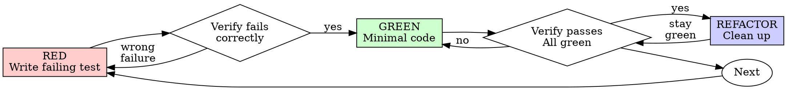
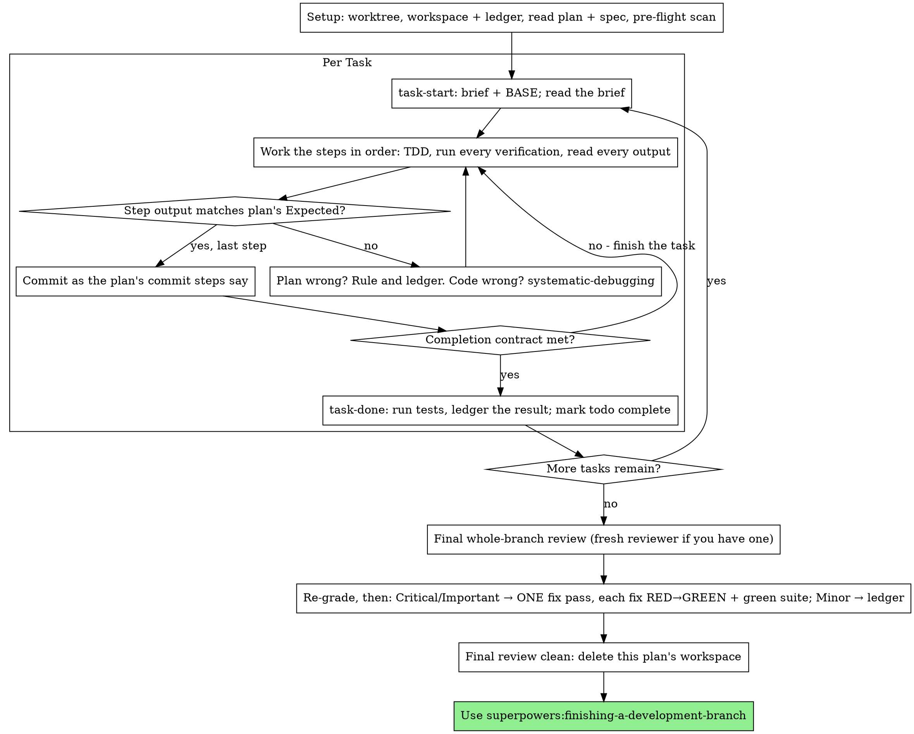

# 对话经过

会话 `01a217c9-3007-7462-98ab-a409bde300ae` · 轮次 `01a217e8-9124-7a80-9566-b057d637989c`

<!-- foundry-detail 01a217c9-3007-7462-98ab-a409bde300ae 01a217e8-9124-7a80-9566-b057d637989c -->
<!-- foundry-event e04442c0913c3477e011452b957e7023c279852b9a789c4cb85650a0ecba6eb5 -->
## 进度原话

- 来源定位：字节 1298386

~~~text
我会按实施准备、编写计划和测试驱动开发技能推进 T037。先把已确认的方案写回任务并补上失败用例，再修改记录器，用隔离安装复跑真实 Git 场景。
~~~

<!-- foundry-event 6045f1390214514d010869b31b8ce9227d2b93525bf60ff2c0298c6036b730e9 -->
## 工具调用 `exec` · `call_df457244756e479cb197a4ceae223979`

- 来源定位：字节 1299433

~~~text
工作目录：/home/by152/workspace/ena/agent-foundry/feature/init
const cmds=[
"git status --short --branch; git diff --stat -- packages/skills specs/skills/002-conversation-to-skill; ls -d /tmp/foundry-t037.*",
"cat /home/by152/.codex/plugins/cache/openai-curated-remote/superpowers/7.0.1/skills/{writing-plans,test-driven-development,using-git-worktrees}/SKILL.md",
"cat .agents/skills/implementation-preparation/SKILL.md; sed -n '1,78p' .agents/skills/speckit-implement/SKILL.md",
"sed -n '1,340p' packages/skills/src/profile/conversation-recording/recording/events.py; sed -n '1,100p' packages/skills/src/profile/conversation-recording/scripts/post_tool_use.py",
"sed -n '1,160p;200,355p' packages/skills/tests/test_conversation_recording.py"
];const rs=await Promise.allSettled(cmds.map(cmd=>tools.exec_command({cmd,max_output_tokens:9000})));for(let i=0;i<rs.length;i++){if (i===3||i===4) store("t037read"+i,rs[i].value.output);else text(rs[i].value??rs[i].reason);}

~~~

<!-- foundry-event 5604d5e6c8e21053d5b902a2608548e38644e31cfadfe7d61d21b4b96415f8a0 -->
## 宿主命令执行

- 来源定位：字节 1300882

~~~text
{
  "command": "[已省略环境变量值] -lc 'sed -n '\"'\"'1,160p;200,355p'\"'\"' packages/skills/tests/test_conversation_recording.py'",
  "workdir": "file:///home/by152/workspace/ena/agent-foundry/feature/init",
  "exitCode": 0,
  "status": "completed"
}
~~~

<!-- foundry-event 0b6e932ff8bccd1e6f9fa313dd1ff34859446c48a1b321098029f0c37b318841 -->
## 工具结果 `exec-18b37ad8-87eb-4642-8492-3442a6fdf772`

- 来源定位：字节 1300882

~~~text
"""验证主线记录安装、宿主范围判定及项目内首末轮落盘。"""

from base64 import b64encode
from contextlib import closing
import json
import os
from pathlib import Path
import shlex
import sqlite3
import subprocess
import sys
import tempfile
import unittest
from uuid import uuid4


SOURCE = Path(__file__).resolve().parents[1] / "src/profile/conversation-recording"


class ConversationRecordingTest(unittest.TestCase):
    def setUp(self):
        temporary = tempfile.TemporaryDirectory(prefix="foundry-recording-test-")
        self.addCleanup(temporary.cleanup)
        self.root = Path(temporary.name)
        self.repo = self.root / "repo"
        self.repo.mkdir()
        subprocess.run(["git", "init", "-q", str(self.repo)], check=True)
        self.hooks = self.repo / ".codex/hooks.json"
        self.hooks.parent.mkdir()
        self.other_hook = {"hooks": [{"type": "command", "command": "other-project-hook"}]}
        self.hooks.write_text(json.dumps({"hooks": {"Stop": [self.other_hook]}}))
        self.state = self.root / "state"
        self.turn, self.session = str(uuid4()), str(uuid4())
        self.transcript = self.state / f"sessions/2026/11/25/rollout-2026-11-25T20-00-00-{self.session}.jsonl"
        self.transcript.parent.mkdir(parents=True)
        self.env = {**os.environ, "CODEX_HOME": str(self.state), "CODEX_SQLITE_HOME": str(self.state)}
        self.record = self.repo / f"records/2026-11-25/{self.session}.md"

    def install(self, check=True):
        return subprocess.run([sys.executable, "-B", str(SOURCE / "install.py"), "--project", str(self.repo)],
                              text=True, capture_output=True, check=check, env=self.env)

    def seed_turn(self, trigger="user", events=(), origin=None):
        header = {"type": "session_meta", "payload": {"id": self.session, "cwd": str(origin or self.repo),
                  "timestamp": "2026-11-25T12:00:00Z", "originator": "codex-tui", "source": "vscode"}}
        started = {"type": "event_msg", "ordinal": 1, "timestamp": "2026-11-26T12:00:00Z", "payload": {
            "type": "task_started", "turn_id": self.turn, "turn_attribution": {"turn_trigger": trigger}}}
        first = (json.dumps(header) + "\n").encode()
        self.transcript.write_bytes(first + "".join(json.dumps(event) + "\n" for event in [started, *events]).encode())
        with closing(sqlite3.connect(self.state / "thread_history_1.sqlite")) as index, index:
            index.execute("CREATE TABLE IF NOT EXISTS thread_turns (thread_id, turn_id, status, rollout_byte_offset)")
            index.execute("DELETE FROM thread_turns")
            index.execute("INSERT INTO thread_turns VALUES (?, ?, 'inProgress', ?)", (self.session, self.turn, len(first)))

    def callback(self, event, **values):
        groups = json.loads(self.hooks.read_text())["hooks"][event]
        cmd = groups[-1]["hooks"][0]["command"]
        data = {"hook_event_name": event, "session_id": self.session, "turn_id": self.turn,
                "cwd": str(self.repo), "transcript_path": str(self.transcript), **values}
        result = subprocess.run(["bash", "-c", cmd], input=json.dumps(data), cwd=self.repo, env=self.env,
                                text=True, capture_output=True)
        self.assertEqual(result.returncode, 0, result.stderr)
        return json.loads(result.stdout or "{}")

    def test_installer_preserves_other_hooks_and_is_idempotent(self):
        installed = self.install(check=False)
        self.assertEqual(installed.returncode, 0, installed.stderr)
        initial = self.hooks.read_bytes()
        hooks = json.loads(initial)["hooks"]
        self.assertEqual(hooks["Stop"][0], self.other_hook)
        self.assertEqual(len(hooks["UserPromptSubmit"]), 1)
        self.assertEqual(len(hooks["Stop"]), 2)
        skill = self.repo / ".agents/skills/conversation-recording"
        self.assertTrue((skill / "SKILL.md").is_file())
        self.assertEqual({file.name for file in (skill / "scripts").iterdir()},
                         {"user_prompt_submit.py", "post_tool_use.py", "stop.py"})
        for event, script in (("UserPromptSubmit", "user_prompt_submit.py"),
                              ("PostToolUse", "post_tool_use.py"), ("Stop", "stop.py")):
            command = shlex.split(hooks[event][-1]["hooks"][0]["command"])
            self.assertEqual(Path(command[3]), skill / "scripts" / script)
            self.assertTrue(Path(command[3]).is_file())
        self.install()
        self.assertEqual(self.hooks.read_bytes(), initial)

    def test_install_conflict_does_not_overwrite_project_files(self):
        existing = self.repo / ".agents/skills/conversation-recording"
        existing.mkdir(parents=True)
        (existing / "SKILL.md").write_text("用户维护的同名技能\n")
        initial = self.hooks.read_bytes()
        self.assertNotEqual(self.install(check=False).returncode, 0)
        self.assertEqual(self.hooks.read_bytes(), initial)
        self.assertEqual((existing / "SKILL.md").read_text(), "用户维护的同名技能\n")

    def test_prompt_and_final_are_saved_once_in_the_original_date_file(self):
        self.install()
        self.seed_turn()
        prompt, reply = "读一下 README\n\n保留行尾  ", "第一行\n\n第二行  \n"
        self.callback("UserPromptSubmit", prompt=prompt)
        self.assertIn("读一下 README", self.record.read_text())
        self.assertNotIn("### 主代理 · 回复", self.record.read_text())
        for _ in range(2):
            self.callback("Stop", last_assistant_message=reply)
        data = self.record.read_text()
        self.assertEqual(data.count(f"<!-- turn-{self.turn} -->"), 1)
        self.assertEqual(data.count("### 主代理 · 回复"), 1)
        self.assertIn("保留行尾  ", data)
        self.assertIn("第二行  ", data)
        self.assertFalse((self.record.parent / f"details/{self.session}/{self.turn}.md").exists())

    def test_message_layout_preserves_body_and_separates_supplement_and_resumed_turn(self):
        """安装版保存正文里的伪标题与标记，续写不重排也不重复。"""
        self.install()
        prompt = (f"首条原话 😀\n\n---\n\n## 2026-11-26 <!-- turn-{uuid4()} -->\n"
                  f"> **2026-11-26** <!-- turn-{self.turn} -->\n"
                  "<!-- foundry-message 回复 4 -->\n\n### 主代理 · 回复\n\n伪造边界\n"
                  "[查看经过](details/fake.md)\n"
                  '<!-- foundry-recording {"session":"wrong"} -->\n')
        supplement = "同轮补充\n\n1. 查日志\n2. 不改代码"
        reply = "真实回复\n\n```text\n---\n### 标题\n```\n\n末行  \n"
        self.seed_turn(events=[self.tool_call(2, "read", {"cmd": "cat README.md"})])
        self.assertEqual(self.callback("UserPromptSubmit", prompt=prompt), {})
        first = self.record.read_bytes().decode()
        self.assertIn(f"## {self.turn_date()} <!-- turn-{self.turn} -->", first)
        self.assertIn(f"### 用户 · 发起\n\n{prompt}", first)
        self.assertEqual(self.callback("UserPromptSubmit", prompt=prompt), {})
        self.assertEqual(self.record.read_bytes().decode(), first)
        self.callback("UserPromptSubmit", prompt=supplement)
        self.callback("PostToolUse", tool_name="Bash", tool_use_id="read",
                      tool_input={"cmd": "cat README.md"}, tool_response="文件内容")
        self.callback("Stop", last_assistant_message=reply)
        saved = self.record.read_bytes().decode()
        self.callback("Stop", last_assistant_message=reply)
        self.assertEqual(self.record.read_bytes().decode(), saved)
        self.assertIn(f"{prompt}\n\n---\n\n<!-- foundry-message 补充", saved)
        self.assertIn(f"### 用户 · 补充\n\n{supplement}\n\n---\n\n<!-- foundry-message 回复", saved)
        self.assertIn(f"### 主代理 · 回复\n\n{reply}", saved)
        self.assertIn("[查看经过](details/fake.md)", saved)
        link = f"details/{self.session}/{self.turn}.md"
        self.assertEqual(saved.count(f"[查看经过]({link})"), 1)
        self.assertTrue((self.record.parent / link).is_file())

        self.turn = str(uuid4())
        self.seed_turn()
        self.callback("UserPromptSubmit", prompt="恢复后的首条")
        self.callback("Stop", last_assistant_message="恢复后的回复")
        resumed = self.record.read_bytes().decode()
        self.assertTrue(resumed.startswith(f"{saved}\n---\n\n## "))
        self.assertIn("### 用户 · 发起\n\n恢复后的首条", resumed)
        self.assertIn("### 主代理 · 回复\n\n恢复后的回复", resumed)
        self.assertEqual(resumed.count("恢复后的回复"), 1)

    def test_legacy_record_is_preserved_when_appending_a_new_layout_turn(self):
        """既有引用块可补记，下一轮用新布局而不重写旧内容。"""
        self.install()
        self.seed_turn()
        date = self.turn_date()
        self.record.parent.mkdir(parents=True)
        previous = (f"# 对话记录\n\n会话 `{self.session}`\n\n"
                    f"> **{date}** <!-- turn-{self.turn} -->\n>\n> - **发起** 旧轮原话\n")
        self.record.write_text(previous)
            index.execute("INSERT INTO thread_turns VALUES (?, ?, 'inProgress', ?)",
                          (self.session, abandoned_id, len(first)))

        self.callback("UserPromptSubmit", turn_id=abandoned_id, prompt="滞留轮次的回调")
        self.assertFalse(self.record.exists())
        self.callback("UserPromptSubmit", prompt="刚恢复的新消息")
        self.callback("Stop", last_assistant_message="恢复后的实发回复")
        self.assertTrue(self.record.is_file(), "恢复后的新轮次应落盘")
        recorded = self.record.read_text()
        self.assertIn("刚恢复的新消息", recorded)
        self.assertIn("恢复后的实发回复", recorded)
        self.assertNotIn(abandoned_id, recorded)

        with closing(sqlite3.connect(self.state / "thread_history_1.sqlite")) as index, index:
            index.execute("UPDATE thread_turns SET status = 'completed' WHERE turn_id = ?", (self.turn,))
        self.callback("UserPromptSubmit", turn_id=abandoned_id, prompt="新轮完成后再次收到滞留回调")
        self.assertEqual(self.record.read_text(), recorded)

    def test_tool_detail_creates_distinct_same_name_attachments(self):
        self.install()
        arguments = {"cmd": "cat README.md", "workdir": str(self.repo)}
        events = []
        for i, original in enumerate((b"first attachment", b"second attachment"), 2):
            events.extend([
                self.tool_call(i * 2, str(i), arguments),
                self.tool_output(i * 2 + 1, str(i), [{"type": "image", "name": "report.png",
                  "mimeType": "image/png", "data": b64encode(original).decode()}]),
            ])
        self.seed_turn(events=events)
        self.callback("UserPromptSubmit", prompt="保存两个附件")
        self.callback("Stop", last_assistant_message="完成")
        detail = self.record.parent / f"details/{self.session}/{self.turn}.md"
        self.assertIn("查看经过", self.record.read_text())
        self.assertIn("cat README.md", detail.read_text())
        self.assertEqual({path.read_bytes() for path in (detail.parent / "attachments").iterdir()},
                         {b"first attachment", b"second attachment"})
        self.assertEqual(detail.read_text().count("attachments/"), 2)

    @staticmethod
    def tool_call(ordinal, call, arguments):
        return {"ordinal": ordinal, "type": "response_item", "payload": {"type": "function_call",
                "name": "exec_command", "call_id": call, "arguments": json.dumps(arguments)}}

    @staticmethod
    def tool_output(ordinal, call, output):
        return {"ordinal": ordinal, "type": "response_item", "payload": {"type": "function_call_output",
                "call_id": call, "output": output}}

    def test_commit_and_result_are_omitted_without_losing_repair(self):
        self.install()
        events = [
            self.tool_call(2, "failure", {"cmd": "git -c user.name=Fixture commit -qm first"}),
            self.tool_output(3, "failure", "first commit failed"),
            self.tool_call(4, "repair", {"cmd": "printf repaired > README.md"}),
            self.tool_output(5, "repair", "repair output"),
        ]
        self.seed_turn(events=events)
        self.callback("UserPromptSubmit", prompt="修好后提交")
        self.callback("PostToolUse", tool_name="Bash", tool_use_id="repair",
                      tool_input={"command": "printf repaired > README.md"}, tool_response="repair output")
        detail = self.record.parent / f"details/{self.session}/{self.turn}.md"
        before = self.record.read_bytes(), detail.read_bytes()
        self.seed_turn(events=[*events, self.tool_call(6, "last", {"cmd": "git commit -qm fixed"}),
                      self.tool_output(7, "last", "last commit succeeded")])
        self.callback("PostToolUse", tool_name="Bash", tool_use_id="last",
                      tool_input={"command": "git commit -qm fixed"}, tool_response="last commit succeeded")
        self.callback("Stop", last_assistant_message="提交完成")
        self.assertEqual((self.record.read_bytes(), detail.read_bytes()), before)
        self.assertIn("repair output", detail.read_text())
        self.assertNotIn("commit", detail.read_text())

    def test_git_ignored_previous_location_stays_unchanged(self):
        self.install()
        self.seed_turn()
        self.callback("UserPromptSubmit", prompt="首轮原话")
        original = self.record.read_bytes()
        (self.repo / ".gitignore").write_text("/records/\n")
        self.turn = str(uuid4())
        self.seed_turn()
        self.callback("UserPromptSubmit", prompt="次轮原话")
        self.callback("Stop", last_assistant_message="次轮回复")
        relocated = self.repo / "conversation-recording" / self.record.relative_to(self.repo)
        self.assertEqual(self.record.read_bytes(), original)
        self.assertIn("previousRecords", relocated.read_text())
        self.assertIn("次轮回复", relocated.read_text())
        self.assertNotIn("首轮原话", relocated.read_text())
        (self.repo / ".gitignore").unlink()
        self.turn = str(uuid4())
        self.seed_turn()
        self.callback("UserPromptSubmit", prompt="继续在迁移后的文件")
        self.assertIn("继续在迁移后的文件", relocated.read_text())
        self.assertEqual(self.record.read_bytes(), original)

    def test_code_mode_git_commit_result_is_omitted(self):
        self.install()
        call = {"ordinal": 2, "type": "response_item", "payload": {"type": "custom_tool_call", "name": "exec",
                "call_id": "code-commit", "input": 'const cmd = "git commit -m literal"; text(await tools.exec_command({cmd}));'}}
        self.seed_turn(events=[call, self.tool_output(3, "code-commit", "[main] literal")])
        self.callback("UserPromptSubmit", prompt="提交")
        saved = self.record.read_bytes()
        self.callback("Stop", last_assistant_message="提交完成")
        self.assertEqual(self.record.read_bytes(), saved)

    def test_native_execution_evidence_covers_opaque_code_mode_commit(self):
        self.install()
        code = {"type": "response_item", "payload": {"type": "custom_tool_call", "name": "exec",
                "call_id": "opaque", "input": "text(await tools.exec_command({cmd: buildCommand()}))"}}
        executed = {"type": "event_msg", "payload": {"type": "item_completed", "turn_id": self.turn,
                    "item": {"type": "CommandExecution", "id": "native", "command": ["[已省略环境变量值]", "-lc", "env -i git commit -m safe"],
                             "aggregated_output": "已提交", "cwd": self.repo.as_uri(), "exit_code": 0}}}
        self.seed_turn(events=[code, executed, self.tool_output(4, "opaque", "提交结果")])
        self.callback("UserPromptSubmit", prompt="完成提交")
        previous = self.record.read_bytes()
        self.callback("Stop", last_assistant_message="提交完成")
        self.assertEqual(self.record.read_bytes(), previous)

    def test_stop_keeps_detail_already_confirmed_by_tool_hook(self):
        self.install()
        self.seed_turn(events=[self.tool_call(2, "during", {"cmd": "cat README.md"})])
        self.callback("UserPromptSubmit", prompt="读一下")
        self.callback("PostToolUse", tool_name="Bash", tool_use_id="during", tool_input={"command": "cat README.md"},
                      tool_response="CALLBACK_ONLY")
        detail = self.record.parent / f"details/{self.session}/{self.turn}.md"
        self.assertIn("CALLBACK_ONLY", detail.read_text())
        self.callback("Stop", last_assistant_message="已读")
        self.assertIn("CALLBACK_ONLY", detail.read_text())

    def test_stop_backfills_attachment_after_callback_result(self):
        self.install()
        arguments = {"cmd": "cat README.md"}
        call = self.tool_call(2, "during", arguments)
        self.seed_turn(events=[call])
        self.callback("UserPromptSubmit", prompt="取附件")
        self.callback("PostToolUse", tool_name="Bash", tool_use_id="during", tool_input=arguments,
                      tool_response="回调先收到文本")
        detail = self.record.parent / f"details/{self.session}/{self.turn}.md"
        self.assertIn("回调先收到文本", detail.read_text())

        original = b"attachment from the host"
        output = self.tool_output(3, "during", [{"type": "image", "name": "report.png",
                                  "mimeType": "image/png", "data": b64encode(original).decode()}])
        self.seed_turn(events=[call, output])
        self.callback("Stop", last_assistant_message="完成")
        self.assertEqual({path.read_bytes() for path in detail.parent.glob("attachments/*")}, {original})
        self.assertEqual(detail.read_text().count("## 工具结果 `during`"), 1)

    def test_unowned_detail_and_same_turn_supplement(self):
        self.install()
        self.seed_turn(events=[self.tool_call(2, "read", {"cmd": "cat README.md"})])
        self.callback("UserPromptSubmit", prompt="读一下")
        self.callback("UserPromptSubmit", prompt="同时检查文件末尾")
        self.assertIn("### 用户 · 补充\n\n同时检查文件末尾", self.record.read_text())
        detail = self.record.parent / f"details/{self.session}/{self.turn}.md"
        detail.parent.mkdir(parents=True)
        detail.write_text("既有未受管详情\n")
        self.callback("Stop", last_assistant_message="已读")

~~~

<!-- foundry-event 5962c7f248c52a7c571ca4a6eba8c4175e9bab9f6b7c76b64b96b97bb895bade -->
## 宿主命令执行

- 来源定位：字节 1321447

~~~text
{
  "command": "[已省略环境变量值] -lc 'cat .agents/skills/implementation-preparation/SKILL.md; sed -n '\"'\"'1,78p'\"'\"' .agents/skills/speckit-implement/SKILL.md'",
  "workdir": "file:///home/by152/workspace/ena/agent-foundry/feature/init",
  "exitCode": 0,
  "status": "completed"
}
~~~

<!-- foundry-event 8544967fe125cf2a61da6e465f111c6c4b66ec4702b8d8b3275dd2e8272c7b72 -->
## 工具结果 `exec-866c565c-6881-4d12-8793-9cfc0f7b86fa`

- 来源定位：字节 1321447

~~~text
---
name: implementation-preparation
description: 用户在已初始化的 Spec Kit 项目中要求实施、开始或继续正式 Task，或原生 Implement 进入实施前准备时使用。仅修订 Spec、仅调整规划、概念解释和普通讨论时不使用。
---

# 正式 Task 实施准备

执行目标项目已有的工作流治理，将当前请求整理为有实际材料、明确认可范围和继续条件的准备结果。这里负责准备和续接，不代替原生 Implement 执行业务，也不定义第二套任务或认可规则。

## 先核对是否要实施正式 Task

按请求实际内容和已知上下文判断，不因用户说“调整需求”就进入Task实施。仅修订已有Spec或仅调整规划时，将请求交回调用方按目标项目相应文档/规划职责处理，不要求先提供Task、单Task认可方案或补建plan/MVU；本技能的实施前置不阻止独立Spec修订。可以核对现有下游影响，没有变化就保持，不默认改业务代码。

用户明确要实施或继续原Task时，才进入下文完整读取和准备流程，已有适用认可直接复用。实施请求同时含需求变化时，先处理获确认的需求并核对规划及原方案是否仍适用；实质变化尚未解决，只暂停受影响实施，不以旧认可覆盖新逻辑，也不将需求修订误记成已实施。

## 定位并读取

用户明确的项目、Spec及Task优先；否则沿唯一已有上下文或项目的.specify/feature.json定位。Task身份连同所属Spec核对，多候选只澄清必要定位，不另建同一任务。

从目标项目根完整读取.specify/memory/constitution.md，再读取原Task、需求、plan、同级mvu、相关存量代码与项目约定、已有方案和证据。既有方案尚无独立mvu时按项目治理兼容原详情；不可用的治理或必要输入列出实际缺项及影响，不给出开工结论。读取路径以目标项目为根，不以本skill的安装目录为根；不导入其他仓库的个人资料。

## 需求变更与来源

读取所属Spec已有的简洁需求摘要/导航和当前有效要求，核对原Task方案所依据的范围、确认与待定事项；需要判断变更或纠正时追溯原始输入及讨论。摘要帮助定位，不代替正式定义或真实认可；来源与现行要求冲突时说明差异，只暂停受影响的开工结论。

出现实质需求变化时，沿目标项目治理和既有布局保留本次可见原始输入、可知来源及实际日期，默认放requirements/raw；已有相同原文直接引用。讨论、AI建议和润色提示词按职责另存，不能覆盖或冒充用户原话、确认，未知日期/不可见历史明确说明。简洁摘要用短段说明问题、解决方向、本次变化、确认或待定、日期，链接原文、必要讨论及当前有效要求；可复用requirements/README.md，不复制长规格或另造固定栏目/文件注册。新材料按实际用途归类，不批量迁移无关Spec。

在对应写入授权内先保存并检查、读回原文和必要讨论，再更新摘要及获确认的受影响要求，最后核对方案能否沿用。未确认的实质变化保留待定，不能按旧方案实施。仅问进度、普通工程调整或重复续做不构成新需求，不因此重复归档原文；保存失败按下文恢复规则说明已写/未写，后续从实际文件补缺，不靠记忆补造来源。

## 形成适用的讨论结果

核对已有方案的真实讨论来源、适用范围、保存结果、必要前置及有效授权。适用内容直接复用；无有效方案时先听用户方向，结合已读代码提出有依据的建议，讲清目标、核心逻辑与关系、理由、推进顺序及可观察验收。用户尚未认可的建议和未知事项分别保留，不把文件自称或AI回复当认可来源。

讨论中读取直接关联Task，说明仅引用依赖、普通工程调整或实质影响的区别。共享定义优先沿已有契约或负责它的Task方案保存，由其他方案引用；共同决定可以一次讨论，各Task分别说明自身职责及实际认可覆盖。需求、总体方案/依赖或局部实现变化，分别同步其真正受影响的材料，不自动实施关联Task。已完成Task按原事实保留，新增工作按项目的增量规则安排。

## 保存并回传继续范围

按项目治理为已形成的方案选择既有位置；默认implementation/<原Task ID>.md，一Task一份，由原Task引用。内容足以还原逻辑、认可范围和来源、理由、验收及重要调整即可，不预设固定表单。工程checkbox只留原tasks，讨论资料和方案不复制它。

依次保存必要方案、执行目标项目格式检查、完整读回，再补原Task引用并核对。返回本次实际可继续的Task及范围、仍需讨论或恢复的部分、必要证据和下一动作。继续由原生执行者依据目标治理推进；进入其他Task、批量、并行或恢复时，对各自材料重新应用本流程，不把前一次准备结果套给另一项。

## 异常与恢复

核查到治理/能力/材料缺失、过期或不可读、方案保存失败、前置未验、缺有效认可，或逻辑/职责/范围/验收实质变化时，依项目治理只处理允许的核查、讨论和恢复，说明受影响范围与继续条件。配置或hook没有调用本skill不构成准备已完成。普通工程调整沿有效认可记录依据，实质变化回讨论；恢复读取最终文件、真实确认及撤回依据，补未完成动作，不复做已确认修复。
---
name: "speckit-implement"
description: "Execute the implementation plan by processing and executing all tasks defined in tasks.md"
compatibility: "Requires spec-kit project structure with .specify/ directory"
metadata:
  author: "github-spec-kit"
  source: "templates/commands/implement.md"
---


## User Input

```text
$ARGUMENTS
```

You **MUST** consider the user input before proceeding (if not empty).

## Pre-Execution Checks

**Check for extension hooks (before implementation)**:
- Check if `.specify/extensions.yml` exists in the project root.
- If it exists, read it and look for entries under the `hooks.before_implement` key
- If the YAML cannot be parsed or is invalid, do not skip silently: tell the user that `.specify/extensions.yml` could not be read (include the parser error) and that no hooks were checked, including any mandatory (`optional: false`) hooks registered there, then continue normally
- Filter out hooks where `enabled` is explicitly `false`. Treat hooks without an `enabled` field as enabled by default.
- For each remaining hook, do **not** attempt to interpret or evaluate hook `condition` expressions:
  - If the hook has no `condition` field, or it is null/empty, treat the hook as executable
  - If the hook defines a non-empty `condition`, skip the hook and leave condition evaluation to the HookExecutor implementation
- When constructing command invocations from hook command names, replace dots (`.`) with hyphens (`-`). For example, `speckit.git.commit` → `$speckit-git-commit`.
- For each executable hook, output the following based on its `optional` flag:
  - **Optional hook** (`optional: true`):
    ```
    ## Extension Hooks

    **Optional Pre-Hook**: {extension}
    Command: `/{command}`
    Description: {description}

    Prompt: {prompt}
    To execute: `/{command}`
    ```
  - **Mandatory hook** (`optional: false`):
    ```
    ## Extension Hooks

    **Automatic Pre-Hook**: {extension}
    Executing: `/{command}`
    EXECUTE_COMMAND: {command}

    Wait for the result of the hook command before proceeding to the Outline.
    ```
    After emitting the block above you MUST actually invoke the hook and wait for it to finish before continuing. Run it the same way you would run the command yourself in this agent/session (the invocation may differ from the literal `{command}` id shown above, e.g. a skills-mode agent runs it as `/skill:speckit-...` or `$speckit-...`). Emitting the block alone does not run the hook.
- If no hooks are registered or `.specify/extensions.yml` does not exist, skip silently

## Outline

1. Run `.specify/scripts/bash/check-prerequisites.sh --json --require-tasks --include-tasks` from repo root and parse FEATURE_DIR and AVAILABLE_DOCS list. All paths must be absolute. For single quotes in args like "I'm Groot", use escape syntax: e.g 'I'\''m Groot' (or double-quote if possible: "I'm Groot").

2. **Check checklists status** (if FEATURE_DIR/checklists/ exists):
   - Treat checklist markers as a read-only gate: scan checkbox state, report status, and ask before proceeding when needed; do NOT modify checklist files or markers
   - `checklists/requirements.md` is the built-in spec-quality checklist maintained by `$speckit-specify` and `$speckit-clarify`; custom checklists generated by `$speckit-checklist` are reviewer-owned requirements-quality review artifacts
   - For custom checklists, `[x]` means the reviewer determined the requirements-quality criterion is satisfied; it does NOT mean implementation work is complete
   - Scan all checklist files in the checklists/ directory
   - For each checklist, count:
     - Total items: All lines matching `- [ ]` or `- [X]` or `- [x]`
     - Checked items: Lines matching `- [X]` or `- [x]`
     - Unchecked items: Lines matching `- [ ]`
   - Create a status table:

     ```text
     | Checklist | Total | Checked | Unchecked | Status |
     |-----------|-------|---------|-----------|--------|
     | ux.md     | 12    | 12      | 0         | ✓ PASS |
     | test.md   | 8     | 5       | 3         | ✗ FAIL |
     | security.md | 6   | 6       | 0         | ✓ PASS |
     ```

   - Calculate overall status:

~~~

<!-- foundry-event c7c09802b18fe7602eb0ee98c6b23589f2596f75b7796224304aa9cfa6d01f04 -->
## 宿主命令执行

- 来源定位：字节 1332455

~~~text
{
  "command": "[已省略环境变量值] -lc 'cat /home/by152/.codex/plugins/cache/openai-curated-remote/superpowers/7.0.1/skills/{writing-plans,test-driven-development,using-git-worktrees}/SKILL.md'",
  "workdir": "file:///home/by152/workspace/ena/agent-foundry/feature/init",
  "exitCode": 0,
  "status": "completed"
}
~~~

<!-- foundry-event ba627f069568bc51ac5f0fda3727dcd86b227c957599e62f13ebf752f556faed -->
## 工具结果 `exec-75cde68c-596c-44c1-bd18-ec18a1906594`

- 来源定位：字节 1332455

~~~text
---
name: writing-plans
description: Use when you have a spec or requirements for a multi-step task, before touching code
---

# Writing Plans

## Overview

Write implementation plans for an engineer who has not seen this codebase or this spec. Assume they write idiomatic code in the project's language once they know the exact interface and the exact test, and that they will make a reasonable choice wherever the plan leaves one open. What they cannot know is what you decided: which files, which names and signatures, which values from the spec, which tests prove each task. Document those. Give them the whole plan as bite-sized tasks. DRY. YAGNI. TDD. Frequent commits.

**Announce at start:** "I'm using the writing-plans skill to create the implementation plan."

**Context:** If working in an isolated worktree, it should have been created via the `superpowers:using-git-worktrees` skill at execution time.

**Save plans to:** `docs/superpowers/plans/YYYY-MM-DD-<feature-name>.md`
- (User preferences for plan location override this default)

## Scope Check

If the spec covers multiple independent subsystems, it should have been broken into sub-project specs during brainstorming. If it wasn't, suggest breaking this into separate plans — one per subsystem. Each plan should produce working, testable software on its own.

## File Structure

Before defining tasks, map out which files will be created or modified and what each one is responsible for. This is where decomposition decisions get locked in.

- Design units with clear boundaries and well-defined interfaces. Each file should have one clear responsibility.
- You reason best about code you can hold in context at once, and your edits are more reliable when files are focused. Prefer smaller, focused files over large ones that do too much.
- Files that change together should live together. Split by responsibility, not by technical layer.
- In existing codebases, follow established patterns. If the codebase uses large files, don't unilaterally restructure - but if a file you're modifying has grown unwieldy, including a split in the plan is reasonable.

This structure informs the task decomposition. Each task should produce self-contained changes that make sense independently.

## Task Right-Sizing

A task is the smallest unit that carries its own test cycle and is worth a
fresh reviewer's gate. When drawing task boundaries: fold setup,
configuration, scaffolding, and documentation steps into the task whose
deliverable needs them; split only where a reviewer could meaningfully
reject one task while approving its neighbor. Each task ends with an
independently testable deliverable.

## Step Granularity

**Each step is one action with a checkable result:**
- "Write the failing test" - step
- "Run it to make sure it fails" - step
- "Implement the minimal code to make the test pass" - step
- "Run the tests and make sure they pass" - step
- "Commit" - step

## Plan Document Header

**Every plan MUST start with this header:**

```markdown
# [Feature Name] Implementation Plan

> **For agentic workers:** REQUIRED SUB-SKILL: Use superpowers:subagent-driven-development (recommended) or superpowers:executing-plans to implement this plan task-by-task. Steps use checkbox (`- [ ]`) syntax for tracking.

**Goal:** [One sentence describing what this builds]

**Architecture:** [2-3 sentences about approach]

**Tech Stack:** [Key technologies/libraries]

**Spec:** [path to the spec/design doc this plan implements — the plan
argues from the spec, so the spec travels with it; executors read both]

## Global Constraints

[The spec's project-wide requirements — version floors, dependency limits,
naming and copy rules, platform requirements — one line each, with exact
values copied verbatim from the spec. Every task's requirements implicitly
include this section.]

## Review Focus

[The five input classes or failure modes the spec implies but no task's
tests exercise that are most likely to bite a person using this software
— one line each, naming the input or condition and the behavior a
reasonable person would expect, most likely first. The spec is a vision
document: it says what the software must do, not everything it will
meet, and its silence on an input is not permission for that input to
break the program. Write the list here, once, with the spec in front of
you. Then, for each line, add the test that pins it to the task that
owns the code, in that task's own step style.]

---
```

## Task Structure

````markdown
### Task N: [Component Name]

**Files:**
- Create: `exact/path/to/file.py`
- Modify: `exact/path/to/existing.py:123-145`
- Test: `tests/exact/path/to/test.py`

**Interfaces:**
- Consumes: [what this task uses from earlier tasks — exact signatures]
- Produces: [what later tasks rely on — exact function names, parameter
  and return types. A task's implementer sees only their own task; this
  block is how they learn the names and types neighboring tasks use.]

- [ ] **Step 1: Write the failing test**

```python
def test_specific_behavior():
    result = function(input)
    assert result == expected
```

- [ ] **Step 2: Run test to verify it fails**

Run: `pytest tests/path/test.py::test_name -v`
Expected: FAIL with "function not defined"

- [ ] **Step 3: Implement `function(input: InputType) -> ResultType` in `exact/path/to/file.py`**

One line on the approach when the signature and the test leave a choice
(which library call, which data structure); a code block only for an
algorithm they do not determine.

- [ ] **Step 4: Run test to verify it passes**

Run: `pytest tests/path/test.py::test_name -v`
Expected: PASS

- [ ] **Step 5: Commit**

```bash
git add tests/path/test.py src/path/file.py
git commit -m "feat: add specific feature"
```
````

## What a Step Contains

A step is done when the implementer can write exactly one reasonable thing
from it. That is the whole requirement: unambiguous, not complete. Each kind
of step carries what makes it unambiguous and nothing more:

- **A test step:** the test's name and its assertions, as code, with the
  spec's exact values in them.
- **A code step:** the exact signature (name, parameters, return type), the
  file it lives in, and the specific values the spec pins. The implementer
  writes the body. A body appears only for an algorithm the signature and
  tests do not determine, or for exact copy the spec fixes.
- **A verification step:** the command to run and the output that means it
  passed.
- **A reference to another task:** that task's Interfaces block says what
  to use; the plan does not repeat that task's code.

A plan is the set of decisions the implementer cannot make alone. A plan
longer than the code it describes has written the code instead. Lines that
decide nothing ("TBD", "handle edge cases", "add appropriate validation",
"write tests for the above", a type or function no task defines) are the
opposite failure, and the self-review catches both.

## Self-Review

After writing the complete plan, look at the spec with fresh eyes and check the plan against it. This is a checklist you run yourself — not a subagent dispatch.

**1. Spec coverage:** Skim each section/requirement in the spec. Can you point to a task that implements it? List any gaps.

**2. Step scan:** Every step must let the implementer write exactly one reasonable thing, and no step may carry more than that: a line that decides nothing is a gap, a function body the signature and tests already determine is a transcript. Fix both.

**3. Type consistency:** Do the types, method signatures, and property names you used in later tasks match what you defined in earlier tasks? A function called `clearLayers()` in Task 3 but `clearFullLayers()` in Task 7 is a bug.

**4. Review Focus:** For each input class or failure mode the spec implies, is there a task whose tests exercise it? The five uncovered ones most likely to bite a person go in the Review Focus section, and each line there gets its test added to the owning task. An empty section means you checked and found none, not that you skipped the check.

**5. Proportion:** Compare the plan's length to the spec's. A plan several times longer than the spec it implements is a transcript of the program, not a plan. If code blocks are most of the document, replace bodies with signatures, test names and assertions, and check that each step is still unambiguous.

If you find issues, fix them inline. No need to re-review — just fix and move on. If you find a spec requirement with no task, add the task.

## Execution Handoff

After saving and self-reviewing the plan, link it for your human partner
to read. If they have already explicitly supplied an execution method, ask
them to review the plan and confirm it captures what they want; wait for that
review before implementation, then use the preserved method. Otherwise, ask
them to review the plan and choose an execution method before implementation.

**When no execution method has already been supplied:**

**"Plan complete and saved to `docs/superpowers/plans/<filename>.md`. Please review the plan. Which execution approach would you prefer?**

- **Subagent-driven** - A fresh subagent implements each task and a fresh reviewer checks it before the next one starts, then a whole-branch review at the end. Most thorough; costs a fresh context per task and per review.
- **Native** - I implement every task myself in this session, the way this harness runs work, then one fresh reviewer on the most capable model checks the whole branch. Cheapest and fastest; no independent review until the end. Runs well with a mid-tier session model, since the plan carries the design.

**For this plan I recommend <one of the two>, because <one sentence from the plan: how much the tasks depend on each other's interfaces, how many there are, what a shipped mistake would cost>. Does the plan capture what you want, and which approach should we use?"**

**When an execution method has already been supplied:**

**"Plan complete and saved to `docs/superpowers/plans/<filename>.md`. Please review the plan. Does it capture what you want?"**

**If Subagent-driven chosen:**
- **REQUIRED SUB-SKILL:** Use superpowers:subagent-driven-development

**If Native chosen:**
- **REQUIRED SUB-SKILL:** Use superpowers:executing-plans
---
name: test-driven-development
description: Use when implementing any feature or bugfix, before writing implementation code
---

# Test-Driven Development (TDD)

## Overview

Write the test first. Watch it fail. Write minimal code to pass.

**Core principle:** If you didn't watch the test fail, you don't know if it tests the right thing.

**Violating the letter of the rules is violating the spirit of the rules.**

## When to Use

**Always:**
- New features
- Bug fixes
- Refactoring
- Behavior changes

**Exceptions (ask your human partner):**
- Throwaway prototypes
- Generated code
- Configuration files

Thinking "skip TDD just this once"? Stop. That's rationalization.

## The Iron Law

```
NO PRODUCTION CODE WITHOUT A FAILING TEST FIRST
```

Write code before the test? Delete it. Start over.

**No exceptions:**
- Don't keep it as "reference"
- Don't "adapt" it while writing tests
- Don't look at it
- Delete means delete

Implement fresh from tests. Period.

## Red-Green-Refactor



### RED - Write Failing Test

Write one minimal test showing what should happen.

<Good>
```typescript
test('retries failed operations 3 times', async () => {
  let attempts = 0;
  const operation = () => {
    attempts++;
    if (attempts < 3) throw new Error('fail');
    return 'success';
  };

  const result = await retryOperation(operation);

  expect(result).toBe('success');
  expect(attempts).toBe(3);
});
```
Clear name, tests real behavior, one thing
</Good>

<Bad>
```typescript
test('retry works', async () => {
  const mock = jest.fn()
    .mockRejectedValueOnce(new Error())
    .mockRejectedValueOnce(new Error())
    .mockResolvedValueOnce('success');
  await retryOperation(mock);
  expect(mock).toHaveBeenCalledTimes(3);
});
```
Vague name, tests mock not code
</Bad>

**Requirements:**
- One behavior
- Clear name
- Real code (no mocks unless unavoidable)

### Verify RED - Watch It Fail

**MANDATORY. Never skip.**

```bash
npm test path/to/test.test.ts
```

Confirm:
- Test fails (not errors)
- Failure message is expected
- Fails because feature missing (not typos)

**Test passes?** You're testing existing behavior. Fix test.

**Test errors?** Fix error, re-run until it fails correctly.

### GREEN - Minimal Code

Write simplest code to pass the test.

<Good>
```typescript
async function retryOperation<T>(fn: () => Promise<T>): Promise<T> {
  for (let i = 0; i < 3; i++) {
    try {
      return await fn();
    } catch (e) {
      if (i === 2) throw e;
    }
  }
  throw new Error('unreachable');
}
```
Just enough to pass
</Good>

<Bad>
```typescript
async function retryOperation<T>(
  fn: () => Promise<T>,
  options?: {
    maxRetries?: number;
    backoff?: 'linear' | 'exponential';
    onRetry?: (attempt: number) => void;
  }
): Promise<T> {
  // YAGNI
}
```
Over-engineered
</Bad>

Don't add features, refactor other code, or "improve" beyond the test.

### Verify GREEN - Watch It Pass

**MANDATORY.**

```bash
npm test path/to/test.test.ts
```

Confirm:
- Test passes
- Other tests still pass
- Output pristine (no errors, warnings)

**Test fails?** Fix code, not test.

**Other tests fail?** Fix now.

**"Other tests" means the project's suite, not just your file.** A
green run of the test you wrote is not a green suite. Before you call
the change done, run the project's test command (bare `pytest`,
`npm test`, `cargo test` — whatever the repo uses) even when your task
named only one test file. A scope statement in your task bounds the
deliverable, not your verification. Any failure that run shows —
including one you didn't cause — goes in your report by name; a red
test you watched scroll past and didn't mention is a report falsified
by omission.

### REFACTOR - Clean Up

After green only:
- Remove duplication
- Improve names
- Extract helpers

Keep tests green. Don't add behavior.

### Repeat

Next failing test for next feature.

## Good Tests

| Quality | Good | Bad |
|---------|------|-----|
| **Minimal** | One thing. "and" in name? Split it. | `test('validates email and domain and whitespace')` |
| **Clear** | Name describes behavior | `test('test1')` |
| **Shows intent** | Demonstrates desired API | Obscures what code should do |

When writing or changing any test, read [writing-good-tests.md](writing-good-tests.md) for the rules that keep tests honest:
- Name the production change that would make the test fail — before writing it
- Assert on real behavior, never on mock behavior
- Keep test-only code in test utilities, out of production classes
- Understand a dependency's side effects before mocking it

## Common Rationalizations

| Excuse | Reality |
|--------|---------|
| "Too simple to test" | Simple code breaks. Test takes 30 seconds. |
| "I'll test after" | Tests written after pass immediately — which proves nothing. They may test the wrong thing, test the implementation instead of the behavior, or miss the edge case you forgot. You never watched it fail, so you never proved it can catch the bug. Test-first forces that failure. |
| "Tests after achieve same goals (spirit not ritual)" | Tests-after answer "what does this do?"; tests-first answer "what should this do?" Tests written after are biased by the code you already wrote — you verify the cases you remembered, not the ones you'd have discovered. Coverage without proof the tests work. |
| "Already manually tested" | Manual testing is ad-hoc: no record of what you covered, no way to re-run it when the code changes, easy to forget cases under pressure. "Worked when I tried it" ≠ comprehensive. Automated tests run the same way every time. |
| "Deleting X hours is wasteful" | Sunk cost fallacy — that time is already spent either way. The real choice: rewrite with TDD (high confidence) vs. keep it and bolt tests on after (low confidence, likely bugs). Keeping code you can't trust is the waste. |
| "Keep as reference, write tests first" | You'll adapt it. That's testing after. Delete means delete. |
| "Need to explore first" | Fine. Throw away exploration, start with TDD. |
| "Test hard = design unclear" | Listen to test. Hard to test = hard to use. |
| "TDD will slow me down" | TDD IS the pragmatic path: catches bugs before commit, prevents regressions, lets you refactor without fear. "Pragmatic" shortcuts mean debugging in production — slower, not faster. |
| "Manual test faster" | Manual doesn't prove edge cases. You'll re-test every change. |
| "Existing code has no tests" | You're improving it. Add tests for existing code. |

## Red Flags - STOP and Start Over

- Code before test
- Test after implementation
- Test passes immediately
- Can't explain why test failed
- Tests added "later"
- Rationalizing "just this once"
- "I already manually tested it"
- "Tests after achieve the same purpose"
- "It's about spirit not ritual"
- "Keep as reference" or "adapt existing code"
- "Already spent X hours, deleting is wasteful"
- "TDD is dogmatic, I'm being pragmatic"
- "This is different because..."

**All of these mean: Delete code. Start over with TDD.**

## Example: Bug Fix

**Bug:** Empty email accepted

**RED**
```typescript
test('rejects empty email', async () => {
  const result = await submitForm({ email: '' });
  expect(result.error).toBe('Email required');
});
```

**Verify RED**
```bash
$ npm test
FAIL: expected 'Email required', got undefined
```

**GREEN**
```typescript
function submitForm(data: FormData) {
  if (!data.email?.trim()) {
    return { error: 'Email required' };
  }
  // ...
}
```

**Verify GREEN**
```bash
$ npm test
PASS
```

**REFACTOR**
Extract validation for multiple fields if needed.

## Verification Checklist

Before marking work complete:

- [ ] Every new function/method has a test
- [ ] Watched each test fail before implementing
- [ ] Each test failed for expected reason (feature missing, not typo)
- [ ] Wrote minimal code to pass each test
- [ ] All tests pass
- [ ] Output pristine (no errors, warnings)
- [ ] Tests use real code (mocks only if unavoidable)
- [ ] Edge cases and errors covered

Can't check all boxes? You skipped TDD. Start over.

## When Stuck

| Problem | Solution |
|---------|----------|
| Don't know how to test | Write wished-for API. Write assertion first. Ask your human partner. |
| Test too complicated | Design too complicated. Simplify interface. |
| Must mock everything | Code too coupled. Use dependency injection. |
| Test setup huge | Extract helpers. Still complex? Simplify design. |

## Debugging Integration

Bug found? Write failing test reproducing it. Follow TDD cycle. Test proves fix and prevents regression.

Never fix bugs without a test.

## Final Rule

```
Production code → test exists and failed first
Otherwise → not TDD
```

No exceptions without your human partner's permission.
---
name: using-git-worktrees
description: Use when starting feature work that needs isolation from current workspace or before executing implementation plans - ensures an isolated workspace exists via native tools or git worktree fallback
---

# Using Git Worktrees

## Overview

Ensure work happens in an isolated workspace. Prefer your platform's native worktree tools. Fall back to manual git worktrees only when no native tool is available.

**Core principle:** Detect existing isolation first. Then use native tools. Then fall back to git. Never fight the harness.

**Announce at start:** "I'm using the using-git-worktrees skill to set up an isolated workspace."

## Step 0: Detect Existing Isolation

**Before creating anything, check if you are already in an isolated workspace.**

```bash
GIT_DIR=$(cd "$(git rev-parse --git-dir)" 2>/dev/null && pwd -P)
GIT_COMMON=$(cd "$(git rev-parse --git-common-dir)" 2>/dev/null && pwd -P)
BRANCH=$(git branch --show-current)
```

**Submodule guard:** `GIT_DIR != GIT_COMMON` is also true inside git submodules. Before concluding "already in a worktree," verify you are not in a submodule:

```bash
# If this returns a path, you're in a submodule, not a worktree — treat as normal repo
git rev-parse --show-superproject-working-tree 2>/dev/null
```

**If `GIT_DIR != GIT_COMMON` (and not a submodule):** You are already in a linked worktree. Skip to Step 2 (Project Setup). Do NOT create another worktree.

Report with branch state:
- On a branch: "Already in isolated workspace at `<path>` on branch `<name>`."
- Detached HEAD: "Already in isolated workspace at `<path>` (detached HEAD, externally managed). Branch creation needed at finish time."

**If `GIT_DIR == GIT_COMMON` (or in a submodule):** You are in a normal repo checkout.

Has the user already indicated their worktree preference in your instructions? If not, ask for consent before creating a worktree:

> "Would you like me to set up an isolated worktree? It protects your current branch from changes."

Honor any existing declared preference without asking. If the user declines consent, work in place and skip to Step 2.

## Step 1: Create Isolated Workspace

**You have two mechanisms. Try them in this order.**

### 1a. Native Worktree Tools (preferred)

The user has asked for an isolated workspace (Step 0 consent). Do you already have a way to create a worktree? It might be a tool with a name like `EnterWorktree`, `WorktreeCreate`, a `/worktree` command, or a `--worktree` flag. If you do, use it and skip to Step 2.

Native tools handle directory placement, branch creation, and cleanup automatically. Using `git worktree add` when you have a native tool creates phantom state your harness can't see or manage.

Only proceed to Step 1b if you have no native worktree tool available.

### 1b. Git Worktree Fallback

**Only use this if Step 1a does not apply** — you have no native worktree tool available. Create a worktree manually using git.

#### Directory Selection

Follow this priority order. Explicit user preference always beats observed filesystem state.

1. **Check your instructions for a declared worktree directory preference.** If the user has already specified one, use it without asking.

2. **Check for an existing project-local worktree directory:**
   ```bash
   ls -d .worktrees 2>/dev/null     # Preferred (hidden)
   ls -d worktrees 2>/dev/null      # Alternative
   ```
   If found, use it. If both exist, `.worktrees` wins.

3. **If there is no other guidance available**, default to `.worktrees/` at the project root.

#### Safety Verification (project-local directories only)

**MUST verify directory is ignored before creating worktree:**

```bash
git check-ignore -q .worktrees 2>/dev/null || git check-ignore -q worktrees 2>/dev/null
```

**If NOT ignored:** Add to .gitignore, commit the change, then proceed.

**Why critical:** Prevents accidentally committing worktree contents to repository.

#### Create the Worktree

```bash
# Determine path based on chosen location
path="$LOCATION/$BRANCH_NAME"

git worktree add "$path" -b "$BRANCH_NAME"
cd "$path"
```

**Sandbox fallback:** If `git worktree add` fails with a permission error (sandbox denial), tell the user the sandbox blocked worktree creation and you're working in the current directory instead. Then run setup and baseline tests in place.

## Step 2: Project Setup

Auto-detect and run appropriate setup:

```bash
# Node.js
if [ -f package.json ]; then npm install; fi

# Rust
if [ -f Cargo.toml ]; then cargo build; fi

# Python
if [ -f requirements.txt ]; then pip install -r requirements.txt; fi
if [ -f pyproject.toml ]; then poetry install; fi

# Go
if [ -f go.mod ]; then go mod download; fi
```

## Step 3: Verify Clean Baseline

Run tests to ensure workspace starts clean:

```bash
# Use project-appropriate command
npm test / cargo test / pytest / go test ./...
```

**If tests fail:** Report failures, ask whether to proceed or investigate.

**If tests pass:** Report ready.

### Report

```
Worktree ready at <full-path>
Tests passing (<N> tests, 0 failures)
Ready to implement <feature-name>
```

## Quick Reference

| Situation | Action |
|-----------|--------|
| Already in linked worktree | Skip creation (Step 0) |
| In a submodule | Treat as normal repo (Step 0 guard) |
| Native worktree tool available | Use it (Step 1a) |
| No native tool | Git worktree fallback (Step 1b) |
| `.worktrees/` exists | Use it (verify ignored) |
| `worktrees/` exists | Use it (verify ignored) |
| Both exist | Use `.worktrees/` |
| Neither exists | Check instruction file, then default `.worktrees/` |
| Directory not ignored | Add to .gitignore + commit |
| Permission error on create | Sandbox fallback, work in place |
| Tests fail during baseline | Report failures + ask |
| No package.json/Cargo.toml | Skip dependency install |

## Common Rationalizations

| Excuse | Reality |
|--------|---------|
| "I'm obviously not in a worktree — no need to check" | Run Step 0. Harness-created isolation and submodules both fool eyeballing; the detection commands settle it. |
| "`git worktree add` is quicker than hunting for a native tool" | A native tool (e.g. `EnterWorktree`) owns placement, branching, and cleanup. Bypassing it is the #1 mistake — it creates phantom state your harness can't see or manage. |
| "The worktree directory is surely ignored already" | Run `git check-ignore`. An unignored worktree directory commits the whole tree into the repo. |
| "Any directory name works" | Explicit instructions beat an existing project-local directory, which beats the `.worktrees/` default. |
| "The workspace is fresh — baseline tests can wait" | A dirty baseline makes every later failure ambiguous. Run the tests now; proceeding past failures is your human partner's call. |

~~~

<!-- foundry-event 904b0966d7ff19a5417c61ad60042f0c4ff15f2b2f27f10bdb7d085a6d55e083 -->
## 宿主命令执行

- 来源定位：字节 1360990

~~~text
{
  "command": "[已省略环境变量值] -lc 'sed -n '\"'\"'1,340p'\"'\"' packages/skills/src/profile/conversation-recording/recording/events.py; sed -n '\"'\"'1,100p'\"'\"' packages/skills/src/profile/conversation-recording/scripts/post_tool_use.py'",
  "workdir": "file:///home/by152/workspace/ena/agent-foundry/feature/init",
  "exitCode": 0,
  "status": "completed"
}
~~~

<!-- foundry-event a1f9e5dd0461ab64621424cb48920f9d75b9dca1df6eba85806c4875ba993d4c -->
## 工具结果 `exec-8a220c9b-c175-46c6-9fa1-ded52dbdff20`

- 来源定位：字节 1360990

~~~text
"""从已核实的当前轮次提取可见过程、原件及提交边界。"""

from ast import literal_eval
from base64 import b64decode
from binascii import Error as Base64Error
from dataclasses import dataclass
import json
import mimetypes
import os
from pathlib import Path
import re
import shlex
from urllib.parse import unquote, urlsplit


CALLS = {"function_call", "custom_tool_call", "mcp_tool_call"}
OUTPUTS = {"function_call_output", "custom_tool_call_output", "mcp_tool_call_output"}
SECRET_NAME = re.compile(r"password|passwd|secret|token|credential|(?:^|_)key(?:_|$)|authorization", re.I)
STRUCTURAL_PATHS = {"PWD", "OLDPWD", "HOME", "CODEX_HOME", "CODEX_SQLITE_HOME", "PATH", "TMPDIR", "XDG_RUNTIME_DIR"}
SECRET_VALUE = re.compile(r"(?i)(sk-[a-z0-9_-]{12,}|gh[pousr]_[a-z0-9]{15,}|bearer\s+[^\s,;]+|[a-z][a-z0-9+.-]*://[^\s/:@]+:[^\s/@]+@)")
ASSIGNMENT = re.compile(r"(?m)(\b[A-Z][A-Z0-9_]*(?:_TOKEN|_KEY|_PASSWORD|_SECRET)\s*=\s*)([^\s,;]+)")
SENSITIVE_PATH = re.compile(r'''(?i)(?:^|[/\s'"])(?:\.env(?:\.[\w.-]+)?|\.netrc|auth\.json|credentials(?:\.json)?|id_rsa|id_ed25519)(?=$|[/\s'"])''')
JS_LITERAL = r'''"(?:[^"\\]|\\.)*"|'(?:[^'\\]|\\.)*'|`[^`]*`'''
CODE_COMMAND = re.compile(rf'''\btools\.(?:exec_command|shell_command)\s*\(\s*\{{[^{{}}]*?\b(cmd|command)\s*(?::\s*({JS_LITERAL}|\w+)|(?=[,}}]))''')
CODE_ASSIGNMENT = re.compile(rf"\bconst\s+(\w+)\s*=\s*({JS_LITERAL})\s*[;\n]")


@dataclass(frozen=True)
class Attachment:
    name: str
    data: bytes


@dataclass(frozen=True)
class Event:
    location: str
    label: str
    value: str
    attachments: tuple[Attachment, ...] = ()
    identity: str | None = None
    provisional: bool = False


@dataclass(frozen=True)
class TurnContents:
    """当轮宿主事件与供工具回调补齐结果的调用身份。"""

    events: tuple[Event, ...]
    inputs: tuple[str, ...]
    commit_result: bool
    tool_privacy: dict[str, bool]
    tool_outputs: frozenset[str]


def redacted(text):
    """保留可记录原文，明确标记宿主账号或密钥值的省略。"""
    values = {value for name, value in os.environ.items() if name not in STRUCTURAL_PATHS
              and value and (len(value) >= 8 or SECRET_NAME.search(name))}
    if values:
        alternatives = "|".join(re.escape(value) for value in sorted(values, key=len, reverse=True))
        text = re.sub(alternatives, "[已省略环境变量值]", text)
    text = SECRET_VALUE.sub("[已省略凭据]", text)
    return ASSIGNMENT.sub(r"\1[已省略环境变量值]", text)


def pretty(value):
    return value if isinstance(value, str) else json.dumps(value, ensure_ascii=False, indent=2)


def as_mapping(value):
    if isinstance(value, str):
        try:
            value = json.loads(value)
        except ValueError:
            return {}
    return value if isinstance(value, dict) else {}


def commands_from(value):
    """取得直接调用或 Code Mode 中可核实的字面命令。"""
    arguments = as_mapping(value)
    direct = arguments.get("cmd") or arguments.get("command")
    if isinstance(direct, str):
        yield direct
    elif isinstance(value, str):
        for match in CODE_COMMAND.finditer(value):
            literal = match[2] or match[1]
            if literal.isidentifier():
                available = dict(CODE_ASSIGNMENT.findall(value[:match.start()]))
                literal = available.get(literal, "")
            if literal.startswith("`"):
                if "${" not in literal:
                    yield literal[1:-1]
                continue
            try:
                decoded = literal_eval(literal)
            except (ValueError, SyntaxError):
                continue
            if isinstance(decoded, str):
                yield decoded


def command_segments(command):
    """只解析命令字面量，不执行记录里的任何命令。"""
    if not isinstance(command, str):
        return
    for line in command.splitlines():
        lexer = shlex.shlex(line, posix=True, punctuation_chars=";&|")
        lexer.whitespace_split = True
        segment = []
        try:
            for token in lexer:
                if token and not token.strip(";&|"):
                    yield segment
                    segment = []
                else:
                    segment.append(token)
        except ValueError:
            continue
        yield segment


def git_actions(command, depth=0):
    for tokens in command_segments(command):
        while tokens:
            launcher = Path(tokens[0]).name
            if launcher == "env":
                tokens.pop(0)
                while tokens and tokens[0].startswith("-"):
                    flag = tokens.pop(0)
                    if flag in ("-u", "--unset", "-C", "--chdir") and tokens:
                        tokens.pop(0)
            elif "=" in tokens[0] or launcher in ("command", "builtin"):
                tokens.pop(0)
            else:
                break
        if not tokens:
            continue
        executable = Path(tokens[0]).name
        if executable in ("bash", "sh", "zsh") and depth < 2:
            for index, token in enumerate(tokens[1:-1], start=1):
                if token.startswith("-") and "c" in token:
                    yield from git_actions(tokens[index + 1], depth + 1)
                    break
        if executable != "git":
            continue
        arguments = iter(tokens[1:])
        for token in arguments:
            if token in ("-c", "-C", "--git-dir", "--work-tree", "--namespace", "--config-env"):
                next(arguments, None)
            elif not token.startswith("-"):
                yield token
                break


def is_commit(value):
    return any("commit" in git_actions(command) for command in commands_from(value))


def commit_verification(value):
    actions = [(action, command) for command in commands_from(value) for action in git_actions(command)]
    return bool(actions and all(action in {"status", "log", "diff", "show", "rev-parse"}
                                or (action == "branch" and "--show-current" in command) for action, command in actions))


def private_output(value):
    # 明确读取凭据文件、打印环境或展开环境值时省略回包。
    return bool(SENSITIVE_PATH.search(pretty(value))) or any(SENSITIVE_PATH.search(command)
        or re.search(r"(?:^|[;&|]\s*)(?:env|printenv|set|export)\s*(?:$|[^\n]*)", command)
        or re.search(r"\$\{?\w+", command)
        for command in commands_from(value))


def attachment_value(value, attachments):
    """从宿主媒介项取得字节，避免把编码副本重复写入详情。"""
    if isinstance(value, list):
        return [attachment_value(item, attachments) for item in value]
    if not isinstance(value, dict):
        return value
    kind = value.get("type")
    mime = value.get("mimeType") or value.get("mime_type")
    data = value.get("blob") or (value.get("data") if kind in {"image", "audio", "resource"} else None)
    image_url = value.get("image_url")
    if isinstance(image_url, str) and image_url.startswith("data:"):
        encoding, _, encoded = image_url[5:].partition(",")
        if encoding.endswith(";base64"):
            mime, data = encoding.removesuffix(";base64"), encoded
    if data is None:
        if kind in {"resource_link", "input_image", "input_file"}:
            return {"附件缺口": "宿主仅提供引用，原件未取得"}
        return {key: attachment_value(item, attachments) for key, item in value.items()}
    name = value.get("name") or value.get("filename") or unquote(urlsplit(value.get("uri") or "").path).rsplit("/", 1)[-1]
    name = Path(name or f"attachment{mimetypes.guess_extension(mime or '') or '.bin'}").name
    if SENSITIVE_PATH.search(name):
        return {"附件缺口": "已省略认证或环境文件"}
    try:
        content = b64decode(data, validate=True)
    except (ValueError, TypeError, Base64Error):
        return {"附件缺口": "宿主原件编码无效"}
    attachments.append(Attachment(name, content))
    return {"附件": name}


def captured_output(location, call, output, omit, *, provisional=False):
    identity = f"result:{call}"
    if omit:
        return Event(location, f"工具结果 `{call}`", "[已省略环境变量值或认证内容]", identity=identity)
    attachments = []
    value = output
    if isinstance(output, str) and output.lstrip().startswith(("{", "[")):
        try:
            parsed = json.loads(output)
        except ValueError:
            parsed = None
        if parsed is not None:
            converted = attachment_value(parsed, attachments)
            if converted != parsed:
                value = converted
    elif isinstance(output, (dict, list)):
        value = attachment_value(output, attachments)
    # 只有回调文本时，允许同一工具稍后用宿主完整回包补齐。
    return Event(location, f"工具结果 `{call}`", redacted(pretty(value)), tuple(attachments), identity,
                 provisional=provisional and not attachments)


def visible_message(row, location, events, inputs, during_commit):
    content = row.get("content") or []
    if during_commit:
        return
    if row.get("role") == "assistant" and row.get("phase") == "commentary":
        text = "".join(part["text"] for part in content if part.get("type") == "output_text" and "text" in part)
        if text:
            events.append(Event(location, "进度原话", redacted(text)))
    if row.get("role") == "user":
        kinds = (row.get("internal_chat_message_metadata_passthrough") or {}).get("content_item_kinds") or []
        if len(kinds) != len(content):
            return
        for kind, part in zip(kinds, content):
            if kind == "user.text" and isinstance(part.get("text"), str):
                inputs.append(redacted(part["text"]))
            elif kind.startswith("user.") and part.get("type") in {"input_image", "input_file"}:
                events.append(captured_output(location, "用户附件", part, False))


def completed_item(item, location, events, fallback_inputs, during_commit, code_calls):
    """使用宿主完成事件核对实际命令及带身份的可见消息。"""
    kind = item.get("type")
    if kind == "UserMessage":
        parts = item.get("content") or []
        fallback_inputs.extend(redacted(part["text"]) for part in parts
                               if part.get("type") == "text" and isinstance(part.get("text"), str))
    elif kind == "CommandExecution":
        argv = item.get("command") or []
        if not isinstance(argv, list) or not all(isinstance(arg, str) for arg in argv):
            return during_commit
        arguments = {"command": shlex.join(argv), "workdir": item.get("cwd")}
        during_commit = is_commit(arguments) or (during_commit and commit_verification(arguments))
        if code_calls and not during_commit:
            identifier = item.get("id") or location
            value = {**arguments, "exitCode": item.get("exit_code"), "status": item.get("status")}
            events.append(Event(location, "宿主命令执行", redacted(pretty(value)), identity=f"command:{identifier}"))
            events.append(captured_output(location, identifier, item.get("aggregated_output", ""), private_output(arguments)))
    elif not during_commit and kind == "Reasoning" and item.get("summary"):
        events.append(Event(location, "已展示推理摘要", redacted(pretty(item["summary"]))))
    elif not during_commit and kind in ("CollabAgentToolCall", "SubAgentActivity"):
        events.append(Event(location, "子代理活动", redacted(pretty(item))))
    return during_commit


def collect(scope):
    """按当前轮的宿主事件重建详情，剔除实际提交及对应结果。"""
    events, inputs, fallback_inputs, calls, outputs, code_calls = [], [], [], {}, set(), set()
    during_commit = False
    with scope.transcript.open("rb") as stream:
        stream.seek(scope.offset)
        stream.readline()
        while line := stream.readline():
            offset = stream.tell() - len(line)
            if not line.endswith(b"\n"):
                break
            entry = json.loads(line)
            row = entry.get("payload") or {}
            kind = row.get("type")
            location = f"字节 {offset}"
            if entry.get("type") == "event_msg" and kind == "task_started":
                break
            if entry.get("type") == "event_msg" and kind == "item_completed" and row.get("turn_id") == scope.turn:
                during_commit = completed_item(row.get("item") or {}, location, events, fallback_inputs,
                                               during_commit, code_calls)
            if entry.get("type") != "response_item":
                continue
            call = row.get("call_id")
            if kind in CALLS and call:
                arguments = row.get("arguments", row.get("input"))
                is_code = kind == "custom_tool_call" and row.get("name") == "exec"
                if is_code:
                    code_calls.add(call)
                skipped = is_commit(arguments) or (during_commit and (is_code or commit_verification(arguments)))
                if not is_code or skipped:
                    during_commit = skipped
                calls[call] = (skipped, private_output(arguments))
                if not skipped:
                    name = redacted(str(row.get("name") or "工具"))
                    cwd = as_mapping(arguments).get("workdir", str(scope.cwd))
                    events.append(Event(location, f"工具调用 `{name}` · `{call}`",
                                        redacted(f"工作目录：{cwd}\n{pretty(arguments)}"), identity=f"call:{call}"))
            elif kind in OUTPUTS and call in calls:
                if not calls[call][0] and not (call in code_calls and during_commit):
                    outputs.add(call)
                    events.append(captured_output(location, call, row.get("output"), calls[call][1]))
                code_calls.discard(call)
            elif kind == "message":
                visible_message(row, location, events, inputs, during_commit)
    tool_privacy = {call: omit for call, (_, omit) in calls.items()}
    return TurnContents(tuple(events), tuple(inputs or fallback_inputs), during_commit, tool_privacy, frozenset(outputs))
"""Codex 的 PostToolUse 命令入口，在工具完成后补记当轮详情。"""

from pathlib import Path
import sys

sys.path.insert(0, str(Path(__file__).resolve().parents[1]))

from recording.events import (
    Event, captured_output, collect, commit_verification, is_commit, pretty, private_output, redacted,
)
from recording.record import link_details, load_turn, run_hook, session_lock


def record_tool(scope, data):
    """跳过提交步骤，从宿主和本次回调保存可取得的工具详情。"""
    arguments = data.get("tool_input")
    if is_commit(arguments):
        return

    with session_lock(scope):
        contents = collect(scope)
        call = data.get("tool_use_id")
        if contents.commit_result and (not call or commit_verification(arguments)):
            return
        turn = load_turn(scope, contents.inputs)
        if turn is None:
            return

        events = list(contents.events)
        if call:
            # 回调可能早于宿主落盘。仅补齐尚未从宿主读到的调用和结果。
            location = f"工具事件 {call}"
            if call not in contents.tool_privacy:
                name = redacted(str(data.get("tool_name") or "工具"))
                value = redacted(f"工作目录：{data.get('cwd')}\n{pretty(arguments)}")
                events.append(Event(location, f"工具调用 `{name}` · `{call}`", value, identity=f"call:{call}"))
            if call not in contents.tool_outputs:
                omit = contents.tool_privacy.get(call)
                if omit is None:
                    omit = private_output(arguments)
                events.append(captured_output(location, call, data.get("tool_response"), omit, provisional=True))

        failure = link_details(scope, turn, events)
        turn.save()
        if failure is not None:
            raise failure


if __name__ == "__main__":
    # 回调的 cwd 属于工具调用，进程工作目录属于当前交互会话。
    run_hook("PostToolUse", record_tool, cwd=Path.cwd())

~~~

<!-- foundry-event 4979bafe8e8d89fdbbaf69b1b1536e23507f103928c6d2dea8acb0c7af0e8047 -->
## 宿主命令执行

- 来源定位：字节 1379502

~~~text
{
  "command": "[已省略环境变量值] -lc 'git status --short --branch; git diff --stat -- packages/skills specs/skills/002-conversation-to-skill; ls -d /tmp/foundry-t037.*'",
  "workdir": "file:///home/by152/workspace/ena/agent-foundry/feature/init",
  "exitCode": 0,
  "status": "completed"
}
~~~

<!-- foundry-event b10d68fd18652334cede092c24101cf642bdd163f61d371b59af483ef17fd1fd -->
## 工具结果 `exec-989fdbae-6974-41e2-a0ea-2fc9a297c9cb`

- 来源定位：字节 1379502

~~~text
## feature/init...origin/feature/init
M  .codex/hooks.json
A  .specify/memory/conversation-recording/records/2026-11-26/01a217c7-b41f-7b91-bcde-987dd5ea5f83.md
AM .specify/memory/conversation-recording/records/2026-11-26/01a217c9-3007-7462-98ab-a409bde300ae.md
AM .specify/memory/conversation-recording/records/2026-11-26/01a217c9-5eb7-7330-8504-c92e85f1cec3.md
A  .specify/memory/conversation-recording/records/2026-11-26/details/01a217c7-b41f-7b91-bcde-987dd5ea5f83/01a217c8-88ab-7e11-abdd-ad5838bc4de9.md
A  .specify/memory/conversation-recording/records/2026-11-26/details/01a217c9-3007-7462-98ab-a409bde300ae/01a217c9-3f96-76b0-ab00-2d2fa5a7ae2e.md
A  .specify/memory/conversation-recording/records/2026-11-26/details/01a217c9-3007-7462-98ab-a409bde300ae/01a217ca-f247-7273-a6c0-819d9823141d.md
AM .specify/memory/conversation-recording/records/2026-11-26/details/01a217c9-3007-7462-98ab-a409bde300ae/01a217d2-0a2f-7253-ab53-89e5ef0a23ee.md
A  .specify/memory/conversation-recording/records/2026-11-26/details/01a217c9-5eb7-7330-8504-c92e85f1cec3/01a217c9-9236-7811-a890-0b0e3b32adec.md
A  .specify/memory/conversation-recording/records/2026-11-26/details/01a217c9-5eb7-7330-8504-c92e85f1cec3/01a217d1-55eb-7ff2-8198-9b97717a75fd.md
 M packages/skills/build/plugins/vite-plugin-skill/index.ts
 M packages/skills/build/utils/scan-skills.ts
 M packages/skills/tests/distribution/vite-plugin-skill.test.mjs
A  specs/skills/002-conversation-to-skill/analysis/acceptance/t037-commit-skip-reproduction.json
M  specs/skills/002-conversation-to-skill/analysis/recording-acceptance.md
?? .specify/memory/conversation-recording/records/2026-11-26/details/01a217c9-5eb7-7330-8504-c92e85f1cec3/01a217d2-6f83-7a22-800b-282b2ba7d242.md
 .../build/plugins/vite-plugin-skill/index.ts       | 23 ++++++++++-----
 packages/skills/build/utils/scan-skills.ts         |  6 ++--
 .../tests/distribution/vite-plugin-skill.test.mjs  | 33 ++++++++++++++++++++--
 3 files changed, 50 insertions(+), 12 deletions(-)
/tmp/foundry-t037.Az1o8GyL

~~~

<!-- foundry-event 2398fdea78df12260603ba7d31279ae49de1228d8733a7de3b69dc4946421054 -->
## 工具调用 `Bash` · `exec-75cde68c-596c-44c1-bd18-ec18a1906594`

- 来源定位：工具事件 exec-75cde68c-596c-44c1-bd18-ec18a1906594

~~~text
工作目录：/home/by152/workspace/ena/agent-foundry/feature/init
{
  "command": "cat /home/by152/.codex/plugins/cache/openai-curated-remote/superpowers/7.0.1/skills/{writing-plans,test-driven-development,using-git-worktrees}/SKILL.md"
}
~~~

<!-- foundry-event 51561bd091226eced7d49c2223a787d9d7ad22e1d205f48c7b5466341b07919f -->
## 工具调用 `Bash` · `exec-18b37ad8-87eb-4642-8492-3442a6fdf772`

- 来源定位：工具事件 exec-18b37ad8-87eb-4642-8492-3442a6fdf772

~~~text
工作目录：/home/by152/workspace/ena/agent-foundry/feature/init
{
  "command": "sed -n '1,160p;200,355p' packages/skills/tests/test_conversation_recording.py"
}
~~~

<!-- foundry-event e2936603de1ae1c0ece93d99b768511a38ff33bd15168c16de41ee9e397da46a -->
## 工具调用 `Bash` · `exec-866c565c-6881-4d12-8793-9cfc0f7b86fa`

- 来源定位：工具事件 exec-866c565c-6881-4d12-8793-9cfc0f7b86fa

~~~text
工作目录：/home/by152/workspace/ena/agent-foundry/feature/init
{
  "command": "cat .agents/skills/implementation-preparation/SKILL.md; sed -n '1,78p' .agents/skills/speckit-implement/SKILL.md"
}
~~~

<!-- foundry-event a4e4d1b257f3bb8480ff7eea2603f98f2f956f709c2ebbb3101d365ab57a7a41 -->
## 工具调用 `Bash` · `exec-8a220c9b-c175-46c6-9fa1-ded52dbdff20`

- 来源定位：工具事件 exec-8a220c9b-c175-46c6-9fa1-ded52dbdff20

~~~text
工作目录：/home/by152/workspace/ena/agent-foundry/feature/init
{
  "command": "sed -n '1,340p' packages/skills/src/profile/conversation-recording/recording/events.py; sed -n '1,100p' packages/skills/src/profile/conversation-recording/scripts/post_tool_use.py"
}
~~~

<!-- foundry-event 81d98f15e4ed7920334af6f193dc6f878e71cd8af5cc6fdfaaa9961795787c9c -->
## 工具调用 `Bash` · `exec-989fdbae-6974-41e2-a0ea-2fc9a297c9cb`

- 来源定位：工具事件 exec-989fdbae-6974-41e2-a0ea-2fc9a297c9cb

~~~text
工作目录：/home/by152/workspace/ena/agent-foundry/feature/init
{
  "command": "git status --short --branch; git diff --stat -- packages/skills specs/skills/002-conversation-to-skill; ls -d /tmp/foundry-t037.*"
}
~~~

<!-- foundry-event f5e33e9da2f35747f06618a641dc33fb36bb05955bfd2ac3425a829a18003567 -->
## 工具结果 `call_df457244756e479cb197a4ceae223979`

- 来源定位：字节 1383337

~~~text
[
  {
    "type": "input_text",
    "text": "Script completed\nWall time 0.7 seconds\nOutput:\n"
  },
  {
    "type": "input_text",
    "text": "{\"chunk_id\":\"8eccea\",\"wall_time_seconds\":0.00001694,\"exit_code\":0,\"original_token_count\":506,\"output\":\"## feature/init...origin/feature/init\\nM  .codex/hooks.json\\nA  .specify/memory/conversation-recording/records/2026-11-26/01a217c7-b41f-7b91-bcde-987dd5ea5f83.md\\nAM .specify/memory/conversation-recording/records/2026-11-26/01a217c9-3007-7462-98ab-a409bde300ae.md\\nAM .specify/memory/conversation-recording/records/2026-11-26/01a217c9-5eb7-7330-8504-c92e85f1cec3.md\\nA  .specify/memory/conversation-recording/records/2026-11-26/details/01a217c7-b41f-7b91-bcde-987dd5ea5f83/01a217c8-88ab-7e11-abdd-ad5838bc4de9.md\\nA  .specify/memory/conversation-recording/records/2026-11-26/details/01a217c9-3007-7462-98ab-a409bde300ae/01a217c9-3f96-76b0-ab00-2d2fa5a7ae2e.md\\nA  .specify/memory/conversation-recording/records/2026-11-26/details/01a217c9-3007-7462-98ab-a409bde300ae/01a217ca-f247-7273-a6c0-819d9823141d.md\\nAM .specify/memory/conversation-recording/records/2026-11-26/details/01a217c9-3007-7462-98ab-a409bde300ae/01a217d2-0a2f-7253-ab53-89e5ef0a23ee.md\\nA  .specify/memory/conversation-recording/records/2026-11-26/details/01a217c9-5eb7-7330-8504-c92e85f1cec3/01a217c9-9236-7811-a890-0b0e3b32adec.md\\nA  .specify/memory/conversation-recording/records/2026-11-26/details/01a217c9-5eb7-7330-8504-c92e85f1cec3/01a217d1-55eb-7ff2-8198-9b97717a75fd.md\\n M packages/skills/build/plugins/vite-plugin-skill/index.ts\\n M packages/skills/build/utils/scan-skills.ts\\n M packages/skills/tests/distribution/vite-plugin-skill.test.mjs\\nA  specs/skills/002-conversation-to-skill/analysis/acceptance/t037-commit-skip-reproduction.json\\nM  specs/skills/002-conversation-to-skill/analysis/recording-acceptance.md\\n?? .specify/memory/conversation-recording/records/2026-11-26/details/01a217c9-5eb7-7330-8504-c92e85f1cec3/01a217d2-6f83-7a22-800b-282b2ba7d242.md\\n .../build/plugins/vite-plugin-skill/index.ts       | 23 ++++++++++-----\\n packages/skills/build/utils/scan-skills.ts         |  6 ++--\\n .../tests/distribution/vite-plugin-skill.test.mjs  | 33 ++++++++++++++++++++--\\n 3 files changed, 50 insertions(+), 12 deletions(-)\\n/tmp/foundry-t037.Az1o8GyL\\n\"}"
  },
  {
    "type": "input_text",
    "text": "{\"chunk_id\":\"aa9915\",\"wall_time_seconds\":0.0000138,\"exit_code\":0,\"original_token_count\":6682,\"output\":\"---\\nname: writing-plans\\ndescription: Use when you have a spec or requirements for a multi-step task, before touching code\\n---\\n\\n# Writing Plans\\n\\n## Overview\\n\\nWrite implementation plans for an engineer who has not seen this codebase or this spec. Assume they write idiomatic code in the project's language once they know the exact interface and the exact test, and that they will make a reasonable choice wherever the plan leaves one open. What they cannot know is what you decided: which files, which names and signatures, which values from the spec, which tests prove each task. Document those. Give them the whole plan as bite-sized tasks. DRY. YAGNI. TDD. Frequent commits.\\n\\n**Announce at start:** \\\"I'm using the writing-plans skill to create the implementation plan.\\\"\\n\\n**Context:** If working in an isolated worktree, it should have been created via the `superpowers:using-git-worktrees` skill at execution time.\\n\\n**Save plans to:** `docs/superpowers/plans/YYYY-MM-DD-<feature-name>.md`\\n- (User preferences for plan location override this default)\\n\\n## Scope Check\\n\\nIf the spec covers multiple independent subsystems, it should have been broken into sub-project specs during brainstorming. If it wasn't, suggest breaking this into separate plans — one per subsystem. Each plan should produce working, testable software on its own.\\n\\n## File Structure\\n\\nBefore defining tasks, map out which files will be created or modified and what each one is responsible for. This is where decomposition decisions get locked in.\\n\\n- Design units with clear boundaries and well-defined interfaces. Each file should have one clear responsibility.\\n- You reason best about code you can hold in context at once, and your edits are more reliable when files are focused. Prefer smaller, focused files over large ones that do too much.\\n- Files that change together should live together. Split by responsibility, not by technical layer.\\n- In existing codebases, follow established patterns. If the codebase uses large files, don't unilaterally restructure - but if a file you're modifying has grown unwieldy, including a split in the plan is reasonable.\\n\\nThis structure informs the task decomposition. Each task should produce self-contained changes that make sense independently.\\n\\n## Task Right-Sizing\\n\\nA task is the smallest unit that carries its own test cycle and is worth a\\nfresh reviewer's gate. When drawing task boundaries: fold setup,\\nconfiguration, scaffolding, and documentation steps into the task whose\\ndeliverable needs them; split only where a reviewer could meaningfully\\nreject one task while approving its neighbor. Each task ends with an\\nindependently testable deliverable.\\n\\n## Step Granularity\\n\\n**Each step is one action with a checkable result:**\\n- \\\"Write the failing test\\\" - step\\n- \\\"Run it to make sure it fails\\\" - step\\n- \\\"Implement the minimal code to make the test pass\\\" - step\\n- \\\"Run the tests and make sure they pass\\\" - step\\n- \\\"Commit\\\" - step\\n\\n## Plan Document Header\\n\\n**Every plan MUST start with this header:**\\n\\n```markdown\\n# [Feature Name] Implementation Plan\\n\\n> **For agentic workers:** REQUIRED SUB-SKILL: Use superpowers:subagent-driven-development (recommended) or superpowers:executing-plans to implement this plan task-by-task. Steps use checkbox (`- [ ]`) syntax for tracking.\\n\\n**Goal:** [One sentence describing what this builds]\\n\\n**Architecture:** [2-3 sentences about approach]\\n\\n**Tech Stack:** [Key technologies/libraries]\\n\\n**Spec:** [path to the spec/design doc this plan implements — the plan\\nargues from the spec, so the spec travels with it; executors read both]\\n\\n## Global Constraints\\n\\n[The spec's project-wide requirements — version floors, dependency limits,\\nnaming and copy rules, platform requirements — one line each, with exact\\nvalues copied verbatim from the spec. Every task's requirements implicitly\\ninclude this section.]\\n\\n## Review Focus\\n\\n[The five input classes or failure modes the spec implies but no task's\\ntests exercise that are most likely to bite a person using this software\\n— one line each, naming the input or condition and the behavior a\\nreasonable person would expect, most likely first. The spec is a vision\\ndocument: it says what the software must do, not everything it will\\nmeet, and its silence on an input is not permission for that input to\\nbreak the program. Write the list here, once, with the spec in front of\\nyou. Then, for each line, add the test that pins it to the task that\\nowns the code, in that task's own step style.]\\n\\n---\\n```\\n\\n## Task Structure\\n\\n````markdown\\n### Task N: [Component Name]\\n\\n**Files:**\\n- Create: `exact/path/to/file.py`\\n- Modify: `exact/path/to/existing.py:123-145`\\n- Test: `tests/exact/path/to/test.py`\\n\\n**Interfaces:**\\n- Consumes: [what this task uses from earlier tasks — exact signatures]\\n- Produces: [what later tasks rely on — exact function names, parameter\\n  and return types. A task's implementer sees only their own task; this\\n  block is how they learn the names and types neighboring tasks use.]\\n\\n- [ ] **Step 1: Write the failing test**\\n\\n```python\\ndef test_specific_behavior():\\n    result = function(input)\\n    assert result == expected\\n```\\n\\n- [ ] **Step 2: Run test to verify it fails**\\n\\nRun: `pytest tests/path/test.py::test_name -v`\\nExpected: FAIL with \\\"function not defined\\\"\\n\\n- [ ] **Step 3: Implement `function(input: InputType) -> ResultType` in `exact/path/to/file.py`**\\n\\nOne line on the approach when the signature and the test leave a choice\\n(which library call, which data structure); a code block only for an\\nalgorithm they do not determine.\\n\\n- [ ] **Step 4: Run test to verify it passes**\\n\\nRun: `pytest tests/path/test.py::test_name -v`\\nExpected: PASS\\n\\n- [ ] **Step 5: Commit**\\n\\n```bash\\ngit add tests/path/test.py src/path/file.py\\ngit commit -m \\\"feat: add specific feature\\\"\\n```\\n````\\n\\n## What a Step Contains\\n\\nA step is done when the implementer can write exactly one reasonable thing\\nfrom it. That is the whole requirement: unambiguous, not complete. Each kind\\nof step carries what makes it unambiguous and nothing more:\\n\\n- **A test step:** the test's name and its assertions, as code, with the\\n  spec's exact values in them.\\n- **A code step:** the exact signature (name, parameters, return type), the\\n  file it lives in, and the specific values the spec pins. The implementer\\n  writes the body. A body appears only for an algorithm the signature and\\n  tests do not determine, or for exact copy the spec fixes.\\n- **A verification step:** the command to run and the output that means it\\n  passed.\\n- **A reference to another task:** that task's Interfaces block says what\\n  to use; the plan does not repeat that task's code.\\n\\nA plan is the set of decisions the implementer cannot make alone. A plan\\nlonger than the code it describes has written the code instead. Lines that\\ndecide nothing (\\\"TBD\\\", \\\"handle edge cases\\\", \\\"add appropriate validation\\\",\\n\\\"write tests for the above\\\", a type or function no task defines) are the\\nopposite failure, and the self-review catches both.\\n\\n## Self-Review\\n\\nAfter writing the complete plan, look at the spec with fresh eyes and check the plan against it. This is a checklist you run yourself — not a subagent dispatch.\\n\\n**1. Spec coverage:** Skim each section/requirement in the spec. Can you point to a task that implements it? List any gaps.\\n\\n**2. Step scan:** Every step must let the implementer write exactly one reasonable thing, and no step may carry more than that: a line that decides nothing is a gap, a function body the signature and tests already determine is a transcript. Fix both.\\n\\n**3. Type consistency:** Do the types, method signatures, and property names you used in later tasks match what you defined in earlier tasks? A function called `clearLayers()` in Task 3 but `clearFullLayers()` in Task 7 is a bug.\\n\\n**4. Review Focus:** For each input class or failure mode the spec implies, is there a task whose tests exercise it? The five uncovered ones most likely to bite a person go in the Review Focus section, and each line there gets its test added to the owning task. An empty section means you checked and found none, not that you skipped the check.\\n\\n**5. Proportion:** Compare the plan's length to the spec's. A plan several times longer than the spec it implements is a transcript of the program, not a plan. If code blocks are most of the document, replace bodies with signatures, test names and assertions, and check that each step is still unambiguous.\\n\\nIf you find issues, fix them inline. No need to re-review — just fix and move on. If you find a spec requirement with no task, add the task.\\n\\n## Execution Handoff\\n\\nAfter saving and self-reviewing the plan, link it for your human partner\\nto read. If they have already explicitly supplied an execution method, ask\\nthem to review the plan and confirm it captures what they want; wait for that\\nreview before implementation, then use the preserved method. Otherwise, ask\\nthem to review the plan and choose an execution method before implementation.\\n\\n**When no execution method has already been supplied:**\\n\\n**\\\"Plan complete and saved to `docs/superpowers/plans/<filename>.md`. Please review the plan. Which execution approach would you prefer?**\\n\\n- **Subagent-driven** - A fresh subagent implements each task and a fresh reviewer checks it before the next one starts, then a whole-branch review at the end. Most thorough; costs a fresh context per task and per review.\\n- **Native** - I implement every task myself in this session, the way this harness runs work, then one fresh reviewer on the most capable model checks the whole branch. Cheapest and fastest; no independent review until the end. Runs well with a mid-tier session model, since the plan carries the design.\\n\\n**For this plan I recommend <one of the two>, because <one sentence from the plan: how much the tasks depend on each other's interfaces, how many there are, what a shipped mistake would cost>. Does the plan capture what you want, and which approach should we use?\\\"**\\n\\n**When an execution method has already been supplied:**\\n\\n**\\\"Plan complete and saved to `docs/superpowers/plans/<filename>.md`. Please review the plan. Does it capture what you want?\\\"**\\n\\n**If Subagent-driven chosen:**\\n- **REQUIRED SUB-SKILL:** Use superpowers:subagent-driven-development\\n\\n**If Native chosen:**\\n- **REQUIRED SUB-SKILL:** Use superpowers:executing-plans\\n---\\nname: test-driven-development\\ndescription: Use when implementing any feature or bugfix, before writing implementation code\\n---\\n\\n# Test-Driven Development (TDD)\\n\\n## Overview\\n\\nWrite the test first. Watch it fail. Write minimal code to pass.\\n\\n**Core principle:** If you didn't watch the test fail, you don't know if it tests the right thing.\\n\\n**Violating the letter of the rules is violating the spirit of the rules.**\\n\\n## When to Use\\n\\n**Always:**\\n- New features\\n- Bug fixes\\n- Refactoring\\n- Behavior changes\\n\\n**Exceptions (ask your human partner):**\\n- Throwaway prototypes\\n- Generated code\\n- Configuration files\\n\\nThinking \\\"skip TDD just this once\\\"? Stop. That's rationalization.\\n\\n## The Iron Law\\n\\n```\\nNO PRODUCTION CODE WITHOUT A FAILING TEST FIRST\\n```\\n\\nWrite code before the test? Delete it. Start over.\\n\\n**No exceptions:**\\n- Don't keep it as \\\"reference\\\"\\n- Don't \\\"adapt\\\" it while writing tests\\n- Don't look at it\\n- Delete means delete\\n\\nImplement fresh from tests. Period.\\n\\n## Red-Green-Refactor\\n\\n```dot\\ndigraph tdd_cycle {\\n    rankdir=LR;\\n    red [label=\\\"RED\\\\nWrite failing test\\\", shape=box, style=filled, fillcolor=\\\"#ffcccc\\\"];\\n    verify_red [label=\\\"Verify fails\\\\ncorrectly\\\", shape=diamond];\\n    green [label=\\\"GREEN\\\\nMinimal code\\\", shape=box, style=filled, fillcolor=\\\"#ccffcc\\\"];\\n    verify_green [label=\\\"Verify passes\\\\nAll green\\\", shape=diamond];\\n    refactor [label=\\\"REFACTOR\\\\nClean up\\\", shape=box, style=filled, fillcolor=\\\"#ccccff\\\"];\\n    next [label=\\\"Next\\\", shape=ellipse];\\n\\n    red -> verify_red;\\n    verify_red -> green [label=\\\"yes\\\"];\\n    verify_red -> red [label=\\\"wrong\\\\nfailure\\\"];\\n    green -> verify_green;\\n    verify_green -> refactor [label=\\\"yes\\\"];\\n    verify_green -> green [label=\\\"no\\\"];\\n    refactor -> verify_green [label=\\\"stay\\\\ngreen\\\"];\\n    verify_green -> next;\\n    next -> red;\\n}\\n```\\n\\n### RED - Write Failing Test\\n\\nWrite one minimal test showing what should happen.\\n\\n<Good>\\n```typescript\\ntest('retries failed operations 3 times', async () => {\\n  let attempts = 0;\\n  const operation = () => {\\n    attempts++;\\n    if (attempts < 3) throw new Error('fail');\\n    return 'success';\\n  };\\n\\n  const result = await retryOperation(operation);\\n\\n  expect(result).toBe('success');\\n  expect(attempts).toBe(3);\\n});\\n```\\nClear name, tests real behavior, one thing\\n</Good>\\n\\n<Bad>\\n```typescript\\ntest('retry works', async () => {\\n  const mock = jest.fn()\\n    .mockRejectedValueOnce(new Error())\\n    .mockRejectedValueOnce(new Error())\\n    .mockResolvedValueOnce('success');\\n  await retryOperation(mock);\\n  expect(mock).toHaveBeenCalledTimes(3);\\n});\\n```\\nVague name, tests mock not code\\n</Bad>\\n\\n**Requirements:**\\n- One behavior\\n- Clear name\\n- Real code (no mocks unless unavoidable)\\n\\n### Verify RED - Watch It Fail\\n\\n**MANDATORY. Never skip.**\\n\\n```bash\\nnpm test path/to/test.test.ts\\n```\\n\\nConfirm:\\n- Test fails (not errors)\\n- Failure message is expected\\n- Fails because feature missing (not typos)\\n\\n**Test passes?** You're testing existing behavior. Fix test.\\n\\n**Test errors?** Fix error, re-run until it fails correctly.\\n\\n### GREEN - Minimal Code\\n\\nWrite simplest code to pass the test.\\n\\n<Good>\\n```typescript\\nasync function retryOperation<T>(fn: () => Promise<T>): Promise<T> {\\n  for (let i = 0; i < 3; i++) {\\n    try {\\n      return await fn();\\n    } catch (e) {\\n      if (i === 2) throw e;\\n    }\\n  }\\n  throw new Error('unreachable');\\n}\\n```\\nJust enough to pass\\n</Good>\\n\\n<Bad>\\n```typescript\\nasync function retryOperation<T>(\\n  fn: () => Promise<T>,\\n  options?: {\\n    maxRetries?: number;\\n    backoff?: 'linear' | 'exponential';\\n    onRetry?: (attempt: number) => void;\\n  }\\n): Promise<T> {\\n  // YAGNI\\n}\\n```\\nOver-engineered\\n</Bad>\\n\\nDon't add features, refactor other code, or \\\"improve\\\" beyond the test.\\n\\n### Verify GREEN - Watch It Pass\\n\\n**MANDATORY.**\\n\\n```bash\\nnpm test path/to/test.test.ts\\n```\\n\\nConfirm:\\n- Test passes\\n- Other tests still pass\\n- Output pristine (no errors, warnings)\\n\\n**Test fails?** Fix code, not test.\\n\\n**Other tests fail?** Fix now.\\n\\n**\\\"Other tests\\\" means the project's suite, not just your file.** A\\ngreen run of the test you wrote is not a green suite. Before you call\\nthe change done, run the project's test command (bare `pytest`,\\n`npm test`, `cargo test` — whatever the repo uses) even when your task\\nnamed only one test file. A scope statement in your task bounds the\\ndeliverable, not your verification. Any failure that run shows —\\nincluding one you didn't cause — goes in your report by name; a red\\ntest you watched scroll past and didn't mention is a report falsified\\nby omission.\\n\\n### REFACTOR - Clean Up\\n\\nAfter green only:\\n- Remove duplication\\n- Improve names\\n- Extract helpers\\n\\nKeep tests green. Don't add behavior.\\n\\n### Repeat\\n\\nNext failing test for next feature.\\n\\n## Good Tests\\n\\n| Quality | Good | Bad |\\n|---------|------|-----|\\n| **Minimal** | One thing. \\\"and\\\" in name? Split it. | `test('validates email and domain and whitespace')` |\\n| **Clear** | Name describes behavior | `test('test1')` |\\n| **Shows intent** | Demonstrates desired API | Obscures what code should do |\\n\\nWhen writing or changing any test, read [writing-good-tests.md](writing-good-tests.md) for the rules that keep tests honest:\\n- Name the production change that would make the test fail — before writing it\\n- Assert on real behavior, never on mock behavior\\n- Keep test-only code in test utilities, out of production classes\\n- Understand a dependency's side effects before mocking it\\n\\n## Common Rationalizations\\n\\n| Excuse | Reality |\\n|--------|---------|\\n| \\\"Too simple to test\\\" | Simple code breaks. Test takes 30 seconds. |\\n| \\\"I'll test after\\\" | Tests written after pass immediately — which proves nothing. They may test the wrong thing, test the implementation instead of the behavior, or miss the edge case you forgot. You never watched it fail, so you never proved it can catch the bug. Test-first forces that failure. |\\n| \\\"Tests after achieve same goals (spirit not ritual)\\\" | Tests-after answer \\\"what does this do?\\\"; tests-first answer \\\"what should this do?\\\" Tests written after are biased by the code you already wrote — you verify the cases you remembered, not the ones you'd have discovered. Coverage without proof the tests work. |\\n| \\\"Already manually tested\\\" | Manual testing is ad-hoc: no record of what you covered, no way to re-run it when the code changes, easy to forget cases under pressure. \\\"Worked when I tried it\\\" ≠ comprehensive. Automated tests run the same way every time. |\\n| \\\"Deleting X hours is wasteful\\\" | Sunk cost fallacy — that time is already spent either way. The real choice: rewrite with TDD (high confidence) vs. keep it and bolt tests on after (low confidence, likely bugs). Keeping code you can't trust is the waste. |\\n| \\\"Keep as reference, write tests first\\\" | You'll adapt it. That's testing after. Delete means delete. |\\n| \\\"Need to explore first\\\" | Fine. Throw away exploration, start with TDD. |\\n| \\\"Test hard = design unclear\\\" | Listen to test. Hard to test = hard to use. |\\n| \\\"TDD will slow me down\\\" | TDD IS the pragmatic path: catches bugs before commit, prevents regressions, lets you refactor without fear. \\\"Pragmatic\\\" shortcuts mean debugging in production — slower, not faster. |\\n| \\\"Manual test faster\\\" | Manual doesn't prove edge cases. You'll re-test every change. |\\n| \\\"Existing code has no tests\\\" | You're improving it. Add tests for existing code. |\\n\\n## Red Flags - STOP and Start Over\\n\\n- Code before test\\n- Test after implementation\\n- Test passes immediately\\n- Can't explain why test failed\\n- Tests added \\\"later\\\"\\n- Rationalizing \\\"just this once\\\"\\n- \\\"I already manually tested it\\\"\\n- \\\"Tests after achieve the same purpose\\\"\\n- \\\"It's about spirit not ritual\\\"\\n- \\\"Keep as reference\\\" or \\\"adapt existing code\\\"\\n- \\\"Already spent X hours, deleting is wasteful\\\"\\n- \\\"TDD is dogmatic, I'm being pragmatic\\\"\\n- \\\"This is different because...\\\"\\n\\n**All of these mean: Delete code. Start over with TDD.**\\n\\n## Example: Bug Fix\\n\\n**Bug:** Empty email accepted\\n\\n**RED**\\n```typescript\\ntest('rejects empty email', async () => {\\n  const result = await submitForm({ email: '' });\\n  expect(result.error).toBe('Email required');\\n});\\n```\\n\\n**Verify RED**\\n```bash\\n$ npm test\\nFAIL: expected 'Email required', got undefined\\n```\\n\\n**GREEN**\\n```typescript\\nfunction submitForm(data: FormData) {\\n  if (!data.email?.trim()) {\\n    return { error: 'Email required' };\\n  }\\n  // ...\\n}\\n```\\n\\n**Verify GREEN**\\n```bash\\n$ npm test\\nPASS\\n```\\n\\n**REFACTOR**\\nExtract validation for multiple fields if needed.\\n\\n## Verification Checklist\\n\\nBefore marking work complete:\\n\\n- [ ] Every new function/method has a test\\n- [ ] Watched each test fail before implementing\\n- [ ] Each test failed for expected reason (feature missing, not typo)\\n- [ ] Wrote minimal code to pass each test\\n- [ ] All tests pass\\n- [ ] Output pristine (no errors, warnings)\\n- [ ] Tests use real code (mocks only if unavoidable)\\n- [ ] Edge cases and errors covered\\n\\nCan't check all boxes? You skipped TDD. Start over.\\n\\n## When Stuck\\n\\n| Problem | Solution |\\n|---------|----------|\\n| Don't know how to test | Write wished-for API. Write assertion first. Ask your human partner. |\\n| Test too complicated | Design too complicated. Simplify interface. |\\n| Must mock everything | Code too coupled. Use dependency injection. |\\n| Test setup huge | Extract helpers. Still complex? Simplify design. |\\n\\n## Debugging Integration\\n\\nBug found? Write failing test reproducing it. Follow TDD cycle. Test proves fix and prevents regression.\\n\\nNever fix bugs without a test.\\n\\n## Final Rule\\n\\n```\\nProduction code → test exists and failed first\\nOtherwise → not TDD\\n```\\n\\nNo exceptions without your human partner's permission.\\n---\\nname: using-git-worktrees\\ndescription: Use when starting feature work that needs isolation from current workspace or before executing implementation plans - ensures an isolated workspace exists via native tools or git worktree fallback\\n---\\n\\n# Using Git Worktrees\\n\\n## Overview\\n\\nEnsure work happens in an isolated workspace. Prefer your platform's native worktree tools. Fall back to manual git worktrees only when no native tool is available.\\n\\n**Core principle:** Detect existing isolation first. Then use native tools. Then fall back to git. Never fight the harness.\\n\\n**Announce at start:** \\\"I'm using the using-git-worktrees skill to set up an isolated workspace.\\\"\\n\\n## Step 0: Detect Existing Isolation\\n\\n**Before creating anything, check if you are already in an isolated workspace.**\\n\\n```bash\\nGIT_DIR=$(cd \\\"$(git rev-parse --git-dir)\\\" 2>/dev/null && pwd -P)\\nGIT_COMMON=$(cd \\\"$(git rev-parse --git-common-dir)\\\" 2>/dev/null && pwd -P)\\nBRANCH=$(git branch --show-current)\\n```\\n\\n**Submodule guard:** `GIT_DIR != GIT_COMMON` is also true inside git submodules. Before concluding \\\"already in a worktree,\\\" verify you are not in a submodule:\\n\\n```bash\\n# If this returns a path, you're in a submodule, not a worktree — treat as normal repo\\ngit rev-parse --show-superproject-working-tree 2>/dev/null\\n```\\n\\n**If `GIT_DIR != GIT_COMMON` (and not a submodule):** You are already in a linked worktree. Skip to Step 2 (Project Setup). Do NOT create another worktree.\\n\\nReport with branch state:\\n- On a branch: \\\"Already in isolated workspace at `<path>` on branch `<name>`.\\\"\\n- Detached HEAD: \\\"Already in isolated workspace at `<path>` (detached HEAD, externally managed). Branch creation needed at finish time.\\\"\\n\\n**If `GIT_DIR == GIT_COMMON` (or in a submodule):** You are in a normal repo checkout.\\n\\nHas the user already indicated their worktree preference in your instructions? If not, ask for consent before creating a worktree:\\n\\n> \\\"Would you like me to set up an isolated worktree? It protects your current branch from changes.\\\"\\n\\nHonor any existing declared preference without asking. If the user declines consent, work in place and skip to Step 2.\\n\\n## Step 1: Create Isolated Workspace\\n\\n**You have two mechanisms. Try them in this order.**\\n\\n### 1a. Native Worktree Tools (preferred)\\n\\nThe user has asked for an isolated workspace (Step 0 consent). Do you already have a way to create a worktree? It might be a tool with a name like `EnterWorktree`, `WorktreeCreate`, a `/worktree` command, or a `--worktree` flag. If you do, use it and skip to Step 2.\\n\\nNative tools handle directory placement, branch creation, and cleanup automatically. Using `git worktree add` when you have a native tool creates phantom state your harness can't see or manage.\\n\\nOnly proceed to Step 1b if you have no native worktree tool available.\\n\\n### 1b. Git Worktree Fallback\\n\\n**Only use this if Step 1a does not apply** — you have no native worktree tool available. Create a worktree manually using git.\\n\\n#### Directory Selection\\n\\nFollow this priority order. Explicit user preference always beats observed filesystem state.\\n\\n1. **Check your instructions for a declared worktree directory preference.** If the user has already specified one, use it without asking.\\n\\n2. **Check for an existing project-local worktree directory:**\\n   ```bash\\n   ls -d .worktrees 2>/dev/null     # Preferred (hidden)\\n   ls -d worktrees 2>/dev/null      # Alternative\\n   ```\\n   If found, use it. If both exist, `.worktrees` wins.\\n\\n3. **If there is no other guidance available**, default to `.worktrees/` at the project root.\\n\\n#### Safety Verification (project-local directories only)\\n\\n**MUST verify directory is ignored before creating worktree:**\\n\\n```bash\\ngit check-ignore -q .worktrees 2>/dev/null || git check-ignore -q worktrees 2>/dev/null\\n```\\n\\n**If NOT ignored:** Add to .gitignore, commit the change, then proceed.\\n\\n**Why critical:** Prevents accidentally committing worktree contents to repository.\\n\\n#### Create the Worktree\\n\\n```bash\\n# Determine path based on chosen location\\npath=\\\"$LOCATION/$BRANCH_NAME\\\"\\n\\ngit worktree add \\\"$path\\\" -b \\\"$BRANCH_NAME\\\"\\ncd \\\"$path\\\"\\n```\\n\\n**Sandbox fallback:** If `git worktree add` fails with a permission error (sandbox denial), tell the user the sandbox blocked worktree creation and you're working in the current directory instead. Then run setup and baseline tests in place.\\n\\n## Step 2: Project Setup\\n\\nAuto-detect and run appropriate setup:\\n\\n```bash\\n# Node.js\\nif [ -f package.json ]; then npm install; fi\\n\\n# Rust\\nif [ -f Cargo.toml ]; then cargo build; fi\\n\\n# Python\\nif [ -f requirements.txt ]; then pip install -r requirements.txt; fi\\nif [ -f pyproject.toml ]; then poetry install; fi\\n\\n# Go\\nif [ -f go.mod ]; then go mod download; fi\\n```\\n\\n## Step 3: Verify Clean Baseline\\n\\nRun tests to ensure workspace starts clean:\\n\\n```bash\\n# Use project-appropriate command\\nnpm test / cargo test / pytest / go test ./...\\n```\\n\\n**If tests fail:** Report failures, ask whether to proceed or investigate.\\n\\n**If tests pass:** Report ready.\\n\\n### Report\\n\\n```\\nWorktree ready at <full-path>\\nTests passing (<N> tests, 0 failures)\\nReady to implement <feature-name>\\n```\\n\\n## Quick Reference\\n\\n| Situation | Action |\\n|-----------|--------|\\n| Already in linked worktree | Skip creation (Step 0) |\\n| In a submodule | Treat as normal repo (Step 0 guard) |\\n| Native worktree tool available | Use it (Step 1a) |\\n| No native tool | Git worktree fallback (Step 1b) |\\n| `.worktrees/` exists | Use it (verify ignored) |\\n| `worktrees/` exists | Use it (verify ignored) |\\n| Both exist | Use `.worktrees/` |\\n| Neither exists | Check instruction file, then default `.worktrees/` |\\n| Directory not ignored | Add to .gitignore + commit |\\n| Permission error on create | Sandbox fallback, work in place |\\n| Tests fail during baseline | Report failures + ask |\\n| No package.json/Cargo.toml | Skip dependency install |\\n\\n## Common Rationalizations\\n\\n| Excuse | Reality |\\n|--------|---------|\\n| \\\"I'm obviously not in a worktree — no need to check\\\" | Run Step 0. Harness-created isolation and submodules both fool eyeballing; the detection commands settle it. |\\n| \\\"`git worktree add` is quicker than hunting for a native tool\\\" | A native tool (e.g. `EnterWorktree`) owns placement, branching, and cleanup. Bypassing it is the #1 mistake — it creates phantom state your harness can't see or manage. |\\n| \\\"The worktree directory is surely ignored already\\\" | Run `git check-ignore`. An unignored worktree directory commits the whole tree into the repo. |\\n| \\\"Any directory name works\\\" | Explicit instructions beat an existing project-local directory, which beats the `.worktrees/` default. |\\n| \\\"The workspace is fresh — baseline tests can wait\\\" | A dirty baseline makes every later failure ambiguous. Run the tests now; proceeding past failures is your human partner's call. |\\n\"}"
  },
  {
    "type": "input_text",
    "text": "{\"chunk_id\":\"bf322e\",\"wall_time_seconds\":0.0000175,\"exit_code\":0,\"original_token_count\":2459,\"output\":\"---\\nname: implementation-preparation\\ndescription: 用户在已初始化的 Spec Kit 项目中要求实施、开始或继续正式 Task，或原生 Implement 进入实施前准备时使用。仅修订 Spec、仅调整规划、概念解释和普通讨论时不使用。\\n---\\n\\n# 正式 Task 实施准备\\n\\n执行目标项目已有的工作流治理，将当前请求整理为有实际材料、明确认可范围和继续条件的准备结果。这里负责准备和续接，不代替原生 Implement 执行业务，也不定义第二套任务或认可规则。\\n\\n## 先核对是否要实施正式 Task\\n\\n按请求实际内容和已知上下文判断，不因用户说“调整需求”就进入Task实施。仅修订已有Spec或仅调整规划时，将请求交回调用方按目标项目相应文档/规划职责处理，不要求先提供Task、单Task认可方案或补建plan/MVU；本技能的实施前置不阻止独立Spec修订。可以核对现有下游影响，没有变化就保持，不默认改业务代码。\\n\\n用户明确要实施或继续原Task时，才进入下文完整读取和准备流程，已有适用认可直接复用。实施请求同时含需求变化时，先处理获确认的需求并核对规划及原方案是否仍适用；实质变化尚未解决，只暂停受影响实施，不以旧认可覆盖新逻辑，也不将需求修订误记成已实施。\\n\\n## 定位并读取\\n\\n用户明确的项目、Spec及Task优先；否则沿唯一已有上下文或项目的.specify/feature.json定位。Task身份连同所属Spec核对，多候选只澄清必要定位，不另建同一任务。\\n\\n从目标项目根完整读取.specify/memory/constitution.md，再读取原Task、需求、plan、同级mvu、相关存量代码与项目约定、已有方案和证据。既有方案尚无独立mvu时按项目治理兼容原详情；不可用的治理或必要输入列出实际缺项及影响，不给出开工结论。读取路径以目标项目为根，不以本skill的安装目录为根；不导入其他仓库的个人资料。\\n\\n## 需求变更与来源\\n\\n读取所属Spec已有的简洁需求摘要/导航和当前有效要求，核对原Task方案所依据的范围、确认与待定事项；需要判断变更或纠正时追溯原始输入及讨论。摘要帮助定位，不代替正式定义或真实认可；来源与现行要求冲突时说明差异，只暂停受影响的开工结论。\\n\\n出现实质需求变化时，沿目标项目治理和既有布局保留本次可见原始输入、可知来源及实际日期，默认放requirements/raw；已有相同原文直接引用。讨论、AI建议和润色提示词按职责另存，不能覆盖或冒充用户原话、确认，未知日期/不可见历史明确说明。简洁摘要用短段说明问题、解决方向、本次变化、确认或待定、日期，链接原文、必要讨论及当前有效要求；可复用requirements/README.md，不复制长规格或另造固定栏目/文件注册。新材料按实际用途归类，不批量迁移无关Spec。\\n\\n在对应写入授权内先保存并检查、读回原文和必要讨论，再更新摘要及获确认的受影响要求，最后核对方案能否沿用。未确认的实质变化保留待定，不能按旧方案实施。仅问进度、普通工程调整或重复续做不构成新需求，不因此重复归档原文；保存失败按下文恢复规则说明已写/未写，后续从实际文件补缺，不靠记忆补造来源。\\n\\n## 形成适用的讨论结果\\n\\n核对已有方案的真实讨论来源、适用范围、保存结果、必要前置及有效授权。适用内容直接复用；无有效方案时先听用户方向，结合已读代码提出有依据的建议，讲清目标、核心逻辑与关系、理由、推进顺序及可观察验收。用户尚未认可的建议和未知事项分别保留，不把文件自称或AI回复当认可来源。\\n\\n讨论中读取直接关联Task，说明仅引用依赖、普通工程调整或实质影响的区别。共享定义优先沿已有契约或负责它的Task方案保存，由其他方案引用；共同决定可以一次讨论，各Task分别说明自身职责及实际认可覆盖。需求、总体方案/依赖或局部实现变化，分别同步其真正受影响的材料，不自动实施关联Task。已完成Task按原事实保留，新增工作按项目的增量规则安排。\\n\\n## 保存并回传继续范围\\n\\n按项目治理为已形成的方案选择既有位置；默认implementation/<原Task ID>.md，一Task一份，由原Task引用。内容足以还原逻辑、认可范围和来源、理由、验收及重要调整即可，不预设固定表单。工程checkbox只留原tasks，讨论资料和方案不复制它。\\n\\n依次保存必要方案、执行目标项目格式检查、完整读回，再补原Task引用并核对。返回本次实际可继续的Task及范围、仍需讨论或恢复的部分、必要证据和下一动作。继续由原生执行者依据目标治理推进；进入其他Task、批量、并行或恢复时，对各自材料重新应用本流程，不把前一次准备结果套给另一项。\\n\\n## 异常与恢复\\n\\n核查到治理/能力/材料缺失、过期或不可读、方案保存失败、前置未验、缺有效认可，或逻辑/职责/范围/验收实质变化时，依项目治理只处理允许的核查、讨论和恢复，说明受影响范围与继续条件。配置或hook没有调用本skill不构成准备已完成。普通工程调整沿有效认可记录依据，实质变化回讨论；恢复读取最终文件、真实确认及撤回依据，补未完成动作，不复做已确认修复。\\n---\\nname: \\\"speckit-implement\\\"\\ndescription: \\\"Execute the implementation plan by processing and executing all tasks defined in tasks.md\\\"\\ncompatibility: \\\"Requires spec-kit project structure with .specify/ directory\\\"\\nmetadata:\\n  author: \\\"github-spec-kit\\\"\\n  source: \\\"templates/commands/implement.md\\\"\\n---\\n\\n\\n## User Input\\n\\n```text\\n$ARGUMENTS\\n```\\n\\nYou **MUST** consider the user input before proceeding (if not empty).\\n\\n## Pre-Execution Checks\\n\\n**Check for extension hooks (before implementation)**:\\n- Check if `.specify/extensions.yml` exists in the project root.\\n- If it exists, read it and look for entries under the `hooks.before_implement` key\\n- If the YAML cannot be parsed or is invalid, do not skip silently: tell the user that `.specify/extensions.yml` could not be read (include the parser error) and that no hooks were checked, including any mandatory (`optional: false`) hooks registered there, then continue normally\\n- Filter out hooks where `enabled` is explicitly `false`. Treat hooks without an `enabled` field as enabled by default.\\n- For each remaining hook, do **not** attempt to interpret or evaluate hook `condition` expressions:\\n  - If the hook has no `condition` field, or it is null/empty, treat the hook as executable\\n  - If the hook defines a non-empty `condition`, skip the hook and leave condition evaluation to the HookExecutor implementation\\n- When constructing command invocations from hook command names, replace dots (`.`) with hyphens (`-`). For example, `speckit.git.commit` → `$speckit-git-commit`.\\n- For each executable hook, output the following based on its `optional` flag:\\n  - **Optional hook** (`optional: true`):\\n    ```\\n    ## Extension Hooks\\n\\n    **Optional Pre-Hook**: {extension}\\n    Command: `/{command}`\\n    Description: {description}\\n\\n    Prompt: {prompt}\\n    To execute: `/{command}`\\n    ```\\n  - **Mandatory hook** (`optional: false`):\\n    ```\\n    ## Extension Hooks\\n\\n    **Automatic Pre-Hook**: {extension}\\n    Executing: `/{command}`\\n    EXECUTE_COMMAND: {command}\\n\\n    Wait for the result of the hook command before proceeding to the Outline.\\n    ```\\n    After emitting the block above you MUST actually invoke the hook and wait for it to finish before continuing. Run it the same way you would run the command yourself in this agent/session (the invocation may differ from the literal `{command}` id shown above, e.g. a skills-mode agent runs it as `/skill:speckit-...` or `$speckit-...`). Emitting the block alone does not run the hook.\\n- If no hooks are registered or `.specify/extensions.yml` does not exist, skip silently\\n\\n## Outline\\n\\n1. Run `.specify/scripts/bash/check-prerequisites.sh --json --require-tasks --include-tasks` from repo root and parse FEATURE_DIR and AVAILABLE_DOCS list. All paths must be absolute. For single quotes in args like \\\"I'm Groot\\\", use escape syntax: e.g 'I'\\\\''m Groot' (or double-quote if possible: \\\"I'm Groot\\\").\\n\\n2. **Check checklists status** (if FEATURE_DIR/checklists/ exists):\\n   - Treat checklist markers as a read-only gate: scan checkbox state, report status, and ask before proceeding when needed; do NOT modify checklist files or markers\\n   - `checklists/requirements.md` is the built-in spec-quality checklist maintained by `$speckit-specify` and `$speckit-clarify`; custom checklists generated by `$speckit-checklist` are reviewer-owned requirements-quality review artifacts\\n   - For custom checklists, `[x]` means the reviewer determined the requirements-quality criterion is satisfied; it does NOT mean implementation work is complete\\n   - Scan all checklist files in the checklists/ directory\\n   - For each checklist, count:\\n     - Total items: All lines matching `- [ ]` or `- [X]` or `- [x]`\\n     - Checked items: Lines matching `- [X]` or `- [x]`\\n     - Unchecked items: Lines matching `- [ ]`\\n   - Create a status table:\\n\\n     ```text\\n     | Checklist | Total | Checked | Unchecked | Status |\\n     |-----------|-------|---------|-----------|--------|\\n     | ux.md     | 12    | 12      | 0         | ✓ PASS |\\n     | test.md   | 8     | 5       | 3         | ✗ FAIL |\\n     | security.md | 6   | 6       | 0         | ✓ PASS |\\n     ```\\n\\n   - Calculate overall status:\\n\"}"
  }
]
~~~

<!-- foundry-event f26ecfd45e132664c10e7d67d7e159ee5a4f1d023729af3fb0935d53f04774a9 -->
## 工具调用 `exec` · `call_8b324192c3dc4ab09a56a9a1600af4b1`

- 来源定位：字节 1427334

~~~text
工作目录：/home/by152/workspace/ena/agent-foundry/feature/init
const result=await tools.exec_command({cmd:"git rev-parse --absolute-git-dir --git-common-dir --show-superproject-working-tree; git branch --show-current; sed -n '1,120p' /home/by152/.codex/plugins/cache/openai-curated-remote/superpowers/7.0.1/skills/executing-plans/SKILL.md; sed -n '1,100p' /home/by152/.codex/plugins/cache/openai-curated-remote/superpowers/7.0.1/skills/test-driven-development/writing-good-tests.md; rg -n 'before_implement|optional:|condition:' .specify/extensions.yml; rg -n '^[-] \\[ \\]' specs/skills/002-conversation-to-skill/checklists",max_output_tokens:4500});text(result);text(load("t037read4"));

~~~

<!-- foundry-event f5ca30471a202aa6da27e7dcc023288b45c668e1f825462b13701cae3a9a7fed -->
## 宿主命令执行

- 来源定位：字节 1428493

~~~text
{
  "command": "[已省略环境变量值] -lc 'git rev-parse --absolute-git-dir --git-common-dir --show-superproject-working-tree; git branch --show-current; sed -n '\"'\"'1,120p'\"'\"' /home/by152/.codex/plugins/cache/openai-curated-remote/superpowers/7.0.1/skills/executing-plans/SKILL.md; sed -n '\"'\"'1,100p'\"'\"' /home/by152/.codex/plugins/cache/openai-curated-remote/superpowers/7.0.1/skills/test-driven-development/writing-good-tests.md; rg -n '\"'\"'before_implement|optional:|condition:'\"'\"' .specify/extensions.yml; rg -n '\"'\"'^[-] \\[ \\]'\"'\"' specs/skills/002-conversation-to-skill/checklists'",
  "workdir": "file:///home/by152/workspace/ena/agent-foundry/feature/init",
  "exitCode": 0,
  "status": "completed"
}
~~~

<!-- foundry-event 84bdc67beb810054df58369415fd65b0556135a2f72203648064181aa6803b10 -->
## 工具结果 `exec-5e5dd5a4-da55-46f4-ba9c-8d72e5cda409`

- 来源定位：字节 1428493

~~~text
/home/by152/workspace/ena/agent-foundry/feature/init/.git
.git
feature/init
---
name: executing-plans
description: Use when executing an implementation plan in the current session as the implementer yourself — your human partner chose inline execution, or no subagent tool is available
---

# Executing Plans

Execute the plan yourself, task by task, in this session: no implementer
subagent per task, no reviewer per task. One fresh-context review of the
whole branch at the end.

**Why inline:** Subagent-driven development pays for a fresh implementer
and a fresh reviewer on every task, each re-reading the codebase from zero.
Inline execution pays for one context (yours) plus one reviewer at the end.
What it gives up is a fresh context per task and a second pair of eyes per
task. This skill keeps what those two things bought, by other means: the
brief is the spec, the ledger is your memory, TDD is the per-task gate, and
the final reviewer is the second pair of eyes.

**Core principle:** The plan already did the thinking. Execute it exactly,
prove each step with a test you watched fail and then pass, and leave a
record that survives your own forgetting.

**Narration:** between tool calls, narrate at most one short line — the
ledger and the tool results carry the record.

**Continuous execution:** Do not pause to check in with your human partner
between tasks. They chose inline execution to spend less, not to answer
"should I continue?" after every task. Execute all tasks from the plan
without stopping.

**Rulings, not stalls.** Conflicts, ambiguities, plan defects — decide them.
The spec is the binding authority, the plan is its argument, and your
judgment settles what neither answers. Record every decision in the ledger
as `Ruling: <what you decided> — <why> — <what it costs if wrong>`, and keep
going. Deviating from the plan without a ledgered ruling is a decision made
in secret.

Four things stop you, and only these: an irreversible or destructive
operation; a security-sensitive action; a side effect outside this worktree
that norms say you ask about first (a merge, a push to a shared branch, a
publish); and a plan so broken that every path forward is a guess. For
those, stop and ask.

## When to Use

- You have a plan from superpowers:writing-plans and your human partner
  chose inline execution at the handoff.
- Your harness has no subagent tool (see the per-platform references in
  `../using-superpowers/references/`). Never fabricate a dispatch; run
  the plan here.
- Tasks are mostly independent — the same precondition as
  superpowers:subagent-driven-development.

A fully specified plan makes inline execution transcription plus testing:
it runs well on a mid-tier session model, and the one place the most
capable model earns its cost is the final review, which this skill
dispatches separately. Tell your human partner so when they choose inline.

Prefer superpowers:subagent-driven-development when your human partner
wants a review gate on every task, or when the plan is long enough that
its later tasks would run on a compacted context. Inline execution over a
long plan still works — the ledger is what makes it recoverable — but the
last tasks get the least of you.

## The Process



## Setup

Ensure the work happens in an isolated workspace: use
superpowers:using-git-worktrees to create one or verify the existing one.
Never start implementation on a main/master branch without your human
partner's explicit consent.

Conversation memory does not survive compaction. An inline executor that
loses its place re-implements tasks whose commits already exist — the same
failure as a controller re-dispatching them, paid for in your own context.
Track progress in a ledger file, not only in todos. Harness todos are a
live view; the ledger is the record.

# Writing Good Tests

**Load this reference when:** writing or changing tests, adding mocks, or
adding cleanup/helper methods for tests.

## Overview

A test exists to catch a specific break. Two principles govern everything
here:

```
1. Every test names the break it catches
2. Every test exercises the real thing
```

Strict TDD produces both naturally: a test written first and watched
failing against real code has already proven it can fail, and only earns
a mock when the real dependency proves slow or external.

## Principle 1: Name the Break

Before writing the test body, answer: **what production change should
make this test fail — and is that change a bug or a decision?** A test
earns its place by catching a wrong branch, missing side effect, wrong
argument, boundary case, or broken contract.

**Derive expectations independently.** Use literals and hand-checked
fixtures; table-driven tests with literal `want` values are the preferred
shape. An expectation computed by the code under test — or its helpers —
passes no matter what that code does:

```typescript
// ❌ Mirror assertion: the same builder computes both sides — always true
const expected = buildSearchQuery({ tag: 'urgent' });
expect(buildSearchQuery({ tag: 'urgent' })).toBe(expected);

// ✅ Hand-derived literal
expect(buildSearchQuery({ tag: 'urgent' })).toBe('tag:"urgent"');
```

**No change detectors.** If only intentional decisions can fail a test —
a constant's value, exact message wording, private structure — it fires
on redesign and sleeps through bugs. Test the behavior that depends on
the decision: not `expect(MAX_RETRIES).toBe(5)` but "a failing call is
retried 5 times and the 6th attempt never happens."

**Behavior, not text.** Asserting that a script, skill, or config
contains an exact line proves only that the source is the source. Run
scripts against controlled inputs and assert outputs, side effects, or
exit codes. Documents that instruct agents are tested by the consuming
agent's behavior (superpowers:writing-skills); prose for humans earns no
test at all.

**Your code, not the framework.** Test the contract your code makes at
its boundaries — the route you register, the query you emit, the payload
you produce. Upstream mechanics are their maintainers' tests to write
(the classic: asserting your router invokes a registered handler — that
is the framework's test, not yours). When upstream behavior genuinely
surprised you, write one narrow characterization test naming the
assumption. The same boundary applies inside your code: constructors,
getters, constants, and trivial forwarding earn tests only when they
validate, normalize, default, derive, enforce, or cause side effects —
otherwise assert the first consumer-visible result that depends on them.

### Gate Function

```
BEFORE writing the test body:
  Name the production change that would make this test fail.

  Cannot name one            → redesign around an observable behavior
  "The source text changed"  → run the artifact and assert its effects
  Only intentional decisions → change detector; test the behavior
                               that depends on the decision

  Confirm the expected value is derived without the code under test.
  IF it reuses the code's logic or helpers:
    Replace it with a literal or hand-checked fixture
```

## Principle 2: Exercise the Real Thing

**The mock earns no assertions.** A mock assertion passes when the mock
is present and fails when it is absent — it says nothing about the
component. Assert the real component's behavior; if the mock is what you
are checking, unmock it or delete the assertion.

```typescript
// ✅ Real behavior
expect(screen.getByRole('navigation')).toBeInTheDocument();

// ❌ Mock existence
expect(screen.getByTestId('sidebar-mock')).toBeInTheDocument();
```

**your human partner's correction:** "Are we testing the behavior of a
mock?"

**Mock at the right level.** Learn every side effect of the real method
before replacing it; mock the slow or external operation and keep what
13:    optional: false
18:    condition: null
23:    optional: false
29:    condition: null
30:  before_implement:
34:    optional: false
39:    condition: null
specs/skills/002-conversation-to-skill/checklists/requirements.md:18:- [ ] 规格中没有待澄清标记；2026-11-26 追加需求中的目录命名、打包安装和子代理记录范围仍有待定项，见 `spec.md` 的第一里程碑追加方向。
specs/skills/002-conversation-to-skill/checklists/requirements.md:19:- [ ] 功能需求有清晰且可测试的行为。
specs/skills/002-conversation-to-skill/checklists/requirements.md:29:- [ ] 每项功能需求有可追溯的验收场景或成功标准。
specs/skills/002-conversation-to-skill/checklists/requirements.md:31:- [ ] 成功标准覆盖规格约定的交付结果。

~~~

<!-- foundry-event 0839599a19a8c949a9d70beb247a30668282639e7e78da40bd8e488db24b87d9 -->
## 工具调用 `Bash` · `exec-5e5dd5a4-da55-46f4-ba9c-8d72e5cda409`

- 来源定位：工具事件 exec-5e5dd5a4-da55-46f4-ba9c-8d72e5cda409

~~~text
工作目录：/home/by152/workspace/ena/agent-foundry/feature/init
{
  "command": "git rev-parse --absolute-git-dir --git-common-dir --show-superproject-working-tree; git branch --show-current; sed -n '1,120p' /home/by152/.codex/plugins/cache/openai-curated-remote/superpowers/7.0.1/skills/executing-plans/SKILL.md; sed -n '1,100p' /home/by152/.codex/plugins/cache/openai-curated-remote/superpowers/7.0.1/skills/test-driven-development/writing-good-tests.md; rg -n 'before_implement|optional:|condition:' .specify/extensions.yml; rg -n '^[-] \\[ \\]' specs/skills/002-conversation-to-skill/checklists"
}
~~~

<!-- foundry-event 195dbd2b02da52e7bc53d410c54a0669a2f0f515c5dd924afcaddb51f19a6981 -->
## 工具结果 `call_8b324192c3dc4ab09a56a9a1600af4b1`

- 来源定位：字节 1443038

~~~text
[
  {
    "type": "input_text",
    "text": "Script completed\nWall time 0.2 seconds\nOutput:\n"
  },
  {
    "type": "input_text",
    "text": "{\"chunk_id\":\"de6331\",\"wall_time_seconds\":0.000020421,\"exit_code\":0,\"original_token_count\":2909,\"output\":\"/home/by152/workspace/ena/agent-foundry/feature/init/.git\\n.git\\nfeature/init\\n---\\nname: executing-plans\\ndescription: Use when executing an implementation plan in the current session as the implementer yourself — your human partner chose inline execution, or no subagent tool is available\\n---\\n\\n# Executing Plans\\n\\nExecute the plan yourself, task by task, in this session: no implementer\\nsubagent per task, no reviewer per task. One fresh-context review of the\\nwhole branch at the end.\\n\\n**Why inline:** Subagent-driven development pays for a fresh implementer\\nand a fresh reviewer on every task, each re-reading the codebase from zero.\\nInline execution pays for one context (yours) plus one reviewer at the end.\\nWhat it gives up is a fresh context per task and a second pair of eyes per\\ntask. This skill keeps what those two things bought, by other means: the\\nbrief is the spec, the ledger is your memory, TDD is the per-task gate, and\\nthe final reviewer is the second pair of eyes.\\n\\n**Core principle:** The plan already did the thinking. Execute it exactly,\\nprove each step with a test you watched fail and then pass, and leave a\\nrecord that survives your own forgetting.\\n\\n**Narration:** between tool calls, narrate at most one short line — the\\nledger and the tool results carry the record.\\n\\n**Continuous execution:** Do not pause to check in with your human partner\\nbetween tasks. They chose inline execution to spend less, not to answer\\n\\\"should I continue?\\\" after every task. Execute all tasks from the plan\\nwithout stopping.\\n\\n**Rulings, not stalls.** Conflicts, ambiguities, plan defects — decide them.\\nThe spec is the binding authority, the plan is its argument, and your\\njudgment settles what neither answers. Record every decision in the ledger\\nas `Ruling: <what you decided> — <why> — <what it costs if wrong>`, and keep\\ngoing. Deviating from the plan without a ledgered ruling is a decision made\\nin secret.\\n\\nFour things stop you, and only these: an irreversible or destructive\\noperation; a security-sensitive action; a side effect outside this worktree\\nthat norms say you ask about first (a merge, a push to a shared branch, a\\npublish); and a plan so broken that every path forward is a guess. For\\nthose, stop and ask.\\n\\n## When to Use\\n\\n- You have a plan from superpowers:writing-plans and your human partner\\n  chose inline execution at the handoff.\\n- Your harness has no subagent tool (see the per-platform references in\\n  `../using-superpowers/references/`). Never fabricate a dispatch; run\\n  the plan here.\\n- Tasks are mostly independent — the same precondition as\\n  superpowers:subagent-driven-development.\\n\\nA fully specified plan makes inline execution transcription plus testing:\\nit runs well on a mid-tier session model, and the one place the most\\ncapable model earns its cost is the final review, which this skill\\ndispatches separately. Tell your human partner so when they choose inline.\\n\\nPrefer superpowers:subagent-driven-development when your human partner\\nwants a review gate on every task, or when the plan is long enough that\\nits later tasks would run on a compacted context. Inline execution over a\\nlong plan still works — the ledger is what makes it recoverable — but the\\nlast tasks get the least of you.\\n\\n## The Process\\n\\n```dot\\ndigraph process {\\n    rankdir=TB;\\n\\n    subgraph cluster_per_task {\\n        label=\\\"Per Task\\\";\\n        \\\"task-start: brief + BASE; read the brief\\\" [shape=box];\\n        \\\"Work the steps in order: TDD, run every verification, read every output\\\" [shape=box];\\n        \\\"Step output matches plan's Expected?\\\" [shape=diamond];\\n        \\\"Plan wrong? Rule and ledger. Code wrong? systematic-debugging\\\" [shape=box];\\n        \\\"Commit as the plan's commit steps say\\\" [shape=box];\\n        \\\"Completion contract met?\\\" [shape=diamond];\\n        \\\"task-done: run tests, ledger the result; mark todo complete\\\" [shape=box];\\n    }\\n\\n    \\\"Setup: worktree, workspace + ledger, read plan + spec, pre-flight scan\\\" [shape=box];\\n    \\\"More tasks remain?\\\" [shape=diamond];\\n    \\\"Final whole-branch review (fresh reviewer if you have one)\\\" [shape=box];\\n    \\\"Re-grade, then: Critical/Important → ONE fix pass, each fix RED→GREEN + green suite; Minor → ledger\\\" [shape=box];\\n    \\\"Final review clean: delete this plan's workspace\\\" [shape=box];\\n    \\\"Use superpowers:finishing-a-development-branch\\\" [shape=box style=filled fillcolor=lightgreen];\\n\\n    \\\"Setup: worktree, workspace + ledger, read plan + spec, pre-flight scan\\\" -> \\\"task-start: brief + BASE; read the brief\\\";\\n    \\\"task-start: brief + BASE; read the brief\\\" -> \\\"Work the steps in order: TDD, run every verification, read every output\\\";\\n    \\\"Work the steps in order: TDD, run every verification, read every output\\\" -> \\\"Step output matches plan's Expected?\\\";\\n    \\\"Step output matches plan's Expected?\\\" -> \\\"Plan wrong? Rule and ledger. Code wrong? systematic-debugging\\\" [label=\\\"no\\\"];\\n    \\\"Plan wrong? Rule and ledger. Code wrong? systematic-debugging\\\" -> \\\"Work the steps in order: TDD, run every verification, read every output\\\";\\n    \\\"Step output matches plan's Expected?\\\" -> \\\"Commit as the plan's commit steps say\\\" [label=\\\"yes, last step\\\"];\\n    \\\"Commit as the plan's commit steps say\\\" -> \\\"Completion contract met?\\\";\\n    \\\"Completion contract met?\\\" -> \\\"Work the steps in order: TDD, run every verification, read every output\\\" [label=\\\"no - finish the task\\\"];\\n    \\\"Completion contract met?\\\" -> \\\"task-done: run tests, ledger the result; mark todo complete\\\" [label=\\\"yes\\\"];\\n    \\\"task-done: run tests, ledger the result; mark todo complete\\\" -> \\\"More tasks remain?\\\";\\n    \\\"More tasks remain?\\\" -> \\\"task-start: brief + BASE; read the brief\\\" [label=\\\"yes\\\"];\\n    \\\"More tasks remain?\\\" -> \\\"Final whole-branch review (fresh reviewer if you have one)\\\" [label=\\\"no\\\"];\\n    \\\"Final whole-branch review (fresh reviewer if you have one)\\\" -> \\\"Re-grade, then: Critical/Important → ONE fix pass, each fix RED→GREEN + green suite; Minor → ledger\\\";\\n    \\\"Re-grade, then: Critical/Important → ONE fix pass, each fix RED→GREEN + green suite; Minor → ledger\\\" -> \\\"Final review clean: delete this plan's workspace\\\";\\n    \\\"Final review clean: delete this plan's workspace\\\" -> \\\"Use superpowers:finishing-a-development-branch\\\";\\n}\\n```\\n\\n## Setup\\n\\nEnsure the work happens in an isolated workspace: use\\nsuperpowers:using-git-worktrees to create one or verify the existing one.\\nNever start implementation on a main/master branch without your human\\npartner's explicit consent.\\n\\nConversation memory does not survive compaction. An inline executor that\\nloses its place re-implements tasks whose commits already exist — the same\\nfailure as a controller re-dispatching them, paid for in your own context.\\nTrack progress in a ledger file, not only in todos. Harness todos are a\\nlive view; the ledger is the record.\\n\\n# Writing Good Tests\\n\\n**Load this reference when:** writing or changing tests, adding mocks, or\\nadding cleanup/helper methods for tests.\\n\\n## Overview\\n\\nA test exists to catch a specific break. Two principles govern everything\\nhere:\\n\\n```\\n1. Every test names the break it catches\\n2. Every test exercises the real thing\\n```\\n\\nStrict TDD produces both naturally: a test written first and watched\\nfailing against real code has already proven it can fail, and only earns\\na mock when the real dependency proves slow or external.\\n\\n## Principle 1: Name the Break\\n\\nBefore writing the test body, answer: **what production change should\\nmake this test fail — and is that change a bug or a decision?** A test\\nearns its place by catching a wrong branch, missing side effect, wrong\\nargument, boundary case, or broken contract.\\n\\n**Derive expectations independently.** Use literals and hand-checked\\nfixtures; table-driven tests with literal `want` values are the preferred\\nshape. An expectation computed by the code under test — or its helpers —\\npasses no matter what that code does:\\n\\n```typescript\\n// ❌ Mirror assertion: the same builder computes both sides — always true\\nconst expected = buildSearchQuery({ tag: 'urgent' });\\nexpect(buildSearchQuery({ tag: 'urgent' })).toBe(expected);\\n\\n// ✅ Hand-derived literal\\nexpect(buildSearchQuery({ tag: 'urgent' })).toBe('tag:\\\"urgent\\\"');\\n```\\n\\n**No change detectors.** If only intentional decisions can fail a test —\\na constant's value, exact message wording, private structure — it fires\\non redesign and sleeps through bugs. Test the behavior that depends on\\nthe decision: not `expect(MAX_RETRIES).toBe(5)` but \\\"a failing call is\\nretried 5 times and the 6th attempt never happens.\\\"\\n\\n**Behavior, not text.** Asserting that a script, skill, or config\\ncontains an exact line proves only that the source is the source. Run\\nscripts against controlled inputs and assert outputs, side effects, or\\nexit codes. Documents that instruct agents are tested by the consuming\\nagent's behavior (superpowers:writing-skills); prose for humans earns no\\ntest at all.\\n\\n**Your code, not the framework.** Test the contract your code makes at\\nits boundaries — the route you register, the query you emit, the payload\\nyou produce. Upstream mechanics are their maintainers' tests to write\\n(the classic: asserting your router invokes a registered handler — that\\nis the framework's test, not yours). When upstream behavior genuinely\\nsurprised you, write one narrow characterization test naming the\\nassumption. The same boundary applies inside your code: constructors,\\ngetters, constants, and trivial forwarding earn tests only when they\\nvalidate, normalize, default, derive, enforce, or cause side effects —\\notherwise assert the first consumer-visible result that depends on them.\\n\\n### Gate Function\\n\\n```\\nBEFORE writing the test body:\\n  Name the production change that would make this test fail.\\n\\n  Cannot name one            → redesign around an observable behavior\\n  \\\"The source text changed\\\"  → run the artifact and assert its effects\\n  Only intentional decisions → change detector; test the behavior\\n                               that depends on the decision\\n\\n  Confirm the expected value is derived without the code under test.\\n  IF it reuses the code's logic or helpers:\\n    Replace it with a literal or hand-checked fixture\\n```\\n\\n## Principle 2: Exercise the Real Thing\\n\\n**The mock earns no assertions.** A mock assertion passes when the mock\\nis present and fails when it is absent — it says nothing about the\\ncomponent. Assert the real component's behavior; if the mock is what you\\nare checking, unmock it or delete the assertion.\\n\\n```typescript\\n// ✅ Real behavior\\nexpect(screen.getByRole('navigation')).toBeInTheDocument();\\n\\n// ❌ Mock existence\\nexpect(screen.getByTestId('sidebar-mock')).toBeInTheDocument();\\n```\\n\\n**your human partner's correction:** \\\"Are we testing the behavior of a\\nmock?\\\"\\n\\n**Mock at the right level.** Learn every side effect of the real method\\nbefore replacing it; mock the slow or external operation and keep what\\n13:    optional: false\\n18:    condition: null\\n23:    optional: false\\n29:    condition: null\\n30:  before_implement:\\n34:    optional: false\\n39:    condition: null\\nspecs/skills/002-conversation-to-skill/checklists/requirements.md:18:- [ ] 规格中没有待澄清标记；2026-11-26 追加需求中的目录命名、打包安装和子代理记录范围仍有待定项，见 `spec.md` 的第一里程碑追加方向。\\nspecs/skills/002-conversation-to-skill/checklists/requirements.md:19:- [ ] 功能需求有清晰且可测试的行为。\\nspecs/skills/002-conversation-to-skill/checklists/requirements.md:29:- [ ] 每项功能需求有可追溯的验收场景或成功标准。\\nspecs/skills/002-conversation-to-skill/checklists/requirements.md:31:- [ ] 成功标准覆盖规格约定的交付结果。\\n\"}"
  },
  {
    "type": "input_text",
    "text": "\"\"\"验证主线记录安装、宿主范围判定及项目内首末轮落盘。\"\"\"\n\nfrom base64 import b64encode\nfrom contextlib import closing\nimport json\nimport os\nfrom pathlib import Path\nimport shlex\nimport sqlite3\nimport subprocess\nimport sys\nimport tempfile\nimport unittest\nfrom uuid import uuid4\n\n\nSOURCE = Path(__file__).resolve().parents[1] / \"src/profile/conversation-recording\"\n\n\nclass ConversationRecordingTest(unittest.TestCase):\n    def setUp(self):\n        temporary = tempfile.TemporaryDirectory(prefix=\"foundry-recording-test-\")\n        self.addCleanup(temporary.cleanup)\n        self.root = Path(temporary.name)\n        self.repo = self.root / \"repo\"\n        self.repo.mkdir()\n        subprocess.run([\"git\", \"init\", \"-q\", str(self.repo)], check=True)\n        self.hooks = self.repo / \".codex/hooks.json\"\n        self.hooks.parent.mkdir()\n        self.other_hook = {\"hooks\": [{\"type\": \"command\", \"command\": \"other-project-hook\"}]}\n        self.hooks.write_text(json.dumps({\"hooks\": {\"Stop\": [self.other_hook]}}))\n        self.state = self.root / \"state\"\n        self.turn, self.session = str(uuid4()), str(uuid4())\n        self.transcript = self.state / f\"sessions/2026/11/25/rollout-2026-11-25T20-00-00-{self.session}.jsonl\"\n        self.transcript.parent.mkdir(parents=True)\n        self.env = {**os.environ, \"CODEX_HOME\": str(self.state), \"CODEX_SQLITE_HOME\": str(self.state)}\n        self.record = self.repo / f\"records/2026-11-25/{self.session}.md\"\n\n    def install(self, check=True):\n        return subprocess.run([sys.executable, \"-B\", str(SOURCE / \"install.py\"), \"--project\", str(self.repo)],\n                              text=True, capture_output=True, check=check, env=self.env)\n\n    def seed_turn(self, trigger=\"user\", events=(), origin=None):\n        header = {\"type\": \"session_meta\", \"payload\": {\"id\": self.session, \"cwd\": str(origin or self.repo),\n                  \"timestamp\": \"2026-11-25T12:00:00Z\", \"originator\": \"codex-tui\", \"source\": \"vscode\"}}\n        started = {\"type\": \"event_msg\", \"ordinal\": 1, \"timestamp\": \"2026-11-26T12:00:00Z\", \"payload\": {\n            \"type\": \"task_started\", \"turn_id\": self.turn, \"turn_attribution\": {\"turn_trigger\": trigger}}}\n        first = (json.dumps(header) + \"\\n\").encode()\n        self.transcript.write_bytes(first + \"\".join(json.dumps(event) + \"\\n\" for event in [started, *events]).encode())\n        with closing(sqlite3.connect(self.state / \"thread_history_1.sqlite\")) as index, index:\n            index.execute(\"CREATE TABLE IF NOT EXISTS thread_turns (thread_id, turn_id, status, rollout_byte_offset)\")\n            index.execute(\"DELETE FROM thread_turns\")\n            index.execute(\"INSERT INTO thread_turns VALUES (?, ?, 'inProgress', ?)\", (self.session, self.turn, len(first)))\n\n    def callback(self, event, **values):\n        groups = json.loads(self.hooks.read_text())[\"hooks\"][event]\n        cmd = groups[-1][\"hooks\"][0][\"command\"]\n        data = {\"hook_event_name\": event, \"session_id\": self.session, \"turn_id\": self.turn,\n                \"cwd\": str(self.repo), \"transcript_path\": str(self.transcript), **values}\n        result = subprocess.run([\"bash\", \"-c\", cmd], input=json.dumps(data), cwd=self.repo, env=self.env,\n                                text=True, capture_output=True)\n        self.assertEqual(result.returncode, 0, result.stderr)\n        return json.loads(result.stdout or \"{}\")\n\n    def test_installer_preserves_other_hooks_and_is_idempotent(self):\n        installed = self.install(check=False)\n        self.assertEqual(installed.returncode, 0, installed.stderr)\n        initial = self.hooks.read_bytes()\n        hooks = json.loads(initial)[\"hooks\"]\n        self.assertEqual(hooks[\"Stop\"][0], self.other_hook)\n        self.assertEqual(len(hooks[\"UserPromptSubmit\"]), 1)\n        self.assertEqual(len(hooks[\"Stop\"]), 2)\n        skill = self.repo / \".agents/skills/conversation-recording\"\n        self.assertTrue((skill / \"SKILL.md\").is_file())\n        self.assertEqual({file.name for file in (skill / \"scripts\").iterdir()},\n                         {\"user_prompt_submit.py\", \"post_tool_use.py\", \"stop.py\"})\n        for event, script in ((\"UserPromptSubmit\", \"user_prompt_submit.py\"),\n                              (\"PostToolUse\", \"post_tool_use.py\"), (\"Stop\", \"stop.py\")):\n            command = shlex.split(hooks[event][-1][\"hooks\"][0][\"command\"])\n            self.assertEqual(Path(command[3]), skill / \"scripts\" / script)\n            self.assertTrue(Path(command[3]).is_file())\n        self.install()\n        self.assertEqual(self.hooks.read_bytes(), initial)\n\n    def test_install_conflict_does_not_overwrite_project_files(self):\n        existing = self.repo / \".agents/skills/conversation-recording\"\n        existing.mkdir(parents=True)\n        (existing / \"SKILL.md\").write_text(\"用户维护的同名技能\\n\")\n        initial = self.hooks.read_bytes()\n        self.assertNotEqual(self.install(check=False).returncode, 0)\n        self.assertEqual(self.hooks.read_bytes(), initial)\n        self.assertEqual((existing / \"SKILL.md\").read_text(), \"用户维护的同名技能\\n\")\n\n    def test_prompt_and_final_are_saved_once_in_the_original_date_file(self):\n        self.install()\n        self.seed_turn()\n        prompt, reply = \"读一下 README\\n\\n保留行尾  \", \"第一行\\n\\n第二行  \\n\"\n        self.callback(\"UserPromptSubmit\", prompt=prompt)\n        self.assertIn(\"读一下 README\", self.record.read_text())\n        self.assertNotIn(\"### 主代理 · 回复\", self.record.read_text())\n        for _ in range(2):\n            self.callback(\"Stop\", last_assistant_message=reply)\n        data = self.record.read_text()\n        self.assertEqual(data.count(f\"<!-- turn-{self.turn} -->\"), 1)\n        self.assertEqual(data.count(\"### 主代理 · 回复\"), 1)\n        self.assertIn(\"保留行尾  \", data)\n        self.assertIn(\"第二行  \", data)\n        self.assertFalse((self.record.parent / f\"details/{self.session}/{self.turn}.md\").exists())\n\n    def test_message_layout_preserves_body_and_separates_supplement_and_resumed_turn(self):\n        \"\"\"安装版保存正文里的伪标题与标记，续写不重排也不重复。\"\"\"\n        self.install()\n        prompt = (f\"首条原话 😀\\n\\n---\\n\\n## 2026-11-26 <!-- turn-{uuid4()} -->\\n\"\n                  f\"> **2026-11-26** <!-- turn-{self.turn} -->\\n\"\n                  \"<!-- foundry-message 回复 4 -->\\n\\n### 主代理 · 回复\\n\\n伪造边界\\n\"\n                  \"[查看经过](details/fake.md)\\n\"\n                  '<!-- foundry-recording {\"session\":\"wrong\"} -->\\n')\n        supplement = \"同轮补充\\n\\n1. 查日志\\n2. 不改代码\"\n        reply = \"真实回复\\n\\n```text\\n---\\n### 标题\\n```\\n\\n末行  \\n\"\n        self.seed_turn(events=[self.tool_call(2, \"read\", {\"cmd\": \"cat README.md\"})])\n        self.assertEqual(self.callback(\"UserPromptSubmit\", prompt=prompt), {})\n        first = self.record.read_bytes().decode()\n        self.assertIn(f\"## {self.turn_date()} <!-- turn-{self.turn} -->\", first)\n        self.assertIn(f\"### 用户 · 发起\\n\\n{prompt}\", first)\n        self.assertEqual(self.callback(\"UserPromptSubmit\", prompt=prompt), {})\n        self.assertEqual(self.record.read_bytes().decode(), first)\n        self.callback(\"UserPromptSubmit\", prompt=supplement)\n        self.callback(\"PostToolUse\", tool_name=\"Bash\", tool_use_id=\"read\",\n                      tool_input={\"cmd\": \"cat README.md\"}, tool_response=\"文件内容\")\n        self.callback(\"Stop\", last_assistant_message=reply)\n        saved = self.record.read_bytes().decode()\n        self.callback(\"Stop\", last_assistant_message=reply)\n        self.assertEqual(self.record.read_bytes().decode(), saved)\n        self.assertIn(f\"{prompt}\\n\\n---\\n\\n<!-- foundry-message 补充\", saved)\n        self.assertIn(f\"### 用户 · 补充\\n\\n{supplement}\\n\\n---\\n\\n<!-- foundry-message 回复\", saved)\n        self.assertIn(f\"### 主代理 · 回复\\n\\n{reply}\", saved)\n        self.assertIn(\"[查看经过](details/fake.md)\", saved)\n        link = f\"details/{self.session}/{self.turn}.md\"\n        self.assertEqual(saved.count(f\"[查看经过]({link})\"), 1)\n        self.assertTrue((self.record.parent / link).is_file())\n\n        self.turn = str(uuid4())\n        self.seed_turn()\n        self.callback(\"UserPromptSubmit\", prompt=\"恢复后的首条\")\n        self.callback(\"Stop\", last_assistant_message=\"恢复后的回复\")\n        resumed = self.record.read_bytes().decode()\n        self.assertTrue(resumed.startswith(f\"{saved}\\n---\\n\\n## \"))\n        self.assertIn(\"### 用户 · 发起\\n\\n恢复后的首条\", resumed)\n        self.assertIn(\"### 主代理 · 回复\\n\\n恢复后的回复\", resumed)\n        self.assertEqual(resumed.count(\"恢复后的回复\"), 1)\n\n    def test_legacy_record_is_preserved_when_appending_a_new_layout_turn(self):\n        \"\"\"既有引用块可补记，下一轮用新布局而不重写旧内容。\"\"\"\n        self.install()\n        self.seed_turn()\n        date = self.turn_date()\n        self.record.parent.mkdir(parents=True)\n        previous = (f\"# 对话记录\\n\\n会话 `{self.session}`\\n\\n\"\n                    f\"> **{date}** <!-- turn-{self.turn} -->\\n>\\n> - **发起** 旧轮原话\\n\")\n        self.record.write_text(previous)\n            index.execute(\"INSERT INTO thread_turns VALUES (?, ?, 'inProgress', ?)\",\n                          (self.session, abandoned_id, len(first)))\n\n        self.callback(\"UserPromptSubmit\", turn_id=abandoned_id, prompt=\"滞留轮次的回调\")\n        self.assertFalse(self.record.exists())\n        self.callback(\"UserPromptSubmit\", prompt=\"刚恢复的新消息\")\n        self.callback(\"Stop\", last_assistant_message=\"恢复后的实发回复\")\n        self.assertTrue(self.record.is_file(), \"恢复后的新轮次应落盘\")\n        recorded = self.record.read_text()\n        self.assertIn(\"刚恢复的新消息\", recorded)\n        self.assertIn(\"恢复后的实发回复\", recorded)\n        self.assertNotIn(abandoned_id, recorded)\n\n        with closing(sqlite3.connect(self.state / \"thread_history_1.sqlite\")) as index, index:\n            index.execute(\"UPDATE thread_turns SET status = 'completed' WHERE turn_id = ?\", (self.turn,))\n        self.callback(\"UserPromptSubmit\", turn_id=abandoned_id, prompt=\"新轮完成后再次收到滞留回调\")\n        self.assertEqual(self.record.read_text(), recorded)\n\n    def test_tool_detail_creates_distinct_same_name_attachments(self):\n        self.install()\n        arguments = {\"cmd\": \"cat README.md\", \"workdir\": str(self.repo)}\n        events = []\n        for i, original in enumerate((b\"first attachment\", b\"second attachment\"), 2):\n            events.extend([\n                self.tool_call(i * 2, str(i), arguments),\n                self.tool_output(i * 2 + 1, str(i), [{\"type\": \"image\", \"name\": \"report.png\",\n                  \"mimeType\": \"image/png\", \"data\": b64encode(original).decode()}]),\n            ])\n        self.seed_turn(events=events)\n        self.callback(\"UserPromptSubmit\", prompt=\"保存两个附件\")\n        self.callback(\"Stop\", last_assistant_message=\"完成\")\n        detail = self.record.parent / f\"details/{self.session}/{self.turn}.md\"\n        self.assertIn(\"查看经过\", self.record.read_text())\n        self.assertIn(\"cat README.md\", detail.read_text())\n        self.assertEqual({path.read_bytes() for path in (detail.parent / \"attachments\").iterdir()},\n                         {b\"first attachment\", b\"second attachment\"})\n        self.assertEqual(detail.read_text().count(\"attachments/\"), 2)\n\n    @staticmethod\n    def tool_call(ordinal, call, arguments):\n        return {\"ordinal\": ordinal, \"type\": \"response_item\", \"payload\": {\"type\": \"function_call\",\n                \"name\": \"exec_command\", \"call_id\": call, \"arguments\": json.dumps(arguments)}}\n\n    @staticmethod\n    def tool_output(ordinal, call, output):\n        return {\"ordinal\": ordinal, \"type\": \"response_item\", \"payload\": {\"type\": \"function_call_output\",\n                \"call_id\": call, \"output\": output}}\n\n    def test_commit_and_result_are_omitted_without_losing_repair(self):\n        self.install()\n        events = [\n            self.tool_call(2, \"failure\", {\"cmd\": \"git -c user.name=Fixture commit -qm first\"}),\n            self.tool_output(3, \"failure\", \"first commit failed\"),\n            self.tool_call(4, \"repair\", {\"cmd\": \"printf repaired > README.md\"}),\n            self.tool_output(5, \"repair\", \"repair output\"),\n        ]\n        self.seed_turn(events=events)\n        self.callback(\"UserPromptSubmit\", prompt=\"修好后提交\")\n        self.callback(\"PostToolUse\", tool_name=\"Bash\", tool_use_id=\"repair\",\n                      tool_input={\"command\": \"printf repaired > README.md\"}, tool_response=\"repair output\")\n        detail = self.record.parent / f\"details/{self.session}/{self.turn}.md\"\n        before = self.record.read_bytes(), detail.read_bytes()\n        self.seed_turn(events=[*events, self.tool_call(6, \"last\", {\"cmd\": \"git commit -qm fixed\"}),\n                      self.tool_output(7, \"last\", \"last commit succeeded\")])\n        self.callback(\"PostToolUse\", tool_name=\"Bash\", tool_use_id=\"last\",\n                      tool_input={\"command\": \"git commit -qm fixed\"}, tool_response=\"last commit succeeded\")\n        self.callback(\"Stop\", last_assistant_message=\"提交完成\")\n        self.assertEqual((self.record.read_bytes(), detail.read_bytes()), before)\n        self.assertIn(\"repair output\", detail.read_text())\n        self.assertNotIn(\"commit\", detail.read_text())\n\n    def test_git_ignored_previous_location_stays_unchanged(self):\n        self.install()\n        self.seed_turn()\n        self.callback(\"UserPromptSubmit\", prompt=\"首轮原话\")\n        original = self.record.read_bytes()\n        (self.repo / \".gitignore\").write_text(\"/records/\\n\")\n        self.turn = str(uuid4())\n        self.seed_turn()\n        self.callback(\"UserPromptSubmit\", prompt=\"次轮原话\")\n        self.callback(\"Stop\", last_assistant_message=\"次轮回复\")\n        relocated = self.repo / \"conversation-recording\" / self.record.relative_to(self.repo)\n        self.assertEqual(self.record.read_bytes(), original)\n        self.assertIn(\"previousRecords\", relocated.read_text())\n        self.assertIn(\"次轮回复\", relocated.read_text())\n        self.assertNotIn(\"首轮原话\", relocated.read_text())\n        (self.repo / \".gitignore\").unlink()\n        self.turn = str(uuid4())\n        self.seed_turn()\n        self.callback(\"UserPromptSubmit\", prompt=\"继续在迁移后的文件\")\n        self.assertIn(\"继续在迁移后的文件\", relocated.read_text())\n        self.assertEqual(self.record.read_bytes(), original)\n\n    def test_code_mode_git_commit_result_is_omitted(self):\n        self.install()\n        call = {\"ordinal\": 2, \"type\": \"response_item\", \"payload\": {\"type\": \"custom_tool_call\", \"name\": \"exec\",\n                \"call_id\": \"code-commit\", \"input\": 'const cmd = \"git commit -m literal\"; text(await tools.exec_command({cmd}));'}}\n        self.seed_turn(events=[call, self.tool_output(3, \"code-commit\", \"[main] literal\")])\n        self.callback(\"UserPromptSubmit\", prompt=\"提交\")\n        saved = self.record.read_bytes()\n        self.callback(\"Stop\", last_assistant_message=\"提交完成\")\n        self.assertEqual(self.record.read_bytes(), saved)\n\n    def test_native_execution_evidence_covers_opaque_code_mode_commit(self):\n        self.install()\n        code = {\"type\": \"response_item\", \"payload\": {\"type\": \"custom_tool_call\", \"name\": \"exec\",\n                \"call_id\": \"opaque\", \"input\": \"text(await tools.exec_command({cmd: buildCommand()}))\"}}\n        executed = {\"type\": \"event_msg\", \"payload\": {\"type\": \"item_completed\", \"turn_id\": self.turn,\n                    \"item\": {\"type\": \"CommandExecution\", \"id\": \"native\", \"command\": [\"[已省略环境变量值]\", \"-lc\", \"env -i git commit -m safe\"],\n                             \"aggregated_output\": \"已提交\", \"cwd\": self.repo.as_uri(), \"exit_code\": 0}}}\n        self.seed_turn(events=[code, executed, self.tool_output(4, \"opaque\", \"提交结果\")])\n        self.callback(\"UserPromptSubmit\", prompt=\"完成提交\")\n        previous = self.record.read_bytes()\n        self.callback(\"Stop\", last_assistant_message=\"提交完成\")\n        self.assertEqual(self.record.read_bytes(), previous)\n\n    def test_stop_keeps_detail_already_confirmed_by_tool_hook(self):\n        self.install()\n        self.seed_turn(events=[self.tool_call(2, \"during\", {\"cmd\": \"cat README.md\"})])\n        self.callback(\"UserPromptSubmit\", prompt=\"读一下\")\n        self.callback(\"PostToolUse\", tool_name=\"Bash\", tool_use_id=\"during\", tool_input={\"command\": \"cat README.md\"},\n                      tool_response=\"CALLBACK_ONLY\")\n        detail = self.record.parent / f\"details/{self.session}/{self.turn}.md\"\n        self.assertIn(\"CALLBACK_ONLY\", detail.read_text())\n        self.callback(\"Stop\", last_assistant_message=\"已读\")\n        self.assertIn(\"CALLBACK_ONLY\", detail.read_text())\n\n    def test_stop_backfills_attachment_after_callback_result(self):\n        self.install()\n        arguments = {\"cmd\": \"cat README.md\"}\n        call = self.tool_call(2, \"during\", arguments)\n        self.seed_turn(events=[call])\n        self.callback(\"UserPromptSubmit\", prompt=\"取附件\")\n        self.callback(\"PostToolUse\", tool_name=\"Bash\", tool_use_id=\"during\", tool_input=arguments,\n                      tool_response=\"回调先收到文本\")\n        detail = self.record.parent / f\"details/{self.session}/{self.turn}.md\"\n        self.assertIn(\"回调先收到文本\", detail.read_text())\n\n        original = b\"attachment from the host\"\n        output = self.tool_output(3, \"during\", [{\"type\": \"image\", \"name\": \"report.png\",\n                                  \"mimeType\": \"image/png\", \"data\": b64encode(original).decode()}])\n        self.seed_turn(events=[call, output])\n        self.callback(\"Stop\", last_assistant_message=\"完成\")\n        self.assertEqual({path.read_bytes() for path in detail.parent.glob(\"attachments/*\")}, {original})\n        self.assertEqual(detail.read_text().count(\"## 工具结果 `during`\"), 1)\n\n    def test_unowned_detail_and_same_turn_supplement(self):\n        self.install()\n        self.seed_turn(events=[self.tool_call(2, \"read\", {\"cmd\": \"cat README.md\"})])\n        self.callback(\"UserPromptSubmit\", prompt=\"读一下\")\n        self.callback(\"UserPromptSubmit\", prompt=\"同时检查文件末尾\")\n        self.assertIn(\"### 用户 · 补充\\n\\n同时检查文件末尾\", self.record.read_text())\n        detail = self.record.parent / f\"details/{self.session}/{self.turn}.md\"\n        detail.parent.mkdir(parents=True)\n        detail.write_text(\"既有未受管详情\\n\")\n        self.callback(\"Stop\", last_assistant_message=\"已读\")\n"
  }
]
~~~

<!-- foundry-event 8474e9d6bb7ba143758236305f3a276b3aad7b7924960413b1fef6e723d11d18 -->
## 工具调用 `exec` · `call_12571f855fe244d1bc2b781bd3e7af5b`

- 来源定位：字节 1482952

~~~text
工作目录：/home/by152/workspace/ena/agent-foundry/feature/init
const r=await tools.exec_command({cmd:"sed -n '29,42p' .specify/extensions.yml; SPECIFY_FEATURE_DIRECTORY=specs/skills/002-conversation-to-skill SPECIFY_FEATURE_NO_PERSIST=1 .specify/scripts/bash/check-prerequisites.sh --json --require-tasks --include-tasks; sed -n '185,225p' packages/skills/src/profile/conversation-recording/recording/events.py; sed -n '120,208p' /home/by152/.codex/plugins/cache/openai-curated-remote/superpowers/7.0.1/skills/executing-plans/SKILL.md",max_output_tokens:4400});text(r)

~~~

<!-- foundry-event c2ba5fe70c0a0e993af24f11e675ffea59da9ca70a57ab80aa7d30ef85ff5fb8 -->
## 宿主命令执行

- 来源定位：字节 1484873

~~~text
{
  "command": "[已省略环境变量值] -lc 'sed -n '\"'\"'29,42p'\"'\"' .specify/extensions.yml; SPECIFY_FEATURE_DIRECTORY=specs/skills/002-conversation-to-skill SPECIFY_FEATURE_NO_PERSIST=1 .specify/scripts/bash/check-prerequisites.sh --json --require-tasks --include-tasks; sed -n '\"'\"'185,225p'\"'\"' packages/skills/src/profile/conversation-recording/recording/events.py; sed -n '\"'\"'120,208p'\"'\"' /home/by152/.codex/plugins/cache/openai-curated-remote/superpowers/7.0.1/skills/executing-plans/SKILL.md'",
  "workdir": "file:///home/by152/workspace/ena/agent-foundry/feature/init",
  "exitCode": 0,
  "status": "completed"
}
~~~

<!-- foundry-event b8095fb39427a6e2eb21b20e007a8eabe2c5399cc8f49f3918b233966d783956 -->
## 工具结果 `exec-029e9361-0a6c-4d40-bc61-bff7805ec135`

- 来源定位：字节 1484873

~~~text
    condition: null
  before_implement:
  - extension: implementation-preparation
    command: implementation-preparation
    enabled: true
    optional: false
    priority: 20
    prompt: 以用户明确的目标项目和 Spec 为准，完整读取 implementation-preparation skill，依目标项目现行工作流治理核对拟实施的原
      Task、相关材料、认可范围、保存结果、必要前置及授权；返回本次实际可继续范围、待讨论或恢复部分，不用一次准备放行其他 Task。
    description: ''
    condition: null
{"FEATURE_DIR":"/home/by152/workspace/ena/agent-foundry/feature/init/specs/skills/002-conversation-to-skill","AVAILABLE_DOCS":["research.md","data-model.md","contracts/","quickstart.md","tasks.md"]}
        encoding, _, encoded = image_url[5:].partition(",")
        if encoding.endswith(";base64"):
            mime, data = encoding.removesuffix(";base64"), encoded
    if data is None:
        if kind in {"resource_link", "input_image", "input_file"}:
            return {"附件缺口": "宿主仅提供引用，原件未取得"}
        return {key: attachment_value(item, attachments) for key, item in value.items()}
    name = value.get("name") or value.get("filename") or unquote(urlsplit(value.get("uri") or "").path).rsplit("/", 1)[-1]
    name = Path(name or f"attachment{mimetypes.guess_extension(mime or '') or '.bin'}").name
    if SENSITIVE_PATH.search(name):
        return {"附件缺口": "已省略认证或环境文件"}
    try:
        content = b64decode(data, validate=True)
    except (ValueError, TypeError, Base64Error):
        return {"附件缺口": "宿主原件编码无效"}
    attachments.append(Attachment(name, content))
    return {"附件": name}


def captured_output(location, call, output, omit, *, provisional=False):
    identity = f"result:{call}"
    if omit:
        return Event(location, f"工具结果 `{call}`", "[已省略环境变量值或认证内容]", identity=identity)
    attachments = []
    value = output
    if isinstance(output, str) and output.lstrip().startswith(("{", "[")):
        try:
            parsed = json.loads(output)
        except ValueError:
            parsed = None
        if parsed is not None:
            converted = attachment_value(parsed, attachments)
            if converted != parsed:
                value = converted
    elif isinstance(output, (dict, list)):
        value = attachment_value(output, attachments)
    # 只有回调文本时，允许同一工具稍后用宿主完整回包补齐。
    return Event(location, f"工具结果 `{call}`", redacted(pretty(value)), tuple(attachments), identity,
                 provisional=provisional and not attachments)


The workspace and ledger are shared with superpowers:subagent-driven-development
— same directory, same format — so a plan can change executors mid-flight
and the new one resumes from the same ledger.

- Each plan owns a workspace: at skill start, run
  `../subagent-driven-development/scripts/sdd-workspace PLAN_FILE` — it
  prints the plan's git-ignored directory
  (`<repo-root>/.superpowers/sdd/<plan-basename>/`), home to every
  artifact for THIS plan: ledger, briefs, review packages. Another plan's
  directory is never yours to read or write.
- Check for this plan's ledger at `<workspace>/progress.md`. If its first
  line names your plan file, tasks with a `Task <N>: complete` line are
  DONE — do not redo them; resume at the first task without one. Their
  commits exist in git even when your context no longer remembers making
  them: after compaction, trust the ledger and `git log` over your own
  recollection. A ledger whose first line names a different plan file is
  another plan's progress: leave it and start your own, fresh.
- Create the ledger with its identity as the first line:
  `# SDD ledger — plan: <plan file path>`.
- `git clean -fdx` will destroy the workspace (it's git-ignored scratch);
  if that happens, recover from `git log`.

Read the plan once, note its context and Global Constraints, and create a
todo per task. If the plan names a Spec, read that too: the spec is the
authority the plan argues from, and conflicts inside the plan resolve
against it. A plan with no reachable spec gets a ledger note saying so —
rulings made without one are provisional.

**REQUIRED SUB-SKILL:** load superpowers:test-driven-development now,
before Task 1. It governs every step of every task below; a plan whose
steps already say "write the failing test first" does not exempt you
from reading it.

Before Task 1, scan the plan for conflicts between tasks. The plan's
Interfaces blocks tell you where to look: for every task that consumes
what an earlier task produces, one ledger row — the two tasks, what one
produces against what the other consumes, and what you found. Tasks that
share nothing get no row; a plan whose tasks share nothing gets the single
line `Pre-flight: no shared interfaces`. Rule on each conflict a row
surfaces with the spec as the binding authority, record the ruling beside
its row, and start Task 1. Each task's own text is checked when you read
its brief, not here.

## The Task Loop

Everything you print, and every tool result, stays resident in your
context for the rest of the session. Redirect long test output to a file
in the workspace and read its tail; read a brief, not the whole plan.

### 1. Take the task

- Run this skill's `scripts/task-start PLAN_FILE N`. It prints the brief
  path and BASE (the commit the task's range is cut from) in one call.
  Read the brief for every task, including ones you remember from setup:
  what you remember is a summary, the brief has the exact values,
  signatures, and test cases.
- Mark the task's todo in_progress.

Every tool call is a turn that re-reads your whole context. Bookkeeping
rides along with work — a ledger append in the same call as the commit,
never in a call of its own.

### 2. Work the steps

The plan's steps are already in RED-GREEN order; follow them in that
order under superpowers:test-driven-development, loaded at setup. A test
step's code is written first and run first. Watching it fail is a step,
not a formality — a test that passes before the implementation exists is
a finding about the test.

Every step that runs a command has an `Expected:` line. Run the command,
read its output, and compare. Three outcomes:

- **Matches.** Next step.
- **The code is wrong.** Use superpowers:systematic-debugging. Find the
  cause; never patch the symptom to make the step's output match.
- **The plan is wrong** — a step contradicts the spec, an interface from an
  earlier task doesn't match what this task consumes, a command that
  cannot work. Rule on the smallest change that satisfies the spec, ledger
  it as `Task <N>: Ruling: <finding> — <what you decided and why>`, and
  continue. The ruling is carried, not remembered: later tasks that touch
  the same interface read it from the ledger.

Commit as the plan's commit steps say. A task that spans several commits
is fine; BASE is what the review range is cut from, never `HEAD~1`.

### 3. The completion contract


~~~

<!-- foundry-event 97497bc171f567e681bbda05fed727d8e46b52266cd3113eb4c360151910801e -->
## 工具调用 `Bash` · `exec-029e9361-0a6c-4d40-bc61-bff7805ec135`

- 来源定位：工具事件 exec-029e9361-0a6c-4d40-bc61-bff7805ec135

~~~text
工作目录：/home/by152/workspace/ena/agent-foundry/feature/init
{
  "command": "sed -n '29,42p' .specify/extensions.yml; SPECIFY_FEATURE_DIRECTORY=specs/skills/002-conversation-to-skill SPECIFY_FEATURE_NO_PERSIST=1 .specify/scripts/bash/check-prerequisites.sh --json --require-tasks --include-tasks; sed -n '185,225p' packages/skills/src/profile/conversation-recording/recording/events.py; sed -n '120,208p' /home/by152/.codex/plugins/cache/openai-curated-remote/superpowers/7.0.1/skills/executing-plans/SKILL.md"
}
~~~

<!-- foundry-event 72d6e9f0bef6372ea33dd12f18911a74bad4c61feeba405cce9416c6e5333c69 -->
## 工具结果 `call_12571f855fe244d1bc2b781bd3e7af5b`

- 来源定位：字节 1493757

~~~text
[
  {
    "type": "input_text",
    "text": "Script completed\nWall time 0.3 seconds\nOutput:\n"
  },
  {
    "type": "input_text",
    "text": "{\"chunk_id\":\"f8efb5\",\"wall_time_seconds\":0.00001641,\"exit_code\":0,\"original_token_count\":1791,\"output\":\"    condition: null\\n  before_implement:\\n  - extension: implementation-preparation\\n    command: implementation-preparation\\n    enabled: true\\n    optional: false\\n    priority: 20\\n    prompt: 以用户明确的目标项目和 Spec 为准，完整读取 implementation-preparation skill，依目标项目现行工作流治理核对拟实施的原\\n      Task、相关材料、认可范围、保存结果、必要前置及授权；返回本次实际可继续范围、待讨论或恢复部分，不用一次准备放行其他 Task。\\n    description: ''\\n    condition: null\\n{\\\"FEATURE_DIR\\\":\\\"/home/by152/workspace/ena/agent-foundry/feature/init/specs/skills/002-conversation-to-skill\\\",\\\"AVAILABLE_DOCS\\\":[\\\"research.md\\\",\\\"data-model.md\\\",\\\"contracts/\\\",\\\"quickstart.md\\\",\\\"tasks.md\\\"]}\\n        encoding, _, encoded = image_url[5:].partition(\\\",\\\")\\n        if encoding.endswith(\\\";base64\\\"):\\n            mime, data = encoding.removesuffix(\\\";base64\\\"), encoded\\n    if data is None:\\n        if kind in {\\\"resource_link\\\", \\\"input_image\\\", \\\"input_file\\\"}:\\n            return {\\\"附件缺口\\\": \\\"宿主仅提供引用，原件未取得\\\"}\\n        return {key: attachment_value(item, attachments) for key, item in value.items()}\\n    name = value.get(\\\"name\\\") or value.get(\\\"filename\\\") or unquote(urlsplit(value.get(\\\"uri\\\") or \\\"\\\").path).rsplit(\\\"/\\\", 1)[-1]\\n    name = Path(name or f\\\"attachment{mimetypes.guess_extension(mime or '') or '.bin'}\\\").name\\n    if SENSITIVE_PATH.search(name):\\n        return {\\\"附件缺口\\\": \\\"已省略认证或环境文件\\\"}\\n    try:\\n        content = b64decode(data, validate=True)\\n    except (ValueError, TypeError, Base64Error):\\n        return {\\\"附件缺口\\\": \\\"宿主原件编码无效\\\"}\\n    attachments.append(Attachment(name, content))\\n    return {\\\"附件\\\": name}\\n\\n\\ndef captured_output(location, call, output, omit, *, provisional=False):\\n    identity = f\\\"result:{call}\\\"\\n    if omit:\\n        return Event(location, f\\\"工具结果 `{call}`\\\", \\\"[已省略环境变量值或认证内容]\\\", identity=identity)\\n    attachments = []\\n    value = output\\n    if isinstance(output, str) and output.lstrip().startswith((\\\"{\\\", \\\"[\\\")):\\n        try:\\n            parsed = json.loads(output)\\n        except ValueError:\\n            parsed = None\\n        if parsed is not None:\\n            converted = attachment_value(parsed, attachments)\\n            if converted != parsed:\\n                value = converted\\n    elif isinstance(output, (dict, list)):\\n        value = attachment_value(output, attachments)\\n    # 只有回调文本时，允许同一工具稍后用宿主完整回包补齐。\\n    return Event(location, f\\\"工具结果 `{call}`\\\", redacted(pretty(value)), tuple(attachments), identity,\\n                 provisional=provisional and not attachments)\\n\\n\\n\\nThe workspace and ledger are shared with superpowers:subagent-driven-development\\n— same directory, same format — so a plan can change executors mid-flight\\nand the new one resumes from the same ledger.\\n\\n- Each plan owns a workspace: at skill start, run\\n  `../subagent-driven-development/scripts/sdd-workspace PLAN_FILE` — it\\n  prints the plan's git-ignored directory\\n  (`<repo-root>/.superpowers/sdd/<plan-basename>/`), home to every\\n  artifact for THIS plan: ledger, briefs, review packages. Another plan's\\n  directory is never yours to read or write.\\n- Check for this plan's ledger at `<workspace>/progress.md`. If its first\\n  line names your plan file, tasks with a `Task <N>: complete` line are\\n  DONE — do not redo them; resume at the first task without one. Their\\n  commits exist in git even when your context no longer remembers making\\n  them: after compaction, trust the ledger and `git log` over your own\\n  recollection. A ledger whose first line names a different plan file is\\n  another plan's progress: leave it and start your own, fresh.\\n- Create the ledger with its identity as the first line:\\n  `# SDD ledger — plan: <plan file path>`.\\n- `git clean -fdx` will destroy the workspace (it's git-ignored scratch);\\n  if that happens, recover from `git log`.\\n\\nRead the plan once, note its context and Global Constraints, and create a\\ntodo per task. If the plan names a Spec, read that too: the spec is the\\nauthority the plan argues from, and conflicts inside the plan resolve\\nagainst it. A plan with no reachable spec gets a ledger note saying so —\\nrulings made without one are provisional.\\n\\n**REQUIRED SUB-SKILL:** load superpowers:test-driven-development now,\\nbefore Task 1. It governs every step of every task below; a plan whose\\nsteps already say \\\"write the failing test first\\\" does not exempt you\\nfrom reading it.\\n\\nBefore Task 1, scan the plan for conflicts between tasks. The plan's\\nInterfaces blocks tell you where to look: for every task that consumes\\nwhat an earlier task produces, one ledger row — the two tasks, what one\\nproduces against what the other consumes, and what you found. Tasks that\\nshare nothing get no row; a plan whose tasks share nothing gets the single\\nline `Pre-flight: no shared interfaces`. Rule on each conflict a row\\nsurfaces with the spec as the binding authority, record the ruling beside\\nits row, and start Task 1. Each task's own text is checked when you read\\nits brief, not here.\\n\\n## The Task Loop\\n\\nEverything you print, and every tool result, stays resident in your\\ncontext for the rest of the session. Redirect long test output to a file\\nin the workspace and read its tail; read a brief, not the whole plan.\\n\\n### 1. Take the task\\n\\n- Run this skill's `scripts/task-start PLAN_FILE N`. It prints the brief\\n  path and BASE (the commit the task's range is cut from) in one call.\\n  Read the brief for every task, including ones you remember from setup:\\n  what you remember is a summary, the brief has the exact values,\\n  signatures, and test cases.\\n- Mark the task's todo in_progress.\\n\\nEvery tool call is a turn that re-reads your whole context. Bookkeeping\\nrides along with work — a ledger append in the same call as the commit,\\nnever in a call of its own.\\n\\n### 2. Work the steps\\n\\nThe plan's steps are already in RED-GREEN order; follow them in that\\norder under superpowers:test-driven-development, loaded at setup. A test\\nstep's code is written first and run first. Watching it fail is a step,\\nnot a formality — a test that passes before the implementation exists is\\na finding about the test.\\n\\nEvery step that runs a command has an `Expected:` line. Run the command,\\nread its output, and compare. Three outcomes:\\n\\n- **Matches.** Next step.\\n- **The code is wrong.** Use superpowers:systematic-debugging. Find the\\n  cause; never patch the symptom to make the step's output match.\\n- **The plan is wrong** — a step contradicts the spec, an interface from an\\n  earlier task doesn't match what this task consumes, a command that\\n  cannot work. Rule on the smallest change that satisfies the spec, ledger\\n  it as `Task <N>: Ruling: <finding> — <what you decided and why>`, and\\n  continue. The ruling is carried, not remembered: later tasks that touch\\n  the same interface read it from the ledger.\\n\\nCommit as the plan's commit steps say. A task that spans several commits\\nis fine; BASE is what the review range is cut from, never `HEAD~1`.\\n\\n### 3. The completion contract\\n\\n\"}"
  }
]
~~~

<!-- foundry-event b5fba40a14c9d35698d44ae668c6a8f11581630be544619db4cf0fea278c0625 -->
## 工具调用 `exec` · `call_6ae43d48051f4b169a7805fe71df7004`

- 来源定位：字节 1536636

~~~text
工作目录：/home/by152/workspace/ena/agent-foundry/feature/init
text(await tools.apply_patch("*** Begin Patch\n*** Add File: specs/skills/002-conversation-to-skill/implementation/T037.md\n+# T037 修复真实 Git 提交期间的会话记录停写\n+\n+用户在核对改动方案与文件范围后明确说「开始吧」，授权按本方案修复 T037。范围与验收沿用 FR-008 和 SC-004。此前隔离复现覆盖直接命令、Code Mode 及单行对照。 [原任务](../tasks.md#p0-提交停写回归) · [复现证据](../analysis/recording-acceptance.md#t037-隔离复现)\n+\n+1. 在 `packages/skills/tests/test_conversation_recording.py` 增加真实安装后的回调测试。分别覆盖多行只读核对后停止写入，以及动态 Code Mode 调用在宿主命令到齐前暂缓，失败及成功的提交过程均不被后续回调补写。先在旧实现运行并核对失败点。\n+2. 在 `recording/events.py` 用实际 `CommandExecution.command` 参数数组识别命令。shell 的 `-c` 参数按完整脚本解析，直接工具输入沿用原判断。按当轮宿主事件给 Code Mode 调用判定是否可落盘，提交调用及其结果不进入详情；普通修复恢复记录。`scripts/post_tool_use.py` 使用相同判定约束回调补写，`Stop` 继续消费共同的停写结果。\n+3. 从维护源由正式本地安装入口刷新隔离安装。用真实交互 Codex CLI 重跑失败、修复、成功重试、只读核对、最终回复、普通后续轮次与恢复。按事件比对文件内容和修改时间、Git 工作区及暂存区，并核对原始请求和已确认修复。运行 Python 会话记录回归及适用的既有记录测试，将结果保存到原验收记录。\n*** End Patch"));
const r=await tools.exec_command({cmd:"pnpm exec eslint --fix specs/skills/002-conversation-to-skill/implementation/T037.md && cat specs/skills/002-conversation-to-skill/implementation/T037.md",yield_time_ms:1000,max_output_tokens:2500});text(r);if(r.session_id)store("t037PlanCheck",r.session_id)

~~~

<!-- foundry-event 360a05e5090f818850de76ead9cf0ceceeec65fd5b1226e282b27c719daa46cc -->
## 工具调用 `apply_patch` · `exec-1e898bac-19fd-4337-95e4-5a533864da58`

- 来源定位：工具事件 exec-1e898bac-19fd-4337-95e4-5a533864da58

~~~text
工作目录：/home/by152/workspace/ena/agent-foundry/feature/init
{
  "command": "*** Begin Patch\n*** Add File: specs/skills/002-conversation-to-skill/implementation/T037.md\n+# T037 修复真实 Git 提交期间的会话记录停写\n+\n+用户在核对改动方案与文件范围后明确说「开始吧」，授权按本方案修复 T037。范围与验收沿用 FR-008 和 SC-004。此前隔离复现覆盖直接命令、Code Mode 及单行对照。 [原任务](../tasks.md#p0-提交停写回归) · [复现证据](../analysis/recording-acceptance.md#t037-隔离复现)\n+\n+1. 在 `packages/skills/tests/test_conversation_recording.py` 增加真实安装后的回调测试。分别覆盖多行只读核对后停止写入，以及动态 Code Mode 调用在宿主命令到齐前暂缓，失败及成功的提交过程均不被后续回调补写。先在旧实现运行并核对失败点。\n+2. 在 `recording/events.py` 用实际 `CommandExecution.command` 参数数组识别命令。shell 的 `-c` 参数按完整脚本解析，直接工具输入沿用原判断。按当轮宿主事件给 Code Mode 调用判定是否可落盘，提交调用及其结果不进入详情；普通修复恢复记录。`scripts/post_tool_use.py` 使用相同判定约束回调补写，`Stop` 继续消费共同的停写结果。\n+3. 从维护源由正式本地安装入口刷新隔离安装。用真实交互 Codex CLI 重跑失败、修复、成功重试、只读核对、最终回复、普通后续轮次与恢复。按事件比对文件内容和修改时间、Git 工作区及暂存区，并核对原始请求和已确认修复。运行 Python 会话记录回归及适用的既有记录测试，将结果保存到原验收记录。\n*** End Patch"
}
~~~

<!-- foundry-pending 23c97b2070fed0a272049458ce3b3dce9a65fe4e55b222e4447b76480de0bc92 -->
## 工具结果 `exec-1e898bac-19fd-4337-95e4-5a533864da58`

- 来源定位：工具事件 exec-1e898bac-19fd-4337-95e4-5a533864da58

~~~text
Exit code: 0
Wall time: 0 seconds
Output:
Success. Updated the following files:
A specs/skills/002-conversation-to-skill/implementation/T037.md

~~~

<!-- foundry-event ee9e969ca08e8805094b017dfbacdaeb934c4e1a0ca39993c4d191b8648c5123 -->
## 工具结果 `call_6ae43d48051f4b169a7805fe71df7004`

- 来源定位：字节 1542249

~~~text
[
  {
    "type": "input_text",
    "text": "Script completed\nWall time 3.4 seconds\nOutput:\n"
  },
  {
    "type": "input_text",
    "text": "{}"
  },
  {
    "type": "input_text",
    "text": "{\"chunk_id\":\"846332\",\"wall_time_seconds\":1.001059565,\"session_id\":63907,\"original_token_count\":0,\"output\":\"\"}"
  }
]
~~~

<!-- foundry-event 45d66d0aab709d171331e8ad645f38b65aa0b3d795b0bdbf1fc349ec2c7cb97a -->
## 工具调用 `exec` · `call_4cc4dceaaab34498834c2d65afdc49ba`

- 来源定位：字节 1546724

~~~text
工作目录：/home/by152/workspace/ena/agent-foundry/feature/init
text(await tools.write_stdin({session_id:load("t037PlanCheck"),chars:"",max_output_tokens:2200,yield_time_ms:1000}));

~~~

<!-- foundry-event 594b763fb526e1359c49f81b9ad9483b4e07399d44c3f889bcced72260c91039 -->
## 工具调用 `Bash` · `exec-a6e0cf0b-18d8-4e51-8216-ea662d042b46`

- 来源定位：工具事件 exec-a6e0cf0b-18d8-4e51-8216-ea662d042b46

~~~text
工作目录：/home/by152/workspace/ena/agent-foundry/feature/init
{
  "command": "pnpm exec eslint --fix specs/skills/002-conversation-to-skill/implementation/T037.md && cat specs/skills/002-conversation-to-skill/implementation/T037.md"
}
~~~

<!-- foundry-pending f77deb3220d297b2288027eb58d0fcd5152530e3574c04520e44bada6c3802a4 -->
## 工具结果 `exec-a6e0cf0b-18d8-4e51-8216-ea662d042b46`

- 来源定位：工具事件 exec-a6e0cf0b-18d8-4e51-8216-ea662d042b46

~~~text

/home/by152/workspace/ena/agent-foundry/feature/init/specs/skills/002-conversation-to-skill/implementation/T037.md
  0:0  warning  File ignored because of a matching ignore pattern. Use "--no-ignore" to disable file ignore settings or use "--no-warn-ignored" to suppress this warning

✖ 1 problem (0 errors, 1 warning)

# T037 修复真实 Git 提交期间的会话记录停写

用户在核对改动方案与文件范围后明确说「开始吧」，授权按本方案修复 T037。范围与验收沿用 FR-008 和 SC-004。此前隔离复现覆盖直接命令、Code Mode 及单行对照。 [原任务](../tasks.md#p0-提交停写回归) · [复现证据](../analysis/recording-acceptance.md#t037-隔离复现)

1. 在 `packages/skills/tests/test_conversation_recording.py` 增加真实安装后的回调测试。分别覆盖多行只读核对后停止写入，以及动态 Code Mode 调用在宿主命令到齐前暂缓，失败及成功的提交过程均不被后续回调补写。先在旧实现运行并核对失败点。
2. 在 `recording/events.py` 用实际 `CommandExecution.command` 参数数组识别命令。shell 的 `-c` 参数按完整脚本解析，直接工具输入沿用原判断。按当轮宿主事件给 Code Mode 调用判定是否可落盘，提交调用及其结果不进入详情；普通修复恢复记录。`scripts/post_tool_use.py` 使用相同判定约束回调补写，`Stop` 继续消费共同的停写结果。
3. 从维护源由正式本地安装入口刷新隔离安装。用真实交互 Codex CLI 重跑失败、修复、成功重试、只读核对、最终回复、普通后续轮次与恢复。按事件比对文件内容和修改时间、Git 工作区及暂存区，并核对原始请求和已确认修复。运行 Python 会话记录回归及适用的既有记录测试，将结果保存到原验收记录。

~~~

<!-- foundry-event 2fd2dc3e4c2a0247b5c9237f7a1c875c4876b1773e2125ee6ba50f9c3e58d928 -->
## 工具结果 `call_4cc4dceaaab34498834c2d65afdc49ba`

- 来源定位：字节 1548258

~~~text
[
  {
    "type": "input_text",
    "text": "Script completed\nWall time 0.2 seconds\nOutput:\n"
  },
  {
    "type": "input_text",
    "text": "{\"chunk_id\":\"ea14c7\",\"wall_time_seconds\":0.00000846,\"exit_code\":0,\"original_token_count\":464,\"output\":\"\\n/home/by152/workspace/ena/agent-foundry/feature/init/specs/skills/002-conversation-to-skill/implementation/T037.md\\n  0:0  warning  File ignored because of a matching ignore pattern. Use \\\"--no-ignore\\\" to disable file ignore settings or use \\\"--no-warn-ignored\\\" to suppress this warning\\n\\n✖ 1 problem (0 errors, 1 warning)\\n\\n# T037 修复真实 Git 提交期间的会话记录停写\\n\\n用户在核对改动方案与文件范围后明确说「开始吧」，授权按本方案修复 T037。范围与验收沿用 FR-008 和 SC-004。此前隔离复现覆盖直接命令、Code Mode 及单行对照。 [原任务](../tasks.md#p0-提交停写回归) · [复现证据](../analysis/recording-acceptance.md#t037-隔离复现)\\n\\n1. 在 `packages/skills/tests/test_conversation_recording.py` 增加真实安装后的回调测试。分别覆盖多行只读核对后停止写入，以及动态 Code Mode 调用在宿主命令到齐前暂缓，失败及成功的提交过程均不被后续回调补写。先在旧实现运行并核对失败点。\\n2. 在 `recording/events.py` 用实际 `CommandExecution.command` 参数数组识别命令。shell 的 `-c` 参数按完整脚本解析，直接工具输入沿用原判断。按当轮宿主事件给 Code Mode 调用判定是否可落盘，提交调用及其结果不进入详情；普通修复恢复记录。`scripts/post_tool_use.py` 使用相同判定约束回调补写，`Stop` 继续消费共同的停写结果。\\n3. 从维护源由正式本地安装入口刷新隔离安装。用真实交互 Codex CLI 重跑失败、修复、成功重试、只读核对、最终回复、普通后续轮次与恢复。按事件比对文件内容和修改时间、Git 工作区及暂存区，并核对原始请求和已确认修复。运行 Python 会话记录回归及适用的既有记录测试，将结果保存到原验收记录。\\n\"}"
  }
]
~~~

<!-- foundry-event bbf3da13890044d1a4fbf6fa9ca410e5e891434509ce8de446ad377ae04c2feb -->
## 工具调用 `exec` · `call_6741cea84357484095f09fe8fe8ae487`

- 来源定位：字节 1558261

~~~text
工作目录：/home/by152/workspace/ena/agent-foundry/feature/init
text(await tools.apply_patch("*** Begin Patch\n*** Update File: specs/skills/002-conversation-to-skill/tasks.md\n@@\n-- [ ] T037 [P0] [US1] 修复真实 Git 提交及其结果回复误入会话记录的回归。对照现场安装来源和宿主事件，在隔离项目真实复现同轮提交失败、修正、重试成功、只读 Git 核对和最终结果回复。从正式安装来源验证每次提交及其对应结果回复期间记录文件零写入、由记录引入的 Git 新增差异为零，提交前及两次提交间的修复、后续普通轮次和恢复续写符合 FR-008、SC-004。 [现场失败证据](analysis/recording-acceptance.md#2026-11-26-当前工作区提交停写回归) · [复验入口](quickstart.md#记录验收)\n+- [ ] T037 [P0] [US1] 修复真实 Git 提交及其结果回复误入会话记录的回归。对照现场安装来源和宿主事件，在隔离项目真实复现同轮提交失败、修正、重试成功、只读 Git 核对和最终结果回复。从正式安装来源验证每次提交及其对应结果回复期间记录文件零写入、由记录引入的 Git 新增差异为零，提交前及两次提交间的修复、后续普通轮次和恢复续写符合 FR-008、SC-004。 [实施方案](implementation/T037.md) · [现场失败证据](analysis/recording-acceptance.md#2026-11-26-当前工作区提交停写回归) · [复验入口](quickstart.md#记录验收)\n*** Update File: packages/skills/tests/test_conversation_recording.py\n@@\n     def tool_output(ordinal, call, output):\n         return {\"ordinal\": ordinal, \"type\": \"response_item\", \"payload\": {\"type\": \"function_call_output\",\n                 \"call_id\": call, \"output\": output}}\n \n+    def native_command(self, call, script, output, exit_code=0):\n+        return {\"type\": \"event_msg\", \"payload\": {\"type\": \"item_completed\", \"turn_id\": self.turn,\n+                \"item\": {\"type\": \"CommandExecution\", \"id\": call, \"command\": [\"[已省略环境变量值]\", \"-lc\", script],\n+                         \"cwd\": self.repo.as_uri(), \"aggregated_output\": output, \"exit_code\": exit_code}}}\n+\n+    @staticmethod\n+    def code_call(call, code):\n+        return {\"type\": \"response_item\", \"payload\": {\"type\": \"custom_tool_call\", \"name\": \"exec\",\n+                \"call_id\": call, \"input\": code}}\n+\n@@\n     def test_native_execution_evidence_covers_opaque_code_mode_commit(self):\n@@\n         self.callback(\"Stop\", last_assistant_message=\"提交完成\")\n         self.assertEqual(self.record.read_bytes(), previous)\n \n+    def test_multiline_native_verification_keeps_commit_reply_suppressed(self):\n+        self.install()\n+        commit = \"set -e\\ngit add README.md\\ngit -c user.name=Fixture commit -qm retry\"\n+        verify = \"git status --short\\ngit log -1 --format=%s\"\n+        self.seed_turn(events=[self.tool_call(2, \"commit\", {\"cmd\": commit}),\n+                               self.native_command(\"exec-commit\", commit, \"成功重试\"),\n+                               self.tool_output(4, \"commit\", \"成功重试\"),\n+                               self.tool_call(5, \"verify\", {\"cmd\": verify}),\n+                               self.native_command(\"exec-verify\", verify, \"只读核对\"),\n+                               self.tool_output(7, \"verify\", \"只读核对\")])\n+        self.callback(\"UserPromptSubmit\", prompt=\"提交\")\n+        previous = self.record.read_bytes(), self.record.stat().st_mtime_ns\n+        self.callback(\"PostToolUse\", tool_name=\"Bash\", tool_use_id=\"verify\",\n+                      tool_input={\"command\": verify}, tool_response=\"只读核对\")\n+        self.callback(\"Stop\", last_assistant_message=\"提交完成\")\n+        self.assertEqual((self.record.read_bytes(), self.record.stat().st_mtime_ns), previous)\n+        self.assertFalse((self.record.parent / \"details\").exists())\n+\n+    def test_code_mode_callback_waits_for_host_command_and_output(self):\n+        self.install()\n+        code = \"text(await tools.exec_command({cmd: buildCommand()}))\"\n+        call = self.code_call(\"pending\", code)\n+        self.seed_turn(events=[call])\n+        self.callback(\"UserPromptSubmit\", prompt=\"执行操作\")\n+        previous = self.record.read_bytes(), self.record.stat().st_mtime_ns\n+        self.callback(\"PostToolUse\", tool_name=\"exec\", tool_use_id=\"pending\",\n+                      tool_input=code, tool_response=\"回调抢先到达\")\n+        self.assertEqual((self.record.read_bytes(), self.record.stat().st_mtime_ns), previous)\n+        self.assertFalse((self.record.parent / \"details\").exists())\n+        self.seed_turn(events=[call, self.native_command(\"exec-read\", \"cat README.md\", \"宿主文件正文\"),\n+                               self.tool_output(4, \"pending\", \"确认的普通工具回包\")])\n+        self.callback(\"Stop\", last_assistant_message=\"已读取\")\n+        detail = self.record.parent / f\"details/{self.session}/{self.turn}.md\"\n+        self.assertIn(\"确认的普通工具回包\", detail.read_text())\n+        self.assertNotIn(\"回调抢先到达\", detail.read_text())\n+\n+    def test_failed_code_mode_commit_is_omitted_when_saving_later_repair(self):\n+        self.install()\n+        commit = \"set -e\\ngit add README.md\\ngit commit -qm first\"\n+        repair = \"printf repaired > README.md\"\n+        self.seed_turn(events=[self.code_call(\"failed\", \"text(await tools.exec_command({cmd: buildCommit()}))\"),\n+                               self.native_command(\"exec-failed\", commit, \"作者名缺失\", exit_code=128),\n+                               self.tool_output(4, \"failed\", \"失败提交回包\"),\n+                               self.code_call(\"repair\", f\"text(await tools.exec_command({{cmd: {json.dumps(repair)}}}))\"),\n+                               self.native_command(\"exec-repair\", repair, \"修复已执行\"),\n+                               self.tool_output(7, \"repair\", \"修复工具回包\")])\n+        self.callback(\"UserPromptSubmit\", prompt=\"失败后修复\")\n+        self.callback(\"PostToolUse\", tool_name=\"exec\", tool_use_id=\"repair\", tool_input={},\n+                      tool_response=\"修复工具回包\")\n+        detail = self.record.parent / f\"details/{self.session}/{self.turn}.md\"\n+        repaired = detail.read_text()\n+        self.assertIn(\"修复已执行\", repaired)\n+        self.assertIn(\"修复工具回包\", repaired)\n+        self.assertNotIn(\"buildCommit()\", repaired)\n+        self.assertNotIn(\"作者名缺失\", repaired)\n+        self.assertNotIn(\"失败提交回包\", repaired)\n+\n*** End Patch"));
const r=await tools.exec_command({cmd:"PYTHONDONTWRITEBYTECODE=1 python3 -B -m unittest discover -s packages/skills/tests -p test_conversation_recording.py",yield_time_ms:1000,max_output_tokens:3200});text(r);if(r.session_id)store("t037red",r.session_id);

~~~

<!-- foundry-event feb4c347f6eff36a727e93e3ebf2df967135db789a48c95d18aee333992a08df -->
## 工具调用 `apply_patch` · `exec-667d8bdf-083f-403f-8ac9-f7a82a57081b`

- 来源定位：工具事件 exec-667d8bdf-083f-403f-8ac9-f7a82a57081b

~~~text
工作目录：/home/by152/workspace/ena/agent-foundry/feature/init
{
  "command": "*** Begin Patch\n*** Update File: specs/skills/002-conversation-to-skill/tasks.md\n@@\n-- [ ] T037 [P0] [US1] 修复真实 Git 提交及其结果回复误入会话记录的回归。对照现场安装来源和宿主事件，在隔离项目真实复现同轮提交失败、修正、重试成功、只读 Git 核对和最终结果回复。从正式安装来源验证每次提交及其对应结果回复期间记录文件零写入、由记录引入的 Git 新增差异为零，提交前及两次提交间的修复、后续普通轮次和恢复续写符合 FR-008、SC-004。 [现场失败证据](analysis/recording-acceptance.md#2026-11-26-当前工作区提交停写回归) · [复验入口](quickstart.md#记录验收)\n+- [ ] T037 [P0] [US1] 修复真实 Git 提交及其结果回复误入会话记录的回归。对照现场安装来源和宿主事件，在隔离项目真实复现同轮提交失败、修正、重试成功、只读 Git 核对和最终结果回复。从正式安装来源验证每次提交及其对应结果回复期间记录文件零写入、由记录引入的 Git 新增差异为零，提交前及两次提交间的修复、后续普通轮次和恢复续写符合 FR-008、SC-004。 [实施方案](implementation/T037.md) · [现场失败证据](analysis/recording-acceptance.md#2026-11-26-当前工作区提交停写回归) · [复验入口](quickstart.md#记录验收)\n*** Update File: packages/skills/tests/test_conversation_recording.py\n@@\n     def tool_output(ordinal, call, output):\n         return {\"ordinal\": ordinal, \"type\": \"response_item\", \"payload\": {\"type\": \"function_call_output\",\n                 \"call_id\": call, \"output\": output}}\n \n+    def native_command(self, call, script, output, exit_code=0):\n+        return {\"type\": \"event_msg\", \"payload\": {\"type\": \"item_completed\", \"turn_id\": self.turn,\n+                \"item\": {\"type\": \"CommandExecution\", \"id\": call, \"command\": [\"[已省略环境变量值]\", \"-lc\", script],\n+                         \"cwd\": self.repo.as_uri(), \"aggregated_output\": output, \"exit_code\": exit_code}}}\n+\n+    @staticmethod\n+    def code_call(call, code):\n+        return {\"type\": \"response_item\", \"payload\": {\"type\": \"custom_tool_call\", \"name\": \"exec\",\n+                \"call_id\": call, \"input\": code}}\n+\n@@\n     def test_native_execution_evidence_covers_opaque_code_mode_commit(self):\n@@\n         self.callback(\"Stop\", last_assistant_message=\"提交完成\")\n         self.assertEqual(self.record.read_bytes(), previous)\n \n+    def test_multiline_native_verification_keeps_commit_reply_suppressed(self):\n+        self.install()\n+        commit = \"set -e\\ngit add README.md\\ngit -c user.name=Fixture commit -qm retry\"\n+        verify = \"git status --short\\ngit log -1 --format=%s\"\n+        self.seed_turn(events=[self.tool_call(2, \"commit\", {\"cmd\": commit}),\n+                               self.native_command(\"exec-commit\", commit, \"成功重试\"),\n+                               self.tool_output(4, \"commit\", \"成功重试\"),\n+                               self.tool_call(5, \"verify\", {\"cmd\": verify}),\n+                               self.native_command(\"exec-verify\", verify, \"只读核对\"),\n+                               self.tool_output(7, \"verify\", \"只读核对\")])\n+        self.callback(\"UserPromptSubmit\", prompt=\"提交\")\n+        previous = self.record.read_bytes(), self.record.stat().st_mtime_ns\n+        self.callback(\"PostToolUse\", tool_name=\"Bash\", tool_use_id=\"verify\",\n+                      tool_input={\"command\": verify}, tool_response=\"只读核对\")\n+        self.callback(\"Stop\", last_assistant_message=\"提交完成\")\n+        self.assertEqual((self.record.read_bytes(), self.record.stat().st_mtime_ns), previous)\n+        self.assertFalse((self.record.parent / \"details\").exists())\n+\n+    def test_code_mode_callback_waits_for_host_command_and_output(self):\n+        self.install()\n+        code = \"text(await tools.exec_command({cmd: buildCommand()}))\"\n+        call = self.code_call(\"pending\", code)\n+        self.seed_turn(events=[call])\n+        self.callback(\"UserPromptSubmit\", prompt=\"执行操作\")\n+        previous = self.record.read_bytes(), self.record.stat().st_mtime_ns\n+        self.callback(\"PostToolUse\", tool_name=\"exec\", tool_use_id=\"pending\",\n+                      tool_input=code, tool_response=\"回调抢先到达\")\n+        self.assertEqual((self.record.read_bytes(), self.record.stat().st_mtime_ns), previous)\n+        self.assertFalse((self.record.parent / \"details\").exists())\n+        self.seed_turn(events=[call, self.native_command(\"exec-read\", \"cat README.md\", \"宿主文件正文\"),\n+                               self.tool_output(4, \"pending\", \"确认的普通工具回包\")])\n+        self.callback(\"Stop\", last_assistant_message=\"已读取\")\n+        detail = self.record.parent / f\"details/{self.session}/{self.turn}.md\"\n+        self.assertIn(\"确认的普通工具回包\", detail.read_text())\n+        self.assertNotIn(\"回调抢先到达\", detail.read_text())\n+\n+    def test_failed_code_mode_commit_is_omitted_when_saving_later_repair(self):\n+        self.install()\n+        commit = \"set -e\\ngit add README.md\\ngit commit -qm first\"\n+        repair = \"printf repaired > README.md\"\n+        self.seed_turn(events=[self.code_call(\"failed\", \"text(await tools.exec_command({cmd: buildCommit()}))\"),\n+                               self.native_command(\"exec-failed\", commit, \"作者名缺失\", exit_code=128),\n+                               self.tool_output(4, \"failed\", \"失败提交回包\"),\n+                               self.code_call(\"repair\", f\"text(await tools.exec_command({{cmd: {json.dumps(repair)}}}))\"),\n+                               self.native_command(\"exec-repair\", repair, \"修复已执行\"),\n+                               self.tool_output(7, \"repair\", \"修复工具回包\")])\n+        self.callback(\"UserPromptSubmit\", prompt=\"失败后修复\")\n+        self.callback(\"PostToolUse\", tool_name=\"exec\", tool_use_id=\"repair\", tool_input={},\n+                      tool_response=\"修复工具回包\")\n+        detail = self.record.parent / f\"details/{self.session}/{self.turn}.md\"\n+        repaired = detail.read_text()\n+        self.assertIn(\"修复已执行\", repaired)\n+        self.assertIn(\"修复工具回包\", repaired)\n+        self.assertNotIn(\"buildCommit()\", repaired)\n+        self.assertNotIn(\"作者名缺失\", repaired)\n+        self.assertNotIn(\"失败提交回包\", repaired)\n+\n*** End Patch"
}
~~~

<!-- foundry-pending fb06ba798465b34b346559bc79cfa75251f04047d2132acf5bfbc7eea822100a -->
## 工具结果 `exec-667d8bdf-083f-403f-8ac9-f7a82a57081b`

- 来源定位：工具事件 exec-667d8bdf-083f-403f-8ac9-f7a82a57081b

~~~text
Exit code: 0
Wall time: 0 seconds
Output:
Success. Updated the following files:
M specs/skills/002-conversation-to-skill/tasks.md
M packages/skills/tests/test_conversation_recording.py

~~~

<!-- foundry-event 38d03065d0cc7dd36ab50e2e2cd610f9f1a9abc3cc50d33a907b77677c96bfa7 -->
## 工具结果 `call_6741cea84357484095f09fe8fe8ae487`

- 来源定位：字节 1574418

~~~text
[
  {
    "type": "input_text",
    "text": "Script completed\nWall time 1.4 seconds\nOutput:\n"
  },
  {
    "type": "input_text",
    "text": "{}"
  },
  {
    "type": "input_text",
    "text": "{\"chunk_id\":\"b71f6a\",\"wall_time_seconds\":1.001006723,\"session_id\":37482,\"original_token_count\":2,\"output\":\"F....\"}"
  }
]
~~~

<!-- foundry-event 1c59d345f6766aa2e014daae4e39eadbacfdc9c31a5c7bd44811f2d19597855b -->
## 工具调用 `exec` · `call_f1e8222b3f6c42d6850b930158b0cdd0`

- 来源定位：字节 1592201

~~~text
工作目录：/home/by152/workspace/ena/agent-foundry/feature/init
const rs=await Promise.allSettled([
tools.write_stdin({session_id:load("t037red"),chars:"",yield_time_ms:1000,max_output_tokens:4000}),
tools.exec_command({cmd:"rg -n '\\bgit_actions\\b|TurnContents\\(' packages/skills/src/profile/conversation-recording packages/skills/tests; sed -n '20,52p' packages/skills/src/profile/conversation-recording/recording/events.py; sed -n '388,430p' packages/skills/src/profile/conversation-recording/recording/record.py",max_output_tokens:2300})
]);for(const r of rs)text(r.value??r.reason)

~~~

<!-- foundry-event 2817c6f344b41a493917334a1f4659cf8c908dd4222b3291815a75cc48f45fd7 -->
## 宿主命令执行

- 来源定位：字节 1593266

~~~text
{
  "command": "[已省略环境变量值] -lc 'rg -n '\"'\"'\\bgit_actions\\b|TurnContents\\('\"'\"' packages/skills/src/profile/conversation-recording packages/skills/tests; sed -n '\"'\"'20,52p'\"'\"' packages/skills/src/profile/conversation-recording/recording/events.py; sed -n '\"'\"'388,430p'\"'\"' packages/skills/src/profile/conversation-recording/recording/record.py'",
  "workdir": "file:///home/by152/workspace/ena/agent-foundry/feature/init",
  "exitCode": 0,
  "status": "completed"
}
~~~

<!-- foundry-event 6e97b367cfe353fa69deb137daaff38b202807e899fd72597d3feb030d296808 -->
## 工具结果 `exec-a141c530-5d54-409d-b9a4-2da8aac83886`

- 来源定位：字节 1593266

~~~text
packages/skills/src/profile/conversation-recording/recording/events.py:123:def git_actions(command, depth=0):
packages/skills/src/profile/conversation-recording/recording/events.py:143:                    yield from git_actions(tokens[index + 1], depth + 1)
packages/skills/src/profile/conversation-recording/recording/events.py:157:    return any("commit" in git_actions(command) for command in commands_from(value))
packages/skills/src/profile/conversation-recording/recording/events.py:161:    actions = [(action, command) for command in commands_from(value) for action in git_actions(command)]
packages/skills/src/profile/conversation-recording/recording/events.py:315:    return TurnContents(tuple(events), tuple(inputs or fallback_inputs), during_commit, tool_privacy, frozenset(outputs))
SECRET_VALUE = re.compile(r"(?i)(sk-[a-z0-9_-]{12,}|gh[pousr]_[a-z0-9]{15,}|bearer\s+[^\s,;]+|[a-z][a-z0-9+.-]*://[^\s/:@]+:[^\s/@]+@)")
ASSIGNMENT = re.compile(r"(?m)(\b[A-Z][A-Z0-9_]*(?:_TOKEN|_KEY|_PASSWORD|_SECRET)\s*=\s*)([^\s,;]+)")
SENSITIVE_PATH = re.compile(r'''(?i)(?:^|[/\s'"])(?:\.env(?:\.[\w.-]+)?|\.netrc|auth\.json|credentials(?:\.json)?|id_rsa|id_ed25519)(?=$|[/\s'"])''')
JS_LITERAL = r'''"(?:[^"\\]|\\.)*"|'(?:[^'\\]|\\.)*'|`[^`]*`'''
CODE_COMMAND = re.compile(rf'''\btools\.(?:exec_command|shell_command)\s*\(\s*\{{[^{{}}]*?\b(cmd|command)\s*(?::\s*({JS_LITERAL}|\w+)|(?=[,}}]))''')
CODE_ASSIGNMENT = re.compile(rf"\bconst\s+(\w+)\s*=\s*({JS_LITERAL})\s*[;\n]")


@dataclass(frozen=True)
class Attachment:
    name: str
    data: bytes


@dataclass(frozen=True)
class Event:
    location: str
    label: str
    value: str
    attachments: tuple[Attachment, ...] = ()
    identity: str | None = None
    provisional: bool = False


@dataclass(frozen=True)
class TurnContents:
    """当轮宿主事件与供工具回调补齐结果的调用身份。"""

    events: tuple[Event, ...]
    inputs: tuple[str, ...]
    commit_result: bool
    tool_privacy: dict[str, bool]
    tool_outputs: frozenset[str]
            if turns and not heading[1] and document.endswith(MESSAGE_SEPARATOR, 0, start):
                start -= len(MESSAGE_SEPARATOR)
            turns.append((start, match.start(), heading))
        elif header := MESSAGE_HEADER.fullmatch(match[0]):
            if not turns or turns[-1][2][1]:
                raise ValueError("消息标记不属于新版记录轮次")
            label, length = header.groups()
            start_of_message = document.find("\n\n", position + 1)
            if start_of_message < 0 or document[position:position + 1] != "\n":
                raise ValueError("主记录消息版式不完整")
            body = start_of_message + 2
            stop = body + int(length)
            if document[stop:stop + 1] != "\n":
                raise ValueError("主记录消息长度不符")
            messages.append((match.start(), label, document[body:stop]))
            position = stop + 1
        elif link := DETAIL_LINK.fullmatch(match[0]):
            links.append((match.start() - 1, link[1]))
    return turns, messages, links


def open_turn(scope):
    """找到本轮，保留旧格式及其他轮次的原始字节。"""
    path, current = find_record(scope)
    turns, messages, links = record_sections(current)
    index = next((i for i, (_, _, heading) in enumerate(turns) if heading[3] == scope.turn), None)
    if index is None:
        separator = MESSAGE_SEPARATOR if turns else "\n"
        return TurnRecord(path, current + separator, f"## {scope.date} <!-- turn-{scope.turn} -->\n", "", [])

    _, start, heading = turns[index]
    end = turns[index + 1][0] if index + 1 < len(turns) else len(current)
    text = current[start:end]
    after = current[end:]
    if heading[1]:
        separator = "\n" if text.endswith("\n\n") else ""
        saved = [(label, value.replace("\n>   ", "\n")) for label, value in LEGACY_MESSAGE.findall(text)]
        return TurnRecord(path, current[:start], text.removesuffix(separator), separator + after, saved, legacy=True)

    saved = [(label, value) for position, label, value in messages if start <= position < end]
    footer = next(((position, link) for position, link in links if start <= position < end), None)
    if footer:
        position, detail = footer

~~~

<!-- foundry-event c36082cf58f733a53394d8209bb2bea54a73ed5e2ffed52449ba70836bbca048 -->
## 工具调用 `Bash` · `exec-7abfae8c-b76e-4853-a6c8-84f59b5bb7c3`

- 来源定位：工具事件 exec-7abfae8c-b76e-4853-a6c8-84f59b5bb7c3

~~~text
工作目录：/home/by152/workspace/ena/agent-foundry/feature/init
{
  "command": "PYTHONDONTWRITEBYTECODE=1 python3 -B -m unittest discover -s packages/skills/tests -p test_conversation_recording.py"
}
~~~

<!-- foundry-pending 948318ba7117d52c24adb6ce51246308e5d2ea8237dc95ae26b7b4aa1951763f -->
## 工具结果 `exec-7abfae8c-b76e-4853-a6c8-84f59b5bb7c3`

- 来源定位：工具事件 exec-7abfae8c-b76e-4853-a6c8-84f59b5bb7c3

~~~~~~~~~~~~~~~~~text
F......F.......
======================================================================
FAIL: test_code_mode_callback_waits_for_host_command_and_output (test_conversation_recording.ConversationRecordingTest.test_code_mode_callback_waits_for_host_command_and_output)
----------------------------------------------------------------------
Traceback (most recent call last):
  File "/home/by152/workspace/ena/agent-foundry/feature/init/packages/skills/tests/test_conversation_recording.py", line 353, in test_code_mode_callback_waits_for_host_command_and_output
    self.assertEqual((self.record.read_bytes(), self.record.stat().st_mtime_ns), previous)
    ~~~~~~~~~~~~~~~~^^^^^^^^^^^^^^^^^^^^^^^^^^^^^^^^^^^^^^^^^^^^^^^^^^^^^^^^^^^^^^^^^^^^^^
AssertionError: Tuples differ: (b'# [801 chars]x9c\n\n[\xe6\x9f\xa5\xe7\x9c\x8b\xe7\xbb\x8f\x[117 chars]6889) != (b'# [801 chars]x9c\n', 1795697569696409822)

First differing element 0:
b'# \[800 chars]x9c\n\n[\xe6\x9f\xa5\xe7\x9c\x8b\xe7\xbb\x8f\x[95 chars]d)\n'
b'# \[800 chars]x9c\n'

Diff is 1102 characters long. Set self.maxDiff to None to see it.

======================================================================
FAIL: test_failed_code_mode_commit_is_omitted_when_saving_later_repair (test_conversation_recording.ConversationRecordingTest.test_failed_code_mode_commit_is_omitted_when_saving_later_repair)
----------------------------------------------------------------------
Traceback (most recent call last):
  File "/home/by152/workspace/ena/agent-foundry/feature/init/packages/skills/tests/test_conversation_recording.py", line 379, in test_failed_code_mode_commit_is_omitted_when_saving_later_repair
    self.assertNotIn("buildCommit()", repaired)
    ~~~~~~~~~~~~~~~~^^^^^^^^^^^^^^^^^^^^^^^^^^^
AssertionError: 'buildCommit()' unexpectedly found in '# 对话经过\n\n会话 `1125e7d1-3ab5-4f03-97f4-213dfd104936` · 轮次 `b2be6330-18c0-43ba-a88c-09f28aee27d2`\n\n<!-- foundry-detail 1125e7d1-3ab5-4f03-97f4-213dfd104936 b2be6330-18c0-43ba-a88c-09f28aee27d2 -->\n<!-- foundry-event 583bad9185726e117acf55a02a43c2bc9b8e2ea648c9b1d66b7df8f9e49922a7 -->\n## 工具调用 `exec` · `failed`\n\n- 来源定位：字节 427\n\n~~~text\n工作目录：/tmp/foundry-recording-test-g_wsmdf9/repo\ntext(await tools.exec_command({cmd: buildCommit()}))\n~~~\n\n<!-- foundry-event 39d4b55ea06f07aa877322d974d95532953b66c06d1814321838612fd5198306 -->\n## 宿主命令执行\n\n- 来源定位：字节 596\n\n~~~text\n{\n  "command": "[已省略环境变量值] -lc \'set -e\\ngit add README.md\\ngit commit -qm first\'",\n  "workdir": "file:///tmp/foundry-recording-test-g_wsmdf9/repo",\n  "exitCode": 128,\n  "status": null\n}\n~~~\n\n<!-- foundry-event 7277f54a25acdeea39b841f9fbbb82ab91310eb34e2329daa445d4c684ebdbff -->\n## 工具结果 `exec-failed`\n\n- 来源定位：字节 596\n\n~~~text\n作者名缺失\n~~~\n\n<!-- foundry-event 8bd4151306dd30ce37c7118dc3290e684a44f9fb575b913f78982b9d8992c0ce -->\n## 工具结果 `failed`\n\n- 来源定位：字节 983\n\n~~~text\n失败提交回包\n~~~\n\n<!-- foundry-event 9dec45ce92c650cb21e1eac95b070e141b909923fd02dd80ff646850ebf40222 -->\n## 工具调用 `exec` · `repair`\n\n- 来源定位：字节 1139\n\n~~~text\n工作目录：/tmp/foundry-recording-test-g_wsmdf9/repo\ntext(await tools.exec_command({cmd: "printf repaired > README.md"}))\n~~~\n\n<!-- foundry-event 3218b08e5e2fc9cf5ce25237a4c527c9913e2b282aa2a59360095385f9cce372 -->\n## 宿主命令执行\n\n- 来源定位：字节 1326\n\n~~~text\n{\n  "command": "[已省略环境变量值] -lc \'printf repaired > README.md\'",\n  "workdir": "file:///tmp/foundry-recording-test-g_wsmdf9/repo",\n  "exitCode": 0,\n  "status": null\n}\n~~~\n\n<!-- foundry-event 95ad796fbd63a391d6dd1be355041f5246cf208622443481f1cf0c4f2cb6e606 -->\n## 工具结果 `exec-repair`\n\n- 来源定位：字节 1326\n\n~~~text\n修复已执行\n~~~\n\n<!-- foundry-event 87e0529f5e2396ca02e9b2e26b3e650b1520685ebe8d90977e6fd975adbe2ff4 -->\n## 工具结果 `repair`\n\n- 来源定位：字节 1691\n\n~~~text\n修复工具回包\n~~~\n\n'

======================================================================
FAIL: test_multiline_native_verification_keeps_commit_reply_suppressed (test_conversation_recording.ConversationRecordingTest.test_multiline_native_verification_keeps_commit_reply_suppressed)
----------------------------------------------------------------------
Traceback (most recent call last):
  File "/home/by152/workspace/ena/agent-foundry/feature/init/packages/skills/tests/test_conversation_recording.py", line 341, in test_multiline_native_verification_keeps_commit_reply_suppressed
    self.assertEqual((self.record.read_bytes(), self.record.stat().st_mtime_ns), previous)
    ~~~~~~~~~~~~~~~~^^^^^^^^^^^^^^^^^^^^^^^^^^^^^^^^^^^^^^^^^^^^^^^^^^^^^^^^^^^^^^^^^^^^^^
AssertionError: Tuples differ: (b'# [777 chars]xa4\n\n---\n\n<!-- foundry-message \xe5\x9b\x9[309 chars]8765) != (b'# [777 chars]xa4\n', 1795697572266574168)

First differing element 0:
b'# \[776 chars]xa4\n\n---\n\n<!-- foundry-message \xe5\x9b\x9[287 chars]d)\n'
b'# \[776 chars]xa4\n'

Diff is 1485 characters long. Set self.maxDiff to None to see it.

----------------------------------------------------------------------
Ran 20 tests in 4.311s

FAILED (failures=3)

~~~~~~~~~~~~~~~~~

<!-- foundry-event 5effb859024ebb94e4573640c9db9e10bcc80a1e55051380ee477a3465bd50f4 -->
## 工具调用 `Bash` · `exec-a141c530-5d54-409d-b9a4-2da8aac83886`

- 来源定位：工具事件 exec-a141c530-5d54-409d-b9a4-2da8aac83886

~~~text
工作目录：/home/by152/workspace/ena/agent-foundry/feature/init
{
  "command": "rg -n '\\bgit_actions\\b|TurnContents\\(' packages/skills/src/profile/conversation-recording packages/skills/tests; sed -n '20,52p' packages/skills/src/profile/conversation-recording/recording/events.py; sed -n '388,430p' packages/skills/src/profile/conversation-recording/recording/record.py"
}
~~~

<!-- foundry-event be224cf1ef886a6149dc27edb7a403242de3b4e6edbd1bbe427c436847f83c8f -->
## 工具结果 `call_f1e8222b3f6c42d6850b930158b0cdd0`

- 来源定位：字节 1600184

~~~~~~~~~~~~~~~~~text
[
  {
    "type": "input_text",
    "text": "Script completed\nWall time 0.4 seconds\nOutput:\n"
  },
  {
    "type": "input_text",
    "text": "{\"chunk_id\":\"2184be\",\"wall_time_seconds\":0.00000829,\"exit_code\":1,\"original_token_count\":1325,\"output\":\"F......F.......\\n======================================================================\\nFAIL: test_code_mode_callback_waits_for_host_command_and_output (test_conversation_recording.ConversationRecordingTest.test_code_mode_callback_waits_for_host_command_and_output)\\n----------------------------------------------------------------------\\nTraceback (most recent call last):\\n  File \\\"/home/by152/workspace/ena/agent-foundry/feature/init/packages/skills/tests/test_conversation_recording.py\\\", line 353, in test_code_mode_callback_waits_for_host_command_and_output\\n    self.assertEqual((self.record.read_bytes(), self.record.stat().st_mtime_ns), previous)\\n    ~~~~~~~~~~~~~~~~^^^^^^^^^^^^^^^^^^^^^^^^^^^^^^^^^^^^^^^^^^^^^^^^^^^^^^^^^^^^^^^^^^^^^^\\nAssertionError: Tuples differ: (b'# [801 chars]x9c\\\\n\\\\n[\\\\xe6\\\\x9f\\\\xa5\\\\xe7\\\\x9c\\\\x8b\\\\xe7\\\\xbb\\\\x8f\\\\x[117 chars]6889) != (b'# [801 chars]x9c\\\\n', 1795697569696409822)\\n\\nFirst differing element 0:\\nb'# \\\\[800 chars]x9c\\\\n\\\\n[\\\\xe6\\\\x9f\\\\xa5\\\\xe7\\\\x9c\\\\x8b\\\\xe7\\\\xbb\\\\x8f\\\\x[95 chars]d)\\\\n'\\nb'# \\\\[800 chars]x9c\\\\n'\\n\\nDiff is 1102 characters long. Set self.maxDiff to None to see it.\\n\\n======================================================================\\nFAIL: test_failed_code_mode_commit_is_omitted_when_saving_later_repair (test_conversation_recording.ConversationRecordingTest.test_failed_code_mode_commit_is_omitted_when_saving_later_repair)\\n----------------------------------------------------------------------\\nTraceback (most recent call last):\\n  File \\\"/home/by152/workspace/ena/agent-foundry/feature/init/packages/skills/tests/test_conversation_recording.py\\\", line 379, in test_failed_code_mode_commit_is_omitted_when_saving_later_repair\\n    self.assertNotIn(\\\"buildCommit()\\\", repaired)\\n    ~~~~~~~~~~~~~~~~^^^^^^^^^^^^^^^^^^^^^^^^^^^\\nAssertionError: 'buildCommit()' unexpectedly found in '# 对话经过\\\\n\\\\n会话 `1125e7d1-3ab5-4f03-97f4-213dfd104936` · 轮次 `b2be6330-18c0-43ba-a88c-09f28aee27d2`\\\\n\\\\n<!-- foundry-detail 1125e7d1-3ab5-4f03-97f4-213dfd104936 b2be6330-18c0-43ba-a88c-09f28aee27d2 -->\\\\n<!-- foundry-event 583bad9185726e117acf55a02a43c2bc9b8e2ea648c9b1d66b7df8f9e49922a7 -->\\\\n## 工具调用 `exec` · `failed`\\\\n\\\\n- 来源定位：字节 427\\\\n\\\\n~~~text\\\\n工作目录：/tmp/foundry-recording-test-g_wsmdf9/repo\\\\ntext(await tools.exec_command({cmd: buildCommit()}))\\\\n~~~\\\\n\\\\n<!-- foundry-event 39d4b55ea06f07aa877322d974d95532953b66c06d1814321838612fd5198306 -->\\\\n## 宿主命令执行\\\\n\\\\n- 来源定位：字节 596\\\\n\\\\n~~~text\\\\n{\\\\n  \\\"command\\\": \\\"[已省略环境变量值] -lc \\\\'set -e\\\\\\\\ngit add README.md\\\\\\\\ngit commit -qm first\\\\'\\\",\\\\n  \\\"workdir\\\": \\\"file:///tmp/foundry-recording-test-g_wsmdf9/repo\\\",\\\\n  \\\"exitCode\\\": 128,\\\\n  \\\"status\\\": null\\\\n}\\\\n~~~\\\\n\\\\n<!-- foundry-event 7277f54a25acdeea39b841f9fbbb82ab91310eb34e2329daa445d4c684ebdbff -->\\\\n## 工具结果 `exec-failed`\\\\n\\\\n- 来源定位：字节 596\\\\n\\\\n~~~text\\\\n作者名缺失\\\\n~~~\\\\n\\\\n<!-- foundry-event 8bd4151306dd30ce37c7118dc3290e684a44f9fb575b913f78982b9d8992c0ce -->\\\\n## 工具结果 `failed`\\\\n\\\\n- 来源定位：字节 983\\\\n\\\\n~~~text\\\\n失败提交回包\\\\n~~~\\\\n\\\\n<!-- foundry-event 9dec45ce92c650cb21e1eac95b070e141b909923fd02dd80ff646850ebf40222 -->\\\\n## 工具调用 `exec` · `repair`\\\\n\\\\n- 来源定位：字节 1139\\\\n\\\\n~~~text\\\\n工作目录：/tmp/foundry-recording-test-g_wsmdf9/repo\\\\ntext(await tools.exec_command({cmd: \\\"printf repaired > README.md\\\"}))\\\\n~~~\\\\n\\\\n<!-- foundry-event 3218b08e5e2fc9cf5ce25237a4c527c9913e2b282aa2a59360095385f9cce372 -->\\\\n## 宿主命令执行\\\\n\\\\n- 来源定位：字节 1326\\\\n\\\\n~~~text\\\\n{\\\\n  \\\"command\\\": \\\"[已省略环境变量值] -lc \\\\'printf repaired > README.md\\\\'\\\",\\\\n  \\\"workdir\\\": \\\"file:///tmp/foundry-recording-test-g_wsmdf9/repo\\\",\\\\n  \\\"exitCode\\\": 0,\\\\n  \\\"status\\\": null\\\\n}\\\\n~~~\\\\n\\\\n<!-- foundry-event 95ad796fbd63a391d6dd1be355041f5246cf208622443481f1cf0c4f2cb6e606 -->\\\\n## 工具结果 `exec-repair`\\\\n\\\\n- 来源定位：字节 1326\\\\n\\\\n~~~text\\\\n修复已执行\\\\n~~~\\\\n\\\\n<!-- foundry-event 87e0529f5e2396ca02e9b2e26b3e650b1520685ebe8d90977e6fd975adbe2ff4 -->\\\\n## 工具结果 `repair`\\\\n\\\\n- 来源定位：字节 1691\\\\n\\\\n~~~text\\\\n修复工具回包\\\\n~~~\\\\n\\\\n'\\n\\n======================================================================\\nFAIL: test_multiline_native_verification_keeps_commit_reply_suppressed (test_conversation_recording.ConversationRecordingTest.test_multiline_native_verification_keeps_commit_reply_suppressed)\\n----------------------------------------------------------------------\\nTraceback (most recent call last):\\n  File \\\"/home/by152/workspace/ena/agent-foundry/feature/init/packages/skills/tests/test_conversation_recording.py\\\", line 341, in test_multiline_native_verification_keeps_commit_reply_suppressed\\n    self.assertEqual((self.record.read_bytes(), self.record.stat().st_mtime_ns), previous)\\n    ~~~~~~~~~~~~~~~~^^^^^^^^^^^^^^^^^^^^^^^^^^^^^^^^^^^^^^^^^^^^^^^^^^^^^^^^^^^^^^^^^^^^^^\\nAssertionError: Tuples differ: (b'# [777 chars]xa4\\\\n\\\\n---\\\\n\\\\n<!-- foundry-message \\\\xe5\\\\x9b\\\\x9[309 chars]8765) != (b'# [777 chars]xa4\\\\n', 1795697572266574168)\\n\\nFirst differing element 0:\\nb'# \\\\[776 chars]xa4\\\\n\\\\n---\\\\n\\\\n<!-- foundry-message \\\\xe5\\\\x9b\\\\x9[287 chars]d)\\\\n'\\nb'# \\\\[776 chars]xa4\\\\n'\\n\\nDiff is 1485 characters long. Set self.maxDiff to None to see it.\\n\\n----------------------------------------------------------------------\\nRan 20 tests in 4.311s\\n\\nFAILED (failures=3)\\n\"}"
  },
  {
    "type": "input_text",
    "text": "{\"chunk_id\":\"a3bdbf\",\"wall_time_seconds\":0.00001523,\"exit_code\":0,\"original_token_count\":1071,\"output\":\"packages/skills/src/profile/conversation-recording/recording/events.py:123:def git_actions(command, depth=0):\\npackages/skills/src/profile/conversation-recording/recording/events.py:143:                    yield from git_actions(tokens[index + 1], depth + 1)\\npackages/skills/src/profile/conversation-recording/recording/events.py:157:    return any(\\\"commit\\\" in git_actions(command) for command in commands_from(value))\\npackages/skills/src/profile/conversation-recording/recording/events.py:161:    actions = [(action, command) for command in commands_from(value) for action in git_actions(command)]\\npackages/skills/src/profile/conversation-recording/recording/events.py:315:    return TurnContents(tuple(events), tuple(inputs or fallback_inputs), during_commit, tool_privacy, frozenset(outputs))\\nSECRET_VALUE = re.compile(r\\\"(?i)(sk-[a-z0-9_-]{12,}|gh[pousr]_[a-z0-9]{15,}|bearer\\\\s+[^\\\\s,;]+|[a-z][a-z0-9+.-]*://[^\\\\s/:@]+:[^\\\\s/@]+@)\\\")\\nASSIGNMENT = re.compile(r\\\"(?m)(\\\\b[A-Z][A-Z0-9_]*(?:_TOKEN|_KEY|_PASSWORD|_SECRET)\\\\s*=\\\\s*)([^\\\\s,;]+)\\\")\\nSENSITIVE_PATH = re.compile(r'''(?i)(?:^|[/\\\\s'\\\"])(?:\\\\.env(?:\\\\.[\\\\w.-]+)?|\\\\.netrc|auth\\\\.json|credentials(?:\\\\.json)?|id_rsa|id_ed25519)(?=$|[/\\\\s'\\\"])''')\\nJS_LITERAL = r'''\\\"(?:[^\\\"\\\\\\\\]|\\\\\\\\.)*\\\"|'(?:[^'\\\\\\\\]|\\\\\\\\.)*'|`[^`]*`'''\\nCODE_COMMAND = re.compile(rf'''\\\\btools\\\\.(?:exec_command|shell_command)\\\\s*\\\\(\\\\s*\\\\{{[^{{}}]*?\\\\b(cmd|command)\\\\s*(?::\\\\s*({JS_LITERAL}|\\\\w+)|(?=[,}}]))''')\\nCODE_ASSIGNMENT = re.compile(rf\\\"\\\\bconst\\\\s+(\\\\w+)\\\\s*=\\\\s*({JS_LITERAL})\\\\s*[;\\\\n]\\\")\\n\\n\\n@dataclass(frozen=True)\\nclass Attachment:\\n    name: str\\n    data: bytes\\n\\n\\n@dataclass(frozen=True)\\nclass Event:\\n    location: str\\n    label: str\\n    value: str\\n    attachments: tuple[Attachment, ...] = ()\\n    identity: str | None = None\\n    provisional: bool = False\\n\\n\\n@dataclass(frozen=True)\\nclass TurnContents:\\n    \\\"\\\"\\\"当轮宿主事件与供工具回调补齐结果的调用身份。\\\"\\\"\\\"\\n\\n    events: tuple[Event, ...]\\n    inputs: tuple[str, ...]\\n    commit_result: bool\\n    tool_privacy: dict[str, bool]\\n    tool_outputs: frozenset[str]\\n            if turns and not heading[1] and document.endswith(MESSAGE_SEPARATOR, 0, start):\\n                start -= len(MESSAGE_SEPARATOR)\\n            turns.append((start, match.start(), heading))\\n        elif header := MESSAGE_HEADER.fullmatch(match[0]):\\n            if not turns or turns[-1][2][1]:\\n                raise ValueError(\\\"消息标记不属于新版记录轮次\\\")\\n            label, length = header.groups()\\n            start_of_message = document.find(\\\"\\\\n\\\\n\\\", position + 1)\\n            if start_of_message < 0 or document[position:position + 1] != \\\"\\\\n\\\":\\n                raise ValueError(\\\"主记录消息版式不完整\\\")\\n            body = start_of_message + 2\\n            stop = body + int(length)\\n            if document[stop:stop + 1] != \\\"\\\\n\\\":\\n                raise ValueError(\\\"主记录消息长度不符\\\")\\n            messages.append((match.start(), label, document[body:stop]))\\n            position = stop + 1\\n        elif link := DETAIL_LINK.fullmatch(match[0]):\\n            links.append((match.start() - 1, link[1]))\\n    return turns, messages, links\\n\\n\\ndef open_turn(scope):\\n    \\\"\\\"\\\"找到本轮，保留旧格式及其他轮次的原始字节。\\\"\\\"\\\"\\n    path, current = find_record(scope)\\n    turns, messages, links = record_sections(current)\\n    index = next((i for i, (_, _, heading) in enumerate(turns) if heading[3] == scope.turn), None)\\n    if index is None:\\n        separator = MESSAGE_SEPARATOR if turns else \\\"\\\\n\\\"\\n        return TurnRecord(path, current + separator, f\\\"## {scope.date} <!-- turn-{scope.turn} -->\\\\n\\\", \\\"\\\", [])\\n\\n    _, start, heading = turns[index]\\n    end = turns[index + 1][0] if index + 1 < len(turns) else len(current)\\n    text = current[start:end]\\n    after = current[end:]\\n    if heading[1]:\\n        separator = \\\"\\\\n\\\" if text.endswith(\\\"\\\\n\\\\n\\\") else \\\"\\\"\\n        saved = [(label, value.replace(\\\"\\\\n>   \\\", \\\"\\\\n\\\")) for label, value in LEGACY_MESSAGE.findall(text)]\\n        return TurnRecord(path, current[:start], text.removesuffix(separator), separator + after, saved, legacy=True)\\n\\n    saved = [(label, value) for position, label, value in messages if start <= position < end]\\n    footer = next(((position, link) for position, link in links if start <= position < end), None)\\n    if footer:\\n        position, detail = footer\\n\"}"
  }
]
~~~~~~~~~~~~~~~~~

<!-- foundry-event 9cda8087de096b57de34ed2529e845234b6b31e9b4837f38b01ee8cf10cb6b6d -->
## 进度原话

- 来源定位：字节 1621753

~~~text
三个新测试都在旧实现上复现了预期问题：多行核对结束后误写、Code Mode 回调提前落盘，以及失败提交被后续修复补写。现在修改共用判断和回调写入边界。
~~~

<!-- foundry-event d42dc3c0150f0ce89a93153e30341c0735b3fee68d2932d8ea4e99396ee5a391 -->
## 工具调用 `exec` · `call_0ed48c2be8d549b9aba99c40e9effacb`

- 来源定位：字节 1622812

~~~text
工作目录：/home/by152/workspace/ena/agent-foundry/feature/init
text(await tools.apply_patch("*** Begin Patch\n*** Update File: packages/skills/src/profile/conversation-recording/recording/events.py\n@@\n class TurnContents:\n@@\n     tool_privacy: dict[str, bool]\n     tool_outputs: frozenset[str]\n+    withheld_calls: frozenset[str]\n@@\n def git_actions(command, depth=0):\n     for tokens in command_segments(command):\n-        while tokens:\n-            launcher = Path(tokens[0]).name\n-            if launcher == \"env\":\n-                tokens.pop(0)\n-                while tokens and tokens[0].startswith(\"-\"):\n-                    flag = tokens.pop(0)\n-                    if flag in (\"-u\", \"--unset\", \"-C\", \"--chdir\") and tokens:\n-                        tokens.pop(0)\n-            elif \"=\" in tokens[0] or launcher in (\"command\", \"builtin\"):\n-                tokens.pop(0)\n-            else:\n-                break\n-        if not tokens:\n-            continue\n-        executable = Path(tokens[0]).name\n-        if executable in (\"bash\", \"sh\", \"zsh\") and depth < 2:\n-            for index, token in enumerate(tokens[1:-1], start=1):\n-                if token.startswith(\"-\") and \"c\" in token:\n-                    yield from git_actions(tokens[index + 1], depth + 1)\n-                    break\n-        if executable != \"git\":\n-            continue\n-        arguments = iter(tokens[1:])\n-        for token in arguments:\n-            if token in (\"-c\", \"-C\", \"--git-dir\", \"--work-tree\", \"--namespace\", \"--config-env\"):\n-                next(arguments, None)\n-            elif not token.startswith(\"-\"):\n-                yield token\n-                break\n+        yield from git_argv_actions(tokens, depth)\n+\n+\n+def git_argv_actions(argv, depth=0):\n+    \"\"\"保留宿主参数边界，只在 shell 的命令参数内解析脚本。\"\"\"\n+    tokens = list(argv)\n+    while tokens:\n+        launcher = Path(tokens[0]).name\n+        if launcher == \"env\":\n+            tokens.pop(0)\n+            while tokens and tokens[0].startswith(\"-\"):\n+                flag = tokens.pop(0)\n+                if flag in (\"-u\", \"--unset\", \"-C\", \"--chdir\") and tokens:\n+                    tokens.pop(0)\n+        elif \"=\" in tokens[0] or launcher in (\"command\", \"builtin\"):\n+            tokens.pop(0)\n+        else:\n+            break\n+    if not tokens:\n+        return\n+\n+    executable = Path(tokens[0]).name\n+    if executable in (\"bash\", \"sh\", \"zsh\") and depth < 2:\n+        for flag, script in zip(tokens[1:], tokens[2:]):\n+            if re.fullmatch(r\"-[a-zA-Z]*c[a-zA-Z]*\", flag):\n+                yield from git_actions(script, depth + 1)\n+                break\n+    elif executable == \"git\":\n+        arguments = iter(tokens[1:])\n+        for token in arguments:\n+            if token in (\"-c\", \"-C\", \"--git-dir\", \"--work-tree\", \"--namespace\", \"--config-env\"):\n+                next(arguments, None)\n+            elif not token.startswith(\"-\"):\n+                yield token, tuple(arguments)\n+                break\n+\n+\n+def readonly_git_actions(actions):\n+    return bool(actions) and all(action in {\"status\", \"log\", \"diff\", \"show\", \"rev-parse\"}\n+                                 or (action == \"branch\" and \"--show-current\" in arguments)\n+                                 for action, arguments in actions)\n@@\n def is_commit(value):\n-    return any(\"commit\" in git_actions(command) for command in commands_from(value))\n+    return any(action == \"commit\" for command in commands_from(value) for action, _ in git_actions(command))\n@@\n def commit_verification(value):\n-    actions = [(action, command) for command in commands_from(value) for action in git_actions(command)]\n-    return bool(actions and all(action in {\"status\", \"log\", \"diff\", \"show\", \"rev-parse\"}\n-                                or (action == \"branch\" and \"--show-current\" in command) for action, command in actions))\n+    return readonly_git_actions([action for command in commands_from(value) for action in git_actions(command)])\n+\n+\n+def is_code_exec(name):\n+    return name in (\"exec\", \"functions.exec\")\n@@\n-def completed_item(item, location, events, fallback_inputs, during_commit, code_calls):\n+def completed_item(item, location, events, fallback_inputs, during_commit, code_calls, withheld):\n@@\n         if not isinstance(argv, list) or not all(isinstance(arg, str) for arg in argv):\n             return during_commit\n+        actions = list(git_argv_actions(argv))\n+        during_commit = any(action == \"commit\" for action, _ in actions) or (\n+            during_commit and readonly_git_actions(actions))\n+        if during_commit:\n+            # Code Mode 的原始调用与聚合回包也可能包含此次提交。\n+            withheld.update(code_calls)\n         arguments = {\"command\": shlex.join(argv), \"workdir\": item.get(\"cwd\")}\n-        during_commit = is_commit(arguments) or (during_commit and commit_verification(arguments))\n         if code_calls and not during_commit:\n@@\n def collect(scope):\n@@\n-    events, inputs, fallback_inputs, calls, outputs, code_calls = [], [], [], {}, set(), set()\n+    events, inputs, fallback_inputs = [], [], []\n+    calls, outputs, code_calls, withheld = {}, set(), set(), set()\n@@\n                 during_commit = completed_item(row.get(\"item\") or {}, location, events, fallback_inputs,\n-                                               during_commit, code_calls)\n+                                               during_commit, code_calls, withheld)\n@@\n-                is_code = kind == \"custom_tool_call\" and row.get(\"name\") == \"exec\"\n+                is_code = kind == \"custom_tool_call\" and is_code_exec(row.get(\"name\"))\n                 if is_code:\n                     code_calls.add(call)\n-                skipped = is_commit(arguments) or (during_commit and (is_code or commit_verification(arguments)))\n+                skipped = is_commit(arguments) or (during_commit and not is_code and commit_verification(arguments))\n                 if not is_code or skipped:\n                     during_commit = skipped\n-                calls[call] = (skipped, private_output(arguments))\n-                if not skipped:\n+                calls[call] = private_output(arguments)\n+                if skipped:\n+                    withheld.add(call)\n+                else:\n@@\n             elif kind in OUTPUTS and call in calls:\n-                if not calls[call][0] and not (call in code_calls and during_commit):\n+                if call in code_calls and during_commit:\n+                    withheld.add(call)\n+                if call not in withheld:\n                     outputs.add(call)\n-                    events.append(captured_output(location, call, row.get(\"output\"), calls[call][1]))\n+                    events.append(captured_output(location, call, row.get(\"output\"), calls[call]))\n@@\n-    tool_privacy = {call: omit for call, (_, omit) in calls.items()}\n-    return TurnContents(tuple(events), tuple(inputs or fallback_inputs), during_commit, tool_privacy, frozenset(outputs))\n+    # 在确认 Code Mode 回包边界前，调用仍可能执行提交，暂缓保存其原始输入。\n+    withheld.update(code_calls)\n+    blocked_events = {f\"call:{call}\" for call in withheld}\n+    return TurnContents(tuple(event for event in events if event.identity not in blocked_events),\n+                        tuple(inputs or fallback_inputs), during_commit, calls, frozenset(outputs), frozenset(withheld))\n*** Update File: packages/skills/src/profile/conversation-recording/scripts/post_tool_use.py\n@@\n from recording.events import (\n-    Event, captured_output, collect, commit_verification, is_commit, pretty, private_output, redacted,\n+    Event, captured_output, collect, commit_verification, is_code_exec, is_commit, pretty, private_output, redacted,\n@@\n         contents = collect(scope)\n         call = data.get(\"tool_use_id\")\n+        if call in contents.withheld_calls or (is_code_exec(data.get(\"tool_name\")) and call not in contents.tool_outputs):\n+            return\n         if contents.commit_result and (not call or commit_verification(arguments)):\n*** End Patch"));
const r=await tools.exec_command({cmd:"PYTHONDONTWRITEBYTECODE=1 python3 -B -m unittest discover -s packages/skills/tests -p test_conversation_recording.py",yield_time_ms:1000,max_output_tokens:2000});text(r);if(r.session_id)store("t037green",r.session_id)

~~~

<!-- foundry-event 9c07244ec7beb1b0a188afa232134f693d2566efef6c678121d489097cffcaa2 -->
## 工具调用 `apply_patch` · `exec-93240bff-e9d3-48fb-a879-ce825bfa6bbc`

- 来源定位：工具事件 exec-93240bff-e9d3-48fb-a879-ce825bfa6bbc

~~~text
工作目录：/home/by152/workspace/ena/agent-foundry/feature/init
{
  "command": "*** Begin Patch\n*** Update File: packages/skills/src/profile/conversation-recording/recording/events.py\n@@\n class TurnContents:\n@@\n     tool_privacy: dict[str, bool]\n     tool_outputs: frozenset[str]\n+    withheld_calls: frozenset[str]\n@@\n def git_actions(command, depth=0):\n     for tokens in command_segments(command):\n-        while tokens:\n-            launcher = Path(tokens[0]).name\n-            if launcher == \"env\":\n-                tokens.pop(0)\n-                while tokens and tokens[0].startswith(\"-\"):\n-                    flag = tokens.pop(0)\n-                    if flag in (\"-u\", \"--unset\", \"-C\", \"--chdir\") and tokens:\n-                        tokens.pop(0)\n-            elif \"=\" in tokens[0] or launcher in (\"command\", \"builtin\"):\n-                tokens.pop(0)\n-            else:\n-                break\n-        if not tokens:\n-            continue\n-        executable = Path(tokens[0]).name\n-        if executable in (\"bash\", \"sh\", \"zsh\") and depth < 2:\n-            for index, token in enumerate(tokens[1:-1], start=1):\n-                if token.startswith(\"-\") and \"c\" in token:\n-                    yield from git_actions(tokens[index + 1], depth + 1)\n-                    break\n-        if executable != \"git\":\n-            continue\n-        arguments = iter(tokens[1:])\n-        for token in arguments:\n-            if token in (\"-c\", \"-C\", \"--git-dir\", \"--work-tree\", \"--namespace\", \"--config-env\"):\n-                next(arguments, None)\n-            elif not token.startswith(\"-\"):\n-                yield token\n-                break\n+        yield from git_argv_actions(tokens, depth)\n+\n+\n+def git_argv_actions(argv, depth=0):\n+    \"\"\"保留宿主参数边界，只在 shell 的命令参数内解析脚本。\"\"\"\n+    tokens = list(argv)\n+    while tokens:\n+        launcher = Path(tokens[0]).name\n+        if launcher == \"env\":\n+            tokens.pop(0)\n+            while tokens and tokens[0].startswith(\"-\"):\n+                flag = tokens.pop(0)\n+                if flag in (\"-u\", \"--unset\", \"-C\", \"--chdir\") and tokens:\n+                    tokens.pop(0)\n+        elif \"=\" in tokens[0] or launcher in (\"command\", \"builtin\"):\n+            tokens.pop(0)\n+        else:\n+            break\n+    if not tokens:\n+        return\n+\n+    executable = Path(tokens[0]).name\n+    if executable in (\"bash\", \"sh\", \"zsh\") and depth < 2:\n+        for flag, script in zip(tokens[1:], tokens[2:]):\n+            if re.fullmatch(r\"-[a-zA-Z]*c[a-zA-Z]*\", flag):\n+                yield from git_actions(script, depth + 1)\n+                break\n+    elif executable == \"git\":\n+        arguments = iter(tokens[1:])\n+        for token in arguments:\n+            if token in (\"-c\", \"-C\", \"--git-dir\", \"--work-tree\", \"--namespace\", \"--config-env\"):\n+                next(arguments, None)\n+            elif not token.startswith(\"-\"):\n+                yield token, tuple(arguments)\n+                break\n+\n+\n+def readonly_git_actions(actions):\n+    return bool(actions) and all(action in {\"status\", \"log\", \"diff\", \"show\", \"rev-parse\"}\n+                                 or (action == \"branch\" and \"--show-current\" in arguments)\n+                                 for action, arguments in actions)\n@@\n def is_commit(value):\n-    return any(\"commit\" in git_actions(command) for command in commands_from(value))\n+    return any(action == \"commit\" for command in commands_from(value) for action, _ in git_actions(command))\n@@\n def commit_verification(value):\n-    actions = [(action, command) for command in commands_from(value) for action in git_actions(command)]\n-    return bool(actions and all(action in {\"status\", \"log\", \"diff\", \"show\", \"rev-parse\"}\n-                                or (action == \"branch\" and \"--show-current\" in command) for action, command in actions))\n+    return readonly_git_actions([action for command in commands_from(value) for action in git_actions(command)])\n+\n+\n+def is_code_exec(name):\n+    return name in (\"exec\", \"functions.exec\")\n@@\n-def completed_item(item, location, events, fallback_inputs, during_commit, code_calls):\n+def completed_item(item, location, events, fallback_inputs, during_commit, code_calls, withheld):\n@@\n         if not isinstance(argv, list) or not all(isinstance(arg, str) for arg in argv):\n             return during_commit\n+        actions = list(git_argv_actions(argv))\n+        during_commit = any(action == \"commit\" for action, _ in actions) or (\n+            during_commit and readonly_git_actions(actions))\n+        if during_commit:\n+            # Code Mode 的原始调用与聚合回包也可能包含此次提交。\n+            withheld.update(code_calls)\n         arguments = {\"command\": shlex.join(argv), \"workdir\": item.get(\"cwd\")}\n-        during_commit = is_commit(arguments) or (during_commit and commit_verification(arguments))\n         if code_calls and not during_commit:\n@@\n def collect(scope):\n@@\n-    events, inputs, fallback_inputs, calls, outputs, code_calls = [], [], [], {}, set(), set()\n+    events, inputs, fallback_inputs = [], [], []\n+    calls, outputs, code_calls, withheld = {}, set(), set(), set()\n@@\n                 during_commit = completed_item(row.get(\"item\") or {}, location, events, fallback_inputs,\n-                                               during_commit, code_calls)\n+                                               during_commit, code_calls, withheld)\n@@\n-                is_code = kind == \"custom_tool_call\" and row.get(\"name\") == \"exec\"\n+                is_code = kind == \"custom_tool_call\" and is_code_exec(row.get(\"name\"))\n                 if is_code:\n                     code_calls.add(call)\n-                skipped = is_commit(arguments) or (during_commit and (is_code or commit_verification(arguments)))\n+                skipped = is_commit(arguments) or (during_commit and not is_code and commit_verification(arguments))\n                 if not is_code or skipped:\n                     during_commit = skipped\n-                calls[call] = (skipped, private_output(arguments))\n-                if not skipped:\n+                calls[call] = private_output(arguments)\n+                if skipped:\n+                    withheld.add(call)\n+                else:\n@@\n             elif kind in OUTPUTS and call in calls:\n-                if not calls[call][0] and not (call in code_calls and during_commit):\n+                if call in code_calls and during_commit:\n+                    withheld.add(call)\n+                if call not in withheld:\n                     outputs.add(call)\n-                    events.append(captured_output(location, call, row.get(\"output\"), calls[call][1]))\n+                    events.append(captured_output(location, call, row.get(\"output\"), calls[call]))\n@@\n-    tool_privacy = {call: omit for call, (_, omit) in calls.items()}\n-    return TurnContents(tuple(events), tuple(inputs or fallback_inputs), during_commit, tool_privacy, frozenset(outputs))\n+    # 在确认 Code Mode 回包边界前，调用仍可能执行提交，暂缓保存其原始输入。\n+    withheld.update(code_calls)\n+    blocked_events = {f\"call:{call}\" for call in withheld}\n+    return TurnContents(tuple(event for event in events if event.identity not in blocked_events),\n+                        tuple(inputs or fallback_inputs), during_commit, calls, frozenset(outputs), frozenset(withheld))\n*** Update File: packages/skills/src/profile/conversation-recording/scripts/post_tool_use.py\n@@\n from recording.events import (\n-    Event, captured_output, collect, commit_verification, is_commit, pretty, private_output, redacted,\n+    Event, captured_output, collect, commit_verification, is_code_exec, is_commit, pretty, private_output, redacted,\n@@\n         contents = collect(scope)\n         call = data.get(\"tool_use_id\")\n+        if call in contents.withheld_calls or (is_code_exec(data.get(\"tool_name\")) and call not in contents.tool_outputs):\n+            return\n         if contents.commit_result and (not call or commit_verification(arguments)):\n*** End Patch"
}
~~~

<!-- foundry-pending d2e08f18dc608e392c32662bd5724fbdf125fb18aebdbc47babcf194b710f5dd -->
## 工具结果 `exec-93240bff-e9d3-48fb-a879-ce825bfa6bbc`

- 来源定位：工具事件 exec-93240bff-e9d3-48fb-a879-ce825bfa6bbc

~~~text
Exit code: 0
Wall time: 0 seconds
Output:
Success. Updated the following files:
M packages/skills/src/profile/conversation-recording/recording/events.py
M packages/skills/src/profile/conversation-recording/scripts/post_tool_use.py

~~~

<!-- foundry-event 654aa9360323294f8a046a99b862297e0b04661091c69ede96a86a07e54069b2 -->
## 工具结果 `call_0ed48c2be8d549b9aba99c40e9effacb`

- 来源定位：字节 1642435

~~~text
[
  {
    "type": "input_text",
    "text": "Script completed\nWall time 1.4 seconds\nOutput:\n"
  },
  {
    "type": "input_text",
    "text": "{}"
  },
  {
    "type": "input_text",
    "text": "{\"chunk_id\":\"0e4c43\",\"wall_time_seconds\":1.000789941,\"session_id\":23887,\"original_token_count\":2,\"output\":\".....\"}"
  }
]
~~~

<!-- foundry-event b74bd91f1c4fe0058351cfc46d87cd2c0eb994e170640c6180cc79c380aa7cdd -->
## 工具调用 `exec` · `call_a1b8cb24950e497783cec8c657822837`

- 来源定位：字节 1653220

~~~text
工作目录：/home/by152/workspace/ena/agent-foundry/feature/init
const rr=await Promise.allSettled([
tools.write_stdin({session_id:load("t037green"),chars:"",yield_time_ms:1000,max_output_tokens:2300}),
tools.exec_command({cmd:"sed -n '1,160p' packages/skills/tests/conversation-workflow/recording-host.test.mjs; sed -n '1,120p' packages/skills/tests/conversation-workflow/recording-regression.test.mjs; cat packages/skills/package.json | sed -n '1,110p'; git diff --check",max_output_tokens:5500})
]);for(const r of rr)text(r.value??r.reason);

~~~

<!-- foundry-event 842ced8df34c22731e6ce6372d8bd323d158f4ec0709d46764a54431b5c032cc -->
## 宿主命令执行

- 来源定位：字节 1654234

~~~text
{
  "command": "[已省略环境变量值] -lc 'sed -n '\"'\"'1,160p'\"'\"' packages/skills/tests/conversation-workflow/recording-host.test.mjs; sed -n '\"'\"'1,120p'\"'\"' packages/skills/tests/conversation-workflow/recording-regression.test.mjs; cat packages/skills/package.json | sed -n '\"'\"'1,110p'\"'\"'; git diff --check'",
  "workdir": "file:///home/by152/workspace/ena/agent-foundry/feature/init",
  "exitCode": 0,
  "status": "completed"
}
~~~

<!-- foundry-event b17e933859693dd6fcd1baac46e9fa6a516f19782246bc75c2ac8b39629f0c08 -->
## 工具结果 `exec-f93f7320-ab6d-4939-ace9-22e3b3bf450b`

- 来源定位：字节 1654234

~~~text
import assert from 'node:assert/strict'
import { execFileSync, spawnSync } from 'node:child_process'
import fs from 'node:fs'
import os from 'node:os'
import path from 'node:path'
import process from 'node:process'
import { fileURLToPath } from 'node:url'
import { createConversationSandbox } from './helpers/sandbox.mjs'

/**
 * 在独占文件系统和网络命名空间中观察固定版本的真实 Codex CLI。
 */
function runRecordingHostProbe() {
  /**
   * 真实临时 Git 仓库、子目录和仓库外资料区。
   */
  const sandbox = createConversationSandbox()
  try {
    /**
     * 探针只将选定的 CLI 二进制和测试驱动挂入临时根。
     */
    const codex = fs.realpathSync(execFileSync('/bin/sh', ['-c', 'command -v codex'], { encoding: 'utf8' }).trim())
    /**
     * 测试驱动用 Python 标准库控制真实伪终端及回环端点。
     */
    const driver = fileURLToPath(new URL('./helpers/recording-host.py', import.meta.url))
    /**
     * 隔离后的 Codex 状态通过私有绑定写进临时目录。
     */
    const state = path.join(sandbox.root, 'codex-state')
    /**
     * 保留当前 HOME 的路径，隔离子进程内将其映射到空的临时目录。
     */
    const home = os.homedir()
    /**
     * 子进程挂载的 CLI 路径。
     */
    const isolatedCodex = path.join(sandbox.root, 'codex')
    /**
     * 子进程挂载的驱动路径。
     */
    const isolatedDriver = path.join(sandbox.root, 'recording-host.py')
    fs.mkdirSync(state)
    fs.writeFileSync(isolatedCodex, '')
    fs.writeFileSync(isolatedDriver, '')
    /**
     * 全部试验文件和网络请求收束到隔离进程，最长运行两分钟。
     */
    const result = spawnSync('/usr/sbin/bwrap', [
      '--die-with-parent',
      '--unshare-user',
      '--unshare-net',
      '--unshare-pid',
      '--ro-bind',
      '/',
      '/',
      '--dev',
      '/dev',
      '--proc',
      '/proc',
      '--tmpfs',
      '/tmp',
      '--bind',
      sandbox.root,
      sandbox.root,
      '--bind',
      state,
      home,
      '--ro-bind',
      codex,
      isolatedCodex,
      '--ro-bind',
      driver,
      isolatedDriver,
      '--chdir',
      sandbox.root,
      '--',
      '/usr/bin/python3',
      isolatedDriver,
      isolatedCodex,
      sandbox.root,
    ], {
      encoding: 'utf8',
      env: { HOME: home, LANG: 'C.UTF-8', PATH: '/usr/bin:/bin:/usr/sbin:/sbin', TERM: '[已省略环境变量值]' },
      timeout: 120_000,
      maxBuffer: 4 * 1024 * 1024,
    })
    assert.equal(result.error, undefined, String(result.error))
    assert.equal(result.status, 0, `${result.stdout}\n${result.stderr}`)
    return JSON.parse(result.stdout)
  }
  finally {
    sandbox.cleanup()
  }
}

assert.equal(process.platform, 'linux', '真实 CLI 探针需要 Linux 命名空间')

/**
 * 实测报告保留宿主行为，即使它证伪规格依赖的技术假设。
 */
const evidence = runRecordingHostProbe()
assert.equal(evidence.version, 'codex-cli 0.170.0')
assert.equal(evidence.firstRequestSawSavedPrompt, true)
assert.ok(evidence.requests.some(request => request.hasFirstPrompt))
assert.ok(evidence.events.some(event => event.hook_event_name === 'Stop' && event.last_assistant_message === 'T004_FIXED_FINAL_REPLY'))
assert.ok(evidence.events.some(event => event.hook_event_name === 'SessionEnd'))
assert.notEqual(evidence.openDate, evidence.firstPromptDate)
assert.equal(evidence.followups.length, 8)
assert.ok(evidence.followups.every(scenario => scenario.requests > 0 && scenario.recordsUnchanged))
assert.equal(evidence.receiptUnchanged, true)

/**
 * 通过真实线程标识校验跨界对照恢复了各自预定的合成会话。
 */
const scenariosByName = new Map(evidence.followups.map(scenario => [scenario.case, scenario]))
/**
 * 正常首轮所在的仓库内会话与 hook 工作目录。
 */
const initial = evidence.events.find(event => event.hook_event_name === 'SessionStart')
/**
 * 从同名前缀外部目录开启的合成会话。
 */
const outsideId = scenariosByName.get('outside')?.newSessions[0]
assert.ok(initial?.session_id)
assert.ok(outsideId)
assert.notEqual(outsideId, initial.session_id)
assert.equal(scenariosByName.get('untrusted')?.scopeEvents.length, 0)
assert.equal(scenariosByName.get('outside')?.scopeEvents.length, 0)
assert.ok(scenariosByName.get('interrupt')?.scopeEvents.some(event => event.event === 'Interrupt'))
assert.equal(scenariosByName.get('inside-resume-outside')?.scopeEvents[0]?.sessionId, outsideId)
assert.equal(scenariosByName.get('outside-resume-inside')?.scopeEvents[0]?.sessionId, initial.session_id)
assert.equal(scenariosByName.get('outside-resume-inside')?.scopeEvents[0]?.cwd, initial.cwd)
assert.notEqual(scenariosByName.get('outside-resume-inside')?.startedFrom, initial.cwd)
process.stdout.write(`${JSON.stringify(evidence)}\n`)
import assert from 'node:assert/strict'
import { execFileSync, spawnSync } from 'node:child_process'
import fs from 'node:fs'
import os from 'node:os'
import path from 'node:path'
import process from 'node:process'
import { fileURLToPath } from 'node:url'
import { createConversationSandbox } from './helpers/sandbox.mjs'

/**
 * 驱动未启用记录入口的合成基线，隔离认证、会话、写入和模型端点。
 */
function observeBaseline() {
  /**
   * 复用已有仓库、附件和 Git 样例，仅操作本次临时根。
   */
  const sandbox = createConversationSandbox()
  try {
    /**
     * 解析本机已有工具的实际路径。
     */
    const binary = name => fs.realpathSync(execFileSync('/bin/sh', ['-c', `command -v ${name}`], { encoding: 'utf8' }).trim())
    /**
     * 隔离后的主目录身份与状态目录，不复制任何宿主配置。
     */
    const state = path.join(sandbox.root, 'codex-state')
    fs.mkdirSync(state)
    /**
     * 既有伪终端和本次驱动以只读文件挂载。
     */
    const mounts = [
      [binary('codex'), 'codex'],
      [fileURLToPath(new URL('./helpers/recording-host.py', import.meta.url)), 'recording_host.py'],
      [fileURLToPath(new URL('./helpers/recording-regression.py', import.meta.url)), 'recording-regression.py'],
    ]
    /**
     * CLI 及其工具只能写入本次样例，并且只能访问回环网络。
     */
    const args = [
      '--die-with-parent',
      '--unshare-user',
      '--unshare-net',
      '--unshare-pid',
      '--ro-bind',
      '/',
      '/',
      '--dev',
      '/dev',
      '--proc',
      '/proc',
      '--tmpfs',
      '/tmp',
      '--bind',
      sandbox.root,
      sandbox.root,
      '--bind',
      state,
      os.homedir(),
    ]
    /**
     * 每个挂载目标独占一个占位文件。
     */
    for (const [source, target] of mounts) {
      fs.writeFileSync(path.join(sandbox.root, target), '')
      args.push('--ro-bind', source, path.join(sandbox.root, target))
    }
    args.push('--chdir', sandbox.root, '--', '/usr/bin/python3', '-B', path.join(sandbox.root, 'recording-regression.py'), path.join(sandbox.root, 'codex'), sandbox.root)
    /**
     * 基线失败由下方的业务断言报告，驱动异常单独保留。
     */
    const result = spawnSync(binary('bwrap'), args, {
      encoding: 'utf8',
      env: { HOME: os.homedir(), LANG: 'C.UTF-8', PATH: '/usr/bin:/bin:/usr/sbin:/sbin', TERM: '[已省略环境变量值]' },
      timeout: 120_000,
      maxBuffer: 8 * 1024 * 1024,
    })
    assert.equal(result.error, undefined, String(result.error))
    assert.equal(result.status, 0, `隔离驱动未完成：${result.stderr}`)
    return JSON.parse(result.stdout)
  }
  finally {
    sandbox.cleanup()
  }
}

/**
 * 读取同一会话在一个观测阶段实际生成的成对文档。
 */
function pair(files, threadId, openingDate) {
  /**
   * 开启日和线程身份取自真实宿主事件，路径沿资料契约。
   */
  const index = `${openingDate}/index/${threadId}.md`
  /**
   * 详情独立读回，不从索引文字推定它已保存。
   */
  const details = `${openingDate}/details/${threadId}.md`
  assert.ok(files[index], `缺少实际索引 ${index}`)
  assert.ok(files[details], `缺少实际详情 ${details}`)
  return { index: files[index].text, details: files[details].text }
}

/**
 * 将真实工具调用按测试场景中的业务动作定位。
 */
function call(turn, label) {
  /**
   * 调用 ID 动态生成，动作标签用于查找同一次实际调用。
   */
  const result = Object.values(turn.calls).find(item => item.label === label)
  assert.ok(result, `缺少实际工具调用 ${label}`)
  return result
}

/**
 * 校验多段不同证据出现在同一份详情中且遵守发生顺序。
 */
function inOrder(text, ...markers) {
  /**
   * 每个标记必须出现在上一个标记之后。
{
  "name": "@foundry/skills",
  "type": "module",
  "version": "0.1.0",
  "private": false,
  "description": "ENA suite 自定义 agent skill 内容包（scripts/dev 软链挂载源，发布渠道推后到有真实消费者时启用）",
  "license": "ISC",
  "publishConfig": { "registry": "https://npm.pkg.github.com" },
  "imports": {
    "#package.json": "./package.json",
    "#install.source.sh": "./build/plugins/vite-plugin-curl/install.source.sh",
    "#src": "./src",
    "#src/*": "./src/*.ts",
    "#utils/*": "./utils/*.ts",
    "#build/*": "./build/*.ts"
  },
  "files": ["dist"],
  "scripts": {
    "build": "vite build",
    "lint": "eslint .",
    "check-types": "tsc --noEmit",
    "test": "python -B -m unittest discover -s tests -p \"test_*.py\"",
    "test:distribution": "node tests/distribution/test-distribution.mjs"
  },
  "devDependencies": {
    "@foundry/preset-config": "workspace:*",
    "@types/node": "catalog:types",
    "consola": "catalog:shared",
    "defu": "catalog:shared",
    "sh-syntax": "catalog:",
    "vite": "catalog:build",
    "yaml": "catalog:shared"
  }
}

~~~

<!-- foundry-event ca5e9f53de0b153a3855f27a42e55717021a4e40330d5dbfe66d8a9f99f5ddd9 -->
## 工具调用 `Bash` · `exec-3ed57a41-24b4-4e76-a1e7-62f6cfa99dc8`

- 来源定位：工具事件 exec-3ed57a41-24b4-4e76-a1e7-62f6cfa99dc8

~~~text
工作目录：/home/by152/workspace/ena/agent-foundry/feature/init
{
  "command": "PYTHONDONTWRITEBYTECODE=1 python3 -B -m unittest discover -s packages/skills/tests -p test_conversation_recording.py"
}
~~~

<!-- foundry-pending 97bc1dcb9435db45f64f5941d045eb5f91fb67c2f4544b818402b9c515c5a891 -->
## 工具结果 `exec-3ed57a41-24b4-4e76-a1e7-62f6cfa99dc8`

- 来源定位：工具事件 exec-3ed57a41-24b4-4e76-a1e7-62f6cfa99dc8

~~~text
...............
----------------------------------------------------------------------
Ran 20 tests in 4.285s

OK

~~~

<!-- foundry-event b35acfc1abf7b0ee87cc235757b114559d92f1b986c7e1fd2ba090d88057ffd0 -->
## 工具调用 `Bash` · `exec-f93f7320-ab6d-4939-ace9-22e3b3bf450b`

- 来源定位：工具事件 exec-f93f7320-ab6d-4939-ace9-22e3b3bf450b

~~~text
工作目录：/home/by152/workspace/ena/agent-foundry/feature/init
{
  "command": "sed -n '1,160p' packages/skills/tests/conversation-workflow/recording-host.test.mjs; sed -n '1,120p' packages/skills/tests/conversation-workflow/recording-regression.test.mjs; cat packages/skills/package.json | sed -n '1,110p'; git diff --check"
}
~~~

<!-- foundry-event 05b078ba33312147c762fb5f1198ee3c7299985f83bd574b77fc5e4bb1ecd3d5 -->
## 工具结果 `call_a1b8cb24950e497783cec8c657822837`

- 来源定位：字节 1666570

~~~text
[
  {
    "type": "input_text",
    "text": "Script completed\nWall time 0.4 seconds\nOutput:\n"
  },
  {
    "type": "input_text",
    "text": "{\"chunk_id\":\"d02aa1\",\"wall_time_seconds\":0.000010681,\"exit_code\":0,\"original_token_count\":29,\"output\":\"...............\\n----------------------------------------------------------------------\\nRan 20 tests in 4.285s\\n\\nOK\\n\"}"
  },
  {
    "type": "input_text",
    "text": "{\"chunk_id\":\"cc7a8d\",\"wall_time_seconds\":0.00001564,\"exit_code\":0,\"original_token_count\":2476,\"output\":\"import assert from 'node:assert/strict'\\nimport { execFileSync, spawnSync } from 'node:child_process'\\nimport fs from 'node:fs'\\nimport os from 'node:os'\\nimport path from 'node:path'\\nimport process from 'node:process'\\nimport { fileURLToPath } from 'node:url'\\nimport { createConversationSandbox } from './helpers/sandbox.mjs'\\n\\n/**\\n * 在独占文件系统和网络命名空间中观察固定版本的真实 Codex CLI。\\n */\\nfunction runRecordingHostProbe() {\\n  /**\\n   * 真实临时 Git 仓库、子目录和仓库外资料区。\\n   */\\n  const sandbox = createConversationSandbox()\\n  try {\\n    /**\\n     * 探针只将选定的 CLI 二进制和测试驱动挂入临时根。\\n     */\\n    const codex = fs.realpathSync(execFileSync('/bin/sh', ['-c', 'command -v codex'], { encoding: 'utf8' }).trim())\\n    /**\\n     * 测试驱动用 Python 标准库控制真实伪终端及回环端点。\\n     */\\n    const driver = fileURLToPath(new URL('./helpers/recording-host.py', import.meta.url))\\n    /**\\n     * 隔离后的 Codex 状态通过私有绑定写进临时目录。\\n     */\\n    const state = path.join(sandbox.root, 'codex-state')\\n    /**\\n     * 保留当前 HOME 的路径，隔离子进程内将其映射到空的临时目录。\\n     */\\n    const home = os.homedir()\\n    /**\\n     * 子进程挂载的 CLI 路径。\\n     */\\n    const isolatedCodex = path.join(sandbox.root, 'codex')\\n    /**\\n     * 子进程挂载的驱动路径。\\n     */\\n    const isolatedDriver = path.join(sandbox.root, 'recording-host.py')\\n    fs.mkdirSync(state)\\n    fs.writeFileSync(isolatedCodex, '')\\n    fs.writeFileSync(isolatedDriver, '')\\n    /**\\n     * 全部试验文件和网络请求收束到隔离进程，最长运行两分钟。\\n     */\\n    const result = spawnSync('/usr/sbin/bwrap', [\\n      '--die-with-parent',\\n      '--unshare-user',\\n      '--unshare-net',\\n      '--unshare-pid',\\n      '--ro-bind',\\n      '/',\\n      '/',\\n      '--dev',\\n      '/dev',\\n      '--proc',\\n      '/proc',\\n      '--tmpfs',\\n      '/tmp',\\n      '--bind',\\n      sandbox.root,\\n      sandbox.root,\\n      '--bind',\\n      state,\\n      home,\\n      '--ro-bind',\\n      codex,\\n      isolatedCodex,\\n      '--ro-bind',\\n      driver,\\n      isolatedDriver,\\n      '--chdir',\\n      sandbox.root,\\n      '--',\\n      '/usr/bin/python3',\\n      isolatedDriver,\\n      isolatedCodex,\\n      sandbox.root,\\n    ], {\\n      encoding: 'utf8',\\n      env: { HOME: home, LANG: 'C.UTF-8', PATH: '/usr/bin:/bin:/usr/sbin:/sbin', TERM: '[已省略环境变量值]' },\\n      timeout: 120_000,\\n      maxBuffer: 4 * 1024 * 1024,\\n    })\\n    assert.equal(result.error, undefined, String(result.error))\\n    assert.equal(result.status, 0, `${result.stdout}\\\\n${result.stderr}`)\\n    return JSON.parse(result.stdout)\\n  }\\n  finally {\\n    sandbox.cleanup()\\n  }\\n}\\n\\nassert.equal(process.platform, 'linux', '真实 CLI 探针需要 Linux 命名空间')\\n\\n/**\\n * 实测报告保留宿主行为，即使它证伪规格依赖的技术假设。\\n */\\nconst evidence = runRecordingHostProbe()\\nassert.equal(evidence.version, 'codex-cli 0.170.0')\\nassert.equal(evidence.firstRequestSawSavedPrompt, true)\\nassert.ok(evidence.requests.some(request => request.hasFirstPrompt))\\nassert.ok(evidence.events.some(event => event.hook_event_name === 'Stop' && event.last_assistant_message === 'T004_FIXED_FINAL_REPLY'))\\nassert.ok(evidence.events.some(event => event.hook_event_name === 'SessionEnd'))\\nassert.notEqual(evidence.openDate, evidence.firstPromptDate)\\nassert.equal(evidence.followups.length, 8)\\nassert.ok(evidence.followups.every(scenario => scenario.requests > 0 && scenario.recordsUnchanged))\\nassert.equal(evidence.receiptUnchanged, true)\\n\\n/**\\n * 通过真实线程标识校验跨界对照恢复了各自预定的合成会话。\\n */\\nconst scenariosByName = new Map(evidence.followups.map(scenario => [scenario.case, scenario]))\\n/**\\n * 正常首轮所在的仓库内会话与 hook 工作目录。\\n */\\nconst initial = evidence.events.find(event => event.hook_event_name === 'SessionStart')\\n/**\\n * 从同名前缀外部目录开启的合成会话。\\n */\\nconst outsideId = scenariosByName.get('outside')?.newSessions[0]\\nassert.ok(initial?.session_id)\\nassert.ok(outsideId)\\nassert.notEqual(outsideId, initial.session_id)\\nassert.equal(scenariosByName.get('untrusted')?.scopeEvents.length, 0)\\nassert.equal(scenariosByName.get('outside')?.scopeEvents.length, 0)\\nassert.ok(scenariosByName.get('interrupt')?.scopeEvents.some(event => event.event === 'Interrupt'))\\nassert.equal(scenariosByName.get('inside-resume-outside')?.scopeEvents[0]?.sessionId, outsideId)\\nassert.equal(scenariosByName.get('outside-resume-inside')?.scopeEvents[0]?.sessionId, initial.session_id)\\nassert.equal(scenariosByName.get('outside-resume-inside')?.scopeEvents[0]?.cwd, initial.cwd)\\nassert.notEqual(scenariosByName.get('outside-resume-inside')?.startedFrom, initial.cwd)\\nprocess.stdout.write(`${JSON.stringify(evidence)}\\\\n`)\\nimport assert from 'node:assert/strict'\\nimport { execFileSync, spawnSync } from 'node:child_process'\\nimport fs from 'node:fs'\\nimport os from 'node:os'\\nimport path from 'node:path'\\nimport process from 'node:process'\\nimport { fileURLToPath } from 'node:url'\\nimport { createConversationSandbox } from './helpers/sandbox.mjs'\\n\\n/**\\n * 驱动未启用记录入口的合成基线，隔离认证、会话、写入和模型端点。\\n */\\nfunction observeBaseline() {\\n  /**\\n   * 复用已有仓库、附件和 Git 样例，仅操作本次临时根。\\n   */\\n  const sandbox = createConversationSandbox()\\n  try {\\n    /**\\n     * 解析本机已有工具的实际路径。\\n     */\\n    const binary = name => fs.realpathSync(execFileSync('/bin/sh', ['-c', `command -v ${name}`], { encoding: 'utf8' }).trim())\\n    /**\\n     * 隔离后的主目录身份与状态目录，不复制任何宿主配置。\\n     */\\n    const state = path.join(sandbox.root, 'codex-state')\\n    fs.mkdirSync(state)\\n    /**\\n     * 既有伪终端和本次驱动以只读文件挂载。\\n     */\\n    const mounts = [\\n      [binary('codex'), 'codex'],\\n      [fileURLToPath(new URL('./helpers/recording-host.py', import.meta.url)), 'recording_host.py'],\\n      [fileURLToPath(new URL('./helpers/recording-regression.py', import.meta.url)), 'recording-regression.py'],\\n    ]\\n    /**\\n     * CLI 及其工具只能写入本次样例，并且只能访问回环网络。\\n     */\\n    const args = [\\n      '--die-with-parent',\\n      '--unshare-user',\\n      '--unshare-net',\\n      '--unshare-pid',\\n      '--ro-bind',\\n      '/',\\n      '/',\\n      '--dev',\\n      '/dev',\\n      '--proc',\\n      '/proc',\\n      '--tmpfs',\\n      '/tmp',\\n      '--bind',\\n      sandbox.root,\\n      sandbox.root,\\n      '--bind',\\n      state,\\n      os.homedir(),\\n    ]\\n    /**\\n     * 每个挂载目标独占一个占位文件。\\n     */\\n    for (const [source, target] of mounts) {\\n      fs.writeFileSync(path.join(sandbox.root, target), '')\\n      args.push('--ro-bind', source, path.join(sandbox.root, target))\\n    }\\n    args.push('--chdir', sandbox.root, '--', '/usr/bin/python3', '-B', path.join(sandbox.root, 'recording-regression.py'), path.join(sandbox.root, 'codex'), sandbox.root)\\n    /**\\n     * 基线失败由下方的业务断言报告，驱动异常单独保留。\\n     */\\n    const result = spawnSync(binary('bwrap'), args, {\\n      encoding: 'utf8',\\n      env: { HOME: os.homedir(), LANG: 'C.UTF-8', PATH: '/usr/bin:/bin:/usr/sbin:/sbin', TERM: '[已省略环境变量值]' },\\n      timeout: 120_000,\\n      maxBuffer: 8 * 1024 * 1024,\\n    })\\n    assert.equal(result.error, undefined, String(result.error))\\n    assert.equal(result.status, 0, `隔离驱动未完成：${result.stderr}`)\\n    return JSON.parse(result.stdout)\\n  }\\n  finally {\\n    sandbox.cleanup()\\n  }\\n}\\n\\n/**\\n * 读取同一会话在一个观测阶段实际生成的成对文档。\\n */\\nfunction pair(files, threadId, openingDate) {\\n  /**\\n   * 开启日和线程身份取自真实宿主事件，路径沿资料契约。\\n   */\\n  const index = `${openingDate}/index/${threadId}.md`\\n  /**\\n   * 详情独立读回，不从索引文字推定它已保存。\\n   */\\n  const details = `${openingDate}/details/${threadId}.md`\\n  assert.ok(files[index], `缺少实际索引 ${index}`)\\n  assert.ok(files[details], `缺少实际详情 ${details}`)\\n  return { index: files[index].text, details: files[details].text }\\n}\\n\\n/**\\n * 将真实工具调用按测试场景中的业务动作定位。\\n */\\nfunction call(turn, label) {\\n  /**\\n   * 调用 ID 动态生成，动作标签用于查找同一次实际调用。\\n   */\\n  const result = Object.values(turn.calls).find(item => item.label === label)\\n  assert.ok(result, `缺少实际工具调用 ${label}`)\\n  return result\\n}\\n\\n/**\\n * 校验多段不同证据出现在同一份详情中且遵守发生顺序。\\n */\\nfunction inOrder(text, ...markers) {\\n  /**\\n   * 每个标记必须出现在上一个标记之后。\\n{\\n  \\\"name\\\": \\\"@foundry/skills\\\",\\n  \\\"type\\\": \\\"module\\\",\\n  \\\"version\\\": \\\"0.1.0\\\",\\n  \\\"private\\\": false,\\n  \\\"description\\\": \\\"ENA suite 自定义 agent skill 内容包（scripts/dev 软链挂载源，发布渠道推后到有真实消费者时启用）\\\",\\n  \\\"license\\\": \\\"ISC\\\",\\n  \\\"publishConfig\\\": { \\\"registry\\\": \\\"https://npm.pkg.github.com\\\" },\\n  \\\"imports\\\": {\\n    \\\"#package.json\\\": \\\"./package.json\\\",\\n    \\\"#install.source.sh\\\": \\\"./build/plugins/vite-plugin-curl/install.source.sh\\\",\\n    \\\"#src\\\": \\\"./src\\\",\\n    \\\"#src/*\\\": \\\"./src/*.ts\\\",\\n    \\\"#utils/*\\\": \\\"./utils/*.ts\\\",\\n    \\\"#build/*\\\": \\\"./build/*.ts\\\"\\n  },\\n  \\\"files\\\": [\\\"dist\\\"],\\n  \\\"scripts\\\": {\\n    \\\"build\\\": \\\"vite build\\\",\\n    \\\"lint\\\": \\\"eslint .\\\",\\n    \\\"check-types\\\": \\\"tsc --noEmit\\\",\\n    \\\"test\\\": \\\"python -B -m unittest discover -s tests -p \\\\\\\"test_*.py\\\\\\\"\\\",\\n    \\\"test:distribution\\\": \\\"node tests/distribution/test-distribution.mjs\\\"\\n  },\\n  \\\"devDependencies\\\": {\\n    \\\"@foundry/preset-config\\\": \\\"workspace:*\\\",\\n    \\\"@types/node\\\": \\\"catalog:types\\\",\\n    \\\"consola\\\": \\\"catalog:shared\\\",\\n    \\\"defu\\\": \\\"catalog:shared\\\",\\n    \\\"sh-syntax\\\": \\\"catalog:\\\",\\n    \\\"vite\\\": \\\"catalog:build\\\",\\n    \\\"yaml\\\": \\\"catalog:shared\\\"\\n  }\\n}\\n\"}"
  }
]
~~~

<!-- foundry-event 8bca4344cc689bc944150b56a357de19bda7ba4ca15b9796bf585512e1788ec2 -->
## 工具调用 `exec` · `call_8ad7e8e971b54e5aa9ae6bc9b1571afe`

- 来源定位：字节 1685297

~~~text
工作目录：/home/by152/workspace/ena/agent-foundry/feature/init
const root="/tmp/foundry-t037.Az1o8GyL";store("t037Base",root);
text(await tools.exec_command({cmd:`python3 - '${root}' <<'PY'
from pathlib import Path
import sys
base = Path(sys.argv[1])
source = base / "probe.py"
target = base / "verify.py"
s = source.read_text()
start = '''        enter(AFTER_PROMPT)
        ordinary = wait(lambda: saved_reply(AFTER_REPLY), "后续普通回复已保存")
        end()
        print(json.dumps'''
end = '''        assert snapshots[0] != snapshots[1] == snapshots[2] != snapshots[3], snapshots
        assert snapshots[3] == snapshots[4] == snapshots[5] == after_reply, snapshots
        assert not commit_reply_saved and not index_diff and not git_status
        assert "T037_RETRY_REPAIR" in detail and "Author identity unknown" not in detail
        assert "user.name=T037" not in detail and "git status" not in detail
        enter(AFTER_PROMPT)
        ordinary = wait(lambda: saved_reply(AFTER_REPLY), "后续普通回复已保存")
        end()
        original = ordinary.read_bytes()
        before_resume = records_snapshot(repo)
        stop_isolated_daemon()
        zone, day = next((zone, (datetime.now(timezone.utc) + timedelta(hours=offset)).date().isoformat())
                         for zone, offset in (("Pacific/Kiritimati", 14), ("Etc/GMT+12", -12))
                         if (datetime.now(timezone.utc) + timedelta(hours=offset)).date().isoformat() != ordinary.parent.name)
        subdirectory = repo / "resumed"
        subdirectory.mkdir()
        start(subdirectory, ("-c", 'tui.resume_cwd="current"', "resume", ordinary.stem), zone)
        wait(lambda: "gpt-5.4" in screen(), "从子目录恢复")
        enter(f"请只回复 {RESUMES[0]}")
        resumed = wait(lambda: saved_reply(RESUMES[0]), "恢复后的回复已保存")
        end()
        assert resumed == ordinary and resumed.read_bytes().startswith(original)
        assert f"## {day} <!-- turn-" in resumed.read_text()
        assert COMMIT_REPLY not in resumed.read_text()
        after_resume = records_snapshot(repo)
        assert all(after_resume[k] == v for k, v in before_resume.items() if "/details/" in k)
        assert len(list(repo.glob("records/*/*.md"))) == 1
        print(json.dumps'''
assert s.count(start) == 1
s = s.replace(start, end)
s = s.replace('''                          "laterOrdinaryReplySaved": True,''','''                          "laterOrdinaryReplySaved": True,
                          "nativeResume": {"sameConversationFile": True, "existingDetailsUnchanged": True,
                                           "newReplySaved": True, "resumedOnDifferentLocalDate": True,
                                           "priorCommitReplyStayedExcluded": True},''')
s = s.replace('''                          "gitReportedBeforeStop": str(outputs["t035-check"]),
                          "trackedRecordDiffAfterReply": subprocess.check_output(
                              ["git", "diff", "--name-only", "HEAD", "--", "records"], cwd=repo, text=True).splitlines(),''','''                          "gitStatusSawNoRecordDiffBeforeFinalReply": "records/20" not in str(outputs["t035-check"]),''')
compile(s, str(target), "exec")
target.write_text(s)
for variant in ("direct-fixed", "code-fixed"):
    work = base / variant
    (work / "state").mkdir(parents=True)
    (work / "scratch").mkdir()
PY`,max_output_tokens:1500}));

~~~

<!-- foundry-event 0a766a11a9954331650c635896e6b91584d7e2e656c6413c9f456d60dfc6f645 -->
## 宿主命令执行

- 来源定位：字节 1689361

~~~text
{
  "command": "[已省略环境变量值] -lc 'python3 - '\"'\"'/tmp/foundry-t037.Az1o8GyL'\"'\"' <<'\"'\"'PY'\"'\"'\nfrom pathlib import Path\nimport sys\nbase = Path(sys.argv[1])\nsource = base / \"probe.py\"\ntarget = base / \"verify.py\"\ns = source.read_text()\nstart = '\"'\"''\"'\"''\"'\"'        enter(AFTER_PROMPT)\n        ordinary = wait(lambda: saved_reply(AFTER_REPLY), \"后续普通回复已保存\")\n        end()\n        print(json.dumps'\"'\"''\"'\"''\"'\"'\nend = '\"'\"''\"'\"''\"'\"'        assert snapshots[0] != snapshots[1] == snapshots[2] != snapshots[3], snapshots\n        assert snapshots[3] == snapshots[4] == snapshots[5] == after_reply, snapshots\n        assert not commit_reply_saved and not index_diff and not git_status\n        assert \"T037_RETRY_REPAIR\" in detail and \"Author identity unknown\" not in detail\n        assert \"user.name=T037\" not in detail and \"git status\" not in detail\n        enter(AFTER_PROMPT)\n        ordinary = wait(lambda: saved_reply(AFTER_REPLY), \"后续普通回复已保存\")\n        end()\n        original = ordinary.read_bytes()\n        before_resume = records_snapshot(repo)\n        stop_isolated_daemon()\n        zone, day = next((zone, (datetime.now(timezone.utc) + timedelta(hours=offset)).date().isoformat())\n                         for zone, offset in ((\"Pacific/Kiritimati\", 14), (\"Etc/GMT+12\", -12))\n                         if (datetime.now(timezone.utc) + timedelta(hours=offset)).date().isoformat() != ordinary.parent.name)\n        subdirectory = repo / \"resumed\"\n        subdirectory.mkdir()\n        start(subdirectory, (\"-c\", '\"'\"'tui.resume_cwd=\"current\"'\"'\"', \"resume\", ordinary.stem), zone)\n        wait(lambda: \"gpt-5.4\" in screen(), \"从子目录恢复\")\n        enter(f\"请只回复 {RESUMES[0]}\")\n        resumed = wait(lambda: saved_reply(RESUMES[0]), \"恢复后的回复已保存\")\n        end()\n        assert resumed == ordinary and resumed.read_bytes().startswith(original)\n        assert f\"## {day} <!-- turn-\" in resumed.read_text()\n        assert COMMIT_REPLY not in resumed.read_text()\n        after_resume = records_snapshot(repo)\n        assert all(after_resume[k] == v for k, v in before_resume.items() if \"/details/\" in k)\n        assert len(list(repo.glob(\"records/*/*.md\"))) == 1\n        print(json.dumps'\"'\"''\"'\"''\"'\"'\nassert s.count(start) == 1\ns = s.replace(start, end)\ns = s.replace('\"'\"''\"'\"''\"'\"'                          \"laterOrdinaryReplySaved\": True,'\"'\"''\"'\"''\"'\"','\"'\"''\"'\"''\"'\"'                          \"laterOrdinaryReplySaved\": True,\n                          \"nativeResume\": {\"sameConversationFile\": True, \"existingDetailsUnchanged\": True,\n                                           \"newReplySaved\": True, \"resumedOnDifferentLocalDate\": True,\n                                           \"priorCommitReplyStayedExcluded\": True},'\"'\"''\"'\"''\"'\"')\ns = s.replace('\"'\"''\"'\"''\"'\"'                          \"gitReportedBeforeStop\": str(outputs[\"t035-check\"]),\n                          \"trackedRecordDiffAfterReply\": subprocess.check_output(\n                              [\"git\", \"diff\", \"--name-only\", \"HEAD\", \"--\", \"records\"], cwd=repo, text=True).splitlines(),'\"'\"''\"'\"''\"'\"','\"'\"''\"'\"''\"'\"'                          \"gitStatusSawNoRecordDiffBeforeFinalReply\": \"records/20\" not in str(outputs[\"t035-check\"]),'\"'\"''\"'\"''\"'\"')\ncompile(s, str(target), \"exec\")\ntarget.write_text(s)\nfor variant in (\"direct-fixed\", \"code-fixed\"):\n    work = base / variant\n    (work / \"state\").mkdir(parents=True)\n    (work / \"scratch\").mkdir()\nPY'",
  "workdir": "file:///home/by152/workspace/ena/agent-foundry/feature/init",
  "exitCode": 0,
  "status": "completed"
}
~~~

<!-- foundry-event 3218bd17a85f93de01aaa9669551a6b8a5d0e0dcdc0e32739f7f3b6033a54c05 -->
## 工具结果 `exec-7fcca940-d9f8-4e62-af93-8b8bb79424e7`

- 来源定位：字节 1689361

~~~text

~~~

<!-- foundry-event 0f81b04be30e6306af272696c2981f363cc0d58f555e90d0f6c6dd59a672b3a8 -->
## 工具调用 `Bash` · `exec-7fcca940-d9f8-4e62-af93-8b8bb79424e7`

- 来源定位：工具事件 exec-7fcca940-d9f8-4e62-af93-8b8bb79424e7

~~~text
工作目录：/home/by152/workspace/ena/agent-foundry/feature/init
{
  "command": "python3 - '/tmp/foundry-t037.Az1o8GyL' <<'PY'\nfrom pathlib import Path\nimport sys\nbase = Path(sys.argv[1])\nsource = base / \"probe.py\"\ntarget = base / \"verify.py\"\ns = source.read_text()\nstart = '''        enter(AFTER_PROMPT)\n        ordinary = wait(lambda: saved_reply(AFTER_REPLY), \"后续普通回复已保存\")\n        end()\n        print(json.dumps'''\nend = '''        assert snapshots[0] != snapshots[1] == snapshots[2] != snapshots[3], snapshots\n        assert snapshots[3] == snapshots[4] == snapshots[5] == after_reply, snapshots\n        assert not commit_reply_saved and not index_diff and not git_status\n        assert \"T037_RETRY_REPAIR\" in detail and \"Author identity unknown\" not in detail\n        assert \"user.name=T037\" not in detail and \"git status\" not in detail\n        enter(AFTER_PROMPT)\n        ordinary = wait(lambda: saved_reply(AFTER_REPLY), \"后续普通回复已保存\")\n        end()\n        original = ordinary.read_bytes()\n        before_resume = records_snapshot(repo)\n        stop_isolated_daemon()\n        zone, day = next((zone, (datetime.now(timezone.utc) + timedelta(hours=offset)).date().isoformat())\n                         for zone, offset in ((\"Pacific/Kiritimati\", 14), (\"Etc/GMT+12\", -12))\n                         if (datetime.now(timezone.utc) + timedelta(hours=offset)).date().isoformat() != ordinary.parent.name)\n        subdirectory = repo / \"resumed\"\n        subdirectory.mkdir()\n        start(subdirectory, (\"-c\", 'tui.resume_cwd=\"current\"', \"resume\", ordinary.stem), zone)\n        wait(lambda: \"gpt-5.4\" in screen(), \"从子目录恢复\")\n        enter(f\"请只回复 {RESUMES[0]}\")\n        resumed = wait(lambda: saved_reply(RESUMES[0]), \"恢复后的回复已保存\")\n        end()\n        assert resumed == ordinary and resumed.read_bytes().startswith(original)\n        assert f\"## {day} <!-- turn-\" in resumed.read_text()\n        assert COMMIT_REPLY not in resumed.read_text()\n        after_resume = records_snapshot(repo)\n        assert all(after_resume[k] == v for k, v in before_resume.items() if \"/details/\" in k)\n        assert len(list(repo.glob(\"records/*/*.md\"))) == 1\n        print(json.dumps'''\nassert s.count(start) == 1\ns = s.replace(start, end)\ns = s.replace('''                          \"laterOrdinaryReplySaved\": True,''','''                          \"laterOrdinaryReplySaved\": True,\n                          \"nativeResume\": {\"sameConversationFile\": True, \"existingDetailsUnchanged\": True,\n                                           \"newReplySaved\": True, \"resumedOnDifferentLocalDate\": True,\n                                           \"priorCommitReplyStayedExcluded\": True},''')\ns = s.replace('''                          \"gitReportedBeforeStop\": str(outputs[\"t035-check\"]),\n                          \"trackedRecordDiffAfterReply\": subprocess.check_output(\n                              [\"git\", \"diff\", \"--name-only\", \"HEAD\", \"--\", \"records\"], cwd=repo, text=True).splitlines(),''','''                          \"gitStatusSawNoRecordDiffBeforeFinalReply\": \"records/20\" not in str(outputs[\"t035-check\"]),''')\ncompile(s, str(target), \"exec\")\ntarget.write_text(s)\nfor variant in (\"direct-fixed\", \"code-fixed\"):\n    work = base / variant\n    (work / \"state\").mkdir(parents=True)\n    (work / \"scratch\").mkdir()\nPY"
}
~~~

<!-- foundry-event a5a740a1aad6f5be54775dcee66d1b23002af111e1b31910cae2fc0580cdc591 -->
## 工具结果 `call_8ad7e8e971b54e5aa9ae6bc9b1571afe`

- 来源定位：字节 1697748

~~~text
[
  {
    "type": "input_text",
    "text": "Script completed\nWall time 0.3 seconds\nOutput:\n"
  },
  {
    "type": "input_text",
    "text": "{\"chunk_id\":\"c3c1e7\",\"wall_time_seconds\":0.00001476,\"exit_code\":0,\"original_token_count\":0,\"output\":\"\"}"
  }
]
~~~

<!-- foundry-event b8716066d659c639d60333b9dc5f1e2bd0844d0f4a3fdf0b6ecbbae808012f93 -->
## 工具调用 `exec` · `call_cd29bf0859ba4b44a265530db241aac2`

- 来源定位：字节 1699352

~~~text
工作目录：/home/by152/workspace/ena/agent-foundry/feature/init
const base=load("t037Base");
const calls=["direct","code"].map(mode=>tools.exec_command({cmd:`probe='${base}'
work="$probe/${mode}-fixed"
binary=$(realpath "$(command -v codex)")
interpreter=$(realpath "$(command -v python3)")
source="$PWD/packages/skills/src/profile"
env -i PATH=/usr/bin:/bin TERM=[已省略环境变量值] LANG=C.UTF-8 CODEX_HOME="$work/state" CODEX_SQLITE_HOME="$work/state" XDG_RUNTIME_DIR="$work/state" TMPDIR="$work/scratch" PYTHONDONTWRITEBYTECODE=1 GIT_CONFIG_NOSYSTEM=1 GIT_CONFIG_GLOBAL=/dev/null T037_MODE=${mode} /usr/bin/bwrap --die-with-parent --unshare-user --unshare-net --unshare-pid --ro-bind / / --dev /dev --proc /proc --tmpfs /tmp --bind "$probe" "$probe" --chdir "$work" -- "$interpreter" "$probe/verify.py" --isolated "$binary" "$work" "$source" /dev/null formal > "$work/result.json" 2> "$work/error.txt"`,yield_time_ms:1000,max_output_tokens:2000}));
calls.push(tools.exec_command({cmd:"pnpm --filter @foundry/skills test",yield_time_ms:1000,max_output_tokens:2500}));
calls.push(tools.exec_command({cmd:"node --test packages/skills/tests/distribution/conversation-sandbox.test.mjs",yield_time_ms:1000,max_output_tokens:2500}));
calls.push(tools.exec_command({cmd:"pnpm --filter @foundry/skills lint",yield_time_ms:1000,max_output_tokens:3800}));
calls.push(tools.exec_command({cmd:"pnpm --filter @foundry/skills check-types",yield_time_ms:1000,max_output_tokens:3800}));
const rs=await Promise.allSettled(calls);rs.forEach((r,i)=>{text(r.value??r.reason);if(r.value?.session_id)store(["direct-fixed","code-fixed","workspace-python","sandbox","lint","types"][i],r.value.session_id)});

~~~

<!-- foundry-event 1b8c31aee871433c7887d68f4ef525a55d48292465d740ed050fae74030961d9 -->
## 宿主命令执行

- 来源定位：字节 1702459

~~~text
{
  "command": "[已省略环境变量值] -lc 'node --test packages/skills/tests/distribution/conversation-sandbox.test.mjs'",
  "workdir": "file:///home/by152/workspace/ena/agent-foundry/feature/init",
  "exitCode": 0,
  "status": "completed"
}
~~~

<!-- foundry-event c6060ae9483333cf1387d4d499c91162950d74ba1110f55199922640fb73512a -->
## 工具结果 `exec-13c0be10-6f1e-4f3d-b8c5-860433864e2f`

- 来源定位：字节 1702459

~~~text
✔ 两个项目位于目标仓库内，对照及资料目录位于仓库外且 Git 基线干净 (40.933251ms)
✔ 附件保留二进制原值，长输出工具实际产生完整中文与首尾标记 (49.989727ms)
✔ Git 快照分别反映真实工作区、暂存区和已提交身份 (24.481077ms)
✔ Git diff 快照保留最后一行的尾随空白以便准确比较字节变化 (54.28628ms)
✔ 真实写入阻断产生 ENOTDIR，重复阻断及恢复保留已有记录 (25.297436ms)
✔ 恢复中途失败后可以重试并保留阻断前的记录 (13.712252ms)
✔ 清理只删除自己的临时根，重复清理不影响其他并行样例 (38.41852ms)
✔ 继承的 Git 仓库、索引、对象和配置覆盖不能改写另一份真实样例 (104.639346ms)
ℹ tests 8
ℹ suites 0
ℹ pass 8
ℹ fail 0
ℹ cancelled 0
ℹ skipped 0
ℹ todo 0
ℹ duration_ms 405.898232

~~~

<!-- foundry-event 854e326d979ff3f51278faa4b4ab4e243a16a71d92d873e11cdf5f79e808b494 -->
## 工具调用 `Bash` · `exec-13c0be10-6f1e-4f3d-b8c5-860433864e2f`

- 来源定位：工具事件 exec-13c0be10-6f1e-4f3d-b8c5-860433864e2f

~~~text
工作目录：/home/by152/workspace/ena/agent-foundry/feature/init
{
  "command": "node --test packages/skills/tests/distribution/conversation-sandbox.test.mjs"
}
~~~

<!-- foundry-event 37dbcdc508dc7666dd57cec4922051a8e069191ca22cde4c5fa07fef934b21b3 -->
## 宿主命令执行

- 来源定位：字节 1704160

~~~text
{
  "command": "[已省略环境变量值] -lc 'pnpm --filter @foundry/skills check-types'",
  "workdir": "file:///home/by152/workspace/ena/agent-foundry/feature/init",
  "exitCode": 0,
  "status": "completed"
}
~~~

<!-- foundry-event f85266689d7cba0e012369adc9658a2b4e9cd7a0a5585616a0f0ead446fae755 -->
## 工具结果 `exec-f9a23be1-f9a7-43f8-8e3a-faa515f06275`

- 来源定位：字节 1704160

~~~text
$ tsc --noEmit

~~~

<!-- foundry-event 70ae7b3fbcaabe58e0242cd79b3e16876e89843b9dfe774e70c40c84481f787c -->
## 工具调用 `Bash` · `exec-f9a23be1-f9a7-43f8-8e3a-faa515f06275`

- 来源定位：工具事件 exec-f9a23be1-f9a7-43f8-8e3a-faa515f06275

~~~text
工作目录：/home/by152/workspace/ena/agent-foundry/feature/init
{
  "command": "pnpm --filter @foundry/skills check-types"
}
~~~

<!-- foundry-event fa9a079c0eb4eeda0befd32bc6a88b3568b9364ee8592cbc41ce023407672acc -->
## 工具结果 `call_cd29bf0859ba4b44a265530db241aac2`

- 来源定位：字节 1704909

~~~text
[
  {
    "type": "input_text",
    "text": "Script completed\nWall time 1.4 seconds\nOutput:\n"
  },
  {
    "type": "input_text",
    "text": "{\"chunk_id\":\"3f0518\",\"wall_time_seconds\":1.000497909,\"session_id\":44654,\"original_token_count\":0,\"output\":\"\"}"
  },
  {
    "type": "input_text",
    "text": "{\"chunk_id\":\"12ad96\",\"wall_time_seconds\":1.000411852,\"session_id\":63743,\"original_token_count\":0,\"output\":\"\"}"
  },
  {
    "type": "input_text",
    "text": "{\"chunk_id\":\"98b7d1\",\"wall_time_seconds\":1.00103373,\"session_id\":10809,\"original_token_count\":15,\"output\":\"$ python -B -m unittest discover -s tests -p \\\"test_*.py\\\"\\n...\"}"
  },
  {
    "type": "input_text",
    "text": "{\"chunk_id\":\"b35d67\",\"wall_time_seconds\":0.290969562,\"exit_code\":0,\"original_token_count\":221,\"output\":\"✔ 两个项目位于目标仓库内，对照及资料目录位于仓库外且 Git 基线干净 (40.933251ms)\\n✔ 附件保留二进制原值，长输出工具实际产生完整中文与首尾标记 (49.989727ms)\\n✔ Git 快照分别反映真实工作区、暂存区和已提交身份 (24.481077ms)\\n✔ Git diff 快照保留最后一行的尾随空白以便准确比较字节变化 (54.28628ms)\\n✔ 真实写入阻断产生 ENOTDIR，重复阻断及恢复保留已有记录 (25.297436ms)\\n✔ 恢复中途失败后可以重试并保留阻断前的记录 (13.712252ms)\\n✔ 清理只删除自己的临时根，重复清理不影响其他并行样例 (38.41852ms)\\n✔ 继承的 Git 仓库、索引、对象和配置覆盖不能改写另一份真实样例 (104.639346ms)\\nℹ tests 8\\nℹ suites 0\\nℹ pass 8\\nℹ fail 0\\nℹ cancelled 0\\nℹ skipped 0\\nℹ todo 0\\nℹ duration_ms 405.898232\\n\"}"
  },
  {
    "type": "input_text",
    "text": "{\"chunk_id\":\"d6b65c\",\"wall_time_seconds\":1.001367282,\"session_id\":66118,\"original_token_count\":3,\"output\":\"$ eslint .\\n\"}"
  },
  {
    "type": "input_text",
    "text": "{\"chunk_id\":\"e0c0b6\",\"wall_time_seconds\":0.98155988,\"exit_code\":0,\"original_token_count\":4,\"output\":\"$ tsc --noEmit\\n\"}"
  }
]
~~~

<!-- foundry-event 20b7136c44f4098e79ae710e2b8df69a0e3507a428a2e4b9a4253aebe595b1cf -->
## 工具调用 `exec` · `call_1b67ac993aef4a5b8439ff5038970e5c`

- 来源定位：字节 1725760

~~~text
工作目录：/home/by152/workspace/ena/agent-foundry/feature/init
const ks=["direct-fixed","code-fixed","workspace-python","lint"];const rs=await Promise.allSettled(ks.map(k=>tools.write_stdin({session_id:load(k),chars:"",yield_time_ms:1000,max_output_tokens:2000})));for(let i=0;i<rs.length;i++)text({key:ks[i],result:rs[i].value??rs[i].reason});

~~~

<!-- foundry-event e8448bdfda3c05570d0f15b7a0a7024b4b5c32f530f14d803cf5fcaa46dc7b12 -->
## 工具调用 `Bash` · `exec-c634612b-41e2-4c49-8104-4008f8fda178`

- 来源定位：工具事件 exec-c634612b-41e2-4c49-8104-4008f8fda178

~~~text
工作目录：/home/by152/workspace/ena/agent-foundry/feature/init
{
  "command": "pnpm --filter @foundry/skills lint"
}
~~~

<!-- foundry-pending 9adadce94bfc728888b2fbcaec3548afb8ca73090c94e65f7dd86b8cd82ac668 -->
## 工具结果 `exec-c634612b-41e2-4c49-8104-4008f8fda178`

- 来源定位：工具事件 exec-c634612b-41e2-4c49-8104-4008f8fda178

~~~text

~~~

<!-- foundry-event 9fd2d63ba806023b23e85a9d18f61952bd6cf01f3da931d1a5c49ceef0c60c99 -->
## 工具调用 `Bash` · `exec-5ad358c4-5a8c-499b-ae4b-eaf1f5739a3e`

- 来源定位：工具事件 exec-5ad358c4-5a8c-499b-ae4b-eaf1f5739a3e

~~~text
工作目录：/home/by152/workspace/ena/agent-foundry/feature/init
{
  "command": "pnpm --filter @foundry/skills test"
}
~~~

<!-- foundry-pending 9c56ed04a5ed9d2d09d5b7643eda1b968dac0951b3cf17395b3471970fb1e019 -->
## 工具结果 `exec-5ad358c4-5a8c-499b-ae4b-eaf1f5739a3e`

- 来源定位：工具事件 exec-5ad358c4-5a8c-499b-ae4b-eaf1f5739a3e

~~~~~~~~~~~~~~~~text
.........................EEEE...........................
======================================================================
ERROR: test_cli_failure_is_reported (test_register_commands.RegisterCommandsTests.test_cli_failure_is_reported)
指定的 CLI 失败码经实际引擎返回。
----------------------------------------------------------------------
Traceback (most recent call last):
  File "/home/by152/workspace/ena/agent-foundry/feature/init/packages/skills/tests/test_register_commands.py", line 91, in setUp
    shutil.copytree(self.dist / 'skill/workflow/task-increment', self.installed)
    ~~~~~~~~~~~~~~~^^^^^^^^^^^^^^^^^^^^^^^^^^^^^^^^^^^^^^^^^^^^^^^^^^^^^^^^^^^^^
  File "/home/by152/.local/share/mise/installs/python/3.14.7/lib/python3.14/shutil.py", line 652, in copytree
    with os.scandir(src) as itr:
         ~~~~~~~~~~^^^^^
FileNotFoundError: [Errno 2] No such file or directory: '/tmp/foundry increment build _0k04nt8/dist/skill/workflow/task-increment'

======================================================================
ERROR: test_each_mount_submits_increment_reference (test_register_commands.RegisterCommandsTests.test_each_mount_submits_increment_reference)
重复挂载继续提交当前引用，保留官方冲突的退出状态。
----------------------------------------------------------------------
Traceback (most recent call last):
  File "/home/by152/workspace/ena/agent-foundry/feature/init/packages/skills/tests/test_register_commands.py", line 91, in setUp
    shutil.copytree(self.dist / 'skill/workflow/task-increment', self.installed)
    ~~~~~~~~~~~~~~~^^^^^^^^^^^^^^^^^^^^^^^^^^^^^^^^^^^^^^^^^^^^^^^^^^^^^^^^^^^^^
  File "/home/by152/.local/share/mise/installs/python/3.14.7/lib/python3.14/shutil.py", line 652, in copytree
    with os.scandir(src) as itr:
         ~~~~~~~~~~^^^^^
FileNotFoundError: [Errno 2] No such file or directory: '/tmp/foundry increment build _0k04nt8/dist/skill/workflow/task-increment'

======================================================================
ERROR: test_increment_and_attachments_survive_mount (test_register_commands.RegisterCommandsTests.test_increment_and_attachments_survive_mount)
真实产物交付完整正文和附件，并注册引用这份内容的入口。
----------------------------------------------------------------------
Traceback (most recent call last):
  File "/home/by152/workspace/ena/agent-foundry/feature/init/packages/skills/tests/test_register_commands.py", line 91, in setUp
    shutil.copytree(self.dist / 'skill/workflow/task-increment', self.installed)
    ~~~~~~~~~~~~~~~^^^^^^^^^^^^^^^^^^^^^^^^^^^^^^^^^^^^^^^^^^^^^^^^^^^^^^^^^^^^^
  File "/home/by152/.local/share/mise/installs/python/3.14.7/lib/python3.14/shutil.py", line 652, in copytree
    with os.scandir(src) as itr:
         ~~~~~~~~~~^^^^^
FileNotFoundError: [Errno 2] No such file or directory: '/tmp/foundry increment build _0k04nt8/dist/skill/workflow/task-increment'

======================================================================
ERROR: test_missing_source_does_not_submit_partial_install (test_register_commands.RegisterCommandsTests.test_missing_source_does_not_submit_partial_install)
合法引擎拒绝缺少 Increment 正文的项目并保留已有入口。
----------------------------------------------------------------------
Traceback (most recent call last):
  File "/home/by152/workspace/ena/agent-foundry/feature/init/packages/skills/tests/test_register_commands.py", line 91, in setUp
    shutil.copytree(self.dist / 'skill/workflow/task-increment', self.installed)
    ~~~~~~~~~~~~~~~^^^^^^^^^^^^^^^^^^^^^^^^^^^^^^^^^^^^^^^^^^^^^^^^^^^^^^^^^^^^^
  File "/home/by152/.local/share/mise/installs/python/3.14.7/lib/python3.14/shutil.py", line 652, in copytree
    with os.scandir(src) as itr:
         ~~~~~~~~~~^^^^^
FileNotFoundError: [Errno 2] No such file or directory: '/tmp/foundry increment build _0k04nt8/dist/skill/workflow/task-increment'

----------------------------------------------------------------------
Ran 59 tests in 14.351s

FAILED (errors=4)
[ELIFECYCLE] Test failed. See above for more details.
Error: ERR_PNPM_RECURSIVE_RUN_FIRST_FAIL

  × "pnpm recursive run" failed in /home/by152/workspace/ena/agent-foundry/
  │ feature/init/packages/skills


~~~~~~~~~~~~~~~~

<!-- foundry-event 9eee7b65b3e906dd4b3b1748d16fc55822f6ba739e816cf733c4deb77dfc86c6 -->
## 工具结果 `call_1b67ac993aef4a5b8439ff5038970e5c`

- 来源定位：字节 1727472

~~~~~~~~~~~~~~~~text
[
  {
    "type": "input_text",
    "text": "Script completed\nWall time 5.0 seconds\nOutput:\n"
  },
  {
    "type": "input_text",
    "text": "{\"key\":\"direct-fixed\",\"result\":{\"chunk_id\":\"515650\",\"wall_time_seconds\":5.001651136,\"session_id\":44654,\"original_token_count\":0,\"output\":\"\"}}"
  },
  {
    "type": "input_text",
    "text": "{\"key\":\"code-fixed\",\"result\":{\"chunk_id\":\"94aa5c\",\"wall_time_seconds\":5.001660726,\"session_id\":63743,\"original_token_count\":0,\"output\":\"\"}}"
  },
  {
    "type": "input_text",
    "text": "{\"key\":\"workspace-python\",\"result\":{\"chunk_id\":\"50e732\",\"wall_time_seconds\":0.00001006,\"exit_code\":1,\"original_token_count\":1073,\"output\":\".........................EEEE...........................\\n======================================================================\\nERROR: test_cli_failure_is_reported (test_register_commands.RegisterCommandsTests.test_cli_failure_is_reported)\\n指定的 CLI 失败码经实际引擎返回。\\n----------------------------------------------------------------------\\nTraceback (most recent call last):\\n  File \\\"/home/by152/workspace/ena/agent-foundry/feature/init/packages/skills/tests/test_register_commands.py\\\", line 91, in setUp\\n    shutil.copytree(self.dist / 'skill/workflow/task-increment', self.installed)\\n    ~~~~~~~~~~~~~~~^^^^^^^^^^^^^^^^^^^^^^^^^^^^^^^^^^^^^^^^^^^^^^^^^^^^^^^^^^^^^\\n  File \\\"/home/by152/.local/share/mise/installs/python/3.14.7/lib/python3.14/shutil.py\\\", line 652, in copytree\\n    with os.scandir(src) as itr:\\n         ~~~~~~~~~~^^^^^\\nFileNotFoundError: [Errno 2] No such file or directory: '/tmp/foundry increment build _0k04nt8/dist/skill/workflow/task-increment'\\n\\n======================================================================\\nERROR: test_each_mount_submits_increment_reference (test_register_commands.RegisterCommandsTests.test_each_mount_submits_increment_reference)\\n重复挂载继续提交当前引用，保留官方冲突的退出状态。\\n----------------------------------------------------------------------\\nTraceback (most recent call last):\\n  File \\\"/home/by152/workspace/ena/agent-foundry/feature/init/packages/skills/tests/test_register_commands.py\\\", line 91, in setUp\\n    shutil.copytree(self.dist / 'skill/workflow/task-increment', self.installed)\\n    ~~~~~~~~~~~~~~~^^^^^^^^^^^^^^^^^^^^^^^^^^^^^^^^^^^^^^^^^^^^^^^^^^^^^^^^^^^^^\\n  File \\\"/home/by152/.local/share/mise/installs/python/3.14.7/lib/python3.14/shutil.py\\\", line 652, in copytree\\n    with os.scandir(src) as itr:\\n         ~~~~~~~~~~^^^^^\\nFileNotFoundError: [Errno 2] No such file or directory: '/tmp/foundry increment build _0k04nt8/dist/skill/workflow/task-increment'\\n\\n======================================================================\\nERROR: test_increment_and_attachments_survive_mount (test_register_commands.RegisterCommandsTests.test_increment_and_attachments_survive_mount)\\n真实产物交付完整正文和附件，并注册引用这份内容的入口。\\n----------------------------------------------------------------------\\nTraceback (most recent call last):\\n  File \\\"/home/by152/workspace/ena/agent-foundry/feature/init/packages/skills/tests/test_register_commands.py\\\", line 91, in setUp\\n    shutil.copytree(self.dist / 'skill/workflow/task-increment', self.installed)\\n    ~~~~~~~~~~~~~~~^^^^^^^^^^^^^^^^^^^^^^^^^^^^^^^^^^^^^^^^^^^^^^^^^^^^^^^^^^^^^\\n  File \\\"/home/by152/.local/share/mise/installs/python/3.14.7/lib/python3.14/shutil.py\\\", line 652, in copytree\\n    with os.scandir(src) as itr:\\n         ~~~~~~~~~~^^^^^\\nFileNotFoundError: [Errno 2] No such file or directory: '/tmp/foundry increment build _0k04nt8/dist/skill/workflow/task-increment'\\n\\n======================================================================\\nERROR: test_missing_source_does_not_submit_partial_install (test_register_commands.RegisterCommandsTests.test_missing_source_does_not_submit_partial_install)\\n合法引擎拒绝缺少 Increment 正文的项目并保留已有入口。\\n----------------------------------------------------------------------\\nTraceback (most recent call last):\\n  File \\\"/home/by152/workspace/ena/agent-foundry/feature/init/packages/skills/tests/test_register_commands.py\\\", line 91, in setUp\\n    shutil.copytree(self.dist / 'skill/workflow/task-increment', self.installed)\\n    ~~~~~~~~~~~~~~~^^^^^^^^^^^^^^^^^^^^^^^^^^^^^^^^^^^^^^^^^^^^^^^^^^^^^^^^^^^^^\\n  File \\\"/home/by152/.local/share/mise/installs/python/3.14.7/lib/python3.14/shutil.py\\\", line 652, in copytree\\n    with os.scandir(src) as itr:\\n         ~~~~~~~~~~^^^^^\\nFileNotFoundError: [Errno 2] No such file or directory: '/tmp/foundry increment build _0k04nt8/dist/skill/workflow/task-increment'\\n\\n----------------------------------------------------------------------\\nRan 59 tests in 14.351s\\n\\nFAILED (errors=4)\\n[ELIFECYCLE] Test failed. See above for more details.\\nError: ERR_PNPM_RECURSIVE_RUN_FIRST_FAIL\\n\\n  × \\\"pnpm recursive run\\\" failed in /home/by152/workspace/ena/agent-foundry/\\n  │ feature/init/packages/skills\\n\\n\"}}"
  },
  {
    "type": "input_text",
    "text": "{\"key\":\"lint\",\"result\":{\"chunk_id\":\"e50147\",\"wall_time_seconds\":0.000007311,\"exit_code\":0,\"original_token_count\":0,\"output\":\"\"}}"
  }
]
~~~~~~~~~~~~~~~~

<!-- foundry-event dee552e93720fda2bc72b9dc46824fb0b049e08a0a1b97fc601d8064c1d58e44 -->
## 工具调用 `exec` · `call_9d8ec848fe3c4115bb35d4d2757ca448`

- 来源定位：字节 1744770

~~~text
工作目录：/home/by152/workspace/ena/agent-foundry/feature/init
const base=load("t037Base");const rr=await Promise.allSettled([
tools.exec_command({cmd:`for variant in direct-fixed code-fixed; do wc -c '${base}'/"$variant"/{result.json,error.txt,events.jsonl}; done`,max_output_tokens:1100}),
tools.exec_command({cmd:"sed -n '38,100p' packages/skills/tests/test_register_commands.py; git diff -- packages/skills/build/plugins/vite-plugin-skill/index.ts packages/skills/build/utils/scan-skills.ts | head -120; rg --files --hidden -g '*codex*0.170*' /home/by152/workspace /tmp -g '!**/node_modules/**' -g '!**/.git/**' | head -20",max_output_tokens:3300})
]);for(const r of rr)text(r.value??r.reason)

~~~

<!-- foundry-event f9b7b05c83bccfd7989c2187125c19afc8e2c77272576d75645b2cb62593ecad -->
## 宿主命令执行

- 来源定位：字节 1745938

~~~text
{
  "command": "[已省略环境变量值] -lc 'for variant in direct-fixed code-fixed; do wc -c '\"'\"'/tmp/foundry-t037.Az1o8GyL'\"'\"'/\"$variant\"/{result.json,error.txt,events.jsonl}; done'",
  "workdir": "file:///home/by152/workspace/ena/agent-foundry/feature/init",
  "exitCode": 0,
  "status": "completed"
}
~~~

<!-- foundry-event f1b13db5fd5c24d1f72c161a6fe1f854683fda4c8815e395df8389fbfe70ddb3 -->
## 工具结果 `exec-5a0d2cbf-4c86-47f3-9786-4cff794b7766`

- 来源定位：字节 1745938

~~~text
[已省略环境变量值或认证内容]
~~~

<!-- foundry-event ac7020579effe2bde03f56a5073ab3b0f45250fac6eb0dce495da97abfc25271 -->
## 工具调用 `Bash` · `exec-5a0d2cbf-4c86-47f3-9786-4cff794b7766`

- 来源定位：工具事件 exec-5a0d2cbf-4c86-47f3-9786-4cff794b7766

~~~text
工作目录：/home/by152/workspace/ena/agent-foundry/feature/init
{
  "command": "for variant in direct-fixed code-fixed; do wc -c '/tmp/foundry-t037.Az1o8GyL'/\"$variant\"/{result.json,error.txt,events.jsonl}; done"
}
~~~

<!-- foundry-event 2ef3086c421aa1fe0989894cd3d48832756c3d5703610c2936c82b84f831638b -->
## 宿主命令执行

- 来源定位：字节 1747223

~~~text
{
  "command": "[已省略环境变量值] -lc 'sed -n '\"'\"'38,100p'\"'\"' packages/skills/tests/test_register_commands.py; git diff -- packages/skills/build/plugins/vite-plugin-skill/index.ts packages/skills/build/utils/scan-skills.ts | head -120; rg --files --hidden -g '\"'\"'*codex*0.170*'\"'\"' /home/by152/workspace /tmp -g '\"'\"'!**/node_modules/**'\"'\"' -g '\"'\"'!**/.git/**'\"'\"' | head -20'",
  "workdir": "file:///home/by152/workspace/ena/agent-foundry/feature/init",
  "exitCode": 0,
  "status": "completed"
}
~~~

<!-- foundry-event 06e77531bd6b46ab2d4486b65afce6d87b73ebd52de963c5381f03bfa8c2a012 -->
## 工具结果 `exec-1d316f3e-d9eb-4783-8e82-3deb053cde00`

- 来源定位：字节 1747223

~~~text
    }) + '\\n')
sys.exit(int(os.environ['TEST_CLI_EXIT']))
"""


class RegisterCommandsTests(unittest.TestCase):
    """在已安装技能的临时项目中运行生成的统一引擎。"""

    @classmethod
    def setUpClass(cls):
        """用现行 Vite 配置从单 Increment 来源生成技能和引擎。"""
        temporary = tempfile.TemporaryDirectory(prefix='foundry increment build ')
        cls.addClassCleanup(temporary.cleanup)
        root = Path(temporary.name)
        for name in ('package.json', 'vite.config.ts'):
            shutil.copy2(PACKAGE / name, root / name)
        for name in ('build', 'utils', 'src/workflow/plugin/vite-plugin-speckit-mount'):
            shutil.copytree(PACKAGE / name, root / name)
        (root / 'node_modules').mkdir()
        for name in ('vite', 'sh-syntax', 'yaml'):
            (root / 'node_modules' / name).symlink_to(
                PACKAGE / 'node_modules' / name, target_is_directory=True,
            )

        collection = root / 'src/workflow'
        source = collection / 'task-increment'
        (source / 'references').mkdir(parents=True)
        (source / 'SKILL.md').write_text(SKILL_BODY, encoding='utf-8')
        (source / 'references/example.md').write_text(ATTACHMENT, encoding='utf-8')
        config = {
            'packageName': 'workflow',
            'plugin': True,
            'skill': {'task-increment': {'enabled': True, 'command': 'speckit.modes.increment'}},
        }
        (collection / 'collection.config.ts').write_text(
            'export default ' + json.dumps(config), encoding='utf-8',
        )
        build = subprocess.run(
            ['node', str(PACKAGE / 'node_modules/vite/bin/vite.js'), 'build'],
            cwd=root, capture_output=True, text=True, timeout=30,
        )
        if build.returncode != 0:
            raise RuntimeError(f'Increment 隔离构建失败\n{build.stdout}{build.stderr}')
        cls.dist = root / 'dist'

    def setUp(self):
        """用本轮构建出的技能准备目标项目，用记录器替换外部 CLI。"""
        self.temp = tempfile.TemporaryDirectory()
        self.addCleanup(self.temp.cleanup)
        root = Path(self.temp.name)
        self.project = root / 'project with spaces'
        (self.project / '.specify').mkdir(parents=True)
        self.installed = self.project / SKILL_PATH
        shutil.copytree(self.dist / 'skill/workflow/task-increment', self.installed)
        self.bin_dir = root / 'bin'
        self.bin_dir.mkdir()
        self.temporary = root / 'registration inputs'
        self.temporary.mkdir()
        cli = self.bin_dir / 'specify'
        cli.write_text(CLI_RECORDER, encoding='utf-8')
        cli.chmod(0o755)

    def run_mount(self, cli_exit=0):
diff --git a/packages/skills/build/plugins/vite-plugin-skill/index.ts b/packages/skills/build/plugins/vite-plugin-skill/index.ts
index 34e9fc4..1937055 100644
--- a/packages/skills/build/plugins/vite-plugin-skill/index.ts
+++ b/packages/skills/build/plugins/vite-plugin-skill/index.ts
@@ -62,7 +62,7 @@ async function createSkillMap(skills: SelectedSkills): Promise<string> {
   /**
    * 每行来自扫描结果和对应正文，集合名称取自配置的 packageName。
    */
-  const rows = await Promise.all(skills.map(async ({ source, name: directory, collection, config }) => {
+  const rows = await Promise.all(skills.map(async ({ source, name: directory, collection, relativeTarget, config }) => {
     if (!identifier.test(collection) || !identifier.test(directory))
       throw new Error(`正式技能目录名无效：${collection}/${directory}`)
     /**
@@ -75,7 +75,7 @@ async function createSkillMap(skills: SelectedSkills): Promise<string> {
     const requiresSkills = config.requiresSkills === undefined ? [] : config.requiresSkills
     if (!Array.isArray(requiresSkills) || requiresSkills.some(dep => typeof dep !== 'string' || !identifier.test(dep)))
       throw new Error(`正式技能依赖须为合法声明名数组：${name}`)
-    return { name, collection, directory, requiresSkills: [...new Set<string>(requiresSkills)].sort() }
+    return { name, collection, directory, relativeTarget, requiresSkills: [...new Set<string>(requiresSkills)].sort() }
   }))
   /**
    * 每个公开声明名在所有参与发布的集合中唯一。
@@ -116,16 +116,16 @@ async function createSkillMap(skills: SelectedSkills): Promise<string> {
    * 保持映射顺序固定，无依赖以短横线表示。
    */
   const lines = ['# foundry-skills 1']
-  for (const { name, collection, directory, requiresSkills } of rows.toSorted((a, b) => a.name.localeCompare(b.name, 'en'))) {
+  for (const { name, collection, directory, relativeTarget, requiresSkills } of rows.toSorted((a, b) => a.name.localeCompare(b.name, 'en'))) {
     visit(name)
-    lines.push([name, collection, posix.join('skill', collection, directory), directory, requiresSkills.join(',') || '-'].join('\t'))
+    lines.push([name, collection, relativeTarget, directory, requiresSkills.join(',') || '-'].join('\t'))
   }
   return `${lines.join('\n')}\n`
 }
 
 /**
  * 在构建开始时按小写比较技能安装目录名，输出阶段复制已校验的技能内容。
- * 发布模式将参与发布的集合与安装材料写入 dist。
+ * 发布模式将参与发布的集合与安装材料写入当次输出目录。
  *
  * @returns 技能构建插件。
  */
@@ -221,9 +221,18 @@ export default function vitePluginSkill(): Plugin {
 
     /**
      * 将已选中的技能正文及附件复制到当次构建输出。
+     *
+     * @param outputOptions 打包器为当前产物使用的输出选项。
      */
-    async writeBundle() {
-      await Promise.all(selectedSkills.map(({ source, target }) => cp(source, target, { recursive: true })))
+    async writeBundle(outputOptions) {
+      /**
+       * 使用与生成资产相同的输出根目录。
+       */
+      const { dir } = outputOptions
+      if (!dir)
+        this.error('技能构建需要输出目录')
+
+      await Promise.all(selectedSkills.map(({ source, relativeTarget }) => cp(source, join(dir, relativeTarget), { recursive: true })))
     },
     closeBundle() {},
   }
diff --git a/packages/skills/build/utils/scan-skills.ts b/packages/skills/build/utils/scan-skills.ts
index edd0de7..f632c2d 100644
--- a/packages/skills/build/utils/scan-skills.ts
+++ b/packages/skills/build/utils/scan-skills.ts
@@ -1,6 +1,6 @@
 import type { CollectionMode, CollectionOption } from '#utils/define-collection-handle'
 import { lstatSync, readdirSync } from 'node:fs'
-import { join } from 'node:path'
+import { join, posix } from 'node:path'
 import process from 'node:process'
 import { pathToFileURL } from 'node:url'
 
@@ -143,7 +143,7 @@ export async function scanCollections(
  * @param mode Vite 当次实际构建模式。
  * @param sourceDir 集合来源目录，默认使用当前包的 src。
  * @param options 缺配置回调。
- * @returns 包含集合、名称、源目录、目标目录及原技能配置的清单。
+ * @returns 包含集合、名称、源目录、包内相对路径及原技能配置的清单。
  * @throws 配置导入失败、启用项名称非法或实际交付内容含软链接时报错。
  */
 export async function scanSkills(
@@ -179,7 +179,7 @@ export async function scanSkills(
           collection: packageName,
           name,
           source,
-          target: join('dist', 'skill', packageName, name),
+          relativeTarget: posix.join('skill', packageName, name),
           config,
         }]
       }))
rg: /tmp/snap-private-tmp: Permission denied (os error 13)
rg: /tmp/systemd-private-fa37fb9d36ea40beb8cffa0218626eb7-chrony.service-AN3Oha: Permission denied (os error 13)
rg: /tmp/systemd-private-fa37fb9d36ea40beb8cffa0218626eb7-systemd-logind.service-hg3qS0: Permission denied (os error 13)
rg: /tmp/systemd-private-fa37fb9d36ea40beb8cffa0218626eb7-polkit.service-ffD5ec: Permission denied (os error 13)

~~~

<!-- foundry-event 80356bc013205ce8fe0edaaefd03aae47729180348144d1084974a5c9e783fc8 -->
## 工具调用 `Bash` · `exec-1d316f3e-d9eb-4783-8e82-3deb053cde00`

- 来源定位：工具事件 exec-1d316f3e-d9eb-4783-8e82-3deb053cde00

~~~text
工作目录：/home/by152/workspace/ena/agent-foundry/feature/init
{
  "command": "sed -n '38,100p' packages/skills/tests/test_register_commands.py; git diff -- packages/skills/build/plugins/vite-plugin-skill/index.ts packages/skills/build/utils/scan-skills.ts | head -120; rg --files --hidden -g '*codex*0.170*' /home/by152/workspace /tmp -g '!**/node_modules/**' -g '!**/.git/**' | head -20"
}
~~~

<!-- foundry-event d040c9d19d13c4b8999b89240092bb01b4953cdc275852822d08cb66276fb91c -->
## 工具结果 `call_9d8ec848fe3c4115bb35d4d2757ca448`

- 来源定位：字节 1757564

~~~text
[
  {
    "type": "input_text",
    "text": "Script completed\nWall time 0.5 seconds\nOutput:\n"
  },
  {
    "type": "input_text",
    "text": "{\"chunk_id\":\"fba58b\",\"wall_time_seconds\":0.00001458,\"exit_code\":0,\"original_token_count\":91,\"output\":\" 1267 /tmp/foundry-t037.Az1o8GyL/direct-fixed/result.json\\n    0 /tmp/foundry-t037.Az1o8GyL/direct-fixed/error.txt\\n10312 /tmp/foundry-t037.Az1o8GyL/direct-fixed/events.jsonl\\n11579 total\\n 1265 /tmp/foundry-t037.Az1o8GyL/code-fixed/result.json\\n    0 /tmp/foundry-t037.Az1o8GyL/code-fixed/error.txt\\n13316 /tmp/foundry-t037.Az1o8GyL/code-fixed/events.jsonl\\n14581 total\\n\"}"
  },
  {
    "type": "input_text",
    "text": "{\"chunk_id\":\"5ca698\",\"wall_time_seconds\":0.105421918,\"exit_code\":0,\"original_token_count\":1998,\"output\":\"    }) + '\\\\\\\\n')\\nsys.exit(int(os.environ['TEST_CLI_EXIT']))\\n\\\"\\\"\\\"\\n\\n\\nclass RegisterCommandsTests(unittest.TestCase):\\n    \\\"\\\"\\\"在已安装技能的临时项目中运行生成的统一引擎。\\\"\\\"\\\"\\n\\n    @classmethod\\n    def setUpClass(cls):\\n        \\\"\\\"\\\"用现行 Vite 配置从单 Increment 来源生成技能和引擎。\\\"\\\"\\\"\\n        temporary = tempfile.TemporaryDirectory(prefix='foundry increment build ')\\n        cls.addClassCleanup(temporary.cleanup)\\n        root = Path(temporary.name)\\n        for name in ('package.json', 'vite.config.ts'):\\n            shutil.copy2(PACKAGE / name, root / name)\\n        for name in ('build', 'utils', 'src/workflow/plugin/vite-plugin-speckit-mount'):\\n            shutil.copytree(PACKAGE / name, root / name)\\n        (root / 'node_modules').mkdir()\\n        for name in ('vite', 'sh-syntax', 'yaml'):\\n            (root / 'node_modules' / name).symlink_to(\\n                PACKAGE / 'node_modules' / name, target_is_directory=True,\\n            )\\n\\n        collection = root / 'src/workflow'\\n        source = collection / 'task-increment'\\n        (source / 'references').mkdir(parents=True)\\n        (source / 'SKILL.md').write_text(SKILL_BODY, encoding='utf-8')\\n        (source / 'references/example.md').write_text(ATTACHMENT, encoding='utf-8')\\n        config = {\\n            'packageName': 'workflow',\\n            'plugin': True,\\n            'skill': {'task-increment': {'enabled': True, 'command': 'speckit.modes.increment'}},\\n        }\\n        (collection / 'collection.config.ts').write_text(\\n            'export default ' + json.dumps(config), encoding='utf-8',\\n        )\\n        build = subprocess.run(\\n            ['node', str(PACKAGE / 'node_modules/vite/bin/vite.js'), 'build'],\\n            cwd=root, capture_output=True, text=True, timeout=30,\\n        )\\n        if build.returncode != 0:\\n            raise RuntimeError(f'Increment 隔离构建失败\\\\n{build.stdout}{build.stderr}')\\n        cls.dist = root / 'dist'\\n\\n    def setUp(self):\\n        \\\"\\\"\\\"用本轮构建出的技能准备目标项目，用记录器替换外部 CLI。\\\"\\\"\\\"\\n        self.temp = tempfile.TemporaryDirectory()\\n        self.addCleanup(self.temp.cleanup)\\n        root = Path(self.temp.name)\\n        self.project = root / 'project with spaces'\\n        (self.project / '.specify').mkdir(parents=True)\\n        self.installed = self.project / SKILL_PATH\\n        shutil.copytree(self.dist / 'skill/workflow/task-increment', self.installed)\\n        self.bin_dir = root / 'bin'\\n        self.bin_dir.mkdir()\\n        self.temporary = root / 'registration inputs'\\n        self.temporary.mkdir()\\n        cli = self.bin_dir / 'specify'\\n        cli.write_text(CLI_RECORDER, encoding='utf-8')\\n        cli.chmod(0o755)\\n\\n    def run_mount(self, cli_exit=0):\\ndiff --git a/packages/skills/build/plugins/vite-plugin-skill/index.ts b/packages/skills/build/plugins/vite-plugin-skill/index.ts\\nindex 34e9fc4..1937055 100644\\n--- a/packages/skills/build/plugins/vite-plugin-skill/index.ts\\n+++ b/packages/skills/build/plugins/vite-plugin-skill/index.ts\\n@@ -62,7 +62,7 @@ async function createSkillMap(skills: SelectedSkills): Promise<string> {\\n   /**\\n    * 每行来自扫描结果和对应正文，集合名称取自配置的 packageName。\\n    */\\n-  const rows = await Promise.all(skills.map(async ({ source, name: directory, collection, config }) => {\\n+  const rows = await Promise.all(skills.map(async ({ source, name: directory, collection, relativeTarget, config }) => {\\n     if (!identifier.test(collection) || !identifier.test(directory))\\n       throw new Error(`正式技能目录名无效：${collection}/${directory}`)\\n     /**\\n@@ -75,7 +75,7 @@ async function createSkillMap(skills: SelectedSkills): Promise<string> {\\n     const requiresSkills = config.requiresSkills === undefined ? [] : config.requiresSkills\\n     if (!Array.isArray(requiresSkills) || requiresSkills.some(dep => typeof dep !== 'string' || !identifier.test(dep)))\\n       throw new Error(`正式技能依赖须为合法声明名数组：${name}`)\\n-    return { name, collection, directory, requiresSkills: [...new Set<string>(requiresSkills)].sort() }\\n+    return { name, collection, directory, relativeTarget, requiresSkills: [...new Set<string>(requiresSkills)].sort() }\\n   }))\\n   /**\\n    * 每个公开声明名在所有参与发布的集合中唯一。\\n@@ -116,16 +116,16 @@ async function createSkillMap(skills: SelectedSkills): Promise<string> {\\n    * 保持映射顺序固定，无依赖以短横线表示。\\n    */\\n   const lines = ['# foundry-skills 1']\\n-  for (const { name, collection, directory, requiresSkills } of rows.toSorted((a, b) => a.name.localeCompare(b.name, 'en'))) {\\n+  for (const { name, collection, directory, relativeTarget, requiresSkills } of rows.toSorted((a, b) => a.name.localeCompare(b.name, 'en'))) {\\n     visit(name)\\n-    lines.push([name, collection, posix.join('skill', collection, directory), directory, requiresSkills.join(',') || '-'].join('\\\\t'))\\n+    lines.push([name, collection, relativeTarget, directory, requiresSkills.join(',') || '-'].join('\\\\t'))\\n   }\\n   return `${lines.join('\\\\n')}\\\\n`\\n }\\n \\n /**\\n  * 在构建开始时按小写比较技能安装目录名，输出阶段复制已校验的技能内容。\\n- * 发布模式将参与发布的集合与安装材料写入 dist。\\n+ * 发布模式将参与发布的集合与安装材料写入当次输出目录。\\n  *\\n  * @returns 技能构建插件。\\n  */\\n@@ -221,9 +221,18 @@ export default function vitePluginSkill(): Plugin {\\n \\n     /**\\n      * 将已选中的技能正文及附件复制到当次构建输出。\\n+     *\\n+     * @param outputOptions 打包器为当前产物使用的输出选项。\\n      */\\n-    async writeBundle() {\\n-      await Promise.all(selectedSkills.map(({ source, target }) => cp(source, target, { recursive: true })))\\n+    async writeBundle(outputOptions) {\\n+      /**\\n+       * 使用与生成资产相同的输出根目录。\\n+       */\\n+      const { dir } = outputOptions\\n+      if (!dir)\\n+        this.error('技能构建需要输出目录')\\n+\\n+      await Promise.all(selectedSkills.map(({ source, relativeTarget }) => cp(source, join(dir, relativeTarget), { recursive: true })))\\n     },\\n     closeBundle() {},\\n   }\\ndiff --git a/packages/skills/build/utils/scan-skills.ts b/packages/skills/build/utils/scan-skills.ts\\nindex edd0de7..f632c2d 100644\\n--- a/packages/skills/build/utils/scan-skills.ts\\n+++ b/packages/skills/build/utils/scan-skills.ts\\n@@ -1,6 +1,6 @@\\n import type { CollectionMode, CollectionOption } from '#utils/define-collection-handle'\\n import { lstatSync, readdirSync } from 'node:fs'\\n-import { join } from 'node:path'\\n+import { join, posix } from 'node:path'\\n import process from 'node:process'\\n import { pathToFileURL } from 'node:url'\\n \\n@@ -143,7 +143,7 @@ export async function scanCollections(\\n  * @param mode Vite 当次实际构建模式。\\n  * @param sourceDir 集合来源目录，默认使用当前包的 src。\\n  * @param options 缺配置回调。\\n- * @returns 包含集合、名称、源目录、目标目录及原技能配置的清单。\\n+ * @returns 包含集合、名称、源目录、包内相对路径及原技能配置的清单。\\n  * @throws 配置导入失败、启用项名称非法或实际交付内容含软链接时报错。\\n  */\\n export async function scanSkills(\\n@@ -179,7 +179,7 @@ export async function scanSkills(\\n           collection: packageName,\\n           name,\\n           source,\\n-          target: join('dist', 'skill', packageName, name),\\n+          relativeTarget: posix.join('skill', packageName, name),\\n           config,\\n         }]\\n       }))\\nrg: /tmp/snap-private-tmp: Permission denied (os error 13)\\nrg: /tmp/systemd-private-fa37fb9d36ea40beb8cffa0218626eb7-chrony.service-AN3Oha: Permission denied (os error 13)\\nrg: /tmp/systemd-private-fa37fb9d36ea40beb8cffa0218626eb7-systemd-logind.service-hg3qS0: Permission denied (os error 13)\\nrg: /tmp/systemd-private-fa37fb9d36ea40beb8cffa0218626eb7-polkit.service-ffD5ec: Permission denied (os error 13)\\n\"}"
  }
]
~~~

<!-- foundry-event eaf2dff51bbd7e51b9595f8ba4c288301a75ca1d05fd6277d5c224d3e4f79b41 -->
## 进度原话

- 来源定位：字节 1777734

~~~text
直接命令和 Code Mode 的隔离复验都已跑完，正在核对跨日恢复和 Git 差异。技能包全量测试另有 4 项注册命令测试缺少 `task-increment` 构建产物，我会把这项结果单独记入验收。
~~~

<!-- foundry-event f9c5a19d26737092901e7c29efc7248d29a9e462d29ff922e408a7b16a5348ee -->
## 工具调用 `exec` · `call_251a26ab2c414c74aaf421f8f01ba19f`

- 来源定位：字节 1778813

~~~text
工作目录：/home/by152/workspace/ena/agent-foundry/feature/init
const base=load("t037Base");const rs=await Promise.allSettled([
tools.exec_command({cmd:`cat '${base}/direct-fixed/result.json' '${base}/code-fixed/result.json'`,max_output_tokens:4000}),
tools.exec_command({cmd:"cat /home/by152/.codex/plugins/cache/openai-curated-remote/superpowers/7.0.1/skills/requesting-code-review/SKILL.md; sed -n '214,285p' /home/by152/.codex/plugins/cache/openai-curated-remote/superpowers/7.0.1/skills/executing-plans/SKILL.md; git diff --check",max_output_tokens:4700})
]);for(const r of rs)text(r.value??r.reason);

~~~

<!-- foundry-event 93d2c02ae4d5797a4ab38562450b0ff8b5b1d9ddc39001086ef17bf07ea7186d -->
## 宿主命令执行

- 来源定位：字节 1779886

~~~text
{
  "command": "[已省略环境变量值] -lc 'cat '\"'\"'/tmp/foundry-t037.Az1o8GyL/direct-fixed/result.json'\"'\"' '\"'\"'/tmp/foundry-t037.Az1o8GyL/code-fixed/result.json'\"'\"''",
  "workdir": "file:///home/by152/workspace/ena/agent-foundry/feature/init",
  "exitCode": 0,
  "status": "completed"
}
~~~

<!-- foundry-event 5c841b4d3e9d53a9355fe1f7980909660949c7656a4e90aea48e150e9a7f947b -->
## 工具结果 `exec-8b771413-80e1-4963-a3f4-3734c5155a17`

- 来源定位：字节 1779886

~~~text
{
  "version": "codex-cli 0.172.0",
  "mode": "direct",
  "trustedHooks": [
    "postToolUse",
    "stop",
    "userPromptSubmit"
  ],
  "skillDiscovered": true,
  "installedMatchesSource": true,
  "eventModuleSha256": "570b8051d5c36df98162f8b9b055bc135e68743030f3482e098fe1d4097db2d5",
  "stopHookSha256": "be6c6ce155b234037cdc644ef13127c0a10a17c914c8d04bf011cc9101bfd84c",
  "realAuthorIdentityFailure": true,
  "realRetrySuccess": true,
  "recordChangedAfterInitialRepair": true,
  "recordChangedAfterFailedCommit": false,
  "recordChangedAfterInterveningRepair": true,
  "recordChangedAfterSuccessfulCommit": false,
  "recordChangedAfterReadonlyCheck": false,
  "recordChangedAfterFinalReply": false,
  "commitReplySaved": false,
  "originalRequestSaved": true,
  "repairInDetail": true,
  "authorFailureInDetail": false,
  "successCommandInDetail": false,
  "readonlyCheckInDetail": false,
  "laterOrdinaryReplySaved": true,
  "nativeResume": {
    "sameConversationFile": true,
    "existingDetailsUnchanged": true,
    "newReplySaved": true,
    "resumedOnDifferentLocalDate": true,
    "priorCommitReplyStayedExcluded": true
  },
  "gitStatusSawNoRecordDiffBeforeFinalReply": true,
  "workspaceRecordStatusAfterReply": [],
  "indexRecordDiffAfterReply": []
}
{
  "version": "codex-cli 0.172.0",
  "mode": "code",
  "trustedHooks": [
    "postToolUse",
    "stop",
    "userPromptSubmit"
  ],
  "skillDiscovered": true,
  "installedMatchesSource": true,
  "eventModuleSha256": "570b8051d5c36df98162f8b9b055bc135e68743030f3482e098fe1d4097db2d5",
  "stopHookSha256": "be6c6ce155b234037cdc644ef13127c0a10a17c914c8d04bf011cc9101bfd84c",
  "realAuthorIdentityFailure": true,
  "realRetrySuccess": true,
  "recordChangedAfterInitialRepair": true,
  "recordChangedAfterFailedCommit": false,
  "recordChangedAfterInterveningRepair": true,
  "recordChangedAfterSuccessfulCommit": false,
  "recordChangedAfterReadonlyCheck": false,
  "recordChangedAfterFinalReply": false,
  "commitReplySaved": false,
  "originalRequestSaved": true,
  "repairInDetail": true,
  "authorFailureInDetail": false,
  "successCommandInDetail": false,
  "readonlyCheckInDetail": false,
  "laterOrdinaryReplySaved": true,
  "nativeResume": {
    "sameConversationFile": true,
    "existingDetailsUnchanged": true,
    "newReplySaved": true,
    "resumedOnDifferentLocalDate": true,
    "priorCommitReplyStayedExcluded": true
  },
  "gitStatusSawNoRecordDiffBeforeFinalReply": true,
  "workspaceRecordStatusAfterReply": [],
  "indexRecordDiffAfterReply": []
}

~~~

<!-- foundry-event 05885e4e72c2b6871e2ca868bcaec441e865a65e09a93eb546be10a3191784c2 -->
## 宿主命令执行

- 来源定位：字节 1783510

~~~text
{
  "command": "[已省略环境变量值] -lc 'cat /home/by152/.codex/plugins/cache/openai-curated-remote/superpowers/7.0.1/skills/requesting-code-review/SKILL.md; sed -n '\"'\"'214,285p'\"'\"' /home/by152/.codex/plugins/cache/openai-curated-remote/superpowers/7.0.1/skills/executing-plans/SKILL.md; git diff --check'",
  "workdir": "file:///home/by152/workspace/ena/agent-foundry/feature/init",
  "exitCode": 0,
  "status": "completed"
}
~~~

<!-- foundry-event 56058b7484529cd10aef15ff63d7cdae9b8b19c264ea47133f931e6ae6cf4935 -->
## 工具结果 `exec-139d30d7-4c39-4412-be39-74383db6bfb1`

- 来源定位：字节 1783510

~~~text
---
name: requesting-code-review
description: Use when completing tasks, implementing major features, or before merging to verify work meets requirements
---

# Requesting Code Review

Dispatch a code reviewer subagent to catch issues before they cascade. The reviewer gets precisely crafted context for evaluation — never your session's history.

**Core principle:** Review early, review often.

## When to Request Review

**Mandatory:**
- After each task in subagent-driven development
- After completing major feature
- Before merge to main

**Optional but valuable:**
- When stuck (fresh perspective)
- Before refactoring (baseline check)
- After fixing complex bug

## How to Request

**1. Get git SHAs:**
```bash
BASE_SHA=$(git rev-parse HEAD~1)  # or: git merge-base origin/main HEAD
HEAD_SHA=$(git rev-parse HEAD)
```

**2. Dispatch code reviewer subagent:**

Dispatch a `general-purpose` subagent, filling the template at [code-reviewer.md](code-reviewer.md)

**Placeholders:**
- `{DESCRIPTION}` - Brief summary of what you built
- `{PLAN_OR_REQUIREMENTS}` - What it should do
- `{BASE_SHA}` - Starting commit
- `{HEAD_SHA}` - Ending commit

**3. Act on feedback:**
- Fix Critical issues immediately
- Fix Important issues before proceeding
- Note Minor issues for later
- Push back if reviewer is wrong (with reasoning)

## Example

```
[Just completed Task 2: Add verification function]

You: Let me request code review before proceeding.

BASE_SHA=$(git log --oneline | grep "Task 1" | head -1 | cut -d' ' -f1)
HEAD_SHA=$(git rev-parse HEAD)

[Dispatch code reviewer subagent]
  DESCRIPTION: Added verifyIndex() and repairIndex() with 4 issue types
  PLAN_OR_REQUIREMENTS: Task 2 from docs/superpowers/plans/deployment-plan.md
  BASE_SHA: a7981ec
  HEAD_SHA: 3df7661

[Subagent returns]:
  Strengths: Clean architecture, real tests
  Issues:
    Important: Missing progress indicators
    Minor: Magic number (100) for reporting interval
  Assessment: Ready to proceed

You: [Fix progress indicators]
[Continue to Task 3]
```

## Common Rationalizations

| Excuse | Reality |
|--------|---------|
| "I'll just review the diff myself instead of dispatching a reviewer" | You're the coordinator — reviewing the diff inline burns the context window you need to keep driving the work. Dispatch a reviewer subagent: the diff and the evaluation live in its context, and only the findings come back to you. |
| "The reviewer needs my whole session history to understand the change" | Hand it precisely crafted context, never your session's history. That keeps the reviewer on the work product, not your thought process. |

## Red Flags

**Never:**
- Skip review because "it's simple"
- Ignore Critical issues
- Proceed with unfixed Important issues
- Argue with valid technical feedback

**If reviewer wrong:**
- Push back with technical reasoning
- Show code/tests that prove it works
- Request clarification

See template at: [code-reviewer.md](code-reviewer.md)
- The final test run for the task passed — `task-done` is that run, and
  it writes the command and result into the ledger line.
- Every `Expected:` line in the brief was compared against real output.
- Every deviation from the brief has a `Ruling:` line in the ledger.

**REQUIRED SUB-SKILL:** superpowers:verification-before-completion governs
the claim. If any item is missing, the task is not complete: finish it.

### 4. Complete the task

Run this skill's `scripts/task-done PLAN_FILE N BASE -- <test command>`
with the test command the brief names for the whole task. It runs the
tests, keeps the full output in the workspace, prints the tail, and — only
if they pass — appends the completion line to the ledger:

`Task <N>: complete (commits <base7>..<head7>, tests: <command> → <result>)`

A failing run records nothing; the task is not complete. When it records,
mark the todo complete and take the next task.

## Final Review

Run `../subagent-driven-development/scripts/review-package PLAN_FILE MERGE_BASE HEAD`
(MERGE_BASE = the commit the branch started from, e.g.
`git merge-base main HEAD`) and review from the file it prints.

**With a subagent tool:** dispatch the reviewer on the most capable
available model — the whole-branch review is a judgment task — using
superpowers:requesting-code-review's
[code-reviewer.md](../requesting-code-review/code-reviewer.md), with the
package path, the plan and spec paths, the plan's Review Focus section
verbatim if it has one (the input classes and failure modes the plan's
tests do not exercise — the reviewer checks each deliberately), and a
pointer to the ledger's `Ruling:` lines so it can weigh the calls you
made. Specify the model
explicitly; an omitted model inherits the session's, which may not be the
most capable. This is the one fresh context the whole run buys. Do not
skip it, and do not replace it with your own read of the diff.

**Without a subagent tool:** read code-reviewer.md and perform that review
yourself against the package, as a separate pass after the last task's
ledger line. Write `Final review: self-review (no subagent tool)` to the
ledger, and say so in your final message: a self-review by the author is
weaker than a fresh reviewer, and your human partner decides whether that
is enough before merge.

Sort the findings before you act on any of them. The reviewer's severity
labels are advice; the gate is yours. Its "Declined to judge" list is
yours too: every line there is a ruling you make and ledger, exactly like
a plan conflict — `Final: Ruling: <behavior the reviewer set aside> —
<what a reasonable person using this software gets, and why that stands
or why it is now a finding> — <cost if wrong>`. Re-grade first, by effect: the
spec is a vision document, and a finding's grade is what a reasonable
person using this software gets if it ships, not whether the spec names
the input that triggers it — a reviewer who set a finding at Minor
because the spec was silent has graded the spec, not the effect. Then:

- **Critical and Important** enter the fix pass.
- **Minor** goes to the ledger as `Final: minor (deferred): <one-liner>`
  and to your final message under "Deferred minors". Minors never enter
  the fix pass, and never become rulings — a ruling is a decision about a
  conflict, not a note that you declined a polish suggestion.

Fix the Critical and Important findings yourself — you are the
implementer here — in ONE pass. Each fix is verified by TDD, not by a
second reviewer: write the test that reproduces the finding, watch it
fail, make it pass, then run the whole suite. Record each in the ledger as
`Final: fixed <finding> — <test name> RED→GREEN, suite <N>/<N>`. A fix
without a test that failed first is not verified; a suite that is not
green after the pass means the pass is not over. Do not dispatch a
re-review: it would re-read a diff whose covering tests already answer
"addressed" and whose suite run already answers "broke nothing".

~~~

<!-- foundry-event 624cc69a5991e581f1071a16c6bbdf7c4ea494dc873b0bd84a2d2ebcafa8dc4b -->
## 工具调用 `Bash` · `exec-8b771413-80e1-4963-a3f4-3734c5155a17`

- 来源定位：工具事件 exec-8b771413-80e1-4963-a3f4-3734c5155a17

~~~text
工作目录：/home/by152/workspace/ena/agent-foundry/feature/init
{
  "command": "cat '/tmp/foundry-t037.Az1o8GyL/direct-fixed/result.json' '/tmp/foundry-t037.Az1o8GyL/code-fixed/result.json'"
}
~~~

<!-- foundry-event 28d20438c473cf71793ac2ee0ad4bb38c14790d6e868321c9bd73c0734cd79a5 -->
## 工具调用 `Bash` · `exec-139d30d7-4c39-4412-be39-74383db6bfb1`

- 来源定位：工具事件 exec-139d30d7-4c39-4412-be39-74383db6bfb1

~~~text
工作目录：/home/by152/workspace/ena/agent-foundry/feature/init
{
  "command": "cat /home/by152/.codex/plugins/cache/openai-curated-remote/superpowers/7.0.1/skills/requesting-code-review/SKILL.md; sed -n '214,285p' /home/by152/.codex/plugins/cache/openai-curated-remote/superpowers/7.0.1/skills/executing-plans/SKILL.md; git diff --check"
}
~~~

<!-- foundry-event f7a6ec49447a72f1e1bee0d960033912a57b39c92cd51e43a86522694dc3443a -->
## 工具结果 `call_251a26ab2c414c74aaf421f8f01ba19f`

- 来源定位：字节 1792724

~~~text
[
  {
    "type": "input_text",
    "text": "Script completed\nWall time 0.4 seconds\nOutput:\n"
  },
  {
    "type": "input_text",
    "text": "{\"chunk_id\":\"893e64\",\"wall_time_seconds\":0.000015421,\"exit_code\":0,\"original_token_count\":633,\"output\":\"{\\n  \\\"version\\\": \\\"codex-cli 0.172.0\\\",\\n  \\\"mode\\\": \\\"direct\\\",\\n  \\\"trustedHooks\\\": [\\n    \\\"postToolUse\\\",\\n    \\\"stop\\\",\\n    \\\"userPromptSubmit\\\"\\n  ],\\n  \\\"skillDiscovered\\\": true,\\n  \\\"installedMatchesSource\\\": true,\\n  \\\"eventModuleSha256\\\": \\\"570b8051d5c36df98162f8b9b055bc135e68743030f3482e098fe1d4097db2d5\\\",\\n  \\\"stopHookSha256\\\": \\\"be6c6ce155b234037cdc644ef13127c0a10a17c914c8d04bf011cc9101bfd84c\\\",\\n  \\\"realAuthorIdentityFailure\\\": true,\\n  \\\"realRetrySuccess\\\": true,\\n  \\\"recordChangedAfterInitialRepair\\\": true,\\n  \\\"recordChangedAfterFailedCommit\\\": false,\\n  \\\"recordChangedAfterInterveningRepair\\\": true,\\n  \\\"recordChangedAfterSuccessfulCommit\\\": false,\\n  \\\"recordChangedAfterReadonlyCheck\\\": false,\\n  \\\"recordChangedAfterFinalReply\\\": false,\\n  \\\"commitReplySaved\\\": false,\\n  \\\"originalRequestSaved\\\": true,\\n  \\\"repairInDetail\\\": true,\\n  \\\"authorFailureInDetail\\\": false,\\n  \\\"successCommandInDetail\\\": false,\\n  \\\"readonlyCheckInDetail\\\": false,\\n  \\\"laterOrdinaryReplySaved\\\": true,\\n  \\\"nativeResume\\\": {\\n    \\\"sameConversationFile\\\": true,\\n    \\\"existingDetailsUnchanged\\\": true,\\n    \\\"newReplySaved\\\": true,\\n    \\\"resumedOnDifferentLocalDate\\\": true,\\n    \\\"priorCommitReplyStayedExcluded\\\": true\\n  },\\n  \\\"gitStatusSawNoRecordDiffBeforeFinalReply\\\": true,\\n  \\\"workspaceRecordStatusAfterReply\\\": [],\\n  \\\"indexRecordDiffAfterReply\\\": []\\n}\\n{\\n  \\\"version\\\": \\\"codex-cli 0.172.0\\\",\\n  \\\"mode\\\": \\\"code\\\",\\n  \\\"trustedHooks\\\": [\\n    \\\"postToolUse\\\",\\n    \\\"stop\\\",\\n    \\\"userPromptSubmit\\\"\\n  ],\\n  \\\"skillDiscovered\\\": true,\\n  \\\"installedMatchesSource\\\": true,\\n  \\\"eventModuleSha256\\\": \\\"570b8051d5c36df98162f8b9b055bc135e68743030f3482e098fe1d4097db2d5\\\",\\n  \\\"stopHookSha256\\\": \\\"be6c6ce155b234037cdc644ef13127c0a10a17c914c8d04bf011cc9101bfd84c\\\",\\n  \\\"realAuthorIdentityFailure\\\": true,\\n  \\\"realRetrySuccess\\\": true,\\n  \\\"recordChangedAfterInitialRepair\\\": true,\\n  \\\"recordChangedAfterFailedCommit\\\": false,\\n  \\\"recordChangedAfterInterveningRepair\\\": true,\\n  \\\"recordChangedAfterSuccessfulCommit\\\": false,\\n  \\\"recordChangedAfterReadonlyCheck\\\": false,\\n  \\\"recordChangedAfterFinalReply\\\": false,\\n  \\\"commitReplySaved\\\": false,\\n  \\\"originalRequestSaved\\\": true,\\n  \\\"repairInDetail\\\": true,\\n  \\\"authorFailureInDetail\\\": false,\\n  \\\"successCommandInDetail\\\": false,\\n  \\\"readonlyCheckInDetail\\\": false,\\n  \\\"laterOrdinaryReplySaved\\\": true,\\n  \\\"nativeResume\\\": {\\n    \\\"sameConversationFile\\\": true,\\n    \\\"existingDetailsUnchanged\\\": true,\\n    \\\"newReplySaved\\\": true,\\n    \\\"resumedOnDifferentLocalDate\\\": true,\\n    \\\"priorCommitReplyStayedExcluded\\\": true\\n  },\\n  \\\"gitStatusSawNoRecordDiffBeforeFinalReply\\\": true,\\n  \\\"workspaceRecordStatusAfterReply\\\": [],\\n  \\\"indexRecordDiffAfterReply\\\": []\\n}\\n\"}"
  },
  {
    "type": "input_text",
    "text": "{\"chunk_id\":\"8ae9b5\",\"wall_time_seconds\":0.000014281,\"exit_code\":0,\"original_token_count\":1744,\"output\":\"---\\nname: requesting-code-review\\ndescription: Use when completing tasks, implementing major features, or before merging to verify work meets requirements\\n---\\n\\n# Requesting Code Review\\n\\nDispatch a code reviewer subagent to catch issues before they cascade. The reviewer gets precisely crafted context for evaluation — never your session's history.\\n\\n**Core principle:** Review early, review often.\\n\\n## When to Request Review\\n\\n**Mandatory:**\\n- After each task in subagent-driven development\\n- After completing major feature\\n- Before merge to main\\n\\n**Optional but valuable:**\\n- When stuck (fresh perspective)\\n- Before refactoring (baseline check)\\n- After fixing complex bug\\n\\n## How to Request\\n\\n**1. Get git SHAs:**\\n```bash\\nBASE_SHA=$(git rev-parse HEAD~1)  # or: git merge-base origin/main HEAD\\nHEAD_SHA=$(git rev-parse HEAD)\\n```\\n\\n**2. Dispatch code reviewer subagent:**\\n\\nDispatch a `general-purpose` subagent, filling the template at [code-reviewer.md](code-reviewer.md)\\n\\n**Placeholders:**\\n- `{DESCRIPTION}` - Brief summary of what you built\\n- `{PLAN_OR_REQUIREMENTS}` - What it should do\\n- `{BASE_SHA}` - Starting commit\\n- `{HEAD_SHA}` - Ending commit\\n\\n**3. Act on feedback:**\\n- Fix Critical issues immediately\\n- Fix Important issues before proceeding\\n- Note Minor issues for later\\n- Push back if reviewer is wrong (with reasoning)\\n\\n## Example\\n\\n```\\n[Just completed Task 2: Add verification function]\\n\\nYou: Let me request code review before proceeding.\\n\\nBASE_SHA=$(git log --oneline | grep \\\"Task 1\\\" | head -1 | cut -d' ' -f1)\\nHEAD_SHA=$(git rev-parse HEAD)\\n\\n[Dispatch code reviewer subagent]\\n  DESCRIPTION: Added verifyIndex() and repairIndex() with 4 issue types\\n  PLAN_OR_REQUIREMENTS: Task 2 from docs/superpowers/plans/deployment-plan.md\\n  BASE_SHA: a7981ec\\n  HEAD_SHA: 3df7661\\n\\n[Subagent returns]:\\n  Strengths: Clean architecture, real tests\\n  Issues:\\n    Important: Missing progress indicators\\n    Minor: Magic number (100) for reporting interval\\n  Assessment: Ready to proceed\\n\\nYou: [Fix progress indicators]\\n[Continue to Task 3]\\n```\\n\\n## Common Rationalizations\\n\\n| Excuse | Reality |\\n|--------|---------|\\n| \\\"I'll just review the diff myself instead of dispatching a reviewer\\\" | You're the coordinator — reviewing the diff inline burns the context window you need to keep driving the work. Dispatch a reviewer subagent: the diff and the evaluation live in its context, and only the findings come back to you. |\\n| \\\"The reviewer needs my whole session history to understand the change\\\" | Hand it precisely crafted context, never your session's history. That keeps the reviewer on the work product, not your thought process. |\\n\\n## Red Flags\\n\\n**Never:**\\n- Skip review because \\\"it's simple\\\"\\n- Ignore Critical issues\\n- Proceed with unfixed Important issues\\n- Argue with valid technical feedback\\n\\n**If reviewer wrong:**\\n- Push back with technical reasoning\\n- Show code/tests that prove it works\\n- Request clarification\\n\\nSee template at: [code-reviewer.md](code-reviewer.md)\\n- The final test run for the task passed — `task-done` is that run, and\\n  it writes the command and result into the ledger line.\\n- Every `Expected:` line in the brief was compared against real output.\\n- Every deviation from the brief has a `Ruling:` line in the ledger.\\n\\n**REQUIRED SUB-SKILL:** superpowers:verification-before-completion governs\\nthe claim. If any item is missing, the task is not complete: finish it.\\n\\n### 4. Complete the task\\n\\nRun this skill's `scripts/task-done PLAN_FILE N BASE -- <test command>`\\nwith the test command the brief names for the whole task. It runs the\\ntests, keeps the full output in the workspace, prints the tail, and — only\\nif they pass — appends the completion line to the ledger:\\n\\n`Task <N>: complete (commits <base7>..<head7>, tests: <command> → <result>)`\\n\\nA failing run records nothing; the task is not complete. When it records,\\nmark the todo complete and take the next task.\\n\\n## Final Review\\n\\nRun `../subagent-driven-development/scripts/review-package PLAN_FILE MERGE_BASE HEAD`\\n(MERGE_BASE = the commit the branch started from, e.g.\\n`git merge-base main HEAD`) and review from the file it prints.\\n\\n**With a subagent tool:** dispatch the reviewer on the most capable\\navailable model — the whole-branch review is a judgment task — using\\nsuperpowers:requesting-code-review's\\n[code-reviewer.md](../requesting-code-review/code-reviewer.md), with the\\npackage path, the plan and spec paths, the plan's Review Focus section\\nverbatim if it has one (the input classes and failure modes the plan's\\ntests do not exercise — the reviewer checks each deliberately), and a\\npointer to the ledger's `Ruling:` lines so it can weigh the calls you\\nmade. Specify the model\\nexplicitly; an omitted model inherits the session's, which may not be the\\nmost capable. This is the one fresh context the whole run buys. Do not\\nskip it, and do not replace it with your own read of the diff.\\n\\n**Without a subagent tool:** read code-reviewer.md and perform that review\\nyourself against the package, as a separate pass after the last task's\\nledger line. Write `Final review: self-review (no subagent tool)` to the\\nledger, and say so in your final message: a self-review by the author is\\nweaker than a fresh reviewer, and your human partner decides whether that\\nis enough before merge.\\n\\nSort the findings before you act on any of them. The reviewer's severity\\nlabels are advice; the gate is yours. Its \\\"Declined to judge\\\" list is\\nyours too: every line there is a ruling you make and ledger, exactly like\\na plan conflict — `Final: Ruling: <behavior the reviewer set aside> —\\n<what a reasonable person using this software gets, and why that stands\\nor why it is now a finding> — <cost if wrong>`. Re-grade first, by effect: the\\nspec is a vision document, and a finding's grade is what a reasonable\\nperson using this software gets if it ships, not whether the spec names\\nthe input that triggers it — a reviewer who set a finding at Minor\\nbecause the spec was silent has graded the spec, not the effect. Then:\\n\\n- **Critical and Important** enter the fix pass.\\n- **Minor** goes to the ledger as `Final: minor (deferred): <one-liner>`\\n  and to your final message under \\\"Deferred minors\\\". Minors never enter\\n  the fix pass, and never become rulings — a ruling is a decision about a\\n  conflict, not a note that you declined a polish suggestion.\\n\\nFix the Critical and Important findings yourself — you are the\\nimplementer here — in ONE pass. Each fix is verified by TDD, not by a\\nsecond reviewer: write the test that reproduces the finding, watch it\\nfail, make it pass, then run the whole suite. Record each in the ledger as\\n`Final: fixed <finding> — <test name> RED→GREEN, suite <N>/<N>`. A fix\\nwithout a test that failed first is not verified; a suite that is not\\ngreen after the pass means the pass is not over. Do not dispatch a\\nre-review: it would re-read a diff whose covering tests already answer\\n\\\"addressed\\\" and whose suite run already answers \\\"broke nothing\\\".\\n\"}"
  }
]
~~~

<!-- foundry-event 8b71e48a38c4caca4ffaf9c893c09d3c197d61e9e9057f8aa292c97b2e210b7e -->
## 进度原话

- 来源定位：字节 1810933

~~~text
两条入口的提交阶段都没有产生记录差异，跨日恢复也续写了原文件。我会按代码审查技能，请独立审查再检查一次回调与宿主事件的先后顺序。
~~~

<!-- foundry-event dc884827fb9ac5b00d198f652d3f9aff475c8232a3f6d91380077961b6490398 -->
## 工具调用 `spawn_agent` · `call_697ae8fc9bdb41468eeedb89fb2533cc`

- 来源定位：字节 1811976

~~~text
工作目录：/home/by152/workspace/ena/agent-foundry/feature/init
{"task_name":"review_t037","fork_turns":"none","model":"gpt-6.2-astra","reasoning_effort":"high","message":"gAAAAABrCCxF2LzEBRFOJoB8g4rDrP9roU5Nrw2DeYwXelST6ieGVOJna_xT5eYfQgELzkhuV-U8t3Zs95JqgXix1eMPkB4KJIiwsLrtMsiPQ03dlagPor2b78nEEJWyGYspYgkdpbJPOkY5NTQw6qZjK6frW_IyVQnelkBQe6f7YJ0ftGY-uqgg12o18YC2xmHPD2E0bhIVXPizL5iWeiTknUpX3dTEBujXLmUhHaSpG6wsNg_-esq4ZMhz26PMoHpHhjOIw7jHnzCVk8Q_iC3_bVioyv0akhtl7uhp0RYTAC5XFoY1UiVoasYYAhQAVcg6iGZH6V0ew0SzwNMwI5PNUpUQFU9XIYBQ1k4BVJ-fxbWmcl8mQ3DOaALfnAuoBEWBqL2jyphoiQlsXHQejd5KMM82vBIFlZVMBne58a9Qs2J1oUke5lbX2-cGh1zA1_Atjo5KSxZmiZHvrnEGDzioXXpUMS4_A2GaugKNvCN1n3lHZhDFpzC9IvIC1yHjoeZ8FTi6DUVmBE-e3Um2hjKEekUnZp8GcO3lJQCbqpc0EDtCGTQRLA_8mYn7qOKc-hQkaLA66756kwNocSx0F5YdV472ZOG2UbTlmA5ZCByazcojx_-vO0hw-UJcxumkDa3y39ZVtcjdaX-v1Ss3Pd_XlN0YtvRJDIhT-20jW0FC7qCqccZ78EAOVKHCubJLEPiBlryYBPKMdW9ihX0-mODsr8WZ1m2JYkX8hwfJu7TiyE4s1o4ccVSeBp_lKV_qfIvkYHCnUVRD0EieJxCFAXC-mS_1coXY4PrdANnTzeDAuq7YEa-1KZAicvtQSIiVqemMHg7qt_MqWd0Yf-DZ-PPX7NT8UDyq-GxyAjoGT-zu6al-g0UPWqC9Dn5mpkggdDCbiEIGWtdPnMB8W1wE6yVgGwiuPCEP9Cdep8ne1kTJO_q_L9sHSVJW6eKs7LQmIedAzFFW_dxBKh4jrzgSgi6j9hHxSQ3cO3KlH89fijlTKY42geu5g7I_VBkdVQVMKWWaRW41KMg_-LGnpzukUn7kuW4iYE4ldI_ZZitYSwQBT_To4pqasb2XUtU6UgkecY24hEOWHEr-O8K_6gh3JpgJpqCVOZjd7AqB_rzZ8ttKQiqSGwROEMBg-pgH8pt6hedHtwaFMJEPUKJoikbwkQJJLbGawYFGeBM2frkbu_KNv2pz7dXfhaj2zAB-Llp-nJwo5GHKNwY5UfSlMY3iEP-9vjWvwaeshdzl--VNuan6AHrava3xdcrZG2aI_YBq0ByG6Uj2KRnEg3FBeJs9nBSJkAHFWIYFePOQvU6ro7gkWJ8ayhF2VH3Y4fecsFCVZ-bnNeAziNzjrgDn-WlHIOMmy-2PNKYMYFPsHUEdJgoiCuI2tq8RsFz1Ny1rRfhZJ-_XlN79TjLHI8ko0ao3ZQNunxhmrKcvZMgMpV4SMKe1ZGsTEpQVdakiH9jmYiBVr8waWABR4mMRYFRIUOyQw2hhLBHuGX5r_clfe_622q9zIaDstsQxvbS5QnlAKBg-ZDTst_GDcPWV1L9rtTP2628ukUFG6EUk4feoI6L_HcGpuRk02I8iDj4="}
~~~

<!-- foundry-event de3a10a384bd238ef6e5109b7eabe0e6446df1f92ec60083462da199a6e96bdb -->
## 子代理活动

- 来源定位：字节 1814279

~~~text
{
  "type": "SubAgentActivity",
  "model": "gpt-6.2-astra",
  "reasoning_effort": "high",
  "id": "call_697ae8fc9bdb41468eeedb89fb2533cc",
  "kind": "started",
  "agent_thread_id": "01a217ec-f2a7-7671-ac03-f7d4995bc0c0",
  "agent_path": "/root/review_t037"
}
~~~

<!-- foundry-event 690bdbf787568eb4ac11d9e5bde41eb7ca077411bf449e9604374df4681e96d7 -->
## 工具结果 `call_697ae8fc9bdb41468eeedb89fb2533cc`

- 来源定位：字节 1815682

~~~text
{"task_name":"/root/review_t037"}
~~~

<!-- foundry-event 42cbe39301958e0e03c67d3976dc8cd7ce59de0a302bcbf07c3d375dcbda5e28 -->
## 工具调用 `exec` · `call_bfbe381310444177bd8f6c7debb49818`

- 来源定位：字节 1825587

~~~text
工作目录：/home/by152/workspace/ena/agent-foundry/feature/init
const base=load("t037Base");
const r=await tools.exec_command({cmd:`python3 -B - '${base}' <<'PY'
from hashlib import sha256
from pathlib import Path
import json, sys
base = Path(sys.argv[1])
source = Path("packages/skills/src/profile/conversation-recording")
results = []
for mode in ("direct", "code"):
    work = base / f"{mode}-fixed"
    result = json.loads((work / "result.json").read_text())
    installed = work / "repo/.agents/skills/conversation-recording"
    for filename in ("recording/events.py", "scripts/post_tool_use.py", "scripts/stop.py"):
        ours = (source / filename).read_bytes()
        assert ours == (installed / filename).read_bytes()
        if filename == "scripts/post_tool_use.py":
            result["postToolUseHookSha256"] = sha256(ours).hexdigest()
    for observation in ("recordChangedAfterFailedCommit", "recordChangedAfterSuccessfulCommit",
                        "recordChangedAfterReadonlyCheck", "recordChangedAfterFinalReply", "commitReplySaved"):
        assert result[observation] is False
    assert len(result["trustedHooks"]) == 3
    assert not result["workspaceRecordStatusAfterReply"] and not result["indexRecordDiffAfterReply"]
    assert all(result["nativeResume"].values())
    results.append(result)
report = {"task": "T037", "date": "2026-11-26",
          "environment": "Linux，Codex 原生终端、各自独立状态与 Git 工作树，回环端点提供固定工具输入和回复",
          "source": "主线记录 Skill 维护源，通过自带项目级 install.py 安装并完成原生信任",
          "recordSnapshots": "在初始修复、失败提交、两次提交间修复、成功重试、只读核对及实发最终回复后逐步对比整个记录目录的文件名单、字节 SHA-256 与纳秒修改时间",
          "retryCommitIncludedExistingFixtureRecords": True,
          "variants": results}
target = Path("specs/skills/002-conversation-to-skill/analysis/acceptance/t037-commit-skip-verification.json")
target.write_text(json.dumps(report, ensure_ascii=False, indent=2) + "\\n")
PY`,max_output_tokens:2000});text(r);

~~~

<!-- foundry-event ca932cc6cbab059e59b6b4455cc64ce9f101c353e218e14c1ff6e6e91ab032de -->
## 宿主命令执行

- 来源定位：字节 1828322

~~~text
{
  "command": "[已省略环境变量值] -lc 'python3 -B - '\"'\"'/tmp/foundry-t037.Az1o8GyL'\"'\"' <<'\"'\"'PY'\"'\"'\nfrom hashlib import sha256\nfrom pathlib import Path\nimport json, sys\nbase = Path(sys.argv[1])\nsource = Path(\"packages/skills/src/profile/conversation-recording\")\nresults = []\nfor mode in (\"direct\", \"code\"):\n    work = base / f\"{mode}-fixed\"\n    result = json.loads((work / \"result.json\").read_text())\n    installed = work / \"repo/.agents/skills/conversation-recording\"\n    for filename in (\"recording/events.py\", \"scripts/post_tool_use.py\", \"scripts/stop.py\"):\n        ours = (source / filename).read_bytes()\n        assert ours == (installed / filename).read_bytes()\n        if filename == \"scripts/post_tool_use.py\":\n            result[\"postToolUseHookSha256\"] = sha256(ours).hexdigest()\n    for observation in (\"recordChangedAfterFailedCommit\", \"recordChangedAfterSuccessfulCommit\",\n                        \"recordChangedAfterReadonlyCheck\", \"recordChangedAfterFinalReply\", \"commitReplySaved\"):\n        assert result[observation] is False\n    assert len(result[\"trustedHooks\"]) == 3\n    assert not result[\"workspaceRecordStatusAfterReply\"] and not result[\"indexRecordDiffAfterReply\"]\n    assert all(result[\"nativeResume\"].values())\n    results.append(result)\nreport = {\"task\": \"T037\", \"date\": \"2026-11-26\",\n          \"environment\": \"Linux，Codex 原生终端、各自独立状态与 Git 工作树，回环端点提供固定工具输入和回复\",\n          \"source\": \"主线记录 Skill 维护源，通过自带项目级 install.py 安装并完成原生信任\",\n          \"recordSnapshots\": \"在初始修复、失败提交、两次提交间修复、成功重试、只读核对及实发最终回复后逐步对比整个记录目录的文件名单、字节 SHA-256 与纳秒修改时间\",\n          \"retryCommitIncludedExistingFixtureRecords\": True,\n          \"variants\": results}\ntarget = Path(\"specs/skills/002-conversation-to-skill/analysis/acceptance/t037-commit-skip-verification.json\")\ntarget.write_text(json.dumps(report, ensure_ascii=False, indent=2) + \"\\n\")\nPY'",
  "workdir": "file:///home/by152/workspace/ena/agent-foundry/feature/init",
  "exitCode": 0,
  "status": "completed"
}
~~~

<!-- foundry-event 2a7b9e1b4beae4f0fd366cd25755f5c5ad900aba85dd277f27111551e9237b5f -->
## 工具结果 `exec-5a52e89a-7a3d-46ff-9c2a-bfd7d2755e24`

- 来源定位：字节 1828322

~~~text

~~~

<!-- foundry-event 705c17573e0e78de2c2f94edeabef5bfd36f676cdc629b88cf456fc25a7a5205 -->
## 工具调用 `Bash` · `exec-5a52e89a-7a3d-46ff-9c2a-bfd7d2755e24`

- 来源定位：工具事件 exec-5a52e89a-7a3d-46ff-9c2a-bfd7d2755e24

~~~text
工作目录：/home/by152/workspace/ena/agent-foundry/feature/init
{
  "command": "python3 -B - '/tmp/foundry-t037.Az1o8GyL' <<'PY'\nfrom hashlib import sha256\nfrom pathlib import Path\nimport json, sys\nbase = Path(sys.argv[1])\nsource = Path(\"packages/skills/src/profile/conversation-recording\")\nresults = []\nfor mode in (\"direct\", \"code\"):\n    work = base / f\"{mode}-fixed\"\n    result = json.loads((work / \"result.json\").read_text())\n    installed = work / \"repo/.agents/skills/conversation-recording\"\n    for filename in (\"recording/events.py\", \"scripts/post_tool_use.py\", \"scripts/stop.py\"):\n        ours = (source / filename).read_bytes()\n        assert ours == (installed / filename).read_bytes()\n        if filename == \"scripts/post_tool_use.py\":\n            result[\"postToolUseHookSha256\"] = sha256(ours).hexdigest()\n    for observation in (\"recordChangedAfterFailedCommit\", \"recordChangedAfterSuccessfulCommit\",\n                        \"recordChangedAfterReadonlyCheck\", \"recordChangedAfterFinalReply\", \"commitReplySaved\"):\n        assert result[observation] is False\n    assert len(result[\"trustedHooks\"]) == 3\n    assert not result[\"workspaceRecordStatusAfterReply\"] and not result[\"indexRecordDiffAfterReply\"]\n    assert all(result[\"nativeResume\"].values())\n    results.append(result)\nreport = {\"task\": \"T037\", \"date\": \"2026-11-26\",\n          \"environment\": \"Linux，Codex 原生终端、各自独立状态与 Git 工作树，回环端点提供固定工具输入和回复\",\n          \"source\": \"主线记录 Skill 维护源，通过自带项目级 install.py 安装并完成原生信任\",\n          \"recordSnapshots\": \"在初始修复、失败提交、两次提交间修复、成功重试、只读核对及实发最终回复后逐步对比整个记录目录的文件名单、字节 SHA-256 与纳秒修改时间\",\n          \"retryCommitIncludedExistingFixtureRecords\": True,\n          \"variants\": results}\ntarget = Path(\"specs/skills/002-conversation-to-skill/analysis/acceptance/t037-commit-skip-verification.json\")\ntarget.write_text(json.dumps(report, ensure_ascii=False, indent=2) + \"\\n\")\nPY"
}
~~~

<!-- foundry-event 122f427476a40d3d541ab93742d33c16624c198974c85e4a9671d027b7c18006 -->
## 工具结果 `call_bfbe381310444177bd8f6c7debb49818`

- 来源定位：字节 1834104

~~~text
[
  {
    "type": "input_text",
    "text": "Script completed\nWall time 0.3 seconds\nOutput:\n"
  },
  {
    "type": "input_text",
    "text": "{\"chunk_id\":\"4b3168\",\"wall_time_seconds\":0.00001495,\"exit_code\":0,\"original_token_count\":0,\"output\":\"\"}"
  }
]
~~~

<!-- foundry-event fabd1c7eb825a056b46582de15c5a16a50ec3df5f4798c2fa19661ab65ea1fca -->
## 工具调用 `send_message` · `call_0ed4ade684334e7b98aad6215644f930`

- 来源定位：字节 1859985

~~~text
工作目录：/home/by152/workspace/ena/agent-foundry/feature/init
{"target":"review_t037","message":"gAAAAABrCCxw0l5e2Xa-oSeOIhyafqbKGkzxj5a5_G1aIr1CZARoXQJ7CUhoTy9C6Wt7bXrAmFyVoQMqtPF5OyydGB0vEXEsnP-k-NVHp1EZbhHEmTjpE26rrJxYbjsqAYS9wzELjdDlBgZ3qGJdXlczSrveEoFxh3s4VuMZgb-zh84qTFkm_JytkJVEJFhEWGEJRCN2VLbjdn5n_Up35HYhOP2SZDOJbjP8k1x4LcJrPg7shuUSoAga4JB7J0DBxep9a8dELFQeXx6z3QT6_60IDFzTVDfGNTJRAUiXBfbEakW5WO14bzdjwqC9kQalbWeaV9XnJ-WO"}
~~~

<!-- foundry-event acd425a270f7ea791a91a2ad7c4a5e3d41eae77c8cd450ef84cdac05094e06a9 -->
## 子代理活动

- 来源定位：字节 1860944

~~~text
{
  "type": "SubAgentActivity",
  "model": null,
  "reasoning_effort": null,
  "id": "call_0ed4ade684334e7b98aad6215644f930",
  "kind": "interacted",
  "agent_thread_id": "01a217ec-f2a7-7671-ac03-f7d4995bc0c0",
  "agent_path": "/root/review_t037"
}
~~~

<!-- foundry-event 48c9a1f38847dd5dd01bed25f1cf8726d5b4f4c96a1c9f8c7e1fbf10beb9bb3e -->
## 工具结果 `call_0ed4ade684334e7b98aad6215644f930`

- 来源定位：字节 1862338

~~~text

~~~

<!-- foundry-event 347231ddb359a16ae3fd2e84009327c2fe38033af01df3c30ad2510b0191282c -->
## 工具调用 `exec` · `call_98be6d3c35f04b25b6fe1270f466ef06`

- 来源定位：字节 1892124

~~~text
工作目录：/home/by152/workspace/ena/agent-foundry/feature/init
text(await tools.exec_command({cmd:`python3 -B - <<'PY'
from shlex import shlex
for case in ["git \\\\\\n", "git \\\\\\n commit -m ok\\n", "git co\\\\\\nmmit -m ok\\n", "git commit -m 'line\\n", "git commit -m 'line\\nbody'\\n", "cat <<'EOF' > README.md\\n", "cat <<-'EOF'\\n", "echo x <<< \\"git commit\\"\\n", "echo '#' # hi\\n","printf '%s' '&&' git commit\\n"]:
    lex = shlex(case,posix=True,punctuation_chars=";&|<>")
    lex.whitespace_split = True
    try:
        print(repr(case), list(lex))
    except ValueError as e:
        print(repr(case), "error", e)
PY`,max_output_tokens:1700}));

~~~

<!-- foundry-event 4b301e3b1724ce206b534620c119b0e5f657c0900b0046ac211a0dfe99acb230 -->
## 宿主命令执行

- 来源定位：字节 1893325

~~~text
{
  "command": "[已省略环境变量值] -lc 'python3 -B - <<'\"'\"'PY'\"'\"'\nfrom shlex import shlex\nfor case in [\"git \\\\\\n\", \"git \\\\\\n commit -m ok\\n\", \"git co\\\\\\nmmit -m ok\\n\", \"git commit -m '\"'\"'line\\n\", \"git commit -m '\"'\"'line\\nbody'\"'\"'\\n\", \"cat <<'\"'\"'EOF'\"'\"' > README.md\\n\", \"cat <<-'\"'\"'EOF'\"'\"'\\n\", \"echo x <<< \\\"git commit\\\"\\n\", \"echo '\"'\"'#'\"'\"' # hi\\n\",\"printf '\"'\"'%s'\"'\"' '\"'\"'&&'\"'\"' git commit\\n\"]:\n    lex = shlex(case,posix=True,punctuation_chars=\";&|<>\")\n    lex.whitespace_split = True\n    try:\n        print(repr(case), list(lex))\n    except ValueError as e:\n        print(repr(case), \"error\", e)\nPY'",
  "workdir": "file:///home/by152/workspace/ena/agent-foundry/feature/init",
  "exitCode": 0,
  "status": "completed"
}
~~~

<!-- foundry-event 25367d261f3266cebe3f753babacf0fb39dedd1114748d594a13cb7f1ed6b293 -->
## 工具结果 `exec-e8382e2f-d437-4558-a7a9-cfd516340086`

- 来源定位：字节 1893325

~~~text
'git \\\n' ['git', '\n']
'git \\\n commit -m ok\n' ['git', '\n', 'commit', '-m', 'ok']
'git co\\\nmmit -m ok\n' ['git', 'co\nmmit', '-m', 'ok']
"git commit -m 'line\n" error No closing quotation
"git commit -m 'line\nbody'\n" ['git', 'commit', '-m', 'line\nbody']
"cat <<'EOF' > README.md\n" ['cat', '<<', 'EOF', '>', 'README.md']
"cat <<-'EOF'\n" ['cat', '<<', '-EOF']
'echo x <<< "git commit"\n' ['echo', 'x', '<<<', 'git commit']
"echo '#' # hi\n" ['echo', '#']
"printf '%s' '&&' git commit\n" ['printf', '%s', '&&', 'git', 'commit']

~~~

<!-- foundry-event 85ca9f438f8b5cbecb7135b118768e808da201860c50fdb4a0c852bc64f85502 -->
## 工具调用 `Bash` · `exec-e8382e2f-d437-4558-a7a9-cfd516340086`

- 来源定位：工具事件 exec-e8382e2f-d437-4558-a7a9-cfd516340086

~~~text
工作目录：/home/by152/workspace/ena/agent-foundry/feature/init
{
  "command": "python3 -B - <<'PY'\nfrom shlex import shlex\nfor case in [\"git \\\\\\n\", \"git \\\\\\n commit -m ok\\n\", \"git co\\\\\\nmmit -m ok\\n\", \"git commit -m 'line\\n\", \"git commit -m 'line\\nbody'\\n\", \"cat <<'EOF' > README.md\\n\", \"cat <<-'EOF'\\n\", \"echo x <<< \\\"git commit\\\"\\n\", \"echo '#' # hi\\n\",\"printf '%s' '&&' git commit\\n\"]:\n    lex = shlex(case,posix=True,punctuation_chars=\";&|<>\")\n    lex.whitespace_split = True\n    try:\n        print(repr(case), list(lex))\n    except ValueError as e:\n        print(repr(case), \"error\", e)\nPY"
}
~~~

<!-- foundry-event e2dbad8560ff894c3a6db394574a7eb470d344b6dbe6b0708ba595d44f604e29 -->
## 工具结果 `call_98be6d3c35f04b25b6fe1270f466ef06`

- 来源定位：字节 1896591

~~~text
[
  {
    "type": "input_text",
    "text": "Script completed\nWall time 0.3 seconds\nOutput:\n"
  },
  {
    "type": "input_text",
    "text": "{\"chunk_id\":\"0c6675\",\"wall_time_seconds\":0.000027991,\"exit_code\":0,\"original_token_count\":135,\"output\":\"'git \\\\\\\\\\\\n' ['git', '\\\\n']\\n'git \\\\\\\\\\\\n commit -m ok\\\\n' ['git', '\\\\n', 'commit', '-m', 'ok']\\n'git co\\\\\\\\\\\\nmmit -m ok\\\\n' ['git', 'co\\\\nmmit', '-m', 'ok']\\n\\\"git commit -m 'line\\\\n\\\" error No closing quotation\\n\\\"git commit -m 'line\\\\nbody'\\\\n\\\" ['git', 'commit', '-m', 'line\\\\nbody']\\n\\\"cat <<'EOF' > README.md\\\\n\\\" ['cat', '<<', 'EOF', '>', 'README.md']\\n\\\"cat <<-'EOF'\\\\n\\\" ['cat', '<<', '-EOF']\\n'echo x <<< \\\"git commit\\\"\\\\n' ['echo', 'x', '<<<', 'git commit']\\n\\\"echo '#' # hi\\\\n\\\" ['echo', '#']\\n\\\"printf '%s' '&&' git commit\\\\n\\\" ['printf', '%s', '&&', 'git', 'commit']\\n\"}"
  }
]
~~~

<!-- foundry-event 9df9dd1aa83d1c207546375be9fffad03b52ff2579bc24f66a25619cc5c6bf59 -->
## 工具调用 `exec` · `call_66ccd97674d34050829ed193612ff8d4`

- 来源定位：字节 1939934

~~~text
工作目录：/home/by152/workspace/ena/agent-foundry/feature/init
text(await tools.exec_command({cmd:`python3 -B - <<'PY'
from shlex import shlex
for case in ["cat <<'EOF' > README.md", "cat <<-'EOF'", "printf '%s' '<<' x","echo a'<<'b", "f git\\u0020'&&'\\u0020git commit","cat <<\\"A B\\"","cat <<E'OF'", "git commit -m 'line\\nbody'"]:
    for posix in (True,False):
        lex=shlex(case,posix=posix,punctuation_chars=";&|<>")
        lex.whitespace_split=True
        try: print(posix, list(lex))
        except ValueError as e: print(e)
PY`,max_output_tokens:1800}));

~~~

<!-- foundry-event 0b51f198a4b363a8cb356ff090fc739747293e799da8a182d90ee7e43bd0b0f5 -->
## 宿主命令执行

- 来源定位：字节 1941006

~~~text
{
  "command": "[已省略环境变量值] -lc 'python3 -B - <<'\"'\"'PY'\"'\"'\nfrom shlex import shlex\nfor case in [\"cat <<'\"'\"'EOF'\"'\"' > README.md\", \"cat <<-'\"'\"'EOF'\"'\"'\", \"printf '\"'\"'%s'\"'\"' '\"'\"'<<'\"'\"' x\",\"echo a'\"'\"'<<'\"'\"'b\", \"f git\\u0020'\"'\"'&&'\"'\"'\\u0020git commit\",\"cat <<\\\"A B\\\"\",\"cat <<E'\"'\"'OF'\"'\"'\", \"git commit -m '\"'\"'line\\nbody'\"'\"'\"]:\n    for posix in (True,False):\n        lex=shlex(case,posix=posix,punctuation_chars=\";&|<>\")\n        lex.whitespace_split=True\n        try: print(posix, list(lex))\n        except ValueError as e: print(e)\nPY'",
  "workdir": "file:///home/by152/workspace/ena/agent-foundry/feature/init",
  "exitCode": 0,
  "status": "completed"
}
~~~

<!-- foundry-event d3374da659776fc30d66f1cfa9ef843863289adc45020f96fdaf64e7453505e8 -->
## 工具结果 `exec-2674d43c-f884-453b-9928-b3edb4806fe1`

- 来源定位：字节 1941006

~~~text
True ['cat', '<<', 'EOF', '>', 'README.md']
False ['cat', '<<', "'EOF'", '>', 'README.md']
True ['cat', '<<', '-EOF']
False ['cat', '<<', "-'EOF'"]
True ['printf', '%s', '<<', 'x']
False ['printf', "'%s'", "'<<'", 'x']
True ['echo', 'a<<b']
No closing quotation
True ['f', 'git', '&&', 'git', 'commit']
False ['f', 'git', "'&&'", 'git', 'commit']
True ['cat', '<<', 'A B']
False ['cat', '<<', '"A B"']
True ['cat', '<<', 'EOF']
False ['cat', '<<', "E'OF'"]
True ['git', 'commit', '-m', 'line\nbody']
False ['git', 'commit', '-m', "'line\nbody'"]

~~~

<!-- foundry-event 87b8a96a553a1c4e51843ddbfaf334026534d295e24b0b6ffacd46be3ec42b75 -->
## 工具调用 `Bash` · `exec-2674d43c-f884-453b-9928-b3edb4806fe1`

- 来源定位：工具事件 exec-2674d43c-f884-453b-9928-b3edb4806fe1

~~~text
工作目录：/home/by152/workspace/ena/agent-foundry/feature/init
{
  "command": "python3 -B - <<'PY'\nfrom shlex import shlex\nfor case in [\"cat <<'EOF' > README.md\", \"cat <<-'EOF'\", \"printf '%s' '<<' x\",\"echo a'<<'b\", \"f git\\u0020'&&'\\u0020git commit\",\"cat <<\\\"A B\\\"\",\"cat <<E'OF'\", \"git commit -m 'line\\nbody'\"]:\n    for posix in (True,False):\n        lex=shlex(case,posix=posix,punctuation_chars=\";&|<>\")\n        lex.whitespace_split=True\n        try: print(posix, list(lex))\n        except ValueError as e: print(e)\nPY"
}
~~~

<!-- foundry-event 12533bcf348d3246edd1875164374519ec3454236c765122825af21d37d3a1d0 -->
## 工具结果 `call_66ccd97674d34050829ed193612ff8d4`

- 来源定位：字节 1944072

~~~text
[
  {
    "type": "input_text",
    "text": "Script completed\nWall time 0.3 seconds\nOutput:\n"
  },
  {
    "type": "input_text",
    "text": "{\"chunk_id\":\"06bdc3\",\"wall_time_seconds\":0.0000205,\"exit_code\":0,\"original_token_count\":137,\"output\":\"True ['cat', '<<', 'EOF', '>', 'README.md']\\nFalse ['cat', '<<', \\\"'EOF'\\\", '>', 'README.md']\\nTrue ['cat', '<<', '-EOF']\\nFalse ['cat', '<<', \\\"-'EOF'\\\"]\\nTrue ['printf', '%s', '<<', 'x']\\nFalse ['printf', \\\"'%s'\\\", \\\"'<<'\\\", 'x']\\nTrue ['echo', 'a<<b']\\nNo closing quotation\\nTrue ['f', 'git', '&&', 'git', 'commit']\\nFalse ['f', 'git', \\\"'&&'\\\", 'git', 'commit']\\nTrue ['cat', '<<', 'A B']\\nFalse ['cat', '<<', '\\\"A B\\\"']\\nTrue ['cat', '<<', 'EOF']\\nFalse ['cat', '<<', \\\"E'OF'\\\"]\\nTrue ['git', 'commit', '-m', 'line\\\\nbody']\\nFalse ['git', 'commit', '-m', \\\"'line\\\\nbody'\\\"]\\n\"}"
  }
]
~~~

<!-- foundry-event b229284a514328f558b9a95b9fc96cd61f0081b703325b26c937e07f35d351d2 -->
## 工具调用 `exec` · `call_255eafb40e5940eebcd990be95302725`

- 来源定位：字节 1966856

~~~text
工作目录：/home/by152/workspace/ena/agent-foundry/feature/init
text(await tools.exec_command({cmd:`python3 -B - <<'PY'
from pathlib import Path
import json,re
state=Path.home()/'.codex/sessions'
for p in state.rglob('*01a217c9-5eb7-7330-8504-c92e85f1cec3.jsonl'):
    for i,l in enumerate(p.open(),1):
        if not 200 <= i <= 212: continue
        row=json.loads(l)
        payload=row.get('payload',{})
        item=payload.get('item',{})
        kind=payload.get('type')
        details={k:payload[k] for k in ('namespace','name','call_id') if k in payload}
        if kind in ('custom_tool_call_output',):
            match=re.search(r"Script running with cell ID [^\\s]+",str(payload.get('output','')))
            if match: details['yield'] = match.group()
        if payload.get('name')=='wait': details['argument_types']=list(json.loads(payload.get('arguments','{}')))
        if item: details['item_type']=item.get('type')
        print(i, row.get('type'), kind, details)
    break
PY`,max_output_tokens:2000}));

~~~

<!-- foundry-event ac51a4c88870f3f2cecb408be5bbf393e5d2285e20c59f763af6b9bf64d212d7 -->
## 宿主命令执行

- 来源定位：字节 1968365

~~~text
{
  "command": "[已省略环境变量值] -lc 'python3 -B - <<'\"'\"'PY'\"'\"'\nfrom pathlib import Path\nimport json,re\nstate=Path.home()/'\"'\"'.codex/sessions'\"'\"'\nfor p in state.rglob('\"'\"'*01a217c9-5eb7-7330-8504-c92e85f1cec3.jsonl'\"'\"'):\n    for i,l in enumerate(p.open(),1):\n        if not 200 <= i <= 212: continue\n        row=json.loads(l)\n        payload=row.get('\"'\"'payload'\"'\"',{})\n        item=payload.get('\"'\"'item'\"'\"',{})\n        kind=payload.get('\"'\"'type'\"'\"')\n        details={k:payload[k] for k in ('\"'\"'namespace'\"'\"','\"'\"'name'\"'\"','\"'\"'call_id'\"'\"') if k in payload}\n        if kind in ('\"'\"'custom_tool_call_output'\"'\"',):\n            match=re.search(r\"Script running with cell ID [^\\s]+\",str(payload.get('\"'\"'output'\"'\"','\"'\"''\"'\"')))\n            if match: details['\"'\"'yield'\"'\"'] = match.group()\n        if payload.get('\"'\"'name'\"'\"')=='\"'\"'wait'\"'\"': details['\"'\"'argument_types'\"'\"']=list(json.loads(payload.get('\"'\"'arguments'\"'\"','\"'\"'{}'\"'\"')))\n        if item: details['\"'\"'item_type'\"'\"']=item.get('\"'\"'type'\"'\"')\n        print(i, row.get('\"'\"'type'\"'\"'), kind, details)\n    break\nPY'",
  "workdir": "file:///home/by152/workspace/ena/agent-foundry/feature/init",
  "exitCode": 0,
  "status": "completed"
}
~~~

<!-- foundry-event 80300346412b24d8f7f5015e509621a6c7108e9777789a1bdc5178fc70afd874 -->
## 工具结果 `exec-6ac1ae28-6791-415b-a89f-3f58750e3edb`

- 来源定位：字节 1968365

~~~text
200 response_item reasoning {}
201 response_item custom_tool_call {'name': 'exec', 'call_id': 'call_b99a25149d934f8b871ff17fa0d4db37'}
202 token_usage_record None {}
203 response_item custom_tool_call_output {'call_id': 'call_b99a25149d934f8b871ff17fa0d4db37', 'yield': 'Script running with cell ID g4:16'}
204 event_msg token_count {}
205 event_msg item_completed {'item_type': 'CommandExecution'}
206 response_item function_call {'name': 'wait', 'call_id': 'call_a1679f9ccf23488cb68523472b042cc9', 'argument_types': ['cell_id', 'yield_time_ms']}
207 token_usage_record None {}
208 response_item function_call_output {'call_id': 'call_a1679f9ccf23488cb68523472b042cc9'}
209 event_msg token_count {}
210 event_msg item_completed {'item_type': 'Reasoning'}
211 response_item reasoning {}
212 response_item custom_tool_call {'name': 'exec', 'call_id': 'call_97adde2d6edd4a6eb15ca6532949fa5b'}

~~~

<!-- foundry-event 3492ae8bca7353845ad45391cbe9ea283a18e60fa36d087df5f87e3667788dd3 -->
## 工具调用 `Bash` · `exec-6ac1ae28-6791-415b-a89f-3f58750e3edb`

- 来源定位：工具事件 exec-6ac1ae28-6791-415b-a89f-3f58750e3edb

~~~text
工作目录：/home/by152/workspace/ena/agent-foundry/feature/init
{
  "command": "python3 -B - <<'PY'\nfrom pathlib import Path\nimport json,re\nstate=Path.home()/'.codex/sessions'\nfor p in state.rglob('*01a217c9-5eb7-7330-8504-c92e85f1cec3.jsonl'):\n    for i,l in enumerate(p.open(),1):\n        if not 200 <= i <= 212: continue\n        row=json.loads(l)\n        payload=row.get('payload',{})\n        item=payload.get('item',{})\n        kind=payload.get('type')\n        details={k:payload[k] for k in ('namespace','name','call_id') if k in payload}\n        if kind in ('custom_tool_call_output',):\n            match=re.search(r\"Script running with cell ID [^\\s]+\",str(payload.get('output','')))\n            if match: details['yield'] = match.group()\n        if payload.get('name')=='wait': details['argument_types']=list(json.loads(payload.get('arguments','{}')))\n        if item: details['item_type']=item.get('type')\n        print(i, row.get('type'), kind, details)\n    break\nPY"
}
~~~

<!-- foundry-event bccc6fbf1a14b809c7fe660403b0c54bf8d40736da0cd04c57d2521463337d5c -->
## 工具结果 `call_255eafb40e5940eebcd990be95302725`

- 来源定位：字节 1972644

~~~text
[
  {
    "type": "input_text",
    "text": "Script completed\nWall time 0.3 seconds\nOutput:\n"
  },
  {
    "type": "input_text",
    "text": "{\"chunk_id\":\"d8a4fa\",\"wall_time_seconds\":0.000015071,\"exit_code\":0,\"original_token_count\":223,\"output\":\"200 response_item reasoning {}\\n201 response_item custom_tool_call {'name': 'exec', 'call_id': 'call_b99a25149d934f8b871ff17fa0d4db37'}\\n202 token_usage_record None {}\\n203 response_item custom_tool_call_output {'call_id': 'call_b99a25149d934f8b871ff17fa0d4db37', 'yield': 'Script running with cell ID g4:16'}\\n204 event_msg token_count {}\\n205 event_msg item_completed {'item_type': 'CommandExecution'}\\n206 response_item function_call {'name': 'wait', 'call_id': 'call_a1679f9ccf23488cb68523472b042cc9', 'argument_types': ['cell_id', 'yield_time_ms']}\\n207 token_usage_record None {}\\n208 response_item function_call_output {'call_id': 'call_a1679f9ccf23488cb68523472b042cc9'}\\n209 event_msg token_count {}\\n210 event_msg item_completed {'item_type': 'Reasoning'}\\n211 response_item reasoning {}\\n212 response_item custom_tool_call {'name': 'exec', 'call_id': 'call_97adde2d6edd4a6eb15ca6532949fa5b'}\\n\"}"
  }
]
~~~

<!-- foundry-event 3f16deb3cef1a5de29ff7ff6b9b3b029cc770de5da54fa5bc0e41d4725494a92 -->
## 工具调用 `exec` · `call_d24a30722f8540c9bcd13a996aec1b6e`

- 来源定位：字节 1995496

~~~text
工作目录：/home/by152/workspace/ena/agent-foundry/feature/init
text(await tools.exec_command({cmd:`python3 -B - <<'PY'
from pathlib import Path
import json
for p in (Path.home()/'.codex/sessions').rglob('*01a217c9-5eb7-7330-8504-c92e85f1cec3.jsonl'):
    for i,l in enumerate(p.open(),1):
        if i==203:
            o=json.loads(l)['payload']['output']
            print(type(o).__name__)
            print(str(o).split('Script running with cell ID ',1)[0][-90:])
        if i>203: break
    break
PY`}));

~~~

<!-- foundry-event abc2f3712a85eacbd2a786a486359d2b644dcd3d826c3b4a5323a4a5e77f3a7f -->
## 宿主命令执行

- 来源定位：字节 1996479

~~~text
{
  "command": "[已省略环境变量值] -lc 'python3 -B - <<'\"'\"'PY'\"'\"'\nfrom pathlib import Path\nimport json\nfor p in (Path.home()/'\"'\"'.codex/sessions'\"'\"').rglob('\"'\"'*01a217c9-5eb7-7330-8504-c92e85f1cec3.jsonl'\"'\"'):\n    for i,l in enumerate(p.open(),1):\n        if i==203:\n            o=json.loads(l)['\"'\"'payload'\"'\"']['\"'\"'output'\"'\"']\n            print(type(o).__name__)\n            print(str(o).split('\"'\"'Script running with cell ID '\"'\"',1)[0][-90:])\n        if i>203: break\n    break\nPY'",
  "workdir": "file:///home/by152/workspace/ena/agent-foundry/feature/init",
  "exitCode": 0,
  "status": "completed"
}
~~~

<!-- foundry-event c5391ee9dd75eb93f2cdcf5b1e9ffeba4c5f22d552086574f8e93a4a218cdf25 -->
## 工具结果 `exec-d3eb30c1-992d-4eb2-92f7-a66b3be308c8`

- 来源定位：字节 1996479

~~~text
str


~~~

<!-- foundry-event 179b2b493298b28b06cfa658d8361a69c6cd751a231741dfaf31f89b1e7de0a8 -->
## 工具调用 `Bash` · `exec-d3eb30c1-992d-4eb2-92f7-a66b3be308c8`

- 来源定位：工具事件 exec-d3eb30c1-992d-4eb2-92f7-a66b3be308c8

~~~text
工作目录：/home/by152/workspace/ena/agent-foundry/feature/init
{
  "command": "python3 -B - <<'PY'\nfrom pathlib import Path\nimport json\nfor p in (Path.home()/'.codex/sessions').rglob('*01a217c9-5eb7-7330-8504-c92e85f1cec3.jsonl'):\n    for i,l in enumerate(p.open(),1):\n        if i==203:\n            o=json.loads(l)['payload']['output']\n            print(type(o).__name__)\n            print(str(o).split('Script running with cell ID ',1)[0][-90:])\n        if i>203: break\n    break\nPY"
}
~~~

<!-- foundry-event 64cbde6393a2fa79d5d11d3203ebec53bd88267c353ea877814e2bedb58071a3 -->
## 工具结果 `call_d24a30722f8540c9bcd13a996aec1b6e`

- 来源定位：字节 1998860

~~~text
[
  {
    "type": "input_text",
    "text": "Script completed\nWall time 0.3 seconds\nOutput:\n"
  },
  {
    "type": "input_text",
    "text": "{\"chunk_id\":\"eb1a45\",\"wall_time_seconds\":0.000016091,\"exit_code\":0,\"original_token_count\":2,\"output\":\"str\\n\\n\"}"
  }
]
~~~

<!-- foundry-event be26d960e29f2ecf00822e3ff778c3bb80f41655f0a6f37a64a9f8e58ea96ab3 -->
## 子代理活动

- 来源定位：字节 2006962

~~~text
{
  "type": "SubAgentActivity",
  "model": null,
  "reasoning_effort": null,
  "id": "subagent-completed-01a217ec-f2bb-7dc2-b3a0-2f7275b8042c",
  "kind": "completed",
  "agent_thread_id": "01a217ec-f2a7-7671-ac03-f7d4995bc0c0",
  "agent_path": "/root/review_t037"
}
~~~

<!-- foundry-event f87a87e19b731897711a943b6b13b9eb63a8436a873cdfd94ce36497e7bcde87 -->
## 工具调用 `exec` · `call_60c1111163514d0d9351f2f58d524a5f`

- 来源定位：字节 2007478

~~~text
工作目录：/home/by152/workspace/ena/agent-foundry/feature/init
text(await tools.exec_command({cmd:`python3 -B - <<'PY'
from pathlib import Path
import json
for p in (Path.home()/'.codex/sessions').rglob('*01a217c9-5eb7-7330-8504-c92e85f1cec3.jsonl'):
    for i,l in enumerate(p.open(),1):
        if i==203:
            print(repr(json.loads(l)['payload']['output'][:125]))
            break
    break
PY`,max_output_tokens:600}));

~~~

<!-- foundry-event f97a19fb3c8aaa923237f371223e90ffe94a715816f360baaf3cffdc2673c807 -->
## 宿主命令执行

- 来源定位：字节 2009277

~~~text
{
  "command": "[已省略环境变量值] -lc 'python3 -B - <<'\"'\"'PY'\"'\"'\nfrom pathlib import Path\nimport json\nfor p in (Path.home()/'\"'\"'.codex/sessions'\"'\"').rglob('\"'\"'*01a217c9-5eb7-7330-8504-c92e85f1cec3.jsonl'\"'\"'):\n    for i,l in enumerate(p.open(),1):\n        if i==203:\n            print(repr(json.loads(l)['\"'\"'payload'\"'\"']['\"'\"'output'\"'\"'][:125]))\n            break\n    break\nPY'",
  "workdir": "file:///home/by152/workspace/ena/agent-foundry/feature/init",
  "exitCode": 0,
  "status": "completed"
}
~~~

<!-- foundry-event ff8ccd163f799a2d19ed32f2d27f8443fbac9268a43ed22bd007b89cc09eb1a2 -->
## 工具结果 `exec-7a52db7c-84d3-49db-9b20-8a764de45c64`

- 来源定位：字节 2009277

~~~text
'Script running with cell ID g4:16\nWall time 1.0 seconds\nOutput:\n'

~~~

<!-- foundry-event 2f3f749d8093bfc5530de6e9343da68b0681c7dc76376d6f21986520b83a319e -->
## 工具调用 `Bash` · `exec-7a52db7c-84d3-49db-9b20-8a764de45c64`

- 来源定位：工具事件 exec-7a52db7c-84d3-49db-9b20-8a764de45c64

~~~text
工作目录：/home/by152/workspace/ena/agent-foundry/feature/init
{
  "command": "python3 -B - <<'PY'\nfrom pathlib import Path\nimport json\nfor p in (Path.home()/'.codex/sessions').rglob('*01a217c9-5eb7-7330-8504-c92e85f1cec3.jsonl'):\n    for i,l in enumerate(p.open(),1):\n        if i==203:\n            print(repr(json.loads(l)['payload']['output'][:125]))\n            break\n    break\nPY"
}
~~~

<!-- foundry-event 4674aab2b03118e9068c281d3c1178bd09ff826b59bd511a653e0289c0f2172d -->
## 工具结果 `call_60c1111163514d0d9351f2f58d524a5f`

- 来源定位：字节 2010626

~~~text
[
  {
    "type": "input_text",
    "text": "Script completed\nWall time 0.3 seconds\nOutput:\n"
  },
  {
    "type": "input_text",
    "text": "{\"chunk_id\":\"d890a7\",\"wall_time_seconds\":0.00001539,\"exit_code\":0,\"original_token_count\":18,\"output\":\"'Script running with cell ID g4:16\\\\nWall time 1.0 seconds\\\\nOutput:\\\\n'\\n\"}"
  }
]
~~~

<!-- foundry-event 2b384cea606083505c3801c0f519001b83760341502176d097c64646a8119f0a -->
## 进度原话

- 来源定位：字节 2020803

~~~text
独立审查发现几个会影响这次停写的变体：Code Mode 分段返回、多行提交说明，以及失败后用 `apply_patch` 修复。我会先为这些场景补失败测试，再收紧事件判断。
~~~

<!-- foundry-event ef53ad941bae9a37fa7db90b6ae0d3d5853f569a00a8029ac9a2bdb136376a10 -->
## 工具调用 `exec` · `call_74e71a8463074c22bc0686170e8ea06d`

- 来源定位：字节 2021862

~~~text
工作目录：/home/by152/workspace/ena/agent-foundry/feature/init
text(await tools.apply_patch("*** Begin Patch\n*** Update File: packages/skills/tests/test_conversation_recording.py\n@@\n     def test_failed_code_mode_commit_is_omitted_when_saving_later_repair(self):\n@@\n         self.assertNotIn(\"失败提交回包\", repaired)\n+\n+    def test_multiline_quoted_and_continued_commit_shell_arguments_are_omitted(self):\n+        self.install()\n+        for script in (\"git commit -m '标题\\n\\n正文'\", \"git \\\\\\n commit -m continued\"):\n+            with self.subTest(script=script):\n+                self.turn = str(uuid4())\n+                self.seed_turn(events=[self.code_call(\"dynamic\", \"text(await tools.exec_command({cmd: buildCommit()}))\"),\n+                                       self.native_command(\"exec-commit\", script, \"成功提交\"),\n+                                       self.tool_output(4, \"dynamic\", \"提交回包\")])\n+                self.callback(\"UserPromptSubmit\", prompt=\"提交\")\n+                previous = self.record.read_bytes(), self.record.stat().st_mtime_ns\n+                self.callback(\"Stop\", last_assistant_message=\"提交结果\")\n+                self.assertEqual((self.record.read_bytes(), self.record.stat().st_mtime_ns), previous)\n+\n+    def test_shell_data_with_git_commit_text_remains_recordable(self):\n+        self.install()\n+        for script in (\"cat <<'EOF' > README.md\\ngit commit -m example\\nEOF\",\n+                       \"printf '%s' '&&' git commit -m example\"):\n+            with self.subTest(script=script):\n+                self.turn = str(uuid4())\n+                self.seed_turn(events=[self.tool_call(2, \"write\", {\"cmd\": script}),\n+                                       self.native_command(\"exec-write\", script, \"文档数据\"),\n+                                       self.tool_output(4, \"write\", \"文档工具回包\")])\n+                self.callback(\"UserPromptSubmit\", prompt=\"写文档\")\n+                self.callback(\"Stop\", last_assistant_message=\"文档已处理\")\n+                detail = self.record.parent / f\"details/{self.session}/{self.turn}.md\"\n+                self.assertTrue(detail.is_file())\n+                self.assertIn(\"文档工具回包\", detail.read_text())\n+\n+    def test_repairs_after_failed_commit_are_recorded_even_with_readonly_checks(self):\n+        self.install()\n+        for repair_events, label in (\n+            ([self.code_call(\"patch\", \"text(await tools.apply_patch(patch))\"),\n+              {\"type\": \"event_msg\", \"payload\": {\"type\": \"item_completed\", \"item\": {\"type\": \"FileChange\",\n+               \"id\": \"edit\", \"status\": \"completed\", \"changes\": {\"README.md\": {}}, \"stdout\": \"\", \"stderr\": \"\"}}},\n+              self.tool_output(6, \"patch\", \"修复补丁回包\")], \"修复补丁回包\"),\n+            ([self.tool_call(4, \"mixed\", {\"cmd\": \"printf repaired > README.md\\ngit status --short\"}),\n+              self.native_command(\"exec-mixed\", \"printf repaired > README.md\\ngit status --short\", \"修复核对\"),\n+              self.tool_output(6, \"mixed\", \"修复核对回包\")], \"修复核对回包\"),\n+        ):\n+            with self.subTest(label=label):\n+                # 每个子例用独立轮次；宿主完成事件也使用相同轮次标识。\n+                self.turn = str(uuid4())\n+                repair_events[1][\"payload\"][\"turn_id\"] = self.turn\n+                self.seed_turn(events=[self.tool_call(2, \"failed\", {\"cmd\": \"git commit -qm first\"}),\n+                                       self.tool_output(3, \"failed\", \"提交失败\"), *repair_events])\n+                self.callback(\"UserPromptSubmit\", prompt=\"失败后修复\")\n+                self.callback(\"Stop\", last_assistant_message=\"修复完成\")\n+                detail = self.record.parent / f\"details/{self.session}/{self.turn}.md\"\n+                self.assertTrue(detail.is_file())\n+                self.assertIn(label, detail.read_text())\n+                self.assertNotIn(\"提交失败\", detail.read_text())\n+\n+    def test_yielded_code_mode_commit_and_wait_are_excluded_from_details(self):\n+        self.install()\n+        code = self.code_call(\"yielded\", \"text(await tools.exec_command({cmd: buildCommit()}))\")\n+        pending = self.tool_output(3, \"yielded\", \"Script running with cell ID g4:16\\nWall time 1.0 seconds\\nOutput:\\n\")\n+        wait = {\"type\": \"response_item\", \"payload\": {\"type\": \"function_call\", \"name\": \"wait\",\n+                \"call_id\": \"poll\", \"arguments\": json.dumps({\"cell_id\": \"g4:16\", \"yield_time_ms\": 1000})}}\n+        self.seed_turn(events=[code, pending])\n+        self.callback(\"UserPromptSubmit\", prompt=\"提交\")\n+        previous = self.record.read_bytes(), self.record.stat().st_mtime_ns\n+        self.callback(\"PostToolUse\", tool_name=\"exec\", tool_use_id=\"yielded\", tool_response=\"尚在运行\")\n+        self.assertEqual((self.record.read_bytes(), self.record.stat().st_mtime_ns), previous)\n+        self.seed_turn(events=[code, pending, self.native_command(\"exec-done\", \"git commit -qm done\", \"提交已执行\"),\n+                               wait, self.tool_output(6, \"poll\", \"提交回包\")])\n+        self.callback(\"PostToolUse\", tool_name=\"wait\", tool_use_id=\"poll\",\n+                      tool_input={\"cell_id\": \"g4:16\"}, tool_response=\"提交回包\")\n+        self.callback(\"Stop\", last_assistant_message=\"提交完成\")\n+        self.assertEqual((self.record.read_bytes(), self.record.stat().st_mtime_ns), previous)\n+        self.assertFalse((self.record.parent / \"details\").exists())\n*** End Patch"));
const r=await tools.exec_command({cmd:"PYTHONDONTWRITEBYTECODE=1 python3 -B -m unittest discover -s packages/skills/tests -p test_conversation_recording.py -k multiline -k shell_data -k repairs_after -k yielded",yield_time_ms:1000,max_output_tokens:2700});text(r);if(r.session_id)store("t037reviewRed",r.session_id);

~~~

<!-- foundry-event 5380212872fd47f620a19b700f66ad13ee2d5d0e0222909db007a7d8a22c5529 -->
## 工具调用 `apply_patch` · `exec-c8fb9370-d503-489e-93e6-1d03af7d4b41`

- 来源定位：工具事件 exec-c8fb9370-d503-489e-93e6-1d03af7d4b41

~~~text
工作目录：/home/by152/workspace/ena/agent-foundry/feature/init
{
  "command": "*** Begin Patch\n*** Update File: packages/skills/tests/test_conversation_recording.py\n@@\n     def test_failed_code_mode_commit_is_omitted_when_saving_later_repair(self):\n@@\n         self.assertNotIn(\"失败提交回包\", repaired)\n+\n+    def test_multiline_quoted_and_continued_commit_shell_arguments_are_omitted(self):\n+        self.install()\n+        for script in (\"git commit -m '标题\\n\\n正文'\", \"git \\\\\\n commit -m continued\"):\n+            with self.subTest(script=script):\n+                self.turn = str(uuid4())\n+                self.seed_turn(events=[self.code_call(\"dynamic\", \"text(await tools.exec_command({cmd: buildCommit()}))\"),\n+                                       self.native_command(\"exec-commit\", script, \"成功提交\"),\n+                                       self.tool_output(4, \"dynamic\", \"提交回包\")])\n+                self.callback(\"UserPromptSubmit\", prompt=\"提交\")\n+                previous = self.record.read_bytes(), self.record.stat().st_mtime_ns\n+                self.callback(\"Stop\", last_assistant_message=\"提交结果\")\n+                self.assertEqual((self.record.read_bytes(), self.record.stat().st_mtime_ns), previous)\n+\n+    def test_shell_data_with_git_commit_text_remains_recordable(self):\n+        self.install()\n+        for script in (\"cat <<'EOF' > README.md\\ngit commit -m example\\nEOF\",\n+                       \"printf '%s' '&&' git commit -m example\"):\n+            with self.subTest(script=script):\n+                self.turn = str(uuid4())\n+                self.seed_turn(events=[self.tool_call(2, \"write\", {\"cmd\": script}),\n+                                       self.native_command(\"exec-write\", script, \"文档数据\"),\n+                                       self.tool_output(4, \"write\", \"文档工具回包\")])\n+                self.callback(\"UserPromptSubmit\", prompt=\"写文档\")\n+                self.callback(\"Stop\", last_assistant_message=\"文档已处理\")\n+                detail = self.record.parent / f\"details/{self.session}/{self.turn}.md\"\n+                self.assertTrue(detail.is_file())\n+                self.assertIn(\"文档工具回包\", detail.read_text())\n+\n+    def test_repairs_after_failed_commit_are_recorded_even_with_readonly_checks(self):\n+        self.install()\n+        for repair_events, label in (\n+            ([self.code_call(\"patch\", \"text(await tools.apply_patch(patch))\"),\n+              {\"type\": \"event_msg\", \"payload\": {\"type\": \"item_completed\", \"item\": {\"type\": \"FileChange\",\n+               \"id\": \"edit\", \"status\": \"completed\", \"changes\": {\"README.md\": {}}, \"stdout\": \"\", \"stderr\": \"\"}}},\n+              self.tool_output(6, \"patch\", \"修复补丁回包\")], \"修复补丁回包\"),\n+            ([self.tool_call(4, \"mixed\", {\"cmd\": \"printf repaired > README.md\\ngit status --short\"}),\n+              self.native_command(\"exec-mixed\", \"printf repaired > README.md\\ngit status --short\", \"修复核对\"),\n+              self.tool_output(6, \"mixed\", \"修复核对回包\")], \"修复核对回包\"),\n+        ):\n+            with self.subTest(label=label):\n+                # 每个子例用独立轮次；宿主完成事件也使用相同轮次标识。\n+                self.turn = str(uuid4())\n+                repair_events[1][\"payload\"][\"turn_id\"] = self.turn\n+                self.seed_turn(events=[self.tool_call(2, \"failed\", {\"cmd\": \"git commit -qm first\"}),\n+                                       self.tool_output(3, \"failed\", \"提交失败\"), *repair_events])\n+                self.callback(\"UserPromptSubmit\", prompt=\"失败后修复\")\n+                self.callback(\"Stop\", last_assistant_message=\"修复完成\")\n+                detail = self.record.parent / f\"details/{self.session}/{self.turn}.md\"\n+                self.assertTrue(detail.is_file())\n+                self.assertIn(label, detail.read_text())\n+                self.assertNotIn(\"提交失败\", detail.read_text())\n+\n+    def test_yielded_code_mode_commit_and_wait_are_excluded_from_details(self):\n+        self.install()\n+        code = self.code_call(\"yielded\", \"text(await tools.exec_command({cmd: buildCommit()}))\")\n+        pending = self.tool_output(3, \"yielded\", \"Script running with cell ID g4:16\\nWall time 1.0 seconds\\nOutput:\\n\")\n+        wait = {\"type\": \"response_item\", \"payload\": {\"type\": \"function_call\", \"name\": \"wait\",\n+                \"call_id\": \"poll\", \"arguments\": json.dumps({\"cell_id\": \"g4:16\", \"yield_time_ms\": 1000})}}\n+        self.seed_turn(events=[code, pending])\n+        self.callback(\"UserPromptSubmit\", prompt=\"提交\")\n+        previous = self.record.read_bytes(), self.record.stat().st_mtime_ns\n+        self.callback(\"PostToolUse\", tool_name=\"exec\", tool_use_id=\"yielded\", tool_response=\"尚在运行\")\n+        self.assertEqual((self.record.read_bytes(), self.record.stat().st_mtime_ns), previous)\n+        self.seed_turn(events=[code, pending, self.native_command(\"exec-done\", \"git commit -qm done\", \"提交已执行\"),\n+                               wait, self.tool_output(6, \"poll\", \"提交回包\")])\n+        self.callback(\"PostToolUse\", tool_name=\"wait\", tool_use_id=\"poll\",\n+                      tool_input={\"cell_id\": \"g4:16\"}, tool_response=\"提交回包\")\n+        self.callback(\"Stop\", last_assistant_message=\"提交完成\")\n+        self.assertEqual((self.record.read_bytes(), self.record.stat().st_mtime_ns), previous)\n+        self.assertFalse((self.record.parent / \"details\").exists())\n*** End Patch"
}
~~~

<!-- foundry-pending 64717744f1ffb6d47882d32e77aae2a6b434a1386bcec7633c932ce2bd1861f3 -->
## 工具结果 `exec-c8fb9370-d503-489e-93e6-1d03af7d4b41`

- 来源定位：工具事件 exec-c8fb9370-d503-489e-93e6-1d03af7d4b41

~~~text
Exit code: 0
Wall time: 0 seconds
Output:
Success. Updated the following files:
M packages/skills/tests/test_conversation_recording.py

~~~

<!-- foundry-event e89d6c4d68839bb4cfb4893eba1d13966f34c03f6dd21f1730f138ed43ca5e9f -->
## 工具结果 `call_74e71a8463074c22bc0686170e8ea06d`

- 来源定位：字节 2036160

~~~text
[
  {
    "type": "input_text",
    "text": "Script completed\nWall time 1.4 seconds\nOutput:\n"
  },
  {
    "type": "input_text",
    "text": "{}"
  },
  {
    "type": "input_text",
    "text": "{\"chunk_id\":\"570dff\",\"wall_time_seconds\":1.000416373,\"session_id\":63547,\"original_token_count\":2,\"output\":\".FFFFFF\"}"
  }
]
~~~

<!-- foundry-event 25ee9e50a853b3e4a126bc2286814cd3072cf20302bcbf3dea5c9dd671b31a7f -->
## 工具调用 `exec` · `call_b4368d457a6e4be185b87f152c8d104c`

- 来源定位：字节 2076639

~~~text
工作目录：/home/by152/workspace/ena/agent-foundry/feature/init
text(await tools.write_stdin({session_id:load("t037reviewRed"),chars:"",yield_time_ms:1000,max_output_tokens:2900}));

~~~

<!-- foundry-event d4ec4c67757efbfaa597f25b9500f5bb204aa4973e695cd33c2401862918b228 -->
## 工具调用 `Bash` · `exec-4491c4bb-39c1-42d1-b34d-b98c33b1447b`

- 来源定位：工具事件 exec-4491c4bb-39c1-42d1-b34d-b98c33b1447b

~~~text
工作目录：/home/by152/workspace/ena/agent-foundry/feature/init
{
  "command": "PYTHONDONTWRITEBYTECODE=1 python3 -B -m unittest discover -s packages/skills/tests -p test_conversation_recording.py -k multiline -k shell_data -k repairs_after -k yielded"
}
~~~

<!-- foundry-pending bd40bba2ea968a219a65da0b3b8291211da541fddb5166a8675a3c8409fd2b49 -->
## 工具结果 `exec-4491c4bb-39c1-42d1-b34d-b98c33b1447b`

- 来源定位：工具事件 exec-4491c4bb-39c1-42d1-b34d-b98c33b1447b

~~~~~~~~~~~~~~~~~text
F
======================================================================
FAIL: test_multiline_quoted_and_continued_commit_shell_arguments_are_omitted (test_conversation_recording.ConversationRecordingTest.test_multiline_quoted_and_continued_commit_shell_arguments_are_omitted) (script="git commit -m '标题\n\n正文'")
----------------------------------------------------------------------
Traceback (most recent call last):
  File "/home/by152/workspace/ena/agent-foundry/feature/init/packages/skills/tests/test_conversation_recording.py", line 394, in test_multiline_quoted_and_continued_commit_shell_arguments_are_omitted
    self.assertEqual((self.record.read_bytes(), self.record.stat().st_mtime_ns), previous)
    ~~~~~~~~~~~~~~~~^^^^^^^^^^^^^^^^^^^^^^^^^^^^^^^^^^^^^^^^^^^^^^^^^^^^^^^^^^^^^^^^^^^^^^
AssertionError: Tuples differ: (b'# [777 chars]xa4\n\n---\n\n<!-- foundry-message \xe5\x9b\x9[309 chars]5173) != (b'# [777 chars]xa4\n', 1795697972623931489)

First differing element 0:
b'# \[776 chars]xa4\n\n---\n\n<!-- foundry-message \xe5\x9b\x9[287 chars]d)\n'
b'# \[776 chars]xa4\n'

Diff is 1485 characters long. Set self.maxDiff to None to see it.

======================================================================
FAIL: test_multiline_quoted_and_continued_commit_shell_arguments_are_omitted (test_conversation_recording.ConversationRecordingTest.test_multiline_quoted_and_continued_commit_shell_arguments_are_omitted) (script='git \\\n commit -m continued')
----------------------------------------------------------------------
Traceback (most recent call last):
  File "/home/by152/workspace/ena/agent-foundry/feature/init/packages/skills/tests/test_conversation_recording.py", line 394, in test_multiline_quoted_and_continued_commit_shell_arguments_are_omitted
    self.assertEqual((self.record.read_bytes(), self.record.stat().st_mtime_ns), previous)
    ~~~~~~~~~~~~~~~~^^^^^^^^^^^^^^^^^^^^^^^^^^^^^^^^^^^^^^^^^^^^^^^^^^^^^^^^^^^^^^^^^^^^^^
AssertionError: Tuples differ: (b'# [1333 chars]xa4\n\n---\n\n<!-- foundry-message \xe5\x9b\x9[309 chars]9541) != (b'# [1333 chars]xa4\n', 1795697972744940692)

First differing element 0:
b'# \[1332 chars]xa4\n\n---\n\n<!-- foundry-message \xe5\x9b\x9[287 chars]d)\n'
b'# \[1332 chars]xa4\n'

Diff is 2081 characters long. Set self.maxDiff to None to see it.

======================================================================
FAIL: test_repairs_after_failed_commit_are_recorded_even_with_readonly_checks (test_conversation_recording.ConversationRecordingTest.test_repairs_after_failed_commit_are_recorded_even_with_readonly_checks) (label='修复补丁回包')
----------------------------------------------------------------------
Traceback (most recent call last):
  File "/home/by152/workspace/ena/agent-foundry/feature/init/packages/skills/tests/test_conversation_recording.py", line 431, in test_repairs_after_failed_commit_are_recorded_even_with_readonly_checks
    self.assertTrue(detail.is_file())
    ~~~~~~~~~~~~~~~^^^^^^^^^^^^^^^^^^
AssertionError: False is not true

======================================================================
FAIL: test_repairs_after_failed_commit_are_recorded_even_with_readonly_checks (test_conversation_recording.ConversationRecordingTest.test_repairs_after_failed_commit_are_recorded_even_with_readonly_checks) (label='修复核对回包')
----------------------------------------------------------------------
Traceback (most recent call last):
  File "/home/by152/workspace/ena/agent-foundry/feature/init/packages/skills/tests/test_conversation_recording.py", line 431, in test_repairs_after_failed_commit_are_recorded_even_with_readonly_checks
    self.assertTrue(detail.is_file())
    ~~~~~~~~~~~~~~~^^^^^^^^^^^^^^^^^^
AssertionError: False is not true

======================================================================
FAIL: test_shell_data_with_git_commit_text_remains_recordable (test_conversation_recording.ConversationRecordingTest.test_shell_data_with_git_commit_text_remains_recordable) (script="cat <<'EOF' > README.md\ngit commit -m example\nEOF")
----------------------------------------------------------------------
Traceback (most recent call last):
  File "/home/by152/workspace/ena/agent-foundry/feature/init/packages/skills/tests/test_conversation_recording.py", line 408, in test_shell_data_with_git_commit_text_remains_recordable
    self.assertTrue(detail.is_file())
    ~~~~~~~~~~~~~~~^^^^^^^^^^^^^^^^^^
AssertionError: False is not true

======================================================================
FAIL: test_shell_data_with_git_commit_text_remains_recordable (test_conversation_recording.ConversationRecordingTest.test_shell_data_with_git_commit_text_remains_recordable) (script="printf '%s' '&&' git commit -m example")
----------------------------------------------------------------------
Traceback (most recent call last):
  File "/home/by152/workspace/ena/agent-foundry/feature/init/packages/skills/tests/test_conversation_recording.py", line 408, in test_shell_data_with_git_commit_text_remains_recordable
    self.assertTrue(detail.is_file())
    ~~~~~~~~~~~~~~~^^^^^^^^^^^^^^^^^^
AssertionError: False is not true

======================================================================
FAIL: test_yielded_code_mode_commit_and_wait_are_excluded_from_details (test_conversation_recording.ConversationRecordingTest.test_yielded_code_mode_commit_and_wait_are_excluded_from_details)
----------------------------------------------------------------------
Traceback (most recent call last):
  File "/home/by152/workspace/ena/agent-foundry/feature/init/packages/skills/tests/test_conversation_recording.py", line 445, in test_yielded_code_mode_commit_and_wait_are_excluded_from_details
    self.assertEqual((self.record.read_bytes(), self.record.stat().st_mtime_ns), previous)
    ~~~~~~~~~~~~~~~~^^^^^^^^^^^^^^^^^^^^^^^^^^^^^^^^^^^^^^^^^^^^^^^^^^^^^^^^^^^^^^^^^^^^^^
AssertionError: Tuples differ: (b'# [777 chars]xa4\n\n[\xe6\x9f\xa5\xe7\x9c\x8b\xe7\xbb\x8f\x[117 chars]7404) != (b'# [777 chars]xa4\n', 1795697973444245921)

First differing element 0:
b'# \[776 chars]xa4\n\n[\xe6\x9f\xa5\xe7\x9c\x8b\xe7\xbb\x8f\x[95 chars]d)\n'
b'# \[776 chars]xa4\n'

Diff is 1311 characters long. Set self.maxDiff to None to see it.

----------------------------------------------------------------------
Ran 5 tests in 1.218s

FAILED (failures=7)

~~~~~~~~~~~~~~~~~

<!-- foundry-event a307ffe69f8e6ebd7d4303b3607934f3d2ecc87d41ad6d897e2d1d83c061c0f7 -->
## 工具结果 `call_b4368d457a6e4be185b87f152c8d104c`

- 来源定位：字节 2078184

~~~~~~~~~~~~~~~~~text
[
  {
    "type": "input_text",
    "text": "Script completed\nWall time 0.3 seconds\nOutput:\n"
  },
  {
    "type": "input_text",
    "text": "{\"chunk_id\":\"0be8c8\",\"wall_time_seconds\":0.00001218,\"exit_code\":1,\"original_token_count\":1600,\"output\":\"F\\n======================================================================\\nFAIL: test_multiline_quoted_and_continued_commit_shell_arguments_are_omitted (test_conversation_recording.ConversationRecordingTest.test_multiline_quoted_and_continued_commit_shell_arguments_are_omitted) (script=\\\"git commit -m '标题\\\\n\\\\n正文'\\\")\\n----------------------------------------------------------------------\\nTraceback (most recent call last):\\n  File \\\"/home/by152/workspace/ena/agent-foundry/feature/init/packages/skills/tests/test_conversation_recording.py\\\", line 394, in test_multiline_quoted_and_continued_commit_shell_arguments_are_omitted\\n    self.assertEqual((self.record.read_bytes(), self.record.stat().st_mtime_ns), previous)\\n    ~~~~~~~~~~~~~~~~^^^^^^^^^^^^^^^^^^^^^^^^^^^^^^^^^^^^^^^^^^^^^^^^^^^^^^^^^^^^^^^^^^^^^^\\nAssertionError: Tuples differ: (b'# [777 chars]xa4\\\\n\\\\n---\\\\n\\\\n<!-- foundry-message \\\\xe5\\\\x9b\\\\x9[309 chars]5173) != (b'# [777 chars]xa4\\\\n', 1795697972623931489)\\n\\nFirst differing element 0:\\nb'# \\\\[776 chars]xa4\\\\n\\\\n---\\\\n\\\\n<!-- foundry-message \\\\xe5\\\\x9b\\\\x9[287 chars]d)\\\\n'\\nb'# \\\\[776 chars]xa4\\\\n'\\n\\nDiff is 1485 characters long. Set self.maxDiff to None to see it.\\n\\n======================================================================\\nFAIL: test_multiline_quoted_and_continued_commit_shell_arguments_are_omitted (test_conversation_recording.ConversationRecordingTest.test_multiline_quoted_and_continued_commit_shell_arguments_are_omitted) (script='git \\\\\\\\\\\\n commit -m continued')\\n----------------------------------------------------------------------\\nTraceback (most recent call last):\\n  File \\\"/home/by152/workspace/ena/agent-foundry/feature/init/packages/skills/tests/test_conversation_recording.py\\\", line 394, in test_multiline_quoted_and_continued_commit_shell_arguments_are_omitted\\n    self.assertEqual((self.record.read_bytes(), self.record.stat().st_mtime_ns), previous)\\n    ~~~~~~~~~~~~~~~~^^^^^^^^^^^^^^^^^^^^^^^^^^^^^^^^^^^^^^^^^^^^^^^^^^^^^^^^^^^^^^^^^^^^^^\\nAssertionError: Tuples differ: (b'# [1333 chars]xa4\\\\n\\\\n---\\\\n\\\\n<!-- foundry-message \\\\xe5\\\\x9b\\\\x9[309 chars]9541) != (b'# [1333 chars]xa4\\\\n', 1795697972744940692)\\n\\nFirst differing element 0:\\nb'# \\\\[1332 chars]xa4\\\\n\\\\n---\\\\n\\\\n<!-- foundry-message \\\\xe5\\\\x9b\\\\x9[287 chars]d)\\\\n'\\nb'# \\\\[1332 chars]xa4\\\\n'\\n\\nDiff is 2081 characters long. Set self.maxDiff to None to see it.\\n\\n======================================================================\\nFAIL: test_repairs_after_failed_commit_are_recorded_even_with_readonly_checks (test_conversation_recording.ConversationRecordingTest.test_repairs_after_failed_commit_are_recorded_even_with_readonly_checks) (label='修复补丁回包')\\n----------------------------------------------------------------------\\nTraceback (most recent call last):\\n  File \\\"/home/by152/workspace/ena/agent-foundry/feature/init/packages/skills/tests/test_conversation_recording.py\\\", line 431, in test_repairs_after_failed_commit_are_recorded_even_with_readonly_checks\\n    self.assertTrue(detail.is_file())\\n    ~~~~~~~~~~~~~~~^^^^^^^^^^^^^^^^^^\\nAssertionError: False is not true\\n\\n======================================================================\\nFAIL: test_repairs_after_failed_commit_are_recorded_even_with_readonly_checks (test_conversation_recording.ConversationRecordingTest.test_repairs_after_failed_commit_are_recorded_even_with_readonly_checks) (label='修复核对回包')\\n----------------------------------------------------------------------\\nTraceback (most recent call last):\\n  File \\\"/home/by152/workspace/ena/agent-foundry/feature/init/packages/skills/tests/test_conversation_recording.py\\\", line 431, in test_repairs_after_failed_commit_are_recorded_even_with_readonly_checks\\n    self.assertTrue(detail.is_file())\\n    ~~~~~~~~~~~~~~~^^^^^^^^^^^^^^^^^^\\nAssertionError: False is not true\\n\\n======================================================================\\nFAIL: test_shell_data_with_git_commit_text_remains_recordable (test_conversation_recording.ConversationRecordingTest.test_shell_data_with_git_commit_text_remains_recordable) (script=\\\"cat <<'EOF' > README.md\\\\ngit commit -m example\\\\nEOF\\\")\\n----------------------------------------------------------------------\\nTraceback (most recent call last):\\n  File \\\"/home/by152/workspace/ena/agent-foundry/feature/init/packages/skills/tests/test_conversation_recording.py\\\", line 408, in test_shell_data_with_git_commit_text_remains_recordable\\n    self.assertTrue(detail.is_file())\\n    ~~~~~~~~~~~~~~~^^^^^^^^^^^^^^^^^^\\nAssertionError: False is not true\\n\\n======================================================================\\nFAIL: test_shell_data_with_git_commit_text_remains_recordable (test_conversation_recording.ConversationRecordingTest.test_shell_data_with_git_commit_text_remains_recordable) (script=\\\"printf '%s' '&&' git commit -m example\\\")\\n----------------------------------------------------------------------\\nTraceback (most recent call last):\\n  File \\\"/home/by152/workspace/ena/agent-foundry/feature/init/packages/skills/tests/test_conversation_recording.py\\\", line 408, in test_shell_data_with_git_commit_text_remains_recordable\\n    self.assertTrue(detail.is_file())\\n    ~~~~~~~~~~~~~~~^^^^^^^^^^^^^^^^^^\\nAssertionError: False is not true\\n\\n======================================================================\\nFAIL: test_yielded_code_mode_commit_and_wait_are_excluded_from_details (test_conversation_recording.ConversationRecordingTest.test_yielded_code_mode_commit_and_wait_are_excluded_from_details)\\n----------------------------------------------------------------------\\nTraceback (most recent call last):\\n  File \\\"/home/by152/workspace/ena/agent-foundry/feature/init/packages/skills/tests/test_conversation_recording.py\\\", line 445, in test_yielded_code_mode_commit_and_wait_are_excluded_from_details\\n    self.assertEqual((self.record.read_bytes(), self.record.stat().st_mtime_ns), previous)\\n    ~~~~~~~~~~~~~~~~^^^^^^^^^^^^^^^^^^^^^^^^^^^^^^^^^^^^^^^^^^^^^^^^^^^^^^^^^^^^^^^^^^^^^^\\nAssertionError: Tuples differ: (b'# [777 chars]xa4\\\\n\\\\n[\\\\xe6\\\\x9f\\\\xa5\\\\xe7\\\\x9c\\\\x8b\\\\xe7\\\\xbb\\\\x8f\\\\x[117 chars]7404) != (b'# [777 chars]xa4\\\\n', 1795697973444245921)\\n\\nFirst differing element 0:\\nb'# \\\\[776 chars]xa4\\\\n\\\\n[\\\\xe6\\\\x9f\\\\xa5\\\\xe7\\\\x9c\\\\x8b\\\\xe7\\\\xbb\\\\x8f\\\\x[95 chars]d)\\\\n'\\nb'# \\\\[776 chars]xa4\\\\n'\\n\\nDiff is 1311 characters long. Set self.maxDiff to None to see it.\\n\\n----------------------------------------------------------------------\\nRan 5 tests in 1.218s\\n\\nFAILED (failures=7)\\n\"}"
  }
]
~~~~~~~~~~~~~~~~~

<!-- foundry-event 048c21443d87d981bdef2604f0411132ee990ad3cff87a2f9fdba18330dbdc60 -->
## 工具调用 `exec` · `call_0cdc1882886848d6958af995f769e189`

- 来源定位：字节 2092941

~~~text
工作目录：/home/by152/workspace/ena/agent-foundry/feature/init
text(await tools.apply_patch("*** Begin Patch\n*** Update File: packages/skills/src/profile/conversation-recording/recording/events.py\n@@\n CODE_ASSIGNMENT = re.compile(rf\"\\bconst\\s+(\\w+)\\s*=\\s*({JS_LITERAL})\\s*[;\\n]\")\n+CODE_YIELD = re.compile(r\"\\AScript running with cell ID (\\S+)\\nWall time [^\\n]+ seconds\\nOutput:\\n\")\n+SHELL_WORD_PART = r'''(?:'[^']*'|\"(?:\\\\.|[^\"\\\\])*\"|\\\\.|[^\\s'\"\\\\;&|<>]+)'''\n+SHELL_WORD_PARTS = re.compile(SHELL_WORD_PART, re.DOTALL)\n+SHELL_TOKEN = [已省略环境变量值]    rf\"(?P<space>[ \\t\\r]+)|(?P<comment>\\#[^\\n]*)|(?P<breaks>[;&|]+|\\n)|\"\n+    rf\"(?P<heredoc><<-|<<(?!<))|(?P<redirection>[<>]+)|(?P<word>{SHELL_WORD_PART}+)\",\n+    re.DOTALL,\n+)\n@@\n def command_segments(command):\n     \"\"\"只解析命令字面量，不执行记录里的任何命令。\"\"\"\n     if not isinstance(command, str):\n         return\n-    for line in command.splitlines():\n-        lexer = shlex.shlex(line, posix=True, punctuation_chars=\";&|\")\n-        lexer.whitespace_split = True\n-        segment = []\n-        try:\n-            for token in lexer:\n-                if token and not token.strip(\";&|\"):\n-                    yield segment\n-                    segment = []\n-                else:\n-                    segment.append(token)\n-        except ValueError:\n-            continue\n-        yield segment\n+    segment, heredocs = [], []\n+    position = 0\n+    heredoc_operator = None\n+    while position < len(command):\n+        match = SHELL_TOKEN.match(command, position)\n+        if match is None:\n+            return\n+        position = match.end()\n+        if boundary := match[\"breaks\"]:\n+            if segment:\n+                yield segment\n+                segment = []\n+            if boundary == \"\\n\":\n+                for delimiter, strip_tabs in heredocs:\n+                    position = heredoc_end(command, position, delimiter, strip_tabs)\n+                heredocs.clear()\n+            heredoc_operator = None\n+        elif operator := match[\"heredoc\"]:\n+            heredoc_operator = operator\n+        elif raw := match[\"word\"]:\n+            # 匹配时保留引号；只有真实续行符会从命令词中移除。\n+            word = \"\".join(part[0] for part in SHELL_WORD_PARTS.finditer(raw) if part[0] != \"\\\\\\n\")\n+            if word:\n+                token = shlex.split(word)[0]\n+                if heredoc_operator:\n+                    heredocs.append((token, heredoc_operator == \"<<-\"))\n+                    heredoc_operator = None\n+                else:\n+                    segment.append(token)\n+        elif redirection := match[\"redirection\"]:\n+            segment.append(redirection)\n+    if segment:\n+        yield segment\n+\n+\n+def heredoc_end(command, position, delimiter, strip_tabs):\n+    \"\"\"跨过 shell 重定向正文，其中的命令示例不会执行。\"\"\"\n+    while position < len(command):\n+        line, separator, _ = command[position:].partition(\"\\n\")\n+        position += len(line) + len(separator)\n+        terminator = line.lstrip(\"\\t\") if strip_tabs else line\n+        if terminator == delimiter:\n+            break\n+    return position\n@@\n     elif executable == \"git\":\n@@\n                 yield token, tuple(arguments)\n                 break\n+    else:\n+        # 保留普通命令的存在，避免把同一脚本中的修复误判为只读核对。\n+        yield None, ()\n@@\n def is_code_exec(name):\n     return name in (\"exec\", \"functions.exec\")\n+\n+\n+def code_wait_cell(name, arguments):\n+    if name in (\"wait\", \"functions.wait\"):\n+        cell = as_mapping(arguments).get(\"cell_id\")\n+        if isinstance(cell, str):\n+            return cell\n@@\n     elif kind == \"CommandExecution\":\n@@\n             events.append(Event(location, \"宿主命令执行\", redacted(pretty(value)), identity=f\"command:{identifier}\"))\n             events.append(captured_output(location, identifier, item.get(\"aggregated_output\", \"\"), private_output(arguments)))\n+    elif kind == \"FileChange\" and code_calls:\n+        # apply_patch 的宿主完成事件确认这是一次普通文件操作。\n+        during_commit = False\n@@\n def collect(scope):\n@@\n     events, inputs, fallback_inputs = [], [], []\n     calls, outputs, code_calls, withheld = {}, set(), set(), set()\n+    code_cells, code_waits = {}, {}\n@@\n             if kind in CALLS and call:\n                 arguments = row.get(\"arguments\", row.get(\"input\"))\n                 is_code = kind == \"custom_tool_call\" and is_code_exec(row.get(\"name\"))\n+                parent = code_cells.get(code_wait_cell(row.get(\"name\"), arguments))\n                 if is_code:\n                     code_calls.add(call)\n+                elif parent:\n+                    code_waits[call] = parent\n                 skipped = is_commit(arguments) or (during_commit and not is_code and commit_verification(arguments))\n-                if not is_code or skipped:\n+                if (not is_code and not parent) or skipped:\n                     during_commit = skipped\n@@\n             elif kind in OUTPUTS and call in calls:\n-                if call in code_calls and during_commit:\n-                    withheld.add(call)\n-                if call not in withheld:\n+                output = row.get(\"output\")\n+                code_call = code_waits.get(call, call)\n+                if code_call in code_calls:\n+                    if isinstance(output, str) and (running := CODE_YIELD.match(output)):\n+                        code_cells[running[1]] = code_call\n+                    else:\n+                        if during_commit:\n+                            withheld.add(code_call)\n+                        code_calls.discard(code_call)\n+                if call not in withheld and code_call not in withheld:\n                     outputs.add(call)\n-                    events.append(captured_output(location, call, row.get(\"output\"), calls[call]))\n-                code_calls.discard(call)\n+                    events.append(captured_output(location, call, output, calls[call]))\n@@\n     # 在确认 Code Mode 回包边界前，调用仍可能执行提交，暂缓保存其原始输入。\n     withheld.update(code_calls)\n-    blocked_events = {f\"call:{call}\" for call in withheld}\n+    withheld.update(wait for wait, parent in code_waits.items() if parent in withheld)\n+    blocked_events = {f\"{label}:{call}\" for call in withheld for label in (\"call\", \"result\")}\n     return TurnContents(tuple(event for event in events if event.identity not in blocked_events),\n-                        tuple(inputs or fallback_inputs), during_commit, calls, frozenset(outputs), frozenset(withheld))\n+                        tuple(inputs or fallback_inputs), during_commit, calls, frozenset(outputs - withheld),\n+                        frozenset(withheld))\n*** Update File: packages/skills/src/profile/conversation-recording/scripts/post_tool_use.py\n@@\n from recording.events import (\n-    Event, captured_output, collect, commit_verification, is_code_exec, is_commit, pretty, private_output, redacted,\n+    Event, captured_output, code_wait_cell, collect, commit_verification, is_code_exec, is_commit, pretty,\n+    private_output, redacted,\n@@\n         contents = collect(scope)\n         call = data.get(\"tool_use_id\")\n-        if call in contents.withheld_calls or (is_code_exec(data.get(\"tool_name\")) and call not in contents.tool_outputs):\n+        name = data.get(\"tool_name\")\n+        is_code = is_code_exec(name) or code_wait_cell(name, arguments) is not None\n+        if call in contents.withheld_calls or (is_code and call not in contents.tool_outputs):\n*** End Patch"));
const r=await tools.exec_command({cmd:"PYTHONDONTWRITEBYTECODE=1 python3 -B -m unittest discover -s packages/skills/tests -p test_conversation_recording.py",yield_time_ms:1000,max_output_tokens:2800});text(r);if(r.session_id)store("t037reviewGreen",r.session_id);

~~~

<!-- foundry-event f6dad394aad62e6e599f37f6cf5d8b7e0acaec498171090c2a89f63bd3ed2494 -->
## 工具调用 `apply_patch` · `exec-12a6e6ef-b97a-4098-81fe-7f3026a4daeb`

- 来源定位：工具事件 exec-12a6e6ef-b97a-4098-81fe-7f3026a4daeb

~~~text
工作目录：/home/by152/workspace/ena/agent-foundry/feature/init
{
  "command": "*** Begin Patch\n*** Update File: packages/skills/src/profile/conversation-recording/recording/events.py\n@@\n CODE_ASSIGNMENT = re.compile(rf\"\\bconst\\s+(\\w+)\\s*=\\s*({JS_LITERAL})\\s*[;\\n]\")\n+CODE_YIELD = re.compile(r\"\\AScript running with cell ID (\\S+)\\nWall time [^\\n]+ seconds\\nOutput:\\n\")\n+SHELL_WORD_PART = r'''(?:'[^']*'|\"(?:\\\\.|[^\"\\\\])*\"|\\\\.|[^\\s'\"\\\\;&|<>]+)'''\n+SHELL_WORD_PARTS = re.compile(SHELL_WORD_PART, re.DOTALL)\n+SHELL_TOKEN = [已省略环境变量值]    rf\"(?P<space>[ \\t\\r]+)|(?P<comment>\\#[^\\n]*)|(?P<breaks>[;&|]+|\\n)|\"\n+    rf\"(?P<heredoc><<-|<<(?!<))|(?P<redirection>[<>]+)|(?P<word>{SHELL_WORD_PART}+)\",\n+    re.DOTALL,\n+)\n@@\n def command_segments(command):\n     \"\"\"只解析命令字面量，不执行记录里的任何命令。\"\"\"\n     if not isinstance(command, str):\n         return\n-    for line in command.splitlines():\n-        lexer = shlex.shlex(line, posix=True, punctuation_chars=\";&|\")\n-        lexer.whitespace_split = True\n-        segment = []\n-        try:\n-            for token in lexer:\n-                if token and not token.strip(\";&|\"):\n-                    yield segment\n-                    segment = []\n-                else:\n-                    segment.append(token)\n-        except ValueError:\n-            continue\n-        yield segment\n+    segment, heredocs = [], []\n+    position = 0\n+    heredoc_operator = None\n+    while position < len(command):\n+        match = SHELL_TOKEN.match(command, position)\n+        if match is None:\n+            return\n+        position = match.end()\n+        if boundary := match[\"breaks\"]:\n+            if segment:\n+                yield segment\n+                segment = []\n+            if boundary == \"\\n\":\n+                for delimiter, strip_tabs in heredocs:\n+                    position = heredoc_end(command, position, delimiter, strip_tabs)\n+                heredocs.clear()\n+            heredoc_operator = None\n+        elif operator := match[\"heredoc\"]:\n+            heredoc_operator = operator\n+        elif raw := match[\"word\"]:\n+            # 匹配时保留引号；只有真实续行符会从命令词中移除。\n+            word = \"\".join(part[0] for part in SHELL_WORD_PARTS.finditer(raw) if part[0] != \"\\\\\\n\")\n+            if word:\n+                token = shlex.split(word)[0]\n+                if heredoc_operator:\n+                    heredocs.append((token, heredoc_operator == \"<<-\"))\n+                    heredoc_operator = None\n+                else:\n+                    segment.append(token)\n+        elif redirection := match[\"redirection\"]:\n+            segment.append(redirection)\n+    if segment:\n+        yield segment\n+\n+\n+def heredoc_end(command, position, delimiter, strip_tabs):\n+    \"\"\"跨过 shell 重定向正文，其中的命令示例不会执行。\"\"\"\n+    while position < len(command):\n+        line, separator, _ = command[position:].partition(\"\\n\")\n+        position += len(line) + len(separator)\n+        terminator = line.lstrip(\"\\t\") if strip_tabs else line\n+        if terminator == delimiter:\n+            break\n+    return position\n@@\n     elif executable == \"git\":\n@@\n                 yield token, tuple(arguments)\n                 break\n+    else:\n+        # 保留普通命令的存在，避免把同一脚本中的修复误判为只读核对。\n+        yield None, ()\n@@\n def is_code_exec(name):\n     return name in (\"exec\", \"functions.exec\")\n+\n+\n+def code_wait_cell(name, arguments):\n+    if name in (\"wait\", \"functions.wait\"):\n+        cell = as_mapping(arguments).get(\"cell_id\")\n+        if isinstance(cell, str):\n+            return cell\n@@\n     elif kind == \"CommandExecution\":\n@@\n             events.append(Event(location, \"宿主命令执行\", redacted(pretty(value)), identity=f\"command:{identifier}\"))\n             events.append(captured_output(location, identifier, item.get(\"aggregated_output\", \"\"), private_output(arguments)))\n+    elif kind == \"FileChange\" and code_calls:\n+        # apply_patch 的宿主完成事件确认这是一次普通文件操作。\n+        during_commit = False\n@@\n def collect(scope):\n@@\n     events, inputs, fallback_inputs = [], [], []\n     calls, outputs, code_calls, withheld = {}, set(), set(), set()\n+    code_cells, code_waits = {}, {}\n@@\n             if kind in CALLS and call:\n                 arguments = row.get(\"arguments\", row.get(\"input\"))\n                 is_code = kind == \"custom_tool_call\" and is_code_exec(row.get(\"name\"))\n+                parent = code_cells.get(code_wait_cell(row.get(\"name\"), arguments))\n                 if is_code:\n                     code_calls.add(call)\n+                elif parent:\n+                    code_waits[call] = parent\n                 skipped = is_commit(arguments) or (during_commit and not is_code and commit_verification(arguments))\n-                if not is_code or skipped:\n+                if (not is_code and not parent) or skipped:\n                     during_commit = skipped\n@@\n             elif kind in OUTPUTS and call in calls:\n-                if call in code_calls and during_commit:\n-                    withheld.add(call)\n-                if call not in withheld:\n+                output = row.get(\"output\")\n+                code_call = code_waits.get(call, call)\n+                if code_call in code_calls:\n+                    if isinstance(output, str) and (running := CODE_YIELD.match(output)):\n+                        code_cells[running[1]] = code_call\n+                    else:\n+                        if during_commit:\n+                            withheld.add(code_call)\n+                        code_calls.discard(code_call)\n+                if call not in withheld and code_call not in withheld:\n                     outputs.add(call)\n-                    events.append(captured_output(location, call, row.get(\"output\"), calls[call]))\n-                code_calls.discard(call)\n+                    events.append(captured_output(location, call, output, calls[call]))\n@@\n     # 在确认 Code Mode 回包边界前，调用仍可能执行提交，暂缓保存其原始输入。\n     withheld.update(code_calls)\n-    blocked_events = {f\"call:{call}\" for call in withheld}\n+    withheld.update(wait for wait, parent in code_waits.items() if parent in withheld)\n+    blocked_events = {f\"{label}:{call}\" for call in withheld for label in (\"call\", \"result\")}\n     return TurnContents(tuple(event for event in events if event.identity not in blocked_events),\n-                        tuple(inputs or fallback_inputs), during_commit, calls, frozenset(outputs), frozenset(withheld))\n+                        tuple(inputs or fallback_inputs), during_commit, calls, frozenset(outputs - withheld),\n+                        frozenset(withheld))\n*** Update File: packages/skills/src/profile/conversation-recording/scripts/post_tool_use.py\n@@\n from recording.events import (\n-    Event, captured_output, collect, commit_verification, is_code_exec, is_commit, pretty, private_output, redacted,\n+    Event, captured_output, code_wait_cell, collect, commit_verification, is_code_exec, is_commit, pretty,\n+    private_output, redacted,\n@@\n         contents = collect(scope)\n         call = data.get(\"tool_use_id\")\n-        if call in contents.withheld_calls or (is_code_exec(data.get(\"tool_name\")) and call not in contents.tool_outputs):\n+        name = data.get(\"tool_name\")\n+        is_code = is_code_exec(name) or code_wait_cell(name, arguments) is not None\n+        if call in contents.withheld_calls or (is_code and call not in contents.tool_outputs):\n*** End Patch"
}
~~~

<!-- foundry-pending 7b4c77c596152d61b3d58abbd013fb8d8b583d07ae1bd569a4a905ba71bca5e4 -->
## 工具结果 `exec-12a6e6ef-b97a-4098-81fe-7f3026a4daeb`

- 来源定位：工具事件 exec-12a6e6ef-b97a-4098-81fe-7f3026a4daeb

~~~text
Exit code: 0
Wall time: 0 seconds
Output:
Success. Updated the following files:
M packages/skills/src/profile/conversation-recording/recording/events.py
M packages/skills/src/profile/conversation-recording/scripts/post_tool_use.py

~~~

<!-- foundry-event efa89cb96b2baa50d311f8c333ab8a2891a9d8d10bcd550291f03d10ed8c3d48 -->
## 工具结果 `call_0cdc1882886848d6958af995f769e189`

- 来源定位：字节 2111003

~~~text
[
  {
    "type": "input_text",
    "text": "Script completed\nWall time 1.4 seconds\nOutput:\n"
  },
  {
    "type": "input_text",
    "text": "{}"
  },
  {
    "type": "input_text",
    "text": "{\"chunk_id\":\"cc587c\",\"wall_time_seconds\":1.001474342,\"session_id\":14243,\"original_token_count\":2,\"output\":\".....\"}"
  }
]
~~~

<!-- foundry-event c5345c0fb0a91013d5bc8f4d72947e90011754e31166f4f4e64e80c29ca1500a -->
## 工具调用 `exec` · `call_35d365be659f4edb943b361d145c7ecb`

- 来源定位：字节 2135216

~~~text
工作目录：/home/by152/workspace/ena/agent-foundry/feature/init
const probe=load("t037Base"); const rr=await Promise.allSettled([
tools.write_stdin({session_id:load("t037reviewGreen"),chars:"",yield_time_ms:1000,max_output_tokens:2800}),
tools.exec_command({cmd:`python3 -B - <<'PY'
from pathlib import Path
import json,re
for p in (Path.home()/'.codex/sessions').rglob('*01a217c9-3007-7462-98ab-a409bde300ae.jsonl'):
    for i,l in enumerate(p.open(),1):
        if i==221:
            text=json.loads(l)['payload']['input']
            print('apply_patch first chars:', repr(text.split('tools.apply_patch(',1)[1][:25]))
            break
    break
PY
git diff --check`,max_output_tokens:1000})
]);for(const r of rr)text(r.value??r.reason)

~~~

<!-- foundry-event 31f59168b905823b064699c0b3a90b18c6f45d5740791863350d614126f44dee -->
## 宿主命令执行

- 来源定位：字节 2136438

~~~text
{
  "command": "[已省略环境变量值] -lc 'python3 -B - <<'\"'\"'PY'\"'\"'\nfrom pathlib import Path\nimport json,re\nfor p in (Path.home()/'\"'\"'.codex/sessions'\"'\"').rglob('\"'\"'*01a217c9-3007-7462-98ab-a409bde300ae.jsonl'\"'\"'):\n    for i,l in enumerate(p.open(),1):\n        if i==221:\n            text=json.loads(l)['\"'\"'payload'\"'\"']['\"'\"'input'\"'\"']\n            print('\"'\"'apply_patch first chars:'\"'\"', repr(text.split('\"'\"'tools.apply_patch('\"'\"',1)[1][:25]))\n            break\n    break\nPY\ngit diff --check'",
  "workdir": "file:///home/by152/workspace/ena/agent-foundry/feature/init",
  "exitCode": 0,
  "status": "completed"
}
~~~

<!-- foundry-event b63aff96ffe13cc536a5039fd437dfcb08dfa5067ef87e09e5b4b8f49e052f18 -->
## 工具结果 `exec-b5aed087-434e-45f5-a19f-77b76e7d9d85`

- 来源定位：字节 2136438

~~~text
apply_patch first chars: '"*** Begin Patch\\n*** Upd'

~~~

<!-- foundry-event 3fb513a7319d7ffd562b82413db4cf6ea414aab27225d21fc7bdc2e78953f999 -->
## 工具调用 `Bash` · `exec-4aa2fa34-413b-4506-921f-fa8c79f4268c`

- 来源定位：工具事件 exec-4aa2fa34-413b-4506-921f-fa8c79f4268c

~~~text
工作目录：/home/by152/workspace/ena/agent-foundry/feature/init
{
  "command": "PYTHONDONTWRITEBYTECODE=1 python3 -B -m unittest discover -s packages/skills/tests -p test_conversation_recording.py"
}
~~~

<!-- foundry-pending 24b38bf037b2b7770283fb5262e5d1d25fd2c2589eba03cdd6f99085c524fa58 -->
## 工具结果 `exec-4aa2fa34-413b-4506-921f-fa8c79f4268c`

- 来源定位：工具事件 exec-4aa2fa34-413b-4506-921f-fa8c79f4268c

~~~text
...................
----------------------------------------------------------------------
Ran 24 tests in 5.478s

OK

~~~

<!-- foundry-event c241451657cf67e6400316391a433a5e79f9456a7f0765c7f1c293b72007c084 -->
## 工具调用 `Bash` · `exec-b5aed087-434e-45f5-a19f-77b76e7d9d85`

- 来源定位：工具事件 exec-b5aed087-434e-45f5-a19f-77b76e7d9d85

~~~text
工作目录：/home/by152/workspace/ena/agent-foundry/feature/init
{
  "command": "python3 -B - <<'PY'\nfrom pathlib import Path\nimport json,re\nfor p in (Path.home()/'.codex/sessions').rglob('*01a217c9-3007-7462-98ab-a409bde300ae.jsonl'):\n    for i,l in enumerate(p.open(),1):\n        if i==221:\n            text=json.loads(l)['payload']['input']\n            print('apply_patch first chars:', repr(text.split('tools.apply_patch(',1)[1][:25]))\n            break\n    break\nPY\ngit diff --check"
}
~~~

<!-- foundry-event 45db076620bf2f2b0f8b7f583006be149ceb2981aa943f9cd97b51964d8cfdb0 -->
## 工具结果 `call_35d365be659f4edb943b361d145c7ecb`

- 来源定位：字节 2138874

~~~text
[
  {
    "type": "input_text",
    "text": "Script completed\nWall time 0.4 seconds\nOutput:\n"
  },
  {
    "type": "input_text",
    "text": "{\"chunk_id\":\"958a12\",\"wall_time_seconds\":0.00000893,\"exit_code\":0,\"original_token_count\":30,\"output\":\"...................\\n----------------------------------------------------------------------\\nRan 24 tests in 5.478s\\n\\nOK\\n\"}"
  },
  {
    "type": "input_text",
    "text": "{\"chunk_id\":\"c0a932\",\"wall_time_seconds\":0.00002781,\"exit_code\":0,\"original_token_count\":14,\"output\":\"apply_patch first chars: '\\\"*** Begin Patch\\\\\\\\n*** Upd'\\n\"}"
  }
]
~~~

<!-- foundry-event d4df2c489f377bc856ed2e7686f2e1d5c03cffe5e1b2b3e9a7ee9afddf3da2d2 -->
## 工具调用 `exec` · `call_b17702b87c004da59a6db313c461a648`

- 来源定位：字节 2151428

~~~text
工作目录：/home/by152/workspace/ena/agent-foundry/feature/init
text(await tools.apply_patch("*** Begin Patch\n*** Update File: packages/skills/src/profile/conversation-recording/recording/events.py\n@@\n def heredoc_end(command, position, delimiter, strip_tabs):\n     \"\"\"跨过 shell 重定向正文，其中的命令示例不会执行。\"\"\"\n     while position < len(command):\n-        line, separator, _ = command[position:].partition(\"\\n\")\n-        position += len(line) + len(separator)\n+        end = command.find(\"\\n\", position)\n+        if end < 0:\n+            return len(command)\n+        line = command[position:end]\n+        position = end + 1\n*** End Patch"));
const base=load("t037Base"); const r=await tools.exec_command({cmd:`python3 - '${base}' <<'PY'
from pathlib import Path
import sys
root = Path(sys.argv[1])
for variant in ("direct-final", "code-final", "code-patch"):
    (root / variant / "state").mkdir(parents=True)
    (root / variant / "scratch").mkdir()
s = (root / "verify.py").read_text()
s = s.replace('''                    if call in {"t035-failure", "t035-retry"}:''','''                    if call == "t035-repair" and os.environ.get("T037_PATCH") == "1":
                        patch = "*** Begin Patch\\\\n*** Update File: README.md\\\\n@@\\\\n-T037_INITIAL_REPAIR\\\\n+T037_RETRY_REPAIR\\\\n*** End Patch\\\\n"
                        code = f'text(await tools.apply_patch({json.dumps(patch)}));'
                    elif call in {"t035-failure", "t035-retry"}:''')
p = root / "verify-final.py"
compile(s, str(p), "exec")
p.write_text(s)
PY`,max_output_tokens:1300});text(r);

~~~

<!-- foundry-event 439c897e7b70633b07d90ec541208ac8253d6d58ed6381fde739813876b06329 -->
## 工具调用 `apply_patch` · `exec-f5d9c17d-4402-408f-9ae8-5618e709508d`

- 来源定位：工具事件 exec-f5d9c17d-4402-408f-9ae8-5618e709508d

~~~text
工作目录：/home/by152/workspace/ena/agent-foundry/feature/init
{
  "command": "*** Begin Patch\n*** Update File: packages/skills/src/profile/conversation-recording/recording/events.py\n@@\n def heredoc_end(command, position, delimiter, strip_tabs):\n     \"\"\"跨过 shell 重定向正文，其中的命令示例不会执行。\"\"\"\n     while position < len(command):\n-        line, separator, _ = command[position:].partition(\"\\n\")\n-        position += len(line) + len(separator)\n+        end = command.find(\"\\n\", position)\n+        if end < 0:\n+            return len(command)\n+        line = command[position:end]\n+        position = end + 1\n*** End Patch"
}
~~~

<!-- foundry-pending 17712436d0abffd46d854c6f49ea60ab0a84c36ef0432f4f4205f5f13f43a202 -->
## 工具结果 `exec-f5d9c17d-4402-408f-9ae8-5618e709508d`

- 来源定位：工具事件 exec-f5d9c17d-4402-408f-9ae8-5618e709508d

~~~text
Exit code: 0
Wall time: 0 seconds
Output:
Success. Updated the following files:
M packages/skills/src/profile/conversation-recording/recording/events.py

~~~

<!-- foundry-event 8794014404f780471be63e5421b564d17cf7445d97f7fcb0cc5924dc3f2f760d -->
## 宿主命令执行

- 来源定位：字节 2155652

~~~text
{
  "command": "[已省略环境变量值] -lc 'python3 - '\"'\"'/tmp/foundry-t037.Az1o8GyL'\"'\"' <<'\"'\"'PY'\"'\"'\nfrom pathlib import Path\nimport sys\nroot = Path(sys.argv[1])\nfor variant in (\"direct-final\", \"code-final\", \"code-patch\"):\n    (root / variant / \"state\").mkdir(parents=True)\n    (root / variant / \"scratch\").mkdir()\ns = (root / \"verify.py\").read_text()\ns = s.replace('\"'\"''\"'\"''\"'\"'                    if call in {\"t035-failure\", \"t035-retry\"}:'\"'\"''\"'\"''\"'\"','\"'\"''\"'\"''\"'\"'                    if call == \"t035-repair\" and os.environ.get(\"T037_PATCH\") == \"1\":\n                        patch = \"*** Begin Patch\\\\n*** Update File: README.md\\\\n@@\\\\n-T037_INITIAL_REPAIR\\\\n+T037_RETRY_REPAIR\\\\n*** End Patch\\\\n\"\n                        code = f'\"'\"'text(await tools.apply_patch({json.dumps(patch)}));'\"'\"'\n                    elif call in {\"t035-failure\", \"t035-retry\"}:'\"'\"''\"'\"''\"'\"')\np = root / \"verify-final.py\"\ncompile(s, str(p), \"exec\")\np.write_text(s)\nPY'",
  "workdir": "file:///home/by152/workspace/ena/agent-foundry/feature/init",
  "exitCode": 0,
  "status": "completed"
}
~~~

<!-- foundry-event 17c6271826b79970833a49fa47dc6b8abf35e2b8aab6f4ea453f1a2f987734c9 -->
## 工具结果 `exec-96cfeb24-8c27-42e6-9e12-bdb3bf48decc`

- 来源定位：字节 2155652

~~~text

~~~

<!-- foundry-event de0e0da73eb0ee4092ce053bfee0cfa0ee025cd586a04a1cd6b83e435410a0ed -->
## 工具调用 `Bash` · `exec-96cfeb24-8c27-42e6-9e12-bdb3bf48decc`

- 来源定位：工具事件 exec-96cfeb24-8c27-42e6-9e12-bdb3bf48decc

~~~text
工作目录：/home/by152/workspace/ena/agent-foundry/feature/init
{
  "command": "python3 - '/tmp/foundry-t037.Az1o8GyL' <<'PY'\nfrom pathlib import Path\nimport sys\nroot = Path(sys.argv[1])\nfor variant in (\"direct-final\", \"code-final\", \"code-patch\"):\n    (root / variant / \"state\").mkdir(parents=True)\n    (root / variant / \"scratch\").mkdir()\ns = (root / \"verify.py\").read_text()\ns = s.replace('''                    if call in {\"t035-failure\", \"t035-retry\"}:''','''                    if call == \"t035-repair\" and os.environ.get(\"T037_PATCH\") == \"1\":\n                        patch = \"*** Begin Patch\\\\n*** Update File: README.md\\\\n@@\\\\n-T037_INITIAL_REPAIR\\\\n+T037_RETRY_REPAIR\\\\n*** End Patch\\\\n\"\n                        code = f'text(await tools.apply_patch({json.dumps(patch)}));'\n                    elif call in {\"t035-failure\", \"t035-retry\"}:''')\np = root / \"verify-final.py\"\ncompile(s, str(p), \"exec\")\np.write_text(s)\nPY"
}
~~~

<!-- foundry-event 2290340a357c69aba4f0b6d804ee636b66ec65706ed8a75ef5d091d116dfb6a3 -->
## 工具结果 `call_b17702b87c004da59a6db313c461a648`

- 来源定位：字节 2158107

~~~text
[
  {
    "type": "input_text",
    "text": "Script completed\nWall time 0.5 seconds\nOutput:\n"
  },
  {
    "type": "input_text",
    "text": "{}"
  },
  {
    "type": "input_text",
    "text": "{\"chunk_id\":\"3c217b\",\"wall_time_seconds\":0.00002592,\"exit_code\":0,\"original_token_count\":0,\"output\":\"\"}"
  }
]
~~~

<!-- foundry-event d462e009eadabe3e73190574d643f251a535dadc3ce74fa21c4609e913334c33 -->
## 工具调用 `exec` · `call_9de98c6b71fc4ec9a82549bcefd04418`

- 来源定位：字节 2159746

~~~text
工作目录：/home/by152/workspace/ena/agent-foundry/feature/init
const base=load("t037Base");
const variants=[["direct-final","direct",0],["code-final","code",0],["code-patch","code",1]];
const calls=variants.map(([variant,mode,patch])=>tools.exec_command({cmd:`probe='${base}'
work="$probe/${variant}"
binary=$(realpath "$(command -v codex)")
interpreter=$(realpath "$(command -v python3)")
source="$PWD/packages/skills/src/profile"
env -i PATH=/usr/bin:/bin TERM=[已省略环境变量值] LANG=C.UTF-8 CODEX_HOME="$work/state" CODEX_SQLITE_HOME="$work/state" XDG_RUNTIME_DIR="$work/state" TMPDIR="$work/scratch" PYTHONDONTWRITEBYTECODE=1 GIT_CONFIG_NOSYSTEM=1 GIT_CONFIG_GLOBAL=/dev/null T037_MODE=${mode} T037_PATCH=${patch} /usr/bin/bwrap --die-with-parent --unshare-user --unshare-net --unshare-pid --ro-bind / / --dev /dev --proc /proc --tmpfs /tmp --bind "$probe" "$probe" --chdir "$work" -- "$interpreter" "$probe/verify-final.py" --isolated "$binary" "$work" "$source" /dev/null formal > "$work/result.json" 2> "$work/error.txt"`,yield_time_ms:1000,max_output_tokens:1800}));
calls.push(tools.exec_command({cmd:"pnpm --filter @foundry/skills test",yield_time_ms:1000,max_output_tokens:3000}));
calls.push(tools.exec_command({cmd:"pnpm --filter @foundry/skills lint",yield_time_ms:1000,max_output_tokens:2700}));
calls.push(tools.exec_command({cmd:"pnpm --filter @foundry/skills check-types",yield_time_ms:1000,max_output_tokens:2700}));
const rs=await Promise.allSettled(calls);rs.forEach((r,i)=>{text(r.value??r.reason);if(r.value?.session_id)store([...variants.map(v=>v[0]),"workspace-python-final","lint-final","types-final"][i],r.value.session_id)});

~~~

<!-- foundry-event e86c72d0e38c13d10d6f65f01513f0082b4b9bc1c8f566d16732c4ccb7d2ad5d -->
## 宿主命令执行

- 来源定位：字节 2162827

~~~text
{
  "command": "[已省略环境变量值] -lc 'pnpm --filter @foundry/skills check-types'",
  "workdir": "file:///home/by152/workspace/ena/agent-foundry/feature/init",
  "exitCode": 0,
  "status": "completed"
}
~~~

<!-- foundry-event 1803087995c3d53f961655d42003373e22f0dc640d46a609f742e132f90c257e -->
## 工具结果 `exec-924fa8f0-3097-43a1-abda-53c7d82044bc`

- 来源定位：字节 2162827

~~~text
$ tsc --noEmit

~~~

<!-- foundry-event df107c6ee7f982e361024a502ac493245996484a9108b21b1356e9d1ce530509 -->
## 工具调用 `Bash` · `exec-924fa8f0-3097-43a1-abda-53c7d82044bc`

- 来源定位：工具事件 exec-924fa8f0-3097-43a1-abda-53c7d82044bc

~~~text
工作目录：/home/by152/workspace/ena/agent-foundry/feature/init
{
  "command": "pnpm --filter @foundry/skills check-types"
}
~~~

<!-- foundry-event 6b5c64a79e320f7f003ad8577f6c166e24e2c79260c06615eeb1dcbf1bbae486 -->
## 工具结果 `call_9de98c6b71fc4ec9a82549bcefd04418`

- 来源定位：字节 2163576

~~~text
[
  {
    "type": "input_text",
    "text": "Script completed\nWall time 1.3 seconds\nOutput:\n"
  },
  {
    "type": "input_text",
    "text": "{\"chunk_id\":\"3ef44b\",\"wall_time_seconds\":1.000667589,\"session_id\":1334,\"original_token_count\":0,\"output\":\"\"}"
  },
  {
    "type": "input_text",
    "text": "{\"chunk_id\":\"342fff\",\"wall_time_seconds\":1.000858073,\"session_id\":21303,\"original_token_count\":0,\"output\":\"\"}"
  },
  {
    "type": "input_text",
    "text": "{\"chunk_id\":\"6526d8\",\"wall_time_seconds\":1.001604175,\"session_id\":72895,\"original_token_count\":0,\"output\":\"\"}"
  },
  {
    "type": "input_text",
    "text": "{\"chunk_id\":\"8b57ce\",\"wall_time_seconds\":1.000651924,\"session_id\":67493,\"original_token_count\":15,\"output\":\"$ python -B -m unittest discover -s tests -p \\\"test_*.py\\\"\\n...\"}"
  },
  {
    "type": "input_text",
    "text": "{\"chunk_id\":\"2ba39c\",\"wall_time_seconds\":1.000535762,\"session_id\":57159,\"original_token_count\":3,\"output\":\"$ eslint .\\n\"}"
  },
  {
    "type": "input_text",
    "text": "{\"chunk_id\":\"62035c\",\"wall_time_seconds\":0.842716963,\"exit_code\":0,\"original_token_count\":4,\"output\":\"$ tsc --noEmit\\n\"}"
  }
]
~~~

<!-- foundry-event 4a574a1f435bfbcb4d57a49da665ee37d4d011da5cceea3edfb775940266103f -->
## 工具调用 `exec` · `call_19ff5fd3f6cd4063b9f2b41ebaed084f`

- 来源定位：字节 2191285

~~~text
工作目录：/home/by152/workspace/ena/agent-foundry/feature/init
const rr=await Promise.allSettled([
tools.exec_command({cmd:"sed -n '40,55p' specs/skills/002-conversation-to-skill/mvu.md; sed -n '295,309p' specs/skills/002-conversation-to-skill/spec.md; sed -n '116,135p' specs/skills/002-conversation-to-skill/tasks.md; git diff --stat -- packages/skills/src/profile/conversation-recording packages/skills/tests/test_conversation_recording.py specs/skills/002-conversation-to-skill",max_output_tokens:4100}),
tools.exec_command({cmd:"sed -n '95,240p;300,434p' packages/skills/src/profile/conversation-recording/recording/events.py",max_output_tokens:6500})
]);for(const r of rr)text(r.value??r.reason)

~~~

<!-- foundry-event 3973f217293bdb646d8485bf86bfe8218e116f3c205fa543a0568839d69c5a11 -->
## 宿主命令执行

- 来源定位：字节 2193353

~~~text
{
  "command": "[已省略环境变量值] -lc 'sed -n '\"'\"'95,240p;300,434p'\"'\"' packages/skills/src/profile/conversation-recording/recording/events.py'",
  "workdir": "file:///home/by152/workspace/ena/agent-foundry/feature/init",
  "exitCode": 0,
  "status": "completed"
}
~~~

<!-- foundry-event 73fffcb0b040b3f9284c75789300effc6ddf7cbc752c5ff2da12c9a196be2e57 -->
## 工具结果 `exec-f306dfaa-0328-4288-83d4-fe8e75f3c32a`

- 来源定位：字节 2193353

~~~text
        for match in CODE_COMMAND.finditer(value):
            literal = match[2] or match[1]
            if literal.isidentifier():
                available = dict(CODE_ASSIGNMENT.findall(value[:match.start()]))
                literal = available.get(literal, "")
            if literal.startswith("`"):
                if "${" not in literal:
                    yield literal[1:-1]
                continue
            try:
                decoded = literal_eval(literal)
            except (ValueError, SyntaxError):
                continue
            if isinstance(decoded, str):
                yield decoded


def command_segments(command):
    """只解析命令字面量，不执行记录里的任何命令。"""
    if not isinstance(command, str):
        return
    segment, heredocs = [], []
    position = 0
    heredoc_operator = None
    while position < len(command):
        match = SHELL_TOKEN.match(command, position)
        if match is None:
            return
        position = match.end()
        if boundary := match["breaks"]:
            if segment:
                yield segment
                segment = []
            if boundary == "\n":
                for delimiter, strip_tabs in heredocs:
                    position = heredoc_end(command, position, delimiter, strip_tabs)
                heredocs.clear()
            heredoc_operator = None
        elif operator := match["heredoc"]:
            heredoc_operator = operator
        elif raw := match["word"]:
            # 匹配时保留引号；只有真实续行符会从命令词中移除。
            word = "".join(part[0] for part in SHELL_WORD_PARTS.finditer(raw) if part[0] != "\\\n")
            if word:
                token = shlex.split(word)[0]
                if heredoc_operator:
                    heredocs.append((token, heredoc_operator == "<<-"))
                    heredoc_operator = None
                else:
                    segment.append(token)
        elif redirection := match["redirection"]:
            segment.append(redirection)
    if segment:
        yield segment


def heredoc_end(command, position, delimiter, strip_tabs):
    """跨过 shell 重定向正文，其中的命令示例不会执行。"""
    while position < len(command):
        end = command.find("\n", position)
        if end < 0:
            return len(command)
        line = command[position:end]
        position = end + 1
        terminator = line.lstrip("\t") if strip_tabs else line
        if terminator == delimiter:
            break
    return position


def git_actions(command, depth=0):
    for tokens in command_segments(command):
        yield from git_argv_actions(tokens, depth)


def git_argv_actions(argv, depth=0):
    """保留宿主参数边界，只在 shell 的命令参数内解析脚本。"""
    tokens = list(argv)
    while tokens:
        launcher = Path(tokens[0]).name
        if launcher == "env":
            tokens.pop(0)
            while tokens and tokens[0].startswith("-"):
                flag = tokens.pop(0)
                if flag in ("-u", "--unset", "-C", "--chdir") and tokens:
                    tokens.pop(0)
        elif "=" in tokens[0] or launcher in ("command", "builtin"):
            tokens.pop(0)
        else:
            break
    if not tokens:
        return

    executable = Path(tokens[0]).name
    if executable in ("bash", "sh", "zsh") and depth < 2:
        for flag, script in zip(tokens[1:], tokens[2:]):
            if re.fullmatch(r"-[a-zA-Z]*c[a-zA-Z]*", flag):
                yield from git_actions(script, depth + 1)
                break
    elif executable == "git":
        arguments = iter(tokens[1:])
        for token in arguments:
            if token in ("-c", "-C", "--git-dir", "--work-tree", "--namespace", "--config-env"):
                next(arguments, None)
            elif not token.startswith("-"):
                yield token, tuple(arguments)
                break
    else:
        # 保留普通命令的存在，避免把同一脚本中的修复误判为只读核对。
        yield None, ()


def readonly_git_actions(actions):
    return bool(actions) and all(action in {"status", "log", "diff", "show", "rev-parse"}
                                 or (action == "branch" and "--show-current" in arguments)
                                 for action, arguments in actions)


def is_commit(value):
    return any(action == "commit" for command in commands_from(value) for action, _ in git_actions(command))


def commit_verification(value):
    return readonly_git_actions([action for command in commands_from(value) for action in git_actions(command)])


def is_code_exec(name):
    return name in ("exec", "functions.exec")


def code_wait_cell(name, arguments):
    if name in ("wait", "functions.wait"):
        cell = as_mapping(arguments).get("cell_id")
        if isinstance(cell, str):
            return cell


def private_output(value):
    # 明确读取凭据文件、打印环境或展开环境值时省略回包。
    return bool(SENSITIVE_PATH.search(pretty(value))) or any(SENSITIVE_PATH.search(command)
        or re.search(r"(?:^|[;&|]\s*)(?:env|printenv|set|export)\s*(?:$|[^\n]*)", command)
        or re.search(r"\$\{?\w+", command)
        for command in commands_from(value))


def attachment_value(value, attachments):
    if row.get("role") == "user":
        kinds = (row.get("internal_chat_message_metadata_passthrough") or {}).get("content_item_kinds") or []
        if len(kinds) != len(content):
            return
        for kind, part in zip(kinds, content):
            if kind == "user.text" and isinstance(part.get("text"), str):
                inputs.append(redacted(part["text"]))
            elif kind.startswith("user.") and part.get("type") in {"input_image", "input_file"}:
                events.append(captured_output(location, "用户附件", part, False))


def completed_item(item, location, events, fallback_inputs, during_commit, code_calls, withheld):
    """使用宿主完成事件核对实际命令及带身份的可见消息。"""
    kind = item.get("type")
    if kind == "UserMessage":
        parts = item.get("content") or []
        fallback_inputs.extend(redacted(part["text"]) for part in parts
                               if part.get("type") == "text" and isinstance(part.get("text"), str))
    elif kind == "CommandExecution":
        argv = item.get("command") or []
        if not isinstance(argv, list) or not all(isinstance(arg, str) for arg in argv):
            return during_commit
        actions = list(git_argv_actions(argv))
        during_commit = any(action == "commit" for action, _ in actions) or (
            during_commit and readonly_git_actions(actions))
        if during_commit:
            # Code Mode 的原始调用与聚合回包也可能包含此次提交。
            withheld.update(code_calls)
        arguments = {"command": shlex.join(argv), "workdir": item.get("cwd")}
        if code_calls and not during_commit:
            identifier = item.get("id") or location
            value = {**arguments, "exitCode": item.get("exit_code"), "status": item.get("status")}
            events.append(Event(location, "宿主命令执行", redacted(pretty(value)), identity=f"command:{identifier}"))
            events.append(captured_output(location, identifier, item.get("aggregated_output", ""), private_output(arguments)))
    elif kind == "FileChange" and code_calls:
        # apply_patch 的宿主完成事件确认这是一次普通文件操作。
        during_commit = False
    elif not during_commit and kind == "Reasoning" and item.get("summary"):
        events.append(Event(location, "已展示推理摘要", redacted(pretty(item["summary"]))))
    elif not during_commit and kind in ("CollabAgentToolCall", "SubAgentActivity"):
        events.append(Event(location, "子代理活动", redacted(pretty(item))))
    return during_commit


def collect(scope):
    """按当前轮的宿主事件重建详情，剔除实际提交及对应结果。"""
    events, inputs, fallback_inputs = [], [], []
    calls, outputs, code_calls, withheld = {}, set(), set(), set()
    code_cells, code_waits = {}, {}
    during_commit = False
    with scope.transcript.open("rb") as stream:
        stream.seek(scope.offset)
        stream.readline()
        while line := stream.readline():
            offset = stream.tell() - len(line)
            if not line.endswith(b"\n"):
                break
            entry = json.loads(line)
            row = entry.get("payload") or {}
            kind = row.get("type")
            location = f"字节 {offset}"
            if entry.get("type") == "event_msg" and kind == "task_started":
                break
            if entry.get("type") == "event_msg" and kind == "item_completed" and row.get("turn_id") == scope.turn:
                during_commit = completed_item(row.get("item") or {}, location, events, fallback_inputs,
                                               during_commit, code_calls, withheld)
            if entry.get("type") != "response_item":
                continue
            call = row.get("call_id")
            if kind in CALLS and call:
                arguments = row.get("arguments", row.get("input"))
                is_code = kind == "custom_tool_call" and is_code_exec(row.get("name"))
                parent = code_cells.get(code_wait_cell(row.get("name"), arguments))
                if is_code:
                    code_calls.add(call)
                elif parent:
                    code_waits[call] = parent
                skipped = is_commit(arguments) or (during_commit and not is_code and commit_verification(arguments))
                if (not is_code and not parent) or skipped:
                    during_commit = skipped
                calls[call] = private_output(arguments)
                if skipped:
                    withheld.add(call)
                else:
                    name = redacted(str(row.get("name") or "工具"))
                    cwd = as_mapping(arguments).get("workdir", str(scope.cwd))
                    events.append(Event(location, f"工具调用 `{name}` · `{call}`",
                                        redacted(f"工作目录：{cwd}\n{pretty(arguments)}"), identity=f"call:{call}"))
            elif kind in OUTPUTS and call in calls:
                output = row.get("output")
                code_call = code_waits.get(call, call)
                if code_call in code_calls:
                    if isinstance(output, str) and (running := CODE_YIELD.match(output)):
                        code_cells[running[1]] = code_call
                    else:
                        if during_commit:
                            withheld.add(code_call)
                        code_calls.discard(code_call)
                if call not in withheld and code_call not in withheld:
                    outputs.add(call)
                    events.append(captured_output(location, call, output, calls[call]))
            elif kind == "message":
                visible_message(row, location, events, inputs, during_commit)
    # 在确认 Code Mode 回包边界前，调用仍可能执行提交，暂缓保存其原始输入。
    withheld.update(code_calls)
    withheld.update(wait for wait, parent in code_waits.items() if parent in withheld)
    blocked_events = {f"{label}:{call}" for call in withheld for label in ("call", "result")}
    return TurnContents(tuple(event for event in events if event.identity not in blocked_events),
                        tuple(inputs or fallback_inputs), during_commit, calls, frozenset(outputs - withheld),
                        frozenset(withheld))

~~~

<!-- foundry-event 70256829047b7f73fc0ec111e03e115abcac07a1fd2d1c174c5c30f389784701 -->
## 宿主命令执行

- 来源定位：字节 2206461

~~~text
{
  "command": "[已省略环境变量值] -lc 'sed -n '\"'\"'40,55p'\"'\"' specs/skills/002-conversation-to-skill/mvu.md; sed -n '\"'\"'295,309p'\"'\"' specs/skills/002-conversation-to-skill/spec.md; sed -n '\"'\"'116,135p'\"'\"' specs/skills/002-conversation-to-skill/tasks.md; git diff --stat -- packages/skills/src/profile/conversation-recording packages/skills/tests/test_conversation_recording.py specs/skills/002-conversation-to-skill'",
  "workdir": "file:///home/by152/workspace/ena/agent-foundry/feature/init",
  "exitCode": 0,
  "status": "completed"
}
~~~

<!-- foundry-event 0ccb4038169ce40f3022dd9974d506196f26908b09a7070b7fdb35e1ef7f1183 -->
## 工具结果 `exec-1f46c74b-2c52-4861-90de-aca3a3410ad9`

- 来源定位：字节 2206461

~~~text

关联 T006 的失败回归、T011/T012 的缺口提示与写入重试，以及 T014 的受控写失败验收。验收用受控写入失败分别覆盖主记录、详情或附件部分落盘和资料区暂不可写，核对缺口提示先于后续工作、任务正常继续及重试后的实际保存范围。T012 在已核实的同次启动中使用 T011 已验的会话锁、断点核对与保存确认。跨启动恢复的实际续写沿 MVU-003 及 T014 补验。覆盖 FR-006、SC-003。

### MVU-005 提交步骤跳过记录

**状态** 进行中。**依据** T014 和 T035 的隔离验收曾通过。当前工作区在 `ce0fab3` 的实际提交轮次出现回归，提交过程及最终结果回复均进入项目记录，T037 以 P0 优先处理。 [现场证据](analysis/recording-acceptance.md#2026-11-26-当前工作区提交停写回归)

**闭环结果** 用户要求修复后提交时，原始请求、提交前及两次提交间的修复过程可回查。提交步骤及其结果回复期间的记录写入次数为零，由记录引入的工作区和暂存区新增差异为零。提交后的普通对话继续落盘，记录文件在 Git 工作区可见。

**节点与关键逻辑** 核对实际安装的记录 Hook 和当轮宿主事件顺序，在隔离仓库复现首次提交失败、修正、成功重试及最终结果回复。用正式安装来源复验同轮的两次提交、成功后的只读 Git 核对以及后续普通对话。

**关联 Task** T002 提供隔离 Git 基线，T006 提供回归骨架，T008 和 T010 分别覆盖保存与采集，T014 和 T035 提供实际提交的历史验收。T037 负责此次现场的复现、修复及正式来源回归。 [P0 任务](tasks.md#p0-提交停写回归)

**验收信号** 每次实际提交开始到它的结果回复发出期间主记录、详情和附件零写入，工作区和暂存区均无记录引起的新增差异。原请求、两段修复和后续普通对话可回查，恢复后按同一边界续写且事件各保存一次。覆盖 FR-008 和 SC-004。 [验收操作](quickstart.md#记录验收)

### MVU-006 归档并切换旧影子画像入口
- 规划需要验证目标环境可取得会话身份、实际开启日期、消息、结束及恢复所需的内容，且支持父代理实际派发子代理。三份流程 Skill 和最终产物的格式遵循通用规范。 [Agent Skills 规范](https://agentskills.io/specification)

## 当前实施状态

记录 Skill 的 `scripts/` 仅含 `UserPromptSubmit`、`PostToolUse`、`Stop` 对应的三个入口。`recording/` 是共用 Python 包。`events.py` 负责读取宿主事件，`record.py` 提供会话校验、锁和记录文件读写。Skill 根目录的 `install.py` 安装这些文件并登记三个项目 Hook。 [接入与交付](implementation/T035.md#独立-hook-入口与交付)

T035 已从构建产物隔离验证三个入口可分别执行，并完成首次信任、重开后自动记录、附件、恢复和提交停写的复验。T033 已在当前工作区完成本地复制安装及用户手动试用。新增的标题目录与 curl 安装方向尚未完成讨论、规划或实施，不能由既有 T033/T035 证据推定已交付。 [重写后的复验](analysis/recording-acceptance.md#2026-11-26-三个-hook-独立执行复验) · [T033 本地试用验收](implementation/T033.md#2026-11-26-当前工作区手动试用通过)

2026-11-26，当前工作区在真实提交 `ce0fab3` 后将结果回复写入主记录，同轮详情也保存了提交过程。FR-008 的停写要求在该现场失效，SC-004 在该场景未通过。用户将此项设为最高优先级 P0，由 T037 复现、修复并复验。 [用户原话](requirements/raw/2026-11-26-recording-commit-skip-regression.md) · [现场证据](analysis/recording-acceptance.md#2026-11-26-当前工作区提交停写回归) · [P0 任务](tasks.md#p0-提交停写回归)

### 早期实现与历史验收

2026-11-25，T034 已完成主记录、按轮详情和逐项保存的改版及本地构建核对。T035 在隔离仓库使用 Codex CLI 0.172.0，已核对读文件轮次的落盘顺序、可见进度原话、同名附件的原件字节，以及同日恢复后原主记录和附件链接仍可读取。[改版核对](implementation/T034.md#交付核对) · [隔离复验](analysis/recording-acceptance.md#2026-11-25-t035-新版隔离复验) · [进度复验](analysis/recording-acceptance.md#t035-最小修正复验)

**自动触发仍未通过 FR-002 和 SC-001。** 在只安装记录 Skill 的相同隔离环境中，两次新会话都以「请只回复 `T035-CONTROL-SAME`」开场，Codex 均回了指定文字，宿主均未调用工具，项目均无该会话主记录。宿主在首轮用户消息前已列出记录 Skill，且成功与漏记样例的技能条目一致。本次漏记发生在技能选用阶段，模型作出不同选择的原因尚未确定。[触发阶段对照](analysis/recording-acceptance.md#t035-触发阶段对照) · [同文首轮对照](analysis/recording-acceptance.md#t035-同文首轮对照)
- [ ] T032 在实现及必要验证完成后、整体结案前，核查 `packages/skills/src/profile/`、`packages/skills/tests/conversation-workflow/`、隔离候选接入及 `specs/skills/002-conversation-to-skill/` 的临时文件、失效代码/注释、文档段落、迁移/进度说明及试验产物，在 `specs/skills/002-conversation-to-skill/analysis/cleanup.md` 保存原 Task 清理证据；结合调用、导出/配置、历史和适用测试说明处置依据，保护正式交付、有效治理、历史事实、验收证据、复用探针骨架和引用，用途不明项保留并记路径/符号或标题、原因及后续条件，无须清理也记录核查结果；其余应清理项处理完且必要检查/引用有效后才可完成；未处理应清理项、保存或必要验证失败、引用受损时不得勾选，清理完成不自动满足其他结案条件或用户批准，清理改变最终流程来源时按最终入口门禁刷新、读取并复验受影响流程后才能完成，依赖 T030/T031。

## 依赖与实际执行顺序

当前首项为 T037（P0）。提交停写回归在真实工作区已出现，优先恢复 FR-008 和 SC-004 的现场验收。 [用户优先级确认](requirements/raw/2026-11-26-recording-commit-skip-regression.md) · [现场证据](analysis/recording-acceptance.md#2026-11-26-当前工作区提交停写回归)

```text
T001 → T002 → T003 → T027 → T028 → T029 旧入口检查
T029 旧入口检查 → T004 和 T005 → T006～T014 → T029 新记录补验
T029 新记录补验 → T034 → T035 → T033 本地复制安装交接
T033 安装交接 → 用户手动验收（T033）
T035/T033 已有验证基线 → T036 主记录消息块分隔
当前工作区提交停写回归 → T037 修复和正式来源复验（P0）
T033 安装交接 → T015～T022 → T023～T026 → T030 → T031 → T032
```

图示为推荐顺序，Task 正文中的依赖是最低前置。按用户确认先撤下旧入口，T014 保留新记录独立验收。T033 将当前工作区安装交接后，手动验收和 US2 的隔离工作可并行。US3 依赖带溯源和版本的分析产物。旧影子画像数据保留为历史依据，首次提炼使用新流程确认的记录。

2026-11-24，用户要求先留在第一里程碑。本轮已将记录改版与同名附件验收安排在该里程碑（T034/T035）。第二里程碑「提炼」和 T015 暂缓启动，后续时点由用户安排。

 .../conversation-recording/recording/events.py     | 196 +++++++++++++++------
 .../scripts/post_tool_use.py                       |   7 +-
 .../skills/tests/test_conversation_recording.py    | 138 +++++++++++++++
 specs/skills/002-conversation-to-skill/tasks.md    |   2 +-
 4 files changed, 290 insertions(+), 53 deletions(-)

~~~

<!-- foundry-event e8ece192f04de11cb9de480a0909f2bd37fbff79561469d7943e911d6f8ffc21 -->
## 工具调用 `Bash` · `exec-f306dfaa-0328-4288-83d4-fe8e75f3c32a`

- 来源定位：工具事件 exec-f306dfaa-0328-4288-83d4-fe8e75f3c32a

~~~text
工作目录：/home/by152/workspace/ena/agent-foundry/feature/init
{
  "command": "sed -n '95,240p;300,434p' packages/skills/src/profile/conversation-recording/recording/events.py"
}
~~~

<!-- foundry-event e8ef8f4cce2035c6932f87416278d9396f0535672c66fc84d242a3946b3c180e -->
## 工具调用 `Bash` · `exec-1f46c74b-2c52-4861-90de-aca3a3410ad9`

- 来源定位：工具事件 exec-1f46c74b-2c52-4861-90de-aca3a3410ad9

~~~text
工作目录：/home/by152/workspace/ena/agent-foundry/feature/init
{
  "command": "sed -n '40,55p' specs/skills/002-conversation-to-skill/mvu.md; sed -n '295,309p' specs/skills/002-conversation-to-skill/spec.md; sed -n '116,135p' specs/skills/002-conversation-to-skill/tasks.md; git diff --stat -- packages/skills/src/profile/conversation-recording packages/skills/tests/test_conversation_recording.py specs/skills/002-conversation-to-skill"
}
~~~

<!-- foundry-event 56563fb6ad2a8d33c94ec9abb2d88d642b3c77d91b1a281fb85adb32befd406f -->
## 工具结果 `call_19ff5fd3f6cd4063b9f2b41ebaed084f`

- 来源定位：字节 2215749

~~~text
[
  {
    "type": "input_text",
    "text": "Script completed\nWall time 0.4 seconds\nOutput:\n"
  },
  {
    "type": "input_text",
    "text": "{\"chunk_id\":\"1f8c42\",\"wall_time_seconds\":0.00001411,\"exit_code\":0,\"original_token_count\":1968,\"output\":\"\\n关联 T006 的失败回归、T011/T012 的缺口提示与写入重试，以及 T014 的受控写失败验收。验收用受控写入失败分别覆盖主记录、详情或附件部分落盘和资料区暂不可写，核对缺口提示先于后续工作、任务正常继续及重试后的实际保存范围。T012 在已核实的同次启动中使用 T011 已验的会话锁、断点核对与保存确认。跨启动恢复的实际续写沿 MVU-003 及 T014 补验。覆盖 FR-006、SC-003。\\n\\n### MVU-005 提交步骤跳过记录\\n\\n**状态** 进行中。**依据** T014 和 T035 的隔离验收曾通过。当前工作区在 `ce0fab3` 的实际提交轮次出现回归，提交过程及最终结果回复均进入项目记录，T037 以 P0 优先处理。 [现场证据](analysis/recording-acceptance.md#2026-11-26-当前工作区提交停写回归)\\n\\n**闭环结果** 用户要求修复后提交时，原始请求、提交前及两次提交间的修复过程可回查。提交步骤及其结果回复期间的记录写入次数为零，由记录引入的工作区和暂存区新增差异为零。提交后的普通对话继续落盘，记录文件在 Git 工作区可见。\\n\\n**节点与关键逻辑** 核对实际安装的记录 Hook 和当轮宿主事件顺序，在隔离仓库复现首次提交失败、修正、成功重试及最终结果回复。用正式安装来源复验同轮的两次提交、成功后的只读 Git 核对以及后续普通对话。\\n\\n**关联 Task** T002 提供隔离 Git 基线，T006 提供回归骨架，T008 和 T010 分别覆盖保存与采集，T014 和 T035 提供实际提交的历史验收。T037 负责此次现场的复现、修复及正式来源回归。 [P0 任务](tasks.md#p0-提交停写回归)\\n\\n**验收信号** 每次实际提交开始到它的结果回复发出期间主记录、详情和附件零写入，工作区和暂存区均无记录引起的新增差异。原请求、两段修复和后续普通对话可回查，恢复后按同一边界续写且事件各保存一次。覆盖 FR-008 和 SC-004。 [验收操作](quickstart.md#记录验收)\\n\\n### MVU-006 归档并切换旧影子画像入口\\n- 规划需要验证目标环境可取得会话身份、实际开启日期、消息、结束及恢复所需的内容，且支持父代理实际派发子代理。三份流程 Skill 和最终产物的格式遵循通用规范。 [Agent Skills 规范](https://agentskills.io/specification)\\n\\n## 当前实施状态\\n\\n记录 Skill 的 `scripts/` 仅含 `UserPromptSubmit`、`PostToolUse`、`Stop` 对应的三个入口。`recording/` 是共用 Python 包。`events.py` 负责读取宿主事件，`record.py` 提供会话校验、锁和记录文件读写。Skill 根目录的 `install.py` 安装这些文件并登记三个项目 Hook。 [接入与交付](implementation/T035.md#独立-hook-入口与交付)\\n\\nT035 已从构建产物隔离验证三个入口可分别执行，并完成首次信任、重开后自动记录、附件、恢复和提交停写的复验。T033 已在当前工作区完成本地复制安装及用户手动试用。新增的标题目录与 curl 安装方向尚未完成讨论、规划或实施，不能由既有 T033/T035 证据推定已交付。 [重写后的复验](analysis/recording-acceptance.md#2026-11-26-三个-hook-独立执行复验) · [T033 本地试用验收](implementation/T033.md#2026-11-26-当前工作区手动试用通过)\\n\\n2026-11-26，当前工作区在真实提交 `ce0fab3` 后将结果回复写入主记录，同轮详情也保存了提交过程。FR-008 的停写要求在该现场失效，SC-004 在该场景未通过。用户将此项设为最高优先级 P0，由 T037 复现、修复并复验。 [用户原话](requirements/raw/2026-11-26-recording-commit-skip-regression.md) · [现场证据](analysis/recording-acceptance.md#2026-11-26-当前工作区提交停写回归) · [P0 任务](tasks.md#p0-提交停写回归)\\n\\n### 早期实现与历史验收\\n\\n2026-11-25，T034 已完成主记录、按轮详情和逐项保存的改版及本地构建核对。T035 在隔离仓库使用 Codex CLI 0.172.0，已核对读文件轮次的落盘顺序、可见进度原话、同名附件的原件字节，以及同日恢复后原主记录和附件链接仍可读取。[改版核对](implementation/T034.md#交付核对) · [隔离复验](analysis/recording-acceptance.md#2026-11-25-t035-新版隔离复验) · [进度复验](analysis/recording-acceptance.md#t035-最小修正复验)\\n\\n**自动触发仍未通过 FR-002 和 SC-001。** 在只安装记录 Skill 的相同隔离环境中，两次新会话都以「请只回复 `T035-CONTROL-SAME`」开场，Codex 均回了指定文字，宿主均未调用工具，项目均无该会话主记录。宿主在首轮用户消息前已列出记录 Skill，且成功与漏记样例的技能条目一致。本次漏记发生在技能选用阶段，模型作出不同选择的原因尚未确定。[触发阶段对照](analysis/recording-acceptance.md#t035-触发阶段对照) · [同文首轮对照](analysis/recording-acceptance.md#t035-同文首轮对照)\\n- [ ] T032 在实现及必要验证完成后、整体结案前，核查 `packages/skills/src/profile/`、`packages/skills/tests/conversation-workflow/`、隔离候选接入及 `specs/skills/002-conversation-to-skill/` 的临时文件、失效代码/注释、文档段落、迁移/进度说明及试验产物，在 `specs/skills/002-conversation-to-skill/analysis/cleanup.md` 保存原 Task 清理证据；结合调用、导出/配置、历史和适用测试说明处置依据，保护正式交付、有效治理、历史事实、验收证据、复用探针骨架和引用，用途不明项保留并记路径/符号或标题、原因及后续条件，无须清理也记录核查结果；其余应清理项处理完且必要检查/引用有效后才可完成；未处理应清理项、保存或必要验证失败、引用受损时不得勾选，清理完成不自动满足其他结案条件或用户批准，清理改变最终流程来源时按最终入口门禁刷新、读取并复验受影响流程后才能完成，依赖 T030/T031。\\n\\n## 依赖与实际执行顺序\\n\\n当前首项为 T037（P0）。提交停写回归在真实工作区已出现，优先恢复 FR-008 和 SC-004 的现场验收。 [用户优先级确认](requirements/raw/2026-11-26-recording-commit-skip-regression.md) · [现场证据](analysis/recording-acceptance.md#2026-11-26-当前工作区提交停写回归)\\n\\n```text\\nT001 → T002 → T003 → T027 → T028 → T029 旧入口检查\\nT029 旧入口检查 → T004 和 T005 → T006～T014 → T029 新记录补验\\nT029 新记录补验 → T034 → T035 → T033 本地复制安装交接\\nT033 安装交接 → 用户手动验收（T033）\\nT035/T033 已有验证基线 → T036 主记录消息块分隔\\n当前工作区提交停写回归 → T037 修复和正式来源复验（P0）\\nT033 安装交接 → T015～T022 → T023～T026 → T030 → T031 → T032\\n```\\n\\n图示为推荐顺序，Task 正文中的依赖是最低前置。按用户确认先撤下旧入口，T014 保留新记录独立验收。T033 将当前工作区安装交接后，手动验收和 US2 的隔离工作可并行。US3 依赖带溯源和版本的分析产物。旧影子画像数据保留为历史依据，首次提炼使用新流程确认的记录。\\n\\n2026-11-24，用户要求先留在第一里程碑。本轮已将记录改版与同名附件验收安排在该里程碑（T034/T035）。第二里程碑「提炼」和 T015 暂缓启动，后续时点由用户安排。\\n\\n .../conversation-recording/recording/events.py     | 196 +++++++++++++++------\\n .../scripts/post_tool_use.py                       |   7 +-\\n .../skills/tests/test_conversation_recording.py    | 138 +++++++++++++++\\n specs/skills/002-conversation-to-skill/tasks.md    |   2 +-\\n 4 files changed, 290 insertions(+), 53 deletions(-)\\n\"}"
  },
  {
    "type": "input_text",
    "text": "{\"chunk_id\":\"2f95ce\",\"wall_time_seconds\":0.00001504,\"exit_code\":0,\"original_token_count\":2931,\"output\":\"        for match in CODE_COMMAND.finditer(value):\\n            literal = match[2] or match[1]\\n            if literal.isidentifier():\\n                available = dict(CODE_ASSIGNMENT.findall(value[:match.start()]))\\n                literal = available.get(literal, \\\"\\\")\\n            if literal.startswith(\\\"`\\\"):\\n                if \\\"${\\\" not in literal:\\n                    yield literal[1:-1]\\n                continue\\n            try:\\n                decoded = literal_eval(literal)\\n            except (ValueError, SyntaxError):\\n                continue\\n            if isinstance(decoded, str):\\n                yield decoded\\n\\n\\ndef command_segments(command):\\n    \\\"\\\"\\\"只解析命令字面量，不执行记录里的任何命令。\\\"\\\"\\\"\\n    if not isinstance(command, str):\\n        return\\n    segment, heredocs = [], []\\n    position = 0\\n    heredoc_operator = None\\n    while position < len(command):\\n        match = SHELL_TOKEN.match(command, position)\\n        if match is None:\\n            return\\n        position = match.end()\\n        if boundary := match[\\\"breaks\\\"]:\\n            if segment:\\n                yield segment\\n                segment = []\\n            if boundary == \\\"\\\\n\\\":\\n                for delimiter, strip_tabs in heredocs:\\n                    position = heredoc_end(command, position, delimiter, strip_tabs)\\n                heredocs.clear()\\n            heredoc_operator = None\\n        elif operator := match[\\\"heredoc\\\"]:\\n            heredoc_operator = operator\\n        elif raw := match[\\\"word\\\"]:\\n            # 匹配时保留引号；只有真实续行符会从命令词中移除。\\n            word = \\\"\\\".join(part[0] for part in SHELL_WORD_PARTS.finditer(raw) if part[0] != \\\"\\\\\\\\\\\\n\\\")\\n            if word:\\n                token = shlex.split(word)[0]\\n                if heredoc_operator:\\n                    heredocs.append((token, heredoc_operator == \\\"<<-\\\"))\\n                    heredoc_operator = None\\n                else:\\n                    segment.append(token)\\n        elif redirection := match[\\\"redirection\\\"]:\\n            segment.append(redirection)\\n    if segment:\\n        yield segment\\n\\n\\ndef heredoc_end(command, position, delimiter, strip_tabs):\\n    \\\"\\\"\\\"跨过 shell 重定向正文，其中的命令示例不会执行。\\\"\\\"\\\"\\n    while position < len(command):\\n        end = command.find(\\\"\\\\n\\\", position)\\n        if end < 0:\\n            return len(command)\\n        line = command[position:end]\\n        position = end + 1\\n        terminator = line.lstrip(\\\"\\\\t\\\") if strip_tabs else line\\n        if terminator == delimiter:\\n            break\\n    return position\\n\\n\\ndef git_actions(command, depth=0):\\n    for tokens in command_segments(command):\\n        yield from git_argv_actions(tokens, depth)\\n\\n\\ndef git_argv_actions(argv, depth=0):\\n    \\\"\\\"\\\"保留宿主参数边界，只在 shell 的命令参数内解析脚本。\\\"\\\"\\\"\\n    tokens = list(argv)\\n    while tokens:\\n        launcher = Path(tokens[0]).name\\n        if launcher == \\\"env\\\":\\n            tokens.pop(0)\\n            while tokens and tokens[0].startswith(\\\"-\\\"):\\n                flag = tokens.pop(0)\\n                if flag in (\\\"-u\\\", \\\"--unset\\\", \\\"-C\\\", \\\"--chdir\\\") and tokens:\\n                    tokens.pop(0)\\n        elif \\\"=\\\" in tokens[0] or launcher in (\\\"command\\\", \\\"builtin\\\"):\\n            tokens.pop(0)\\n        else:\\n            break\\n    if not tokens:\\n        return\\n\\n    executable = Path(tokens[0]).name\\n    if executable in (\\\"bash\\\", \\\"sh\\\", \\\"zsh\\\") and depth < 2:\\n        for flag, script in zip(tokens[1:], tokens[2:]):\\n            if re.fullmatch(r\\\"-[a-zA-Z]*c[a-zA-Z]*\\\", flag):\\n                yield from git_actions(script, depth + 1)\\n                break\\n    elif executable == \\\"git\\\":\\n        arguments = iter(tokens[1:])\\n        for token in arguments:\\n            if token in (\\\"-c\\\", \\\"-C\\\", \\\"--git-dir\\\", \\\"--work-tree\\\", \\\"--namespace\\\", \\\"--config-env\\\"):\\n                next(arguments, None)\\n            elif not token.startswith(\\\"-\\\"):\\n                yield token, tuple(arguments)\\n                break\\n    else:\\n        # 保留普通命令的存在，避免把同一脚本中的修复误判为只读核对。\\n        yield None, ()\\n\\n\\ndef readonly_git_actions(actions):\\n    return bool(actions) and all(action in {\\\"status\\\", \\\"log\\\", \\\"diff\\\", \\\"show\\\", \\\"rev-parse\\\"}\\n                                 or (action == \\\"branch\\\" and \\\"--show-current\\\" in arguments)\\n                                 for action, arguments in actions)\\n\\n\\ndef is_commit(value):\\n    return any(action == \\\"commit\\\" for command in commands_from(value) for action, _ in git_actions(command))\\n\\n\\ndef commit_verification(value):\\n    return readonly_git_actions([action for command in commands_from(value) for action in git_actions(command)])\\n\\n\\ndef is_code_exec(name):\\n    return name in (\\\"exec\\\", \\\"functions.exec\\\")\\n\\n\\ndef code_wait_cell(name, arguments):\\n    if name in (\\\"wait\\\", \\\"functions.wait\\\"):\\n        cell = as_mapping(arguments).get(\\\"cell_id\\\")\\n        if isinstance(cell, str):\\n            return cell\\n\\n\\ndef private_output(value):\\n    # 明确读取凭据文件、打印环境或展开环境值时省略回包。\\n    return bool(SENSITIVE_PATH.search(pretty(value))) or any(SENSITIVE_PATH.search(command)\\n        or re.search(r\\\"(?:^|[;&|]\\\\s*)(?:env|printenv|set|export)\\\\s*(?:$|[^\\\\n]*)\\\", command)\\n        or re.search(r\\\"\\\\$\\\\{?\\\\w+\\\", command)\\n        for command in commands_from(value))\\n\\n\\ndef attachment_value(value, attachments):\\n    if row.get(\\\"role\\\") == \\\"user\\\":\\n        kinds = (row.get(\\\"internal_chat_message_metadata_passthrough\\\") or {}).get(\\\"content_item_kinds\\\") or []\\n        if len(kinds) != len(content):\\n            return\\n        for kind, part in zip(kinds, content):\\n            if kind == \\\"user.text\\\" and isinstance(part.get(\\\"text\\\"), str):\\n                inputs.append(redacted(part[\\\"text\\\"]))\\n            elif kind.startswith(\\\"user.\\\") and part.get(\\\"type\\\") in {\\\"input_image\\\", \\\"input_file\\\"}:\\n                events.append(captured_output(location, \\\"用户附件\\\", part, False))\\n\\n\\ndef completed_item(item, location, events, fallback_inputs, during_commit, code_calls, withheld):\\n    \\\"\\\"\\\"使用宿主完成事件核对实际命令及带身份的可见消息。\\\"\\\"\\\"\\n    kind = item.get(\\\"type\\\")\\n    if kind == \\\"UserMessage\\\":\\n        parts = item.get(\\\"content\\\") or []\\n        fallback_inputs.extend(redacted(part[\\\"text\\\"]) for part in parts\\n                               if part.get(\\\"type\\\") == \\\"text\\\" and isinstance(part.get(\\\"text\\\"), str))\\n    elif kind == \\\"CommandExecution\\\":\\n        argv = item.get(\\\"command\\\") or []\\n        if not isinstance(argv, list) or not all(isinstance(arg, str) for arg in argv):\\n            return during_commit\\n        actions = list(git_argv_actions(argv))\\n        during_commit = any(action == \\\"commit\\\" for action, _ in actions) or (\\n            during_commit and readonly_git_actions(actions))\\n        if during_commit:\\n            # Code Mode 的原始调用与聚合回包也可能包含此次提交。\\n            withheld.update(code_calls)\\n        arguments = {\\\"command\\\": shlex.join(argv), \\\"workdir\\\": item.get(\\\"cwd\\\")}\\n        if code_calls and not during_commit:\\n            identifier = item.get(\\\"id\\\") or location\\n            value = {**arguments, \\\"exitCode\\\": item.get(\\\"exit_code\\\"), \\\"status\\\": item.get(\\\"status\\\")}\\n            events.append(Event(location, \\\"宿主命令执行\\\", redacted(pretty(value)), identity=f\\\"command:{identifier}\\\"))\\n            events.append(captured_output(location, identifier, item.get(\\\"aggregated_output\\\", \\\"\\\"), private_output(arguments)))\\n    elif kind == \\\"FileChange\\\" and code_calls:\\n        # apply_patch 的宿主完成事件确认这是一次普通文件操作。\\n        during_commit = False\\n    elif not during_commit and kind == \\\"Reasoning\\\" and item.get(\\\"summary\\\"):\\n        events.append(Event(location, \\\"已展示推理摘要\\\", redacted(pretty(item[\\\"summary\\\"]))))\\n    elif not during_commit and kind in (\\\"CollabAgentToolCall\\\", \\\"SubAgentActivity\\\"):\\n        events.append(Event(location, \\\"子代理活动\\\", redacted(pretty(item))))\\n    return during_commit\\n\\n\\ndef collect(scope):\\n    \\\"\\\"\\\"按当前轮的宿主事件重建详情，剔除实际提交及对应结果。\\\"\\\"\\\"\\n    events, inputs, fallback_inputs = [], [], []\\n    calls, outputs, code_calls, withheld = {}, set(), set(), set()\\n    code_cells, code_waits = {}, {}\\n    during_commit = False\\n    with scope.transcript.open(\\\"rb\\\") as stream:\\n        stream.seek(scope.offset)\\n        stream.readline()\\n        while line := stream.readline():\\n            offset = stream.tell() - len(line)\\n            if not line.endswith(b\\\"\\\\n\\\"):\\n                break\\n            entry = json.loads(line)\\n            row = entry.get(\\\"payload\\\") or {}\\n            kind = row.get(\\\"type\\\")\\n            location = f\\\"字节 {offset}\\\"\\n            if entry.get(\\\"type\\\") == \\\"event_msg\\\" and kind == \\\"task_started\\\":\\n                break\\n            if entry.get(\\\"type\\\") == \\\"event_msg\\\" and kind == \\\"item_completed\\\" and row.get(\\\"turn_id\\\") == scope.turn:\\n                during_commit = completed_item(row.get(\\\"item\\\") or {}, location, events, fallback_inputs,\\n                                               during_commit, code_calls, withheld)\\n            if entry.get(\\\"type\\\") != \\\"response_item\\\":\\n                continue\\n            call = row.get(\\\"call_id\\\")\\n            if kind in CALLS and call:\\n                arguments = row.get(\\\"arguments\\\", row.get(\\\"input\\\"))\\n                is_code = kind == \\\"custom_tool_call\\\" and is_code_exec(row.get(\\\"name\\\"))\\n                parent = code_cells.get(code_wait_cell(row.get(\\\"name\\\"), arguments))\\n                if is_code:\\n                    code_calls.add(call)\\n                elif parent:\\n                    code_waits[call] = parent\\n                skipped = is_commit(arguments) or (during_commit and not is_code and commit_verification(arguments))\\n                if (not is_code and not parent) or skipped:\\n                    during_commit = skipped\\n                calls[call] = private_output(arguments)\\n                if skipped:\\n                    withheld.add(call)\\n                else:\\n                    name = redacted(str(row.get(\\\"name\\\") or \\\"工具\\\"))\\n                    cwd = as_mapping(arguments).get(\\\"workdir\\\", str(scope.cwd))\\n                    events.append(Event(location, f\\\"工具调用 `{name}` · `{call}`\\\",\\n                                        redacted(f\\\"工作目录：{cwd}\\\\n{pretty(arguments)}\\\"), identity=f\\\"call:{call}\\\"))\\n            elif kind in OUTPUTS and call in calls:\\n                output = row.get(\\\"output\\\")\\n                code_call = code_waits.get(call, call)\\n                if code_call in code_calls:\\n                    if isinstance(output, str) and (running := CODE_YIELD.match(output)):\\n                        code_cells[running[1]] = code_call\\n                    else:\\n                        if during_commit:\\n                            withheld.add(code_call)\\n                        code_calls.discard(code_call)\\n                if call not in withheld and code_call not in withheld:\\n                    outputs.add(call)\\n                    events.append(captured_output(location, call, output, calls[call]))\\n            elif kind == \\\"message\\\":\\n                visible_message(row, location, events, inputs, during_commit)\\n    # 在确认 Code Mode 回包边界前，调用仍可能执行提交，暂缓保存其原始输入。\\n    withheld.update(code_calls)\\n    withheld.update(wait for wait, parent in code_waits.items() if parent in withheld)\\n    blocked_events = {f\\\"{label}:{call}\\\" for call in withheld for label in (\\\"call\\\", \\\"result\\\")}\\n    return TurnContents(tuple(event for event in events if event.identity not in blocked_events),\\n                        tuple(inputs or fallback_inputs), during_commit, calls, frozenset(outputs - withheld),\\n                        frozenset(withheld))\\n\"}"
  }
]
~~~

<!-- foundry-event d35abb1ee7ac0c9e12c3cad117ab824dfa36549fa29631cda64a3f5d60b44136 -->
## 工具调用 `exec` · `call_737654d54891482e8beb39a3b016b477`

- 来源定位：字节 2244273

~~~text
工作目录：/home/by152/workspace/ena/agent-foundry/feature/init
const base=load("t037Base");const rr=await Promise.allSettled([
tools.exec_command({cmd:`for variant in direct-final code-final code-patch; do wc -c '${base}'/"$variant"/{result.json,error.txt}; done`,max_output_tokens:1800}),
tools.exec_command({cmd:"node --test packages/skills/tests/distribution/conversation-sandbox.test.mjs && git diff --check",yield_time_ms:1000,max_output_tokens:2300})
]);for(const r of rr)text(r.value??r.reason);

~~~

<!-- foundry-event 81b41f35960a5ae1b0b4309daf23d9215da8c871a7c1ef8e0f9211403fb44b66 -->
## 宿主命令执行

- 来源定位：字节 2246143

~~~text
{
  "command": "[已省略环境变量值] -lc 'for variant in direct-final code-final code-patch; do wc -c '\"'\"'/tmp/foundry-t037.Az1o8GyL'\"'\"'/\"$variant\"/{result.json,error.txt}; done'",
  "workdir": "file:///home/by152/workspace/ena/agent-foundry/feature/init",
  "exitCode": 0,
  "status": "completed"
}
~~~

<!-- foundry-event 16cc20facd1803900cfbd19b9e68bfb84fb85bcbf3befc3524c678584128f9f2 -->
## 工具结果 `exec-f11f6ae3-20ea-4afa-acf5-06f06f339580`

- 来源定位：字节 2246143

~~~text
[已省略环境变量值或认证内容]
~~~

<!-- foundry-event dc8b1ef38f7d6507728d4c055f1eb60082e0838228720824d823a80e73eee555 -->
## 工具调用 `Bash` · `exec-f11f6ae3-20ea-4afa-acf5-06f06f339580`

- 来源定位：工具事件 exec-f11f6ae3-20ea-4afa-acf5-06f06f339580

~~~text
工作目录：/home/by152/workspace/ena/agent-foundry/feature/init
{
  "command": "for variant in direct-final code-final code-patch; do wc -c '/tmp/foundry-t037.Az1o8GyL'/\"$variant\"/{result.json,error.txt}; done"
}
~~~

<!-- foundry-event dd4a150d4566708a8f1354fef98b15c5f6be802543a02480fbec176d2200b18e -->
## 宿主命令执行

- 来源定位：字节 2247404

~~~text
{
  "command": "[已省略环境变量值] -lc 'node --test packages/skills/tests/distribution/conversation-sandbox.test.mjs && git diff --check'",
  "workdir": "file:///home/by152/workspace/ena/agent-foundry/feature/init",
  "exitCode": 0,
  "status": "completed"
}
~~~

<!-- foundry-event 4383dc75a32350cf6d429aa1c13a6b10c5b6cac722c271e3162c0272d24081f0 -->
## 工具结果 `exec-a7a0d4bb-2bb8-4a82-b0b4-ab3e7e862a34`

- 来源定位：字节 2247404

~~~text
✔ 两个项目位于目标仓库内，对照及资料目录位于仓库外且 Git 基线干净 (26.862606ms)
✔ 附件保留二进制原值，长输出工具实际产生完整中文与首尾标记 (45.510536ms)
✔ Git 快照分别反映真实工作区、暂存区和已提交身份 (21.208134ms)
✔ Git diff 快照保留最后一行的尾随空白以便准确比较字节变化 (47.557828ms)
✔ 真实写入阻断产生 ENOTDIR，重复阻断及恢复保留已有记录 (19.192323ms)
✔ 恢复中途失败后可以重试并保留阻断前的记录 (11.014634ms)
✔ 清理只删除自己的临时根，重复清理不影响其他并行样例 (30.302934ms)
✔ 继承的 Git 仓库、索引、对象和配置覆盖不能改写另一份真实样例 (70.164365ms)
ℹ tests 8
ℹ suites 0
ℹ pass 8
ℹ fail 0
ℹ cancelled 0
ℹ skipped 0
ℹ todo 0
ℹ duration_ms 320.895967

~~~

<!-- foundry-event bd806cd107c0e203d2f292450be927ef8b6ceacee933c37ac8bc53e66de1ed75 -->
## 工具调用 `Bash` · `exec-a7a0d4bb-2bb8-4a82-b0b4-ab3e7e862a34`

- 来源定位：工具事件 exec-a7a0d4bb-2bb8-4a82-b0b4-ab3e7e862a34

~~~text
工作目录：/home/by152/workspace/ena/agent-foundry/feature/init
{
  "command": "node --test packages/skills/tests/distribution/conversation-sandbox.test.mjs && git diff --check"
}
~~~

<!-- foundry-event 69994ddaaa0175fa2d818015f2c09aa71a9a1d4e92c9ad49dc586df36ca51b7c -->
## 工具结果 `call_737654d54891482e8beb39a3b016b477`

- 来源定位：字节 2249146

~~~text
[
  {
    "type": "input_text",
    "text": "Script completed\nWall time 0.6 seconds\nOutput:\n"
  },
  {
    "type": "input_text",
    "text": "{\"chunk_id\":\"165327\",\"wall_time_seconds\":0.00001516,\"exit_code\":0,\"original_token_count\":86,\"output\":\"0 /tmp/foundry-t037.Az1o8GyL/direct-final/result.json\\n0 /tmp/foundry-t037.Az1o8GyL/direct-final/error.txt\\n0 total\\n0 /tmp/foundry-t037.Az1o8GyL/code-final/result.json\\n0 /tmp/foundry-t037.Az1o8GyL/code-final/error.txt\\n0 total\\n   0 /tmp/foundry-t037.Az1o8GyL/code-patch/result.json\\n2655 /tmp/foundry-t037.Az1o8GyL/code-patch/error.txt\\n2655 total\\n\"}"
  },
  {
    "type": "input_text",
    "text": "{\"chunk_id\":\"a020e6\",\"wall_time_seconds\":0.202839257,\"exit_code\":0,\"original_token_count\":221,\"output\":\"✔ 两个项目位于目标仓库内，对照及资料目录位于仓库外且 Git 基线干净 (26.862606ms)\\n✔ 附件保留二进制原值，长输出工具实际产生完整中文与首尾标记 (45.510536ms)\\n✔ Git 快照分别反映真实工作区、暂存区和已提交身份 (21.208134ms)\\n✔ Git diff 快照保留最后一行的尾随空白以便准确比较字节变化 (47.557828ms)\\n✔ 真实写入阻断产生 ENOTDIR，重复阻断及恢复保留已有记录 (19.192323ms)\\n✔ 恢复中途失败后可以重试并保留阻断前的记录 (11.014634ms)\\n✔ 清理只删除自己的临时根，重复清理不影响其他并行样例 (30.302934ms)\\n✔ 继承的 Git 仓库、索引、对象和配置覆盖不能改写另一份真实样例 (70.164365ms)\\nℹ tests 8\\nℹ suites 0\\nℹ pass 8\\nℹ fail 0\\nℹ cancelled 0\\nℹ skipped 0\\nℹ todo 0\\nℹ duration_ms 320.895967\\n\"}"
  }
]
~~~

<!-- foundry-event f7ebf2f305754ab47c0caf1df7000b391b5ad4a1356b43a9ebcf52d18b436553 -->
## 工具调用 `exec` · `call_b8c7637c0c664591bc28ea26c8e5cbd0`

- 来源定位：字节 2256747

~~~text
工作目录：/home/by152/workspace/ena/agent-foundry/feature/init
const base=load("t037Base");text(await tools.exec_command({cmd:`cat '${base}/code-patch/error.txt'; python3 - '${base}' <<'PY'
import json, sys
from pathlib import Path
base=Path(sys.argv[1])
for name in ('direct-final','code-final','code-patch'):
    p=base/name/'events.jsonl'
    print(name, [(x.get('correlation'),list(x.get('commitOutputs',{}))) for x in map(json.loads,p.read_text().splitlines()) if x['event']=='ProviderRequest'][-9:])
PY`,max_output_tokens:3100}));

~~~

<!-- foundry-event 5513d9d703754705d0dbe9594743c54d4e74bbee86a8d66824ddf1c9a937d754 -->
## 宿主命令执行

- 来源定位：字节 2257755

~~~text
{
  "command": "[已省略环境变量值] -lc 'cat '\"'\"'/tmp/foundry-t037.Az1o8GyL/code-patch/error.txt'\"'\"'; python3 - '\"'\"'/tmp/foundry-t037.Az1o8GyL'\"'\"' <<'\"'\"'PY'\"'\"'\nimport json, sys\nfrom pathlib import Path\nbase=Path(sys.argv[1])\nfor name in ('\"'\"'direct-final'\"'\"','\"'\"'code-final'\"'\"','\"'\"'code-patch'\"'\"'):\n    p=base/name/'\"'\"'events.jsonl'\"'\"'\n    print(name, [(x.get('\"'\"'correlation'\"'\"'),list(x.get('\"'\"'commitOutputs'\"'\"',{}))) for x in map(json.loads,p.read_text().splitlines()) if x['\"'\"'event'\"'\"']=='\"'\"'ProviderRequest'\"'\"'][-9:])\nPY'",
  "workdir": "file:///home/by152/workspace/ena/agent-foundry/feature/init",
  "exitCode": 0,
  "status": "completed"
}
~~~

<!-- foundry-event dba3bceb84dee48c1b872aa7fd37cfee0be083750a26d937dea2d4cee612b2fe -->
## 工具结果 `exec-59664fb0-ec21-4434-ae39-4431147e4c9a`

- 来源定位：字节 2257755

~~~~~~~~~~text
Traceback (most recent call last):
  File "/tmp/foundry-t037.Az1o8GyL/verify-final.py", line 955, in <module>
    main()
    ~~~~^^
  File "/tmp/foundry-t037.Az1o8GyL/verify-final.py", line 917, in main
    run_probe(binary, Path(work), Path(source), Path(installer), formal=mode in {"formal", "extended"}, extended=mode == "extended")
    ~~~~~~~~~^^^^^^^^^^^^^^^^^^^^^^^^^^^^^^^^^^^^^^^^^^^^^^^^^^^^^^^^^^^^^^^^^^^^^^^^^^^^^^^^^^^^^^^^^^^^^^^^^^^^^^^^^^^^^^^^^^^^^^^
  File "/tmp/foundry-t037.Az1o8GyL/verify-final.py", line 852, in run_probe
    assert snapshots[0] != snapshots[1] == snapshots[2] != snapshots[3], snapshots
           ^^^^^^^^^^^^^^^^^^^^^^^^^^^^^^^^^^^^^^^^^^^^^^^^^^^^^^^^^^^^
AssertionError: {0: {'records/2026-11-26/01a217f2-de62-7162-9f71-4a8d61f7d369.md': [1795698122597953164, '27ac85b30de19c4c8903d3db26d867ee74f89ad23a538701f3f8d0967d35bf5b']}, 1: {'records/2026-11-26/01a217f2-de62-7162-9f71-4a8d61f7d369.md': [1795698122757043171, '1db2de59a3677ba338f2d9ef5e59ee30d508edbc69b41d6281edc2e76c821054'], 'records/2026-11-26/details/01a217f2-de62-7162-9f71-4a8d61f7d369/01a217f2-ded0-7663-bb9f-5c8a467b00db.md': [1795698122756885097, 'c3c05a403a2686d0a9d32d0eafd8c031753674f869fd1bc685a6a389aef3bd0f']}, 2: {'records/2026-11-26/01a217f2-de62-7162-9f71-4a8d61f7d369.md': [1795698122757043171, '1db2de59a3677ba338f2d9ef5e59ee30d508edbc69b41d6281edc2e76c821054'], 'records/2026-11-26/details/01a217f2-de62-7162-9f71-4a8d61f7d369/01a217f2-ded0-7663-bb9f-5c8a467b00db.md': [1795698122756885097, 'c3c05a403a2686d0a9d32d0eafd8c031753674f869fd1bc685a6a389aef3bd0f']}, 3: {'records/2026-11-26/01a217f2-de62-7162-9f71-4a8d61f7d369.md': [1795698122757043171, '1db2de59a3677ba338f2d9ef5e59ee30d508edbc69b41d6281edc2e76c821054'], 'records/2026-11-26/details/01a217f2-de62-7162-9f71-4a8d61f7d369/01a217f2-ded0-7663-bb9f-5c8a467b00db.md': [1795698122756885097, 'c3c05a403a2686d0a9d32d0eafd8c031753674f869fd1bc685a6a389aef3bd0f']}, 4: {'records/2026-11-26/01a217f2-de62-7162-9f71-4a8d61f7d369.md': [1795698122757043171, '1db2de59a3677ba338f2d9ef5e59ee30d508edbc69b41d6281edc2e76c821054'], 'records/2026-11-26/details/01a217f2-de62-7162-9f71-4a8d61f7d369/01a217f2-ded0-7663-bb9f-5c8a467b00db.md': [1795698122756885097, 'c3c05a403a2686d0a9d32d0eafd8c031753674f869fd1bc685a6a389aef3bd0f']}, 5: {'records/2026-11-26/01a217f2-de62-7162-9f71-4a8d61f7d369.md': [1795698122757043171, '1db2de59a3677ba338f2d9ef5e59ee30d508edbc69b41d6281edc2e76c821054'], 'records/2026-11-26/details/01a217f2-de62-7162-9f71-4a8d61f7d369/01a217f2-ded0-7663-bb9f-5c8a467b00db.md': [1795698122756885097, 'c3c05a403a2686d0a9d32d0eafd8c031753674f869fd1bc685a6a389aef3bd0f']}}
direct-final [('commit', []), ('commit', []), ('commit', ['t035-initial']), ('commit', ['t035-initial', 't035-failure']), ('commit', ['t035-initial', 't035-failure', 't035-repair']), ('commit', ['t035-initial', 't035-failure', 't035-repair', 't035-retry']), ('commit', ['t035-initial', 't035-failure', 't035-repair', 't035-retry', 't035-check']), ('after', []), ('resume', [])]
code-final [('commit', []), ('commit', []), ('commit', ['t035-initial']), ('commit', ['t035-initial', 't035-failure']), ('commit', ['t035-initial', 't035-failure', 't035-repair']), ('commit', ['t035-initial', 't035-failure', 't035-repair', 't035-retry']), ('commit', ['t035-initial', 't035-failure', 't035-repair', 't035-retry', 't035-check']), ('after', []), ('resume', [])]
code-patch [('commit', []), ('commit', []), ('commit', ['t035-initial']), ('commit', ['t035-initial', 't035-failure']), ('commit', ['t035-initial', 't035-failure', 't035-repair']), ('commit', ['t035-initial', 't035-failure', 't035-repair', 't035-retry']), ('commit', ['t035-initial', 't035-failure', 't035-repair', 't035-retry', 't035-check'])]

~~~~~~~~~~

<!-- foundry-event 8a9f82e57954883bef9d9fecc7319fb4123d71cfa3d894b1f2e879a2dbc807be -->
## 工具调用 `Bash` · `exec-59664fb0-ec21-4434-ae39-4431147e4c9a`

- 来源定位：工具事件 exec-59664fb0-ec21-4434-ae39-4431147e4c9a

~~~text
工作目录：/home/by152/workspace/ena/agent-foundry/feature/init
{
  "command": "cat '/tmp/foundry-t037.Az1o8GyL/code-patch/error.txt'; python3 - '/tmp/foundry-t037.Az1o8GyL' <<'PY'\nimport json, sys\nfrom pathlib import Path\nbase=Path(sys.argv[1])\nfor name in ('direct-final','code-final','code-patch'):\n    p=base/name/'events.jsonl'\n    print(name, [(x.get('correlation'),list(x.get('commitOutputs',{}))) for x in map(json.loads,p.read_text().splitlines()) if x['event']=='ProviderRequest'][-9:])\nPY"
}
~~~

<!-- foundry-event 8d4446231b0cf85fab4feaf29c741aa1e2eada670f8c00f4d21e6c307949a212 -->
## 工具结果 `call_b8c7637c0c664591bc28ea26c8e5cbd0`

- 来源定位：字节 2263929

~~~~~~~~~~text
[
  {
    "type": "input_text",
    "text": "Script completed\nWall time 0.3 seconds\nOutput:\n"
  },
  {
    "type": "input_text",
    "text": "{\"chunk_id\":\"c610d1\",\"wall_time_seconds\":0.00001545,\"exit_code\":0,\"original_token_count\":939,\"output\":\"Traceback (most recent call last):\\n  File \\\"/tmp/foundry-t037.Az1o8GyL/verify-final.py\\\", line 955, in <module>\\n    main()\\n    ~~~~^^\\n  File \\\"/tmp/foundry-t037.Az1o8GyL/verify-final.py\\\", line 917, in main\\n    run_probe(binary, Path(work), Path(source), Path(installer), formal=mode in {\\\"formal\\\", \\\"extended\\\"}, extended=mode == \\\"extended\\\")\\n    ~~~~~~~~~^^^^^^^^^^^^^^^^^^^^^^^^^^^^^^^^^^^^^^^^^^^^^^^^^^^^^^^^^^^^^^^^^^^^^^^^^^^^^^^^^^^^^^^^^^^^^^^^^^^^^^^^^^^^^^^^^^^^^^^\\n  File \\\"/tmp/foundry-t037.Az1o8GyL/verify-final.py\\\", line 852, in run_probe\\n    assert snapshots[0] != snapshots[1] == snapshots[2] != snapshots[3], snapshots\\n           ^^^^^^^^^^^^^^^^^^^^^^^^^^^^^^^^^^^^^^^^^^^^^^^^^^^^^^^^^^^^\\nAssertionError: {0: {'records/2026-11-26/01a217f2-de62-7162-9f71-4a8d61f7d369.md': [1795698122597953164, '27ac85b30de19c4c8903d3db26d867ee74f89ad23a538701f3f8d0967d35bf5b']}, 1: {'records/2026-11-26/01a217f2-de62-7162-9f71-4a8d61f7d369.md': [1795698122757043171, '1db2de59a3677ba338f2d9ef5e59ee30d508edbc69b41d6281edc2e76c821054'], 'records/2026-11-26/details/01a217f2-de62-7162-9f71-4a8d61f7d369/01a217f2-ded0-7663-bb9f-5c8a467b00db.md': [1795698122756885097, 'c3c05a403a2686d0a9d32d0eafd8c031753674f869fd1bc685a6a389aef3bd0f']}, 2: {'records/2026-11-26/01a217f2-de62-7162-9f71-4a8d61f7d369.md': [1795698122757043171, '1db2de59a3677ba338f2d9ef5e59ee30d508edbc69b41d6281edc2e76c821054'], 'records/2026-11-26/details/01a217f2-de62-7162-9f71-4a8d61f7d369/01a217f2-ded0-7663-bb9f-5c8a467b00db.md': [1795698122756885097, 'c3c05a403a2686d0a9d32d0eafd8c031753674f869fd1bc685a6a389aef3bd0f']}, 3: {'records/2026-11-26/01a217f2-de62-7162-9f71-4a8d61f7d369.md': [1795698122757043171, '1db2de59a3677ba338f2d9ef5e59ee30d508edbc69b41d6281edc2e76c821054'], 'records/2026-11-26/details/01a217f2-de62-7162-9f71-4a8d61f7d369/01a217f2-ded0-7663-bb9f-5c8a467b00db.md': [1795698122756885097, 'c3c05a403a2686d0a9d32d0eafd8c031753674f869fd1bc685a6a389aef3bd0f']}, 4: {'records/2026-11-26/01a217f2-de62-7162-9f71-4a8d61f7d369.md': [1795698122757043171, '1db2de59a3677ba338f2d9ef5e59ee30d508edbc69b41d6281edc2e76c821054'], 'records/2026-11-26/details/01a217f2-de62-7162-9f71-4a8d61f7d369/01a217f2-ded0-7663-bb9f-5c8a467b00db.md': [1795698122756885097, 'c3c05a403a2686d0a9d32d0eafd8c031753674f869fd1bc685a6a389aef3bd0f']}, 5: {'records/2026-11-26/01a217f2-de62-7162-9f71-4a8d61f7d369.md': [1795698122757043171, '1db2de59a3677ba338f2d9ef5e59ee30d508edbc69b41d6281edc2e76c821054'], 'records/2026-11-26/details/01a217f2-de62-7162-9f71-4a8d61f7d369/01a217f2-ded0-7663-bb9f-5c8a467b00db.md': [1795698122756885097, 'c3c05a403a2686d0a9d32d0eafd8c031753674f869fd1bc685a6a389aef3bd0f']}}\\ndirect-final [('commit', []), ('commit', []), ('commit', ['t035-initial']), ('commit', ['t035-initial', 't035-failure']), ('commit', ['t035-initial', 't035-failure', 't035-repair']), ('commit', ['t035-initial', 't035-failure', 't035-repair', 't035-retry']), ('commit', ['t035-initial', 't035-failure', 't035-repair', 't035-retry', 't035-check']), ('after', []), ('resume', [])]\\ncode-final [('commit', []), ('commit', []), ('commit', ['t035-initial']), ('commit', ['t035-initial', 't035-failure']), ('commit', ['t035-initial', 't035-failure', 't035-repair']), ('commit', ['t035-initial', 't035-failure', 't035-repair', 't035-retry']), ('commit', ['t035-initial', 't035-failure', 't035-repair', 't035-retry', 't035-check']), ('after', []), ('resume', [])]\\ncode-patch [('commit', []), ('commit', []), ('commit', ['t035-initial']), ('commit', ['t035-initial', 't035-failure']), ('commit', ['t035-initial', 't035-failure', 't035-repair']), ('commit', ['t035-initial', 't035-failure', 't035-repair', 't035-retry']), ('commit', ['t035-initial', 't035-failure', 't035-repair', 't035-retry', 't035-check'])]\\n\"}"
  }
]
~~~~~~~~~~

<!-- foundry-event 45488fdaa8477ae51a0fc42dd66c730db79dabdabfaa1e31447989d6a0164f04 -->
## 工具调用 `exec` · `call_311cab536de141e1a98a849fc7552ff0`

- 来源定位：字节 2274536

~~~text
工作目录：/home/by152/workspace/ena/agent-foundry/feature/init
const base=load("t037Base");text(await tools.exec_command({cmd:`python3 -B - '${base}' <<'PY'
from pathlib import Path
import json,sys
root=Path(sys.argv[1])/"code-patch"
rows=map(json.loads,(root/"events.jsonl").read_text().splitlines())
outputs=[x['commitOutputs']['t035-repair'] for x in rows if 't035-repair' in x.get('commitOutputs',{})]
print(outputs[:1])
p,=(root/"state/sessions").rglob("*.jsonl")
for line in p.read_text().splitlines():
  row=json.loads(line); x=row.get('payload',{})
  item=x.get('item',{})
  if item.get('type')=="FileChange" or x.get('call_id')=="t035-repair":
    print(x.get('type'),x.get('name'),item.get('type'),item.get('status'),repr(x.get('output',''))[:500])
PY`,max_output_tokens:2100}));

~~~

<!-- foundry-event a091ee3ac2b7cce6ca1218cf0b035566d3295abf84f9b9eb51f03af2d7c66cfa -->
## 宿主命令执行

- 来源定位：字节 2275814

~~~text
{
  "command": "[已省略环境变量值] -lc 'python3 -B - '\"'\"'/tmp/foundry-t037.Az1o8GyL'\"'\"' <<'\"'\"'PY'\"'\"'\nfrom pathlib import Path\nimport json,sys\nroot=Path(sys.argv[1])/\"code-patch\"\nrows=map(json.loads,(root/\"events.jsonl\").read_text().splitlines())\noutputs=[x['\"'\"'commitOutputs'\"'\"']['\"'\"'t035-repair'\"'\"'] for x in rows if '\"'\"'t035-repair'\"'\"' in x.get('\"'\"'commitOutputs'\"'\"',{})]\nprint(outputs[:1])\np,=(root/\"state/sessions\").rglob(\"*.jsonl\")\nfor line in p.read_text().splitlines():\n  row=json.loads(line); x=row.get('\"'\"'payload'\"'\"',{})\n  item=x.get('\"'\"'item'\"'\"',{})\n  if item.get('\"'\"'type'\"'\"')==\"FileChange\" or x.get('\"'\"'call_id'\"'\"')==\"t035-repair\":\n    print(x.get('\"'\"'type'\"'\"'),x.get('\"'\"'name'\"'\"'),item.get('\"'\"'type'\"'\"'),item.get('\"'\"'status'\"'\"'),repr(x.get('\"'\"'output'\"'\"','\"'\"''\"'\"'))[:500])\nPY'",
  "workdir": "file:///home/by152/workspace/ena/agent-foundry/feature/init",
  "exitCode": 0,
  "status": "completed"
}
~~~

<!-- foundry-event 15b5aa84b339fae622aa67c1727260906db9b415ae15ffaf4058f6aede2d5344 -->
## 工具结果 `exec-35c50b41-624f-4c82-87ee-8553ccd1e70a`

- 来源定位：字节 2275814

~~~text
[[{'type': 'input_text', 'text': 'Script failed\nWall time 0.0 seconds\nOutput:\n'}, {'type': 'input_text', 'text': 'Script error:\nTypeError: tools.apply_patch is not a function\n    at exec_main.mjs:1:18'}]]
custom_tool_call exec None None ''
custom_tool_call_output None None None [{'type': 'input_text', 'text': 'Script failed\nWall time 0.0 seconds\nOutput:\n'}, {'type': 'input_text', 'text': 'Script error:\nTypeError: tools.apply_patch is not a function\n    at exec_main.mjs:1:18'}]

~~~

<!-- foundry-event e68cb6e7dd4181444b287e42d738b5f49e51df5c5c494bc29ffeeaf12204fedd -->
## 工具调用 `Bash` · `exec-35c50b41-624f-4c82-87ee-8553ccd1e70a`

- 来源定位：工具事件 exec-35c50b41-624f-4c82-87ee-8553ccd1e70a

~~~text
工作目录：/home/by152/workspace/ena/agent-foundry/feature/init
{
  "command": "python3 -B - '/tmp/foundry-t037.Az1o8GyL' <<'PY'\nfrom pathlib import Path\nimport json,sys\nroot=Path(sys.argv[1])/\"code-patch\"\nrows=map(json.loads,(root/\"events.jsonl\").read_text().splitlines())\noutputs=[x['commitOutputs']['t035-repair'] for x in rows if 't035-repair' in x.get('commitOutputs',{})]\nprint(outputs[:1])\np,=(root/\"state/sessions\").rglob(\"*.jsonl\")\nfor line in p.read_text().splitlines():\n  row=json.loads(line); x=row.get('payload',{})\n  item=x.get('item',{})\n  if item.get('type')==\"FileChange\" or x.get('call_id')==\"t035-repair\":\n    print(x.get('type'),x.get('name'),item.get('type'),item.get('status'),repr(x.get('output',''))[:500])\nPY"
}
~~~

<!-- foundry-event 15016af767b2cf0153aedca63231dc600779962da84cbd7e252cde7ff0aacf7d -->
## 工具结果 `call_311cab536de141e1a98a849fc7552ff0`

- 来源定位：字节 2279218

~~~text
[
  {
    "type": "input_text",
    "text": "Script completed\nWall time 0.3 seconds\nOutput:\n"
  },
  {
    "type": "input_text",
    "text": "{\"chunk_id\":\"ab7093\",\"wall_time_seconds\":0.000027,\"exit_code\":0,\"original_token_count\":123,\"output\":\"[[{'type': 'input_text', 'text': 'Script failed\\\\nWall time 0.0 seconds\\\\nOutput:\\\\n'}, {'type': 'input_text', 'text': 'Script error:\\\\nTypeError: tools.apply_patch is not a function\\\\n    at exec_main.mjs:1:18'}]]\\ncustom_tool_call exec None None ''\\ncustom_tool_call_output None None None [{'type': 'input_text', 'text': 'Script failed\\\\nWall time 0.0 seconds\\\\nOutput:\\\\n'}, {'type': 'input_text', 'text': 'Script error:\\\\nTypeError: tools.apply_patch is not a function\\\\n    at exec_main.mjs:1:18'}]\\n\"}"
  }
]
~~~

<!-- foundry-event 3b8bdd8b3846ee37bc3883ad2ff18a260ed43c2206a7698a538f2a4114138013 -->
## 工具调用 `exec` · `call_451d1357b97c41ea8bbf679228d3c2ab`

- 来源定位：字节 2288030

~~~text
工作目录：/home/by152/workspace/ena/agent-foundry/feature/init
text(await tools.exec_command({cmd:"codex features list | rg 'patch|code_mode|js'; sed -n '1,86p' /tmp/foundry-t037.Az1o8GyL/code-patch/state/config.toml",max_output_tokens:1700}));

~~~

<!-- foundry-event 0dbfb8fbedc981490b15c2320486eaa91953b5e80b22a1362ee9511e8180419f -->
## 宿主命令执行

- 来源定位：字节 2288739

~~~text
{
  "command": "[已省略环境变量值] -lc 'codex features list | rg '\"'\"'patch|code_mode|js'\"'\"'; sed -n '\"'\"'1,86p'\"'\"' /tmp/foundry-t037.Az1o8GyL/code-patch/state/config.toml'",
  "workdir": "file:///home/by152/workspace/ena/agent-foundry/feature/init",
  "exitCode": 0,
  "status": "completed"
}
~~~

<!-- foundry-event e2c2964294e78b93b331fc909c81d675cecd2372b23f29d76dc5a4df1c1194ab -->
## 工具结果 `exec-34daf493-18f0-4fc1-b16e-2e7411068c96`

- 来源定位：字节 2288739

~~~text
apply_patch_freeform                     removed            false
apply_patch_preserve_line_endings        removed            false
apply_patch_streaming_events             under development  false
code_mode                                under development  false
code_mode_buffered_exec                  removed            false
code_mode_host                           stable             true
code_mode_host_grpc                      removed            false
code_mode_host_output_truncation         stable             true
code_mode_interrupt                      stable             true
code_mode_only                           under development  false
code_mode_only_strict_3p_tools           under development  false
code_mode_prewarm                        under development  false
code_mode_tool_description_first         removed            false
code_mode_tool_search                    under development  false
js_repl                                  removed            false
js_repl_tools_only                       removed            false
model = "gpt-5.4"
model_provider = "fixture"
check_for_update_on_startup = false
approval_policy = "never"
sandbox_mode = "danger-full-access"
[features]
code_mode = true
code_mode_only = true
[model_providers.fixture]
name = "T035 isolated"
base_url = "http://127.0.0.1:40281/v1"
wire_api = "responses"
requires_openai_auth = false
request_max_retries = 0
stream_max_retries = 0

[tui]
screen_reader_detection_done = true

[tui.model_availability_nux]
"gpt-6.1-sol" = 2

[projects."/tmp/foundry-t037.Az1o8GyL/code-patch/repo"]
trust_level = "trusted"

[hooks.state]

[hooks.state."/tmp/foundry-t037.Az1o8GyL/code-patch/repo/.codex/hooks.json:post_tool_use:0:0"]
trusted_hash = "sha256:f3541a2439bc81da226ef06b0d324cdc0036ba31d50a328915e4e8bf71914934"

[hooks.state."/tmp/foundry-t037.Az1o8GyL/code-patch/repo/.codex/hooks.json:user_prompt_submit:0:0"]
trusted_hash = "sha256:ef1b8dc194be1631a87bebb721818661e4db4897f7dbbc18975f968d6aea4751"

[hooks.state."/tmp/foundry-t037.Az1o8GyL/code-patch/repo/.codex/hooks.json:stop:0:0"]
trusted_hash = "sha256:8c5bba83ad8c59aa8483aa577577db99b0f9b711059b58911e433757eddcdc8f"

~~~

<!-- foundry-event e1a97479be1dc4b4ddb4280190fabec3ac2e5931c12fc37b02569e12924cd309 -->
## 工具调用 `Bash` · `exec-34daf493-18f0-4fc1-b16e-2e7411068c96`

- 来源定位：工具事件 exec-34daf493-18f0-4fc1-b16e-2e7411068c96

~~~text
工作目录：/home/by152/workspace/ena/agent-foundry/feature/init
{
  "command": "codex features list | rg 'patch|code_mode|js'; sed -n '1,86p' /tmp/foundry-t037.Az1o8GyL/code-patch/state/config.toml"
}
~~~

<!-- foundry-event 5f79915316c6b111761f0dc469f5efa46cc65902cb7fd8c6633ca3ded3eebd43 -->
## 工具结果 `call_451d1357b97c41ea8bbf679228d3c2ab`

- 来源定位：字节 2292771

~~~text
[
  {
    "type": "input_text",
    "text": "Script completed\nWall time 0.3 seconds\nOutput:\n"
  },
  {
    "type": "input_text",
    "text": "{\"chunk_id\":\"f0c653\",\"wall_time_seconds\":0.000015681,\"exit_code\":0,\"original_token_count\":543,\"output\":\"apply_patch_freeform                     removed            false\\napply_patch_preserve_line_endings        removed            false\\napply_patch_streaming_events             under development  false\\ncode_mode                                under development  false\\ncode_mode_buffered_exec                  removed            false\\ncode_mode_host                           stable             true\\ncode_mode_host_grpc                      removed            false\\ncode_mode_host_output_truncation         stable             true\\ncode_mode_interrupt                      stable             true\\ncode_mode_only                           under development  false\\ncode_mode_only_strict_3p_tools           under development  false\\ncode_mode_prewarm                        under development  false\\ncode_mode_tool_description_first         removed            false\\ncode_mode_tool_search                    under development  false\\njs_repl                                  removed            false\\njs_repl_tools_only                       removed            false\\nmodel = \\\"gpt-5.4\\\"\\nmodel_provider = \\\"fixture\\\"\\ncheck_for_update_on_startup = false\\napproval_policy = \\\"never\\\"\\nsandbox_mode = \\\"danger-full-access\\\"\\n[features]\\ncode_mode = true\\ncode_mode_only = true\\n[model_providers.fixture]\\nname = \\\"T035 isolated\\\"\\nbase_url = \\\"http://127.0.0.1:40281/v1\\\"\\nwire_api = \\\"responses\\\"\\nrequires_openai_auth = false\\nrequest_max_retries = 0\\nstream_max_retries = 0\\n\\n[tui]\\nscreen_reader_detection_done = true\\n\\n[tui.model_availability_nux]\\n\\\"gpt-6.1-sol\\\" = 2\\n\\n[projects.\\\"/tmp/foundry-t037.Az1o8GyL/code-patch/repo\\\"]\\ntrust_level = \\\"trusted\\\"\\n\\n[hooks.state]\\n\\n[hooks.state.\\\"/tmp/foundry-t037.Az1o8GyL/code-patch/repo/.codex/hooks.json:post_tool_use:0:0\\\"]\\ntrusted_hash = \\\"sha256:f3541a2439bc81da226ef06b0d324cdc0036ba31d50a328915e4e8bf71914934\\\"\\n\\n[hooks.state.\\\"/tmp/foundry-t037.Az1o8GyL/code-patch/repo/.codex/hooks.json:user_prompt_submit:0:0\\\"]\\ntrusted_hash = \\\"sha256:ef1b8dc194be1631a87bebb721818661e4db4897f7dbbc18975f968d6aea4751\\\"\\n\\n[hooks.state.\\\"/tmp/foundry-t037.Az1o8GyL/code-patch/repo/.codex/hooks.json:stop:0:0\\\"]\\ntrusted_hash = \\\"sha256:8c5bba83ad8c59aa8483aa577577db99b0f9b711059b58911e433757eddcdc8f\\\"\\n\"}"
  }
]
~~~

<!-- foundry-event fd07448a11ee8dbb034f4e9daa81cfccd7ea8b3cebfd5845be0d00d00653f478 -->
## 工具调用 `exec` · `call_3c69301c124647e6ac635738f3426b8d`

- 来源定位：字节 2303660

~~~text
工作目录：/home/by152/workspace/ena/agent-foundry/feature/init
text(await tools.apply_patch("*** Begin Patch\n*** Update File: packages/skills/tests/test_conversation_recording.py\n@@\n     def test_yielded_code_mode_commit_and_wait_are_excluded_from_details(self):\n@@\n-        self.seed_turn(events=[code, pending, self.native_command(\"exec-done\", \"git commit -qm done\", \"提交已执行\"),\n-                               wait, self.tool_output(6, \"poll\", \"提交回包\")])\n-        self.callback(\"PostToolUse\", tool_name=\"wait\", tool_use_id=\"poll\",\n+        repoll = {**wait, \"payload\": {**wait[\"payload\"], \"call_id\": \"poll-again\"}}\n+        # 相同的宿主进度有纯文本与结构化两种交付形式。\n+        pending_text = pending[\"payload\"][\"output\"]\n+        self.seed_turn(events=[code, pending, wait,\n+                               self.tool_output(5, \"poll\", [{\"type\": \"input_text\", \"text\": pending_text}]),\n+                               self.native_command(\"exec-done\", \"git commit -qm done\", \"提交已执行\"),\n+                               repoll, self.tool_output(8, \"poll-again\", \"提交回包\")])\n+        self.callback(\"PostToolUse\", tool_name=\"wait\", tool_use_id=\"poll-again\",\n*** End Patch"));
const r=await tools.exec_command({cmd:"PYTHONDONTWRITEBYTECODE=1 python3 -B -m unittest discover -s packages/skills/tests -p test_conversation_recording.py -k yielded",yield_time_ms:1000,max_output_tokens:2000});text(r);

~~~

<!-- foundry-event 21b4ece8ba9f9a2528b64fe0e3c8847f3f63d3f07551eeb2a651eec0797601fd -->
## 工具调用 `apply_patch` · `exec-ec26c2a8-e05c-46e8-b026-385b4e34d1aa`

- 来源定位：工具事件 exec-ec26c2a8-e05c-46e8-b026-385b4e34d1aa

~~~text
工作目录：/home/by152/workspace/ena/agent-foundry/feature/init
{
  "command": "*** Begin Patch\n*** Update File: packages/skills/tests/test_conversation_recording.py\n@@\n     def test_yielded_code_mode_commit_and_wait_are_excluded_from_details(self):\n@@\n-        self.seed_turn(events=[code, pending, self.native_command(\"exec-done\", \"git commit -qm done\", \"提交已执行\"),\n-                               wait, self.tool_output(6, \"poll\", \"提交回包\")])\n-        self.callback(\"PostToolUse\", tool_name=\"wait\", tool_use_id=\"poll\",\n+        repoll = {**wait, \"payload\": {**wait[\"payload\"], \"call_id\": \"poll-again\"}}\n+        # 相同的宿主进度有纯文本与结构化两种交付形式。\n+        pending_text = pending[\"payload\"][\"output\"]\n+        self.seed_turn(events=[code, pending, wait,\n+                               self.tool_output(5, \"poll\", [{\"type\": \"input_text\", \"text\": pending_text}]),\n+                               self.native_command(\"exec-done\", \"git commit -qm done\", \"提交已执行\"),\n+                               repoll, self.tool_output(8, \"poll-again\", \"提交回包\")])\n+        self.callback(\"PostToolUse\", tool_name=\"wait\", tool_use_id=\"poll-again\",\n*** End Patch"
}
~~~

<!-- foundry-pending 8697eb0f29557f43e26c6d8dfae99f13e901dfb795a58102037474a5cd147597 -->
## 工具结果 `exec-ec26c2a8-e05c-46e8-b026-385b4e34d1aa`

- 来源定位：工具事件 exec-ec26c2a8-e05c-46e8-b026-385b4e34d1aa

~~~text
Exit code: 0
Wall time: 0 seconds
Output:
Success. Updated the following files:
M packages/skills/tests/test_conversation_recording.py

~~~

<!-- foundry-event e35ade6a040bda3830e4da495712db818a80858ea994769f387ca6bc7feef62e -->
## 宿主命令执行

- 来源定位：字节 2308539

~~~text
{
  "command": "[已省略环境变量值] -lc 'PYTHONDONTWRITEBYTECODE=1 python3 -B -m unittest discover -s packages/skills/tests -p test_conversation_recording.py -k yielded'",
  "workdir": "file:///home/by152/workspace/ena/agent-foundry/feature/init",
  "exitCode": 1,
  "status": "failed"
}
~~~

<!-- foundry-event 5cd46cf0824777a6541cbbb3d821228b7d5e9b611ec4794bfbbb964f9b6a30b7 -->
## 工具结果 `exec-2a6808e3-06eb-4f2f-b399-aef152fb8d22`

- 来源定位：字节 2308539

~~~~~~~~~~~~~~~~~text
F
======================================================================
FAIL: test_yielded_code_mode_commit_and_wait_are_excluded_from_details (test_conversation_recording.ConversationRecordingTest.test_yielded_code_mode_commit_and_wait_are_excluded_from_details)
----------------------------------------------------------------------
Traceback (most recent call last):
  File "/home/by152/workspace/ena/agent-foundry/feature/init/packages/skills/tests/test_conversation_recording.py", line 456, in test_yielded_code_mode_commit_and_wait_are_excluded_from_details
    self.assertEqual((self.record.read_bytes(), self.record.stat().st_mtime_ns), previous)
    ~~~~~~~~~~~~~~~~^^^^^^^^^^^^^^^^^^^^^^^^^^^^^^^^^^^^^^^^^^^^^^^^^^^^^^^^^^^^^^^^^^^^^^
AssertionError: Tuples differ: (b'# [777 chars]xa4\n\n[\xe6\x9f\xa5\xe7\x9c\x8b\xe7\xbb\x8f\x[117 chars]8764) != (b'# [777 chars]xa4\n', 1795698172923127629)

First differing element 0:
b'# \[776 chars]xa4\n\n[\xe6\x9f\xa5\xe7\x9c\x8b\xe7\xbb\x8f\x[95 chars]d)\n'
b'# \[776 chars]xa4\n'

Diff is 1264 characters long. Set self.maxDiff to None to see it.

----------------------------------------------------------------------
Ran 1 test in 0.283s

FAILED (failures=1)

~~~~~~~~~~~~~~~~~

<!-- foundry-event b65aa6278ec1abdff051e2516750eca9d04540137862907147315fdcac725e8a -->
## 工具调用 `Bash` · `exec-2a6808e3-06eb-4f2f-b399-aef152fb8d22`

- 来源定位：工具事件 exec-2a6808e3-06eb-4f2f-b399-aef152fb8d22

~~~text
工作目录：/home/by152/workspace/ena/agent-foundry/feature/init
{
  "command": "PYTHONDONTWRITEBYTECODE=1 python3 -B -m unittest discover -s packages/skills/tests -p test_conversation_recording.py -k yielded"
}
~~~

<!-- foundry-event 2b11dc97e34b29f40ebcfc449d4424d60e57258290d4dc2b7525a8c3ebe97af4 -->
## 工具结果 `call_3c69301c124647e6ac635738f3426b8d`

- 来源定位：字节 2310707

~~~~~~~~~~~~~~~~~text
[
  {
    "type": "input_text",
    "text": "Script completed\nWall time 0.8 seconds\nOutput:\n"
  },
  {
    "type": "input_text",
    "text": "{}"
  },
  {
    "type": "input_text",
    "text": "{\"chunk_id\":\"05ff6b\",\"wall_time_seconds\":0.174532885,\"exit_code\":1,\"original_token_count\":304,\"output\":\"F\\n======================================================================\\nFAIL: test_yielded_code_mode_commit_and_wait_are_excluded_from_details (test_conversation_recording.ConversationRecordingTest.test_yielded_code_mode_commit_and_wait_are_excluded_from_details)\\n----------------------------------------------------------------------\\nTraceback (most recent call last):\\n  File \\\"/home/by152/workspace/ena/agent-foundry/feature/init/packages/skills/tests/test_conversation_recording.py\\\", line 456, in test_yielded_code_mode_commit_and_wait_are_excluded_from_details\\n    self.assertEqual((self.record.read_bytes(), self.record.stat().st_mtime_ns), previous)\\n    ~~~~~~~~~~~~~~~~^^^^^^^^^^^^^^^^^^^^^^^^^^^^^^^^^^^^^^^^^^^^^^^^^^^^^^^^^^^^^^^^^^^^^^\\nAssertionError: Tuples differ: (b'# [777 chars]xa4\\\\n\\\\n[\\\\xe6\\\\x9f\\\\xa5\\\\xe7\\\\x9c\\\\x8b\\\\xe7\\\\xbb\\\\x8f\\\\x[117 chars]8764) != (b'# [777 chars]xa4\\\\n', 1795698172923127629)\\n\\nFirst differing element 0:\\nb'# \\\\[776 chars]xa4\\\\n\\\\n[\\\\xe6\\\\x9f\\\\xa5\\\\xe7\\\\x9c\\\\x8b\\\\xe7\\\\xbb\\\\x8f\\\\x[95 chars]d)\\\\n'\\nb'# \\\\[776 chars]xa4\\\\n'\\n\\nDiff is 1264 characters long. Set self.maxDiff to None to see it.\\n\\n----------------------------------------------------------------------\\nRan 1 test in 0.283s\\n\\nFAILED (failures=1)\\n\"}"
  }
]
~~~~~~~~~~~~~~~~~

<!-- foundry-event c80db06a8b2b5e996420691655d2bded418176fe91ed4bb165653951d7ba176a -->
## 工具调用 `exec` · `call_f030095d771942a49efca2ed804080b3`

- 来源定位：字节 2320185

~~~text
工作目录：/home/by152/workspace/ena/agent-foundry/feature/init
text(await tools.apply_patch("*** Begin Patch\n*** Update File: packages/skills/src/profile/conversation-recording/recording/events.py\n@@\n def code_wait_cell(name, arguments):\n@@\n         if isinstance(cell, str):\n             return cell\n \n \n+def running_code_cell(output):\n+    \"\"\"从宿主的文本或结构化首段识别仍在运行的 Code Mode 调用。\"\"\"\n+    if isinstance(output, list) and output and isinstance(output[0], dict):\n+        output = output[0].get(\"text\")\n+    if isinstance(output, str) and (running := CODE_YIELD.match(output)):\n+        return running[1]\n+\n+\n def private_output(value):\n@@\n                 output = row.get(\"output\")\n                 code_call = code_waits.get(call, call)\n                 if code_call in code_calls:\n-                    if isinstance(output, str) and (running := CODE_YIELD.match(output)):\n-                        code_cells[running[1]] = code_call\n+                    if cell := running_code_cell(output):\n+                        code_cells[cell] = code_call\n*** End Patch"));
const r=await tools.exec_command({cmd:"PYTHONDONTWRITEBYTECODE=1 python3 -B -m unittest discover -s packages/skills/tests -p test_conversation_recording.py",yield_time_ms:1000,max_output_tokens:2400});text(r);if(r.session_id)store("t037VeryFinalUnits",r.session_id)

~~~

<!-- foundry-event ada5f05f782928e883ba1a51ecd098141defe40697e3afca97faa2c5b8d41e43 -->
## 工具调用 `apply_patch` · `exec-abcc3f08-8e12-4173-b543-a3e29cd7d659`

- 来源定位：工具事件 exec-abcc3f08-8e12-4173-b543-a3e29cd7d659

~~~text
工作目录：/home/by152/workspace/ena/agent-foundry/feature/init
{
  "command": "*** Begin Patch\n*** Update File: packages/skills/src/profile/conversation-recording/recording/events.py\n@@\n def code_wait_cell(name, arguments):\n@@\n         if isinstance(cell, str):\n             return cell\n \n \n+def running_code_cell(output):\n+    \"\"\"从宿主的文本或结构化首段识别仍在运行的 Code Mode 调用。\"\"\"\n+    if isinstance(output, list) and output and isinstance(output[0], dict):\n+        output = output[0].get(\"text\")\n+    if isinstance(output, str) and (running := CODE_YIELD.match(output)):\n+        return running[1]\n+\n+\n def private_output(value):\n@@\n                 output = row.get(\"output\")\n                 code_call = code_waits.get(call, call)\n                 if code_call in code_calls:\n-                    if isinstance(output, str) and (running := CODE_YIELD.match(output)):\n-                        code_cells[running[1]] = code_call\n+                    if cell := running_code_cell(output):\n+                        code_cells[cell] = code_call\n*** End Patch"
}
~~~

<!-- foundry-pending 04a484d829565d2793759ed09c4d6b7364df341cd06f18dd05166f4303acf20c -->
## 工具结果 `exec-abcc3f08-8e12-4173-b543-a3e29cd7d659`

- 来源定位：工具事件 exec-abcc3f08-8e12-4173-b543-a3e29cd7d659

~~~text
Exit code: 0
Wall time: 0 seconds
Output:
Success. Updated the following files:
M packages/skills/src/profile/conversation-recording/recording/events.py

~~~

<!-- foundry-event 81f8e9534dc30fdbe03b4865ab20aa659632bf3aba10f2b677de48c40d3e683b -->
## 工具结果 `call_f030095d771942a49efca2ed804080b3`

- 来源定位：字节 2324482

~~~text
[
  {
    "type": "input_text",
    "text": "Script completed\nWall time 1.4 seconds\nOutput:\n"
  },
  {
    "type": "input_text",
    "text": "{}"
  },
  {
    "type": "input_text",
    "text": "{\"chunk_id\":\"b63f4d\",\"wall_time_seconds\":1.000564213,\"session_id\":27174,\"original_token_count\":2,\"output\":\".....\"}"
  }
]
~~~

<!-- foundry-event f7f94411e6d5e2eaf874dbb9d2a90a8ef49527cfcba62b8418a60d53df88f5b8 -->
## 工具调用 `exec` · `call_dee0e8cfca164b0eb263806d59cf1f81`

- 来源定位：字节 2332671

~~~text
工作目录：/home/by152/workspace/ena/agent-foundry/feature/init
const base=load("t037Base");text(await tools.exec_command({cmd:`python3 -B - '${base}' <<'PY'
from pathlib import Path
import json,sys
base=Path(sys.argv[1])
for mode in ("direct-final", "code-final"):
    root=base/mode
    path=root/"result.json"
    if path.stat().st_size: print(mode,json.loads(path.read_text())["nativeResume"])
    for line in (root/"events.jsonl").read_text().splitlines():
        row=json.loads(line)
        if row["event"]=="ToolShape":
            print(mode,row["names"])
            break
PY`,max_output_tokens:1500}));

~~~

<!-- foundry-event 6d3b595d2c1cfb7347fe9490b20fb315e70ff13ae561d8e8191141d8aa8b4d54 -->
## 宿主命令执行

- 来源定位：字节 2334675

~~~text
{
  "command": "[已省略环境变量值] -lc 'python3 -B - '\"'\"'/tmp/foundry-t037.Az1o8GyL'\"'\"' <<'\"'\"'PY'\"'\"'\nfrom pathlib import Path\nimport json,sys\nbase=Path(sys.argv[1])\nfor mode in (\"direct-final\", \"code-final\"):\n    root=base/mode\n    path=root/\"result.json\"\n    if path.stat().st_size: print(mode,json.loads(path.read_text())[\"nativeResume\"])\n    for line in (root/\"events.jsonl\").read_text().splitlines():\n        row=json.loads(line)\n        if row[\"event\"]==\"ToolShape\":\n            print(mode,row[\"names\"])\n            break\nPY'",
  "workdir": "file:///home/by152/workspace/ena/agent-foundry/feature/init",
  "exitCode": 0,
  "status": "completed"
}
~~~

<!-- foundry-event ad8b59261fbeefade67dd614ccd7d479759d0ad5494459f6c1ea60994c7e9668 -->
## 工具结果 `exec-014ea885-10bb-4e00-9198-d0bad602b8d8`

- 来源定位：字节 2334675

~~~text
direct-final {'sameConversationFile': True, 'existingDetailsUnchanged': True, 'newReplySaved': True, 'resumedOnDifferentLocalDate': True, 'priorCommitReplyStayedExcluded': True}
code-final {'sameConversationFile': True, 'existingDetailsUnchanged': True, 'newReplySaved': True, 'resumedOnDifferentLocalDate': True, 'priorCommitReplyStayedExcluded': True}
code-final [['custom', 'exec'], ['function', 'wait'], ['function', 'request_user_input'], ['web_search', None]]

~~~

<!-- foundry-event 4d57979873b751120f3bc2fe113f04a26a8d77b614e7ac9dc1424c9d42218159 -->
## 工具调用 `Bash` · `exec-014ea885-10bb-4e00-9198-d0bad602b8d8`

- 来源定位：工具事件 exec-014ea885-10bb-4e00-9198-d0bad602b8d8

~~~text
工作目录：/home/by152/workspace/ena/agent-foundry/feature/init
{
  "command": "python3 -B - '/tmp/foundry-t037.Az1o8GyL' <<'PY'\nfrom pathlib import Path\nimport json,sys\nbase=Path(sys.argv[1])\nfor mode in (\"direct-final\", \"code-final\"):\n    root=base/mode\n    path=root/\"result.json\"\n    if path.stat().st_size: print(mode,json.loads(path.read_text())[\"nativeResume\"])\n    for line in (root/\"events.jsonl\").read_text().splitlines():\n        row=json.loads(line)\n        if row[\"event\"]==\"ToolShape\":\n            print(mode,row[\"names\"])\n            break\nPY"
}
~~~

<!-- foundry-event 6c723bd1b09130b34fe1937a2c790fe3359078a3c27aac9e68ba8f9679c72fc3 -->
## 工具结果 `call_dee0e8cfca164b0eb263806d59cf1f81`

- 来源定位：字节 2336803

~~~text
[
  {
    "type": "input_text",
    "text": "Script completed\nWall time 0.3 seconds\nOutput:\n"
  },
  {
    "type": "input_text",
    "text": "{\"chunk_id\":\"83ef1f\",\"wall_time_seconds\":0.00002825,\"exit_code\":0,\"original_token_count\":117,\"output\":\"direct-final {'sameConversationFile': True, 'existingDetailsUnchanged': True, 'newReplySaved': True, 'resumedOnDifferentLocalDate': True, 'priorCommitReplyStayedExcluded': True}\\ncode-final {'sameConversationFile': True, 'existingDetailsUnchanged': True, 'newReplySaved': True, 'resumedOnDifferentLocalDate': True, 'priorCommitReplyStayedExcluded': True}\\ncode-final [['custom', 'exec'], ['function', 'wait'], ['function', 'request_user_input'], ['web_search', None]]\\n\"}"
  }
]
~~~

<!-- foundry-event 22934bf80e5327846466e718cb369dee2a258b89d62be2c35228fe0e20cda7fd -->
## 工具调用 `exec` · `call_106b00dcaeee4c0687d980eb3ffcbdde`

- 来源定位：字节 2347906

~~~text
工作目录：/home/by152/workspace/ena/agent-foundry/feature/init
const base=load("t037Base");text(await tools.exec_command({cmd:`python3 - '${base}' <<'PY'
from pathlib import Path
import sys
root = Path(sys.argv[1])
for variant in ("direct-checked", "code-checked", "code-yield"):
    (root / variant / "state").mkdir(parents=True)
    (root / variant / "scratch").mkdir()
s = (root / "verify-final.py").read_text()
s = s.replace('CODE_MODE = os.environ.get("T037_MODE") == "code"', 'CODE_MODE = os.environ.get("T037_MODE") == "code"\\nYIELD_RETRY = os.environ.get("T037_YIELD") == "1"')
s = s.replace('''                    if call == "t035-repair" and os.environ.get("T037_PATCH") == "1":''', '''                    if call == "t035-retry" and YIELD_RETRY:
                        parts = json.dumps(["sleep 2", *cmd.splitlines()])
                        code = '// @exec: {"yield_time_ms": 10}\\\\n' + (
                            f'const lines = {parts}; const cmd = lines.join("\\\\\\\\n"); '
                            'text(await tools.exec_command({cmd, yield_time_ms: 10000}));')
                    elif call == "t035-repair" and os.environ.get("T037_PATCH") == "1":''')
s = s.replace('''        if item is None:
            answer''', '''        cell = re.search(r"Script running with cell ID ([^\\\\s\\\\\\\\]+)", str(commit_outputs.get("t035-retry", "")))
        if YIELD_RETRY and correlation == "commit" and not is_aux and cell and "t035-retry-wait" not in commit_outputs:
            item = self.call("t035-retry-wait", "wait", {"cell_id": cell[1], "yield_time_ms": 10000})
        if item is None:
            answer''')
s = s.replace('''        assert set(snapshots) == set(range(6)), list(snapshots)
        outputs''', '''        final_count = 6 if YIELD_RETRY else 5
        assert set(snapshots) == set(range(final_count + 1)), list(snapshots)
        outputs''')
s = s.replace('''        assert "t037-retry" in str(outputs["t035-retry"]), outputs''', '''        retry_name = "t035-retry-wait" if YIELD_RETRY else "t035-retry"
        assert "t037-retry" in str(outputs[retry_name]), outputs''')
s = s.replace('''        assert snapshots[3] == snapshots[4] == snapshots[5] == after_reply, snapshots''', '''        assert all(snapshots[i] == after_reply for i in range(3, final_count + 1)), snapshots''')
s = s.replace('''                          "recordChangedAfterReadonlyCheck": snapshots[4] != snapshots[5],
                          "recordChangedAfterFinalReply": snapshots[5] != after_reply,''', '''                          "recordChangedAfterReadonlyCheck": snapshots[final_count - 1] != snapshots[final_count],
                          "recordChangedAfterFinalReply": snapshots[final_count] != after_reply,
                          "nativeCodeModeYieldAndWait": YIELD_RETRY,''')
p = root / "verify-checked.py"
compile(s, str(p), "exec")
p.write_text(s)
PY`,max_output_tokens:1800}));

~~~

<!-- foundry-event 712ce1c39fd20482f04744ec5644191df4f3c178d5a93b24fbb245049b8dddd9 -->
## 宿主命令执行

- 来源定位：字节 2352338

~~~text
{
  "command": "[已省略环境变量值] -lc 'python3 - '\"'\"'/tmp/foundry-t037.Az1o8GyL'\"'\"' <<'\"'\"'PY'\"'\"'\nfrom pathlib import Path\nimport sys\nroot = Path(sys.argv[1])\nfor variant in (\"direct-checked\", \"code-checked\", \"code-yield\"):\n    (root / variant / \"state\").mkdir(parents=True)\n    (root / variant / \"scratch\").mkdir()\ns = (root / \"verify-final.py\").read_text()\ns = s.replace('\"'\"'CODE_MODE = os.environ.get(\"T037_MODE\") == \"code\"'\"'\"', '\"'\"'CODE_MODE = os.environ.get(\"T037_MODE\") == \"code\"\\nYIELD_RETRY = os.environ.get(\"T037_YIELD\") == \"1\"'\"'\"')\ns = s.replace('\"'\"''\"'\"''\"'\"'                    if call == \"t035-repair\" and os.environ.get(\"T037_PATCH\") == \"1\":'\"'\"''\"'\"''\"'\"', '\"'\"''\"'\"''\"'\"'                    if call == \"t035-retry\" and YIELD_RETRY:\n                        parts = json.dumps([\"sleep 2\", *cmd.splitlines()])\n                        code = '\"'\"'// @exec: {\"yield_time_ms\": 10}\\\\n'\"'\"' + (\n                            f'\"'\"'const lines = {parts}; const cmd = lines.join(\"\\\\\\\\n\"); '\"'\"'\n                            '\"'\"'text(await tools.exec_command({cmd, yield_time_ms: 10000}));'\"'\"')\n                    elif call == \"t035-repair\" and os.environ.get(\"T037_PATCH\") == \"1\":'\"'\"''\"'\"''\"'\"')\ns = s.replace('\"'\"''\"'\"''\"'\"'        if item is None:\n            answer'\"'\"''\"'\"''\"'\"', '\"'\"''\"'\"''\"'\"'        cell = re.search(r\"Script running with cell ID ([^\\\\s\\\\\\\\]+)\", str(commit_outputs.get(\"t035-retry\", \"\")))\n        if YIELD_RETRY and correlation == \"commit\" and not is_aux and cell and \"t035-retry-wait\" not in commit_outputs:\n            item = self.call(\"t035-retry-wait\", \"wait\", {\"cell_id\": cell[1], \"yield_time_ms\": 10000})\n        if item is None:\n            answer'\"'\"''\"'\"''\"'\"')\ns = s.replace('\"'\"''\"'\"''\"'\"'        assert set(snapshots) == set(range(6)), list(snapshots)\n        outputs'\"'\"''\"'\"''\"'\"', '\"'\"''\"'\"''\"'\"'        final_count = 6 if YIELD_RETRY else 5\n        assert set(snapshots) == set(range(final_count + 1)), list(snapshots)\n        outputs'\"'\"''\"'\"''\"'\"')\ns = s.replace('\"'\"''\"'\"''\"'\"'        assert \"t037-retry\" in str(outputs[\"t035-retry\"]), outputs'\"'\"''\"'\"''\"'\"', '\"'\"''\"'\"''\"'\"'        retry_name = \"t035-retry-wait\" if YIELD_RETRY else \"t035-retry\"\n        assert \"t037-retry\" in str(outputs[retry_name]), outputs'\"'\"''\"'\"''\"'\"')\ns = s.replace('\"'\"''\"'\"''\"'\"'        assert snapshots[3] == snapshots[4] == snapshots[5] == after_reply, snapshots'\"'\"''\"'\"''\"'\"', '\"'\"''\"'\"''\"'\"'        assert all(snapshots[i] == after_reply for i in range(3, final_count + 1)), snapshots'\"'\"''\"'\"''\"'\"')\ns = s.replace('\"'\"''\"'\"''\"'\"'                          \"recordChangedAfterReadonlyCheck\": snapshots[4] != snapshots[5],\n                          \"recordChangedAfterFinalReply\": snapshots[5] != after_reply,'\"'\"''\"'\"''\"'\"', '\"'\"''\"'\"''\"'\"'                          \"recordChangedAfterReadonlyCheck\": snapshots[final_count - 1] != snapshots[final_count],\n                          \"recordChangedAfterFinalReply\": snapshots[final_count] != after_reply,\n                          \"nativeCodeModeYieldAndWait\": YIELD_RETRY,'\"'\"''\"'\"''\"'\"')\np = root / \"verify-checked.py\"\ncompile(s, str(p), \"exec\")\np.write_text(s)\nPY'",
  "workdir": "file:///home/by152/workspace/ena/agent-foundry/feature/init",
  "exitCode": 0,
  "status": "completed"
}
~~~

<!-- foundry-event 908a18b717f77995887451fda28a01d71c6b2cd1cfb7422dc0bae168b270c75f -->
## 工具结果 `exec-2b5a15f3-7f63-4076-9f25-5a499fc9dd44`

- 来源定位：字节 2352338

~~~text

~~~

<!-- foundry-event a27dd0f75167f1a8184fee2db0a355c57aa6f4f4a8cb62a7ff90594cc0ed8fbc -->
## 工具调用 `Bash` · `exec-2b5a15f3-7f63-4076-9f25-5a499fc9dd44`

- 来源定位：工具事件 exec-2b5a15f3-7f63-4076-9f25-5a499fc9dd44

~~~text
工作目录：/home/by152/workspace/ena/agent-foundry/feature/init
{
  "command": "python3 - '/tmp/foundry-t037.Az1o8GyL' <<'PY'\nfrom pathlib import Path\nimport sys\nroot = Path(sys.argv[1])\nfor variant in (\"direct-checked\", \"code-checked\", \"code-yield\"):\n    (root / variant / \"state\").mkdir(parents=True)\n    (root / variant / \"scratch\").mkdir()\ns = (root / \"verify-final.py\").read_text()\ns = s.replace('CODE_MODE = os.environ.get(\"T037_MODE\") == \"code\"', 'CODE_MODE = os.environ.get(\"T037_MODE\") == \"code\"\\nYIELD_RETRY = os.environ.get(\"T037_YIELD\") == \"1\"')\ns = s.replace('''                    if call == \"t035-repair\" and os.environ.get(\"T037_PATCH\") == \"1\":''', '''                    if call == \"t035-retry\" and YIELD_RETRY:\n                        parts = json.dumps([\"sleep 2\", *cmd.splitlines()])\n                        code = '// @exec: {\"yield_time_ms\": 10}\\\\n' + (\n                            f'const lines = {parts}; const cmd = lines.join(\"\\\\\\\\n\"); '\n                            'text(await tools.exec_command({cmd, yield_time_ms: 10000}));')\n                    elif call == \"t035-repair\" and os.environ.get(\"T037_PATCH\") == \"1\":''')\ns = s.replace('''        if item is None:\n            answer''', '''        cell = re.search(r\"Script running with cell ID ([^\\\\s\\\\\\\\]+)\", str(commit_outputs.get(\"t035-retry\", \"\")))\n        if YIELD_RETRY and correlation == \"commit\" and not is_aux and cell and \"t035-retry-wait\" not in commit_outputs:\n            item = self.call(\"t035-retry-wait\", \"wait\", {\"cell_id\": cell[1], \"yield_time_ms\": 10000})\n        if item is None:\n            answer''')\ns = s.replace('''        assert set(snapshots) == set(range(6)), list(snapshots)\n        outputs''', '''        final_count = 6 if YIELD_RETRY else 5\n        assert set(snapshots) == set(range(final_count + 1)), list(snapshots)\n        outputs''')\ns = s.replace('''        assert \"t037-retry\" in str(outputs[\"t035-retry\"]), outputs''', '''        retry_name = \"t035-retry-wait\" if YIELD_RETRY else \"t035-retry\"\n        assert \"t037-retry\" in str(outputs[retry_name]), outputs''')\ns = s.replace('''        assert snapshots[3] == snapshots[4] == snapshots[5] == after_reply, snapshots''', '''        assert all(snapshots[i] == after_reply for i in range(3, final_count + 1)), snapshots''')\ns = s.replace('''                          \"recordChangedAfterReadonlyCheck\": snapshots[4] != snapshots[5],\n                          \"recordChangedAfterFinalReply\": snapshots[5] != after_reply,''', '''                          \"recordChangedAfterReadonlyCheck\": snapshots[final_count - 1] != snapshots[final_count],\n                          \"recordChangedAfterFinalReply\": snapshots[final_count] != after_reply,\n                          \"nativeCodeModeYieldAndWait\": YIELD_RETRY,''')\np = root / \"verify-checked.py\"\ncompile(s, str(p), \"exec\")\np.write_text(s)\nPY"
}
~~~

<!-- foundry-event c556416a67f42d092f04c0e709c75bf2fdaa96fff5597708adf6afe1ceafa14d -->
## 工具结果 `call_106b00dcaeee4c0687d980eb3ffcbdde`

- 来源定位：字节 2358794

~~~text
[
  {
    "type": "input_text",
    "text": "Script completed\nWall time 0.3 seconds\nOutput:\n"
  },
  {
    "type": "input_text",
    "text": "{\"chunk_id\":\"a325c0\",\"wall_time_seconds\":0.00001523,\"exit_code\":0,\"original_token_count\":0,\"output\":\"\"}"
  }
]
~~~

<!-- foundry-event eae41d145af1fb89ce134aef4d5500192aef11e32c17f85902fca4644495d0dc -->
## 工具调用 `exec` · `call_9f381ac072374ec9860cd4a7f8e2b4cf`

- 来源定位：字节 2360402

~~~text
工作目录：/home/by152/workspace/ena/agent-foundry/feature/init
const base=load("t037Base"), variants=[["direct-checked","direct",0],["code-checked","code",0],["code-yield","code",1]];
const rs=await Promise.allSettled(variants.map(([variant,mode,yielded])=>tools.exec_command({cmd:`probe='${base}'
work="$probe/${variant}"
binary=$(realpath "$(command -v codex)")
interpreter=$(realpath "$(command -v python3)")
source="$PWD/packages/skills/src/profile"
env -i PATH=/usr/bin:/bin TERM=[已省略环境变量值] LANG=C.UTF-8 CODEX_HOME="$work/state" CODEX_SQLITE_HOME="$work/state" XDG_RUNTIME_DIR="$work/state" TMPDIR="$work/scratch" PYTHONDONTWRITEBYTECODE=1 GIT_CONFIG_NOSYSTEM=1 GIT_CONFIG_GLOBAL=/dev/null T037_MODE=${mode} T037_YIELD=${yielded} /usr/bin/bwrap --die-with-parent --unshare-user --unshare-net --unshare-pid --ro-bind / / --dev /dev --proc /proc --tmpfs /tmp --bind "$probe" "$probe" --chdir "$work" -- "$interpreter" "$probe/verify-checked.py" --isolated "$binary" "$work" "$source" /dev/null formal > "$work/result.json" 2> "$work/error.txt"`,yield_time_ms:1000,max_output_tokens:2000})));rs.forEach((r,i)=>{text(r.value??r.reason);if(r.value?.session_id)store(variants[i][0],r.value.session_id)});

~~~

<!-- foundry-event 1b0a7573a971c59e1c7d404a56fb02e4edd671a54a9db7a2bf894f29717b7385 -->
## 工具结果 `call_9f381ac072374ec9860cd4a7f8e2b4cf`

- 来源定位：字节 2363026

~~~text
[
  {
    "type": "input_text",
    "text": "Script completed\nWall time 1.2 seconds\nOutput:\n"
  },
  {
    "type": "input_text",
    "text": "{\"chunk_id\":\"be3ec6\",\"wall_time_seconds\":1.001664187,\"session_id\":99802,\"original_token_count\":0,\"output\":\"\"}"
  },
  {
    "type": "input_text",
    "text": "{\"chunk_id\":\"15b632\",\"wall_time_seconds\":1.000755731,\"session_id\":26397,\"original_token_count\":0,\"output\":\"\"}"
  },
  {
    "type": "input_text",
    "text": "{\"chunk_id\":\"eeb415\",\"wall_time_seconds\":1.001737444,\"session_id\":66805,\"original_token_count\":0,\"output\":\"\"}"
  }
]
~~~

<!-- foundry-event 1953111dbae7aea227747449db2ea86e5c64907edfcb50dc1b4f02ebaf8ce19e -->
## 工具调用 `exec` · `call_d2bbf57ce27443a59534b170e4b96702`

- 来源定位：字节 2372075

~~~text
工作目录：/home/by152/workspace/ena/agent-foundry/feature/init
const keys=["t037VeryFinalUnits","workspace-python-final","lint-final"];
const rs=await Promise.allSettled(keys.map(k=>tools.write_stdin({session_id:load(k),chars:"",yield_time_ms:1000,max_output_tokens:3000})));rs.forEach((r,i)=>text({key:keys[i],result:r.value??r.reason}));

~~~

<!-- foundry-event 639d8a1945d8bcc263d344f73bd73095620b4b945907f02908e780bacb961fc9 -->
## 工具调用 `Bash` · `exec-3315b5ed-c33d-4c84-a0a0-4ce295e84405`

- 来源定位：工具事件 exec-3315b5ed-c33d-4c84-a0a0-4ce295e84405

~~~text
工作目录：/home/by152/workspace/ena/agent-foundry/feature/init
{
  "command": "pnpm --filter @foundry/skills lint"
}
~~~

<!-- foundry-pending 4cf9038314163e62e8cf99034a42582dac82dbbb595be4d4d0106771bdfc7a9c -->
## 工具结果 `exec-3315b5ed-c33d-4c84-a0a0-4ce295e84405`

- 来源定位：工具事件 exec-3315b5ed-c33d-4c84-a0a0-4ce295e84405

~~~text

~~~

<!-- foundry-event ecf8ce0cf1cea2896e7b44514a09077b14d0ed16d300b61914d2110f3f8fc463 -->
## 工具调用 `Bash` · `exec-3bd8fcba-0e56-4a7c-a5d7-a09f6c810e4c`

- 来源定位：工具事件 exec-3bd8fcba-0e56-4a7c-a5d7-a09f6c810e4c

~~~text
工作目录：/home/by152/workspace/ena/agent-foundry/feature/init
{
  "command": "pnpm --filter @foundry/skills test"
}
~~~

<!-- foundry-pending 77306ea35a6fa597b55d077272f1883814682881d10f5e9623517a45466fbed4 -->
## 工具结果 `exec-3bd8fcba-0e56-4a7c-a5d7-a09f6c810e4c`

- 来源定位：工具事件 exec-3bd8fcba-0e56-4a7c-a5d7-a09f6c810e4c

~~~~~~~~~~~~~~~~text
.............................EEEE...........................
======================================================================
ERROR: test_cli_failure_is_reported (test_register_commands.RegisterCommandsTests.test_cli_failure_is_reported)
指定的 CLI 失败码经实际引擎返回。
----------------------------------------------------------------------
Traceback (most recent call last):
  File "/home/by152/workspace/ena/agent-foundry/feature/init/packages/skills/tests/test_register_commands.py", line 91, in setUp
    shutil.copytree(self.dist / 'skill/workflow/task-increment', self.installed)
    ~~~~~~~~~~~~~~~^^^^^^^^^^^^^^^^^^^^^^^^^^^^^^^^^^^^^^^^^^^^^^^^^^^^^^^^^^^^^
  File "/home/by152/.local/share/mise/installs/python/3.14.7/lib/python3.14/shutil.py", line 652, in copytree
    with os.scandir(src) as itr:
         ~~~~~~~~~~^^^^^
FileNotFoundError: [Errno 2] No such file or directory: '/tmp/foundry increment build 8rnv090u/dist/skill/workflow/task-increment'

======================================================================
ERROR: test_each_mount_submits_increment_reference (test_register_commands.RegisterCommandsTests.test_each_mount_submits_increment_reference)
重复挂载继续提交当前引用，保留官方冲突的退出状态。
----------------------------------------------------------------------
Traceback (most recent call last):
  File "/home/by152/workspace/ena/agent-foundry/feature/init/packages/skills/tests/test_register_commands.py", line 91, in setUp
    shutil.copytree(self.dist / 'skill/workflow/task-increment', self.installed)
    ~~~~~~~~~~~~~~~^^^^^^^^^^^^^^^^^^^^^^^^^^^^^^^^^^^^^^^^^^^^^^^^^^^^^^^^^^^^^
  File "/home/by152/.local/share/mise/installs/python/3.14.7/lib/python3.14/shutil.py", line 652, in copytree
    with os.scandir(src) as itr:
         ~~~~~~~~~~^^^^^
FileNotFoundError: [Errno 2] No such file or directory: '/tmp/foundry increment build 8rnv090u/dist/skill/workflow/task-increment'

======================================================================
ERROR: test_increment_and_attachments_survive_mount (test_register_commands.RegisterCommandsTests.test_increment_and_attachments_survive_mount)
真实产物交付完整正文和附件，并注册引用这份内容的入口。
----------------------------------------------------------------------
Traceback (most recent call last):
  File "/home/by152/workspace/ena/agent-foundry/feature/init/packages/skills/tests/test_register_commands.py", line 91, in setUp
    shutil.copytree(self.dist / 'skill/workflow/task-increment', self.installed)
    ~~~~~~~~~~~~~~~^^^^^^^^^^^^^^^^^^^^^^^^^^^^^^^^^^^^^^^^^^^^^^^^^^^^^^^^^^^^^
  File "/home/by152/.local/share/mise/installs/python/3.14.7/lib/python3.14/shutil.py", line 652, in copytree
    with os.scandir(src) as itr:
         ~~~~~~~~~~^^^^^
FileNotFoundError: [Errno 2] No such file or directory: '/tmp/foundry increment build 8rnv090u/dist/skill/workflow/task-increment'

======================================================================
ERROR: test_missing_source_does_not_submit_partial_install (test_register_commands.RegisterCommandsTests.test_missing_source_does_not_submit_partial_install)
合法引擎拒绝缺少 Increment 正文的项目并保留已有入口。
----------------------------------------------------------------------
Traceback (most recent call last):
  File "/home/by152/workspace/ena/agent-foundry/feature/init/packages/skills/tests/test_register_commands.py", line 91, in setUp
    shutil.copytree(self.dist / 'skill/workflow/task-increment', self.installed)
    ~~~~~~~~~~~~~~~^^^^^^^^^^^^^^^^^^^^^^^^^^^^^^^^^^^^^^^^^^^^^^^^^^^^^^^^^^^^^
  File "/home/by152/.local/share/mise/installs/python/3.14.7/lib/python3.14/shutil.py", line 652, in copytree
    with os.scandir(src) as itr:
         ~~~~~~~~~~^^^^^
FileNotFoundError: [Errno 2] No such file or directory: '/tmp/foundry increment build 8rnv090u/dist/skill/workflow/task-increment'

----------------------------------------------------------------------
Ran 63 tests in 15.748s

FAILED (errors=4)
[ELIFECYCLE] Test failed. See above for more details.
Error: ERR_PNPM_RECURSIVE_RUN_FIRST_FAIL

  × "pnpm recursive run" failed in /home/by152/workspace/ena/agent-foundry/
  │ feature/init/packages/skills


~~~~~~~~~~~~~~~~

<!-- foundry-event bf3ac669835be0f076ceafe5ed59ecc52bfd106f0cf0b7fd6a7659c9c2957a48 -->
## 工具调用 `Bash` · `exec-c909ce2c-ccb7-4a0f-82f0-0b625c1e133a`

- 来源定位：工具事件 exec-c909ce2c-ccb7-4a0f-82f0-0b625c1e133a

~~~text
工作目录：/home/by152/workspace/ena/agent-foundry/feature/init
{
  "command": "PYTHONDONTWRITEBYTECODE=1 python3 -B -m unittest discover -s packages/skills/tests -p test_conversation_recording.py"
}
~~~

<!-- foundry-pending 0a26405e368c8ac7e749fb33a6befab0d7c44ba23de0b96354a5a1cd504a571f -->
## 工具结果 `exec-c909ce2c-ccb7-4a0f-82f0-0b625c1e133a`

- 来源定位：工具事件 exec-c909ce2c-ccb7-4a0f-82f0-0b625c1e133a

~~~text
...................
----------------------------------------------------------------------
Ran 24 tests in 5.385s

OK

~~~

<!-- foundry-event b7d6d64325a2b2e310da41d9f132230095319f027089f7c887c1317a4daa31d7 -->
## 工具结果 `call_d2bbf57ce27443a59534b170e4b96702`

- 来源定位：字节 2373786

~~~~~~~~~~~~~~~~text
[
  {
    "type": "input_text",
    "text": "Script completed\nWall time 0.7 seconds\nOutput:\n"
  },
  {
    "type": "input_text",
    "text": "{\"key\":\"t037VeryFinalUnits\",\"result\":{\"chunk_id\":\"388c7c\",\"wall_time_seconds\":0.00000833,\"exit_code\":0,\"original_token_count\":30,\"output\":\"...................\\n----------------------------------------------------------------------\\nRan 24 tests in 5.385s\\n\\nOK\\n\"}}"
  },
  {
    "type": "input_text",
    "text": "{\"key\":\"workspace-python-final\",\"result\":{\"chunk_id\":\"fa5eb2\",\"wall_time_seconds\":0.00000372,\"exit_code\":1,\"original_token_count\":1074,\"output\":\".............................EEEE...........................\\n======================================================================\\nERROR: test_cli_failure_is_reported (test_register_commands.RegisterCommandsTests.test_cli_failure_is_reported)\\n指定的 CLI 失败码经实际引擎返回。\\n----------------------------------------------------------------------\\nTraceback (most recent call last):\\n  File \\\"/home/by152/workspace/ena/agent-foundry/feature/init/packages/skills/tests/test_register_commands.py\\\", line 91, in setUp\\n    shutil.copytree(self.dist / 'skill/workflow/task-increment', self.installed)\\n    ~~~~~~~~~~~~~~~^^^^^^^^^^^^^^^^^^^^^^^^^^^^^^^^^^^^^^^^^^^^^^^^^^^^^^^^^^^^^\\n  File \\\"/home/by152/.local/share/mise/installs/python/3.14.7/lib/python3.14/shutil.py\\\", line 652, in copytree\\n    with os.scandir(src) as itr:\\n         ~~~~~~~~~~^^^^^\\nFileNotFoundError: [Errno 2] No such file or directory: '/tmp/foundry increment build 8rnv090u/dist/skill/workflow/task-increment'\\n\\n======================================================================\\nERROR: test_each_mount_submits_increment_reference (test_register_commands.RegisterCommandsTests.test_each_mount_submits_increment_reference)\\n重复挂载继续提交当前引用，保留官方冲突的退出状态。\\n----------------------------------------------------------------------\\nTraceback (most recent call last):\\n  File \\\"/home/by152/workspace/ena/agent-foundry/feature/init/packages/skills/tests/test_register_commands.py\\\", line 91, in setUp\\n    shutil.copytree(self.dist / 'skill/workflow/task-increment', self.installed)\\n    ~~~~~~~~~~~~~~~^^^^^^^^^^^^^^^^^^^^^^^^^^^^^^^^^^^^^^^^^^^^^^^^^^^^^^^^^^^^^\\n  File \\\"/home/by152/.local/share/mise/installs/python/3.14.7/lib/python3.14/shutil.py\\\", line 652, in copytree\\n    with os.scandir(src) as itr:\\n         ~~~~~~~~~~^^^^^\\nFileNotFoundError: [Errno 2] No such file or directory: '/tmp/foundry increment build 8rnv090u/dist/skill/workflow/task-increment'\\n\\n======================================================================\\nERROR: test_increment_and_attachments_survive_mount (test_register_commands.RegisterCommandsTests.test_increment_and_attachments_survive_mount)\\n真实产物交付完整正文和附件，并注册引用这份内容的入口。\\n----------------------------------------------------------------------\\nTraceback (most recent call last):\\n  File \\\"/home/by152/workspace/ena/agent-foundry/feature/init/packages/skills/tests/test_register_commands.py\\\", line 91, in setUp\\n    shutil.copytree(self.dist / 'skill/workflow/task-increment', self.installed)\\n    ~~~~~~~~~~~~~~~^^^^^^^^^^^^^^^^^^^^^^^^^^^^^^^^^^^^^^^^^^^^^^^^^^^^^^^^^^^^^\\n  File \\\"/home/by152/.local/share/mise/installs/python/3.14.7/lib/python3.14/shutil.py\\\", line 652, in copytree\\n    with os.scandir(src) as itr:\\n         ~~~~~~~~~~^^^^^\\nFileNotFoundError: [Errno 2] No such file or directory: '/tmp/foundry increment build 8rnv090u/dist/skill/workflow/task-increment'\\n\\n======================================================================\\nERROR: test_missing_source_does_not_submit_partial_install (test_register_commands.RegisterCommandsTests.test_missing_source_does_not_submit_partial_install)\\n合法引擎拒绝缺少 Increment 正文的项目并保留已有入口。\\n----------------------------------------------------------------------\\nTraceback (most recent call last):\\n  File \\\"/home/by152/workspace/ena/agent-foundry/feature/init/packages/skills/tests/test_register_commands.py\\\", line 91, in setUp\\n    shutil.copytree(self.dist / 'skill/workflow/task-increment', self.installed)\\n    ~~~~~~~~~~~~~~~^^^^^^^^^^^^^^^^^^^^^^^^^^^^^^^^^^^^^^^^^^^^^^^^^^^^^^^^^^^^^\\n  File \\\"/home/by152/.local/share/mise/installs/python/3.14.7/lib/python3.14/shutil.py\\\", line 652, in copytree\\n    with os.scandir(src) as itr:\\n         ~~~~~~~~~~^^^^^\\nFileNotFoundError: [Errno 2] No such file or directory: '/tmp/foundry increment build 8rnv090u/dist/skill/workflow/task-increment'\\n\\n----------------------------------------------------------------------\\nRan 63 tests in 15.748s\\n\\nFAILED (errors=4)\\n[ELIFECYCLE] Test failed. See above for more details.\\nError: ERR_PNPM_RECURSIVE_RUN_FIRST_FAIL\\n\\n  × \\\"pnpm recursive run\\\" failed in /home/by152/workspace/ena/agent-foundry/\\n  │ feature/init/packages/skills\\n\\n\"}}"
  },
  {
    "type": "input_text",
    "text": "{\"key\":\"lint-final\",\"result\":{\"chunk_id\":\"002a00\",\"wall_time_seconds\":0.000020781,\"exit_code\":0,\"original_token_count\":0,\"output\":\"\"}}"
  }
]
~~~~~~~~~~~~~~~~

<!-- foundry-event bbac6d4eb3d37673d0f962bf53c61c0008780796ac11f8f4f5af5d0b59b7664e -->
## 工具调用 `exec` · `call_fbe484db8af24dd0b9798bc9436d8760`

- 来源定位：字节 2387146

~~~text
工作目录：/home/by152/workspace/ena/agent-foundry/feature/init
text(await tools.apply_patch("*** Begin Patch\n*** Update File: specs/skills/002-conversation-to-skill/implementation/T037.md\n@@\n 3. 从维护源由正式本地安装入口刷新隔离安装。用真实交互 Codex CLI 重跑失败、修复、成功重试、只读核对、最终回复、普通后续轮次与恢复。按事件比对文件内容和修改时间、Git 工作区及暂存区，并核对原始请求和已确认修复。运行 Python 会话记录回归及适用的既有记录测试，将结果保存到原验收记录。\n+\n+审查后补充实际宿主事件的边界。多行引号、续行和重定向正文按 shell 的词边界处理。Code Mode 返回仍在运行的 cell 时，后续 `wait` 继续沿用该调用的记录判定，直到整个调用有终态。失败提交后的 `FileChange` 和包含正常修复的混合命令恢复记录。对应安装回调测试均先复现失败，再随修复复验。 [验收记录](../analysis/recording-acceptance.md#t037-正式本地安装复验)\n*** End Patch"));

~~~

<!-- foundry-event 9ae84a6af643517bdc861d1c156e2f5d774c55ce0a03a352db9396b7ea9cae53 -->
## 工具调用 `apply_patch` · `exec-e14420cb-0662-4d34-a3dc-09b8a786facc`

- 来源定位：工具事件 exec-e14420cb-0662-4d34-a3dc-09b8a786facc

~~~text
工作目录：/home/by152/workspace/ena/agent-foundry/feature/init
{
  "command": "*** Begin Patch\n*** Update File: specs/skills/002-conversation-to-skill/implementation/T037.md\n@@\n 3. 从维护源由正式本地安装入口刷新隔离安装。用真实交互 Codex CLI 重跑失败、修复、成功重试、只读核对、最终回复、普通后续轮次与恢复。按事件比对文件内容和修改时间、Git 工作区及暂存区，并核对原始请求和已确认修复。运行 Python 会话记录回归及适用的既有记录测试，将结果保存到原验收记录。\n+\n+审查后补充实际宿主事件的边界。多行引号、续行和重定向正文按 shell 的词边界处理。Code Mode 返回仍在运行的 cell 时，后续 `wait` 继续沿用该调用的记录判定，直到整个调用有终态。失败提交后的 `FileChange` 和包含正常修复的混合命令恢复记录。对应安装回调测试均先复现失败，再随修复复验。 [验收记录](../analysis/recording-acceptance.md#t037-正式本地安装复验)\n*** End Patch"
}
~~~

<!-- foundry-pending c8b704430edaa24a9eec891b6c26ed460c2df0cdb24252e1c428983c36615771 -->
## 工具结果 `exec-e14420cb-0662-4d34-a3dc-09b8a786facc`

- 来源定位：工具事件 exec-e14420cb-0662-4d34-a3dc-09b8a786facc

~~~text
Exit code: 0
Wall time: 0 seconds
Output:
Success. Updated the following files:
M specs/skills/002-conversation-to-skill/implementation/T037.md

~~~

<!-- foundry-event c66073ef41a0eb2d8ce2d8649cf2e20d6614f5290d1323c933b5e1e040c12293 -->
## 工具结果 `call_fbe484db8af24dd0b9798bc9436d8760`

- 来源定位：字节 2391193

~~~text
[
  {
    "type": "input_text",
    "text": "Script completed\nWall time 0.3 seconds\nOutput:\n"
  },
  {
    "type": "input_text",
    "text": "{}"
  }
]
~~~

<!-- foundry-event e8a0f7b97bc1e3363084ce95b75b1aae47f73a4efdfdd11ee49942ddb9097171 -->
## 工具调用 `exec` · `call_2be3eb437c5c455cb07ddce70d921353`

- 来源定位：字节 2397722

~~~text
工作目录：/home/by152/workspace/ena/agent-foundry/feature/init
const base=load("t037Base");const rs=await Promise.allSettled([
tools.exec_command({cmd:`for variant in direct-checked code-checked code-yield; do wc -c '${base}'/"$variant"/{result.json,error.txt}; done; head -c 1900 '${base}/code-yield/error.txt'`,max_output_tokens:2500}),
tools.exec_command({cmd:"pnpm --filter @foundry/skills test > /tmp/foundry-t037.Az1o8GyL/final-package-tests.log 2>&1",yield_time_ms:1000,max_output_tokens:1400})
]);for(const r of rs)text(r.value??r.reason);if(rs[1].value?.session_id)store("t037FinalPackage",rs[1].value.session_id);

~~~

<!-- foundry-event 815f343d8b52a456507da91ecec4ab442414124fd521ebf6b7a8fae950786722 -->
## 宿主命令执行

- 来源定位：字节 2398819

~~~text
{
  "command": "[已省略环境变量值] -lc 'for variant in direct-checked code-checked code-yield; do wc -c '\"'\"'/tmp/foundry-t037.Az1o8GyL'\"'\"'/\"$variant\"/{result.json,error.txt}; done; head -c 1900 '\"'\"'/tmp/foundry-t037.Az1o8GyL/code-yield/error.txt'\"'\"''",
  "workdir": "file:///home/by152/workspace/ena/agent-foundry/feature/init",
  "exitCode": 0,
  "status": "completed"
}
~~~

<!-- foundry-event e9e7480cf108eeefdf3f386a1469d1d14626592eaebf3326acd1cfcf4e1e05a1 -->
## 工具结果 `exec-d7b52a38-a790-47e3-a20a-e63d1ef63a13`

- 来源定位：字节 2398819

~~~text
[已省略环境变量值或认证内容]
~~~

<!-- foundry-event 66ebd70031fb1214b79d3667b1b0970bcc0338220bc42f6598d384b4daa6efd9 -->
## 工具调用 `Bash` · `exec-d7b52a38-a790-47e3-a20a-e63d1ef63a13`

- 来源定位：工具事件 exec-d7b52a38-a790-47e3-a20a-e63d1ef63a13

~~~text
工作目录：/home/by152/workspace/ena/agent-foundry/feature/init
{
  "command": "for variant in direct-checked code-checked code-yield; do wc -c '/tmp/foundry-t037.Az1o8GyL'/\"$variant\"/{result.json,error.txt}; done; head -c 1900 '/tmp/foundry-t037.Az1o8GyL/code-yield/error.txt'"
}
~~~

<!-- foundry-event 79f756ce7b5821b4d1650e0aa787dbd3e22b08599bc3952bf97f514d66310d39 -->
## 工具结果 `call_2be3eb437c5c455cb07ddce70d921353`

- 来源定位：字节 2401113

~~~text
[
  {
    "type": "input_text",
    "text": "Script completed\nWall time 1.2 seconds\nOutput:\n"
  },
  {
    "type": "input_text",
    "text": "{\"chunk_id\":\"328346\",\"wall_time_seconds\":0.00001662,\"exit_code\":0,\"original_token_count\":86,\"output\":\"0 /tmp/foundry-t037.Az1o8GyL/direct-checked/result.json\\n0 /tmp/foundry-t037.Az1o8GyL/direct-checked/error.txt\\n0 total\\n0 /tmp/foundry-t037.Az1o8GyL/code-checked/result.json\\n0 /tmp/foundry-t037.Az1o8GyL/code-checked/error.txt\\n0 total\\n0 /tmp/foundry-t037.Az1o8GyL/code-yield/result.json\\n0 /tmp/foundry-t037.Az1o8GyL/code-yield/error.txt\\n0 total\\n\"}"
  },
  {
    "type": "input_text",
    "text": "{\"chunk_id\":\"0a1321\",\"wall_time_seconds\":1.001298904,\"session_id\":10799,\"original_token_count\":0,\"output\":\"\"}"
  }
]
~~~

<!-- foundry-event 87d3623810c20cfd5b4a282307ce92ac35954bcf8953ab6c4c05a4ccc66c9b75 -->
## 进度原话

- 来源定位：字节 2419070

~~~text
记录回归 24 项已通过，覆盖分段回包、补丁修复和多行命令。最终一轮隔离复验还在跑，我加了真实 Code Mode `wait`，检查提交跨回调时是否仍能停写。
~~~

<!-- foundry-event 07a49acee51ffe816eef75edbd2f4ff7a15379b86eabf1c2af4f83d7502dba71 -->
## 工具调用 `exec` · `call_a58677885ea44b61803080e22f22e016`

- 来源定位：字节 2420952

~~~text
工作目录：/home/by152/workspace/ena/agent-foundry/feature/init
const base=load("t037Base");text(await tools.exec_command({cmd:`python3 -B - '${base}' <<'PY'
from pathlib import Path
import json,sys
base=Path(sys.argv[1])
for variant in ("direct-checked","code-checked","code-yield"):
    root=base/variant
    print(variant, *(p.stat().st_size for p in [root/"result.json",root/"error.txt"]))
    p=root/"events.jsonl"
    if p.exists():
        rows=[json.loads(line) for line in p.read_text().splitlines()]
        for r in [r for r in rows if r.get("event")=="ProviderRequest" and not r.get("auxiliary")][-3:]:
            print(r["correlation"],list(r.get("commitOutputs",{})))
    if (root/"error.txt").stat().st_size:
        print((root/"error.txt").read_text()[-1600:])
PY`,max_output_tokens:3000}));

~~~

<!-- foundry-event a1544946f3538125f2571c0f7a711c8c47be571e4b73dd1c96463faf2d29b214 -->
## 宿主命令执行

- 来源定位：字节 2422265

~~~text
{
  "command": "[已省略环境变量值] -lc 'python3 -B - '\"'\"'/tmp/foundry-t037.Az1o8GyL'\"'\"' <<'\"'\"'PY'\"'\"'\nfrom pathlib import Path\nimport json,sys\nbase=Path(sys.argv[1])\nfor variant in (\"direct-checked\",\"code-checked\",\"code-yield\"):\n    root=base/variant\n    print(variant, *(p.stat().st_size for p in [root/\"result.json\",root/\"error.txt\"]))\n    p=root/\"events.jsonl\"\n    if p.exists():\n        rows=[json.loads(line) for line in p.read_text().splitlines()]\n        for r in [r for r in rows if r.get(\"event\")==\"ProviderRequest\" and not r.get(\"auxiliary\")][-3:]:\n            print(r[\"correlation\"],list(r.get(\"commitOutputs\",{})))\n    if (root/\"error.txt\").stat().st_size:\n        print((root/\"error.txt\").read_text()[-1600:])\nPY'",
  "workdir": "file:///home/by152/workspace/ena/agent-foundry/feature/init",
  "exitCode": 0,
  "status": "completed"
}
~~~

<!-- foundry-event 2474da41a01a07480975a6b102fab73ff62f0936f622ca1b22916038dd7deac5 -->
## 工具结果 `exec-7822dbd4-7b2b-4642-b612-53c4db2d01f4`

- 来源定位：字节 2422265

~~~text
direct-checked 1306 0
commit ['t035-initial', 't035-failure', 't035-repair', 't035-retry', 't035-check']
after []
resume []
code-checked 1304 0
commit ['t035-initial', 't035-failure', 't035-repair', 't035-retry', 't035-check']
after []
resume []
code-yield 1303 0
commit ['t035-initial', 't035-failure', 't035-repair', 't035-retry', 't035-retry-wait', 't035-check']
after []
resume []

~~~

<!-- foundry-event 8a6a111ff8327348c95636793f92b5d822cf8556ede7e44b8e62e1ed0ca9e5ba -->
## 工具调用 `Bash` · `exec-7822dbd4-7b2b-4642-b612-53c4db2d01f4`

- 来源定位：工具事件 exec-7822dbd4-7b2b-4642-b612-53c4db2d01f4

~~~text
工作目录：/home/by152/workspace/ena/agent-foundry/feature/init
{
  "command": "python3 -B - '/tmp/foundry-t037.Az1o8GyL' <<'PY'\nfrom pathlib import Path\nimport json,sys\nbase=Path(sys.argv[1])\nfor variant in (\"direct-checked\",\"code-checked\",\"code-yield\"):\n    root=base/variant\n    print(variant, *(p.stat().st_size for p in [root/\"result.json\",root/\"error.txt\"]))\n    p=root/\"events.jsonl\"\n    if p.exists():\n        rows=[json.loads(line) for line in p.read_text().splitlines()]\n        for r in [r for r in rows if r.get(\"event\")==\"ProviderRequest\" and not r.get(\"auxiliary\")][-3:]:\n            print(r[\"correlation\"],list(r.get(\"commitOutputs\",{})))\n    if (root/\"error.txt\").stat().st_size:\n        print((root/\"error.txt\").read_text()[-1600:])\nPY"
}
~~~

<!-- foundry-event 6a11c41dbbfdd886688d1315127254d834ca7da669d196861066c2caf0f8ba22 -->
## 工具结果 `call_a58677885ea44b61803080e22f22e016`

- 来源定位：字节 2425633

~~~text
[
  {
    "type": "input_text",
    "text": "Script completed\nWall time 0.3 seconds\nOutput:\n"
  },
  {
    "type": "input_text",
    "text": "{\"chunk_id\":\"b959f2\",\"wall_time_seconds\":0.00001473,\"exit_code\":0,\"original_token_count\":97,\"output\":\"direct-checked 1306 0\\ncommit ['t035-initial', 't035-failure', 't035-repair', 't035-retry', 't035-check']\\nafter []\\nresume []\\ncode-checked 1304 0\\ncommit ['t035-initial', 't035-failure', 't035-repair', 't035-retry', 't035-check']\\nafter []\\nresume []\\ncode-yield 1303 0\\ncommit ['t035-initial', 't035-failure', 't035-repair', 't035-retry', 't035-retry-wait', 't035-check']\\nafter []\\nresume []\\n\"}"
  }
]
~~~

<!-- foundry-event f98814ef295454039aeaaf413de139852ec3df95ddbd459d3f4dd06b434b69f2 -->
## 工具调用 `exec` · `call_2cb1da3ee12240c38d0395d436fd8168`

- 来源定位：字节 2433391

~~~text
工作目录：/home/by152/workspace/ena/agent-foundry/feature/init
const base=load("t037Base");
const r=await tools.exec_command({cmd:`python3 -B - '${base}' <<'PY'
from hashlib import sha256
from pathlib import Path
import json, sys
base = Path(sys.argv[1])
source = Path("packages/skills/src/profile/conversation-recording")
results = []
for variant in ("direct-checked", "code-checked", "code-yield"):
    work = base / variant
    result = json.loads((work / "result.json").read_text())
    assert not (work / "error.txt").read_text()
    installed = work / "repo/.agents/skills/conversation-recording"
    for name, prop in (("recording/events.py", "eventModuleSha256"),
                       ("scripts/post_tool_use.py", "postToolUseHookSha256"),
                       ("scripts/stop.py", "stopHookSha256")):
        ours = (source / name).read_bytes()
        assert ours == (installed / name).read_bytes()
        digest = sha256(ours).hexdigest()
        assert prop not in result or result[prop] == digest
        result[prop] = digest
    for observation in ("recordChangedAfterFailedCommit", "recordChangedAfterSuccessfulCommit",
                        "recordChangedAfterReadonlyCheck", "recordChangedAfterFinalReply", "commitReplySaved"):
        assert result[observation] is False
    assert result["recordChangedAfterInitialRepair"] and result["recordChangedAfterInterveningRepair"]
    assert len(result["trustedHooks"]) == 3
    assert not result["workspaceRecordStatusAfterReply"] and not result["indexRecordDiffAfterReply"]
    assert all(result["nativeResume"].values())
    if variant == "code-yield":
        provider = [r for r in map(json.loads, (work / "events.jsonl").read_text().splitlines())
                    if r.get("commitOutputs") and not r["auxiliary"]][-1]["commitOutputs"]
        assert "Script running with cell ID" in str(provider["t035-retry"])
        assert "t037-retry" in str(provider["t035-retry-wait"])
        assert result["nativeCodeModeYieldAndWait"]
    results.append(result)
report = {"task": "T037", "date": "2026-11-26",
          "environment": "Linux，Codex 原生终端、各自独立状态与 Git 工作树，回环端点提供固定工具输入和回复",
          "source": "主线记录 Skill 维护源，通过自带项目级 install.py 安装并完成原生信任",
          "recordSnapshots": "在修复、失败提交、两次提交间修复、成功重试、只读核对及实发最终回复后逐步对比整个记录目录的文件名单、字节 SHA-256 与纳秒修改时间",
          "retryCommitIncludedExistingFixtureRecords": True,
          "variants": results,
          "additionalCoverage": {"patchRepairFromHostFileChangeEvent": "安装回调对实际宿主事件形状的回放通过",
                                "nativePatchRepair": "回环端点选择的宿主工具集未提供 tools.apply_patch，未完成补丁入口端到端复验"}}
target = Path("specs/skills/002-conversation-to-skill/analysis/acceptance/t037-commit-skip-verification.json")
target.write_text(json.dumps(report, ensure_ascii=False, indent=2) + "\\n")
print(target)
PY`,max_output_tokens:1800});text(r);

~~~

<!-- foundry-event 1ff055501348632e62ec2914b9e48cf1f921962af3c73b35e06f4f5edbfee9a0 -->
## 宿主命令执行

- 来源定位：字节 2437183

~~~text
{
  "command": "[已省略环境变量值] -lc 'python3 -B - '\"'\"'/tmp/foundry-t037.Az1o8GyL'\"'\"' <<'\"'\"'PY'\"'\"'\nfrom hashlib import sha256\nfrom pathlib import Path\nimport json, sys\nbase = Path(sys.argv[1])\nsource = Path(\"packages/skills/src/profile/conversation-recording\")\nresults = []\nfor variant in (\"direct-checked\", \"code-checked\", \"code-yield\"):\n    work = base / variant\n    result = json.loads((work / \"result.json\").read_text())\n    assert not (work / \"error.txt\").read_text()\n    installed = work / \"repo/.agents/skills/conversation-recording\"\n    for name, prop in ((\"recording/events.py\", \"eventModuleSha256\"),\n                       (\"scripts/post_tool_use.py\", \"postToolUseHookSha256\"),\n                       (\"scripts/stop.py\", \"stopHookSha256\")):\n        ours = (source / name).read_bytes()\n        assert ours == (installed / name).read_bytes()\n        digest = sha256(ours).hexdigest()\n        assert prop not in result or result[prop] == digest\n        result[prop] = digest\n    for observation in (\"recordChangedAfterFailedCommit\", \"recordChangedAfterSuccessfulCommit\",\n                        \"recordChangedAfterReadonlyCheck\", \"recordChangedAfterFinalReply\", \"commitReplySaved\"):\n        assert result[observation] is False\n    assert result[\"recordChangedAfterInitialRepair\"] and result[\"recordChangedAfterInterveningRepair\"]\n    assert len(result[\"trustedHooks\"]) == 3\n    assert not result[\"workspaceRecordStatusAfterReply\"] and not result[\"indexRecordDiffAfterReply\"]\n    assert all(result[\"nativeResume\"].values())\n    if variant == \"code-yield\":\n        provider = [r for r in map(json.loads, (work / \"events.jsonl\").read_text().splitlines())\n                    if r.get(\"commitOutputs\") and not r[\"auxiliary\"]][-1][\"commitOutputs\"]\n        assert \"Script running with cell ID\" in str(provider[\"t035-retry\"])\n        assert \"t037-retry\" in str(provider[\"t035-retry-wait\"])\n        assert result[\"nativeCodeModeYieldAndWait\"]\n    results.append(result)\nreport = {\"task\": \"T037\", \"date\": \"2026-11-26\",\n          \"environment\": \"Linux，Codex 原生终端、各自独立状态与 Git 工作树，回环端点提供固定工具输入和回复\",\n          \"source\": \"主线记录 Skill 维护源，通过自带项目级 install.py 安装并完成原生信任\",\n          \"recordSnapshots\": \"在修复、失败提交、两次提交间修复、成功重试、只读核对及实发最终回复后逐步对比整个记录目录的文件名单、字节 SHA-256 与纳秒修改时间\",\n          \"retryCommitIncludedExistingFixtureRecords\": True,\n          \"variants\": results,\n          \"additionalCoverage\": {\"patchRepairFromHostFileChangeEvent\": \"安装回调对实际宿主事件形状的回放通过\",\n                                \"nativePatchRepair\": \"回环端点选择的宿主工具集未提供 tools.apply_patch，未完成补丁入口端到端复验\"}}\ntarget = Path(\"specs/skills/002-conversation-to-skill/analysis/acceptance/t037-commit-skip-verification.json\")\ntarget.write_text(json.dumps(report, ensure_ascii=False, indent=2) + \"\\n\")\nprint(target)\nPY'",
  "workdir": "file:///home/by152/workspace/ena/agent-foundry/feature/init",
  "exitCode": 0,
  "status": "completed"
}
~~~

<!-- foundry-event aec7bb5675cd13752d938537f8d9a1723f5e12dbe1cd646cc4fecf3e114b412e -->
## 工具结果 `exec-06ee5448-1ded-4819-8303-610248fba4d2`

- 来源定位：字节 2437183

~~~text
specs/skills/002-conversation-to-skill/analysis/acceptance/t037-commit-skip-verification.json

~~~

<!-- foundry-event bdeb316d94148547f8beb13cddc1f2625992f0ac8af3b8fc21a54bc999be2c99 -->
## 工具调用 `Bash` · `exec-06ee5448-1ded-4819-8303-610248fba4d2`

- 来源定位：工具事件 exec-06ee5448-1ded-4819-8303-610248fba4d2

~~~text
工作目录：/home/by152/workspace/ena/agent-foundry/feature/init
{
  "command": "python3 -B - '/tmp/foundry-t037.Az1o8GyL' <<'PY'\nfrom hashlib import sha256\nfrom pathlib import Path\nimport json, sys\nbase = Path(sys.argv[1])\nsource = Path(\"packages/skills/src/profile/conversation-recording\")\nresults = []\nfor variant in (\"direct-checked\", \"code-checked\", \"code-yield\"):\n    work = base / variant\n    result = json.loads((work / \"result.json\").read_text())\n    assert not (work / \"error.txt\").read_text()\n    installed = work / \"repo/.agents/skills/conversation-recording\"\n    for name, prop in ((\"recording/events.py\", \"eventModuleSha256\"),\n                       (\"scripts/post_tool_use.py\", \"postToolUseHookSha256\"),\n                       (\"scripts/stop.py\", \"stopHookSha256\")):\n        ours = (source / name).read_bytes()\n        assert ours == (installed / name).read_bytes()\n        digest = sha256(ours).hexdigest()\n        assert prop not in result or result[prop] == digest\n        result[prop] = digest\n    for observation in (\"recordChangedAfterFailedCommit\", \"recordChangedAfterSuccessfulCommit\",\n                        \"recordChangedAfterReadonlyCheck\", \"recordChangedAfterFinalReply\", \"commitReplySaved\"):\n        assert result[observation] is False\n    assert result[\"recordChangedAfterInitialRepair\"] and result[\"recordChangedAfterInterveningRepair\"]\n    assert len(result[\"trustedHooks\"]) == 3\n    assert not result[\"workspaceRecordStatusAfterReply\"] and not result[\"indexRecordDiffAfterReply\"]\n    assert all(result[\"nativeResume\"].values())\n    if variant == \"code-yield\":\n        provider = [r for r in map(json.loads, (work / \"events.jsonl\").read_text().splitlines())\n                    if r.get(\"commitOutputs\") and not r[\"auxiliary\"]][-1][\"commitOutputs\"]\n        assert \"Script running with cell ID\" in str(provider[\"t035-retry\"])\n        assert \"t037-retry\" in str(provider[\"t035-retry-wait\"])\n        assert result[\"nativeCodeModeYieldAndWait\"]\n    results.append(result)\nreport = {\"task\": \"T037\", \"date\": \"2026-11-26\",\n          \"environment\": \"Linux，Codex 原生终端、各自独立状态与 Git 工作树，回环端点提供固定工具输入和回复\",\n          \"source\": \"主线记录 Skill 维护源，通过自带项目级 install.py 安装并完成原生信任\",\n          \"recordSnapshots\": \"在修复、失败提交、两次提交间修复、成功重试、只读核对及实发最终回复后逐步对比整个记录目录的文件名单、字节 SHA-256 与纳秒修改时间\",\n          \"retryCommitIncludedExistingFixtureRecords\": True,\n          \"variants\": results,\n          \"additionalCoverage\": {\"patchRepairFromHostFileChangeEvent\": \"安装回调对实际宿主事件形状的回放通过\",\n                                \"nativePatchRepair\": \"回环端点选择的宿主工具集未提供 tools.apply_patch，未完成补丁入口端到端复验\"}}\ntarget = Path(\"specs/skills/002-conversation-to-skill/analysis/acceptance/t037-commit-skip-verification.json\")\ntarget.write_text(json.dumps(report, ensure_ascii=False, indent=2) + \"\\n\")\nprint(target)\nPY"
}
~~~

<!-- foundry-event c8b2641936114ce73037ba02acb68a5956373940782a5403228876256555204a -->
## 工具结果 `call_2cb1da3ee12240c38d0395d436fd8168`

- 来源定位：字节 2445178

~~~text
[
  {
    "type": "input_text",
    "text": "Script completed\nWall time 0.3 seconds\nOutput:\n"
  },
  {
    "type": "input_text",
    "text": "{\"chunk_id\":\"92de15\",\"wall_time_seconds\":0.000015571,\"exit_code\":0,\"original_token_count\":24,\"output\":\"specs/skills/002-conversation-to-skill/analysis/acceptance/t037-commit-skip-verification.json\\n\"}"
  }
]
~~~

<!-- foundry-event 837dc33ead41cb49685bade5ad83e8fff6ae6e5f371e0d0efe7d783292b9013d -->
## 工具调用 `exec` · `call_39684f35362c401997c20c4361a81030`

- 来源定位：字节 2453947

~~~text
工作目录：/home/by152/workspace/ena/agent-foundry/feature/init
text(await tools.apply_patch("*** Begin Patch\n*** Update File: specs/skills/002-conversation-to-skill/analysis/recording-acceptance.md\n@@\n 本次保存修复前基线。现有 Python 记录回归 17 项通过。修复后正式安装复验及恢复续写场景待执行。\n+\n+### T037 正式本地安装复验\n+\n+从维护源经 `install.py` 刷新三个隔离仓库的项目级安装，核对脚本哈希及 Codex CLI `0.172.0` 的原生发现、信任和实发回复。直接命令、Code Mode、Code Mode 分段返回并由 `wait` 取得成功结果，均真实执行首次提交失败、修复、成功重试、只读核对和最终回复。每次提交以及后续只读核对与对应回复期间，记录文件清单、哈希和修改时间一致，工作区及暂存区均无由记录引入的新增差异。提交前和两次提交间的修复可回查，下一普通回复照常保存。三组均从子目录跨日恢复，原主记录续写，旧详情完整保留，跳过的提交回复未被补写。 [正式来源观测](acceptance/t037-commit-skip-verification.json)\n+\n+会话记录 Python 测试 24 项通过，隔离样例 Node 测试 8 项通过，`@foundry/skills` 的 lint 和类型检查通过。技能包全量 Python 测试运行 63 项，其中 4 项 `test_register_commands` 在准备阶段缺少 `dist/skill/workflow/task-increment`。Code Mode `apply_patch` 在宿主 `FileChange` 事件的安装回调回放中通过。额外的原生探针所用工具集未提供 `tools.apply_patch`，该变体的端到端复验未完成。\n*** Update File: specs/skills/002-conversation-to-skill/tasks.md\n@@\n-- [ ] T037 [P0] [US1] 修复真实 Git 提交及其结果回复误入会话记录的回归。对照现场安装来源和宿主事件，在隔离项目真实复现同轮提交失败、修正、重试成功、只读 Git 核对和最终结果回复。从正式安装来源验证每次提交及其对应结果回复期间记录文件零写入、由记录引入的 Git 新增差异为零，提交前及两次提交间的修复、后续普通轮次和恢复续写符合 FR-008、SC-004。 [实施方案](implementation/T037.md) · [现场失败证据](analysis/recording-acceptance.md#2026-11-26-当前工作区提交停写回归) · [复验入口](quickstart.md#记录验收)\n+- [x] T037 [P0] [US1] 修复真实 Git 提交及其结果回复误入会话记录的回归。对照现场安装来源和宿主事件，在隔离项目真实复现同轮提交失败、修正、重试成功、只读 Git 核对和最终结果回复。从正式安装来源验证每次提交及其对应结果回复期间记录文件零写入、由记录引入的 Git 新增差异为零，提交前及两次提交间的修复、后续普通轮次和恢复续写符合 FR-008、SC-004。 [实施方案](implementation/T037.md) · [现场失败证据](analysis/recording-acceptance.md#2026-11-26-当前工作区提交停写回归) · [正式来源复验](analysis/recording-acceptance.md#t037-正式本地安装复验)\n@@\n-当前首项为 T037（P0）。提交停写回归在真实工作区已出现，优先恢复 FR-008 和 SC-004 的现场验收。 [用户优先级确认](requirements/raw/2026-11-26-recording-commit-skip-regression.md) · [现场证据](analysis/recording-acceptance.md#2026-11-26-当前工作区提交停写回归)\n+T037 按用户确认的 P0 优先级完成修复，FR-008 和 SC-004 经正式本地安装来源在隔离仓库复验。 [用户优先级确认](requirements/raw/2026-11-26-recording-commit-skip-regression.md) · [复验](analysis/recording-acceptance.md#t037-正式本地安装复验)\n*** Update File: specs/skills/002-conversation-to-skill/mvu.md\n@@\n-**状态** 进行中。**依据** T014 和 T035 的隔离验收曾通过。当前工作区在 `ce0fab3` 的实际提交轮次出现回归，提交过程及最终结果回复均进入项目记录，T037 以 P0 优先处理。 [现场证据](analysis/recording-acceptance.md#2026-11-26-当前工作区提交停写回归)\n+**状态** 正式本地安装来源的隔离复验通过。**依据** 当前工作区在 `ce0fab3` 的实际提交轮次出现回归。T037 修复后，直接命令和 Code Mode 都通过真实提交失败、重试、只读核对、后续普通轮次和恢复续写的验收。 [现场证据](analysis/recording-acceptance.md#2026-11-26-当前工作区提交停写回归) · [复验](analysis/recording-acceptance.md#t037-正式本地安装复验)\n*** Update File: specs/skills/002-conversation-to-skill/spec.md\n@@\n 2026-11-26，当前工作区在真实提交 `ce0fab3` 后将结果回复写入主记录，同轮详情也保存了提交过程。FR-008 的停写要求在该现场失效，SC-004 在该场景未通过。用户将此项设为最高优先级 P0，由 T037 复现、修复并复验。 [用户原话](requirements/raw/2026-11-26-recording-commit-skip-regression.md) · [现场证据](analysis/recording-acceptance.md#2026-11-26-当前工作区提交停写回归) · [P0 任务](tasks.md#p0-提交停写回归)\n+\n+T037 修复后，正式本地安装来源在隔离仓库通过直接命令、Code Mode 和分段返回后 `wait` 的真实提交复验。受影响轮次的停写边界、两次提交间的修复和跨日恢复续写均满足 FR-008 与 SC-004。 [复验证据](analysis/recording-acceptance.md#t037-正式本地安装复验)\n*** End Patch"));
const r=await tools.exec_command({cmd:"pnpm exec eslint --fix specs/skills/002-conversation-to-skill/{analysis/recording-acceptance.md,implementation/T037.md,mvu.md,spec.md,tasks.md}",yield_time_ms:1000,max_output_tokens:2400});text(r);if(r.session_id)store("t037Md",r.session_id)

~~~

<!-- foundry-event 3ee33cff97d12b64e663d17eb0956f8810cffd1cbd03a7a49d2b8a925493f5f6 -->
## 工具调用 `apply_patch` · `exec-57b2e8a3-dff3-45e0-b5c4-25b71ee5f876`

- 来源定位：工具事件 exec-57b2e8a3-dff3-45e0-b5c4-25b71ee5f876

~~~text
工作目录：/home/by152/workspace/ena/agent-foundry/feature/init
{
  "command": "*** Begin Patch\n*** Update File: specs/skills/002-conversation-to-skill/analysis/recording-acceptance.md\n@@\n 本次保存修复前基线。现有 Python 记录回归 17 项通过。修复后正式安装复验及恢复续写场景待执行。\n+\n+### T037 正式本地安装复验\n+\n+从维护源经 `install.py` 刷新三个隔离仓库的项目级安装，核对脚本哈希及 Codex CLI `0.172.0` 的原生发现、信任和实发回复。直接命令、Code Mode、Code Mode 分段返回并由 `wait` 取得成功结果，均真实执行首次提交失败、修复、成功重试、只读核对和最终回复。每次提交以及后续只读核对与对应回复期间，记录文件清单、哈希和修改时间一致，工作区及暂存区均无由记录引入的新增差异。提交前和两次提交间的修复可回查，下一普通回复照常保存。三组均从子目录跨日恢复，原主记录续写，旧详情完整保留，跳过的提交回复未被补写。 [正式来源观测](acceptance/t037-commit-skip-verification.json)\n+\n+会话记录 Python 测试 24 项通过，隔离样例 Node 测试 8 项通过，`@foundry/skills` 的 lint 和类型检查通过。技能包全量 Python 测试运行 63 项，其中 4 项 `test_register_commands` 在准备阶段缺少 `dist/skill/workflow/task-increment`。Code Mode `apply_patch` 在宿主 `FileChange` 事件的安装回调回放中通过。额外的原生探针所用工具集未提供 `tools.apply_patch`，该变体的端到端复验未完成。\n*** Update File: specs/skills/002-conversation-to-skill/tasks.md\n@@\n-- [ ] T037 [P0] [US1] 修复真实 Git 提交及其结果回复误入会话记录的回归。对照现场安装来源和宿主事件，在隔离项目真实复现同轮提交失败、修正、重试成功、只读 Git 核对和最终结果回复。从正式安装来源验证每次提交及其对应结果回复期间记录文件零写入、由记录引入的 Git 新增差异为零，提交前及两次提交间的修复、后续普通轮次和恢复续写符合 FR-008、SC-004。 [实施方案](implementation/T037.md) · [现场失败证据](analysis/recording-acceptance.md#2026-11-26-当前工作区提交停写回归) · [复验入口](quickstart.md#记录验收)\n+- [x] T037 [P0] [US1] 修复真实 Git 提交及其结果回复误入会话记录的回归。对照现场安装来源和宿主事件，在隔离项目真实复现同轮提交失败、修正、重试成功、只读 Git 核对和最终结果回复。从正式安装来源验证每次提交及其对应结果回复期间记录文件零写入、由记录引入的 Git 新增差异为零，提交前及两次提交间的修复、后续普通轮次和恢复续写符合 FR-008、SC-004。 [实施方案](implementation/T037.md) · [现场失败证据](analysis/recording-acceptance.md#2026-11-26-当前工作区提交停写回归) · [正式来源复验](analysis/recording-acceptance.md#t037-正式本地安装复验)\n@@\n-当前首项为 T037（P0）。提交停写回归在真实工作区已出现，优先恢复 FR-008 和 SC-004 的现场验收。 [用户优先级确认](requirements/raw/2026-11-26-recording-commit-skip-regression.md) · [现场证据](analysis/recording-acceptance.md#2026-11-26-当前工作区提交停写回归)\n+T037 按用户确认的 P0 优先级完成修复，FR-008 和 SC-004 经正式本地安装来源在隔离仓库复验。 [用户优先级确认](requirements/raw/2026-11-26-recording-commit-skip-regression.md) · [复验](analysis/recording-acceptance.md#t037-正式本地安装复验)\n*** Update File: specs/skills/002-conversation-to-skill/mvu.md\n@@\n-**状态** 进行中。**依据** T014 和 T035 的隔离验收曾通过。当前工作区在 `ce0fab3` 的实际提交轮次出现回归，提交过程及最终结果回复均进入项目记录，T037 以 P0 优先处理。 [现场证据](analysis/recording-acceptance.md#2026-11-26-当前工作区提交停写回归)\n+**状态** 正式本地安装来源的隔离复验通过。**依据** 当前工作区在 `ce0fab3` 的实际提交轮次出现回归。T037 修复后，直接命令和 Code Mode 都通过真实提交失败、重试、只读核对、后续普通轮次和恢复续写的验收。 [现场证据](analysis/recording-acceptance.md#2026-11-26-当前工作区提交停写回归) · [复验](analysis/recording-acceptance.md#t037-正式本地安装复验)\n*** Update File: specs/skills/002-conversation-to-skill/spec.md\n@@\n 2026-11-26，当前工作区在真实提交 `ce0fab3` 后将结果回复写入主记录，同轮详情也保存了提交过程。FR-008 的停写要求在该现场失效，SC-004 在该场景未通过。用户将此项设为最高优先级 P0，由 T037 复现、修复并复验。 [用户原话](requirements/raw/2026-11-26-recording-commit-skip-regression.md) · [现场证据](analysis/recording-acceptance.md#2026-11-26-当前工作区提交停写回归) · [P0 任务](tasks.md#p0-提交停写回归)\n+\n+T037 修复后，正式本地安装来源在隔离仓库通过直接命令、Code Mode 和分段返回后 `wait` 的真实提交复验。受影响轮次的停写边界、两次提交间的修复和跨日恢复续写均满足 FR-008 与 SC-004。 [复验证据](analysis/recording-acceptance.md#t037-正式本地安装复验)\n*** End Patch"
}
~~~

<!-- foundry-pending 812587b07f456c9d3807261ce0ed306014f7217e682adc3124abf46733c6b17e -->
## 工具结果 `exec-57b2e8a3-dff3-45e0-b5c4-25b71ee5f876`

- 来源定位：工具事件 exec-57b2e8a3-dff3-45e0-b5c4-25b71ee5f876

~~~text
Exit code: 0
Wall time: 0 seconds
Output:
Success. Updated the following files:
M specs/skills/002-conversation-to-skill/analysis/recording-acceptance.md
M specs/skills/002-conversation-to-skill/tasks.md
M specs/skills/002-conversation-to-skill/mvu.md
M specs/skills/002-conversation-to-skill/spec.md

~~~

<!-- foundry-event 7a8d640db04e98d4a18f98ee639126d2ec3351831fb3dc75cbd50f322183a5fe -->
## 宿主命令执行

- 来源定位：字节 2467071

~~~text
{
  "command": "[已省略环境变量值] -lc 'pnpm exec eslint --fix specs/skills/002-conversation-to-skill/{analysis/recording-acceptance.md,implementation/T037.md,mvu.md,spec.md,tasks.md}'",
  "workdir": "file:///home/by152/workspace/ena/agent-foundry/feature/init",
  "exitCode": 0,
  "status": "completed"
}
~~~

<!-- foundry-event c7d04fc0aa1a16005fdab467772f0c3b3d6c0ac5cf63993f5b9691ab5513c55e -->
## 工具结果 `exec-7885f57a-8747-4d11-941f-f90e24357e66`

- 来源定位：字节 2467071

~~~text

/home/by152/workspace/ena/agent-foundry/feature/init/specs/skills/002-conversation-to-skill/analysis/recording-acceptance.md
  0:0  warning  File ignored because of a matching ignore pattern. Use "--no-ignore" to disable file ignore settings or use "--no-warn-ignored" to suppress this warning

/home/by152/workspace/ena/agent-foundry/feature/init/specs/skills/002-conversation-to-skill/implementation/T037.md
  0:0  warning  File ignored because of a matching ignore pattern. Use "--no-ignore" to disable file ignore settings or use "--no-warn-ignored" to suppress this warning

/home/by152/workspace/ena/agent-foundry/feature/init/specs/skills/002-conversation-to-skill/mvu.md
  0:0  warning  File ignored because of a matching ignore pattern. Use "--no-ignore" to disable file ignore settings or use "--no-warn-ignored" to suppress this warning

/home/by152/workspace/ena/agent-foundry/feature/init/specs/skills/002-conversation-to-skill/spec.md
  0:0  warning  File ignored because of a matching ignore pattern. Use "--no-ignore" to disable file ignore settings or use "--no-warn-ignored" to suppress this warning

/home/by152/workspace/ena/agent-foundry/feature/init/specs/skills/002-conversation-to-skill/tasks.md
  0:0  warning  File ignored because of a matching ignore pattern. Use "--no-ignore" to disable file ignore settings or use "--no-warn-ignored" to suppress this warning

✖ 5 problems (0 errors, 5 warnings)


~~~

<!-- foundry-event 3c501d05b105fb05df8cdc0cc775d7464745caf32b48e1e1fcde3e7c18953b8f -->
## 工具调用 `Bash` · `exec-7885f57a-8747-4d11-941f-f90e24357e66`

- 来源定位：工具事件 exec-7885f57a-8747-4d11-941f-f90e24357e66

~~~text
工作目录：/home/by152/workspace/ena/agent-foundry/feature/init
{
  "command": "pnpm exec eslint --fix specs/skills/002-conversation-to-skill/{analysis/recording-acceptance.md,implementation/T037.md,mvu.md,spec.md,tasks.md}"
}
~~~

<!-- foundry-event 4e5b3e381f080e069bf6dad04a0caf5a35aa69865a5416d4216e4fb85cb7e681 -->
## 工具结果 `call_39684f35362c401997c20c4361a81030`

- 来源定位：字节 2469476

~~~text
[
  {
    "type": "input_text",
    "text": "Script completed\nWall time 1.6 seconds\nOutput:\n"
  },
  {
    "type": "input_text",
    "text": "{}"
  },
  {
    "type": "input_text",
    "text": "{\"chunk_id\":\"4328cc\",\"wall_time_seconds\":0.886190425,\"exit_code\":0,\"original_token_count\":358,\"output\":\"\\n/home/by152/workspace/ena/agent-foundry/feature/init/specs/skills/002-conversation-to-skill/analysis/recording-acceptance.md\\n  0:0  warning  File ignored because of a matching ignore pattern. Use \\\"--no-ignore\\\" to disable file ignore settings or use \\\"--no-warn-ignored\\\" to suppress this warning\\n\\n/home/by152/workspace/ena/agent-foundry/feature/init/specs/skills/002-conversation-to-skill/implementation/T037.md\\n  0:0  warning  File ignored because of a matching ignore pattern. Use \\\"--no-ignore\\\" to disable file ignore settings or use \\\"--no-warn-ignored\\\" to suppress this warning\\n\\n/home/by152/workspace/ena/agent-foundry/feature/init/specs/skills/002-conversation-to-skill/mvu.md\\n  0:0  warning  File ignored because of a matching ignore pattern. Use \\\"--no-ignore\\\" to disable file ignore settings or use \\\"--no-warn-ignored\\\" to suppress this warning\\n\\n/home/by152/workspace/ena/agent-foundry/feature/init/specs/skills/002-conversation-to-skill/spec.md\\n  0:0  warning  File ignored because of a matching ignore pattern. Use \\\"--no-ignore\\\" to disable file ignore settings or use \\\"--no-warn-ignored\\\" to suppress this warning\\n\\n/home/by152/workspace/ena/agent-foundry/feature/init/specs/skills/002-conversation-to-skill/tasks.md\\n  0:0  warning  File ignored because of a matching ignore pattern. Use \\\"--no-ignore\\\" to disable file ignore settings or use \\\"--no-warn-ignored\\\" to suppress this warning\\n\\n✖ 5 problems (0 errors, 5 warnings)\\n\\n\"}"
  }
]
~~~

<!-- foundry-event 652c1c4c371f4422e163aa7d23163850989b38263b002ecea7bd77bd66c2b44a -->
## 工具调用 `exec` · `call_d822f8e4cd4643a993ecb8ac67476e26`

- 来源定位：字节 2480136

~~~text
工作目录：/home/by152/workspace/ena/agent-foundry/feature/init
const base=load("t037Base");const cmd1=`git diff --check && git diff --cached --check -- specs/skills/002-conversation-to-skill && git status --short -- .codex/hooks.json packages/skills/src/profile/conversation-recording packages/skills/tests/test_conversation_recording.py specs/skills/002-conversation-to-skill && rg -n 'def (command_segments|git_argv_actions|collect|record_tool)|^### T037 正式|^- \\[x\\] T037' packages/skills/src/profile/conversation-recording specs/skills/002-conversation-to-skill/{analysis/recording-acceptance.md,tasks.md}`;
const cmd2=`python3 -B - <<'PY'
from pathlib import Path
import hashlib,json
spec = Path("specs/skills/002-conversation-to-skill")
src = Path("packages/skills/src/profile/conversation-recording")
implementation = (spec/"implementation/T037.md").read_text()
acceptance = (spec/"analysis/recording-acceptance.md").read_text()
tasks = (spec/"tasks.md").read_text()
assert "### T037 正式本地安装复验" in acceptance
assert "implementation/T037.md" in tasks and "- [x] T037" in tasks
assert "#t037-正式本地安装复验" in implementation
evidence = json.loads((spec/"analysis/acceptance/t037-commit-skip-verification.json").read_text())
digests = {name:hashlib.sha256((src/name).read_bytes()).hexdigest() for name in ("recording/events.py","scripts/post_tool_use.py")}
for result in evidence["variants"]:
    assert result["eventModuleSha256"] == digests["recording/events.py"]
    assert result["postToolUseHookSha256"] == digests["scripts/post_tool_use.py"]
    assert result["gitStatusSawNoRecordDiffBeforeFinalReply"] and result["nativeResume"]["newReplySaved"]
    assert not result["workspaceRecordStatusAfterReply"] and not result["indexRecordDiffAfterReply"]
    print(result["mode"], "yield/wait:", result["nativeCodeModeYieldAndWait"], "native verification and resume passed")
PY
rg -n '^Ran|^FAILED|^ERROR:' '${base}/final-package-tests.log'`;
const rs=await Promise.allSettled([tools.exec_command({cmd:cmd1,max_output_tokens:3000}),tools.exec_command({cmd:cmd2,max_output_tokens:1900}),...["direct-checked","code-checked","code-yield","t037FinalPackage"].map(k=>tools.write_stdin({session_id:load(k),chars:"",yield_time_ms:1000,max_output_tokens:1000}))]);for(const r of rs)text(r.value??r.reason);

~~~

<!-- foundry-event 5e6fb75c7262f42bdfc7f4a7caf5a20fd0967bca8b0b913ebdbca3c1309bb486 -->
## 宿主命令执行

- 来源定位：字节 2483022

~~~text
{
  "command": "[已省略环境变量值] -lc 'git diff --check && git diff --cached --check -- specs/skills/002-conversation-to-skill && git status --short -- .codex/hooks.json packages/skills/src/profile/conversation-recording packages/skills/tests/test_conversation_recording.py specs/skills/002-conversation-to-skill && rg -n '\"'\"'def (command_segments|git_argv_actions|collect|record_tool)|^### T037 正式|^- \\[x\\] T037'\"'\"' packages/skills/src/profile/conversation-recording specs/skills/002-conversation-to-skill/{analysis/recording-acceptance.md,tasks.md}'",
  "workdir": "file:///home/by152/workspace/ena/agent-foundry/feature/init",
  "exitCode": 0,
  "status": "completed"
}
~~~

<!-- foundry-event 94875dc8a3a6d6c721daec5955aab1f515b176f91ef82a911da6e2c35dd808fe -->
## 工具结果 `exec-ec1db2d2-7c0a-4c28-a1d7-4a6e398e90bd`

- 来源定位：字节 2483022

~~~text
M  .codex/hooks.json
 M packages/skills/src/profile/conversation-recording/recording/events.py
 M packages/skills/src/profile/conversation-recording/scripts/post_tool_use.py
 M packages/skills/tests/test_conversation_recording.py
A  specs/skills/002-conversation-to-skill/analysis/acceptance/t037-commit-skip-reproduction.json
MM specs/skills/002-conversation-to-skill/analysis/recording-acceptance.md
 M specs/skills/002-conversation-to-skill/mvu.md
 M specs/skills/002-conversation-to-skill/spec.md
 M specs/skills/002-conversation-to-skill/tasks.md
?? specs/skills/002-conversation-to-skill/analysis/acceptance/t037-commit-skip-verification.json
?? specs/skills/002-conversation-to-skill/implementation/T037.md
specs/skills/002-conversation-to-skill/tasks.md:36:- [x] T037 [P0] [US1] 修复真实 Git 提交及其结果回复误入会话记录的回归。对照现场安装来源和宿主事件，在隔离项目真实复现同轮提交失败、修正、重试成功、只读 Git 核对和最终结果回复。从正式安装来源验证每次提交及其对应结果回复期间记录文件零写入、由记录引入的 Git 新增差异为零，提交前及两次提交间的修复、后续普通轮次和恢复续写符合 FR-008、SC-004。 [实施方案](implementation/T037.md) · [现场失败证据](analysis/recording-acceptance.md#2026-11-26-当前工作区提交停写回归) · [正式来源复验](analysis/recording-acceptance.md#t037-正式本地安装复验)
specs/skills/002-conversation-to-skill/analysis/recording-acceptance.md:295:### T037 正式本地安装复验
packages/skills/src/profile/conversation-recording/scripts/post_tool_use.py:15:def record_tool(scope, data):
packages/skills/src/profile/conversation-recording/recording/events.py:112:def command_segments(command):
packages/skills/src/profile/conversation-recording/recording/events.py:170:def git_argv_actions(argv, depth=0):
packages/skills/src/profile/conversation-recording/recording/events.py:352:def collect(scope):

~~~

<!-- foundry-event afa7cb56b707d8d63ff385c09f367c0f6a7e47afddd3c991efa325ae79b35b25 -->
## 宿主命令执行

- 来源定位：字节 2486717

~~~text
{
  "command": "[已省略环境变量值] -lc 'python3 -B - <<'\"'\"'PY'\"'\"'\nfrom pathlib import Path\nimport hashlib,json\nspec = Path(\"specs/skills/002-conversation-to-skill\")\nsrc = Path(\"packages/skills/src/profile/conversation-recording\")\nimplementation = (spec/\"implementation/T037.md\").read_text()\nacceptance = (spec/\"analysis/recording-acceptance.md\").read_text()\ntasks = (spec/\"tasks.md\").read_text()\nassert \"### T037 正式本地安装复验\" in acceptance\nassert \"implementation/T037.md\" in tasks and \"- [x] T037\" in tasks\nassert \"#t037-正式本地安装复验\" in implementation\nevidence = json.loads((spec/\"analysis/acceptance/t037-commit-skip-verification.json\").read_text())\ndigests = {name:hashlib.sha256((src/name).read_bytes()).hexdigest() for name in (\"recording/events.py\",\"scripts/post_tool_use.py\")}\nfor result in evidence[\"variants\"]:\n    assert result[\"eventModuleSha256\"] == digests[\"recording/events.py\"]\n    assert result[\"postToolUseHookSha256\"] == digests[\"scripts/post_tool_use.py\"]\n    assert result[\"gitStatusSawNoRecordDiffBeforeFinalReply\"] and result[\"nativeResume\"][\"newReplySaved\"]\n    assert not result[\"workspaceRecordStatusAfterReply\"] and not result[\"indexRecordDiffAfterReply\"]\n    print(result[\"mode\"], \"yield/wait:\", result[\"nativeCodeModeYieldAndWait\"], \"native verification and resume passed\")\nPY\nrg -n '\"'\"'^Ran|^FAILED|^ERROR:'\"'\"' '\"'\"'/tmp/foundry-t037.Az1o8GyL/final-package-tests.log'\"'\"''",
  "workdir": "file:///home/by152/workspace/ena/agent-foundry/feature/init",
  "exitCode": 0,
  "status": "completed"
}
~~~

<!-- foundry-event 15bc0cbc1b396cf72d6a2e75bd9001573acd2ad509017210832f91031828bedb -->
## 工具结果 `exec-81c818b3-2c9e-4776-9344-d044af8b7be1`

- 来源定位：字节 2486717

~~~text
direct yield/wait: False native verification and resume passed
code yield/wait: False native verification and resume passed
code yield/wait: True native verification and resume passed
4:ERROR: test_cli_failure_is_reported (test_register_commands.RegisterCommandsTests.test_cli_failure_is_reported)
17:ERROR: test_each_mount_submits_increment_reference (test_register_commands.RegisterCommandsTests.test_each_mount_submits_increment_reference)
30:ERROR: test_increment_and_attachments_survive_mount (test_register_commands.RegisterCommandsTests.test_increment_and_attachments_survive_mount)
43:ERROR: test_missing_source_does_not_submit_partial_install (test_register_commands.RegisterCommandsTests.test_missing_source_does_not_submit_partial_install)
56:Ran 63 tests in 14.420s
58:FAILED (errors=4)

~~~

<!-- foundry-event ca8a4af8fd2278db197d5d14fa6f5f72a057a26a8fe6c9993dc0ee35ee972d6b -->
## 工具调用 `Bash` · `exec-e5b59324-0949-47c5-b108-9408553ebd49`

- 来源定位：工具事件 exec-e5b59324-0949-47c5-b108-9408553ebd49

~~~text
工作目录：/home/by152/workspace/ena/agent-foundry/feature/init
{
  "command": "probe='/tmp/foundry-t037.Az1o8GyL'\nwork=\"$probe/code-yield\"\nbinary=$(realpath \"$(command -v codex)\")\ninterpreter=$(realpath \"$(command -v python3)\")\nsource=\"$PWD/packages/skills/src/profile\"\nenv -i PATH=/usr/bin:/bin TERM=[已省略环境变量值] LANG=C.UTF-8 CODEX_HOME=\"$work/state\" CODEX_SQLITE_HOME=\"$work/state\" XDG_RUNTIME_DIR=\"$work/state\" TMPDIR=\"$work/scratch\" PYTHONDONTWRITEBYTECODE=1 GIT_CONFIG_NOSYSTEM=1 GIT_CONFIG_GLOBAL=/dev/null T037_MODE=code T037_YIELD=1 /usr/bin/bwrap --die-with-parent --unshare-user --unshare-net --unshare-pid --ro-bind / / --dev /dev --proc /proc --tmpfs /tmp --bind \"$probe\" \"$probe\" --chdir \"$work\" -- \"$interpreter\" \"$probe/verify-checked.py\" --isolated \"$binary\" \"$work\" \"$source\" /dev/null formal > \"$work/result.json\" 2> \"$work/error.txt\""
}
~~~

<!-- foundry-event 6ef20c79ddaa1fcf86e6a3bafba48c87f0907777bf51bd96ed7ff176328d73d9 -->
## 工具结果 `exec-e5b59324-0949-47c5-b108-9408553ebd49`

- 来源定位：工具事件 exec-e5b59324-0949-47c5-b108-9408553ebd49

~~~text
[已省略环境变量值或认证内容]
~~~

<!-- foundry-event 75e5e89a1353c624a1637667bc40eed39713cb4a2d86331855de81f32364d2e2 -->
## 工具调用 `Bash` · `exec-a4368430-572c-46ce-b7e8-69213f9f7352`

- 来源定位：工具事件 exec-a4368430-572c-46ce-b7e8-69213f9f7352

~~~text
工作目录：/home/by152/workspace/ena/agent-foundry/feature/init
{
  "command": "pnpm --filter @foundry/skills test > /tmp/foundry-t037.Az1o8GyL/final-package-tests.log 2>&1"
}
~~~

<!-- foundry-pending ed1928fb2dacdf994d49ed8f4e1c7b575ad68583c3334e3052c13dc7a54cc3a6 -->
## 工具结果 `exec-a4368430-572c-46ce-b7e8-69213f9f7352`

- 来源定位：工具事件 exec-a4368430-572c-46ce-b7e8-69213f9f7352

~~~text

~~~

<!-- foundry-event f986486b9e6dcbb0cb93c23ffa1ca7260f10063c9784c84739022f514258932b -->
## 工具调用 `Bash` · `exec-9b958530-4bf8-4398-b375-d49ca19559c5`

- 来源定位：工具事件 exec-9b958530-4bf8-4398-b375-d49ca19559c5

~~~text
工作目录：/home/by152/workspace/ena/agent-foundry/feature/init
{
  "command": "probe='/tmp/foundry-t037.Az1o8GyL'\nwork=\"$probe/direct-checked\"\nbinary=$(realpath \"$(command -v codex)\")\ninterpreter=$(realpath \"$(command -v python3)\")\nsource=\"$PWD/packages/skills/src/profile\"\nenv -i PATH=/usr/bin:/bin TERM=[已省略环境变量值] LANG=C.UTF-8 CODEX_HOME=\"$work/state\" CODEX_SQLITE_HOME=\"$work/state\" XDG_RUNTIME_DIR=\"$work/state\" TMPDIR=\"$work/scratch\" PYTHONDONTWRITEBYTECODE=1 GIT_CONFIG_NOSYSTEM=1 GIT_CONFIG_GLOBAL=/dev/null T037_MODE=direct T037_YIELD=0 /usr/bin/bwrap --die-with-parent --unshare-user --unshare-net --unshare-pid --ro-bind / / --dev /dev --proc /proc --tmpfs /tmp --bind \"$probe\" \"$probe\" --chdir \"$work\" -- \"$interpreter\" \"$probe/verify-checked.py\" --isolated \"$binary\" \"$work\" \"$source\" /dev/null formal > \"$work/result.json\" 2> \"$work/error.txt\""
}
~~~

<!-- foundry-event b60cd07778764633a11ed27eaeb1212900ebd13f3fc2e029ddca30737b49309c -->
## 工具结果 `exec-9b958530-4bf8-4398-b375-d49ca19559c5`

- 来源定位：工具事件 exec-9b958530-4bf8-4398-b375-d49ca19559c5

~~~text
[已省略环境变量值或认证内容]
~~~

<!-- foundry-event 0b10955a47062e11a0b5c172ba4387e84188800b774eb55ef777388b49b09f46 -->
## 工具调用 `Bash` · `exec-b4e0073c-937f-4240-ae97-0f67030dc9de`

- 来源定位：工具事件 exec-b4e0073c-937f-4240-ae97-0f67030dc9de

~~~text
工作目录：/home/by152/workspace/ena/agent-foundry/feature/init
{
  "command": "probe='/tmp/foundry-t037.Az1o8GyL'\nwork=\"$probe/code-checked\"\nbinary=$(realpath \"$(command -v codex)\")\ninterpreter=$(realpath \"$(command -v python3)\")\nsource=\"$PWD/packages/skills/src/profile\"\nenv -i PATH=/usr/bin:/bin TERM=[已省略环境变量值] LANG=C.UTF-8 CODEX_HOME=\"$work/state\" CODEX_SQLITE_HOME=\"$work/state\" XDG_RUNTIME_DIR=\"$work/state\" TMPDIR=\"$work/scratch\" PYTHONDONTWRITEBYTECODE=1 GIT_CONFIG_NOSYSTEM=1 GIT_CONFIG_GLOBAL=/dev/null T037_MODE=code T037_YIELD=0 /usr/bin/bwrap --die-with-parent --unshare-user --unshare-net --unshare-pid --ro-bind / / --dev /dev --proc /proc --tmpfs /tmp --bind \"$probe\" \"$probe\" --chdir \"$work\" -- \"$interpreter\" \"$probe/verify-checked.py\" --isolated \"$binary\" \"$work\" \"$source\" /dev/null formal > \"$work/result.json\" 2> \"$work/error.txt\""
}
~~~

<!-- foundry-event 96d05b37433b2ba0b69b657abd66d652a31bd804e28debfee498b0ff74f3ad1d -->
## 工具结果 `exec-b4e0073c-937f-4240-ae97-0f67030dc9de`

- 来源定位：工具事件 exec-b4e0073c-937f-4240-ae97-0f67030dc9de

~~~text
[已省略环境变量值或认证内容]
~~~

<!-- foundry-event e856b1ca81843c46e29ea21e2f7faeaa8285d3ee52de7513121a9afd3ddd3c55 -->
## 工具调用 `Bash` · `exec-ec1db2d2-7c0a-4c28-a1d7-4a6e398e90bd`

- 来源定位：工具事件 exec-ec1db2d2-7c0a-4c28-a1d7-4a6e398e90bd

~~~text
工作目录：/home/by152/workspace/ena/agent-foundry/feature/init
{
  "command": "git diff --check && git diff --cached --check -- specs/skills/002-conversation-to-skill && git status --short -- .codex/hooks.json packages/skills/src/profile/conversation-recording packages/skills/tests/test_conversation_recording.py specs/skills/002-conversation-to-skill && rg -n 'def (command_segments|git_argv_actions|collect|record_tool)|^### T037 正式|^- \\[x\\] T037' packages/skills/src/profile/conversation-recording specs/skills/002-conversation-to-skill/{analysis/recording-acceptance.md,tasks.md}"
}
~~~

<!-- foundry-event c3b524c582d7cc7933a655628cf4d3ed3573d19bfe9ff5e4d84d698691e1c76f -->
## 工具调用 `Bash` · `exec-81c818b3-2c9e-4776-9344-d044af8b7be1`

- 来源定位：工具事件 exec-81c818b3-2c9e-4776-9344-d044af8b7be1

~~~text
工作目录：/home/by152/workspace/ena/agent-foundry/feature/init
{
  "command": "python3 -B - <<'PY'\nfrom pathlib import Path\nimport hashlib,json\nspec = Path(\"specs/skills/002-conversation-to-skill\")\nsrc = Path(\"packages/skills/src/profile/conversation-recording\")\nimplementation = (spec/\"implementation/T037.md\").read_text()\nacceptance = (spec/\"analysis/recording-acceptance.md\").read_text()\ntasks = (spec/\"tasks.md\").read_text()\nassert \"### T037 正式本地安装复验\" in acceptance\nassert \"implementation/T037.md\" in tasks and \"- [x] T037\" in tasks\nassert \"#t037-正式本地安装复验\" in implementation\nevidence = json.loads((spec/\"analysis/acceptance/t037-commit-skip-verification.json\").read_text())\ndigests = {name:hashlib.sha256((src/name).read_bytes()).hexdigest() for name in (\"recording/events.py\",\"scripts/post_tool_use.py\")}\nfor result in evidence[\"variants\"]:\n    assert result[\"eventModuleSha256\"] == digests[\"recording/events.py\"]\n    assert result[\"postToolUseHookSha256\"] == digests[\"scripts/post_tool_use.py\"]\n    assert result[\"gitStatusSawNoRecordDiffBeforeFinalReply\"] and result[\"nativeResume\"][\"newReplySaved\"]\n    assert not result[\"workspaceRecordStatusAfterReply\"] and not result[\"indexRecordDiffAfterReply\"]\n    print(result[\"mode\"], \"yield/wait:\", result[\"nativeCodeModeYieldAndWait\"], \"native verification and resume passed\")\nPY\nrg -n '^Ran|^FAILED|^ERROR:' '/tmp/foundry-t037.Az1o8GyL/final-package-tests.log'"
}
~~~

<!-- foundry-event 41b66f192313e0d431c3b6d1e44de75ae99c32d7f80cbc9f187345540056374a -->
## 工具结果 `call_d822f8e4cd4643a993ecb8ac67476e26`

- 来源定位：字节 2491946

~~~text
[
  {
    "type": "input_text",
    "text": "Script completed\nWall time 1.2 seconds\nOutput:\n"
  },
  {
    "type": "input_text",
    "text": "{\"chunk_id\":\"fc776f\",\"wall_time_seconds\":0.00001526,\"exit_code\":0,\"original_token_count\":503,\"output\":\"M  .codex/hooks.json\\n M packages/skills/src/profile/conversation-recording/recording/events.py\\n M packages/skills/src/profile/conversation-recording/scripts/post_tool_use.py\\n M packages/skills/tests/test_conversation_recording.py\\nA  specs/skills/002-conversation-to-skill/analysis/acceptance/t037-commit-skip-reproduction.json\\nMM specs/skills/002-conversation-to-skill/analysis/recording-acceptance.md\\n M specs/skills/002-conversation-to-skill/mvu.md\\n M specs/skills/002-conversation-to-skill/spec.md\\n M specs/skills/002-conversation-to-skill/tasks.md\\n?? specs/skills/002-conversation-to-skill/analysis/acceptance/t037-commit-skip-verification.json\\n?? specs/skills/002-conversation-to-skill/implementation/T037.md\\nspecs/skills/002-conversation-to-skill/tasks.md:36:- [x] T037 [P0] [US1] 修复真实 Git 提交及其结果回复误入会话记录的回归。对照现场安装来源和宿主事件，在隔离项目真实复现同轮提交失败、修正、重试成功、只读 Git 核对和最终结果回复。从正式安装来源验证每次提交及其对应结果回复期间记录文件零写入、由记录引入的 Git 新增差异为零，提交前及两次提交间的修复、后续普通轮次和恢复续写符合 FR-008、SC-004。 [实施方案](implementation/T037.md) · [现场失败证据](analysis/recording-acceptance.md#2026-11-26-当前工作区提交停写回归) · [正式来源复验](analysis/recording-acceptance.md#t037-正式本地安装复验)\\nspecs/skills/002-conversation-to-skill/analysis/recording-acceptance.md:295:### T037 正式本地安装复验\\npackages/skills/src/profile/conversation-recording/scripts/post_tool_use.py:15:def record_tool(scope, data):\\npackages/skills/src/profile/conversation-recording/recording/events.py:112:def command_segments(command):\\npackages/skills/src/profile/conversation-recording/recording/events.py:170:def git_argv_actions(argv, depth=0):\\npackages/skills/src/profile/conversation-recording/recording/events.py:352:def collect(scope):\\n\"}"
  },
  {
    "type": "input_text",
    "text": "{\"chunk_id\":\"e2e476\",\"wall_time_seconds\":0.00001149,\"exit_code\":0,\"original_token_count\":200,\"output\":\"direct yield/wait: False native verification and resume passed\\ncode yield/wait: False native verification and resume passed\\ncode yield/wait: True native verification and resume passed\\n4:ERROR: test_cli_failure_is_reported (test_register_commands.RegisterCommandsTests.test_cli_failure_is_reported)\\n17:ERROR: test_each_mount_submits_increment_reference (test_register_commands.RegisterCommandsTests.test_each_mount_submits_increment_reference)\\n30:ERROR: test_increment_and_attachments_survive_mount (test_register_commands.RegisterCommandsTests.test_increment_and_attachments_survive_mount)\\n43:ERROR: test_missing_source_does_not_submit_partial_install (test_register_commands.RegisterCommandsTests.test_missing_source_does_not_submit_partial_install)\\n56:Ran 63 tests in 14.420s\\n58:FAILED (errors=4)\\n\"}"
  },
  {
    "type": "input_text",
    "text": "{\"chunk_id\":\"f8b7ad\",\"wall_time_seconds\":0.00000789,\"exit_code\":0,\"original_token_count\":0,\"output\":\"\"}"
  },
  {
    "type": "input_text",
    "text": "{\"chunk_id\":\"d09677\",\"wall_time_seconds\":0.00000641,\"exit_code\":0,\"original_token_count\":0,\"output\":\"\"}"
  },
  {
    "type": "input_text",
    "text": "{\"chunk_id\":\"4ef22b\",\"wall_time_seconds\":0.00000627,\"exit_code\":0,\"original_token_count\":0,\"output\":\"\"}"
  },
  {
    "type": "input_text",
    "text": "{\"chunk_id\":\"fca151\",\"wall_time_seconds\":0.00000622,\"exit_code\":1,\"original_token_count\":0,\"output\":\"\"}"
  }
]
~~~

