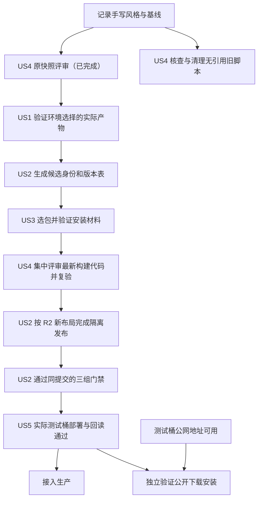

# 对话经过

会话 `01a217c9-5eb7-7330-8504-c92e85f1cec3` · 轮次 `01a217c9-9236-7811-a890-0b0e3b32adec`

<!-- foundry-detail 01a217c9-5eb7-7330-8504-c92e85f1cec3 01a217c9-9236-7811-a890-0b0e3b32adec -->
<!-- foundry-event bf4cd428dea0e7ff3b2f2cbf13a5fe19f01dc750b6d73558f1ecc33fcab5f8d0 -->
## 进度原话

- 来源定位：字节 154314

~~~text
我会先用 `using-superpowers` 和 `conversation-recording` 核对项目约定，再对照这份规格的任务、验收记录和当前 Git 状态，判断下一步该做什么。
~~~

<!-- foundry-event fa9227a797988aa00a09dc5fbe295aceec06ae777278d87a2b9f893572d829ee -->
## 工具调用 `exec` · `call_55311a163cda4d49b171f3951877a69c`

- 来源定位：字节 155340

~~~text
工作目录：/home/by152/workspace/ena/agent-foundry/feature/init
const results=await Promise.allSettled([tools.exec_command({cmd:"git status --short --branch && git log -6 --oneline",max_output_tokens:2500}),tools.exec_command({cmd:"cat /home/by152/.codex/plugins/cache/openai-curated-remote/superpowers/7.0.1/skills/using-superpowers/SKILL.md .agents/skills/conversation-recording/SKILL.md",max_output_tokens:6000}),tools.exec_command({cmd:"rg --files --hidden -g '!**/.git/**' specs/skills/003-skills-release-pipeline; rg --files --hidden -g 'AGENTS.md' -g '!**/.git/**'",max_output_tokens:3500})]);for(const r of results)text(r.value??r.reason);

~~~

<!-- foundry-event 289f9bcba8b4d4af7fc8bfe6cf7675808b3977b9398b302a64e4a2cbf9e5b7ad -->
## 宿主命令执行

- 来源定位：字节 156449

~~~text
{
  "command": "[已省略环境变量值] -lc 'cat /home/by152/.codex/plugins/cache/openai-curated-remote/superpowers/7.0.1/skills/using-superpowers/SKILL.md .agents/skills/conversation-recording/SKILL.md'",
  "workdir": "file:///home/by152/workspace/ena/agent-foundry/feature/init",
  "exitCode": 0,
  "status": "completed"
}
~~~

<!-- foundry-event 3a6692d071edec455e2c55872980bce771244e1d00f780ac2b72cf0cdb0d5e60 -->
## 工具结果 `exec-a43a2a9c-e3de-40c8-85e8-9706ebb59a9f`

- 来源定位：字节 156449

~~~text
---
name: using-superpowers
description: Use when starting any conversation - establishes how to find and use skills, requiring skill invocation before ANY response including clarifying questions
---

<SUBAGENT-STOP>
If you were dispatched as a subagent to execute a specific task, ignore this skill.
</SUBAGENT-STOP>

<EXTREMELY-IMPORTANT>
If you think there is even a 1% chance a skill might apply to what you are doing, you ABSOLUTELY MUST invoke the skill.

IF A SKILL APPLIES TO YOUR TASK, YOU DO NOT HAVE A CHOICE. YOU MUST USE IT.

This is not negotiable. You cannot rationalize your way out of this.
</EXTREMELY-IMPORTANT>

## The Rule

**Invoke relevant or requested skills BEFORE any response or action** — including clarifying questions, exploring the codebase, or checking files. If it turns out wrong for the situation, you don't have to use it.

**Before entering plan mode:** if you haven't already brainstormed, invoke the brainstorming skill first.

Then announce "Using [skill] to [purpose]" and follow the skill exactly. If it has a checklist, create a todo per item.

## Skill Priority

When multiple skills apply, process skills come first — they set the approach, then implementation skills (frontend-design, etc.) carry it out. Brainstorming and systematic-debugging are Superpowers' most common process skills, but the rule holds for any of them.

- "Let's build X" → superpowers:brainstorming first, then implementation skills.
- "Fix this bug" → superpowers:systematic-debugging first, then domain skills.

## Red Flags

These thoughts mean STOP—you're rationalizing:

| Thought | Reality |
|---------|---------|
| "This is just a simple question" | Questions are tasks. Check for skills. |
| "I need more context first" | Skill check comes BEFORE clarifying questions. |
| "Let me explore the codebase first" | Skills tell you HOW to explore. Check first. |
| "I can check git/files quickly" | Files lack conversation context. Check for skills. |
| "Let me gather information first" | Skills tell you HOW to gather information. |
| "This doesn't need a formal skill" | If a skill exists, use it. |
| "I remember this skill" | Skills evolve. Read current version. |
| "This doesn't count as a task" | Action = task. Check for skills. |
| "The skill is overkill" | Simple things become complex. Use it. |
| "I'll just do this one thing first" | Check BEFORE doing anything. |
| "This feels productive" | Undisciplined action wastes time. Skills prevent this. |
| "I know what that means" | Knowing the concept ≠ using the skill. Invoke it. |

## Platform Adaptation

If your harness appears here, read its reference file for special instructions:

- Claude Code: `references/claude-code-tools.md`
- Codex: `references/codex-tools.md`
- Pi: `references/pi-tools.md`
- Antigravity: `references/antigravity-tools.md`
- Hermes Agent: `references/hermes-tools.md`
- Muse: `references/muse-tools.md`

## User Instructions

User instructions (CLAUDE.md, AGENTS.md, GEMINI.md, etc, direct requests) take precedence over skills, which in turn override default behavior. Only skip skill workflows or instructions when your human partner has explicitly told you to.
---
name: conversation-recording
description: 核对 Codex CLI 项目级对话记录、资料位置和保存缺口，适用于首条消息、普通问答、业务请求、提交停写及会话恢复。
compatibility: 项目级自动入口适用于 Linux 上已启用分页会话的 Codex CLI 0.172.0，安装与回调需要 Python 3.10 或更高版本。
---

# 保存 Codex 会话记录

项目级安装交付本 Skill 和 Codex Hook。已从正式入口安装并在 Codex 完成信任时，首条用户原话、已完成的工具活动和实际最终回复由 Hook 保存。查阅记录或处理缺口时按[触发和保存时机](references/recording-timing.md)定位。把修复、实际 Git 提交和后续普通动作拆成独立调用，使每次提交及其结果可按发生顺序跳过记录。

项目安装位于 `.agents/skills/conversation-recording`，安装归属可从同目录的 `.foundry-recording-install.json` 核对。直接处理用户请求，由宿主 Hook 完成记录。用户要求查阅记录时，把查阅作为本轮业务。根据[资料契约](references/storage-contract.md)定位主记录和详情，根据[写入失败与重试](references/write-failures.md)说明仍缺失的范围。

~~~

<!-- foundry-event e82544f9256012c11808520258d7b115ad83e7cb2e7f5997fae6994fc0876814 -->
## 宿主命令执行

- 来源定位：字节 161931

~~~text
{
  "command": "[已省略环境变量值] -lc 'rg --files --hidden -g '\"'\"'!**/.git/**'\"'\"' specs/skills/003-skills-release-pipeline; rg --files --hidden -g '\"'\"'AGENTS.md'\"'\"' -g '\"'\"'!**/.git/**'\"'\"''",
  "workdir": "file:///home/by152/workspace/ena/agent-foundry/feature/init",
  "exitCode": 0,
  "status": "completed"
}
~~~

<!-- foundry-event 91b4b927a9550dad564b24c2b5f9dd31aa473c65b50975a619462f3acc576381 -->
## 工具结果 `exec-5f9abf22-6ac0-41f2-a9bd-2f0f92898a89`

- 来源定位：字节 161931

~~~text
specs/skills/003-skills-release-pipeline/data-model.md
specs/skills/003-skills-release-pipeline/checklists/requirements.md
specs/skills/003-skills-release-pipeline/spec.md
specs/skills/003-skills-release-pipeline/diagrams.md
specs/skills/003-skills-release-pipeline/implementation/T004.md
specs/skills/003-skills-release-pipeline/implementation/T006.md
specs/skills/003-skills-release-pipeline/implementation/T008.md
specs/skills/003-skills-release-pipeline/implementation/T001.md
specs/skills/003-skills-release-pipeline/implementation/T002.md
specs/skills/003-skills-release-pipeline/implementation/T007.md
specs/skills/003-skills-release-pipeline/mvu.md
specs/skills/003-skills-release-pipeline/plan.md
specs/skills/003-skills-release-pipeline/research.md
specs/skills/003-skills-release-pipeline/coding-style.md
specs/skills/003-skills-release-pipeline/contracts/install.md
specs/skills/003-skills-release-pipeline/quickstart.md
specs/skills/003-skills-release-pipeline/contracts/build-and-publish.md
specs/skills/003-skills-release-pipeline/tasks.md
specs/skills/003-skills-release-pipeline/analysis/legacy-script-review.md
specs/skills/003-skills-release-pipeline/analysis/build-plugin-review.md
specs/skills/003-skills-release-pipeline/requirements/raw/2026-11-26-temporary-mount-script-scope.md
specs/skills/003-skills-release-pipeline/analysis/spec-analysis/README.md
specs/skills/003-skills-release-pipeline/requirements/raw/2026-11-26-review-current-code.md
specs/skills/003-skills-release-pipeline/requirements/raw/2026-11-26-environment-naming.md
specs/skills/003-skills-release-pipeline/requirements/raw/2026-11-26-default-production-environment.md
specs/skills/003-skills-release-pipeline/requirements/raw/2026-11-26-vite-built-in-mode.md
specs/skills/003-skills-release-pipeline/requirements/raw/2026-11-26-sync-build-acceptance.md
specs/skills/003-skills-release-pipeline/requirements/prompts/2026-11-25-skills-release-pipeline.md
AGENTS.md

~~~

<!-- foundry-event c4b7f7c97a07a1ca225b71547598c1a858545ef8c030807526694789a8fc4667 -->
## 宿主命令执行

- 来源定位：字节 164903

~~~text
{
  "command": "[已省略环境变量值] -lc 'git status --short --branch && git log -6 --oneline'",
  "workdir": "file:///home/by152/workspace/ena/agent-foundry/feature/init",
  "exitCode": 0,
  "status": "completed"
}
~~~

<!-- foundry-event 60af0934605c2cad205ac17ab8312364401795f8cee69da978e0f39736b5763a -->
## 工具结果 `exec-4d19fb5b-3bb7-4d0b-a228-16ea6f01f55b`

- 来源定位：字节 164903

~~~text
## feature/init...origin/feature/init
 M .codex/hooks.json
?? .specify/memory/conversation-recording/records/2026-11-26/01a217c7-b41f-7b91-bcde-987dd5ea5f83.md
?? .specify/memory/conversation-recording/records/2026-11-26/01a217c9-3007-7462-98ab-a409bde300ae.md
?? .specify/memory/conversation-recording/records/2026-11-26/01a217c9-5eb7-7330-8504-c92e85f1cec3.md
?? .specify/memory/conversation-recording/records/2026-11-26/details/01a217c7-b41f-7b91-bcde-987dd5ea5f83/
?? .specify/memory/conversation-recording/records/2026-11-26/details/01a217c9-3007-7462-98ab-a409bde300ae/
1233ff9 123
ce0fab3 feat: 接通技能环境构建并同步会话记录与文档站规划
e731936 feat(skills): 接入独立会话记录 Hook 并补齐主线发布规格
1bcc1bd feat(skills): 更新 Spec Kit 挂载并完善会话自动记录规划
d75e52b feat(skills): 改版会话记录并同步隔离验收结果
eb866f6 docs: 补充对话记录规格、技能发布需求和文档站提示词

~~~

<!-- foundry-event 84fc7ba64e0a207110a374982bb1eaa6e21df0b053c7da6a2bde9dfaf5ad0815 -->
## 工具调用 `Bash` · `exec-a43a2a9c-e3de-40c8-85e8-9706ebb59a9f`

- 来源定位：工具事件 exec-a43a2a9c-e3de-40c8-85e8-9706ebb59a9f

~~~text
工作目录：/home/by152/workspace/ena/agent-foundry/feature/init
{
  "command": "cat /home/by152/.codex/plugins/cache/openai-curated-remote/superpowers/7.0.1/skills/using-superpowers/SKILL.md .agents/skills/conversation-recording/SKILL.md"
}
~~~

<!-- foundry-event 3d1b401220ca3b2c00dcde4ed36f259cbd499270e39d5f73a44320fe0083f6bb -->
## 工具调用 `Bash` · `exec-5f9abf22-6ac0-41f2-a9bd-2f0f92898a89`

- 来源定位：工具事件 exec-5f9abf22-6ac0-41f2-a9bd-2f0f92898a89

~~~text
工作目录：/home/by152/workspace/ena/agent-foundry/feature/init
{
  "command": "rg --files --hidden -g '!**/.git/**' specs/skills/003-skills-release-pipeline; rg --files --hidden -g 'AGENTS.md' -g '!**/.git/**'"
}
~~~

<!-- foundry-event 9e2f7a0833d8e90dc491da6a6dcefbdac99c845ac0d89c416471a5adef03b663 -->
## 工具调用 `Bash` · `exec-4d19fb5b-3bb7-4d0b-a228-16ea6f01f55b`

- 来源定位：工具事件 exec-4d19fb5b-3bb7-4d0b-a228-16ea6f01f55b

~~~text
工作目录：/home/by152/workspace/ena/agent-foundry/feature/init
{
  "command": "git status --short --branch && git log -6 --oneline"
}
~~~

<!-- foundry-event 51212d014c010af0a9b6e16ca951337f4dcfc1375b3b9b7a8b68c883470a078a -->
## 工具结果 `call_55311a163cda4d49b171f3951877a69c`

- 来源定位：字节 167504

~~~text
[
  {
    "type": "input_text",
    "text": "Script completed\nWall time 0.5 seconds\nOutput:\n"
  },
  {
    "type": "input_text",
    "text": "{\"chunk_id\":\"0252c9\",\"wall_time_seconds\":0.0000103,\"exit_code\":0,\"original_token_count\":244,\"output\":\"## feature/init...origin/feature/init\\n M .codex/hooks.json\\n?? .specify/memory/conversation-recording/records/2026-11-26/01a217c7-b41f-7b91-bcde-987dd5ea5f83.md\\n?? .specify/memory/conversation-recording/records/2026-11-26/01a217c9-3007-7462-98ab-a409bde300ae.md\\n?? .specify/memory/conversation-recording/records/2026-11-26/01a217c9-5eb7-7330-8504-c92e85f1cec3.md\\n?? .specify/memory/conversation-recording/records/2026-11-26/details/01a217c7-b41f-7b91-bcde-987dd5ea5f83/\\n?? .specify/memory/conversation-recording/records/2026-11-26/details/01a217c9-3007-7462-98ab-a409bde300ae/\\n1233ff9 123\\nce0fab3 feat: 接通技能环境构建并同步会话记录与文档站规划\\ne731936 feat(skills): 接入独立会话记录 Hook 并补齐主线发布规格\\n1bcc1bd feat(skills): 更新 Spec Kit 挂载并完善会话自动记录规划\\nd75e52b feat(skills): 改版会话记录并同步隔离验收结果\\neb866f6 docs: 补充对话记录规格、技能发布需求和文档站提示词\\n\"}"
  },
  {
    "type": "input_text",
    "text": "{\"chunk_id\":\"081a8a\",\"wall_time_seconds\":0.00002469,\"exit_code\":0,\"original_token_count\":1104,\"output\":\"---\\nname: using-superpowers\\ndescription: Use when starting any conversation - establishes how to find and use skills, requiring skill invocation before ANY response including clarifying questions\\n---\\n\\n<SUBAGENT-STOP>\\nIf you were dispatched as a subagent to execute a specific task, ignore this skill.\\n</SUBAGENT-STOP>\\n\\n<EXTREMELY-IMPORTANT>\\nIf you think there is even a 1% chance a skill might apply to what you are doing, you ABSOLUTELY MUST invoke the skill.\\n\\nIF A SKILL APPLIES TO YOUR TASK, YOU DO NOT HAVE A CHOICE. YOU MUST USE IT.\\n\\nThis is not negotiable. You cannot rationalize your way out of this.\\n</EXTREMELY-IMPORTANT>\\n\\n## The Rule\\n\\n**Invoke relevant or requested skills BEFORE any response or action** — including clarifying questions, exploring the codebase, or checking files. If it turns out wrong for the situation, you don't have to use it.\\n\\n**Before entering plan mode:** if you haven't already brainstormed, invoke the brainstorming skill first.\\n\\nThen announce \\\"Using [skill] to [purpose]\\\" and follow the skill exactly. If it has a checklist, create a todo per item.\\n\\n## Skill Priority\\n\\nWhen multiple skills apply, process skills come first — they set the approach, then implementation skills (frontend-design, etc.) carry it out. Brainstorming and systematic-debugging are Superpowers' most common process skills, but the rule holds for any of them.\\n\\n- \\\"Let's build X\\\" → superpowers:brainstorming first, then implementation skills.\\n- \\\"Fix this bug\\\" → superpowers:systematic-debugging first, then domain skills.\\n\\n## Red Flags\\n\\nThese thoughts mean STOP—you're rationalizing:\\n\\n| Thought | Reality |\\n|---------|---------|\\n| \\\"This is just a simple question\\\" | Questions are tasks. Check for skills. |\\n| \\\"I need more context first\\\" | Skill check comes BEFORE clarifying questions. |\\n| \\\"Let me explore the codebase first\\\" | Skills tell you HOW to explore. Check first. |\\n| \\\"I can check git/files quickly\\\" | Files lack conversation context. Check for skills. |\\n| \\\"Let me gather information first\\\" | Skills tell you HOW to gather information. |\\n| \\\"This doesn't need a formal skill\\\" | If a skill exists, use it. |\\n| \\\"I remember this skill\\\" | Skills evolve. Read current version. |\\n| \\\"This doesn't count as a task\\\" | Action = task. Check for skills. |\\n| \\\"The skill is overkill\\\" | Simple things become complex. Use it. |\\n| \\\"I'll just do this one thing first\\\" | Check BEFORE doing anything. |\\n| \\\"This feels productive\\\" | Undisciplined action wastes time. Skills prevent this. |\\n| \\\"I know what that means\\\" | Knowing the concept ≠ using the skill. Invoke it. |\\n\\n## Platform Adaptation\\n\\nIf your harness appears here, read its reference file for special instructions:\\n\\n- Claude Code: `references/claude-code-tools.md`\\n- Codex: `references/codex-tools.md`\\n- Pi: `references/pi-tools.md`\\n- Antigravity: `references/antigravity-tools.md`\\n- Hermes Agent: `references/hermes-tools.md`\\n- Muse: `references/muse-tools.md`\\n\\n## User Instructions\\n\\nUser instructions (CLAUDE.md, AGENTS.md, GEMINI.md, etc, direct requests) take precedence over skills, which in turn override default behavior. Only skip skill workflows or instructions when your human partner has explicitly told you to.\\n---\\nname: conversation-recording\\ndescription: 核对 Codex CLI 项目级对话记录、资料位置和保存缺口，适用于首条消息、普通问答、业务请求、提交停写及会话恢复。\\ncompatibility: 项目级自动入口适用于 Linux 上已启用分页会话的 Codex CLI 0.172.0，安装与回调需要 Python 3.10 或更高版本。\\n---\\n\\n# 保存 Codex 会话记录\\n\\n项目级安装交付本 Skill 和 Codex Hook。已从正式入口安装并在 Codex 完成信任时，首条用户原话、已完成的工具活动和实际最终回复由 Hook 保存。查阅记录或处理缺口时按[触发和保存时机](references/recording-timing.md)定位。把修复、实际 Git 提交和后续普通动作拆成独立调用，使每次提交及其结果可按发生顺序跳过记录。\\n\\n项目安装位于 `.agents/skills/conversation-recording`，安装归属可从同目录的 `.foundry-recording-install.json` 核对。直接处理用户请求，由宿主 Hook 完成记录。用户要求查阅记录时，把查阅作为本轮业务。根据[资料契约](references/storage-contract.md)定位主记录和详情，根据[写入失败与重试](references/write-failures.md)说明仍缺失的范围。\\n\"}"
  },
  {
    "type": "input_text",
    "text": "{\"chunk_id\":\"249d9b\",\"wall_time_seconds\":0.00001634,\"exit_code\":0,\"original_token_count\":490,\"output\":\"specs/skills/003-skills-release-pipeline/data-model.md\\nspecs/skills/003-skills-release-pipeline/checklists/requirements.md\\nspecs/skills/003-skills-release-pipeline/spec.md\\nspecs/skills/003-skills-release-pipeline/diagrams.md\\nspecs/skills/003-skills-release-pipeline/implementation/T004.md\\nspecs/skills/003-skills-release-pipeline/implementation/T006.md\\nspecs/skills/003-skills-release-pipeline/implementation/T008.md\\nspecs/skills/003-skills-release-pipeline/implementation/T001.md\\nspecs/skills/003-skills-release-pipeline/implementation/T002.md\\nspecs/skills/003-skills-release-pipeline/implementation/T007.md\\nspecs/skills/003-skills-release-pipeline/mvu.md\\nspecs/skills/003-skills-release-pipeline/plan.md\\nspecs/skills/003-skills-release-pipeline/research.md\\nspecs/skills/003-skills-release-pipeline/coding-style.md\\nspecs/skills/003-skills-release-pipeline/contracts/install.md\\nspecs/skills/003-skills-release-pipeline/quickstart.md\\nspecs/skills/003-skills-release-pipeline/contracts/build-and-publish.md\\nspecs/skills/003-skills-release-pipeline/tasks.md\\nspecs/skills/003-skills-release-pipeline/analysis/legacy-script-review.md\\nspecs/skills/003-skills-release-pipeline/analysis/build-plugin-review.md\\nspecs/skills/003-skills-release-pipeline/requirements/raw/2026-11-26-temporary-mount-script-scope.md\\nspecs/skills/003-skills-release-pipeline/analysis/spec-analysis/README.md\\nspecs/skills/003-skills-release-pipeline/requirements/raw/2026-11-26-review-current-code.md\\nspecs/skills/003-skills-release-pipeline/requirements/raw/2026-11-26-environment-naming.md\\nspecs/skills/003-skills-release-pipeline/requirements/raw/2026-11-26-default-production-environment.md\\nspecs/skills/003-skills-release-pipeline/requirements/raw/2026-11-26-vite-built-in-mode.md\\nspecs/skills/003-skills-release-pipeline/requirements/raw/2026-11-26-sync-build-acceptance.md\\nspecs/skills/003-skills-release-pipeline/requirements/prompts/2026-11-25-skills-release-pipeline.md\\nAGENTS.md\\n\"}"
  }
]
~~~

<!-- foundry-event 52bd01e0597db4d3fda4b72a9216f2015d74b4043bb3d714d2b8353c3c78101a -->
## 工具调用 `exec` · `call_6452ecd749ca48efbef1b06af240dc52`

- 来源定位：字节 177065

~~~text
工作目录：/home/by152/workspace/ena/agent-foundry/feature/init
const results=await Promise.allSettled([tools.exec_command({cmd:"cat specs/skills/003-skills-release-pipeline/tasks.md specs/skills/003-skills-release-pipeline/quickstart.md",max_output_tokens:11500}),tools.exec_command({cmd:"cat specs/skills/003-skills-release-pipeline/analysis/spec-analysis/README.md specs/skills/003-skills-release-pipeline/implementation/T008.md specs/skills/003-skills-release-pipeline/analysis/build-plugin-review.md",max_output_tokens:11500}),tools.exec_command({cmd:"cat /home/by152/.codex/plugins/cache/openai-curated-remote/superpowers/7.0.1/skills/using-superpowers/references/codex-tools.md; git status --short -- specs/skills/003-skills-release-pipeline packages/skills; git log -8 --format='%h %s' -- specs/skills/003-skills-release-pipeline packages/skills; rg --files packages/skills | head -100",max_output_tokens:4500})]);for(const r of results)text(r.value??r.reason);

~~~

<!-- foundry-event d5ffa10b8eb9790e1e79c109621cfd0bd05124a76eb73e458bbd74906f7e8787 -->
## 宿主命令执行

- 来源定位：字节 178499

~~~text
{
  "command": "[已省略环境变量值] -lc 'cat specs/skills/003-skills-release-pipeline/analysis/spec-analysis/README.md specs/skills/003-skills-release-pipeline/implementation/T008.md specs/skills/003-skills-release-pipeline/analysis/build-plugin-review.md'",
  "workdir": "file:///home/by152/workspace/ena/agent-foundry/feature/init",
  "exitCode": 0,
  "status": "completed"
}
~~~

<!-- foundry-event f8693876c584f5d7322a1ce9a37a7f1873a84547b23dac33bb2ea772e13037f7 -->
## 工具结果 `exec-7d8bad9e-b238-4654-8259-efc4064fd91c`

- 来源定位：字节 178499

~~~text
# 主线技能构建与发布功能分析

本页解释当前计划。运行现状依据源码与已记录的基线。实现、测试桶回读和公网验收由任务及其实际证据判定。2026-11-25 用户确认按每个原功能点设一个里程碑。 [发布原始需求](../../../../../temp/b/1.md) · [评审原始需求](../../../../../temp/b/2.md) · [规格与已确认事项](../../spec.md) · [总体方案](../../plan.md) · [里程碑详情](../../mvu.md) · [任务清单](../../tasks.md)

## 构建插件评审与优化

维护者需要知道每个插件如何影响构建、安装和验证。T002 报告仅对应当时的 `1bcc1bd` 快照。T009 版本插件和 T012 安装入口完成后，T003 再集中评审，以开始前的最新代码为输入，核对相关手动修改、旧问题是否仍成立及有无新问题，按实际调用和证据确定优化归属并复验。专项工作仍由原任务负责；T003 完成后再接入 T014 发布工作流，T013 的平台前置核查仍可独立推进。 [评审输入确认](../../requirements/raw/2026-11-26-review-current-code.md) · [里程碑](../../mvu.md#构建插件评审与优化) · [T001、T002](../../tasks.md#构建插件评审与优化) · [T003](../../tasks.md#专项改动后的构建评审与优化)

## 旧脚本引用核查与清理

仓库仍有失效的默认脚本路径和可覆盖的动态路径。维护者先区分历史夹具、实际消费者和待核实用途，再删除已有证据支持的旧文件。引擎仍消费的旧归档内隐匿路径由其原接口负责。此项的工作流是调用链追溯、处置和回归取证，可与插件评审独立开展。 [旧脚本调研](../../research.md#评审范围与手写源码依据) · [里程碑](../../mvu.md#旧脚本引用核查与清理) · [T004 至 T005](../../tasks.md#旧脚本引用核查与清理)

## 环境机制

集合作者可按 Vite 当次 `mode` 配置启用条件，不需额外环境变量。技能包只保留 `build`，用 `--mode` 显式选择。T008 的默认与显式 `production` 产物逐字节一致，三个模式均按现有配置启用 `profile`。独立夹具验证了集合关闭时的交付范围。`write: false` 复验通过，输出目录和挂载回归的修复方案仍待确认。正式容器归档依赖包含被验改动的实际 Git 提交。 [环境决策](../../research.md#构建模式与集合选择) · [构建契约](../../contracts/build-and-publish.md#构建入口) · [选择与派生流程](../../diagrams.md#一次构建共享同一份技能选择) · [里程碑](../../mvu.md#环境机制) · [T008 复核证据](../../implementation/T008.md#续接复核与待确认的修复方案)

## 临时版本管理

一次独立发布产生一个时间戳，连接包内 VERSION、固定归档键和版本表条目。索引准备时只有明确缺失才可初始化，历史保留。安装者使用固定入口选择首条或指定条目，下载后核对 SHA-256、长度和包内时间戳再写项目。现行入口仍用示例根和 MD5，正式版本工具接管与故障回退已留待后续。 [数据模型](../../data-model.md) · [安装技术流程](../../diagrams.md#安装器核对同一个选中版本) · [里程碑](../../mvu.md#临时版本管理) · [T009 至 T012](../../tasks.md#临时版本管理)

## R2 目录结构修改

现行公共流程按提交和运行标识上传，计划迁为两个环境各自的固定归档键和根入口、根索引。同目标从读表到写回排队。归档与安装入口验过后才登记版本，明确失败终止该次发布，提交结果不明时只记录可复核证据。隔离验证先提供实际发布路径，三组门禁通过后再进入测试桶回读。生产接入依赖该回读，每次生产发布须通过其所选提交的三组门禁。公网安装依赖真实地址，早期需认证的历史地址经授权切换后，单独核对历史版本的安装结果。 [发布契约](../../contracts/build-and-publish.md#r2-写入与核验顺序) · [发布技术流程](../../diagrams.md#同目标串行准备与写入) · [里程碑](../../mvu.md#r2-目录结构修改) · [T013 至 T015](../../tasks.md#r2-目录结构修改) · [T018 至 T021](../../tasks.md#环境接入与验收)

## 测试流水线

现行 skills-test 固定放行。计划以环境产物、实际首条安装和隔离两次发布作为三组输入，接入同一提交的运行。用例失败、跳过或缺工具均阻止部署。已有 Node 与 Python 基线可供回归，旧工作流缺文件的失败及未来的实际 R2 回读各自留证。 [用例与证据](../../quickstart.md#2-在同一提交运行三组门禁) · [里程碑](../../mvu.md#测试流水线) · [T016 至 T017](../../tasks.md#测试流水线)

## 里程碑流转

同一个 R2 里程碑先完成隔离发布，再接续真实部署。图中两步通过测试流水线的放行结果衔接。故事标记对应 [任务清单中的独立验收](../../tasks.md#用户故事与独立验收)，并行前置见 [并行安排](../../tasks.md#并行安排)。归属和验收信号见 [里程碑详情](../../mvu.md)。具体代码位置分别见 [构建、发布及安装流程图](../../diagrams.md)。


# T008 环境构建验收

**关联任务**：[T008](../tasks.md#环境机制) · **前置**：[T006](T006.md)、[T007](T007.md) · **范围**：[临时脚本排除确认](../requirements/raw/2026-11-26-temporary-mount-script-scope.md)

2026-11-26，用户在收到“保留一个 `build`，不传 `--mode` 就走 `production`；其他模式用 `--mode` 指定；`profile` 暂时保持启用，用单独用例验证禁用集合”的验收口径后回复「开始验收」。该口径只用于 T008，不预先改变 T019 的生产发布要求。

## 验收步骤

1. 将实际技能包文件复制到隔离目录，注明 `HEAD` 和纳入的未提交输入。使用当前包的 `pnpm run build`，分别不传 mode 及显式传入 `--mode development`、`--mode release`、`--mode production`；核对默认与显式生产的输出一致，以及各模式的技能、隐匿候选、集合插件与挂载材料。`release` 应包含安装映射、说明和许可。
2. 仅在隔离副本中增加集合探针，覆盖有启用技能和插件的集合，以及集合内自身禁用的技能；再用关闭 `workflow` 集合的独立输入，检查实际工作流技能、隐匿候选和挂载脚本均不进入产物。用不支持的 mode 确认构建失败。
3. 复用已存在的相关回归，并用完整配置独立验证非默认 `outDir`（技能与入口都应写入该目录）及 `write: false`（返回挂载资产，不创建输出目录、不改写已有输出）。
4. 使用含本次输入的真实提交，经现有 Dockerfile 导出并检查容器归档。若该提交或 Docker 缺失，单列未执行，不以工作区构建代替。

只验证本地构建，不修改构建源码、工作流，不修改或执行 `scripts/dev/mount-speckit.sh`，不执行真实挂载或发布。

## 实际结果

2026-11-26，Linux、Node.js `v24.22.2`、pnpm `12.16.1`、Vite `8.3.8`。基线提交为 `e731936e2bddde4d9efeb21080d3d5b5ff6f2387`，被测内容为技能包当前工作区的跟踪文件（含暂存、未暂存改动），不是该提交本身。隔离复制的文件清单 SHA-256 为 `aaaa98a174b51d8bdc60163200eb59d7b5342ab817e337550e8be1801041187d`，未复制工作区原有 `dist`，复用已安装依赖。局部副本不能重装完整 workspace；用 `pnpm --config.verifyDepsBeforeRun=false run build`（隔离复跑时不触发自动安装）及相同 mode 参数得到与首轮逐字节一致的四组文件。

| 输入 | 实际技能与隐匿候选 | Spec Kit 挂载资产 | 测试发布材料 |
| --- | --- | --- | --- |
| 默认 `build` | 8 项，含 `profile`，不含 `eval` | 有，统一引擎入口已引用 | 无 |
| `build --mode production` | 8 项，与默认产物逐字节一致 | 有 | 无 |
| `build --mode development` | 11 项，额外纳入 3 项启用的 `eval` 技能，未纳入 `eval-short-rule` | 有 | 无 |
| `build --mode release` | 8 项，含 `profile`，不含 `eval` | 有 | `curl/skills.tsv`、`README.md`、`LICENSE` 齐全；映射的 8 条记录均指向实际正文 |

- **通过：开关与派生内容。** 隔离探针集合仅在 `development` 交付已启用技能、隐匿候选及子插件的 mode 标记，夹具内另一项有真实正文但关闭的技能未进入任何产物。`release`、`production` 均无探针集合产物。单独关闭 `workflow` 后，`release` 中对应 4 项技能及隐匿候选消失，Spec Kit 挂载脚本未生成，也不再被引擎入口引用；技能映射剩 4 条有效记录。生成的 Shell 资产均通过 `bash -n`。显式 `--mode staging` 构建以“不支持的技能构建模式”失败，原 `dist` 未被改动。
- **通过：`write: false`。** 完整 Vite 配置执行 `build({ mode: 'release', build: { write: false, outDir } })`，返回 8 项资产，含挂载、隐匿及安装映射。指定目录未创建，原 `dist` 的文件路径与 SHA-256 未变。
- **失败：`outDir`。** `build --mode release --outDir <隔离目录>` 两次退出 0，但指定目录只有 8 项生成资产、0 份技能正文；8 份正文全部写入默认 `dist/skill`。扫描器将 `target` 固定为 `dist/skill/...`，复制插件直接使用这一目标，导致安装映射在指定目录内指不到正文。 [扫描器](../../../../packages/skills/build/utils/scan-skills.ts#L182) · [复制钩子](../../../../packages/skills/build/plugins/vite-plugin-skill/index.ts#L223)
- **回归结果。** `vite-mode`、`collection-mode`、`vite-plugin-skill`、`vite-plugin-engine`、`speckit-mount`、`hidden-contract` 共 67 项通过，无跳过。包内 `lint` 和默认 `check-types` 通过，但 `tsc --listFilesOnly` 未覆盖动态挂载插件；隔离纳入 `src/**/plugin/**/*.ts` 后，`mount-script.ts:51` 报 `TS2345`（`string | undefined` 不能传给 YAML 解析器）。技能包 Python 回归运行 56 项，其中 `test_register_commands.py` 的 4 项在准备阶段报错：夹具未声明集合级 `enabled` 或 `publish`，默认 `production` 将该集合排除，测试找不到 `task-increment` 正文。两项回归问题均未修改源码或测试。
- **缺前置，未执行：正式容器导出与归档。** Docker 及 Buildx 可用；环境构建和相关技能输入尚未进入同一个真实提交，未用基线提交或工作区副本替代。无发布、部署或真实挂载操作。

**结论**：环境选择已在当前工作区隔离副本验证，T008 整体验收未通过。保留任务未完成；修复输出目录及相关回归后复验，再从包含被验输入的真实提交完成容器导出。T009 依赖 T008，不在本轮进入。

## 续接复核与待确认的修复方案

2026-11-26，以 `e731936` 为基线，复核当前技能包的跟踪文件，纳入暂存和未暂存的内容。

1. **输出目录**。给 `pnpm --config.verifyDepsBeforeRun=false run build --mode release --outDir` 分别传入含空格的相对路径和绝对路径，两次均退出 0。指定目录各有 8 项生成资产，映射列出的 8 份技能正文均落在默认 `dist/skill`。建议扫描器提供相对的技能路径，由复制插件在 `writeBundle` 以当次输出目录定位正文和附件。复验两种路径下所有安装映射均能找到正文，并核对默认 `dist` 的文件清单和摘要。 [扫描器](../../../../packages/skills/build/utils/scan-skills.ts#L178) · [复制钩子](../../../../packages/skills/build/plugins/vite-plugin-skill/index.ts#L222)
2. **挂载插件类型检查**。默认 `tsc --noEmit` 通过，`--listFilesOnly` 显示它未覆盖 `mount-script.ts`。隔离纳入 `src/**/plugin/**/*.ts` 后，`tsc --noEmit` 在 `frontmatter[1]` 报 TS2345。建议检查正则捕获组后再解析 YAML，并将动态加载的集合插件纳入技能包常规类型检查。 [挂载脚本生成](../../../../packages/skills/src/workflow/plugin/vite-plugin-speckit-mount/mount-script.ts#L43) · [类型配置](../../../../packages/skills/tsconfig.json#L8)
3. **命令挂载回归**。现有夹具直接导出集合配置，缺少集合级开关，默认 `production` 构建将其排除，4 项测试均因找不到技能目录而报错。只在隔离夹具补上 `enabled: true` 后，同样的 4 项断言全部通过。建议在测试源中补齐该字段。 [挂载回归夹具](../../../../packages/skills/tests/test_register_commands.py#L67)

`write: false` 复核返回 8 项资产，包含 `engine/script/speckit-mount.sh` 和安装映射。指定目录未创建，隔离构建的默认 `dist` 内容摘要一致。方案确认后，逐项复验上述结果，再跑 T008 的完整模式矩阵、相关 Node 与 Python 回归及内存构建。正式容器导出仍需包含被验改动的实际 Git 提交。
# T002 主线构建插件评审

2026-11-25。源码为 `1bcc1bd35c0447e888c87180ccad149b0eb9f7fd`，被审插件、构建、脚本和测试入口与工作区同版本。运行使用 `git archive` 导出的隔离源码，未纳入工作区的录制功能改动。评审覆盖 `build/plugins` 的 10 个文件、动态挂载插件、构建与安装调用，以及分发测试目录的 28 个文件。 [实施方案](../implementation/T002.md) · [T001 基线](../implementation/T001.md#实际复跑结果) · [构建与发布契约](../contracts/build-and-publish.md) · [安装契约](../contracts/install.md)

## 可独立优化的问题

以下四项已用正常构建入口或隔离夹具复跑。建议沿 T003 的已确认范围处理，并保留相关现行回归。每项验证可在同一隔离快照复验。 [原任务与处置顺序](../tasks.md#构建插件评审与优化)

### R1 发布材料校验失败时已清理上一轮输出

技能的安装名冲突在 `buildStart` 拒绝，已有测试验证该阶段会保留旧文件。发布清单的正文名称、附件和依赖校验在 `generateBundle` 调用 `createSkillMap` 时执行。此时 Vite 已可清理目标目录，导致本轮失败且上一轮产物丢失。本地发布构建和任何复用输出目录的调用受影响。 [前置校验](../../../../packages/skills/build/plugins/vite-plugin-skill/index.ts#L144) · [发布清单校验](../../../../packages/skills/build/plugins/vite-plugin-skill/index.ts#L186) · [旧输出保护回归](../../../../packages/skills/tests/distribution/vite-plugin-skill.test.mjs#L73)

- **复跑** 在快照中给一项已启用的正式技能正文加入一个不存在的 `references/` 文件链接。先向独立 `outDir` 放入 `previous.txt`，再调用完整 Vite 配置 `build({ mode: 'release', build: { outDir } })`。调用抛出「正式技能缺少引用附件」，`previous.txt` 已消失。
- **处置 T003** 在清理前完成发布材料检查，继续使用当次已校验的结果生成清单。回归同时断言失败诊断和旧目录文件保留。共享选择及目录参数的实现归 T007。

### R2 压缩器改变嵌套 heredoc 的解析

压缩器判定可折叠语句时检查语句自身的重定向以及二元链，普通命令中的命令替换可以含有更深的 heredoc。单行打印可能把结束边界改坏。curl 和隐匿插件都调用该压缩器。已构建出的四份脚本通过 `bash -n`，现有模板的安装回归通过。 [折叠条件](../../../../packages/skills/utils/minify-shell-script.ts#L9) · [折叠及写回](../../../../packages/skills/utils/minify-shell-script.ts#L60) · [现有压缩回归](../../../../packages/skills/tests/distribution/vite-plugin-skill.test.mjs#L272)

- **复跑** 使用一条 `printf`，其中的命令替换由 `cat` 读取带引号的多行 heredoc，后面保留一个普通参数，并另起一条 `printf`。把原文及 `minifyShellScript` 的输出分别通过 `bash -s` 执行。两个进程都退出 0，压缩版 stderr 出现 `unterminated here-document`，原文 stderr 为空。
- **处置 T003** 对包含嵌套 heredoc 的语句保留语法边界，继续覆盖参数字面量、换行和协议头。回归比较原文与压缩结果的退出码、stdout 和 stderr。

### R3 异步子插件报错丢失入口路径

引擎加载器能接收嵌套的 Vite 插件数组和 Promise。顶层工厂同步失败或顶层 Promise 拒绝会得到带入口路径的错误。数组内 Promise 的拒绝留给 Vite 展开，越过加载器的错误包装。构建仍失败，诊断缺少发生失败的子插件位置。 [工厂调用及错误包装](../../../../packages/skills/build/plugins/vite-plugin-engine/index.ts#L145) · [异步成功用例](../../../../packages/skills/tests/distribution/vite-plugin-engine.test.mjs#L168) · [同步失败用例](../../../../packages/skills/tests/distribution/vite-plugin-engine.test.mjs#L259)

- **复跑** 在快照的全局子插件目录加一个合法 `vite-plugin-*` 入口，让默认导出工厂返回包含异步拒绝 Promise 的两层数组。由 `vitePluginEngine(true)` 交给 Vite，使用 `write: false`。Vite 抛出夹具的原始错误文案，错误文本未带入口路径。
- **处置 T003** 在加载失败时保留入口路径和原始异常，保持成功的数组层级、输出及执行顺序。加入嵌套拒绝用例。

### R4 挂载声明校验的顺序与冲突

生成器把命令的命名空间或纯 hook 的技能名作为扩展 ID，逐项生成同名临时目录和注册命令。两个不同命令可落入同一个 ID，生成时未查重，运行到第二项时才失败，第一项已发送给 CLI。另有纯内容技能在确认有挂载声明之前就受扩展名称规则约束。技能分发允许数字开头的名称，纯内容项在同次构建中可能被无关挂载校验拒绝。当前已配置的 ID 互异。 [技能名称规则](../../../../packages/skills/build/plugins/vite-plugin-skill/index.ts#L8) · [纯内容技能声明](../../../../packages/skills/utils/define-collection-handle.ts#L15) · [挂载输入和扩展 ID](../../../../packages/skills/src/workflow/plugin/vite-plugin-speckit-mount/mount-script.ts#L84)

- **复跑** 以两项已安装的临时技能声明 `speckit.review.first` 与 `speckit.review.second`，用只计数的 `specify` 替身运行实际生成脚本。结果退出 1，第二次创建 `review` 目录失败，替身已收到一次 CLI 调用。另以 `name: '2-guide'`、`enabled: true`、无 hook 和 command 直接运行生成器，报告「非法挂载技能名称」。
- **处置 T003** 先区分纯内容与实际挂载项。对实际挂载项按现有扩展契约在构建时检查 ID 冲突。回归核对合法纯内容不会产生注册项，并核对冲突在注册前可见。保留缺件前置检查及真实 CLI 失败传播。 [现有空声明与 CLI 失败回归](../../../../packages/skills/tests/distribution/speckit-mount.test.mjs#L118)

## 已有专项任务接手的问题

| 发现                                                    | 调用影响与证据                                                                                                                                                                                                                                                                                                                                                                                                                                                                                                                                                                 | 处置                                                                                                                                |
| ------------------------------------------------------- | ------------------------------------------------------------------------------------------------------------------------------------------------------------------------------------------------------------------------------------------------------------------------------------------------------------------------------------------------------------------------------------------------------------------------------------------------------------------------------------------------------------------------------------------------------------------------------ | ----------------------------------------------------------------------------------------------------------------------------------- |
| 环境仍只按 `release` 布尔值分流，选择被多个插件分别计算 | 独立 CLI 复跑默认、development、prod 均为 11 项，含 profile 与 eval，只有 release 为 7 项并省略 profile。默认 CLI 日志标注 production。`scanSkills` 默认以 CWD 定位 `src`，引擎和挂载配置的默认来源经包内 `#src` 定位。选择与调用根差异为静态发现，见 [Vite 配置](../../../../packages/skills/vite.config.ts#L11)、[集合扫描](../../../../packages/skills/utils/scan-skills.ts#L60)、[引擎发现](../../../../packages/skills/build/plugins/vite-plugin-engine/index.ts#L20)、[挂载扫描](../../../../packages/skills/src/workflow/plugin/vite-plugin-speckit-mount/index.ts#L19) | T006 验证同进程时序，T007 统一来源及同次选择并兼容旧开关，T008 验证发布矩阵和交付材料                                               |
| 覆盖 `outDir` 时技能目录与资产分离                      | `vite build --mode release --outDir <隔离目录>` 成功，指定目录有 `VERSION`、curl、engine 及发布说明等资产，技能 0 项，固定 `dist/skill` 有 7 项。只打包指定目录的调用会缺技能正文。`write:false` 完整配置实测返回 8 个资产，两个目标目录均未创建。 [目标路径](../../../../packages/skills/utils/scan-skills.ts#L144) · [复制钩子](../../../../packages/skills/build/plugins/vite-plugin-skill/index.ts#L223)                                                                                                                                                                   | T006 固化覆盖参数与内存边界，T007 修复实际写出路径，T008 消费验证                                                                   |
| 开发挂载的复制名单独立于实际资产                        | `scripts/dev/mount-speckit.sh` 提取内存挂载资产，同时用硬编码的四项名单从源复制。当前配置和名单对应。启用项变更后，静态可见复制名单与生成脚本可能分离。 [内存构建及复制](../../../../scripts/dev/mount-speckit.sh#L74)                                                                                                                                                                                                                                                                                                                                                         | T007 对齐同次选择，T008 核对新增与禁用项、真实入口                                                                                  |
| 动态挂载代码遗漏于默认类型检查，且存在实错              | 默认 `tsc --noEmit` 通过，`--listFilesOnly` 未列出动态挂载两份 TS。仅在快照扩展 `include` 加入 `src/**/plugin/**/*.ts` 后，`tsc --noEmit -p` 退出 2，`mount-script.ts:51` 的 `frontmatter[1]` 是 `string \| undefined`，传给 `parse` 引发 TS2345。 [默认范围](../../../../packages/skills/tsconfig.json#L8) · [报错位置](../../../../packages/skills/src/workflow/plugin/vite-plugin-speckit-mount/mount-script.ts#L43)                                                                                                                                                        | T007 纳入检查并修正输入收窄，T008 保留挂载执行回归                                                                                  |
| `VERSION` 只有源码版本                                  | 各模式实测文件均为 `0.1.0` 加 LF。版本插件从包清单读 `version` 并直接生成一行，当前发布步骤也会把整份文件放进旧归档文件名。 [版本插件](../../../../packages/skills/build/plugins/vite-plugin-version/index.ts) · [清单读取](../../../../packages/skills/utils/read-package-version.ts) · [旧归档命名](../../../../.github/workflows/skills-deploy-common.yml#L81)                                                                                                                                                                                                              | T009 冻结发布标识及版本格式，T014 改用候选身份和固定对象键                                                                          |
| 现行安装入口仍消费旧完整度字段                          | 源脚本绑定示例下载根，默认选首条、显式要求唯一，下载后只核对 MD5 并直接解包。尚未验证长度、SHA-256、必需归档成员或包内普通 `VERSION`。目标技能同名保护发生在复制阶段。下载失败会退出，首条实际版本与失败步骤没有一起输出。 [入口源码](../../../../packages/skills/build/plugins/vite-plugin-curl/install.source.sh#L42) · [安装契约](../contracts/install.md#安装前置与结果)                                                                                                                                                                                                   | T011 复用真实归档并建立回环 HTTPS 的零写入验证，T012 实施选择、校验、报错和兼容行为                                                 |
| 构建、测试及有凭据上传尚未实现同次交接                  | release 测试工作流固定输出 `passed=true`，部署只看这个值。公共流程接受任意字符串 target，统一使用 release mode，同目标取消在途。实际 checkout 使用触发 SHA 并关闭凭据持久化，未锁安装依赖。上传步骤在同一个构建作业内才注入凭据，写旧运行目录中的两个对象，没有版本表、条件写入或回读。配置未显式限制 AWS 上传重试。 [占位门禁](../../../../.github/workflows/skills-test.yml) · [release 调用](../../../../.github/workflows/skills-deploy-release.yml) · [公共流程](../../../../.github/workflows/skills-deploy-common.yml)                                                  | T010 版本表准备，T013 平台与故障边界验证，T014 隔离交接、排队、条件写和回读，T015 隔离发布回归，T016 与 T017 接入真实门禁及被测 SHA |
| 容器归档、工作流及 README 需要各按入口核对              | Dockerfile 默认构建，导出整个 `dist`，其中附带归档只选 `engine`、`skill`。工作流显式 release 并归档整个 `dist`。按两处的 tar 参数在本机复跑分别确认有无 `VERSION`、`curl/install.sh` 和 `curl/skills.tsv`。包 README 描述工作流解包核对，当前 YAML 未执行该步骤。生产示例只有名称。 [Dockerfile](../../../../packages/skills/deploy/Dockerfile) · [工作流归档](../../../../.github/workflows/skills-deploy-common.yml#L57) · [包说明](../../../../packages/skills/README.md#L17) · [生产示例](../../../../.github/workflows/skills-deploy-prod.yml.example)                    | T008 真实容器导出，T014 和 T015 校验发布归档，T018 至 T020 按对应阶段验收，T021 同步实际入口说明                                    |

## 插件及辅助文件覆盖

根 `build` 和 `build:packages` 经 Turbo 运行技能包 `vite build`。主线 Vite 注册技能、curl、版本和引擎，默认写出 `dist` 并以 `virtual:skill` 驱动。容器调用根 `build:packages`，发布 job 直接运行技能包构建。开发挂载直接调用 Vite 的内存入口。 [根命令](../../../../package.json#L16) · [任务依赖](../../../../turbo.json) · [技能包命令](../../../../packages/skills/package.json#L17) · [Vite 注册](../../../../packages/skills/vite.config.ts)

| 文件                                                                                                                                                                                                    | 正常调用、应保留行为及关联问题                                                                                                                                                                     |
| ------------------------------------------------------------------------------------------------------------------------------------------------------------------------------------------------------- | -------------------------------------------------------------------------------------------------------------------------------------------------------------------------------------------------- |
| [vite-plugin-skill/index.ts](../../../../packages/skills/build/plugins/vite-plugin-skill/index.ts)                                                                                                      | Vite 在清理前检查源技能与重名，移除虚拟入口占位，发布时拼稳定 `skills.tsv`、README 和许可，再按选中项复制正文及附件。R1、环境选择及实际写出路径。                                                  |
| [vite-plugin-version/index.ts](../../../../packages/skills/build/plugins/vite-plugin-version/index.ts)                                                                                                  | 与 `readPackageVersion` 一起给普通和发布构建生成 `VERSION`，保留从包清单读取源码版本的职责。时间戳归 T009。                                                                                        |
| [vite-plugin-curl/index.ts](../../../../packages/skills/build/plugins/vite-plugin-curl/index.ts)                                                                                                        | 读取包内源码别名并压缩，交付 `curl/install.sh`。下载和解包属于运行时。R2。                                                                                                                         |
| [vite-plugin-curl/install.source.sh](../../../../packages/skills/build/plugins/vite-plugin-curl/install.source.sh)                                                                                      | 运行时分配独占临时目录，局部安装 jq，按版本选包与核对 MD5，复制到项目后最多调用一次同包引擎。部分复制保留已完成项和原退出码。旧接口的兼容回归归 T011、T012。                                       |
| [vite-plugin-engine/index.ts](../../../../packages/skills/build/plugins/vite-plugin-engine/index.ts)                                                                                                    | 按全局优先、集合随后和稳定目录顺序发现普通入口，代理子插件资产到 `engine`，在末尾生成统一入口，将其他 Bash 按相对路径排序。R3、同次选择。                                                          |
| [vite-plugin-engine/install-script.ts](../../../../packages/skills/build/plugins/vite-plugin-engine/install-script.ts)                                                                                  | 从模块位置读取模板，检查唯一占位和逐条转义后填入 Bash 数组。实际入口路径、字面量、顺序有现有回归。                                                                                                 |
| [vite-plugin-engine/install.source.sh](../../../../packages/skills/build/plugins/vite-plugin-engine/install.source.sh)                                                                                  | 检查同包脚本和隐匿协议，验证隐匿结果，再按适用选项执行挂载并传播返回值。当前隐匿文件确实缺失时允许同包根旧路径。这个兼容指向归档成员，旧源码目录的消费者沿 T004 核查。                             |
| [hidden-install/index.ts](../../../../packages/skills/build/plugins/vite-plugin-engine/sub-plugins/vite-plugin-hidden-install/index.ts)                                                                 | `buildStart` 读取并压缩模板后填候选，保留协议标记并经引擎输出。R2、同次候选归 T007。                                                                                                               |
| [hidden-install.template.ts](../../../../packages/skills/build/plugins/vite-plugin-engine/sub-plugins/vite-plugin-hidden-install/hidden-install.template.ts)                                            | 基于技能安装目录名生成 JSON 候选，整体作为 Bash 单引号字面量注入。候选与技能选择的来源归 T007。                                                                                                    |
| [hidden-install.source.sh](../../../../packages/skills/build/plugins/vite-plugin-engine/sub-plugins/vite-plugin-hidden-install/hidden-install.source.sh)                                                | 以当次成功名单和构建候选核对作用范围，独占创建结果，只对适用 Git 项目加本地排除，锁内写入。已有回归覆盖跟踪、历史及未完成内容的保留、去重、外部链接、反向规则与结果验证。                          |
| [挂载入口](../../../../packages/skills/src/workflow/plugin/vite-plugin-speckit-mount/index.ts) 与 [脚本生成](../../../../packages/skills/src/workflow/plugin/vite-plugin-speckit-mount/mount-script.ts) | 由 workflow 集合的 `plugin: true` 发现，输出 `engine/script/speckit-mount.sh`。运行时检查命令所需已安装正文，登记 hooks 和命令，遵循失败停止后续和临时清理。R4、类型和共享选择归实际问题对应任务。 |

## 测试入口及可复用证据

| 范围                   | 实际覆盖或限制                                                                                                                                                                                                                                                                                                                                                                                                                                                                                                                                                                                                                                                                     |
| ---------------------- | ---------------------------------------------------------------------------------------------------------------------------------------------------------------------------------------------------------------------------------------------------------------------------------------------------------------------------------------------------------------------------------------------------------------------------------------------------------------------------------------------------------------------------------------------------------------------------------------------------------------------------------------------------------------------------------- |
| 当前四组分发回归       | [技能插件](../../../../packages/skills/tests/distribution/vite-plugin-skill.test.mjs) 运行真实 Vite，检查基础复制、字节、链接、缺配置、冲突和压缩。 [引擎](../../../../packages/skills/tests/distribution/vite-plugin-engine.test.mjs) 检查动态发现、输出命名、嵌套异步成功和真实脚本顺序、参数及失败码。 [挂载](../../../../packages/skills/tests/distribution/speckit-mount.test.mjs) 生成真实脚本，但以 `specify` 替身断言输入和结果。 [隐匿与安装](../../../../packages/skills/tests/distribution/hidden-contract.test.mjs) 使用真实 Git、Bash 与 tar，curl 和 npm 用替身，版本表只有单项旧 MD5。已有通过结果支持现行行为，T006、T008 和 T011 仍有专项输入要验。               |
| 退役工作流单测         | [pipeline-workflow.test.mjs](../../../../packages/skills/tests/distribution/pipeline-workflow.test.mjs#L12) 和 [runner-archive.test.mjs](../../../../packages/skills/tests/distribution/runner-archive.test.mjs#L21) 在加载时读已不存在的旧 YAML。本轮复跑均为 ENOENT。分别让 T017 移植仍适用的 SHA、事件、权限断言，T015 移植实际归档成员、原字节、摘要和来源身份断言。                                                                                                                                                                                                                                                                                                           |
| 旧分发调度及沙箱       | [test-distribution.mjs](../../../../packages/skills/tests/distribution/test-distribution.mjs) 与 [sandbox.mjs](../../../../packages/skills/tests/distribution/sandbox.mjs) 提供隔离环境和结果汇总。调度表有八个当前缺失入口，现存入口仅据子进程状态判定，不核对 TAP 跳过或被测 SHA。正式门禁沿 T016 组装三类真实用例。                                                                                                                                                                                                                                                                                                                                                             |
| 旧构建、源码与集合     | `build-pipeline.test.mjs`、`collections.test.mjs`、`create-directories.test.mjs` 与 `helpers/build-fixture.mjs` 基于旧 `src/skills`、JSON 集合、MCP 清单或退役构建插件。可复用从真实源构建及核对字节的验证思路。 [旧构建入口](../../../../packages/skills/tests/distribution/build-pipeline.test.mjs) · [旧目录插件调用](../../../../packages/skills/tests/distribution/create-directories.test.mjs#L7)                                                                                                                                                                                                                                                                            |
| 旧安装、登记和在线来源 | `test-entry.mjs`、`mvu-b.mjs`、`mvu-c.mjs`、`mvu-e.mjs`、`agent-paths.test.mjs`、`online-agents.test.mjs`、`helpers/online-provider.mjs`、三个 `helpers/registration-*` 与两份 JSON 夹具分别服务旧调度、安装、登记或实验。部分默认 `script/*` 路径已经迁至 `script/old`，环境覆盖和夹具仍可能给出其他来源。`helpers/https-source.mjs` 的回环 HTTPS 可供 T011 复用。实际旧源码引用、历史证据和处置交 T004。 [旧安装入口](../../../../packages/skills/tests/distribution/mvu-b.mjs) · [旧登记默认路径](../../../../packages/skills/tests/distribution/helpers/registration-bash-fixture.mjs) · [HTTPS 夹具](../../../../packages/skills/tests/distribution/helpers/https-source.mjs) |
| 独立发现与对话沙箱     | `entry-discovery.test.mjs` 和 `helpers/entry-discovery.mjs` 覆盖独立候选入口与可选官方 CLI。`conversation-sandbox.test.mjs` 属 Spec 002 录制隔离及 Git 对照。两者用途各自保留。 [入口发现](../../../../packages/skills/tests/distribution/entry-discovery.test.mjs) · [对话沙箱](../../../../packages/skills/tests/distribution/conversation-sandbox.test.mjs)                                                                                                                                                                                                                                                                                                                     |

现行旧包兼容和旧源码消费者应分别取证。旧包回退由安装回归直接覆盖。开发 hooks 包装器的默认委托路径已失效，历史 Python 用例通过复制夹具并创建替身来核对转发。保留或清理源码的决定沿 T004、T005。 [旧包隐匿回归](../../../../packages/skills/tests/distribution/hidden-contract.test.mjs#L416) · [开发 hooks 包装器](../../../../scripts/dev/actions/register-hooks/register-hooks.sh#L6) · [历史夹具测试](../../../../packages/skills/tests/test_full_remount.py#L9)

## 本轮验证记录

隔离环境为 Linux x64、Node.js 26.8.1、pnpm 12.8.1、Vite 8.3.8、TS 6.0.3。源码提交未跟踪 `pnpm-lock.yaml`，复用 T001 对应的本地锁文件，安装前后 SHA-256 均为 `74b08c1ad4b87987d643d34282e13e1585ec728468d3b60139abbd0d686a07ea`。分发用例使用临时解包的 jq 1.8.1 和已有 uv 0.12.10。

| 验证                                                                                                                                                                                              | 实际结果                                                                                                                       |
| ------------------------------------------------------------------------------------------------------------------------------------------------------------------------------------------------- | ------------------------------------------------------------------------------------------------------------------------------ |
| `pnpm install --offline --frozen-lockfile --ignore-scripts --filter @foundry/skills...`，指定已有 pnpm store                                                                                      | 通过，875 个包全部复用。共享预设 `pnpm --filter @foundry/preset-config run build` 通过，仍有 TS 配置缺扩展名的既有 Vite 提示。 |
| `pnpm --filter @foundry/skills run lint`、`pnpm --filter @foundry/skills run check-types`                                                                                                         | 均退出 0。默认 `tsc --noEmit --listFilesOnly` 未包含动态挂载。临时配置加入动态目录后的类型检查失败一处，详见专项问题表。       |
| 包命令 `pnpm --filter @foundry/skills run build`，再分别用 `--mode development`、`--mode release`、`--mode prod`                                                                                  | 四次均退出 0，技能项数依次为 11、11、7、11。仅 release 交付 `curl/skills.tsv`、`README.md` 和 `LICENSE`。                      |
| `pnpm --filter @foundry/skills exec vite build --mode release --outDir <隔离目录>`，完整配置 `build({ mode: 'release', build: { write: false, outDir } })`，对 release 生成的 Bash 运行 `bash -n` | 输出散落问题复现。内存构建只返回 8 项资产，未创建两个目标目录。4 个脚本均通过语法核查。                                        |
| `node --test --test-reporter=tap packages/skills/tests/distribution/{vite-plugin-skill,vite-plugin-engine,speckit-mount,hidden-contract}.test.mjs`                                                | 64 项通过，0 失败，0 跳过。                                                                                                    |
| `node --test --test-reporter=tap packages/skills/tests/distribution/{pipeline-workflow,runner-archive}.test.mjs`                                                                                  | 2 项失败，0 跳过。分别查找已移除的 `skill-release.yml` 和 `publish.yml`。                                                      |
| 逐项隔离场景 R1 至 R4，在本机按容器和发布入口参数归档                                                                                                                                             | 复现发布校验后的旧目录丢失、嵌套 heredoc 警告、异步错误缺少入口、挂载 ID 冲突和纯内容误校验。两种 tar 的成员范围与源码吻合。   |

本次未执行完整容器构建、真实 Specify 注册、外部对象存储回读、生产或公网安装。既有 Python 39 项通过属于 T001。正式专项验收仍以对应 Task 的实际执行为准。 [T001 证据](../implementation/T001.md#实际复跑结果) · [后续验证入口](../quickstart.md)

~~~

<!-- foundry-event 68069685a9d842ba521479f4caecccf776d1c1e9392198d8af6276215a9bb66d -->
## 宿主命令执行

- 来源定位：字节 225127

~~~text
{
  "command": "[已省略环境变量值] -lc 'cat specs/skills/003-skills-release-pipeline/tasks.md specs/skills/003-skills-release-pipeline/quickstart.md'",
  "workdir": "file:///home/by152/workspace/ena/agent-foundry/feature/init",
  "exitCode": 0,
  "status": "completed"
}
~~~

<!-- foundry-event 86c4c7944a912dc5108f8c38039fa04aa5eeeee6612c92c4f970ce4e31c547e4 -->
## 工具结果 `exec-54683284-041a-4336-bc2e-33f9628b9c5c`

- 来源定位：字节 225127

~~~text
# Tasks: 主线技能按环境构建与发布

**输入** [原始发布需求](../../../temp/b/1.md) · [原始评审需求](../../../temp/b/2.md) · [规格](spec.md) · [实施计划](plan.md) · [六个里程碑](mvu.md)

US1 为按环境构建，US2 为版本及发布，US3 为安装，US4 为代码评审和清理，US5 为分阶段接入。任务按原功能点与实施依赖编排。同一任务在相关里程碑中共享。工程开始前按项目约定保存并确认该 Task 的实施方案。实际测试、S3 回读与公网安装结果按 [验收指南](quickstart.md) 分别留证。

## 准备与前置验证

按待验提交建立干净输入，执行 [工具与基线检查](quickstart.md#1-本地工具和基线) 并将结果纳入 T001。其它功能正在开发的 profile 源码以所属工作的实际提交为准，组装候选时核对被测 SHA 和来源文件清单。T006、T011、T013 分别承担构建时序、安装包校验和发布边界的技术前置，后续实现沿各自通过的验证骨架推进。

## 构建插件评审与优化

- [x] T001 [US4] 在仓库代码风格文档记录用户手写风格、可定位源码和当前规则，在 T001 实施记录保存构建及回归基线。 [代码风格](coding-style.md) · [T001 实施记录与复跑基线](implementation/T001.md)
- [x] T002 [US4] 在 T001 后全量评审 packages/skills/build/plugins 及其构建、安装和测试调用链，将问题、调用影响、实际证据和处置归属存入本 Spec 的 analysis/build-plugin-review.md。 [实施方案](implementation/T002.md) · [评审与复跑证据](analysis/build-plugin-review.md)

最新代码的集中评审与优化安排在 [T003](#专项改动后的构建评审与优化)，已完成的 T002 保留为对照。

## 旧脚本引用核查与清理

- [x] T004 [P] [US4] 逐文件审阅 packages/skills/script，核对直接和动态引用、构建入口、安装、工作流、测试与历史迁移，将真实消费者、失效路径、夹具和用途未定项写入本 Spec 的 analysis/legacy-script-review.md。 [实施方案](implementation/T004.md) · [逐文件核查与复跑](analysis/legacy-script-review.md)
- [ ] T005 [US4] 在 T001 和 T004 后，仅清理 packages/skills/script 内已证实无消费者的旧代码，用受影响的调用及回归核对删除结果，在 analysis/legacy-script-review.md 逐项记录保留理由。

## 环境机制

T007 保留实施当时的任务与证据；当前构建入口和集合矩阵按 [T008 验收口径](implementation/T008.md)，不再要求 T007 当时的三个独立构建脚本。

- [x] T006 [US1] 在 T001 和 T002 后，用隔离 Vite 构建验证配置回调和插件上下文能取得实际 `mode`：默认 build 为 `production`，显式 development、release、production 分别保持原值；在同一进程连续构建时不得串用上次 mode。记录命令、观察值和失败边界，形成 T007 的 mode 传递验证依据；不改工作流或直接调用 Vite 的脚本。 [实施方案与实测](implementation/T006.md)
- [x] T007 [US1] 在 T006 验证通过后，为集合配置增加布尔值或按 Vite mode 求值的 `enabled`，由共享扫描函数接收并校验当次 mode，先过滤集合再扫描技能；显式 `enabled` 优先，缺省时兼容旧 `publish`。移除扫描调用方各自传入的 `publishOnly` 环境判断，避免与统一 mode 来源冲突。在 packages/skills/package.json 增加 `build:development`、`build:release`、`build:prod`，令既有 `build` 保持 Vite 默认 production。更新集合配置与分发回归，确认环境选择及 `build`/`build:prod` 一致；暂不改工作流、scripts/dev/mount-speckit.sh 和其他直接调用 Vite 的脚本。 [实施方案与实测](implementation/T007.md)
- [ ] T008 [US1] 在 T007 后复验技能复制、集合插件、隐匿及包内挂载产物均采用同次选择。通过同一 `build` 覆盖默认 `production` 和显式 `--mode production`、`development`、`release`，按当前配置保留 `profile`，用隔离夹具验证禁用集合及技能级禁用项，并确认 `release` 保留测试发布材料。用隔离 Vite 构建验证 `outDir`、`write: false`，并验证默认容器导出及归档。不修改或执行临时脚本 `scripts/dev/mount-speckit.sh`，不改工作流；生产发布要求仍由 T019 验收。 [验收方案与实测](implementation/T008.md) · [续接复核与待确认修复](implementation/T008.md#续接复核与待确认的修复方案) · [范围确认](requirements/raw/2026-11-26-temporary-mount-script-scope.md)

## 临时版本管理

- [ ] T009 [US2] 在 T001、T002 和 T008 后更新 packages/skills/build/plugins/vite-plugin-version/index.ts 及构建输入，冻结 UTC 毫秒发布标识。验证 VERSION 两字段、同源固定输入的构建字节一致及候选中标识对齐。 按 [数据模型](data-model.md) 核对以下约束。「源码包 package.json 的版本，进包后保持可独立读取。」 「UTC 毫秒时间戳，固定宽度 YYYYMMDDTHHmmssSSSZ。解析后须回格式化为同值。对同一目标属于唯一发布标识。」
- [ ] T010 [US2] 在 T009 后于 packages/skills/script/temporary-release 实现读取源表、明确缺失初始化与准备新表的可复用逻辑。隔离验证新条目置顶、历史顺序保留、标识冲突及非缺失错误拒绝，并记录供发布作业消费的表身份。 按 [数据模型](data-model.md) 核对以下约束。「候选 releaseTimestamp，唯一。固定归档键及包根 VERSION 均取同值。」 「实际目标下固定归档的绝对 HTTPS URL。无 URL 内凭据、短期签名、控制字符或片段。」 「归档原始字节长度，正的 JSON 安全整数。」 「归档原始字节的 SHA-256，64 位小写十六进制。」
- [ ] T011 [US3] 在 T001、T002 后用 packages/skills/tests/distribution/hidden-contract.test.mjs 的真实归档和隔离 HTTPS 夹具验证包内 VERSION 读取、归档成员检查及项目写入边界，保留通过的测试骨架。
- [ ] T012 [US3] 在 T009 和 T011 后调整 packages/skills/build/plugins/vite-plugin-curl/install.source.sh 与入口生成。实际验收默认首条和显式版本，分别验证 SHA-256、长度、VERSION 不匹配时零项目写入，并复验包内引擎及适用选项。同步 packages/skills/README.md 中安装契约与参数。

## 专项改动后的构建评审与优化

- [ ] T003 [US4] 在 T002、T009 和 T012 完成后、T014 接入发布工作流前，先评审本轮评审开始前的最新 `packages/skills/build/plugins` 及相关调用链，记录评审快照和纳入的相关未提交改动。对照 T002 历史结果确认仍成立的问题和新发现，再实施确认范围内的优化；专项问题保留原任务归属，用正常入口和分发回归核对处理结果。 [评审输入确认](requirements/raw/2026-11-26-review-current-code.md)

## R2 目录结构修改

### 隔离发布与平台前置

- [ ] T013 [US2] 在 T001 和 T002 后以 .github/workflows/skills-deploy-common.yml 的契约为输入验证同目标排队、制品交接及 S3 明确缺失、条件冲突和超时的可观察信号。隔离验证可继续，需真实平台的结果在与外部配置相关的实现和运行前按授权补齐，证据回填到本 Spec 的 analysis。
- [ ] T014 [US2] 在 T003 完成，且 T010、T012 和 T013 的适用前置通过后整理 .github/workflows/skills-deploy-common.yml 与 packages/skills/script/temporary-release，验证目标白名单、同次候选交接、读表至回读串行、固定归档后写入口再条件写表，以及失败终止和零重试。将测试目标构建接到 `build --mode release`，同步包内说明的构建和发布入口。按 [数据模型](data-model.md) 核对以下约束。「正式候选的目标与环境一致：release 对应测试桶，production 对应生产桶；先接 release，生产入口由 T019 接入。」 「固定键 release/<时间戳>/skills.tar.gz、正的安全整数字节数、小写 64 字符十六进制 SHA-256。」 「同候选的入口原字节摘要和长度，上传根入口前后核对。」 「由目标确定的 HTTPS 下载根。access 标明公网或需认证的 S3 验收，仅作为交接和运行证据。」 「工作流运行身份，供跨 job 核对和结果追溯。」
- [ ] T015 [US2] 在 T014 后用 packages/skills/tests/distribution 的实际发布实现与隔离对象存储复验首发、补发、并发、归档身份和中途写失败，记录同目标旧历史保留及三对象可读证据。旧工作流测试只移植仍有效的断言。

## 测试流水线

- [ ] T016 [US2] 在 T008、T012 和 T015 后于 packages/skills/package.json 串起 test:release，实际运行已有三组构建、选包和连续发布证据，验证缺工具、失败、跳过均返回不放行。
- [ ] T017 [US2] 在 T014 和 T016 后接通 .github/workflows/skills-test.yml 与 skills-deploy-release.yml，以触发 SHA 核对被测及待构建提交。验证三组同次真通过才进入部署、删除事件跳过及失败零放行。 按 [数据模型](data-model.md) 核对以下约束。「实际检出的完整提交 SHA，三组门禁、构建及制品核验采用同值。」

## 环境接入与验收

本阶段接续 R2 目录结构修改里程碑。公网安装和生产接入有各自的前置。

- [ ] T018 [US5] 在 T017 和实际测试桶操作授权具备后，按本 Spec 的 quickstart.md 执行 release 真实部署与同次三对象回读，保存目标和候选、归档 SHA-256、入口原字节与索引首条的证据。
- [ ] T019 [US5] 在 T018 的三组门禁与实际回读通过后，参考已有的 `.github/workflows/skills-deploy-prod.yml.example` 草稿接入 `.github/workflows/skills-deploy-production.yml` 手动入口。每次生产发布先对所选提交实际运行三组门禁，核对测试、`production` 模式的发布构建和交接候选的 SHA 一致及生产桶身份；确认正式候选排除 `profile` 及其派生数据、发布材料齐备，且未改变默认 `build`。用受控失败场景验证门禁失败、跳过、结果缺失或 SHA 不符均为零部署。实际外部操作按对应授权执行。
- [ ] T020 [US5] 在 T018 及测试桶真实公网根和相应授权具备后，依据本 Spec 的 quickstart.md 核对缓存和绑定实际 HTTPS 根的入口字节。发现历史认证 S3 地址时，先备份版本表并核对对应归档，经维护者明确授权完成地址切换，回读确认只变更必要的 URL，保留版本、顺序、归档键、长度和摘要。在隔离项目验证公网默认安装。发生历史地址迁移时，在另一个项目显式安装一个受影响版本。按实际前置和结果留证。
- [ ] T021 [US5] 在 T018 后依据当前有效入口更新 packages/skills/README.md 或受影响的既有说明，分别说明测试桶、生产及公网的实际状态，并核对示例路径、参数和必要前置。生产或公网待验时记录前置，取得 T019 或 T020 的新证据后同步。

## 结案前清理

- [ ] T022 在本期实施及适用验证后、整体结案前，核对 packages/skills、.github/workflows 和本 Spec 中的临时探针、失效代码与过程文档。记录位置、用途依据、清理或保留结果及引用回归。保护有效版本管理逻辑、验证骨架、历史事实及证据。无清理项时同样留证。

## 用户故事与独立验收

主任务用用户故事标记定位，表中的共享前置由原任务提供。各故事验收按规格独立取证。

| 用户故事             | 主任务                                                                                   | 独立验收信号                                                                                                               |
| -------------------- | ---------------------------------------------------------------------------------------- | -------------------------------------------------------------------------------------------------------------------------- |
| US1 按环境交付       | [T006 至 T008](#环境机制)                                                                | 读取真实产物，默认 `build` 与显式 `--mode production` 选择一致；`development`、`release` 按声明选择，四类消费者一致。 |
| US2 连续发布         | [T009、T010](#临时版本管理)、[T013 至 T015](#r2-目录结构修改)、[T016、T017](#测试流水线) | 从无索引起在隔离目标连续发布两次，首条指向后次，首发仍可取回。故障时同次零重试和未完成版本零登记，门禁按同提交取实际结果。 |
| US3 固定入口安装     | [T011、T012](#临时版本管理)                                                              | 用两份真实归档核对默认首条和显式版本的实际下载、安装文件。摘要、长度或包内版本不匹配均为零项目写入。                       |
| US4 插件评审与旧脚本 | [T001、T002](#构建插件评审与优化)、[T003](#专项改动后的构建评审与优化)、[T004、T005](#旧脚本引用核查与清理) | 从源码复核风格、逐项评审、直接和动态引用及处置记录，带有效消费者的文件零误删。                                             |
| US5 分阶段接入       | [T018 至 T021](#环境接入与验收)                                                          | 同次测试桶归档、入口和索引首条读回与候选一致。生产使用选定提交和生产桶，公网安装由实际 HTTPS 地址独立验证。                |

## 依赖与推荐顺序

T001 先固定风格和回归基线。T002 与 T004 的调用调查可并行，各自写评审记录。主线先做 T008 环境产物验收，再做 T009 版本插件与 T012 安装入口；两项代码改动完成后做 T003 集中评审，用评审开始时的最新代码验证整体构建行为，再接入 T014 发布工作流。T011 的包读取夹具和 T013 的平台调查可独立推进。所有实现和授权检查沿原 Task 的适用前置生效。

隔离发布的 T015 为 T016 第三组门禁提供实际逻辑。T017 通过后进入 T018，T019 与 T020 在 T018 后按各自条件推进。T020 的公网状态单独报告，生产接入以 T018 的门禁及实际 S3 回读为准。T022 位于执行序列末尾。

[用户故事和里程碑依赖图](analysis/spec-analysis/README.md#里程碑流转) 展示共享前置、隔离发布对测试门禁的输入，以及测试环境验收后的两个分支。

## 并行安排

- US4 起步时 T001 与 T004 可并行调查，分别记录用户手写风格和旧脚本调用。T005 依赖两者的结果。
- US1 与 US3 在 T001、T002 完成后可以分别推进 T006 的 Vite 夹具和 T011 的归档夹具。安装入口改动仍等候选身份和安装前置通过。
- US2 可同时准备 T013 的制品与存储边界验证。发布作业按同次版本表和候选依赖接通，三组门禁在三类结果具备后统一接入。
- US5 在 T018 通过后，T019 生产入口准备与 T020 公网验证可按各自前置独立推进，共享同次测试桶证据。

## 交付顺序

首个可独立验收的交付范围是 US1 环境机制。先完成 T001、T002 的风格与评审前置，随后用 T006 至 T008 交付可核对的模式产物。接下来交付版本身份和安装，复核最新构建代码及适用回归，再完成隔离发布、三组门禁及经过授权的测试桶回读。末尾复用 T022 做结案前清理。
# 验收指南：主线技能按环境构建与发布

在功能实现后按以下步骤复验，独立保存门禁、S3 回读和公网安装结果。当前规划继承已核对的基线，尚无新功能部署结果。 [范围与现状](spec.md) · [数据模型](data-model.md)

## 1. 本地工具和基线

以待验证的明确提交建立干净工作区。安装仓库锁定依赖及 mise 工具链。安装验收需要 Linux、Bash、curl、Node、npm、tar、jq、uv，真实挂载另需已初始化的隔离 Spec Kit 项目与 Specify。T008 用隔离 Vite 构建检查正式挂载产物及内存构建行为，不调用临时手动挂载脚本。容器验收需可用 Docker。

```bash
git rev-parse HEAD
pnpm install --frozen-lockfile
pnpm --filter @foundry/preset-config run build
pnpm --filter @foundry/skills run check-types
pnpm --filter @foundry/skills run lint
pnpm --filter @foundry/skills run test
node --test packages/skills/tests/distribution/{vite-plugin-skill,vite-plugin-engine,speckit-mount,hidden-contract}.test.mjs
```

预期满足目标包的类型检查和相关回归。验证实际动态加载的挂载子插件也进入类型检查。此前基线为 Node 64 项和 Python 39 项，Node 运行前需具备 jq。旧工作流测试的缺文件结果按现状记录，复用到新入口的断言有独立判定。

## 2. 在同一提交运行三组门禁

实现阶段提供技能包 test:release 命令，CI 与本地验收均调用同一个入口。提交核对后执行如下命令。

```bash
command -v jq
command -v uv
git rev-parse HEAD
pnpm --filter @foundry/skills run test:release
```

| 用例         | 输入和操作                                                                                                                                   | 预期观察                                                                                                                                               |
| ------------ | -------------------------------------------------------------------------------------------------------------------------------------------- | ------------------------------------------------------------------------------------------------------------------------------------------------------ |
| 按环境选择   | 运行无参数的 `build` 以及显式 `--mode development`、`--mode release`、`--mode production`，加入集合与技能级开关夹具。 | 默认与显式 `production` 选择一致；各 mode 按配置过滤集合，`release` 生成测试发布材料。未知 mode 失败。 |
| 安装器选包   | 生成两份标记不同的真实归档，用隔离 HTTPS 夹具提供倒序版本与根入口。分别默认选首条、显式选另一条，再分别让 SHA-256、长度和包内时间戳不一致。  | 请求的下载地址与实际安装文件都对应选中记录。三类失败各返回失败且无项目写入。默认挂载、--no-mount、--hidden 沿原接口复核。                              |
| 持久化与顺序 | 在独立对象存储边界执行实际版本准备及发布逻辑，首发后补发旧提交，并模拟同目标连续请求、读表错误、条件冲突和中途写入失败。                     | 第一轮从确认缺失开始，第二轮置顶并保留首发。归档目录和 VERSION 同值。失败运行零重试、零未完整条目登记。                                                |

本地隔离门禁无需真实桶凭据。作业证据保留三组结果、被测提交、关键产物和失败阶段。失败、工具缺失和必需测试跳过均阻止放行。队列调度及 R2 对象语义还需实际平台前置验证。 [发布契约](contracts/build-and-publish.md)

### 容器构建与产物导出

这是 T008 的单独产物验收。从仓库根设置本次待验的 SOURCE_REVISION 为实际提交 SHA。Dockerfile 使用该提交的源码作为构建上下文，并按本地默认配置构建。依赖和导出放在隔离目录。

```bash
(
  set -euo pipefail
  : "${SOURCE_REVISION:?需要待验提交 SHA}"
  docker_check_dir="$(mktemp -d)"
  mkdir "$docker_check_dir/source"
  git archive "$SOURCE_REVISION" | tar -xf - -C "$docker_check_dir/source"
  docker buildx build \
    --file "$docker_check_dir/source/packages/skills/deploy/Dockerfile" \
    --target artifacts --output "type=local,dest=$docker_check_dir/artifacts" \
    "$docker_check_dir/source"
  test -f "$docker_check_dir/artifacts/VERSION"
  test -f "$docker_check_dir/artifacts/curl/install.sh"
  test -f "$docker_check_dir/artifacts/engine/install.sh"
  test -f "$docker_check_dir/artifacts/skill/profile/conversation-recording/SKILL.md"
  test ! -d "$docker_check_dir/artifacts/skill/eval"
  tar -tzf "$docker_check_dir/artifacts/skills.tar.gz" |
    grep -Fx -- 'skill/coding/document-changed-symbols/SKILL.md'
  printf '容器构建提交与导出目录：%s %s\n' "$SOURCE_REVISION" "$docker_check_dir/artifacts"
)
```

记录待验 SHA、Docker 构建结果及 artifacts 的实际文件。按 [T008 确认的验收口径](implementation/T008.md)，未指定 Vite `--mode` 的容器构建按默认 `production` 选择，包含当前启用的 `profile`，不含仅开发模式启用的 `eval`，且保有 VERSION、安装入口与引擎入口。容器附带归档应包含已启用集合的技能成员。若缺可用 Docker 或含待验输入的真实提交，记录缺前置；本项不代替 T019 的生产发布验收。

## 3. 比较同源构建与交接候选

用两个干净输出目录和同一已确认的源码 SHA、依赖、构建模式、下载根及固定时间戳。下例中的下载根是隔离测试夹具输入。实现后的构建以这两个变量接收冻结值和下载根。

```bash
export FOUNDRY_SKILLS_RELEASE_TIMESTAMP=20261125T120905123Z
export FOUNDRY_SKILLS_DOWNLOAD_BASE_URL=https://downloads.fixture.invalid
comparison_dir="$(mktemp -d)"
pnpm --filter @foundry/skills run build --mode release --outDir "$comparison_dir/first"
pnpm --filter @foundry/skills run build --mode release --outDir "$comparison_dir/second"
diff -qr "$comparison_dir/first" "$comparison_dir/second"
```

预期两份输出的文件相对路径和原字节一致。CI 实际发布另对冻结归档的 SHA-256 与字节长度核验，复核包内入口和从构建作业交接给发布作业的入口字节一致。归档可记录 tar/gzip 元数据差异，实际上传使用候选制品交接的原字节。

## 4. 从测试桶回读同次对象

获得对 release 测试桶的适用授权后，通过现行测试发布入口运行目标提交。记录触发 SHA、三组门禁、候选 SHA-256、入口制品、发布时间戳及实际对象键。以下命令在已有授权配置的 AWS CLI 环境中只读运行。使用实际 release 桶、R2 S3 endpoint 与发布版本。

```bash
(
  set -euo pipefail
  : "${RELEASE_BUCKET:?需要本次实际测试桶}"
  : "${RELEASE_R2_ENDPOINT:?需要本次实际 R2 S3 地址}"
  : "${RELEASE_VERSION:?需要本次实际发布时间戳}"
  : "${CANDIDATE_ARCHIVE:?需要本次原始归档路径}"
  : "${CANDIDATE_ENTRY:?需要本次安装脚本路径}"
  : "${CANDIDATE_ARCHIVE_URL:?需要本次候选的固定归档地址}"
  readback_dir="$(mktemp -d)"
  aws --endpoint-url "$RELEASE_R2_ENDPOINT" s3api get-object \
    --bucket "$RELEASE_BUCKET" --key "release/$RELEASE_VERSION/skills.tar.gz" "$readback_dir/skills.tar.gz"
  aws --endpoint-url "$RELEASE_R2_ENDPOINT" s3api get-object \
    --bucket "$RELEASE_BUCKET" --key install.sh "$readback_dir/install.sh"
  aws --endpoint-url "$RELEASE_R2_ENDPOINT" s3api get-object \
    --bucket "$RELEASE_BUCKET" --key release.json "$readback_dir/release.json"
  archive_sha256="$(sha256sum "$CANDIDATE_ARCHIVE" | cut -d ' ' -f 1)"
  archive_bytes="$(wc -c < "$CANDIDATE_ARCHIVE")"
  readback_sha256="$(sha256sum "$readback_dir/skills.tar.gz" | cut -d ' ' -f 1)"
  readback_bytes="$(wc -c < "$readback_dir/skills.tar.gz")"
  [[ "$readback_sha256" == "$archive_sha256" ]] || { printf '%s\n' '归档 SHA-256 不匹配' >&2; exit 1; }
  [[ "$readback_bytes" == "$archive_bytes" ]] || { printf '%s\n' '归档字节长度不匹配' >&2; exit 1; }
  cmp "$CANDIDATE_ENTRY" "$readback_dir/install.sh"
  jq -e --arg version "$RELEASE_VERSION" --arg url "$CANDIDATE_ARCHIVE_URL" \
    --arg sha256 "$archive_sha256" --argjson bytes "$archive_bytes" \
    '.[0] | .version == $version and .url == $url and .sha256 == $sha256 and .bytes == $bytes' \
    "$readback_dir/release.json"
)
```

发布窗口内优先使用同次作业保存的回读件。另验收时若已发生后续发布，当前根对象可能属于随后运行，需使用保存的同次证据或另作授权的验收。预期归档实际 SHA-256 和字节数一致，入口原字节一致，首条的 version、url、bytes、sha256 全部对应实际候选和归档键。任一读取或比对失败即结束本次验收并返回失败。第一次明确缺表、第二次含历史及故障结果各按实际过程记录。缺公网域时使用认证 S3 回读证据。

## 5. 公网验证与生产接入

完成三组门禁和测试桶回读后，可依授权接入手动生产入口。每次手动运行对该次所选提交实际执行三组门禁。核对测试、`production` 模式的发布构建和交接候选的 SHA 一致以及生产桶身份。检查候选归档不含 `profile` 技能、插件及适用派生内容，并具备构建契约要求的完整发布材料。分别以门禁失败、跳过、缺结果和候选 SHA 不符进行受控验收，预期均无部署。

测试桶公网下载安装在实际 HTTPS 根和授权具备后独立执行。先核对该次候选入口绑定的真实下载根和实际版本表。历史条目若存认证 S3 地址，备份版本表并按对象键逐项核对归档长度和摘要。取得维护者授权后迁移必要 URL，确认回读只改变下载地址，版本、顺序和固定归档保持一致。记录迁移及缓存核对结果。 [下载根与切换](contracts/build-and-publish.md#下载根与切换)

```bash
(
  set -euo pipefail
  : "${PUBLIC_DOWNLOAD_ROOT:?需要实际公网 HTTPS 下载根}"
  : "${ISOLATED_SPEC_KIT_PROJECT:?需要已准备的隔离项目}"
  : "${CANDIDATE_ENTRY:?需要对应公网发布的原始入口路径}"
  if [[ -n "${HISTORICAL_RELEASE_VERSION:-}" ]]; then
    : "${HISTORICAL_SPEC_KIT_PROJECT:?需要另一个隔离项目}"
    [[ ! "$ISOLATED_SPEC_KIT_PROJECT" -ef "$HISTORICAL_SPEC_KIT_PROJECT" ]] || {
      printf '%s\n' '默认与历史版本验收须使用不同项目' >&2
      exit 1
    }
  fi
  public_check_dir="$(mktemp -d)"
  curl --fail --silent --show-error --location --proto '=https' --proto-redir '=https' \
    "${PUBLIC_DOWNLOAD_ROOT%/}/install.sh" --output "$public_check_dir/install.sh"
  cmp "$CANDIDATE_ENTRY" "$public_check_dir/install.sh"
  (
    cd "$ISOLATED_SPEC_KIT_PROJECT"
    bash "$public_check_dir/install.sh" --no-mount
  )
  if [[ -n "${HISTORICAL_RELEASE_VERSION:-}" ]]; then
    cd "$HISTORICAL_SPEC_KIT_PROJECT"
    bash "$public_check_dir/install.sh" "$HISTORICAL_RELEASE_VERSION" --no-mount
  fi
)
```

入口字节比对失败时，安装器不执行。对照实际索引首条、HTTPS 下载对象、安装摘要和项目文件。发生历史地址迁移时，将 HISTORICAL_RELEASE_VERSION 设为其中一个受影响的版本，在另一个隔离项目显式安装，并将实际地址、校验值和安装结果与迁移后版本表对应。适用挂载和隐匿另核对真实调用及其输出。公网状态不足时记录缺前置，S3 校验结果保留自身判定。

~~~

<!-- foundry-event bb2815298684bea4d1ab9a8c5c0ff5d363f4c11d3f9d4fb4f7e8d584856e284c -->
## 宿主命令执行

- 来源定位：字节 253660

~~~text
{
  "command": "[已省略环境变量值] -lc 'cat /home/by152/.codex/plugins/cache/openai-curated-remote/superpowers/7.0.1/skills/using-superpowers/references/codex-tools.md; git status --short -- specs/skills/003-skills-release-pipeline packages/skills; git log -8 --format='\"'\"'%h %s'\"'\"' -- specs/skills/003-skills-release-pipeline packages/skills; rg --files packages/skills | head -100'",
  "workdir": "file:///home/by152/workspace/ena/agent-foundry/feature/init",
  "exitCode": 0,
  "status": "completed"
}
~~~

<!-- foundry-event 1221e668205e637e1094789e9a3bee91def7483a74091fa6871fa11e05b8e7db -->
## 工具结果 `exec-9494cd7f-4976-4c14-8a1b-7ff2074ccdb9`

- 来源定位：字节 253660

~~~text
## Subagent dispatch requires multi-agent support

Add to your Codex config (`~/.codex/config.toml`):

```toml
[features]
multi_agent = true
```

This enables the multi-agent tools that skills like
`dispatching-parallel-agents` and `subagent-driven-development` use.
Which tools you get depends on the multi-agent version your model
preset selects (current presets run V2; older ones run V1). Trust your
actual tool list over any table — including this one — when they
disagree.

- **Spawning:** give children a clean context with
  `spawn_agent {fork_turns: "none"}`; the default `"all"` copies your
  entire transcript into the child. On Codex 0.145+, role files under
  `~/.codex/agents/` attach to isolated forks via `agent_type`.
  Full-history forks accept `model` and `reasoning_effort` overrides
  (only `agent_type` is refused there) — isolated forks are the SDD
  default for context hygiene, not because overrides require them.
- **Fix rounds:** resume the implementer with `followup_task` — it
  delivers your message, triggers a turn, and transparently reloads a
  child the harness evicted. Never dispatch a fresh implementer on the
  theory that a spawned agent cannot be messaged again; on V2 it
  always can.
- **Lifecycle:** V2 has no `close_agent`. Finished children are
  evicted automatically when slots are needed; leaving them unclosed
  costs nothing. Only V1 sessions have `close_agent` — there, close
  reviewers when their review returns, and close each implementer
  after its task's review passes.
- **Model names:** never copy a model name from a skill, table, or old
  session into `spawn_agent` without checking it against your current
  spawn allowlist — V2 accepts only V2-capable presets and hard-errors
  on the rest.

## Waiting on children

`wait_agent` is an event subscription, not a poll: a long wait wakes
the moment a child produces mailbox activity, with the same latency as
a short one. Short-timeout polling buys nothing and costs a tool call —
and a context rebill — per poll. In measured sessions, roughly
two-thirds of all wait calls were short polls that timed out.

- While you still have local work, do not wait at all. A completed
  child's final answer is pushed into your mailbox and arrives with
  your next turn.
- When you are genuinely idle with children outstanding, wait in
  bounded stretches: `wait_agent` with `timeout_ms` 300000-600000
  (5-10 minutes). After each stretch — wake or timeout — post one
  status line, run `list_agents`, and chase any child that finished
  without reporting. Never stack polls shorter than five minutes; the
  event subscription wakes a bounded stretch just as fast as a short
  one.
- Completion mail cannot wake an idle controller (it is delivered
  without triggering a turn); covering that idle window is
  `wait_agent`'s only job. A stretch that times out with no activity
  is your cue to reconcile, not to shorten the next stretch.

## Model routing on spawns

Every `spawn_agent` you issue — including when you are yourself a
spawned child running a fan-out — sets `model` AND `reasoning_effort`
explicitly, per the Model Selection rules of the skill you are
executing. Setting `model` alone is a trap: the child's effort
silently resets to that model's default, not to yours.

Ask your human partner to add a machine-level backstop to
`~/.codex/config.toml` so any spawn that slips through still routes to
a deliberate tier instead of silently inheriting the session's most
expensive model:

```toml
[agents]
default_subagent_model = "<a mid-tier model from your spawn allowlist>"
default_subagent_reasoning_effort = "medium"
```

## Environment Detection

Skills that create worktrees or finish branches should detect their
environment with read-only git commands before proceeding:

```bash
GIT_DIR=$(cd "$(git rev-parse --git-dir)" 2>/dev/null && pwd -P)
GIT_COMMON=$(cd "$(git rev-parse --git-common-dir)" 2>/dev/null && pwd -P)
BRANCH=$(git branch --show-current)
```

- `GIT_DIR != GIT_COMMON` → already in a linked worktree (skip creation)
- `BRANCH` empty → detached HEAD (cannot branch/push/PR from sandbox)

See `using-git-worktrees` Step 0 and `finishing-a-development-branch`
Step 1 for how each skill uses these signals.

## Codex App Finishing

When the sandbox blocks branch/push operations (detached HEAD in an
externally managed worktree), the agent commits all work and informs
the user to use the App's native controls:

- **"Create branch"** — names the branch, then commit/push/PR via App UI
- **"Hand off to local"** — transfers work to the user's local checkout

The agent can still run tests, stage files, and output suggested branch
names, commit messages, and PR descriptions for the user to copy.
ce0fab3 feat: 接通技能环境构建并同步会话记录与文档站规划
e731936 feat(skills): 接入独立会话记录 Hook 并补齐主线发布规格
1bcc1bd feat(skills): 更新 Spec Kit 挂载并完善会话自动记录规划
d75e52b feat(skills): 改版会话记录并同步隔离验收结果
96b268a feat: 更新技能测试部署、对话记录与文档站配置
e9aea96 feat(skills): 完善对话记录恢复规则、回归探针与验收证据
41ed596 feat(skills): 完善主线技能发布构建并接入 Codex 对话记录
6ab2daf feat(skills): 接通 Docker 产物导出与 R2 上传并补齐对话记录核查资料
packages/skills/eslint.config.ts
packages/skills/deploy/Dockerfile
packages/skills/types/preset-config.d.ts
packages/skills/build/plugins/vite-plugin-version/index.ts
packages/skills/script/old/register-commands/register-commands.ps1
packages/skills/tests/test_shadow_coverage.py
packages/skills/tests/test_conversation_recording.py
packages/skills/tests/test_full_remount.py
packages/skills/script/old/register-commands/README.md
packages/skills/script/old/register-commands/register-commands.sh
packages/skills/build/plugins/vite-plugin-skill/index.ts
packages/skills/build/plugins/vite-plugin-engine/install-script.ts
packages/skills/tests/test-register-commands.mjs
packages/skills/build/plugins/vite-plugin-engine/index.ts
packages/skills/script/old/mount-entry/mount-entry.sh
packages/skills/tsconfig.json
packages/skills/build/plugins/vite-plugin-engine/install.source.sh
packages/skills/tests/conversation-workflow/content-source.test.mjs
packages/skills/build/utils/minify-shell-script.ts
packages/skills/utils/define-collection-handle.ts
packages/skills/build/utils/scan-skills.ts
packages/skills/build/utils/read-package-version.ts
packages/skills/tests/conversation-workflow/recording-regression.mjs
packages/skills/tests/conversation-workflow/recording-regression.test.mjs
packages/skills/tests/test_register_commands.py
packages/skills/tests/conversation-workflow/recording-host.test.mjs
packages/skills/vite.config.ts
packages/skills/tests/test_shadow_runtime.py
packages/skills/script/old/mount-entry/mount-entry.ps1
packages/skills/script/old/mount-entry/README.md
packages/skills/tests/conversation-workflow/helpers/recording-host.py
packages/skills/script/old/register-hooks/register-hooks.ps1
packages/skills/script/old/register-hooks/README.md
packages/skills/script/old/register-hooks/register-hooks.sh
packages/skills/script/old/index.mjs
packages/skills/build/plugins/vite-plugin-engine/sub-plugins/vite-plugin-hidden-install/hidden-install.source.sh
packages/skills/build/plugins/vite-plugin-engine/sub-plugins/vite-plugin-hidden-install/index.ts
packages/skills/build/plugins/vite-plugin-engine/sub-plugins/vite-plugin-hidden-install/hidden-install.template.ts
packages/skills/package.json
packages/skills/README.md
packages/skills/build/plugins/vite-plugin-curl/index.ts
packages/skills/build/plugins/vite-plugin-curl/install.source.sh
packages/skills/tests/test-register-hooks.mjs
packages/skills/tests/conversation-workflow/helpers/sandbox.mjs
packages/skills/tests/conversation-workflow/helpers/recording-regression.py
packages/skills/tests/conversation-workflow/helpers/recording-hook-probe.py
packages/skills/tests/conversation-workflow/helpers/content-source.py
packages/skills/tests/fixtures/foundry-dev/scripts/dev/nuxt-prepare/nuxt-prepare.sh
packages/skills/script/old/install-skills/install-skills.sh
packages/skills/tests/test_mvu_documents.py
packages/skills/script/old/install-skills/README.md
packages/skills/tests/fixtures/README.md
packages/skills/script/old/install-skills/read-agents.mjs
packages/skills/script/old/install-skills/install-skills.ps1
packages/skills/src/frontend/collection.config.ts
packages/skills/src/profile/conversation-recording/SKILL.md
packages/skills/src/profile/conversation-recording/install.py
packages/skills/tests/distribution/collections.test.mjs
packages/skills/tests/distribution/online-agents.test.mjs
packages/skills/tests/distribution/create-directories.test.mjs
packages/skills/src/coding/business-node-delivery/SKILL.md
packages/skills/src/coding/collection.config.ts
packages/skills/src/frontend/nuxt-ui-styling/SKILL.md
packages/skills/src/frontend/vue-reactivity/SKILL.md
packages/skills/tests/distribution/hidden-contract.test.mjs
packages/skills/tests/distribution/vite-plugin-skill.test.mjs
packages/skills/tests/distribution/agent-paths.test.mjs
packages/skills/tests/distribution/sandbox.mjs
packages/skills/tests/distribution/pipeline-workflow.test.mjs
packages/skills/tests/distribution/vite-mode.test.mjs
packages/skills/tests/distribution/vite-plugin-engine.test.mjs
packages/skills/tests/distribution/mvu-e.mjs
packages/skills/tests/distribution/speckit-mount.test.mjs
packages/skills/tests/distribution/collection-mode.test.mjs
packages/skills/src/profile/conversation-recording/template/record.md
packages/skills/tests/distribution/test-entry.mjs
packages/skills/tests/distribution/runner-archive.test.mjs
packages/skills/src/profile/conversation-recording/template/detail.md
packages/skills/tests/distribution/mvu-b.mjs
packages/skills/tests/distribution/conversation-sandbox.test.mjs
packages/skills/tests/distribution/mvu-c.mjs
packages/skills/tests/distribution/entry-discovery.test.mjs
packages/skills/tests/distribution/build-pipeline.test.mjs
packages/skills/tests/distribution/helpers/https-source.mjs
packages/skills/tests/distribution/helpers/registration-fixture.mjs
packages/skills/tests/distribution/helpers/registration-bash-fixture.mjs
packages/skills/src/workflow/artifact-project-description/SKILL.md
packages/skills/tests/distribution/helpers/online-provider.mjs
packages/skills/tests/distribution/helpers/registration-migration.mjs
packages/skills/src/workflow/collection.config.ts
packages/skills/tests/distribution/helpers/build-fixture.mjs
packages/skills/src/coding/document-changed-symbols/SKILL.md
packages/skills/tests/distribution/helpers/entry-discovery.mjs
packages/skills/tests/distribution/test-distribution.mjs
packages/skills/tests/distribution/fixtures/legacy-registration-hooks.json
packages/skills/src/eval/eval-with-reference/SKILL.md
packages/skills/tests/distribution/fixtures/agents-1.7.4.json
packages/skills/src/eval/mcp-build-smoke/SKILL.md
packages/skills/src/profile/conversation-recording/recording/events.py
packages/skills/src/profile/conversation-recording/recording/__init__.py

~~~

<!-- foundry-event 4f08c068e8d0ab27b221adbabac56ad0c254493ce3911f9c427165dcf73bfd96 -->
## 工具调用 `Bash` · `exec-7d8bad9e-b238-4654-8259-efc4064fd91c`

- 来源定位：工具事件 exec-7d8bad9e-b238-4654-8259-efc4064fd91c

~~~text
工作目录：/home/by152/workspace/ena/agent-foundry/feature/init
{
  "command": "cat specs/skills/003-skills-release-pipeline/analysis/spec-analysis/README.md specs/skills/003-skills-release-pipeline/implementation/T008.md specs/skills/003-skills-release-pipeline/analysis/build-plugin-review.md"
}
~~~

<!-- foundry-event 6fff612f470960fec723dad1a160829c32018c3d2e4b94506a81a7c44db988ba -->
## 工具调用 `Bash` · `exec-54683284-041a-4336-bc2e-33f9628b9c5c`

- 来源定位：工具事件 exec-54683284-041a-4336-bc2e-33f9628b9c5c

~~~text
工作目录：/home/by152/workspace/ena/agent-foundry/feature/init
{
  "command": "cat specs/skills/003-skills-release-pipeline/tasks.md specs/skills/003-skills-release-pipeline/quickstart.md"
}
~~~

<!-- foundry-event 58dbf71bebe3286c0f89a13f7fcceebc10c66ab737cad5a3038fbd220bf310d6 -->
## 工具调用 `Bash` · `exec-9494cd7f-4976-4c14-8a1b-7ff2074ccdb9`

- 来源定位：工具事件 exec-9494cd7f-4976-4c14-8a1b-7ff2074ccdb9

~~~text
工作目录：/home/by152/workspace/ena/agent-foundry/feature/init
{
  "command": "cat /home/by152/.codex/plugins/cache/openai-curated-remote/superpowers/7.0.1/skills/using-superpowers/references/codex-tools.md; git status --short -- specs/skills/003-skills-release-pipeline packages/skills; git log -8 --format='%h %s' -- specs/skills/003-skills-release-pipeline packages/skills; rg --files packages/skills | head -100"
}
~~~

<!-- foundry-event 58d62515537f478d356b51db63b524bd1008573be68560bda334dfc1a6500f08 -->
## 工具结果 `call_6452ecd749ca48efbef1b06af240dc52`

- 来源定位：字节 267300

~~~text
[
  {
    "type": "input_text",
    "text": "Script completed\nWall time 0.4 seconds\nOutput:\n"
  },
  {
    "type": "input_text",
    "text": "Warning: truncated output (original token count: 21251)\nTotal output lines: 3\n\n{\"chunk_id\":\"ca910c\",\"wall_time_seconds\":0.00001423,\"exit_code\":0,\"original_token_count\":6815,\"output\":\"# Tasks: 主线技能按环境构建与发布\\n\\n**输入** [原始发布需求](../../../temp/b/1.md) · [原始评审需求](../../../temp/b/2.md) · [规格](spec.md) · [实施计划](plan.md) · [六个里程碑](mvu.md)\\n\\nUS1 为按环境构建，US2 为版本及发布，US3 为安装，US4 为代码评审和清理，US5 为分阶段接入。任务按原功能点与实施依赖编排。同一任务在相关里程碑中共享。工程开始前按项目约定保存并确认该 Task 的实施方案。实际测试、S3 回读与公网安装结果按 [验收指南](quickstart.md) 分别留证。\\n\\n## 准备与前置验证\\n\\n按待验提交建立干净输入，执行 [工具与基线检查](quickstart.md#1-本地工具和基线) 并将结果纳入 T001。其它功能正在开发的 profile 源码以所属工作的实际提交为准，组装候选时核对被测 SHA 和来源文件清单。T006、T011、T013 分别承担构建时序、安装包校验和发布边界的技术前置，后续实现沿各自通过的验证骨架推进。\\n\\n## 构建插件评审与优化\\n\\n- [x] T001 [US4] 在仓库代码风格文档记录用户手写风格、可定位源码和当前规则，在 T001 实施记录保存构建及回归基线。 [代码风格](coding-style.md) · [T001 实施记录与复跑基线](implementation/T001.md)\\n- [x] T002 [US4] 在 T001 后全量评审 packages/skills/build/plugins 及其构建、安装和测试调用链，将问题、调用影响、实际证据和处置归属存入本 Spec 的 analysis/build-plugin-review.md。 [实施方案](implementation/T002.md) · [评审与复跑证据](analysis/build-plugin-review.md)\\n\\n最新代码的集中评审与优化安排在 [T003](#专项改动后的构建评审与优化)，已完成的 T002 保留为对照。\\n\\n## 旧脚本引用核查与清理\\n\\n- [x] T004 [P] [US4] 逐文件审阅 packages/skills/script，核对直接和动态引用、构建入口、安装、工作流、测试与历史迁移，将真实消费者、失效路径、夹具和用途未定项写入本 Spec 的 analysis/legacy-script-review.md。 [实施方案](implementation/T004.md) · [逐文件核查与复跑](analysis/legacy-script-review.md)\\n- [ ] T005 [US4] 在 T001 和 T004 后，仅清理 packages/skills/script 内已证实无消费者的旧代码，用受影响的调用及回归核对删除结果，在 analysis/legacy-script-review.md 逐项记录保留理由。\\n\\n## 环境机制\\n\\nT007 保留实施当时的任务与证据；当前构建入口和集合矩阵按 [T008 验收口径](implementation/T008.md)，不再要求 T007 当时的三个独立构建脚本。\\n\\n- [x] T006 [US1] 在 T001 和 T002 后，用隔离 Vite 构建验证配置回调和插件上下文能取得实际 `mode`：默认 build 为 `production`，显式 development、release、production 分别保持原值；在同一进程连续构建时不得串用上次 mode。记录命令、观察值和失败边界，形成 T007 的 mode 传递验证依据；不改工作流或直接调用 Vite 的脚本。 [实施方案与实测](implementation/T006.md)\\n- [x] T007 [US1] 在 T006 验证通过后，为集合配置增加布尔值或按 Vite mode 求值的 `enabled`，由共享扫描函数接收并校验当次 mode，先过滤集合再扫描技能；显式 `enabled` 优先，缺省时兼容旧 `publish`。移除扫描调用方各自传入的 `publishOnly` 环境判断，避免与统一 mode 来源冲突。在 packages/skills/package.json 增加 `build:development`、`build:release`、`build:prod`，令既有 `build` 保持 Vite 默认 production。更新集合配置与分发回归，确认环境选择及 `build`/`build:prod` 一致；暂不改工作流、scripts/dev/mount-speckit.sh 和其他直接调用 Vite 的脚本。 [实施方案与实测](implementation/T007.md)\\n- [ ] T008 [US1] 在 T007 后复验技能复制、集合插件、隐匿及包内挂载产物均采用同次选择。通过同一 `build` 覆盖默认 `production` 和显式 `--mode production`、`development`、`release`，按当前配置保留 `profile`，用隔离夹具验证禁用集合及技能级禁用项，并确认 `release` 保留测试发布材料。用隔离 Vite 构建验证 `outDir`、`write: false`，并验证默认容器导出及归档。不修改或执行临时脚本 `scripts/dev/mount-speckit.sh`，不改工作流；生产发布要求仍由 T019 验收。 [验收方案与实测](implementation/T008.md) · [续接复核与待确认修复](implementation/T008.md#续接复核与待确认的修复方案) · [范围确认](requirements/raw/2026-11-26-temporary-mount-script-scope.md)\\n\\n## 临时版本管理\\n\\n- [ ] T009 [US2] 在 T001、T002 和 T008 后更新 packages/skills/build/plugins/vite-plugin-version/index.ts 及构建输入，冻结 UTC 毫秒发布标识。验证 VERSION 两字段、同源固定输入的构建字节一致及候选中标识对齐。 按 [数据模型](data-model.md) 核对以下约束。「源码包 package.json 的版本，进包后保持可独立读取。」 「UTC 毫秒时间戳，固定宽度 YYYYMMDDTHHmmssSSSZ。解析后须回格式化为同值。对同一目标属于唯一发布标识。」\\n- [ ] T010 [US2] 在 T009 后于 packages/skills/script/temporary-release 实现读取源表、明确缺失初始化与准备新表的可复用逻辑。隔离验证新条目置顶、历史顺序保留、标识冲突及非缺失错误拒绝，并记录供发布作业消费的表身份。 按 [数据模型](data-model.md) 核对以下约束。「候选 releaseTimestamp，唯一。固定归档键及包根 VERSION 均取同值。」 「实际目标下固定归档的绝对 HTTPS URL。无 URL 内凭据、短期签名、控制字符或片段。」 「归档原始字节长度，正的 JSON 安全整数。」 「归档原始字节的 SHA-256，64 位小写十六进制。」\\n- [ ] T011 [US3] 在 T001、T002 后用 packages/skills/tests/distribution/hidden-contract.test.mjs 的真实归档和隔离 HTTPS 夹具验证包内 VERSION 读取、归档成员检查及项目写入边界，保留通过的测试骨架。\\n- [ ] T012 [US3] 在 T009 和 T011 后调整 packages/skills/build/plugins/vite-plugin-curl/install.source.sh 与入口生成。实际验收默认首条和显式版本，分别验证 SHA-256、长度、VERSION 不匹配时零项目写入，并复验包内引擎及适用选项。同步 packages/skills/README.md 中安装契约与参数。\\n\\n## 专项改动后的构建评审与优化\\n\\n- [ ] T003 [US4] 在 T002、T009 和 T012 完成后、T014 接入发布工作流前，先评审本轮评审开始前的最新 `packages/skills/build/plugins` 及相关调用链，记录评审快照和纳入的相关未提交改动。对照 T002 历史结果确认仍成立的问题和新发现，再实施确认范围内的优化；专项问题保留原任务归属，用正常入口和分发回归核对处理结果。 [评审输入确认](requirements/raw/2026-11-26-review-current-code.md)\\n\\n## R2 目录结构修改\\n\\n### 隔离发布与平台前置\\n\\n- [ ] T013 [US2] 在 T001 和 T002 后以 .github/workflows/skills-deploy-common.yml 的契约为输入验证同目标排队、制品交接及 S3 明确缺失、条件冲突和超时的可观察信号。隔离验证可继续，需真实平台的结果在与外部配置相关的实现和运行前按授权补齐，证据回填到本 Spec 的 analysis。\\n- [ ] T014 [US2] 在 T003 完成，且 T010、T012 和 T013 的适用前置通过后整理 .github/workflows/skills-deploy-common.yml 与 packages/skills/script/temporary-release，验证目标白名单、同次候选交接、读表至回读串行、固定归档后写入口再条件写表，以及失败终止和零重试。将测试目标构建接到 `build --mode release`，同步包内说明的构建和发布入口。按 [数据模型](data-model.md) 核对以下约束。「正式候选的目标与环境一致：release 对应测试桶，production 对应生产桶；先接 release，生产入口由 T019 接入。」 「固定键 release/<时间戳>/skills.tar.gz、正的安全整数字节数、小写 64 字符十六进制 SHA-256。」 「同候选的入口原字节摘要和长度，上传根入口前后核对。」 「由目标确定的 HTTPS 下载根。access 标明公网或需认证的 S3 验收，仅作为交接和运行证据。」 「工作流运行身份，供跨 job 核对和结果追溯。」\\n- [ ] T015 [US2] 在 T014 后用 packages/skills/tests/distribution 的实际发布实现与隔离对象存储复验首发、补发、并发、归档身份和中途写失败，记录同目标旧历史保留及三对象可读证据。旧工作流测试只移植仍有效的断言。\\n\\n## 测试流水线\\n\\n- [ ] T016 [US2] 在 T008、T012 和 T015 后于 packages/skills/package.json 串起 test:release，实际运行已有三组构建、选包和连续发布证据，验证缺工具、失败、跳过均返回不放行。\\n- [ ] T017 [US2] 在 T014 和 T016 后接通 .github/workflows/skills-test.yml 与 skills-deploy-release.yml，以触发 SHA 核对被测及待构建提交。验证三组同次真通过才进入部署、删除事件跳过及失败零放行。 按 [数据模型](data-model.md) 核对以下约束。「实际检出的完整提交 SHA，三组门禁、构建及制品核验采用同值。」\\n\\n## 环境接入与验收\\n\\n本阶段接续 R2 目录结构修改里程碑。公网安装和生产接入有各自的前置。\\n\\n- [ ] T018 [US5] 在 T017 和实际测试桶操作授权具备后，按本 Spec 的 quickstart.md 执行 release 真实部署与同次三对象回读，保存目标和候选、归档 SHA-256、入口原字节与索引首条的证据。\\n- [ ] T019 [US5] 在 T018 的三组门禁与实际回读通过后，参考已有的 `.github/workflows/skills-deploy-prod.yml.example` 草稿接入 `.github/workflows/skills-deploy-production.yml` 手动入口。每次生产发布先对所选提交实际运行三组门禁，核对测试、`production` 模式的发布构建和交接候选的 SHA 一致及生产桶身份；确认正式候选排除 `profile` 及其派生数据、发布材料齐备，且未改变默认 `build`。用受控失败场景验证门禁失败、跳过、结果缺失或 SHA 不符均为零部署。实际外部操作按对应授权执行。\\n- [ ] T020 [US5] 在 T018 及测试桶真实公网根和相应授权具备后，依据本 Spec 的 quickstart.md 核对缓存和绑定实际 HTTPS 根的入口字节。发现历史认证 S3 地址时，先备份版本表并核对对应归档，经维护者明确授权完成地址切换，回读确认只变更必要的 URL，保留版本、顺序、归档键、长度和摘要。在隔离项目验证公网默认安装。发生历史地址迁移时，在另一个项目显式安装一个受影响版本。按实际前置和结果留证。\\n- [ ] T021 [US5] 在 T018 后依据当前有效入口更新 packages/skills/README.md 或受影响的既有说明，分别说明测试桶、生产及公网的实际状态，并核对示例路径、参数和必要前置。生产或公网待验时记录前置，取得 T019 或 T020 的新证据后同步。\\n\\n## 结案前清理\\n\\n- [ ] T022 在本期实施及适用验证后、整体结案前，核对 packages/skills、.github/workflows 和本 Spec 中的临时探针、失效代码与过程文档。记录位置、用途依据、清理或保留结果及引用回归。保护有效版本管理逻辑、验证骨架、历史事实及证据。无清理项时同样留证。\\n\\n## 用户故事与独立验收\\n\\n主任务用用户故事标记定位，表中的共享前置由原任务提供。各故事验收按规格独立取证。\\n\\n| 用户故事             | 主任务                                                                                   | 独立验收信号                                                                                                               |\\n| -------------------- | ---------------------------------------------------------------------------------------- | -------------------------------------------------------------------------------------------------------------------------- |\\n| US1 按环境交付       | [T006 至 T008](#环境机制)                                                                | 读取真实产物，默认 `build` 与显式 `--mode production` 选择一致；`development`、`release` 按声明选择，四类消费者一致。 |\\n| US2 连续发布         | [T009、T010](#临时版本管理)、[T013 至 T015](#r2-目录结构修改)、[T016、T017](#测试流水线) | 从无索引起在隔离目标连续发布两次，首条指向后次，首发仍可取回。故障时同次零重试和未完成版本零登记，门禁按同提交取实际结果。 |\\n| US3 固定入口安装     | [T011、T012](#临时版本管理)                                                              | 用两份真实归档核对默认首条和显式版本的实际下载、安装文件。摘要、长度或包内版本不匹配均为零项目写入。                       |\\n| US4 插件评审与旧脚本 | [T001、T002](#构建插件评审与优化)、[T003](#专项改动后的构建评审与优化)、[T004、T005](#旧脚本引用核查与清理) | 从源码复核风格、逐项评审、直接和动态引用及处置记录，带有效消费者的文件零误删。                                             |\\n| US5 分阶段接入       | [T018 至 T021](#环境接入与验收)                                                          | 同次测试桶归档、入口和索引首条读回与候选一致。生产使用选定提交和生产桶，公网安装由实际 HTTPS 地址独立验证。                |\\n\\n## 依赖与推荐顺序\\n\\nT001 先固定风格和回归基线。T002 与 T004 的调用调查可并行，各自写评审记录。主线先做 T008 环境产物验收，再做 T009 版本插件与 T012 安装入口；两项代码改动完成后做 T003 集中评审，用评审开始时的最新代码验证整体构建行为，再接入 T014 发布工作流。T011 的包读取夹具和 T013 的平台调查可独立推进。所有实现和授权检查沿原 Task 的适用前置生效。\\n\\n隔离发布的 T015 为 T016 第三组门禁提供实际逻辑。T017 通过后进入 T018，T019 与 T020 在 T018 后按各自条件推进。T020 的公网状态单独报告，生产接入以 T018 的门禁及实际 S3 回读为准。T022 位于执行序列末尾。\\n\\n[用户故事和里程碑依赖图](analysis/spec-analysis/README.md#里程碑流转) 展示共享前置、隔离发布对测试门禁的输入，以及测试环境验收后的两个分支。\\n\\n## 并行安排\\n\\n- US4 起步时 T001 与 T004 可并行调查，分别记录用户手写风格和旧脚本调用。T005 依赖两者的结果。\\n- US1 与 US3 在 T001、T002 完成后可以分别推进 T006 的 Vite 夹具和 T011 的归档夹具。安装入口改动仍等候选身份和安装前置通过。\\n- US2 可同时准备 T013 的制品与存储边界验证。发布作业按同次版本表和候选依赖接通，三组门禁在三类结果具备后统一接入。\\n- US5 在 T018 通过后，T019 生产入口准备与 T020 公网验证可按各自前置独立推进，共享同次测试桶证据。\\n\\n## 交付顺序\\n\\n首个可独立验收的交付范围是 US1 环境机制。先完成 T001、T002 的风格与评审前置，随后用 T006 至 T008 交付可核对的模式产物。接下来交付版本身份和安装，复核最新构建代码及适用回归，再完成隔离发布、三组门禁及经过授权的测试桶回读。末尾复用 T022 做结案前清理。\\n# 验收指南：主线技能按环境构建与发布\\n\\n在功能实现后按以下步骤复验，独立保存门禁、S3 回读和公网安装结果。当前规划继承已核对的基线，尚无新功能部署结果。 [范围与现状](spec.md) · [数据模型](data-model.md)\\n\\n## 1. 本地工具和基线\\n\\n以待验证的明确提交建立干净工作区。安装仓库锁定依赖及 mise 工具链。安装验收需要 Linux、Bash、curl、Node、npm、tar、jq、uv，真实挂载另需已初始化的隔离 Spec Kit 项目与 Specify。T008 用隔离 Vite 构建检查正式挂载产物及内存构建行为，不调用临时手动挂载脚本。容器验收需可用 Docker。\\n\\n```bash\\ngit rev-parse HEAD\\npnpm install --frozen-lockfile\\npnpm --filter @foundry/preset-config run build\\npnpm --filter @foundry/skills run check-types\\npnpm --filter @foundry/skills run lint\\npnpm --filter @foundry/skills run test\\nnode --test packages/skills/tests/distribution/{vite-plugin-skill,vite-plugin-engine,speckit-mount,hidden-contract}.test.mjs\\n```\\n\\n预期满足目标包的类型检查和相关回归。验证实际动态加载的挂载子插件也进入类型检查。此前基线为 Node 64 项和 Python 39 项，Node 运行前需具备 jq。旧工作流测试的缺文件结果按现状记录，复用到新入口的断言有独立判定。\\n\\n## 2. 在同一提交运行三组门禁\\n\\n实现阶段提供技能包 test:release 命令，CI 与本地验收均调用同一个入口。提交核对后执行如下命令。\\n\\n```bash\\ncommand -v jq\\ncommand -v uv\\ngit rev-parse HEAD\\npnpm --filter @foundry/skills run test:release\\n```\\n\\n| 用例         | 输入和操作                                                                                                                                   | 预期观察                                                                                                                                               |\\n| ------------ | -------------------------------------------------------------------------------------------------------------------------------------------- | ------------------------------------------------------------------------------------------------------------------------------------------------------ |\\n| 按环境选择   | 运行无参数的 `build` 以及显式 `--mode development`、`--mode release`、`--mode production`，加入集合与技能级开关夹具。 | 默认与显式 `production` 选择一致；各 mode 按配置过滤集合，`release` 生成测试发布材料。未知 mode 失败。 |\\n| 安装器选包   | 生成两份标记不同的真实归档，用隔离 HTTPS 夹具提供倒序版本与根入口。分别默认选首条、显式选另一条，再分别让 SHA-256、长度和包内时间戳不一致。  | 请求的下载地址与实际安装文件都对应选中记录。三类失败各返回失败且无项目写入。默认挂载、--no-mount、--hidden 沿原接口复核。                              |\\n| 持久化与顺序 | 在独立对象存储边界执行实际版本准备及发布逻辑，首发后补发旧提交，并模拟同目标连续请求、读表错误、条件冲突和中途写入失败。                     | 第一轮从确认缺失开始，第二轮置顶并保留首发。归档目录和 VERSION 同值。失败运行零重试、零未完整条目登记。                                                |\\n\\n本地隔离门禁无需真实桶凭据。作业证据保留三组结果、被测提交、关键产物和失败阶段。失败、工具缺失和必需测试跳过均阻止放行。队列调度及 R2 对象语义还需实际平台前置验证。 [发布契约](contracts/build-and-publish.md)\\n\\n### 容器构建与产物导出\\n\\n这是 T008 的单独产物验收。从仓库根设置本次待验的 SOURCE_REVISION 为实际提交 SHA。Dockerfile 使用该提交的源码作为构建上下文，并按本地默认配置构建。依赖和导出放在隔离目录。\\n\\n```bash\\n(\\n  set -euo pipefail\\n  : \\\"${SOURCE_REVISION:?需要待验提交 SHA}\\\"\\n  docker_check_dir=\\\"$(mktemp -d)\\\"\\n  mkdir \\…11251 tokens truncated…ar，curl 和 npm 用替身，版本表只有单项旧 MD5。已有通过结果支持现行行为，T006、T008 和 T011 仍有专项输入要验。               |\\n| 退役工作流单测         | [pipeline-workflow.test.mjs](../../../../packages/skills/tests/distribution/pipeline-workflow.test.mjs#L12) 和 [runner-archive.test.mjs](../../../../packages/skills/tests/distribution/runner-archive.test.mjs#L21) 在加载时读已不存在的旧 YAML。本轮复跑均为 ENOENT。分别让 T017 移植仍适用的 SHA、事件、权限断言，T015 移植实际归档成员、原字节、摘要和来源身份断言。                                                                                                                                                                                                                                                                                                           |\\n| 旧分发调度及沙箱       | [test-distribution.mjs](../../../../packages/skills/tests/distribution/test-distribution.mjs) 与 [sandbox.mjs](../../../../packages/skills/tests/distribution/sandbox.mjs) 提供隔离环境和结果汇总。调度表有八个当前缺失入口，现存入口仅据子进程状态判定，不核对 TAP 跳过或被测 SHA。正式门禁沿 T016 组装三类真实用例。                                                                                                                                                                                                                                                                                                                                                             |\\n| 旧构建、源码与集合     | `build-pipeline.test.mjs`、`collections.test.mjs`、`create-directories.test.mjs` 与 `helpers/build-fixture.mjs` 基于旧 `src/skills`、JSON 集合、MCP 清单或退役构建插件。可复用从真实源构建及核对字节的验证思路。 [旧构建入口](../../../../packages/skills/tests/distribution/build-pipeline.test.mjs) · [旧目录插件调用](../../../../packages/skills/tests/distribution/create-directories.test.mjs#L7)                                                                                                                                                                                                                                                                            |\\n| 旧安装、登记和在线来源 | `test-entry.mjs`、`mvu-b.mjs`、`mvu-c.mjs`、`mvu-e.mjs`、`agent-paths.test.mjs`、`online-agents.test.mjs`、`helpers/online-provider.mjs`、三个 `helpers/registration-*` 与两份 JSON 夹具分别服务旧调度、安装、登记或实验。部分默认 `script/*` 路径已经迁至 `script/old`，环境覆盖和夹具仍可能给出其他来源。`helpers/https-source.mjs` 的回环 HTTPS 可供 T011 复用。实际旧源码引用、历史证据和处置交 T004。 [旧安装入口](../../../../packages/skills/tests/distribution/mvu-b.mjs) · [旧登记默认路径](../../../../packages/skills/tests/distribution/helpers/registration-bash-fixture.mjs) · [HTTPS 夹具](../../../../packages/skills/tests/distribution/helpers/https-source.mjs) |\\n| 独立发现与对话沙箱     | `entry-discovery.test.mjs` 和 `helpers/entry-discovery.mjs` 覆盖独立候选入口与可选官方 CLI。`conversation-sandbox.test.mjs` 属 Spec 002 录制隔离及 Git 对照。两者用途各自保留。 [入口发现](../../../../packages/skills/tests/distribution/entry-discovery.test.mjs) · [对话沙箱](../../../../packages/skills/tests/distribution/conversation-sandbox.test.mjs)                                                                                                                                                                                                                                                                                                                     |\\n\\n现行旧包兼容和旧源码消费者应分别取证。旧包回退由安装回归直接覆盖。开发 hooks 包装器的默认委托路径已失效，历史 Python 用例通过复制夹具并创建替身来核对转发。保留或清理源码的决定沿 T004、T005。 [旧包隐匿回归](../../../../packages/skills/tests/distribution/hidden-contract.test.mjs#L416) · [开发 hooks 包装器](../../../../scripts/dev/actions/register-hooks/register-hooks.sh#L6) · [历史夹具测试](../../../../packages/skills/tests/test_full_remount.py#L9)\\n\\n## 本轮验证记录\\n\\n隔离环境为 Linux x64、Node.js 26.8.1、pnpm 12.8.1、Vite 8.3.8、TS 6.0.3。源码提交未跟踪 `pnpm-lock.yaml`，复用 T001 对应的本地锁文件，安装前后 SHA-256 均为 `74b08c1ad4b87987d643d34282e13e1585ec728468d3b60139abbd0d686a07ea`。分发用例使用临时解包的 jq 1.8.1 和已有 uv 0.12.10。\\n\\n| 验证                                                                                                                                                                                              | 实际结果                                                                                                                       |\\n| ------------------------------------------------------------------------------------------------------------------------------------------------------------------------------------------------- | ------------------------------------------------------------------------------------------------------------------------------ |\\n| `pnpm install --offline --frozen-lockfile --ignore-scripts --filter @foundry/skills...`，指定已有 pnpm store                                                                                      | 通过，875 个包全部复用。共享预设 `pnpm --filter @foundry/preset-config run build` 通过，仍有 TS 配置缺扩展名的既有 Vite 提示。 |\\n| `pnpm --filter @foundry/skills run lint`、`pnpm --filter @foundry/skills run check-types`                                                                                                         | 均退出 0。默认 `tsc --noEmit --listFilesOnly` 未包含动态挂载。临时配置加入动态目录后的类型检查失败一处，详见专项问题表。       |\\n| 包命令 `pnpm --filter @foundry/skills run build`，再分别用 `--mode development`、`--mode release`、`--mode prod`                                                                                  | 四次均退出 0，技能项数依次为 11、11、7、11。仅 release 交付 `curl/skills.tsv`、`README.md` 和 `LICENSE`。                      |\\n| `pnpm --filter @foundry/skills exec vite build --mode release --outDir <隔离目录>`，完整配置 `build({ mode: 'release', build: { write: false, outDir } })`，对 release 生成的 Bash 运行 `bash -n` | 输出散落问题复现。内存构建只返回 8 项资产，未创建两个目标目录。4 个脚本均通过语法核查。                                        |\\n| `node --test --test-reporter=tap packages/skills/tests/distribution/{vite-plugin-skill,vite-plugin-engine,speckit-mount,hidden-contract}.test.mjs`                                                | 64 项通过，0 失败，0 跳过。                                                                                                    |\\n| `node --test --test-reporter=tap packages/skills/tests/distribution/{pipeline-workflow,runner-archive}.test.mjs`                                                                                  | 2 项失败，0 跳过。分别查找已移除的 `skill-release.yml` 和 `publish.yml`。                                                      |\\n| 逐项隔离场景 R1 至 R4，在本机按容器和发布入口参数归档                                                                                                                                             | 复现发布校验后的旧目录丢失、嵌套 heredoc 警告、异步错误缺少入口、挂载 ID 冲突和纯内容误校验。两种 tar 的成员范围与源码吻合。   |\\n\\n本次未执行完整容器构建、真实 Specify 注册、外部对象存储回读、生产或公网安装。既有 Python 39 项通过属于 T001。正式专项验收仍以对应 Task 的实际执行为准。 [T001 证据](../implementation/T001.md#实际复跑结果) · [后续验证入口](../quickstart.md)\\n\"}\n{\"chunk_id\":\"060bbf\",\"wall_time_seconds\":0.000013351,\"exit_code\":0,\"original_token_count\":2806,\"output\":\"## Subagent dispatch requires multi-agent support\\n\\nAdd to your Codex config (`~/.codex/config.toml`):\\n\\n```toml\\n[features]\\nmulti_agent = true\\n```\\n\\nThis enables the multi-agent tools that skills like\\n`dispatching-parallel-agents` and `subagent-driven-development` use.\\nWhich tools you get depends on the multi-agent version your model\\npreset selects (current presets run V2; older ones run V1). Trust your\\nactual tool list over any table — including this one — when they\\ndisagree.\\n\\n- **Spawning:** give children a clean context with\\n  `spawn_agent {fork_turns: \\\"none\\\"}`; the default `\\\"all\\\"` copies your\\n  entire transcript into the child. On Codex 0.145+, role files under\\n  `~/.codex/agents/` attach to isolated forks via `agent_type`.\\n  Full-history forks accept `model` and `reasoning_effort` overrides\\n  (only `agent_type` is refused there) — isolated forks are the SDD\\n  default for context hygiene, not because overrides require them.\\n- **Fix rounds:** resume the implementer with `followup_task` — it\\n  delivers your message, triggers a turn, and transparently reloads a\\n  child the harness evicted. Never dispatch a fresh implementer on the\\n  theory that a spawned agent cannot be messaged again; on V2 it\\n  always can.\\n- **Lifecycle:** V2 has no `close_agent`. Finished children are\\n  evicted automatically when slots are needed; leaving them unclosed\\n  costs nothing. Only V1 sessions have `close_agent` — there, close\\n  reviewers when their review returns, and close each implementer\\n  after its task's review passes.\\n- **Model names:** never copy a model name from a skill, table, or old\\n  session into `spawn_agent` without checking it against your current\\n  spawn allowlist — V2 accepts only V2-capable presets and hard-errors\\n  on the rest.\\n\\n## Waiting on children\\n\\n`wait_agent` is an event subscription, not a poll: a long wait wakes\\nthe moment a child produces mailbox activity, with the same latency as\\na short one. Short-timeout polling buys nothing and costs a tool call —\\nand a context rebill — per poll. In measured sessions, roughly\\ntwo-thirds of all wait calls were short polls that timed out.\\n\\n- While you still have local work, do not wait at all. A completed\\n  child's final answer is pushed into your mailbox and arrives with\\n  your next turn.\\n- When you are genuinely idle with children outstanding, wait in\\n  bounded stretches: `wait_agent` with `timeout_ms` 300000-600000\\n  (5-10 minutes). After each stretch — wake or timeout — post one\\n  status line, run `list_agents`, and chase any child that finished\\n  without reporting. Never stack polls shorter than five minutes; the\\n  event subscription wakes a bounded stretch just as fast as a short\\n  one.\\n- Completion mail cannot wake an idle controller (it is delivered\\n  without triggering a turn); covering that idle window is\\n  `wait_agent`'s only job. A stretch that times out with no activity\\n  is your cue to reconcile, not to shorten the next stretch.\\n\\n## Model routing on spawns\\n\\nEvery `spawn_agent` you issue — including when you are yourself a\\nspawned child running a fan-out — sets `model` AND `reasoning_effort`\\nexplicitly, per the Model Selection rules of the skill you are\\nexecuting. Setting `model` alone is a trap: the child's effort\\nsilently resets to that model's default, not to yours.\\n\\nAsk your human partner to add a machine-level backstop to\\n`~/.codex/config.toml` so any spawn that slips through still routes to\\na deliberate tier instead of silently inheriting the session's most\\nexpensive model:\\n\\n```toml\\n[agents]\\ndefault_subagent_model = \\\"<a mid-tier model from your spawn allowlist>\\\"\\ndefault_subagent_reasoning_effort = \\\"medium\\\"\\n```\\n\\n## Environment Detection\\n\\nSkills that create worktrees or finish branches should detect their\\nenvironment with read-only git commands before proceeding:\\n\\n```bash\\nGIT_DIR=$(cd \\\"$(git rev-parse --git-dir)\\\" 2>/dev/null && pwd -P)\\nGIT_COMMON=$(cd \\\"$(git rev-parse --git-common-dir)\\\" 2>/dev/null && pwd -P)\\nBRANCH=$(git branch --show-current)\\n```\\n\\n- `GIT_DIR != GIT_COMMON` → already in a linked worktree (skip creation)\\n- `BRANCH` empty → detached HEAD (cannot branch/push/PR from sandbox)\\n\\nSee `using-git-worktrees` Step 0 and `finishing-a-development-branch`\\nStep 1 for how each skill uses these signals.\\n\\n## Codex App Finishing\\n\\nWhen the sandbox blocks branch/push operations (detached HEAD in an\\nexternally managed worktree), the agent commits all work and informs\\nthe user to use the App's native controls:\\n\\n- **\\\"Create branch\\\"** — names the branch, then commit/push/PR via App UI\\n- **\\\"Hand off to local\\\"** — transfers work to the user's local checkout\\n\\nThe agent can still run tests, stage files, and output suggested branch\\nnames, commit messages, and PR descriptions for the user to copy.\\nce0fab3 feat: 接通技能环境构建并同步会话记录与文档站规划\\ne731936 feat(skills): 接入独立会话记录 Hook 并补齐主线发布规格\\n1bcc1bd feat(skills): 更新 Spec Kit 挂载并完善会话自动记录规划\\nd75e52b feat(skills): 改版会话记录并同步隔离验收结果\\n96b268a feat: 更新技能测试部署、对话记录与文档站配置\\ne9aea96 feat(skills): 完善对话记录恢复规则、回归探针与验收证据\\n41ed596 feat(skills): 完善主线技能发布构建并接入 Codex 对话记录\\n6ab2daf feat(skills): 接通 Docker 产物导出与 R2 上传并补齐对话记录核查资料\\npackages/skills/eslint.config.ts\\npackages/skills/deploy/Dockerfile\\npackages/skills/types/preset-config.d.ts\\npackages/skills/build/plugins/vite-plugin-version/index.ts\\npackages/skills/script/old/register-commands/register-commands.ps1\\npackages/skills/tests/test_shadow_coverage.py\\npackages/skills/tests/test_conversation_recording.py\\npackages/skills/tests/test_full_remount.py\\npackages/skills/script/old/register-commands/README.md\\npackages/skills/script/old/register-commands/register-commands.sh\\npackages/skills/build/plugins/vite-plugin-skill/index.ts\\npackages/skills/build/plugins/vite-plugin-engine/install-script.ts\\npackages/skills/tests/test-register-commands.mjs\\npackages/skills/build/plugins/vite-plugin-engine/index.ts\\npackages/skills/script/old/mount-entry/mount-entry.sh\\npackages/skills/tsconfig.json\\npackages/skills/build/plugins/vite-plugin-engine/install.source.sh\\npackages/skills/tests/conversation-workflow/content-source.test.mjs\\npackages/skills/build/utils/minify-shell-script.ts\\npackages/skills/utils/define-collection-handle.ts\\npackages/skills/build/utils/scan-skills.ts\\npackages/skills/build/utils/read-package-version.ts\\npackages/skills/tests/conversation-workflow/recording-regression.mjs\\npackages/skills/tests/conversation-workflow/recording-regression.test.mjs\\npackages/skills/tests/test_register_commands.py\\npackages/skills/tests/conversation-workflow/recording-host.test.mjs\\npackages/skills/vite.config.ts\\npackages/skills/tests/test_shadow_runtime.py\\npackages/skills/script/old/mount-entry/mount-entry.ps1\\npackages/skills/script/old/mount-entry/README.md\\npackages/skills/tests/conversation-workflow/helpers/recording-host.py\\npackages/skills/script/old/register-hooks/register-hooks.ps1\\npackages/skills/script/old/register-hooks/README.md\\npackages/skills/script/old/register-hooks/register-hooks.sh\\npackages/skills/script/old/index.mjs\\npackages/skills/build/plugins/vite-plugin-engine/sub-plugins/vite-plugin-hidden-install/hidden-install.source.sh\\npackages/skills/build/plugins/vite-plugin-engine/sub-plugins/vite-plugin-hidden-install/index.ts\\npackages/skills/build/plugins/vite-plugin-engine/sub-plugins/vite-plugin-hidden-install/hidden-install.template.ts\\npackages/skills/package.json\\npackages/skills/README.md\\npackages/skills/build/plugins/vite-plugin-curl/index.ts\\npackages/skills/build/plugins/vite-plugin-curl/install.source.sh\\npackages/skills/tests/test-register-hooks.mjs\\npackages/skills/tests/conversation-workflow/helpers/sandbox.mjs\\npackages/skills/tests/conversation-workflow/helpers/recording-regression.py\\npackages/skills/tests/conversation-workflow/helpers/recording-hook-probe.py\\npackages/skills/tests/conversation-workflow/helpers/content-source.py\\npackages/skills/tests/fixtures/foundry-dev/scripts/dev/nuxt-prepare/nuxt-prepare.sh\\npackages/skills/script/old/install-skills/install-skills.sh\\npackages/skills/tests/test_mvu_documents.py\\npackages/skills/script/old/install-skills/README.md\\npackages/skills/tests/fixtures/README.md\\npackages/skills/script/old/install-skills/read-agents.mjs\\npackages/skills/script/old/install-skills/install-skills.ps1\\npackages/skills/src/frontend/collection.config.ts\\npackages/skills/src/profile/conversation-recording/SKILL.md\\npackages/skills/src/profile/conversation-recording/install.py\\npackages/skills/tests/distribution/collections.test.mjs\\npackages/skills/tests/distribution/online-agents.test.mjs\\npackages/skills/tests/distribution/create-directories.test.mjs\\npackages/skills/src/coding/business-node-delivery/SKILL.md\\npackages/skills/src/coding/collection.config.ts\\npackages/skills/src/frontend/nuxt-ui-styling/SKILL.md\\npackages/skills/src/frontend/vue-reactivity/SKILL.md\\npackages/skills/tests/distribution/hidden-contract.test.mjs\\npackages/skills/tests/distribution/vite-plugin-skill.test.mjs\\npackages/skills/tests/distribution/agent-paths.test.mjs\\npackages/skills/tests/distribution/sandbox.mjs\\npackages/skills/tests/distribution/pipeline-workflow.test.mjs\\npackages/skills/tests/distribution/vite-mode.test.mjs\\npackages/skills/tests/distribution/vite-plugin-engine.test.mjs\\npackages/skills/tests/distribution/mvu-e.mjs\\npackages/skills/tests/distribution/speckit-mount.test.mjs\\npackages/skills/tests/distribution/collection-mode.test.mjs\\npackages/skills/src/profile/conversation-recording/template/record.md\\npackages/skills/tests/distribution/test-entry.mjs\\npackages/skills/tests/distribution/runner-archive.test.mjs\\npackages/skills/src/profile/conversation-recording/template/detail.md\\npackages/skills/tests/distribution/mvu-b.mjs\\npackages/skills/tests/distribution/conversation-sandbox.test.mjs\\npackages/skills/tests/distribution/mvu-c.mjs\\npackages/skills/tests/distribution/entry-discovery.test.mjs\\npackages/skills/tests/distribution/build-pipeline.test.mjs\\npackages/skills/tests/distribution/helpers/https-source.mjs\\npackages/skills/tests/distribution/helpers/registration-fixture.mjs\\npackages/skills/tests/distribution/helpers/registration-bash-fixture.mjs\\npackages/skills/src/workflow/artifact-project-description/SKILL.md\\npackages/skills/tests/distribution/helpers/online-provider.mjs\\npackages/skills/tests/distribution/helpers/registration-migration.mjs\\npackages/skills/src/workflow/collection.config.ts\\npackages/skills/tests/distribution/helpers/build-fixture.mjs\\npackages/skills/src/coding/document-changed-symbols/SKILL.md\\npackages/skills/tests/distribution/helpers/entry-discovery.mjs\\npackages/skills/tests/distribution/test-distribution.mjs\\npackages/skills/tests/distribution/fixtures/legacy-registration-hooks.json\\npackages/skills/src/eval/eval-with-reference/SKILL.md\\npackages/skills/tests/distribution/fixtures/agents-1.7.4.json\\npackages/skills/src/eval/mcp-build-smoke/SKILL.md\\npackages/skills/src/profile/conversation-recording/recording/events.py\\npackages/skills/src/profile/conversation-recording/recording/__init__.py\\n\"}"
  }
]
~~~

<!-- foundry-event 9f55124ee819ba818e082ff53f1361b9db1e61177b3c2a24d88ec1010605b664 -->
## 工具调用 `exec` · `call_5e56d1266ee04022ba602ec523d997d4`

- 来源定位：字节 309332

~~~text
工作目录：/home/by152/workspace/ena/agent-foundry/feature/init
const results=await Promise.allSettled([tools.exec_command({cmd:"nl -ba specs/skills/003-skills-release-pipeline/implementation/T008.md",max_output_tokens:8000}),tools.exec_command({cmd:"rg -n '^#{1,4} |待确认|下一步|T008|T005|T011|T013' specs/skills/003-skills-release-pipeline/{analysis/spec-analysis/README.md,spec.md,mvu.md,tasks.md}; git show --stat --oneline HEAD; git show --stat --oneline ce0fab3 -- packages/skills .github/workflows specs/skills/003-skills-release-pipeline",max_output_tokens:8000})]);for(const r of results)text(r.value?.output??r.reason);

~~~

<!-- foundry-event 0864f07ca6ce82397277bc15aeb8fbbe142368a2db52a1fcee2136315e902615 -->
## 宿主命令执行

- 来源定位：字节 311297

~~~text
{
  "command": "[已省略环境变量值] -lc 'nl -ba specs/skills/003-skills-release-pipeline/implementation/T008.md'",
  "workdir": "file:///home/by152/workspace/ena/agent-foundry/feature/init",
  "exitCode": 0,
  "status": "completed"
}
~~~

<!-- foundry-event b5bbd650447b14687bf5f0a8cdad2343539cccd6b949818777ed60733094b05c -->
## 工具结果 `exec-ddc34f65-5083-44b0-9f97-8855aa5bd84c`

- 来源定位：字节 311297

~~~text
     1	# T008 环境构建验收
     2	
     3	**关联任务**：[T008](../tasks.md#环境机制) · **前置**：[T006](T006.md)、[T007](T007.md) · **范围**：[临时脚本排除确认](../requirements/raw/2026-11-26-temporary-mount-script-scope.md)
     4	
     5	2026-11-26，用户在收到“保留一个 `build`，不传 `--mode` 就走 `production`；其他模式用 `--mode` 指定；`profile` 暂时保持启用，用单独用例验证禁用集合”的验收口径后回复「开始验收」。该口径只用于 T008，不预先改变 T019 的生产发布要求。
     6	
     7	## 验收步骤
     8	
     9	1. 将实际技能包文件复制到隔离目录，注明 `HEAD` 和纳入的未提交输入。使用当前包的 `pnpm run build`，分别不传 mode 及显式传入 `--mode development`、`--mode release`、`--mode production`；核对默认与显式生产的输出一致，以及各模式的技能、隐匿候选、集合插件与挂载材料。`release` 应包含安装映射、说明和许可。
    10	2. 仅在隔离副本中增加集合探针，覆盖有启用技能和插件的集合，以及集合内自身禁用的技能；再用关闭 `workflow` 集合的独立输入，检查实际工作流技能、隐匿候选和挂载脚本均不进入产物。用不支持的 mode 确认构建失败。
    11	3. 复用已存在的相关回归，并用完整配置独立验证非默认 `outDir`（技能与入口都应写入该目录）及 `write: false`（返回挂载资产，不创建输出目录、不改写已有输出）。
    12	4. 使用含本次输入的真实提交，经现有 Dockerfile 导出并检查容器归档。若该提交或 Docker 缺失，单列未执行，不以工作区构建代替。
    13	
    14	只验证本地构建，不修改构建源码、工作流，不修改或执行 `scripts/dev/mount-speckit.sh`，不执行真实挂载或发布。
    15	
    16	## 实际结果
    17	
    18	2026-11-26，Linux、Node.js `v24.22.2`、pnpm `12.16.1`、Vite `8.3.8`。基线提交为 `e731936e2bddde4d9efeb21080d3d5b5ff6f2387`，被测内容为技能包当前工作区的跟踪文件（含暂存、未暂存改动），不是该提交本身。隔离复制的文件清单 SHA-256 为 `aaaa98a174b51d8bdc60163200eb59d7b5342ab817e337550e8be1801041187d`，未复制工作区原有 `dist`，复用已安装依赖。局部副本不能重装完整 workspace；用 `pnpm --config.verifyDepsBeforeRun=false run build`（隔离复跑时不触发自动安装）及相同 mode 参数得到与首轮逐字节一致的四组文件。
    19	
    20	| 输入 | 实际技能与隐匿候选 | Spec Kit 挂载资产 | 测试发布材料 |
    21	| --- | --- | --- | --- |
    22	| 默认 `build` | 8 项，含 `profile`，不含 `eval` | 有，统一引擎入口已引用 | 无 |
    23	| `build --mode production` | 8 项，与默认产物逐字节一致 | 有 | 无 |
    24	| `build --mode development` | 11 项，额外纳入 3 项启用的 `eval` 技能，未纳入 `eval-short-rule` | 有 | 无 |
    25	| `build --mode release` | 8 项，含 `profile`，不含 `eval` | 有 | `curl/skills.tsv`、`README.md`、`LICENSE` 齐全；映射的 8 条记录均指向实际正文 |
    26	
    27	- **通过：开关与派生内容。** 隔离探针集合仅在 `development` 交付已启用技能、隐匿候选及子插件的 mode 标记，夹具内另一项有真实正文但关闭的技能未进入任何产物。`release`、`production` 均无探针集合产物。单独关闭 `workflow` 后，`release` 中对应 4 项技能及隐匿候选消失，Spec Kit 挂载脚本未生成，也不再被引擎入口引用；技能映射剩 4 条有效记录。生成的 Shell 资产均通过 `bash -n`。显式 `--mode staging` 构建以“不支持的技能构建模式”失败，原 `dist` 未被改动。
    28	- **通过：`write: false`。** 完整 Vite 配置执行 `build({ mode: 'release', build: { write: false, outDir } })`，返回 8 项资产，含挂载、隐匿及安装映射。指定目录未创建，原 `dist` 的文件路径与 SHA-256 未变。
    29	- **失败：`outDir`。** `build --mode release --outDir <隔离目录>` 两次退出 0，但指定目录只有 8 项生成资产、0 份技能正文；8 份正文全部写入默认 `dist/skill`。扫描器将 `target` 固定为 `dist/skill/...`，复制插件直接使用这一目标，导致安装映射在指定目录内指不到正文。 [扫描器](../../../../packages/skills/build/utils/scan-skills.ts#L182) · [复制钩子](../../../../packages/skills/build/plugins/vite-plugin-skill/index.ts#L223)
    30	- **回归结果。** `vite-mode`、`collection-mode`、`vite-plugin-skill`、`vite-plugin-engine`、`speckit-mount`、`hidden-contract` 共 67 项通过，无跳过。包内 `lint` 和默认 `check-types` 通过，但 `tsc --listFilesOnly` 未覆盖动态挂载插件；隔离纳入 `src/**/plugin/**/*.ts` 后，`mount-script.ts:51` 报 `TS2345`（`string | undefined` 不能传给 YAML 解析器）。技能包 Python 回归运行 56 项，其中 `test_register_commands.py` 的 4 项在准备阶段报错：夹具未声明集合级 `enabled` 或 `publish`，默认 `production` 将该集合排除，测试找不到 `task-increment` 正文。两项回归问题均未修改源码或测试。
    31	- **缺前置，未执行：正式容器导出与归档。** Docker 及 Buildx 可用；环境构建和相关技能输入尚未进入同一个真实提交，未用基线提交或工作区副本替代。无发布、部署或真实挂载操作。
    32	
    33	**结论**：环境选择已在当前工作区隔离副本验证，T008 整体验收未通过。保留任务未完成；修复输出目录及相关回归后复验，再从包含被验输入的真实提交完成容器导出。T009 依赖 T008，不在本轮进入。
    34	
    35	## 续接复核与待确认的修复方案
    36	
    37	2026-11-26，以 `e731936` 为基线，复核当前技能包的跟踪文件，纳入暂存和未暂存的内容。
    38	
    39	1. **输出目录**。给 `pnpm --config.verifyDepsBeforeRun=false run build --mode release --outDir` 分别传入含空格的相对路径和绝对路径，两次均退出 0。指定目录各有 8 项生成资产，映射列出的 8 份技能正文均落在默认 `dist/skill`。建议扫描器提供相对的技能路径，由复制插件在 `writeBundle` 以当次输出目录定位正文和附件。复验两种路径下所有安装映射均能找到正文，并核对默认 `dist` 的文件清单和摘要。 [扫描器](../../../../packages/skills/build/utils/scan-skills.ts#L178) · [复制钩子](../../../../packages/skills/build/plugins/vite-plugin-skill/index.ts#L222)
    40	2. **挂载插件类型检查**。默认 `tsc --noEmit` 通过，`--listFilesOnly` 显示它未覆盖 `mount-script.ts`。隔离纳入 `src/**/plugin/**/*.ts` 后，`tsc --noEmit` 在 `frontmatter[1]` 报 TS2345。建议检查正则捕获组后再解析 YAML，并将动态加载的集合插件纳入技能包常规类型检查。 [挂载脚本生成](../../../../packages/skills/src/workflow/plugin/vite-plugin-speckit-mount/mount-script.ts#L43) · [类型配置](../../../../packages/skills/tsconfig.json#L8)
    41	3. **命令挂载回归**。现有夹具直接导出集合配置，缺少集合级开关，默认 `production` 构建将其排除，4 项测试均因找不到技能目录而报错。只在隔离夹具补上 `enabled: true` 后，同样的 4 项断言全部通过。建议在测试源中补齐该字段。 [挂载回归夹具](../../../../packages/skills/tests/test_register_commands.py#L67)
    42	
    43	`write: false` 复核返回 8 项资产，包含 `engine/script/speckit-mount.sh` 和安装映射。指定目录未创建，隔离构建的默认 `dist` 内容摘要一致。方案确认后，逐项复验上述结果，再跑 T008 的完整模式矩阵、相关 Node 与 Python 回归及内存构建。正式容器导出仍需包含被验改动的实际 Git 提交。

~~~

<!-- foundry-event a4566ab98c0ab1478b3c27d57a5c435f93b2302eb2c85fd7cce8de524794ab9f -->
## 宿主命令执行

- 来源定位：字节 320283

~~~text
{
  "command": "[已省略环境变量值] -lc 'rg -n '\"'\"'^#{1,4} |待确认|下一步|T008|T005|T011|T013'\"'\"' specs/skills/003-skills-release-pipeline/{analysis/spec-analysis/README.md,spec.md,mvu.md,tasks.md}; git show --stat --oneline HEAD; git show --stat --oneline ce0fab3 -- packages/skills .github/workflows specs/skills/003-skills-release-pipeline'",
  "workdir": "file:///home/by152/workspace/ena/agent-foundry/feature/init",
  "exitCode": 0,
  "status": "completed"
}
~~~

<!-- foundry-event 66285054e8500b67ffef8307f98b90b4beb546f3b012ef12a2ed9cb220109cf2 -->
## 工具结果 `exec-84d01be4-2dd1-4e97-9d3a-22e308cd77fe`

- 来源定位：字节 320283

~~~text
specs/skills/003-skills-release-pipeline/mvu.md:1:# 主线技能构建与发布里程碑
specs/skills/003-skills-release-pipeline/mvu.md:5:## 构建插件评审与优化
specs/skills/003-skills-release-pipeline/mvu.md:13:**关联 Task** [T001、T002](tasks.md#构建插件评审与优化) 分别保存用户风格及基线、交付原快照全量评审。[T003](tasks.md#专项改动后的构建评审与优化) 在 T009 和 T012 完成后评审最新代码，落实确认的优化及回归；T014 接入发布工作流前须完成 T003，T013 的平台前置核查可独立推进。
specs/skills/003-skills-release-pipeline/mvu.md:17:## 旧脚本引用核查与清理
specs/skills/003-skills-release-pipeline/mvu.md:19:**状态** 进行中。**依据** T004 已逐文件核对 15 项，实测主线包不交付旧脚本，并验证旧入口的默认路径失效及显式测试覆盖。`old/` 保留依据和 `curl/.gitkeep` 清理候选已记录，实际清理及回归由 T005 负责。 [T004 核查报告](analysis/legacy-script-review.md)
specs/skills/003-skills-release-pipeline/mvu.md:25:**关联 Task** [T004、T005](tasks.md#旧脚本引用核查与清理) 分别核查消费者和执行有依据的清理。
specs/skills/003-skills-release-pipeline/mvu.md:29:## 环境机制
specs/skills/003-skills-release-pipeline/mvu.md:31:**状态** 进行中。**依据** T006 已验证连续构建的 mode 传递，T007 已接通集合筛选。T008 已验证单一 `build` 入口下的四类消费者选择一致，以及 `write: false` 的内存构建行为。自定义 `outDir`、挂载插件类型检查和命令挂载夹具的修复方案待确认，容器验收待包含被验改动的实际 Git 提交。 [T006 实测](implementation/T006.md#实际验证结果) · [T007 历史实测](implementation/T007.md#实际验证结果) · [T008 验收](implementation/T008.md#实际结果) · [续接复核与修复提议](implementation/T008.md#续接复核与待确认的修复方案) · [范围确认](requirements/raw/2026-11-26-temporary-mount-script-scope.md)
specs/skills/003-skills-release-pipeline/mvu.md:35:**节点与关键逻辑** 各插件直接从 Vite 构建环境读取当次 mode，再交给共享扫描函数；`vite.config.ts` 不代传。T008 按当前包的单一 `build` 验收：不加参数使用默认 `production`，其他情况加 `--mode`；当前 `profile` 各模式均启用。隔离构建验证正式挂载产物，不调用临时手动入口；工作流及正式生产候选的要求按发布阶段接入。 [构建契约](contracts/build-and-publish.md#构建入口) · [环境决策](research.md#构建模式与集合选择)
specs/skills/003-skills-release-pipeline/mvu.md:37:**关联 Task** [T006、T007、T008](tasks.md#环境机制) 分别验证构建时序与输出、接通共享选择、复验模式及派生材料。
specs/skills/003-skills-release-pipeline/mvu.md:39:**验收信号** 默认 `build` 与传入 `--mode production` 的产物一致；`--mode development` 与 `--mode release` 的实际选择符合各集合声明。显式关闭的集合无技能及适用派生产物，未知 mode 明确失败。T008 保留 `outDir`、`write: false` 和容器产物验收；不改工作流，不修改或执行临时手动入口。
specs/skills/003-skills-release-pipeline/mvu.md:41:## 临时版本管理
specs/skills/003-skills-release-pipeline/mvu.md:53:## R2 目录结构修改
specs/skills/003-skills-release-pipeline/mvu.md:61:**关联 Task** [T013 至 T015](tasks.md#r2-目录结构修改) 核验平台前置、接通发布并完成隔离回归。[T018 至 T021](tasks.md#环境接入与验收) 负责测试桶回读、生产接入、公网安装及说明对齐。实际测试桶回读以前一阶段完成 T017 为前置。
specs/skills/003-skills-release-pipeline/mvu.md:65:## 测试流水线
specs/skills/003-skills-release-pipeline/mvu.md:73:**关联 Task** [T016、T017](tasks.md#测试流水线) 分别形成可执行的三组测试和工作流放行。组内依据来自 T008 的构建、T012 的安装和 T015 的隔离发布。
specs/skills/003-skills-release-pipeline/tasks.md:1:# Tasks: 主线技能按环境构建与发布
specs/skills/003-skills-release-pipeline/tasks.md:7:## 准备与前置验证
specs/skills/003-skills-release-pipeline/tasks.md:9:按待验提交建立干净输入，执行 [工具与基线检查](quickstart.md#1-本地工具和基线) 并将结果纳入 T001。其它功能正在开发的 profile 源码以所属工作的实际提交为准，组装候选时核对被测 SHA 和来源文件清单。T006、T011、T013 分别承担构建时序、安装包校验和发布边界的技术前置，后续实现沿各自通过的验证骨架推进。
specs/skills/003-skills-release-pipeline/tasks.md:11:## 构建插件评审与优化
specs/skills/003-skills-release-pipeline/tasks.md:18:## 旧脚本引用核查与清理
specs/skills/003-skills-release-pipeline/tasks.md:21:- [ ] T005 [US4] 在 T001 和 T004 后，仅清理 packages/skills/script 内已证实无消费者的旧代码，用受影响的调用及回归核对删除结果，在 analysis/legacy-script-review.md 逐项记录保留理由。
specs/skills/003-skills-release-pipeline/tasks.md:23:## 环境机制
specs/skills/003-skills-release-pipeline/tasks.md:25:T007 保留实施当时的任务与证据；当前构建入口和集合矩阵按 [T008 验收口径](implementation/T008.md)，不再要求 T007 当时的三个独立构建脚本。
specs/skills/003-skills-release-pipeline/tasks.md:29:- [ ] T008 [US1] 在 T007 后复验技能复制、集合插件、隐匿及包内挂载产物均采用同次选择。通过同一 `build` 覆盖默认 `production` 和显式 `--mode production`、`development`、`release`，按当前配置保留 `profile`，用隔离夹具验证禁用集合及技能级禁用项，并确认 `release` 保留测试发布材料。用隔离 Vite 构建验证 `outDir`、`write: false`，并验证默认容器导出及归档。不修改或执行临时脚本 `scripts/dev/mount-speckit.sh`，不改工作流；生产发布要求仍由 T019 验收。 [验收方案与实测](implementation/T008.md) · [续接复核与待确认修复](implementation/T008.md#续接复核与待确认的修复方案) · [范围确认](requirements/raw/2026-11-26-temporary-mount-script-scope.md)
specs/skills/003-skills-release-pipeline/tasks.md:31:## 临时版本管理
specs/skills/003-skills-release-pipeline/tasks.md:33:- [ ] T009 [US2] 在 T001、T002 和 T008 后更新 packages/skills/build/plugins/vite-plugin-version/index.ts 及构建输入，冻结 UTC 毫秒发布标识。验证 VERSION 两字段、同源固定输入的构建字节一致及候选中标识对齐。 按 [数据模型](data-model.md) 核对以下约束。「源码包 package.json 的版本，进包后保持可独立读取。」 「UTC 毫秒时间戳，固定宽度 YYYYMMDDTHHmmssSSSZ。解析后须回格式化为同值。对同一目标属于唯一发布标识。」
specs/skills/003-skills-release-pipeline/tasks.md:35:- [ ] T011 [US3] 在 T001、T002 后用 packages/skills/tests/distribution/hidden-contract.test.mjs 的真实归档和隔离 HTTPS 夹具验证包内 VERSION 读取、归档成员检查及项目写入边界，保留通过的测试骨架。
specs/skills/003-skills-release-pipeline/tasks.md:36:- [ ] T012 [US3] 在 T009 和 T011 后调整 packages/skills/build/plugins/vite-plugin-curl/install.source.sh 与入口生成。实际验收默认首条和显式版本，分别验证 SHA-256、长度、VERSION 不匹配时零项目写入，并复验包内引擎及适用选项。同步 packages/skills/README.md 中安装契约与参数。
specs/skills/003-skills-release-pipeline/tasks.md:38:## 专项改动后的构建评审与优化
specs/skills/003-skills-release-pipeline/tasks.md:42:## R2 目录结构修改
specs/skills/003-skills-release-pipeline/tasks.md:44:### 隔离发布与平台前置
specs/skills/003-skills-release-pipeline/tasks.md:46:- [ ] T013 [US2] 在 T001 和 T002 后以 .github/workflows/skills-deploy-common.yml 的契约为输入验证同目标排队、制品交接及 S3 明确缺失、条件冲突和超时的可观察信号。隔离验证可继续，需真实平台的结果在与外部配置相关的实现和运行前按授权补齐，证据回填到本 Spec 的 analysis。
specs/skills/003-skills-release-pipeline/tasks.md:47:- [ ] T014 [US2] 在 T003 完成，且 T010、T012 和 T013 的适用前置通过后整理 .github/workflows/skills-deploy-common.yml 与 packages/skills/script/temporary-release，验证目标白名单、同次候选交接、读表至回读串行、固定归档后写入口再条件写表，以及失败终止和零重试。将测试目标构建接到 `build --mode release`，同步包内说明的构建和发布入口。按 [数据模型](data-model.md) 核对以下约束。「正式候选的目标与环境一致：release 对应测试桶，production 对应生产桶；先接 release，生产入口由 T019 接入。」 「固定键 release/<时间戳>/skills.tar.gz、正的安全整数字节数、小写 64 字符十六进制 SHA-256。」 「同候选的入口原字节摘要和长度，上传根入口前后核对。」 「由目标确定的 HTTPS 下载根。access 标明公网或需认证的 S3 验收，仅作为交接和运行证据。」 「工作流运行身份，供跨 job 核对和结果追溯。」
specs/skills/003-skills-release-pipeline/tasks.md:50:## 测试流水线
specs/skills/003-skills-release-pipeline/tasks.md:52:- [ ] T016 [US2] 在 T008、T012 和 T015 后于 packages/skills/package.json 串起 test:release，实际运行已有三组构建、选包和连续发布证据，验证缺工具、失败、跳过均返回不放行。
specs/skills/003-skills-release-pipeline/tasks.md:55:## 环境接入与验收
specs/skills/003-skills-release-pipeline/tasks.md:64:## 结案前清理
specs/skills/003-skills-release-pipeline/tasks.md:68:## 用户故事与独立验收
specs/skills/003-skills-release-pipeline/tasks.md:74:| US1 按环境交付       | [T006 至 T008](#环境机制)                                                                | 读取真实产物，默认 `build` 与显式 `--mode production` 选择一致；`development`、`release` 按声明选择，四类消费者一致。 |
specs/skills/003-skills-release-pipeline/tasks.md:75:| US2 连续发布         | [T009、T010](#临时版本管理)、[T013 至 T015](#r2-目录结构修改)、[T016、T017](#测试流水线) | 从无索引起在隔离目标连续发布两次，首条指向后次，首发仍可取回。故障时同次零重试和未完成版本零登记，门禁按同提交取实际结果。 |
specs/skills/003-skills-release-pipeline/tasks.md:76:| US3 固定入口安装     | [T011、T012](#临时版本管理)                                                              | 用两份真实归档核对默认首条和显式版本的实际下载、安装文件。摘要、长度或包内版本不匹配均为零项目写入。                       |
specs/skills/003-skills-release-pipeline/tasks.md:77:| US4 插件评审与旧脚本 | [T001、T002](#构建插件评审与优化)、[T003](#专项改动后的构建评审与优化)、[T004、T005](#旧脚本引用核查与清理) | 从源码复核风格、逐项评审、直接和动态引用及处置记录，带有效消费者的文件零误删。                                             |
specs/skills/003-skills-release-pipeline/tasks.md:80:## 依赖与推荐顺序
specs/skills/003-skills-release-pipeline/tasks.md:82:T001 先固定风格和回归基线。T002 与 T004 的调用调查可并行，各自写评审记录。主线先做 T008 环境产物验收，再做 T009 版本插件与 T012 安装入口；两项代码改动完成后做 T003 集中评审，用评审开始时的最新代码验证整体构建行为，再接入 T014 发布工作流。T011 的包读取夹具和 T013 的平台调查可独立推进。所有实现和授权检查沿原 Task 的适用前置生效。
specs/skills/003-skills-release-pipeline/tasks.md:88:## 并行安排
specs/skills/003-skills-release-pipeline/tasks.md:90:- US4 起步时 T001 与 T004 可并行调查，分别记录用户手写风格和旧脚本调用。T005 依赖两者的结果。
specs/skills/003-skills-release-pipeline/tasks.md:91:- US1 与 US3 在 T001、T002 完成后可以分别推进 T006 的 Vite 夹具和 T011 的归档夹具。安装入口改动仍等候选身份和安装前置通过。
specs/skills/003-skills-release-pipeline/tasks.md:92:- US2 可同时准备 T013 的制品与存储边界验证。发布作业按同次版本表和候选依赖接通，三组门禁在三类结果具备后统一接入。
specs/skills/003-skills-release-pipeline/tasks.md:95:## 交付顺序
specs/skills/003-skills-release-pipeline/tasks.md:97:首个可独立验收的交付范围是 US1 环境机制。先完成 T001、T002 的风格与评审前置，随后用 T006 至 T008 交付可核对的模式产物。接下来交付版本身份和安装，复核最新构建代码及适用回归，再完成隔离发布、三组门禁及经过授权的测试桶回读。末尾复用 T022 做结案前清理。
specs/skills/003-skills-release-pipeline/spec.md:1:# Feature Specification: 主线技能按环境构建与发布
specs/skills/003-skills-release-pipeline/spec.md:13:## Clarifications
specs/skills/003-skills-release-pipeline/spec.md:15:### Session 2026-11-25
specs/skills/003-skills-release-pipeline/spec.md:25:### Session 2026-11-26
specs/skills/003-skills-release-pipeline/spec.md:28:- [T008 验收口径确认](requirements/raw/2026-11-26-sync-build-acceptance.md)：技能包只保留 `build`，不传 `--mode` 即使用 Vite 默认 `production`，需要显式选择时传 `--mode <环境>`。当前 `profile` 在三个模式均启用，用独立夹具验收禁用集合。默认生产模式构建不等于正式生产发布；T019 的候选范围、完整发布材料及部署门禁不变。
specs/skills/003-skills-release-pipeline/spec.md:33:## User Scenarios & Testing _(mandatory)_
specs/skills/003-skills-release-pipeline/spec.md:35:### User Story 1 - 按环境确认交付内容 (P1)
specs/skills/003-skills-release-pipeline/spec.md:48:### User Story 2 - 连续发布并保留已交付版本 (P1)
specs/skills/003-skills-release-pipeline/spec.md:63:### User Story 3 - 使用固定入口安装指定归档 (P1)
specs/skills/003-skills-release-pipeline/spec.md:76:### User Story 4 - 逐项评审构建代码和旧脚本 (P2)
specs/skills/003-skills-release-pipeline/spec.md:88:### User Story 5 - 依据测试环境验收接入生产 (P2)
specs/skills/003-skills-release-pipeline/spec.md:100:### Edge Cases
specs/skills/003-skills-release-pipeline/spec.md:108:## Requirements _(mandatory)_
specs/skills/003-skills-release-pipeline/spec.md:110:### Functional Requirements
specs/skills/003-skills-release-pipeline/spec.md:127:### Key Entities _(include if feature involves data)_
specs/skills/003-skills-release-pipeline/spec.md:134:## Success Criteria _(mandatory)_
specs/skills/003-skills-release-pipeline/spec.md:136:### Measurable Outcomes
specs/skills/003-skills-release-pipeline/spec.md:146:## Assumptions
specs/skills/003-skills-release-pipeline/spec.md:148:### 范围与兼容边界
specs/skills/003-skills-release-pipeline/spec.md:156:### 历史基线与当前验收
specs/skills/003-skills-release-pipeline/spec.md:161:- T008 以含未提交改动的工作区快照核对隔离构建。默认和显式 `production` 的产物逐字节一致，各有 8 项技能。`development` 有 11 项技能，`release` 有 8 项技能并生成测试发布材料。集合过滤、派生产物及 `write: false` 均通过。 [T008 验收记录](implementation/T008.md#实际结果)
specs/skills/003-skills-release-pipeline/spec.md:162:- T008 续接复核覆盖了含空格的相对和绝对 `outDir`，两种路径下的 8 份技能正文均写进了默认 `dist/skill`。把动态挂载插件纳入类型检查后复现了 TS2345。命令挂载的 4 项测试因夹具缺少集合开关报错，仅在隔离夹具中补上 `enabled: true` 后全部通过。三处修复的方案待确认，容器归档等待包含被验改动的实际 Git 提交，T008 整体验收仍未通过。 [复核证据与修复提议](implementation/T008.md#续接复核与待确认的修复方案)
specs/skills/003-skills-release-pipeline/spec.md:165:- T004 已核对 `packages/skills/script` 的 15 项文件。实际 release 构建和本地 `pnpm pack` 确认当前发布包不含旧脚本。旧默认路径已失效，显式指向 `script/old` 后，8 项定向 Node 调度测试通过。`script/old` 的 14 项有测试、内部依赖或历史用途未决等保留依据。空占位 `script/curl/.gitkeep` 是 T005 唯一清理候选，实际清理及回归待执行。归档内 `script/hidden-install.sh` 的回退由现行引擎及其回归覆盖。 [逐文件核查](analysis/legacy-script-review.md#逐文件处置依据) · [T004 实测](analysis/legacy-script-review.md#本轮验证)
specs/skills/003-skills-release-pipeline/spec.md:168:### 规划时待确认与复核
specs/skills/003-skills-release-pipeline/spec.md:170:- T003 修改前，先以该轮评审开始前的最新代码复核构建插件及调用链。对比 T002 的历史证据，确认仍成立的问题、新发现和优化范围，再实施并复验。依据 T004 的逐文件结论复核 T005 的清理候选，再核对有效入口和历史夹具。 [评审与清理任务](tasks.md#构建插件评审与优化)
specs/skills/003-skills-release-pipeline/analysis/spec-analysis/README.md:1:# 主线技能构建与发布功能分析
specs/skills/003-skills-release-pipeline/analysis/spec-analysis/README.md:5:## 构建插件评审与优化
specs/skills/003-skills-release-pipeline/analysis/spec-analysis/README.md:7:维护者需要知道每个插件如何影响构建、安装和验证。T002 报告仅对应当时的 `1bcc1bd` 快照。T009 版本插件和 T012 安装入口完成后，T003 再集中评审，以开始前的最新代码为输入，核对相关手动修改、旧问题是否仍成立及有无新问题，按实际调用和证据确定优化归属并复验。专项工作仍由原任务负责；T003 完成后再接入 T014 发布工作流，T013 的平台前置核查仍可独立推进。 [评审输入确认](../../requirements/raw/2026-11-26-review-current-code.md) · [里程碑](../../mvu.md#构建插件评审与优化) · [T001、T002](../../tasks.md#构建插件评审与优化) · [T003](../../tasks.md#专项改动后的构建评审与优化)
specs/skills/003-skills-release-pipeline/analysis/spec-analysis/README.md:9:## 旧脚本引用核查与清理
specs/skills/003-skills-release-pipeline/analysis/spec-analysis/README.md:11:仓库仍有失效的默认脚本路径和可覆盖的动态路径。维护者先区分历史夹具、实际消费者和待核实用途，再删除已有证据支持的旧文件。引擎仍消费的旧归档内隐匿路径由其原接口负责。此项的工作流是调用链追溯、处置和回归取证，可与插件评审独立开展。 [旧脚本调研](../../research.md#评审范围与手写源码依据) · [里程碑](../../mvu.md#旧脚本引用核查与清理) · [T004 至 T005](../../tasks.md#旧脚本引用核查与清理)
specs/skills/003-skills-release-pipeline/analysis/spec-analysis/README.md:13:## 环境机制
specs/skills/003-skills-release-pipeline/analysis/spec-analysis/README.md:15:集合作者可按 Vite 当次 `mode` 配置启用条件，不需额外环境变量。技能包只保留 `build`，用 `--mode` 显式选择。T008 的默认与显式 `production` 产物逐字节一致，三个模式均按现有配置启用 `profile`。独立夹具验证了集合关闭时的交付范围。`write: false` 复验通过，输出目录和挂载回归的修复方案仍待确认。正式容器归档依赖包含被验改动的实际 Git 提交。 [环境决策](../../research.md#构建模式与集合选择) · [构建契约](../../contracts/build-and-publish.md#构建入口) · [选择与派生流程](../../diagrams.md#一次构建共享同一份技能选择) · [里程碑](../../mvu.md#环境机制) · [T008 复核证据](../../implementation/T008.md#续接复核与待确认的修复方案)
specs/skills/003-skills-release-pipeline/analysis/spec-analysis/README.md:17:## 临时版本管理
specs/skills/003-skills-release-pipeline/analysis/spec-analysis/README.md:21:## R2 目录结构修改
specs/skills/003-skills-release-pipeline/analysis/spec-analysis/README.md:23:现行公共流程按提交和运行标识上传，计划迁为两个环境各自的固定归档键和根入口、根索引。同目标从读表到写回排队。归档与安装入口验过后才登记版本，明确失败终止该次发布，提交结果不明时只记录可复核证据。隔离验证先提供实际发布路径，三组门禁通过后再进入测试桶回读。生产接入依赖该回读，每次生产发布须通过其所选提交的三组门禁。公网安装依赖真实地址，早期需认证的历史地址经授权切换后，单独核对历史版本的安装结果。 [发布契约](../../contracts/build-and-publish.md#r2-写入与核验顺序) · [发布技术流程](../../diagrams.md#同目标串行准备与写入) · [里程碑](../../mvu.md#r2-目录结构修改) · [T013 至 T015](../../tasks.md#r2-目录结构修改) · [T018 至 T021](../../tasks.md#环境接入与验收)
specs/skills/003-skills-release-pipeline/analysis/spec-analysis/README.md:25:## 测试流水线
specs/skills/003-skills-release-pipeline/analysis/spec-analysis/README.md:29:## 里程碑流转
1233ff9 123
 .../01a2174d-dd90-74b1-8444-b2b62149b17b.md        |   21 +
 .../01a21759-090b-74f0-8509-a06ec2245403.md        |  147 +
 .../01a21762-93a6-7692-9832-9bb59e8f7e56.md        | 2956 ++++++++++++++++++++
 .../analysis/recording-acceptance.md               |   10 +
 .../analysis/spec-analysis/README.md               |    8 +-
 specs/skills/002-conversation-to-skill/mvu.md      |   10 +-
 specs/skills/002-conversation-to-skill/plan.md     |    2 +
 .../skills/002-conversation-to-skill/quickstart.md |    2 +
 .../2026-11-26-recording-commit-skip-regression.md |    5 +
 specs/skills/002-conversation-to-skill/spec.md     |    2 +
 specs/skills/002-conversation-to-skill/tasks.md    |    7 +
 11 files changed, 3164 insertions(+), 6 deletions(-)
ce0fab3 feat: 接通技能环境构建并同步会话记录与文档站规划
 .../skills/build/plugins/vite-plugin-curl/index.ts |   2 +-
 .../build/plugins/vite-plugin-engine/index.ts      |  31 +++-
 .../vite-plugin-hidden-install/index.ts            |   8 +-
 .../build/plugins/vite-plugin-skill/index.ts       |   5 +-
 .../build/plugins/vite-plugin-version/index.ts     |   5 +-
 .../{ => build}/utils/minify-shell-script.ts       |   0
 .../{ => build}/utils/read-package-version.ts      |   0
 packages/skills/{ => build}/utils/scan-skills.ts   |  70 +++++---
 packages/skills/src/eval/collection.config.ts      |   4 +
 packages/skills/src/profile/collection.config.ts   |   3 -
 .../{scripts => }/install.py                       |   6 +-
 .../conversation-recording/recording/__init__.py   |   1 +
 .../{scripts => recording}/events.py               |  28 ++-
 .../{scripts => recording}/record.py               | 190 ++++++++++++++-------
 .../references/recording-timing.md                 |   2 +-
 .../references/save-events.md                      |   2 +-
 .../scripts/post_tool_use.py                       |  55 ++++--
 .../profile/conversation-recording/scripts/stop.py |  34 ++--
 .../scripts/user_prompt_submit.py                  |  76 ++++-----
 .../conversation-recording/template/record.md      |  23 ++-
 packages/skills/src/workflow/collection.config.ts  |   1 +
 .../plugin/vite-plugin-speckit-mount/index.ts      |   6 +-
 .../helpers/recording-hook-probe.py                |  23 ++-
 .../tests/distribution/collection-mode.test.mjs    |  77 +++++++++
 .../tests/distribution/hidden-contract.test.mjs    |   2 +-
 .../tests/distribution/speckit-mount.test.mjs      |   4 +-
 .../skills/tests/distribution/vite-mode.test.mjs   | 167 ++++++++++++++++++
 .../tests/distribution/vite-plugin-engine.test.mjs |  58 ++++++-
 .../tests/distribution/vite-plugin-skill.test.mjs  |   8 +-
 .../skills/tests/test_conversation_recording.py    |  96 ++++++++++-
 packages/skills/utils/define-collection-handle.ts  |  11 +-
 packages/skills/vite.config.ts                     |   8 +-
 .../analysis/spec-analysis/README.md               |  11 +-
 .../003-skills-release-pipeline/coding-style.md    |  10 +-
 .../contracts/build-and-publish.md                 |  22 +--
 .../003-skills-release-pipeline/data-model.md      |   6 +-
 .../skills/003-skills-release-pipeline/diagrams.md |   7 +-
 .../implementation/T006.md                         |  49 ++++++
 .../implementation/T007.md                         |  80 +++++++++
 .../implementation/T008.md                         |  43 +++++
 specs/skills/003-skills-release-pipeline/mvu.md    |  16 +-
 specs/skills/003-skills-release-pipeline/plan.md   |  19 ++-
 .../003-skills-release-pipeline/quickstart.md      |  15 +-
 .../2026-11-26-default-production-environment.md   |   9 +
 .../raw/2026-11-26-environment-naming.md           |   5 +
 .../raw/2026-11-26-review-current-code.md          |   5 +
 .../raw/2026-11-26-sync-build-acceptance.md        |  11 ++
 .../raw/2026-11-26-temporary-mount-script-scope.md |   5 +
 .../raw/2026-11-26-vite-built-in-mode.md           |   9 +
 .../skills/003-skills-release-pipeline/research.md |   8 +-
 specs/skills/003-skills-release-pipeline/spec.md   |  44 +++--
 specs/skills/003-skills-release-pipeline/tasks.md  |  27 +--
 52 files changed, 1097 insertions(+), 310 deletions(-)

~~~

<!-- foundry-event 073209b78ff92e0fa9e7e7b8c481729d45e6bb7ef7162ae755adb6f6ed13b745 -->
## 工具调用 `Bash` · `exec-ddc34f65-5083-44b0-9f97-8855aa5bd84c`

- 来源定位：工具事件 exec-ddc34f65-5083-44b0-9f97-8855aa5bd84c

~~~text
工作目录：/home/by152/workspace/ena/agent-foundry/feature/init
{
  "command": "nl -ba specs/skills/003-skills-release-pipeline/implementation/T008.md"
}
~~~

<!-- foundry-event c7cdc874327b401431881d3c788d4629aca91fe5ee12b0636e02a8de14a4b3a7 -->
## 工具调用 `Bash` · `exec-84d01be4-2dd1-4e97-9d3a-22e308cd77fe`

- 来源定位：工具事件 exec-84d01be4-2dd1-4e97-9d3a-22e308cd77fe

~~~text
工作目录：/home/by152/workspace/ena/agent-foundry/feature/init
{
  "command": "rg -n '^#{1,4} |待确认|下一步|T008|T005|T011|T013' specs/skills/003-skills-release-pipeline/{analysis/spec-analysis/README.md,spec.md,mvu.md,tasks.md}; git show --stat --oneline HEAD; git show --stat --oneline ce0fab3 -- packages/skills .github/workflows specs/skills/003-skills-release-pipeline"
}
~~~

<!-- foundry-event 4f88ab1a9c2589130d5e3a3d5eccd49cd433f4e82f7a2d0a8863657e1a943974 -->
## 工具结果 `call_5e56d1266ee04022ba602ec523d997d4`

- 来源定位：字节 347575

~~~text
[
  {
    "type": "input_text",
    "text": "Script completed\nWall time 0.3 seconds\nOutput:\n"
  },
  {
    "type": "input_text",
    "text": "     1\t# T008 环境构建验收\n     2\t\n     3\t**关联任务**：[T008](../tasks.md#环境机制) · **前置**：[T006](T006.md)、[T007](T007.md) · **范围**：[临时脚本排除确认](../requirements/raw/2026-11-26-temporary-mount-script-scope.md)\n     4\t\n     5\t2026-11-26，用户在收到“保留一个 `build`，不传 `--mode` 就走 `production`；其他模式用 `--mode` 指定；`profile` 暂时保持启用，用单独用例验证禁用集合”的验收口径后回复「开始验收」。该口径只用于 T008，不预先改变 T019 的生产发布要求。\n     6\t\n     7\t## 验收步骤\n     8\t\n     9\t1. 将实际技能包文件复制到隔离目录，注明 `HEAD` 和纳入的未提交输入。使用当前包的 `pnpm run build`，分别不传 mode 及显式传入 `--mode development`、`--mode release`、`--mode production`；核对默认与显式生产的输出一致，以及各模式的技能、隐匿候选、集合插件与挂载材料。`release` 应包含安装映射、说明和许可。\n    10\t2. 仅在隔离副本中增加集合探针，覆盖有启用技能和插件的集合，以及集合内自身禁用的技能；再用关闭 `workflow` 集合的独立输入，检查实际工作流技能、隐匿候选和挂载脚本均不进入产物。用不支持的 mode 确认构建失败。\n    11\t3. 复用已存在的相关回归，并用完整配置独立验证非默认 `outDir`（技能与入口都应写入该目录）及 `write: false`（返回挂载资产，不创建输出目录、不改写已有输出）。\n    12\t4. 使用含本次输入的真实提交，经现有 Dockerfile 导出并检查容器归档。若该提交或 Docker 缺失，单列未执行，不以工作区构建代替。\n    13\t\n    14\t只验证本地构建，不修改构建源码、工作流，不修改或执行 `scripts/dev/mount-speckit.sh`，不执行真实挂载或发布。\n    15\t\n    16\t## 实际结果\n    17\t\n    18\t2026-11-26，Linux、Node.js `v24.22.2`、pnpm `12.16.1`、Vite `8.3.8`。基线提交为 `e731936e2bddde4d9efeb21080d3d5b5ff6f2387`，被测内容为技能包当前工作区的跟踪文件（含暂存、未暂存改动），不是该提交本身。隔离复制的文件清单 SHA-256 为 `aaaa98a174b51d8bdc60163200eb59d7b5342ab817e337550e8be1801041187d`，未复制工作区原有 `dist`，复用已安装依赖。局部副本不能重装完整 workspace；用 `pnpm --config.verifyDepsBeforeRun=false run build`（隔离复跑时不触发自动安装）及相同 mode 参数得到与首轮逐字节一致的四组文件。\n    19\t\n    20\t| 输入 | 实际技能与隐匿候选 | Spec Kit 挂载资产 | 测试发布材料 |\n    21\t| --- | --- | --- | --- |\n    22\t| 默认 `build` | 8 项，含 `profile`，不含 `eval` | 有，统一引擎入口已引用 | 无 |\n    23\t| `build --mode production` | 8 项，与默认产物逐字节一致 | 有 | 无 |\n    24\t| `build --mode development` | 11 项，额外纳入 3 项启用的 `eval` 技能，未纳入 `eval-short-rule` | 有 | 无 |\n    25\t| `build --mode release` | 8 项，含 `profile`，不含 `eval` | 有 | `curl/skills.tsv`、`README.md`、`LICENSE` 齐全；映射的 8 条记录均指向实际正文 |\n    26\t\n    27\t- **通过：开关与派生内容。** 隔离探针集合仅在 `development` 交付已启用技能、隐匿候选及子插件的 mode 标记，夹具内另一项有真实正文但关闭的技能未进入任何产物。`release`、`production` 均无探针集合产物。单独关闭 `workflow` 后，`release` 中对应 4 项技能及隐匿候选消失，Spec Kit 挂载脚本未生成，也不再被引擎入口引用；技能映射剩 4 条有效记录。生成的 Shell 资产均通过 `bash -n`。显式 `--mode staging` 构建以“不支持的技能构建模式”失败，原 `dist` 未被改动。\n    28\t- **通过：`write: false`。** 完整 Vite 配置执行 `build({ mode: 'release', build: { write: false, outDir } })`，返回 8 项资产，含挂载、隐匿及安装映射。指定目录未创建，原 `dist` 的文件路径与 SHA-256 未变。\n    29\t- **失败：`outDir`。** `build --mode release --outDir <隔离目录>` 两次退出 0，但指定目录只有 8 项生成资产、0 份技能正文；8 份正文全部写入默认 `dist/skill`。扫描器将 `target` 固定为 `dist/skill/...`，复制插件直接使用这一目标，导致安装映射在指定目录内指不到正文。 [扫描器](../../../../packages/skills/build/utils/scan-skills.ts#L182) · [复制钩子](../../../../packages/skills/build/plugins/vite-plugin-skill/index.ts#L223)\n    30\t- **回归结果。** `vite-mode`、`collection-mode`、`vite-plugin-skill`、`vite-plugin-engine`、`speckit-mount`、`hidden-contract` 共 67 项通过，无跳过。包内 `lint` 和默认 `check-types` 通过，但 `tsc --listFilesOnly` 未覆盖动态挂载插件；隔离纳入 `src/**/plugin/**/*.ts` 后，`mount-script.ts:51` 报 `TS2345`（`string | undefined` 不能传给 YAML 解析器）。技能包 Python 回归运行 56 项，其中 `test_register_commands.py` 的 4 项在准备阶段报错：夹具未声明集合级 `enabled` 或 `publish`，默认 `production` 将该集合排除，测试找不到 `task-increment` 正文。两项回归问题均未修改源码或测试。\n    31\t- **缺前置，未执行：正式容器导出与归档。** Docker 及 Buildx 可用；环境构建和相关技能输入尚未进入同一个真实提交，未用基线提交或工作区副本替代。无发布、部署或真实挂载操作。\n    32\t\n    33\t**结论**：环境选择已在当前工作区隔离副本验证，T008 整体验收未通过。保留任务未完成；修复输出目录及相关回归后复验，再从包含被验输入的真实提交完成容器导出。T009 依赖 T008，不在本轮进入。\n    34\t\n    35\t## 续接复核与待确认的修复方案\n    36\t\n    37\t2026-11-26，以 `e731936` 为基线，复核当前技能包的跟踪文件，纳入暂存和未暂存的内容。\n    38\t\n    39\t1. **输出目录**。给 `pnpm --config.verifyDepsBeforeRun=false run build --mode release --outDir` 分别传入含空格的相对路径和绝对路径，两次均退出 0。指定目录各有 8 项生成资产，映射列出的 8 份技能正文均落在默认 `dist/skill`。建议扫描器提供相对的技能路径，由复制插件在 `writeBundle` 以当次输出目录定位正文和附件。复验两种路径下所有安装映射均能找到正文，并核对默认 `dist` 的文件清单和摘要。 [扫描器](../../../../packages/skills/build/utils/scan-skills.ts#L178) · [复制钩子](../../../../packages/skills/build/plugins/vite-plugin-skill/index.ts#L222)\n    40\t2. **挂载插件类型检查**。默认 `tsc --noEmit` 通过，`--listFilesOnly` 显示它未覆盖 `mount-script.ts`。隔离纳入 `src/**/plugin/**/*.ts` 后，`tsc --noEmit` 在 `frontmatter[1]` 报 TS2345。建议检查正则捕获组后再解析 YAML，并将动态加载的集合插件纳入技能包常规类型检查。 [挂载脚本生成](../../../../packages/skills/src/workflow/plugin/vite-plugin-speckit-mount/mount-script.ts#L43) · [类型配置](../../../../packages/skills/tsconfig.json#L8)\n    41\t3. **命令挂载回归**。现有夹具直接导出集合配置，缺少集合级开关，默认 `production` 构建将其排除，4 项测试均因找不到技能目录而报错。只在隔离夹具补上 `enabled: true` 后，同样的 4 项断言全部通过。建议在测试源中补齐该字段。 [挂载回归夹具](../../../../packages/skills/tests/test_register_commands.py#L67)\n    42\t\n    43\t`write: false` 复核返回 8 项资产，包含 `engine/script/speckit-mount.sh` 和安装映射。指定目录未创建，隔离构建的默认 `dist` 内容摘要一致。方案确认后，逐项复验上述结果，再跑 T008 的完整模式矩阵、相关 Node 与 Python 回归及内存构建。正式容器导出仍需包含被验改动的实际 Git 提交。\n"
  },
  {
    "type": "input_text",
    "text": "specs/skills/003-skills-release-pipeline/mvu.md:1:# 主线技能构建与发布里程碑\nspecs/skills/003-skills-release-pipeline/mvu.md:5:## 构建插件评审与优化\nspecs/skills/003-skills-release-pipeline/mvu.md:13:**关联 Task** [T001、T002](tasks.md#构建插件评审与优化) 分别保存用户风格及基线、交付原快照全量评审。[T003](tasks.md#专项改动后的构建评审与优化) 在 T009 和 T012 完成后评审最新代码，落实确认的优化及回归；T014 接入发布工作流前须完成 T003，T013 的平台前置核查可独立推进。\nspecs/skills/003-skills-release-pipeline/mvu.md:17:## 旧脚本引用核查与清理\nspecs/skills/003-skills-release-pipeline/mvu.md:19:**状态** 进行中。**依据** T004 已逐文件核对 15 项，实测主线包不交付旧脚本，并验证旧入口的默认路径失效及显式测试覆盖。`old/` 保留依据和 `curl/.gitkeep` 清理候选已记录，实际清理及回归由 T005 负责。 [T004 核查报告](analysis/legacy-script-review.md)\nspecs/skills/003-skills-release-pipeline/mvu.md:25:**关联 Task** [T004、T005](tasks.md#旧脚本引用核查与清理) 分别核查消费者和执行有依据的清理。\nspecs/skills/003-skills-release-pipeline/mvu.md:29:## 环境机制\nspecs/skills/003-skills-release-pipeline/mvu.md:31:**状态** 进行中。**依据** T006 已验证连续构建的 mode 传递，T007 已接通集合筛选。T008 已验证单一 `build` 入口下的四类消费者选择一致，以及 `write: false` 的内存构建行为。自定义 `outDir`、挂载插件类型检查和命令挂载夹具的修复方案待确认，容器验收待包含被验改动的实际 Git 提交。 [T006 实测](implementation/T006.md#实际验证结果) · [T007 历史实测](implementation/T007.md#实际验证结果) · [T008 验收](implementation/T008.md#实际结果) · [续接复核与修复提议](implementation/T008.md#续接复核与待确认的修复方案) · [范围确认](requirements/raw/2026-11-26-temporary-mount-script-scope.md)\nspecs/skills/003-skills-release-pipeline/mvu.md:35:**节点与关键逻辑** 各插件直接从 Vite 构建环境读取当次 mode，再交给共享扫描函数；`vite.config.ts` 不代传。T008 按当前包的单一 `build` 验收：不加参数使用默认 `production`，其他情况加 `--mode`；当前 `profile` 各模式均启用。隔离构建验证正式挂载产物，不调用临时手动入口；工作流及正式生产候选的要求按发布阶段接入。 [构建契约](contracts/build-and-publish.md#构建入口) · [环境决策](research.md#构建模式与集合选择)\nspecs/skills/003-skills-release-pipeline/mvu.md:37:**关联 Task** [T006、T007、T008](tasks.md#环境机制) 分别验证构建时序与输出、接通共享选择、复验模式及派生材料。\nspecs/skills/003-skills-release-pipeline/mvu.md:39:**验收信号** 默认 `build` 与传入 `--mode production` 的产物一致；`--mode development` 与 `--mode release` 的实际选择符合各集合声明。显式关闭的集合无技能及适用派生产物，未知 mode 明确失败。T008 保留 `outDir`、`write: false` 和容器产物验收；不改工作流，不修改或执行临时手动入口。\nspecs/skills/003-skills-release-pipeline/mvu.md:41:## 临时版本管理\nspecs/skills/003-skills-release-pipeline/mvu.md:53:## R2 目录结构修改\nspecs/skills/003-skills-release-pipeline/mvu.md:61:**关联 Task** [T013 至 T015](tasks.md#r2-目录结构修改) 核验平台前置、接通发布并完成隔离回归。[T018 至 T021](tasks.md#环境接入与验收) 负责测试桶回读、生产接入、公网安装及说明对齐。实际测试桶回读以前一阶段完成 T017 为前置。\nspecs/skills/003-skills-release-pipeline/mvu.md:65:## 测试流水线\nspecs/skills/003-skills-release-pipeline/mvu.md:73:**关联 Task** [T016、T017](tasks.md#测试流水线) 分别形成可执行的三组测试和工作流放行。组内依据来自 T008 的构建、T012 的安装和 T015 的隔离发布。\nspecs/skills/003-skills-release-pipeline/tasks.md:1:# Tasks: 主线技能按环境构建与发布\nspecs/skills/003-skills-release-pipeline/tasks.md:7:## 准备与前置验证\nspecs/skills/003-skills-release-pipeline/tasks.md:9:按待验提交建立干净输入，执行 [工具与基线检查](quickstart.md#1-本地工具和基线) 并将结果纳入 T001。其它功能正在开发的 profile 源码以所属工作的实际提交为准，组装候选时核对被测 SHA 和来源文件清单。T006、T011、T013 分别承担构建时序、安装包校验和发布边界的技术前置，后续实现沿各自通过的验证骨架推进。\nspecs/skills/003-skills-release-pipeline/tasks.md:11:## 构建插件评审与优化\nspecs/skills/003-skills-release-pipeline/tasks.md:18:## 旧脚本引用核查与清理\nspecs/skills/003-skills-release-pipeline/tasks.md:21:- [ ] T005 [US4] 在 T001 和 T004 后，仅清理 packages/skills/script 内已证实无消费者的旧代码，用受影响的调用及回归核对删除结果，在 analysis/legacy-script-review.md 逐项记录保留理由。\nspecs/skills/003-skills-release-pipeline/tasks.md:23:## 环境机制\nspecs/skills/003-skills-release-pipeline/tasks.md:25:T007 保留实施当时的任务与证据；当前构建入口和集合矩阵按 [T008 验收口径](implementation/T008.md)，不再要求 T007 当时的三个独立构建脚本。\nspecs/skills/003-skills-release-pipeline/tasks.md:29:- [ ] T008 [US1] 在 T007 后复验技能复制、集合插件、隐匿及包内挂载产物均采用同次选择。通过同一 `build` 覆盖默认 `production` 和显式 `--mode production`、`development`、`release`，按当前配置保留 `profile`，用隔离夹具验证禁用集合及技能级禁用项，并确认 `release` 保留测试发布材料。用隔离 Vite 构建验证 `outDir`、`write: false`，并验证默认容器导出及归档。不修改或执行临时脚本 `scripts/dev/mount-speckit.sh`，不改工作流；生产发布要求仍由 T019 验收。 [验收方案与实测](implementation/T008.md) · [续接复核与待确认修复](implementation/T008.md#续接复核与待确认的修复方案) · [范围确认](requirements/raw/2026-11-26-temporary-mount-script-scope.md)\nspecs/skills/003-skills-release-pipeline/tasks.md:31:## 临时版本管理\nspecs/skills/003-skills-release-pipeline/tasks.md:33:- [ ] T009 [US2] 在 T001、T002 和 T008 后更新 packages/skills/build/plugins/vite-plugin-version/index.ts 及构建输入，冻结 UTC 毫秒发布标识。验证 VERSION 两字段、同源固定输入的构建字节一致及候选中标识对齐。 按 [数据模型](data-model.md) 核对以下约束。「源码包 package.json 的版本，进包后保持可独立读取。」 「UTC 毫秒时间戳，固定宽度 YYYYMMDDTHHmmssSSSZ。解析后须回格式化为同值。对同一目标属于唯一发布标识。」\nspecs/skills/003-skills-release-pipeline/tasks.md:35:- [ ] T011 [US3] 在 T001、T002 后用 packages/skills/tests/distribution/hidden-contract.test.mjs 的真实归档和隔离 HTTPS 夹具验证包内 VERSION 读取、归档成员检查及项目写入边界，保留通过的测试骨架。\nspecs/skills/003-skills-release-pipeline/tasks.md:36:- [ ] T012 [US3] 在 T009 和 T011 后调整 packages/skills/build/plugins/vite-plugin-curl/install.source.sh 与入口生成。实际验收默认首条和显式版本，分别验证 SHA-256、长度、VERSION 不匹配时零项目写入，并复验包内引擎及适用选项。同步 packages/skills/README.md 中安装契约与参数。\nspecs/skills/003-skills-release-pipeline/tasks.md:38:## 专项改动后的构建评审与优化\nspecs/skills/003-skills-release-pipeline/tasks.md:42:## R2 目录结构修改\nspecs/skills/003-skills-release-pipeline/tasks.md:44:### 隔离发布与平台前置\nspecs/skills/003-skills-release-pipeline/tasks.md:46:- [ ] T013 [US2] 在 T001 和 T002 后以 .github/workflows/skills-deploy-common.yml 的契约为输入验证同目标排队、制品交接及 S3 明确缺失、条件冲突和超时的可观察信号。隔离验证可继续，需真实平台的结果在与外部配置相关的实现和运行前按授权补齐，证据回填到本 Spec 的 analysis。\nspecs/skills/003-skills-release-pipeline/tasks.md:47:- [ ] T014 [US2] 在 T003 完成，且 T010、T012 和 T013 的适用前置通过后整理 .github/workflows/skills-deploy-common.yml 与 packages/skills/script/temporary-release，验证目标白名单、同次候选交接、读表至回读串行、固定归档后写入口再条件写表，以及失败终止和零重试。将测试目标构建接到 `build --mode release`，同步包内说明的构建和发布入口。按 [数据模型](data-model.md) 核对以下约束。「正式候选的目标与环境一致：release 对应测试桶，production 对应生产桶；先接 release，生产入口由 T019 接入。」 「固定键 release/<时间戳>/skills.tar.gz、正的安全整数字节数、小写 64 字符十六进制 SHA-256。」 「同候选的入口原字节摘要和长度，上传根入口前后核对。」 「由目标确定的 HTTPS 下载根。access 标明公网或需认证的 S3 验收，仅作为交接和运行证据。」 「工作流运行身份，供跨 job 核对和结果追溯。」\nspecs/skills/003-skills-release-pipeline/tasks.md:50:## 测试流水线\nspecs/skills/003-skills-release-pipeline/tasks.md:52:- [ ] T016 [US2] 在 T008、T012 和 T015 后于 packages/skills/package.json 串起 test:release，实际运行已有三组构建、选包和连续发布证据，验证缺工具、失败、跳过均返回不放行。\nspecs/skills/003-skills-release-pipeline/tasks.md:55:## 环境接入与验收\nspecs/skills/003-skills-release-pipeline/tasks.md:64:## 结案前清理\nspecs/skills/003-skills-release-pipeline/tasks.md:68:## 用户故事与独立验收\nspecs/skills/003-skills-release-pipeline/tasks.md:74:| US1 按环境交付       | [T006 至 T008](#环境机制)                                                                | 读取真实产物，默认 `build` 与显式 `--mode production` 选择一致；`development`、`release` 按声明选择，四类消费者一致。 |\nspecs/skills/003-skills-release-pipeline/tasks.md:75:| US2 连续发布         | [T009、T010](#临时版本管理)、[T013 至 T015](#r2-目录结构修改)、[T016、T017](#测试流水线) | 从无索引起在隔离目标连续发布两次，首条指向后次，首发仍可取回。故障时同次零重试和未完成版本零登记，门禁按同提交取实际结果。 |\nspecs/skills/003-skills-release-pipeline/tasks.md:76:| US3 固定入口安装     | [T011、T012](#临时版本管理)                                                              | 用两份真实归档核对默认首条和显式版本的实际下载、安装文件。摘要、长度或包内版本不匹配均为零项目写入。                       |\nspecs/skills/003-skills-release-pipeline/tasks.md:77:| US4 插件评审与旧脚本 | [T001、T002](#构建插件评审与优化)、[T003](#专项改动后的构建评审与优化)、[T004、T005](#旧脚本引用核查与清理) | 从源码复核风格、逐项评审、直接和动态引用及处置记录，带有效消费者的文件零误删。                                             |\nspecs/skills/003-skills-release-pipeline/tasks.md:80:## 依赖与推荐顺序\nspecs/skills/003-skills-release-pipeline/tasks.md:82:T001 先固定风格和回归基线。T002 与 T004 的调用调查可并行，各自写评审记录。主线先做 T008 环境产物验收，再做 T009 版本插件与 T012 安装入口；两项代码改动完成后做 T003 集中评审，用评审开始时的最新代码验证整体构建行为，再接入 T014 发布工作流。T011 的包读取夹具和 T013 的平台调查可独立推进。所有实现和授权检查沿原 Task 的适用前置生效。\nspecs/skills/003-skills-release-pipeline/tasks.md:88:## 并行安排\nspecs/skills/003-skills-release-pipeline/tasks.md:90:- US4 起步时 T001 与 T004 可并行调查，分别记录用户手写风格和旧脚本调用。T005 依赖两者的结果。\nspecs/skills/003-skills-release-pipeline/tasks.md:91:- US1 与 US3 在 T001、T002 完成后可以分别推进 T006 的 Vite 夹具和 T011 的归档夹具。安装入口改动仍等候选身份和安装前置通过。\nspecs/skills/003-skills-release-pipeline/tasks.md:92:- US2 可同时准备 T013 的制品与存储边界验证。发布作业按同次版本表和候选依赖接通，三组门禁在三类结果具备后统一接入。\nspecs/skills/003-skills-release-pipeline/tasks.md:95:## 交付顺序\nspecs/skills/003-skills-release-pipeline/tasks.md:97:首个可独立验收的交付范围是 US1 环境机制。先完成 T001、T002 的风格与评审前置，随后用 T006 至 T008 交付可核对的模式产物。接下来交付版本身份和安装，复核最新构建代码及适用回归，再完成隔离发布、三组门禁及经过授权的测试桶回读。末尾复用 T022 做结案前清理。\nspecs/skills/003-skills-release-pipeline/spec.md:1:# Feature Specification: 主线技能按环境构建与发布\nspecs/skills/003-skills-release-pipeline/spec.md:13:## Clarifications\nspecs/skills/003-skills-release-pipeline/spec.md:15:### Session 2026-11-25\nspecs/skills/003-skills-release-pipeline/spec.md:25:### Session 2026-11-26\nspecs/skills/003-skills-release-pipeline/spec.md:28:- [T008 验收口径确认](requirements/raw/2026-11-26-sync-build-acceptance.md)：技能包只保留 `build`，不传 `--mode` 即使用 Vite 默认 `production`，需要显式选择时传 `--mode <环境>`。当前 `profile` 在三个模式均启用，用独立夹具验收禁用集合。默认生产模式构建不等于正式生产发布；T019 的候选范围、完整发布材料及部署门禁不变。\nspecs/skills/003-skills-release-pipeline/spec.md:33:## User Scenarios & Testing _(mandatory)_\nspecs/skills/003-skills-release-pipeline/spec.md:35:### User Story 1 - 按环境确认交付内容 (P1)\nspecs/skills/003-skills-release-pipeline/spec.md:48:### User Story 2 - 连续发布并保留已交付版本 (P1)\nspecs/skills/003-skills-release-pipeline/spec.md:63:### User Story 3 - 使用固定入口安装指定归档 (P1)\nspecs/skills/003-skills-release-pipeline/spec.md:76:### User Story 4 - 逐项评审构建代码和旧脚本 (P2)\nspecs/skills/003-skills-release-pipeline/spec.md:88:### User Story 5 - 依据测试环境验收接入生产 (P2)\nspecs/skills/003-skills-release-pipeline/spec.md:100:### Edge Cases\nspecs/skills/003-skills-release-pipeline/spec.md:108:## Requirements _(mandatory)_\nspecs/skills/003-skills-release-pipeline/spec.md:110:### Functional Requirements\nspecs/skills/003-skills-release-pipeline/spec.md:127:### Key Entities _(include if feature involves data)_\nspecs/skills/003-skills-release-pipeline/spec.md:134:## Success Criteria _(mandatory)_\nspecs/skills/003-skills-release-pipeline/spec.md:136:### Measurable Outcomes\nspecs/skills/003-skills-release-pipeline/spec.md:146:## Assumptions\nspecs/skills/003-skills-release-pipeline/spec.md:148:### 范围与兼容边界\nspecs/skills/003-skills-release-pipeline/spec.md:156:### 历史基线与当前验收\nspecs/skills/003-skills-release-pipeline/spec.md:161:- T008 以含未提交改动的工作区快照核对隔离构建。默认和显式 `production` 的产物逐字节一致，各有 8 项技能。`development` 有 11 项技能，`release` 有 8 项技能并生成测试发布材料。集合过滤、派生产物及 `write: false` 均通过。 [T008 验收记录](implementation/T008.md#实际结果)\nspecs/skills/003-skills-release-pipeline/spec.md:162:- T008 续接复核覆盖了含空格的相对和绝对 `outDir`，两种路径下的 8 份技能正文均写进了默认 `dist/skill`。把动态挂载插件纳入类型检查后复现了 TS2345。命令挂载的 4 项测试因夹具缺少集合开关报错，仅在隔离夹具中补上 `enabled: true` 后全部通过。三处修复的方案待确认，容器归档等待包含被验改动的实际 Git 提交，T008 整体验收仍未通过。 [复核证据与修复提议](implementation/T008.md#续接复核与待确认的修复方案)\nspecs/skills/003-skills-release-pipeline/spec.md:165:- T004 已核对 `packages/skills/script` 的 15 项文件。实际 release 构建和本地 `pnpm pack` 确认当前发布包不含旧脚本。旧默认路径已失效，显式指向 `script/old` 后，8 项定向 Node 调度测试通过。`script/old` 的 14 项有测试、内部依赖或历史用途未决等保留依据。空占位 `script/curl/.gitkeep` 是 T005 唯一清理候选，实际清理及回归待执行。归档内 `script/hidden-install.sh` 的回退由现行引擎及其回归覆盖。 [逐文件核查](analysis/legacy-script-review.md#逐文件处置依据) · [T004 实测](analysis/legacy-script-review.md#本轮验证)\nspecs/skills/003-skills-release-pipeline/spec.md:168:### 规划时待确认与复核\nspecs/skills/003-skills-release-pipeline/spec.md:170:- T003 修改前，先以该轮评审开始前的最新代码复核构建插件及调用链。对比 T002 的历史证据，确认仍成立的问题、新发现和优化范围，再实施并复验。依据 T004 的逐文件结论复核 T005 的清理候选，再核对有效入口和历史夹具。 [评审与清理任务](tasks.md#构建插件评审与优化)\nspecs/skills/003-skills-release-pipeline/analysis/spec-analysis/README.md:1:# 主线技能构建与发布功能分析\nspecs/skills/003-skills-release-pipeline/analysis/spec-analysis/README.md:5:## 构建插件评审与优化\nspecs/skills/003-skills-release-pipeline/analysis/spec-analysis/README.md:7:维护者需要知道每个插件如何影响构建、安装和验证。T002 报告仅对应当时的 `1bcc1bd` 快照。T009 版本插件和 T012 安装入口完成后，T003 再集中评审，以开始前的最新代码为输入，核对相关手动修改、旧问题是否仍成立及有无新问题，按实际调用和证据确定优化归属并复验。专项工作仍由原任务负责；T003 完成后再接入 T014 发布工作流，T013 的平台前置核查仍可独立推进。 [评审输入确认](../../requirements/raw/2026-11-26-review-current-code.md) · [里程碑](../../mvu.md#构建插件评审与优化) · [T001、T002](../../tasks.md#构建插件评审与优化) · [T003](../../tasks.md#专项改动后的构建评审与优化)\nspecs/skills/003-skills-release-pipeline/analysis/spec-analysis/README.md:9:## 旧脚本引用核查与清理\nspecs/skills/003-skills-release-pipeline/analysis/spec-analysis/README.md:11:仓库仍有失效的默认脚本路径和可覆盖的动态路径。维护者先区分历史夹具、实际消费者和待核实用途，再删除已有证据支持的旧文件。引擎仍消费的旧归档内隐匿路径由其原接口负责。此项的工作流是调用链追溯、处置和回归取证，可与插件评审独立开展。 [旧脚本调研](../../research.md#评审范围与手写源码依据) · [里程碑](../../mvu.md#旧脚本引用核查与清理) · [T004 至 T005](../../tasks.md#旧脚本引用核查与清理)\nspecs/skills/003-skills-release-pipeline/analysis/spec-analysis/README.md:13:## 环境机制\nspecs/skills/003-skills-release-pipeline/analysis/spec-analysis/README.md:15:集合作者可按 Vite 当次 `mode` 配置启用条件，不需额外环境变量。技能包只保留 `build`，用 `--mode` 显式选择。T008 的默认与显式 `production` 产物逐字节一致，三个模式均按现有配置启用 `profile`。独立夹具验证了集合关闭时的交付范围。`write: false` 复验通过，输出目录和挂载回归的修复方案仍待确认。正式容器归档依赖包含被验改动的实际 Git 提交。 [环境决策](../../research.md#构建模式与集合选择) · [构建契约](../../contracts/build-and-publish.md#构建入口) · [选择与派生流程](../../diagrams.md#一次构建共享同一份技能选择) · [里程碑](../../mvu.md#环境机制) · [T008 复核证据](../../implementation/T008.md#续接复核与待确认的修复方案)\nspecs/skills/003-skills-release-pipeline/analysis/spec-analysis/README.md:17:## 临时版本管理\nspecs/skills/003-skills-release-pipeline/analysis/spec-analysis/README.md:21:## R2 目录结构修改\nspecs/skills/003-skills-release-pipeline/analysis/spec-analysis/README.md:23:现行公共流程按提交和运行标识上传，计划迁为两个环境各自的固定归档键和根入口、根索引。同目标从读表到写回排队。归档与安装入口验过后才登记版本，明确失败终止该次发布，提交结果不明时只记录可复核证据。隔离验证先提供实际发布路径，三组门禁通过后再进入测试桶回读。生产接入依赖该回读，每次生产发布须通过其所选提交的三组门禁。公网安装依赖真实地址，早期需认证的历史地址经授权切换后，单独核对历史版本的安装结果。 [发布契约](../../contracts/build-and-publish.md#r2-写入与核验顺序) · [发布技术流程](../../diagrams.md#同目标串行准备与写入) · [里程碑](../../mvu.md#r2-目录结构修改) · [T013 至 T015](../../tasks.md#r2-目录结构修改) · [T018 至 T021](../../tasks.md#环境接入与验收)\nspecs/skills/003-skills-release-pipeline/analysis/spec-analysis/README.md:25:## 测试流水线\nspecs/skills/003-skills-release-pipeline/analysis/spec-analysis/README.md:29:## 里程碑流转\n1233ff9 123\n .../01a2174d-dd90-74b1-8444-b2b62149b17b.md        |   21 +\n .../01a21759-090b-74f0-8509-a06ec2245403.md        |  147 +\n .../01a21762-93a6-7692-9832-9bb59e8f7e56.md        | 2956 ++++++++++++++++++++\n .../analysis/recording-acceptance.md               |   10 +\n .../analysis/spec-analysis/README.md               |    8 +-\n specs/skills/002-conversation-to-skill/mvu.md      |   10 +-\n specs/skills/002-conversation-to-skill/plan.md     |    2 +\n .../skills/002-conversation-to-skill/quickstart.md |    2 +\n .../2026-11-26-recording-commit-skip-regression.md |    5 +\n specs/skills/002-conversation-to-skill/spec.md     |    2 +\n specs/skills/002-conversation-to-skill/tasks.md    |    7 +\n 11 files changed, 3164 insertions(+), 6 deletions(-)\nce0fab3 feat: 接通技能环境构建并同步会话记录与文档站规划\n .../skills/build/plugins/vite-plugin-curl/index.ts |   2 +-\n .../build/plugins/vite-plugin-engine/index.ts      |  31 +++-\n .../vite-plugin-hidden-install/index.ts            |   8 +-\n .../build/plugins/vite-plugin-skill/index.ts       |   5 +-\n .../build/plugins/vite-plugin-version/index.ts     |   5 +-\n .../{ => build}/utils/minify-shell-script.ts       |   0\n .../{ => build}/utils/read-package-version.ts      |   0\n packages/skills/{ => build}/utils/scan-skills.ts   |  70 +++++---\n packages/skills/src/eval/collection.config.ts      |   4 +\n packages/skills/src/profile/collection.config.ts   |   3 -\n .../{scripts => }/install.py                       |   6 +-\n .../conversation-recording/recording/__init__.py   |   1 +\n .../{scripts => recording}/events.py               |  28 ++-\n .../{scripts => recording}/record.py               | 190 ++++++++++++++-------\n .../references/recording-timing.md                 |   2 +-\n .../references/save-events.md                      |   2 +-\n .../scripts/post_tool_use.py                       |  55 ++++--\n .../profile/conversation-recording/scripts/stop.py |  34 ++--\n .../scripts/user_prompt_submit.py                  |  76 ++++-----\n .../conversation-recording/template/record.md      |  23 ++-\n packages/skills/src/workflow/collection.config.ts  |   1 +\n .../plugin/vite-plugin-speckit-mount/index.ts      |   6 +-\n .../helpers/recording-hook-probe.py                |  23 ++-\n .../tests/distribution/collection-mode.test.mjs    |  77 +++++++++\n .../tests/distribution/hidden-contract.test.mjs    |   2 +-\n .../tests/distribution/speckit-mount.test.mjs      |   4 +-\n .../skills/tests/distribution/vite-mode.test.mjs   | 167 ++++++++++++++++++\n .../tests/distribution/vite-plugin-engine.test.mjs |  58 ++++++-\n .../tests/distribution/vite-plugin-skill.test.mjs  |   8 +-\n .../skills/tests/test_conversation_recording.py    |  96 ++++++++++-\n packages/skills/utils/define-collection-handle.ts  |  11 +-\n packages/skills/vite.config.ts                     |   8 +-\n .../analysis/spec-analysis/README.md               |  11 +-\n .../003-skills-release-pipeline/coding-style.md    |  10 +-\n .../contracts/build-and-publish.md                 |  22 +--\n .../003-skills-release-pipeline/data-model.md      |   6 +-\n .../skills/003-skills-release-pipeline/diagrams.md |   7 +-\n .../implementation/T006.md                         |  49 ++++++\n .../implementation/T007.md                         |  80 +++++++++\n .../implementation/T008.md                         |  43 +++++\n specs/skills/003-skills-release-pipeline/mvu.md    |  16 +-\n specs/skills/003-skills-release-pipeline/plan.md   |  19 ++-\n .../003-skills-release-pipeline/quickstart.md      |  15 +-\n .../2026-11-26-default-production-environment.md   |   9 +\n .../raw/2026-11-26-environment-naming.md           |   5 +\n .../raw/2026-11-26-review-current-code.md          |   5 +\n .../raw/2026-11-26-sync-build-acceptance.md        |  11 ++\n .../raw/2026-11-26-temporary-mount-script-scope.md |   5 +\n .../raw/2026-11-26-vite-built-in-mode.md           |   9 +\n .../skills/003-skills-release-pipeline/research.md |   8 +-\n specs/skills/003-skills-release-pipeline/spec.md   |  44 +++--\n specs/skills/003-skills-release-pipeline/tasks.md  |  27 +--\n 52 files changed, 1097 insertions(+), 310 deletions(-)\n"
  }
]
~~~

<!-- foundry-event 9f29f3fc3e98685981bf11802fc1bd767432f13be21f875f70650328cc62b4de -->
## 工具调用 `exec` · `call_81625c9c465d458fb6c8b763b4c7a865`

- 来源定位：字节 388474

~~~text
工作目录：/home/by152/workspace/ena/agent-foundry/feature/init
const results=await Promise.allSettled([tools.exec_command({cmd:"rg -n 'target:|dist/skill|writeBundle|copyFile|outDir' packages/skills/build/{utils/scan-skills.ts,plugins/vite-plugin-skill/index.ts}; rg -n 'frontmatter\\[1\\]|include|plugin|enabled|publish' packages/skills/src/workflow/plugin/vite-plugin-speckit-mount/mount-script.ts packages/skills/tsconfig.json packages/skills/tests/test_register_commands.py; git diff --name-only ce0fab3 HEAD -- packages/skills specs/skills/003-skills-release-pipeline .github/workflows; git diff --name-only HEAD -- packages/skills specs/skills/003-skills-release-pipeline .github/workflows",max_output_tokens:2500}),tools.exec_command({cmd:"sed -n '40,83p' specs/skills/003-skills-release-pipeline/quickstart.md; cat packages/skills/deploy/Dockerfile; cat specs/skills/003-skills-release-pipeline/requirements/raw/2026-11-26-temporary-mount-script-scope.md",max_output_tokens:4500})]);for(const r of results)text(r.value?.output??r.reason);

~~~

<!-- foundry-event 9cdc706861bc7e6e2a78a26e8b066b0d2d32918bec49bfb606331f985e475a6c -->
## 宿主命令执行

- 来源定位：字节 389988

~~~text
{
  "command": "[已省略环境变量值] -lc 'sed -n '\"'\"'40,83p'\"'\"' specs/skills/003-skills-release-pipeline/quickstart.md; cat packages/skills/deploy/Dockerfile; cat specs/skills/003-skills-release-pipeline/requirements/raw/2026-11-26-temporary-mount-script-scope.md'",
  "workdir": "file:///home/by152/workspace/ena/agent-foundry/feature/init",
  "exitCode": 0,
  "status": "completed"
}
~~~

<!-- foundry-event c2f60625d4445b1b53d0d96608f42a4d88487d72373cb56106eca9344d466ee0 -->
## 工具结果 `exec-99a5e5a5-6c67-4f86-aacd-dcbe0e7f6ee0`

- 来源定位：字节 389988

~~~text
### 容器构建与产物导出

这是 T008 的单独产物验收。从仓库根设置本次待验的 SOURCE_REVISION 为实际提交 SHA。Dockerfile 使用该提交的源码作为构建上下文，并按本地默认配置构建。依赖和导出放在隔离目录。

```bash
(
  set -euo pipefail
  : "${SOURCE_REVISION:?需要待验提交 SHA}"
  docker_check_dir="$(mktemp -d)"
  mkdir "$docker_check_dir/source"
  git archive "$SOURCE_REVISION" | tar -xf - -C "$docker_check_dir/source"
  docker buildx build \
    --file "$docker_check_dir/source/packages/skills/deploy/Dockerfile" \
    --target artifacts --output "type=local,dest=$docker_check_dir/artifacts" \
    "$docker_check_dir/source"
  test -f "$docker_check_dir/artifacts/VERSION"
  test -f "$docker_check_dir/artifacts/curl/install.sh"
  test -f "$docker_check_dir/artifacts/engine/install.sh"
  test -f "$docker_check_dir/artifacts/skill/profile/conversation-recording/SKILL.md"
  test ! -d "$docker_check_dir/artifacts/skill/eval"
  tar -tzf "$docker_check_dir/artifacts/skills.tar.gz" |
    grep -Fx -- 'skill/coding/document-changed-symbols/SKILL.md'
  printf '容器构建提交与导出目录：%s %s\n' "$SOURCE_REVISION" "$docker_check_dir/artifacts"
)
```

记录待验 SHA、Docker 构建结果及 artifacts 的实际文件。按 [T008 确认的验收口径](implementation/T008.md)，未指定 Vite `--mode` 的容器构建按默认 `production` 选择，包含当前启用的 `profile`，不含仅开发模式启用的 `eval`，且保有 VERSION、安装入口与引擎入口。容器附带归档应包含已启用集合的技能成员。若缺可用 Docker 或含待验输入的真实提交，记录缺前置；本项不代替 T019 的生产发布验收。

## 3. 比较同源构建与交接候选

用两个干净输出目录和同一已确认的源码 SHA、依赖、构建模式、下载根及固定时间戳。下例中的下载根是隔离测试夹具输入。实现后的构建以这两个变量接收冻结值和下载根。

```bash
export FOUNDRY_SKILLS_RELEASE_TIMESTAMP=20261125T120905123Z
export FOUNDRY_SKILLS_DOWNLOAD_BASE_URL=https://downloads.fixture.invalid
comparison_dir="$(mktemp -d)"
pnpm --filter @foundry/skills run build --mode release --outDir "$comparison_dir/first"
pnpm --filter @foundry/skills run build --mode release --outDir "$comparison_dir/second"
diff -qr "$comparison_dir/first" "$comparison_dir/second"
```

预期两份输出的文件相对路径和原字节一致。CI 实际发布另对冻结归档的 SHA-256 与字节长度核验，复核包内入口和从构建作业交接给发布作业的入口字节一致。归档可记录 tar/gzip 元数据差异，实际上传使用候选制品交接的原字节。

## 4. 从测试桶回读同次对象
FROM ghcr.io/jdx/mise:2026.10.25-debian AS build

WORKDIR /workspace
COPY . .

RUN mise install
RUN mise exec -- pnpm install

RUN mise exec -- pnpm run build:packages

RUN tar -czf packages/skills/dist/skills.tar.gz -C packages/skills/dist engine skill

FROM scratch AS artifacts
COPY --from=build /workspace/packages/skills/dist/ /
# 临时开发挂载脚本不纳入本期

来源：2026-11-26，用户在讨论 T008 和 `scripts/dev/mount-speckit.sh` 时说明：

> 这是一个临时的脚本，不参与我们目前的开发

~~~

<!-- foundry-event 6f0d9677c2a98430075f823ebad882b2768db8a6f76a0bfca49ec013b25b5cd9 -->
## 宿主命令执行

- 来源定位：字节 394832

~~~text
{
  "command": "[已省略环境变量值] -lc 'rg -n '\"'\"'target:|dist/skill|writeBundle|copyFile|outDir'\"'\"' packages/skills/build/{utils/scan-skills.ts,plugins/vite-plugin-skill/index.ts}; rg -n '\"'\"'frontmatter\\[1\\]|include|plugin|enabled|publish'\"'\"' packages/skills/src/workflow/plugin/vite-plugin-speckit-mount/mount-script.ts packages/skills/tsconfig.json packages/skills/tests/test_register_commands.py; git diff --name-only ce0fab3 HEAD -- packages/skills specs/skills/003-skills-release-pipeline .github/workflows; git diff --name-only HEAD -- packages/skills specs/skills/003-skills-release-pipeline .github/workflows'",
  "workdir": "file:///home/by152/workspace/ena/agent-foundry/feature/init",
  "exitCode": 0,
  "status": "completed"
}
~~~

<!-- foundry-event 337b4a612e8dccf04186b94af7395acc7b04b91b7f545b839390aac5bee741cb -->
## 工具结果 `exec-6e0db31c-04b9-4b1a-9d6a-be58a83a6ad9`

- 来源定位：字节 394832

~~~text
packages/skills/build/plugins/vite-plugin-skill/index.ts:225:    async writeBundle() {
packages/skills/build/utils/scan-skills.ts:182:          target: join('dist', 'skill', packageName, name),
packages/skills/tsconfig.json:8:  "include": ["*.ts", "build/**/*.ts", "utils/**/*.ts", "src/**/collection.config.ts", "types/**/*.d.ts", "tests/distribution/helpers/**/*.ts"]
packages/skills/tests/test_register_commands.py:54:        for name in ('build', 'utils', 'src/workflow/plugin/vite-plugin-speckit-mount'):
packages/skills/tests/test_register_commands.py:69:            'plugin': True,
packages/skills/tests/test_register_commands.py:70:            'skill': {'task-increment': {'enabled': True, 'command': 'speckit.modes.increment'}},
packages/skills/src/workflow/plugin/vite-plugin-speckit-mount/mount-script.ts:51:  const metadata = frontmatter ? parse(frontmatter[1]) as { description?: unknown } | null : null
packages/skills/src/workflow/plugin/vite-plugin-speckit-mount/mount-script.ts:89:    if (!config.enabled)
packages/skills/src/workflow/plugin/vite-plugin-speckit-mount/mount-script.ts:101:      .filter(([, options]) => options.enabled !== false)

~~~

<!-- foundry-event 88399a0109c5359430c3e0cbf780ebab7a3c968c363b3c8b5ef7d9900940b5ff -->
## 工具调用 `Bash` · `exec-99a5e5a5-6c67-4f86-aacd-dcbe0e7f6ee0`

- 来源定位：工具事件 exec-99a5e5a5-6c67-4f86-aacd-dcbe0e7f6ee0

~~~text
工作目录：/home/by152/workspace/ena/agent-foundry/feature/init
{
  "command": "sed -n '40,83p' specs/skills/003-skills-release-pipeline/quickstart.md; cat packages/skills/deploy/Dockerfile; cat specs/skills/003-skills-release-pipeline/requirements/raw/2026-11-26-temporary-mount-script-scope.md"
}
~~~

<!-- foundry-event 592e06becf3909bf299e7cbc2693c0b1926a4fbfa06a5c75a4c91f53aa533ff8 -->
## 工具调用 `Bash` · `exec-6e0db31c-04b9-4b1a-9d6a-be58a83a6ad9`

- 来源定位：工具事件 exec-6e0db31c-04b9-4b1a-9d6a-be58a83a6ad9

~~~text
工作目录：/home/by152/workspace/ena/agent-foundry/feature/init
{
  "command": "rg -n 'target:|dist/skill|writeBundle|copyFile|outDir' packages/skills/build/{utils/scan-skills.ts,plugins/vite-plugin-skill/index.ts}; rg -n 'frontmatter\\[1\\]|include|plugin|enabled|publish' packages/skills/src/workflow/plugin/vite-plugin-speckit-mount/mount-script.ts packages/skills/tsconfig.json packages/skills/tests/test_register_commands.py; git diff --name-only ce0fab3 HEAD -- packages/skills specs/skills/003-skills-release-pipeline .github/workflows; git diff --name-only HEAD -- packages/skills specs/skills/003-skills-release-pipeline .github/workflows"
}
~~~

<!-- foundry-event e1a9f594d5004abc27860205efd0df95d9dfbfcf444b89df8699dc8ebff0aadf -->
## 工具结果 `call_81625c9c465d458fb6c8b763b4c7a865`

- 来源定位：字节 398672

~~~text
[
  {
    "type": "input_text",
    "text": "Script completed\nWall time 0.4 seconds\nOutput:\n"
  },
  {
    "type": "input_text",
    "text": "packages/skills/build/plugins/vite-plugin-skill/index.ts:225:    async writeBundle() {\npackages/skills/build/utils/scan-skills.ts:182:          target: join('dist', 'skill', packageName, name),\npackages/skills/tsconfig.json:8:  \"include\": [\"*.ts\", \"build/**/*.ts\", \"utils/**/*.ts\", \"src/**/collection.config.ts\", \"types/**/*.d.ts\", \"tests/distribution/helpers/**/*.ts\"]\npackages/skills/tests/test_register_commands.py:54:        for name in ('build', 'utils', 'src/workflow/plugin/vite-plugin-speckit-mount'):\npackages/skills/tests/test_register_commands.py:69:            'plugin': True,\npackages/skills/tests/test_register_commands.py:70:            'skill': {'task-increment': {'enabled': True, 'command': 'speckit.modes.increment'}},\npackages/skills/src/workflow/plugin/vite-plugin-speckit-mount/mount-script.ts:51:  const metadata = frontmatter ? parse(frontmatter[1]) as { description?: unknown } | null : null\npackages/skills/src/workflow/plugin/vite-plugin-speckit-mount/mount-script.ts:89:    if (!config.enabled)\npackages/skills/src/workflow/plugin/vite-plugin-speckit-mount/mount-script.ts:101:      .filter(([, options]) => options.enabled !== false)\n"
  },
  {
    "type": "input_text",
    "text": "### 容器构建与产物导出\n\n这是 T008 的单独产物验收。从仓库根设置本次待验的 SOURCE_REVISION 为实际提交 SHA。Dockerfile 使用该提交的源码作为构建上下文，并按本地默认配置构建。依赖和导出放在隔离目录。\n\n```bash\n(\n  set -euo pipefail\n  : \"${SOURCE_REVISION:?需要待验提交 SHA}\"\n  docker_check_dir=\"$(mktemp -d)\"\n  mkdir \"$docker_check_dir/source\"\n  git archive \"$SOURCE_REVISION\" | tar -xf - -C \"$docker_check_dir/source\"\n  docker buildx build \\\n    --file \"$docker_check_dir/source/packages/skills/deploy/Dockerfile\" \\\n    --target artifacts --output \"type=local,dest=$docker_check_dir/artifacts\" \\\n    \"$docker_check_dir/source\"\n  test -f \"$docker_check_dir/artifacts/VERSION\"\n  test -f \"$docker_check_dir/artifacts/curl/install.sh\"\n  test -f \"$docker_check_dir/artifacts/engine/install.sh\"\n  test -f \"$docker_check_dir/artifacts/skill/profile/conversation-recording/SKILL.md\"\n  test ! -d \"$docker_check_dir/artifacts/skill/eval\"\n  tar -tzf \"$docker_check_dir/artifacts/skills.tar.gz\" |\n    grep -Fx -- 'skill/coding/document-changed-symbols/SKILL.md'\n  printf '容器构建提交与导出目录：%s %s\\n' \"$SOURCE_REVISION\" \"$docker_check_dir/artifacts\"\n)\n```\n\n记录待验 SHA、Docker 构建结果及 artifacts 的实际文件。按 [T008 确认的验收口径](implementation/T008.md)，未指定 Vite `--mode` 的容器构建按默认 `production` 选择，包含当前启用的 `profile`，不含仅开发模式启用的 `eval`，且保有 VERSION、安装入口与引擎入口。容器附带归档应包含已启用集合的技能成员。若缺可用 Docker 或含待验输入的真实提交，记录缺前置；本项不代替 T019 的生产发布验收。\n\n## 3. 比较同源构建与交接候选\n\n用两个干净输出目录和同一已确认的源码 SHA、依赖、构建模式、下载根及固定时间戳。下例中的下载根是隔离测试夹具输入。实现后的构建以这两个变量接收冻结值和下载根。\n\n```bash\nexport FOUNDRY_SKILLS_RELEASE_TIMESTAMP=20261125T120905123Z\nexport FOUNDRY_SKILLS_DOWNLOAD_BASE_URL=https://downloads.fixture.invalid\ncomparison_dir=\"$(mktemp -d)\"\npnpm --filter @foundry/skills run build --mode release --outDir \"$comparison_dir/first\"\npnpm --filter @foundry/skills run build --mode release --outDir \"$comparison_dir/second\"\ndiff -qr \"$comparison_dir/first\" \"$comparison_dir/second\"\n```\n\n预期两份输出的文件相对路径和原字节一致。CI 实际发布另对冻结归档的 SHA-256 与字节长度核验，复核包内入口和从构建作业交接给发布作业的入口字节一致。归档可记录 tar/gzip 元数据差异，实际上传使用候选制品交接的原字节。\n\n## 4. 从测试桶回读同次对象\nFROM ghcr.io/jdx/mise:2026.10.25-debian AS build\n\nWORKDIR /workspace\nCOPY . .\n\nRUN mise install\nRUN mise exec -- pnpm install\n\nRUN mise exec -- pnpm run build:packages\n\nRUN tar -czf packages/skills/dist/skills.tar.gz -C packages/skills/dist engine skill\n\nFROM scratch AS artifacts\nCOPY --from=build /workspace/packages/skills/dist/ /\n# 临时开发挂载脚本不纳入本期\n\n来源：2026-11-26，用户在讨论 T008 和 `scripts/dev/mount-speckit.sh` 时说明：\n\n> 这是一个临时的脚本，不参与我们目前的开发\n"
  }
]
~~~

