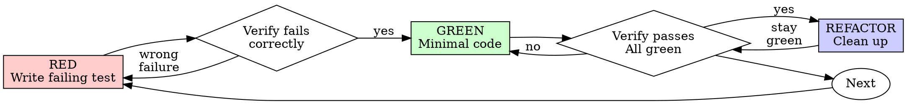

# 对话经过

会话 `01a217c9-5eb7-7330-8504-c92e85f1cec3` · 轮次 `01a217d2-6f83-7a22-800b-282b2ba7d242`

<!-- foundry-detail 01a217c9-5eb7-7330-8504-c92e85f1cec3 01a217d2-6f83-7a22-800b-282b2ba7d242 -->
<!-- foundry-event 85618d4e6b3add75322d5098fb8295c0a05cd87a1aee676afc4aeb76ba1d4aa4 -->
## 进度原话

- 来源定位：字节 570748

~~~text
我会用 `document-changed-symbols` 补齐改动声明的中文 JSDoc，按 `test-driven-development` 先复现自定义目录丢正文的问题，再改复制路径并验证。
~~~

<!-- foundry-event 730b6e7685eabd43ac0c7da584e9f7e586b0c1993385366da6203e998f266cad -->
## 工具调用 `exec` · `call_4621dbb6ddee4d0faec865fcdc5260a4`

- 来源定位：字节 571775

~~~text
工作目录：/home/by152/workspace/ena/agent-foundry/feature/init
const r=await Promise.allSettled([tools.exec_command({cmd:"git status --short --branch; cat AGENTS.md packages/skills/src/coding/document-changed-symbols/SKILL.md .agents/skills/implementation-preparation/SKILL.md",max_output_tokens:6500}),tools.exec_command({cmd:"cat /home/by152/.codex/plugins/cache/openai-curated-remote/superpowers/7.0.1/skills/{brainstorming,test-driven-development,systematic-debugging,using-git-worktrees,verification-before-completion}/SKILL.md",max_output_tokens:10500}),tools.exec_command({cmd:"cat packages/skills/package.json; node --version; pnpm --version; command -v jq; git rev-parse --git-dir --git-common-dir; rg -n '\\btarget\\b|scan-skills' packages/skills/tests/distribution packages/skills/build | head -85",max_output_tokens:4500})]);for(const x of r)text(x.value?.output??x.reason);

~~~

<!-- foundry-event dd9c2190e6992c23cc0266e4779c58799a93c67ed7928f8b8eedee8f6ccc1361 -->
## 宿主命令执行

- 来源定位：字节 573132

~~~text
{
  "command": "[已省略环境变量值] -lc 'cat /home/by152/.codex/plugins/cache/openai-curated-remote/superpowers/7.0.1/skills/{brainstorming,test-driven-development,systematic-debugging,using-git-worktrees,verification-before-completion}/SKILL.md'",
  "workdir": "file:///home/by152/workspace/ena/agent-foundry/feature/init",
  "exitCode": 0,
  "status": "completed"
}
~~~

<!-- foundry-event 1cff104e4cc7560066aa10b0d0c8d7d343c6c27324c50cba621a57edee2d9d3b -->
## 工具结果 `exec-4f8731e7-63c0-4d81-94c3-760f5c0ec756`

- 来源定位：字节 573132

~~~text
---
name: brainstorming
description: "You MUST use this before any creative work - creating features, building components, adding functionality, modifying behavior, or planning anything new, in software or out of it (a talk, a business, a renovation)."
---

# Brainstorming

You are very good at building. You build what you believe your human
partner wants, and that belief is usually thinner than it feels. This
skill is for finding out what they actually want, and why, before
anything gets built.

People often haven't finished working out what they want. Good questions
help them think it through. When you understand the why, you make the
hundred decisions they never mention the way they would have made them.

## First: What Do You Actually Know?

Before you reply, ask yourself: what do I know about what they want, and
why?

- **Everything that matters is in the request** ("make the icon cornflower
  blue"). This is a quick, clear task. Do it, and say what you did.
- **Something non-trivial is missing.** Start the conversation.

Before you start implementing, you must, in order:

1. Lay out the approaches in a message of their own, and have your
   human partner pick one (see Lay out the approaches).
2. Write the design doc, short or full (see Size the Work).
3. Get their approval of that doc.
4. Invoke the superpowers:writing-plans skill.

Two things aren't implementing: a spike they said yes to (see Spike to
feel things out), and doing what they asked once they've opted out of
the questions.

## Look Before You Ask

In an existing project, or when they've given you context (a spec, a plan,
a handoff, files they pointed at, earlier conversation), dig in before your
first message. Read what they referred to and the code or material it
connects to, and keep reading until you can explain how the relevant
parts work today and what this change would touch. Never ask what the
project or their context already answers.

## Your First Message

Move the work forward, with one of these:

- **They've already said what they want** (a spec, a plan, a detailed
  request): aim for about 200 words for the whole message. Echo their
  request back in your own words, so they can see whether you've got its
  shape: what they want, who it's for, and why, as far as they've said.
  Add what you found that bears on it: how the relevant parts work today
  and what the change would touch. If you found something they may not
  have considered that would change what they're asking for or how it
  has to be built, like a constraint, a conflict, or a cheaper path, say
  so plainly. How to build it comes later, once you understand what they
  want (see Lay out the approaches). End with one line inviting
  corrections, then one question about what they want: the thing their
  request leaves open whose answer would most change what gets built.
  Specs are often incomplete, so confirm before you build on one.
- **They haven't:** one open question, in their own terms, about the
  biggest thing their request leaves unsettled. Say why you're asking:
  what the answer would change about what you build. For "a website for
  my bakery": "If it's mostly for people deciding whether to stop by,
  I'd lead with hours and what's in the case today; taking orders is a
  different site. What do you want someone to do when they land on it?"

How the message ends depends on whether their message asked for
brainstorming:

- **They asked for it** (by name, by invoking it, or by asking for a
  design discussion): end with your question. They want this
  conversation.
- **They didn't:** they may not want a conversation at all. After your
  question, add a light, one-line offer to just get going instead, like
  "Or if you'd rather I just dive in, say so." If they take you up on
  it, this skill is done: state any significant how-it-gets-made choice
  (platform, language, medium) in one plain line, then do what they
  asked through the normal workflow.

That's the whole message.

## The Conversation

Each message ends with one question: a single sentence with no list of
example answers hanging off it. Use plain language, pitched just a little
above where your human partner is. Match their vocabulary; never use
process jargon. You never need to quote this skill to your human
partner.

Be clear and concise. Lead with what matters. Avoid jargon. When you
report what you found, give them the most important findings and offer
the rest.

**Get them describing.** Open questions come first. Their own words carry
intent that your options can't. Offer a short menu only when they're
stuck. When they say "just guess" or "what do you think?", propose
something concrete.

**How it gets made.** Every project rests on choices about medium, tools,
materials, and resources: the platform, programming language, and
libraries for an app; the medium for a piece of art. Find out early which
of those choices they want to make, which they're handing to you, and what
they already have to work with. Someone with strong views or skills will
want to talk it through. Someone counting on you needs sensible defaults,
said in plain words. When there's existing work, build on what it already
uses. Any choice you make goes in the design as your call, never as
something they agreed to.

**Ground to cover.** This is territory, not a script. Never read these
out as questions:

- what kind of thing this is, and what makes it special
- why now, and what success looks like to them
- goals, non-goals, and anti-goals (what would make this a failure even
  if it technically works)
- prior art: what they've seen elsewhere, loved or hated
- current state: what exists now, what they've tried
- the details they care about

**Make every question specific** to their project and what they've told
you. Ask Socratically, the way a sharp colleague would: build each
question on their last answer or on something you found, so it helps
them think through a consequence or a case they may have missed
("Voting closes before the meeting, and two members joined this month.
Does someone who joins mid-round get a vote?"). When the reason isn't
already plain, say what you're hoping to learn or what the answer would
change. A proposal they can correct, plus your reason for it, often
beats a question.

**Offer recon.** Once you have a bit of grounding and looking further
would help, offer to go look: deeper into their codebase or project,
their own files and data, or the web. Say what you'd look for. They
decide whether you go.

**Lay out the approaches.** Once you understand what they want, and
before you write anything up, put the ways of building it in a message
of its own. Come up with several real alternatives and drop the weak
ones, including any that work against why they want it and any the
existing work rules out. Present the two or three that remain, grounding
each in what the project actually does and saying what it trades off.
Recommend one and say why, then ask which way they want to go. When
there's genuinely one sensible way, say so and explain why the others
don't fit. This is for how it gets built; for what they want, get them
describing first.

**Show, don't tell.** Offer the visual companion (below) whenever seeing
would help more than reading:

- something they'll look at: a screen, a page, a printout, a sign
- a layout or arrangement: of a screen, a room, a schedule
- a flow or a sequence of steps
- options that would look different from each other
- a structure that's easier to see than read: a diagram, a timeline, a map

Once they've accepted, use it for mockups to react to, side-by-side
options, and throwaway prototypes they can click.

**Spike to feel things out.** Agentic work is waterfall, but very, very
fast. A quick throwaway build is often the cheapest way to learn what
they want or whether something works. Offer one when it would help.
When they just want to spike, get out of the way. Spikes get no tests
or minimal ones, aren't bulletproof, and skip the plan, implementation,
and review process. Bring what the spike taught you back into the
conversation.

## Play It Back

Play back as you go. As soon as you understand one part well enough to
describe it (what it's for and who it serves, say, or how one piece
behaves), describe that part back in about 200-300 words, then return to
questions about the next part. Playback and questions alternate through
the whole conversation; the last chunk covers whatever is left.

Only what they said goes in as theirs. Anything you filled in goes in
as your proposal, with your reason. End each chunk by asking what's wrong
or missing.

Before you send a chunk, check it: does it describe something they'll
look at, like a page, a screen, a schedule, or a printout? If so, and
they haven't seen the visual companion offer yet, send the offer instead
(its own message, below) and hold the chunk for the next message. Once
they've accepted, put a mockup next to the description.

## Size the Work

Once you understand what they want and they've picked an approach, say
how big the work is in plain words. They can override it.

| Size | The design doc |
|------|----------------|
| A small change | a short one: what you already covered together, written down |
| A project | the full written design (below) |

Short or full, the design doc has an **Approaches** part: the two or
three ways you considered building it, what each trades off, which one
they picked, and why. They pick in the conversation, before you write
the doc.

If it grows mid-task, stop, say so, and step up a size.

If this is really several independent projects, say so, agree on an
order, and brainstorm them one at a time.

## The Written Design

Write a plain document a talented builder in the domain could plan
from without going back to your human partner. Cover:

- intent and the why
- goals, non-goals, anti-goals
- constraints
- approaches (above)
- the parts of the how they decided, as they decided them
- what's left to the builder

For a small change, the short design covers the same points in a line
or two each and goes straight to your human partner, without the
builder check.

**Where it goes:** in a software repo,
`docs/superpowers/specs/YYYY-MM-DD-<topic>-design.md`, committed.
Otherwise, ask. Your human partner's preferences override both.

**Builder check** (for a project): dispatch a fresh subagent with
`builder-check-prompt.md` in this directory. When you tell your human
partner you're writing it up, say a reviewer will read it first and you
may come back once with a few questions. Don't hand over the document
until the check is back. Sort what the builder asks into three piles:

- **Answered already** by the conversation or the project: put the answer
  in the document.
- **Minor:** a sensible builder could settle it without changing what gets
  built. Settle it yourself and mark it in the document as your call.
- **Theirs:** only your human partner can answer it, and the answer changes
  what gets built.

Bring the "theirs" pile in one message, most important first. Update the
document with their answers, then hand it over with a short list of the
calls you made so they can check those while reading. That's the only
round of questions the check produces. Without a subagent tool, read the
document as that builder yourself.

<HARD-GATE>
Nothing gets built until your human partner approves the design doc:
the short one for a small change, the full one for a project.
Building includes writing product code, scaffolding, installing
dependencies, creating projects, and invoking an implementation skill.
Reading and exploring are fine.

Two exceptions. If they opted out of the questions, the skill is done
and the gate goes with it. A spike they said yes to may be built; it
stays labeled throwaway, and keeping what it produced is a new request
that comes back through this gate.

After the design doc is approved, the next step is the plan: invoke
superpowers:writing-plans and no other skill.
</HARD-GATE>

## Red Flags

| Thought | Reality |
|---------|---------|
| "I'll offer a menu of what they might want" | Options steer. Ask them to describe it first. |
| "I'll fill in sensible defaults" | Good. Say them out loud. A default they never heard is one they couldn't reject. |
| "I've answered their questions, so I'll write the doc" | Lay out the approaches first, in a message of their own. |
| "I should explain the process first" | Ask your question. The process shows itself. |
| "They said 'sounds good' to the idea" | Approval covers what you showed them. A design doc you haven't written isn't approved. |
| "The spike works, I'll keep building on it" | Keeping it is a new request. Back through the gate. |

## Visual Companion

A browser tab for showing mockups, diagrams, and prototypes. It's a
tool, not a mode: accepting it doesn't send every question to the
browser.

**Offer it just-in-time.** Offer it the first time one of the moments
above comes up, never upfront. The offer is its own message with nothing
else in it:

> "This might be easier if I show you. Want me to open a browser tab with some mockups?"

If they decline, stay in text and don't offer again unless they raise it.

**Per question, ask: would they understand this better by seeing it?**
Mockups, layouts, diagrams, and side-by-side designs go in the browser.
Requirements, scope, tradeoffs, and conceptual choices stay in text. A
question about a UI topic isn't automatically a visual question.

If they accept, read `visual-companion.md` in this directory before
starting the server.
---
name: test-driven-development
description: Use when implementing any feature or bugfix, before writing implementation code
---

# Test-Driven Development (TDD)

## Overview

Write the test first. Watch it fail. Write minimal code to pass.

**Core principle:** If you didn't watch the test fail, you don't know if it tests the right thing.

**Violating the letter of the rules is violating the spirit of the rules.**

## When to Use

**Always:**
- New features
- Bug fixes
- Refactoring
- Behavior changes

**Exceptions (ask your human partner):**
- Throwaway prototypes
- Generated code
- Configuration files

Thinking "skip TDD just this once"? Stop. That's rationalization.

## The Iron Law

```
NO PRODUCTION CODE WITHOUT A FAILING TEST FIRST
```

Write code before the test? Delete it. Start over.

**No exceptions:**
- Don't keep it as "reference"
- Don't "adapt" it while writing tests
- Don't look at it
- Delete means delete

Implement fresh from tests. Period.

## Red-Green-Refactor



### RED - Write Failing Test

Write one minimal test showing what should happen.

<Good>
```typescript
test('retries failed operations 3 times', async () => {
  let attempts = 0;
  const operation = () => {
    attempts++;
    if (attempts < 3) throw new Error('fail');
    return 'success';
  };

  const result = await retryOperation(operation);

  expect(result).toBe('success');
  expect(attempts).toBe(3);
});
```
Clear name, tests real behavior, one thing
</Good>

<Bad>
```typescript
test('retry works', async () => {
  const mock = jest.fn()
    .mockRejectedValueOnce(new Error())
    .mockRejectedValueOnce(new Error())
    .mockResolvedValueOnce('success');
  await retryOperation(mock);
  expect(mock).toHaveBeenCalledTimes(3);
});
```
Vague name, tests mock not code
</Bad>

**Requirements:**
- One behavior
- Clear name
- Real code (no mocks unless unavoidable)

### Verify RED - Watch It Fail

**MANDATORY. Never skip.**

```bash
npm test path/to/test.test.ts
```

Confirm:
- Test fails (not errors)
- Failure message is expected
- Fails because feature missing (not typos)

**Test passes?** You're testing existing behavior. Fix test.

**Test errors?** Fix error, re-run until it fails correctly.

### GREEN - Minimal Code

Write simplest code to pass the test.

<Good>
```typescript
async function retryOperation<T>(fn: () => Promise<T>): Promise<T> {
  for (let i = 0; i < 3; i++) {
    try {
      return await fn();
    } catch (e) {
      if (i === 2) throw e;
    }
  }
  throw new Error('unreachable');
}
```
Just enough to pass
</Good>

<Bad>
```typescript
async function retryOperation<T>(
  fn: () => Promise<T>,
  options?: {
    maxRetries?: number;
    backoff?: 'linear' | 'exponential';
    onRetry?: (attempt: number) => void;
  }
): Promise<T> {
  // YAGNI
}
```
Over-engineered
</Bad>

Don't add features, refactor other code, or "improve" beyond the test.

### Verify GREEN - Watch It Pass

**MANDATORY.**

```bash
npm test path/to/test.test.ts
```

Confirm:
- Test passes
- Other tests still pass
- Output pristine (no errors, warnings)

**Test fails?** Fix code, not test.

**Other tests fail?** Fix now.

**"Other tests" means the project's suite, not just your file.** A
green run of the test you wrote is not a green suite. Before you call
the change done, run the project's test command (bare `pytest`,
`npm test`, `cargo test` — whatever the repo uses) even when your task
named only one test file. A scope statement in your task bounds the
deliverable, not your verification. Any failure that run shows —
including one you didn't cause — goes in your report by name; a red
test you watched scroll past and didn't mention is a report falsified
by omission.

### REFACTOR - Clean Up

After green only:
- Remove duplication
- Improve names
- Extract helpers

Keep tests green. Don't add behavior.

### Repeat

Next failing test for next feature.

## Good Tests

| Quality | Good | Bad |
|---------|------|-----|
| **Minimal** | One thing. "and" in name? Split it. | `test('validates email and domain and whitespace')` |
| **Clear** | Name describes behavior | `test('test1')` |
| **Shows intent** | Demonstrates desired API | Obscures what code should do |

When writing or changing any test, read [writing-good-tests.md](writing-good-tests.md) for the rules that keep tests honest:
- Name the production change that would make the test fail — before writing it
- Assert on real behavior, never on mock behavior
- Keep test-only code in test utilities, out of production classes
- Understand a dependency's side effects before mocking it

## Common Rationalizations

| Excuse | Reality |
|--------|---------|
| "Too simple to test" | Simple code breaks. Test takes 30 seconds. |
| "I'll test after" | Tests written after pass immediately — which proves nothing. They may test the wrong thing, test the implementation instead of the behavior, or miss the edge case you forgot. You never watched it fail, so you never proved it can catch the bug. Test-first forces that failure. |
| "Tests after achieve same goals (spirit not ritual)" | Tests-after answer "what does this do?"; tests-first answer "what should this do?" Tests written after are biased by the code you already wrote — you verify the cases you remembered, not the ones you'd have discovered. Coverage without proof the tests work. |
| "Already manually tested" | Manual testing is ad-hoc: no record of what you covered, no way to re-run it when the code changes, easy to forget cases under pressure. "Worked when I tried it" ≠ comprehensive. Automated tests run the same way every time. |
| "Deleting X hours is wasteful" | Sunk cost fallacy — that time is already spent either way. The real choice: rewrite with TDD (high confidence) vs. keep it and bolt tests on after (low confidence, likely bugs). Keeping code you can't trust is the waste. |
| "Keep as reference, write tests first" | You'll adapt it. That's testing after. Delete means delete. |
| "Need to explore first" | Fine. Throw away exploration, start with TDD. |
| "Test hard = design unclear" | Listen to test. Hard to test = hard to use. |
| "TDD will slow me down" | TDD IS the pragmatic path: catches bugs before commit, prevents regressions, lets you refactor without fear. "Pragmatic" shortcuts mean debugging in production — slower, not faster. |
| "Manual test faster" | Manual doesn't prove edge cases. You'll re-test every change. |
| "Existing code has no tests" | You're improving it. Add tests for existing code. |

## Red Flags - STOP and Start Over

- Code before test
- Test after implementation
- Test passes immediately
- Can't explain why test failed
- Tests added "later"
- Rationalizing "just this once"
- "I already manually tested it"
- "Tests after achieve the same purpose"
- "It's about spirit not ritual"
- "Keep as reference" or "adapt existing code"
- "Already spent X hours, deleting is wasteful"
- "TDD is dogmatic, I'm being pragmatic"
- "This is different because..."

**All of these mean: Delete code. Start over with TDD.**

## Example: Bug Fix

**Bug:** Empty email accepted

**RED**
```typescript
test('rejects empty email', async () => {
  const result = await submitForm({ email: '' });
  expect(result.error).toBe('Email required');
});
```

**Verify RED**
```bash
$ npm test
FAIL: expected 'Email required', got undefined
```

**GREEN**
```typescript
function submitForm(data: FormData) {
  if (!data.email?.trim()) {
    return { error: 'Email required' };
  }
  // ...
}
```

**Verify GREEN**
```bash
$ npm test
PASS
```

**REFACTOR**
Extract validation for multiple fields if needed.

## Verification Checklist

Before marking work complete:

- [ ] Every new function/method has a test
- [ ] Watched each test fail before implementing
- [ ] Each test failed for expected reason (feature missing, not typo)
- [ ] Wrote minimal code to pass each test
- [ ] All tests pass
- [ ] Output pristine (no errors, warnings)
- [ ] Tests use real code (mocks only if unavoidable)
- [ ] Edge cases and errors covered

Can't check all boxes? You skipped TDD. Start over.

## When Stuck

| Problem | Solution |
|---------|----------|
| Don't know how to test | Write wished-for API. Write assertion first. Ask your human partner. |
| Test too complicated | Design too complicated. Simplify interface. |
| Must mock everything | Code too coupled. Use dependency injection. |
| Test setup huge | Extract helpers. Still complex? Simplify design. |

## Debugging Integration

Bug found? Write failing test reproducing it. Follow TDD cycle. Test proves fix and prevents regression.

Never fix bugs without a test.

## Final Rule

```
Production code → test exists and failed first
Otherwise → not TDD
```

No exceptions without your human partner's permission.
---
name: systematic-debugging
description: Use when encountering any bug, test failure, or unexpected behavior, before proposing fixes
---

# Systematic Debugging

## Overview

**Core principle:** ALWAYS find root cause before attempting fixes. Symptom fixes are failure.

**Violating the letter of this process is violating the spirit of debugging.**

## The Iron Law

```
NO FIXES WITHOUT ROOT CAUSE INVESTIGATION FIRST
```

If you haven't completed Phase 1, you cannot propose fixes.

## When to Use

Use for ANY technical issue:
- Test failures
- Bugs in production
- Unexpected behavior
- Performance problems
- Build failures
- Integration issues

**Use this ESPECIALLY when:**
- Under time pressure (emergencies make guessing tempting)
- "Just one quick fix" seems obvious
- You've already tried multiple fixes
- Previous fix didn't work
- You don't fully understand the issue

**Don't skip when:**
- Issue seems simple (simple bugs have root causes too)
- You're in a hurry (rushing guarantees rework)
- Manager wants it fixed NOW (systematic is faster than thrashing)

## The Four Phases

You MUST complete each phase before proceeding to the next.

### Phase 1: Root Cause Investigation

**BEFORE attempting ANY fix:**

1. **Read Error Messages Carefully**
   - Don't skip past errors or warnings
   - They often contain the exact solution
   - Read stack traces completely
   - Note line numbers, file paths, error codes

2. **Reproduce Consistently**
   - Can you trigger it reliably?
   - What are the exact steps?
   - Does it happen every time?
   - If not reproducible → gather more data, don't guess

3. **Check Recent Changes**
   - What changed that could cause this?
   - Git diff, recent commits
   - New dependencies, config changes
   - Environmental differences

4. **Gather Evidence in Multi-Component Systems**

   **WHEN system has multiple components (CI → build → signing, API → service → database):**

   **BEFORE proposing fixes, add diagnostic instrumentation:**
   ```
   For EACH component boundary:
     - Log what data enters component
     - Log what data exits component
     - Verify environment/config propagation
     - Check state at each layer

   Run once to gather evidence showing WHERE it breaks
   THEN analyze evidence to identify failing component
   THEN investigate that specific component
   ```

   **Example (multi-layer system):**
   ```bash
   # Layer 1: Workflow
   echo "=== Secrets available in workflow: ==="
   echo "IDENTITY: $([ -n "${IDENTITY:-}" ] && echo SET || echo UNSET)"

   # Layer 2: Build script
   echo "=== Env vars in build script: ==="
   printenv IDENTITY >/dev/null 2>&1 && echo "IDENTITY in environment" || echo "IDENTITY not in environment"

   # Layer 3: Signing script
   echo "=== Keychain state: ==="
   security list-keychains
   security find-identity -v

   # Layer 4: Actual signing
   codesign --sign "$IDENTITY" --verbose=4 "$APP"
   ```

   **This reveals:** Which layer fails (secrets → workflow ✓, workflow → build ✗)

5. **Trace Data Flow**

   **WHEN error is deep in call stack:**

   See `root-cause-tracing.md` in this directory for the complete backward tracing technique.

   **Quick version:**
   - Where does bad value originate?
   - What called this with bad value?
   - Keep tracing up until you find the source
   - Fix at source, not at symptom

### Phase 2: Pattern Analysis

**Find the pattern before fixing:**

1. **Find Working Examples**
   - Locate similar working code in same codebase
   - What works that's similar to what's broken?

2. **Compare Against References**
   - If implementing pattern, read reference implementation COMPLETELY
   - Don't skim - read every line
   - Understand the pattern fully before applying

3. **Identify Differences**
   - What's different between working and broken?
   - List every difference, however small
   - Don't assume "that can't matter"

4. **Understand Dependencies**
   - What other components does this need?
   - What settings, config, environment?
   - What assumptions does it make?

### Phase 3: Hypothesis and Testing

**Scientific method:**

1. **Form Single Hypothesis**
   - State clearly: "I think X is the root cause because Y"
   - Write it down
   - Be specific, not vague

2. **Test Minimally**
   - Make the SMALLEST possible change to test hypothesis
   - One variable at a time
   - Don't fix multiple things at once

3. **Verify Before Continuing**
   - Did it work? Yes → Phase 4
   - Didn't work? Form NEW hypothesis
   - DON'T add more fixes on top

4. **When You Don't Know**
   - Say "I don't understand X"
   - Don't pretend to know
   - Ask for help
   - Research more

### Phase 4: Implementation

**Fix the root cause, not the symptom:**

1. **Create Failing Test Case**
   - Simplest possible reproduction
   - Automated test if possible
   - One-off test script if no framework
   - MUST have before fixing
   - Use the `superpowers:test-driven-development` skill for writing proper failing tests

2. **Implement Single Fix**
   - Address the root cause identified
   - ONE change at a time
   - No "while I'm here" improvements
   - No bundled refactoring

3. **Verify Fix**
   - Test passes now?
   - No other tests broken?
   - Issue actually resolved?
   - Use the `superpowers:verification-before-completion` skill before claiming success

4. **If Fix Doesn't Work**
   - STOP
   - Count: How many fixes have you tried?
   - If < 3: Return to Phase 1, re-analyze with new information
   - **If ≥ 3: STOP and question the architecture (step 5 below)**
   - DON'T attempt Fix #4 without architectural discussion

5. **If 3+ Fixes Failed: Question Architecture**

   **Pattern indicating architectural problem:**
   - Each fix reveals new shared state/coupling/problem in different place
   - Fixes require "massive refactoring" to implement
   - Each fix creates new symptoms elsewhere

   **STOP and question fundamentals:**
   - Is this pattern fundamentally sound?
   - Are we "sticking with it through sheer inertia"?
   - Should we refactor architecture vs. continue fixing symptoms?

   **Discuss with your human partner before attempting more fixes**

   This is NOT a failed hypothesis - this is a wrong architecture.

## Red Flags - STOP and Follow Process

If you catch yourself thinking:
- "Quick fix for now, investigate later"
- "Just try changing X and see if it works"
- "Add multiple changes, run tests"
- "Skip the test, I'll manually verify"
- "It's probably X, let me fix that"
- "I don't fully understand but this might work"
- "Pattern says X but I'll adapt it differently"
- "Here are the main problems: [lists fixes without investigation]"
- Proposing solutions before tracing data flow
- **"One more fix attempt" (when already tried 2+)**
- **Each fix reveals new problem in different place**

**ALL of these mean: STOP. Return to Phase 1.**

**If 3+ fixes failed:** Question the architecture (see Phase 4.5)

## your human partner's Signals You're Doing It Wrong

**Watch for these redirections:**
- "Is that not happening?" - You assumed without verifying
- "Will it show us...?" - You should have added evidence gathering
- "Stop guessing" - You're proposing fixes without understanding
- "Ultra-think this" - Question fundamentals, not just symptoms
- "We're stuck?" (frustrated) - Your approach isn't working

**When you see these:** STOP. Return to Phase 1.

## Common Rationalizations

| Excuse | Reality |
|--------|---------|
| "Issue is simple, don't need process" | Simple issues have root causes too. Process is fast for simple bugs. |
| "Emergency, no time for process" | Systematic debugging is FASTER than guess-and-check thrashing. |
| "Just try this first, then investigate" | First fix sets the pattern. Do it right from the start. |
| "I'll write test after confirming fix works" | Untested fixes don't stick. Test first proves it. |
| "Multiple fixes at once saves time" | Can't isolate what worked. Causes new bugs. |
| "Reference too long, I'll adapt the pattern" | Partial understanding guarantees bugs. Read it completely. |
| "I see the problem, let me fix it" | Seeing symptoms ≠ understanding root cause. |
| "One more fix attempt" (after 2+ failures) | 3+ failures = architectural problem. Question pattern, don't fix again. |

## Quick Reference

| Phase | Key Activities | Success Criteria |
|-------|---------------|------------------|
| **1. Root Cause** | Read errors, reproduce, check changes, gather evidence | Understand WHAT and WHY |
| **2. Pattern** | Find working examples, compare | Identify differences |
| **3. Hypothesis** | Form theory, test minimally | Confirmed or new hypothesis |
| **4. Implementation** | Create test, fix, verify | Bug resolved, tests pass |

## When Process Reveals "No Root Cause"

If systematic investigation reveals issue is truly environmental, timing-dependent, or external:

1. You've completed the process
2. Document what you investigated
3. Implement appropriate handling (retry, timeout, error message)
4. Add monitoring/logging for future investigation

**But:** 95% of "no root cause" cases are incomplete investigation.

## Supporting Techniques

These techniques are part of systematic debugging and available in this directory:

- **`root-cause-tracing.md`** - Trace bugs backward through call stack to find original trigger
- **`defense-in-depth.md`** - Add validation at multiple layers after finding root cause
- **`condition-based-waiting.md`** - Replace arbitrary timeouts with condition polling
---
name: using-git-worktrees
description: Use when starting feature work that needs isolation from current workspace or before executing implementation plans - ensures an isolated workspace exists via native tools or git worktree fallback
---

# Using Git Worktrees

## Overview

Ensure work happens in an isolated workspace. Prefer your platform's native worktree tools. Fall back to manual git worktrees only when no native tool is available.

**Core principle:** Detect existing isolation first. Then use native tools. Then fall back to git. Never fight the harness.

**Announce at start:** "I'm using the using-git-worktrees skill to set up an isolated workspace."

## Step 0: Detect Existing Isolation

**Before creating anything, check if you are already in an isolated workspace.**

```bash
GIT_DIR=$(cd "$(git rev-parse --git-dir)" 2>/dev/null && pwd -P)
GIT_COMMON=$(cd "$(git rev-parse --git-common-dir)" 2>/dev/null && pwd -P)
BRANCH=$(git branch --show-current)
```

**Submodule guard:** `GIT_DIR != GIT_COMMON` is also true inside git submodules. Before concluding "already in a worktree," verify you are not in a submodule:

```bash
# If this returns a path, you're in a submodule, not a worktree — treat as normal repo
git rev-parse --show-superproject-working-tree 2>/dev/null
```

**If `GIT_DIR != GIT_COMMON` (and not a submodule):** You are already in a linked worktree. Skip to Step 2 (Project Setup). Do NOT create another worktree.

Report with branch state:
- On a branch: "Already in isolated workspace at `<path>` on branch `<name>`."
- Detached HEAD: "Already in isolated workspace at `<path>` (detached HEAD, externally managed). Branch creation needed at finish time."

**If `GIT_DIR == GIT_COMMON` (or in a submodule):** You are in a normal repo checkout.

Has the user already indicated their worktree preference in your instructions? If not, ask for consent before creating a worktree:

> "Would you like me to set up an isolated worktree? It protects your current branch from changes."

Honor any existing declared preference without asking. If the user declines consent, work in place and skip to Step 2.

## Step 1: Create Isolated Workspace

**You have two mechanisms. Try them in this order.**

### 1a. Native Worktree Tools (preferred)

The user has asked for an isolated workspace (Step 0 consent). Do you already have a way to create a worktree? It might be a tool with a name like `EnterWorktree`, `WorktreeCreate`, a `/worktree` command, or a `--worktree` flag. If you do, use it and skip to Step 2.

Native tools handle directory placement, branch creation, and cleanup automatically. Using `git worktree add` when you have a native tool creates phantom state your harness can't see or manage.

Only proceed to Step 1b if you have no native worktree tool available.

### 1b. Git Worktree Fallback

**Only use this if Step 1a does not apply** — you have no native worktree tool available. Create a worktree manually using git.

#### Directory Selection

Follow this priority order. Explicit user preference always beats observed filesystem state.

1. **Check your instructions for a declared worktree directory preference.** If the user has already specified one, use it without asking.

2. **Check for an existing project-local worktree directory:**
   ```bash
   ls -d .worktrees 2>/dev/null     # Preferred (hidden)
   ls -d worktrees 2>/dev/null      # Alternative
   ```
   If found, use it. If both exist, `.worktrees` wins.

3. **If there is no other guidance available**, default to `.worktrees/` at the project root.

#### Safety Verification (project-local directories only)

**MUST verify directory is ignored before creating worktree:**

```bash
git check-ignore -q .worktrees 2>/dev/null || git check-ignore -q worktrees 2>/dev/null
```

**If NOT ignored:** Add to .gitignore, commit the change, then proceed.

**Why critical:** Prevents accidentally committing worktree contents to repository.

#### Create the Worktree

```bash
# Determine path based on chosen location
path="$LOCATION/$BRANCH_NAME"

git worktree add "$path" -b "$BRANCH_NAME"
cd "$path"
```

**Sandbox fallback:** If `git worktree add` fails with a permission error (sandbox denial), tell the user the sandbox blocked worktree creation and you're working in the current directory instead. Then run setup and baseline tests in place.

## Step 2: Project Setup

Auto-detect and run appropriate setup:

```bash
# Node.js
if [ -f package.json ]; then npm install; fi

# Rust
if [ -f Cargo.toml ]; then cargo build; fi

# Python
if [ -f requirements.txt ]; then pip install -r requirements.txt; fi
if [ -f pyproject.toml ]; then poetry install; fi

# Go
if [ -f go.mod ]; then go mod download; fi
```

## Step 3: Verify Clean Baseline

Run tests to ensure workspace starts clean:

```bash
# Use project-appropriate command
npm test / cargo test / pytest / go test ./...
```

**If tests fail:** Report failures, ask whether to proceed or investigate.

**If tests pass:** Report ready.

### Report

```
Worktree ready at <full-path>
Tests passing (<N> tests, 0 failures)
Ready to implement <feature-name>
```

## Quick Reference

| Situation | Action |
|-----------|--------|
| Already in linked worktree | Skip creation (Step 0) |
| In a submodule | Treat as normal repo (Step 0 guard) |
| Native worktree tool available | Use it (Step 1a) |
| No native tool | Git worktree fallback (Step 1b) |
| `.worktrees/` exists | Use it (verify ignored) |
| `worktrees/` exists | Use it (verify ignored) |
| Both exist | Use `.worktrees/` |
| Neither exists | Check instruction file, then default `.worktrees/` |
| Directory not ignored | Add to .gitignore + commit |
| Permission error on create | Sandbox fallback, work in place |
| Tests fail during baseline | Report failures + ask |
| No package.json/Cargo.toml | Skip dependency install |

## Common Rationalizations

| Excuse | Reality |
|--------|---------|
| "I'm obviously not in a worktree — no need to check" | Run Step 0. Harness-created isolation and submodules both fool eyeballing; the detection commands settle it. |
| "`git worktree add` is quicker than hunting for a native tool" | A native tool (e.g. `EnterWorktree`) owns placement, branching, and cleanup. Bypassing it is the #1 mistake — it creates phantom state your harness can't see or manage. |
| "The worktree directory is surely ignored already" | Run `git check-ignore`. An unignored worktree directory commits the whole tree into the repo. |
| "Any directory name works" | Explicit instructions beat an existing project-local directory, which beats the `.worktrees/` default. |
| "The workspace is fresh — baseline tests can wait" | A dirty baseline makes every later failure ambiguous. Run the tests now; proceeding past failures is your human partner's call. |
---
name: verification-before-completion
description: Use when about to claim work is complete, fixed, or passing, before committing or creating PRs - requires running verification commands and confirming output before making any success claims; evidence before assertions always
---

# Verification Before Completion

## Overview

**Core principle:** Evidence before claims, always.

**Violating the letter of this rule is violating the spirit of this rule.**

## The Iron Law

```
NO COMPLETION CLAIMS WITHOUT FRESH VERIFICATION EVIDENCE
```

If you haven't run the verification command in this message, you cannot claim it passes.

## The Gate Function

```
BEFORE claiming any status or expressing satisfaction:

1. IDENTIFY: What command proves this claim?
2. RUN: Execute the FULL command (fresh, complete)
3. READ: Full output, check exit code, count failures
4. VERIFY: Does output confirm the claim?
   - If NO: State actual status with evidence
   - If YES: State claim WITH evidence
5. ONLY THEN: Make the claim

Skip any step = lying, not verifying
```

## Common Failures

| Claim | Requires | Not Sufficient |
|-------|----------|----------------|
| Tests pass | Test command output: 0 failures | Previous run, "should pass" |
| Linter clean | Linter output: 0 errors | Partial check, extrapolation |
| Build succeeds | Build command: exit 0 | Linter passing, logs look good |
| Bug fixed | Test original symptom: passes | Code changed, assumed fixed |
| Regression test works | Red-green cycle verified | Test passes once |
| Agent completed | VCS diff shows changes | Agent reports "success" |
| Requirements met | Line-by-line checklist | Tests passing |

## Red Flags - STOP

- Using "should", "probably", "seems to"
- Expressing satisfaction before verification ("Great!", "Perfect!", "Done!", etc.)
- About to commit/push/PR without verification
- Trusting agent success reports
- Relying on partial verification
- Thinking "just this once"
- Tired and wanting work over
- **ANY wording implying success without having run verification**

## Rationalization Prevention

| Excuse | Reality |
|--------|---------|
| "Should work now" | RUN the verification |
| "I'm confident" | Confidence ≠ evidence |
| "Just this once" | No exceptions |
| "Linter passed" | Linter ≠ compiler |
| "Agent said success" | Verify independently |
| "I'm tired" | Exhaustion ≠ excuse |
| "Partial check is enough" | Partial proves nothing |
| "Different words so rule doesn't apply" | Spirit over letter |

## Key Patterns

**Tests:**
```
✅ [Run test command] [See: 34/34 pass] "All tests pass"
❌ "Should pass now" / "Looks correct"
```

**Regression tests (TDD Red-Green):**
```
✅ Write → Run (pass) → Revert fix → Run (MUST FAIL) → Restore → Run (pass)
❌ "I've written a regression test" (without red-green verification)
```

**Build:**
```
✅ [Run build] [See: exit 0] "Build passes"
❌ "Linter passed" (linter doesn't check compilation)
```

**Requirements:**
```
✅ Re-read plan → Create checklist → Verify each → Report gaps or completion
❌ "Tests pass, phase complete"
```

**Agent delegation:**
```
✅ Agent reports success → Check VCS diff → Verify changes → Report actual state
❌ Trust agent report
```

## When To Apply

**ALWAYS before:**
- ANY variation of success/completion claims
- ANY expression of satisfaction
- ANY positive statement about work state
- Committing, PR creation, task completion
- Moving to next task
- Delegating to agents

**Rule applies to:**
- Exact phrases
- Paraphrases and synonyms
- Implications of success
- ANY communication suggesting completion/correctness

~~~

<!-- foundry-event 41292fdb4a3091ea82052fb63608bd086d2fbf0bb4735a81d2c776a8d5cb9550 -->
## 宿主命令执行

- 来源定位：字节 618839

~~~text
{
  "command": "[已省略环境变量值] -lc 'git status --short --branch; cat AGENTS.md packages/skills/src/coding/document-changed-symbols/SKILL.md .agents/skills/implementation-preparation/SKILL.md'",
  "workdir": "file:///home/by152/workspace/ena/agent-foundry/feature/init",
  "exitCode": 0,
  "status": "completed"
}
~~~

<!-- foundry-event f4831a0d3dfb0942cc614f94a6e87c484a2e7f16ce1011378bed2aa59879871c -->
## 工具结果 `exec-310c7089-178b-4ef8-b6b4-739525fceb1d`

- 来源定位：字节 618839

~~~text
## feature/init...origin/feature/init
M  .codex/hooks.json
A  .specify/memory/conversation-recording/records/2026-11-26/01a217c7-b41f-7b91-bcde-987dd5ea5f83.md
A  .specify/memory/conversation-recording/records/2026-11-26/01a217c9-3007-7462-98ab-a409bde300ae.md
AM .specify/memory/conversation-recording/records/2026-11-26/01a217c9-5eb7-7330-8504-c92e85f1cec3.md
A  .specify/memory/conversation-recording/records/2026-11-26/details/01a217c7-b41f-7b91-bcde-987dd5ea5f83/01a217c8-88ab-7e11-abdd-ad5838bc4de9.md
A  .specify/memory/conversation-recording/records/2026-11-26/details/01a217c9-3007-7462-98ab-a409bde300ae/01a217c9-3f96-76b0-ab00-2d2fa5a7ae2e.md
A  .specify/memory/conversation-recording/records/2026-11-26/details/01a217c9-3007-7462-98ab-a409bde300ae/01a217ca-f247-7273-a6c0-819d9823141d.md
AM .specify/memory/conversation-recording/records/2026-11-26/details/01a217c9-3007-7462-98ab-a409bde300ae/01a217d2-0a2f-7253-ab53-89e5ef0a23ee.md
A  .specify/memory/conversation-recording/records/2026-11-26/details/01a217c9-5eb7-7330-8504-c92e85f1cec3/01a217c9-9236-7811-a890-0b0e3b32adec.md
A  .specify/memory/conversation-recording/records/2026-11-26/details/01a217c9-5eb7-7330-8504-c92e85f1cec3/01a217d1-55eb-7ff2-8198-9b97717a75fd.md
A  specs/skills/002-conversation-to-skill/analysis/acceptance/t037-commit-skip-reproduction.json
M  specs/skills/002-conversation-to-skill/analysis/recording-acceptance.md
# Agent Foundry 工程约定

本仓库采用 pnpm 12、Turborepo、ESM与严格TypeScript。apps维护文档站和Python MCP；packages维护两条技能工作线；tooling只提供必要共享配置。跨包引用通过声明的exports和workspace依赖。

注释和文档使用简体中文。编辑JS/TS/Vue时先加载document-changed-symbols并为新增或语义修改声明添加多行JSDoc；前端样式和响应式分别遵守nuxt-ui-styling与vue-reactivity，默认不新增watcher。这三项技能来源在packages的对应目录，已安装副本通过pnpm skills:link生成，不手改副本。

主线packages/skills保留用户手写分工；未经本轮明确请求不接管其未完成构建插件。紧急版保持自身源码、脚本与输出，Linux/Codex/项目级之外的组合不推定支持。eval源码保留不等于正式发布内容；当前主线配置与规格的差异见迁移记录。

初始化使用pnpm install；开发pnpm dev；一般构建pnpm build；严格候选单独pnpm build:candidate，要求相关输入已真实提交；lint和check-types按目标workspace执行。有原测试时按范围运行，不存在根pnpm test。Python依赖用uv及apps/mcp/uv.lock。

任何Markdown新增或修改后执行pnpm exec eslint --fix；历史规格、归档和第三方夹具保持发生时原文，公开派生以迁移清单说明。验证失败、缺前置和未执行分别记录，不通过改规则或删断言求绿。

不复制其他项目的私人画像、会话、凭据或机器配置。目标项目技能沿目标项目自身治理与记录布局；不在这里建立跨仓库个人画像。不得提交secrets、环境变量值或认证文件。

改动前查看git status，不覆盖用户未提交文件。生成物不手改。推送、发布、部署和外部资源变更须有适用明确授权。
---
name: document-changed-symbols
description: 每次编码 agent 执行 TypeScript、JavaScript、Vue 或相关前端代码编辑时都必须使用。要求为本次新增或修改的每个函数、方法、变量、常量、ref、computed、类字段、类型别名、接口、枚举、导出符号和配置声明，在声明上方补充多行 JSDoc 注释。当用户要求补充 JSDoc 或改动符号注释时也必须使用。
destructive: false
---

# 改动符号 JSDoc 注释

## 核心规则

每次编辑 TypeScript、JavaScript、Vue 或相关前端代码时，凡是本次新增的声明，或本次修改了行为、签名、类型、初始值、业务含义的声明，都必须在声明正上方添加或保留准确的多行 JSDoc 注释。

需要覆盖的改动符号包括：

- 函数、方法、构造函数、赋值给标识符的回调函数、组合式函数、hook、事件处理函数和计算辅助函数。
- 变量、常量、ref、reactive 状态、类字段，以及新增或语义变化的解构别名。对象字面量属性、interface/type 属性、枚举成员等内部成员不单独挂注释，按下方执行流程第 5 条收拢到外层声明。
- 类型、接口、枚举、类型别名、类、模块、导出对象和 schema 定义。

不要为了满足规则去给无关的旧代码批量补注释，除非它们属于同一个被修改声明块且不补会造成风格或含义不一致。

## 执行流程

1. 编辑前，先识别这次可能会新增或修改的声明。
2. 编辑时，在每个改动声明的正上方放置多行 JSDoc 块，格式必须是：`/**` 开始，中间每行以 `*` 开头，` */` 结束。
3. JSDoc 块至少包含一句职责说明；函数、方法、回调、复杂类型或有约束的声明，应按需添加 `@param`、`@returns`、`@template`、`@property`、`@throws` 等标签。
4. 不要使用单行 `/** ... */`、普通 `//`、普通 `/* ... */`、Python docstring、Go 导出注释等格式替代 JSDoc。
5. **不在声明内部写注释**：对象字面量、interface/type 的属性、枚举成员、泛型参数等声明内部（如属性上方）不放 JSDoc；属性语义收拢到外层声明（接口、类型别名、常量、函数）的 JSDoc 块里统一描述。JSDoc 只挂在外层声明正上方。
6. 注释要简短、事实准确，说明符号的职责、含义或约束，不要写“这是新增/修改的函数”。
7. 完成编辑后检查 diff，确认每个改动声明上方都有准确的多行 JSDoc 注释。
8. 使用中文写注释

## 注释质量

优先描述意图、约束或业务含义。

推荐：

```ts
/**
 * 将承运商对账原始行转换为表格可渲染的数据。
 *
 * @returns 标准化后的对账行集合。
 */
const reconciliationRows = computed(() => normalizeRows(rawRows.value))

/**
 * 提交选中的订单发起仓库取消流程。
 *
 * @param orderIds 需要取消的订单 ID 列表。
 * @returns 取消流程提交完成后的 Promise。
 */
function submitWarehouseCancel(orderIds: string[]) {
  // ...
  return Promise.resolve()
}
```

避免：

```ts
/** submitWarehouseCancel 函数。 */
function submitWarehouseCancel() {}

// 提交选中的订单发起仓库取消流程。
function submitWarehouseCancel() {}

/** 新变量。 */
const value = 1
```

## 边界情况

- 如果匿名内联回调无法自然放置直接注释，且该回调有独立业务含义，优先提取为带多行 JSDoc 注释的命名常量。
- 如果声明已经有准确的多行 JSDoc 注释，只在本次改动导致注释过期时更新它。
- 即使项目平时不给简单局部变量写 JSDoc 注释，只要用户明确要求本次改动的变量要有注释，就按本技能执行。
- 不要用单行 JSDoc 或普通行注释凑数；格式不符合多行 JSDoc 时视为未完成。
- 对生成文件、压缩文件、lockfile、snapshot 或机器维护的产物，不主动添加手写 JSDoc 注释，除非用户明确要求修改这些文件并补注释。

## 验证清单

结束前检查最终 diff，并确认：

- 每个新增声明的正上方都有多行 JSDoc 注释。
- 每个修改了行为、签名、类型、初始值或业务含义的声明，都有或保留了准确的多行 JSDoc 注释。
- 注释简洁、有用，并符合附近代码的语言和风格。
- 改动声明的内部（对象字面量、interface/type 属性、枚举成员、泛型参数上方）没有新增 JSDoc 或行注释，属性语义已收拢到外层声明的 JSDoc 块。
- 没有对无关旧代码做大范围注释补充或格式扰动。

测试词和触发示例见 [test-prompts.md](references/test-prompts.md)。
---
name: implementation-preparation
description: 用户在已初始化的 Spec Kit 项目中要求实施、开始或继续正式 Task，或原生 Implement 进入实施前准备时使用。仅修订 Spec、仅调整规划、概念解释和普通讨论时不使用。
---

# 正式 Task 实施准备

执行目标项目已有的工作流治理，将当前请求整理为有实际材料、明确认可范围和继续条件的准备结果。这里负责准备和续接，不代替原生 Implement 执行业务，也不定义第二套任务或认可规则。

## 先核对是否要实施正式 Task

按请求实际内容和已知上下文判断，不因用户说“调整需求”就进入Task实施。仅修订已有Spec或仅调整规划时，将请求交回调用方按目标项目相应文档/规划职责处理，不要求先提供Task、单Task认可方案或补建plan/MVU；本技能的实施前置不阻止独立Spec修订。可以核对现有下游影响，没有变化就保持，不默认改业务代码。

用户明确要实施或继续原Task时，才进入下文完整读取和准备流程，已有适用认可直接复用。实施请求同时含需求变化时，先处理获确认的需求并核对规划及原方案是否仍适用；实质变化尚未解决，只暂停受影响实施，不以旧认可覆盖新逻辑，也不将需求修订误记成已实施。

## 定位并读取

用户明确的项目、Spec及Task优先；否则沿唯一已有上下文或项目的.specify/feature.json定位。Task身份连同所属Spec核对，多候选只澄清必要定位，不另建同一任务。

从目标项目根完整读取.specify/memory/constitution.md，再读取原Task、需求、plan、同级mvu、相关存量代码与项目约定、已有方案和证据。既有方案尚无独立mvu时按项目治理兼容原详情；不可用的治理或必要输入列出实际缺项及影响，不给出开工结论。读取路径以目标项目为根，不以本skill的安装目录为根；不导入其他仓库的个人资料。

## 需求变更与来源

读取所属Spec已有的简洁需求摘要/导航和当前有效要求，核对原Task方案所依据的范围、确认与待定事项；需要判断变更或纠正时追溯原始输入及讨论。摘要帮助定位，不代替正式定义或真实认可；来源与现行要求冲突时说明差异，只暂停受影响的开工结论。

出现实质需求变化时，沿目标项目治理和既有布局保留本次可见原始输入、可知来源及实际日期，默认放requirements/raw；已有相同原文直接引用。讨论、AI建议和润色提示词按职责另存，不能覆盖或冒充用户原话、确认，未知日期/不可见历史明确说明。简洁摘要用短段说明问题、解决方向、本次变化、确认或待定、日期，链接原文、必要讨论及当前有效要求；可复用requirements/README.md，不复制长规格或另造固定栏目/文件注册。新材料按实际用途归类，不批量迁移无关Spec。

在对应写入授权内先保存并检查、读回原文和必要讨论，再更新摘要及获确认的受影响要求，最后核对方案能否沿用。未确认的实质变化保留待定，不能按旧方案实施。仅问进度、普通工程调整或重复续做不构成新需求，不因此重复归档原文；保存失败按下文恢复规则说明已写/未写，后续从实际文件补缺，不靠记忆补造来源。

## 形成适用的讨论结果

核对已有方案的真实讨论来源、适用范围、保存结果、必要前置及有效授权。适用内容直接复用；无有效方案时先听用户方向，结合已读代码提出有依据的建议，讲清目标、核心逻辑与关系、理由、推进顺序及可观察验收。用户尚未认可的建议和未知事项分别保留，不把文件自称或AI回复当认可来源。

讨论中读取直接关联Task，说明仅引用依赖、普通工程调整或实质影响的区别。共享定义优先沿已有契约或负责它的Task方案保存，由其他方案引用；共同决定可以一次讨论，各Task分别说明自身职责及实际认可覆盖。需求、总体方案/依赖或局部实现变化，分别同步其真正受影响的材料，不自动实施关联Task。已完成Task按原事实保留，新增工作按项目的增量规则安排。

## 保存并回传继续范围

按项目治理为已形成的方案选择既有位置；默认implementation/<原Task ID>.md，一Task一份，由原Task引用。内容足以还原逻辑、认可范围和来源、理由、验收及重要调整即可，不预设固定表单。工程checkbox只留原tasks，讨论资料和方案不复制它。

依次保存必要方案、执行目标项目格式检查、完整读回，再补原Task引用并核对。返回本次实际可继续的Task及范围、仍需讨论或恢复的部分、必要证据和下一动作。继续由原生执行者依据目标治理推进；进入其他Task、批量、并行或恢复时，对各自材料重新应用本流程，不把前一次准备结果套给另一项。

## 异常与恢复

核查到治理/能力/材料缺失、过期或不可读、方案保存失败、前置未验、缺有效认可，或逻辑/职责/范围/验收实质变化时，依项目治理只处理允许的核查、讨论和恢复，说明受影响范围与继续条件。配置或hook没有调用本skill不构成准备已完成。普通工程调整沿有效认可记录依据，实质变化回讨论；恢复读取最终文件、真实确认及撤回依据，补未完成动作，不复做已确认修复。

~~~

<!-- foundry-event 644d569110d0bfbb003bad687f3d2d46c7357ca8891af9a5d732d1d659c6cb70 -->
## 宿主命令执行

- 来源定位：字节 633572

~~~text
{
  "command": "[已省略环境变量值] -lc 'cat packages/skills/package.json; node --version; pnpm --version; command -v jq; git rev-parse --git-dir --git-common-dir; rg -n '\"'\"'\\btarget\\b|scan-skills'\"'\"' packages/skills/tests/distribution packages/skills/build | head -85'",
  "workdir": "file:///home/by152/workspace/ena/agent-foundry/feature/init",
  "exitCode": 0,
  "status": "completed"
}
~~~

<!-- foundry-event 6e84305168e38e29080d113eb0cc527b5df885a2d43ee05353616b03c3b7fde2 -->
## 工具结果 `exec-33014722-9a21-477e-8733-0026769eb0d3`

- 来源定位：字节 633572

~~~text
{
  "name": "@foundry/skills",
  "type": "module",
  "version": "0.1.0",
  "private": false,
  "description": "ENA suite 自定义 agent skill 内容包（scripts/dev 软链挂载源，发布渠道推后到有真实消费者时启用）",
  "license": "ISC",
  "publishConfig": { "registry": "https://npm.pkg.github.com" },
  "imports": {
    "#package.json": "./package.json",
    "#install.source.sh": "./build/plugins/vite-plugin-curl/install.source.sh",
    "#src": "./src",
    "#src/*": "./src/*.ts",
    "#utils/*": "./utils/*.ts",
    "#build/*": "./build/*.ts"
  },
  "files": ["dist"],
  "scripts": {
    "build": "vite build",
    "lint": "eslint .",
    "check-types": "tsc --noEmit",
    "test": "python -B -m unittest discover -s tests -p \"test_*.py\"",
    "test:distribution": "node tests/distribution/test-distribution.mjs"
  },
  "devDependencies": {
    "@foundry/preset-config": "workspace:*",
    "@types/node": "catalog:types",
    "consola": "catalog:shared",
    "defu": "catalog:shared",
    "sh-syntax": "catalog:",
    "vite": "catalog:build",
    "yaml": "catalog:shared"
  }
}
v26.8.1
12.8.1
.git
.git
packages/skills/build/plugins/vite-plugin-skill/index.ts:6:import { scanSkills } from '#build/utils/scan-skills'
packages/skills/build/plugins/vite-plugin-skill/index.ts:47:    const target = posix.normalize(decodeURIComponent((quoted || plain || '').split(/[?#]/u)[0] || ''))
packages/skills/build/plugins/vite-plugin-skill/index.ts:48:    if (posix.isAbsolute(target) || target === '..' || target.startsWith('../')
packages/skills/build/plugins/vite-plugin-skill/index.ts:49:      || !(await stat(join(source, target)).catch(() => undefined))?.isFile()) {
packages/skills/build/plugins/vite-plugin-skill/index.ts:50:      throw new Error(`正式技能缺少引用附件：${join(source, target)}`)
packages/skills/build/plugins/vite-plugin-skill/index.ts:226:      await Promise.all(selectedSkills.map(({ source, target }) => cp(source, target, { recursive: true })))
packages/skills/build/plugins/vite-plugin-engine/index.ts:6:import { scanCollections } from '#build/utils/scan-skills'
packages/skills/build/utils/scan-skills.ts:182:          target: join('dist', 'skill', packageName, name),
packages/skills/build/plugins/vite-plugin-engine/sub-plugins/vite-plugin-hidden-install/index.ts:4:import { scanSkills } from '#build/utils/scan-skills'
packages/skills/tests/distribution/collection-mode.test.mjs:6:import { scanCollections, scanSkills } from '../../build/utils/scan-skills.ts'
packages/skills/tests/distribution/vite-plugin-engine.test.mjs:31:    'build/utils/scan-skills.ts',
packages/skills/tests/distribution/runner-archive.test.mjs:54:  const target = join(root, path)
packages/skills/tests/distribution/runner-archive.test.mjs:55:  mkdirSync(dirname(target), { recursive: true })
packages/skills/tests/distribution/runner-archive.test.mjs:56:  writeFileSync(target, bytes)
packages/skills/tests/distribution/entry-discovery.test.mjs:267:      const target = path.resolve(reference.startsWith('.specify/') ? item.project : path.dirname(result.generatedPath), reference)
packages/skills/tests/distribution/entry-discovery.test.mjs:268:      assert.equal(fs.existsSync(target), bridgeReferences)
packages/skills/tests/distribution/entry-discovery.test.mjs:270:        assert.equal(fs.readFileSync(target, 'utf8'), fs.readFileSync(path.join(item.options.incrementRoot, 'references/t095-note.md'), 'utf8'))
packages/skills/tests/distribution/entry-discovery.test.mjs:271:      fs.writeFileSync(path.join(item.root, 'reference-result.json'), `${JSON.stringify({ reference, target, readable: fs.existsSync(target) }, null, 2)}\n`)
packages/skills/tests/distribution/mvu-e.mjs:432:  for (const target of [path.join(sandbox.project, 'bad\n*'), sandbox.project]) {
packages/skills/tests/distribution/mvu-e.mjs:433:    assert.equal(hideOwnedPaths({ ...sandbox, paths: [{ path: target, successful: true, exclusive: true }] }).status, 'failed')
packages/skills/tests/distribution/helpers/entry-discovery.mjs:194:  for (const target of targets) {
packages/skills/tests/distribution/helpers/entry-discovery.mjs:195:    checkDirectoryChain(target)
packages/skills/tests/distribution/helpers/entry-discovery.mjs:196:    if (fs.existsSync(target) || fs.lstatSync(target, { throwIfNoEntry: false }))
packages/skills/tests/distribution/helpers/entry-discovery.mjs:197:      throw new Error(`目标已存在，保护未知内容：${target}`)
packages/skills/tests/distribution/build-pipeline.test.mjs:83:    const target = path.resolve(item.output, file.path)
packages/skills/tests/distribution/build-pipeline.test.mjs:84:    assert.ok(target.startsWith(`${item.output}${path.sep}`), file.path)
packages/skills/tests/distribution/build-pipeline.test.mjs:85:    assert.equal(fs.lstatSync(target).isFile(), true)
packages/skills/tests/distribution/build-pipeline.test.mjs:89:    const bytes = fs.readFileSync(target)
packages/skills/tests/distribution/build-pipeline.test.mjs:129:      const target = path.resolve(item.output, file.path)
packages/skills/tests/distribution/build-pipeline.test.mjs:130:      assert.ok(target.startsWith(`${item.output}${path.sep}`), file.path)
packages/skills/tests/distribution/build-pipeline.test.mjs:131:      assert.equal(fs.lstatSync(target).isFile(), true, '公开内容必须是普通文件，不能跟随输出链接')
packages/skills/tests/distribution/build-pipeline.test.mjs:135:      const bytes = fs.readFileSync(target)
packages/skills/tests/distribution/build-pipeline.test.mjs:388:    const target = path.join(item.output, 'skills/coding/demo-skill/references/data.bin')
packages/skills/tests/distribution/build-pipeline.test.mjs:389:    assert.equal(fs.lstatSync(target).isFile(), true)
packages/skills/tests/distribution/build-pipeline.test.mjs:390:    fs.writeFileSync(target, new Uint8Array([1, 2, 3]))
packages/skills/tests/distribution/helpers/build-fixture.mjs:46:  const target = path.join(root, relative)
packages/skills/tests/distribution/helpers/build-fixture.mjs:47:  fs.mkdirSync(path.dirname(target), { recursive: true })
packages/skills/tests/distribution/helpers/build-fixture.mjs:48:  fs.writeFileSync(target, bytes)
packages/skills/tests/distribution/helpers/build-fixture.mjs:79:    const target = path.join(root, relative)
packages/skills/tests/distribution/helpers/build-fixture.mjs:83:    const stat = fs.lstatSync(target)
packages/skills/tests/distribution/helpers/build-fixture.mjs:85:      files[relative.split(path.sep).join('/')] = `link:${fs.readlinkSync(target)}`
packages/skills/tests/distribution/helpers/build-fixture.mjs:87:      files[relative.split(path.sep).join('/')] = fs.readFileSync(target).toString('base64')
packages/skills/tests/distribution/mvu-b.mjs:141:  return { project, prefix, release, files, publish, target: path.join(project, '.agents/skills'), url: `${source.url}${prefix}` }
packages/skills/tests/distribution/mvu-b.mjs:195:      assert.deepEqual(fs.readFileSync(path.join(item.target, name, file.slice(prefix.length))), bytes)
packages/skills/tests/distribution/mvu-b.mjs:208:  assert.equal(fs.existsSync(path.join(item.target, 'sample-skill')), false)
packages/skills/tests/distribution/mvu-b.mjs:226:  const receipt = path.join(item.target, '.foundry-distribution/receipts/sample-skill.json')
packages/skills/tests/distribution/mvu-b.mjs:230:  const beforeReuse = [fs.readFileSync(receipt), fs.statSync(receipt).mtimeMs, fs.statSync(path.join(item.target, 'sample-skill/SKILL.md')).mtimeMs]
packages/skills/tests/distribution/mvu-b.mjs:237:  assert.deepEqual([fs.readFileSync(receipt), fs.statSync(receipt).mtimeMs, fs.statSync(path.join(item.target, 'sample-skill/SKILL.md')).mtimeMs], beforeReuse)
packages/skills/tests/distribution/mvu-b.mjs:333:        fs.mkdirSync(path.join(item.target, 'sample-skill'), { recursive: true })
packages/skills/tests/distribution/mvu-b.mjs:334:        fs.writeFileSync(path.join(item.target, 'sample-skill/SKILL.md'), '用户自己的正文')
packages/skills/tests/distribution/mvu-b.mjs:343:          fs.appendFileSync(path.join(item.target, 'sample-skill/SKILL.md'), '用户编辑')
packages/skills/tests/distribution/mvu-b.mjs:345:          fs.writeFileSync(path.join(item.target, 'sample-skill/custom.txt'), '用户新增')
packages/skills/tests/distribution/mvu-b.mjs:351:          fs.unlinkSync(path.join(item.target, '.foundry-distribution/receipts/sample-skill.json'))
packages/skills/tests/distribution/mvu-b.mjs:356:      const previous = fs.readFileSync(path.join(item.target, 'sample-skill/SKILL.md'))
packages/skills/tests/distribution/mvu-b.mjs:362:      assert.deepEqual(fs.readFileSync(path.join(item.target, 'sample-skill/SKILL.md')), previous)
packages/skills/tests/distribution/mvu-b.mjs:364:        assert.equal(fs.readFileSync(path.join(item.target, 'sample-skill/custom.txt'), 'utf8'), '用户新增')
packages/skills/tests/distribution/mvu-b.mjs:379:      fs.mkdirSync(item.target, { recursive: true })
packages/skills/tests/distribution/mvu-b.mjs:381:        fs.mkdirSync(path.join(item.target, 'sample-skill'))
packages/skills/tests/distribution/mvu-b.mjs:382:        fs.writeFileSync(path.join(item.target, 'sample-skill/SKILL.md'), '跟踪的用户内容')
packages/skills/tests/distribution/mvu-b.mjs:385:        fs.rmSync(path.join(item.target, 'sample-skill'), { recursive: true })
packages/skills/tests/distribution/mvu-b.mjs:388:        fs.chmodSync(item.target, 0o500)
packages/skills/tests/distribution/mvu-b.mjs:390:        fs.rmdirSync(item.target)
packages/skills/tests/distribution/mvu-b.mjs:391:        fs.symlinkSync(root, item.target)
packages/skills/tests/distribution/mvu-b.mjs:399:        assert.equal(fs.existsSync(path.join(item.target, 'sample-skill')), false)
packages/skills/tests/distribution/mvu-b.mjs:403:          fs.chmodSync(item.target, 0o700)
packages/skills/tests/distribution/mvu-b.mjs:424:  assert.equal(fs.existsSync(path.join(item.target, 'second-skill')), false)
packages/skills/tests/distribution/mvu-b.mjs:431:  for (const mode of ['concurrent', 'target-change', 'interrupt']) {
packages/skills/tests/distribution/mvu-b.mjs:467:      if (mode === 'target-change') {
packages/skills/tests/distribution/mvu-b.mjs:468:        fs.mkdirSync(path.join(item.target, 'sample-skill'))
packages/skills/tests/distribution/mvu-b.mjs:469:        fs.writeFileSync(path.join(item.target, 'sample-skill/user.txt'), '并发用户文件')
packages/skills/tests/distribution/mvu-b.mjs:485:        if (mode === 'target-change') {
packages/skills/tests/distribution/mvu-b.mjs:486:          assert.equal(fs.readFileSync(path.join(item.target, 'sample-skill/user.txt'), 'utf8'), '并发用户文件')
packages/skills/tests/distribution/mvu-b.mjs:487:          assert.equal(fs.existsSync(path.join(item.target, 'sample-skill/SKILL.md')), false)
packages/skills/tests/distribution/mvu-b.mjs:490:          assert.equal(fs.existsSync(path.join(item.target, 'sample-skill')), false)
packages/skills/tests/distribution/mvu-b.mjs:491:          assert.equal(fs.existsSync(path.join(item.target, '.foundry-distribution/lock')), false)
packages/skills/tests/distribution/mvu-b.mjs:492:          assert.deepEqual(fs.readdirSync(path.join(item.target, '.foundry-distribution/staging')), [])
packages/skills/tests/distribution/mvu-b.mjs:511:  fs.mkdirSync(path.join(item.target, '.foundry-distribution/lock'), { recursive: true })
packages/skills/tests/distribution/mvu-b.mjs:513:  assert.equal(fs.existsSync(path.join(item.target, '.foundry-distribution/lock')), true)
packages/skills/tests/distribution/mvu-b.mjs:532:        item.target = path.join(item.project, '.agents/skills')
packages/skills/tests/distribution/mvu-b.mjs:537:        fs.mkdirSync(path.join(item.target, 'sample-skill'), { recursive: true })
packages/skills/tests/distribution/mvu-b.mjs:538:        fs.writeFileSync(path.join(item.target, 'sample-skill/SKILL.md'), '父仓库跟踪的文件')
packages/skills/tests/distribution/mvu-b.mjs:670:        fs.writeFileSync(item.target, '跟踪的普通文件')
packages/skills/tests/distribution/mvu-b.mjs:673:        fs.mkdirSync(path.join(item.target, 'sample-skill'), { recursive: true })
packages/skills/tests/distribution/mvu-b.mjs:674:        fs.writeFileSync(path.join(item.target, 'sample-skill/SKILL.md'), '默认索引跟踪的文件')
packages/skills/tests/distribution/mvu-b.mjs:713:  fs.mkdirSync(path.join(item.target, 'other-skill'), { recursive: true })

~~~

<!-- foundry-event e1ed81ab64e755db84e05f367ab443c4532a7612c14062209fb079dca35ea6ae -->
## 工具调用 `Bash` · `exec-4f8731e7-63c0-4d81-94c3-760f5c0ec756`

- 来源定位：工具事件 exec-4f8731e7-63c0-4d81-94c3-760f5c0ec756

~~~text
工作目录：/home/by152/workspace/ena/agent-foundry/feature/init
{
  "command": "cat /home/by152/.codex/plugins/cache/openai-curated-remote/superpowers/7.0.1/skills/{brainstorming,test-driven-development,systematic-debugging,using-git-worktrees,verification-before-completion}/SKILL.md"
}
~~~

<!-- foundry-event 05a6f29036a1f048d456692109f515ce425bf9a1612dd6b08b0a62b10ab89e3d -->
## 工具调用 `Bash` · `exec-310c7089-178b-4ef8-b6b4-739525fceb1d`

- 来源定位：工具事件 exec-310c7089-178b-4ef8-b6b4-739525fceb1d

~~~text
工作目录：/home/by152/workspace/ena/agent-foundry/feature/init
{
  "command": "git status --short --branch; cat AGENTS.md packages/skills/src/coding/document-changed-symbols/SKILL.md .agents/skills/implementation-preparation/SKILL.md"
}
~~~

<!-- foundry-event e5aa6778fdfd7ef54b5e7dd24c6608d218cdf2f34b5be63be6aebc1a31ad4e0a -->
## 工具调用 `Bash` · `exec-33014722-9a21-477e-8733-0026769eb0d3`

- 来源定位：工具事件 exec-33014722-9a21-477e-8733-0026769eb0d3

~~~text
工作目录：/home/by152/workspace/ena/agent-foundry/feature/init
{
  "command": "cat packages/skills/package.json; node --version; pnpm --version; command -v jq; git rev-parse --git-dir --git-common-dir; rg -n '\\btarget\\b|scan-skills' packages/skills/tests/distribution packages/skills/build | head -85"
}
~~~

<!-- foundry-event 57b23978a5874141037142f715a6a4971771ea219ba58eb0ce534a521d35c269 -->
## 工具结果 `call_4621dbb6ddee4d0faec865fcdc5260a4`

- 来源定位：字节 648263

~~~text
[
  {
    "type": "input_text",
    "text": "Script completed\nWall time 0.5 seconds\nOutput:\n"
  },
  {
    "type": "input_text",
    "text": "Warning: truncated output (original token count: 17054)\nTotal output lines: 1426\n\n## feature/init...origin/feature/init\nM  .codex/hooks.json\nA  .specify/memory/conversation-recording/records/2026-11-26/01a217c7-b41f-7b91-bcde-987dd5ea5f83.md\nA  .specify/memory/conversation-recording/records/2026-11-26/01a217c9-3007-7462-98ab-a409bde300ae.md\nAM .specify/memory/conversation-recording/records/2026-11-26/01a217c9-5eb7-7330-8504-c92e85f1cec3.md\nA  .specify/memory/conversation-recording/records/2026-11-26/details/01a217c7-b41f-7b91-bcde-987dd5ea5f83/01a217c8-88ab-7e11-abdd-ad5838bc4de9.md\nA  .specify/memory/conversation-recording/records/2026-11-26/details/01a217c9-3007-7462-98ab-a409bde300ae/01a217c9-3f96-76b0-ab00-2d2fa5a7ae2e.md\nA  .specify/memory/conversation-recording/records/2026-11-26/details/01a217c9-3007-7462-98ab-a409bde300ae/01a217ca-f247-7273-a6c0-819d9823141d.md\nAM .specify/memory/conversation-recording/records/2026-11-26/details/01a217c9-3007-7462-98ab-a409bde300ae/01a217d2-0a2f-7253-ab53-89e5ef0a23ee.md\nA  .specify/memory/conversation-recording/records/2026-11-26/details/01a217c9-5eb7-7330-8504-c92e85f1cec3/01a217c9-9236-7811-a890-0b0e3b32adec.md\nA  .specify/memory/conversation-recording/records/2026-11-26/details/01a217c9-5eb7-7330-8504-c92e85f1cec3/01a217d1-55eb-7ff2-8198-9b97717a75fd.md\nA  specs/skills/002-conversation-to-skill/analysis/acceptance/t037-commit-skip-reproduction.json\nM  specs/skills/002-conversation-to-skill/analysis/recording-acceptance.md\n# Agent Foundry 工程约定\n\n本仓库采用 pnpm 12、Turborepo、ESM与严格TypeScript。apps维护文档站和Python MCP；packages维护两条技能工作线；tooling只提供必要共享配置。跨包引用通过声明的exports和workspace依赖。\n\n注释和文档使用简体中文。编辑JS/TS/Vue时先加载document-changed-symbols并为新增或语义修改声明添加多行JSDoc；前端样式和响应式分别遵守nuxt-ui-styling与vue-reactivity，默认不新增watcher。这三项技能来源在packages的对应目录，已安装副本通过pnpm skills:link生成，不手改副本。\n\n主线packages/skills保留用户手写分工；未经本轮明确请求不接管其未完成构建插件。紧急版保持自身源码、脚本与输出，Linux/Codex/项目级之外的组合不推定支持。eval源码保留不等于正式发布内容；当前主线配置与规格的差异见迁移记录。\n\n初始化使用pnpm install；开发pnpm dev；一般构建pnpm build；严格候选单独pnpm build:candidate，要求相关输入已真实提交；lint和check-types按目标workspace执行。有原测试时按范围运行，不存在根pnpm test。Python依赖用uv及apps/mcp/uv.lock。\n\n任何Markdown新增或修改后执行pnpm exec eslint --fix；历史规格、归档和第三方夹具保持发生时原文，公开派生以迁移清单说明。验证失败、缺前置和未执行分别记录，不通过改规则或删断言求绿。\n\n不复制其他项目的私人画像、会话、凭据或机器配置。目标项目技能沿目标项目自身治理与记录布局；不在这里建立跨仓库个人画像。不得提交secrets、环境变量值或认证文件。\n\n改动前查看git status，不覆盖用户未提交文件。生成物不手改。推送、发布、部署和外部资源变更须有适用明确授权。\n---\nname: document-changed-symbols\ndescription: 每次编码 agent 执行 TypeScript、JavaScript、Vue 或相关前端代码编辑时都必须使用。要求为本次新增或修改的每个函数、方法、变量、常量、ref、computed、类字段、类型别名、接口、枚举、导出符号和配置声明，在声明上方补充多行 JSDoc 注释。当用户要求补充 JSDoc 或改动符号注释时也必须使用。\ndestructive: false\n---\n\n# 改动符号 JSDoc 注释\n\n## 核心规则\n\n每次编辑 TypeScript、JavaScript、Vue 或相关前端代码时，凡是本次新增的声明，或本次修改了行为、签名、类型、初始值、业务含义的声明，都必须在声明正上方添加或保留准确的多行 JSDoc 注释。\n\n需要覆盖的改动符号包括：\n\n- 函数、方法、构造函数、赋值给标识符的回调函数、组合式函数、hook、事件处理函数和计算辅助函数。\n- 变量、常量、ref、reactive 状态、类字段，以及新增或语义变化的解构别名。对象字面量属性、interface/type 属性、枚举成员等内部成员不单独挂注释，按下方执行流程第 5 条收拢到外层声明。\n- 类型、接口、枚举、类型别名、类、模块、导出对象和 schema 定义。\n\n不要为了满足规则去给无关的旧代码批量补注释，除非它们属于同一个被修改声明块且不补会造成风格或含义不一致。\n\n## 执行流程\n\n1. 编辑前，先识别这次可能会新增或修改的声明。\n2. 编辑时，在每个改动声明的正上方放置多行 JSDoc 块，格式必须是：`/**` 开始，中间每行以 `*` 开头，` */` 结束。\n3. JSDoc 块至少包含一句职责说明；函数、方法、回调、复杂类型或有约束的声明，应按需添加 `@param`、`@returns`、`@template`、`@property`、`@throws` 等标签。\n4. 不要使用单行 `/** ... */`、普通 `//`、普通 `/* ... */`、Python docstring、Go 导出注释等格式替代 JSDoc。\n5. **不在声明内部写注释**：对象字面量、interface/type 的属性、枚举成员、泛型参数等声明内部（如属性上方）不放 JSDoc；属性语义收拢到外层声明（接口、类型别名、常量、函数）的 JSDoc 块里统一描述。JSDoc 只挂在外层声明正上方。\n6. 注释要简短、事实准确，说明符号的职责、含义或约束，不要写“这是新增/修改的函数”。\n7. 完成编辑后检查 diff，确认每个改动声明上方都有准确的多行 JSDoc 注释。\n8. 使用中文写注释\n\n## 注释质量\n\n优先描述意图、约束或业务含义。\n\n推荐：\n\n```ts\n/**\n * 将承运商对账原始行转换为表格可渲染的数据。\n *\n * @returns 标准化后的对账行集合。\n */\nconst reconciliationRows = computed(() => normalizeRows(rawRows.value))\n\n/**\n * 提交选中的订单发起仓库取消流程。\n *\n * @param orderIds 需要取消的订单 ID 列表。\n * @returns 取消流程提交完成后的 Promise。\n */\nfunction submitWarehouseCancel(orderIds: string[]) {\n  // ...\n  return Promise.resolve()\n}\n```\n\n避免：\n\n```ts\n/** submitWarehouseCancel 函数。 */\nfunction submitWarehouseCancel() {}\n\n// 提交选中的订单发起仓库取消流程。\nfunction submitWarehouseCancel() {}\n\n/** 新变量。 */\nconst value = 1\n```\n\n## 边界情况\n\n- 如果匿名内联回调无法自然放置直接注释，且该回调有独立业务含义，优先提取为带多行 JSDoc 注释的命名常量。\n- 如果声明已经有准确的多行 JSDoc 注释，只在本次改动导致注释过期时更新它。\n- 即使项目平时不给简单局部变量写 JSDoc 注释，只要用户明确要求本次改动的变量要有注释，就按本技能执行。\n- 不要用单行 JSDoc 或普通行注释凑数；格式不符合多行 JSDoc 时视为未完成。\n- 对生成文件、压缩文件、lockfile、snapshot 或机器维护的产物，不主动添加手写 JSDoc 注释，除非用户明确要求修改这些文件并补注释。\n\n## 验证清单\n\n结束前检查最终 diff，并确认：\n\n- 每个新增声明的正上方都有多行 JSDoc 注释。\n- 每个修改了行为、签名、类型、初始值或业务含义的声明，都有或保留了准确的多行 JSDoc 注释。\n- 注释简洁、有用，并符合附近代码的语言和风格。\n- 改动声明的内部（对象字面量、interface/type 属性、枚举成员、泛型参数上方）没有新增 JSDoc 或行注释，属性语义已收拢到外层声明的 JSDoc 块。\n- 没有对无关旧代码做大范围注释补充或格式扰动。\n\n测试词和触发示例见 [test-prompts.md](references/test-prompts.md)。\n---\nname: implementation-preparation\ndescription: 用户在已初始化的 Spec Kit 项目中要求实施、开始或继续正式 Task，或原生 Implement 进入实施前准备时使用。仅修订 Spec、仅调整规划、概念解释和普通讨论时不使用。\n---\n\n# 正式 Task 实施准备\n\n执行目标项目已有的工作流治理，将当前请求整理为有实际材料、明确认可范围和继续条件的准备结果。这里负责准备和续接，不代替原生 Implement 执行业务，也不定义第二套任务或认可规则。\n\n## 先核对是否要实施正式 Task\n\n按请求实际内容和已知上下文判断，不因用户说“调整需求”就进入Task实施。仅修订已有Spec或仅调整规划时，将请求交回调用方按目标项目相应文档/规划职责处理，不要求先提供Task、单Task认可方案或补建plan/MVU；本技能的实施前置不阻止独立Spec修订。可以核对现有下游影响，没有变化就保持，不默认改业务代码。\n\n用户明确要实施或继续原Task时，才进入下文完整读取和准备流程，已有适用认可直接复用。实施请求同时含需求变化时，先处理获确认的需求并核对规划及原方案是否仍适用；实质变化尚未解决，只暂停受影响实施，不以旧认可覆盖新逻辑，也不将需求修订误记成已实施。\n\n## 定位并读取\n\n用户明确的项目、Spec及Task优先；否则沿唯一已有上下文或项目的.specify/feature.json定位。Task身份连同所属Spec核对，多候选只澄清必要定位，不另建同一任务。\n\n从目标项目根完整读取.specify/memory/constitution.md，再读取原Task、需求、plan、同级mvu、相关存量代码与项目约定、已有方案和证据。既有方案尚无独立mvu时按项目治理兼容原详情；不可用的治理或必要输入列出实际缺项及影响，不给出开工结论。读取路径以目标项目为根，不以本skill的安装目录为根；不导入其他仓库的个人资料。\n\n## 需求变更与来源\n\n读取所属Spec已有的简洁需求摘要/导航和当前有效要求，核对原Task方案所依据的范围、确认与待定事项；需要判断变更或纠正时追溯原始输入及讨论。摘要帮助定位，不代替正式定义或真实认可；来源与现行要求冲突时说明差异，只暂停受影响的开工结论。\n\n出现实质需求变化时，沿目标项目治理和既有布局保留本次可见原始输入、可知来源及实际日期，默认放requirements/raw；已有相同原文直接引用。讨论、AI建议和润色提示词按职责另存，不能覆盖或冒充用户原话、确认，未知日期/不可见历史明确说明。简洁摘要用短段说明问题、解决方向、本次变化、确认或待定、日期，链接原文、必要讨论及当前有效要求；可复用requirements/README.md，不复制长规格或另造固定栏目/文件注册。新材料按实际用途归类，不批量迁移无关Spec。\n\n在对应写入授权内先保存并检查、读回原文和必要讨论，再更新摘要及获确认的受影响要求，最后核对方案能否沿用。未确认的实质变化保留待定，不能按旧方案实施。仅问进度、普通工程调整或重复续做不构成新需求，不因此重复归档原文；保存失败按下文恢复规则说明已写/未写，后续从实际文件补缺，不靠记忆补造来源。\n\n## 形成适用的讨论结果\n\n核对已有方案的真实讨论来源、适用范围、保存结果、必要前置及有效授权。适用内容直接复用；无有效方案时先听用户方向，结合已读代码提出有依据的建议，讲清目标、核心逻辑与关系、理由、推进顺序及可观察验收。用户尚未认可的建议和未知事项分别保留，不把文件自称或AI回复当认可来源。\n\n讨论中读取直接关联Task，说明仅引用依赖、普通工程调整或实质影响的区别。共享定义优先沿已有契约或负责它的Task方案保存，由其他方案引用；共同决定可以一次讨论，各Task分别说明自身职责及实际认可覆盖。需求、总体方案/依赖或局部实现变化，分别同步其真正受影响的材料，不自动实施关联Task。已完成Task按原事实保留，新增工作按项目的增量规则安排。\n\n## 保存并回传继续范围\n\n按项目治理为已形成的方案选择既有位置；默认implementation/<原Task ID>.md，一Task一份，由原Task引用。内容足以还原逻辑、认可范围和来源、理由、验收及重要调整即可，不预设固定表单。工程checkbox只留原tasks，讨论资料和方案不复制它。\n\n依次保存必要方案、执行目标项目格式检查、完整读回，再补原Task引用并核对。返回本次实际可继续的Task及范围、仍需讨论或恢复的部分、必要证据和下一动作。继续由原生执行者依据目标治理推进；进入其他Task、批量、并行或恢复时，对各自材料重新应用本流程，不把前一次准备结果套给另一项。\n\n## 异常与恢复\n\n核查到治理/能力/材料缺失、过期或不可读、方案保存失败、前置未验、缺有效认可，或逻辑/职责/范围/验收实质变化时，依项目治理只处理允许的核查、讨论和恢复，说明受影响范围与继续条件。配置或hook没有调用本skill不构成准备已完成。普通工程调整沿有效认可记录依据，实质变化回讨论；恢复读取最终文件、真实确认及撤回依据，补未完成动作，不复做已确认修复。\n\nWarning: truncated output (original token count: 10793)\nTotal output lines: 1194\n\n---\nname: brainstorming\ndescription: \"You MUST use this before any creative work - creating features, building components, adding functionality, modifying behavior, or planning anything new, in software or out of it (a talk, a business, a renovation).\"\n---\n\n# Brainstorming\n\nYou are very good at building. You build what you believe your human\npartner wants, and that belief is usually thinner than it feels. This\nskill is for finding out what they actually want, and why, before\nanything gets built.\n\nPeople often haven't finished working out what they want. Good questions\nhelp them think it through. When you understand the why, you make the\nhundred decisions they never mention the way they would have made them.\n\n## First: What Do You Actually Know?\n\nBefore you reply, ask yourself: what do I know about what they want, and\nwhy?\n\n- **Everything that matters is in the request** (\"make the icon cornflower\n  blue\"). This is a quick, clear task. Do it, and say what you did.\n- **Something non-trivial is missing.** Start the conversation.\n\nBefore you start implementing, you must, in order:\n\n1. Lay out the approaches in a message of their own, and have your\n   human partner pick one (see Lay out the approaches).\n2. Write the design doc, short or full (see Size the Work).\n3. Get their approval of that doc.\n4. Invoke the superpowers:writing-plans skill.\n\nTwo things aren't implementing: a spike they said yes to (see Spike to\nfeel things out), and doing what they asked once they've opted out of\nthe questions.\n\n## Look Before You Ask\n\nIn an existing project, or when they've given you context (a spec, a plan,\na handoff, files they pointed at, earlier conversation), dig in before your\nfirst message. Read what they referred to and the code or material it\nconnects to, and keep reading until you can explain how the relevant\nparts work today and what this change would touch. Never ask what the\nproject or their context already answers.\n\n## Your First Message\n\nMove the work forward, with one of these:\n\n- **They've already said what they want** (a spec, a plan, a detailed\n  request): aim for about 200 words for the whole message. Echo their\n  request back in your own words, so they can see whether you've got its\n  shape: what they want, who it's for, and why, as far as they've said.\n  Add what you found that bears on it: how the relevant parts work today\n  and what the change would touch. If you found something they may not\n  have considered that would change what they're asking for or how it\n  has to be built, like a constraint, a conflict, or a cheaper path, say\n  so plainly. How to build it comes later, once you understand what they\n  want (see Lay out the approaches). End with one line inviting\n  corrections, then one question about what they want: the thing their\n  request leaves open whose answer would most change what gets built.\n  Specs are often incomplete, so confirm before you build on one.\n- **They haven't:** one open question, in their own terms, about the\n  biggest thing their request leaves unsettled. Say why you're asking:\n  what the answer would change about what you build. For \"a website for\n  my bakery\": \"If it's mostly for people deciding whether to stop by,\n  I'd lead with hours and what's in the case today; taking orders is a\n  different site. What do you want someone to do when they land on it?\"\n\nHow the message ends depends on whether their message asked for\nbrainstorming:\n\n- **They asked for it** (by name, by invoking it, or by asking for a\n  design discussion): end with your question. They want this\n  conversation.\n- **They didn't:** they may not want a conversation at all. After your\n  question, add a light, one-line offer to just get going instead, like\n  \"Or if you'd rather I just dive in, say so.\" If they take you up on\n  it, this skill is done: state any significant how-it-gets-made choice\n  (platform, language, medium) in one plain line, then do what they\n  asked through the normal workflow.\n\nThat's the whole message.\n\n## The Conversation\n\nEach message ends with one question: a single sentence with no list of\nexample answers hanging off it. Use plain language, pitched just a little\nabove where your human partner is. Match their vocabulary; never use\nprocess jargon. You never need to quote this skill to your human\npartner.\n\nBe clear and concise. Lead with what matters. Avoid jargon. When you\nreport what you found, give them the most important findings and offer\nthe rest.\n\n**Get them describing.** Open questions come first. Their own words carry\nintent that your options can't. Offer a short menu only when they're\nstuck. When they say \"just guess\" or \"what do you think?\", propose\nsomething concrete.\n\n**How it gets made.** Every project rests on choices about medium, tools,\nmaterials, and resources: the platform, programming language, and\nlibraries for an app; the medium for a piece of art. Find out early which\nof those choices they want to make, which they're handing to you, and what\nthey already have to work with. Someone with strong views or skills will\nwant to talk it through. Someone counting on you needs sensible defaults,\nsaid in plain words. When there's existing work, build on what it already\nuses. Any choice you make goes in the design as your call, never as\nsomething they agreed to.\n\n**Ground to cover.** This is territory, not a script. Never read these\nout as questions:\n\n- what kind of thing this is, and what makes it special\n- why now, and what success looks like to them\n- goals, non-goals, and anti-goals (what would make this a failure even\n  if it technically works)\n- prior art: what they've seen elsewhere, loved or hated\n- current state: what exists now, what they've tried\n- the details they care about\n\n**Make every question specific** to their project and what they've told\nyou. Ask Socratically, the way a sharp colleague would: build each\nquestion on their last answer or on something you found, so it helps\nthem think through a consequence or a case they may have missed\n(\"Voting closes before the meeting, and two members joined this month.\nDoes someone who joins mid-round get a vote?\"). When the reason isn't\nalready plain, say what you're hoping to learn or what the answer would\nchange. A proposal they can correct, plus your reason for it, often\nbeats a question.\n\n…7054 tokens truncated…orktree manually using git.\n\n#### Directory Selection\n\nFollow this priority order. Explicit user preference always beats observed filesystem state.\n\n1. **Check your instructions for a declared worktree directory preference.** If the user has already specified one, use it without asking.\n\n2. **Check for an existing project-local worktree directory:**\n   ```bash\n   ls -d .worktrees 2>/dev/null     # Preferred (hidden)\n   ls -d worktrees 2>/dev/null      # Alternative\n   ```\n   If found, use it. If both exist, `.worktrees` wins.\n\n3. **If there is no other guidance available**, default to `.worktrees/` at the project root.\n\n#### Safety Verification (project-local directories only)\n\n**MUST verify directory is ignored before creating worktree:**\n\n```bash\ngit check-ignore -q .worktrees 2>/dev/null || git check-ignore -q worktrees 2>/dev/null\n```\n\n**If NOT ignored:** Add to .gitignore, commit the change, then proceed.\n\n**Why critical:** Prevents accidentally committing worktree contents to repository.\n\n#### Create the Worktree\n\n```bash\n# Determine path based on chosen location\npath=\"$LOCATION/$BRANCH_NAME\"\n\ngit worktree add \"$path\" -b \"$BRANCH_NAME\"\ncd \"$path\"\n```\n\n**Sandbox fallback:** If `git worktree add` fails with a permission error (sandbox denial), tell the user the sandbox blocked worktree creation and you're working in the current directory instead. Then run setup and baseline tests in place.\n\n## Step 2: Project Setup\n\nAuto-detect and run appropriate setup:\n\n```bash\n# Node.js\nif [ -f package.json ]; then npm install; fi\n\n# Rust\nif [ -f Cargo.toml ]; then cargo build; fi\n\n# Python\nif [ -f requirements.txt ]; then pip install -r requirements.txt; fi\nif [ -f pyproject.toml ]; then poetry install; fi\n\n# Go\nif [ -f go.mod ]; then go mod download; fi\n```\n\n## Step 3: Verify Clean Baseline\n\nRun tests to ensure workspace starts clean:\n\n```bash\n# Use project-appropriate command\nnpm test / cargo test / pytest / go test ./...\n```\n\n**If tests fail:** Report failures, ask whether to proceed or investigate.\n\n**If tests pass:** Report ready.\n\n### Report\n\n```\nWorktree ready at <full-path>\nTests passing (<N> tests, 0 failures)\nReady to implement <feature-name>\n```\n\n## Quick Reference\n\n| Situation | Action |\n|-----------|--------|\n| Already in linked worktree | Skip creation (Step 0) |\n| In a submodule | Treat as normal repo (Step 0 guard) |\n| Native worktree tool available | Use it (Step 1a) |\n| No native tool | Git worktree fallback (Step 1b) |\n| `.worktrees/` exists | Use it (verify ignored) |\n| `worktrees/` exists | Use it (verify ignored) |\n| Both exist | Use `.worktrees/` |\n| Neither exists | Check instruction file, then default `.worktrees/` |\n| Directory not ignored | Add to .gitignore + commit |\n| Permission error on create | Sandbox fallback, work in place |\n| Tests fail during baseline | Report failures + ask |\n| No package.json/Cargo.toml | Skip dependency install |\n\n## Common Rationalizations\n\n| Excuse | Reality |\n|--------|---------|\n| \"I'm obviously not in a worktree — no need to check\" | Run Step 0. Harness-created isolation and submodules both fool eyeballing; the detection commands settle it. |\n| \"`git worktree add` is quicker than hunting for a native tool\" | A native tool (e.g. `EnterWorktree`) owns placement, branching, and cleanup. Bypassing it is the #1 mistake — it creates phantom state your harness can't see or manage. |\n| \"The worktree directory is surely ignored already\" | Run `git check-ignore`. An unignored worktree directory commits the whole tree into the repo. |\n| \"Any directory name works\" | Explicit instructions beat an existing project-local directory, which beats the `.worktrees/` default. |\n| \"The workspace is fresh — baseline tests can wait\" | A dirty baseline makes every later failure ambiguous. Run the tests now; proceeding past failures is your human partner's call. |\n---\nname: verification-before-completion\ndescription: Use when about to claim work is complete, fixed, or passing, before committing or creating PRs - requires running verification commands and confirming output before making any success claims; evidence before assertions always\n---\n\n# Verification Before Completion\n\n## Overview\n\n**Core principle:** Evidence before claims, always.\n\n**Violating the letter of this rule is violating the spirit of this rule.**\n\n## The Iron Law\n\n```\nNO COMPLETION CLAIMS WITHOUT FRESH VERIFICATION EVIDENCE\n```\n\nIf you haven't run the verification command in this message, you cannot claim it passes.\n\n## The Gate Function\n\n```\nBEFORE claiming any status or expressing satisfaction:\n\n1. IDENTIFY: What command proves this claim?\n2. RUN: Execute the FULL command (fresh, complete)\n3. READ: Full output, check exit code, count failures\n4. VERIFY: Does output confirm the claim?\n   - If NO: State actual status with evidence\n   - If YES: State claim WITH evidence\n5. ONLY THEN: Make the claim\n\nSkip any step = lying, not verifying\n```\n\n## Common Failures\n\n| Claim | Requires | Not Sufficient |\n|-------|----------|----------------|\n| Tests pass | Test command output: 0 failures | Previous run, \"should pass\" |\n| Linter clean | Linter output: 0 errors | Partial check, extrapolation |\n| Build succeeds | Build command: exit 0 | Linter passing, logs look good |\n| Bug fixed | Test original symptom: passes | Code changed, assumed fixed |\n| Regression test works | Red-green cycle verified | Test passes once |\n| Agent completed | VCS diff shows changes | Agent reports \"success\" |\n| Requirements met | Line-by-line checklist | Tests passing |\n\n## Red Flags - STOP\n\n- Using \"should\", \"probably\", \"seems to\"\n- Expressing satisfaction before verification (\"Great!\", \"Perfect!\", \"Done!\", etc.)\n- About to commit/push/PR without verification\n- Trusting agent success reports\n- Relying on partial verification\n- Thinking \"just this once\"\n- Tired and wanting work over\n- **ANY wording implying success without having run verification**\n\n## Rationalization Prevention\n\n| Excuse | Reality |\n|--------|---------|\n| \"Should work now\" | RUN the verification |\n| \"I'm confident\" | Confidence ≠ evidence |\n| \"Just this once\" | No exceptions |\n| \"Linter passed\" | Linter ≠ compiler |\n| \"Agent said success\" | Verify independently |\n| \"I'm tired\" | Exhaustion ≠ excuse |\n| \"Partial check is enough\" | Partial proves nothing |\n| \"Different words so rule doesn't apply\" | Spirit over letter |\n\n## Key Patterns\n\n**Tests:**\n```\n✅ [Run test command] [See: 34/34 pass] \"All tests pass\"\n❌ \"Should pass now\" / \"Looks correct\"\n```\n\n**Regression tests (TDD Red-Green):**\n```\n✅ Write → Run (pass) → Revert fix → Run (MUST FAIL) → Restore → Run (pass)\n❌ \"I've written a regression test\" (without red-green verification)\n```\n\n**Build:**\n```\n✅ [Run build] [See: exit 0] \"Build passes\"\n❌ \"Linter passed\" (linter doesn't check compilation)\n```\n\n**Requirements:**\n```\n✅ Re-read plan → Create checklist → Verify each → Report gaps or completion\n❌ \"Tests pass, phase complete\"\n```\n\n**Agent delegation:**\n```\n✅ Agent reports success → Check VCS diff → Verify changes → Report actual state\n❌ Trust agent report\n```\n\n## When To Apply\n\n**ALWAYS before:**\n- ANY variation of success/completion claims\n- ANY expression of satisfaction\n- ANY positive statement about work state\n- Committing, PR creation, task completion\n- Moving to next task\n- Delegating to agents\n\n**Rule applies to:**\n- Exact phrases\n- Paraphrases and synonyms\n- Implications of success\n- ANY communication suggesting completion/correctness\n\n{\n  \"name\": \"@foundry/skills\",\n  \"type\": \"module\",\n  \"version\": \"0.1.0\",\n  \"private\": false,\n  \"description\": \"ENA suite 自定义 agent skill 内容包（scripts/dev 软链挂载源，发布渠道推后到有真实消费者时启用）\",\n  \"license\": \"ISC\",\n  \"publishConfig\": { \"registry\": \"https://npm.pkg.github.com\" },\n  \"imports\": {\n    \"#package.json\": \"./package.json\",\n    \"#install.source.sh\": \"./build/plugins/vite-plugin-curl/install.source.sh\",\n    \"#src\": \"./src\",\n    \"#src/*\": \"./src/*.ts\",\n    \"#utils/*\": \"./utils/*.ts\",\n    \"#build/*\": \"./build/*.ts\"\n  },\n  \"files\": [\"dist\"],\n  \"scripts\": {\n    \"build\": \"vite build\",\n    \"lint\": \"eslint .\",\n    \"check-types\": \"tsc --noEmit\",\n    \"test\": \"python -B -m unittest discover -s tests -p \\\"test_*.py\\\"\",\n    \"test:distribution\": \"node tests/distribution/test-distribution.mjs\"\n  },\n  \"devDependencies\": {\n    \"@foundry/preset-config\": \"workspace:*\",\n    \"@types/node\": \"catalog:types\",\n    \"consola\": \"catalog:shared\",\n    \"defu\": \"catalog:shared\",\n    \"sh-syntax\": \"catalog:\",\n    \"vite\": \"catalog:build\",\n    \"yaml\": \"catalog:shared\"\n  }\n}\nv26.8.1\n12.8.1\n.git\n.git\npackages/skills/build/plugins/vite-plugin-skill/index.ts:6:import { scanSkills } from '#build/utils/scan-skills'\npackages/skills/build/plugins/vite-plugin-skill/index.ts:47:    const target = posix.normalize(decodeURIComponent((quoted || plain || '').split(/[?#]/u)[0] || ''))\npackages/skills/build/plugins/vite-plugin-skill/index.ts:48:    if (posix.isAbsolute(target) || target === '..' || target.startsWith('../')\npackages/skills/build/plugins/vite-plugin-skill/index.ts:49:      || !(await stat(join(source, target)).catch(() => undefined))?.isFile()) {\npackages/skills/build/plugins/vite-plugin-skill/index.ts:50:      throw new Error(`正式技能缺少引用附件：${join(source, target)}`)\npackages/skills/build/plugins/vite-plugin-skill/index.ts:226:      await Promise.all(selectedSkills.map(({ source, target }) => cp(source, target, { recursive: true })))\npackages/skills/build/plugins/vite-plugin-engine/index.ts:6:import { scanCollections } from '#build/utils/scan-skills'\npackages/skills/build/utils/scan-skills.ts:182:          target: join('dist', 'skill', packageName, name),\npackages/skills/build/plugins/vite-plugin-engine/sub-plugins/vite-plugin-hidden-install/index.ts:4:import { scanSkills } from '#build/utils/scan-skills'\npackages/skills/tests/distribution/collection-mode.test.mjs:6:import { scanCollections, scanSkills } from '../../build/utils/scan-skills.ts'\npackages/skills/tests/distribution/vite-plugin-engine.test.mjs:31:    'build/utils/scan-skills.ts',\npackages/skills/tests/distribution/runner-archive.test.mjs:54:  const target = join(root, path)\npackages/skills/tests/distribution/runner-archive.test.mjs:55:  mkdirSync(dirname(target), { recursive: true })\npackages/skills/tests/distribution/runner-archive.test.mjs:56:  writeFileSync(target, bytes)\npackages/skills/tests/distribution/entry-discovery.test.mjs:267:      const target = path.resolve(reference.startsWith('.specify/') ? item.project : path.dirname(result.generatedPath), reference)\npackages/skills/tests/distribution/entry-discovery.test.mjs:268:      assert.equal(fs.existsSync(target), bridgeReferences)\npackages/skills/tests/distribution/entry-discovery.test.mjs:270:        assert.equal(fs.readFileSync(target, 'utf8'), fs.readFileSync(path.join(item.options.incrementRoot, 'references/t095-note.md'), 'utf8'))\npackages/skills/tests/distribution/entry-discovery.test.mjs:271:      fs.writeFileSync(path.join(item.root, 'reference-result.json'), `${JSON.stringify({ reference, target, readable: fs.existsSync(target) }, null, 2)}\\n`)\npackages/skills/tests/distribution/mvu-e.mjs:432:  for (const target of [path.join(sandbox.project, 'bad\\n*'), sandbox.project]) {\npackages/skills/tests/distribution/mvu-e.mjs:433:    assert.equal(hideOwnedPaths({ ...sandbox, paths: [{ path: target, successful: true, exclusive: true }] }).status, 'failed')\npackages/skills/tests/distribution/helpers/entry-discovery.mjs:194:  for (const target of targets) {\npackages/skills/tests/distribution/helpers/entry-discovery.mjs:195:    checkDirectoryChain(target)\npackages/skills/tests/distribution/helpers/entry-discovery.mjs:196:    if (fs.existsSync(target) || fs.lstatSync(target, { throwIfNoEntry: false }))\npackages/skills/tests/distribution/helpers/entry-discovery.mjs:197:      throw new Error(`目标已存在，保护未知内容：${target}`)\npackages/skills/tests/distribution/build-pipeline.test.mjs:83:    const target = path.resolve(item.output, file.path)\npackages/skills/tests/distribution/build-pipeline.test.mjs:84:    assert.ok(target.startsWith(`${item.output}${path.sep}`), file.path)\npackages/skills/tests/distribution/build-pipeline.test.mjs:85:    assert.equal(fs.lstatSync(target).isFile(), true)\npackages/skills/tests/distribution/build-pipeline.test.mjs:89:    const bytes = fs.readFileSync(target)\npackages/skills/tests/distribution/build-pipeline.test.mjs:129:      const target = path.resolve(item.output, file.path)\npackages/skills/tests/distribution/build-pipeline.test.mjs:130:      assert.ok(target.startsWith(`${item.output}${path.sep}`), file.path)\npackages/skills/tests/distribution/build-pipeline.test.mjs:131:      assert.equal(fs.lstatSync(target).isFile(), true, '公开内容必须是普通文件，不能跟随输出链接')\npackages/skills/tests/distribution/build-pipeline.test.mjs:135:      const bytes = fs.readFileSync(target)\npackages/skills/tests/distribution/build-pipeline.test.mjs:388:    const target = path.join(item.output, 'skills/coding/demo-skill/references/data.bin')\npackages/skills/tests/distribution/build-pipeline.test.mjs:389:    assert.equal(fs.lstatSync(target).isFile(), true)\npackages/skills/tests/distribution/build-pipeline.test.mjs:390:    fs.writeFileSync(target, new Uint8Array([1, 2, 3]))\npackages/skills/tests/distribution/helpers/build-fixture.mjs:46:  const target = path.join(root, relative)\npackages/skills/tests/distribution/helpers/build-fixture.mjs:47:  fs.mkdirSync(path.dirname(target), { recursive: true })\npackages/skills/tests/distribution/helpers/build-fixture.mjs:48:  fs.writeFileSync(target, bytes)\npackages/skills/tests/distribution/helpers/build-fixture.mjs:79:    const target = path.join(root, relative)\npackages/skills/tests/distribution/helpers/build-fixture.mjs:83:    const stat = fs.lstatSync(target)\npackages/skills/tests/distribution/helpers/build-fixture.mjs:85:      files[relative.split(path.sep).join('/')] = `link:${fs.readlinkSync(target)}`\npackages/skills/tests/distribution/helpers/build-fixture.mjs:87:      files[relative.split(path.sep).join('/')] = fs.readFileSync(target).toString('base64')\npackages/skills/tests/distribution/mvu-b.mjs:141:  return { project, prefix, release, files, publish, target: path.join(project, '.agents/skills'), url: `${source.url}${prefix}` }\npackages/skills/tests/distribution/mvu-b.mjs:195:      assert.deepEqual(fs.readFileSync(path.join(item.target, name, file.slice(prefix.length))), bytes)\npackages/skills/tests/distribution/mvu-b.mjs:208:  assert.equal(fs.existsSync(path.join(item.target, 'sample-skill')), false)\npackages/skills/tests/distribution/mvu-b.mjs:226:  const receipt = path.join(item.target, '.foundry-distribution/receipts/sample-skill.json')\npackages/skills/tests/distribution/mvu-b.mjs:230:  const beforeReuse = [fs.readFileSync(receipt), fs.statSync(receipt).mtimeMs, fs.statSync(path.join(item.target, 'sample-skill/SKILL.md')).mtimeMs]\npackages/skills/tests/distribution/mvu-b.mjs:237:  assert.deepEqual([fs.readFileSync(receipt), fs.statSync(receipt).mtimeMs, fs.statSync(path.join(item.target, 'sample-skill/SKILL.md')).mtimeMs], beforeReuse)\npackages/skills/tests/distribution/mvu-b.mjs:333:        fs.mkdirSync(path.join(item.target, 'sample-skill'), { recursive: true })\npackages/skills/tests/distribution/mvu-b.mjs:334:        fs.writeFileSync(path.join(item.target, 'sample-skill/SKILL.md'), '用户自己的正文')\npackages/skills/tests/distribution/mvu-b.mjs:343:          fs.appendFileSync(path.join(item.target, 'sample-skill/SKILL.md'), '用户编辑')\npackages/skills/tests/distribution/mvu-b.mjs:345:          fs.writeFileSync(path.join(item.target, 'sample-skill/custom.txt'), '用户新增')\npackages/skills/tests/distribution/mvu-b.mjs:351:          fs.unlinkSync(path.join(item.target, '.foundry-distribution/receipts/sample-skill.json'))\npackages/skills/tests/distribution/mvu-b.mjs:356:      const previous = fs.readFileSync(path.join(item.target, 'sample-skill/SKILL.md'))\npackages/skills/tests/distribution/mvu-b.mjs:362:      assert.deepEqual(fs.readFileSync(path.join(item.target, 'sample-skill/SKILL.md')), previous)\npackages/skills/tests/distribution/mvu-b.mjs:364:        assert.equal(fs.readFileSync(path.join(item.target, 'sample-skill/custom.txt'), 'utf8'), '用户新增')\npackages/skills/tests/distribution/mvu-b.mjs:379:      fs.mkdirSync(item.target, { recursive: true })\npackages/skills/tests/distribution/mvu-b.mjs:381:        fs.mkdirSync(path.join(item.target, 'sample-skill'))\npackages/skills/tests/distribution/mvu-b.mjs:382:        fs.writeFileSync(path.join(item.target, 'sample-skill/SKILL.md'), '跟踪的用户内容')\npackages/skills/tests/distribution/mvu-b.mjs:385:        fs.rmSync(path.join(item.target, 'sample-skill'), { recursive: true })\npackages/skills/tests/distribution/mvu-b.mjs:388:        fs.chmodSync(item.target, 0o500)\npackages/skills/tests/distribution/mvu-b.mjs:390:        fs.rmdirSync(item.target)\npackages/skills/tests/distribution/mvu-b.mjs:391:        fs.symlinkSync(root, item.target)\npackages/skills/tests/distribution/mvu-b.mjs:399:        assert.equal(fs.existsSync(path.join(item.target, 'sample-skill')), false)\npackages/skills/tests/distribution/mvu-b.mjs:403:          fs.chmodSync(item.target, 0o700)\npackages/skills/tests/distribution/mvu-b.mjs:424:  assert.equal(fs.existsSync(path.join(item.target, 'second-skill')), false)\npackages/skills/tests/distribution/mvu-b.mjs:431:  for (const mode of ['concurrent', 'target-change', 'interrupt']) {\npackages/skills/tests/distribution/mvu-b.mjs:467:      if (mode === 'target-change') {\npackages/skills/tests/distribution/mvu-b.mjs:468:        fs.mkdirSync(path.join(item.target, 'sample-skill'))\npackages/skills/tests/distribution/mvu-b.mjs:469:        fs.writeFileSync(path.join(item.target, 'sample-skill/user.txt'), '并发用户文件')\npackages/skills/tests/distribution/mvu-b.mjs:485:        if (mode === 'target-change') {\npackages/skills/tests/distribution/mvu-b.mjs:486:          assert.equal(fs.readFileSync(path.join(item.target, 'sample-skill/user.txt'), 'utf8'), '并发用户文件')\npackages/skills/tests/distribution/mvu-b.mjs:487:          assert.equal(fs.existsSync(path.join(item.target, 'sample-skill/SKILL.md')), false)\npackages/skills/tests/distribution/mvu-b.mjs:490:          assert.equal(fs.existsSync(path.join(item.target, 'sample-skill')), false)\npackages/skills/tests/distribution/mvu-b.mjs:491:          assert.equal(fs.existsSync(path.join(item.target, '.foundry-distribution/lock')), false)\npackages/skills/tests/distribution/mvu-b.mjs:492:          assert.deepEqual(fs.readdirSync(path.join(item.target, '.foundry-distribution/staging')), [])\npackages/skills/tests/distribution/mvu-b.mjs:511:  fs.mkdirSync(path.join(item.target, '.foundry-distribution/lock'), { recursive: true })\npackages/skills/tests/distribution/mvu-b.mjs:513:  assert.equal(fs.existsSync(path.join(item.target, '.foundry-distribution/lock')), true)\npackages/skills/tests/distribution/mvu-b.mjs:532:        item.target = path.join(item.project, '.agents/skills')\npackages/skills/tests/distribution/mvu-b.mjs:537:        fs.mkdirSync(path.join(item.target, 'sample-skill'), { recursive: true })\npackages/skills/tests/distribution/mvu-b.mjs:538:        fs.writeFileSync(path.join(item.target, 'sample-skill/SKILL.md'), '父仓库跟踪的文件')\npackages/skills/tests/distribution/mvu-b.mjs:670:        fs.writeFileSync(item.target, '跟踪的普通文件')\npackages/skills/tests/distribution/mvu-b.mjs:673:        fs.mkdirSync(path.join(item.target, 'sample-skill'), { recursive: true })\npackages/skills/tests/distribution/mvu-b.mjs:674:        fs.writeFileSync(path.join(item.target, 'sample-skill/SKILL.md'), '默认索引跟踪的文件')\npackages/skills/tests/distribution/mvu-b.mjs:713:  fs.mkdirSync(path.join(item.target, 'other-skill'), { recursive: true })\n"
  }
]
~~~

<!-- foundry-event 1b8cd99b7b50dd2c7f94af7f9dc92c7b425719f087aebac5595253196849a740 -->
## 工具调用 `exec` · `call_59a7841cb6c141c7ba7c8a7210f516a8`

- 来源定位：字节 696947

~~~text
工作目录：/home/by152/workspace/ena/agent-foundry/feature/init
const r=await Promise.allSettled([tools.exec_command({cmd:"sed -n '145,330p' packages/skills/tests/distribution/vite-plugin-skill.test.mjs; sed -n '34625,34730p' packages/skills/node_modules/vite/dist/node/chunks/node.js; rg -n 'jq|SKIP' packages/skills/tests/distribution/{hidden-contract,speckit-mount,vite-plugin-engine}.test.mjs",max_output_tokens:6300}),tools.exec_command({cmd:"sed -n '1,118p' /home/by152/.codex/plugins/cache/openai-curated-remote/superpowers/7.0.1/skills/test-driven-development/SKILL.md; rg -n '^#|[Tt]ask|普通工程' .specify/memory/constitution.md; command -v mise; rg --files --hidden -g 'jq' -g '!**/.git/**' /tmp /home/by152/.local/share/mise/installs /usr/local/bin",max_output_tokens:3800})]);for(const x of r)text(x.value?.output??x.reason);

~~~

<!-- foundry-event d0afca97273d1693305c4c2243b1075cf912512aa59fd00ea548ec67953b7925 -->
## 宿主命令执行

- 来源定位：字节 699131

~~~text
{
  "command": "[已省略环境变量值] -lc 'sed -n '\"'\"'145,330p'\"'\"' packages/skills/tests/distribution/vite-plugin-skill.test.mjs; sed -n '\"'\"'34625,34730p'\"'\"' packages/skills/node_modules/vite/dist/node/chunks/node.js; rg -n '\"'\"'jq|SKIP'\"'\"' packages/skills/tests/distribution/{hidden-contract,speckit-mount,vite-plugin-engine}.test.mjs'",
  "workdir": "file:///home/by152/workspace/ena/agent-foundry/feature/init",
  "exitCode": 0,
  "status": "completed"
}
~~~

<!-- foundry-event 81dddabfa9c21365038a8fbdedba69f4ea7e7ccee56a3e92d6eb93a368615e83 -->
## 工具结果 `exec-3a833d58-c0cb-4ab7-82a4-e3282131f2a2`

- 来源定位：字节 699131

~~~text
test('普通附件保持字节且禁用技能的链接不阻止构建', (t) => {
  /**
   * 正常产物必须保留中文、空格文件名及二进制内容。
   */
  const fixture = skillFixture(t)
  mkdirSync(join(fixture.source, 'references'))
  writeFileSync(join(fixture.source, 'references/中文 附件.bin'), Buffer.from([0, 255, 128, 10]))
  symlinkSync(fixture.source, join(fixture.collection, 'disabled'))
  writeSkillConfig(fixture.collection, 'workflow', { sample: { enabled: true }, disabled: { enabled: false } })
  /**
   * 构建成功后只交付启用项，不把禁用的链接复制出去。
   */
  const result = buildSkills(fixture.root)
  assert.ifError(result.error)
  assert.equal(result.status, 0, result.stderr)
  assert.equal(readFileSync(join(fixture.output, 'skill/workflow/sample/SKILL.md'), 'utf8'), '# 示例技能\n')
  assert.deepEqual(readFileSync(join(fixture.output, 'skill/workflow/sample/references/中文 附件.bin')), Buffer.from([0, 255, 128, 10]))
  assert.equal(existsSync(join(fixture.output, 'skill/workflow/disabled')), false)
})

test('真实构建交付压缩的 curl 入口及可选隐匿脚本', (t) => {
  /**
   * 启用技能为隐匿脚本提供实际候选，并验证引擎的默认发现路径。
   */
  const fixture = skillFixture(t)
  /**
   * 真实包配置必须完成插件加载和资产交付。
   */
  const result = buildSkills(fixture.root)
  assert.ifError(result.error)
  assert.equal(result.status, 0, result.stderr)
  /**
   * curl 入口产物使用源脚本压缩后的内容。
   */
  const curlScript = readFileSync(join(fixture.output, 'curl/install.sh'), 'utf8')
  /**
   * 从实际安装源独立计算期望产物。
   */
  const curlSource = readFileSync(new URL('../../build/plugins/vite-plugin-curl/install.source.sh', import.meta.url), 'utf8')
  assert.deepEqual(curlScript.match(/^#.*$/gmu), ['#!/usr/bin/env bash'])
  assert.doesNotMatch(curlScript.trimEnd(), /^[ \t]|^\n|\\$/mu)
  assert.equal(curlScript, minifyShellScript(curlSource))
  /**
   * 用脚本实际输出验证协议、候选及新的包内位置。
   */
  const hiddenScript = readFileSync(join(fixture.output, 'engine/script/hidden-install.sh'), 'utf8')
  /**
   * 源脚本可以独立压缩，构建产物仅将其中的空候选列表替换为真实数据。
   */
  const hiddenSource = readFileSync(new URL('../../build/plugins/vite-plugin-engine/sub-plugins/vite-plugin-hidden-install/hidden-install.source.sh', import.meta.url), 'utf8')
  /**
   * 产物的固定部分以源脚本单独压缩的结果为准。
   */
  const compactSource = minifyShellScript(hiddenSource, { preserveHeaderLines: 2 })
  assert.ok(compactSource.split('\n').includes('candidate_paths=\'[]\''), '压缩源脚本后必须保留候选路径赋值行')
  assert.equal(hiddenScript, compactSource.replace(/^candidate_paths='\[\]'$/mu, 'candidate_paths=\'["@@AGENT_SKILLS_ROOT@@/sample"]\''))
  assert.match(hiddenScript, /^#!\/usr\/bin\/env bash\n# foundry-hidden-interface: 1\n/u)
  assert.doesNotMatch(hiddenScript.trimEnd(), /^[ \t]|^\n|\\$/mu)
  assert.deepEqual(hiddenScript.match(/^#.*$/gmu), ['#!/usr/bin/env bash', '# foundry-hidden-interface: 1'])
  assert.match(hiddenScript, /^records=.*-- "\$successful_file"\).*$/mu)
  assert.match(hiddenScript, /^\}.*-cRn.*>&3$/mu)
  /**
   * 最终交付文件必须可以由 Bash 解析。
   */
  const syntax = spawnSync('bash', ['-n'], { input: hiddenScript, encoding: 'utf8' })
  assert.ifError(syntax.error)
  assert.equal(syntax.status, 0, syntax.stderr)
  assert.equal(existsSync(join(fixture.output, 'script/hidden-install.sh')), false)
  assert.equal(existsSync(join(fixture.output, 'engine/helpers/hidden-install.sh')), false)
  assert.match(readFileSync(join(fixture.output, 'engine/install.sh'), 'utf8'), /^#!\/usr\/bin\/env bash\n# foundry-engine-interface: 1\n/u)
})

test('缺集合配置时只警告一次并继续构建其他集合', (t) => {
  /**
   * 有效集合和缺配置集合共用同一次真实构建。
   */
  const fixture = skillFixture(t)
  /**
   * 没有集合清单的正文应留在来源目录。
   */
  const unselected = join(fixture.root, 'src/unconfigured/unselected')
  mkdirSync(unselected, { recursive: true })
  writeFileSync(join(unselected, 'SKILL.md'), '# 未选择技能\n')
  /**
   * 缺配置应报告实际路径，其他合法技能照常交付。
   */
  const result = buildSkills(fixture.root)
  assert.ifError(result.error)
  assert.equal(result.status, 0, result.stderr)
  assert.equal(result.stderr.match(/缺少集合配置/gu)?.length, 1, result.stderr)
  assert.ok(result.stderr.includes(join(fixture.root, 'src/unconfigured/collection.config.ts')), result.stderr)
  assert.equal(readFileSync(join(fixture.output, 'skill/workflow/sample/SKILL.md'), 'utf8'), '# 示例技能\n')
  assert.equal(existsSync(join(fixture.output, 'skill/unconfigured/unselected')), false)
  assert.doesNotMatch(readFileSync(join(fixture.output, 'engine/script/hidden-install.sh'), 'utf8'), /unselected/u)
})

test('已有集合配置的依赖缺失时仍报错并保留旧产物', (t) => {
  /**
   * 配置文件存在，导入其中的依赖会失败。
   */
  const fixture = skillFixture(t)
  writeFileSync(join(fixture.collection, 'collection.config.ts'), 'export { default } from "./missing-collection-dependency.ts"\n')

  assertRejectedInput(fixture, 'missing-collection-dependency.ts')
})

test('仅大小写不同的技能安装名在清理输出前被拒绝', (t) => {
  /**
   * 默认 workflow 夹具已选择小写 sample。
   */
  const fixture = skillFixture(t)
  /**
   * 另一个集合的 Sample 会占用同一个大小写折叠安装位置。
   */
  const coding = join(fixture.root, 'src/coding')
  mkdirSync(join(coding, 'Sample'), { recursive: true })
  writeFileSync(join(coding, 'Sample/SKILL.md'), '# 大写名称\n')
  writeSkillConfig(coding, 'coding', { Sample: { enabled: true } })

  /**
   * 冲突诊断需要让维护者定位两个实际技能目录。
   */
  const diagnostic = assertRejectedInput(fixture, /\.agents\/skills\/sample/iu)
  assert.ok(diagnostic.includes(fixture.source), diagnostic)
  assert.ok(diagnostic.includes(join(coding, 'Sample')), diagnostic)
})

test('脚本压缩保留引号和 heredoc 中的井号与换行', () => {
  /**
   * 普通注释和参数数据同时包含井号，并用续行连接参数。
   */
  const source = [
    '#!/usr/bin/env bash',
    '# 顶部说明',
    'show() {',
    '  printf \'%s\\n\' \\',
    '    "参数 # 井号" \\',
    '    \'首行',
    '  # 参数续行 \\ 路径\' # 行尾说明',
    '  cat <<\'TEXT\'',
    '# 文档数据',
    '  文档缩进',
    'TEXT',
    '}',
    'show',
    '',
  ].join('\n')
  /**
   * Bash 执行压缩输出，核对语法处理保留了实际参数和文档内容。
   */
  const script = minifyShellScript(source)
  assert.match(script, /^#!\/usr\/bin\/env bash\n/u)
  assert.doesNotMatch(script, /顶部说明|行尾说明|\\\n/u)
  /**
   * 使用 Bash 读取压缩结果，验证带格式的数据字节。
   */
  const result = spawnSync('bash', ['-s'], { input: script, encoding: 'utf8' })
  assert.ifError(result.error)
  assert.equal(result.status, 0, result.stderr)
  assert.equal(result.stdout, '参数 # 井号\n首行\n  # 参数续行 \\ 路径\n# 文档数据\n  文档缩进\n')
})

test('重名技能使真实 Vite 构建在清理旧产物前失败', (t) => {
  /**
   * 构建进程独占的项目根，产物与实际工作区隔离。
   */
  const root = mkdtempSync(join(tmpdir(), 'foundry-skill-collision-'))
  t.after(() => rmSync(root, { recursive: true, force: true }))

  for (const collection of ['coding', 'frontend']) {
    /**
     * 集合名不同，技能末级目录名相同。
     */
    const directory = join(root, 'src', collection)
    mkdirSync(join(directory, 'same-name'), { recursive: true })
    writeFileSync(join(directory, 'same-name/SKILL.md'), `# ${collection}\n`)
    writeFileSync(join(directory, 'collection.config.ts'), `export default { packageName: '${collection}', publish: true, skill: { 'same-name': { enabled: true } } }\n`)
  }

  /**
   * 以唯一文件检查旧输出是否被清理或混入本次产物。
   */
  const output = join(root, 'dist')
  mkdirSync(output)
  writeFileSync(join(output, 'previous.txt'), '上一轮产物\n')

				licensePlugin(),
				manifestPlugin(),
				ssrManifestPlugin(),
				buildReporterPlugin(config)
			] : [],
			viteLoadFallbackPlugin()
		]
	};
}
/**
* Bundles a single environment for production.
* Returns a Promise containing the build result.
*/
async function build(inlineConfig = {}) {
	const builder = await createBuilder(inlineConfig, true);
	const environment = Object.values(builder.environments)[0];
	if (!environment) throw new Error("No environment found");
	return builder.build(environment);
}
function resolveConfigToBuild(inlineConfig = {}, patchConfig, patchPlugins) {
	return resolveConfig(inlineConfig, "build", "production", "production", false, patchConfig, patchPlugins);
}
function resolveRolldownOptions(environment, chunkMetadataMap) {
	const { root, packageCache, base, build: options } = environment.config;
	const libOptions = options.lib;
	const { logger } = environment;
	const ssr = environment.config.consumer === "server";
	const resolve = (p) => path.resolve(root, p);
	const topLevelInput = environment.config.input;
	if (libOptions && libOptions.entry == null) throw new Error(`Either "build.lib.entry" or the top-level "input" option is required when "build.lib" is set.`);
	const input = libOptions ? options.rolldownOptions.input || (typeof libOptions.entry === "string" ? resolve(libOptions.entry) : Array.isArray(libOptions.entry) ? libOptions.entry.map(resolve) : Object.fromEntries(Object.entries(libOptions.entry).map(([alias, file]) => [alias, resolve(file)]))) : typeof options.ssr === "string" ? resolve(options.ssr) : options.rolldownOptions.input || (topLevelInput ?? resolve("index.html"));
	if (ssr && typeof input === "string" && input.endsWith(".html")) throw new Error("rolldownOptions.input should not be an html file when building for SSR. Please specify a dedicated SSR entry.");
	if (options.cssCodeSplit === false) {
		if ((typeof input === "string" ? [input] : Array.isArray(input) ? input : Object.values(input)).some((input) => CSS_LANGS_RE.test(input))) throw new Error(`When "build.cssCodeSplit: false" is set, "rolldownOptions.input" should not include CSS files.`);
	}
	const outDir = resolve(options.outDir);
	const plugins = environment.plugins.map((p) => injectEnvironmentToHooks(environment, chunkMetadataMap, p));
	const rolldownOptions = {
		preserveEntrySignatures: ssr ? "allow-extension" : libOptions ? "strict" : false,
		...options.rolldownOptions,
		tsconfig: environment.config.tsconfig ?? options.rolldownOptions.tsconfig,
		resolve: environment.config.tsconfig ? {
			...options.rolldownOptions.resolve,
			tsconfigFilename: void 0
		} : options.rolldownOptions.resolve,
		input,
		plugins,
		onLog(level, log) {
			onRollupLog(level, log, environment);
		},
		transform: {
			target: options.target === false ? void 0 : options.target,
			...options.rolldownOptions.transform,
			define: {
				...options.rolldownOptions.transform?.define,
				"process.env.NODE_ENV": "process.env.NODE_ENV"
			}
		},
		moduleTypes: {
			...options.rolldownOptions.moduleTypes,
			".css": "js"
		},
		experimental: {
			...options.rolldownOptions.experimental,
			viteMode: true,
			chunkImportMap: options.chunkImportMap ? {
				...typeof options.rolldownOptions.experimental?.chunkImportMap === "object" ? options.rolldownOptions.experimental?.chunkImportMap : {},
				baseUrl: base
			} : options.rolldownOptions.experimental?.chunkImportMap
		}
	};
	const isSsrTargetWebworkerEnvironment = environment.name === "ssr" && environment.getTopLevelConfig().ssr?.target === "webworker";
	const buildOutputOptions = (output = {}) => {
		if (output.output) logger.warn("You've set \"rolldownOptions.output.output\" in your config. This is deprecated and will override all Vite.js default output options. Please use \"rolldownOptions.output\" instead.");
		if (output.file) throw new Error("Vite does not support \"rolldownOptions.output.file\". Please use \"rolldownOptions.output.dir\" and \"rolldownOptions.output.entryFileNames\" instead.");
		if (output.sourcemap) logger.warnOnce(import_picocolors.default.yellow("Vite does not support \"rolldownOptions.output.sourcemap\". Please use \"build.sourcemap\" instead."));
		const format = output.format || "es";
		const jsExt = ssr && !isSsrTargetWebworkerEnvironment || libOptions ? resolveOutputJsExtension(format, findNearestPackageData(root, packageCache)?.data.type) : "js";
		const resolvedMinify = options.minify === "oxc" ? libOptions && (format === "es" || format === "esm") ? {
			compress: true,
			mangle: true,
			codegen: false
		} : true : options.minify === false ? "dce-only" : false;
		return {
			dir: outDir,
			format,
			exports: "auto",
			sourcemap: options.sourcemap,
			name: libOptions ? libOptions.name : void 0,
			generatedCode: { preset: "es2015" },
			entryFileNames: ssr ? `[name].${jsExt}` : libOptions ? ({ name }) => resolveLibFilename(libOptions, format, name, root, jsExt, packageCache) : path.posix.join(options.assetsDir, `[name]-[hash].${jsExt}`),
			chunkFileNames: libOptions ? `[name]-[hash].${jsExt}` : path.posix.join(options.assetsDir, `[name]-[hash].${jsExt}`),
			assetFileNames: libOptions ? `[name].[ext]` : path.posix.join(options.assetsDir, `[name]-[hash].[ext]`),
			codeSplitting: output.codeSplitting ?? (output.format === "umd" || output.format === "iife" || isSsrTargetWebworkerEnvironment && (typeof input === "string" || Object.keys(input).length === 1) ? false : void 0),
			topLevelVar: true,
			...output,
			minify: output.minify === void 0 ? resolvedMinify : typeof output.minify === "object" && typeof resolvedMinify === "object" ? {
				...resolvedMinify,
				...output.minify
			} : output.minify,
			comments: typeof output.comments === "boolean" ? output.comments : {
				annotation: !options.minify || libOptions && (format === "es" || format === "esm"),
				jsdoc: !options.minify,
				legal: !options.minify,
				...output.comments
			}
packages/skills/tests/distribution/hidden-contract.test.mjs:305: * 打包真实隐匿及引擎模板和普通技能，替换远端下载及 npm 下载 jq 的外部步骤。
packages/skills/tests/distribution/hidden-contract.test.mjs:324:   * 离线测试用系统 jq 提供与 node-jq 相同的 CLI，uv 仅供入口前置探测。
packages/skills/tests/distribution/hidden-contract.test.mjs:326:  const jq = spawnSync('sh', ['-c', 'command -v jq && command -v uv >/dev/null'], { encoding: 'utf8' })
packages/skills/tests/distribution/hidden-contract.test.mjs:327:  if (jq.status !== 0) {
packages/skills/tests/distribution/hidden-contract.test.mjs:328:    t.skip('隔离安装入口需要 jq 和 uv')
packages/skills/tests/distribution/hidden-contract.test.mjs:365:mkdir -p -- "$2/node_modules/node-jq/bin"
packages/skills/tests/distribution/hidden-contract.test.mjs:366:ln -s -- "$FOUNDRY_FIXTURE_JQ" "$2/node_modules/node-jq/bin/jq"
packages/skills/tests/distribution/hidden-contract.test.mjs:368:  write(sandbox.root, 'bin/jq', '#!/usr/bin/env bash\nexit 74\n', 0o755)
packages/skills/tests/distribution/hidden-contract.test.mjs:371:    FOUNDRY_FIXTURE_JQ: jq.stdout.trim(),

~~~

<!-- foundry-event 9ac115da69190e6942683e6d5b0ebccab3ce2898766165da3421427ac70fd283 -->
## 宿主命令执行

- 来源定位：字节 716559

~~~text
{
  "command": "[已省略环境变量值] -lc 'sed -n '\"'\"'1,118p'\"'\"' /home/by152/.codex/plugins/cache/openai-curated-remote/superpowers/7.0.1/skills/test-driven-development/SKILL.md; rg -n '\"'\"'^#|[Tt]ask|普通工程'\"'\"' .specify/memory/constitution.md; command -v mise; rg --files --hidden -g '\"'\"'jq'\"'\"' -g '\"'\"'!**/.git/**'\"'\"' /tmp /home/by152/.local/share/mise/installs /usr/local/bin'",
  "workdir": "file:///home/by152/workspace/ena/agent-foundry/feature/init",
  "exitCode": 2,
  "status": "failed"
}
~~~

<!-- foundry-event c39fc30a54cbcabbabb612cc18a2f9bf1f27ef7f122c1c5035ab27ffe5c030ca -->
## 工具结果 `exec-a2bba7f8-5550-4c00-9155-d20d799b6c9d`

- 来源定位：字节 716559

~~~text
---
name: test-driven-development
description: Use when implementing any feature or bugfix, before writing implementation code
---

# Test-Driven Development (TDD)

## Overview

Write the test first. Watch it fail. Write minimal code to pass.

**Core principle:** If you didn't watch the test fail, you don't know if it tests the right thing.

**Violating the letter of the rules is violating the spirit of the rules.**

## When to Use

**Always:**
- New features
- Bug fixes
- Refactoring
- Behavior changes

**Exceptions (ask your human partner):**
- Throwaway prototypes
- Generated code
- Configuration files

Thinking "skip TDD just this once"? Stop. That's rationalization.

## The Iron Law

```
NO PRODUCTION CODE WITHOUT A FAILING TEST FIRST
```

Write code before the test? Delete it. Start over.

**No exceptions:**
- Don't keep it as "reference"
- Don't "adapt" it while writing tests
- Don't look at it
- Delete means delete

Implement fresh from tests. Period.

## Red-Green-Refactor


### RED - Write Failing Test

Write one minimal test showing what should happen.

<Good>
```typescript
test('retries failed operations 3 times', async () => {
  let attempts = 0;
  const operation = () => {
    attempts++;
    if (attempts < 3) throw new Error('fail');
    return 'success';
  };

  const result = await retryOperation(operation);

  expect(result).toBe('success');
  expect(attempts).toBe(3);
});
```
Clear name, tests real behavior, one thing
</Good>

<Bad>
```typescript
test('retry works', async () => {
  const mock = jest.fn()
    .mockRejectedValueOnce(new Error())
    .mockRejectedValueOnce(new Error())
    .mockResolvedValueOnce('success');
  await retryOperation(mock);
  expect(mock).toHaveBeenCalledTimes(3);
});
```
Vague name, tests mock not code
</Bad>

**Requirements:**
- One behavior
- Clear name
- Real code (no mocks unless unavoidable)

### Verify RED - Watch It Fail

**MANDATORY. Never skip.**

```bash
npm test path/to/test.test.ts
16:# Agent Foundry Spec Kit 工作流宪章
18:## Core Principles
20:### I. 工作流职责与边界
26:### II. 产物契约与一致性
29:与 plan 同级的 mvu.md 集中保存小闭环详情；tasks 保留简洁任务和唯一工程 checkbox。详细实施
30:方案由原 Task 链接，清单不预先展开全部做法。
41:### III. 业务闭环（MVU）与技术前置验证
44:依据”说明划分、依赖、暂缓内容和调整条件，并结合真实反馈修订。业务结果可以属于当前 Task 的
53:必要技术验证 MUST 编入对应业务闭环的前置 Task 或原 Task 内步骤，写明可证伪假设、具体输入、
58:每条闭环在 mvu.md 中 MUST 用几小段说明闭环结果、节点与关键逻辑、关联 Task 及其职责、可观察
59:验收信号。必要范围、顺序理由与技术前置可简述或引用已有依据，不强制完整设计、全分支图或 Task
63:Task 范围列表；技术假设与验证依据可引用相关材料。已有 plan 缺
65:定位、Task 要求、完成事实、历史证据与有效引用，旧锚点可留跳转，不维持两份活动详情。已有文件
66:先复用，重复更新不另建同一闭环。tasks 保存简洁工程任务与唯一工程状态，详细做法在原 Task 方案；
70:### IV. 最小充分验证
77:### V. 增量规划与范围控制
79:每次 Spec Kit 操作 MUST 明确目标 Spec、可选 Task、有效输入及本次允许修改的产物范围。已有材料
81:并接受可选描述，不接受 Task 定位参数，已有 Task 只作现状与职责关联。规划保存只完成规划职责，
84:### VI. 阶段门禁与协作授权
93:### VII. 轻量任务、共同准备与详细方案
95:每个正式 Task MUST 在 tasks.md 保留稳定 ID、简洁目标、必要边界/依赖、可核验验收和唯一
100:Implement 使用同一实施准备能力，实际读取原 Task、需求、plan、同级 MVU、存量代码、目标
104:详细方案在所属 Spec 的专门目录一 Task 一文件，默认 implementation/<Task ID>.md，由原
106:固定栏目、字数或全部未来文件清单。新增文件和写法先查既有实现及约定，优先复用；普通工程
110:每个实际进入业务实施的 Task 都须完整消费共同准备并核对自身有效方案、确认范围、保存结果、
121:或 state.json。模式是否启用/暂停及其分工沿有效范围；Tutor 启用时在原 Task 方案和记录增加必要
125:切换模式、中断或重复请求时 MUST 读取原 Task、相关计划、实际文件与已有证据，恢复当前思路、
126:分工、有效授权、确认与待定事项及下一动作，不重复实施、不串用其他 Task 的状态、不静默改验收。
135:先核对其仍有效做法与原验收覆盖，把未完成部分衔接回原 Task 并保留来源；链接、覆盖或保存有问题
139:未完成末尾收尾 Task，补齐其清理范围与验收，不重复创建。末尾指执行顺序，与编号大小无关；若
140:只有历史已完成收尾 Task，MUST 保留其身份、完成事实与记录，为新增范围使用未占用 ID，不重开
150:清理记录 MUST 作为原 Task 的证据，写明对象定位、依据、实际处置或保留结果与引用检查，不另建
153:只阻止受影响的依赖动作。清理完成不自动满足其他结案条件；复用综合收尾 Task 时，仍须满足该
154:Task 的全部原验收和项目要求的用户批准，才能勾选其工程 checkbox。
156:## 产物目录与定位
163:`SPECIFY_FEATURE_DIRECTORY=specs/<包>/NNN-功能名` 覆盖；speckit-plan、speckit-tasks 等下游命令经
170:单 Task 方案 implementation，分析与实际验收 analysis，图示及导航 diagrams 和既有 diagrams.md。
177:## 开发工作流
183:## Governance
[已省略环境变量值]
rg: /tmp/snap-private-tmp: Permission denied (os error 13)
rg: /tmp/systemd-private-fa37fb9d36ea40beb8cffa0218626eb7-chrony.service-AN3Oha: Permission denied (os error 13)
rg: /tmp/systemd-private-fa37fb9d36ea40beb8cffa0218626eb7-systemd-logind.service-hg3qS0: Permission denied (os error 13)
rg: /tmp/systemd-private-fa37fb9d36ea40beb8cffa0218626eb7-polkit.service-ffD5ec: Permission denied (os error 13)
rg: /tmp/systemd-private-fa37fb9d36ea40beb8cffa0218626eb7-wsl-pro.service-LeYPPi: Permission denied (os error 13)

~~~

<!-- foundry-event b1b6ce3518e1b9d2923894c453ba61eec20fa452ce8176bf87bd4c7eb85853e6 -->
## 工具调用 `Bash` · `exec-3a833d58-c0cb-4ab7-82a4-e3282131f2a2`

- 来源定位：工具事件 exec-3a833d58-c0cb-4ab7-82a4-e3282131f2a2

~~~text
工作目录：/home/by152/workspace/ena/agent-foundry/feature/init
{
  "command": "sed -n '145,330p' packages/skills/tests/distribution/vite-plugin-skill.test.mjs; sed -n '34625,34730p' packages/skills/node_modules/vite/dist/node/chunks/node.js; rg -n 'jq|SKIP' packages/skills/tests/distribution/{hidden-contract,speckit-mount,vite-plugin-engine}.test.mjs"
}
~~~

<!-- foundry-event e88b3b6dc63cbe653fbce959b16501a12c663ef56613dcb6c2e0955e334a8b02 -->
## 工具调用 `Bash` · `exec-a2bba7f8-5550-4c00-9155-d20d799b6c9d`

- 来源定位：工具事件 exec-a2bba7f8-5550-4c00-9155-d20d799b6c9d

~~~text
工作目录：/home/by152/workspace/ena/agent-foundry/feature/init
{
  "command": "sed -n '1,118p' /home/by152/.codex/plugins/cache/openai-curated-remote/superpowers/7.0.1/skills/test-driven-development/SKILL.md; rg -n '^#|[Tt]ask|普通工程' .specify/memory/constitution.md; command -v mise; rg --files --hidden -g 'jq' -g '!**/.git/**' /tmp /home/by152/.local/share/mise/installs /usr/local/bin"
}
~~~

<!-- foundry-event 44e8d377e4f539d9007940b2e0f3076c90e1da8d6674ef1f22d9e4184e18c88c -->
## 工具结果 `call_59a7841cb6c141c7ba7c8a7210f516a8`

- 来源定位：字节 725170

~~~text
[
  {
    "type": "input_text",
    "text": "Script completed\nWall time 0.4 seconds\nOutput:\n"
  },
  {
    "type": "input_text",
    "text": "test('普通附件保持字节且禁用技能的链接不阻止构建', (t) => {\n  /**\n   * 正常产物必须保留中文、空格文件名及二进制内容。\n   */\n  const fixture = skillFixture(t)\n  mkdirSync(join(fixture.source, 'references'))\n  writeFileSync(join(fixture.source, 'references/中文 附件.bin'), Buffer.from([0, 255, 128, 10]))\n  symlinkSync(fixture.source, join(fixture.collection, 'disabled'))\n  writeSkillConfig(fixture.collection, 'workflow', { sample: { enabled: true }, disabled: { enabled: false } })\n  /**\n   * 构建成功后只交付启用项，不把禁用的链接复制出去。\n   */\n  const result = buildSkills(fixture.root)\n  assert.ifError(result.error)\n  assert.equal(result.status, 0, result.stderr)\n  assert.equal(readFileSync(join(fixture.output, 'skill/workflow/sample/SKILL.md'), 'utf8'), '# 示例技能\\n')\n  assert.deepEqual(readFileSync(join(fixture.output, 'skill/workflow/sample/references/中文 附件.bin')), Buffer.from([0, 255, 128, 10]))\n  assert.equal(existsSync(join(fixture.output, 'skill/workflow/disabled')), false)\n})\n\ntest('真实构建交付压缩的 curl 入口及可选隐匿脚本', (t) => {\n  /**\n   * 启用技能为隐匿脚本提供实际候选，并验证引擎的默认发现路径。\n   */\n  const fixture = skillFixture(t)\n  /**\n   * 真实包配置必须完成插件加载和资产交付。\n   */\n  const result = buildSkills(fixture.root)\n  assert.ifError(result.error)\n  assert.equal(result.status, 0, result.stderr)\n  /**\n   * curl 入口产物使用源脚本压缩后的内容。\n   */\n  const curlScript = readFileSync(join(fixture.output, 'curl/install.sh'), 'utf8')\n  /**\n   * 从实际安装源独立计算期望产物。\n   */\n  const curlSource = readFileSync(new URL('../../build/plugins/vite-plugin-curl/install.source.sh', import.meta.url), 'utf8')\n  assert.deepEqual(curlScript.match(/^#.*$/gmu), ['#!/usr/bin/env bash'])\n  assert.doesNotMatch(curlScript.trimEnd(), /^[ \\t]|^\\n|\\\\$/mu)\n  assert.equal(curlScript, minifyShellScript(curlSource))\n  /**\n   * 用脚本实际输出验证协议、候选及新的包内位置。\n   */\n  const hiddenScript = readFileSync(join(fixture.output, 'engine/script/hidden-install.sh'), 'utf8')\n  /**\n   * 源脚本可以独立压缩，构建产物仅将其中的空候选列表替换为真实数据。\n   */\n  const hiddenSource = readFileSync(new URL('../../build/plugins/vite-plugin-engine/sub-plugins/vite-plugin-hidden-install/hidden-install.source.sh', import.meta.url), 'utf8')\n  /**\n   * 产物的固定部分以源脚本单独压缩的结果为准。\n   */\n  const compactSource = minifyShellScript(hiddenSource, { preserveHeaderLines: 2 })\n  assert.ok(compactSource.split('\\n').includes('candidate_paths=\\'[]\\''), '压缩源脚本后必须保留候选路径赋值行')\n  assert.equal(hiddenScript, compactSource.replace(/^candidate_paths='\\[\\]'$/mu, 'candidate_paths=\\'[\"@@AGENT_SKILLS_ROOT@@/sample\"]\\''))\n  assert.match(hiddenScript, /^#!\\/usr\\/bin\\/env bash\\n# foundry-hidden-interface: 1\\n/u)\n  assert.doesNotMatch(hiddenScript.trimEnd(), /^[ \\t]|^\\n|\\\\$/mu)\n  assert.deepEqual(hiddenScript.match(/^#.*$/gmu), ['#!/usr/bin/env bash', '# foundry-hidden-interface: 1'])\n  assert.match(hiddenScript, /^records=.*-- \"\\$successful_file\"\\).*$/mu)\n  assert.match(hiddenScript, /^\\}.*-cRn.*>&3$/mu)\n  /**\n   * 最终交付文件必须可以由 Bash 解析。\n   */\n  const syntax = spawnSync('bash', ['-n'], { input: hiddenScript, encoding: 'utf8' })\n  assert.ifError(syntax.error)\n  assert.equal(syntax.status, 0, syntax.stderr)\n  assert.equal(existsSync(join(fixture.output, 'script/hidden-install.sh')), false)\n  assert.equal(existsSync(join(fixture.output, 'engine/helpers/hidden-install.sh')), false)\n  assert.match(readFileSync(join(fixture.output, 'engine/install.sh'), 'utf8'), /^#!\\/usr\\/bin\\/env bash\\n# foundry-engine-interface: 1\\n/u)\n})\n\ntest('缺集合配置时只警告一次并继续构建其他集合', (t) => {\n  /**\n   * 有效集合和缺配置集合共用同一次真实构建。\n   */\n  const fixture = skillFixture(t)\n  /**\n   * 没有集合清单的正文应留在来源目录。\n   */\n  const unselected = join(fixture.root, 'src/unconfigured/unselected')\n  mkdirSync(unselected, { recursive: true })\n  writeFileSync(join(unselected, 'SKILL.md'), '# 未选择技能\\n')\n  /**\n   * 缺配置应报告实际路径，其他合法技能照常交付。\n   */\n  const result = buildSkills(fixture.root)\n  assert.ifError(result.error)\n  assert.equal(result.status, 0, result.stderr)\n  assert.equal(result.stderr.match(/缺少集合配置/gu)?.length, 1, result.stderr)\n  assert.ok(result.stderr.includes(join(fixture.root, 'src/unconfigured/collection.config.ts')), result.stderr)\n  assert.equal(readFileSync(join(fixture.output, 'skill/workflow/sample/SKILL.md'), 'utf8'), '# 示例技能\\n')\n  assert.equal(existsSync(join(fixture.output, 'skill/unconfigured/unselected')), false)\n  assert.doesNotMatch(readFileSync(join(fixture.output, 'engine/script/hidden-install.sh'), 'utf8'), /unselected/u)\n})\n\ntest('已有集合配置的依赖缺失时仍报错并保留旧产物', (t) => {\n  /**\n   * 配置文件存在，导入其中的依赖会失败。\n   */\n  const fixture = skillFixture(t)\n  writeFileSync(join(fixture.collection, 'collection.config.ts'), 'export { default } from \"./missing-collection-dependency.ts\"\\n')\n\n  assertRejectedInput(fixture, 'missing-collection-dependency.ts')\n})\n\ntest('仅大小写不同的技能安装名在清理输出前被拒绝', (t) => {\n  /**\n   * 默认 workflow 夹具已选择小写 sample。\n   */\n  const fixture = skillFixture(t)\n  /**\n   * 另一个集合的 Sample 会占用同一个大小写折叠安装位置。\n   */\n  const coding = join(fixture.root, 'src/coding')\n  mkdirSync(join(coding, 'Sample'), { recursive: true })\n  writeFileSync(join(coding, 'Sample/SKILL.md'), '# 大写名称\\n')\n  writeSkillConfig(coding, 'coding', { Sample: { enabled: true } })\n\n  /**\n   * 冲突诊断需要让维护者定位两个实际技能目录。\n   */\n  const diagnostic = assertRejectedInput(fixture, /\\.agents\\/skills\\/sample/iu)\n  assert.ok(diagnostic.includes(fixture.source), diagnostic)\n  assert.ok(diagnostic.includes(join(coding, 'Sample')), diagnostic)\n})\n\ntest('脚本压缩保留引号和 heredoc 中的井号与换行', () => {\n  /**\n   * 普通注释和参数数据同时包含井号，并用续行连接参数。\n   */\n  const source = [\n    '#!/usr/bin/env bash',\n    '# 顶部说明',\n    'show() {',\n    '  printf \\'%s\\\\n\\' \\\\',\n    '    \"参数 # 井号\" \\\\',\n    '    \\'首行',\n    '  # 参数续行 \\\\ 路径\\' # 行尾说明',\n    '  cat <<\\'TEXT\\'',\n    '# 文档数据',\n    '  文档缩进',\n    'TEXT',\n    '}',\n    'show',\n    '',\n  ].join('\\n')\n  /**\n   * Bash 执行压缩输出，核对语法处理保留了实际参数和文档内容。\n   */\n  const script = minifyShellScript(source)\n  assert.match(script, /^#!\\/usr\\/bin\\/env bash\\n/u)\n  assert.doesNotMatch(script, /顶部说明|行尾说明|\\\\\\n/u)\n  /**\n   * 使用 Bash 读取压缩结果，验证带格式的数据字节。\n   */\n  const result = spawnSync('bash', ['-s'], { input: script, encoding: 'utf8' })\n  assert.ifError(result.error)\n  assert.equal(result.status, 0, result.stderr)\n  assert.equal(result.stdout, '参数 # 井号\\n首行\\n  # 参数续行 \\\\ 路径\\n# 文档数据\\n  文档缩进\\n')\n})\n\ntest('重名技能使真实 Vite 构建在清理旧产物前失败', (t) => {\n  /**\n   * 构建进程独占的项目根，产物与实际工作区隔离。\n   */\n  const root = mkdtempSync(join(tmpdir(), 'foundry-skill-collision-'))\n  t.after(() => rmSync(root, { recursive: true, force: true }))\n\n  for (const collection of ['coding', 'frontend']) {\n    /**\n     * 集合名不同，技能末级目录名相同。\n     */\n    const directory = join(root, 'src', collection)\n    mkdirSync(join(directory, 'same-name'), { recursive: true })\n    writeFileSync(join(directory, 'same-name/SKILL.md'), `# ${collection}\\n`)\n    writeFileSync(join(directory, 'collection.config.ts'), `export default { packageName: '${collection}', publish: true, skill: { 'same-name': { enabled: true } } }\\n`)\n  }\n\n  /**\n   * 以唯一文件检查旧输出是否被清理或混入本次产物。\n   */\n  const output = join(root, 'dist')\n  mkdirSync(output)\n  writeFileSync(join(output, 'previous.txt'), '上一轮产物\\n')\n\n\t\t\t\tlicensePlugin(),\n\t\t\t\tmanifestPlugin(),\n\t\t\t\tssrManifestPlugin(),\n\t\t\t\tbuildReporterPlugin(config)\n\t\t\t] : [],\n\t\t\tviteLoadFallbackPlugin()\n\t\t]\n\t};\n}\n/**\n* Bundles a single environment for production.\n* Returns a Promise containing the build result.\n*/\nasync function build(inlineConfig = {}) {\n\tconst builder = await createBuilder(inlineConfig, true);\n\tconst environment = Object.values(builder.environments)[0];\n\tif (!environment) throw new Error(\"No environment found\");\n\treturn builder.build(environment);\n}\nfunction resolveConfigToBuild(inlineConfig = {}, patchConfig, patchPlugins) {\n\treturn resolveConfig(inlineConfig, \"build\", \"production\", \"production\", false, patchConfig, patchPlugins);\n}\nfunction resolveRolldownOptions(environment, chunkMetadataMap) {\n\tconst { root, packageCache, base, build: options } = environment.config;\n\tconst libOptions = options.lib;\n\tconst { logger } = environment;\n\tconst ssr = environment.config.consumer === \"server\";\n\tconst resolve = (p) => path.resolve(root, p);\n\tconst topLevelInput = environment.config.input;\n\tif (libOptions && libOptions.entry == null) throw new Error(`Either \"build.lib.entry\" or the top-level \"input\" option is required when \"build.lib\" is set.`);\n\tconst input = libOptions ? options.rolldownOptions.input || (typeof libOptions.entry === \"string\" ? resolve(libOptions.entry) : Array.isArray(libOptions.entry) ? libOptions.entry.map(resolve) : Object.fromEntries(Object.entries(libOptions.entry).map(([alias, file]) => [alias, resolve(file)]))) : typeof options.ssr === \"string\" ? resolve(options.ssr) : options.rolldownOptions.input || (topLevelInput ?? resolve(\"index.html\"));\n\tif (ssr && typeof input === \"string\" && input.endsWith(\".html\")) throw new Error(\"rolldownOptions.input should not be an html file when building for SSR. Please specify a dedicated SSR entry.\");\n\tif (options.cssCodeSplit === false) {\n\t\tif ((typeof input === \"string\" ? [input] : Array.isArray(input) ? input : Object.values(input)).some((input) => CSS_LANGS_RE.test(input))) throw new Error(`When \"build.cssCodeSplit: false\" is set, \"rolldownOptions.input\" should not include CSS files.`);\n\t}\n\tconst outDir = resolve(options.outDir);\n\tconst plugins = environment.plugins.map((p) => injectEnvironmentToHooks(environment, chunkMetadataMap, p));\n\tconst rolldownOptions = {\n\t\tpreserveEntrySignatures: ssr ? \"allow-extension\" : libOptions ? \"strict\" : false,\n\t\t...options.rolldownOptions,\n\t\ttsconfig: environment.config.tsconfig ?? options.rolldownOptions.tsconfig,\n\t\tresolve: environment.config.tsconfig ? {\n\t\t\t...options.rolldownOptions.resolve,\n\t\t\ttsconfigFilename: void 0\n\t\t} : options.rolldownOptions.resolve,\n\t\tinput,\n\t\tplugins,\n\t\tonLog(level, log) {\n\t\t\tonRollupLog(level, log, environment);\n\t\t},\n\t\ttransform: {\n\t\t\ttarget: options.target === false ? void 0 : options.target,\n\t\t\t...options.rolldownOptions.transform,\n\t\t\tdefine: {\n\t\t\t\t...options.rolldownOptions.transform?.define,\n\t\t\t\t\"process.env.NODE_ENV\": \"process.env.NODE_ENV\"\n\t\t\t}\n\t\t},\n\t\tmoduleTypes: {\n\t\t\t...options.rolldownOptions.moduleTypes,\n\t\t\t\".css\": \"js\"\n\t\t},\n\t\texperimental: {\n\t\t\t...options.rolldownOptions.experimental,\n\t\t\tviteMode: true,\n\t\t\tchunkImportMap: options.chunkImportMap ? {\n\t\t\t\t...typeof options.rolldownOptions.experimental?.chunkImportMap === \"object\" ? options.rolldownOptions.experimental?.chunkImportMap : {},\n\t\t\t\tbaseUrl: base\n\t\t\t} : options.rolldownOptions.experimental?.chunkImportMap\n\t\t}\n\t};\n\tconst isSsrTargetWebworkerEnvironment = environment.name === \"ssr\" && environment.getTopLevelConfig().ssr?.target === \"webworker\";\n\tconst buildOutputOptions = (output = {}) => {\n\t\tif (output.output) logger.warn(\"You've set \\\"rolldownOptions.output.output\\\" in your config. This is deprecated and will override all Vite.js default output options. Please use \\\"rolldownOptions.output\\\" instead.\");\n\t\tif (output.file) throw new Error(\"Vite does not support \\\"rolldownOptions.output.file\\\". Please use \\\"rolldownOptions.output.dir\\\" and \\\"rolldownOptions.output.entryFileNames\\\" instead.\");\n\t\tif (output.sourcemap) logger.warnOnce(import_picocolors.default.yellow(\"Vite does not support \\\"rolldownOptions.output.sourcemap\\\". Please use \\\"build.sourcemap\\\" instead.\"));\n\t\tconst format = output.format || \"es\";\n\t\tconst jsExt = ssr && !isSsrTargetWebworkerEnvironment || libOptions ? resolveOutputJsExtension(format, findNearestPackageData(root, packageCache)?.data.type) : \"js\";\n\t\tconst resolvedMinify = options.minify === \"oxc\" ? libOptions && (format === \"es\" || format === \"esm\") ? {\n\t\t\tcompress: true,\n\t\t\tmangle: true,\n\t\t\tcodegen: false\n\t\t} : true : options.minify === false ? \"dce-only\" : false;\n\t\treturn {\n\t\t\tdir: outDir,\n\t\t\tformat,\n\t\t\texports: \"auto\",\n\t\t\tsourcemap: options.sourcemap,\n\t\t\tname: libOptions ? libOptions.name : void 0,\n\t\t\tgeneratedCode: { preset: \"es2015\" },\n\t\t\tentryFileNames: ssr ? `[name].${jsExt}` : libOptions ? ({ name }) => resolveLibFilename(libOptions, format, name, root, jsExt, packageCache) : path.posix.join(options.assetsDir, `[name]-[hash].${jsExt}`),\n\t\t\tchunkFileNames: libOptions ? `[name]-[hash].${jsExt}` : path.posix.join(options.assetsDir, `[name]-[hash].${jsExt}`),\n\t\t\tassetFileNames: libOptions ? `[name].[ext]` : path.posix.join(options.assetsDir, `[name]-[hash].[ext]`),\n\t\t\tcodeSplitting: output.codeSplitting ?? (output.format === \"umd\" || output.format === \"iife\" || isSsrTargetWebworkerEnvironment && (typeof input === \"string\" || Object.keys(input).length === 1) ? false : void 0),\n\t\t\ttopLevelVar: true,\n\t\t\t...output,\n\t\t\tminify: output.minify === void 0 ? resolvedMinify : typeof output.minify === \"object\" && typeof resolvedMinify === \"object\" ? {\n\t\t\t\t...resolvedMinify,\n\t\t\t\t...output.minify\n\t\t\t} : output.minify,\n\t\t\tcomments: typeof output.comments === \"boolean\" ? output.comments : {\n\t\t\t\tannotation: !options.minify || libOptions && (format === \"es\" || format === \"esm\"),\n\t\t\t\tjsdoc: !options.minify,\n\t\t\t\tlegal: !options.minify,\n\t\t\t\t...output.comments\n\t\t\t}\npackages/skills/tests/distribution/hidden-contract.test.mjs:305: * 打包真实隐匿及引擎模板和普通技能，替换远端下载及 npm 下载 jq 的外部步骤。\npackages/skills/tests/distribution/hidden-contract.test.mjs:324:   * 离线测试用系统 jq 提供与 node-jq 相同的 CLI，uv 仅供入口前置探测。\npackages/skills/tests/distribution/hidden-contract.test.mjs:326:  const jq = spawnSync('sh', ['-c', 'command -v jq && command -v uv >/dev/null'], { encoding: 'utf8' })\npackages/skills/tests/distribution/hidden-contract.test.mjs:327:  if (jq.status !== 0) {\npackages/skills/tests/distribution/hidden-contract.test.mjs:328:    t.skip('隔离安装入口需要 jq 和 uv')\npackages/skills/tests/distribution/hidden-contract.test.mjs:365:mkdir -p -- \"$2/node_modules/node-jq/bin\"\npackages/skills/tests/distribution/hidden-contract.test.mjs:366:ln -s -- \"$FOUNDRY_FIXTURE_JQ\" \"$2/node_modules/node-jq/bin/jq\"\npackages/skills/tests/distribution/hidden-contract.test.mjs:368:  write(sandbox.root, 'bin/jq', '#!/usr/bin/env bash\\nexit 74\\n', 0o755)\npackages/skills/tests/distribution/hidden-contract.test.mjs:371:    FOUNDRY_FIXTURE_JQ: jq.stdout.trim(),\n"
  },
  {
    "type": "input_text",
    "text": "---\nname: test-driven-development\ndescription: Use when implementing any feature or bugfix, before writing implementation code\n---\n\n# Test-Driven Development (TDD)\n\n## Overview\n\nWrite the test first. Watch it fail. Write minimal code to pass.\n\n**Core principle:** If you didn't watch the test fail, you don't know if it tests the right thing.\n\n**Violating the letter of the rules is violating the spirit of the rules.**\n\n## When to Use\n\n**Always:**\n- New features\n- Bug fixes\n- Refactoring\n- Behavior changes\n\n**Exceptions (ask your human partner):**\n- Throwaway prototypes\n- Generated code\n- Configuration files\n\nThinking \"skip TDD just this once\"? Stop. That's rationalization.\n\n## The Iron Law\n\n```\nNO PRODUCTION CODE WITHOUT A FAILING TEST FIRST\n```\n\nWrite code before the test? Delete it. Start over.\n\n**No exceptions:**\n- Don't keep it as \"reference\"\n- Don't \"adapt\" it while writing tests\n- Don't look at it\n- Delete means delete\n\nImplement fresh from tests. Period.\n\n## Red-Green-Refactor\n\n```dot\ndigraph tdd_cycle {\n    rankdir=LR;\n    red [label=\"RED\\nWrite failing test\", shape=box, style=filled, fillcolor=\"#ffcccc\"];\n    verify_red [label=\"Verify fails\\ncorrectly\", shape=diamond];\n    green [label=\"GREEN\\nMinimal code\", shape=box, style=filled, fillcolor=\"#ccffcc\"];\n    verify_green [label=\"Verify passes\\nAll green\", shape=diamond];\n    refactor [label=\"REFACTOR\\nClean up\", shape=box, style=filled, fillcolor=\"#ccccff\"];\n    next [label=\"Next\", shape=ellipse];\n\n    red -> verify_red;\n    verify_red -> green [label=\"yes\"];\n    verify_red -> red [label=\"wrong\\nfailure\"];\n    green -> verify_green;\n    verify_green -> refactor [label=\"yes\"];\n    verify_green -> green [label=\"no\"];\n    refactor -> verify_green [label=\"stay\\ngreen\"];\n    verify_green -> next;\n    next -> red;\n}\n```\n\n### RED - Write Failing Test\n\nWrite one minimal test showing what should happen.\n\n<Good>\n```typescript\ntest('retries failed operations 3 times', async () => {\n  let attempts = 0;\n  const operation = () => {\n    attempts++;\n    if (attempts < 3) throw new Error('fail');\n    return 'success';\n  };\n\n  const result = await retryOperation(operation);\n\n  expect(result).toBe('success');\n  expect(attempts).toBe(3);\n});\n```\nClear name, tests real behavior, one thing\n</Good>\n\n<Bad>\n```typescript\ntest('retry works', async () => {\n  const mock = jest.fn()\n    .mockRejectedValueOnce(new Error())\n    .mockRejectedValueOnce(new Error())\n    .mockResolvedValueOnce('success');\n  await retryOperation(mock);\n  expect(mock).toHaveBeenCalledTimes(3);\n});\n```\nVague name, tests mock not code\n</Bad>\n\n**Requirements:**\n- One behavior\n- Clear name\n- Real code (no mocks unless unavoidable)\n\n### Verify RED - Watch It Fail\n\n**MANDATORY. Never skip.**\n\n```bash\nnpm test path/to/test.test.ts\n16:# Agent Foundry Spec Kit 工作流宪章\n18:## Core Principles\n20:### I. 工作流职责与边界\n26:### II. 产物契约与一致性\n29:与 plan 同级的 mvu.md 集中保存小闭环详情；tasks 保留简洁任务和唯一工程 checkbox。详细实施\n30:方案由原 Task 链接，清单不预先展开全部做法。\n41:### III. 业务闭环（MVU）与技术前置验证\n44:依据”说明划分、依赖、暂缓内容和调整条件，并结合真实反馈修订。业务结果可以属于当前 Task 的\n53:必要技术验证 MUST 编入对应业务闭环的前置 Task 或原 Task 内步骤，写明可证伪假设、具体输入、\n58:每条闭环在 mvu.md 中 MUST 用几小段说明闭环结果、节点与关键逻辑、关联 Task 及其职责、可观察\n59:验收信号。必要范围、顺序理由与技术前置可简述或引用已有依据，不强制完整设计、全分支图或 Task\n63:Task 范围列表；技术假设与验证依据可引用相关材料。已有 plan 缺\n65:定位、Task 要求、完成事实、历史证据与有效引用，旧锚点可留跳转，不维持两份活动详情。已有文件\n66:先复用，重复更新不另建同一闭环。tasks 保存简洁工程任务与唯一工程状态，详细做法在原 Task 方案；\n70:### IV. 最小充分验证\n77:### V. 增量规划与范围控制\n79:每次 Spec Kit 操作 MUST 明确目标 Spec、可选 Task、有效输入及本次允许修改的产物范围。已有材料\n81:并接受可选描述，不接受 Task 定位参数，已有 Task 只作现状与职责关联。规划保存只完成规划职责，\n84:### VI. 阶段门禁与协作授权\n93:### VII. 轻量任务、共同准备与详细方案\n95:每个正式 Task MUST 在 tasks.md 保留稳定 ID、简洁目标、必要边界/依赖、可核验验收和唯一\n100:Implement 使用同一实施准备能力，实际读取原 Task、需求、plan、同级 MVU、存量代码、目标\n104:详细方案在所属 Spec 的专门目录一 Task 一文件，默认 implementation/<Task ID>.md，由原\n106:固定栏目、字数或全部未来文件清单。新增文件和写法先查既有实现及约定，优先复用；普通工程\n110:每个实际进入业务实施的 Task 都须完整消费共同准备并核对自身有效方案、确认范围、保存结果、\n121:或 state.json。模式是否启用/暂停及其分工沿有效范围；Tutor 启用时在原 Task 方案和记录增加必要\n125:切换模式、中断或重复请求时 MUST 读取原 Task、相关计划、实际文件与已有证据，恢复当前思路、\n126:分工、有效授权、确认与待定事项及下一动作，不重复实施、不串用其他 Task 的状态、不静默改验收。\n135:先核对其仍有效做法与原验收覆盖，把未完成部分衔接回原 Task 并保留来源；链接、覆盖或保存有问题\n139:未完成末尾收尾 Task，补齐其清理范围与验收，不重复创建。末尾指执行顺序，与编号大小无关；若\n140:只有历史已完成收尾 Task，MUST 保留其身份、完成事实与记录，为新增范围使用未占用 ID，不重开\n150:清理记录 MUST 作为原 Task 的证据，写明对象定位、依据、实际处置或保留结果与引用检查，不另建\n153:只阻止受影响的依赖动作。清理完成不自动满足其他结案条件；复用综合收尾 Task 时，仍须满足该\n154:Task 的全部原验收和项目要求的用户批准，才能勾选其工程 checkbox。\n156:## 产物目录与定位\n163:`SPECIFY_FEATURE_DIRECTORY=specs/<包>/NNN-功能名` 覆盖；speckit-plan、speckit-tasks 等下游命令经\n170:单 Task 方案 implementation，分析与实际验收 analysis，图示及导航 diagrams 和既有 diagrams.md。\n177:## 开发工作流\n183:## Governance\n[已省略环境变量值]\nrg: /tmp/snap-private-tmp: Permission denied (os error 13)\nrg: /tmp/systemd-private-fa37fb9d36ea40beb8cffa0218626eb7-chrony.service-AN3Oha: Permission denied (os error 13)\nrg: /tmp/systemd-private-fa37fb9d36ea40beb8cffa0218626eb7-systemd-logind.service-hg3qS0: Permission denied (os error 13)\nrg: /tmp/systemd-private-fa37fb9d36ea40beb8cffa0218626eb7-polkit.service-ffD5ec: Permission denied (os error 13)\nrg: /tmp/systemd-private-fa37fb9d36ea40beb8cffa0218626eb7-wsl-pro.service-LeYPPi: Permission denied (os error 13)\n"
  }
]
~~~

<!-- foundry-event 9b3fe3d5ad13762404ea509eaaee15b7654a55fa5987e73392d713babf1a5cf3 -->
## 工具调用 `exec` · `call_b04c3087a13545e4ba8b36a38cd74dce`

- 来源定位：字节 756136

~~~text
工作目录：/home/by152/workspace/ena/agent-foundry/feature/init
text((await tools.exec_command({cmd:"rg -n 'release|skills.tsv' packages/skills/tests/distribution/vite-plugin-skill.test.mjs; sed -n '83,113p' .specify/memory/constitution.md; sed -n '34730,34770p' packages/skills/node_modules/vite/dist/node/chunks/node.js; git status --porcelain -- packages/skills",max_output_tokens:3000})).output)

~~~

<!-- foundry-event 57ea43b96607cb522da68d2c161e262424c3dfb7f284f762939a3ff381948670 -->
## 宿主命令执行

- 来源定位：字节 757877

~~~text
{
  "command": "[已省略环境变量值] -lc 'rg -n '\"'\"'release|skills.tsv'\"'\"' packages/skills/tests/distribution/vite-plugin-skill.test.mjs; sed -n '\"'\"'83,113p'\"'\"' .specify/memory/constitution.md; sed -n '\"'\"'34730,34770p'\"'\"' packages/skills/node_modules/vite/dist/node/chunks/node.js; git status --porcelain -- packages/skills'",
  "workdir": "file:///home/by152/workspace/ena/agent-foundry/feature/init",
  "exitCode": 0,
  "status": "completed"
}
~~~

<!-- foundry-event cddf34dabfc5add4929e45547653082c68b65850869d710eb586a5c4706b95ca -->
## 工具结果 `exec-ec250714-b820-4706-be0a-e6c409651d10`

- 来源定位：字节 757877

~~~text

### VI. 阶段门禁与协作授权

阶段顺序、模式分工及确认点 MUST 以当前有效规格、方案、任务和用户明确授权为依据；技术依赖通过
不自动成为跨阶段批准，准备性核查也不无依据新增批准点。阶段完成后按其原验收报告结果、限制和
未完成项；要求真实用户确认、实践或学习证据时，MUST 保留尚未满足的条件，不用 agent 演练替代。

失败只阻止依赖该结果的推进，保留已完成事实与可复用骨架。模式切换或中断后按 VII 从原材料恢复，
不因会话结束、局部代写或一次局部成功扩大原授权或自动改变分工。

### VII. 轻量任务、共同准备与详细方案

每个正式 Task MUST 在 tasks.md 保留稳定 ID、简洁目标、必要边界/依赖、可核验验收和唯一
工程 checkbox，不强制八栏目或预先内联全部详细步骤。旧任务身份、目标、验收、已完成事实
及证据保持；重排不重新编号，新工作使用未占用 ID，不为格式变化重开完成任务。

真正开工前 MUST 有适用且经真实讨论认可、成功保存并读回的实现方案。自然语言实施与显式
Implement 使用同一实施准备能力，实际读取原 Task、需求、plan、同级 MVU、存量代码、目标
项目既有约定、方案及证据；无有效方案先讨论。用户可提供方向，AI 也可基于项目提议，经真实
认可后继续；文件自称、AI 自评或模拟回复不得替代用户认可，不强制用户先独立完成设计。

详细方案在所属 Spec 的专门目录一 Task 一文件，默认 implementation/<Task ID>.md，由原
任务链接。写清必要目标、逻辑与数据关系、理由、顺序、验收、讨论来源和调整依据即可，不设
固定栏目、字数或全部未来文件清单。新增文件和写法先查既有实现及约定，优先复用；普通工程
安排可以在已确认逻辑内合理调整并留依据，逻辑/职责/范围/验收的实质变化先停受影响部分重议。
已有适用认可和授权复用，不重复审批正常续做；认可不替代技术、工程、业务或阶段验收。

每个实际进入业务实施的 Task 都须完整消费共同准备并核对自身有效方案、确认范围、保存结果、
前置与授权。一次 hook 或 A 的认可不放行 B，连续/并行/批量与恢复仍逐项核对。hook 缺失、禁用、
解析/执行失败或条件跳过不豁免条件；能力/材料缺失、过期或不可读先报告影响与恢复条件，
只做允许的核查、讨论或修复，不推进受影响业务。此为 agent 执行约定，不宣称程序锁或全聊天拦截。
			}
		};
	};
	const outputs = resolveBuildOutputs(options.rolldownOptions.output, libOptions, logger);
	if (Array.isArray(outputs)) rolldownOptions.output = outputs.map(buildOutputOptions);
	else rolldownOptions.output = buildOutputOptions(outputs);
	return rolldownOptions;
}
/**
* Build an App environment, or a App library (if libraryOptions is provided)
**/
async function buildEnvironment(environment) {
	const { logger, config } = environment;
	const { root, build: options } = config;
	logger.info(import_picocolors.default.cyan(`vite v${VERSION} ${import_picocolors.default.green(`building ${environment.name} environment for ${environment.config.mode}...`)}`));
	let bundle;
	let startTime;
	try {
		const chunkMetadataMap = new ChunkMetadataMap();
		const rolldownOptions = resolveRolldownOptions(environment, chunkMetadataMap);
		if (options.watch) {
			logger.info(import_picocolors.default.cyan(`\nwatching for file changes...`));
			const resolvedOutDirs = getResolvedOutDirs(root, options.outDir, options.rolldownOptions.output);
			const emptyOutDir = resolveEmptyOutDir(options.emptyOutDir, root, resolvedOutDirs, logger);
			const resolvedChokidarOptions = resolveChokidarOptions({
				...(rolldownOptions.watch || {}).chokidar,
				...options.watch.chokidar
			}, resolvedOutDirs, emptyOutDir, environment.config.cacheDir);
			const { watch } = await import("rolldown");
			const watcher = watch({
				...rolldownOptions,
				watch: {
					...rolldownOptions.watch,
					...options.watch,
					watcher: convertToWatcherOptions(resolvedChokidarOptions)
				}
			});
			watcher.on("event", (event) => {
				if (event.code === "BUNDLE_START") {
					logger.info(import_picocolors.default.cyan(`\nbuild started...`));
					chunkMetadataMap.clearResetChunks();

~~~

<!-- foundry-event 4b4badcce4a6a194a58e9cb26033af5030989accf5605eeb39d2748c07569bc4 -->
## 工具调用 `Bash` · `exec-ec250714-b820-4706-be0a-e6c409651d10`

- 来源定位：工具事件 exec-ec250714-b820-4706-be0a-e6c409651d10

~~~text
工作目录：/home/by152/workspace/ena/agent-foundry/feature/init
{
  "command": "rg -n 'release|skills.tsv' packages/skills/tests/distribution/vite-plugin-skill.test.mjs; sed -n '83,113p' .specify/memory/constitution.md; sed -n '34730,34770p' packages/skills/node_modules/vite/dist/node/chunks/node.js; git status --porcelain -- packages/skills"
}
~~~

<!-- foundry-event 851647c68d358517c8521d9466e94ec0d465f1f9bc550301914ef6b2398ae109 -->
## 工具结果 `call_b04c3087a13545e4ba8b36a38cd74dce`

- 来源定位：字节 763731

~~~text
[
  {
    "type": "input_text",
    "text": "Script completed\nWall time 0.2 seconds\nOutput:\n"
  },
  {
    "type": "input_text",
    "text": "\n### VI. 阶段门禁与协作授权\n\n阶段顺序、模式分工及确认点 MUST 以当前有效规格、方案、任务和用户明确授权为依据；技术依赖通过\n不自动成为跨阶段批准，准备性核查也不无依据新增批准点。阶段完成后按其原验收报告结果、限制和\n未完成项；要求真实用户确认、实践或学习证据时，MUST 保留尚未满足的条件，不用 agent 演练替代。\n\n失败只阻止依赖该结果的推进，保留已完成事实与可复用骨架。模式切换或中断后按 VII 从原材料恢复，\n不因会话结束、局部代写或一次局部成功扩大原授权或自动改变分工。\n\n### VII. 轻量任务、共同准备与详细方案\n\n每个正式 Task MUST 在 tasks.md 保留稳定 ID、简洁目标、必要边界/依赖、可核验验收和唯一\n工程 checkbox，不强制八栏目或预先内联全部详细步骤。旧任务身份、目标、验收、已完成事实\n及证据保持；重排不重新编号，新工作使用未占用 ID，不为格式变化重开完成任务。\n\n真正开工前 MUST 有适用且经真实讨论认可、成功保存并读回的实现方案。自然语言实施与显式\nImplement 使用同一实施准备能力，实际读取原 Task、需求、plan、同级 MVU、存量代码、目标\n项目既有约定、方案及证据；无有效方案先讨论。用户可提供方向，AI 也可基于项目提议，经真实\n认可后继续；文件自称、AI 自评或模拟回复不得替代用户认可，不强制用户先独立完成设计。\n\n详细方案在所属 Spec 的专门目录一 Task 一文件，默认 implementation/<Task ID>.md，由原\n任务链接。写清必要目标、逻辑与数据关系、理由、顺序、验收、讨论来源和调整依据即可，不设\n固定栏目、字数或全部未来文件清单。新增文件和写法先查既有实现及约定，优先复用；普通工程\n安排可以在已确认逻辑内合理调整并留依据，逻辑/职责/范围/验收的实质变化先停受影响部分重议。\n已有适用认可和授权复用，不重复审批正常续做；认可不替代技术、工程、业务或阶段验收。\n\n每个实际进入业务实施的 Task 都须完整消费共同准备并核对自身有效方案、确认范围、保存结果、\n前置与授权。一次 hook 或 A 的认可不放行 B，连续/并行/批量与恢复仍逐项核对。hook 缺失、禁用、\n解析/执行失败或条件跳过不豁免条件；能力/材料缺失、过期或不可读先报告影响与恢复条件，\n只做允许的核查、讨论或修复，不推进受影响业务。此为 agent 执行约定，不宣称程序锁或全聊天拦截。\n\t\t\t}\n\t\t};\n\t};\n\tconst outputs = resolveBuildOutputs(options.rolldownOptions.output, libOptions, logger);\n\tif (Array.isArray(outputs)) rolldownOptions.output = outputs.map(buildOutputOptions);\n\telse rolldownOptions.output = buildOutputOptions(outputs);\n\treturn rolldownOptions;\n}\n/**\n* Build an App environment, or a App library (if libraryOptions is provided)\n**/\nasync function buildEnvironment(environment) {\n\tconst { logger, config } = environment;\n\tconst { root, build: options } = config;\n\tlogger.info(import_picocolors.default.cyan(`vite v${VERSION} ${import_picocolors.default.green(`building ${environment.name} environment for ${environment.config.mode}...`)}`));\n\tlet bundle;\n\tlet startTime;\n\ttry {\n\t\tconst chunkMetadataMap = new ChunkMetadataMap();\n\t\tconst rolldownOptions = resolveRolldownOptions(environment, chunkMetadataMap);\n\t\tif (options.watch) {\n\t\t\tlogger.info(import_picocolors.default.cyan(`\\nwatching for file changes...`));\n\t\t\tconst resolvedOutDirs = getResolvedOutDirs(root, options.outDir, options.rolldownOptions.output);\n\t\t\tconst emptyOutDir = resolveEmptyOutDir(options.emptyOutDir, root, resolvedOutDirs, logger);\n\t\t\tconst resolvedChokidarOptions = resolveChokidarOptions({\n\t\t\t\t...(rolldownOptions.watch || {}).chokidar,\n\t\t\t\t...options.watch.chokidar\n\t\t\t}, resolvedOutDirs, emptyOutDir, environment.config.cacheDir);\n\t\t\tconst { watch } = await import(\"rolldown\");\n\t\t\tconst watcher = watch({\n\t\t\t\t...rolldownOptions,\n\t\t\t\twatch: {\n\t\t\t\t\t...rolldownOptions.watch,\n\t\t\t\t\t...options.watch,\n\t\t\t\t\twatcher: convertToWatcherOptions(resolvedChokidarOptions)\n\t\t\t\t}\n\t\t\t});\n\t\t\twatcher.on(\"event\", (event) => {\n\t\t\t\tif (event.code === \"BUNDLE_START\") {\n\t\t\t\t\tlogger.info(import_picocolors.default.cyan(`\\nbuild started...`));\n\t\t\t\t\tchunkMetadataMap.clearResetChunks();\n"
  }
]
~~~

<!-- foundry-event f72f9d2803fb55f5c495558f0bc025799102fbf12e49b0c2bcda16fad887d471 -->
## 工具调用 `exec` · `call_5e10f213f32b4fb1bf196810f3bb6485`

- 来源定位：字节 776734

~~~text
工作目录：/home/by152/workspace/ena/agent-foundry/feature/init
text(await tools.apply_patch("*** Begin Patch\n*** Update File: packages/skills/tests/distribution/vite-plugin-skill.test.mjs\n@@\n  * 从隔离项目调用当前包的真实 Vite 配置。\n  * @param {string} root 测试项目根。\n+ * @param {string[]} args 额外的 Vite 构建参数。\n  * @returns {import('node:child_process').SpawnSyncReturns<string>} 实际进程结果。\n  */\n-function buildSkills(root) {\n+function buildSkills(root, args = []) {\n   return spawnSync(process.execPath, [\n     fileURLToPath(new URL('bin/vite.js', import.meta.resolve('vite/package.json'))),\n     'build',\n     '--config',\n     fileURLToPath(new URL('../../vite.config.ts', import.meta.url)),\n+    ...args,\n   ], { cwd: root, encoding: 'utf8', timeout: 15_000 })\n }\n@@\n-test('真实构建交付压缩的 curl 入口及可选隐匿脚本', (t) => {\n+test('自定义输出目录同时接收入口、技能正文和附件', (t) => {\n+  /**\n+   * 用隔离项目保留上一轮默认输出，核对自定义构建没有写入该目录。\n+   */\n+  const fixture = skillFixture(t)\n+  mkdirSync(join(fixture.source, 'references'))\n+  writeFileSync(join(fixture.source, 'references/示例 附件.txt'), '附件内容\\n')\n+\n+  for (const outDir of ['相对 输出', join(fixture.root, '绝对 输出')]) {\n+    /**\n+     * 通过真实 CLI 分别传递含空格的相对和绝对路径。\n+     */\n+    const result = buildSkills(fixture.root, ['--outDir', outDir])\n+    assert.ifError(result.error)\n+    assert.equal(result.status, 0, result.stderr)\n+    /**\n+     * 相对目标以测试项目根为基准，绝对目标直接使用。\n+     */\n+    const output = outDir === '相对 输出' ? join(fixture.root, outDir) : outDir\n+    assert.ok(existsSync(join(output, 'curl/install.sh')))\n+    assert.equal(readFileSync(join(output, 'skill/workflow/sample/SKILL.md'), 'utf8'), '# 示例技能\\n')\n+    assert.equal(readFileSync(join(output, 'skill/workflow/sample/references/示例 附件.txt'), 'utf8'), '附件内容\\n')\n+    assert.deepEqual(readdirSync(fixture.output), ['previous.txt'])\n+    assert.equal(readFileSync(join(fixture.output, 'previous.txt'), 'utf8'), '上一轮产物\\n')\n+  }\n+})\n+\n+test('真实构建交付压缩的 curl 入口及可选隐匿脚本', (t) => {\n*** End Patch"));

~~~

<!-- foundry-event e83c88de23f8ef7ff89e5a3c1ef82f3f6c1e0f47977adee0170f2e01a4f3c838 -->
## 工具调用 `apply_patch` · `exec-3b231790-1786-4a93-b229-11121f7d8198`

- 来源定位：工具事件 exec-3b231790-1786-4a93-b229-11121f7d8198

~~~text
工作目录：/home/by152/workspace/ena/agent-foundry/feature/init
{
  "command": "*** Begin Patch\n*** Update File: packages/skills/tests/distribution/vite-plugin-skill.test.mjs\n@@\n  * 从隔离项目调用当前包的真实 Vite 配置。\n  * @param {string} root 测试项目根。\n+ * @param {string[]} args 额外的 Vite 构建参数。\n  * @returns {import('node:child_process').SpawnSyncReturns<string>} 实际进程结果。\n  */\n-function buildSkills(root) {\n+function buildSkills(root, args = []) {\n   return spawnSync(process.execPath, [\n     fileURLToPath(new URL('bin/vite.js', import.meta.resolve('vite/package.json'))),\n     'build',\n     '--config',\n     fileURLToPath(new URL('../../vite.config.ts', import.meta.url)),\n+    ...args,\n   ], { cwd: root, encoding: 'utf8', timeout: 15_000 })\n }\n@@\n-test('真实构建交付压缩的 curl 入口及可选隐匿脚本', (t) => {\n+test('自定义输出目录同时接收入口、技能正文和附件', (t) => {\n+  /**\n+   * 用隔离项目保留上一轮默认输出，核对自定义构建没有写入该目录。\n+   */\n+  const fixture = skillFixture(t)\n+  mkdirSync(join(fixture.source, 'references'))\n+  writeFileSync(join(fixture.source, 'references/示例 附件.txt'), '附件内容\\n')\n+\n+  for (const outDir of ['相对 输出', join(fixture.root, '绝对 输出')]) {\n+    /**\n+     * 通过真实 CLI 分别传递含空格的相对和绝对路径。\n+     */\n+    const result = buildSkills(fixture.root, ['--outDir', outDir])\n+    assert.ifError(result.error)\n+    assert.equal(result.status, 0, result.stderr)\n+    /**\n+     * 相对目标以测试项目根为基准，绝对目标直接使用。\n+     */\n+    const output = outDir === '相对 输出' ? join(fixture.root, outDir) : outDir\n+    assert.ok(existsSync(join(output, 'curl/install.sh')))\n+    assert.equal(readFileSync(join(output, 'skill/workflow/sample/SKILL.md'), 'utf8'), '# 示例技能\\n')\n+    assert.equal(readFileSync(join(output, 'skill/workflow/sample/references/示例 附件.txt'), 'utf8'), '附件内容\\n')\n+    assert.deepEqual(readdirSync(fixture.output), ['previous.txt'])\n+    assert.equal(readFileSync(join(fixture.output, 'previous.txt'), 'utf8'), '上一轮产物\\n')\n+  }\n+})\n+\n+test('真实构建交付压缩的 curl 入口及可选隐匿脚本', (t) => {\n*** End Patch"
}
~~~

<!-- foundry-pending 2e702a792f9accde1d121a240e2bb58671c8c0b272b6911fa0962d5a31503453 -->
## 工具结果 `exec-3b231790-1786-4a93-b229-11121f7d8198`

- 来源定位：工具事件 exec-3b231790-1786-4a93-b229-11121f7d8198

~~~text
Exit code: 0
Wall time: 0 seconds
Output:
Success. Updated the following files:
M packages/skills/tests/distribution/vite-plugin-skill.test.mjs

~~~

<!-- foundry-event a55c75acd3bbe7938dd8d962c70a2a07edd9c0205767d854da9219bb190cb996 -->
## 工具结果 `call_5e10f213f32b4fb1bf196810f3bb6485`

- 来源定位：字节 783195

~~~text
[
  {
    "type": "input_text",
    "text": "Script completed\nWall time 0.2 seconds\nOutput:\n"
  },
  {
    "type": "input_text",
    "text": "{}"
  }
]
~~~

<!-- foundry-event 263cc2c3cafe65f1591e397d8ed9029b470d358c8f67d684bfa76f144807713c -->
## 工具调用 `exec` · `call_c1acf3df49cf43418911730f1228c0d1`

- 来源定位：字节 789919

~~~text
工作目录：/home/by152/workspace/ena/agent-foundry/feature/init
text(await tools.apply_patch("*** Begin Patch\n*** Update File: packages/skills/tests/distribution/vite-plugin-skill.test.mjs\n@@\n-import { join } from 'node:path'\n+import { join, resolve } from 'node:path'\n@@\n-    const output = outDir === '相对 输出' ? join(fixture.root, outDir) : outDir\n+    const output = resolve(fixture.root, outDir)\n*** End Patch"));text(await tools.exec_command({cmd:"node --test --test-name-pattern='自定义输出目录' packages/skills/tests/distribution/vite-plugin-skill.test.mjs",max_output_tokens:3500}));

~~~

<!-- foundry-event 01387a30256cef5d661235b729d595555de386d7b877a9c1bd8eaace6dda8adf -->
## 工具调用 `apply_patch` · `exec-46a06e2a-c056-429b-854f-74640bf081a3`

- 来源定位：工具事件 exec-46a06e2a-c056-429b-854f-74640bf081a3

~~~text
工作目录：/home/by152/workspace/ena/agent-foundry/feature/init
{
  "command": "*** Begin Patch\n*** Update File: packages/skills/tests/distribution/vite-plugin-skill.test.mjs\n@@\n-import { join } from 'node:path'\n+import { join, resolve } from 'node:path'\n@@\n-    const output = outDir === '相对 输出' ? join(fixture.root, outDir) : outDir\n+    const output = resolve(fixture.root, outDir)\n*** End Patch"
}
~~~

<!-- foundry-pending ad4dd8acea38b25419c22459bf1f294c564175332af33f0334c9259abe2c685e -->
## 工具结果 `exec-46a06e2a-c056-429b-854f-74640bf081a3`

- 来源定位：工具事件 exec-46a06e2a-c056-429b-854f-74640bf081a3

~~~text
Exit code: 0
Wall time: 0 seconds
Output:
Success. Updated the following files:
M packages/skills/tests/distribution/vite-plugin-skill.test.mjs

~~~

<!-- foundry-event 10c6f5a2eb68f1163c0cd6af98aeb89913093fedb94b62695aa3e7d569813648 -->
## 宿主命令执行

- 来源定位：字节 792963

~~~text
{
  "command": "[已省略环境变量值] -lc 'node --test --test-name-pattern='\"'\"'自定义输出目录'\"'\"' packages/skills/tests/distribution/vite-plugin-skill.test.mjs'",
  "workdir": "file:///home/by152/workspace/ena/agent-foundry/feature/init",
  "exitCode": 1,
  "status": "failed"
}
~~~

<!-- foundry-event b55aca0a9fd753725451daab0754e9ba7b8a3406a3a77e94ac0f7e80d7400878 -->
## 工具结果 `exec-6903e948-6149-441d-89be-84d29130a340`

- 来源定位：字节 792963

~~~text
✖ 自定义输出目录同时接收入口、技能正文和附件 (312.130162ms)
ℹ tests 1
ℹ suites 0
ℹ pass 0
ℹ fail 1
ℹ cancelled 0
ℹ skipped 0
ℹ todo 0
ℹ duration_ms 414.707466

✖ failing tests:

test at packages/skills/tests/distribution/vite-plugin-skill.test.mjs:167:1
✖ 自定义输出目录同时接收入口、技能正文和附件 (312.130162ms)
  Error: ENOENT: no such file or directory, open '/tmp/foundry-skill-input-Wzv35X/相对 输出/skill/workflow/sample/SKILL.md'
      at readFileSync (node:fs:621:20)
      at TestContext.<anonymous> (file:///home/by152/workspace/ena/agent-foundry/feature/init/packages/skills/tests/distribution/vite-plugin-skill.test.mjs:187:18)
      at Test.runInAsyncScope (node:async_hooks:226:14)
      at Test.run (node:internal/test_runner/test:1402:25)
      at Test.start (node:internal/test_runner/test:1262:17)
      at startSubtestAfterBootstrap (node:internal/test_runner/harness:387:17) {
    errno: -2,
    code: 'ENOENT',
    syscall: 'open',
    path: '/tmp/foundry-skill-input-Wzv35X/相对 输出/skill/workflow/sample/SKILL.md'
  }

~~~

<!-- foundry-event 1762e31f1b2f0bece8a5d6856a7497f10ac3103294c48d7338eff3d7a17f748b -->
## 工具调用 `Bash` · `exec-6903e948-6149-441d-89be-84d29130a340`

- 来源定位：工具事件 exec-6903e948-6149-441d-89be-84d29130a340

~~~text
工作目录：/home/by152/workspace/ena/agent-foundry/feature/init
{
  "command": "node --test --test-name-pattern='自定义输出目录' packages/skills/tests/distribution/vite-plugin-skill.test.mjs"
}
~~~

<!-- foundry-event cc4f5a0d5a3ae9c1fceeabb755b1decd40ee2caa8430a79d5468290af1f82e6b -->
## 工具结果 `call_c1acf3df49cf43418911730f1228c0d1`

- 来源定位：字节 794986

~~~text
[
  {
    "type": "input_text",
    "text": "Script completed\nWall time 0.9 seconds\nOutput:\n"
  },
  {
    "type": "input_text",
    "text": "{}"
  },
  {
    "type": "input_text",
    "text": "{\"chunk_id\":\"62d892\",\"wall_time_seconds\":0.29051123,\"exit_code\":1,\"original_token_count\":279,\"output\":\"✖ 自定义输出目录同时接收入口、技能正文和附件 (312.130162ms)\\nℹ tests 1\\nℹ suites 0\\nℹ pass 0\\nℹ fail 1\\nℹ cancelled 0\\nℹ skipped 0\\nℹ todo 0\\nℹ duration_ms 414.707466\\n\\n✖ failing tests:\\n\\ntest at packages/skills/tests/distribution/vite-plugin-skill.test.mjs:167:1\\n✖ 自定义输出目录同时接收入口、技能正文和附件 (312.130162ms)\\n  Error: ENOENT: no such file or directory, open '/tmp/foundry-skill-input-Wzv35X/相对 输出/skill/workflow/sample/SKILL.md'\\n      at readFileSync (node:fs:621:20)\\n      at TestContext.<anonymous> (file:///home/by152/workspace/ena/agent-foundry/feature/init/packages/skills/tests/distribution/vite-plugin-skill.test.mjs:187:18)\\n      at Test.runInAsyncScope (node:async_hooks:226:14)\\n      at Test.run (node:internal/test_runner/test:1402:25)\\n      at Test.start (node:internal/test_runner/test:1262:17)\\n      at startSubtestAfterBootstrap (node:internal/test_runner/harness:387:17) {\\n    errno: -2,\\n    code: 'ENOENT',\\n    syscall: 'open',\\n    path: '/tmp/foundry-skill-input-Wzv35X/相对 输出/skill/workflow/sample/SKILL.md'\\n  }\\n\"}"
  }
]
~~~

<!-- foundry-event e992468392b0557c29ab94315dce85376dc85ddbc452b7232ad39ea1fd6c8217 -->
## 工具调用 `exec` · `call_12a1a66cfdf347fbb231ef058aa1fc57`

- 来源定位：字节 808127

~~~text
工作目录：/home/by152/workspace/ena/agent-foundry/feature/init
text(await tools.apply_patch("*** Begin Patch\n*** Update File: packages/skills/build/utils/scan-skills.ts\n@@\n-import { join } from 'node:path'\n+import { join, posix } from 'node:path'\n@@\n- * @returns 包含集合、名称、源目录、目标目录及原技能配置的清单。\n+ * @returns 包含集合、名称、源目录、包内相对路径及原技能配置的清单。\n@@\n-          target: join('dist', 'skill', packageName, name),\n+          relativeTarget: posix.join('skill', packageName, name),\n*** Update File: packages/skills/build/plugins/vite-plugin-skill/index.ts\n@@\n-  const rows = await Promise.all(skills.map(async ({ source, name: directory, collection, config }) => {\n+  const rows = await Promise.all(skills.map(async ({ source, name: directory, collection, relativeTarget, config }) => {\n@@\n-    return { name, collection, directory, requiresSkills: [...new Set<string>(requiresSkills)].sort() }\n+    return { name, collection, directory, relativeTarget, requiresSkills: [...new Set<string>(requiresSkills)].sort() }\n@@\n-  for (const { name, collection, directory, requiresSkills } of rows.toSorted((a, b) => a.name.localeCompare(b.name, 'en'))) {\n+  for (const { name, collection, directory, relativeTarget, requiresSkills } of rows.toSorted((a, b) => a.name.localeCompare(b.name, 'en'))) {\n     visit(name)\n-    lines.push([name, collection, posix.join('skill', collection, directory), directory, requiresSkills.join(',') || '-'].join('\\t'))\n+    lines.push([name, collection, relativeTarget, directory, requiresSkills.join(',') || '-'].join('\\t'))\n@@\n- * 发布模式将参与发布的集合与安装材料写入 dist。\n+ * 发布模式将参与发布的集合与安装材料写入当次输出目录。\n@@\n     /**\n      * 将已选中的技能正文及附件复制到当次构建输出。\n+     *\n+     * @param outputOptions 打包器为当前产物使用的输出选项。\n      */\n-    async writeBundle() {\n-      await Promise.all(selectedSkills.map(({ source, target }) => cp(source, target, { recursive: true })))\n+    async writeBundle(outputOptions) {\n+      /**\n+       * 使用与生成资产相同的输出根目录。\n+       */\n+      const { dir } = outputOptions\n+      if (!dir)\n+        this.error('技能构建需要输出目录')\n+\n+      await Promise.all(selectedSkills.map(({ source, relativeTarget }) => cp(source, join(dir, relativeTarget), { recursive: true })))\n*** End Patch"));

~~~

<!-- foundry-event 92b07dec150a5272246d994059bff8974fee2ec980c93aaccb19897399b17c34 -->
## 工具调用 `apply_patch` · `exec-eee8213e-90fd-43fb-9150-87694ec301ad`

- 来源定位：工具事件 exec-eee8213e-90fd-43fb-9150-87694ec301ad

~~~text
工作目录：/home/by152/workspace/ena/agent-foundry/feature/init
{
  "command": "*** Begin Patch\n*** Update File: packages/skills/build/utils/scan-skills.ts\n@@\n-import { join } from 'node:path'\n+import { join, posix } from 'node:path'\n@@\n- * @returns 包含集合、名称、源目录、目标目录及原技能配置的清单。\n+ * @returns 包含集合、名称、源目录、包内相对路径及原技能配置的清单。\n@@\n-          target: join('dist', 'skill', packageName, name),\n+          relativeTarget: posix.join('skill', packageName, name),\n*** Update File: packages/skills/build/plugins/vite-plugin-skill/index.ts\n@@\n-  const rows = await Promise.all(skills.map(async ({ source, name: directory, collection, config }) => {\n+  const rows = await Promise.all(skills.map(async ({ source, name: directory, collection, relativeTarget, config }) => {\n@@\n-    return { name, collection, directory, requiresSkills: [...new Set<string>(requiresSkills)].sort() }\n+    return { name, collection, directory, relativeTarget, requiresSkills: [...new Set<string>(requiresSkills)].sort() }\n@@\n-  for (const { name, collection, directory, requiresSkills } of rows.toSorted((a, b) => a.name.localeCompare(b.name, 'en'))) {\n+  for (const { name, collection, directory, relativeTarget, requiresSkills } of rows.toSorted((a, b) => a.name.localeCompare(b.name, 'en'))) {\n     visit(name)\n-    lines.push([name, collection, posix.join('skill', collection, directory), directory, requiresSkills.join(',') || '-'].join('\\t'))\n+    lines.push([name, collection, relativeTarget, directory, requiresSkills.join(',') || '-'].join('\\t'))\n@@\n- * 发布模式将参与发布的集合与安装材料写入 dist。\n+ * 发布模式将参与发布的集合与安装材料写入当次输出目录。\n@@\n     /**\n      * 将已选中的技能正文及附件复制到当次构建输出。\n+     *\n+     * @param outputOptions 打包器为当前产物使用的输出选项。\n      */\n-    async writeBundle() {\n-      await Promise.all(selectedSkills.map(({ source, target }) => cp(source, target, { recursive: true })))\n+    async writeBundle(outputOptions) {\n+      /**\n+       * 使用与生成资产相同的输出根目录。\n+       */\n+      const { dir } = outputOptions\n+      if (!dir)\n+        this.error('技能构建需要输出目录')\n+\n+      await Promise.all(selectedSkills.map(({ source, relativeTarget }) => cp(source, join(dir, relativeTarget), { recursive: true })))\n*** End Patch"
}
~~~

<!-- foundry-pending 4d4882c69eb60d6dac51d02954c138085c004654364ce17cc631e1276c8f6227 -->
## 工具结果 `exec-eee8213e-90fd-43fb-9150-87694ec301ad`

- 来源定位：工具事件 exec-eee8213e-90fd-43fb-9150-87694ec301ad

~~~text
Exit code: 0
Wall time: 0 seconds
Output:
Success. Updated the following files:
M packages/skills/build/utils/scan-skills.ts
M packages/skills/build/plugins/vite-plugin-skill/index.ts

~~~

<!-- foundry-event e3a088959b795356f41bd4446802e4daa48c556e6efd75f50b1e915f716e2685 -->
## 工具结果 `call_12a1a66cfdf347fbb231ef058aa1fc57`

- 来源定位：字节 815943

~~~text
[
  {
    "type": "input_text",
    "text": "Script completed\nWall time 0.2 seconds\nOutput:\n"
  },
  {
    "type": "input_text",
    "text": "{}"
  }
]
~~~

<!-- foundry-event d9ccc5000070196ff4ee65b92848110e0b9179a116725bd3d85c45e5116009fb -->
## 进度原话

- 来源定位：字节 827515

~~~text
回归用例复现了原问题：Vite 构建成功，自定义目录里有安装入口，但读不到 `SKILL.md`。现在复制正文和生成映射都使用同一个包内路径，我会跑定向回归，再用真实技能包验证两种自定义目录。
~~~

<!-- foundry-event 73367a1756b29fa2d370515708ee7d606de1d8b2986b68547dfb15f327d227ac -->
## 工具调用 `exec` · `call_94becf4eb009424bad00505c1d523226`

- 来源定位：字节 828620

~~~text
工作目录：/home/by152/workspace/ena/agent-foundry/feature/init
// @exec: {"yield_time_ms": 1000}
const results=await Promise.allSettled([
tools.exec_command({cmd:"node --test --test-reporter=spec packages/skills/tests/distribution/{vite-plugin-skill,vite-mode,collection-mode,vite-plugin-engine,speckit-mount,hidden-contract}.test.mjs",max_output_tokens:4500,yield_time_ms:1000}),
tools.exec_command({cmd:"pnpm --filter @foundry/skills run lint",max_output_tokens:2500,yield_time_ms:1000}),
tools.exec_command({cmd:"pnpm --filter @foundry/skills run check-types",max_output_tokens:2500,yield_time_ms:1000}),
tools.exec_command({cmd:`python - <<'PY'
from pathlib import Path
import hashlib
import shutil
import subprocess
import tempfile

repo = Path.cwd()
source = repo / 'packages/skills'
with tempfile.TemporaryDirectory(prefix='foundry-outdir-') as temp:
    root = Path(temp)
    package = root / 'packages/skills'
    shutil.copytree(source, package, ignore=shutil.ignore_patterns('node_modules', 'dist'))
    (package / 'node_modules').symlink_to(source / 'node_modules', target_is_directory=True)
    shutil.copy2(repo / 'LICENSE', root / 'LICENSE')

    def build(*args):
        subprocess.run(['pnpm', '--config.verifyDepsBeforeRun=false', 'run', 'build', *args], cwd=package, check=True, capture_output=True, text=True)

    def manifest(folder):
        return {str(path.relative_to(folder)): hashlib.sha256(path.read_bytes()).hexdigest()
                for path in folder.rglob('*') if path.is_file()}

    build()
    default = package / 'dist'
    baseline = manifest(default)
    assert baseline
    for output_arg in ['relative output', str(root / 'absolute output')]:
        build('--mode', 'release', '--outDir', output_arg)
        output = package / output_arg
        rows = (output / 'curl/skills.tsv').read_text().splitlines()[1:]
        assert len(rows) > 0
        for row in rows:
            skill_path = row.split('\\t')[2]
            body = Path(skill_path) / 'SKILL.md'
            assert (output / body).is_file(), body
            assert (output / body).read_bytes() == (default / body).read_bytes(), body
        for relative_path in ('curl/install.sh', 'engine/install.sh', 'README.md', 'LICENSE'):
            assert (output / relative_path).is_file(), relative_path
        assert manifest(default) == baseline
        print(f'{output.name}: {len(rows)} 条映射均命中正文，默认 dist 清单及摘要保持一致')
    subprocess.run(['node', '--input-type=module', '-e', """
import assert from 'node:assert/strict'
import { existsSync } from 'node:fs'
import { build } from 'vite'
const outDir = 'memory output'
const { output } = await build({ mode: 'release', build: { outDir, write: false } })
assert.ok(output.some(({fileName}) => fileName === 'curl/skills.tsv'))
assert.equal(existsSync(outDir), false)
"""], cwd=package, check=True)
    assert manifest(default) == baseline
    print('write: false: 内存产物含安装映射，无输出目录，默认 dist 清单及摘要保持一致')
PY`,max_output_tokens:3500,yield_time_ms:1000}),
tools.exec_command({cmd:"git diff --check; command -v uv; ls -l /usr/bin/jq /usr/local/bin/jq /var/cache/apt/archives/jq*.deb",max_output_tokens:1600})]);for(const r of results)text(r.value??r.reason);

~~~

<!-- foundry-event 0f2f8b3e2718a23727745446f5b46438724aae1bedd19d82756626ff40540ae9 -->
## 宿主命令执行

- 来源定位：字节 833337

~~~text
{
  "command": "[已省略环境变量值] -lc 'git diff --check; command -v uv; ls -l /usr/bin/jq /usr/local/bin/jq /var/cache/apt/archives/jq*.deb'",
  "workdir": "file:///home/by152/workspace/ena/agent-foundry/feature/init",
  "exitCode": 2,
  "status": "failed"
}
~~~

<!-- foundry-event a2550c598f550686ab01e7d6ad75f08630d6c3930c8f97f3504430055b0bb0f6 -->
## 工具结果 `exec-4f7727b8-5adb-47e7-8f06-e0e36fa06c52`

- 来源定位：字节 833337

~~~text
/home/by152/.local/share/mise/installs/uv/latest/.mise-bins/uv
ls: cannot access '/usr/bin/jq': No such file or directory
ls: cannot access '/usr/local/bin/jq': No such file or directory
ls: cannot access '/var/cache/apt/archives/jq*.deb': No such file or directory

~~~

<!-- foundry-event 433151ec3828f2a81b7e0a07fd8ccfa13fd460efeb875ff6c19b58c5a0c6cdef -->
## 工具调用 `Bash` · `exec-4f7727b8-5adb-47e7-8f06-e0e36fa06c52`

- 来源定位：工具事件 exec-4f7727b8-5adb-47e7-8f06-e0e36fa06c52

~~~text
工作目录：/home/by152/workspace/ena/agent-foundry/feature/init
{
  "command": "git diff --check; command -v uv; ls -l /usr/bin/jq /usr/local/bin/jq /var/cache/apt/archives/jq*.deb"
}
~~~

<!-- foundry-event 9b4ff89b94ed28861ea5b70d8580d129971acddfa410535fbed100dbe5a0d286 -->
## 工具结果 `call_94becf4eb009424bad00505c1d523226`

- 来源定位：字节 834451

~~~text
Script running with cell ID g4:13
Wall time 1.0 seconds
Output:

~~~

<!-- foundry-event 8ea77bb44098996d9de0609d6ae3e7c4d65beb67cb0d54e559c452a706654120 -->
## 工具调用 `wait` · `call_71d8b1e44d0840fc841dbea399d1b9df`

- 来源定位：字节 842654

~~~text
工作目录：/home/by152/workspace/ena/agent-foundry/feature/init
{"cell_id":"g4:13","yield_time_ms":1000}
~~~

<!-- foundry-event 847036079bb24cc5cfe336ee20e1b89c4e59736211db4b6e75e065e8bbc22cff -->
## 工具结果 `call_71d8b1e44d0840fc841dbea399d1b9df`

- 来源定位：字节 844125

~~~text
[
  {
    "type": "input_text",
    "text": "Script completed\nWall time 0.0 seconds\nOutput:\n"
  },
  {
    "type": "input_text",
    "text": "{\"chunk_id\":\"4fb0d0\",\"wall_time_seconds\":1.001139391,\"session_id\":71479,\"original_token_count\":951,\"output\":\"✔ 集合按当次 mode 筛选，显式启用优先于旧 publish 规则 (15.520183ms)\\n✖ 隐匿只处理本次成功的候选并保留历史、跟踪和未完成内容 (99.103271ms)\\n✖ 生成的隐匿脚本可在 Node 调用失败时写入规则 (67.412321ms)\\n✖ 排除规则去重时区分 CRLF 与未换行的末尾回车 (50.679642ms)\\n✖ Git 索引跟踪了技能目录名本身时跳过该技能 (64.215466ms)\\n✖ 子目录和 .git 文件跳过隐匿且保留父仓库规则 (42.057872ms)\\n✖ 技能根是外部链接时不写规则 (42.898447ms)\\n✖ 排除文件是外部链接时报告失败且保留外部原文件 (42.8466ms)\\n✖ 项目反向规则使隐匿失效时返回失败并保留实际技能 (36.603773ms)\\n﹣ 安装入口仅在 --hidden 时隐匿本次复制的技能 (27.684979ms) # 隔离安装入口需要 jq 和 uv\\n﹣ 引擎入口能从包根下的旧脚本路径执行显式隐匿 (26.727808ms) # 隔离安装入口需要 jq 和 uv\\n﹣ 第二次复制失败时只隐匿先前完整复制的技能 (28.106225ms) # 隔离安装入口需要 jq 和 uv\\n﹣ 同包隐匿协议未知时保留安装并继续默认挂载 (22.308023ms) # 隔离安装入口需要 jq 和 uv\\n﹣ 缺引擎入口时保留技能，隐匿和挂载均需经统一入口 (23.478583ms) # 隔离安装入口需要 jq 和 uv\\n﹣ 安装器直接透传引擎参数及退出码 (25.575277ms) # 隔离安装入口需要 jq 和 uv\\n﹣ 安装器经真实引擎入口执行其他子插件脚本 (22.166875ms) # 隔离安装入口需要 jq 和 uv\\n﹣ 安装器保留经引擎执行的子脚本失败码及已安装技能 (25.087781ms) # 隔离安装入口需要 jq 和 uv\\n﹣ 隐匿脚本退出 0 且缺少核验明细时保留安装并报告隐匿失败 (24.330204ms) # 隔离安装入口需要 jq 和 uv\\n✔ 按配置交付多技能 hook，保留参数和提示词且不执行其中的 Shell (142.570179ms)\\n✔ 无有效 hook 或 command 时不交付空挂载脚本 (33.243636ms)\\n✔ 官方注册失败保留退出码、停止后续项并清理临时输入 (70.753435ms)\\n✔ 只有 Increment 声明也生成脚本，并保留命令元数据和参数字面量 (94.495969ms)\\n✔ 同一脚本保留 hook 并注册配置声明的 Increment 命令 (92.4425ms)\\n✔ 目标技能未安装时在任何注册前失败 (32.818227ms)\\n✔ 非法命令名在生成时失败 (18.003619ms)\\n✔ 缺失 description 在生成时失败 (17.622421ms)\\n✔ Vite 默认及显式 mode 在同进程配置和插件中保持一致 (180.530599ms)\\n✔ 加载全局子插件时跳过备份与禁用集合的入口 (63.279791ms)\\n✔ true 扫描单数 plugin 目录，独立于 script 和技能开关 (26.370117ms)\\n✔ 移除入口后重新加载配置不再发现该插件 (12.659718ms)\\n✔ 启用集合缺少插件目录或入口时正常返回空结果 (6.020199ms)\\n✔ 隐匿脚本模板缺失时保留旧构建产物 (261.786488ms)\\n✔ 按稳定顺序加载异步嵌套插件，并将它们发出的文件写到 engine 下 (55.285294ms)\\n✔ 已匹配的坏插件报错并保留实际入口路径 (13.856623ms)\\n✔ 已匹配的全局子插件失败时保留入口路径和原错 (3.719754ms)\\n✔ 无参引擎由 Vite 环境选择集合插件，连续构建不串用 mode (66.838883ms)\\n✔ 统一入口调用后置子插件的脚本，保留路径字面量、顺序、参数和项目目录 (33.223609ms)\\n✔ 统一入口保留子脚本失败码并停止后续脚本 (33.521883ms)\\n✔ 统一入口拒绝 missing 且零子脚本执行 (32.279365ms)\\n✔ 统一入口拒绝 file-link 且零子脚本执行 (31.17845ms)\\n✔ 统一入口拒绝 directory-link 且零子脚本执行 (31.950667ms)\\n✔ 无子脚本的入口正常退出，移除插件后不保留旧调用 (50.306045ms)\\n✔ 子插件占用统一入口路径时构建报错 (23.398822ms)\\n\"}"
  },
  {
    "type": "input_text",
    "text": "{\"chunk_id\":\"a5ad3a\",\"wall_time_seconds\":1.001136382,\"session_id\":77191,\"original_token_count\":3,\"output\":\"$ eslint .\\n\"}"
  },
  {
    "type": "input_text",
    "text": "{\"chunk_id\":\"52129d\",\"wall_time_seconds\":1.001005629,\"session_id\":98729,\"original_token_count\":4,\"output\":\"$ tsc --noEmit\\n\"}"
  },
  {
    "type": "input_text",
    "text": "{\"chunk_id\":\"334032\",\"wall_time_seconds\":1.001647584,\"session_id\":71253,\"original_token_count\":0,\"output\":\"\"}"
  },
  {
    "type": "input_text",
    "text": "{\"chunk_id\":\"b6f8ec\",\"wall_time_seconds\":0.000016151,\"exit_code\":2,\"original_token_count\":67,\"output\":\"/home/by152/.local/share/mise/installs/uv/latest/.mise-bins/uv\\nls: cannot access '/usr/bin/jq': No such file or directory\\nls: cannot access '/usr/local/bin/jq': No such file or directory\\nls: cannot access '/var/cache/apt/archives/jq*.deb': No such file or directory\\n\"}"
  }
]
~~~

<!-- foundry-event 6f88d9ab1624fb2384b7ffa0c62fd6972d3c98a61f93e002e9fa626f178621eb -->
## 工具调用 `exec` · `call_a5cb58297ac24224aa388b9c1cd68ebc`

- 来源定位：字节 871618

~~~text
工作目录：/home/by152/workspace/ena/agent-foundry/feature/init
const rs=await Promise.allSettled([tools.write_stdin({session_id:71479,chars:"",max_output_tokens:5200}),tools.write_stdin({session_id:77191,chars:"",max_output_tokens:2500}),tools.write_stdin({session_id:98729,chars:"",max_output_tokens:2500}),tools.write_stdin({session_id:71253,chars:"",max_output_tokens:3500}),tools.exec_command({cmd:"apt-cache policy jq libjq1; rg --files --hidden -g jq -g '!**/.git/**' /home/by152/workspace/ena /home/by152/.local /tmp 2>/dev/null | head -40; rg -n 'jq|dpkg' specs/skills/003-skills-release-pipeline/implementation/T001.md",max_output_tokens:2300})]);for(const r of rs)text(r.value??r.reason);

~~~

<!-- foundry-event 76a2f4247df7fc2dd7c61b1f5d386dff07b8fdd0d64cd39140a986cdc3ff5cab -->
## 工具调用 `Bash` · `exec-3aa9e223-4876-463a-af20-9d2117026470`

- 来源定位：工具事件 exec-3aa9e223-4876-463a-af20-9d2117026470

~~~text
工作目录：/home/by152/workspace/ena/agent-foundry/feature/init
{
  "command": "pnpm --filter @foundry/skills run check-types"
}
~~~

<!-- foundry-pending 2a6c38751f9d0989c0f849b03edd4a1319f5a1d4ffa8f9f64c4f9ac008a292e2 -->
## 工具结果 `exec-3aa9e223-4876-463a-af20-9d2117026470`

- 来源定位：工具事件 exec-3aa9e223-4876-463a-af20-9d2117026470

~~~text

~~~

<!-- foundry-event fb8dd087b1b8f41aee2a5f28384be478bdf94e7c5bf00f125fc1fc10190e5381 -->
## 工具调用 `Bash` · `exec-bca3e07e-a9ba-470c-a675-3e55527c8daf`

- 来源定位：工具事件 exec-bca3e07e-a9ba-470c-a675-3e55527c8daf

~~~text
工作目录：/home/by152/workspace/ena/agent-foundry/feature/init
{
  "command": "python - <<'PY'\nfrom pathlib import Path\nimport hashlib\nimport shutil\nimport subprocess\nimport tempfile\n\nrepo = Path.cwd()\nsource = repo / 'packages/skills'\nwith tempfile.TemporaryDirectory(prefix='foundry-outdir-') as temp:\n    root = Path(temp)\n    package = root / 'packages/skills'\n    shutil.copytree(source, package, ignore=shutil.ignore_patterns('node_modules', 'dist'))\n    (package / 'node_modules').symlink_to(source / 'node_modules', target_is_directory=True)\n    shutil.copy2(repo / 'LICENSE', root / 'LICENSE')\n\n    def build(*args):\n        subprocess.run(['pnpm', '--config.verifyDepsBeforeRun=false', 'run', 'build', *args], cwd=package, check=True, capture_output=True, text=True)\n\n    def manifest(folder):\n        return {str(path.relative_to(folder)): hashlib.sha256(path.read_bytes()).hexdigest()\n                for path in folder.rglob('*') if path.is_file()}\n\n    build()\n    default = package / 'dist'\n    baseline = manifest(default)\n    assert baseline\n    for output_arg in ['relative output', str(root / 'absolute output')]:\n        build('--mode', 'release', '--outDir', output_arg)\n        output = package / output_arg\n        rows = (output / 'curl/skills.tsv').read_text().splitlines()[1:]\n        assert len(rows) > 0\n        for row in rows:\n            skill_path = row.split('\\t')[2]\n            body = Path(skill_path) / 'SKILL.md'\n            assert (output / body).is_file(), body\n            assert (output / body).read_bytes() == (default / body).read_bytes(), body\n        for relative_path in ('curl/install.sh', 'engine/install.sh', 'README.md', 'LICENSE'):\n            assert (output / relative_path).is_file(), relative_path\n        assert manifest(default) == baseline\n        print(f'{output.name}: {len(rows)} 条映射均命中正文，默认 dist 清单及摘要保持一致')\n    subprocess.run(['node', '--input-type=module', '-e', \"\"\"\nimport assert from 'node:assert/strict'\nimport { existsSync } from 'node:fs'\nimport { build } from 'vite'\nconst outDir = 'memory output'\nconst { output } = await build({ mode: 'release', build: { outDir, write: false } })\nassert.ok(output.some(({fileName}) => fileName === 'curl/skills.tsv'))\nassert.equal(existsSync(outDir), false)\n\"\"\"], cwd=package, check=True)\n    assert manifest(default) == baseline\n    print('write: false: 内存产物含安装映射，无输出目录，默认 dist 清单及摘要保持一致')\nPY"
}
~~~

<!-- foundry-pending 127a9fe446f5aa1a5108f4b59ea900250299f03e9299531c81fcdd88719796d3 -->
## 工具结果 `exec-bca3e07e-a9ba-470c-a675-3e55527c8daf`

- 来源定位：工具事件 exec-bca3e07e-a9ba-470c-a675-3e55527c8daf

~~~text
vite v8.3.8 building client environment for release...
transforming...
✓ 2 modules transformed.
rendering chunks...
✓ built in 82ms
relative output: 8 条映射均命中正文，默认 dist 清单及摘要保持一致
absolute output: 8 条映射均命中正文，默认 dist 清单及摘要保持一致
write: false: 内存产物含安装映射，无输出目录，默认 dist 清单及摘要保持一致

~~~

<!-- foundry-event 5a3617a8e7034a7d606efb828001c6ee74c3b01db63c45e453f79694074c6752 -->
## 工具调用 `Bash` · `exec-6c6e2b01-5d0c-4a95-88b0-04827624ef23`

- 来源定位：工具事件 exec-6c6e2b01-5d0c-4a95-88b0-04827624ef23

~~~text
工作目录：/home/by152/workspace/ena/agent-foundry/feature/init
{
  "command": "pnpm --filter @foundry/skills run lint"
}
~~~

<!-- foundry-pending 8bc02df439c663fa8d62b31772cca560ec695195a315361b805c0247a87f4ab4 -->
## 工具结果 `exec-6c6e2b01-5d0c-4a95-88b0-04827624ef23`

- 来源定位：工具事件 exec-6c6e2b01-5d0c-4a95-88b0-04827624ef23

~~~text

~~~

<!-- foundry-event dbfb85d7cf5433bd9e251b4a11035df5a38970d538a6430e82d8138ee5c45e91 -->
## 宿主命令执行

- 来源定位：字节 873672

~~~text
{
  "command": "[已省略环境变量值] -lc 'apt-cache policy jq libjq1; rg --files --hidden -g jq -g '\"'\"'!**/.git/**'\"'\"' /home/by152/workspace/ena /home/by152/.local /tmp 2>/dev/null | head -40; rg -n '\"'\"'jq|dpkg'\"'\"' specs/skills/003-skills-release-pipeline/implementation/T001.md'",
  "workdir": "file:///home/by152/workspace/ena/agent-foundry/feature/init",
  "exitCode": 0,
  "status": "completed"
}
~~~

<!-- foundry-event fee155692a2c9a94cbb6de9cd9f55b26d594516b3036c96c57625616114a38f0 -->
## 工具结果 `exec-7006559b-72dd-48bd-8a7a-f8ee6e9bed89`

- 来源定位：字节 873672

~~~text
jq:
  Installed: (none)
  Candidate: 1.8.1-4ubuntu2
  Version table:
     1.8.1-4ubuntu2 500
        500 http://archive.ubuntu.com/ubuntu resolute-updates/main amd64 Packages
        500 http://security.ubuntu.com/ubuntu resolute-security/main amd64 Packages
     1.8.1-4ubuntu1 500
        500 http://archive.ubuntu.com/ubuntu resolute/main amd64 Packages
libjq1:
  Installed: (none)
  Candidate: 1.8.1-4ubuntu2
  Version table:
     1.8.1-4ubuntu2 500
        500 http://archive.ubuntu.com/ubuntu resolute-updates/main amd64 Packages
        500 http://security.ubuntu.com/ubuntu resolute-security/main amd64 Packages
     1.8.1-4ubuntu1 500
        500 http://archive.ubuntu.com/ubuntu resolute/main amd64 Packages
9:对提交 1bcc1bd35c0447e888c87180ccad149b0eb9f7fd 建立临时源码快照，隔离安装依赖、构建和测试。该提交未跟踪 pnpm-lock.yaml，作为本次验收输入另取当前工作区锁文件并记录 SHA-256。冻结安装先复用本机 pnpm 缓存，需要时拉取锁定依赖。把 jq 补齐到隔离工具路径并记录版本。快照和临时生成物在验收后清理。
23:- 环境为 Linux x64，Node.js 26.8.1、pnpm 12.8.1、Vite 8.3.8、TypeScript 6.0.3、ESLint 10.14.0、Python 3.14.7、uv 0.12.10、Git 2.53.0。jq 1.8.1 在临时路径用发行版软件包解包，供该次回归使用。
27:表中命令均从隔离快照根运行。`$pnpm_store_root` 为本次使用的 pnpm 内容存储根。Node 安装用例继承隔离 jq 的运行路径。

~~~

<!-- foundry-event 8900022f6d2da82d7cc795a86ad962a09488e6560a562dd6e1f470de2d068f5d -->
## 工具调用 `Bash` · `exec-8738bfc7-5825-494a-9387-cd1bd66635bd`

- 来源定位：工具事件 exec-8738bfc7-5825-494a-9387-cd1bd66635bd

~~~text
工作目录：/home/by152/workspace/ena/agent-foundry/feature/init
{
  "command": "node --test --test-reporter=spec packages/skills/tests/distribution/{vite-plugin-skill,vite-mode,collection-mode,vite-plugin-engine,speckit-mount,hidden-contract}.test.mjs"
}
~~~

<!-- foundry-pending 92796087f83780f470ac7c2fa536d88d0806f506ce20d02bd0046823f24233bc -->
## 工具结果 `exec-8738bfc7-5825-494a-9387-cd1bd66635bd`

- 来源定位：工具事件 exec-8738bfc7-5825-494a-9387-cd1bd66635bd

~~~text
✔ 非法集合目标直接报错并保留旧产物："../../outside" (342.797286ms)
✔ 非法集合目标直接报错并保留旧产物："../other" (259.45343ms)
✔ 非法集合目标直接报错并保留旧产物："nested/name" (223.946696ms)
✔ 非法集合目标直接报错并保留旧产物："/absolute" (296.655446ms)
✔ 非法集合目标直接报错并保留旧产物："nested\\name" (284.874698ms)
✔ 非法集合目标直接报错并保留旧产物："C:outside" (238.353941ms)
✔ 非法集合目标直接报错并保留旧产物："." (213.626714ms)
✔ 非法集合目标直接报错并保留旧产物：".." (206.049535ms)
✔ 非法集合目标直接报错并保留旧产物："" (233.154351ms)
✔ 非法集合目标直接报错并保留旧产物：null (212.734948ms)
✔ 非法集合目标直接报错并保留旧产物："bad\u0000name" (200.106736ms)
✔ 启用技能名包含父目录时直接报错 (209.245186ms)
✔ 技能软链接直接报错并保留旧产物：. (213.485843ms)
✔ 技能软链接直接报错并保留旧产物：SKILL.md (204.264169ms)
✔ 技能软链接直接报错并保留旧产物：references/资料.md (217.08841ms)
✔ 技能软链接直接报错并保留旧产物：references/assets (200.290972ms)
✔ 技能软链接直接报错并保留旧产物：references/missing.md (199.368932ms)
✔ 普通附件保持字节且禁用技能的链接不阻止构建 (267.729221ms)
✔ 自定义输出目录同时接收入口、技能正文和附件 (476.280826ms)
✔ 真实构建交付压缩的 curl 入口及可选隐匿脚本 (279.764749ms)
✔ 缺集合配置时只警告一次并继续构建其他集合 (242.830983ms)
✔ 已有集合配置的依赖缺失时仍报错并保留旧产物 (182.146336ms)
✔ 仅大小写不同的技能安装名在清理输出前被拒绝 (184.660936ms)
✔ 脚本压缩保留引号和 heredoc 中的井号与换行 (8.391077ms)
✔ 重名技能使真实 Vite 构建在清理旧产物前失败 (180.710864ms)
ℹ tests 68
ℹ suites 0
ℹ pass 51
ℹ fail 8
ℹ cancelled 0
ℹ skipped 9
ℹ todo 0
ℹ duration_ms 5941.895971

✖ failing tests:

test at packages/skills/tests/distribution/hidden-contract.test.mjs:98:1
✖ 隐匿只处理本次成功的候选并保留历史、跟踪和未完成内容 (99.103271ms)
  AssertionError [ERR_ASSERTION]: 缺少隐匿依赖：jq
  
  
  1 !== 0
  
      at TestContext.<anonymous> (file:///home/by152/workspace/ena/agent-foundry/feature/init/packages/skills/tests/distribution/hidden-contract.test.mjs:136:10)
      at Test.runInAsyncScope (node:async_hooks:226:14)
      at Test.run (node:internal/test_runner/test:1402:25)
      at Test.start (node:internal/test_runner/test:1262:17)
      at startSubtestAfterBootstrap (node:internal/test_runner/harness:387:17) {
    generatedMessage: false,
    code: 'ERR_ASSERTION',
    actual: 1,
    expected: 0,
    operator: 'strictEqual',
    diff: 'simple'
  }

test at packages/skills/tests/distribution/hidden-contract.test.mjs:157:1
✖ 生成的隐匿脚本可在 Node 调用失败时写入规则 (67.412321ms)
  AssertionError [ERR_ASSERTION]: 缺少隐匿依赖：jq
  
  
  1 !== 0
  
      at TestContext.<anonymous> (file:///home/by152/workspace/ena/agent-foundry/feature/init/packages/skills/tests/distribution/hidden-contract.test.mjs:169:10)
      at Test.runInAsyncScope (node:async_hooks:226:14)
      at Test.run (node:internal/test_runner/test:1402:25)
      at Test.processPendingSubtests (node:internal/test_runner/test:974:18)
      at Test.postRun (node:internal/test_runner/test:1542:19)
      at Test.run (node:internal/test_runner/test:1467:12)
      at async startSubtestAfterBootstrap (node:internal/test_runner/harness:387:3) {
    generatedMessage: false,
    code: 'ERR_ASSERTION',
    actual: 1,
    expected: 0,
    operator: 'strictEqual',
    diff: 'simple'
  }

test at packages/skills/tests/distribution/hidden-contract.test.mjs:174:1
✖ 排除规则去重时区分 CRLF 与未换行的末尾回车 (50.679642ms)
  AssertionError [ERR_ASSERTION]: 缺少隐匿依赖：jq
  
  
  1 !== 0
  
      at TestContext.<anonymous> (file:///home/by152/workspace/ena/agent-foundry/feature/init/packages/skills/tests/distribution/hidden-contract.test.mjs:193:12)
      at Test.runInAsyncScope (node:async_hooks:226:14)
      at Test.run (node:internal/test_runner/test:1402:25)
      at Test.processPendingSubtests (node:internal/test_runner/test:974:18)
      at Test.postRun (node:internal/test_runner/test:1542:19)
      at Test.run (node:internal/test_runner/test:1467:12)
      at async Test.processPendingSubtests (node:internal/test_runner/test:974:7) {
    generatedMessage: false,
    code: 'ERR_ASSERTION',
    actual: 1,
    expected: 0,
    operator: 'strictEqual',
    diff: 'simple'
  }

test at packages/skills/tests/distribution/hidden-contract.test.mjs:198:1
✖ Git 索引跟踪了技能目录名本身时跳过该技能 (64.215466ms)
  AssertionError [ERR_ASSERTION]: 缺少隐匿依赖：jq
  
  
  1 !== 0
  
      at TestContext.<anonymous> (file:///home/by152/workspace/ena/agent-foundry/feature/init/packages/skills/tests/distribution/hidden-contract.test.mjs:214:10)
      at Test.runInAsyncScope (node:async_hooks:226:14)
      at Test.run (node:internal/test_runner/test:1402:25)
      at Test.processPendingSubtests (node:internal/test_runner/test:974:18)
      at Test.postRun (node:internal/test_runner/test:1542:19)
      at Test.run (node:internal/test_runner/test:1467:12)
      at async Test.processPendingSubtests (node:internal/test_runner/test:974:7) {
    generatedMessage: false,
    code: 'ERR_ASSERTION',
    actual: 1,
    expected: 0,
    operator: 'strictEqual',
    diff: 'simple'
  }

test at packages/skills/tests/distribution/hidden-contract.test.mjs:221:1
✖ 子目录和 .git 文件跳过隐匿且保留父仓库规则 (42.057872ms)
  AssertionError [ERR_ASSERTION]: 缺少隐匿依赖：jq
  
  
  1 !== 0
  
      at TestContext.<anonymous> (file:///home/by152/workspace/ena/agent-foundry/feature/init/packages/skills/tests/distribution/hidden-contract.test.mjs:238:12)
      at Test.runInAsyncScope (node:async_hooks:226:14)
      at Test.run (node:internal/test_runner/test:1402:25)
      at Test.processPendingSubtests (node:internal/test_runner/test:974:18)
      at Test.postRun (node:internal/test_runner/test:1542:19)
      at Test.run (node:internal/test_runner/test:1467:12)
      at async Test.processPendingSubtests (node:internal/test_runner/test:974:7) {
    generatedMessage: false,
    code: 'ERR_ASSERTION',
    actual: 1,
    expected: 0,
    operator: 'strictEqual',
    diff: 'simple'
  }

test at packages/skills/tests/distribution/hidden-contract.test.mjs:244:1
✖ 技能根是外部链接时不写规则 (42.898447ms)
  AssertionError [ERR_ASSERTION]: 缺少隐匿依赖：jq
  
  
  1 !== 0
  
      at TestContext.<anonymous> (file:///home/by152/workspace/ena/agent-foundry/feature/init/packages/skills/tests/distribution/hidden-contract.test.mjs:256:10)
      at Test.runInAsyncScope (node:async_hooks:226:14)
      at Test.run (node:internal/test_runner/test:1402:25)
      at Test.processPendingSubtests (node:internal/test_runner/test:974:18)
      at Test.postRun (node:internal/test_runner/test:1542:19)
      at Test.run (node:internal/test_runner/test:1467:12)
      at async Test.processPendingSubtests (node:internal/test_runner/test:974:7) {
    generatedMessage: false,
    code: 'ERR_ASSERTION',
    actual: 1,
    expected: 0,
    operator: 'strictEqual',
    diff: 'simple'
  }

test at packages/skills/tests/distribution/hidden-contract.test.mjs:261:1
✖ 排除文件是外部链接时报告失败且保留外部原文件 (42.8466ms)
  AssertionError [ERR_ASSERTION]: Expected values to be strictly equal:
  + actual - expected
  
  + undefined
  - 'exclude-write-failed'
  
      at TestContext.<anonymous> (file:///home/by152/workspace/ena/agent-foundry/feature/init/packages/skills/tests/distribution/hidden-contract.test.mjs:278:10)
      at Test.runInAsyncScope (node:async_hooks:226:14)
      at Test.run (node:internal/test_runner/test:1402:25)
      at Test.processPendingSubtests (node:internal/test_runner/test:974:18)
      at Test.postRun (node:internal/test_runner/test:1542:19)
      at Test.run (node:internal/test_runner/test:1467:12)
      at async Test.processPendingSubtests (node:internal/test_runner/test:974:7) {
    generatedMessage: true,
    code: 'ERR_ASSERTION',
    actual: undefined,
    expected: 'exclude-write-failed',
    operator: 'strictEqual',
    diff: 'simple'
  }

test at packages/skills/tests/distribution/hidden-contract.test.mjs:283:1
✖ 项目反向规则使隐匿失效时返回失败并保留实际技能 (36.603773ms)
  AssertionError [ERR_ASSERTION]: Expected values to be strictly equal:
  + actual - expected
  
  + undefined
  - 'failed'
  
      at TestContext.<anonymous> (file:///home/by152/workspace/ena/agent-foundry/feature/init/packages/skills/tests/distribution/hidden-contract.test.mjs:298:10)
      at Test.runInAsyncScope (node:async_hooks:226:14)
      at Test.run (node:internal/test_runner/test:1402:25)
      at Test.processPendingSubtests (node:internal/test_runner/test:974:18)
      at Test.postRun (node:internal/test_runner/test:1542:19)
      at Test.run (node:internal/test_runner/test:1467:12)
      at async Test.processPendingSubtests (node:internal/test_runner/test:974:7) {
    generatedMessage: true,
    code: 'ERR_ASSERTION',
    actual: undefined,
    expected: 'failed',
    operator: 'strictEqual',
    diff: 'simple'
  }

~~~

<!-- foundry-event 6cbee0d1823d2b5b36b80195ea88b0b3fea5886c228c24eff00476b9048f7d5b -->
## 工具调用 `Bash` · `exec-7006559b-72dd-48bd-8a7a-f8ee6e9bed89`

- 来源定位：工具事件 exec-7006559b-72dd-48bd-8a7a-f8ee6e9bed89

~~~text
工作目录：/home/by152/workspace/ena/agent-foundry/feature/init
{
  "command": "apt-cache policy jq libjq1; rg --files --hidden -g jq -g '!**/.git/**' /home/by152/workspace/ena /home/by152/.local /tmp 2>/dev/null | head -40; rg -n 'jq|dpkg' specs/skills/003-skills-release-pipeline/implementation/T001.md"
}
~~~

<!-- foundry-event 66d9061af775e7fece4e4535def6401028e526c31e3362a28099b36c7aa5a5f6 -->
## 工具结果 `call_a5cb58297ac24224aa388b9c1cd68ebc`

- 来源定位：字节 876295

~~~text
[
  {
    "type": "input_text",
    "text": "Script completed\nWall time 0.8 seconds\nOutput:\n"
  },
  {
    "type": "input_text",
    "text": "{\"chunk_id\":\"797e8f\",\"wall_time_seconds\":0.000015491,\"exit_code\":1,\"original_token_count\":2403,\"output\":\"✔ 非法集合目标直接报错并保留旧产物：\\\"../../outside\\\" (342.797286ms)\\n✔ 非法集合目标直接报错并保留旧产物：\\\"../other\\\" (259.45343ms)\\n✔ 非法集合目标直接报错并保留旧产物：\\\"nested/name\\\" (223.946696ms)\\n✔ 非法集合目标直接报错并保留旧产物：\\\"/absolute\\\" (296.655446ms)\\n✔ 非法集合目标直接报错并保留旧产物：\\\"nested\\\\\\\\name\\\" (284.874698ms)\\n✔ 非法集合目标直接报错并保留旧产物：\\\"C:outside\\\" (238.353941ms)\\n✔ 非法集合目标直接报错并保留旧产物：\\\".\\\" (213.626714ms)\\n✔ 非法集合目标直接报错并保留旧产物：\\\"..\\\" (206.049535ms)\\n✔ 非法集合目标直接报错并保留旧产物：\\\"\\\" (233.154351ms)\\n✔ 非法集合目标直接报错并保留旧产物：null (212.734948ms)\\n✔ 非法集合目标直接报错并保留旧产物：\\\"bad\\\\u0000name\\\" (200.106736ms)\\n✔ 启用技能名包含父目录时直接报错 (209.245186ms)\\n✔ 技能软链接直接报错并保留旧产物：. (213.485843ms)\\n✔ 技能软链接直接报错并保留旧产物：SKILL.md (204.264169ms)\\n✔ 技能软链接直接报错并保留旧产物：references/资料.md (217.08841ms)\\n✔ 技能软链接直接报错并保留旧产物：references/assets (200.290972ms)\\n✔ 技能软链接直接报错并保留旧产物：references/missing.md (199.368932ms)\\n✔ 普通附件保持字节且禁用技能的链接不阻止构建 (267.729221ms)\\n✔ 自定义输出目录同时接收入口、技能正文和附件 (476.280826ms)\\n✔ 真实构建交付压缩的 curl 入口及可选隐匿脚本 (279.764749ms)\\n✔ 缺集合配置时只警告一次并继续构建其他集合 (242.830983ms)\\n✔ 已有集合配置的依赖缺失时仍报错并保留旧产物 (182.146336ms)\\n✔ 仅大小写不同的技能安装名在清理输出前被拒绝 (184.660936ms)\\n✔ 脚本压缩保留引号和 heredoc 中的井号与换行 (8.391077ms)\\n✔ 重名技能使真实 Vite 构建在清理旧产物前失败 (180.710864ms)\\nℹ tests 68\\nℹ suites 0\\nℹ pass 51\\nℹ fail 8\\nℹ cancelled 0\\nℹ skipped 9\\nℹ todo 0\\nℹ duration_ms 5941.895971\\n\\n✖ failing tests:\\n\\ntest at packages/skills/tests/distribution/hidden-contract.test.mjs:98:1\\n✖ 隐匿只处理本次成功的候选并保留历史、跟踪和未完成内容 (99.103271ms)\\n  AssertionError [ERR_ASSERTION]: 缺少隐匿依赖：jq\\n  \\n  \\n  1 !== 0\\n  \\n      at TestContext.<anonymous> (file:///home/by152/workspace/ena/agent-foundry/feature/init/packages/skills/tests/distribution/hidden-contract.test.mjs:136:10)\\n      at Test.runInAsyncScope (node:async_hooks:226:14)\\n      at Test.run (node:internal/test_runner/test:1402:25)\\n      at Test.start (node:internal/test_runner/test:1262:17)\\n      at startSubtestAfterBootstrap (node:internal/test_runner/harness:387:17) {\\n    generatedMessage: false,\\n    code: 'ERR_ASSERTION',\\n    actual: 1,\\n    expected: 0,\\n    operator: 'strictEqual',\\n    diff: 'simple'\\n  }\\n\\ntest at packages/skills/tests/distribution/hidden-contract.test.mjs:157:1\\n✖ 生成的隐匿脚本可在 Node 调用失败时写入规则 (67.412321ms)\\n  AssertionError [ERR_ASSERTION]: 缺少隐匿依赖：jq\\n  \\n  \\n  1 !== 0\\n  \\n      at TestContext.<anonymous> (file:///home/by152/workspace/ena/agent-foundry/feature/init/packages/skills/tests/distribution/hidden-contract.test.mjs:169:10)\\n      at Test.runInAsyncScope (node:async_hooks:226:14)\\n      at Test.run (node:internal/test_runner/test:1402:25)\\n      at Test.processPendingSubtests (node:internal/test_runner/test:974:18)\\n      at Test.postRun (node:internal/test_runner/test:1542:19)\\n      at Test.run (node:internal/test_runner/test:1467:12)\\n      at async startSubtestAfterBootstrap (node:internal/test_runner/harness:387:3) {\\n    generatedMessage: false,\\n    code: 'ERR_ASSERTION',\\n    actual: 1,\\n    expected: 0,\\n    operator: 'strictEqual',\\n    diff: 'simple'\\n  }\\n\\ntest at packages/skills/tests/distribution/hidden-contract.test.mjs:174:1\\n✖ 排除规则去重时区分 CRLF 与未换行的末尾回车 (50.679642ms)\\n  AssertionError [ERR_ASSERTION]: 缺少隐匿依赖：jq\\n  \\n  \\n  1 !== 0\\n  \\n      at TestContext.<anonymous> (file:///home/by152/workspace/ena/agent-foundry/feature/init/packages/skills/tests/distribution/hidden-contract.test.mjs:193:12)\\n      at Test.runInAsyncScope (node:async_hooks:226:14)\\n      at Test.run (node:internal/test_runner/test:1402:25)\\n      at Test.processPendingSubtests (node:internal/test_runner/test:974:18)\\n      at Test.postRun (node:internal/test_runner/test:1542:19)\\n      at Test.run (node:internal/test_runner/test:1467:12)\\n      at async Test.processPendingSubtests (node:internal/test_runner/test:974:7) {\\n    generatedMessage: false,\\n    code: 'ERR_ASSERTION',\\n    actual: 1,\\n    expected: 0,\\n    operator: 'strictEqual',\\n    diff: 'simple'\\n  }\\n\\ntest at packages/skills/tests/distribution/hidden-contract.test.mjs:198:1\\n✖ Git 索引跟踪了技能目录名本身时跳过该技能 (64.215466ms)\\n  AssertionError [ERR_ASSERTION]: 缺少隐匿依赖：jq\\n  \\n  \\n  1 !== 0\\n  \\n      at TestContext.<anonymous> (file:///home/by152/workspace/ena/agent-foundry/feature/init/packages/skills/tests/distribution/hidden-contract.test.mjs:214:10)\\n      at Test.runInAsyncScope (node:async_hooks:226:14)\\n      at Test.run (node:internal/test_runner/test:1402:25)\\n      at Test.processPendingSubtests (node:internal/test_runner/test:974:18)\\n      at Test.postRun (node:internal/test_runner/test:1542:19)\\n      at Test.run (node:internal/test_runner/test:1467:12)\\n      at async Test.processPendingSubtests (node:internal/test_runner/test:974:7) {\\n    generatedMessage: false,\\n    code: 'ERR_ASSERTION',\\n    actual: 1,\\n    expected: 0,\\n    operator: 'strictEqual',\\n    diff: 'simple'\\n  }\\n\\ntest at packages/skills/tests/distribution/hidden-contract.test.mjs:221:1\\n✖ 子目录和 .git 文件跳过隐匿且保留父仓库规则 (42.057872ms)\\n  AssertionError [ERR_ASSERTION]: 缺少隐匿依赖：jq\\n  \\n  \\n  1 !== 0\\n  \\n      at TestContext.<anonymous> (file:///home/by152/workspace/ena/agent-foundry/feature/init/packages/skills/tests/distribution/hidden-contract.test.mjs:238:12)\\n      at Test.runInAsyncScope (node:async_hooks:226:14)\\n      at Test.run (node:internal/test_runner/test:1402:25)\\n      at Test.processPendingSubtests (node:internal/test_runner/test:974:18)\\n      at Test.postRun (node:internal/test_runner/test:1542:19)\\n      at Test.run (node:internal/test_runner/test:1467:12)\\n      at async Test.processPendingSubtests (node:internal/test_runner/test:974:7) {\\n    generatedMessage: false,\\n    code: 'ERR_ASSERTION',\\n    actual: 1,\\n    expected: 0,\\n    operator: 'strictEqual',\\n    diff: 'simple'\\n  }\\n\\ntest at packages/skills/tests/distribution/hidden-contract.test.mjs:244:1\\n✖ 技能根是外部链接时不写规则 (42.898447ms)\\n  AssertionError [ERR_ASSERTION]: 缺少隐匿依赖：jq\\n  \\n  \\n  1 !== 0\\n  \\n      at TestContext.<anonymous> (file:///home/by152/workspace/ena/agent-foundry/feature/init/packages/skills/tests/distribution/hidden-contract.test.mjs:256:10)\\n      at Test.runInAsyncScope (node:async_hooks:226:14)\\n      at Test.run (node:internal/test_runner/test:1402:25)\\n      at Test.processPendingSubtests (node:internal/test_runner/test:974:18)\\n      at Test.postRun (node:internal/test_runner/test:1542:19)\\n      at Test.run (node:internal/test_runner/test:1467:12)\\n      at async Test.processPendingSubtests (node:internal/test_runner/test:974:7) {\\n    generatedMessage: false,\\n    code: 'ERR_ASSERTION',\\n    actual: 1,\\n    expected: 0,\\n    operator: 'strictEqual',\\n    diff: 'simple'\\n  }\\n\\ntest at packages/skills/tests/distribution/hidden-contract.test.mjs:261:1\\n✖ 排除文件是外部链接时报告失败且保留外部原文件 (42.8466ms)\\n  AssertionError [ERR_ASSERTION]: Expected values to be strictly equal:\\n  + actual - expected\\n  \\n  + undefined\\n  - 'exclude-write-failed'\\n  \\n      at TestContext.<anonymous> (file:///home/by152/workspace/ena/agent-foundry/feature/init/packages/skills/tests/distribution/hidden-contract.test.mjs:278:10)\\n      at Test.runInAsyncScope (node:async_hooks:226:14)\\n      at Test.run (node:internal/test_runner/test:1402:25)\\n      at Test.processPendingSubtests (node:internal/test_runner/test:974:18)\\n      at Test.postRun (node:internal/test_runner/test:1542:19)\\n      at Test.run (node:internal/test_runner/test:1467:12)\\n      at async Test.processPendingSubtests (node:internal/test_runner/test:974:7) {\\n    generatedMessage: true,\\n    code: 'ERR_ASSERTION',\\n    actual: undefined,\\n    expected: 'exclude-write-failed',\\n    operator: 'strictEqual',\\n    diff: 'simple'\\n  }\\n\\ntest at packages/skills/tests/distribution/hidden-contract.test.mjs:283:1\\n✖ 项目反向规则使隐匿失效时返回失败并保留实际技能 (36.603773ms)\\n  AssertionError [ERR_ASSERTION]: Expected values to be strictly equal:\\n  + actual - expected\\n  \\n  + undefined\\n  - 'failed'\\n  \\n      at TestContext.<anonymous> (file:///home/by152/workspace/ena/agent-foundry/feature/init/packages/skills/tests/distribution/hidden-contract.test.mjs:298:10)\\n      at Test.runInAsyncScope (node:async_hooks:226:14)\\n      at Test.run (node:internal/test_runner/test:1402:25)\\n      at Test.processPendingSubtests (node:internal/test_runner/test:974:18)\\n      at Test.postRun (node:internal/test_runner/test:1542:19)\\n      at Test.run (node:internal/test_runner/test:1467:12)\\n      at async Test.processPendingSubtests (node:internal/test_runner/test:974:7) {\\n    generatedMessage: true,\\n    code: 'ERR_ASSERTION',\\n    actual: undefined,\\n    expected: 'failed',\\n    operator: 'strictEqual',\\n    diff: 'simple'\\n  }\\n\"}"
  },
  {
    "type": "input_text",
    "text": "{\"chunk_id\":\"431642\",\"wall_time_seconds\":0.00000323,\"exit_code\":0,\"original_token_count\":0,\"output\":\"\"}"
  },
  {
    "type": "input_text",
    "text": "{\"chunk_id\":\"222d63\",\"wall_time_seconds\":0.000004521,\"exit_code\":0,\"original_token_count\":0,\"output\":\"\"}"
  },
  {
    "type": "input_text",
    "text": "{\"chunk_id\":\"c5764c\",\"wall_time_seconds\":0.00000337,\"exit_code\":0,\"original_token_count\":103,\"output\":\"vite v8.3.8 building client environment for release...\\ntransforming...\\n✓ 2 modules transformed.\\nrendering chunks...\\n✓ built in 82ms\\nrelative output: 8 条映射均命中正文，默认 dist 清单及摘要保持一致\\nabsolute output: 8 条映射均命中正文，默认 dist 清单及摘要保持一致\\nwrite: false: 内存产物含安装映射，无输出目录，默认 dist 清单及摘要保持一致\\n\"}"
  },
  {
    "type": "input_text",
    "text": "{\"chunk_id\":\"b40100\",\"wall_time_seconds\":0.386059039,\"exit_code\":0,\"original_token_count\":376,\"output\":\"jq:\\n  Installed: (none)\\n  Candidate: 1.8.1-4ubuntu2\\n  Version table:\\n     1.8.1-4ubuntu2 500\\n        500 http://archive.ubuntu.com/ubuntu resolute-updates/main amd64 Packages\\n        500 http://security.ubuntu.com/ubuntu resolute-security/main amd64 Packages\\n     1.8.1-4ubuntu1 500\\n        500 http://archive.ubuntu.com/ubuntu resolute/main amd64 Packages\\nlibjq1:\\n  Installed: (none)\\n  Candidate: 1.8.1-4ubuntu2\\n  Version table:\\n     1.8.1-4ubuntu2 500\\n        500 http://archive.ubuntu.com/ubuntu resolute-updates/main amd64 Packages\\n        500 http://security.ubuntu.com/ubuntu resolute-security/main amd64 Packages\\n     1.8.1-4ubuntu1 500\\n        500 http://archive.ubuntu.com/ubuntu resolute/main amd64 Packages\\n9:对提交 1bcc1bd35c0447e888c87180ccad149b0eb9f7fd 建立临时源码快照，隔离安装依赖、构建和测试。该提交未跟踪 pnpm-lock.yaml，作为本次验收输入另取当前工作区锁文件并记录 SHA-256。冻结安装先复用本机 pnpm 缓存，需要时拉取锁定依赖。把 jq 补齐到隔离工具路径并记录版本。快照和临时生成物在验收后清理。\\n23:- 环境为 Linux x64，Node.js 26.8.1、pnpm 12.8.1、Vite 8.3.8、TypeScript 6.0.3、ESLint 10.14.0、Python 3.14.7、uv 0.12.10、Git 2.53.0。jq 1.8.1 在临时路径用发行版软件包解包，供该次回归使用。\\n27:表中命令均从隔离快照根运行。`$pnpm_store_root` 为本次使用的 pnpm 内容存储根。Node 安装用例继承隔离 jq 的运行路径。\\n\"}"
  }
]
~~~

<!-- foundry-event a12f66d4b74c0c7a7ca2b09acd442846aaff3f8c827fa48e3c8f8420f4c9a1b0 -->
## 工具调用 `exec` · `call_dcd0b2cef73e4064837bd17446d0d56a`

- 来源定位：字节 897118

~~~text
工作目录：/home/by152/workspace/ena/agent-foundry/feature/init
// @exec: {"yield_time_ms": 1000}
const results=await Promise.allSettled([tools.exec_command({cmd:`set -euo pipefail
jq_fixture_dir="$(mktemp -d -t foundry-jq-XXXXXXXX)"
trap 'rm -rf -- "$jq_fixture_dir"' EXIT
(
  cd "$jq_fixture_dir"
  apt-get download jq libjq1 libonig5
  for deb in ./*.deb; do
    dpkg-deb -x "$deb" "$jq_fixture_dir"
  done
)
export PATH="$jq_fixture_dir/usr/bin:$PATH"
export LD_LIBRARY_PATH="$jq_fixture_dir/usr/lib/$(dpkg-architecture -qDEB_HOST_MULTIARCH)\${LD_LIBRARY_PATH:+:$LD_LIBRARY_PATH}"
jq --version
node --test --test-reporter=dot packages/skills/tests/distribution/{vite-plugin-skill,vite-mode,collection-mode,vite-plugin-engine,speckit-mount,hidden-contract}.test.mjs
`,yield_time_ms:1000,max_output_tokens:4300}),tools.exec_command({cmd:"git diff --check && git diff --stat -- packages/skills && git diff -- packages/skills/build/plugins/vite-plugin-skill/index.ts packages/skills/build/utils/scan-skills.ts packages/skills/tests/distribution/vite-plugin-skill.test.mjs",max_output_tokens:5500})]);for(const r of results)text(r.value??r.reason);

~~~

<!-- foundry-event d8cc7cf660c44948ed28c4982453aedb4fdabda33771ebf10f15de560c981cac -->
## 宿主命令执行

- 来源定位：字节 898758

~~~text
{
  "command": "[已省略环境变量值] -lc 'git diff --check && git diff --stat -- packages/skills && git diff -- packages/skills/build/plugins/vite-plugin-skill/index.ts packages/skills/build/utils/scan-skills.ts packages/skills/tests/distribution/vite-plugin-skill.test.mjs'",
  "workdir": "file:///home/by152/workspace/ena/agent-foundry/feature/init",
  "exitCode": 0,
  "status": "completed"
}
~~~

<!-- foundry-event ad6c42f90de05e1e6613dcdf0b7a0d3034abce7dcf949b99e6dd2dac0df18e6d -->
## 工具结果 `exec-0d5a247d-1734-4deb-a0c6-02e0acafcb8e`

- 来源定位：字节 898758

~~~text
 .../build/plugins/vite-plugin-skill/index.ts       | 23 ++++++++++-----
 packages/skills/build/utils/scan-skills.ts         |  6 ++--
 .../tests/distribution/vite-plugin-skill.test.mjs  | 33 ++++++++++++++++++++--
 3 files changed, 50 insertions(+), 12 deletions(-)
diff --git a/packages/skills/build/plugins/vite-plugin-skill/index.ts b/packages/skills/build/plugins/vite-plugin-skill/index.ts
index 34e9fc4..1937055 100644
--- a/packages/skills/build/plugins/vite-plugin-skill/index.ts
+++ b/packages/skills/build/plugins/vite-plugin-skill/index.ts
@@ -62,7 +62,7 @@ async function createSkillMap(skills: SelectedSkills): Promise<string> {
   /**
    * 每行来自扫描结果和对应正文，集合名称取自配置的 packageName。
    */
-  const rows = await Promise.all(skills.map(async ({ source, name: directory, collection, config }) => {
+  const rows = await Promise.all(skills.map(async ({ source, name: directory, collection, relativeTarget, config }) => {
     if (!identifier.test(collection) || !identifier.test(directory))
       throw new Error(`正式技能目录名无效：${collection}/${directory}`)
     /**
@@ -75,7 +75,7 @@ async function createSkillMap(skills: SelectedSkills): Promise<string> {
     const requiresSkills = config.requiresSkills === undefined ? [] : config.requiresSkills
     if (!Array.isArray(requiresSkills) || requiresSkills.some(dep => typeof dep !== 'string' || !identifier.test(dep)))
       throw new Error(`正式技能依赖须为合法声明名数组：${name}`)
-    return { name, collection, directory, requiresSkills: [...new Set<string>(requiresSkills)].sort() }
+    return { name, collection, directory, relativeTarget, requiresSkills: [...new Set<string>(requiresSkills)].sort() }
   }))
   /**
    * 每个公开声明名在所有参与发布的集合中唯一。
@@ -116,16 +116,16 @@ async function createSkillMap(skills: SelectedSkills): Promise<string> {
    * 保持映射顺序固定，无依赖以短横线表示。
    */
   const lines = ['# foundry-skills 1']
-  for (const { name, collection, directory, requiresSkills } of rows.toSorted((a, b) => a.name.localeCompare(b.name, 'en'))) {
+  for (const { name, collection, directory, relativeTarget, requiresSkills } of rows.toSorted((a, b) => a.name.localeCompare(b.name, 'en'))) {
     visit(name)
-    lines.push([name, collection, posix.join('skill', collection, directory), directory, requiresSkills.join(',') || '-'].join('\t'))
+    lines.push([name, collection, relativeTarget, directory, requiresSkills.join(',') || '-'].join('\t'))
   }
   return `${lines.join('\n')}\n`
 }
 
 /**
  * 在构建开始时按小写比较技能安装目录名，输出阶段复制已校验的技能内容。
- * 发布模式将参与发布的集合与安装材料写入 dist。
+ * 发布模式将参与发布的集合与安装材料写入当次输出目录。
  *
  * @returns 技能构建插件。
  */
@@ -221,9 +221,18 @@ export default function vitePluginSkill(): Plugin {
 
     /**
      * 将已选中的技能正文及附件复制到当次构建输出。
+     *
+     * @param outputOptions 打包器为当前产物使用的输出选项。
      */
-    async writeBundle() {
-      await Promise.all(selectedSkills.map(({ source, target }) => cp(source, target, { recursive: true })))
+    async writeBundle(outputOptions) {
+      /**
+       * 使用与生成资产相同的输出根目录。
+       */
+      const { dir } = outputOptions
+      if (!dir)
+        this.error('技能构建需要输出目录')
+
+      await Promise.all(selectedSkills.map(({ source, relativeTarget }) => cp(source, join(dir, relativeTarget), { recursive: true })))
     },
     closeBundle() {},
   }
diff --git a/packages/skills/build/utils/scan-skills.ts b/packages/skills/build/utils/scan-skills.ts
index edd0de7..f632c2d 100644
--- a/packages/skills/build/utils/scan-skills.ts
+++ b/packages/skills/build/utils/scan-skills.ts
@@ -1,6 +1,6 @@
 import type { CollectionMode, CollectionOption } from '#utils/define-collection-handle'
 import { lstatSync, readdirSync } from 'node:fs'
-import { join } from 'node:path'
+import { join, posix } from 'node:path'
 import process from 'node:process'
 import { pathToFileURL } from 'node:url'
 
@@ -143,7 +143,7 @@ export async function scanCollections(
  * @param mode Vite 当次实际构建模式。
  * @param sourceDir 集合来源目录，默认使用当前包的 src。
  * @param options 缺配置回调。
- * @returns 包含集合、名称、源目录、目标目录及原技能配置的清单。
+ * @returns 包含集合、名称、源目录、包内相对路径及原技能配置的清单。
  * @throws 配置导入失败、启用项名称非法或实际交付内容含软链接时报错。
  */
 export async function scanSkills(
@@ -179,7 +179,7 @@ export async function scanSkills(
           collection: packageName,
           name,
           source,
-          target: join('dist', 'skill', packageName, name),
+          relativeTarget: posix.join('skill', packageName, name),
           config,
         }]
       }))
diff --git a/packages/skills/tests/distribution/vite-plugin-skill.test.mjs b/packages/skills/tests/distribution/vite-plugin-skill.test.mjs
index 5481b1d..e3105bf 100644
--- a/packages/skills/tests/distribution/vite-plugin-skill.test.mjs
+++ b/packages/skills/tests/distribution/vite-plugin-skill.test.mjs
@@ -3,7 +3,7 @@ import { Buffer } from 'node:buffer'
 import { spawnSync } from 'node:child_process'
 import { existsSync, mkdirSync, mkdtempSync, readdirSync, readFileSync, rmSync, symlinkSync, writeFileSync } from 'node:fs'
 import { tmpdir } from 'node:os'
-import { join } from 'node:path'
+import { join, resolve } from 'node:path'
 import process from 'node:process'
 import test from 'node:test'
 import { fileURLToPath } from 'node:url'
@@ -53,14 +53,16 @@ function writeSkillConfig(collection, packageName = 'workflow', skill = { sample
 /**
  * 从隔离项目调用当前包的真实 Vite 配置。
  * @param {string} root 测试项目根。
+ * @param {string[]} args 额外的 Vite 构建参数。
  * @returns {import('node:child_process').SpawnSyncReturns<string>} 实际进程结果。
  */
-function buildSkills(root) {
+function buildSkills(root, args = []) {
   return spawnSync(process.execPath, [
     fileURLToPath(new URL('bin/vite.js', import.meta.resolve('vite/package.json'))),
     'build',
     '--config',
     fileURLToPath(new URL('../../vite.config.ts', import.meta.url)),
+    ...args,
   ], { cwd: root, encoding: 'utf8', timeout: 15_000 })
 }
 
@@ -162,6 +164,33 @@ test('普通附件保持字节且禁用技能的链接不阻止构建', (t) => {
   assert.equal(existsSync(join(fixture.output, 'skill/workflow/disabled')), false)
 })
 
+test('自定义输出目录同时接收入口、技能正文和附件', (t) => {
+  /**
+   * 用隔离项目保留上一轮默认输出，核对自定义构建没有写入该目录。
+   */
+  const fixture = skillFixture(t)
+  mkdirSync(join(fixture.source, 'references'))
+  writeFileSync(join(fixture.source, 'references/示例 附件.txt'), '附件内容\n')
+
+  for (const outDir of ['相对 输出', join(fixture.root, '绝对 输出')]) {
+    /**
+     * 通过真实 CLI 分别传递含空格的相对和绝对路径。
+     */
+    const result = buildSkills(fixture.root, ['--outDir', outDir])
+    assert.ifError(result.error)
+    assert.equal(result.status, 0, result.stderr)
+    /**
+     * 相对目标以测试项目根为基准，绝对目标直接使用。
+     */
+    const output = resolve(fixture.root, outDir)
+    assert.ok(existsSync(join(output, 'curl/install.sh')))
+    assert.equal(readFileSync(join(output, 'skill/workflow/sample/SKILL.md'), 'utf8'), '# 示例技能\n')
+    assert.equal(readFileSync(join(output, 'skill/workflow/sample/references/示例 附件.txt'), 'utf8'), '附件内容\n')
+    assert.deepEqual(readdirSync(fixture.output), ['previous.txt'])
+    assert.equal(readFileSync(join(fixture.output, 'previous.txt'), 'utf8'), '上一轮产物\n')
+  }
+})
+
 test('真实构建交付压缩的 curl 入口及可选隐匿脚本', (t) => {
   /**
    * 启用技能为隐匿脚本提供实际候选，并验证引擎的默认发现路径。

~~~

<!-- foundry-event cf2f543dcf64ca6fab0698b753dcb929e5d50633691cf6bb90145562e5ffc8e8 -->
## 工具调用 `Bash` · `exec-0d5a247d-1734-4deb-a0c6-02e0acafcb8e`

- 来源定位：工具事件 exec-0d5a247d-1734-4deb-a0c6-02e0acafcb8e

~~~text
工作目录：/home/by152/workspace/ena/agent-foundry/feature/init
{
  "command": "git diff --check && git diff --stat -- packages/skills && git diff -- packages/skills/build/plugins/vite-plugin-skill/index.ts packages/skills/build/utils/scan-skills.ts packages/skills/tests/distribution/vite-plugin-skill.test.mjs"
}
~~~

<!-- foundry-event cf6b84876a486c667f8ed178eab995d1c21accda4e9f283856104d6a7952b00f -->
## 工具结果 `call_dcd0b2cef73e4064837bd17446d0d56a`

- 来源定位：字节 909201

~~~text
[
  {
    "type": "input_text",
    "text": "Script completed\nWall time 0.2 seconds\nOutput:\n"
  },
  {
    "type": "input_text",
    "text": "exec_command failed: CreateProcess { message: \"Rejected(\\\"`[已省略环境变量值] -lc 'set -euo pipefail\\\\njq_fixture_dir=\\\\\\\"$(mktemp -d -t foundry-jq-XXXXXXXX)\\\\\\\"\\\\ntrap '\\\\\\\"'rm -rf -- \\\\\\\\\\\\\\\"\\\\\\\"'$jq_fixture_dir\\\\\\\"'\\\\\\\"' EXIT\\\\n(\\\\n  cd \\\\\\\\\\\\\\\"\\\\\\\"'$jq_fixture_dir\\\\\\\"\\\\n  apt-get download jq libjq1 libonig5\\\\n  for deb in ./*.deb; do\\\\n    dpkg-deb -x \\\\\\\"$deb\\\\\\\" \\\\\\\"$jq_fixture_dir\\\\\\\"\\\\n  done\\\\n)\\\\nexport PATH=\\\\\\\"$jq_fixture_dir/usr/bin:$PATH\\\\\\\"\\\\nexport LD_LIBRARY_PATH=\\\\\\\"$jq_fixture_dir/usr/lib/$(dpkg-architecture -qDEB_HOST_MULTIARCH)${LD_LIBRARY_PATH:+:$LD_LIBRARY_PATH}\\\\\\\"\\\\njq --version\\\\nnode --test --test-reporter=dot packages/skills/tests/distribution/{vite-plugin-skill,vite-mode,collection-mode,vite-plugin-engine,speckit-mount,hidden-contract}.test.mjs\\\\n'` rejected: rm -f style commands are not permitted. Use a safer approach\\\")\" }"
  },
  {
    "type": "input_text",
    "text": "{\"chunk_id\":\"daa6eb\",\"wall_time_seconds\":0.00001587,\"exit_code\":0,\"original_token_count\":2070,\"output\":\" .../build/plugins/vite-plugin-skill/index.ts       | 23 ++++++++++-----\\n packages/skills/build/utils/scan-skills.ts         |  6 ++--\\n .../tests/distribution/vite-plugin-skill.test.mjs  | 33 ++++++++++++++++++++--\\n 3 files changed, 50 insertions(+), 12 deletions(-)\\ndiff --git a/packages/skills/build/plugins/vite-plugin-skill/index.ts b/packages/skills/build/plugins/vite-plugin-skill/index.ts\\nindex 34e9fc4..1937055 100644\\n--- a/packages/skills/build/plugins/vite-plugin-skill/index.ts\\n+++ b/packages/skills/build/plugins/vite-plugin-skill/index.ts\\n@@ -62,7 +62,7 @@ async function createSkillMap(skills: SelectedSkills): Promise<string> {\\n   /**\\n    * 每行来自扫描结果和对应正文，集合名称取自配置的 packageName。\\n    */\\n-  const rows = await Promise.all(skills.map(async ({ source, name: directory, collection, config }) => {\\n+  const rows = await Promise.all(skills.map(async ({ source, name: directory, collection, relativeTarget, config }) => {\\n     if (!identifier.test(collection) || !identifier.test(directory))\\n       throw new Error(`正式技能目录名无效：${collection}/${directory}`)\\n     /**\\n@@ -75,7 +75,7 @@ async function createSkillMap(skills: SelectedSkills): Promise<string> {\\n     const requiresSkills = config.requiresSkills === undefined ? [] : config.requiresSkills\\n     if (!Array.isArray(requiresSkills) || requiresSkills.some(dep => typeof dep !== 'string' || !identifier.test(dep)))\\n       throw new Error(`正式技能依赖须为合法声明名数组：${name}`)\\n-    return { name, collection, directory, requiresSkills: [...new Set<string>(requiresSkills)].sort() }\\n+    return { name, collection, directory, relativeTarget, requiresSkills: [...new Set<string>(requiresSkills)].sort() }\\n   }))\\n   /**\\n    * 每个公开声明名在所有参与发布的集合中唯一。\\n@@ -116,16 +116,16 @@ async function createSkillMap(skills: SelectedSkills): Promise<string> {\\n    * 保持映射顺序固定，无依赖以短横线表示。\\n    */\\n   const lines = ['# foundry-skills 1']\\n-  for (const { name, collection, directory, requiresSkills } of rows.toSorted((a, b) => a.name.localeCompare(b.name, 'en'))) {\\n+  for (const { name, collection, directory, relativeTarget, requiresSkills } of rows.toSorted((a, b) => a.name.localeCompare(b.name, 'en'))) {\\n     visit(name)\\n-    lines.push([name, collection, posix.join('skill', collection, directory), directory, requiresSkills.join(',') || '-'].join('\\\\t'))\\n+    lines.push([name, collection, relativeTarget, directory, requiresSkills.join(',') || '-'].join('\\\\t'))\\n   }\\n   return `${lines.join('\\\\n')}\\\\n`\\n }\\n \\n /**\\n  * 在构建开始时按小写比较技能安装目录名，输出阶段复制已校验的技能内容。\\n- * 发布模式将参与发布的集合与安装材料写入 dist。\\n+ * 发布模式将参与发布的集合与安装材料写入当次输出目录。\\n  *\\n  * @returns 技能构建插件。\\n  */\\n@@ -221,9 +221,18 @@ export default function vitePluginSkill(): Plugin {\\n \\n     /**\\n      * 将已选中的技能正文及附件复制到当次构建输出。\\n+     *\\n+     * @param outputOptions 打包器为当前产物使用的输出选项。\\n      */\\n-    async writeBundle() {\\n-      await Promise.all(selectedSkills.map(({ source, target }) => cp(source, target, { recursive: true })))\\n+    async writeBundle(outputOptions) {\\n+      /**\\n+       * 使用与生成资产相同的输出根目录。\\n+       */\\n+      const { dir } = outputOptions\\n+      if (!dir)\\n+        this.error('技能构建需要输出目录')\\n+\\n+      await Promise.all(selectedSkills.map(({ source, relativeTarget }) => cp(source, join(dir, relativeTarget), { recursive: true })))\\n     },\\n     closeBundle() {},\\n   }\\ndiff --git a/packages/skills/build/utils/scan-skills.ts b/packages/skills/build/utils/scan-skills.ts\\nindex edd0de7..f632c2d 100644\\n--- a/packages/skills/build/utils/scan-skills.ts\\n+++ b/packages/skills/build/utils/scan-skills.ts\\n@@ -1,6 +1,6 @@\\n import type { CollectionMode, CollectionOption } from '#utils/define-collection-handle'\\n import { lstatSync, readdirSync } from 'node:fs'\\n-import { join } from 'node:path'\\n+import { join, posix } from 'node:path'\\n import process from 'node:process'\\n import { pathToFileURL } from 'node:url'\\n \\n@@ -143,7 +143,7 @@ export async function scanCollections(\\n  * @param mode Vite 当次实际构建模式。\\n  * @param sourceDir 集合来源目录，默认使用当前包的 src。\\n  * @param options 缺配置回调。\\n- * @returns 包含集合、名称、源目录、目标目录及原技能配置的清单。\\n+ * @returns 包含集合、名称、源目录、包内相对路径及原技能配置的清单。\\n  * @throws 配置导入失败、启用项名称非法或实际交付内容含软链接时报错。\\n  */\\n export async function scanSkills(\\n@@ -179,7 +179,7 @@ export async function scanSkills(\\n           collection: packageName,\\n           name,\\n           source,\\n-          target: join('dist', 'skill', packageName, name),\\n+          relativeTarget: posix.join('skill', packageName, name),\\n           config,\\n         }]\\n       }))\\ndiff --git a/packages/skills/tests/distribution/vite-plugin-skill.test.mjs b/packages/skills/tests/distribution/vite-plugin-skill.test.mjs\\nindex 5481b1d..e3105bf 100644\\n--- a/packages/skills/tests/distribution/vite-plugin-skill.test.mjs\\n+++ b/packages/skills/tests/distribution/vite-plugin-skill.test.mjs\\n@@ -3,7 +3,7 @@ import { Buffer } from 'node:buffer'\\n import { spawnSync } from 'node:child_process'\\n import { existsSync, mkdirSync, mkdtempSync, readdirSync, readFileSync, rmSync, symlinkSync, writeFileSync } from 'node:fs'\\n import { tmpdir } from 'node:os'\\n-import { join } from 'node:path'\\n+import { join, resolve } from 'node:path'\\n import process from 'node:process'\\n import test from 'node:test'\\n import { fileURLToPath } from 'node:url'\\n@@ -53,14 +53,16 @@ function writeSkillConfig(collection, packageName = 'workflow', skill = { sample\\n /**\\n  * 从隔离项目调用当前包的真实 Vite 配置。\\n  * @param {string} root 测试项目根。\\n+ * @param {string[]} args 额外的 Vite 构建参数。\\n  * @returns {import('node:child_process').SpawnSyncReturns<string>} 实际进程结果。\\n  */\\n-function buildSkills(root) {\\n+function buildSkills(root, args = []) {\\n   return spawnSync(process.execPath, [\\n     fileURLToPath(new URL('bin/vite.js', import.meta.resolve('vite/package.json'))),\\n     'build',\\n     '--config',\\n     fileURLToPath(new URL('../../vite.config.ts', import.meta.url)),\\n+    ...args,\\n   ], { cwd: root, encoding: 'utf8', timeout: 15_000 })\\n }\\n \\n@@ -162,6 +164,33 @@ test('普通附件保持字节且禁用技能的链接不阻止构建', (t) => {\\n   assert.equal(existsSync(join(fixture.output, 'skill/workflow/disabled')), false)\\n })\\n \\n+test('自定义输出目录同时接收入口、技能正文和附件', (t) => {\\n+  /**\\n+   * 用隔离项目保留上一轮默认输出，核对自定义构建没有写入该目录。\\n+   */\\n+  const fixture = skillFixture(t)\\n+  mkdirSync(join(fixture.source, 'references'))\\n+  writeFileSync(join(fixture.source, 'references/示例 附件.txt'), '附件内容\\\\n')\\n+\\n+  for (const outDir of ['相对 输出', join(fixture.root, '绝对 输出')]) {\\n+    /**\\n+     * 通过真实 CLI 分别传递含空格的相对和绝对路径。\\n+     */\\n+    const result = buildSkills(fixture.root, ['--outDir', outDir])\\n+    assert.ifError(result.error)\\n+    assert.equal(result.status, 0, result.stderr)\\n+    /**\\n+     * 相对目标以测试项目根为基准，绝对目标直接使用。\\n+     */\\n+    const output = resolve(fixture.root, outDir)\\n+    assert.ok(existsSync(join(output, 'curl/install.sh')))\\n+    assert.equal(readFileSync(join(output, 'skill/workflow/sample/SKILL.md'), 'utf8'), '# 示例技能\\\\n')\\n+    assert.equal(readFileSync(join(output, 'skill/workflow/sample/references/示例 附件.txt'), 'utf8'), '附件内容\\\\n')\\n+    assert.deepEqual(readdirSync(fixture.output), ['previous.txt'])\\n+    assert.equal(readFileSync(join(fixture.output, 'previous.txt'), 'utf8'), '上一轮产物\\\\n')\\n+  }\\n+})\\n+\\n test('真实构建交付压缩的 curl 入口及可选隐匿脚本', (t) => {\\n   /**\\n    * 启用技能为隐匿脚本提供实际候选，并验证引擎的默认发现路径。\\n\"}"
  }
]
~~~

<!-- foundry-event ff7c32102a7c6af53cf0688a5acc60e21ace4aad8f29f4e1f5d4d7856156880f -->
## 工具调用 `exec` · `call_b99a25149d934f8b871ff17fa0d4db37`

- 来源定位：字节 926231

~~~text
工作目录：/home/by152/workspace/ena/agent-foundry/feature/init
// @exec: {"yield_time_ms": 1000}
text(await tools.exec_command({cmd:`python - <<'PY'
from pathlib import Path
import os
import subprocess
import tempfile

with tempfile.TemporaryDirectory(prefix='foundry-jq-') as temp:
    root = Path(temp)
    subprocess.run(['apt-get', 'download', 'jq', 'libjq1', 'libonig5'], cwd=root, check=True)
    for archive in root.glob('*.deb'):
        subprocess.run(['dpkg-deb', '-x', archive, root], check=True)
    arch = subprocess.check_output(['dpkg-architecture', '-qDEB_HOST_MULTIARCH'], text=True).strip()
    env = os.environ.copy()
    env['PATH'] = os.pathsep.join([str(root / 'usr/bin'), env['PATH']])
    env['LD_LIBRARY_PATH'] = os.pathsep.join(filter(None, [str(root / 'usr/lib' / arch), env.get('LD_LIBRARY_PATH')]))
    subprocess.run(['jq', '--version'], env=env, check=True)
    tests = ['vite-plugin-skill', 'vite-mode', 'collection-mode', 'vite-plugin-engine', 'speckit-mount', 'hidden-contract']
    subprocess.run(['node', '--test', '--test-reporter=spec', *[f'packages/skills/tests/distribution/{name}.test.mjs' for name in tests]], env=env, check=True)
PY`,yield_time_ms:1000,max_output_tokens:4500}));

~~~

<!-- foundry-event 3ab5471428715bb3279f7a0c7a2b1f3ba1b2800c467362439c4f3a4eee4eeabf -->
## 工具结果 `call_b99a25149d934f8b871ff17fa0d4db37`

- 来源定位：字节 928820

~~~text
Script running with cell ID g4:16
Wall time 1.0 seconds
Output:

~~~

<!-- foundry-event b8df239cd0fc3ffbc9bcb4e1658ea6490549ddec56f280b193e3010a962cf6d7 -->
## 工具调用 `wait` · `call_a1679f9ccf23488cb68523472b042cc9`

- 来源定位：字节 934802

~~~text
工作目录：/home/by152/workspace/ena/agent-foundry/feature/init
{"cell_id":"g4:16","yield_time_ms":1000}
~~~

<!-- foundry-event d17a027bab84df52e01537b60ad37e265ccfa01c7c16ec96f194fc5991d987a7 -->
## 工具结果 `call_a1679f9ccf23488cb68523472b042cc9`

- 来源定位：字节 936275

~~~text
[
  {
    "type": "input_text",
    "text": "Script completed\nWall time 0.0 seconds\nOutput:\n"
  },
  {
    "type": "input_text",
    "text": "{\"chunk_id\":\"1f18bb\",\"wall_time_seconds\":1.00174555,\"session_id\":50461,\"original_token_count\":25,\"output\":\"Get:1 http://archive.ubuntu.com/ubuntu resolute/main amd64 libonig5 amd64 6.9.10-1build1 [174 kB]\\n\"}"
  }
]
~~~

<!-- foundry-event 289459d378970b9f7b8153df0585aaf508e3f35388f4812f61cb362358cb76af -->
## 工具调用 `exec` · `call_97adde2d6edd4a6eb15ca6532949fa5b`

- 来源定位：字节 943538

~~~text
工作目录：/home/by152/workspace/ena/agent-foundry/feature/init
const rs=await Promise.allSettled([tools.write_stdin({session_id:50461,chars:"",max_output_tokens:5000}),tools.exec_command({cmd:"git diff --check; git status --short -- packages/skills specs/skills/003-skills-release-pipeline; rg -n 'relativeTarget:|async writeBundle|自定义输出目录同时' packages/skills/build/utils/scan-skills.ts packages/skills/build/plugins/vite-plugin-skill/index.ts packages/skills/tests/distribution/vite-plugin-skill.test.mjs",max_output_tokens:1200})]);for(const r of rs)text(r.value??r.reason);

~~~

<!-- foundry-event 3de8e1fcddec6d4b5bcc010d218617bed1c6ccaf536ae383ff211d53f81043e3 -->
## 宿主命令执行

- 来源定位：字节 944596

~~~text
{
  "command": "[已省略环境变量值] -lc 'git diff --check; git status --short -- packages/skills specs/skills/003-skills-release-pipeline; rg -n '\"'\"'relativeTarget:|async writeBundle|自定义输出目录同时'\"'\"' packages/skills/build/utils/scan-skills.ts packages/skills/build/plugins/vite-plugin-skill/index.ts packages/skills/tests/distribution/vite-plugin-skill.test.mjs'",
  "workdir": "file:///home/by152/workspace/ena/agent-foundry/feature/init",
  "exitCode": 0,
  "status": "completed"
}
~~~

<!-- foundry-event c94066d641869499fed56ce6306b8f7252788fda27bcf193e071c774bb51ec54 -->
## 工具结果 `exec-6bb26b25-5b47-4fbd-93f8-a0953724e4a4`

- 来源定位：字节 944596

~~~text
 M packages/skills/build/plugins/vite-plugin-skill/index.ts
 M packages/skills/build/utils/scan-skills.ts
 M packages/skills/tests/distribution/vite-plugin-skill.test.mjs
packages/skills/tests/distribution/vite-plugin-skill.test.mjs:167:test('自定义输出目录同时接收入口、技能正文和附件', (t) => {
packages/skills/build/utils/scan-skills.ts:182:          relativeTarget: posix.join('skill', packageName, name),
packages/skills/build/plugins/vite-plugin-skill/index.ts:227:    async writeBundle(outputOptions) {

~~~

<!-- foundry-event 08c34c8bab0123ccc260f4d4b2589a147f4edfe670456a5dab61fd8733b8b8f0 -->
## 工具调用 `Bash` · `exec-b34dcb8e-349a-4551-a77a-3e737d570435`

- 来源定位：工具事件 exec-b34dcb8e-349a-4551-a77a-3e737d570435

~~~text
工作目录：/home/by152/workspace/ena/agent-foundry/feature/init
{
  "command": "python - <<'PY'\nfrom pathlib import Path\nimport os\nimport subprocess\nimport tempfile\n\nwith tempfile.TemporaryDirectory(prefix='foundry-jq-') as temp:\n    root = Path(temp)\n    subprocess.run(['apt-get', 'download', 'jq', 'libjq1', 'libonig5'], cwd=root, check=True)\n    for archive in root.glob('*.deb'):\n        subprocess.run(['dpkg-deb', '-x', archive, root], check=True)\n    arch = subprocess.check_output(['dpkg-architecture', '-qDEB_HOST_MULTIARCH'], text=True).strip()\n    env = os.environ.copy()\n    env['PATH'] = os.pathsep.join([str(root / 'usr/bin'), env['PATH']])\n    env['LD_LIBRARY_PATH'] = os.pathsep.join(filter(None, [str(root / 'usr/lib' / arch), env.get('LD_LIBRARY_PATH')]))\n    subprocess.run(['jq', '--version'], env=env, check=True)\n    tests = ['vite-plugin-skill', 'vite-mode', 'collection-mode', 'vite-plugin-engine', 'speckit-mount', 'hidden-contract']\n    subprocess.run(['node', '--test', '--test-reporter=spec', *[f'packages/skills/tests/distribution/{name}.test.mjs' for name in tests]], env=env, check=True)\nPY"
}
~~~

<!-- foundry-pending f53fc525f1146661635b35d14ec6903a52e1e24ce466d5667493984cbed20d27 -->
## 工具结果 `exec-b34dcb8e-349a-4551-a77a-3e737d570435`

- 来源定位：工具事件 exec-b34dcb8e-349a-4551-a77a-3e737d570435

~~~~~~~~~~~~~~~~~~~~text
Get:2 http://archive.ubuntu.com/ubuntu resolute-updates/main amd64 jq amd64 1.8.1-4ubuntu2 [72.4 kB]
Get:3 http://archive.ubuntu.com/ubuntu resolute-updates/main amd64 libjq1 amd64 1.8.1-4ubuntu2 [146 kB]
Fetched 393 kB in 2s (167 kB/s)
Traceback (most recent call last):
  File "<stdin>", line 11, in <module>
  File "/home/by152/.local/share/mise/installs/python/3.14.7/lib/python3.14/subprocess.py", line 473, in check_output
    return run(*popenargs, stdout=PIPE, timeout=timeout, check=True,
           ~~~^^^^^^^^^^^^^^^^^^^^^^^^^^^^^^^^^^^^^^^^^^^^^^^^^^^^^^
               **kwargs).stdout
               ^^^^^^^^^
  File "/home/by152/.local/share/mise/installs/python/3.14.7/lib/python3.14/subprocess.py", line 555, in run
    with Popen(*popenargs, **kwargs) as process:
         ~~~~~^^^^^^^^^^^^^^^^^^^^^^
  File "/home/by152/.local/share/mise/installs/python/3.14.7/lib/python3.14/subprocess.py", line 1039, in __init__
    self._execute_child(args, executable, preexec_fn, close_fds,
    ~~~~~~~~~~~~~~~~~~~^^^^^^^^^^^^^^^^^^^^^^^^^^^^^^^^^^^^^^^^^
                        pass_fds, cwd, env,
                        ^^^^^^^^^^^^^^^^^^^
    ...<5 lines>...
                        gid, gids, uid, umask,
                        ^^^^^^^^^^^^^^^^^^^^^^
                        start_new_session, process_group)
                        ^^^^^^^^^^^^^^^^^^^^^^^^^^^^^^^^^
  File "/home/by152/.local/share/mise/installs/python/3.14.7/lib/python3.14/subprocess.py", line 1990, in _execute_child
    raise child_exception_type(errno_num, err_msg, err_filename)
FileNotFoundError: [Errno 2] No such file or directory: 'dpkg-architecture'

~~~~~~~~~~~~~~~~~~~~

<!-- foundry-event 4b1c46f84ed37f588478e7e6c90a99bc755d40b7eb16b948849ce831aa109c38 -->
## 工具调用 `Bash` · `exec-6bb26b25-5b47-4fbd-93f8-a0953724e4a4`

- 来源定位：工具事件 exec-6bb26b25-5b47-4fbd-93f8-a0953724e4a4

~~~text
工作目录：/home/by152/workspace/ena/agent-foundry/feature/init
{
  "command": "git diff --check; git status --short -- packages/skills specs/skills/003-skills-release-pipeline; rg -n 'relativeTarget:|async writeBundle|自定义输出目录同时' packages/skills/build/utils/scan-skills.ts packages/skills/build/plugins/vite-plugin-skill/index.ts packages/skills/tests/distribution/vite-plugin-skill.test.mjs"
}
~~~

<!-- foundry-event 9da3b9620f93b777b044d8e6af56089be113ada5b83d1d41ba0bec4d19b2bd0a -->
## 工具结果 `call_97adde2d6edd4a6eb15ca6532949fa5b`

- 来源定位：字节 947324

~~~~~~~~~~~~~~~~~~~~text
[
  {
    "type": "input_text",
    "text": "Script completed\nWall time 0.4 seconds\nOutput:\n"
  },
  {
    "type": "input_text",
    "text": "{\"chunk_id\":\"87de3f\",\"wall_time_seconds\":0.00000881,\"exit_code\":1,\"original_token_count\":411,\"output\":\"Get:2 http://archive.ubuntu.com/ubuntu resolute-updates/main amd64 jq amd64 1.8.1-4ubuntu2 [72.4 kB]\\nGet:3 http://archive.ubuntu.com/ubuntu resolute-updates/main amd64 libjq1 amd64 1.8.1-4ubuntu2 [146 kB]\\nFetched 393 kB in 2s (167 kB/s)\\nTraceback (most recent call last):\\n  File \\\"<stdin>\\\", line 11, in <module>\\n  File \\\"/home/by152/.local/share/mise/installs/python/3.14.7/lib/python3.14/subprocess.py\\\", line 473, in check_output\\n    return run(*popenargs, stdout=PIPE, timeout=timeout, check=True,\\n           ~~~^^^^^^^^^^^^^^^^^^^^^^^^^^^^^^^^^^^^^^^^^^^^^^^^^^^^^^\\n               **kwargs).stdout\\n               ^^^^^^^^^\\n  File \\\"/home/by152/.local/share/mise/installs/python/3.14.7/lib/python3.14/subprocess.py\\\", line 555, in run\\n    with Popen(*popenargs, **kwargs) as process:\\n         ~~~~~^^^^^^^^^^^^^^^^^^^^^^\\n  File \\\"/home/by152/.local/share/mise/installs/python/3.14.7/lib/python3.14/subprocess.py\\\", line 1039, in __init__\\n    self._execute_child(args, executable, preexec_fn, close_fds,\\n    ~~~~~~~~~~~~~~~~~~~^^^^^^^^^^^^^^^^^^^^^^^^^^^^^^^^^^^^^^^^^\\n                        pass_fds, cwd, env,\\n                        ^^^^^^^^^^^^^^^^^^^\\n    ...<5 lines>...\\n                        gid, gids, uid, umask,\\n                        ^^^^^^^^^^^^^^^^^^^^^^\\n                        start_new_session, process_group)\\n                        ^^^^^^^^^^^^^^^^^^^^^^^^^^^^^^^^^\\n  File \\\"/home/by152/.local/share/mise/installs/python/3.14.7/lib/python3.14/subprocess.py\\\", line 1990, in _execute_child\\n    raise child_exception_type(errno_num, err_msg, err_filename)\\nFileNotFoundError: [Errno 2] No such file or directory: 'dpkg-architecture'\\n\"}"
  },
  {
    "type": "input_text",
    "text": "{\"chunk_id\":\"4cb8f5\",\"wall_time_seconds\":0.00001522,\"exit_code\":0,\"original_token_count\":133,\"output\":\" M packages/skills/build/plugins/vite-plugin-skill/index.ts\\n M packages/skills/build/utils/scan-skills.ts\\n M packages/skills/tests/distribution/vite-plugin-skill.test.mjs\\npackages/skills/tests/distribution/vite-plugin-skill.test.mjs:167:test('自定义输出目录同时接收入口、技能正文和附件', (t) => {\\npackages/skills/build/utils/scan-skills.ts:182:          relativeTarget: posix.join('skill', packageName, name),\\npackages/skills/build/plugins/vite-plugin-skill/index.ts:227:    async writeBundle(outputOptions) {\\n\"}"
  }
]
~~~~~~~~~~~~~~~~~~~~

<!-- foundry-event 4def22bf059a64185f465418c316dfa32104f320ea6847a568188c7ebd801b8d -->
## 进度原话

- 来源定位：字节 957104

~~~text
实际发布模式下，两个自定义目录的 8 条映射都找到了对应正文，默认 `dist` 的文件摘要也一致。隐匿回归需要本机缺失的 `jq`，我会用临时工具目录补齐后复跑。
~~~

<!-- foundry-event c82b31704a5aa933bd63992bf6167db541232d1384e656a8a5d5233c4b9e99f1 -->
## 工具调用 `exec` · `call_c252c662af6143a997d4e0ec20989036`

- 来源定位：字节 958167

~~~text
工作目录：/home/by152/workspace/ena/agent-foundry/feature/init
// @exec: {"yield_time_ms": 1000}
text(await tools.exec_command({cmd:`python - <<'PY'
from pathlib import Path
import os
import subprocess
import tempfile

with tempfile.TemporaryDirectory(prefix='foundry-jq-') as temp:
    root = Path(temp)
    subprocess.run(['apt-get', 'download', 'jq', 'libjq1', 'libonig5'], cwd=root, check=True)
    for archive in root.glob('*.deb'):
        subprocess.run(['dpkg-deb', '-x', archive, root], check=True)
    library = next((root / 'usr/lib').rglob('libjq.so.1')).parent
    env = os.environ.copy()
    env['PATH'] = os.pathsep.join([str(root / 'usr/bin'), env['PATH']])
    env['LD_LIBRARY_PATH'] = os.pathsep.join(filter(None, [str(library), env.get('LD_LIBRARY_PATH')]))
    subprocess.run(['jq', '--version'], env=env, check=True)
    tests = ['vite-plugin-skill', 'vite-mode', 'collection-mode', 'vite-plugin-engine', 'speckit-mount', 'hidden-contract']
    raise SystemExit(subprocess.run(['node', '--test', '--test-reporter=spec', *[f'packages/skills/tests/distribution/{name}.test.mjs' for name in tests]], env=env).returncode)
PY`,yield_time_ms:1000,max_output_tokens:4500}));

~~~

<!-- foundry-event 3e91797bec3dae4e2d86b7e728b5bdab7389230d28ad4aedab0a3bbeb55746e4 -->
## 工具结果 `call_c252c662af6143a997d4e0ec20989036`

- 来源定位：字节 960725

~~~text
Script running with cell ID g4:18
Wall time 1.0 seconds
Output:

~~~

<!-- foundry-event 515928f0006183ddd792017ae85f6864bd8943e9f14dd1c1ab4188eaaa9938c7 -->
## 工具调用 `wait` · `call_ad6ff3cd07264406bbea9f457d8824c9`

- 来源定位：字节 962159

~~~text
工作目录：/home/by152/workspace/ena/agent-foundry/feature/init
{"cell_id":"g4:18","yield_time_ms":1000}
~~~

<!-- foundry-event 6dcde41f77a2c365c966dd73894f0196cda4494b8b036fe55427676a02dd2be5 -->
## 工具结果 `call_ad6ff3cd07264406bbea9f457d8824c9`

- 来源定位：字节 963636

~~~text
[
  {
    "type": "input_text",
    "text": "Script completed\nWall time 0.0 seconds\nOutput:\n"
  },
  {
    "type": "input_text",
    "text": "{\"chunk_id\":\"583cbf\",\"wall_time_seconds\":1.001509823,\"session_id\":49321,\"original_token_count\":25,\"output\":\"Get:1 http://archive.ubuntu.com/ubuntu resolute/main amd64 libonig5 amd64 6.9.10-1build1 [174 kB]\\n\"}"
  }
]
~~~

<!-- foundry-event 0b028ec39ab6ddbb691ec97942232668476e251553125a256e534d705abdd7c4 -->
## 工具调用 `exec` · `call_ba6a39da838d4845b49bdf5adf71f711`

- 来源定位：字节 980327

~~~text
工作目录：/home/by152/workspace/ena/agent-foundry/feature/init
// @exec: {"yield_time_ms": 1000}
const result=await tools.write_stdin({session_id:49321,chars:"",max_output_tokens:6500});text(result);

~~~

<!-- foundry-event bcdf2662ad246db97d4e40ae9ec5c75677a9675e61e965756046cbb6756148f0 -->
## 工具调用 `Bash` · `exec-ee625a3b-95c3-4d19-97b3-fa5d94e6facc`

- 来源定位：工具事件 exec-ee625a3b-95c3-4d19-97b3-fa5d94e6facc

~~~text
工作目录：/home/by152/workspace/ena/agent-foundry/feature/init
{
  "command": "python - <<'PY'\nfrom pathlib import Path\nimport os\nimport subprocess\nimport tempfile\n\nwith tempfile.TemporaryDirectory(prefix='foundry-jq-') as temp:\n    root = Path(temp)\n    subprocess.run(['apt-get', 'download', 'jq', 'libjq1', 'libonig5'], cwd=root, check=True)\n    for archive in root.glob('*.deb'):\n        subprocess.run(['dpkg-deb', '-x', archive, root], check=True)\n    library = next((root / 'usr/lib').rglob('libjq.so.1')).parent\n    env = os.environ.copy()\n    env['PATH'] = os.pathsep.join([str(root / 'usr/bin'), env['PATH']])\n    env['LD_LIBRARY_PATH'] = os.pathsep.join(filter(None, [str(library), env.get('LD_LIBRARY_PATH')]))\n    subprocess.run(['jq', '--version'], env=env, check=True)\n    tests = ['vite-plugin-skill', 'vite-mode', 'collection-mode', 'vite-plugin-engine', 'speckit-mount', 'hidden-contract']\n    raise SystemExit(subprocess.run(['node', '--test', '--test-reporter=spec', *[f'packages/skills/tests/distribution/{name}.test.mjs' for name in tests]], env=env).returncode)\nPY"
}
~~~

<!-- foundry-pending 59e9253d122cb5e7eea1e065bda072c9b57f065d9ecaf764391546f5f6634963 -->
## 工具结果 `exec-ee625a3b-95c3-4d19-97b3-fa5d94e6facc`

- 来源定位：工具事件 exec-ee625a3b-95c3-4d19-97b3-fa5d94e6facc

~~~text
Get:2 http://archive.ubuntu.com/ubuntu resolute-updates/main amd64 jq amd64 1.8.1-4ubuntu2 [72.4 kB]
Get:3 http://archive.ubuntu.com/ubuntu resolute-updates/main amd64 libjq1 amd64 1.8.1-4ubuntu2 [146 kB]
Fetched 393 kB in 3s (155 kB/s)
jq-1.8.1
✔ 集合按当次 mode 筛选，显式启用优先于旧 publish 规则 (12.774246ms)
✔ 隐匿只处理本次成功的候选并保留历史、跟踪和未完成内容 (181.237298ms)
✔ 生成的隐匿脚本可在 Node 调用失败时写入规则 (49.008154ms)
✔ 排除规则去重时区分 CRLF 与未换行的末尾回车 (80.715167ms)
✔ Git 索引跟踪了技能目录名本身时跳过该技能 (32.769774ms)
✔ 子目录和 .git 文件跳过隐匿且保留父仓库规则 (47.252148ms)
✔ 技能根是外部链接时不写规则 (26.407967ms)
✔ 排除文件是外部链接时报告失败且保留外部原文件 (31.766715ms)
✔ 项目反向规则使隐匿失效时返回失败并保留实际技能 (44.406704ms)
✔ 安装入口仅在 --hidden 时隐匿本次复制的技能 (487.55288ms)
✔ 引擎入口能从包根下的旧脚本路径执行显式隐匿 (134.886959ms)
✔ 第二次复制失败时只隐匿先前完整复制的技能 (153.142042ms)
✔ 同包隐匿协议未知时保留安装并继续默认挂载 (101.187916ms)
✔ 缺引擎入口时保留技能，隐匿和挂载均需经统一入口 (99.106282ms)
✔ 安装器直接透传引擎参数及退出码 (99.395118ms)
✔ 安装器经真实引擎入口执行其他子插件脚本 (99.613954ms)
✔ 安装器保留经引擎执行的子脚本失败码及已安装技能 (100.773231ms)
✔ 隐匿脚本退出 0 且缺少核验明细时保留安装并报告隐匿失败 (101.083098ms)
✔ 按配置交付多技能 hook，保留参数和提示词且不执行其中的 Shell (111.799198ms)
✔ 无有效 hook 或 command 时不交付空挂载脚本 (17.140411ms)
✔ 官方注册失败保留退出码、停止后续项并清理临时输入 (48.365834ms)
✔ 只有 Increment 声明也生成脚本，并保留命令元数据和参数字面量 (86.760681ms)
✔ 同一脚本保留 hook 并注册配置声明的 Increment 命令 (75.051338ms)
✔ 目标技能未安装时在任何注册前失败 (24.728226ms)
✔ 非法命令名在生成时失败 (14.777101ms)
✔ 缺失 description 在生成时失败 (12.264455ms)
✔ Vite 默认及显式 mode 在同进程配置和插件中保持一致 (145.717301ms)
✔ 加载全局子插件时跳过备份与禁用集合的入口 (53.917201ms)
✔ true 扫描单数 plugin 目录，独立于 script 和技能开关 (5.772681ms)
✔ 移除入口后重新加载配置不再发现该插件 (5.409318ms)
✔ 启用集合缺少插件目录或入口时正常返回空结果 (4.786695ms)
✔ 隐匿脚本模板缺失时保留旧构建产物 (219.445388ms)
✔ 按稳定顺序加载异步嵌套插件，并将它们发出的文件写到 engine 下 (50.663856ms)
✔ 已匹配的坏插件报错并保留实际入口路径 (12.780872ms)
✔ 已匹配的全局子插件失败时保留入口路径和原错 (2.951627ms)
✔ 无参引擎由 Vite 环境选择集合插件，连续构建不串用 mode (51.809623ms)
✔ 统一入口调用后置子插件的脚本，保留路径字面量、顺序、参数和项目目录 (28.180903ms)
✔ 统一入口保留子脚本失败码并停止后续脚本 (24.98111ms)
✔ 统一入口拒绝 missing 且零子脚本执行 (23.443225ms)
✔ 统一入口拒绝 file-link 且零子脚本执行 (26.378309ms)
✔ 统一入口拒绝 directory-link 且零子脚本执行 (22.913237ms)
✔ 无子脚本的入口正常退出，移除插件后不保留旧调用 (40.871813ms)
✔ 子插件占用统一入口路径时构建报错 (20.559779ms)
✔ 非法集合目标直接报错并保留旧产物："../../outside" (285.097234ms)
✔ 非法集合目标直接报错并保留旧产物："../other" (228.968796ms)
✔ 非法集合目标直接报错并保留旧产物："nested/name" (189.062556ms)
✔ 非法集合目标直接报错并保留旧产物："/absolute" (189.222368ms)
✔ 非法集合目标直接报错并保留旧产物："nested\\name" (182.395564ms)
✔ 非法集合目标直接报错并保留旧产物："C:outside" (183.661062ms)
✔ 非法集合目标直接报错并保留旧产物："." (187.734206ms)
✔ 非法集合目标直接报错并保留旧产物：".." (178.266924ms)
✔ 非法集合目标直接报错并保留旧产物："" (187.667646ms)
✔ 非法集合目标直接报错并保留旧产物：null (190.476551ms)
✔ 非法集合目标直接报错并保留旧产物："bad\u0000name" (184.47545ms)
✔ 启用技能名包含父目录时直接报错 (181.994371ms)
✔ 技能软链接直接报错并保留旧产物：. (191.227425ms)
✔ 技能软链接直接报错并保留旧产物：SKILL.md (186.875404ms)
✔ 技能软链接直接报错并保留旧产物：references/资料.md (183.204998ms)
✔ 技能软链接直接报错并保留旧产物：references/assets (183.24775ms)
✔ 技能软链接直接报错并保留旧产物：references/missing.md (180.166903ms)
✔ 普通附件保持字节且禁用技能的链接不阻止构建 (241.73975ms)
✔ 自定义输出目录同时接收入口、技能正文和附件 (477.358087ms)
✔ 真实构建交付压缩的 curl 入口及可选隐匿脚本 (284.724889ms)
✔ 缺集合配置时只警告一次并继续构建其他集合 (260.768793ms)
✔ 已有集合配置的依赖缺失时仍报错并保留旧产物 (186.966297ms)
✔ 仅大小写不同的技能安装名在清理输出前被拒绝 (184.436627ms)
✔ 脚本压缩保留引号和 heredoc 中的井号与换行 (7.895183ms)
✔ 重名技能使真实 Vite 构建在清理旧产物前失败 (187.212581ms)
ℹ tests 68
ℹ suites 0
ℹ pass 68
ℹ fail 0
ℹ cancelled 0
ℹ skipped 0
ℹ todo 0
ℹ duration_ms 5244.51629

~~~

<!-- foundry-event 04e3a7409b412b36f807595078c080eba5d74b69b9294ee1c19820aefaad026a -->
## 工具结果 `call_ba6a39da838d4845b49bdf5adf71f711`

- 来源定位：字节 981880

~~~text
[
  {
    "type": "input_text",
    "text": "Script completed\nWall time 0.2 seconds\nOutput:\n"
  },
  {
    "type": "input_text",
    "text": "{\"chunk_id\":\"d6a043\",\"wall_time_seconds\":0.000012551,\"exit_code\":0,\"original_token_count\":1460,\"output\":\"Get:2 http://archive.ubuntu.com/ubuntu resolute-updates/main amd64 jq amd64 1.8.1-4ubuntu2 [72.4 kB]\\nGet:3 http://archive.ubuntu.com/ubuntu resolute-updates/main amd64 libjq1 amd64 1.8.1-4ubuntu2 [146 kB]\\nFetched 393 kB in 3s (155 kB/s)\\njq-1.8.1\\n✔ 集合按当次 mode 筛选，显式启用优先于旧 publish 规则 (12.774246ms)\\n✔ 隐匿只处理本次成功的候选并保留历史、跟踪和未完成内容 (181.237298ms)\\n✔ 生成的隐匿脚本可在 Node 调用失败时写入规则 (49.008154ms)\\n✔ 排除规则去重时区分 CRLF 与未换行的末尾回车 (80.715167ms)\\n✔ Git 索引跟踪了技能目录名本身时跳过该技能 (32.769774ms)\\n✔ 子目录和 .git 文件跳过隐匿且保留父仓库规则 (47.252148ms)\\n✔ 技能根是外部链接时不写规则 (26.407967ms)\\n✔ 排除文件是外部链接时报告失败且保留外部原文件 (31.766715ms)\\n✔ 项目反向规则使隐匿失效时返回失败并保留实际技能 (44.406704ms)\\n✔ 安装入口仅在 --hidden 时隐匿本次复制的技能 (487.55288ms)\\n✔ 引擎入口能从包根下的旧脚本路径执行显式隐匿 (134.886959ms)\\n✔ 第二次复制失败时只隐匿先前完整复制的技能 (153.142042ms)\\n✔ 同包隐匿协议未知时保留安装并继续默认挂载 (101.187916ms)\\n✔ 缺引擎入口时保留技能，隐匿和挂载均需经统一入口 (99.106282ms)\\n✔ 安装器直接透传引擎参数及退出码 (99.395118ms)\\n✔ 安装器经真实引擎入口执行其他子插件脚本 (99.613954ms)\\n✔ 安装器保留经引擎执行的子脚本失败码及已安装技能 (100.773231ms)\\n✔ 隐匿脚本退出 0 且缺少核验明细时保留安装并报告隐匿失败 (101.083098ms)\\n✔ 按配置交付多技能 hook，保留参数和提示词且不执行其中的 Shell (111.799198ms)\\n✔ 无有效 hook 或 command 时不交付空挂载脚本 (17.140411ms)\\n✔ 官方注册失败保留退出码、停止后续项并清理临时输入 (48.365834ms)\\n✔ 只有 Increment 声明也生成脚本，并保留命令元数据和参数字面量 (86.760681ms)\\n✔ 同一脚本保留 hook 并注册配置声明的 Increment 命令 (75.051338ms)\\n✔ 目标技能未安装时在任何注册前失败 (24.728226ms)\\n✔ 非法命令名在生成时失败 (14.777101ms)\\n✔ 缺失 description 在生成时失败 (12.264455ms)\\n✔ Vite 默认及显式 mode 在同进程配置和插件中保持一致 (145.717301ms)\\n✔ 加载全局子插件时跳过备份与禁用集合的入口 (53.917201ms)\\n✔ true 扫描单数 plugin 目录，独立于 script 和技能开关 (5.772681ms)\\n✔ 移除入口后重新加载配置不再发现该插件 (5.409318ms)\\n✔ 启用集合缺少插件目录或入口时正常返回空结果 (4.786695ms)\\n✔ 隐匿脚本模板缺失时保留旧构建产物 (219.445388ms)\\n✔ 按稳定顺序加载异步嵌套插件，并将它们发出的文件写到 engine 下 (50.663856ms)\\n✔ 已匹配的坏插件报错并保留实际入口路径 (12.780872ms)\\n✔ 已匹配的全局子插件失败时保留入口路径和原错 (2.951627ms)\\n✔ 无参引擎由 Vite 环境选择集合插件，连续构建不串用 mode (51.809623ms)\\n✔ 统一入口调用后置子插件的脚本，保留路径字面量、顺序、参数和项目目录 (28.180903ms)\\n✔ 统一入口保留子脚本失败码并停止后续脚本 (24.98111ms)\\n✔ 统一入口拒绝 missing 且零子脚本执行 (23.443225ms)\\n✔ 统一入口拒绝 file-link 且零子脚本执行 (26.378309ms)\\n✔ 统一入口拒绝 directory-link 且零子脚本执行 (22.913237ms)\\n✔ 无子脚本的入口正常退出，移除插件后不保留旧调用 (40.871813ms)\\n✔ 子插件占用统一入口路径时构建报错 (20.559779ms)\\n✔ 非法集合目标直接报错并保留旧产物：\\\"../../outside\\\" (285.097234ms)\\n✔ 非法集合目标直接报错并保留旧产物：\\\"../other\\\" (228.968796ms)\\n✔ 非法集合目标直接报错并保留旧产物：\\\"nested/name\\\" (189.062556ms)\\n✔ 非法集合目标直接报错并保留旧产物：\\\"/absolute\\\" (189.222368ms)\\n✔ 非法集合目标直接报错并保留旧产物：\\\"nested\\\\\\\\name\\\" (182.395564ms)\\n✔ 非法集合目标直接报错并保留旧产物：\\\"C:outside\\\" (183.661062ms)\\n✔ 非法集合目标直接报错并保留旧产物：\\\".\\\" (187.734206ms)\\n✔ 非法集合目标直接报错并保留旧产物：\\\"..\\\" (178.266924ms)\\n✔ 非法集合目标直接报错并保留旧产物：\\\"\\\" (187.667646ms)\\n✔ 非法集合目标直接报错并保留旧产物：null (190.476551ms)\\n✔ 非法集合目标直接报错并保留旧产物：\\\"bad\\\\u0000name\\\" (184.47545ms)\\n✔ 启用技能名包含父目录时直接报错 (181.994371ms)\\n✔ 技能软链接直接报错并保留旧产物：. (191.227425ms)\\n✔ 技能软链接直接报错并保留旧产物：SKILL.md (186.875404ms)\\n✔ 技能软链接直接报错并保留旧产物：references/资料.md (183.204998ms)\\n✔ 技能软链接直接报错并保留旧产物：references/assets (183.24775ms)\\n✔ 技能软链接直接报错并保留旧产物：references/missing.md (180.166903ms)\\n✔ 普通附件保持字节且禁用技能的链接不阻止构建 (241.73975ms)\\n✔ 自定义输出目录同时接收入口、技能正文和附件 (477.358087ms)\\n✔ 真实构建交付压缩的 curl 入口及可选隐匿脚本 (284.724889ms)\\n✔ 缺集合配置时只警告一次并继续构建其他集合 (260.768793ms)\\n✔ 已有集合配置的依赖缺失时仍报错并保留旧产物 (186.966297ms)\\n✔ 仅大小写不同的技能安装名在清理输出前被拒绝 (184.436627ms)\\n✔ 脚本压缩保留引号和 heredoc 中的井号与换行 (7.895183ms)\\n✔ 重名技能使真实 Vite 构建在清理旧产物前失败 (187.212581ms)\\nℹ tests 68\\nℹ suites 0\\nℹ pass 68\\nℹ fail 0\\nℹ cancelled 0\\nℹ skipped 0\\nℹ todo 0\\nℹ duration_ms 5244.51629\\n\"}"
  }
]
~~~

