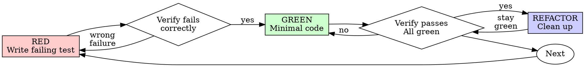

# 对话经过

会话 `01a21a6c-f863-7792-a3b5-f441fddeb99e` · 轮次 `01a21ac9-6af4-7653-bddd-2e51dda5613d`

<!-- foundry-detail 01a21a6c-f863-7792-a3b5-f441fddeb99e 01a21ac9-6af4-7653-bddd-2e51dda5613d -->
<!-- foundry-event 21449ade11ab7a05c21d55f525533a23c70798c6f31b394bfef6b55cdd7c2cb4 -->
## 进度原话

- 来源定位：字节 3727364

~~~text
我会把你确认的第四个 Hook 写进规格和任务清单，用 `implementation-preparation` 和 `writing-plans` 固化实施方案。接下来先建立跨轮写入和提交停写的回归用例，再接入代码。
~~~

<!-- foundry-event 6deefcbd94283462ed525c1079b4beac0d0e5ca063c701cdd72f7204e3171b21 -->
## 宿主命令执行

- 来源定位：字节 3729944

~~~text
{
  "command": "[已省略环境变量值] -lc 'cat .agents/skills/implementation-preparation/SKILL.md'",
  "workdir": "file:///home/ena/workspace/ena/agent-foundry/feature/init",
  "exitCode": 0,
  "status": "completed"
}
~~~

<!-- foundry-event 710ed254b80675a33200f1d49bf7dc119c7bd55c9e9cafb6cf0101fb87be6f31 -->
## 工具结果 `exec-ed5893c9-be75-4998-8eb0-4a5e60fa6304`

- 来源定位：字节 3729944

~~~text
---
name: implementation-preparation
description: 用户在已初始化的 Spec Kit 项目中要求实施、开始或继续正式 Task，或原生 Implement 进入实施前准备时使用。仅修订 Spec、仅调整规划、概念解释和普通讨论时不使用。
---

# 正式 Task 实施准备

执行目标项目已有的工作流治理，将当前请求整理为有实际材料、明确认可范围和继续条件的准备结果。这里负责准备和续接，不代替原生 Implement 执行业务，也不定义第二套任务或认可规则。

## 先核对是否要实施正式 Task

按请求实际内容和已知上下文判断，不因用户说“调整需求”就进入Task实施。仅修订已有Spec或仅调整规划时，将请求交回调用方按目标项目相应文档/规划职责处理，不要求先提供Task、单Task认可方案或补建plan/MVU；本技能的实施前置不阻止独立Spec修订。可以核对现有下游影响，没有变化就保持，不默认改业务代码。

用户明确要实施或继续原Task时，才进入下文完整读取和准备流程，已有适用认可直接复用。实施请求同时含需求变化时，先处理获确认的需求并核对规划及原方案是否仍适用；实质变化尚未解决，只暂停受影响实施，不以旧认可覆盖新逻辑，也不将需求修订误记成已实施。

## 定位并读取

用户明确的项目、Spec及Task优先；否则沿唯一已有上下文或项目的.specify/feature.json定位。Task身份连同所属Spec核对，多候选只澄清必要定位，不另建同一任务。

从目标项目根完整读取.specify/memory/constitution.md，再读取原Task、需求、plan、同级mvu、相关存量代码与项目约定、已有方案和证据。既有方案尚无独立mvu时按项目治理兼容原详情；不可用的治理或必要输入列出实际缺项及影响，不给出开工结论。读取路径以目标项目为根，不以本skill的安装目录为根；不导入其他仓库的个人资料。

## 需求变更与来源

读取所属Spec已有的简洁需求摘要/导航和当前有效要求，核对原Task方案所依据的范围、确认与待定事项；需要判断变更或纠正时追溯原始输入及讨论。摘要帮助定位，不代替正式定义或真实认可；来源与现行要求冲突时说明差异，只暂停受影响的开工结论。

出现实质需求变化时，沿目标项目治理和既有布局保留本次可见原始输入、可知来源及实际日期，默认放requirements/raw；已有相同原文直接引用。讨论、AI建议和润色提示词按职责另存，不能覆盖或冒充用户原话、确认，未知日期/不可见历史明确说明。简洁摘要用短段说明问题、解决方向、本次变化、确认或待定、日期，链接原文、必要讨论及当前有效要求；可复用requirements/README.md，不复制长规格或另造固定栏目/文件注册。新材料按实际用途归类，不批量迁移无关Spec。

在对应写入授权内先保存并检查、读回原文和必要讨论，再更新摘要及获确认的受影响要求，最后核对方案能否沿用。未确认的实质变化保留待定，不能按旧方案实施。仅问进度、普通工程调整或重复续做不构成新需求，不因此重复归档原文；保存失败按下文恢复规则说明已写/未写，后续从实际文件补缺，不靠记忆补造来源。

## 形成适用的讨论结果

核对已有方案的真实讨论来源、适用范围、保存结果、必要前置及有效授权。适用内容直接复用；无有效方案时先听用户方向，结合已读代码提出有依据的建议，讲清目标、核心逻辑与关系、理由、推进顺序及可观察验收。用户尚未认可的建议和未知事项分别保留，不把文件自称或AI回复当认可来源。

讨论中读取直接关联Task，说明仅引用依赖、普通工程调整或实质影响的区别。共享定义优先沿已有契约或负责它的Task方案保存，由其他方案引用；共同决定可以一次讨论，各Task分别说明自身职责及实际认可覆盖。需求、总体方案/依赖或局部实现变化，分别同步其真正受影响的材料，不自动实施关联Task。已完成Task按原事实保留，新增工作按项目的增量规则安排。

## 保存并回传继续范围

按项目治理为已形成的方案选择既有位置；默认implementation/<原Task ID>.md，一Task一份，由原Task引用。内容足以还原逻辑、认可范围和来源、理由、验收及重要调整即可，不预设固定表单。工程checkbox只留原tasks，讨论资料和方案不复制它。

依次保存必要方案、执行目标项目格式检查、完整读回，再补原Task引用并核对。返回本次实际可继续的Task及范围、仍需讨论或恢复的部分、必要证据和下一动作。继续由原生执行者依据目标治理推进；进入其他Task、批量、并行或恢复时，对各自材料重新应用本流程，不把前一次准备结果套给另一项。

## 异常与恢复

核查到治理/能力/材料缺失、过期或不可读、方案保存失败、前置未验、缺有效认可，或逻辑/职责/范围/验收实质变化时，依项目治理只处理允许的核查、讨论和恢复，说明受影响范围与继续条件。配置或hook没有调用本skill不构成准备已完成。普通工程调整沿有效认可记录依据，实质变化回讨论；恢复读取最终文件、真实确认及撤回依据，补未完成动作，不复做已确认修复。

~~~

<!-- foundry-event a1347f0e4121ee95f8c0dd12c8755d26788be61815ae252996304c92524cb37d -->
## 宿主命令执行

- 来源定位：字节 3737370

~~~text
{
  "command": "[已省略环境变量值] -lc 'cat /home/ena/.codex/plugins/cache/openai-curated-remote/superpowers/7.0.1/skills/writing-plans/SKILL.md'",
  "workdir": "file:///home/ena/workspace/ena/agent-foundry/feature/init",
  "exitCode": 0,
  "status": "completed"
}
~~~

<!-- foundry-event c687244976566157adaf9a36e9706a1a16b4287a691b5a46aa3d9bb8cd14a1d6 -->
## 工具结果 `exec-fb870106-8dea-4b7f-af67-606cd44776ed`

- 来源定位：字节 3737370

~~~text
---
name: writing-plans
description: Use when you have a spec or requirements for a multi-step task, before touching code
---

# Writing Plans

## Overview

Write implementation plans for an engineer who has not seen this codebase or this spec. Assume they write idiomatic code in the project's language once they know the exact interface and the exact test, and that they will make a reasonable choice wherever the plan leaves one open. What they cannot know is what you decided: which files, which names and signatures, which values from the spec, which tests prove each task. Document those. Give them the whole plan as bite-sized tasks. DRY. YAGNI. TDD. Frequent commits.

**Announce at start:** "I'm using the writing-plans skill to create the implementation plan."

**Context:** If working in an isolated worktree, it should have been created via the `superpowers:using-git-worktrees` skill at execution time.

**Save plans to:** `docs/superpowers/plans/YYYY-MM-DD-<feature-name>.md`
- (User preferences for plan location override this default)

## Scope Check

If the spec covers multiple independent subsystems, it should have been broken into sub-project specs during brainstorming. If it wasn't, suggest breaking this into separate plans — one per subsystem. Each plan should produce working, testable software on its own.

## File Structure

Before defining tasks, map out which files will be created or modified and what each one is responsible for. This is where decomposition decisions get locked in.

- Design units with clear boundaries and well-defined interfaces. Each file should have one clear responsibility.
- You reason best about code you can hold in context at once, and your edits are more reliable when files are focused. Prefer smaller, focused files over large ones that do too much.
- Files that change together should live together. Split by responsibility, not by technical layer.
- In existing codebases, follow established patterns. If the codebase uses large files, don't unilaterally restructure - but if a file you're modifying has grown unwieldy, including a split in the plan is reasonable.

This structure informs the task decomposition. Each task should produce self-contained changes that make sense independently.

## Task Right-Sizing

A task is the smallest unit that carries its own test cycle and is worth a
fresh reviewer's gate. When drawing task boundaries: fold setup,
configuration, scaffolding, and documentation steps into the task whose
deliverable needs them; split only where a reviewer could meaningfully
reject one task while approving its neighbor. Each task ends with an
independently testable deliverable.

## Step Granularity

**Each step is one action with a checkable result:**
- "Write the failing test" - step
- "Run it to make sure it fails" - step
- "Implement the minimal code to make the test pass" - step
- "Run the tests and make sure they pass" - step
- "Commit" - step

## Plan Document Header

**Every plan MUST start with this header:**

```markdown
# [Feature Name] Implementation Plan

> **For agentic workers:** REQUIRED SUB-SKILL: Use superpowers:subagent-driven-development (recommended) or superpowers:executing-plans to implement this plan task-by-task. Steps use checkbox (`- [ ]`) syntax for tracking.

**Goal:** [One sentence describing what this builds]

**Architecture:** [2-3 sentences about approach]

**Tech Stack:** [Key technologies/libraries]

**Spec:** [path to the spec/design doc this plan implements — the plan
argues from the spec, so the spec travels with it; executors read both]

## Global Constraints

[The spec's project-wide requirements — version floors, dependency limits,
naming and copy rules, platform requirements — one line each, with exact
values copied verbatim from the spec. Every task's requirements implicitly
include this section.]

## Review Focus

[The five input classes or failure modes the spec implies but no task's
tests exercise that are most likely to bite a person using this software
— one line each, naming the input or condition and the behavior a
reasonable person would expect, most likely first. The spec is a vision
document: it says what the software must do, not everything it will
meet, and its silence on an input is not permission for that input to
break the program. Write the list here, once, with the spec in front of
you. Then, for each line, add the test that pins it to the task that
owns the code, in that task's own step style.]

---
```

## Task Structure

````markdown
### Task N: [Component Name]

**Files:**
- Create: `exact/path/to/file.py`
- Modify: `exact/path/to/existing.py:123-145`
- Test: `tests/exact/path/to/test.py`

**Interfaces:**
- Consumes: [what this task uses from earlier tasks — exact signatures]
- Produces: [what later tasks rely on — exact function names, parameter
  and return types. A task's implementer sees only their own task; this
  block is how they learn the names and types neighboring tasks use.]

- [ ] **Step 1: Write the failing test**

```python
def test_specific_behavior():
    result = function(input)
    assert result == expected
```

- [ ] **Step 2: Run test to verify it fails**

Run: `pytest tests/path/test.py::test_name -v`
Expected: FAIL with "function not defined"

- [ ] **Step 3: Implement `function(input: InputType) -> ResultType` in `exact/path/to/file.py`**

One line on the approach when the signature and the test leave a choice
(which library call, which data structure); a code block only for an
algorithm they do not determine.

- [ ] **Step 4: Run test to verify it passes**

Run: `pytest tests/path/test.py::test_name -v`
Expected: PASS

- [ ] **Step 5: Commit**

```bash
git add tests/path/test.py src/path/file.py
git commit -m "feat: add specific feature"
```
````

## What a Step Contains

A step is done when the implementer can write exactly one reasonable thing
from it. That is the whole requirement: unambiguous, not complete. Each kind
of step carries what makes it unambiguous and nothing more:

- **A test step:** the test's name and its assertions, as code, with the
  spec's exact values in them.
- **A code step:** the exact signature (name, parameters, return type), the
  file it lives in, and the specific values the spec pins. The implementer
  writes the body. A body appears only for an algorithm the signature and
  tests do not determine, or for exact copy the spec fixes.
- **A verification step:** the command to run and the output that means it
  passed.
- **A reference to another task:** that task's Interfaces block says what
  to use; the plan does not repeat that task's code.

A plan is the set of decisions the implementer cannot make alone. A plan
longer than the code it describes has written the code instead. Lines that
decide nothing ("TBD", "handle edge cases", "add appropriate validation",
"write tests for the above", a type or function no task defines) are the
opposite failure, and the self-review catches both.

## Self-Review

After writing the complete plan, look at the spec with fresh eyes and check the plan against it. This is a checklist you run yourself — not a subagent dispatch.

**1. Spec coverage:** Skim each section/requirement in the spec. Can you point to a task that implements it? List any gaps.

**2. Step scan:** Every step must let the implementer write exactly one reasonable thing, and no step may carry more than that: a line that decides nothing is a gap, a function body the signature and tests already determine is a transcript. Fix both.

**3. Type consistency:** Do the types, method signatures, and property names you used in later tasks match what you defined in earlier tasks? A function called `clearLayers()` in Task 3 but `clearFullLayers()` in Task 7 is a bug.

**4. Review Focus:** For each input class or failure mode the spec implies, is there a task whose tests exercise it? The five uncovered ones most likely to bite a person go in the Review Focus section, and each line there gets its test added to the owning task. An empty section means you checked and found none, not that you skipped the check.

**5. Proportion:** Compare the plan's length to the spec's. A plan several times longer than the spec it implements is a transcript of the program, not a plan. If code blocks are most of the document, replace bodies with signatures, test names and assertions, and check that each step is still unambiguous.

If you find issues, fix them inline. No need to re-review — just fix and move on. If you find a spec requirement with no task, add the task.

## Execution Handoff

After saving and self-reviewing the plan, link it for your human partner
to read. If they have already explicitly supplied an execution method, ask
them to review the plan and confirm it captures what they want; wait for that
review before implementation, then use the preserved method. Otherwise, ask
them to review the plan and choose an execution method before implementation.

**When no execution method has already been supplied:**

**"Plan complete and saved to `docs/superpowers/plans/<filename>.md`. Please review the plan. Which execution approach would you prefer?**

- **Subagent-driven** - A fresh subagent implements each task and a fresh reviewer checks it before the next one starts, then a whole-branch review at the end. Most thorough; costs a fresh context per task and per review.
- **Native** - I implement every task myself in this session, the way this harness runs work, then one fresh reviewer on the most capable model checks the whole branch. Cheapest and fastest; no independent review until the end. Runs well with a mid-tier session model, since the plan carries the design.

**For this plan I recommend <one of the two>, because <one sentence from the plan: how much the tasks depend on each other's interfaces, how many there are, what a shipped mistake would cost>. Does the plan capture what you want, and which approach should we use?"**

**When an execution method has already been supplied:**

**"Plan complete and saved to `docs/superpowers/plans/<filename>.md`. Please review the plan. Does it capture what you want?"**

**If Subagent-driven chosen:**
- **REQUIRED SUB-SKILL:** Use superpowers:subagent-driven-development

**If Native chosen:**
- **REQUIRED SUB-SKILL:** Use superpowers:executing-plans

~~~

<!-- foundry-event 2131d9839dac4a2a562bbb9b7803b6e458edf379d777b4e9c2d280c8c1b090cf -->
## 宿主命令执行

- 来源定位：字节 3748915

~~~text
{
  "command": "[已省略环境变量值] -lc 'rg -n '\"'\"'^#|T038|^### |三个 Hook|三个入口|三个记录 Hook|三个独立|FR-017'\"'\"' specs/skills/002-conversation-to-skill/{tasks.md,plan.md,mvu.md,quickstart.md,analysis/spec-analysis/README.md} | cut -c1-310'",
  "workdir": "file:///home/ena/workspace/ena/agent-foundry/feature/init",
  "exitCode": 0,
  "status": "completed"
}
~~~

<!-- foundry-event 5ca0502210a4d66cf26ac3388888945b33214fec9bb74122a0ae9f1c533a6686 -->
## 工具结果 `exec-05e0f695-7fac-401d-b5a2-c31f43533856`

- 来源定位：字节 3748915

~~~text
specs/skills/002-conversation-to-skill/plan.md:1:# Implementation Plan: 从 Codex 对话生成协作 Skill
specs/skills/002-conversation-to-skill/plan.md:5:## Summary
specs/skills/002-conversation-to-skill/plan.md:19:## Technical Context
specs/skills/002-conversation-to-skill/plan.md:23:- **交付**。记录入口位于主线 `profile` 集合。当前从现有记录 Skill 根目录运行 `install.py`，复制整份 Skill 到目标工作树的 `.agents/skills/`，并在项目 `.codex/hooks.json` 登记安装副本中 `scripts/` 下的三个独立入口。在 Codex 原生流程完成信任并读回启用状态。提炼和分析由各自 Skill 使用宿主已有工具。 [交付与脚本映射](implementation/T035.md#独立-hook-入口与交付)
specs/skills/002-conversation-to-skill/plan.md:31:## Constitution Check
specs/skills/002-conversation-to-skill/plan.md:41:## Project Structure
specs/skills/002-conversation-to-skill/plan.md:43:### Documentation (this feature)
specs/skills/002-conversation-to-skill/plan.md:57:### Source Code (repository root)
specs/skills/002-conversation-to-skill/mvu.md:1:# 业务闭环 · 从 Codex 对话生成协作 Skill
specs/skills/002-conversation-to-skill/mvu.md:5:## 里程碑一 · 记录
specs/skills/002-conversation-to-skill/mvu.md:7:### MVU-001 自动保存首条消息与末轮回复
specs/skills/002-conversation-to-skill/mvu.md:23:### MVU-002 回查完整工具参数、输出和附件
specs/skills/002-conversation-to-skill/mvu.md:31:### MVU-003 并行记录与跨日续写
specs/skills/002-conversation-to-skill/mvu.md:37:### MVU-004 写入失败后带着缺口继续
specs/skills/002-conversation-to-skill/mvu.md:43:### MVU-005 提交步骤跳过记录
specs/skills/002-conversation-to-skill/mvu.md:55:### MVU-006 归档并切换旧影子画像入口
specs/skills/002-conversation-to-skill/mvu.md:65:## 里程碑二 · 提炼
specs/skills/002-conversation-to-skill/mvu.md:67:### MVU-007 按证据派发并保存一项特点
specs/skills/002-conversation-to-skill/mvu.md:73:### MVU-008 用多项目材料提炼并回查来源
specs/skills/002-conversation-to-skill/mvu.md:79:## 里程碑三 · 分析
specs/skills/002-conversation-to-skill/mvu.md:81:### MVU-009 独立派发分析并生成一份协作 Skill
specs/skills/002-conversation-to-skill/mvu.md:87:### MVU-010 把生成目录带到另一兼容代理使用
specs/skills/002-conversation-to-skill/mvu.md:93:### MVU-011 删除规则、保护共享依据并允许再次形成
specs/skills/002-conversation-to-skill/analysis/spec-analysis/README.md:1:# 功能分析 · 从 Codex 对话生成协作 Skill
specs/skills/002-conversation-to-skill/analysis/spec-analysis/README.md:9:## 自动保存会话并回查完整内容
specs/skills/002-conversation-to-skill/analysis/spec-analysis/README.md:27:## 并行、恢复与写失败后的连续工作
specs/skills/002-conversation-to-skill/analysis/spec-analysis/README.md:35:## 提交步骤跳过记录
specs/skills/002-conversation-to-skill/analysis/spec-analysis/README.md:41:## 提前归档并退役旧入口
specs/skills/002-conversation-to-skill/analysis/spec-analysis/README.md:51:## 从多项目资料提炼有依据的特点
specs/skills/002-conversation-to-skill/analysis/spec-analysis/README.md:59:## 独立分析并生成可携带的协作 Skill
specs/skills/002-conversation-to-skill/analysis/spec-analysis/README.md:67:## 删除当前规则并允许以后重新形成
specs/skills/002-conversation-to-skill/analysis/spec-analysis/README.md:73:## 业务流程
specs/skills/002-conversation-to-skill/analysis/spec-analysis/README.md:94:## 里程碑与流转
specs/skills/002-conversation-to-skill/analysis/spec-analysis/README.md:117:该图对应规划的功能推进，代码位置仍是前述三个入口和本 Spec 证据目录。T030 汇总必要工程检查及实际业务证据并核对最终来源与已消费快照，T031 核对交付说明，T032 在最后清理开发过程文件、代码段和文档片段，保护正式交付、有效治理、历史事实、证据及复用探针骨架；用途不明内容保留并说明定位与处理条件。收尾或清理改变最终流程来源时须刷新正式入口、核对读取并复验受影响流程，不能沿用旧快照结果。
specs/skills/002-conversation-to-skill/analysis/spec-analysis/README.md:119:## 当前证据边界与恢复入口
specs/skills/002-conversation-to-skill/tasks.md:1:# Tasks: 从 Codex 对话生成协作 Skill
specs/skills/002-conversation-to-skill/tasks.md:15:## Phase 1：准备与复用核查
specs/skills/002-conversation-to-skill/tasks.md:22:## Phase 2：共用定位契约
specs/skills/002-conversation-to-skill/tasks.md:28:## Phase 3：US1 自动保存并续接对话（P1，MVP）
specs/skills/002-conversation-to-skill/tasks.md:34:### P0 提交停写回归
specs/skills/002-conversation-to-skill/tasks.md:38:### 技术前置与测试
specs/skills/002-conversation-to-skill/tasks.md:44:### 实现与交付
specs/skills/002-conversation-to-skill/tasks.md:55:### 主记录与附件改版
specs/skills/002-conversation-to-skill/tasks.md:60:### 主记录消息块分隔
specs/skills/002-conversation-to-skill/tasks.md:64:## Phase 4：US2 用多个项目对话生成并使用协作 Skill（P2）
specs/skills/002-conversation-to-skill/tasks.md:70:### 技术前置与提炼
specs/skills/002-conversation-to-skill/tasks.md:76:### 独立分析与便携消费
specs/skills/002-conversation-to-skill/tasks.md:84:## Phase 5：US3 删除规则并允许以后重新形成（P3）
specs/skills/002-conversation-to-skill/tasks.md:95:## Phase 6：US4 归档并退役旧影子画像（P3）
specs/skills/002-conversation-to-skill/tasks.md:110:## Phase 7：整体验证与收尾
specs/skills/002-conversation-to-skill/tasks.md:118:## 依赖与实际执行顺序
specs/skills/002-conversation-to-skill/tasks.md:138:## 各故事的并行示例
specs/skills/002-conversation-to-skill/tasks.md:149:## 实施策略
specs/skills/002-conversation-to-skill/quickstart.md:1:# 验收指南 · 从 Codex 对话生成协作 Skill
specs/skills/002-conversation-to-skill/quickstart.md:5:## 准备隔离环境
specs/skills/002-conversation-to-skill/quickstart.md:16:## 记录验收
specs/skills/002-conversation-to-skill/quickstart.md:18:### 接入前置
specs/skills/002-conversation-to-skill/quickstart.md:31:### 正式来源复验
specs/skills/002-conversation-to-skill/quickstart.md:43:另用三个隔离安装对照核对入口独立性。核对安装后的 `scripts/` 只有三个 Hook 脚本，每个对照只保留一个入口及公共模块。向该入口的登记命令传入对应的合成事件，读回各自负责保存的用户原话、工具结果或实际回复。 [独立执行复验](analysis/recording-acceptance.md#2026-11-26-三个-hook-独立执行复验)
specs/skills/002-conversation-to-skill/quickstart.md:63:## 流程 Skill 最终来源消费
specs/skills/002-conversation-to-skill/quickstart.md:72:## 提炼与分析验收
specs/skills/002-conversation-to-skill/quickstart.md:92:## 共享规则并发采纳验收
specs/skills/002-conversation-to-skill/quickstart.md:102:## 旧入口归档切换验收
specs/skills/002-conversation-to-skill/quickstart.md:114:## 当前工作区安装与手动试用

~~~

<!-- foundry-event ba4d60d28bb4e4d987180c0a533c5e7ad41cc0995370077309bc2bc8996c2e49 -->
## 宿主命令执行

- 来源定位：字节 3757303

~~~text
{
  "command": "[已省略环境变量值] -lc 'git status --short --branch; git rev-parse --show-toplevel --git-dir --git-common-dir; git log -3 --oneline'",
  "workdir": "file:///home/ena/workspace/ena/agent-foundry/feature/init",
  "exitCode": 0,
  "status": "completed"
}
~~~

<!-- foundry-event 2d8250c9ab8d16a08bc3bb17d96efd2439192ca33d652f171307ef4803878992 -->
## 工具结果 `exec-3af19d96-aa25-4953-8a12-ecbbbe67d81b`

- 来源定位：字节 3757303

~~~text
## feature/init...origin/feature/init [ahead 1]
 M .codex/hooks.json
 M .github/workflows/skills-deploy-common.yml
 M .specify/memory/conversation-recording/records/2026-11-26/01a2174d-dd90-74b1-8444-b2b62149b17b.md
 M packages/skills/build/plugins/vite-plugin-version/index.ts
 M packages/skills/package.json
 M packages/skills/tests/test_register_commands.py
 M pnpm-workspace.yaml
 M specs/docs/001-docs-site-framework/tasks.md
 M specs/skills/003-skills-release-pipeline/analysis/spec-analysis/README.md
 M specs/skills/003-skills-release-pipeline/implementation/T008.md
 M specs/skills/003-skills-release-pipeline/mvu.md
 M specs/skills/003-skills-release-pipeline/plan.md
 M specs/skills/003-skills-release-pipeline/spec.md
 M specs/skills/003-skills-release-pipeline/tasks.md
?? .specify/memory/conversation-recording/records/2026-11-27/
?? packages/skills/build/utils/release-timestamp.ts
?? packages/skills/tests/distribution/vite-plugin-version.test.mjs
?? specs/docs/001-docs-site-framework/implementation/
?? specs/skills/002-conversation-to-skill/analysis/acceptance/subagent-recording-code-mode.json
?? specs/skills/002-conversation-to-skill/analysis/acceptance/subagent-recording-timeline.json
?? specs/skills/002-conversation-to-skill/analysis/subagent-recording-timeline.md
?? specs/skills/003-skills-release-pipeline/implementation/T009.md
/home/ena/workspace/ena/agent-foundry/feature/init
.git
.git
8563253 test(skills): 补齐命令挂载测试的集合开关
cf8def3 fix(skills): 修复 Git 提交停写与自定义构建输出
1233ff9 123

~~~

<!-- foundry-event 2b394874ee40d4d0b9bd96e37dddf10b489418a5ec4c995ab2945ee0decf823d -->
## 工具调用 `Bash` · `exec-ed5893c9-be75-4998-8eb0-4a5e60fa6304`

- 来源定位：工具事件 exec-ed5893c9-be75-4998-8eb0-4a5e60fa6304

~~~text
工作目录：/home/ena/workspace/ena/agent-foundry/feature/init
{
  "command": "cat .agents/skills/implementation-preparation/SKILL.md"
}
~~~

<!-- foundry-event b05d7377cd22d3aa7b8d66eebbb99d7ee1b37b9e34b00a0a05670abcc07743e1 -->
## 工具调用 `Bash` · `exec-fb870106-8dea-4b7f-af67-606cd44776ed`

- 来源定位：工具事件 exec-fb870106-8dea-4b7f-af67-606cd44776ed

~~~text
工作目录：/home/ena/workspace/ena/agent-foundry/feature/init
{
  "command": "cat /home/ena/.codex/plugins/cache/openai-curated-remote/superpowers/7.0.1/skills/writing-plans/SKILL.md"
}
~~~

<!-- foundry-event eddbbfd67bde4d2da5451ab098633342d1b58d8a5767f5b47d1a2b3e612bdc3a -->
## 工具调用 `Bash` · `exec-05e0f695-7fac-401d-b5a2-c31f43533856`

- 来源定位：工具事件 exec-05e0f695-7fac-401d-b5a2-c31f43533856

~~~text
工作目录：/home/ena/workspace/ena/agent-foundry/feature/init
{
  "command": "rg -n '^#|T038|^### |三个 Hook|三个入口|三个记录 Hook|三个独立|FR-017' specs/skills/002-conversation-to-skill/{tasks.md,plan.md,mvu.md,quickstart.md,analysis/spec-analysis/README.md} | cut -c1-310"
}
~~~

<!-- foundry-event 76094a817785668fdafcb2fab39213ed9272bf613bcce45a838c3d8735bf4691 -->
## 工具调用 `Bash` · `exec-3af19d96-aa25-4953-8a12-ecbbbe67d81b`

- 来源定位：工具事件 exec-3af19d96-aa25-4953-8a12-ecbbbe67d81b

~~~text
工作目录：/home/ena/workspace/ena/agent-foundry/feature/init
{
  "command": "git status --short --branch; git rev-parse --show-toplevel --git-dir --git-common-dir; git log -3 --oneline"
}
~~~

<!-- foundry-event 8254b290020186da334989994aee7d09cff78cda9444fae5a91956920d6a889b -->
## 工具调用 `exec` · `call_c7ee9d39b04741d583f593e68f02191a`

- 来源定位：字节 3728435

~~~text
工作目录：/home/ena/workspace/ena/agent-foundry/feature/init
const repo="/home/ena/workspace/ena/agent-foundry/feature/init";
const checks=await Promise.allSettled([
  tools.exec_command({cmd:"git status --short --branch; git rev-parse --show-toplevel --git-dir --git-common-dir; git log -3 --oneline",workdir:repo,max_output_tokens:2850}),
  tools.exec_command({cmd:"cat .agents/skills/implementation-preparation/SKILL.md",workdir:repo,max_output_tokens:5800}),
  tools.exec_command({cmd:"cat /home/ena/.codex/plugins/cache/openai-curated-remote/superpowers/7.0.1/skills/writing-plans/SKILL.md",workdir:repo,max_output_tokens:3600}),
  tools.exec_command({cmd:"rg -n '^#|T038|^### |三个 Hook|三个入口|三个记录 Hook|三个独立|FR-017' specs/skills/002-conversation-to-skill/{tasks.md,plan.md,mvu.md,quickstart.md,analysis/spec-analysis/README.md} | cut -c1-310",workdir:repo,max_output_tokens:6800})
]);checks.forEach((r,i)=>{if(r.status==="fulfilled")text({i,...r.value});else text({i,error:String(r.reason)});});

~~~

<!-- foundry-event 860eab5bf9d8c80a469897802159f673c980a681014058f8fb989b9795e819ad -->
## 工具结果 `call_c7ee9d39b04741d583f593e68f02191a`

- 来源定位：字节 3759753

~~~text
[
  {
    "type": "input_text",
    "text": "Script completed\nWall time 1.2 seconds\nOutput:\n"
  },
  {
    "type": "input_text",
    "text": "{\"i\":0,\"chunk_id\":\"2ec1c9\",\"wall_time_seconds\":0.000039626,\"exit_code\":0,\"original_token_count\":391,\"output\":\"## feature/init...origin/feature/init [ahead 1]\\n M .codex/hooks.json\\n M .github/workflows/skills-deploy-common.yml\\n M .specify/memory/conversation-recording/records/2026-11-26/01a2174d-dd90-74b1-8444-b2b62149b17b.md\\n M packages/skills/build/plugins/vite-plugin-version/index.ts\\n M packages/skills/package.json\\n M packages/skills/tests/test_register_commands.py\\n M pnpm-workspace.yaml\\n M specs/docs/001-docs-site-framework/tasks.md\\n M specs/skills/003-skills-release-pipeline/analysis/spec-analysis/README.md\\n M specs/skills/003-skills-release-pipeline/implementation/T008.md\\n M specs/skills/003-skills-release-pipeline/mvu.md\\n M specs/skills/003-skills-release-pipeline/plan.md\\n M specs/skills/003-skills-release-pipeline/spec.md\\n M specs/skills/003-skills-release-pipeline/tasks.md\\n?? .specify/memory/conversation-recording/records/2026-11-27/\\n?? packages/skills/build/utils/release-timestamp.ts\\n?? packages/skills/tests/distribution/vite-plugin-version.test.mjs\\n?? specs/docs/001-docs-site-framework/implementation/\\n?? specs/skills/002-conversation-to-skill/analysis/acceptance/subagent-recording-code-mode.json\\n?? specs/skills/002-conversation-to-skill/analysis/acceptance/subagent-recording-timeline.json\\n?? specs/skills/002-conversation-to-skill/analysis/subagent-recording-timeline.md\\n?? specs/skills/003-skills-release-pipeline/implementation/T009.md\\n/home/ena/workspace/ena/agent-foundry/feature/init\\n.git\\n.git\\n8563253 test(skills): 补齐命令挂载测试的集合开关\\ncf8def3 fix(skills): 修复 Git 提交停写与自定义构建输出\\n1233ff9 123\\n\"}"
  },
  {
    "type": "input_text",
    "text": "{\"i\":1,\"chunk_id\":\"67249c\",\"wall_time_seconds\":0.000034453,\"exit_code\":0,\"original_token_count\":1415,\"output\":\"---\\nname: implementation-preparation\\ndescription: 用户在已初始化的 Spec Kit 项目中要求实施、开始或继续正式 Task，或原生 Implement 进入实施前准备时使用。仅修订 Spec、仅调整规划、概念解释和普通讨论时不使用。\\n---\\n\\n# 正式 Task 实施准备\\n\\n执行目标项目已有的工作流治理，将当前请求整理为有实际材料、明确认可范围和继续条件的准备结果。这里负责准备和续接，不代替原生 Implement 执行业务，也不定义第二套任务或认可规则。\\n\\n## 先核对是否要实施正式 Task\\n\\n按请求实际内容和已知上下文判断，不因用户说“调整需求”就进入Task实施。仅修订已有Spec或仅调整规划时，将请求交回调用方按目标项目相应文档/规划职责处理，不要求先提供Task、单Task认可方案或补建plan/MVU；本技能的实施前置不阻止独立Spec修订。可以核对现有下游影响，没有变化就保持，不默认改业务代码。\\n\\n用户明确要实施或继续原Task时，才进入下文完整读取和准备流程，已有适用认可直接复用。实施请求同时含需求变化时，先处理获确认的需求并核对规划及原方案是否仍适用；实质变化尚未解决，只暂停受影响实施，不以旧认可覆盖新逻辑，也不将需求修订误记成已实施。\\n\\n## 定位并读取\\n\\n用户明确的项目、Spec及Task优先；否则沿唯一已有上下文或项目的.specify/feature.json定位。Task身份连同所属Spec核对，多候选只澄清必要定位，不另建同一任务。\\n\\n从目标项目根完整读取.specify/memory/constitution.md，再读取原Task、需求、plan、同级mvu、相关存量代码与项目约定、已有方案和证据。既有方案尚无独立mvu时按项目治理兼容原详情；不可用的治理或必要输入列出实际缺项及影响，不给出开工结论。读取路径以目标项目为根，不以本skill的安装目录为根；不导入其他仓库的个人资料。\\n\\n## 需求变更与来源\\n\\n读取所属Spec已有的简洁需求摘要/导航和当前有效要求，核对原Task方案所依据的范围、确认与待定事项；需要判断变更或纠正时追溯原始输入及讨论。摘要帮助定位，不代替正式定义或真实认可；来源与现行要求冲突时说明差异，只暂停受影响的开工结论。\\n\\n出现实质需求变化时，沿目标项目治理和既有布局保留本次可见原始输入、可知来源及实际日期，默认放requirements/raw；已有相同原文直接引用。讨论、AI建议和润色提示词按职责另存，不能覆盖或冒充用户原话、确认，未知日期/不可见历史明确说明。简洁摘要用短段说明问题、解决方向、本次变化、确认或待定、日期，链接原文、必要讨论及当前有效要求；可复用requirements/README.md，不复制长规格或另造固定栏目/文件注册。新材料按实际用途归类，不批量迁移无关Spec。\\n\\n在对应写入授权内先保存并检查、读回原文和必要讨论，再更新摘要及获确认的受影响要求，最后核对方案能否沿用。未确认的实质变化保留待定，不能按旧方案实施。仅问进度、普通工程调整或重复续做不构成新需求，不因此重复归档原文；保存失败按下文恢复规则说明已写/未写，后续从实际文件补缺，不靠记忆补造来源。\\n\\n## 形成适用的讨论结果\\n\\n核对已有方案的真实讨论来源、适用范围、保存结果、必要前置及有效授权。适用内容直接复用；无有效方案时先听用户方向，结合已读代码提出有依据的建议，讲清目标、核心逻辑与关系、理由、推进顺序及可观察验收。用户尚未认可的建议和未知事项分别保留，不把文件自称或AI回复当认可来源。\\n\\n讨论中读取直接关联Task，说明仅引用依赖、普通工程调整或实质影响的区别。共享定义优先沿已有契约或负责它的Task方案保存，由其他方案引用；共同决定可以一次讨论，各Task分别说明自身职责及实际认可覆盖。需求、总体方案/依赖或局部实现变化，分别同步其真正受影响的材料，不自动实施关联Task。已完成Task按原事实保留，新增工作按项目的增量规则安排。\\n\\n## 保存并回传继续范围\\n\\n按项目治理为已形成的方案选择既有位置；默认implementation/<原Task ID>.md，一Task一份，由原Task引用。内容足以还原逻辑、认可范围和来源、理由、验收及重要调整即可，不预设固定表单。工程checkbox只留原tasks，讨论资料和方案不复制它。\\n\\n依次保存必要方案、执行目标项目格式检查、完整读回，再补原Task引用并核对。返回本次实际可继续的Task及范围、仍需讨论或恢复的部分、必要证据和下一动作。继续由原生执行者依据目标治理推进；进入其他Task、批量、并行或恢复时，对各自材料重新应用本流程，不把前一次准备结果套给另一项。\\n\\n## 异常与恢复\\n\\n核查到治理/能力/材料缺失、过期或不可读、方案保存失败、前置未验、缺有效认可，或逻辑/职责/范围/验收实质变化时，依项目治理只处理允许的核查、讨论和恢复，说明受影响范围与继续条件。配置或hook没有调用本skill不构成准备已完成。普通工程调整沿有效认可记录依据，实质变化回讨论；恢复读取最终文件、真实确认及撤回依据，补未完成动作，不复做已确认修复。\\n\"}"
  },
  {
    "type": "input_text",
    "text": "{\"i\":2,\"chunk_id\":\"8e4238\",\"wall_time_seconds\":0.000042547,\"exit_code\":0,\"original_token_count\":2584,\"output\":\"---\\nname: writing-plans\\ndescription: Use when you have a spec or requirements for a multi-step task, before touching code\\n---\\n\\n# Writing Plans\\n\\n## Overview\\n\\nWrite implementation plans for an engineer who has not seen this codebase or this spec. Assume they write idiomatic code in the project's language once they know the exact interface and the exact test, and that they will make a reasonable choice wherever the plan leaves one open. What they cannot know is what you decided: which files, which names and signatures, which values from the spec, which tests prove each task. Document those. Give them the whole plan as bite-sized tasks. DRY. YAGNI. TDD. Frequent commits.\\n\\n**Announce at start:** \\\"I'm using the writing-plans skill to create the implementation plan.\\\"\\n\\n**Context:** If working in an isolated worktree, it should have been created via the `superpowers:using-git-worktrees` skill at execution time.\\n\\n**Save plans to:** `docs/superpowers/plans/YYYY-MM-DD-<feature-name>.md`\\n- (User preferences for plan location override this default)\\n\\n## Scope Check\\n\\nIf the spec covers multiple independent subsystems, it should have been broken into sub-project specs during brainstorming. If it wasn't, suggest breaking this into separate plans — one per subsystem. Each plan should produce working, testable software on its own.\\n\\n## File Structure\\n\\nBefore defining tasks, map out which files will be created or modified and what each one is responsible for. This is where decomposition decisions get locked in.\\n\\n- Design units with clear boundaries and well-defined interfaces. Each file should have one clear responsibility.\\n- You reason best about code you can hold in context at once, and your edits are more reliable when files are focused. Prefer smaller, focused files over large ones that do too much.\\n- Files that change together should live together. Split by responsibility, not by technical layer.\\n- In existing codebases, follow established patterns. If the codebase uses large files, don't unilaterally restructure - but if a file you're modifying has grown unwieldy, including a split in the plan is reasonable.\\n\\nThis structure informs the task decomposition. Each task should produce self-contained changes that make sense independently.\\n\\n## Task Right-Sizing\\n\\nA task is the smallest unit that carries its own test cycle and is worth a\\nfresh reviewer's gate. When drawing task boundaries: fold setup,\\nconfiguration, scaffolding, and documentation steps into the task whose\\ndeliverable needs them; split only where a reviewer could meaningfully\\nreject one task while approving its neighbor. Each task ends with an\\nindependently testable deliverable.\\n\\n## Step Granularity\\n\\n**Each step is one action with a checkable result:**\\n- \\\"Write the failing test\\\" - step\\n- \\\"Run it to make sure it fails\\\" - step\\n- \\\"Implement the minimal code to make the test pass\\\" - step\\n- \\\"Run the tests and make sure they pass\\\" - step\\n- \\\"Commit\\\" - step\\n\\n## Plan Document Header\\n\\n**Every plan MUST start with this header:**\\n\\n```markdown\\n# [Feature Name] Implementation Plan\\n\\n> **For agentic workers:** REQUIRED SUB-SKILL: Use superpowers:subagent-driven-development (recommended) or superpowers:executing-plans to implement this plan task-by-task. Steps use checkbox (`- [ ]`) syntax for tracking.\\n\\n**Goal:** [One sentence describing what this builds]\\n\\n**Architecture:** [2-3 sentences about approach]\\n\\n**Tech Stack:** [Key technologies/libraries]\\n\\n**Spec:** [path to the spec/design doc this plan implements — the plan\\nargues from the spec, so the spec travels with it; executors read both]\\n\\n## Global Constraints\\n\\n[The spec's project-wide requirements — version floors, dependency limits,\\nnaming and copy rules, platform requirements — one line each, with exact\\nvalues copied verbatim from the spec. Every task's requirements implicitly\\ninclude this section.]\\n\\n## Review Focus\\n\\n[The five input classes or failure modes the spec implies but no task's\\ntests exercise that are most likely to bite a person using this software\\n— one line each, naming the input or condition and the behavior a\\nreasonable person would expect, most likely first. The spec is a vision\\ndocument: it says what the software must do, not everything it will\\nmeet, and its silence on an input is not permission for that input to\\nbreak the program. Write the list here, once, with the spec in front of\\nyou. Then, for each line, add the test that pins it to the task that\\nowns the code, in that task's own step style.]\\n\\n---\\n```\\n\\n## Task Structure\\n\\n````markdown\\n### Task N: [Component Name]\\n\\n**Files:**\\n- Create: `exact/path/to/file.py`\\n- Modify: `exact/path/to/existing.py:123-145`\\n- Test: `tests/exact/path/to/test.py`\\n\\n**Interfaces:**\\n- Consumes: [what this task uses from earlier tasks — exact signatures]\\n- Produces: [what later tasks rely on — exact function names, parameter\\n  and return types. A task's implementer sees only their own task; this\\n  block is how they learn the names and types neighboring tasks use.]\\n\\n- [ ] **Step 1: Write the failing test**\\n\\n```python\\ndef test_specific_behavior():\\n    result = function(input)\\n    assert result == expected\\n```\\n\\n- [ ] **Step 2: Run test to verify it fails**\\n\\nRun: `pytest tests/path/test.py::test_name -v`\\nExpected: FAIL with \\\"function not defined\\\"\\n\\n- [ ] **Step 3: Implement `function(input: InputType) -> ResultType` in `exact/path/to/file.py`**\\n\\nOne line on the approach when the signature and the test leave a choice\\n(which library call, which data structure); a code block only for an\\nalgorithm they do not determine.\\n\\n- [ ] **Step 4: Run test to verify it passes**\\n\\nRun: `pytest tests/path/test.py::test_name -v`\\nExpected: PASS\\n\\n- [ ] **Step 5: Commit**\\n\\n```bash\\ngit add tests/path/test.py src/path/file.py\\ngit commit -m \\\"feat: add specific feature\\\"\\n```\\n````\\n\\n## What a Step Contains\\n\\nA step is done when the implementer can write exactly one reasonable thing\\nfrom it. That is the whole requirement: unambiguous, not complete. Each kind\\nof step carries what makes it unambiguous and nothing more:\\n\\n- **A test step:** the test's name and its assertions, as code, with the\\n  spec's exact values in them.\\n- **A code step:** the exact signature (name, parameters, return type), the\\n  file it lives in, and the specific values the spec pins. The implementer\\n  writes the body. A body appears only for an algorithm the signature and\\n  tests do not determine, or for exact copy the spec fixes.\\n- **A verification step:** the command to run and the output that means it\\n  passed.\\n- **A reference to another task:** that task's Interfaces block says what\\n  to use; the plan does not repeat that task's code.\\n\\nA plan is the set of decisions the implementer cannot make alone. A plan\\nlonger than the code it describes has written the code instead. Lines that\\ndecide nothing (\\\"TBD\\\", \\\"handle edge cases\\\", \\\"add appropriate validation\\\",\\n\\\"write tests for the above\\\", a type or function no task defines) are the\\nopposite failure, and the self-review catches both.\\n\\n## Self-Review\\n\\nAfter writing the complete plan, look at the spec with fresh eyes and check the plan against it. This is a checklist you run yourself — not a subagent dispatch.\\n\\n**1. Spec coverage:** Skim each section/requirement in the spec. Can you point to a task that implements it? List any gaps.\\n\\n**2. Step scan:** Every step must let the implementer write exactly one reasonable thing, and no step may carry more than that: a line that decides nothing is a gap, a function body the signature and tests already determine is a transcript. Fix both.\\n\\n**3. Type consistency:** Do the types, method signatures, and property names you used in later tasks match what you defined in earlier tasks? A function called `clearLayers()` in Task 3 but `clearFullLayers()` in Task 7 is a bug.\\n\\n**4. Review Focus:** For each input class or failure mode the spec implies, is there a task whose tests exercise it? The five uncovered ones most likely to bite a person go in the Review Focus section, and each line there gets its test added to the owning task. An empty section means you checked and found none, not that you skipped the check.\\n\\n**5. Proportion:** Compare the plan's length to the spec's. A plan several times longer than the spec it implements is a transcript of the program, not a plan. If code blocks are most of the document, replace bodies with signatures, test names and assertions, and check that each step is still unambiguous.\\n\\nIf you find issues, fix them inline. No need to re-review — just fix and move on. If you find a spec requirement with no task, add the task.\\n\\n## Execution Handoff\\n\\nAfter saving and self-reviewing the plan, link it for your human partner\\nto read. If they have already explicitly supplied an execution method, ask\\nthem to review the plan and confirm it captures what they want; wait for that\\nreview before implementation, then use the preserved method. Otherwise, ask\\nthem to review the plan and choose an execution method before implementation.\\n\\n**When no execution method has already been supplied:**\\n\\n**\\\"Plan complete and saved to `docs/superpowers/plans/<filename>.md`. Please review the plan. Which execution approach would you prefer?**\\n\\n- **Subagent-driven** - A fresh subagent implements each task and a fresh reviewer checks it before the next one starts, then a whole-branch review at the end. Most thorough; costs a fresh context per task and per review.\\n- **Native** - I implement every task myself in this session, the way this harness runs work, then one fresh reviewer on the most capable model checks the whole branch. Cheapest and fastest; no independent review until the end. Runs well with a mid-tier session model, since the plan carries the design.\\n\\n**For this plan I recommend <one of the two>, because <one sentence from the plan: how much the tasks depend on each other's interfaces, how many there are, what a shipped mistake would cost>. Does the plan capture what you want, and which approach should we use?\\\"**\\n\\n**When an execution method has already been supplied:**\\n\\n**\\\"Plan complete and saved to `docs/superpowers/plans/<filename>.md`. Please review the plan. Does it capture what you want?\\\"**\\n\\n**If Subagent-driven chosen:**\\n- **REQUIRED SUB-SKILL:** Use superpowers:subagent-driven-development\\n\\n**If Native chosen:**\\n- **REQUIRED SUB-SKILL:** Use superpowers:executing-plans\\n\"}"
  },
  {
    "type": "input_text",
    "text": "{\"i\":3,\"chunk_id\":\"d411f6\",\"wall_time_seconds\":0.000024525,\"exit_code\":0,\"original_token_count\":1815,\"output\":\"specs/skills/002-conversation-to-skill/plan.md:1:# Implementation Plan: 从 Codex 对话生成协作 Skill\\nspecs/skills/002-conversation-to-skill/plan.md:5:## Summary\\nspecs/skills/002-conversation-to-skill/plan.md:19:## Technical Context\\nspecs/skills/002-conversation-to-skill/plan.md:23:- **交付**。记录入口位于主线 `profile` 集合。当前从现有记录 Skill 根目录运行 `install.py`，复制整份 Skill 到目标工作树的 `.agents/skills/`，并在项目 `.codex/hooks.json` 登记安装副本中 `scripts/` 下的三个独立入口。在 Codex 原生流程完成信任并读回启用状态。提炼和分析由各自 Skill 使用宿主已有工具。 [交付与脚本映射](implementation/T035.md#独立-hook-入口与交付)\\nspecs/skills/002-conversation-to-skill/plan.md:31:## Constitution Check\\nspecs/skills/002-conversation-to-skill/plan.md:41:## Project Structure\\nspecs/skills/002-conversation-to-skill/plan.md:43:### Documentation (this feature)\\nspecs/skills/002-conversation-to-skill/plan.md:57:### Source Code (repository root)\\nspecs/skills/002-conversation-to-skill/mvu.md:1:# 业务闭环 · 从 Codex 对话生成协作 Skill\\nspecs/skills/002-conversation-to-skill/mvu.md:5:## 里程碑一 · 记录\\nspecs/skills/002-conversation-to-skill/mvu.md:7:### MVU-001 自动保存首条消息与末轮回复\\nspecs/skills/002-conversation-to-skill/mvu.md:23:### MVU-002 回查完整工具参数、输出和附件\\nspecs/skills/002-conversation-to-skill/mvu.md:31:### MVU-003 并行记录与跨日续写\\nspecs/skills/002-conversation-to-skill/mvu.md:37:### MVU-004 写入失败后带着缺口继续\\nspecs/skills/002-conversation-to-skill/mvu.md:43:### MVU-005 提交步骤跳过记录\\nspecs/skills/002-conversation-to-skill/mvu.md:55:### MVU-006 归档并切换旧影子画像入口\\nspecs/skills/002-conversation-to-skill/mvu.md:65:## 里程碑二 · 提炼\\nspecs/skills/002-conversation-to-skill/mvu.md:67:### MVU-007 按证据派发并保存一项特点\\nspecs/skills/002-conversation-to-skill/mvu.md:73:### MVU-008 用多项目材料提炼并回查来源\\nspecs/skills/002-conversation-to-skill/mvu.md:79:## 里程碑三 · 分析\\nspecs/skills/002-conversation-to-skill/mvu.md:81:### MVU-009 独立派发分析并生成一份协作 Skill\\nspecs/skills/002-conversation-to-skill/mvu.md:87:### MVU-010 把生成目录带到另一兼容代理使用\\nspecs/skills/002-conversation-to-skill/mvu.md:93:### MVU-011 删除规则、保护共享依据并允许再次形成\\nspecs/skills/002-conversation-to-skill/analysis/spec-analysis/README.md:1:# 功能分析 · 从 Codex 对话生成协作 Skill\\nspecs/skills/002-conversation-to-skill/analysis/spec-analysis/README.md:9:## 自动保存会话并回查完整内容\\nspecs/skills/002-conversation-to-skill/analysis/spec-analysis/README.md:27:## 并行、恢复与写失败后的连续工作\\nspecs/skills/002-conversation-to-skill/analysis/spec-analysis/README.md:35:## 提交步骤跳过记录\\nspecs/skills/002-conversation-to-skill/analysis/spec-analysis/README.md:41:## 提前归档并退役旧入口\\nspecs/skills/002-conversation-to-skill/analysis/spec-analysis/README.md:51:## 从多项目资料提炼有依据的特点\\nspecs/skills/002-conversation-to-skill/analysis/spec-analysis/README.md:59:## 独立分析并生成可携带的协作 Skill\\nspecs/skills/002-conversation-to-skill/analysis/spec-analysis/README.md:67:## 删除当前规则并允许以后重新形成\\nspecs/skills/002-conversation-to-skill/analysis/spec-analysis/README.md:73:## 业务流程\\nspecs/skills/002-conversation-to-skill/analysis/spec-analysis/README.md:94:## 里程碑与流转\\nspecs/skills/002-conversation-to-skill/analysis/spec-analysis/README.md:117:该图对应规划的功能推进，代码位置仍是前述三个入口和本 Spec 证据目录。T030 汇总必要工程检查及实际业务证据并核对最终来源与已消费快照，T031 核对交付说明，T032 在最后清理开发过程文件、代码段和文档片段，保护正式交付、有效治理、历史事实、证据及复用探针骨架；用途不明内容保留并说明定位与处理条件。收尾或清理改变最终流程来源时须刷新正式入口、核对读取并复验受影响流程，不能沿用旧快照结果。\\nspecs/skills/002-conversation-to-skill/analysis/spec-analysis/README.md:119:## 当前证据边界与恢复入口\\nspecs/skills/002-conversation-to-skill/tasks.md:1:# Tasks: 从 Codex 对话生成协作 Skill\\nspecs/skills/002-conversation-to-skill/tasks.md:15:## Phase 1：准备与复用核查\\nspecs/skills/002-conversation-to-skill/tasks.md:22:## Phase 2：共用定位契约\\nspecs/skills/002-conversation-to-skill/tasks.md:28:## Phase 3：US1 自动保存并续接对话（P1，MVP）\\nspecs/skills/002-conversation-to-skill/tasks.md:34:### P0 提交停写回归\\nspecs/skills/002-conversation-to-skill/tasks.md:38:### 技术前置与测试\\nspecs/skills/002-conversation-to-skill/tasks.md:44:### 实现与交付\\nspecs/skills/002-conversation-to-skill/tasks.md:55:### 主记录与附件改版\\nspecs/skills/002-conversation-to-skill/tasks.md:60:### 主记录消息块分隔\\nspecs/skills/002-conversation-to-skill/tasks.md:64:## Phase 4：US2 用多个项目对话生成并使用协作 Skill（P2）\\nspecs/skills/002-conversation-to-skill/tasks.md:70:### 技术前置与提炼\\nspecs/skills/002-conversation-to-skill/tasks.md:76:### 独立分析与便携消费\\nspecs/skills/002-conversation-to-skill/tasks.md:84:## Phase 5：US3 删除规则并允许以后重新形成（P3）\\nspecs/skills/002-conversation-to-skill/tasks.md:95:## Phase 6：US4 归档并退役旧影子画像（P3）\\nspecs/skills/002-conversation-to-skill/tasks.md:110:## Phase 7：整体验证与收尾\\nspecs/skills/002-conversation-to-skill/tasks.md:118:## 依赖与实际执行顺序\\nspecs/skills/002-conversation-to-skill/tasks.md:138:## 各故事的并行示例\\nspecs/skills/002-conversation-to-skill/tasks.md:149:## 实施策略\\nspecs/skills/002-conversation-to-skill/quickstart.md:1:# 验收指南 · 从 Codex 对话生成协作 Skill\\nspecs/skills/002-conversation-to-skill/quickstart.md:5:## 准备隔离环境\\nspecs/skills/002-conversation-to-skill/quickstart.md:16:## 记录验收\\nspecs/skills/002-conversation-to-skill/quickstart.md:18:### 接入前置\\nspecs/skills/002-conversation-to-skill/quickstart.md:31:### 正式来源复验\\nspecs/skills/002-conversation-to-skill/quickstart.md:43:另用三个隔离安装对照核对入口独立性。核对安装后的 `scripts/` 只有三个 Hook 脚本，每个对照只保留一个入口及公共模块。向该入口的登记命令传入对应的合成事件，读回各自负责保存的用户原话、工具结果或实际回复。 [独立执行复验](analysis/recording-acceptance.md#2026-11-26-三个-hook-独立执行复验)\\nspecs/skills/002-conversation-to-skill/quickstart.md:63:## 流程 Skill 最终来源消费\\nspecs/skills/002-conversation-to-skill/quickstart.md:72:## 提炼与分析验收\\nspecs/skills/002-conversation-to-skill/quickstart.md:92:## 共享规则并发采纳验收\\nspecs/skills/002-conversation-to-skill/quickstart.md:102:## 旧入口归档切换验收\\nspecs/skills/002-conversation-to-skill/quickstart.md:114:## 当前工作区安装与手动试用\\n\"}"
  }
]
~~~

<!-- foundry-event f308b1218bc48cc849fbd6f34d22c5e0efe1e6224cfd7aa9efcb138c31eccfc7 -->
## 进度原话

- 来源定位：字节 3867707

~~~text
我会把父会话归属和子线程轮次分别核对。现有入口要求父轮正在进行，而新增入口要在父代理空闲时也能写入。这两种情况都会进验收。
~~~

<!-- foundry-event 3f24a708dc293c2d816b5fe55a5b1ce1e22cd4d7649f81766ea702f73397897a -->
## 宿主命令执行

- 来源定位：字节 3871540

~~~text
{
  "command": "[已省略环境变量值] -lc 'cat .agents/skills/artifact-spec-analysis/SKILL.md; cat /home/ena/.codex/plugins/cache/openai-curated-remote/superpowers/7.0.1/skills/using-git-worktrees/SKILL.md'",
  "workdir": "file:///home/ena/workspace/ena/agent-foundry/feature/init",
  "exitCode": 0,
  "status": "completed"
}
~~~

<!-- foundry-event 5165fbb80a1946227af43381250d5f4d2ed60416a233833febcd8e3914b4ab7e -->
## 工具结果 `exec-82c25515-1aaf-4cb3-8513-11b3b8f679ed`

- 来源定位：字节 3871540

~~~text
---
name: artifact-spec-analysis
description: Spec Kit 任务生成后或 Increment 规划保存后，需要创建或刷新所属 Spec 的逐功能综合分析时使用。
---

# Spec 功能分析

将当前有效需求、总体方案、业务闭环和任务关联成可阅读的功能说明。任务生成后的 after_tasks 与 Increment 规划保存后的显式调用使用本技能；分析是阅读材料，实施与验收仍由原任务和证据负责。

## 取得当前依据

沿调用方明确的目标项目、Spec 和写入范围，读取项目工作流治理、需求摘要及有效原文/确认、spec、plan、tasks、既有分析与必要证据。明确打开 plan 同级的 mvu.md 并读取有效详情；旧项目尚未分离时读取原 plan 详情并注明兼容来源，不另做迁移。核对引用中的实际代码或待建位置，区分项目事实、计划、未确认建议和历史要求。缺项或冲突写明具体来源、影响及待核实内容，只分析已有依据支持的范围。

## 按功能解释

以主要功能名称逐项独立成块，用简洁完整的文字解释谁在什么情境获得什么结果，以及必要的先后关系、判断和失败边界。将相关 Task、闭环与证据链接自然融入说明；细节沿有效来源阅读，不抄录整份规格或活动 MVU 定义。暂停方向说明当前边界，尚未实现或缺实际验收的能力按真实依据说明，不能由任务生成、配置存在或分析保存推断已交付。

在这些功能说明及必要的补充内容中覆盖适用的六类分析：业务分析、业务流程图、技术分析、技术流程图、MVU 里程碑、MVU 流转图。业务内容解释用户结果和关键决策；技术内容说明职责、数据或调用关系及实际/计划位置；里程碑与流转说明可观察交付结果、必要依赖和验收衔接，引用 mvu/tasks 的有效详情。没有材料支持或当前不适用的类别说明具体原因，不填造内容。已有有效图优先引用，需要新增时使用 Mermaid，一图一事、术语配通俗解释，并注明实际代码或计划位置；技术图沿既有 diagrams.md 导航，不维护相互冲突的图示副本。

功能内容按阅读需要组织，不强制每项填固定栏目或字数，不以覆盖总表替代各功能说明。工程 checkbox 只在原 tasks，分析引用来源，不创建工程状态清单、完成比例、状态文件或另一份活动闭环定义。

## 创建、刷新与恢复

默认入口为所属 Spec 的 analysis/spec-analysis/README.md，已有布局优先复用；内容较多时分文档并维护索引。写前读取现有内容，依据最新需求及已保存的规划更新相关功能、引用和缺口，保留有效历史来源。没有实质变化保持内容稳定，不靠新时间戳或重复附录制造更新。

按目标项目格式要求逐份保存、检查并读回，核对本地引用和输入覆盖，再报告实际创建/更新及未完成部分。失败分别说明已写、未写、影响和恢复入口；续接从实际文件补缺，不宣称跨文件原子回滚。只阻断依赖该分析结果的后续动作，不替调用方重做规划、修改完成标记或实施业务。

两种调用复用同一份技能和目标，不注册 after_increment、不创建另一个生成器。正式安装/注册由调用方处理，本技能不因分析请求取得迁移、挂载、发布或外部写入授权。
---
name: using-git-worktrees
description: Use when starting feature work that needs isolation from current workspace or before executing implementation plans - ensures an isolated workspace exists via native tools or git worktree fallback
---

# Using Git Worktrees

## Overview

Ensure work happens in an isolated workspace. Prefer your platform's native worktree tools. Fall back to manual git worktrees only when no native tool is available.

**Core principle:** Detect existing isolation first. Then use native tools. Then fall back to git. Never fight the harness.

**Announce at start:** "I'm using the using-git-worktrees skill to set up an isolated workspace."

## Step 0: Detect Existing Isolation

**Before creating anything, check if you are already in an isolated workspace.**

```bash
GIT_DIR=$(cd "$(git rev-parse --git-dir)" 2>/dev/null && pwd -P)
GIT_COMMON=$(cd "$(git rev-parse --git-common-dir)" 2>/dev/null && pwd -P)
BRANCH=$(git branch --show-current)
```

**Submodule guard:** `GIT_DIR != GIT_COMMON` is also true inside git submodules. Before concluding "already in a worktree," verify you are not in a submodule:

```bash
# If this returns a path, you're in a submodule, not a worktree — treat as normal repo
git rev-parse --show-superproject-working-tree 2>/dev/null
```

**If `GIT_DIR != GIT_COMMON` (and not a submodule):** You are already in a linked worktree. Skip to Step 2 (Project Setup). Do NOT create another worktree.

Report with branch state:
- On a branch: "Already in isolated workspace at `<path>` on branch `<name>`."
- Detached HEAD: "Already in isolated workspace at `<path>` (detached HEAD, externally managed). Branch creation needed at finish time."

**If `GIT_DIR == GIT_COMMON` (or in a submodule):** You are in a normal repo checkout.

Has the user already indicated their worktree preference in your instructions? If not, ask for consent before creating a worktree:

> "Would you like me to set up an isolated worktree? It protects your current branch from changes."

Honor any existing declared preference without asking. If the user declines consent, work in place and skip to Step 2.

## Step 1: Create Isolated Workspace

**You have two mechanisms. Try them in this order.**

### 1a. Native Worktree Tools (preferred)

The user has asked for an isolated workspace (Step 0 consent). Do you already have a way to create a worktree? It might be a tool with a name like `EnterWorktree`, `WorktreeCreate`, a `/worktree` command, or a `--worktree` flag. If you do, use it and skip to Step 2.

Native tools handle directory placement, branch creation, and cleanup automatically. Using `git worktree add` when you have a native tool creates phantom state your harness can't see or manage.

Only proceed to Step 1b if you have no native worktree tool available.

### 1b. Git Worktree Fallback

**Only use this if Step 1a does not apply** — you have no native worktree tool available. Create a worktree manually using git.

#### Directory Selection

Follow this priority order. Explicit user preference always beats observed filesystem state.

1. **Check your instructions for a declared worktree directory preference.** If the user has already specified one, use it without asking.

2. **Check for an existing project-local worktree directory:**
   ```bash
   ls -d .worktrees 2>/dev/null     # Preferred (hidden)
   ls -d worktrees 2>/dev/null      # Alternative
   ```
   If found, use it. If both exist, `.worktrees` wins.

3. **If there is no other guidance available**, default to `.worktrees/` at the project root.

#### Safety Verification (project-local directories only)

**MUST verify directory is ignored before creating worktree:**

```bash
git check-ignore -q .worktrees 2>/dev/null || git check-ignore -q worktrees 2>/dev/null
```

**If NOT ignored:** Add to .gitignore, commit the change, then proceed.

**Why critical:** Prevents accidentally committing worktree contents to repository.

#### Create the Worktree

```bash
# Determine path based on chosen location
path="$LOCATION/$BRANCH_NAME"

git worktree add "$path" -b "$BRANCH_NAME"
cd "$path"
```

**Sandbox fallback:** If `git worktree add` fails with a permission error (sandbox denial), tell the user the sandbox blocked worktree creation and you're working in the current directory instead. Then run setup and baseline tests in place.

## Step 2: Project Setup

Auto-detect and run appropriate setup:

```bash
# Node.js
if [ -f package.json ]; then npm install; fi

# Rust
if [ -f Cargo.toml ]; then cargo build; fi

# Python
if [ -f requirements.txt ]; then pip install -r requirements.txt; fi
if [ -f pyproject.toml ]; then poetry install; fi

# Go
if [ -f go.mod ]; then go mod download; fi
```

## Step 3: Verify Clean Baseline

Run tests to ensure workspace starts clean:

```bash
# Use project-appropriate command
npm test / cargo test / pytest / go test ./...
```

**If tests fail:** Report failures, ask whether to proceed or investigate.

**If tests pass:** Report ready.

### Report

```
Worktree ready at <full-path>
Tests passing (<N> tests, 0 failures)
Ready to implement <feature-name>
```

## Quick Reference

| Situation | Action |
|-----------|--------|
| Already in linked worktree | Skip creation (Step 0) |
| In a submodule | Treat as normal repo (Step 0 guard) |
| Native worktree tool available | Use it (Step 1a) |
| No native tool | Git worktree fallback (Step 1b) |
| `.worktrees/` exists | Use it (verify ignored) |
| `worktrees/` exists | Use it (verify ignored) |
| Both exist | Use `.worktrees/` |
| Neither exists | Check instruction file, then default `.worktrees/` |
| Directory not ignored | Add to .gitignore + commit |
| Permission error on create | Sandbox fallback, work in place |
| Tests fail during baseline | Report failures + ask |
| No package.json/Cargo.toml | Skip dependency install |

## Common Rationalizations

| Excuse | Reality |
|--------|---------|
| "I'm obviously not in a worktree — no need to check" | Run Step 0. Harness-created isolation and submodules both fool eyeballing; the detection commands settle it. |
| "`git worktree add` is quicker than hunting for a native tool" | A native tool (e.g. `EnterWorktree`) owns placement, branching, and cleanup. Bypassing it is the #1 mistake — it creates phantom state your harness can't see or manage. |
| "The worktree directory is surely ignored already" | Run `git check-ignore`. An unignored worktree directory commits the whole tree into the repo. |
| "Any directory name works" | Explicit instructions beat an existing project-local directory, which beats the `.worktrees/` default. |
| "The workspace is fresh — baseline tests can wait" | A dirty baseline makes every later failure ambiguous. Run the tests now; proceeding past failures is your human partner's call. |

~~~

<!-- foundry-event b6191c608cc31ba155e4bcac0cfc2517827aa17029fba69bde7d45517f4a6682 -->
## 宿主命令执行

- 来源定位：字节 3883261

~~~text
{
  "command": "[已省略环境变量值] -lc 'nl -ba packages/skills/tests/test_conversation_recording.py | sed -n '\"'\"'1,178p'\"'\"'; nl -ba packages/skills/src/profile/conversation-recording/recording/record.py | sed -n '\"'\"'68,134p;195,278p'\"'\"'; head -66 packages/skills/src/profile/conversation-recording/recording/events.py'",
  "workdir": "file:///home/ena/workspace/ena/agent-foundry/feature/init",
  "exitCode": 0,
  "status": "completed"
}
~~~

<!-- foundry-event 98bce9d93c63c68dcb92deaa95d6894f9ad213864c5f21c274c2d42312ca5355 -->
## 工具结果 `exec-6a2c0ff2-6aa2-4ad3-9a2f-18d7aaca40e9`

- 来源定位：字节 3883261

~~~text
     1	"""验证主线记录安装、宿主范围判定及项目内首末轮落盘。"""
     2	
     3	from base64 import b64encode
     4	from contextlib import closing
     5	import json
     6	import os
     7	from pathlib import Path
     8	import shlex
     9	import sqlite3
    10	import subprocess
    11	import sys
    12	import tempfile
    13	import unittest
    14	from uuid import uuid4
    15	
    16	
    17	SOURCE = Path(__file__).resolve().parents[1] / "src/profile/conversation-recording"
    18	
    19	
    20	class ConversationRecordingTest(unittest.TestCase):
    21	    def setUp(self):
    22	        temporary = tempfile.TemporaryDirectory(prefix="foundry-recording-test-")
    23	        self.addCleanup(temporary.cleanup)
    24	        self.root = Path(temporary.name)
    25	        self.repo = self.root / "repo"
    26	        self.repo.mkdir()
    27	        subprocess.run(["git", "init", "-q", str(self.repo)], check=True)
    28	        self.hooks = self.repo / ".codex/hooks.json"
    29	        self.hooks.parent.mkdir()
    30	        self.other_hook = {"hooks": [{"type": "command", "command": "other-project-hook"}]}
    31	        self.hooks.write_text(json.dumps({"hooks": {"Stop": [self.other_hook]}}))
    32	        self.state = self.root / "state"
    33	        self.turn, self.session = str(uuid4()), str(uuid4())
    34	        self.transcript = self.state / f"sessions/2026/11/25/rollout-2026-11-25T20-00-00-{self.session}.jsonl"
    35	        self.transcript.parent.mkdir(parents=True)
    36	        self.env = {**os.environ, "CODEX_HOME": str(self.state), "CODEX_SQLITE_HOME": str(self.state)}
    37	        self.record = self.repo / f"records/2026-11-25/{self.session}.md"
    38	
    39	    def install(self, check=True):
    40	        return subprocess.run([sys.executable, "-B", str(SOURCE / "install.py"), "--project", str(self.repo)],
    41	                              text=True, capture_output=True, check=check, env=self.env)
    42	
    43	    def seed_turn(self, trigger="user", events=(), origin=None):
    44	        header = {"type": "session_meta", "payload": {"id": self.session, "cwd": str(origin or self.repo),
    45	                  "timestamp": "2026-11-25T12:00:00Z", "originator": "codex-tui", "source": "vscode"}}
    46	        started = {"type": "event_msg", "ordinal": 1, "timestamp": "2026-11-26T12:00:00Z", "payload": {
    47	            "type": "task_started", "turn_id": self.turn, "turn_attribution": {"turn_trigger": trigger}}}
    48	        first = (json.dumps(header) + "\n").encode()
    49	        self.transcript.write_bytes(first + "".join(json.dumps(event) + "\n" for event in [started, *events]).encode())
    50	        with closing(sqlite3.connect(self.state / "thread_history_1.sqlite")) as index, index:
    51	            index.execute("CREATE TABLE IF NOT EXISTS thread_turns (thread_id, turn_id, status, rollout_byte_offset)")
    52	            index.execute("DELETE FROM thread_turns")
    53	            index.execute("INSERT INTO thread_turns VALUES (?, ?, 'inProgress', ?)", (self.session, self.turn, len(first)))
    54	
    55	    def callback(self, event, **values):
    56	        groups = json.loads(self.hooks.read_text())["hooks"][event]
    57	        cmd = groups[-1]["hooks"][0]["command"]
    58	        data = {"hook_event_name": event, "session_id": self.session, "turn_id": self.turn,
    59	                "cwd": str(self.repo), "transcript_path": str(self.transcript), **values}
    60	        result = subprocess.run(["bash", "-c", cmd], input=json.dumps(data), cwd=self.repo, env=self.env,
    61	                                text=True, capture_output=True)
    62	        self.assertEqual(result.returncode, 0, result.stderr)
    63	        return json.loads(result.stdout or "{}")
    64	
    65	    def test_installer_preserves_other_hooks_and_is_idempotent(self):
    66	        installed = self.install(check=False)
    67	        self.assertEqual(installed.returncode, 0, installed.stderr)
    68	        initial = self.hooks.read_bytes()
    69	        hooks = json.loads(initial)["hooks"]
    70	        self.assertEqual(hooks["Stop"][0], self.other_hook)
    71	        self.assertEqual(len(hooks["UserPromptSubmit"]), 1)
    72	        self.assertEqual(len(hooks["Stop"]), 2)
    73	        skill = self.repo / ".agents/skills/conversation-recording"
    74	        self.assertTrue((skill / "SKILL.md").is_file())
    75	        self.assertEqual({file.name for file in (skill / "scripts").iterdir()},
    76	                         {"user_prompt_submit.py", "post_tool_use.py", "stop.py"})
    77	        for event, script in (("UserPromptSubmit", "user_prompt_submit.py"),
    78	                              ("PostToolUse", "post_tool_use.py"), ("Stop", "stop.py")):
    79	            command = shlex.split(hooks[event][-1]["hooks"][0]["command"])
    80	            self.assertEqual(Path(command[3]), skill / "scripts" / script)
    81	            self.assertTrue(Path(command[3]).is_file())
    82	        self.install()
    83	        self.assertEqual(self.hooks.read_bytes(), initial)
    84	
    85	    def test_install_conflict_does_not_overwrite_project_files(self):
    86	        existing = self.repo / ".agents/skills/conversation-recording"
    87	        existing.mkdir(parents=True)
    88	        (existing / "SKILL.md").write_text("用户维护的同名技能\n")
    89	        initial = self.hooks.read_bytes()
    90	        self.assertNotEqual(self.install(check=False).returncode, 0)
    91	        self.assertEqual(self.hooks.read_bytes(), initial)
    92	        self.assertEqual((existing / "SKILL.md").read_text(), "用户维护的同名技能\n")
    93	
    94	    def test_prompt_and_final_are_saved_once_in_the_original_date_file(self):
    95	        self.install()
    96	        self.seed_turn()
    97	        prompt, reply = "读一下 README\n\n保留行尾  ", "第一行\n\n第二行  \n"
    98	        self.callback("UserPromptSubmit", prompt=prompt)
    99	        self.assertIn("读一下 README", self.record.read_text())
   100	        self.assertNotIn("### 主代理 · 回复", self.record.read_text())
   101	        for _ in range(2):
   102	            self.callback("Stop", last_assistant_message=reply)
   103	        data = self.record.read_text()
   104	        self.assertEqual(data.count(f"<!-- turn-{self.turn} -->"), 1)
   105	        self.assertEqual(data.count("### 主代理 · 回复"), 1)
   106	        self.assertIn("保留行尾  ", data)
   107	        self.assertIn("第二行  ", data)
   108	        self.assertFalse((self.record.parent / f"details/{self.session}/{self.turn}.md").exists())
   109	
   110	    def test_message_layout_preserves_body_and_separates_supplement_and_resumed_turn(self):
   111	        """安装版保存正文里的伪标题与标记，续写不重排也不重复。"""
   112	        self.install()
   113	        prompt = (f"首条原话 😀\n\n---\n\n## 2026-11-26 <!-- turn-{uuid4()} -->\n"
   114	                  f"> **2026-11-26** <!-- turn-{self.turn} -->\n"
   115	                  "<!-- foundry-message 回复 4 -->\n\n### 主代理 · 回复\n\n伪造边界\n"
   116	                  "[查看经过](details/fake.md)\n"
   117	                  '<!-- foundry-recording {"session":"wrong"} -->\n')
   118	        supplement = "同轮补充\n\n1. 查日志\n2. 不改代码"
   119	        reply = "真实回复\n\n```text\n---\n### 标题\n```\n\n末行  \n"
   120	        self.seed_turn(events=[self.tool_call(2, "read", {"cmd": "cat README.md"})])
   121	        self.assertEqual(self.callback("UserPromptSubmit", prompt=prompt), {})
   122	        first = self.record.read_bytes().decode()
   123	        self.assertIn(f"## {self.turn_date()} <!-- turn-{self.turn} -->", first)
   124	        self.assertIn(f"### 用户 · 发起\n\n{prompt}", first)
   125	        self.assertEqual(self.callback("UserPromptSubmit", prompt=prompt), {})
   126	        self.assertEqual(self.record.read_bytes().decode(), first)
   127	        self.callback("UserPromptSubmit", prompt=supplement)
   128	        self.callback("PostToolUse", tool_name="Bash", tool_use_id="read",
   129	                      tool_input={"cmd": "cat README.md"}, tool_response="文件内容")
   130	        self.callback("Stop", last_assistant_message=reply)
   131	        saved = self.record.read_bytes().decode()
   132	        self.callback("Stop", last_assistant_message=reply)
   133	        self.assertEqual(self.record.read_bytes().decode(), saved)
   134	        self.assertIn(f"{prompt}\n\n---\n\n<!-- foundry-message 补充", saved)
   135	        self.assertIn(f"### 用户 · 补充\n\n{supplement}\n\n---\n\n<!-- foundry-message 回复", saved)
   136	        self.assertIn(f"### 主代理 · 回复\n\n{reply}", saved)
   137	        self.assertIn("[查看经过](details/fake.md)", saved)
   138	        link = f"details/{self.session}/{self.turn}.md"
   139	        self.assertEqual(saved.count(f"[查看经过]({link})"), 1)
   140	        self.assertTrue((self.record.parent / link).is_file())
   141	
   142	        self.turn = str(uuid4())
   143	        self.seed_turn()
   144	        self.callback("UserPromptSubmit", prompt="恢复后的首条")
   145	        self.callback("Stop", last_assistant_message="恢复后的回复")
   146	        resumed = self.record.read_bytes().decode()
   147	        self.assertTrue(resumed.startswith(f"{saved}\n---\n\n## "))
   148	        self.assertIn("### 用户 · 发起\n\n恢复后的首条", resumed)
   149	        self.assertIn("### 主代理 · 回复\n\n恢复后的回复", resumed)
   150	        self.assertEqual(resumed.count("恢复后的回复"), 1)
   151	
   152	    def test_legacy_record_is_preserved_when_appending_a_new_layout_turn(self):
   153	        """既有引用块可补记，下一轮用新布局而不重写旧内容。"""
   154	        self.install()
   155	        self.seed_turn()
   156	        date = self.turn_date()
   157	        self.record.parent.mkdir(parents=True)
   158	        previous = (f"# 对话记录\n\n会话 `{self.session}`\n\n"
   159	                    f"> **{date}** <!-- turn-{self.turn} -->\n>\n> - **发起** 旧轮原话\n")
   160	        self.record.write_text(previous)
   161	        self.callback("Stop", last_assistant_message="旧轮回复")
   162	        legacy = self.record.read_text()
   163	        self.assertEqual(legacy, previous + "> - **回复** 旧轮回复\n")
   164	        self.turn = str(uuid4())
   165	        self.seed_turn()
   166	        self.callback("UserPromptSubmit", prompt="新轮原话")
   167	        self.callback("Stop", last_assistant_message="新轮回复")
   168	        self.assertTrue(self.record.read_text().startswith(f"{legacy}\n---\n\n## "))
   169	        self.assertIn("### 主代理 · 回复\n\n新轮回复", self.record.read_text())
   170	
   171	    @staticmethod
   172	    def turn_date():
   173	        """返回夹具宿主时间在当前时区的日期。"""
   174	        from datetime import datetime
   175	        return datetime.fromisoformat("2026-11-26T12:00:00+00:00").astimezone().date().isoformat()
   176	
   177	    def test_exec_and_foreign_session_do_not_create_records(self):
   178	        self.install()
    68	
    69	def header_byte(stream):
    70	    value = stream.read(1)
    71	    while value in (b" ", b"\t", b"\r"):
    72	        value = stream.read(1)
    73	    return value
    74	
    75	
    76	def header_string(stream):
    77	    """仅解析受限的宿主事件头字符串。"""
    78	    if header_byte(stream) != b'"':
    79	        return None
    80	    data = bytearray(b'"')
    81	    for _ in range(180):
    82	        char = stream.read(1)
    83	        if not char or char == b"\n":
    84	            return None
    85	        data += char
    86	        if char == b'"':
    87	            return json.loads(data)
    88	        if char == b"\\":
    89	            data += stream.read(1)
    90	    return None
    91	
    92	
    93	def event_header(stream, offset, outer, inner=None):
    94	    """先核对 JSON 层级的事件头，再读指定宿主元数据行。"""
    95	    stream.seek(offset)
    96	    if header_byte(stream) != b"{":
    97	        return None
    98	    verified = False
    99	    while True:
   100	        key = header_string(stream)
   101	        if key not in ("type", "timestamp", "ordinal", "payload") or header_byte(stream) != b":":
   102	            return None
   103	        if key == "payload":
   104	            if not verified or header_byte(stream) != b"{" or header_string(stream) != "type":
   105	                return None
   106	            if header_byte(stream) != b":" or header_string(stream) != inner:
   107	                return None
   108	            break
   109	        if key == "type":
   110	            if header_string(stream) != outer:
   111	                return None
   112	            if inner is None:
   113	                break
   114	            verified = True
   115	        elif key == "timestamp":
   116	            if header_string(stream) is None:
   117	                return None
   118	        else:
   119	            value = header_byte(stream)
   120	            if value not in b"0123456789" or not value:
   121	                return None
   122	            for _ in range(24):
   123	                value = stream.read(1)
   124	                if not value or value not in b"0123456789":
   125	                    stream.seek(-1, os.SEEK_CUR)
   126	                    break
   127	        if header_byte(stream) != b",":
   128	            return None
   129	    stream.seek(offset)
   130	    line = stream.readline(65536)
   131	    return json.loads(line) if line.endswith(b"\n") else None
   132	
   133	
   134	@dataclass(frozen=True)
   195	def inside_project(project, target):
   196	    """拒绝通过软链接路由的资料文件。"""
   197	    if not target.resolve().is_relative_to(project) or not target.is_relative_to(project):
   198	        return False
   199	    for path in (target, *target.parents):
   200	        if path == project:
   201	            break
   202	        if path.is_symlink():
   203	            return False
   204	    return True
   205	
   206	
   207	def visible(project, target):
   208	    """校验拟落盘文件的真实归属与 Git 可见性。"""
   209	    if not inside_project(project, target):
   210	        return False
   211	    ancestor = next(path for path in target.parents if path.exists())
   212	    return git_root(ancestor) == project and git(project, "check-ignore", "--no-index", "--", str(target)).returncode == 1
   213	
   214	
   215	def candidate_roots(project):
   216	    """沿项目显式设置、已有 Agent 工具资料和项目内默认目录选址。"""
   217	    config = project / ".codex/conversation-recording.json"
   218	    if config.is_file() and not config.is_symlink():
   219	        custom = json.loads(config.read_bytes()).get("recordRoot")
   220	        if isinstance(custom, str) and custom:
   221	            yield project / custom, "项目记录配置"
   222	    if (project / ".specify/feature.json").is_file() and (project / ".specify/memory").is_dir():
   223	        yield project / ".specify/memory/conversation-recording", "Spec Kit 项目资料"
   224	    yield project, "项目根下的 records 目录"
   225	    yield project / "conversation-recording", "项目内独立资料目录"
   226	
   227	
   228	def find_record(scope):
   229	    """优先复用经来源核实的记录，绕开新命中的 Git 忽略位置。"""
   230	    suffix = Path("records") / scope.opening / f"{scope.session}.md"
   231	    roots = list(candidate_roots(scope.project))
   232	    files = git(scope.project, "ls-files", "-z", "--cached", "--others", "--exclude-standard",
   233	                "--", f":(glob)**/{suffix.as_posix()}")
   234	    ignored = git(scope.project, "ls-files", "-z", "--ignored", "--others", "--exclude-standard",
   235	                  "--", f":(glob)**/{suffix.as_posix()}")
   236	    known = {base / suffix for base, _ in roots}
   237	    known.update(scope.project / os.fsdecode(path) for path in (files.stdout + ignored.stdout).split(b"\0") if path)
   238	    existing = []
   239	    superseded = set()
   240	    for path in sorted(known):
   241	        if not inside_project(scope.project, path) or not path.is_file():
   242	            continue
   243	        content = path.read_bytes().decode("utf-8")
   244	        first_turn = TURN_HEADER.search(content)
   245	        marker = RECORD_HEADER.search(content, 0, first_turn.start() if first_turn else len(content))
   246	        if not marker:
   247	            # 保留并复用具备相同会话头的旧版记录。
   248	            if f"会话 `{scope.session}`" not in content:
   249	                raise ValueError(f"主记录同名文件归属不明：{path}")
   250	        else:
   251	            saved = json.loads(marker[1])
   252	            if (saved.get("session"), saved.get("project"), saved.get("origin")) != (
   253	                scope.session, str(scope.project), str(scope.origin)
   254	            ):
   255	                raise ValueError(f"主记录会话来源不符：{path}")
   256	            superseded.update(scope.project / item for item in saved.get("previousRecords", []) if isinstance(item, str))
   257	        existing.append((path, content))
   258	    eligible = [(path, content) for path, content in existing if path not in superseded and visible(scope.project, path)]
   259	    if len(eligible) > 1:
   260	        raise ValueError("存在多份可写的同一会话主记录")
   261	    if eligible:
   262	        return eligible[0]
   263	    for base, reason in roots:
   264	        path = base / suffix
   265	        if not path.exists() and visible(scope.project, path):
   266	            details = {"session": scope.session, "project": str(scope.project), "origin": str(scope.origin),
   267	                       "root": str(base.relative_to(scope.project)), "reason": reason}
   268	            if existing:
   269	                details["previousRecords"] = [str(path.relative_to(scope.project)) for path, _ in existing]
   270	                details["restartTurn"] = scope.turn
   271	            heading = (f"# 对话记录\n\n会话 `{scope.session}` · 开启 `{scope.opened_at}` · 目录 `{scope.origin}`\n\n"
   272	                       f"<!-- foundry-recording {json.dumps(details, ensure_ascii=False)} -->\n")
   273	            return path, heading
   274	    raise OSError("找不到 Git 可见的项目内记录位置")
   275	
   276	
   277	def quoted(label, value):
   278	    """为多行原话添加可逆的 Markdown 外层前缀。"""
"""从已核实的当前轮次提取可见过程、原件及提交边界。"""

from ast import literal_eval
from base64 import b64decode
from binascii import Error as Base64Error
from dataclasses import dataclass
import json
import mimetypes
import os
from pathlib import Path
import re
import shlex
from urllib.parse import unquote, urlsplit


CALLS = {"function_call", "custom_tool_call", "mcp_tool_call"}
OUTPUTS = {"function_call_output", "custom_tool_call_output", "mcp_tool_call_output"}
SECRET_NAME = re.compile(r"password|passwd|secret|token|credential|(?:^|_)key(?:_|$)|authorization", re.I)
STRUCTURAL_PATHS = {"PWD", "OLDPWD", "HOME", "CODEX_HOME", "CODEX_SQLITE_HOME", "PATH", "TMPDIR", "XDG_RUNTIME_DIR"}
SECRET_VALUE = re.compile(r"(?i)(sk-[a-z0-9_-]{12,}|gh[pousr]_[a-z0-9]{15,}|bearer\s+[^\s,;]+|[a-z][a-z0-9+.-]*://[^\s/:@]+:[^\s/@]+@)")
ASSIGNMENT = re.compile(r"(?m)(\b[A-Z][A-Z0-9_]*(?:_TOKEN|_KEY|_PASSWORD|_SECRET)\s*=\s*)([^\s,;]+)")
SENSITIVE_PATH = re.compile(r'''(?i)(?:^|[/\s'"])(?:\.env(?:\.[\w.-]+)?|\.netrc|auth\.json|credentials(?:\.json)?|id_rsa|id_ed25519)(?=$|[/\s'"])''')
JS_LITERAL = r'''"(?:[^"\\]|\\.)*"|'(?:[^'\\]|\\.)*'|`[^`]*`'''
CODE_COMMAND = re.compile(rf'''\btools\.(?:exec_command|shell_command)\s*\(\s*\{{[^{{}}]*?\b(cmd|command)\s*(?::\s*({JS_LITERAL}|\w+)|(?=[,}}]))''')
CODE_ASSIGNMENT = re.compile(rf"\bconst\s+(\w+)\s*=\s*({JS_LITERAL})\s*[;\n]")
CODE_YIELD = re.compile(r"\AScript running with cell ID (\S+)\nWall time [^\n]+ seconds\nOutput:\n")
SHELL_WORD_PART = r'''(?:'[^']*'|"(?:\\.|[^"\\])*"|\\.|[^\s'"\\;&|<>]+)'''
SHELL_WORD_PARTS = re.compile(SHELL_WORD_PART, re.DOTALL)
SHELL_TOKEN = [已省略环境变量值]
    rf"(?P<space>[ \t\r]+)|(?P<comment>\#[^\n]*)|(?P<breaks>[;&|]+|\n)|"
    rf"(?P<heredoc><<-|<<(?!<))|(?P<redirection>[<>]+)|(?P<word>{SHELL_WORD_PART}+)",
    re.DOTALL,
)


@dataclass(frozen=True)
class Attachment:
    name: str
    data: bytes


@dataclass(frozen=True)
class Event:
    location: str
    label: str
    value: str
    attachments: tuple[Attachment, ...] = ()
    identity: str | None = None
    provisional: bool = False


@dataclass(frozen=True)
class TurnContents:
    """当轮宿主事件与供工具回调补齐结果的调用身份。"""

    events: tuple[Event, ...]
    inputs: tuple[str, ...]
    commit_result: bool
    tool_privacy: dict[str, bool]
    tool_outputs: frozenset[str]
    withheld_calls: frozenset[str]


def redacted(text):
    """保留可记录原文，明确标记宿主账号或密钥值的省略。"""
    values = {value for name, value in os.environ.items() if name not in STRUCTURAL_PATHS

~~~

<!-- foundry-event f9bea6f17e577225f7c4702815ab058b4bed919d90b88950f946c2b009103322 -->
## 宿主命令执行

- 来源定位：字节 3907400

~~~text
{
  "command": "[已省略环境变量值] -lc 'cat .specify/memory/constitution.md'",
  "workdir": "file:///home/ena/workspace/ena/agent-foundry/feature/init",
  "exitCode": 0,
  "status": "completed"
}
~~~

<!-- foundry-event 0d8695d2986b49bb879bf4ec93b1d851aee908fd22a951dbdf30cb70b305f2bc -->
## 工具结果 `exec-1a0a6b61-ca0e-4aa9-a251-06c2d817a43e`

- 来源定位：字节 3907400

~~~text
<!--
Sync Impact Report（审阅后于提交前移除）
- 版本变化：未制定（占位模板，无既有版本）→ 1.0.0。
- 版本依据：首次依据用户提供的完整原则输入制定 Spec Kit 工作流宪章。
- 原则变化：原模板五项未定义原则替换为以下七项正式原则：
  I. 工作流职责与边界；II. 产物契约与一致性；III. 业务闭环（MVU）与技术前置验证；
  IV. 最小充分验证；V. 增量规划与范围控制；VI. 阶段门禁与协作授权；
  VII. 轻量任务、共同准备与详细方案。
- 新增章节：产物目录与定位、开发工作流；填充 Governance。
- 移除章节：无既有有效治理章节；移除模板占位符及示例注释。
- 日期依据：本次首次制定，批准日期及最后修订日期均为 2026-11-14。
- 同步范围：仅更新本宪章；依赖模板与命令在运行时读取，不在本次修改。
- 待办：无占位符或延期治理项；本报告供审阅，审阅后须于提交前移除。
-->

# Agent Foundry Spec Kit 工作流宪章

## Core Principles

### I. 工作流职责与边界

本宪章 MUST 只规范 Spec Kit 的需求澄清、方案规划、任务生成、实施协作、验证门禁及流程验收。
条款 MUST 围绕工作流输入、产物、推进条件和记录职责制定，不定义项目技术栈、源码分层、编码样式、
工程检查命令、安全操作或日常仓库协作规则，不为其他规范设置读取入口或优先级关系。

### II. 产物契约与一致性

spec MUST 保存需求、范围和验收；plan 保存总体方案、顺序、依赖及一处 mvu.md 文件级链接；
与 plan 同级的 mvu.md 集中保存小闭环详情；tasks 保留简洁任务和唯一工程 checkbox。详细实施
方案由原 Task 链接，清单不预先展开全部做法。
分析与证据引用有效来源，不重复维护活动闭环详情或工程状态。生成或更新下游产物前
MUST 读取有效上游输入；缺少必要材料时报告缺项，不靠猜测补造已确认需求或已通过结果。

需求、范围或验收变化时 MUST 在受影响产物间核对覆盖、引用和依赖，记录变更依据及未同步部分。
不以更新某一文档自动完成工程任务，也不以历史材料覆盖后续已确认的要求。

需求实质变化时 MUST 在所属 Spec 保留原始输入、可知来源和实际日期，整理稿和后续确认不能
覆盖原文。相关工作流操作须提供简洁分段摘要，讲清问题、解决方向、本次变化、确认或待定与
日期，并关联原文及必要讨论；普通进度和 AI 建议不能被记录成用户原始要求。

### III. 业务闭环（MVU）与技术前置验证

MVU MUST 以可观察、可验收的业务结果为目标，按“有业务意义、能够验收、范围适合推进、顺序有
依据”说明划分、依赖、暂缓内容和调整条件，并结合真实反馈修订。业务结果可以属于当前 Task 的
局部职责，不强制贯穿全部页面、接口和存储层，不以建表或技术联通直接代替业务验收。

AI MUST 在规划时主动识别技术假设、细化时核对证据、实施发现新风险时补充验证。命中任一条件即
须安排必要的技术前置验证：① 引入仓库无使用先例的新依赖/框架/协议；② 外部交互失败模式未验证；
③ 计划依赖未经证实的高风险条件；④ 首次建立跨包或跨进程契约。同时满足“已有同类已验证实现、
无新依赖与外部交互、失败可被 lint/类型检查/现有测试兜底”三项时可豁免，MUST 记录依据。
已有证据可在核对适用范围后复用；用户熟悉技术或画像中的偏好不能代替项目验证证据。

必要技术验证 MUST 编入对应业务闭环的前置 Task 或原 Task 内步骤，写明可证伪假设、具体输入、
可核验信号、实际证据与下游依赖。验证未通过不得填充依赖该假设的业务逻辑；失败 MUST 报告证据并
回到方案调整路线，只阻止受影响下游，不无理由冻结无关工作。通过的验证实现 MUST 保留为后续增量
骨架，不推倒重写；技术验证通过后仍须按业务条件验收，不自动完成业务闭环。

每条闭环在 mvu.md 中 MUST 用几小段说明闭环结果、节点与关键逻辑、关联 Task 及其职责、可观察
验收信号。必要范围、顺序理由与技术前置可简述或引用已有依据，不强制完整设计、全分支图或 Task
八栏目副本。尚无任务时写明职责关联待补，任务生成后 MUST 补齐真实身份与职责。

plan 保留总体方案、推荐顺序、依赖和一处 mvu.md 文件级链接，不列逐条闭环索引、锚点跳转或
Task 范围列表；技术假设与验证依据可引用相关材料。已有 plan 缺
mvu.md 时 MUST 兼容原详情并按修改范围迁移；只有 mvu.md 不能绕过缺 plan 的前置。迁移保留原
定位、Task 要求、完成事实、历史证据与有效引用，旧锚点可留跳转，不维持两份活动详情。已有文件
先复用，重复更新不另建同一闭环。tasks 保存简洁工程任务与唯一工程状态，详细做法在原 Task 方案；
闭环和节点只作阅读定位，不建立独立工程身份、checkbox 或第二套状态系统。
非 Spec Kit 项目沿用目标项目已有等价方案布局。

### IV. 最小充分验证

工作流验收按复杂度和失败影响选择：小型验证单项规则或功能，中型验证一个完整用户流程，大型验证
跨模式、持久化恢复或端到端集成。不强制每个需求包含全部级别。计划与验收记录 MUST 写明选择依据、
具体命令或操作、输入、预期可观察结果和实际证据；未运行、失败与推测分别记录，不以设计说明代替
通过。实际实现所需的检查 MUST 在任务中明确，不用流程验收替代实现验收。

### V. 增量规划与范围控制

每次 Spec Kit 操作 MUST 明确目标 Spec、可选 Task、有效输入及本次允许修改的产物范围。已有材料
能够覆盖目标时复用并增量补缺，不为重复请求另建同一需求、方案或任务体系。Increment 仅定位 Spec
并接受可选描述，不接受 Task 定位参数，已有 Task 只作现状与职责关联。规划保存只完成规划职责，
不自动进入主要实现、其他模式或下游阶段；发现范围或验收需要改变时先说明影响并取得对应确认。

### VI. 阶段门禁与协作授权

阶段顺序、模式分工及确认点 MUST 以当前有效规格、方案、任务和用户明确授权为依据；技术依赖通过
不自动成为跨阶段批准，准备性核查也不无依据新增批准点。阶段完成后按其原验收报告结果、限制和
未完成项；要求真实用户确认、实践或学习证据时，MUST 保留尚未满足的条件，不用 agent 演练替代。

失败只阻止依赖该结果的推进，保留已完成事实与可复用骨架。模式切换或中断后按 VII 从原材料恢复，
不因会话结束、局部代写或一次局部成功扩大原授权或自动改变分工。

### VII. 轻量任务、共同准备与详细方案

每个正式 Task MUST 在 tasks.md 保留稳定 ID、简洁目标、必要边界/依赖、可核验验收和唯一
工程 checkbox，不强制八栏目或预先内联全部详细步骤。旧任务身份、目标、验收、已完成事实
及证据保持；重排不重新编号，新工作使用未占用 ID，不为格式变化重开完成任务。

真正开工前 MUST 有适用且经真实讨论认可、成功保存并读回的实现方案。自然语言实施与显式
Implement 使用同一实施准备能力，实际读取原 Task、需求、plan、同级 MVU、存量代码、目标
项目既有约定、方案及证据；无有效方案先讨论。用户可提供方向，AI 也可基于项目提议，经真实
认可后继续；文件自称、AI 自评或模拟回复不得替代用户认可，不强制用户先独立完成设计。

详细方案在所属 Spec 的专门目录一 Task 一文件，默认 implementation/<Task ID>.md，由原
任务链接。写清必要目标、逻辑与数据关系、理由、顺序、验收、讨论来源和调整依据即可，不设
固定栏目、字数或全部未来文件清单。新增文件和写法先查既有实现及约定，优先复用；普通工程
安排可以在已确认逻辑内合理调整并留依据，逻辑/职责/范围/验收的实质变化先停受影响部分重议。
已有适用认可和授权复用，不重复审批正常续做；认可不替代技术、工程、业务或阶段验收。

每个实际进入业务实施的 Task 都须完整消费共同准备并核对自身有效方案、确认范围、保存结果、
前置与授权。一次 hook 或 A 的认可不放行 B，连续/并行/批量与恢复仍逐项核对。hook 缺失、禁用、
解析/执行失败或条件跳过不豁免条件；能力/材料缺失、过期或不可读先报告影响与恢复条件，
只做允许的核查、讨论或修复，不推进受影响业务。此为 agent 执行约定，不宣称程序锁或全聊天拦截。

治理修订、独立资料核查和隔离候选验证须明确范围及授权，不把尚未交付的实施能力设为无输入
依赖的资料工作前置，也不把准备动作当业务实施授权。候选验证须保留实际来源；候选成功不等于
最终来源已安装/消费。最终来源变化后须刷新隔离正式入口，核对版本、完整正文、必要附件及
真实读取并复验；不得直接读取源文件冒充正式消费。

任务、方案、分析和证据不得重复维护工程 checkbox，不建立独立子任务身份、状态服务、管理脚本
或 state.json。模式是否启用/暂停及其分工沿有效范围；Tutor 启用时在原 Task 方案和记录增加必要
基础、讲解、用户实践、反馈及掌握验证，默认用户主写，局部代写不扩大授权。工程/学习/报告
分别判断，AI 示例、测试或会话结束不是掌握证据；正式报告沿既有内容体系，不自动发布。

切换模式、中断或重复请求时 MUST 读取原 Task、相关计划、实际文件与已有证据，恢复当前思路、
分工、有效授权、确认与待定事项及下一动作，不重复实施、不串用其他 Task 的状态、不静默改验收。

续接必须复用已确认结论：先核对用户已确认的修复、最终保留代码及已撤回方案。记录与代码不一致时
先报告差异，不得仅依据旧诊断或任务未勾选重复修复；检查未通过时如实记录。

每次必要写入 MUST 核对原要求覆盖、引用和保存结果，按项目格式检查并读回后才标记完成或推进
依赖步骤。失败报告已写、未写、影响及恢复办法，先修复受影响记录；不声称跨文件原子回滚。

历史独立子任务、编号、已完成结果与证据 MUST 保留，不追溯改写。遇到实际存在的历史未完成记录，
先核对其仍有效做法与原验收覆盖，把未完成部分衔接回原 Task 并保留来源；链接、覆盖或保存有问题
先处理，不删原依据、不复制当前状态。没有实际旧记录时不虚构迁移，也不自动批量重做既有任务。

生成或更新需求任务清单时 MUST 在有效执行序列末尾安排开发过程产物清理，先核对并复用等价的
未完成末尾收尾 Task，补齐其清理范围与验收，不重复创建。末尾指执行顺序，与编号大小无关；若
只有历史已完成收尾 Task，MUST 保留其身份、完成事实与记录，为新增范围使用未占用 ID，不重开
旧任务。清理在需求实现及必要验证完成后、整体结案前执行；任务 MUST 明确对象位置、处置依据和
验收结果，无须清理时也 MUST 记录核查范围、依据与结果。

清理对象包括文件、代码段、文档及局部段落、注释、失效代码、临时复核说明、失效迁移或进度描述、
临时试验产物。MUST 按实际用途和依据处置，保护正式交付、有效治理、历史任务事实、验收证据、
复用骨架及有效引用。代码用途须结合调用点、导出/配置、历史和适用测试核对，文档及注释须核对
当前语义与引用；单次文本搜索无命中不能作为可删除依据。用途无法确认的内容 MUST 保留，记录
文件路径及符号/标题/片段位置、保留原因和后续处理条件，不因用途不明而阻断其他可完成的清理。

清理记录 MUST 作为原 Task 的证据，写明对象定位、依据、实际处置或保留结果与引用检查，不另建
对象身份或状态系统。其余应清理内容处理完毕、必要验证及引用检查通过后，清理部分才可判完成；
存在未处理应清理项、保存失败、必要验证失败或引用受损时不得标记完成，按既有恢复规则处理，
只阻止受影响的依赖动作。清理完成不自动满足其他结案条件；复用综合收尾 Task 时，仍须满足该
Task 的全部原验收和项目要求的用户批准，才能勾选其工程 checkbox。

## 产物目录与定位

功能目录按包分层落盘为 `specs/<包>/NNN-功能名/`，禁止扁平
`specs/NNN-` 产出：`<包>` 为 `apps/*` 或 `packages/*` 下的目录名（如 `preset-config`），不带
`apps/`、`packages/` 前缀；用户未明确指定包时，按需求描述推断并向用户确认一次后再建目录。NNN
为 3 位编号，包内独立递增：创建前扫描 `specs/<包>/` 下既有 `NNN-` 目录，取该包下一编号；不同
包之间编号互不影响。speckit-specify 默认产出扁平目录，执行时必须显式传入
`SPECIFY_FEATURE_DIRECTORY=specs/<包>/NNN-功能名` 覆盖；speckit-plan、speckit-tasks 等下游命令经
`.specify/feature.json` 定位目录，无需重复传参。speckit.plan 凡涉及数据同步、状态机或异步回调的
核心逻辑，必须在特性目录新增 `diagrams.md` 用 Mermaid 图示（术语配大白话解释、每张图标注代码
位置、一图一事），plan.md 不塞流程图。

Spec 内资料按职责安排，原生主文件不搬移：原始输入默认 requirements/raw，讨论与确认
requirements/discussions，整理提示词 requirements/prompts，简洁需求导航可用 requirements/README.md；
单 Task 方案 implementation，分析与实际验收 analysis，图示及导航 diagrams 和既有 diagrams.md。
模式启用时的学习等过程资料沿其既有职责归档。

这是基础布局，不是穷尽文件清单。新增资料结合用途、已有约定及阅读需要选择位置/名称/粒度，
必要时扩充分类并更新有效导航，不预列全部未来文件、不新增文件注册或状态系统、不批量迁移
无关 Spec，也不以新布局覆盖原始输入、工程事实或历史证据。

## 开发工作流

Spec Kit 命令及协作模式 MUST 按自身职责读取有效输入、执行对应操作、保存产物和证据，再核对覆盖、
引用及继续条件。规划、实施准备、工程实现、学习掌握和报告验收分别判断，不把一个阶段的产物存在
当作另一个阶段已经通过。原有任务和真实证据始终可追溯，历史快照保留其发生时的适用范围。

## Governance

本宪章的修订与合规核查仅适用于 Spec Kit 工作流及其产物，不承担项目通用工程规则的维护或裁决。

修订程序：任何修订须以明确的工作流治理输入提出，经本文档更新并附带 Sync Impact Report（审阅后
于提交前移除）说明变更范围；版本号按语义化规则递增：MAJOR 为流程治理项移除或不兼容重定义，
MINOR 为新增原则或实质扩展，PATCH 为措辞澄清与非语义修订。Spec Kit 产物与流程验收 MUST 对照
本宪章核验，发现不符合项时明确报告；历史任务、已完成事实及旧版本实测不因新修订而追溯改写。

**Version**: 1.0.0 | **Ratified**: 2026-11-14 | **Last Amended**: 2026-11-14

~~~

<!-- foundry-event 4c204694e45da93b3c3cc49284ab0871fa9773018445f540678ff8f6b28e802a -->
## 宿主命令执行

- 来源定位：字节 3925546

~~~text
{
  "command": "[已省略环境变量值] -lc '/usr/bin/python3 -B - '\"'\"'/tmp/foundry-child-timeline.KpE4HAiB'\"'\"' <<'\"'\"'PY'\"'\"'\nfrom pathlib import Path\nimport json,sqlite3,sys\nbase=Path(sys.argv[1])/\"mc2\"\np=base/\"observations.jsonl\"\nif not p.exists():\n    raise SystemExit()\nrows=list(map(json.loads,p.read_text().splitlines()))\nstop=next(x['\"'\"'payload'\"'\"'] for x in rows if x.get('\"'\"'configuredEvent'\"'\"')=='\"'\"'SubagentStop'\"'\"')\nfor filename in (stop[\"transcript_path\"],stop[\"agent_transcript_path\"]):\n    print(Path(filename).name)\n    for n,line in enumerate(Path(filename).read_text().splitlines(),1):\n        row=json.loads(line);msg=row[\"payload\"]\n        if row[\"type\"] in (\"session_meta\",\"turn_context\") or msg.get(\"type\") in (\"task_started\",\"task_complete\") or msg.get(\"item\",{}).get(\"type\")==\"UserMessage\":\n            print(n,row[\"timestamp\"],row[\"type\"],msg.get(\"type\",\"\"),{k:msg.get(k) for k in (\"id\",\"turn_id\",\"source\",\"originator\",\"cwd\",\"turn_attribution\") if k in msg})\nfor dbname in ('\"'\"'thread_history_1.sqlite'\"'\"','\"'\"'state_5.sqlite'\"'\"'):\n    db=base/\"state\"/dbname\n    with sqlite3.connect(f\"file:{db}?mode=ro\",uri=True) as connection:\n        for name in (\"threads\",\"thread_turns\"):\n            print(dbname,name,[col[1] for col in connection.execute(f'\"'\"'pragma table_info({name})'\"'\"')])\nPY'",
  "workdir": "file:///home/ena/workspace/ena/agent-foundry/feature/init",
  "exitCode": 0,
  "status": "completed"
}
~~~

<!-- foundry-event 4ce9a18c90339052564df30107153f85ee09ebca57c665751c83c334d4956864 -->
## 工具结果 `exec-54b85201-1a76-4c68-a931-b80d89f9f689`

- 来源定位：字节 3925546

~~~text
rollout-2026-11-27T02-00-26-01a21abb-84f1-7611-a94e-3a5e9a100ac8.jsonl
1 2026-11-27T02:00:26.883Z session_meta  {'id': '01a21abb-84f1-7611-a94e-3a5e9a100ac8', 'source': 'vscode', 'originator': 'codex-tui', 'cwd': '/tmp/foundry-child-timeline.KpE4HAiB/mc2/repo'}
2 2026-11-27T02:00:26.883Z event_msg task_started {'turn_id': '01a21abb-85da-7951-bcaf-b255060a62bc', 'turn_attribution': {'turn_id': '01a21abb-85da-7951-bcaf-b255060a62bc', 'turn_trigger': 'user', 'parent_turn_id': None, 'initiating_agent_path': None, 'root_turn_id': '01a21abb-85da-7951-bcaf-b255060a62bc'}}
8 2026-11-27T02:00:26.945Z turn_context  {'turn_id': '01a21abb-85da-7951-bcaf-b255060a62bc', 'cwd': '/tmp/foundry-child-timeline.KpE4HAiB/mc2/repo'}
11 2026-11-27T02:00:27.362Z event_msg item_completed {'turn_id': '01a21abb-85da-7951-bcaf-b255060a62bc'}
26 2026-11-27T02:00:28.527Z event_msg task_complete {'turn_id': '01a21abb-85da-7951-bcaf-b255060a62bc'}
29 2026-11-27T02:00:28.943Z event_msg task_started {'turn_id': '01a21abb-8e01-7950-8c66-7dea6f777182', 'turn_attribution': {'turn_id': '01a21abb-8e01-7950-8c66-7dea6f777182', 'turn_trigger': 'user', 'parent_turn_id': None, 'initiating_agent_path': None, 'root_turn_id': '01a21abb-8e01-7950-8c66-7dea6f777182'}}
30 2026-11-27T02:00:28.963Z turn_context  {'turn_id': '01a21abb-8e01-7950-8c66-7dea6f777182', 'cwd': '/tmp/foundry-child-timeline.KpE4HAiB/mc2/repo'}
32 2026-11-27T02:00:29.258Z event_msg item_completed {'turn_id': '01a21abb-8e01-7950-8c66-7dea6f777182'}
44 2026-11-27T02:00:30.217Z event_msg task_complete {'turn_id': '01a21abb-8e01-7950-8c66-7dea6f777182'}
46 2026-11-27T02:00:30.367Z event_msg task_started {'turn_id': '01a21abb-938a-7ee1-ae3d-a597a90e4bcd', 'turn_attribution': {'turn_id': '01a21abb-938a-7ee1-ae3d-a597a90e4bcd', 'turn_trigger': 'user', 'parent_turn_id': None, 'initiating_agent_path': None, 'root_turn_id': '01a21abb-938a-7ee1-ae3d-a597a90e4bcd'}}
47 2026-11-27T02:00:30.392Z turn_context  {'turn_id': '01a21abb-938a-7ee1-ae3d-a597a90e4bcd', 'cwd': '/tmp/foundry-child-timeline.KpE4HAiB/mc2/repo'}
49 2026-11-27T02:00:30.862Z event_msg item_completed {'turn_id': '01a21abb-938a-7ee1-ae3d-a597a90e4bcd'}
55 2026-11-27T02:00:31.517Z event_msg task_complete {'turn_id': '01a21abb-938a-7ee1-ae3d-a597a90e4bcd'}
rollout-2026-11-27T02-00-27-01a21abb-89d7-7f62-b351-2669a524b17d.jsonl
1 2026-11-27T02:00:27.888Z session_meta  {'id': '01a21abb-89d7-7f62-b351-2669a524b17d', 'source': {'subagent': {'thread_spawn': {'parent_thread_id': '01a21abb-84f1-7611-a94e-3a5e9a100ac8', 'depth': 1, 'agent_path': '/root/timeline_code', 'agent_nickname': 'Gibbs', 'agent_role': None}}}, 'originator': 'codex-tui', 'cwd': '/tmp/foundry-child-timeline.KpE4HAiB/mc2/repo'}
2 2026-11-27T02:00:27.889Z event_msg task_started {'turn_id': '01a21abb-89e5-7ef3-8dee-b5678ab8e699', 'turn_attribution': {'turn_id': '01a21abb-89e5-7ef3-8dee-b5678ab8e699', 'turn_trigger': 'user', 'parent_turn_id': '01a21abb-85da-7951-bcaf-b255060a62bc', 'initiating_agent_path': '/root', 'root_turn_id': '01a21abb-85da-7951-bcaf-b255060a62bc'}}
8 2026-11-27T02:00:27.913Z turn_context  {'turn_id': '01a21abb-89e5-7ef3-8dee-b5678ab8e699', 'cwd': '/tmp/foundry-child-timeline.KpE4HAiB/mc2/repo'}
16 2026-11-27T02:00:28.791Z event_msg task_complete {'turn_id': '01a21abb-89e5-7ef3-8dee-b5678ab8e699'}
17 2026-11-27T02:00:29.534Z event_msg task_started {'turn_id': '01a21abb-905a-7340-84c1-58887291fb11', 'turn_attribution': {'turn_id': '01a21abb-905a-7340-84c1-58887291fb11', 'turn_trigger': 'user', 'parent_turn_id': '01a21abb-8e01-7950-8c66-7dea6f777182', 'initiating_agent_path': '/root', 'root_turn_id': '01a21abb-8e01-7950-8c66-7dea6f777182'}}
18 2026-11-27T02:00:29.553Z turn_context  {'turn_id': '01a21abb-905a-7340-84c1-58887291fb11', 'cwd': '/tmp/foundry-child-timeline.KpE4HAiB/mc2/repo'}
25 2026-11-27T02:00:31.094Z event_msg task_complete {'turn_id': '01a21abb-905a-7340-84c1-58887291fb11'}
thread_history_1.sqlite threads []
thread_history_1.sqlite thread_turns ['thread_id', 'turn_id', 'rollout_ordinal', 'status', 'error_json', 'started_at', 'completed_at', 'duration_ms', 'first_user_item_id', 'final_agent_item_id', 'rollout_byte_offset', 'rollout_end_ordinal', 'rollout_end_byte_offset', 'root_turn_id']
state_5.sqlite threads ['id', 'rollout_path', 'created_at', 'updated_at', 'source', 'model_provider', 'cwd', 'title', 'sandbox_policy', 'approval_mode', 'tokens_used', 'has_user_event', 'archived', 'archived_at', 'git_sha', 'git_branch', 'git_origin_url', 'cli_version', 'first_user_message', 'agent_nickname', 'agent_role', 'memory_mode', 'model', 'reasoning_effort', 'agent_path', 'created_at_ms', 'updated_at_ms', 'thread_source', 'preview', 'recency_at', 'recency_at_ms', 'history_mode', 'name', 'is_pinned', 'thread_section_id', 'section_position', 'section_entered_at_ms', 'project_id', 'originator', 'daybreak_enabled', 'creator_user_id', 'creator_account_id', 'attached_thread_parent_id']
state_5.sqlite thread_turns []

~~~

<!-- foundry-event b7de2cf6c57d4ce6ac677067ed98cc7ea2f4a8cca8618adb917aafac6bf47978 -->
## 工具调用 `Bash` · `exec-6a2c0ff2-6aa2-4ad3-9a2f-18d7aaca40e9`

- 来源定位：工具事件 exec-6a2c0ff2-6aa2-4ad3-9a2f-18d7aaca40e9

~~~text
工作目录：/home/ena/workspace/ena/agent-foundry/feature/init
{
  "command": "nl -ba packages/skills/tests/test_conversation_recording.py | sed -n '1,178p'; nl -ba packages/skills/src/profile/conversation-recording/recording/record.py | sed -n '68,134p;195,278p'; head -66 packages/skills/src/profile/conversation-recording/recording/events.py"
}
~~~

<!-- foundry-event 1b66e6bf80170ba9fbf30a7a8dbe8b18450aab636b29a9795b8e74c967e55811 -->
## 工具调用 `Bash` · `exec-82c25515-1aaf-4cb3-8513-11b3b8f679ed`

- 来源定位：工具事件 exec-82c25515-1aaf-4cb3-8513-11b3b8f679ed

~~~text
工作目录：/home/ena/workspace/ena/agent-foundry/feature/init
{
  "command": "cat .agents/skills/artifact-spec-analysis/SKILL.md; cat /home/ena/.codex/plugins/cache/openai-curated-remote/superpowers/7.0.1/skills/using-git-worktrees/SKILL.md"
}
~~~

<!-- foundry-event 20c50027037ca2c6afbd54e02a19d00f5b89fac8b56a72be44cd9ee09b88aab3 -->
## 工具调用 `Bash` · `exec-1a0a6b61-ca0e-4aa9-a251-06c2d817a43e`

- 来源定位：工具事件 exec-1a0a6b61-ca0e-4aa9-a251-06c2d817a43e

~~~text
工作目录：/home/ena/workspace/ena/agent-foundry/feature/init
{
  "command": "cat .specify/memory/constitution.md"
}
~~~

<!-- foundry-event 14c0659e3b61a15ecb981dd2725a1e40b9497d0080607819a8aba43718de3266 -->
## 工具调用 `Bash` · `exec-54b85201-1a76-4c68-a931-b80d89f9f689`

- 来源定位：工具事件 exec-54b85201-1a76-4c68-a931-b80d89f9f689

~~~text
工作目录：/home/ena/workspace/ena/agent-foundry/feature/init
{
  "command": "/usr/bin/python3 -B - '/tmp/foundry-child-timeline.KpE4HAiB' <<'PY'\nfrom pathlib import Path\nimport json,sqlite3,sys\nbase=Path(sys.argv[1])/\"mc2\"\np=base/\"observations.jsonl\"\nif not p.exists():\n    raise SystemExit()\nrows=list(map(json.loads,p.read_text().splitlines()))\nstop=next(x['payload'] for x in rows if x.get('configuredEvent')=='SubagentStop')\nfor filename in (stop[\"transcript_path\"],stop[\"agent_transcript_path\"]):\n    print(Path(filename).name)\n    for n,line in enumerate(Path(filename).read_text().splitlines(),1):\n        row=json.loads(line);msg=row[\"payload\"]\n        if row[\"type\"] in (\"session_meta\",\"turn_context\") or msg.get(\"type\") in (\"task_started\",\"task_complete\") or msg.get(\"item\",{}).get(\"type\")==\"UserMessage\":\n            print(n,row[\"timestamp\"],row[\"type\"],msg.get(\"type\",\"\"),{k:msg.get(k) for k in (\"id\",\"turn_id\",\"source\",\"originator\",\"cwd\",\"turn_attribution\") if k in msg})\nfor dbname in ('thread_history_1.sqlite','state_5.sqlite'):\n    db=base/\"state\"/dbname\n    with sqlite3.connect(f\"file:{db}?mode=ro\",uri=True) as connection:\n        for name in (\"threads\",\"thread_turns\"):\n            print(dbname,name,[col[1] for col in connection.execute(f'pragma table_info({name})')])\nPY"
}
~~~

<!-- foundry-event 1c7c564647da38c6ccc904342e07a47a81514e391dce640c16bc99349bf35172 -->
## 工具调用 `exec` · `call_585d2debdeba4a2ca72d2b45fd3dceb3`

- 来源定位：字节 3868741

~~~text
工作目录：/home/ena/workspace/ena/agent-foundry/feature/init
const repo="/home/ena/workspace/ena/agent-foundry/feature/init",tmp=load("timeline_work");
const checks=await Promise.allSettled([
  tools.exec_command({cmd:"cat .specify/memory/constitution.md",workdir:repo,max_output_tokens:7100}),
  tools.exec_command({cmd:"cat .agents/skills/artifact-spec-analysis/SKILL.md; cat /home/ena/.codex/plugins/cache/openai-curated-remote/superpowers/7.0.1/skills/using-git-worktrees/SKILL.md",workdir:repo,max_output_tokens:5700}),
  tools.exec_command({cmd:"nl -ba packages/skills/tests/test_conversation_recording.py | sed -n '1,178p'; nl -ba packages/skills/src/profile/conversation-recording/recording/record.py | sed -n '68,134p;195,278p'; head -66 packages/skills/src/profile/conversation-recording/recording/events.py",workdir:repo,max_output_tokens:7100}),
  tools.exec_command({cmd:`/usr/bin/python3 -B - '${tmp||"/dev/null"}' <<'PY'
from pathlib import Path
import json,sqlite3,sys
base=Path(sys.argv[1])/"mc2"
p=base/"observations.jsonl"
if not p.exists():
    raise SystemExit()
rows=list(map(json.loads,p.read_text().splitlines()))
stop=next(x['payload'] for x in rows if x.get('configuredEvent')=='SubagentStop')
for filename in (stop["transcript_path"],stop["agent_transcript_path"]):
    print(Path(filename).name)
    for n,line in enumerate(Path(filename).read_text().splitlines(),1):
        row=json.loads(line);msg=row["payload"]
        if row["type"] in ("session_meta","turn_context") or msg.get("type") in ("task_started","task_complete") or msg.get("item",{}).get("type")=="UserMessage":
            print(n,row["timestamp"],row["type"],msg.get("type",""),{k:msg.get(k) for k in ("id","turn_id","source","originator","cwd","turn_attribution") if k in msg})
for dbname in ('thread_history_1.sqlite','state_5.sqlite'):
    db=base/"state"/dbname
    with sqlite3.connect(f"file:{db}?mode=ro",uri=True) as connection:
        for name in ("threads","thread_turns"):
            print(dbname,name,[col[1] for col in connection.execute(f'pragma table_info({name})')])
PY`,workdir:repo,max_output_tokens:3400})
]);checks.forEach((r,i)=>{if(r.status==="fulfilled")text({i,...r.value});else text({i,error:String(r.reason)});});

~~~

<!-- foundry-event b0c6c1bd0a1b3cf2a237eb07111e72398527bb0e09b6389388db4a6c6a955152 -->
## 工具结果 `call_585d2debdeba4a2ca72d2b45fd3dceb3`

- 来源定位：字节 3933762

~~~text
[
  {
    "type": "input_text",
    "text": "Script completed\nWall time 1.1 seconds\nOutput:\n"
  },
  {
    "type": "input_text",
    "text": "Warning: truncated output (original token count: 13851)\nTotal output lines: 4\n\n{\"i\":0,\"chunk_id\":\"88ccb6\",\"wall_time_seconds\":0.000035456,\"exit_code\":0,\"original_token_count\":4070,\"output\":\"<!--\\nSync Impact Report（审阅后于提交前移除）\\n- 版本变化：未制定（占位模板，无既有版本）→ 1.0.0。\\n- 版本依据：首次依据用户提供的完整原则输入制定 Spec Kit 工作流宪章。\\n- 原则变化：原模板五项未定义原则替换为以下七项正式原则：\\n  I. 工作流职责与边界；II. 产物契约与一致性；III. 业务闭环（MVU）与技术前置验证；\\n  IV. 最小充分验证；V. 增量规划与范围控制；VI. 阶段门禁与协作授权；\\n  VII. 轻量任务、共同准备与详细方案。\\n- 新增章节：产物目录与定位、开发工作流；填充 Governance。\\n- 移除章节：无既有有效治理章节；移除模板占位符及示例注释。\\n- 日期依据：本次首次制定，批准日期及最后修订日期均为 2026-11-14。\\n- 同步范围：仅更新本宪章；依赖模板与命令在运行时读取，不在本次修改。\\n- 待办：无占位符或延期治理项；本报告供审阅，审阅后须于提交前移除。\\n-->\\n\\n# Agent Foundry Spec Kit 工作流宪章\\n\\n## Core Principles\\n\\n### I. 工作流职责与边界\\n\\n本宪章 MUST 只规范 Spec Kit 的需求澄清、方案规划、任务生成、实施协作、验证门禁及流程验收。\\n条款 MUST 围绕工作流输入、产物、推进条件和记录职责制定，不定义项目技术栈、源码分层、编码样式、\\n工程检查命令、安全操作或日常仓库协作规则，不为其他规范设置读取入口或优先级关系。\\n\\n### II. 产物契约与一致性\\n\\nspec MUST 保存需求、范围和验收；plan 保存总体方案、顺序、依赖及一处 mvu.md 文件级链接；\\n与 plan 同级的 mvu.md 集中保存小闭环详情；tasks 保留简洁任务和唯一工程 checkbox。详细实施\\n方案由原 Task 链接，清单不预先展开全部做法。\\n分析与证据引用有效来源，不重复维护活动闭环详情或工程状态。生成或更新下游产物前\\nMUST 读取有效上游输入；缺少必要材料时报告缺项，不靠猜测补造已确认需求或已通过结果。\\n\\n需求、范围或验收变化时 MUST 在受影响产物间核对覆盖、引用和依赖，记录变更依据及未同步部分。\\n不以更新某一文档自动完成工程任务，也不以历史材料覆盖后续已确认的要求。\\n\\n需求实质变化时 MUST 在所属 Spec 保留原始输入、可知来源和实际日期，整理稿和后续确认不能\\n覆盖原文。相关工作流操作须提供简洁分段摘要，讲清问题、解决方向、本次变化、确认或待定与\\n日期，并关联原文及必要讨论；普通进度和 AI 建议不能被记录成用户原始要求。\\n\\n### III. 业务闭环（MVU）与技术前置验证\\n\\nMVU MUST 以可观察、可验收的业务结果为目标，按“有业务意义、能够验收、范围适合推进、顺序有\\n依据”说明划分、依赖、暂缓内容和调整条件，并结合真实反馈修订。业务结果可以属于当前 Task 的\\n局部职责，不强制贯穿全部页面、接口和存储层，不以建表或技术联通直接代替业务验收。\\n\\nAI MUST 在规划时主动识别技术假设、细化时核对证据、实施发现新风险时补充验证。命中任一条件即\\n须安排必要的技术前置验证：① 引入仓库无使用先例的新依赖/框架/协议；② 外部交互失败模式未验证；\\n③ 计划依赖未经证实的高风险条件；④ 首次建立跨包或跨进程契约。同时满足“已有同类已验证实现、\\n无新依赖与外部交互、失败可被 lint/类型检查/现有测试兜底”三项时可豁免，MUST 记录依据。\\n已有证据可在核对适用范围后复用；用户熟悉技术或画像中的偏好不能代替项目验证证据。\\n\\n必要技术验证 MUST 编入对应业务闭环的前置 Task 或原 Task 内步骤，写明可证伪假设、具体输入、\\n可核验信号、实际证据与下游依赖。验证未通过不得填充依赖该假设的业务逻辑；失败 MUST 报告证据并\\n回到方案调整路线，只阻止受影响下游，不无理由冻结无关工作。通过的验证实现 MUST 保留为后续增量\\n骨架，不推倒重写；技术验证通过后仍须按业务条件验收，不自动完成业务闭环。\\n\\n每条闭环在 mvu.md 中 MUST 用几小段说明闭环结果、节点与关键逻辑、关联 Task 及其职责、可观察\\n验收信号。必要范围、顺序理由与技术前置可简述或引用已有依据，不强制完整设计、全分支图或 Task\\n八栏目副本。尚无任务时写明职责关联待补，任务生成后 MUST 补齐真实身份与职责。\\n\\nplan 保留总体方案、推荐顺序、依赖和一处 mvu.md 文件级链接，不列逐条闭环索引、锚点跳转或\\nTask 范围列表；技术假设与验证依据可引用相关材料。已有 plan 缺\\nmvu.md 时 MUST 兼容原详情并按修改范围迁移；只有 mvu.md 不能绕过缺 plan 的前置。迁移保留原\\n定位、Task 要求、完成事实、历史证据与有效引用，旧锚点可留跳转，不维持两份活动详情。已有文件\\n先复用，重复更新不另建同一闭环。tasks 保存简洁工程任务与唯一工程状态，详细做法在原 Task 方案；\\n闭环和节点只作阅读定位，不建立独立工程身份、checkbox 或第二套状态系统。\\n非 Spec Kit 项目沿用目标项目已有等价方案布局。\\n\\n### IV. 最小充分验证\\n\\n工作流验收按复杂度和失败影响选择：小型验证单项规则或功能，中型验证一个完整用户流程，大型验证\\n跨模式、持久化恢复或端到端集成。不强制每个需求包含全部级别。计划与验收记录 MUST 写明选择依据、\\n具体命令或操作、输入、预期可观察结果和实际证据；未运行、失败与推测分别记录，不以设计说明代替\\n通过。实际实现所需的检查 MUST 在任务中明确，不用流程验收替代实现验收。\\n\\n### V. 增量规划与范围控制\\n\\n每次 Spec Kit 操作 MUST 明确目标 Spec、可选 Task、有效输入及本次允许修改的产物范围。已有材料\\n能够覆盖目标时复用并增量补缺，不为重复请求另建同一需求、方案或任务体系。Increment 仅定位 Spec\\n并接受可选描述，不接受 Task 定位参数，已有 Task 只作现状与职责关联。规划保存只完成规划职责，\\n不自动进入主要实现、其他模式或下游阶段；发现范围或验收需要改变时先说明影响并取得对应确认。\\n\\n### VI. 阶段门禁与协作授权\\n\\n阶段顺序、模式分工及确认点 MUST 以当前有效规格、方案、任务和用户明确授权为依据；技术依赖通过\\n不自动成为跨阶段批准，准备性核查也不无依据新增批准点。阶段完成后按其原验收报告结果、限制和\\n未完成项；要求真实用户确认、实践或学习证据时，MUST 保留尚未满足的条件，不用 agent 演练替代。\\n\\n失败只阻止依赖该结果的推进，保留已完成事实与可复用骨架。模式切换或中断后按 VII 从原材料恢复，\\n不因会话结束、局部代写或一次局部成功扩大原授权或自动改变分工。\\n\\n### VII. 轻量任务、共同准备与详细方案\\n\\n每个正式 Task MUST 在 tasks.md 保留稳定 ID、简洁目标、必要边界/依赖、可核验验收和唯一\\n工程 checkbox，不强制八栏目或预先内联全部详细步骤。旧任务身份、目标、验收、已完成事实\\n及证据保持；重排不重新编号，新工作使用未占用 ID，不为格式变化重开完成任务。\\n\\n真正开工前 MUST 有适用且经真实讨论认可、成功保存并读回的实现方案。自然语言实施与显式\\nImplement 使用同一实施准备能力，实际读取原 Task、需求、plan、同级 MVU、存量代码、目标\\n项目既有约定、方案及证据；无有效方案先讨论。用户可提供方向，AI 也可基于项目提议，经真实\\n认可后继续；文件自称、AI 自评或模拟回复不得替代用户认可，不强制用户先独立完成设计。\\n\\n详细方案在所属 Spec 的专门目录一 Task 一文件，默认 implementation/<Task ID>.md，由原\\n任务链接。写清必要目标、逻辑与数据关系、理由、顺序、验收、讨论来源和调整依据即可，不设\\n固定栏目、字数或全部未来文件清单。新增文件和写法先查既有实现及约定，优先复用；普通工程\\n安排可以在已确认逻辑内合理调整并留依据，逻辑/职责/范围/验收的实质变化先停受影响部分重议。\\n已有适用认可和授权复用，不重复审批正常续做；认可不替代技术、工程、业务或阶段验收。\\n\\n每个实际进入业务实施的 Task 都须完整消费共同准备并核对自身有效方案、确认范围、保存结果、\\n前置与授权。一次 hook 或 A 的认可不放行 B，连续/并行/批量与恢复仍逐项核对。hook 缺失、禁用、\\n解析/执行失败或条件跳过不豁免条件；能力/材料缺失、过期或不可读先报告影响与恢复条件，\\n只做允许的核查、讨论或修复，不推进受影响业务。此为 agent 执行约定，不宣称程序锁或全聊天拦截。\\n\\n治理修订、独立资料核查和隔离候选验证须明确范围及授权，不把尚未交付的实施能力设为无输入\\n依赖的资料工作前置，也不把准备动作当业务实施授权。候选验证须保留实际来源；候选成功不等于\\n最终来源已安装/消费。最终来源变化后须刷新隔离正式入口，核对版本、完整正文、必要附件及\\n真实读取并复验；不得直接读取源文件冒充正式消费。\\n\\n任务、方案、分析和证据不得重复维护工程 checkbox，不建立独立子任务身份、状态服务、管理脚本\\n或 state.json。模式是否启用/暂停及其分工沿有效范围；Tutor 启用时在原 Task 方案和记录增加必要\\n基础、讲解、用户实践、反馈及掌握验证，默认用户主写，局部代写不扩大授权。工程/学习/报告\\n分别判断，AI 示例、测试或会话结束不是掌握证据；正式报告沿既有内容体系，不自动发布。\\n\\n切换模式、中断或重复请求时 MUST 读取原 Task、相关计划、实际文件与已有证据，恢复当前思路、\\n分工、有效授权、确认与待定事项及下一动作，不重复实施、不串用其他 Task 的状态、不静默改验收。\\n\\n续接必须复用已确认结论：先核对用户已确认的修复、最终保留代码及已撤回方案。记录与代码不一致时\\n先报告差异，不得仅依据旧诊断或任务未勾选重复修复；检查未通过时如实记录。\\n\\n每次必要写入 MUST 核对原要求覆盖、引用和保存结果，按项目格式检查并读回后才标记完成或推进\\n依赖步骤。失败报告已写、未写、影响及恢复办法，先修复受影响记录；不声称跨文件原子回滚。\\n\\n历史独立子任务、编号、已完成结果与证据 MUST 保留，不追溯改写。遇到实际存在的历史未完成记录，\\n先核对其仍有效做法与原验收覆盖，把未完成部分衔接回原 Task 并保留来源；链接、覆盖或保存有问题\\n先处理，不删原依据、不复制当前状态。没有实际旧记录时不虚构迁移，也不自动批量重做既有任务。\\n\\n生成或更新需求任务清单时 MUST 在有效执行序列末尾安排开发过程产物清理，先核对并复用等价的\\n未完成末尾收尾 Task，补齐其清理范围与验收，不重复创建。末尾指执行顺序，与编号大小无关；若\\n只有历史已完成收尾 Task，MUST 保留其身份、完成事实与记录，为新增范围使用未占用 ID，不重开\\n旧任务。清理在需求实现及必要验证完成后、整体结案前执行；任务 MUST 明确对象位置、处置依据和\\n验收结果，无须清理时也 MUST 记录核查范围、依据与结果。\\n\\n清理对象包括文件、代码段、文档及局部段落、注释、失效代码、临时复核说明、失效迁移或进度描述、\\n临时试验产物。MUST 按实际用途和依据处置，保护正式交付、有效治理、历史任务事实、验收证据、\\n复用骨架及有效引用。代码用途须结合调用点、导出/配置、历史和适用测试核对，文档及注释须核对\\n当前语义与引用；单次文本搜索无命中不能作为可删除依据。用途无法确认的内容 MUST 保留，记录\\n文件路径及符号/标题/片段位置、保留原因和后续处理条件，不因用途不明而阻断其他可完成的清理。\\n\\n清理记录 MUST 作为原 Task 的证据，写明对象定位、依据、实际处置或保留结果与引用检查，不另建\\n对象身份或状态系统。其余应清理内容处理完毕、必要验证及引用检查通过后，清理部分才可判完成；\\n存在未处理应清理项、保存失败、必要验证失败或引用受损时不得标记完成，按既有恢复规则处理，\\n只阻止受影响的依赖动作。清理完成不自动满足其他结案条件；复用综合收尾 Task 时，仍须满足该\\nTask 的全部原验收和项目要求的用户批准，才能勾选其工程 checkbox。\\n\\n## 产物目录与定位\\n\\n功能目录按包分层落盘为 `specs/<包>/NNN-功能名/`，禁止扁平\\n`specs/NNN-` 产出：`<包>` 为 `apps/*` 或 `packages/*` 下的目录名（如 `preset-config`），不带\\n`apps/`、`packages/` 前缀；用户未明确指定包时，按需求描述推断并向用户确认一次后再建目录。NNN\\n为 3 位编号，包内独立递增：创建前扫描 `specs/<包>/` 下既有 `NNN-` 目录，取该包下一编号；不同\\n包之间编号互不影响。speckit-specify 默认产出扁平目录，执行时必须显式传入\\n`SPECIFY_FEATURE_DIRECTORY=specs/<包>/NNN-功能名` 覆盖；speckit-plan、speckit-tasks 等下游命令经\\n`.specify/feature.json` 定位目录，无需重复传参。speckit.plan 凡涉及数据同步、状态机或异步回调的\\n核心逻辑，必须在特性目录新增 `diagrams.md` 用 Mermaid 图示（术语配大白话解释、每张图标注代码\\n位置、一图一事），plan.md 不塞流程图。\\n\\nSpec 内资料按职责安排，原生主文件不搬移：原始输入默认 requirements/raw，讨论与确认\\nrequirements/discussions，整理提示词 requirements/prompts，简洁需求导航可用 requirements/README.md；\\n单 Task 方案 implementation，分析与实际验收 analysis，图示及导航 diagrams 和既有 diagrams.md。\\n模式启用时的学习等过程资料沿其既有职责归档。\\n\\n这是基础布局，不是穷尽文件清单。新增资料结合用途、已有约定及阅读需要选择位置/名称/粒度，\\n必要时扩充分类并更新有效导航，不预列全部未来文件、不新增文件注册或状态系统、不批量迁移\\n无关 Spec，也不以新布局覆盖原始输入、工程事实或历史证据。\\n\\n## 开发工作流\\n\\nSpec Kit 命令及协作模式 MUST 按自身职责读取有效输入、执行对应操作、保存产物和证据，再核对覆盖、\\n引用及继续条件。规划、实施准备、工程实现、学习掌握和报告验收分别判断，不把一个阶段的产物存在\\n当作另一个阶段已经通过。原有任务和真实证据始终可追溯，历史快照保留其发生时的适用范围。\\n\\n## Governance\\n\\n本宪章的修订与合规核查仅适用于 Spec Kit 工作流及其产物，不承担项目通用工程规则的维护或裁决。\\n\\n修订程序：任何修订须以明确的工作流治理输入提出，经本文档更新并附带 Sync Impact Report（审阅后\\n于提交前移除）说明变更范围；版本号按语义化规则递增：MAJOR 为流程治理项移除或不兼容重定义，\\nMINOR 为新增原则或实质扩展，PATCH 为措辞澄清与非语义修订。Spec Kit 产物与流程验收 MUST 对照\\n本宪章核验，发现不符合项时明确报告；历史任务、已完成事实及旧版本实测不因新修订而追溯改写。\\n\\n**Version**: 1.0.0 | **Ratified**: 2026-11-14 | **Last Amended**: 2026-11-14\\n\"}\n{\"i\":1,\"chunk_id\":\"dcf8c9\",\"wall_time_seconds\":0.000033556,\"exit_code\":0,\"original_token_count\":2575,\"output\":\"---\\nname: artifact-spec-analysis\\ndescription: Spec Kit 任务生成后或 Increment 规划保存后，需要创建或刷新所属 Spec 的逐功能综合分析时使用。\\n---\\n\\n# Spec 功能分析\\n\\n将当前有效需求、总体方案、业务闭环和任务关联成可阅读的功能说明。任务生成后的 after_tasks 与 Increment 规划保存后的显式调用使用本技能；分析是阅读材料，实施与验收仍由原任务和证据负责。\\n\\n## 取得当前依据\\n\\n沿调用方明确的目标项目、Spec 和写入范围，读取项目工作流治理、需求摘要及有效原文/确认、spec、plan、tasks、既有分析与必要证据。明确打开 plan 同级的 mvu.md 并读取有效详情；旧项目尚未分离时读取原 plan 详情并注明兼容来源，不另做迁移。核对引用中的实际代码或待建位置，区分项目事实、计划、未确认建议和历史要求。缺项或冲突写明具体来源、影响及待核实内容，只分析已有依据支持的范围。\\n\\n## 按功能解释\\n\\n以主要功能名称逐项独立成块，用简洁完整的文字解释谁在什么情境获得什么结果，以及必要的先后关系、判断和失败边界。将相关 Task、闭环与证据链接自然融入说明；细节沿有效来源阅读，不抄录整份规格或活动 MVU 定义。暂停方向说明当前边界，尚未实现或缺实际验收的能力按真实依据说明，不能由任务生成、配置存在或分析保存推断已交付。\\n\\n在这些功能说明及必要的补充内容中覆盖适用的六类分析：业务分析、业务流程图、技术分析、技术流程图、MVU 里程碑、MVU 流转图。业务内容解释用户结果和关键决策；技术内容说明职责、数据或调用关系及实际/计划位置；里程碑与流转说明可观察交付结果、必要依赖和验收衔接，引用 mvu/tasks 的有效详情。没有材料支持或当前不适用的类别说明具体原因，不填造内容。已有有效图优先引用，需要新增时使用 Mermaid，一图一事、术语配通俗解释，并注明实际代码或计划位置；技术图沿既有 diagrams.md 导航，不维护相互冲突的图示副本。\\n\\n功能内容按阅读需要组织，不强制每项填固定栏目或字数，不以覆盖总表替代各功能说明。工程 checkbox 只在原 tasks，分析引用来源，不创建工程状态清单、完成比例、状态文件或另一份活动闭环定义。\\n\\n## 创建、刷新与恢复\\n\\n默认入口为所属 Spec 的 analysis/spec-analysis/README.md，已有布局优先复用；内容较多时分文档并维护索引。写前读取现有内容，依据最新需求及已保存的规划更新相关功能、引用和缺口，保留有效历史来源。没有实质变化保持内容稳定，不靠新时间戳或重复附录制造更新。\\n\\n按目标项目格式要求逐份保存、检查并读回，核对本地引用和输入覆盖，再报告实际创建/更新及未完成部分。失败分别说明已写、未写、影响和恢复入口；续接从实际文件补缺，不宣称跨文件原子回滚。只阻断依赖该分析结果的后续动作，不替调用方重做规划、修改完成标记或实施业务。\\n\\n两种调用复用…3851 tokens truncated…(2, \\\"read\\\", {\\\"cmd\\\": \\\"cat README.md\\\"})])\\n   121\\t        self.assertEqual(self.callback(\\\"UserPromptSubmit\\\", prompt=prompt), {})\\n   122\\t        first = self.record.read_bytes().decode()\\n   123\\t        self.assertIn(f\\\"## {self.turn_date()} <!-- turn-{self.turn} -->\\\", first)\\n   124\\t        self.assertIn(f\\\"### 用户 · 发起\\\\n\\\\n{prompt}\\\", first)\\n   125\\t        self.assertEqual(self.callback(\\\"UserPromptSubmit\\\", prompt=prompt), {})\\n   126\\t        self.assertEqual(self.record.read_bytes().decode(), first)\\n   127\\t        self.callback(\\\"UserPromptSubmit\\\", prompt=supplement)\\n   128\\t        self.callback(\\\"PostToolUse\\\", tool_name=\\\"Bash\\\", tool_use_id=\\\"read\\\",\\n   129\\t                      tool_input={\\\"cmd\\\": \\\"cat README.md\\\"}, tool_response=\\\"文件内容\\\")\\n   130\\t        self.callback(\\\"Stop\\\", last_assistant_message=reply)\\n   131\\t        saved = self.record.read_bytes().decode()\\n   132\\t        self.callback(\\\"Stop\\\", last_assistant_message=reply)\\n   133\\t        self.assertEqual(self.record.read_bytes().decode(), saved)\\n   134\\t        self.assertIn(f\\\"{prompt}\\\\n\\\\n---\\\\n\\\\n<!-- foundry-message 补充\\\", saved)\\n   135\\t        self.assertIn(f\\\"### 用户 · 补充\\\\n\\\\n{supplement}\\\\n\\\\n---\\\\n\\\\n<!-- foundry-message 回复\\\", saved)\\n   136\\t        self.assertIn(f\\\"### 主代理 · 回复\\\\n\\\\n{reply}\\\", saved)\\n   137\\t        self.assertIn(\\\"[查看经过](details/fake.md)\\\", saved)\\n   138\\t        link = f\\\"details/{self.session}/{self.turn}.md\\\"\\n   139\\t        self.assertEqual(saved.count(f\\\"[查看经过]({link})\\\"), 1)\\n   140\\t        self.assertTrue((self.record.parent / link).is_file())\\n   141\\t\\n   142\\t        self.turn = str(uuid4())\\n   143\\t        self.seed_turn()\\n   144\\t        self.callback(\\\"UserPromptSubmit\\\", prompt=\\\"恢复后的首条\\\")\\n   145\\t        self.callback(\\\"Stop\\\", last_assistant_message=\\\"恢复后的回复\\\")\\n   146\\t        resumed = self.record.read_bytes().decode()\\n   147\\t        self.assertTrue(resumed.startswith(f\\\"{saved}\\\\n---\\\\n\\\\n## \\\"))\\n   148\\t        self.assertIn(\\\"### 用户 · 发起\\\\n\\\\n恢复后的首条\\\", resumed)\\n   149\\t        self.assertIn(\\\"### 主代理 · 回复\\\\n\\\\n恢复后的回复\\\", resumed)\\n   150\\t        self.assertEqual(resumed.count(\\\"恢复后的回复\\\"), 1)\\n   151\\t\\n   152\\t    def test_legacy_record_is_preserved_when_appending_a_new_layout_turn(self):\\n   153\\t        \\\"\\\"\\\"既有引用块可补记，下一轮用新布局而不重写旧内容。\\\"\\\"\\\"\\n   154\\t        self.install()\\n   155\\t        self.seed_turn()\\n   156\\t        date = self.turn_date()\\n   157\\t        self.record.parent.mkdir(parents=True)\\n   158\\t        previous = (f\\\"# 对话记录\\\\n\\\\n会话 `{self.session}`\\\\n\\\\n\\\"\\n   159\\t                    f\\\"> **{date}** <!-- turn-{self.turn} -->\\\\n>\\\\n> - **发起** 旧轮原话\\\\n\\\")\\n   160\\t        self.record.write_text(previous)\\n   161\\t        self.callback(\\\"Stop\\\", last_assistant_message=\\\"旧轮回复\\\")\\n   162\\t        legacy = self.record.read_text()\\n   163\\t        self.assertEqual(legacy, previous + \\\"> - **回复** 旧轮回复\\\\n\\\")\\n   164\\t        self.turn = str(uuid4())\\n   165\\t        self.seed_turn()\\n   166\\t        self.callback(\\\"UserPromptSubmit\\\", prompt=\\\"新轮原话\\\")\\n   167\\t        self.callback(\\\"Stop\\\", last_assistant_message=\\\"新轮回复\\\")\\n   168\\t        self.assertTrue(self.record.read_text().startswith(f\\\"{legacy}\\\\n---\\\\n\\\\n## \\\"))\\n   169\\t        self.assertIn(\\\"### 主代理 · 回复\\\\n\\\\n新轮回复\\\", self.record.read_text())\\n   170\\t\\n   171\\t    @staticmethod\\n   172\\t    def turn_date():\\n   173\\t        \\\"\\\"\\\"返回夹具宿主时间在当前时区的日期。\\\"\\\"\\\"\\n   174\\t        from datetime import datetime\\n   175\\t        return datetime.fromisoformat(\\\"2026-11-26T12:00:00+00:00\\\").astimezone().date().isoformat()\\n   176\\t\\n   177\\t    def test_exec_and_foreign_session_do_not_create_records(self):\\n   178\\t        self.install()\\n    68\\t\\n    69\\tdef header_byte(stream):\\n    70\\t    value = stream.read(1)\\n    71\\t    while value in (b\\\" \\\", b\\\"\\\\t\\\", b\\\"\\\\r\\\"):\\n    72\\t        value = stream.read(1)\\n    73\\t    return value\\n    74\\t\\n    75\\t\\n    76\\tdef header_string(stream):\\n    77\\t    \\\"\\\"\\\"仅解析受限的宿主事件头字符串。\\\"\\\"\\\"\\n    78\\t    if header_byte(stream) != b'\\\"':\\n    79\\t        return None\\n    80\\t    data = bytearray(b'\\\"')\\n    81\\t    for _ in range(180):\\n    82\\t        char = stream.read(1)\\n    83\\t        if not char or char == b\\\"\\\\n\\\":\\n    84\\t            return None\\n    85\\t        data += char\\n    86\\t        if char == b'\\\"':\\n    87\\t            return json.loads(data)\\n    88\\t        if char == b\\\"\\\\\\\\\\\":\\n    89\\t            data += stream.read(1)\\n    90\\t    return None\\n    91\\t\\n    92\\t\\n    93\\tdef event_header(stream, offset, outer, inner=None):\\n    94\\t    \\\"\\\"\\\"先核对 JSON 层级的事件头，再读指定宿主元数据行。\\\"\\\"\\\"\\n    95\\t    stream.seek(offset)\\n    96\\t    if header_byte(stream) != b\\\"{\\\":\\n    97\\t        return None\\n    98\\t    verified = False\\n    99\\t    while True:\\n   100\\t        key = header_string(stream)\\n   101\\t        if key not in (\\\"type\\\", \\\"timestamp\\\", \\\"ordinal\\\", \\\"payload\\\") or header_byte(stream) != b\\\":\\\":\\n   102\\t            return None\\n   103\\t        if key == \\\"payload\\\":\\n   104\\t            if not verified or header_byte(stream) != b\\\"{\\\" or header_string(stream) != \\\"type\\\":\\n   105\\t                return None\\n   106\\t            if header_byte(stream) != b\\\":\\\" or header_string(stream) != inner:\\n   107\\t                return None\\n   108\\t            break\\n   109\\t        if key == \\\"type\\\":\\n   110\\t            if header_string(stream) != outer:\\n   111\\t                return None\\n   112\\t            if inner is None:\\n   113\\t                break\\n   114\\t            verified = True\\n   115\\t        elif key == \\\"timestamp\\\":\\n   116\\t            if header_string(stream) is None:\\n   117\\t                return None\\n   118\\t        else:\\n   119\\t            value = header_byte(stream)\\n   120\\t            if value not in b\\\"0123456789\\\" or not value:\\n   121\\t                return None\\n   122\\t            for _ in range(24):\\n   123\\t                value = stream.read(1)\\n   124\\t                if not value or value not in b\\\"0123456789\\\":\\n   125\\t                    stream.seek(-1, os.SEEK_CUR)\\n   126\\t                    break\\n   127\\t        if header_byte(stream) != b\\\",\\\":\\n   128\\t            return None\\n   129\\t    stream.seek(offset)\\n   130\\t    line = stream.readline(65536)\\n   131\\t    return json.loads(line) if line.endswith(b\\\"\\\\n\\\") else None\\n   132\\t\\n   133\\t\\n   134\\t@dataclass(frozen=True)\\n   195\\tdef inside_project(project, target):\\n   196\\t    \\\"\\\"\\\"拒绝通过软链接路由的资料文件。\\\"\\\"\\\"\\n   197\\t    if not target.resolve().is_relative_to(project) or not target.is_relative_to(project):\\n   198\\t        return False\\n   199\\t    for path in (target, *target.parents):\\n   200\\t        if path == project:\\n   201\\t            break\\n   202\\t        if path.is_symlink():\\n   203\\t            return False\\n   204\\t    return True\\n   205\\t\\n   206\\t\\n   207\\tdef visible(project, target):\\n   208\\t    \\\"\\\"\\\"校验拟落盘文件的真实归属与 Git 可见性。\\\"\\\"\\\"\\n   209\\t    if not inside_project(project, target):\\n   210\\t        return False\\n   211\\t    ancestor = next(path for path in target.parents if path.exists())\\n   212\\t    return git_root(ancestor) == project and git(project, \\\"check-ignore\\\", \\\"--no-index\\\", \\\"--\\\", str(target)).returncode == 1\\n   213\\t\\n   214\\t\\n   215\\tdef candidate_roots(project):\\n   216\\t    \\\"\\\"\\\"沿项目显式设置、已有 Agent 工具资料和项目内默认目录选址。\\\"\\\"\\\"\\n   217\\t    config = project / \\\".codex/conversation-recording.json\\\"\\n   218\\t    if config.is_file() and not config.is_symlink():\\n   219\\t        custom = json.loads(config.read_bytes()).get(\\\"recordRoot\\\")\\n   220\\t        if isinstance(custom, str) and custom:\\n   221\\t            yield project / custom, \\\"项目记录配置\\\"\\n   222\\t    if (project / \\\".specify/feature.json\\\").is_file() and (project / \\\".specify/memory\\\").is_dir():\\n   223\\t        yield project / \\\".specify/memory/conversation-recording\\\", \\\"Spec Kit 项目资料\\\"\\n   224\\t    yield project, \\\"项目根下的 records 目录\\\"\\n   225\\t    yield project / \\\"conversation-recording\\\", \\\"项目内独立资料目录\\\"\\n   226\\t\\n   227\\t\\n   228\\tdef find_record(scope):\\n   229\\t    \\\"\\\"\\\"优先复用经来源核实的记录，绕开新命中的 Git 忽略位置。\\\"\\\"\\\"\\n   230\\t    suffix = Path(\\\"records\\\") / scope.opening / f\\\"{scope.session}.md\\\"\\n   231\\t    roots = list(candidate_roots(scope.project))\\n   232\\t    files = git(scope.project, \\\"ls-files\\\", \\\"-z\\\", \\\"--cached\\\", \\\"--others\\\", \\\"--exclude-standard\\\",\\n   233\\t                \\\"--\\\", f\\\":(glob)**/{suffix.as_posix()}\\\")\\n   234\\t    ignored = git(scope.project, \\\"ls-files\\\", \\\"-z\\\", \\\"--ignored\\\", \\\"--others\\\", \\\"--exclude-standard\\\",\\n   235\\t                  \\\"--\\\", f\\\":(glob)**/{suffix.as_posix()}\\\")\\n   236\\t    known = {base / suffix for base, _ in roots}\\n   237\\t    known.update(scope.project / os.fsdecode(path) for path in (files.stdout + ignored.stdout).split(b\\\"\\\\0\\\") if path)\\n   238\\t    existing = []\\n   239\\t    superseded = set()\\n   240\\t    for path in sorted(known):\\n   241\\t        if not inside_project(scope.project, path) or not path.is_file():\\n   242\\t            continue\\n   243\\t        content = path.read_bytes().decode(\\\"utf-8\\\")\\n   244\\t        first_turn = TURN_HEADER.search(content)\\n   245\\t        marker = RECORD_HEADER.search(content, 0, first_turn.start() if first_turn else len(content))\\n   246\\t        if not marker:\\n   247\\t            # 保留并复用具备相同会话头的旧版记录。\\n   248\\t            if f\\\"会话 `{scope.session}`\\\" not in content:\\n   249\\t                raise ValueError(f\\\"主记录同名文件归属不明：{path}\\\")\\n   250\\t        else:\\n   251\\t            saved = json.loads(marker[1])\\n   252\\t            if (saved.get(\\\"session\\\"), saved.get(\\\"project\\\"), saved.get(\\\"origin\\\")) != (\\n   253\\t                scope.session, str(scope.project), str(scope.origin)\\n   254\\t            ):\\n   255\\t                raise ValueError(f\\\"主记录会话来源不符：{path}\\\")\\n   256\\t            superseded.update(scope.project / item for item in saved.get(\\\"previousRecords\\\", []) if isinstance(item, str))\\n   257\\t        existing.append((path, content))\\n   258\\t    eligible = [(path, content) for path, content in existing if path not in superseded and visible(scope.project, path)]\\n   259\\t    if len(eligible) > 1:\\n   260\\t        raise ValueError(\\\"存在多份可写的同一会话主记录\\\")\\n   261\\t    if eligible:\\n   262\\t        return eligible[0]\\n   263\\t    for base, reason in roots:\\n   264\\t        path = base / suffix\\n   265\\t        if not path.exists() and visible(scope.project, path):\\n   266\\t            details = {\\\"session\\\": scope.session, \\\"project\\\": str(scope.project), \\\"origin\\\": str(scope.origin),\\n   267\\t                       \\\"root\\\": str(base.relative_to(scope.project)), \\\"reason\\\": reason}\\n   268\\t            if existing:\\n   269\\t                details[\\\"previousRecords\\\"] = [str(path.relative_to(scope.project)) for path, _ in existing]\\n   270\\t                details[\\\"restartTurn\\\"] = scope.turn\\n   271\\t            heading = (f\\\"# 对话记录\\\\n\\\\n会话 `{scope.session}` · 开启 `{scope.opened_at}` · 目录 `{scope.origin}`\\\\n\\\\n\\\"\\n   272\\t                       f\\\"<!-- foundry-recording {json.dumps(details, ensure_ascii=False)} -->\\\\n\\\")\\n   273\\t            return path, heading\\n   274\\t    raise OSError(\\\"找不到 Git 可见的项目内记录位置\\\")\\n   275\\t\\n   276\\t\\n   277\\tdef quoted(label, value):\\n   278\\t    \\\"\\\"\\\"为多行原话添加可逆的 Markdown 外层前缀。\\\"\\\"\\\"\\n\\\"\\\"\\\"从已核实的当前轮次提取可见过程、原件及提交边界。\\\"\\\"\\\"\\n\\nfrom ast import literal_eval\\nfrom base64 import b64decode\\nfrom binascii import Error as Base64Error\\nfrom dataclasses import dataclass\\nimport json\\nimport mimetypes\\nimport os\\nfrom pathlib import Path\\nimport re\\nimport shlex\\nfrom urllib.parse import unquote, urlsplit\\n\\n\\nCALLS = {\\\"function_call\\\", \\\"custom_tool_call\\\", \\\"mcp_tool_call\\\"}\\nOUTPUTS = {\\\"function_call_output\\\", \\\"custom_tool_call_output\\\", \\\"mcp_tool_call_output\\\"}\\nSECRET_NAME = re.compile(r\\\"password|passwd|secret|token|credential|(?:^|_)key(?:_|$)|authorization\\\", re.I)\\nSTRUCTURAL_PATHS = {\\\"PWD\\\", \\\"OLDPWD\\\", \\\"HOME\\\", \\\"CODEX_HOME\\\", \\\"CODEX_SQLITE_HOME\\\", \\\"PATH\\\", \\\"TMPDIR\\\", \\\"XDG_RUNTIME_DIR\\\"}\\nSECRET_VALUE = re.compile(r\\\"(?i)(sk-[a-z0-9_-]{12,}|gh[pousr]_[a-z0-9]{15,}|bearer\\\\s+[^\\\\s,;]+|[a-z][a-z0-9+.-]*://[^\\\\s/:@]+:[^\\\\s/@]+@)\\\")\\nASSIGNMENT = re.compile(r\\\"(?m)(\\\\b[A-Z][A-Z0-9_]*(?:_TOKEN|_KEY|_PASSWORD|_SECRET)\\\\s*=\\\\s*)([^\\\\s,;]+)\\\")\\nSENSITIVE_PATH = re.compile(r'''(?i)(?:^|[/\\\\s'\\\"])(?:\\\\.env(?:\\\\.[\\\\w.-]+)?|\\\\.netrc|auth\\\\.json|credentials(?:\\\\.json)?|id_rsa|id_ed25519)(?=$|[/\\\\s'\\\"])''')\\nJS_LITERAL = r'''\\\"(?:[^\\\"\\\\\\\\]|\\\\\\\\.)*\\\"|'(?:[^'\\\\\\\\]|\\\\\\\\.)*'|`[^`]*`'''\\nCODE_COMMAND = re.compile(rf'''\\\\btools\\\\.(?:exec_command|shell_command)\\\\s*\\\\(\\\\s*\\\\{{[^{{}}]*?\\\\b(cmd|command)\\\\s*(?::\\\\s*({JS_LITERAL}|\\\\w+)|(?=[,}}]))''')\\nCODE_ASSIGNMENT = re.compile(rf\\\"\\\\bconst\\\\s+(\\\\w+)\\\\s*=\\\\s*({JS_LITERAL})\\\\s*[;\\\\n]\\\")\\nCODE_YIELD = re.compile(r\\\"\\\\AScript running with cell ID (\\\\S+)\\\\nWall time [^\\\\n]+ seconds\\\\nOutput:\\\\n\\\")\\nSHELL_WORD_PART = r'''(?:'[^']*'|\\\"(?:\\\\\\\\.|[^\\\"\\\\\\\\])*\\\"|\\\\\\\\.|[^\\\\s'\\\"\\\\\\\\;&|<>]+)'''\\nSHELL_WORD_PARTS = re.compile(SHELL_WORD_PART, re.DOTALL)\\nSHELL_TOKEN = re.compile(\\n    rf\\\"(?P<space>[ \\\\t\\\\r]+)|(?P<comment>\\\\#[^\\\\n]*)|(?P<breaks>[;&|]+|\\\\n)|\\\"\\n    rf\\\"(?P<heredoc><<-|<<(?!<))|(?P<redirection>[<>]+)|(?P<word>{SHELL_WORD_PART}+)\\\",\\n    re.DOTALL,\\n)\\n\\n\\n@dataclass(frozen=True)\\nclass Attachment:\\n    name: str\\n    data: bytes\\n\\n\\n@dataclass(frozen=True)\\nclass Event:\\n    location: str\\n    label: str\\n    value: str\\n    attachments: tuple[Attachment, ...] = ()\\n    identity: str | None = None\\n    provisional: bool = False\\n\\n\\n@dataclass(frozen=True)\\nclass TurnContents:\\n    \\\"\\\"\\\"当轮宿主事件与供工具回调补齐结果的调用身份。\\\"\\\"\\\"\\n\\n    events: tuple[Event, ...]\\n    inputs: tuple[str, ...]\\n    commit_result: bool\\n    tool_privacy: dict[str, bool]\\n    tool_outputs: frozenset[str]\\n    withheld_calls: frozenset[str]\\n\\n\\ndef redacted(text):\\n    \\\"\\\"\\\"保留可记录原文，明确标记宿主账号或密钥值的省略。\\\"\\\"\\\"\\n    values = {value for name, value in os.environ.items() if name not in STRUCTURAL_PATHS\\n\"}\n{\"i\":3,\"chunk_id\":\"d7add6\",\"wall_time_seconds\":0.000037397,\"exit_code\":0,\"original_token_count\":1241,\"output\":\"rollout-2026-11-27T02-00-26-01a21abb-84f1-7611-a94e-3a5e9a100ac8.jsonl\\n1 2026-11-27T02:00:26.883Z session_meta  {'id': '01a21abb-84f1-7611-a94e-3a5e9a100ac8', 'source': 'vscode', 'originator': 'codex-tui', 'cwd': '/tmp/foundry-child-timeline.KpE4HAiB/mc2/repo'}\\n2 2026-11-27T02:00:26.883Z event_msg task_started {'turn_id': '01a21abb-85da-7951-bcaf-b255060a62bc', 'turn_attribution': {'turn_id': '01a21abb-85da-7951-bcaf-b255060a62bc', 'turn_trigger': 'user', 'parent_turn_id': None, 'initiating_agent_path': None, 'root_turn_id': '01a21abb-85da-7951-bcaf-b255060a62bc'}}\\n8 2026-11-27T02:00:26.945Z turn_context  {'turn_id': '01a21abb-85da-7951-bcaf-b255060a62bc', 'cwd': '/tmp/foundry-child-timeline.KpE4HAiB/mc2/repo'}\\n11 2026-11-27T02:00:27.362Z event_msg item_completed {'turn_id': '01a21abb-85da-7951-bcaf-b255060a62bc'}\\n26 2026-11-27T02:00:28.527Z event_msg task_complete {'turn_id': '01a21abb-85da-7951-bcaf-b255060a62bc'}\\n29 2026-11-27T02:00:28.943Z event_msg task_started {'turn_id': '01a21abb-8e01-7950-8c66-7dea6f777182', 'turn_attribution': {'turn_id': '01a21abb-8e01-7950-8c66-7dea6f777182', 'turn_trigger': 'user', 'parent_turn_id': None, 'initiating_agent_path': None, 'root_turn_id': '01a21abb-8e01-7950-8c66-7dea6f777182'}}\\n30 2026-11-27T02:00:28.963Z turn_context  {'turn_id': '01a21abb-8e01-7950-8c66-7dea6f777182', 'cwd': '/tmp/foundry-child-timeline.KpE4HAiB/mc2/repo'}\\n32 2026-11-27T02:00:29.258Z event_msg item_completed {'turn_id': '01a21abb-8e01-7950-8c66-7dea6f777182'}\\n44 2026-11-27T02:00:30.217Z event_msg task_complete {'turn_id': '01a21abb-8e01-7950-8c66-7dea6f777182'}\\n46 2026-11-27T02:00:30.367Z event_msg task_started {'turn_id': '01a21abb-938a-7ee1-ae3d-a597a90e4bcd', 'turn_attribution': {'turn_id': '01a21abb-938a-7ee1-ae3d-a597a90e4bcd', 'turn_trigger': 'user', 'parent_turn_id': None, 'initiating_agent_path': None, 'root_turn_id': '01a21abb-938a-7ee1-ae3d-a597a90e4bcd'}}\\n47 2026-11-27T02:00:30.392Z turn_context  {'turn_id': '01a21abb-938a-7ee1-ae3d-a597a90e4bcd', 'cwd': '/tmp/foundry-child-timeline.KpE4HAiB/mc2/repo'}\\n49 2026-11-27T02:00:30.862Z event_msg item_completed {'turn_id': '01a21abb-938a-7ee1-ae3d-a597a90e4bcd'}\\n55 2026-11-27T02:00:31.517Z event_msg task_complete {'turn_id': '01a21abb-938a-7ee1-ae3d-a597a90e4bcd'}\\nrollout-2026-11-27T02-00-27-01a21abb-89d7-7f62-b351-2669a524b17d.jsonl\\n1 2026-11-27T02:00:27.888Z session_meta  {'id': '01a21abb-89d7-7f62-b351-2669a524b17d', 'source': {'subagent': {'thread_spawn': {'parent_thread_id': '01a21abb-84f1-7611-a94e-3a5e9a100ac8', 'depth': 1, 'agent_path': '/root/timeline_code', 'agent_nickname': 'Gibbs', 'agent_role': None}}}, 'originator': 'codex-tui', 'cwd': '/tmp/foundry-child-timeline.KpE4HAiB/mc2/repo'}\\n2 2026-11-27T02:00:27.889Z event_msg task_started {'turn_id': '01a21abb-89e5-7ef3-8dee-b5678ab8e699', 'turn_attribution': {'turn_id': '01a21abb-89e5-7ef3-8dee-b5678ab8e699', 'turn_trigger': 'user', 'parent_turn_id': '01a21abb-85da-7951-bcaf-b255060a62bc', 'initiating_agent_path': '/root', 'root_turn_id': '01a21abb-85da-7951-bcaf-b255060a62bc'}}\\n8 2026-11-27T02:00:27.913Z turn_context  {'turn_id': '01a21abb-89e5-7ef3-8dee-b5678ab8e699', 'cwd': '/tmp/foundry-child-timeline.KpE4HAiB/mc2/repo'}\\n16 2026-11-27T02:00:28.791Z event_msg task_complete {'turn_id': '01a21abb-89e5-7ef3-8dee-b5678ab8e699'}\\n17 2026-11-27T02:00:29.534Z event_msg task_started {'turn_id': '01a21abb-905a-7340-84c1-58887291fb11', 'turn_attribution': {'turn_id': '01a21abb-905a-7340-84c1-58887291fb11', 'turn_trigger': 'user', 'parent_turn_id': '01a21abb-8e01-7950-8c66-7dea6f777182', 'initiating_agent_path': '/root', 'root_turn_id': '01a21abb-8e01-7950-8c66-7dea6f777182'}}\\n18 2026-11-27T02:00:29.553Z turn_context  {'turn_id': '01a21abb-905a-7340-84c1-58887291fb11', 'cwd': '/tmp/foundry-child-timeline.KpE4HAiB/mc2/repo'}\\n25 2026-11-27T02:00:31.094Z event_msg task_complete {'turn_id': '01a21abb-905a-7340-84c1-58887291fb11'}\\nthread_history_1.sqlite threads []\\nthread_history_1.sqlite thread_turns ['thread_id', 'turn_id', 'rollout_ordinal', 'status', 'error_json', 'started_at', 'completed_at', 'duration_ms', 'first_user_item_id', 'final_agent_item_id', 'rollout_byte_offset', 'rollout_end_ordinal', 'rollout_end_byte_offset', 'root_turn_id']\\nstate_5.sqlite threads ['id', 'rollout_path', 'created_at', 'updated_at', 'source', 'model_provider', 'cwd', 'title', 'sandbox_policy', 'approval_mode', 'tokens_used', 'has_user_event', 'archived', 'archived_at', 'git_sha', 'git_branch', 'git_origin_url', 'cli_version', 'first_user_message', 'agent_nickname', 'agent_role', 'memory_mode', 'model', 'reasoning_effort', 'agent_path', 'created_at_ms', 'updated_at_ms', 'thread_source', 'preview', 'recency_at', 'recency_at_ms', 'history_mode', 'name', 'is_pinned', 'thread_section_id', 'section_position', 'section_entered_at_ms', 'project_id', 'originator', 'daybreak_enabled', 'creator_user_id', 'creator_account_id', 'attached_thread_parent_id']\\nstate_5.sqlite thread_turns []\\n\"}"
  }
]
~~~

<!-- foundry-event fa542b4471c24a82705dd68bf7d692b32ca2a720092e8f7ae14ac91fb93c080b -->
## 宿主命令执行

- 来源定位：字节 4046262

~~~text
{
  "command": "[已省略环境变量值] -lc 'cat /home/ena/.codex/plugins/cache/openai-curated-remote/superpowers/7.0.1/skills/using-git-worktrees/SKILL.md; ls -d .worktrees worktrees 2>/dev/null; ls specs/skills/002-conversation-to-skill/requirements'",
  "workdir": "file:///home/ena/workspace/ena/agent-foundry/feature/init",
  "exitCode": 0,
  "status": "completed"
}
~~~

<!-- foundry-event 64c47e24983613b6b9afd3d02c8ed28a80ee934a9b5e7933b23f4104440736d3 -->
## 工具结果 `exec-e66bd5f6-e365-4ccf-9f39-f0f2778f643e`

- 来源定位：字节 4046262

~~~text
---
name: using-git-worktrees
description: Use when starting feature work that needs isolation from current workspace or before executing implementation plans - ensures an isolated workspace exists via native tools or git worktree fallback
---

# Using Git Worktrees

## Overview

Ensure work happens in an isolated workspace. Prefer your platform's native worktree tools. Fall back to manual git worktrees only when no native tool is available.

**Core principle:** Detect existing isolation first. Then use native tools. Then fall back to git. Never fight the harness.

**Announce at start:** "I'm using the using-git-worktrees skill to set up an isolated workspace."

## Step 0: Detect Existing Isolation

**Before creating anything, check if you are already in an isolated workspace.**

```bash
GIT_DIR=$(cd "$(git rev-parse --git-dir)" 2>/dev/null && pwd -P)
GIT_COMMON=$(cd "$(git rev-parse --git-common-dir)" 2>/dev/null && pwd -P)
BRANCH=$(git branch --show-current)
```

**Submodule guard:** `GIT_DIR != GIT_COMMON` is also true inside git submodules. Before concluding "already in a worktree," verify you are not in a submodule:

```bash
# If this returns a path, you're in a submodule, not a worktree — treat as normal repo
git rev-parse --show-superproject-working-tree 2>/dev/null
```

**If `GIT_DIR != GIT_COMMON` (and not a submodule):** You are already in a linked worktree. Skip to Step 2 (Project Setup). Do NOT create another worktree.

Report with branch state:
- On a branch: "Already in isolated workspace at `<path>` on branch `<name>`."
- Detached HEAD: "Already in isolated workspace at `<path>` (detached HEAD, externally managed). Branch creation needed at finish time."

**If `GIT_DIR == GIT_COMMON` (or in a submodule):** You are in a normal repo checkout.

Has the user already indicated their worktree preference in your instructions? If not, ask for consent before creating a worktree:

> "Would you like me to set up an isolated worktree? It protects your current branch from changes."

Honor any existing declared preference without asking. If the user declines consent, work in place and skip to Step 2.

## Step 1: Create Isolated Workspace

**You have two mechanisms. Try them in this order.**

### 1a. Native Worktree Tools (preferred)

The user has asked for an isolated workspace (Step 0 consent). Do you already have a way to create a worktree? It might be a tool with a name like `EnterWorktree`, `WorktreeCreate`, a `/worktree` command, or a `--worktree` flag. If you do, use it and skip to Step 2.

Native tools handle directory placement, branch creation, and cleanup automatically. Using `git worktree add` when you have a native tool creates phantom state your harness can't see or manage.

Only proceed to Step 1b if you have no native worktree tool available.

### 1b. Git Worktree Fallback

**Only use this if Step 1a does not apply** — you have no native worktree tool available. Create a worktree manually using git.

#### Directory Selection

Follow this priority order. Explicit user preference always beats observed filesystem state.

1. **Check your instructions for a declared worktree directory preference.** If the user has already specified one, use it without asking.

2. **Check for an existing project-local worktree directory:**
   ```bash
   ls -d .worktrees 2>/dev/null     # Preferred (hidden)
   ls -d worktrees 2>/dev/null      # Alternative
   ```
   If found, use it. If both exist, `.worktrees` wins.

3. **If there is no other guidance available**, default to `.worktrees/` at the project root.

#### Safety Verification (project-local directories only)

**MUST verify directory is ignored before creating worktree:**

```bash
git check-ignore -q .worktrees 2>/dev/null || git check-ignore -q worktrees 2>/dev/null
```

**If NOT ignored:** Add to .gitignore, commit the change, then proceed.

**Why critical:** Prevents accidentally committing worktree contents to repository.

#### Create the Worktree

```bash
# Determine path based on chosen location
path="$LOCATION/$BRANCH_NAME"

git worktree add "$path" -b "$BRANCH_NAME"
cd "$path"
```

**Sandbox fallback:** If `git worktree add` fails with a permission error (sandbox denial), tell the user the sandbox blocked worktree creation and you're working in the current directory instead. Then run setup and baseline tests in place.

## Step 2: Project Setup

Auto-detect and run appropriate setup:

```bash
# Node.js
if [ -f package.json ]; then npm install; fi

# Rust
if [ -f Cargo.toml ]; then cargo build; fi

# Python
if [ -f requirements.txt ]; then pip install -r requirements.txt; fi
if [ -f pyproject.toml ]; then poetry install; fi

# Go
if [ -f go.mod ]; then go mod download; fi
```

## Step 3: Verify Clean Baseline

Run tests to ensure workspace starts clean:

```bash
# Use project-appropriate command
npm test / cargo test / pytest / go test ./...
```

**If tests fail:** Report failures, ask whether to proceed or investigate.

**If tests pass:** Report ready.

### Report

```
Worktree ready at <full-path>
Tests passing (<N> tests, 0 failures)
Ready to implement <feature-name>
```

## Quick Reference

| Situation | Action |
|-----------|--------|
| Already in linked worktree | Skip creation (Step 0) |
| In a submodule | Treat as normal repo (Step 0 guard) |
| Native worktree tool available | Use it (Step 1a) |
| No native tool | Git worktree fallback (Step 1b) |
| `.worktrees/` exists | Use it (verify ignored) |
| `worktrees/` exists | Use it (verify ignored) |
| Both exist | Use `.worktrees/` |
| Neither exists | Check instruction file, then default `.worktrees/` |
| Directory not ignored | Add to .gitignore + commit |
| Permission error on create | Sandbox fallback, work in place |
| Tests fail during baseline | Report failures + ask |
| No package.json/Cargo.toml | Skip dependency install |

## Common Rationalizations

| Excuse | Reality |
|--------|---------|
| "I'm obviously not in a worktree — no need to check" | Run Step 0. Harness-created isolation and submodules both fool eyeballing; the detection commands settle it. |
| "`git worktree add` is quicker than hunting for a native tool" | A native tool (e.g. `EnterWorktree`) owns placement, branching, and cleanup. Bypassing it is the #1 mistake — it creates phantom state your harness can't see or manage. |
| "The worktree directory is surely ignored already" | Run `git check-ignore`. An unignored worktree directory commits the whole tree into the repo. |
| "Any directory name works" | Explicit instructions beat an existing project-local directory, which beats the `.worktrees/` default. |
| "The workspace is fresh — baseline tests can wait" | A dirty baseline makes every later failure ambiguous. Run the tests now; proceeding past failures is your human partner's call. |
discussions
prompts
raw

~~~

<!-- foundry-event eb5e4cc17301c56f8ebd2d07ffff5a266b667863f2d28fa5f408dda304c8c933 -->
## 工具调用 `Bash` · `exec-e66bd5f6-e365-4ccf-9f39-f0f2778f643e`

- 来源定位：工具事件 exec-e66bd5f6-e365-4ccf-9f39-f0f2778f643e

~~~text
工作目录：/home/ena/workspace/ena/agent-foundry/feature/init
{
  "command": "cat /home/ena/.codex/plugins/cache/openai-curated-remote/superpowers/7.0.1/skills/using-git-worktrees/SKILL.md; ls -d .worktrees worktrees 2>/dev/null; ls specs/skills/002-conversation-to-skill/requirements"
}
~~~

<!-- foundry-event ac511ab38b40f7a46fa581050c7b19ee83dd0f6ee633c8ab96f0e1751a0e285e -->
## 工具调用 `exec` · `call_8125152db5da4526a1c936c6a30e5192`

- 来源定位：字节 4045365

~~~text
工作目录：/home/ena/workspace/ena/agent-foundry/feature/init
const repo="/home/ena/workspace/ena/agent-foundry/feature/init";
const r=await tools.exec_command({cmd:"cat /home/ena/.codex/plugins/cache/openai-curated-remote/superpowers/7.0.1/skills/using-git-worktrees/SKILL.md; ls -d .worktrees worktrees 2>/dev/null; ls specs/skills/002-conversation-to-skill/requirements",workdir:repo,max_output_tokens:4700});text(r.output);

~~~

<!-- foundry-event 9d5a3d582931ac20ebe89db3a6a44c856e2b131cc8d58a10a16bdf1d5c7c6f77 -->
## 工具结果 `call_8125152db5da4526a1c936c6a30e5192`

- 来源定位：字节 4055258

~~~text
[
  {
    "type": "input_text",
    "text": "Script completed\nWall time 0.5 seconds\nOutput:\n"
  },
  {
    "type": "input_text",
    "text": "---\nname: using-git-worktrees\ndescription: Use when starting feature work that needs isolation from current workspace or before executing implementation plans - ensures an isolated workspace exists via native tools or git worktree fallback\n---\n\n# Using Git Worktrees\n\n## Overview\n\nEnsure work happens in an isolated workspace. Prefer your platform's native worktree tools. Fall back to manual git worktrees only when no native tool is available.\n\n**Core principle:** Detect existing isolation first. Then use native tools. Then fall back to git. Never fight the harness.\n\n**Announce at start:** \"I'm using the using-git-worktrees skill to set up an isolated workspace.\"\n\n## Step 0: Detect Existing Isolation\n\n**Before creating anything, check if you are already in an isolated workspace.**\n\n```bash\nGIT_DIR=$(cd \"$(git rev-parse --git-dir)\" 2>/dev/null && pwd -P)\nGIT_COMMON=$(cd \"$(git rev-parse --git-common-dir)\" 2>/dev/null && pwd -P)\nBRANCH=$(git branch --show-current)\n```\n\n**Submodule guard:** `GIT_DIR != GIT_COMMON` is also true inside git submodules. Before concluding \"already in a worktree,\" verify you are not in a submodule:\n\n```bash\n# If this returns a path, you're in a submodule, not a worktree — treat as normal repo\ngit rev-parse --show-superproject-working-tree 2>/dev/null\n```\n\n**If `GIT_DIR != GIT_COMMON` (and not a submodule):** You are already in a linked worktree. Skip to Step 2 (Project Setup). Do NOT create another worktree.\n\nReport with branch state:\n- On a branch: \"Already in isolated workspace at `<path>` on branch `<name>`.\"\n- Detached HEAD: \"Already in isolated workspace at `<path>` (detached HEAD, externally managed). Branch creation needed at finish time.\"\n\n**If `GIT_DIR == GIT_COMMON` (or in a submodule):** You are in a normal repo checkout.\n\nHas the user already indicated their worktree preference in your instructions? If not, ask for consent before creating a worktree:\n\n> \"Would you like me to set up an isolated worktree? It protects your current branch from changes.\"\n\nHonor any existing declared preference without asking. If the user declines consent, work in place and skip to Step 2.\n\n## Step 1: Create Isolated Workspace\n\n**You have two mechanisms. Try them in this order.**\n\n### 1a. Native Worktree Tools (preferred)\n\nThe user has asked for an isolated workspace (Step 0 consent). Do you already have a way to create a worktree? It might be a tool with a name like `EnterWorktree`, `WorktreeCreate`, a `/worktree` command, or a `--worktree` flag. If you do, use it and skip to Step 2.\n\nNative tools handle directory placement, branch creation, and cleanup automatically. Using `git worktree add` when you have a native tool creates phantom state your harness can't see or manage.\n\nOnly proceed to Step 1b if you have no native worktree tool available.\n\n### 1b. Git Worktree Fallback\n\n**Only use this if Step 1a does not apply** — you have no native worktree tool available. Create a worktree manually using git.\n\n#### Directory Selection\n\nFollow this priority order. Explicit user preference always beats observed filesystem state.\n\n1. **Check your instructions for a declared worktree directory preference.** If the user has already specified one, use it without asking.\n\n2. **Check for an existing project-local worktree directory:**\n   ```bash\n   ls -d .worktrees 2>/dev/null     # Preferred (hidden)\n   ls -d worktrees 2>/dev/null      # Alternative\n   ```\n   If found, use it. If both exist, `.worktrees` wins.\n\n3. **If there is no other guidance available**, default to `.worktrees/` at the project root.\n\n#### Safety Verification (project-local directories only)\n\n**MUST verify directory is ignored before creating worktree:**\n\n```bash\ngit check-ignore -q .worktrees 2>/dev/null || git check-ignore -q worktrees 2>/dev/null\n```\n\n**If NOT ignored:** Add to .gitignore, commit the change, then proceed.\n\n**Why critical:** Prevents accidentally committing worktree contents to repository.\n\n#### Create the Worktree\n\n```bash\n# Determine path based on chosen location\npath=\"$LOCATION/$BRANCH_NAME\"\n\ngit worktree add \"$path\" -b \"$BRANCH_NAME\"\ncd \"$path\"\n```\n\n**Sandbox fallback:** If `git worktree add` fails with a permission error (sandbox denial), tell the user the sandbox blocked worktree creation and you're working in the current directory instead. Then run setup and baseline tests in place.\n\n## Step 2: Project Setup\n\nAuto-detect and run appropriate setup:\n\n```bash\n# Node.js\nif [ -f package.json ]; then npm install; fi\n\n# Rust\nif [ -f Cargo.toml ]; then cargo build; fi\n\n# Python\nif [ -f requirements.txt ]; then pip install -r requirements.txt; fi\nif [ -f pyproject.toml ]; then poetry install; fi\n\n# Go\nif [ -f go.mod ]; then go mod download; fi\n```\n\n## Step 3: Verify Clean Baseline\n\nRun tests to ensure workspace starts clean:\n\n```bash\n# Use project-appropriate command\nnpm test / cargo test / pytest / go test ./...\n```\n\n**If tests fail:** Report failures, ask whether to proceed or investigate.\n\n**If tests pass:** Report ready.\n\n### Report\n\n```\nWorktree ready at <full-path>\nTests passing (<N> tests, 0 failures)\nReady to implement <feature-name>\n```\n\n## Quick Reference\n\n| Situation | Action |\n|-----------|--------|\n| Already in linked worktree | Skip creation (Step 0) |\n| In a submodule | Treat as normal repo (Step 0 guard) |\n| Native worktree tool available | Use it (Step 1a) |\n| No native tool | Git worktree fallback (Step 1b) |\n| `.worktrees/` exists | Use it (verify ignored) |\n| `worktrees/` exists | Use it (verify ignored) |\n| Both exist | Use `.worktrees/` |\n| Neither exists | Check instruction file, then default `.worktrees/` |\n| Directory not ignored | Add to .gitignore + commit |\n| Permission error on create | Sandbox fallback, work in place |\n| Tests fail during baseline | Report failures + ask |\n| No package.json/Cargo.toml | Skip dependency install |\n\n## Common Rationalizations\n\n| Excuse | Reality |\n|--------|---------|\n| \"I'm obviously not in a worktree — no need to check\" | Run Step 0. Harness-created isolation and submodules both fool eyeballing; the detection commands settle it. |\n| \"`git worktree add` is quicker than hunting for a native tool\" | A native tool (e.g. `EnterWorktree`) owns placement, branching, and cleanup. Bypassing it is the #1 mistake — it creates phantom state your harness can't see or manage. |\n| \"The worktree directory is surely ignored already\" | Run `git check-ignore`. An unignored worktree directory commits the whole tree into the repo. |\n| \"Any directory name works\" | Explicit instructions beat an existing project-local directory, which beats the `.worktrees/` default. |\n| \"The workspace is fresh — baseline tests can wait\" | A dirty baseline makes every later failure ambiguous. Run the tests now; proceeding past failures is your human partner's call. |\ndiscussions\nprompts\nraw\n"
  }
]
~~~

<!-- foundry-event 881f00e101d47c49d1df23b26aef1b6e1284759da6d58db06d494f263901e3fc -->
## 工具调用 `apply_patch` · `exec-e00d71f7-9d83-4cb9-978d-fdd6614cd2a8`

- 来源定位：工具事件 exec-e00d71f7-9d83-4cb9-978d-fdd6614cd2a8

~~~text
工作目录：/home/ena/workspace/ena/agent-foundry/feature/init
{
  "command": "*** Begin Patch\n*** Add File: specs/skills/002-conversation-to-skill/requirements/raw/2026-11-27-recording-subagent-stop-hook.md\n+# 新增独立的子代理回复 Hook\n+\n+来源为 2026-11-27 本功能的实施方案讨论。讨论中提出为业务子代理回复增加独立的 `SubagentStop` Hook。父会话的 `PostToolUse` 记录派发和补充。子代理回复使用回调原文和对应子轮的宿主时间，按实际顺序进入父会话的主记录。同一会话的各入口共用写入锁。\n+\n+用户对「是否接受新增第四个独立 Hook，按上面这版做？」回复：\n+\n+> 可以\n+\n+[两轮技术实测](../../analysis/subagent-recording-timeline.md)\n*** Add File: specs/skills/002-conversation-to-skill/implementation/T038.md\n+# T038 · 业务子代理时间线\n+\n+2026-11-27，用户认可由第四个独立的 `SubagentStop` Hook 处理业务子代理回复。交付按 [FR-017 与 SC-010、SC-011](../spec.md#success-criteria-mandatory) 执行。沿用项目级安装、实际宿主事件和现有保存边界。 [认可原文](../requirements/raw/2026-11-27-recording-subagent-stop-hook.md) · [技术实测](../analysis/subagent-recording-timeline.md)\n+\n+## 数据与入口\n+\n+- 在 `install.py` 登记 `scripts/subagent_stop.py`。新入口从回调取得父会话 ID、子线程 ID、子轮次 ID 和回复全文。先核对父会话的交互来源、工作树、最近用户轮及子线程实际派发关系，再读取回调指向的同一个子线程对应轮次。核对该轮的 `final_answer` 原文并使用其宿主时间。父会话空闲时复用已有主记录。伤及来源核验的缺口通过现有提示报告。\n+- 在父会话的 `scripts/post_tool_use.py` 识别实际派发、补充。用 `tool_use_id` 对应父日志的 V1 `CollabAgentToolCall` 或 V2 `SubAgentActivity`，核对原轮、子线程和宿主时间。V1 Code Mode 取内部调用的回调，V2 取独立协作工具的回调。回复沿同一线程关联最初派发。只读取这些已关联对话事件所需字段。\n+- 扩展 `recording/record.py` 的同轮消息格式和写入协调。子代理消息按发生时间在同一主记录中与用户、主代理消息交错，显示时间、代理和消息类型。以父轮开始时间确定展示组，保留原派发的轮次和详情定位。派发及补充按调用 ID 去重，回复按子线程及子轮次去重。跨入口用同一父会话锁读、合并、原子保存并读回。复用 T036 的正文长度和分隔规则，兼容现有主记录及跨日续写。\n+- 新入口检查父会话当前的提交停写及尚无最终结果的 Code Mode 调用。提交步骤及结果回复期间记录文件零写入。缺失来源按既有缺口规则处理；后续仍可核实的已发生事件可沿原身份补齐。用户发起与主代理正常回复的保存沿既有回调进行。\n+\n+## 实施顺序和验收\n+\n+1. 在 `packages/skills/tests/test_conversation_recording.py` 增加安装版回调回归，用合成宿主事件先验证缺失的行为。覆盖父会话空闲、迟到回复位于下一用户轮、父回调与子回调顺序反转、相同文本的不同事件、重复回调、项目来源不符和提交停写。按实际断言核对失败点。\n+2. 实现事件核对、写入和安装入口，更新 Skill 的当前入口说明与主记录模板。用 `python3 -B -m unittest discover -s packages/skills/tests -p test_conversation_recording.py` 复跑新增和既有回归，并检查 Markdown 格式和本地引用。\n+3. 在隔离的 Linux Codex CLI 0.172.0 项目从最终安装来源复验原生四入口及信任。使用两名子代理让主代理先回复，分别令一个在空闲时回复、另一个跨轮回复，确认同一份主记录的实际展示位置、身份、原文、分隔和详情。复用已验证的补充样例核对 V1 Code Mode 和 V2 独立协作入口。另验普通对照、恢复去重和真实 Git 提交期间的子代理回传零写入，保存实际证据后再判定 T038。\n*** End Patch"
}
~~~

<!-- foundry-pending 29f4e8e31edd7575ece18f0001a5a0a11909a831092bf3b51fef37c1c5220be2 -->
## 工具结果 `exec-e00d71f7-9d83-4cb9-978d-fdd6614cd2a8`

- 来源定位：工具事件 exec-e00d71f7-9d83-4cb9-978d-fdd6614cd2a8

~~~text
Exit code: 0
Wall time: 0 seconds
Output:
Success. Updated the following files:
A specs/skills/002-conversation-to-skill/requirements/raw/2026-11-27-recording-subagent-stop-hook.md
A specs/skills/002-conversation-to-skill/implementation/T038.md

~~~

<!-- foundry-event 9589b4efd0ca5e72d534a17d9dc0d742ee14f4c2c716b1abc60f8b67ea5b9536 -->
## 工具调用 `exec` · `call_a8ce9ef8a38347e9a137d50506e79a50`

- 来源定位：字节 4085491

~~~text
工作目录：/home/ena/workspace/ena/agent-foundry/feature/init
const base="specs/skills/002-conversation-to-skill/";
const files={
 "requirements/raw/2026-11-27-recording-subagent-stop-hook.md":String.raw`# 新增独立的子代理回复 Hook

来源为 2026-11-27 本功能的实施方案讨论。讨论中提出为业务子代理回复增加独立的 \`SubagentStop\` Hook。父会话的 \`PostToolUse\` 记录派发和补充。子代理回复使用回调原文和对应子轮的宿主时间，按实际顺序进入父会话的主记录。同一会话的各入口共用写入锁。

用户对「是否接受新增第四个独立 Hook，按上面这版做？」回复：

> 可以

[两轮技术实测](../../analysis/subagent-recording-timeline.md)
`,
 "implementation/T038.md":String.raw`# T038 · 业务子代理时间线

2026-11-27，用户认可由第四个独立的 \`SubagentStop\` Hook 处理业务子代理回复。交付按 [FR-017 与 SC-010、SC-011](../spec.md#success-criteria-mandatory) 执行。沿用项目级安装、实际宿主事件和现有保存边界。 [认可原文](../requirements/raw/2026-11-27-recording-subagent-stop-hook.md) · [技术实测](../analysis/subagent-recording-timeline.md)

## 数据与入口

- 在 \`install.py\` 登记 \`scripts/subagent_stop.py\`。新入口从回调取得父会话 ID、子线程 ID、子轮次 ID 和回复全文。先核对父会话的交互来源、工作树、最近用户轮及子线程实际派发关系，再读取回调指向的同一个子线程对应轮次。核对该轮的 \`final_answer\` 原文并使用其宿主时间。父会话空闲时复用已有主记录。伤及来源核验的缺口通过现有提示报告。
- 在父会话的 \`scripts/post_tool_use.py\` 识别实际派发、补充。用 \`tool_use_id\` 对应父日志的 V1 \`CollabAgentToolCall\` 或 V2 \`SubAgentActivity\`，核对原轮、子线程和宿主时间。V1 Code Mode 取内部调用的回调，V2 取独立协作工具的回调。回复沿同一线程关联最初派发。只读取这些已关联对话事件所需字段。
- 扩展 \`recording/record.py\` 的同轮消息格式和写入协调。子代理消息按发生时间在同一主记录中与用户、主代理消息交错，显示时间、代理和消息类型。以父轮开始时间确定展示组，保留原派发的轮次和详情定位。派发及补充按调用 ID 去重，回复按子线程及子轮次去重。跨入口用同一父会话锁读、合并、原子保存并读回。复用 T036 的正文长度和分隔规则，兼容现有主记录及跨日续写。
- 新入口检查父会话当前的提交停写及尚无最终结果的 Code Mode 调用。提交步骤及结果回复期间记录文件零写入。缺失来源按既有缺口规则处理；后续仍可核实的已发生事件可沿原身份补齐。用户发起与主代理正常回复的保存沿既有回调进行。

## 实施顺序和验收

1. 在 \`packages/skills/tests/test_conversation_recording.py\` 增加安装版回调回归，用合成宿主事件先验证缺失的行为。覆盖父会话空闲、迟到回复位于下一用户轮、父回调与子回调顺序反转、相同文本的不同事件、重复回调、项目来源不符和提交停写。按实际断言核对失败点。
2. 实现事件核对、写入和安装入口，更新 Skill 的当前入口说明与主记录模板。用 \`python3 -B -m unittest discover -s packages/skills/tests -p test_conversation_recording.py\` 复跑新增和既有回归，并检查 Markdown 格式和本地引用。
3. 在隔离的 Linux Codex CLI 0.172.0 项目从最终安装来源复验原生四入口及信任。使用两名子代理让主代理先回复，分别令一个在空闲时回复、另一个跨轮回复，确认同一份主记录的实际展示位置、身份、原文、分隔和详情。复用已验证的补充样例核对 V1 Code Mode 和 V2 独立协作入口。另验普通对照、恢复去重和真实 Git 提交期间的子代理回传零写入，保存实际证据后再判定 T038。
`
};
const patch="*** Begin Patch\n"+Object.entries(files).map(([path,value])=>"*** Add File: "+base+path+"\n"+value.replace(/\\`/g,"`").trimEnd().split("\n").map(x=>"+"+x).join("\n")+"\n").join("")+"*** End Patch";
text(await tools.apply_patch(patch));

~~~

<!-- foundry-event 32567494154410c5504df90d4162a8cc7fa7e3347d68e44481afa1f1bece7396 -->
## 工具结果 `call_a8ce9ef8a38347e9a137d50506e79a50`

- 来源定位：字节 4096025

~~~text
[
  {
    "type": "input_text",
    "text": "Script completed\nWall time 0.4 seconds\nOutput:\n"
  },
  {
    "type": "input_text",
    "text": "{}"
  }
]
~~~

<!-- foundry-event 8632b54d42a1b9a473f15216e6d40430d5c4021ad8efefe6dad7d2f8d3168f7e -->
## 工具调用 `apply_patch` · `exec-97a86449-67c7-42ba-a87d-f108ade52228`

- 来源定位：工具事件 exec-97a86449-67c7-42ba-a87d-f108ade52228

~~~text
工作目录：/home/ena/workspace/ena/agent-foundry/feature/init
{
  "command": "*** Begin Patch\n*** Update File: specs/skills/002-conversation-to-skill/implementation/T038.md\n@@\n-- 在 `install.py` 登记 `scripts/subagent_stop.py`。新入口从回调取得父会话 ID、子线程 ID、子轮次 ID 和回复全文。先核对父会话的交互来源、工作树、最近用户轮及子线程实际派发关系，再读取回调指向的同一个子线程对应轮次。核对该轮的 `final_answer` 原文并使用其宿主时间。父会话空闲时复用已有主记录。伤及来源核验的缺口通过现有提示报告。\n+- 在 `install.py` 登记 `scripts/subagent_stop.py`。新入口从回调取得父会话 ID、子线程 ID、子轮次 ID 和回复全文。先核对父会话的交互来源、工作树、最近用户轮及子线程实际派发关系，再读取回调指向的同一个子线程对应轮次。核对该轮的 `final_answer` 原文并使用其宿主时间。父会话空闲时复用已有主记录。归属核对或保存出现缺口时使用现有提示。\n*** End Patch"
}
~~~

<!-- foundry-pending 53703387129cb21819f6e54022aa1cf35d694a2c1d938e2b86d351ed912da03c -->
## 工具结果 `exec-97a86449-67c7-42ba-a87d-f108ade52228`

- 来源定位：工具事件 exec-97a86449-67c7-42ba-a87d-f108ade52228

~~~text
Exit code: 0
Wall time: 0 seconds
Output:
Success. Updated the following files:
M specs/skills/002-conversation-to-skill/implementation/T038.md

~~~

<!-- foundry-event 3f8ab3d4378a2f87735ff7285ad577d14d488b837ae47b0ae9be830708fa01b4 -->
## 宿主命令执行

- 来源定位：字节 4112776

~~~text
{
  "command": "[已省略环境变量值] -lc 'head -40 specs/skills/002-conversation-to-skill/plan.md; rg -n '\"'\"'^#|Hook|时间线'\"'\"' specs/skills/002-conversation-to-skill/diagrams.md | cut -c1-300; nl -ba specs/skills/002-conversation-to-skill/spec.md | sed -n '\"'\"'93,104p'\"'\"''",
  "workdir": "file:///home/ena/workspace/ena/agent-foundry/feature/init",
  "exitCode": 0,
  "status": "completed"
}
~~~

<!-- foundry-event 4658142c36993c401c2aea232d9cec47c9760981962a38b8d455cdcc5e0e264e -->
## 工具结果 `exec-047af449-fd8f-4899-b946-cdc7a9e17568`

- 来源定位：字节 4112776

~~~text
# Implementation Plan: 从 Codex 对话生成协作 Skill

**Branch**: `feature/init` | **Date**: 2026-11-19 | **修订** 2026-11-26 | **Spec**: [功能规格](spec.md)

## Summary

用户已确认先归档和撤下旧影子画像，随后按**记录 → 提炼 → 分析**推进。旧入口撤下至新记录可用期间有自动记录空档。记录先用隔离环境验证 Codex CLI 会话接入，再交付可恢复、可回查的本地资料。提炼使用本仓库内不同项目目录的已确认记录，保留对话证据。首次自动提炼使用新流程保存的记录，旧影子画像对话作为历史资料保留。分析使用提炼文档产出一份可独立应用的协作 Skill，并支持规则维护。闭环详情见 [mvu.md](mvu.md)。

| 里程碑 | 可交付结果                                                                   | 推进依赖                                                   |
| ------ | ---------------------------------------------------------------------------- | ---------------------------------------------------------- |
| 记录   | 项目安装后首条即记录，正常最终回复结束后自动保存全文并读回，合规恢复续写及提交停写 | 先验证首次启用、回调范围及回复结束后的全文保存 |
| 提炼   | 父代理按证据派发提炼，得到可回查、带情境的独立特点文档                       | 使用记录阶段已确认的资料与定位契约，验证真实派发与回传     |
| 分析   | 从特点生成一份通用协作 Skill，另一兼容代理能应用，规则可删除并再次形成       | 使用可回查的提炼文档，验证独立分析派发、产物消费及并发维护 |

T014 和 T029 提供旧索引版证据，T034 提供现有新版资料布局。T035 先在隔离项目验证 Codex 的首次启用、自动记录范围和回复结束后的全文保存及读回，再从实际交付来源验收完整记录。若采用 Hook，候选通过后移除它接替的旧逻辑，刷新安装并复验。T033 复用 T035 的运行证据，从现有记录 Skill 目录在当前工作区完成本地复制安装。用户确认一次记录 Hook，重开 `codex`，从第一条「读一下 README」核对主记录、实发回复和详情。后续阶段按当前推进安排启动。 [验收顺序](spec.md#记录验收与试用顺序) · [推进安排](tasks.md#依赖与实际执行顺序)

P0 提交停写回归已从正式本地安装来源按 FR-008 和 SC-004 复验。修复版也已在当前工作区重新安装并通过普通对话试用。 [提交停写复验](analysis/recording-acceptance.md#t037-正式本地安装复验) · [当前工作区试用](analysis/recording-acceptance.md#2026-11-26-t037-修复版工作区试用) · [当前执行顺序](tasks.md#依赖与实际执行顺序)

## Technical Context

- **主记录分隔**。按 FR-018 同步调整记录 Skill 的 `template/record.md` 与实际主记录输出，在每两个相邻消息块之间显示明显分隔，包括同轮的发起、补充和回复。只调整外层排版；先用现有夹具核对多行原文、正文中的分隔符和恢复续写不会混淆消息边界，再按 SC-011 验收实际产物及详情链接。普通对话可独立验证；主、子代理交错场景在时间线的事件来源验证并实现后复用同一规则，不因此提前接入子代理采集。 [主记录样式](spec.md#主记录样式)

- **交付**。记录入口位于主线 `profile` 集合。当前从现有记录 Skill 根目录运行 `install.py`，复制整份 Skill 到目标工作树的 `.agents/skills/`，并在项目 `.codex/hooks.json` 登记安装副本中 `scripts/` 下的三个独立入口。在 Codex 原生流程完成信任并读回启用状态。提炼和分析由各自 Skill 使用宿主已有工具。 [交付与脚本映射](implementation/T035.md#独立-hook-入口与交付)
- **接入**。`UserPromptSubmit` 保存用户消息，`PostToolUse` 补记工具详情，`Stop` 在回复完成后保存宿主实发全文。三个事件分别执行独立的 Python 入口，共用会话范围核验、事件采集和落盘读回。回调先确认交互入口、会话和轮次身份、当前有效目录及原会话归属。可信 `exec` 和 `exec resume` 是范围对照。按当前轮次核对实际回复和提交停写。 [技术前置](research.md#2026-11-25-自动记录的技术前置) · [接口契约](contracts/collaboration-workflow.md#记录入口)
- **存储**。记录流程按 FR-003 选择或复核项目内资料根，同会话按实际开启日复用主记录。每个合格轮次恰好一个对话组，归属可核实的恢复从原断点续写。有实际详情时按轮次保存文件，同名异内容附件保存为不同原件。记录维护内部活动按用途排除，提交及结果回复期间零写入，失败后、重试前的修复和后续普通对话照常保存。写入失败按 FR-006 呈现缺口并继续任务。提炼文档和规则溯源留在资料区，协作 Skill 资源随可独立复制的目录交付。 [数据模型](data-model.md)
- **共享规则采纳**。不同父会话可以并行分析，但同一资料区内同一份协作 Skill 的版本核对、规则与依据关联更新、目录采纳和删除使用同一写入协调边界。版本过期即不采纳，保留候选及来源，重新依据最新材料判断；不静默覆盖或自动合并。不把会话记录的单会话协调推定为共享规则协调已通过。 [接口契约](contracts/collaboration-workflow.md)
- **平台和边界**。首期取证基线为 Linux Codex CLI 0.172.0 下从本仓库根目录或子目录启动的项目级交互会话。覆盖两个仓库内工作目录与仓库外同名前缀对照。提炼按同一仓库边界核对资料来源。主会话可取得的子代理活动随工具详情记录。生成的协作 Skill 通过兼容代理独立验收。 [接口契约](contracts/collaboration-workflow.md)
- **验证目标**。隔离端点分段回包核对最终回复发送结束、全文写入和读回的先后，真实模型核对无 Skill 选用及零工具调用的普通首轮和续轮。完整复验覆盖附件、写入失败、跨日续接、非交互及真实 Git 提交。提炼、分析和可移植消费沿实际派发与另一兼容代理应用取得证据。 [验收指南](quickstart.md)
- **最终来源消费**。刷新隔离正式安装并核对版本、配置、完整正文与附件。记录验收证明宿主实际加载并使用安装组件，提炼与分析验收取得父、子代理真实读取和使用资源的证据。旧记录逻辑移除或最终来源变动后复验受影响流程。探针结论沿其所测候选引用。 [最终来源验收](quickstart.md#流程-skill-最终来源消费)

## Constitution Check

- **输入和边界**。依据 2026-11-25 的规格澄清调整首期记录的交付及复验。安装后的普通对话从用户发出的第一条开始，采用 Hook 时先验收再切换旧逻辑。工程任务与实施准备由后续阶段承接。 [需求确认](spec.md#session-2026-11-25) · [最终回复保存时机确认](spec.md#最终回复保存时机确认)
- **依赖验证**。Codex 信任及失败路径、未证实的回复时序属于外部失败模式和关键条件，宿主向项目脚本交付输入属于新的跨进程契约。将可证伪的输入、时序和失败影响写入 T035 的前置设计，先用隔离证据判断适用范围，再推进依赖逻辑。现有来源和工具链可用于最小验证。 [技术前置验证](research.md#技术前置验证)
- **方案与证据**。沿同级业务闭环维护验收依据，沿原资料布局记录会话和轮次，使用现有验收记录保存版本、原始输入及实际时序。完整通过才切换，最终安装变化后复验。按实际源位置整理异步流程图。 [数据模型](data-model.md) · [逻辑图](diagrams.md)
- **退役**。先归档旧源，撤下启用和安装入口，再核对正常同步及宿主发现。新记录仍需按最终入口完成真实验收，两项证据共同确认切换后的项目可用状态。[提前退役确认](requirements/raw/2026-11-20-early-shadow-retirement.md)。
- **一致性修订**。最终流程入口复验、共享规则采纳和子代理工具留存已纳入规划，运行证据由对应工程任务取得。 [修订依据](requirements/discussions/2026-11-19-open-questions.md#一致性分析后的修订2026-11-19)
- **设计后复核**。已将首次安装、范围和末轮时序写入闭环、数据模型、契约及验收指南，按原 Task 和实证保留既有完成事实。任务阶段同步 T035 的前置与正式验收、T033 的安装口径以及受影响的收尾范围，继续沿原任务准备及用户认可流程推进。 [当前任务安排](tasks.md#依赖与实际执行顺序) · [隔离验收](quickstart.md#记录验收)
- **此前修订**。记录自身的排除边界和同轮提交失败后修复再重试纳入原记录任务验收；旧安装现场的差异另记当前复核，不覆盖历史退役结果。 [2026-11-20 修订依据](requirements/discussions/2026-11-19-open-questions.md#一致性分析后的修订2026-11-20)

1:# 关键流程图 · 从 Codex 对话生成协作 Skill
3:## 项目安装与首次启用
19:## 会话先保存，再继续任务
42:## 正常最终回复的发送顺序
59:## 父代理分别判断两个阶段
76:## 删除后如何处理迟到的旧分析
89:## 多个父会话更新同一份协作 Skill
    93	- 用户预计日常会频繁使用子代理，要求将子代理参与普通任务的场景纳入第一里程碑。主代理和子代理独立推进，主代理不为记录等待子代理。无子代理时保持现有样式；有子代理时，将其启动时的对话输入和实际回复穿插进同一主记录，按发生时间排列并标明是哪一个子代理，不将稍后到达的回复挪回派发处。短标题命名规则不变。 [范围原话](requirements/raw/2026-11-26-subagent-recording-scope.md) · [时序记录原话](requirements/raw/2026-11-26-subagent-recording-timeline.md)
    94	- 用户要求主记录中每两个相邻的消息块之间都有清晰可见的分隔，并纳入第一里程碑实施计划。分隔适用于普通对话和主、子代理时间线，不改变消息原文、顺序或归属。 [用户原话](requirements/raw/2026-11-26-recording-message-block-separators.md)
    95	
    96	#### 第一里程碑追加方向的待澄清事项
    97	
    98	- [NEEDS CLARIFICATION: 标题含不适合作为路径的字符时如何命名？首次自动命名采用子代理；普通问答未调用模型工具时，自动派发命名子代理仍待技术验证。Codex 界面主动改名的名称读取另见[标题来源调研](requirements/discussions/2026-11-26-recording-title-source-research.md)。]
    99	- [NEEDS CLARIFICATION: 构建产物和 curl 安装入口的职责边界是什么，如何覆盖 Hook 登记、原生信任、重复安装、更新及失败恢复？用户明确该部分尚未想好，须先讨论；讨论确认前不创建实现 Task 或开始实施。]
   100	- [NEEDS CLARIFICATION: 子代理的启动输入和回复已纳入主记录时间线；子线程内部的工具输出和附件是否另行留存，命名等仅为记录服务的子代理是否也进入时间线？父会话已验证的字段及缺口见[内容来源实测](analysis/content-source.md#子代理活动及父会话可见字段)。]
   101	
   102	## User Scenarios & Testing _(mandatory)_
   103	
   104	### User Story 1 - 自动保存并续接对话 (Priority: P1)

~~~

<!-- foundry-event e41c7f884b479b95725abefad58f0ad7e73468c62de9bd1a968bcbaf5302cecb -->
## 工具调用 `Bash` · `exec-047af449-fd8f-4899-b946-cdc7a9e17568`

- 来源定位：工具事件 exec-047af449-fd8f-4899-b946-cdc7a9e17568

~~~text
工作目录：/home/ena/workspace/ena/agent-foundry/feature/init
{
  "command": "head -40 specs/skills/002-conversation-to-skill/plan.md; rg -n '^#|Hook|时间线' specs/skills/002-conversation-to-skill/diagrams.md | cut -c1-300; nl -ba specs/skills/002-conversation-to-skill/spec.md | sed -n '93,104p'"
}
~~~

<!-- foundry-event 1b6c3b55fa7949110bd9b8307647beb0f0c65782d218390e7b4de3a1453c48bc -->
## 工具调用 `exec` · `call_873a082e97aa445ca0f9b7510227c364`

- 来源定位：字节 4107232

~~~text
工作目录：/home/ena/workspace/ena/agent-foundry/feature/init
const repo="/home/ena/workspace/ena/agent-foundry/feature/init";
text(await tools.apply_patch("*** Begin Patch\n*** Update File: specs/skills/002-conversation-to-skill/implementation/T038.md\n@@\n-- 在 `install.py` 登记 `scripts/subagent_stop.py`。新入口从回调取得父会话 ID、子线程 ID、子轮次 ID 和回复全文。先核对父会话的交互来源、工作树、最近用户轮及子线程实际派发关系，再读取回调指向的同一个子线程对应轮次。核对该轮的 `final_answer` 原文并使用其宿主时间。父会话空闲时复用已有主记录。伤及来源核验的缺口通过现有提示报告。\n+- 在 `install.py` 登记 `scripts/subagent_stop.py`。新入口从回调取得父会话 ID、子线程 ID、子轮次 ID 和回复全文。先核对父会话的交互来源、工作树、最近用户轮及子线程实际派发关系，再读取回调指向的同一个子线程对应轮次。核对该轮的 `final_answer` 原文并使用其宿主时间。父会话空闲时复用已有主记录。归属核对或保存出现缺口时使用现有提示。\n*** End Patch"));
const checks=await Promise.allSettled([
  tools.exec_command({cmd:"pnpm exec eslint --fix --no-ignore specs/skills/002-conversation-to-skill/requirements/raw/2026-11-27-recording-subagent-stop-hook.md specs/skills/002-conversation-to-skill/implementation/T038.md",workdir:repo,yield_time_ms:1000,max_output_tokens:2600}),
  tools.exec_command({cmd:"python3 -B -m unittest discover -s packages/skills/tests -p test_conversation_recording.py",workdir:repo,yield_time_ms:1000,max_output_tokens:2400}),
  tools.exec_command({cmd:"head -40 specs/skills/002-conversation-to-skill/plan.md; rg -n '^#|Hook|时间线' specs/skills/002-conversation-to-skill/diagrams.md | cut -c1-300; nl -ba specs/skills/002-conversation-to-skill/spec.md | sed -n '93,104p'","workdir":repo,max_output_tokens:4400})
]);checks.forEach((r,i)=>{if(r.status==="fulfilled"){text({i,...r.value});if(r.value.session_id)store("t038prep"+i,r.value.session_id);}else text({i,error:String(r.reason)});});

~~~

<!-- foundry-event d38d43632ebba476ca9ec35b9bd691883c8a4e260fcd48b485b75fcede921ccf -->
## 工具结果 `call_873a082e97aa445ca0f9b7510227c364`

- 来源定位：字节 4125610

~~~text
[
  {
    "type": "input_text",
    "text": "Script completed\nWall time 1.5 seconds\nOutput:\n"
  },
  {
    "type": "input_text",
    "text": "{}"
  },
  {
    "type": "input_text",
    "text": "{\"i\":0,\"chunk_id\":\"115f14\",\"wall_time_seconds\":1.000376781,\"session_id\":73223,\"original_token_count\":0,\"output\":\"\"}"
  },
  {
    "type": "input_text",
    "text": "{\"i\":1,\"chunk_id\":\"6b38c7\",\"wall_time_seconds\":1.001346035,\"session_id\":44329,\"original_token_count\":1,\"output\":\"..\"}"
  },
  {
    "type": "input_text",
    "text": "{\"i\":2,\"chunk_id\":\"fabc82\",\"wall_time_seconds\":0.000068401,\"exit_code\":0,\"original_token_count\":2919,\"output\":\"# Implementation Plan: 从 Codex 对话生成协作 Skill\\n\\n**Branch**: `feature/init` | **Date**: 2026-11-19 | **修订** 2026-11-26 | **Spec**: [功能规格](spec.md)\\n\\n## Summary\\n\\n用户已确认先归档和撤下旧影子画像，随后按**记录 → 提炼 → 分析**推进。旧入口撤下至新记录可用期间有自动记录空档。记录先用隔离环境验证 Codex CLI 会话接入，再交付可恢复、可回查的本地资料。提炼使用本仓库内不同项目目录的已确认记录，保留对话证据。首次自动提炼使用新流程保存的记录，旧影子画像对话作为历史资料保留。分析使用提炼文档产出一份可独立应用的协作 Skill，并支持规则维护。闭环详情见 [mvu.md](mvu.md)。\\n\\n| 里程碑 | 可交付结果                                                                   | 推进依赖                                                   |\\n| ------ | ---------------------------------------------------------------------------- | ---------------------------------------------------------- |\\n| 记录   | 项目安装后首条即记录，正常最终回复结束后自动保存全文并读回，合规恢复续写及提交停写 | 先验证首次启用、回调范围及回复结束后的全文保存 |\\n| 提炼   | 父代理按证据派发提炼，得到可回查、带情境的独立特点文档                       | 使用记录阶段已确认的资料与定位契约，验证真实派发与回传     |\\n| 分析   | 从特点生成一份通用协作 Skill，另一兼容代理能应用，规则可删除并再次形成       | 使用可回查的提炼文档，验证独立分析派发、产物消费及并发维护 |\\n\\nT014 和 T029 提供旧索引版证据，T034 提供现有新版资料布局。T035 先在隔离项目验证 Codex 的首次启用、自动记录范围和回复结束后的全文保存及读回，再从实际交付来源验收完整记录。若采用 Hook，候选通过后移除它接替的旧逻辑，刷新安装并复验。T033 复用 T035 的运行证据，从现有记录 Skill 目录在当前工作区完成本地复制安装。用户确认一次记录 Hook，重开 `codex`，从第一条「读一下 README」核对主记录、实发回复和详情。后续阶段按当前推进安排启动。 [验收顺序](spec.md#记录验收与试用顺序) · [推进安排](tasks.md#依赖与实际执行顺序)\\n\\nP0 提交停写回归已从正式本地安装来源按 FR-008 和 SC-004 复验。修复版也已在当前工作区重新安装并通过普通对话试用。 [提交停写复验](analysis/recording-acceptance.md#t037-正式本地安装复验) · [当前工作区试用](analysis/recording-acceptance.md#2026-11-26-t037-修复版工作区试用) · [当前执行顺序](tasks.md#依赖与实际执行顺序)\\n\\n## Technical Context\\n\\n- **主记录分隔**。按 FR-018 同步调整记录 Skill 的 `template/record.md` 与实际主记录输出，在每两个相邻消息块之间显示明显分隔，包括同轮的发起、补充和回复。只调整外层排版；先用现有夹具核对多行原文、正文中的分隔符和恢复续写不会混淆消息边界，再按 SC-011 验收实际产物及详情链接。普通对话可独立验证；主、子代理交错场景在时间线的事件来源验证并实现后复用同一规则，不因此提前接入子代理采集。 [主记录样式](spec.md#主记录样式)\\n\\n- **交付**。记录入口位于主线 `profile` 集合。当前从现有记录 Skill 根目录运行 `install.py`，复制整份 Skill 到目标工作树的 `.agents/skills/`，并在项目 `.codex/hooks.json` 登记安装副本中 `scripts/` 下的三个独立入口。在 Codex 原生流程完成信任并读回启用状态。提炼和分析由各自 Skill 使用宿主已有工具。 [交付与脚本映射](implementation/T035.md#独立-hook-入口与交付)\\n- **接入**。`UserPromptSubmit` 保存用户消息，`PostToolUse` 补记工具详情，`Stop` 在回复完成后保存宿主实发全文。三个事件分别执行独立的 Python 入口，共用会话范围核验、事件采集和落盘读回。回调先确认交互入口、会话和轮次身份、当前有效目录及原会话归属。可信 `exec` 和 `exec resume` 是范围对照。按当前轮次核对实际回复和提交停写。 [技术前置](research.md#2026-11-25-自动记录的技术前置) · [接口契约](contracts/collaboration-workflow.md#记录入口)\\n- **存储**。记录流程按 FR-003 选择或复核项目内资料根，同会话按实际开启日复用主记录。每个合格轮次恰好一个对话组，归属可核实的恢复从原断点续写。有实际详情时按轮次保存文件，同名异内容附件保存为不同原件。记录维护内部活动按用途排除，提交及结果回复期间零写入，失败后、重试前的修复和后续普通对话照常保存。写入失败按 FR-006 呈现缺口并继续任务。提炼文档和规则溯源留在资料区，协作 Skill 资源随可独立复制的目录交付。 [数据模型](data-model.md)\\n- **共享规则采纳**。不同父会话可以并行分析，但同一资料区内同一份协作 Skill 的版本核对、规则与依据关联更新、目录采纳和删除使用同一写入协调边界。版本过期即不采纳，保留候选及来源，重新依据最新材料判断；不静默覆盖或自动合并。不把会话记录的单会话协调推定为共享规则协调已通过。 [接口契约](contracts/collaboration-workflow.md)\\n- **平台和边界**。首期取证基线为 Linux Codex CLI 0.172.0 下从本仓库根目录或子目录启动的项目级交互会话。覆盖两个仓库内工作目录与仓库外同名前缀对照。提炼按同一仓库边界核对资料来源。主会话可取得的子代理活动随工具详情记录。生成的协作 Skill 通过兼容代理独立验收。 [接口契约](contracts/collaboration-workflow.md)\\n- **验证目标**。隔离端点分段回包核对最终回复发送结束、全文写入和读回的先后，真实模型核对无 Skill 选用及零工具调用的普通首轮和续轮。完整复验覆盖附件、写入失败、跨日续接、非交互及真实 Git 提交。提炼、分析和可移植消费沿实际派发与另一兼容代理应用取得证据。 [验收指南](quickstart.md)\\n- **最终来源消费**。刷新隔离正式安装并核对版本、配置、完整正文与附件。记录验收证明宿主实际加载并使用安装组件，提炼与分析验收取得父、子代理真实读取和使用资源的证据。旧记录逻辑移除或最终来源变动后复验受影响流程。探针结论沿其所测候选引用。 [最终来源验收](quickstart.md#流程-skill-最终来源消费)\\n\\n## Constitution Check\\n\\n- **输入和边界**。依据 2026-11-25 的规格澄清调整首期记录的交付及复验。安装后的普通对话从用户发出的第一条开始，采用 Hook 时先验收再切换旧逻辑。工程任务与实施准备由后续阶段承接。 [需求确认](spec.md#session-2026-11-25) · [最终回复保存时机确认](spec.md#最终回复保存时机确认)\\n- **依赖验证**。Codex 信任及失败路径、未证实的回复时序属于外部失败模式和关键条件，宿主向项目脚本交付输入属于新的跨进程契约。将可证伪的输入、时序和失败影响写入 T035 的前置设计，先用隔离证据判断适用范围，再推进依赖逻辑。现有来源和工具链可用于最小验证。 [技术前置验证](research.md#技术前置验证)\\n- **方案与证据**。沿同级业务闭环维护验收依据，沿原资料布局记录会话和轮次，使用现有验收记录保存版本、原始输入及实际时序。完整通过才切换，最终安装变化后复验。按实际源位置整理异步流程图。 [数据模型](data-model.md) · [逻辑图](diagrams.md)\\n- **退役**。先归档旧源，撤下启用和安装入口，再核对正常同步及宿主发现。新记录仍需按最终入口完成真实验收，两项证据共同确认切换后的项目可用状态。[提前退役确认](requirements/raw/2026-11-20-early-shadow-retirement.md)。\\n- **一致性修订**。最终流程入口复验、共享规则采纳和子代理工具留存已纳入规划，运行证据由对应工程任务取得。 [修订依据](requirements/discussions/2026-11-19-open-questions.md#一致性分析后的修订2026-11-19)\\n- **设计后复核**。已将首次安装、范围和末轮时序写入闭环、数据模型、契约及验收指南，按原 Task 和实证保留既有完成事实。任务阶段同步 T035 的前置与正式验收、T033 的安装口径以及受影响的收尾范围，继续沿原任务准备及用户认可流程推进。 [当前任务安排](tasks.md#依赖与实际执行顺序) · [隔离验收](quickstart.md#记录验收)\\n- **此前修订**。记录自身的排除边界和同轮提交失败后修复再重试纳入原记录任务验收；旧安装现场的差异另记当前复核，不覆盖历史退役结果。 [2026-11-20 修订依据](requirements/discussions/2026-11-19-open-questions.md#一致性分析后的修订2026-11-20)\\n\\n1:# 关键流程图 · 从 Codex 对话生成协作 Skill\\n3:## 项目安装与首次启用\\n19:## 会话先保存，再继续任务\\n42:## 正常最终回复的发送顺序\\n59:## 父代理分别判断两个阶段\\n76:## 删除后如何处理迟到的旧分析\\n89:## 多个父会话更新同一份协作 Skill\\n    93\\t- 用户预计日常会频繁使用子代理，要求将子代理参与普通任务的场景纳入第一里程碑。主代理和子代理独立推进，主代理不为记录等待子代理。无子代理时保持现有样式；有子代理时，将其启动时的对话输入和实际回复穿插进同一主记录，按发生时间排列并标明是哪一个子代理，不将稍后到达的回复挪回派发处。短标题命名规则不变。 [范围原话](requirements/raw/2026-11-26-subagent-recording-scope.md) · [时序记录原话](requirements/raw/2026-11-26-subagent-recording-timeline.md)\\n    94\\t- 用户要求主记录中每两个相邻的消息块之间都有清晰可见的分隔，并纳入第一里程碑实施计划。分隔适用于普通对话和主、子代理时间线，不改变消息原文、顺序或归属。 [用户原话](requirements/raw/2026-11-26-recording-message-block-separators.md)\\n    95\\t\\n    96\\t#### 第一里程碑追加方向的待澄清事项\\n    97\\t\\n    98\\t- [NEEDS CLARIFICATION: 标题含不适合作为路径的字符时如何命名？首次自动命名采用子代理；普通问答未调用模型工具时，自动派发命名子代理仍待技术验证。Codex 界面主动改名的名称读取另见[标题来源调研](requirements/discussions/2026-11-26-recording-title-source-research.md)。]\\n    99\\t- [NEEDS CLARIFICATION: 构建产物和 curl 安装入口的职责边界是什么，如何覆盖 Hook 登记、原生信任、重复安装、更新及失败恢复？用户明确该部分尚未想好，须先讨论；讨论确认前不创建实现 Task 或开始实施。]\\n   100\\t- [NEEDS CLARIFICATION: 子代理的启动输入和回复已纳入主记录时间线；子线程内部的工具输出和附件是否另行留存，命名等仅为记录服务的子代理是否也进入时间线？父会话已验证的字段及缺口见[内容来源实测](analysis/content-source.md#子代理活动及父会话可见字段)。]\\n   101\\t\\n   102\\t## User Scenarios & Testing _(mandatory)_\\n   103\\t\\n   104\\t### User Story 1 - 自动保存并续接对话 (Priority: P1)\\n\"}"
  }
]
~~~

<!-- foundry-event a5a1e22e8826f731985e3d9ea95aa06952f3c56c574314f2f55890c2ecaca509 -->
## 工具调用 `apply_patch` · `exec-5fbf2ff4-27ea-4e95-82d4-3f24f1639a23`

- 来源定位：工具事件 exec-5fbf2ff4-27ea-4e95-82d4-3f24f1639a23

~~~text
工作目录：/home/ena/workspace/ena/agent-foundry/feature/init
{
  "command": "*** Begin Patch\n*** Update File: specs/skills/002-conversation-to-skill/spec.md\n@@\n-## User Scenarios & Testing _(mandatory)_\n+### Session 2026-11-27\n+\n+- 用户确认新增第四个独立的 `SubagentStop` Hook。业务子代理的派发与补充使用父会话工具回调，回复由新回调按实际发生时间写入父会话的主记录。各入口共用父会话的写入协调。 [用户确认](requirements/raw/2026-11-27-recording-subagent-stop-hook.md) · [两轮宿主取证](analysis/subagent-recording-timeline.md)\n+\n+## User Scenarios & Testing _(mandatory)_\n@@\n-- **FR-001** 要分别提供记录、提炼和分析三个独立 Skill。每份 Skill 有符合通用规范的独立目录、`SKILL.md` 和必要文档资源，定义自身职责、触发条件、输入和产物。提炼和分析由 AI 按各自的 Skill 指令直接使用宿主已有工具执行。当前记录阶段以现有 Skill 目录为输入，同一次本地安装将整份 `conversation-recording` 复制到项目 `.agents/skills/`，并在 `.codex/hooks.json` 登记该副本中的三个入口。Codex 分别触发对应用户消息、工具完成和回复完成的三个 Hook。每个 Hook 由独立脚本处理对应事件，互不调用。各脚本共用宿主事件读取、会话校验和文件存储能力。新增交付方向为结合集合配置与脚本构建形成打包产物，并支持通过 curl 安装时自动挂载 Hook；具体安装入口、目标环境、信任、更新及失败恢复方式待讨论确认，当前本地复制安装仍是已验收方式。\n+- **FR-001** 要分别提供记录、提炼和分析三个独立 Skill。每份 Skill 有符合通用规范的独立目录、`SKILL.md` 和必要文档资源，定义自身职责、触发条件、输入和产物。提炼和分析由 AI 按各自的 Skill 指令直接使用宿主已有工具执行。当前记录阶段以现有 Skill 目录为输入，同一次本地安装将整份 `conversation-recording` 复制到项目 `.agents/skills/`，并在 `.codex/hooks.json` 登记该副本的四个入口。Codex 分别触发 `UserPromptSubmit`、`PostToolUse`、`Stop` 和 `SubagentStop`。每个 Hook 由独立脚本处理对应事件，互不调用。各脚本共用宿主事件读取、会话校验和文件存储能力。新增交付方向为结合集合配置与脚本构建形成打包产物，并支持通过 curl 安装时自动挂载 Hook；具体安装入口、目标环境、信任、更新及失败恢复方式待讨论确认，当前本地复制安装仍是已验收方式。\n@@\n-- **FR-017** 主代理和业务子代理独立运行时，主记录仍按 FR-002 的时机保存用户发言与主代理回复，不为记录等待子代理。未涉及子代理的会话保持 FR-004 的现有展示样式；涉及子代理时，在同一主记录按事件实际发生时间穿插可取得的启动输入、对话补充和实际回复，标注时间和对应子代理身份。跨轮到达的回复按实际发生位置记录，用可核实的子线程身份关联原派发，不将它归作主代理的回复。无法取得内容时按实际范围留缺，不补造；不替代 FR-005 的工具详情留存。主、子代理事件来源和可核实时间仍需验证。\n+- **FR-017** 主代理和业务子代理独立运行时，主记录仍按 FR-002 的时机保存用户发言与主代理回复，不为记录等待子代理。未涉及子代理的会话保持 FR-004 的现有展示样式；涉及子代理时，在同一主记录按事件实际发生时间穿插可取得的启动输入、对话补充和实际回复，标注时间和对应子代理身份。跨轮到达的回复按实际发生位置记录，用可核实的子线程身份关联原派发，不将它归作主代理的回复。无法取得内容时按实际范围留缺，不补造；不替代 FR-005 的工具详情留存。派发和补充从父会话的 `PostToolUse` 取得，子代理回复由独立的 `SubagentStop` 收到并关联对应子轮的宿主回复时间。 [宿主取证](analysis/subagent-recording-timeline.md)\n*** Update File: specs/skills/002-conversation-to-skill/mvu.md\n@@\n-## 里程碑二 · 提炼\n+### MVU-012 回查业务子代理的跨轮消息\n+\n+**状态**：进行中。**依据**：已完成 V1、V2 派发、补充、回传和宿主时间取证，待接入主记录。 [两轮技术实测](analysis/subagent-recording-timeline.md)\n+\n+**闭环结果** 用户打开同一份主记录，能按实际发生时间回查业务子代理的派发、补充和回复。迟到回复显示在相应的后续轮次，同时能按子线程追溯原派发。\n+\n+**节点与关键逻辑** 先复用两轮已取得的宿主来源，接入独立的子代理回复回调。父会话的写入锁协调并发，按实际事件身份去重。消息原文、正文边界、详情链接及提交停写沿记录规则校验。\n+\n+**关联 Task** T038 负责第四个 Hook、子代理消息与主记录的时间顺序及最终来源验收。复用 T036 的消息分隔与 T037 的提交停写基线。 [任务清单](tasks.md#业务子代理时间线)\n+\n+**验收信号** 两个子代理异步返回，主回复首先保存，至少一个子代理回复在下一用户轮开始后按宿主时序出现。身份、原文、分隔、恢复去重与提交停写均有实际产物证据。覆盖 FR-017、FR-018、SC-010、SC-011。\n+\n+## 里程碑二 · 提炼\n*** Update File: specs/skills/002-conversation-to-skill/tasks.md\n@@\n-## Phase 4：US2 用多个项目对话生成并使用协作 Skill（P2）\n+### 业务子代理时间线\n+\n+- [ ] T038 [US1] 按 FR-017 将业务子代理派发、补充和回复依宿主时序写进同一主记录，登记独立的 `SubagentStop` 入口。复用 T036 的分隔和 T037 的提交停写基线，以及两轮宿主实测。从最终安装来源按 SC-010、SC-011 验收空闲及跨轮回传、原文和身份、分隔、恢复去重与真实提交停写。 [实施方案](implementation/T038.md) · [宿主取证](analysis/subagent-recording-timeline.md)\n+\n+## Phase 4：US2 用多个项目对话生成并使用协作 Skill（P2）\n@@\n-当前工作区提交停写回归 → T037 修复和正式来源复验（P0）\n+当前工作区提交停写回归 → T037 修复和正式来源复验（P0）\n+T036 分隔和 T037 停写基线及两轮宿主取证 → T038 业务子代理时间线与交错分隔验收\n*** End Patch"
}
~~~

<!-- foundry-pending 98e8821197f28b435b6e17b1d7d6b5b2a2c9ddf457bfa48c1308e772b4773a04 -->
## 工具结果 `exec-5fbf2ff4-27ea-4e95-82d4-3f24f1639a23`

- 来源定位：工具事件 exec-5fbf2ff4-27ea-4e95-82d4-3f24f1639a23

~~~text
Exit code: 0
Wall time: 0 seconds
Output:
Success. Updated the following files:
M specs/skills/002-conversation-to-skill/spec.md
M specs/skills/002-conversation-to-skill/mvu.md
M specs/skills/002-conversation-to-skill/tasks.md

~~~

<!-- foundry-event e1a3f7dec42380e4a417e9716d855fed3ab84a0ad0f9a2d9c2e05f1e168d03c0 -->
## 工具调用 `exec` · `call_559292147a7a4ab9bb2f3a87e44f5c05`

- 来源定位：字节 4152912

~~~text
工作目录：/home/ena/workspace/ena/agent-foundry/feature/init
const patch=String.raw`*** Begin Patch
*** Update File: specs/skills/002-conversation-to-skill/spec.md
@@
-## User Scenarios & Testing _(mandatory)_
+### Session 2026-11-27
+
+- 用户确认新增第四个独立的 \`SubagentStop\` Hook。业务子代理的派发与补充使用父会话工具回调，回复由新回调按实际发生时间写入父会话的主记录。各入口共用父会话的写入协调。 [用户确认](requirements/raw/2026-11-27-recording-subagent-stop-hook.md) · [两轮宿主取证](analysis/subagent-recording-timeline.md)
+
+## User Scenarios & Testing _(mandatory)_
@@
-- **FR-001** 要分别提供记录、提炼和分析三个独立 Skill。每份 Skill 有符合通用规范的独立目录、\`SKILL.md\` 和必要文档资源，定义自身职责、触发条件、输入和产物。提炼和分析由 AI 按各自的 Skill 指令直接使用宿主已有工具执行。当前记录阶段以现有 Skill 目录为输入，同一次本地安装将整份 \`conversation-recording\` 复制到项目 \`.agents/skills/\`，并在 \`.codex/hooks.json\` 登记该副本中的三个入口。Codex 分别触发对应用户消息、工具完成和回复完成的三个 Hook。每个 Hook 由独立脚本处理对应事件，互不调用。各脚本共用宿主事件读取、会话校验和文件存储能力。新增交付方向为结合集合配置与脚本构建形成打包产物，并支持通过 curl 安装时自动挂载 Hook；具体安装入口、目标环境、信任、更新及失败恢复方式待讨论确认，当前本地复制安装仍是已验收方式。
+- **FR-001** 要分别提供记录、提炼和分析三个独立 Skill。每份 Skill 有符合通用规范的独立目录、\`SKILL.md\` 和必要文档资源，定义自身职责、触发条件、输入和产物。提炼和分析由 AI 按各自的 Skill 指令直接使用宿主已有工具执行。当前记录阶段以现有 Skill 目录为输入，同一次本地安装将整份 \`conversation-recording\` 复制到项目 \`.agents/skills/\`，并在 \`.codex/hooks.json\` 登记该副本的四个入口。Codex 分别触发 \`UserPromptSubmit\`、\`PostToolUse\`、\`Stop\` 和 \`SubagentStop\`。每个 Hook 由独立脚本处理对应事件，互不调用。各脚本共用宿主事件读取、会话校验和文件存储能力。新增交付方向为结合集合配置与脚本构建形成打包产物，并支持通过 curl 安装时自动挂载 Hook；具体安装入口、目标环境、信任、更新及失败恢复方式待讨论确认，当前本地复制安装仍是已验收方式。
@@
-- **FR-017** 主代理和业务子代理独立运行时，主记录仍按 FR-002 的时机保存用户发言与主代理回复，不为记录等待子代理。未涉及子代理的会话保持 FR-004 的现有展示样式；涉及子代理时，在同一主记录按事件实际发生时间穿插可取得的启动输入、对话补充和实际回复，标注时间和对应子代理身份。跨轮到达的回复按实际发生位置记录，用可核实的子线程身份关联原派发，不将它归作主代理的回复。无法取得内容时按实际范围留缺，不补造；不替代 FR-005 的工具详情留存。主、子代理事件来源和可核实时间仍需验证。
+- **FR-017** 主代理和业务子代理独立运行时，主记录仍按 FR-002 的时机保存用户发言与主代理回复，不为记录等待子代理。未涉及子代理的会话保持 FR-004 的现有展示样式；涉及子代理时，在同一主记录按事件实际发生时间穿插可取得的启动输入、对话补充和实际回复，标注时间和对应子代理身份。跨轮到达的回复按实际发生位置记录，用可核实的子线程身份关联原派发，不将它归作主代理的回复。无法取得内容时按实际范围留缺，不补造；不替代 FR-005 的工具详情留存。派发和补充从父会话的 \`PostToolUse\` 取得，子代理回复由独立的 \`SubagentStop\` 收到并关联对应子轮的宿主回复时间。 [宿主取证](analysis/subagent-recording-timeline.md)
*** Update File: specs/skills/002-conversation-to-skill/mvu.md
@@
-## 里程碑二 · 提炼
+### MVU-012 回查业务子代理的跨轮消息
+
+**状态**：进行中。**依据**：已完成 V1、V2 派发、补充、回传和宿主时间取证，待接入主记录。 [两轮技术实测](analysis/subagent-recording-timeline.md)
+
+**闭环结果** 用户打开同一份主记录，能按实际发生时间回查业务子代理的派发、补充和回复。迟到回复显示在相应的后续轮次，同时能按子线程追溯原派发。
+
+**节点与关键逻辑** 先复用两轮已取得的宿主来源，接入独立的子代理回复回调。父会话的写入锁协调并发，按实际事件身份去重。消息原文、正文边界、详情链接及提交停写沿记录规则校验。
+
+**关联 Task** T038 负责第四个 Hook、子代理消息与主记录的时间顺序及最终来源验收。复用 T036 的消息分隔与 T037 的提交停写基线。 [任务清单](tasks.md#业务子代理时间线)
+
+**验收信号** 两个子代理异步返回，主回复首先保存，至少一个子代理回复在下一用户轮开始后按宿主时序出现。身份、原文、分隔、恢复去重与提交停写均有实际产物证据。覆盖 FR-017、FR-018、SC-010、SC-011。
+
+## 里程碑二 · 提炼
*** Update File: specs/skills/002-conversation-to-skill/tasks.md
@@
-## Phase 4：US2 用多个项目对话生成并使用协作 Skill（P2）
+### 业务子代理时间线
+
+- [ ] T038 [US1] 按 FR-017 将业务子代理派发、补充和回复依宿主时序写进同一主记录，登记独立的 \`SubagentStop\` 入口。复用 T036 的分隔和 T037 的提交停写基线，以及两轮宿主实测。从最终安装来源按 SC-010、SC-011 验收空闲及跨轮回传、原文和身份、分隔、恢复去重与真实提交停写。 [实施方案](implementation/T038.md) · [宿主取证](analysis/subagent-recording-timeline.md)
+
+## Phase 4：US2 用多个项目对话生成并使用协作 Skill（P2）
@@
-当前工作区提交停写回归 → T037 修复和正式来源复验（P0）
+当前工作区提交停写回归 → T037 修复和正式来源复验（P0）
+T036 分隔和 T037 停写基线及两轮宿主取证 → T038 业务子代理时间线与交错分隔验收
*** End Patch`.replace(/\\`/g,"`");
text(await tools.apply_patch(patch));

~~~

<!-- foundry-event fb9e3a1d3dd42094d32f7f5774f91983cb2eef518097e5303e0c6832894a5971 -->
## 工具结果 `call_559292147a7a4ab9bb2f3a87e44f5c05`

- 来源定位：字节 4170152

~~~text
[
  {
    "type": "input_text",
    "text": "Script completed\nWall time 0.4 seconds\nOutput:\n"
  },
  {
    "type": "input_text",
    "text": "{}"
  }
]
~~~

<!-- foundry-event c8872fef7a0dacfa966a5128a1ee0e323a4d848c52fd29af55a4cc102fd764a4 -->
## 工具调用 `apply_patch` · `exec-aeae8f50-bdca-4dd9-831b-7725dd8a96a1`

- 来源定位：工具事件 exec-aeae8f50-bdca-4dd9-831b-7725dd8a96a1

~~~text
工作目录：/home/ena/workspace/ena/agent-foundry/feature/init
{
  "command": "*** Begin Patch\n*** Update File: specs/skills/002-conversation-to-skill/plan.md\n@@\n-**Branch**: `feature/init` | **Date**: 2026-11-19 | **修订** 2026-11-26 | **Spec**: [功能规格](spec.md)\n+**Branch**: `feature/init` | **Date**: 2026-11-19 | **修订** 2026-11-27 | **Spec**: [功能规格](spec.md)\n@@\n-- **交付**。记录入口位于主线 `profile` 集合。当前从现有记录 Skill 根目录运行 `install.py`，复制整份 Skill 到目标工作树的 `.agents/skills/`，并在项目 `.codex/hooks.json` 登记安装副本中 `scripts/` 下的三个独立入口。在 Codex 原生流程完成信任并读回启用状态。提炼和分析由各自 Skill 使用宿主已有工具。 [交付与脚本映射](implementation/T035.md#独立-hook-入口与交付)\n-- **接入**。`UserPromptSubmit` 保存用户消息，`PostToolUse` 补记工具详情，`Stop` 在回复完成后保存宿主实发全文。三个事件分别执行独立的 Python 入口，共用会话范围核验、事件采集和落盘读回。回调先确认交互入口、会话和轮次身份、当前有效目录及原会话归属。可信 `exec` 和 `exec resume` 是范围对照。按当前轮次核对实际回复和提交停写。 [技术前置](research.md#2026-11-25-自动记录的技术前置) · [接口契约](contracts/collaboration-workflow.md#记录入口)\n+- **交付**。记录入口位于主线 `profile` 集合。运行记录 Skill 根目录的 `install.py`，复制整份 Skill 到目标工作树的 `.agents/skills/`，并在项目 `.codex/hooks.json` 按 FR-001 登记安装副本中 `scripts/` 下的四个独立入口。在 Codex 原生流程完成信任并读回启用状态。提炼和分析由各自 Skill 使用宿主已有工具。 [安装基线](implementation/T035.md#独立-hook-入口与交付) · [第四个 Hook 的用户确认](requirements/raw/2026-11-27-recording-subagent-stop-hook.md)\n+- **接入**。`UserPromptSubmit` 保存用户消息，`PostToolUse` 补记工具详情以及业务子代理的派发和补充，`Stop` 保存主代理实发回复，`SubagentStop` 保存业务子代理回复。各事件执行独立的 Python 入口，共用会话归属核验、事件采集和落盘读回。子代理时间线先用两轮宿主取证确认事件来源，再从最终安装入口验收主记录时序和分隔。回调按可核实的会话、轮次、目录及范围处理恢复和提交停写。 [技术前置](research.md#2026-11-25-自动记录的技术前置) · [子代理来源实测](analysis/subagent-recording-timeline.md)\n*** Update File: specs/skills/002-conversation-to-skill/diagrams.md\n@@\n-## 父代理分别判断两个阶段\n+## 业务子代理回复落入父会话的记录\n+\n+计划位置为 `conversation-recording/scripts/subagent_stop.py`、`scripts/post_tool_use.py` 和共用的 `recording/` 模块。父会话是用户正在操作的会话，子线程是一次派发建立的代理会话，同一子线程可以接收后续补充。 [方案与证据](implementation/T038.md)\n+\n+```mermaid\n+flowchart TD\n+  A[\"父会话工具完成，取得派发或补充\"] --> B[\"核对父会话与子线程关联\"]\n+  C[\"业务子代理发完回复\"] --> D[\"SubagentStop 取得原文和子轮身份\"]\n+  D --> B\n+  B --> E[\"取对应宿主事件时间\"]\n+  E --> F{\"父会话正在提交停写吗\"}\n+  F -- 是 --> G[\"结束本次记录回调\"]\n+  F -- 否 --> H[\"在父会话锁内按时序更新主记录\"]\n+```\n+\n+## 父代理分别判断两个阶段\n*** End Patch"
}
~~~

<!-- foundry-pending 3ce4621e5ad89828f0d34fae4cf82489b8ac0c93333a298220602c78c28d7a13 -->
## 工具结果 `exec-aeae8f50-bdca-4dd9-831b-7725dd8a96a1`

- 来源定位：工具事件 exec-aeae8f50-bdca-4dd9-831b-7725dd8a96a1

~~~text
Exit code: 0
Wall time: 0 seconds
Output:
Success. Updated the following files:
M specs/skills/002-conversation-to-skill/plan.md
M specs/skills/002-conversation-to-skill/diagrams.md

~~~

<!-- foundry-event 1095e1842de391730b91bcf71c045ccbfa772193f4af5021d17b9c48e404b00c -->
## 工具调用 `exec` · `call_39fc3311152444d99ddb101463119738`

- 来源定位：字节 4178479

~~~~text
工作目录：/home/ena/workspace/ena/agent-foundry/feature/init
const patch=String.raw`*** Begin Patch
*** Update File: specs/skills/002-conversation-to-skill/plan.md
@@
-**Branch**: \`feature/init\` | **Date**: 2026-11-19 | **修订** 2026-11-26 | **Spec**: [功能规格](spec.md)
+**Branch**: \`feature/init\` | **Date**: 2026-11-19 | **修订** 2026-11-27 | **Spec**: [功能规格](spec.md)
@@
-- **交付**。记录入口位于主线 \`profile\` 集合。当前从现有记录 Skill 根目录运行 \`install.py\`，复制整份 Skill 到目标工作树的 \`.agents/skills/\`，并在项目 \`.codex/hooks.json\` 登记安装副本中 \`scripts/\` 下的三个独立入口。在 Codex 原生流程完成信任并读回启用状态。提炼和分析由各自 Skill 使用宿主已有工具。 [交付与脚本映射](implementation/T035.md#独立-hook-入口与交付)
-- **接入**。\`UserPromptSubmit\` 保存用户消息，\`PostToolUse\` 补记工具详情，\`Stop\` 在回复完成后保存宿主实发全文。三个事件分别执行独立的 Python 入口，共用会话范围核验、事件采集和落盘读回。回调先确认交互入口、会话和轮次身份、当前有效目录及原会话归属。可信 \`exec\` 和 \`exec resume\` 是范围对照。按当前轮次核对实际回复和提交停写。 [技术前置](research.md#2026-11-25-自动记录的技术前置) · [接口契约](contracts/collaboration-workflow.md#记录入口)
+- **交付**。记录入口位于主线 \`profile\` 集合。运行记录 Skill 根目录的 \`install.py\`，复制整份 Skill 到目标工作树的 \`.agents/skills/\`，并在项目 \`.codex/hooks.json\` 按 FR-001 登记安装副本中 \`scripts/\` 下的四个独立入口。在 Codex 原生流程完成信任并读回启用状态。提炼和分析由各自 Skill 使用宿主已有工具。 [安装基线](implementation/T035.md#独立-hook-入口与交付) · [第四个 Hook 的用户确认](requirements/raw/2026-11-27-recording-subagent-stop-hook.md)
+- **接入**。\`UserPromptSubmit\` 保存用户消息，\`PostToolUse\` 补记工具详情以及业务子代理的派发和补充，\`Stop\` 保存主代理实发回复，\`SubagentStop\` 保存业务子代理回复。各事件执行独立的 Python 入口，共用会话归属核验、事件采集和落盘读回。子代理时间线先用两轮宿主取证确认事件来源，再从最终安装入口验收主记录时序和分隔。回调按可核实的会话、轮次、目录及范围处理恢复和提交停写。 [技术前置](research.md#2026-11-25-自动记录的技术前置) · [子代理来源实测](analysis/subagent-recording-timeline.md)
*** Update File: specs/skills/002-conversation-to-skill/diagrams.md
@@
-## 父代理分别判断两个阶段
+## 业务子代理回复落入父会话的记录
+
+计划位置为 \`conversation-recording/scripts/subagent_stop.py\`、\`scripts/post_tool_use.py\` 和共用的 \`recording/\` 模块。父会话是用户正在操作的会话，子线程是一次派发建立的代理会话，同一子线程可以接收后续补充。 [方案与证据](implementation/T038.md)
+
+~~~mermaid
+flowchart TD
+  A["父会话工具完成，取得派发或补充"] --> B["核对父会话与子线程关联"]
+  C["业务子代理发完回复"] --> D["SubagentStop 取得原文和子轮身份"]
+  D --> B
+  B --> E["取对应宿主事件时间"]
+  E --> F{"父会话正在提交停写吗"}
+  F -- 是 --> G["结束本次记录回调"]
+  F -- 否 --> H["在父会话锁内按时序更新主记录"]
+~~~
+
+## 父代理分别判断两个阶段
*** End Patch`.replace(/\\`/g,"`").replace(/~~~/g,"```");
text(await tools.apply_patch(patch));

~~~~

<!-- foundry-event cd3f7ec8e0cd7b09dca23ebf438159aa2846f2a6c46c67335251c8cfcfdc9736 -->
## 工具结果 `call_39fc3311152444d99ddb101463119738`

- 来源定位：字节 4188548

~~~text
[
  {
    "type": "input_text",
    "text": "Script completed\nWall time 0.5 seconds\nOutput:\n"
  },
  {
    "type": "input_text",
    "text": "{}"
  }
]
~~~

<!-- foundry-event c85280994f5eaebe3687e5eacb67501633863605c151e4cfc022ae1045447fee -->
## 进度原话

- 来源定位：字节 4201434

~~~text
T038 已进入第一里程碑，方案也已保存。接下来我会用 `artifact-spec-analysis` 同步功能分析，并按 `test-driven-development` 先让新增用例证明旧实现缺少哪些行为。
~~~

<!-- foundry-event aedacfa98ada46811685c5d9200d89f1cab3252485f9b184ee7af4e3d599cf24 -->
## 宿主命令执行

- 来源定位：字节 4204881

~~~text
{
  "command": "[已省略环境变量值] -lc 'cat /home/ena/.codex/plugins/cache/openai-curated-remote/superpowers/7.0.1/skills/test-driven-development/SKILL.md'",
  "workdir": "file:///home/ena/workspace/ena/agent-foundry/feature/init",
  "exitCode": 0,
  "status": "completed"
}
~~~

<!-- foundry-event a99c64a496f14dede01d0bb12e3614e0d77eed7c6d1bc0f4e4adcac61a58fa22 -->
## 工具结果 `exec-0c80961a-d0fc-47d0-8f43-f03b4374f8ed`

- 来源定位：字节 4204881

~~~text
---
name: test-driven-development
description: Use when implementing any feature or bugfix, before writing implementation code
---

# Test-Driven Development (TDD)

## Overview

Write the test first. Watch it fail. Write minimal code to pass.

**Core principle:** If you didn't watch the test fail, you don't know if it tests the right thing.

**Violating the letter of the rules is violating the spirit of the rules.**

## When to Use

**Always:**
- New features
- Bug fixes
- Refactoring
- Behavior changes

**Exceptions (ask your human partner):**
- Throwaway prototypes
- Generated code
- Configuration files

Thinking "skip TDD just this once"? Stop. That's rationalization.

## The Iron Law

```
NO PRODUCTION CODE WITHOUT A FAILING TEST FIRST
```

Write code before the test? Delete it. Start over.

**No exceptions:**
- Don't keep it as "reference"
- Don't "adapt" it while writing tests
- Don't look at it
- Delete means delete

Implement fresh from tests. Period.

## Red-Green-Refactor



### RED - Write Failing Test

Write one minimal test showing what should happen.

<Good>
```typescript
test('retries failed operations 3 times', async () => {
  let attempts = 0;
  const operation = () => {
    attempts++;
    if (attempts < 3) throw new Error('fail');
    return 'success';
  };

  const result = await retryOperation(operation);

  expect(result).toBe('success');
  expect(attempts).toBe(3);
});
```
Clear name, tests real behavior, one thing
</Good>

<Bad>
```typescript
test('retry works', async () => {
  const mock = jest.fn()
    .mockRejectedValueOnce(new Error())
    .mockRejectedValueOnce(new Error())
    .mockResolvedValueOnce('success');
  await retryOperation(mock);
  expect(mock).toHaveBeenCalledTimes(3);
});
```
Vague name, tests mock not code
</Bad>

**Requirements:**
- One behavior
- Clear name
- Real code (no mocks unless unavoidable)

### Verify RED - Watch It Fail

**MANDATORY. Never skip.**

```bash
npm test path/to/test.test.ts
```

Confirm:
- Test fails (not errors)
- Failure message is expected
- Fails because feature missing (not typos)

**Test passes?** You're testing existing behavior. Fix test.

**Test errors?** Fix error, re-run until it fails correctly.

### GREEN - Minimal Code

Write simplest code to pass the test.

<Good>
```typescript
async function retryOperation<T>(fn: () => Promise<T>): Promise<T> {
  for (let i = 0; i < 3; i++) {
    try {
      return await fn();
    } catch (e) {
      if (i === 2) throw e;
    }
  }
  throw new Error('unreachable');
}
```
Just enough to pass
</Good>

<Bad>
```typescript
async function retryOperation<T>(
  fn: () => Promise<T>,
  options?: {
    maxRetries?: number;
    backoff?: 'linear' | 'exponential';
    onRetry?: (attempt: number) => void;
  }
): Promise<T> {
  // YAGNI
}
```
Over-engineered
</Bad>

Don't add features, refactor other code, or "improve" beyond the test.

### Verify GREEN - Watch It Pass

**MANDATORY.**

```bash
npm test path/to/test.test.ts
```

Confirm:
- Test passes
- Other tests still pass
- Output pristine (no errors, warnings)

**Test fails?** Fix code, not test.

**Other tests fail?** Fix now.

**"Other tests" means the project's suite, not just your file.** A
green run of the test you wrote is not a green suite. Before you call
the change done, run the project's test command (bare `pytest`,
`npm test`, `cargo test` — whatever the repo uses) even when your task
named only one test file. A scope statement in your task bounds the
deliverable, not your verification. Any failure that run shows —
including one you didn't cause — goes in your report by name; a red
test you watched scroll past and didn't mention is a report falsified
by omission.

### REFACTOR - Clean Up

After green only:
- Remove duplication
- Improve names
- Extract helpers

Keep tests green. Don't add behavior.

### Repeat

Next failing test for next feature.

## Good Tests

| Quality | Good | Bad |
|---------|------|-----|
| **Minimal** | One thing. "and" in name? Split it. | `test('validates email and domain and whitespace')` |
| **Clear** | Name describes behavior | `test('test1')` |
| **Shows intent** | Demonstrates desired API | Obscures what code should do |

When writing or changing any test, read [writing-good-tests.md](writing-good-tests.md) for the rules that keep tests honest:
- Name the production change that would make the test fail — before writing it
- Assert on real behavior, never on mock behavior
- Keep test-only code in test utilities, out of production classes
- Understand a dependency's side effects before mocking it

## Common Rationalizations

| Excuse | Reality |
|--------|---------|
| "Too simple to test" | Simple code breaks. Test takes 30 seconds. |
| "I'll test after" | Tests written after pass immediately — which proves nothing. They may test the wrong thing, test the implementation instead of the behavior, or miss the edge case you forgot. You never watched it fail, so you never proved it can catch the bug. Test-first forces that failure. |
| "Tests after achieve same goals (spirit not ritual)" | Tests-after answer "what does this do?"; tests-first answer "what should this do?" Tests written after are biased by the code you already wrote — you verify the cases you remembered, not the ones you'd have discovered. Coverage without proof the tests work. |
| "Already manually tested" | Manual testing is ad-hoc: no record of what you covered, no way to re-run it when the code changes, easy to forget cases under pressure. "Worked when I tried it" ≠ comprehensive. Automated tests run the same way every time. |
| "Deleting X hours is wasteful" | Sunk cost fallacy — that time is already spent either way. The real choice: rewrite with TDD (high confidence) vs. keep it and bolt tests on after (low confidence, likely bugs). Keeping code you can't trust is the waste. |
| "Keep as reference, write tests first" | You'll adapt it. That's testing after. Delete means delete. |
| "Need to explore first" | Fine. Throw away exploration, start with TDD. |
| "Test hard = design unclear" | Listen to test. Hard to test = hard to use. |
| "TDD will slow me down" | TDD IS the pragmatic path: catches bugs before commit, prevents regressions, lets you refactor without fear. "Pragmatic" shortcuts mean debugging in production — slower, not faster. |
| "Manual test faster" | Manual doesn't prove edge cases. You'll re-test every change. |
| "Existing code has no tests" | You're improving it. Add tests for existing code. |

## Red Flags - STOP and Start Over

- Code before test
- Test after implementation
- Test passes immediately
- Can't explain why test failed
- Tests added "later"
- Rationalizing "just this once"
- "I already manually tested it"
- "Tests after achieve the same purpose"
- "It's about spirit not ritual"
- "Keep as reference" or "adapt existing code"
- "Already spent X hours, deleting is wasteful"
- "TDD is dogmatic, I'm being pragmatic"
- "This is different because..."

**All of these mean: Delete code. Start over with TDD.**

## Example: Bug Fix

**Bug:** Empty email accepted

**RED**
```typescript
test('rejects empty email', async () => {
  const result = await submitForm({ email: '' });
  expect(result.error).toBe('Email required');
});
```

**Verify RED**
```bash
$ npm test
FAIL: expected 'Email required', got undefined
```

**GREEN**
```typescript
function submitForm(data: FormData) {
  if (!data.email?.trim()) {
    return { error: 'Email required' };
  }
  // ...
}
```

**Verify GREEN**
```bash
$ npm test
PASS
```

**REFACTOR**
Extract validation for multiple fields if needed.

## Verification Checklist

Before marking work complete:

- [ ] Every new function/method has a test
- [ ] Watched each test fail before implementing
- [ ] Each test failed for expected reason (feature missing, not typo)
- [ ] Wrote minimal code to pass each test
- [ ] All tests pass
- [ ] Output pristine (no errors, warnings)
- [ ] Tests use real code (mocks only if unavoidable)
- [ ] Edge cases and errors covered

Can't check all boxes? You skipped TDD. Start over.

## When Stuck

| Problem | Solution |
|---------|----------|
| Don't know how to test | Write wished-for API. Write assertion first. Ask your human partner. |
| Test too complicated | Design too complicated. Simplify interface. |
| Must mock everything | Code too coupled. Use dependency injection. |
| Test setup huge | Extract helpers. Still complex? Simplify design. |

## Debugging Integration

Bug found? Write failing test reproducing it. Follow TDD cycle. Test proves fix and prevents regression.

Never fix bugs without a test.

## Final Rule

```
Production code → test exists and failed first
Otherwise → not TDD
```

No exceptions without your human partner's permission.

~~~

<!-- foundry-event ef2f5566b7982a9b453a9f6fb82ee96321a85096af2b8eb2cb65615b0a7b4c7a -->
## 宿主命令执行

- 来源定位：字节 4215895

~~~text
{
  "command": "[已省略环境变量值] -lc 'nl -ba packages/skills/tests/test_conversation_recording.py | sed -n '\"'\"'1,113p;470,561p'\"'\"'; nl -ba specs/skills/002-conversation-to-skill/analysis/spec-analysis/README.md | sed -n '\"'\"'1,42p;92,125p'\"'\"''",
  "workdir": "file:///home/ena/workspace/ena/agent-foundry/feature/init",
  "exitCode": 0,
  "status": "completed"
}
~~~

<!-- foundry-event 251197b2501b8437267ee11c6868892d01e3bfe906100c0013e9e0f40140a3ea -->
## 工具结果 `exec-c97c3796-0072-4b90-9fe0-3fe37836ff6b`

- 来源定位：字节 4215895

~~~text
     1	"""验证主线记录安装、宿主范围判定及项目内首末轮落盘。"""
     2	
     3	from base64 import b64encode
     4	from contextlib import closing
     5	import json
     6	import os
     7	from pathlib import Path
     8	import shlex
     9	import sqlite3
    10	import subprocess
    11	import sys
    12	import tempfile
    13	import unittest
    14	from uuid import uuid4
    15	
    16	
    17	SOURCE = Path(__file__).resolve().parents[1] / "src/profile/conversation-recording"
    18	
    19	
    20	class ConversationRecordingTest(unittest.TestCase):
    21	    def setUp(self):
    22	        temporary = tempfile.TemporaryDirectory(prefix="foundry-recording-test-")
    23	        self.addCleanup(temporary.cleanup)
    24	        self.root = Path(temporary.name)
    25	        self.repo = self.root / "repo"
    26	        self.repo.mkdir()
    27	        subprocess.run(["git", "init", "-q", str(self.repo)], check=True)
    28	        self.hooks = self.repo / ".codex/hooks.json"
    29	        self.hooks.parent.mkdir()
    30	        self.other_hook = {"hooks": [{"type": "command", "command": "other-project-hook"}]}
    31	        self.hooks.write_text(json.dumps({"hooks": {"Stop": [self.other_hook]}}))
    32	        self.state = self.root / "state"
    33	        self.turn, self.session = str(uuid4()), str(uuid4())
    34	        self.transcript = self.state / f"sessions/2026/11/25/rollout-2026-11-25T20-00-00-{self.session}.jsonl"
    35	        self.transcript.parent.mkdir(parents=True)
    36	        self.env = {**os.environ, "CODEX_HOME": str(self.state), "CODEX_SQLITE_HOME": str(self.state)}
    37	        self.record = self.repo / f"records/2026-11-25/{self.session}.md"
    38	
    39	    def install(self, check=True):
    40	        return subprocess.run([sys.executable, "-B", str(SOURCE / "install.py"), "--project", str(self.repo)],
    41	                              text=True, capture_output=True, check=check, env=self.env)
    42	
    43	    def seed_turn(self, trigger="user", events=(), origin=None):
    44	        header = {"type": "session_meta", "payload": {"id": self.session, "cwd": str(origin or self.repo),
    45	                  "timestamp": "2026-11-25T12:00:00Z", "originator": "codex-tui", "source": "vscode"}}
    46	        started = {"type": "event_msg", "ordinal": 1, "timestamp": "2026-11-26T12:00:00Z", "payload": {
    47	            "type": "task_started", "turn_id": self.turn, "turn_attribution": {"turn_trigger": trigger}}}
    48	        first = (json.dumps(header) + "\n").encode()
    49	        self.transcript.write_bytes(first + "".join(json.dumps(event) + "\n" for event in [started, *events]).encode())
    50	        with closing(sqlite3.connect(self.state / "thread_history_1.sqlite")) as index, index:
    51	            index.execute("CREATE TABLE IF NOT EXISTS thread_turns (thread_id, turn_id, status, rollout_byte_offset)")
    52	            index.execute("DELETE FROM thread_turns")
    53	            index.execute("INSERT INTO thread_turns VALUES (?, ?, 'inProgress', ?)", (self.session, self.turn, len(first)))
    54	
    55	    def callback(self, event, **values):
    56	        groups = json.loads(self.hooks.read_text())["hooks"][event]
    57	        cmd = groups[-1]["hooks"][0]["command"]
    58	        data = {"hook_event_name": event, "session_id": self.session, "turn_id": self.turn,
    59	                "cwd": str(self.repo), "transcript_path": str(self.transcript), **values}
    60	        result = subprocess.run(["bash", "-c", cmd], input=json.dumps(data), cwd=self.repo, env=self.env,
    61	                                text=True, capture_output=True)
    62	        self.assertEqual(result.returncode, 0, result.stderr)
    63	        return json.loads(result.stdout or "{}")
    64	
    65	    def test_installer_preserves_other_hooks_and_is_idempotent(self):
    66	        installed = self.install(check=False)
    67	        self.assertEqual(installed.returncode, 0, installed.stderr)
    68	        initial = self.hooks.read_bytes()
    69	        hooks = json.loads(initial)["hooks"]
    70	        self.assertEqual(hooks["Stop"][0], self.other_hook)
    71	        self.assertEqual(len(hooks["UserPromptSubmit"]), 1)
    72	        self.assertEqual(len(hooks["Stop"]), 2)
    73	        skill = self.repo / ".agents/skills/conversation-recording"
    74	        self.assertTrue((skill / "SKILL.md").is_file())
    75	        self.assertEqual({file.name for file in (skill / "scripts").iterdir()},
    76	                         {"user_prompt_submit.py", "post_tool_use.py", "stop.py"})
    77	        for event, script in (("UserPromptSubmit", "user_prompt_submit.py"),
    78	                              ("PostToolUse", "post_tool_use.py"), ("Stop", "stop.py")):
    79	            command = shlex.split(hooks[event][-1]["hooks"][0]["command"])
    80	            self.assertEqual(Path(command[3]), skill / "scripts" / script)
    81	            self.assertTrue(Path(command[3]).is_file())
    82	        self.install()
    83	        self.assertEqual(self.hooks.read_bytes(), initial)
    84	
    85	    def test_install_conflict_does_not_overwrite_project_files(self):
    86	        existing = self.repo / ".agents/skills/conversation-recording"
    87	        existing.mkdir(parents=True)
    88	        (existing / "SKILL.md").write_text("用户维护的同名技能\n")
    89	        initial = self.hooks.read_bytes()
    90	        self.assertNotEqual(self.install(check=False).returncode, 0)
    91	        self.assertEqual(self.hooks.read_bytes(), initial)
    92	        self.assertEqual((existing / "SKILL.md").read_text(), "用户维护的同名技能\n")
    93	
    94	    def test_prompt_and_final_are_saved_once_in_the_original_date_file(self):
    95	        self.install()
    96	        self.seed_turn()
    97	        prompt, reply = "读一下 README\n\n保留行尾  ", "第一行\n\n第二行  \n"
    98	        self.callback("UserPromptSubmit", prompt=prompt)
    99	        self.assertIn("读一下 README", self.record.read_text())
   100	        self.assertNotIn("### 主代理 · 回复", self.record.read_text())
   101	        for _ in range(2):
   102	            self.callback("Stop", last_assistant_message=reply)
   103	        data = self.record.read_text()
   104	        self.assertEqual(data.count(f"<!-- turn-{self.turn} -->"), 1)
   105	        self.assertEqual(data.count("### 主代理 · 回复"), 1)
   106	        self.assertIn("保留行尾  ", data)
   107	        self.assertIn("第二行  ", data)
   108	        self.assertFalse((self.record.parent / f"details/{self.session}/{self.turn}.md").exists())
   109	
   110	    def test_message_layout_preserves_body_and_separates_supplement_and_resumed_turn(self):
   111	        """安装版保存正文里的伪标题与标记，续写不重排也不重复。"""
   112	        self.install()
   113	        prompt = (f"首条原话 😀\n\n---\n\n## 2026-11-26 <!-- turn-{uuid4()} -->\n"
   470	    def test_stop_backfills_attachment_after_callback_result(self):
   471	        self.install()
   472	        arguments = {"cmd": "cat README.md"}
   473	        call = self.tool_call(2, "during", arguments)
   474	        self.seed_turn(events=[call])
   475	        self.callback("UserPromptSubmit", prompt="取附件")
   476	        self.callback("PostToolUse", tool_name="Bash", tool_use_id="during", tool_input=arguments,
   477	                      tool_response="回调先收到文本")
   478	        detail = self.record.parent / f"details/{self.session}/{self.turn}.md"
   479	        self.assertIn("回调先收到文本", detail.read_text())
   480	
   481	        original = b"attachment from the host"
   482	        output = self.tool_output(3, "during", [{"type": "image", "name": "report.png",
   483	                                  "mimeType": "image/png", "data": b64encode(original).decode()}])
   484	        self.seed_turn(events=[call, output])
   485	        self.callback("Stop", last_assistant_message="完成")
   486	        self.assertEqual({path.read_bytes() for path in detail.parent.glob("attachments/*")}, {original})
   487	        self.assertEqual(detail.read_text().count("## 工具结果 `during`"), 1)
   488	
   489	    def test_unowned_detail_and_same_turn_supplement(self):
   490	        self.install()
   491	        self.seed_turn(events=[self.tool_call(2, "read", {"cmd": "cat README.md"})])
   492	        self.callback("UserPromptSubmit", prompt="读一下")
   493	        self.callback("UserPromptSubmit", prompt="同时检查文件末尾")
   494	        self.assertIn("### 用户 · 补充\n\n同时检查文件末尾", self.record.read_text())
   495	        detail = self.record.parent / f"details/{self.session}/{self.turn}.md"
   496	        detail.parent.mkdir(parents=True)
   497	        detail.write_text("既有未受管详情\n")
   498	        self.callback("Stop", last_assistant_message="已读")
   499	        self.assertEqual(detail.read_text(), "既有未受管详情\n")
   500	        self.assertIn("已读", self.record.read_text())
   501	
   502	    def test_later_callback_recovers_prompt_only_from_actual_host_input(self):
   503	        self.install()
   504	        input_event = {"ordinal": 3, "type": "response_item", "payload": {"type": "message", "role": "user",
   505	                       "content": [{"type": "input_text", "text": "可取得的真实输入"}],
   506	                       "internal_chat_message_metadata_passthrough": {"content_item_kinds": ["user.text"]}}}
   507	        self.seed_turn(events=[input_event])
   508	        exclusions = self.repo / ".gitignore"
   509	        exclusions.write_text("/records/\n/conversation-recording/\n")
   510	        self.assertIn("缺口", self.callback("UserPromptSubmit", prompt="可取得的真实输入")["systemMessage"])
   511	        self.assertFalse(self.record.exists())
   512	        exclusions.unlink()
   513	        self.callback("Stop", last_assistant_message="正常回复")
   514	        self.assertIn("可取得的真实输入", self.record.read_text())
   515	        self.assertIn("正常回复", self.record.read_text())
   516	
   517	    def test_environment_values_and_auth_file_contents_are_omitted(self):
   518	        self.install()
   519	        value = "T035_TEST_PRIVATE_VALUE"
   520	        self.env["T035_TEST_TOKEN"] = value
   521	        self.env["T035_SHORT_TOKEN"] = "a1b2c3"
   522	        self.env["DATABASE_URL"] = "[已省略凭据]example.invalid/database"
   523	        events = [self.tool_call(2, "auth", {"cmd": "cat .codex/auth.json"}),
   524	                  self.tool_output(3, "auth", "T035_FIXTURE_AUTH_FILE_CONTENT")]
   525	        self.seed_turn(events=events)
   526	        self.callback("UserPromptSubmit", prompt=f"环境值 {value} a1b2c3 {self.env['DATABASE_URL']}")
   527	        self.callback("Stop", last_assistant_message=f"答复 {value}")
   528	        self.assertNotIn(value, self.record.read_text())
   529	        self.assertNotIn("a1b2c3", self.record.read_text())
   530	        self.assertNotIn("fixture-pass", self.record.read_text())
   531	        self.assertIn("已省略", self.record.read_text())
   532	        detail = self.record.parent / f"details/{self.session}/{self.turn}.md"
   533	        self.assertNotIn("T035_FIXTURE_AUTH_FILE_CONTENT", detail.read_text())
   534	
   535	
   536	if __name__ == "__main__":
   537	    unittest.main()
     1	# 功能分析 · 从 Codex 对话生成协作 Skill
     2	
     3	本功能让使用者回查本仓库内的真实 Codex CLI 协作过程，再将有依据的特点转为一份可携带的协作 Skill。本文依据[规格及澄清](../../spec.md)、[原始需求](../../requirements/raw/2026-11-19-conversation-to-skill.md)、[需求确认](../../requirements/discussions/2026-11-19-open-questions.md)、[总体方案](../../plan.md)、[同级 MVU](../../mvu.md)、[任务清单](../../tasks.md)、[数据模型](../../data-model.md)和[接口契约](../../contracts/collaboration-workflow.md)解释各功能。
     4	
     5	T001～T003 已完成候选核查、隔离样例和共用资料契约。按用户确认，旧 `shadow-profile` 原样归档，三个旧对话候选清出维护目录，项目安装和主线交付已撤下旧入口。旧候选的复用经验及原字节快照仍可回查。旧索引版的隔离运行结果见 T014，派发流程和便携产物由后续任务承接。[T001 核查](../preparation.md) · [T002 环境与回归](../environment.md) · [退役证据](../shadow-retirement.md) · [T014 实测](../recording-acceptance.md)
     6	
     7	拉取前本地候选阶段的历史前置证据见 [T004 真实模型候选验证](../recording-host.md#真实模型的候选验证2026-11-23)与 [T005 工具内容来源](../content-source.md)。首条先于业务、普通末轮、日期与范围对照已实测；工具原值、流式返回、附件及受控子代理主会话活动也已核对。权限受限时的元数据来源、中间发言缺口及长输出截断按实际证据保留；该阶段不代表最终入口交付，后续状态沿上段 T014 实测及当前任务记录。
     8	
     9	## 自动保存会话并回查完整内容
    10	
    11	新版记录规划按会话开启日建立主记录。首条用户原话在业务动作前保存并读回，正常最终回复发送结束后在当轮自动保存全文并读回。按宿主轮次保留发起、同轮补充和实发回复。轮次有实际详情且文件可打开时，主记录提供「查看经过」，用于回查可取得的进度、工具内容和对应事件的附件原件。两次调用产生同名且内容不同的附件时，各事件链接各自打开对应原件。仓库外会话和非交互运行跳过记录，已纳入会话中的工具活动仍按原会话归属。 [主记录与附件规格](../../spec.md#详情文件与附件) · [最终回复保存时机确认](../../spec.md#最终回复保存时机确认)
    12	
    13	这覆盖 US1 的 [MVU-001、002](../../mvu.md)。T001～T003 已核查候选、隔离环境和共用定位。T004 和 T005 分别核对当前方式下的实际时点、归属和内容来源，T006 固定回归。T007～T010 定义归属、成对文档、触发和内容采集规则，T013 整合记录 Skill，T014 验收最终入口及保存结果。
    14	
    15	记录规则由 `conversation-recording/SKILL.md` 及资料契约承接。核对会话身份与来源后，在实际写入时按 FR-003 根据项目证据选择或复核资料根，新版将主记录、详情和附件保存到 Git 工作区可见的位置。T033 用 T035 验收过的项目级入口交接普通启动、实际目录选择和 Git 可见性的工作区试用。T004 的项目 Hook、T014 的仓库外试验及 T033 仅安装 Skill 的 `.data/` 实测为当时的宿主证据。 [现行规格](../../spec.md#functional-requirements) · [历史试用](../../implementation/T033.md#2026-11-24-项目内落盘修订) · [T004 实测](../recording-host.md)
    16	
    17	2026-11-20 的无 hook 受控验证曾取得工具环境会话 ID、父 CLI 的入口参数及恢复前目录、匹配线程文件名中的开启日期信号，并取证首条保存及末轮预存。后续真实复验确认在 0.171.0 前台分页入口中，需按当前轮次元数据和实际可核实归属判定。隔离项目约定明确入口后，停止前首条已落盘，同次启动后续轮可续写，受测非交互及无法核实的恢复零写入。T004 技术前置完成，正式来源仍由 T014 验收。[受控技术核查](../recording-host.md#ai-直接方式的技术核查2026-11-20) · [真实复验](../recording-host.md#记录时序与首期范围复验2026-11-23)
    18	
    19	T005 先用受控子代理工具样例核对可取得来源，T015/T018 再检查实际派发链，T022 对最终入口生成的详情逐项比对主会话可取得的工具原值、顺序及父轮/子线程关联。只有截断或路径线索的字段需标明实际缺口。完整留存须有可验证的原值，缺少此类来源时回到方案调整。
    20	
    21	记录工具自身的活动按用途划界。保存记录、复制记录附件、核对断点和读回确认由内部调用完成。业务工具、用户要求查阅记录及提炼和分析派发按各自阶段保留。T014 复验了同一工具的内部调用和业务调用，原 T006 断言已使用最终安装来源的真实观测通过。[T014 验收](../recording-acceptance.md#2026-11-24-最终安装来源补验)
    22	
    23	T003 已将共用布局、真实身份与块定位、部分保存确认、恢复去重和父子交接整理为[资料契约附件](../../../../../packages/skills/src/profile/conversation-recording/references/storage-contract.md)，方案与核对沿[原 Task 方案](../../implementation/T003.md)。附件在自身正文内写全约定，原仓库的模型来源路径仅供维护核查；T013/T014 的实施及验收对应旧索引版。T034 更新正文、模板和资料契约，T035 已在隔离 CLI 复验新版，T033 已通过本地复制安装的手动试用。这些证据不覆盖新追加的分隔功能。[T035 复验](../recording-acceptance.md#2026-11-26-三个-hook-独立执行复验) · [T033 手动试用](../../implementation/T033.md#2026-11-26-当前工作区手动试用通过)
    24	
    25	用户打开主记录时，需能一眼分辨相邻的发起、补充和回复，即使它们位于同一轮。按 [FR-018 / SC-011](../../spec.md#主记录样式)，[T036](../../tasks.md#主记录消息块分隔) 同步调整模板和实际写入。现有模板展示轮次块，实际文件由记录入口与共用模块写入，单改模板不能证明输出已变化。复用现有记录夹具验证多行原文、正文中相同符号以及恢复续写后分隔和详情链接仍正确；普通对话可单独验收，主、子代理时间线的分隔等事件来源和采集能力具备后补验。分隔仅是展示层变更，沿用既有[记录流程图](../../diagrams.md)，不增加事件处理流程。 [用户原话](../../requirements/raw/2026-11-26-recording-message-block-separators.md) · [记录闭环](../../mvu.md#mvu-001-自动保存首条消息与末轮回复)
    26	
    27	## 并行、恢复与写失败后的连续工作
    28	
    29	使用者同时运行两个会话时，即使文字相同也应分别保存。关闭或中断后恢复时，项目记录 Skill 核实恢复后的有效目录与原会话均属于同一仓库，再从断点在原日期的两份文件续写。归属不符或无法核实时跳过新增、续写及正文补读，既有记录仍可查。每个真实事件只保存一次，已经丢失原文的部分保留缺档。[最新范围确认](../../requirements/raw/2026-11-23-resume-effective-directory.md)
    30	
    31	正常写入失败时，用户先看到受影响块或附件的缺口，再继续任务。资料重新可写且原文仍可取得时，可重试保存。已经确认的块仍可作为后续输入。
    32	
    33	T004/T007 核定范围，T006 固定相同文本、并发及失败回归。T011 已验证会话写入协调、断点核对和跨日续写。统一共用资料契约后，先前失败的旧会话也在原日期的成对文件中成功续写两次。T012 在已核实的同次启动内实测四种写入失败，均先提示受影响的记录再继续任务。索引和附件在解除阻挡后沿原轮次补写，已丢失的原文继续保留缺档。T014 按正式入口核对恢复和写入失败。[MVU-003、004](../../mvu.md) · [T011 收尾证据](../../implementation/T011.md#2026-11-24-对齐共用资料契约) · [T012 隔离验收](../../implementation/T012.md#2026-11-23-隔离验收结果) · [会话保存与继续任务图](../../diagrams.md#会话先保存再继续任务)
    34	
    35	## 提交步骤跳过记录
    36	
    37	项目记录保留原始请求、提交前和两次提交间的修复以及后续普通对话。每次实际提交开始到它的结果回复发出期间应零写入，验收对照项目工作区和暂存区是否有记录造成的新增差异。 [MVU-005](../../mvu.md#mvu-005-提交步骤跳过记录) · [记录验收](../../quickstart.md#记录验收)
    38	
    39	T014 和 T035 的隔离验收提供基线。`ce0fab3` 的实际提交轮次把提交内容写入详情，最终结果也写入主记录。T037 修复后，从正式本地安装来源通过实际提交、只读核对、结果停写和恢复续写的隔离复验。本地重新安装后的普通对话试用也已通过。 [现场证据](../recording-acceptance.md#2026-11-26-当前工作区提交停写回归) · [提交停写复验](../recording-acceptance.md#t037-正式本地安装复验) · [当前工作区试用](../recording-acceptance.md#2026-11-26-t037-修复版工作区试用)
    40	
    41	## 提前归档并退役旧入口
    42	
    92	图中判断分别由父代理作出、满足时由对应子代理执行；技术调用与恢复/版本逻辑以[既有图示导航](../../diagrams.md)为准。写入失败按实际缺口继续，派发失败或回传未确认时保留当前有效产物，不推定对应阶段完成。
    93	
    94	## 里程碑与流转
    95	
    96	下表只解释交付结果与任务定位；每个闭环的节点、验收和依赖由 [mvu.md](../../mvu.md) 集中维护，工程状态由 [tasks.md](../../tasks.md) 唯一维护。
    97	
    98	| 里程碑 | 可观察结果及任务衔接 |
    99	| --- | --- |
   100	| 记录 | 归档、撤下并核对旧入口（T027～T029），验证记录、恢复与停写（T004～T014、T034/T035），在当前工作区完成安装与试用（T033）。T037 覆盖提交停写回归及修复版复验。 [P0 T037](../../tasks.md#p0-提交停写回归) |
   101	| 提炼 | T015 仍按当前推进安排暂缓。启动后父代理按真实记录派发，特点能回查原始依据并保留跨项目情境（T015～T017），在 T022 的实际材料验收中复核与分析的衔接。 [推进安排](../../tasks.md#依赖与实际执行顺序) |
   102	| 分析 | 独立派发后生成一份 Skill，并在另一项目实际使用（T018～T022）；维护还能删除、保护共享依据及在新处理中重新形成规则（T023～T026）。 |
   103	
   104	```mermaid
   105	flowchart LR
   106	    A["退役旧入口 US4"] --> B["记录验收 US1"]
   107	    B --> H["补验新记录与旧入口发现"]
   108	    H --> I["当前工作区安装并交接"]
   109	    I --> J["用户手动验收"]
   110	    I --> C["有依据的特点 US2"]
   111	    C --> D["独立分析与便携消费 US2"]
   112	    D --> E["规则维护与再次形成 US3"]
   113	    E --> F["整体验证与说明核对"]
   114	    F --> G["开发过程产物清理"]
   115	```
   116	
   117	该图对应规划的功能推进，代码位置仍是前述三个入口和本 Spec 证据目录。T030 汇总必要工程检查及实际业务证据并核对最终来源与已消费快照，T031 核对交付说明，T032 在最后清理开发过程文件、代码段和文档片段，保护正式交付、有效治理、历史事实、证据及复用探针骨架；用途不明内容保留并说明定位与处理条件。收尾或清理改变最终流程来源时须刷新正式入口、核对读取并复验受影响流程，不能沿用旧快照结果。
   118	
   119	## 当前证据边界与恢复入口
   120	
   121	旧入口的归档、同步、交付清单和真实 CLI 发现结果见[退役证据](../shadow-retirement.md)。新记录的宿主时点、完整采集、故障恢复与提交，以及真实派发和兼容消费仍由[验收指南](../../quickstart.md)的原任务取证。
   122	
   123	默认 setup-tasks 因缺少 `.specify/feature.json` 无法定位；本次用用户明确的 `specs/skills/002-conversation-to-skill` 作为 `SPECIFY_FEATURE_DIRECTORY`，并设置 `SPECIFY_FEATURE_NO_PERSIST=1` 后取得模板及设计材料，没有创建全局定位文件。后续操作也应以明确 Spec 或有效项目定位为准。
   124	
   125	执行中若来源、宿主接口或实际采集能力不满足假设，沿对应原 Task 记录输入与失败证据，仅暂停受影响下游并回到方案调整。不得由文档存在、配置启用或格式检查推定业务能力已交付；实际任务开工沿项目共同准备、认可方案及有效授权恢复。

~~~

<!-- foundry-event b92f15d8e66187a5944b2bef7e7c5260d92d75f2125776da64dc58f402850392 -->
## 宿主命令执行

- 来源定位：字节 4242603

~~~text
{
  "command": "[已省略环境变量值] -lc 'git diff --check -- specs/skills/002-conversation-to-skill; rg -n '\"'\"'T038|2026-11-27|SubagentStop'\"'\"' specs/skills/002-conversation-to-skill/{spec.md,plan.md,mvu.md,tasks.md,implementation/T038.md,diagrams.md} | cut -c1-280'",
  "workdir": "file:///home/ena/workspace/ena/agent-foundry/feature/init",
  "exitCode": 0,
  "status": "completed"
}
~~~

<!-- foundry-event e904239009087884283d6447757bc52b54c5d942dfdfd1f94fb311de2f13e538 -->
## 工具结果 `exec-5bc240e8-18d1-4a2b-9b58-ae2c463d305f`

- 来源定位：字节 4242603

~~~text
specs/skills/002-conversation-to-skill/diagrams.md:61:计划位置为 `conversation-recording/scripts/subagent_stop.py`、`scripts/post_tool_use.py` 和共用的 `recording/` 模块。父会话是用户正在操作的会话，子线程是一次派发建立的代理会话，同一子线程可以接收后续补充。 [方案与证据](implementation/T038.md)
specs/skills/002-conversation-to-skill/diagrams.md:66:  C["业务子代理发完回复"] --> D["SubagentStop 取得原文和子轮身份"]
specs/skills/002-conversation-to-skill/implementation/T038.md:1:# T038 · 业务子代理时间线
specs/skills/002-conversation-to-skill/implementation/T038.md:3:2026-11-27，用户认可由第四个独立的 `SubagentStop` Hook 处理业务子代理回复。交付按 [FR-017 与 SC-010、SC-011](../spec.md#success-criteria-mandatory) 执行。沿用项目级安装、实际宿主事件和现有保存边界。 [认可原文](../requirements/raw/2026-11-27-recording-subagent-stop-hook.md
specs/skills/002-conversation-to-skill/implementation/T038.md:16:3. 在隔离的 Linux Codex CLI 0.172.0 项目从最终安装来源复验原生四入口及信任。使用两名子代理让主代理先回复，分别令一个在空闲时回复、另一个跨轮回复，确认同一份主记录的实际展示位置、身份、原文、分隔和详情。复用已验证的补充样例核对 V1 Code Mode 和 V2 独立协作入口。另验普通对照、恢复去重和真实 Git 提交期间的子代理回传零写入，保存实际证据后再判定 T038。
specs/skills/002-conversation-to-skill/tasks.md:66:- [ ] T038 [US1] 按 FR-017 将业务子代理派发、补充和回复依宿主时序写进同一主记录，登记独立的 `SubagentStop` 入口。复用 T036 的分隔和 T037 的提交停写基线，以及两轮宿主实测。从最终安装来源按 SC-010、SC-011 验收空闲及跨轮回传、原文和身份、分隔、恢复去重与真实提交停写。 [实施方案](implementation/T038.md) · [宿主取证](analysis/subagent-reco
specs/skills/002-conversation-to-skill/tasks.md:133:T036 分隔和 T037 停写基线及两轮宿主取证 → T038 业务子代理时间线与交错分隔验收
specs/skills/002-conversation-to-skill/mvu.md:73:**关联 Task** T038 负责第四个 Hook、子代理消息与主记录的时间顺序及最终来源验收。复用 T036 的消息分隔与 T037 的提交停写基线。 [任务清单](tasks.md#业务子代理时间线)
specs/skills/002-conversation-to-skill/plan.md:3:**Branch**: `feature/init` | **Date**: 2026-11-19 | **修订** 2026-11-27 | **Spec**: [功能规格](spec.md)
specs/skills/002-conversation-to-skill/plan.md:23:- **交付**。记录入口位于主线 `profile` 集合。运行记录 Skill 根目录的 `install.py`，复制整份 Skill 到目标工作树的 `.agents/skills/`，并在项目 `.codex/hooks.json` 按 FR-001 登记安装副本中 `scripts/` 下的四个独立入口。在 Codex 原生流程完成信任并读回启用状态。提炼和分析由各自 Skill 使用宿主已有工具。 [安装基线](implementation/
specs/skills/002-conversation-to-skill/plan.md:24:- **接入**。`UserPromptSubmit` 保存用户消息，`PostToolUse` 补记工具详情以及业务子代理的派发和补充，`Stop` 保存主代理实发回复，`SubagentStop` 保存业务子代理回复。各事件执行独立的 Python 入口，共用会话归属核验、事件采集和落盘读回。子代理时间线先用两轮宿主取证确认事件来源，再从最终安装入口验收主记录时序和分隔。回调按可核实的会话、轮次、目录及范围处理恢复和提交停写。 [技术前置](resea
specs/skills/002-conversation-to-skill/spec.md:102:### Session 2026-11-27
specs/skills/002-conversation-to-skill/spec.md:104:- 用户确认新增第四个独立的 `SubagentStop` Hook。业务子代理的派发与补充使用父会话工具回调，回复由新回调按实际发生时间写入父会话的主记录。各入口共用父会话的写入协调。 [用户确认](requirements/raw/2026-11-27-recording-subagent-stop-hook.md) · [两轮宿主取证](analysis/subagent-recording-timeline.md)
specs/skills/002-conversation-to-skill/spec.md:200:- **FR-001** 要分别提供记录、提炼和分析三个独立 Skill。每份 Skill 有符合通用规范的独立目录、`SKILL.md` 和必要文档资源，定义自身职责、触发条件、输入和产物。提炼和分析由 AI 按各自的 Skill 指令直接使用宿主已有工具执行。当前记录阶段以现有 Skill 目录为输入，同一次本地安装将整份 `conversation-recording` 复制到项目 `.agents/skills/`，并在 `.codex/hook
specs/skills/002-conversation-to-skill/spec.md:218:- **FR-017** 主代理和业务子代理独立运行时，主记录仍按 FR-002 的时机保存用户发言与主代理回复，不为记录等待子代理。未涉及子代理的会话保持 FR-004 的现有展示样式；涉及子代理时，在同一主记录按事件实际发生时间穿插可取得的启动输入、对话补充和实际回复，标注时间和对应子代理身份。跨轮到达的回复按实际发生位置记录，用可核实的子线程身份关联原派发，不将它归作主代理的回复。无法取得内容时按实际范围留缺，不补造；不替代 FR-005 的工具详

~~~

<!-- foundry-event 85052c3a0deed7cd5a7a850f75a49897d57726f521f6a9ee5e45960fc163fd1f -->
## 工具调用 `Bash` · `exec-0c80961a-d0fc-47d0-8f43-f03b4374f8ed`

- 来源定位：工具事件 exec-0c80961a-d0fc-47d0-8f43-f03b4374f8ed

~~~text
工作目录：/home/ena/workspace/ena/agent-foundry/feature/init
{
  "command": "cat /home/ena/.codex/plugins/cache/openai-curated-remote/superpowers/7.0.1/skills/test-driven-development/SKILL.md"
}
~~~

<!-- foundry-event e93827df22f74b9e634fa69bc9262f9e749dc98950306a2e2a6b7cfafbca68f8 -->
## 工具调用 `Bash` · `exec-c97c3796-0072-4b90-9fe0-3fe37836ff6b`

- 来源定位：工具事件 exec-c97c3796-0072-4b90-9fe0-3fe37836ff6b

~~~text
工作目录：/home/ena/workspace/ena/agent-foundry/feature/init
{
  "command": "nl -ba packages/skills/tests/test_conversation_recording.py | sed -n '1,113p;470,561p'; nl -ba specs/skills/002-conversation-to-skill/analysis/spec-analysis/README.md | sed -n '1,42p;92,125p'"
}
~~~

<!-- foundry-event 98b1a52bb9f9ab800184275dd44f015bc01143d14509afe6700b2752c4bbe4d8 -->
## 工具调用 `Bash` · `exec-5bc240e8-18d1-4a2b-9b58-ae2c463d305f`

- 来源定位：工具事件 exec-5bc240e8-18d1-4a2b-9b58-ae2c463d305f

~~~text
工作目录：/home/ena/workspace/ena/agent-foundry/feature/init
{
  "command": "git diff --check -- specs/skills/002-conversation-to-skill; rg -n 'T038|2026-11-27|SubagentStop' specs/skills/002-conversation-to-skill/{spec.md,plan.md,mvu.md,tasks.md,implementation/T038.md,diagrams.md} | cut -c1-280"
}
~~~

<!-- foundry-event 5e7eed2541bd7afa1ea090a4fe03dd5c9dea01ac46c692405f52a17b12ea225b -->
## 工具调用 `exec` · `call_5e9cae1642934baba6d83b3020090f43`

- 来源定位：字节 4202490

~~~text
工作目录：/home/ena/workspace/ena/agent-foundry/feature/init
const repo="/home/ena/workspace/ena/agent-foundry/feature/init";
const checks=await Promise.allSettled([
  tools.exec_command({cmd:"cat /home/ena/.codex/plugins/cache/openai-curated-remote/superpowers/7.0.1/skills/test-driven-development/SKILL.md",workdir:repo,max_output_tokens:4100}),
  tools.exec_command({cmd:"nl -ba packages/skills/tests/test_conversation_recording.py | sed -n '1,113p;470,561p'; nl -ba specs/skills/002-conversation-to-skill/analysis/spec-analysis/README.md | sed -n '1,42p;92,125p'",workdir:repo,max_output_tokens:6050}),
  tools.exec_command({cmd:"git diff --check -- specs/skills/002-conversation-to-skill; rg -n 'T038|2026-11-27|SubagentStop' specs/skills/002-conversation-to-skill/{spec.md,plan.md,mvu.md,tasks.md,implementation/T038.md,diagrams.md} | cut -c1-280",workdir:repo,max_output_tokens:3000})
]);
checks.forEach((r,i)=>{if(r.status==="fulfilled")text({i,...r.value});else text({i,error:String(r.reason)});});

~~~

<!-- foundry-event 965ca0ff88efe4810fef171f2f924f8abd32dc2abeeab9da41ff5dede3b1f2f5 -->
## 工具结果 `call_5e9cae1642934baba6d83b3020090f43`

- 来源定位：字节 4249076

~~~text
[
  {
    "type": "input_text",
    "text": "Script completed\nWall time 1.1 seconds\nOutput:\n"
  },
  {
    "type": "input_text",
    "text": "Warning: truncated output (original token count: 10243)\nTotal output lines: 3\n\n{\"i\":0,\"chunk_id\":\"94e6f0\",\"wall_time_seconds\":0.000019882,\"exit_code\":0,\"original_token_count\":2395,\"output\":\"---\\nname: test-driven-development\\ndescription: Use when implementing any feature or bugfix, before writing implementation code\\n---\\n\\n# Test-Driven Development (TDD)\\n\\n## Overview\\n\\nWrite the test first. Watch it fail. Write minimal code to pass.\\n\\n**Core principle:** If you didn't watch the test fail, you don't know if it tests the right thing.\\n\\n**Violating the letter of the rules is violating the spirit of the rules.**\\n\\n## When to Use\\n\\n**Always:**\\n- New features\\n- Bug fixes\\n- Refactoring\\n- Behavior changes\\n\\n**Exceptions (ask your human partner):**\\n- Throwaway prototypes\\n- Generated code\\n- Configuration files\\n\\nThinking \\\"skip TDD just this once\\\"? Stop. That's rationalization.\\n\\n## The Iron Law\\n\\n```\\nNO PRODUCTION CODE WITHOUT A FAILING TEST FIRST\\n```\\n\\nWrite code before the test? Delete it. Start over.\\n\\n**No exceptions:**\\n- Don't keep it as \\\"reference\\\"\\n- Don't \\\"adapt\\\" it while writing tests\\n- Don't look at it\\n- Delete means delete\\n\\nImplement fresh from tests. Period.\\n\\n## Red-Green-Refactor\\n\\n```dot\\ndigraph tdd_cycle {\\n    rankdir=LR;\\n    red [label=\\\"RED\\\\nWrite failing test\\\", shape=box, style=filled, fillcolor=\\\"#ffcccc\\\"];\\n    verify_red [label=\\\"Verify fails\\\\ncorrectly\\\", shape=diamond];\\n    green [label=\\\"GREEN\\\\nMinimal code\\\", shape=box, style=filled, fillcolor=\\\"#ccffcc\\\"];\\n    verify_green [label=\\\"Verify passes\\\\nAll green\\\", shape=diamond];\\n    refactor [label=\\\"REFACTOR\\\\nClean up\\\", shape=box, style=filled, fillcolor=\\\"#ccccff\\\"];\\n    next [label=\\\"Next\\\", shape=ellipse];\\n\\n    red -> verify_red;\\n    verify_red -> green [label=\\\"yes\\\"];\\n    verify_red -> red [label=\\\"wrong\\\\nfailure\\\"];\\n    green -> verify_green;\\n    verify_green -> refactor [label=\\\"yes\\\"];\\n    verify_green -> green [label=\\\"no\\\"];\\n    refactor -> verify_green [label=\\\"stay\\\\ngreen\\\"];\\n    verify_green -> next;\\n    next -> red;\\n}\\n```\\n\\n### RED - Write Failing Test\\n\\nWrite one minimal test showing what should happen.\\n\\n<Good>\\n```typescript\\ntest('retries failed operations 3 times', async () => {\\n  let attempts = 0;\\n  const operation = () => {\\n    attempts++;\\n    if (attempts < 3) throw new Error('fail');\\n    return 'success';\\n  };\\n\\n  const result = await retryOperation(operation);\\n\\n  expect(result).toBe('success');\\n  expect(attempts).toBe(3);\\n});\\n```\\nClear name, tests real behavior, one thing\\n</Good>\\n\\n<Bad>\\n```typescript\\ntest('retry works', async () => {\\n  const mock = jest.fn()\\n    .mockRejectedValueOnce(new Error())\\n    .mockRejectedValueOnce(new Error())\\n    .mockResolvedValueOnce('success');\\n  await retryOperation(mock);\\n  expect(mock).toHaveBeenCalledTimes(3);\\n});\\n```\\nVague name, tests mock not code\\n</Bad>\\n\\n**Requirements:**\\n- One behavior\\n- Clear name\\n- Real code (no mocks unless unavoidable)\\n\\n### Verify RED - Watch It Fail\\n\\n**MANDATORY. Never skip.**\\n\\n```bash\\nnpm test path/to/test.test.ts\\n```\\n\\nConfirm:\\n- Test fails (not errors)\\n- Failure message is expected\\n- Fails because feature missing (not typos)\\n\\n**Test passes?** You're testing existing behavior. Fix test.\\n\\n**Test errors?** Fix error, re-run until it fails correctly.\\n\\n### GREEN - Minimal Code\\n\\nWrite simplest code to pass the test.\\n\\n<Good>\\n```typescript\\nasync function retryOperation<T>(fn: () => Promise<T>): Promise<T> {\\n  for (let i = 0; i < 3; i++) {\\n    try {\\n      return await fn();\\n    } catch (e) {\\n      if (i === 2) throw e;\\n    }\\n  }\\n  throw new Error('unreachable');\\n}\\n```\\nJust enough to pass\\n</Good>\\n\\n<Bad>\\n```typescript\\nasync function retryOperation<T>(\\n  fn: () => Promise<T>,\\n  options?: {\\n    maxRetries?: number;\\n    backoff?: 'linear' | 'exponential';\\n    onRetry?: (attempt: number) => void;\\n  }\\n): Promise<T> {\\n  // YAGNI\\n}\\n```\\nOver-engineered\\n</Bad>\\n\\nDon't add features, refactor other code, or \\\"improve\\\" beyond the test.\\n\\n### Verify GREEN - Watch It Pass\\n\\n**MANDATORY.**\\n\\n```bash\\nnpm test path/to/test.test.ts\\n```\\n\\nConfirm:\\n- Test passes\\n- Other tests still pass\\n- Output pristine (no errors, warnings)\\n\\n**Test fails?** Fix code, not test.\\n\\n**Other tests fail?** Fix now.\\n\\n**\\\"Other tests\\\" means the project's suite, not just your file.** A\\ngreen run of the test you wrote is not a green suite. Before you call\\nthe change done, run the project's test command (bare `pytest`,\\n`npm test`, `cargo test` — whatever the repo uses) even when your task\\nnamed only one test file. A scope statement in your task bounds the\\ndeliverable, not your verification. Any failure that run shows —\\nincluding one you didn't cause — goes in your report by name; a red\\ntest you watched scroll past and didn't mention is a report falsified\\nby omission.\\n\\n### REFACTOR - Clean Up\\n\\nAfter green only:\\n- Remove duplication\\n- Improve names\\n- Extract helpers\\n\\nKeep tests green. Don't add behavior.\\n\\n### Repeat\\n\\nNext failing test for next feature.\\n\\n## Good Tests\\n\\n| Quality | Good | Bad |\\n|---------|------|-----|\\n| **Minimal** | One thing. \\\"and\\\" in name? Split it. | `test('validates email and domain and whitespace')` |\\n| **Clear** | Name describes behavior | `test('test1')` |\\n| **Shows intent** | Demonstrates desired API | Obscures what code should do |\\n\\nWhen writing or changing any test, read [writing-good-tests.md](writing-good-tests.md) for the rules that keep tests honest:\\n- Name the production change that would make the test fail — before writing it\\n- Assert on real behavior, never on mock behavior\\n- Keep test-only code in test utilities, out of production classes\\n- Understand a dependency's side effects before mocking it\\n\\n## Common Rationalizations\\n\\n| Excuse | Reality |\\n|--------|---------|\\n| \\\"Too simple to test\\\" | Simple code breaks. Test takes 30 seconds. |\\n| \\\"I'll test after\\\" | Tests written after pass immediately — which proves nothing. They may test the wrong thing, test the implementation instead of the behavior, or miss the edge case you forgot. You never watched it fail, so you never proved it can catch the bug. Test-first forces that failure. |\\n| \\\"Tests after achieve same goals (spirit not ritual)\\\" | Tests-after answer \\\"what does this do?\\\"; tests-first answer \\\"what should this do?\\\" Tests written after are biased by the code you already wrote — you verify the cases you remembered, not the ones you'd have discovered. Coverage without proof the tests work. |\\n| \\\"Already manually tested\\\" | Manual testing is ad-hoc: no record of what you covered, no way to re-run it when the code changes, easy to forget cases under pressure. \\\"Worked when I tried it\\\" ≠ comprehensive. Automated tests run the same way every time. |\\n| \\\"Deleting X hours is wasteful\\\" | Sunk cost fallacy — that time is already spent either way. The real choice: rewrite with TDD (high confidence) vs. keep it and bolt tests on after (low confidence, likely bugs). Keeping code you can't trust is the waste. |\\n| \\\"Keep as reference, write tests first\\\" | You'll adapt it. That's testing after. Delete means delete. |\\n| \\\"Need to explore first\\\" | Fine. Throw away exploration, start with TDD. |\\n| \\\"Test hard = design unclear\\\" | Listen to test. Hard to test = hard to use. |\\n| \\\"TDD will slow me down\\\" | TDD IS the pragmatic path: catches bugs before commit, prevents regressions, lets you refactor without fear. \\\"Pragmatic\\\" shortcuts mean debugging in production — slower, not faster. |\\n| \\\"Manual test faster\\\" | Manual doesn't prove edge cases. You'll re-test every change. |\\n| \\\"Existing code has no tests\\\" | You're improving it. Add tests for existing code. |\\n\\n## Red Flags - STOP and Start Over\\n\\n- Code before test\\n- Test after implementation\\n- Test passes immediately\\n- Can't explain why test failed\\n- Tests added \\\"later\\\"\\n- Rationalizing \\\"just this once\\\"\\n- \\\"I already manually tested it\\\"\\n- \\\"Tests after achieve the same purpose\\\"\\n- \\\"It's about spirit not ritual\\\"\\n- \\\"Keep as reference\\\" or \\\"adapt existing code\\\"\\n- \\\"Already spent X hours, deleting is wasteful\\\"\\n- \\\"TDD is dogmatic, I'm being pragmatic\\\"\\n- \\\"This is different because...\\\"\\n\\n**All of these mean: Delete code. Start over with TDD.**\\n\\n## Example: Bug Fix\\n\\n**Bug:** Empty email accepted\\n\\n**RED**\\n```typescript\\ntest('rejects empty email', async () => {\\n  const result = await submitForm({ email: '' });\\n  expect(result.error).toBe('Email required');\\n});\\n```\\n\\n**Verify RED**\\n```bash\\n$ npm test\\nFAIL: expected 'Email required', got undefined\\n```\\n\\n**GREEN**\\n```typescript\\nfunction submitForm(data: FormData) {\\n  if (!data.email?.trim()) {\\n    return { error: 'Email required' };\\n  }\\n  // ...\\n}\\n```\\n\\n**Verify GREEN**\\n```bash\\n$ npm test\\nPASS\\n```\\n\\n**REFACTOR**\\nExtract validation for multiple fields if needed.\\n\\n## Verification Checklist\\n\\nBefore marking work complete:\\n\\n- [ ] Every new function/method has a test\\n- [ ] Watched each test fail before implementing\\n- [ ] Each test failed for expected reason (feature missing, not typo)\\n- [ ] Wrote minimal code to pass each test\\n- [ ] All tests pass\\n- [ ] Output pristine (no errors, warnings)\\n- [ ] Tests use real code (mocks only if unavoidable)\\n- [ ] Edge cases and errors covered\\n\\nCan't check all boxes? You skipped TDD. Start over.\\n\\n## When Stuck\\n\\n| Problem | Solution |\\n|---------|----------|\\n| Don't know how to test | Write wished-for API. Write assertion first. Ask your human partner. |\\n| Test too complicated | Design too complicated. Simplify interface. |\\n| Must mock everything | Code too coupled. Use dependency injection. |\\n| Test setup huge | Extract helpers. Still complex? Simplify design. |\\n\\n## Debugging Integration\\n\\nBug found? Write failing test reproducing it. Follow TDD cycle. Test proves fix and prevents regression.\\n\\nNever fix bugs without a test.\\n\\n## Final Rule\\n\\n```\\nProduction code → test exists and failed first\\nOtherwise → not TDD\\n```\\n\\nNo exceptions without your human partner's permission.\\n\"}\n{\"i\":1,\"chunk_id\":\"78bf92\",\"wall_time_seconds\":0.000045311,\"exit_code\":0,\"original_token_count\":6145,\"output\":\"Warning: truncated output (original token count: 6145)\\nTotal output lines: 257\\n\\n     1\\t\\\"\\\"\\\"验证主线记录安装、宿主范围判定及项目内首末轮落盘。\\\"\\\"\\\"\\n     2\\t\\n     3\\tfrom base64 import b64encode\\n     4\\tfrom contextlib import closing\\n     5\\timport json\\n     6\\timport os\\n     7\\tfrom pathlib import Path\\n     8\\timport shlex\\n     9\\timport sqlite3\\n    10\\timport subprocess\\n    11\\timport sys\\n    12\\timport tempfile\\n    13\\timport unittest\\n    14\\tfrom uuid import uuid4\\n    15\\t\\n    16\\t\\n    17\\tSOURCE = Path(__file__).resolve().parents[1] / \\\"src/profile/conversation-recording\\\"\\n    18\\t\\n    19\\t\\n    20\\tclass ConversationRecordingTest(unittest.TestCase):\\n    21\\t    def setUp(self):\\n    22\\t        temporary = tempfile.TemporaryDirectory(prefix=\\\"foundry-recording-test-\\\")\\n    23\\t        self.addCleanup(temporary.cleanup)\\n    24\\t        self.root = Path(temporary.name)\\n    25\\t        self.repo = self.root / \\\"repo\\\"\\n    26\\t        self.repo.mkdir()\\n    27\\t        subprocess.run([\\\"git\\\", \\\"init\\\", \\\"-q\\\", str(self.repo)], check=True)\\n    28\\t        self.hooks = self.repo / \\\".codex/hooks.json\\\"\\n    29\\t        self.hooks.parent.mkdir()\\n    30\\t        self.other_hook = {\\\"hooks\\\": [{\\\"type\\\": \\\"command\\\", \\\"command\\\": \\\"other-project-hook\\\"}]}\\n    31\\t        self.hooks.write_text(json.dumps({\\\"hooks\\\": {\\\"Stop\\\": [self.other_hook]}}))\\n    32\\t        self.state = self.root / \\\"state\\\"\\n    33\\t        self.turn, self.session = str(uuid4()), str(uuid4())\\n    34\\t        self.transcript = self.state / f\\\"sessions/2026/11/25/rollout-2026-11-25T20-00-00-{self.session}.jsonl\\\"\\n    35\\t        self.transcript.parent.mkdir(parents=True)\\n    36\\t        self.env = {**os.environ, \\\"CODEX_HOME\\\": str(self.state), \\\"CODEX_SQLITE_HOME\\\": str(self.state)}\\n    37\\t        self.record = self.repo / f\\\"records/2026-11-25/{self.session}.md\\\"\\n    38\\t\\n    39\\t    def install(self, check=True):\\n    40\\t        return subprocess.run([sys.executable, \\\"-B\\\", str(SOURCE / \\\"install.py\\\"), \\\"--project\\\", str(self.repo)],\\n    41\\t                              text=True, capture_output=True, check=check, env=self.env)\\n    42\\t\\n    43\\t    def seed_turn(self, trigger=\\\"user\\\", events=(), origin=None):\\n    44\\t        header = {\\\"type\\\": \\\"session_meta\\\", \\\"payload\\\": {\\\"id\\\": self.session, \\\"cwd\\\": str(origin or self.repo),\\n    45\\t                  \\\"timestamp\\\": \\\"2026-11-25T12:00:00Z\\\", \\\"originator\\\": \\\"codex-tui\\\", \\\"source\\\": \\\"vscode\\\"}}\\n    46\\t        started = {\\\"type\\\": \\\"event_msg\\\", \\\"ordinal\\\": 1, \\\"timestamp\\\": \\\"2026-11-26T12:00:00Z\\\", \\\"payload\\\": {\\n    47\\t            \\\"type\\\": \\\"task_started\\\", \\\"turn_id\\\": self.turn, \\\"turn_attribution\\\": {\\\"turn_trigger\\\": trigger}}}\\n    48\\t        first = (json.dumps(header) + \\\"\\\\n\\\").encode()\\n    49\\t        self.transcript.write_bytes(first + \\\"\\\".join(json.dumps(event) + \\\"\\\\n\\\" for event in [started, *events]).encode())\\n    50\\t        with closing(sqlite3.connect(self.state / \\\"thread_history_1.sqlite\\\")) as index, index:\\n    51\\t            index.execute(\\\"CREATE TABLE IF NOT EXISTS thread_turns (thread_id, turn_id, status, rollout_byte_offset)\\\")\\n    52\\t            index.execute(\\\"DELETE FROM thread_turns\\\")\\n    53\\t            index.execute(\\\"INSERT INTO thread_turns VALUES (?, ?, 'inProgress', ?)\\\", (self.session, self.turn, len(first)))\\n    54\\t\\n    55\\t    def callback(self, event, **values):\\n    56\\t        groups = json.loads(self.hooks.read_text())[\\\"hooks\\\"][event]\\n    57\\t        cmd = groups[-1][\\\"hooks\\\"][0][\\\"command\\\"]\\n    58\\t        data = {\\\"hook_event_name\\\": event, \\\"session_id\\\": self.session, \\\"turn_id\\\": self.turn,\\n    59\\t                \\\"cwd\\\": str(self.repo), \\\"transcript_path\\\": str(self.transcript), **values}\\n    60\\t        result = subprocess.run([\\\"bash\\\", \\\"-c\\\", cmd], input=json.dumps(data), cwd=self.repo, env=self.env,\\n    61\\t                                text=True, capture_output=True)\\n    62\\t        self.assertEqual(result.returncode, 0, result.stderr)\\n    63\\t        return json.loads(result.stdout or \\\"{}\\\")\\n    64\\t\\n    65\\t    def test_installer_preserves_other_hooks_and_is_idempotent(self):\\n    66\\t        installed = self.install(check=False)\\n    67\\t        self.assertEqual(installed.returncode, 0, installed.stderr)\\n    68\\t        initial = self.hooks.read_bytes()\\n    69\\t        hooks = json.loads(initial)[\\\"hooks\\\"]\\n    70\\t        self.assertEqual(hooks[\\\"Stop\\\"][0], self.other_hook)\\n    71\\t        self.assertEqual(len(hooks[\\\"UserPromptSubmit\\\"]), 1)\\n    72\\t        self.assertEqual(len(hooks[\\\"Stop\\\"]), 2)\\n    73\\t        skill = self.repo / \\\".agents/skills/conversation-recording\\\"\\n    74\\t        self.assertTrue((skill / \\\"SKILL.md\\\").is_file())\\n    75\\t        self.assertEqual({file.name for file in (skill / \\\"scripts\\\").iterdir()},\\n    76\\t                         {\\\"user_prompt_submit.py\\\", \\\"post_tool_use.py\\\", \\\"stop.py\\\"})\\n    77\\t        for event, script in ((\\\"UserPromptSubmit\\\", \\\"user_prompt_submit.py\\\"),\\n    78\\t                              (\\\"PostToolUse\\\", \\\"post_tool_use.py\\\"), (\\\"Stop\\\", \\\"stop.py\\\")):\\n    79\\t            command = shlex.split(hooks[event][-1][\\\"hooks\\\"][0][\\\"command\\\"])\\n    80\\t            self.assertEqual(Path(command[3]), skill / \\\"scripts\\\" / script)\\n    81\\t            self.assertTrue(Path(command[3]).is_file())\\n    82\\t        self.install()\\n    83\\t        self.assertEqual(self.hooks.read_bytes(), initial)\\n    84\\t\\n    85\\t    def test_install_conflict_does_not_overwrite_project_files(self):\\n    86\\t        existing = self.repo / \\\".agents/skills/conversation-recording\\\"\\n    87\\t        existing.mkdir(parents=True)\\n    88\\t        (existing / \\\"SKILL.md\\\").write_text(\\\"用户维护的同名技能\\\\n\\\")\\n    89\\t        initial = self.hooks.read_bytes()\\n    90\\t        self.assertNotEqual(self.install(check=False).returncode, 0)\\n    91\\t        self.assertEqual(self.hooks.read_bytes(), initial)\\n    92\\t        self.assertEqual((existing / \\\"SKILL.md\\\").read_text(), \\\"用户维护的同名技能\\\\n\\\")\\n    93\\t\\n    94\\t    def test_prompt_and_final_are_saved_once_in_the_original_date_file(self):\\n    95\\t        self.install()\\n    96\\t        self.seed_turn()\\n    97\\t        prompt, reply = \\\"读一下 README\\\\n\\\\n保留行尾  \\\", \\\"第一行\\\\n\\\\n第二行  \\\\n\\\"\\n    98\\t        self.callback(\\\"UserPromptSubmit\\\", prompt=prompt)\\n    99\\t        self.assertIn(\\\"读一下 README\\\", self.record.read_text())\\n   100\\t        self.assertNotIn(\\\"### 主代理 · 回复\\\", self.record.read_text())\\n   101\\t        for _ in range(2):\\n   102\\t            self.callback(\\\"Stop\\\", last_assistant_message=reply)\\n   103\\t        data = self.record.read_text()\\n   104\\t        self.assertEqual(data.count(f\\\"<!-- turn-{self.turn} -->\\\"), 1)\\n   105\\t        self.assertEqual(data.count(\\\"### 主代理 · 回复\\\"), 1)\\n   106\\t        self.assertIn(\\\"保留行尾  \\\", data)\\n   107\\t        self.assertIn(\\\"第二行  \\\", data)\\n   108\\t        self.assertFalse((self.record.parent / f\\\"details/{self.session}/{self.turn}.md\\\").exists())\\n   109\\t\\n   110\\t    def test_message_layout_preserves_body_and_separates_supplement_and_resumed_turn(self):\\n   111\\t        \\\"\\\"\\\"安装版保存正文里的伪标题与标记，续写不重排也不重复。\\\"\\\"\\\"\\n   112\\t        self.install()\\n   113\\t        prompt = (f\\\"首条原话 😀\\\\n\\\\n---\\\\n\\\\n## 2026-11-26 <!-- turn-{uuid4()} -->\\\\n\\\"\\n   470\\t    def test_stop_backfills_attachment_after_callback_result(self):\\n   471\\t        self.install()\\n   472\\t        arguments = {\\\"cmd\\\": \\\"cat README.md\\\"}\\n   473\\t        call = self.tool_call(2, \\\"during\\\", arguments)\\n   474\\t        self.seed_turn(events=[call])\\n   475\\t        self.callback(\\\"UserPromptSubmit\\\", prompt=\\\"取附件\\\")\\n   476\\t        self.callback(\\\"PostToolUse\\\", tool_name=\\\"Bash\\\", tool_use_id=\\\"during\\\", tool_input=arguments,\\n   477\\t                      tool_response=\\\"回调先收到文本\\\")\\n   478\\t        detail = self.record.parent / f\\\"details/{self.session}/{self.turn}.md\\\"\\n   479\\t        self.assertIn(\\\"回调先收到文本\\\", detail.read_text())\\n   480\\t\\n   481\\t        original = b\\\"attachment from the host\\\"\\n   482\\t        output = self.tool_output(3, \\\"during\\\", [{\\\"type\\\": \\\"image\\\", \\\"name\\\": \\\"report.png\\\",\\n   483\\t                                  \\\"mimeType\\\": \\\"image/png\\\", \\\"data\\\": b64encode(original).decode()}])\\n   484\\t        self.seed_turn(events=[call, output])\\n   485\\t        self.callback(\\\"Stop\\\", last_assistant_message=\\\"完成\\\")\\n   486\\t        self.assertEqual({path.read_bytes() for path in detail.parent.glob(\\\"attachments/*\\\")}, {original})\\n   487\\t        self.assertEqual(detail.read_text().count(\\\"## 工具结果 `during`\\\"), 1)\\n   488\\t\\n   489\\t    def test_unowned_detail_and_same_turn_supplement(self):\\n   490\\t        self.install()\\n   491\\t        self.seed_turn(events=[self.tool_call(2, \\\"read\\\", {\\\"cmd\\\": \\\"cat README.md\\\"})])\\n   492\\t        self.callback(\\\"UserPromptSubmit\\\", prompt=\\\"读一下\\\")\\n   493\\t        self.callback(\\\"UserPromptSubmit\\\", prompt=\\\"同时检查文件末尾\\\")\\n   494\\t        self.assertIn(\\\"### 用户 · 补充\\\\n\\\\n同时检查文件末尾\\\", self.record.read_text())\\n   495\\t        detail = self.record.parent / f\\\"details/{self.session}/{self.turn}.md\\\"\\n   496\\t        detail.parent.mkdir(parents=True)\\n   497\\t        detail.write_text(\\\"既有未受管详情\\\\n\\\")\\n   498\\t        self.callback(\\\"Stop\\\", last_assistant_message=\\\"已读\\\")\\n   499\\t        self.assertEqual(detail.read_text(), \\\"既有未受管详情\\\\n\\\")\\n   …243 tokens truncated…exclusions.unlink()\\n   513\\t        self.callback(\\\"Stop\\\", last_assistant_message=\\\"正常回复\\\")\\n   514\\t        self.assertIn(\\\"可取得的真实输入\\\", self.record.read_text())\\n   515\\t        self.assertIn(\\\"正常回复\\\", self.record.read_text())\\n   516\\t\\n   517\\t    def test_environment_values_and_auth_file_contents_are_omitted(self):\\n   518\\t        self.install()\\n   519\\t        value = \\\"T035_TEST_PRIVATE_VALUE\\\"\\n   520\\t        self.env[\\\"T035_TEST_TOKEN\\\"] = value\\n   521\\t        self.env[\\\"T035_SHORT_TOKEN\\\"] = \\\"a1b2c3\\\"\\n   522\\t        self.env[\\\"DATABASE_URL\\\"] = \\\"[已省略凭据]example.invalid/database\\\"\\n   523\\t        events = [self.tool_call(2, \\\"auth\\\", {\\\"cmd\\\": \\\"cat .codex/auth.json\\\"}),\\n   524\\t                  self.tool_output(3, \\\"auth\\\", \\\"T035_FIXTURE_AUTH_FILE_CONTENT\\\")]\\n   525\\t        self.seed_turn(events=events)\\n   526\\t        self.callback(\\\"UserPromptSubmit\\\", prompt=f\\\"环境值 {value} a1b2c3 {self.env['DATABASE_URL']}\\\")\\n   527\\t        self.callback(\\\"Stop\\\", last_assistant_message=f\\\"答复 {value}\\\")\\n   528\\t        self.assertNotIn(value, self.record.read_text())\\n   529\\t        self.assertNotIn(\\\"a1b2c3\\\", self.record.read_text())\\n   530\\t        self.assertNotIn(\\\"fixture-pass\\\", self.record.read_text())\\n   531\\t        self.assertIn(\\\"已省略\\\", self.record.read_text())\\n   532\\t        detail = self.record.parent / f\\\"details/{self.session}/{self.turn}.md\\\"\\n   533\\t        self.assertNotIn(\\\"T035_FIXTURE_AUTH_FILE_CONTENT\\\", detail.read_text())\\n   534\\t\\n   535\\t\\n   536\\tif __name__ == \\\"__main__\\\":\\n   537\\t    unittest.main()\\n     1\\t# 功能分析 · 从 Codex 对话生成协作 Skill\\n     2\\t\\n     3\\t本功能让使用者回查本仓库内的真实 Codex CLI 协作过程，再将有依据的特点转为一份可携带的协作 Skill。本文依据[规格及澄清](../../spec.md)、[原始需求](../../requirements/raw/2026-11-19-conversation-to-skill.md)、[需求确认](../../requirements/discussions/2026-11-19-open-questions.md)、[总体方案](../../plan.md)、[同级 MVU](../../mvu.md)、[任务清单](../../tasks.md)、[数据模型](../../data-model.md)和[…95 tokens truncated…离运行结果见 T014，派发流程和便携产物由后续任务承接。[T001 核查](../preparation.md) · [T002 环境与回归](../environment.md) · [退役证据](../shadow-retirement.md) · [T014 实测](../recording-acceptance.md)\\n     6\\t\\n     7\\t拉取前本地候选阶段的历史前置证据见 [T004 真实模型候选验证](../recording-host.md#真实模型的候选验证2026-11-23)与 [T005 工具内容来源](../content-source.md)。首条先于业务、普通末轮、日期与范围对照已实测；工具原值、流式返回、附件及受控子代理主会话活动也已核对。权限受限时的元数据来源、中间发言缺口及长输出截断按实际证据保留；该阶段不代表最终入口交付，后续状态沿上段 T014 实测及当前任务记录。\\n     8\\t\\n     9\\t## 自动保存会话并回查完整内容\\n    10\\t\\n    11\\t新版记录规划按会话开启日建立主记录。首条用户原话在业务动作前保存并读回，正常最终回复发送结束后在当轮自动保存全文并读回。按宿主轮次保留发起、同轮补充和实发回复。轮次有实际详情且文件可打开时，主记录提供「查看经过」，用于回查可取得的进度、工具内容和对应事件的附件原件。两次调用产生同名且内容不同的附件时，各事件链接各自打开对应原件。仓库外会话和非交互运行跳过记录，已纳入会话中的工具活动仍按原会话归属。 [主记录与附件规格](../../spec.md#详情文件与附件) · [最终回复保存时机确认](../../spec.md#最终回复保存时机确认)\\n    12\\t\\n    13\\t这覆盖 US1 的 [MVU-001、002](../../mvu.md)。T001～T003 已核查候选、隔离环境和共用定位。T004 和 T005 分别核对当前方式下的实际时点、归属和内容来源，T006 固定回归。T007～T010 定义归属、成对文档、触发和内容采集规则，T013 整合记录 Skill，T014 验收最终入口及保存结果。\\n    14\\t\\n    15\\t记录规则由 `conversation-recording/SKILL.md` 及资料契约承接。核对会话身份与来源后，在实际写入时按 FR-003 根据项目证据选择或复核资料根，新版将主记录、详情和附件保存到 Git 工作区可见的位置。T033 用 T035 验收过的项目级入口交接普通启动、实际目录选择和 Git 可见性的工作区试用。T004 的项目 Hook、T014 的仓库外试验及 T033 仅安装 Skill 的 `.data/` 实测为当时的宿主证据。 [现行规格](../../spec.md#functional-requirements) · [历史试用](../../implementation/T033.md#2026-11-24-项目内落盘修订) · [T004 实测](../recording-host.md)\\n    16\\t\\n    17\\t2026-11-20 的无 hook 受控验证曾取得工具环境会话 ID、父 CLI 的入口参数及恢复前目录、匹配线程文件名中的开启日期信号，并取证首条保存及末轮预存。后续真实复验确认在 0.171.0 前台分页入口中，需按当前轮次元数据和实际可核实归属判定。隔离项目约定明确入口后，停止前首条已落盘，同次启动后续轮可续写，受测非交互及无法核实的恢复零写入。T004 技术前置完成，正式来源仍由 T014 验收。[受控技术核查](../recording-host.md#ai-直接方式的技术核查2026-11-20) · [真实复验](../recording-host.md#记录时序与首期范围复验2026-11-23)\\n    18\\t\\n    19\\tT005 先用受控子代理工具样例核对可取得来源，T015/T018 再检查实际派发链，T022 对最终入口生成的详情逐项比对主会话可取得的工具原值、顺序及父轮/子线程关联。只有截断或路径线索的字段需标明实际缺口。完整留存须有可验证的原值，缺少此类来源时回到方案调整。\\n    20\\t\\n    21\\t记录工具自身的活动按用途划界。保存记录、复制记录附件、核对断点和读回确认由内部调用完成。业务工具、用户要求查阅记录及提炼和分析派发按各自阶段保留。T014 复验了同一工具的内部调用和业务调用，原 T006 断言已使用最终安装来源的真实观测通过。[T014 验收](../recording-acceptance.md#2026-11-24-最终安装来源补验)\\n    22\\t\\n    23\\tT003 已将共用布局、真实身份与块定位、部分保存确认、恢复去重和父子交接整理为[资料契约附件](../../../../../packages/skills/src/profile/conversation-recording/references/storage-contract.md)，方案与核对沿[原 Task 方案](../../implementation/T003.md)。附件在自身正文内写全约定，原仓库的模型来源路径仅供维护核查；T013/T014 的实施及验收对应旧索引版。T034 更新正文、模板和资料契约，T035 已在隔离 CLI 复验新版，T033 已通过本地复制安装的手动试用。这些证据不覆盖新追加的分隔功能。[T035 复验](../recording-acceptance.md#2026-11-26-三个-hook-独立执行复验) · [T033 手动试用](../../implementation/T033.md#2026-11-26-当前工作区手动试用通过)\\n    24\\t\\n    25\\t用户打开主记录时，需能一眼分辨相邻的发起、补充和回复，即使它们位于同一轮。按 [FR-018 / SC-011](../../spec.md#主记录样式)，[T036](../../tasks.md#主记录消息块分隔) 同步调整模板和实际写入。现有模板展示轮次块，实际文件由记录入口与共用模块写入，单改模板不能证明输出已变化。复用现有记录夹具验证多行原文、正文中相同符号以及恢复续写后分隔和详情链接仍正确；普通对话可单独验收，主、子代理时间线的分隔等事件来源和采集能力具备后补验。分隔仅是展示层变更，沿用既有[记录流程图](../../diagrams.md)，不增加事件处理流程。 [用户原话](../../requirements/raw/2026-11-26-recording-message-block-separators.md) · [记录闭环](../../mvu.md#mvu-001-自动保存首条消息与末轮回复)\\n    26\\t\\n    27\\t## 并行、恢复与写失败后的连续工作\\n    28\\t\\n    29\\t使用者同时运行两个会话时，即使文字相同也应分别保存。关闭或中断后恢复时，项目记录 Skill 核实恢复后的有效目录与原会话均属于同一仓库，再从断点在原日期的两份文件续写。归属不符或无法核实时跳过新增、续写及正文补读，既有记录仍可查。每个真实事件只保存一次，已经丢失原文的部分保留缺档。[最新范围确认](../../requirements/raw/2026-11-23-resume-effective-directory.md)\\n    30\\t\\n    31\\t正常写入失败时，用户先看到受影响块或附件的缺口，再继续任务。资料重新可写且原文仍可取得时，可重试保存。已经确认的块仍可作为后续输入。\\n    32\\t\\n    33\\tT004/T007 核定范围，T006 固定相同文本、并发及失败回归。T011 已验证会话写入协调、断点核对和跨日续写。统一共用资料契约后，先前失败的旧会话也在原日期的成对文件中成功续写两次。T012 在已核实的同次启动内实测四种写入失败，均先提示受影响的记录再继续任务。索引和附件在解除阻挡后沿原轮次补写，已丢失的原文继续保留缺档。T014 按正式入口核对恢复和写入失败。[MVU-003、004](../../mvu.md) · [T011 收尾证据](../../implementation/T011.md#2026-11-24-对齐共用资料契约) · [T012 隔离验收](../../implementation/T012.md#2026-11-23-隔离验收结果) · [会话保存与继续任务图](../../diagrams.md#会话先保存再继续任务)\\n    34\\t\\n    35\\t## 提交步骤跳过记录\\n    36\\t\\n    37\\t项目记录保留原始请求、提交前和两次提交间的修复以及后续普通对话。每次实际提交开始到它的结果回复发出期间应零写入，验收对照项目工作区和暂存区是否有记录造成的新增差异。 [MVU-005](../../mvu.md#mvu-005-提交步骤跳过记录) · [记录验收](../../quickstart.md#记录验收)\\n    38\\t\\n    39\\tT014 和 T035 的隔离验收提供基线。`ce0fab3` 的实际提交轮次把提交内容写入详情，最终结果也写入主记录。T037 修复后，从正式本地安装来源通过实际提交、只读核对、结果停写和恢复续写的隔离复验。本地重新安装后的普通对话试用也已通过。 [现场证据](../recording-acceptance.md#2026-11-26-当前工作区提交停写回归) · [提交停写复验](../recording-acceptance.md#t037-正式本地安装复验) · [当前工作区试用](../recording-acceptance.md#2026-11-26-t037-修复版工作区试用)\\n    40\\t\\n    41\\t## 提前归档并退役旧入口\\n    42\\t\\n    92\\t图中判断分别由父代理作出、满足时由对应子代理执行；技术调用与恢复/版本逻辑以[既有图示导航](../../diagrams.md)为准。写入失败按实际缺口继续，派发失败或回传未确认时保留当前有效产物，不推定对应阶段完成。\\n    93\\t\\n    94\\t## 里程碑与流转\\n    95\\t\\n    96\\t下表只解释交付结果与任务定位；每个闭环的节点、验收和依赖由 [mvu.md](../../mvu.md) 集中维护，工程状态由 [tasks.md](../../tasks.md) 唯一维护。\\n    97\\t\\n    98\\t| 里程碑 | 可观察结果及任务衔接 |\\n    99\\t| --- | --- |\\n   100\\t| 记录 | 归档、撤下并核对旧入口（T027～T029），验证记录、恢复与停写（T004～T014、T034/T035），在当前工作区完成安装与试用（T033）。T037 覆盖提交停写回归及修复版复验。 [P0 T037](../../tasks.md#p0-提交停写回归) |\\n   101\\t| 提炼 | T015 仍按当前推进安排暂缓。启动后父代理按真实记录派发，特点能回查原始依据并保留跨项目情境（T015～T017），在 T022 的实际材料验收中复核与分析的衔接。 [推进安排](../../tasks.md#依赖与实际执行顺序) |\\n   102\\t| 分析 | 独立派发后生成一份 Skill，并在另一项目实际使用（T018～T022）；维护还能删除、保护共享依据及在新处理中重新形成规则（T023～T026）。 |\\n   103\\t\\n   104\\t```mermaid\\n   105\\tflowchart LR\\n   106\\t    A[\\\"退役旧入口 US4\\\"] --> B[\\\"记录验收 US1\\\"]\\n   107\\t    B --> H[\\\"补验新记录与旧入口发现\\\"]\\n   108\\t    H --> I[\\\"当前工作区安装并交接\\\"]\\n   109\\t    I --> J[\\\"用户手动验收\\\"]\\n   110\\t    I --> C[\\\"有依据的特点 US2\\\"]\\n   111\\t    C --> D[\\\"独立分析与便携消费 US2\\\"]\\n   112\\t    D --> E[\\\"规则维护与再次形成 US3\\\"]\\n   113\\t    E --> F[\\\"整体验证与说明核对\\\"]\\n   114\\t    F --> G[\\\"开发过程产物清理\\\"]\\n   115\\t```\\n   116\\t\\n   117\\t该图对应规划的功能推进，代码位置仍是前述三个入口和本 Spec 证据目录。T030 汇总必要工程检查及实际业务证据并核对最终来源与已消费快照，T031 核对交付说明，T032 在最后清理开发过程文件、代码段和文档片段，保护正式交付、有效治理、历史事实、证据及复用探针骨架；用途不明内容保留并说明定位与处理条件。收尾或清理改变最终流程来源时须刷新正式入口、核对读取并复验受影响流程，不能沿用旧快照结果。\\n   118\\t\\n   119\\t## 当前证据边界与恢复入口\\n   120\\t\\n   121\\t旧入口的归档、同步、交付清单和真实 CLI 发现结果见[退役证据](../shadow-retirement.md)。新记录的宿主时点、完整采集、故障恢复与提交，以及真实派发和兼容消费仍由[验收指南](../../quickstart.md)的原任务取证。\\n   122\\t\\n   123\\t默认 setup-tasks 因缺少 `.specify/feature.json` 无法定位；本次用用户明确的 `specs/skills/002-conversation-to-skill` 作为 `SPECIFY_FEATURE_DIRECTORY`，并设置 `SPECIFY_FEATURE_NO_PERSIST=1` 后取得模板及设计材料，没有创建全局定位文件。后续操作也应以明确 Spec 或有效项目定位为准。\\n   124\\t\\n   125\\t执行中若来源、宿主接口或实际采集能力不满足假设，沿对应原 Task 记录输入与失败证据，仅暂停受影响下游并回到方案调整。不得由文档存在、配置启用或格式检查推定业务能力已交付；实际任务开工沿项目共同准备、认可方案及有效授权恢复。\\n\"}\n{\"i\":2,\"chunk_id\":\"0ccf37\",\"wall_time_seconds\":0.000045689,\"exit_code\":0,\"original_token_count\":1343,\"output\":\"specs/skills/002-conversation-to-skill/diagrams.md:61:计划位置为 `conversation-recording/scripts/subagent_stop.py`、`scripts/post_tool_use.py` 和共用的 `recording/` 模块。父会话是用户正在操作的会话，子线程是一次派发建立的代理会话，同一子线程可以接收后续补充。 [方案与证据](implementation/T038.md)\\nspecs/skills/002-conversation-to-skill/diagrams.md:66:  C[\\\"业务子代理发完回复\\\"] --> D[\\\"SubagentStop 取得原文和子轮身份\\\"]\\nspecs/skills/002-conversation-to-skill/implementation/T038.md:1:# T038 · 业务子代理时间线\\nspecs/skills/002-conversation-to-skill/implementation/T038.md:3:2026-11-27，用户认可由第四个独立的 `SubagentStop` Hook 处理业务子代理回复。交付按 [FR-017 与 SC-010、SC-011](../spec.md#success-criteria-mandatory) 执行。沿用项目级安装、实际宿主事件和现有保存边界。 [认可原文](../requirements/raw/2026-11-27-recording-subagent-stop-hook.md\\nspecs/skills/002-conversation-to-skill/implementation/T038.md:16:3. 在隔离的 Linux Codex CLI 0.172.0 项目从最终安装来源复验原生四入口及信任。使用两名子代理让主代理先回复，分别令一个在空闲时回复、另一个跨轮回复，确认同一份主记录的实际展示位置、身份、原文、分隔和详情。复用已验证的补充样例核对 V1 Code Mode 和 V2 独立协作入口。另验普通对照、恢复去重和真实 Git 提交期间的子代理回传零写入，保存实际证据后再判定 T038。\\nspecs/skills/002-conversation-to-skill/tasks.md:66:- [ ] T038 [US1] 按 FR-017 将业务子代理派发、补充和回复依宿主时序写进同一主记录，登记独立的 `SubagentStop` 入口。复用 T036 的分隔和 T037 的提交停写基线，以及两轮宿主实测。从最终安装来源按 SC-010、SC-011 验收空闲及跨轮回传、原文和身份、分隔、恢复去重与真实提交停写。 [实施方案](implementation/T038.md) · [宿主取证](analysis/subagent-reco\\nspecs/skills/002-conversation-to-skill/tasks.md:133:T036 分隔和 T037 停写基线及两轮宿主取证 → T038 业务子代理时间线与交错分隔验收\\nspecs/skills/002-conversation-to-skill/mvu.md:73:**关联 Task** T038 负责第四个 Hook、子代理消息与主记录的时间顺序及最终来源验收。复用 T036 的消息分隔与 T037 的提交停写基线。 [任务清单](tasks.md#业务子代理时间线)\\nspecs/skills/002-conversation-to-skill/plan.md:3:**Branch**: `feature/init` | **Date**: 2026-11-19 | **修订** 2026-11-27 | **Spec**: [功能规格](spec.md)\\nspecs/skills/002-conversation-to-skill/plan.md:23:- **交付**。记录入口位于主线 `profile` 集合。运行记录 Skill 根目录的 `install.py`，复制整份 Skill 到目标工作树的 `.agents/skills/`，并在项目 `.codex/hooks.json` 按 FR-001 登记安装副本中 `scripts/` 下的四个独立入口。在 Codex 原生流程完成信任并读回启用状态。提炼和分析由各自 Skill 使用宿主已有工具。 [安装基线](implementation/\\nspecs/skills/002-conversation-to-skill/plan.md:24:- **接入**。`UserPromptSubmit` 保存用户消息，`PostToolUse` 补记工具详情以及业务子代理的派发和补充，`Stop` 保存主代理实发回复，`SubagentStop` 保存业务子代理回复。各事件执行独立的 Python 入口，共用会话归属核验、事件采集和落盘读回。子代理时间线先用两轮宿主取证确认事件来源，再从最终安装入口验收主记录时序和分隔。回调按可核实的会话、轮次、目录及范围处理恢复和提交停写。 [技术前置](resea\\nspecs/skills/002-conversation-to-skill/spec.md:102:### Session 2026-11-27\\nspecs/skills/002-conversation-to-skill/spec.md:104:- 用户确认新增第四个独立的 `SubagentStop` Hook。业务子代理的派发与补充使用父会话工具回调，回复由新回调按实际发生时间写入父会话的主记录。各入口共用父会话的写入协调。 [用户确认](requirements/raw/2026-11-27-recording-subagent-stop-hook.md) · [两轮宿主取证](analysis/subagent-recording-timeline.md)\\nspecs/skills/002-conversation-to-skill/spec.md:200:- **FR-001** 要分别提供记录、提炼和分析三个独立 Skill。每份 Skill 有符合通用规范的独立目录、`SKILL.md` 和必要文档资源，定义自身职责、触发条件、输入和产物。提炼和分析由 AI 按各自的 Skill 指令直接使用宿主已有工具执行。当前记录阶段以现有 Skill 目录为输入，同一次本地安装将整份 `conversation-recording` 复制到项目 `.agents/skills/`，并在 `.codex/hook\\nspecs/skills/002-conversation-to-skill/spec.md:218:- **FR-017** 主代理和业务子代理独立运行时，主记录仍按 FR-002 的时机保存用户发言与主代理回复，不为记录等待子代理。未涉及子代理的会话保持 FR-004 的现有展示样式；涉及子代理时，在同一主记录按事件实际发生时间穿插可取得的启动输入、对话补充和实际回复，标注时间和对应子代理身份。跨轮到达的回复按实际发生位置记录，用可核实的子线程身份关联原派发，不将它归作主代理的回复。无法取得内容时按实际范围留缺，不补造；不替代 FR-005 的工具详\\n\"}"
  }
]
~~~

<!-- foundry-event 015323cb11824e393bc680160877cc4eb128b22f180041ede2ca52dd010ac7d2 -->
## 工具调用 `apply_patch` · `exec-8fa554a8-7532-492d-9357-75b75da7b405`

- 来源定位：工具事件 exec-8fa554a8-7532-492d-9357-75b75da7b405

~~~text
工作目录：/home/ena/workspace/ena/agent-foundry/feature/init
{
  "command": "*** Begin Patch\n*** Update File: specs/skills/002-conversation-to-skill/analysis/spec-analysis/README.md\n@@\n-## 并行、恢复与写失败后的连续工作\n+## 业务子代理跨轮回传\n+\n+主会话的业务子代理派发、补充和回复将在同一主记录依实际时间显示。子代理在父会话空闲或进入下一轮后回传时，回复可追溯原派发。用户已接受第四个独立 Hook。两轮宿主试验验证了原文、线程关联和停止回调中可读的宿主时间。T038 负责正式接入及 SC-010、SC-011 的可见结果验收。 [业务闭环](../../mvu.md#mvu-012-回查业务子代理的跨轮消息) · [实现方案](../../implementation/T038.md) · [宿主取证](../subagent-recording-timeline.md) · [技术流程](../../diagrams.md#业务子代理回复落入父会话的记录)\n+\n+## 并行、恢复与写失败后的连续工作\n@@\n-| 记录 | 归档、撤下并核对旧入口（T027～T029），验证记录、恢复与停写（T004～T014、T034/T035），在当前工作区完成安装与试用（T033）。T037 覆盖提交停写回归及修复版复验。 [P0 T037](../../tasks.md#p0-提交停写回归) |\n+| 记录 | 归档、撤下并核对旧入口（T027～T029），验证记录、恢复与停写（T004～T014、T034/T035），在当前工作区完成安装与试用（T033）。T037 覆盖停写回归，T038 负责业务子代理交错消息。 [记录任务](../../tasks.md#业务子代理时间线) |\n@@\n-该图对应规划的功能推进，代码位置仍是前述三个入口和本 Spec 证据目录。T030 汇总必要工程检查及实际业务证据并核对最终来源与已消费快照，T031 核对交付说明，T032 在最后清理开发过程文件、代码段和文档片段，保护正式交付、有效治理、历史事实、证据及复用探针骨架；用途不明内容保留并说明定位与处理条件。收尾或清理改变最终流程来源时须刷新正式入口、核对读取并复验受影响流程，不能沿用旧快照结果。\n+该图对应规划的功能推进，记录入口和验收沿各自的任务证据定位。T030 汇总必要工程检查及实际业务证据并核对最终来源与已消费快照，T031 核对交付说明，T032 在最后清理开发过程文件、代码段和文档片段，保护正式交付、有效治理、历史事实、证据及复用探针骨架；用途不明内容保留并说明定位与处理条件。收尾或清理改变最终流程来源时须刷新正式入口、核对读取并复验受影响流程，不能沿用旧快照结果。\n*** End Patch"
}
~~~

<!-- foundry-pending 152be93bcd944d1310741b9a6b8961fa5f7f936dd2dee7556b346a36d0b32891 -->
## 工具结果 `exec-8fa554a8-7532-492d-9357-75b75da7b405`

- 来源定位：工具事件 exec-8fa554a8-7532-492d-9357-75b75da7b405

~~~text
Exit code: 0
Wall time: 0 seconds
Output:
Success. Updated the following files:
M specs/skills/002-conversation-to-skill/analysis/spec-analysis/README.md

~~~

<!-- foundry-event 48e501c41189f5c4c9c404f34125ad2d16fe4bb78f01d753676ba5af7b342ac7 -->
## 宿主命令执行

- 来源定位：字节 4377209

~~~text
{
  "command": "[已省略环境变量值] -lc 'cat /home/ena/.codex/plugins/cache/openai-curated-remote/superpowers/7.0.1/skills/test-driven-development/writing-good-tests.md; cat specs/skills/002-conversation-to-skill/implementation/T038.md'",
  "workdir": "file:///home/ena/workspace/ena/agent-foundry/feature/init",
  "exitCode": 0,
  "status": "completed"
}
~~~

<!-- foundry-event f4701ba2c515d7ac937d55dc7b2da3abe4965c42739f43d29206d560b178a2f9 -->
## 工具结果 `exec-b8846998-a985-4ad0-bc19-7e32d6d23377`

- 来源定位：字节 4377209

~~~text
# Writing Good Tests

**Load this reference when:** writing or changing tests, adding mocks, or
adding cleanup/helper methods for tests.

## Overview

A test exists to catch a specific break. Two principles govern everything
here:

```
1. Every test names the break it catches
2. Every test exercises the real thing
```

Strict TDD produces both naturally: a test written first and watched
failing against real code has already proven it can fail, and only earns
a mock when the real dependency proves slow or external.

## Principle 1: Name the Break

Before writing the test body, answer: **what production change should
make this test fail — and is that change a bug or a decision?** A test
earns its place by catching a wrong branch, missing side effect, wrong
argument, boundary case, or broken contract.

**Derive expectations independently.** Use literals and hand-checked
fixtures; table-driven tests with literal `want` values are the preferred
shape. An expectation computed by the code under test — or its helpers —
passes no matter what that code does:

```typescript
// ❌ Mirror assertion: the same builder computes both sides — always true
const expected = buildSearchQuery({ tag: 'urgent' });
expect(buildSearchQuery({ tag: 'urgent' })).toBe(expected);

// ✅ Hand-derived literal
expect(buildSearchQuery({ tag: 'urgent' })).toBe('tag:"urgent"');
```

**No change detectors.** If only intentional decisions can fail a test —
a constant's value, exact message wording, private structure — it fires
on redesign and sleeps through bugs. Test the behavior that depends on
the decision: not `expect(MAX_RETRIES).toBe(5)` but "a failing call is
retried 5 times and the 6th attempt never happens."

**Behavior, not text.** Asserting that a script, skill, or config
contains an exact line proves only that the source is the source. Run
scripts against controlled inputs and assert outputs, side effects, or
exit codes. Documents that instruct agents are tested by the consuming
agent's behavior (superpowers:writing-skills); prose for humans earns no
test at all.

**Your code, not the framework.** Test the contract your code makes at
its boundaries — the route you register, the query you emit, the payload
you produce. Upstream mechanics are their maintainers' tests to write
(the classic: asserting your router invokes a registered handler — that
is the framework's test, not yours). When upstream behavior genuinely
surprised you, write one narrow characterization test naming the
assumption. The same boundary applies inside your code: constructors,
getters, constants, and trivial forwarding earn tests only when they
validate, normalize, default, derive, enforce, or cause side effects —
otherwise assert the first consumer-visible result that depends on them.

### Gate Function

```
BEFORE writing the test body:
  Name the production change that would make this test fail.

  Cannot name one            → redesign around an observable behavior
  "The source text changed"  → run the artifact and assert its effects
  Only intentional decisions → change detector; test the behavior
                               that depends on the decision

  Confirm the expected value is derived without the code under test.
  IF it reuses the code's logic or helpers:
    Replace it with a literal or hand-checked fixture
```

## Principle 2: Exercise the Real Thing

**The mock earns no assertions.** A mock assertion passes when the mock
is present and fails when it is absent — it says nothing about the
component. Assert the real component's behavior; if the mock is what you
are checking, unmock it or delete the assertion.

```typescript
// ✅ Real behavior
expect(screen.getByRole('navigation')).toBeInTheDocument();

// ❌ Mock existence
expect(screen.getByTestId('sidebar-mock')).toBeInTheDocument();
```

**your human partner's correction:** "Are we testing the behavior of a
mock?"

**Mock at the right level.** Learn every side effect of the real method
before replacing it; mock the slow or external operation and keep what
the test depends on real. When unsure, run the test against the real
implementation first and observe what actually needs to happen.

```typescript
// ❌ The mock swallows the config write that duplicate detection reads
vi.mock('ToolCatalog', () => ({
  discoverAndCacheTools: vi.fn().mockResolvedValue(undefined)
}));

// ✅ Mock only the slow server startup; the config write stays real
vi.mock('MCPServerManager');
```

**Make doubles specific.** When arguments, call counts, or ordering are
part of the contract, assert them — a fake that accepts anything verifies
nothing. Give each branch (success, error, malformed) its own fixture or
spy, so the wrong branch cannot satisfy the expectation.

**Mirror real data completely.** Mock the complete structure as it exists
in reality — all documented fields — not just the ones your test reads.
Partial mocks fail silently when downstream code reads an omitted field:
the test passes while integration breaks.

**Production classes carry production methods only.** Cleanup that only
tests need lives in test utilities, never as a `destroy()` on the
production class. Ask: is this method called only from tests? Does this
class own this resource's lifecycle? Wrong answers → test utility.

**Prefer real components over complex mocks.** When mock setup outgrows
the test logic, mocks miss methods the real components have, or tests
break when the mock changes, switch to an integration test with real
components. **your human partner's question:** "Do we need to be using a
mock here?"

### Gate Function

```
BEFORE adding a mock or test helper:
  List the real method's side effects; keep the ones the test
  depends on real — mock the slow/external level below them.

  Mock responses mirror the complete real structure.

  A method only tests call lives in test utilities, not production.

  About to assert on the mock itself?
    Unmock it or delete the assertion.
```

## Tests Ship With the Implementation

The TDD cycle — failing test, minimal implementation, refactor — is what
"complete" means. Ship the tests the behavior needs and only those:
trivial code and human prose earn none, and a test written to satisfy
process costs maintenance forever.

## The Mutation Check

Before finishing, mentally mutate the production code; at least one test
should fail for each realistic mutation:

- Wrong constant or argument
- Wrong branch handler
- Missing state change or side effect
- Empty or default return
- Missing validation for zero, empty, nil, unauthorized, or malformed input

A mutation nothing catches marks the behavior as unprotected — or the
test as tautological.

## Quick Reference

| When you... | Do |
|-------------|-----|
| Write any test | Name the break it catches — a bug, not a decision |
| Build an expected value | Derive it by hand; never with the code under test |
| Test a script or document | Run it / pressure-test its consumer; never grep its text |
| Reach for a dependency test | Test your boundary contract, not their documented mechanics |
| Want to assert on a mocked element | Test the real component, or unmock it |
| Are about to mock a method | Learn its side effects; mock the slow/external level |
| Build a mock response | Mirror the real structure completely |
| Need cleanup only tests use | Put it in test utilities |
| Watch mock setup balloon | Switch to an integration test with real components |
| Finish a test file | Run the mutation check |

## Warning Signs

- Setup and assertion share the same object, guaranteeing equality
- The test can fail only through a panic, crash, or missing selector
- The test fails on every intentional change, never on accidental breakage
- Expected values are hidden behind loops, builders, or helpers
- The test greps source text, or asserts a removed symbol stays removed
- The test would still matter if only the framework remained
- The test exists for coverage, checking no side effect or outcome
- An assertion checks a `*-mock` test ID, or fails if you remove the mock
- A method is called only from test files
- Mock setup is more than half the test, or you can't explain why the mock is needed
- Mocking "just to be safe"
# T038 · 业务子代理时间线

2026-11-27，用户认可由第四个独立的 `SubagentStop` Hook 处理业务子代理回复。交付按 [FR-017 与 SC-010、SC-011](../spec.md#success-criteria-mandatory) 执行。沿用项目级安装、实际宿主事件和现有保存边界。 [认可原文](../requirements/raw/2026-11-27-recording-subagent-stop-hook.md) · [技术实测](../analysis/subagent-recording-timeline.md)

## 数据与入口

- 在 `install.py` 登记 `scripts/subagent_stop.py`。新入口从回调取得父会话 ID、子线程 ID、子轮次 ID 和回复全文。先核对父会话的交互来源、工作树、最近用户轮及子线程实际派发关系，再读取回调指向的同一个子线程对应轮次。核对该轮的 `final_answer` 原文并使用其宿主时间。父会话空闲时复用已有主记录。归属核对或保存出现缺口时使用现有提示。
- 在父会话的 `scripts/post_tool_use.py` 识别实际派发、补充。用 `tool_use_id` 对应父日志的 V1 `CollabAgentToolCall` 或 V2 `SubAgentActivity`，核对原轮、子线程和宿主时间。V1 Code Mode 取内部调用的回调，V2 取独立协作工具的回调。回复沿同一线程关联最初派发。只读取这些已关联对话事件所需字段。
- 扩展 `recording/record.py` 的同轮消息格式和写入协调。子代理消息按发生时间在同一主记录中与用户、主代理消息交错，显示时间、代理和消息类型。以父轮开始时间确定展示组，保留原派发的轮次和详情定位。派发及补充按调用 ID 去重，回复按子线程及子轮次去重。跨入口用同一父会话锁读、合并、原子保存并读回。复用 T036 的正文长度和分隔规则，兼容现有主记录及跨日续写。
- 新入口检查父会话当前的提交停写及尚无最终结果的 Code Mode 调用。提交步骤及结果回复期间记录文件零写入。缺失来源按既有缺口规则处理；后续仍可核实的已发生事件可沿原身份补齐。用户发起与主代理正常回复的保存沿既有回调进行。

## 实施顺序和验收

1. 在 `packages/skills/tests/test_conversation_recording.py` 增加安装版回调回归，用合成宿主事件先验证缺失的行为。覆盖父会话空闲、迟到回复位于下一用户轮、父回调与子回调顺序反转、相同文本的不同事件、重复回调、项目来源不符和提交停写。按实际断言核对失败点。
2. 实现事件核对、写入和安装入口，更新 Skill 的当前入口说明与主记录模板。用 `python3 -B -m unittest discover -s packages/skills/tests -p test_conversation_recording.py` 复跑新增和既有回归，并检查 Markdown 格式和本地引用。
3. 在隔离的 Linux Codex CLI 0.172.0 项目从最终安装来源复验原生四入口及信任。使用两名子代理让主代理先回复，分别令一个在空闲时回复、另一个跨轮回复，确认同一份主记录的实际展示位置、身份、原文、分隔和详情。复用已验证的补充样例核对 V1 Code Mode 和 V2 独立协作入口。另验普通对照、恢复去重和真实 Git 提交期间的子代理回传零写入，保存实际证据后再判定 T038。

~~~

<!-- foundry-event d869d9268d8ec114e2d734baf0aa84ebc90265044025e5a141f08ce87955bd1c -->
## 工具调用 `Bash` · `exec-b8846998-a985-4ad0-bc19-7e32d6d23377`

- 来源定位：工具事件 exec-b8846998-a985-4ad0-bc19-7e32d6d23377

~~~text
工作目录：/home/ena/workspace/ena/agent-foundry/feature/init
{
  "command": "cat /home/ena/.codex/plugins/cache/openai-curated-remote/superpowers/7.0.1/skills/test-driven-development/writing-good-tests.md; cat specs/skills/002-conversation-to-skill/implementation/T038.md"
}
~~~

<!-- foundry-event 349cc79e3a68948773c30ddd33579924b3ce59a493d8d4199e29f94b15214daa -->
## 工具调用 `exec` · `call_94d06d15cdcf4a499ce444f2de362cdc`

- 来源定位：字节 4368799

~~~text
工作目录：/home/ena/workspace/ena/agent-foundry/feature/init
const repo="/home/ena/workspace/ena/agent-foundry/feature/init";
const p=String.raw`*** Begin Patch
*** Update File: specs/skills/002-conversation-to-skill/analysis/spec-analysis/README.md
@@
-## 并行、恢复与写失败后的连续工作
+## 业务子代理跨轮回传
+
+主会话的业务子代理派发、补充和回复将在同一主记录依实际时间显示。子代理在父会话空闲或进入下一轮后回传时，回复可追溯原派发。用户已接受第四个独立 Hook。两轮宿主试验验证了原文、线程关联和停止回调中可读的宿主时间。T038 负责正式接入及 SC-010、SC-011 的可见结果验收。 [业务闭环](../../mvu.md#mvu-012-回查业务子代理的跨轮消息) · [实现方案](../../implementation/T038.md) · [宿主取证](../subagent-recording-timeline.md) · [技术流程](../../diagrams.md#业务子代理回复落入父会话的记录)
+
+## 并行、恢复与写失败后的连续工作
@@
-| 记录 | 归档、撤下并核对旧入口（T027～T029），验证记录、恢复与停写（T004～T014、T034/T035），在当前工作区完成安装与试用（T033）。T037 覆盖提交停写回归及修复版复验。 [P0 T037](../../tasks.md#p0-提交停写回归) |
+| 记录 | 归档、撤下并核对旧入口（T027～T029），验证记录、恢复与停写（T004～T014、T034/T035），在当前工作区完成安装与试用（T033）。T037 覆盖停写回归，T038 负责业务子代理交错消息。 [记录任务](../../tasks.md#业务子代理时间线) |
@@
-该图对应规划的功能推进，代码位置仍是前述三个入口和本 Spec 证据目录。T030 汇总必要工程检查及实际业务证据并核对最终来源与已消费快照，T031 核对交付说明，T032 在最后清理开发过程文件、代码段和文档片段，保护正式交付、有效治理、历史事实、证据及复用探针骨架；用途不明内容保留并说明定位与处理条件。收尾或清理改变最终流程来源时须刷新正式入口、核对读取并复验受影响流程，不能沿用旧快照结果。
+该图对应规划的功能推进，记录入口和验收沿各自的任务证据定位。T030 汇总必要工程检查及实际业务证据并核对最终来源与已消费快照，T031 核对交付说明，T032 在最后清理开发过程文件、代码段和文档片段，保护正式交付、有效治理、历史事实、证据及复用探针骨架；用途不明内容保留并说明定位与处理条件。收尾或清理改变最终流程来源时须刷新正式入口、核对读取并复验受影响流程，不能沿用旧快照结果。
*** End Patch`;
text(await tools.apply_patch(p));
const calls=await Promise.allSettled([
  tools.exec_command({cmd:"pnpm exec eslint --fix specs/skills/002-conversation-to-skill/{spec,plan,mvu,tasks,diagrams}.md specs/skills/002-conversation-to-skill/analysis/spec-analysis/README.md",workdir:repo,yield_time_ms:1000,max_output_tokens:2800}),
  tools.exec_command({cmd:"cat /home/ena/.codex/plugins/cache/openai-curated-remote/superpowers/7.0.1/skills/test-driven-development/writing-good-tests.md; cat specs/skills/002-conversation-to-skill/implementation/T038.md",workdir:repo,max_output_tokens:4600})
]);calls.forEach((r,i)=>{if(r.status==="fulfilled"){text({i,...r.value});if(r.value.session_id)store("t038_doc"+i,r.value.session_id);}else text({i,error:String(r.reason)});});

~~~

<!-- foundry-event 1a1e2aee8029311863bc1831b156d74194478e65f08ce4a41d238dc0e83ccc36 -->
## 工具结果 `call_94d06d15cdcf4a499ce444f2de362cdc`

- 来源定位：字节 4390268

~~~text
[
  {
    "type": "input_text",
    "text": "Script completed\nWall time 3.9 seconds\nOutput:\n"
  },
  {
    "type": "input_text",
    "text": "{}"
  },
  {
    "type": "input_text",
    "text": "{\"i\":0,\"chunk_id\":\"94957f\",\"wall_time_seconds\":1.001452117,\"session_id\":69542,\"original_token_count\":0,\"output\":\"\"}"
  },
  {
    "type": "input_text",
    "text": "{\"i\":1,\"chunk_id\":\"c146f1\",\"wall_time_seconds\":0.00003957,\"exit_code\":0,\"original_token_count\":2882,\"output\":\"# Writing Good Tests\\n\\n**Load this reference when:** writing or changing tests, adding mocks, or\\nadding cleanup/helper methods for tests.\\n\\n## Overview\\n\\nA test exists to catch a specific break. Two principles govern everything\\nhere:\\n\\n```\\n1. Every test names the break it catches\\n2. Every test exercises the real thing\\n```\\n\\nStrict TDD produces both naturally: a test written first and watched\\nfailing against real code has already proven it can fail, and only earns\\na mock when the real dependency proves slow or external.\\n\\n## Principle 1: Name the Break\\n\\nBefore writing the test body, answer: **what production change should\\nmake this test fail — and is that change a bug or a decision?** A test\\nearns its place by catching a wrong branch, missing side effect, wrong\\nargument, boundary case, or broken contract.\\n\\n**Derive expectations independently.** Use literals and hand-checked\\nfixtures; table-driven tests with literal `want` values are the preferred\\nshape. An expectation computed by the code under test — or its helpers —\\npasses no matter what that code does:\\n\\n```typescript\\n// ❌ Mirror assertion: the same builder computes both sides — always true\\nconst expected = buildSearchQuery({ tag: 'urgent' });\\nexpect(buildSearchQuery({ tag: 'urgent' })).toBe(expected);\\n\\n// ✅ Hand-derived literal\\nexpect(buildSearchQuery({ tag: 'urgent' })).toBe('tag:\\\"urgent\\\"');\\n```\\n\\n**No change detectors.** If only intentional decisions can fail a test —\\na constant's value, exact message wording, private structure — it fires\\non redesign and sleeps through bugs. Test the behavior that depends on\\nthe decision: not `expect(MAX_RETRIES).toBe(5)` but \\\"a failing call is\\nretried 5 times and the 6th attempt never happens.\\\"\\n\\n**Behavior, not text.** Asserting that a script, skill, or config\\ncontains an exact line proves only that the source is the source. Run\\nscripts against controlled inputs and assert outputs, side effects, or\\nexit codes. Documents that instruct agents are tested by the consuming\\nagent's behavior (superpowers:writing-skills); prose for humans earns no\\ntest at all.\\n\\n**Your code, not the framework.** Test the contract your code makes at\\nits boundaries — the route you register, the query you emit, the payload\\nyou produce. Upstream mechanics are their maintainers' tests to write\\n(the classic: asserting your router invokes a registered handler — that\\nis the framework's test, not yours). When upstream behavior genuinely\\nsurprised you, write one narrow characterization test naming the\\nassumption. The same boundary applies inside your code: constructors,\\ngetters, constants, and trivial forwarding earn tests only when they\\nvalidate, normalize, default, derive, enforce, or cause side effects —\\notherwise assert the first consumer-visible result that depends on them.\\n\\n### Gate Function\\n\\n```\\nBEFORE writing the test body:\\n  Name the production change that would make this test fail.\\n\\n  Cannot name one            → redesign around an observable behavior\\n  \\\"The source text changed\\\"  → run the artifact and assert its effects\\n  Only intentional decisions → change detector; test the behavior\\n                               that depends on the decision\\n\\n  Confirm the expected value is derived without the code under test.\\n  IF it reuses the code's logic or helpers:\\n    Replace it with a literal or hand-checked fixture\\n```\\n\\n## Principle 2: Exercise the Real Thing\\n\\n**The mock earns no assertions.** A mock assertion passes when the mock\\nis present and fails when it is absent — it says nothing about the\\ncomponent. Assert the real component's behavior; if the mock is what you\\nare checking, unmock it or delete the assertion.\\n\\n```typescript\\n// ✅ Real behavior\\nexpect(screen.getByRole('navigation')).toBeInTheDocument();\\n\\n// ❌ Mock existence\\nexpect(screen.getByTestId('sidebar-mock')).toBeInTheDocument();\\n```\\n\\n**your human partner's correction:** \\\"Are we testing the behavior of a\\nmock?\\\"\\n\\n**Mock at the right level.** Learn every side effect of the real method\\nbefore replacing it; mock the slow or external operation and keep what\\nthe test depends on real. When unsure, run the test against the real\\nimplementation first and observe what actually needs to happen.\\n\\n```typescript\\n// ❌ The mock swallows the config write that duplicate detection reads\\nvi.mock('ToolCatalog', () => ({\\n  discoverAndCacheTools: vi.fn().mockResolvedValue(undefined)\\n}));\\n\\n// ✅ Mock only the slow server startup; the config write stays real\\nvi.mock('MCPServerManager');\\n```\\n\\n**Make doubles specific.** When arguments, call counts, or ordering are\\npart of the contract, assert them — a fake that accepts anything verifies\\nnothing. Give each branch (success, error, malformed) its own fixture or\\nspy, so the wrong branch cannot satisfy the expectation.\\n\\n**Mirror real data completely.** Mock the complete structure as it exists\\nin reality — all documented fields — not just the ones your test reads.\\nPartial mocks fail silently when downstream code reads an omitted field:\\nthe test passes while integration breaks.\\n\\n**Production classes carry production methods only.** Cleanup that only\\ntests need lives in test utilities, never as a `destroy()` on the\\nproduction class. Ask: is this method called only from tests? Does this\\nclass own this resource's lifecycle? Wrong answers → test utility.\\n\\n**Prefer real components over complex mocks.** When mock setup outgrows\\nthe test logic, mocks miss methods the real components have, or tests\\nbreak when the mock changes, switch to an integration test with real\\ncomponents. **your human partner's question:** \\\"Do we need to be using a\\nmock here?\\\"\\n\\n### Gate Function\\n\\n```\\nBEFORE adding a mock or test helper:\\n  List the real method's side effects; keep the ones the test\\n  depends on real — mock the slow/external level below them.\\n\\n  Mock responses mirror the complete real structure.\\n\\n  A method only tests call lives in test utilities, not production.\\n\\n  About to assert on the mock itself?\\n    Unmock it or delete the assertion.\\n```\\n\\n## Tests Ship With the Implementation\\n\\nThe TDD cycle — failing test, minimal implementation, refactor — is what\\n\\\"complete\\\" means. Ship the tests the behavior needs and only those:\\ntrivial code and human prose earn none, and a test written to satisfy\\nprocess costs maintenance forever.\\n\\n## The Mutation Check\\n\\nBefore finishing, mentally mutate the production code; at least one test\\nshould fail for each realistic mutation:\\n\\n- Wrong constant or argument\\n- Wrong branch handler\\n- Missing state change or side effect\\n- Empty or default return\\n- Missing validation for zero, empty, nil, unauthorized, or malformed input\\n\\nA mutation nothing catches marks the behavior as unprotected — or the\\ntest as tautological.\\n\\n## Quick Reference\\n\\n| When you... | Do |\\n|-------------|-----|\\n| Write any test | Name the break it catches — a bug, not a decision |\\n| Build an expected value | Derive it by hand; never with the code under test |\\n| Test a script or document | Run it / pressure-test its consumer; never grep its text |\\n| Reach for a dependency test | Test your boundary contract, not their documented mechanics |\\n| Want to assert on a mocked element | Test the real component, or unmock it |\\n| Are about to mock a method | Learn its side effects; mock the slow/external level |\\n| Build a mock response | Mirror the real structure completely |\\n| Need cleanup only tests use | Put it in test utilities |\\n| Watch mock setup balloon | Switch to an integration test with real components |\\n| Finish a test file | Run the mutation check |\\n\\n## Warning Signs\\n\\n- Setup and assertion share the same object, guaranteeing equality\\n- The test can fail only through a panic, crash, or missing selector\\n- The test fails on every intentional change, never on accidental breakage\\n- Expected values are hidden behind loops, builders, or helpers\\n- The test greps source text, or asserts a removed symbol stays removed\\n- The test would still matter if only the framework remained\\n- The test exists for coverage, checking no side effect or outcome\\n- An assertion checks a `*-mock` test ID, or fails if you remove the mock\\n- A method is called only from test files\\n- Mock setup is more than half the test, or you can't explain why the mock is needed\\n- Mocking \\\"just to be safe\\\"\\n# T038 · 业务子代理时间线\\n\\n2026-11-27，用户认可由第四个独立的 `SubagentStop` Hook 处理业务子代理回复。交付按 [FR-017 与 SC-010、SC-011](../spec.md#success-criteria-mandatory) 执行。沿用项目级安装、实际宿主事件和现有保存边界。 [认可原文](../requirements/raw/2026-11-27-recording-subagent-stop-hook.md) · [技术实测](../analysis/subagent-recording-timeline.md)\\n\\n## 数据与入口\\n\\n- 在 `install.py` 登记 `scripts/subagent_stop.py`。新入口从回调取得父会话 ID、子线程 ID、子轮次 ID 和回复全文。先核对父会话的交互来源、工作树、最近用户轮及子线程实际派发关系，再读取回调指向的同一个子线程对应轮次。核对该轮的 `final_answer` 原文并使用其宿主时间。父会话空闲时复用已有主记录。归属核对或保存出现缺口时使用现有提示。\\n- 在父会话的 `scripts/post_tool_use.py` 识别实际派发、补充。用 `tool_use_id` 对应父日志的 V1 `CollabAgentToolCall` 或 V2 `SubAgentActivity`，核对原轮、子线程和宿主时间。V1 Code Mode 取内部调用的回调，V2 取独立协作工具的回调。回复沿同一线程关联最初派发。只读取这些已关联对话事件所需字段。\\n- 扩展 `recording/record.py` 的同轮消息格式和写入协调。子代理消息按发生时间在同一主记录中与用户、主代理消息交错，显示时间、代理和消息类型。以父轮开始时间确定展示组，保留原派发的轮次和详情定位。派发及补充按调用 ID 去重，回复按子线程及子轮次去重。跨入口用同一父会话锁读、合并、原子保存并读回。复用 T036 的正文长度和分隔规则，兼容现有主记录及跨日续写。\\n- 新入口检查父会话当前的提交停写及尚无最终结果的 Code Mode 调用。提交步骤及结果回复期间记录文件零写入。缺失来源按既有缺口规则处理；后续仍可核实的已发生事件可沿原身份补齐。用户发起与主代理正常回复的保存沿既有回调进行。\\n\\n## 实施顺序和验收\\n\\n1. 在 `packages/skills/tests/test_conversation_recording.py` 增加安装版回调回归，用合成宿主事件先验证缺失的行为。覆盖父会话空闲、迟到回复位于下一用户轮、父回调与子回调顺序反转、相同文本的不同事件、重复回调、项目来源不符和提交停写。按实际断言核对失败点。\\n2. 实现事件核对、写入和安装入口，更新 Skill 的当前入口说明与主记录模板。用 `python3 -B -m unittest discover -s packages/skills/tests -p test_conversation_recording.py` 复跑新增和既有回归，并检查 Markdown 格式和本地引用。\\n3. 在隔离的 Linux Codex CLI 0.172.0 项目从最终安装来源复验原生四入口及信任。使用两名子代理让主代理先回复，分别令一个在空闲时回复、另一个跨轮回复，确认同一份主记录的实际展示位置、身份、原文、分隔和详情。复用已验证的补充样例核对 V1 Code Mode 和 V2 独立协作入口。另验普通对照、恢复去重和真实 Git 提交期间的子代理回传零写入，保存实际证据后再判定 T038。\\n\"}"
  }
]
~~~

<!-- foundry-event 90da65a6d387da8be2c1784022cdb5fe371f21f61eb4a3d9be3b4c6c557c5acc -->
## 工具调用 `apply_patch` · `exec-b665e0a6-f33b-4b5f-a628-eef8ee6dd4c9`

- 来源定位：工具事件 exec-b665e0a6-f33b-4b5f-a628-eef8ee6dd4c9

~~~text
工作目录：/home/ena/workspace/ena/agent-foundry/feature/init
{
  "command": "*** Begin Patch\n*** Update File: packages/skills/tests/test_conversation_recording.py\n@@\n     def callback(self, event, **values):\n-        groups = json.loads(self.hooks.read_text())[\"hooks\"][event]\n+        hooks = json.loads(self.hooks.read_text())[\"hooks\"]\n+        self.assertIn(event, hooks, f\"安装应登记 {event}\")\n+        groups = hooks[event]\n@@\n         self.assertTrue((skill / \"SKILL.md\").is_file())\n         self.assertEqual({file.name for file in (skill / \"scripts\").iterdir()},\n-                         {\"user_prompt_submit.py\", \"post_tool_use.py\", \"stop.py\"})\n+                         {\"user_prompt_submit.py\", \"post_tool_use.py\", \"stop.py\", \"subagent_stop.py\"})\n         for event, script in ((\"UserPromptSubmit\", \"user_prompt_submit.py\"),\n-                              (\"PostToolUse\", \"post_tool_use.py\"), (\"Stop\", \"stop.py\")):\n+                              (\"PostToolUse\", \"post_tool_use.py\"), (\"Stop\", \"stop.py\"),\n+                              (\"SubagentStop\", \"subagent_stop.py\")):\n@@\n         self.install()\n         self.assertEqual(self.hooks.read_bytes(), initial)\n \n+    def append_host_events(self, transcript, *events):\n+        with transcript.open(\"a\", encoding=\"utf-8\") as output:\n+            for event in events:\n+                output.write(json.dumps(event, ensure_ascii=False) + \"\\n\")\n+\n+    def parent_status(self, status):\n+        with closing(sqlite3.connect(self.state / \"thread_history_1.sqlite\")) as index, index:\n+            index.execute(\"UPDATE thread_turns SET status = ? WHERE thread_id = ? AND turn_id = ?\",\n+                          (status, self.session, self.turn))\n+\n+    def next_parent_turn(self, timestamp):\n+        self.parent_status(\"completed\")\n+        self.turn = str(uuid4())\n+        offset = self.transcript.stat().st_size\n+        self.append_host_events(self.transcript, {\n+            \"type\": \"event_msg\", \"timestamp\": timestamp, \"payload\": {\n+                \"type\": \"task_started\", \"turn_id\": self.turn, \"turn_attribution\": {\"turn_trigger\": \"user\"}}})\n+        with closing(sqlite3.connect(self.state / \"thread_history_1.sqlite\")) as index, index:\n+            index.execute(\"INSERT INTO thread_turns VALUES (?, ?, 'inProgress', ?)\",\n+                          (self.session, self.turn, offset))\n+\n+    @staticmethod\n+    def final_answer(timestamp, text):\n+        return {\"type\": \"response_item\", \"timestamp\": timestamp, \"payload\": {\n+            \"type\": \"message\", \"role\": \"assistant\", \"phase\": \"final_answer\",\n+            \"content\": [{\"type\": \"output_text\", \"text\": text}]}}\n+\n+    def launch_child(self, call, child, prompt, timestamp, *, v2=True, followup=False):\n+        kind = \"interacted\" if followup else \"started\"\n+        name = (\"collaborationfollowup_task\" if followup else \"collaborationspawn_agent\") if v2 else \"spawn_agent\"\n+        activity = (\n+            {\"type\": \"SubAgentActivity\", \"id\": call, \"kind\": kind, \"agent_thread_id\": child,\n+             \"agent_path\": \"/root/核对\"}\n+            if v2 else\n+            {\"type\": \"CollabAgentToolCall\", \"id\": call, \"tool\": name, \"status\": \"completed\",\n+             \"receiver_thread_ids\": [child], \"receiver_agents\": [{\"thread_id\": child, \"agent_nickname\": \"核对\"}],\n+             \"prompt\": prompt}\n+        )\n+        self.append_host_events(self.transcript, {\n+            \"type\": \"event_msg\", \"timestamp\": timestamp,\n+            \"payload\": {\"type\": \"item_completed\", \"turn_id\": self.turn, \"item\": activity}})\n+        self.callback(\"PostToolUse\", tool_name=name, tool_use_id=call, tool_input={\"message\": prompt})\n+\n+    def child_reply(self, child, parent_turn, reply, timestamp, *, parent=None):\n+        target = self.transcript.with_name(f\"rollout-2026-11-25T20-01-00-{child}.jsonl\")\n+        if not target.exists():\n+            self.append_host_events(target, {\"type\": \"session_meta\", \"payload\": {\n+                \"id\": child, \"cwd\": str(self.repo), \"originator\": \"codex-tui\",\n+                \"source\": {\"subagent\": {\"thread_spawn\": {\n+                    \"parent_thread_id\": parent or self.session, \"agent_path\": \"/root/核对\"}}}}})\n+        child_turn = str(uuid4())\n+        offset = target.stat().st_size\n+        self.append_host_events(target, {\"type\": \"event_msg\", \"timestamp\": timestamp, \"payload\": {\n+            \"type\": \"task_started\", \"turn_id\": child_turn, \"turn_attribution\": {\"parent_turn_id\": parent_turn}}},\n+            self.final_answer(timestamp, reply))\n+        with closing(sqlite3.connect(self.state / \"thread_history_1.sqlite\")) as index, index:\n+            index.execute(\"INSERT INTO thread_turns VALUES (?, ?, 'inProgress', ?)\", (child, child_turn, offset))\n+        return {\"agent_id\": child, \"turn_id\": child_turn, \"agent_transcript_path\": str(target),\n+                \"last_assistant_message\": reply}\n+\n+    def test_idle_subagent_reply_is_written_once_to_the_parent_record(self):\n+        self.install()\n+        self.seed_turn()\n+        self.callback(\"UserPromptSubmit\", prompt=\"检查两个来源\")\n+        child = str(uuid4())\n+        self.launch_child(\"spawn\", child, \"核对第一处\\n\\n保留这行  \", \"2026-11-26T12:00:01Z\", v2=False)\n+        self.callback(\"Stop\", last_assistant_message=\"主代理先回复\")\n+        self.parent_status(\"completed\")\n+        body = \"第一处结果\\n\\n---\\n\\n含分隔符 😀\"\n+        data = self.child_reply(child, self.turn, body, \"2026-11-26T12:00:04Z\")\n+        self.assertEqual(self.callback(\"SubagentStop\", **data), {})\n+        result = self.record.read_text()\n+        self.assertEqual(result.count(body), 1)\n+        self.assertLess(result.index(\"核对第一处\"), result.index(\"主代理先回复\"))\n+        self.assertLess(result.index(\"主代理先回复\"), result.index(body))\n+        self.assertIn(\"核对\", result)\n+        self.callback(\"SubagentStop\", **data)\n+        self.assertEqual(self.record.read_text(), result)\n+\n+    def test_subagent_reply_moves_into_next_turn_in_host_time_order(self):\n+        self.install()\n+        self.seed_turn()\n+        self.callback(\"UserPromptSubmit\", prompt=\"第一轮用户\")\n+        child = str(uuid4())\n+        self.launch_child(\"spawn\", child, \"派发核对\", \"2026-11-26T12:00:01Z\")\n+        self.callback(\"Stop\", last_assistant_message=\"主回复一\")\n+        first_turn = self.turn\n+        self.next_parent_turn(\"2026-11-26T12:00:04Z\")\n+        reply = self.child_reply(child, first_turn, \"跨轮子代理回复\", \"2026-11-26T12:00:07Z\")\n+        self.assertEqual(self.callback(\"SubagentStop\", **reply), {})\n+        self.callback(\"UserPromptSubmit\", prompt=\"第二轮用户\")\n+        self.append_host_events(self.transcript, self.final_answer(\"2026-11-26T12:00:06Z\", \"主回复二\"))\n+        self.callback(\"Stop\", last_assistant_message=\"主回复二\")\n+        text = self.record.read_text()\n+        self.assertEqual(text.count(\"跨轮子代理回复\"), 1)\n+        offsets = [text.index(value) for value in (\"主回复一\", f\"turn-{self.turn}\", \"第二轮用户\", \"主回复二\",\n+                                                  \"跨轮子代理回复\")]\n+        self.assertEqual(offsets, sorted(offsets))\n+        self.assertIn(\"\\n---\\n\\n\", text)\n+        detail = self.record.parent / f\"details/{self.session}/{first_turn}.md\"\n+        self.assertTrue(detail.is_file())\n+        self.assertIn(f\"[查看经过](details/{self.session}/{first_turn}.md)\", text)\n+\n+    def test_supplement_and_different_child_turns_with_the_same_reply_are_distinct(self):\n+        self.install()\n+        self.seed_turn()\n+        self.callback(\"UserPromptSubmit\", prompt=\"先检查\")\n+        child = str(uuid4())\n+        self.launch_child(\"spawn\", child, \"检查初始项\", \"2026-11-26T12:00:01Z\")\n+        self.callback(\"SubagentStop\", **self.child_reply(child, self.turn, \"已核对。\", \"2026-11-26T12:00:02Z\"))\n+        self.launch_child(\"followup\", child, \"再检查一项\", \"2026-11-26T12:00:03Z\", followup=True)\n+        reply = self.child_reply(child, self.turn, \"已核对。\", \"2026-11-26T12:00:04Z\")\n+        self.callback(\"SubagentStop\", **reply)\n+        self.callback(\"SubagentStop\", **reply)\n+        text = self.record.read_text()\n+        self.assertEqual(text.count(\"已核对。\"), 2)\n+        self.assertEqual(text.count(\"再检查一项\"), 1)\n+        self.assertLess(text.index(\"已核对。\"), text.index(\"再检查一项\"))\n+        self.assertLess(text.index(\"再检查一项\"), text.rindex(\"已核对。\"))\n+\n+    def test_subagent_callback_respects_parent_commit_suppression(self):\n+        self.install()\n+        self.seed_turn()\n+        self.callback(\"UserPromptSubmit\", prompt=\"检查后提交\")\n+        child = str(uuid4())\n+        self.launch_child(\"spawn\", child, \"检查一处\", \"2026-11-26T12:00:01Z\")\n+        self.append_host_events(self.transcript, self.tool_call(8, \"commit\", {\"cmd\": \"git commit -m fixture\"}))\n+        before = {path: (path.read_bytes(), path.stat().st_mtime_ns)\n+                  for path in self.record.parents[1].rglob(\"*.md\")}\n+        reply = self.child_reply(child, self.turn, \"提交中到达的结果\", \"2026-11-26T12:00:05Z\")\n+        self.callback(\"SubagentStop\", **reply)\n+        self.assertEqual({path: (path.read_bytes(), path.stat().st_mtime_ns)\n+                          for path in self.record.parents[1].rglob(\"*.md\")}, before)\n+\n+    def test_subagent_with_foreign_provenance_cannot_write_parent_record(self):\n+        self.install()\n+        self.seed_turn()\n+        self.callback(\"UserPromptSubmit\", prompt=\"只记录当前会话\")\n+        child = str(uuid4())\n+        self.launch_child(\"spawn\", child, \"检查一处\", \"2026-11-26T12:00:01Z\")\n+        before = self.record.read_bytes()\n+        reply = self.child_reply(child, self.turn, \"其他会话的原文\", \"2026-11-26T12:00:02Z\", parent=str(uuid4()))\n+        self.callback(\"SubagentStop\", **reply)\n+        self.assertEqual(self.record.read_bytes(), before)\n+\n*** End Patch"
}
~~~

<!-- foundry-pending e4e0c791ab55eb29e400303e5892d030977cbdb0dc456eef4c7e4186470d79a9 -->
## 工具结果 `exec-b665e0a6-f33b-4b5f-a628-eef8ee6dd4c9`

- 来源定位：工具事件 exec-b665e0a6-f33b-4b5f-a628-eef8ee6dd4c9

~~~text
Exit code: 0
Wall time: 0 seconds
Output:
Success. Updated the following files:
M packages/skills/tests/test_conversation_recording.py

~~~

<!-- foundry-event ce1665f158a5366d23db5704b9cbcab8043201dacd4fbaaee976caa09fa592c7 -->
## 工具调用 `exec` · `call_9c7f4180a30a4a6baa77095d55d3f406`

- 来源定位：字节 4417906

~~~text
工作目录：/home/ena/workspace/ena/agent-foundry/feature/init
const patch=String.raw`*** Begin Patch
*** Update File: packages/skills/tests/test_conversation_recording.py
@@
     def callback(self, event, **values):
-        groups = json.loads(self.hooks.read_text())["hooks"][event]
+        hooks = json.loads(self.hooks.read_text())["hooks"]
+        self.assertIn(event, hooks, f"安装应登记 {event}")
+        groups = hooks[event]
@@
         self.assertTrue((skill / "SKILL.md").is_file())
         self.assertEqual({file.name for file in (skill / "scripts").iterdir()},
-                         {"user_prompt_submit.py", "post_tool_use.py", "stop.py"})
+                         {"user_prompt_submit.py", "post_tool_use.py", "stop.py", "subagent_stop.py"})
         for event, script in (("UserPromptSubmit", "user_prompt_submit.py"),
-                              ("PostToolUse", "post_tool_use.py"), ("Stop", "stop.py")):
+                              ("PostToolUse", "post_tool_use.py"), ("Stop", "stop.py"),
+                              ("SubagentStop", "subagent_stop.py")):
@@
         self.install()
         self.assertEqual(self.hooks.read_bytes(), initial)
 
+    def append_host_events(self, transcript, *events):
+        with transcript.open("a", encoding="utf-8") as output:
+            for event in events:
+                output.write(json.dumps(event, ensure_ascii=False) + "\n")
+
+    def parent_status(self, status):
+        with closing(sqlite3.connect(self.state / "thread_history_1.sqlite")) as index, index:
+            index.execute("UPDATE thread_turns SET status = ? WHERE thread_id = ? AND turn_id = ?",
+                          (status, self.session, self.turn))
+
+    def next_parent_turn(self, timestamp):
+        self.parent_status("completed")
+        self.turn = str(uuid4())
+        offset = self.transcript.stat().st_size
+        self.append_host_events(self.transcript, {
+            "type": "event_msg", "timestamp": timestamp, "payload": {
+                "type": "task_started", "turn_id": self.turn, "turn_attribution": {"turn_trigger": "user"}}})
+        with closing(sqlite3.connect(self.state / "thread_history_1.sqlite")) as index, index:
+            index.execute("INSERT INTO thread_turns VALUES (?, ?, 'inProgress', ?)",
+                          (self.session, self.turn, offset))
+
+    @staticmethod
+    def final_answer(timestamp, text):
+        return {"type": "response_item", "timestamp": timestamp, "payload": {
+            "type": "message", "role": "assistant", "phase": "final_answer",
+            "content": [{"type": "output_text", "text": text}]}}
+
+    def launch_child(self, call, child, prompt, timestamp, *, v2=True, followup=False):
+        kind = "interacted" if followup else "started"
+        name = ("collaborationfollowup_task" if followup else "collaborationspawn_agent") if v2 else "spawn_agent"
+        activity = (
+            {"type": "SubAgentActivity", "id": call, "kind": kind, "agent_thread_id": child,
+             "agent_path": "/root/核对"}
+            if v2 else
+            {"type": "CollabAgentToolCall", "id": call, "tool": name, "status": "completed",
+             "receiver_thread_ids": [child], "receiver_agents": [{"thread_id": child, "agent_nickname": "核对"}],
+             "prompt": prompt}
+        )
+        self.append_host_events(self.transcript, {
+            "type": "event_msg", "timestamp": timestamp,
+            "payload": {"type": "item_completed", "turn_id": self.turn, "item": activity}})
+        self.callback("PostToolUse", tool_name=name, tool_use_id=call, tool_input={"message": prompt})
+
+    def child_reply(self, child, parent_turn, reply, timestamp, *, parent=None):
+        target = self.transcript.with_name(f"rollout-2026-11-25T20-01-00-{child}.jsonl")
+        if not target.exists():
+            self.append_host_events(target, {"type": "session_meta", "payload": {
+                "id": child, "cwd": str(self.repo), "originator": "codex-tui",
+                "source": {"subagent": {"thread_spawn": {
+                    "parent_thread_id": parent or self.session, "agent_path": "/root/核对"}}}}})
+        child_turn = str(uuid4())
+        offset = target.stat().st_size
+        self.append_host_events(target, {"type": "event_msg", "timestamp": timestamp, "payload": {
+            "type": "task_started", "turn_id": child_turn, "turn_attribution": {"parent_turn_id": parent_turn}}},
+            self.final_answer(timestamp, reply))
+        with closing(sqlite3.connect(self.state / "thread_history_1.sqlite")) as index, index:
+            index.execute("INSERT INTO thread_turns VALUES (?, ?, 'inProgress', ?)", (child, child_turn, offset))
+        return {"agent_id": child, "turn_id": child_turn, "agent_transcript_path": str(target),
+                "last_assistant_message": reply}
+
+    def test_idle_subagent_reply_is_written_once_to_the_parent_record(self):
+        self.install()
+        self.seed_turn()
+        self.callback("UserPromptSubmit", prompt="检查两个来源")
+        child = str(uuid4())
+        self.launch_child("spawn", child, "核对第一处\n\n保留这行  ", "2026-11-26T12:00:01Z", v2=False)
+        self.callback("Stop", last_assistant_message="主代理先回复")
+        self.parent_status("completed")
+        body = "第一处结果\n\n---\n\n含分隔符 😀"
+        data = self.child_reply(child, self.turn, body, "2026-11-26T12:00:04Z")
+        self.assertEqual(self.callback("SubagentStop", **data), {})
+        result = self.record.read_text()
+        self.assertEqual(result.count(body), 1)
+        self.assertLess(result.index("核对第一处"), result.index("主代理先回复"))
+        self.assertLess(result.index("主代理先回复"), result.index(body))
+        self.assertIn("核对", result)
+        self.callback("SubagentStop", **data)
+        self.assertEqual(self.record.read_text(), result)
+
+    def test_subagent_reply_moves_into_next_turn_in_host_time_order(self):
+        self.install()
+        self.seed_turn()
+        self.callback("UserPromptSubmit", prompt="第一轮用户")
+        child = str(uuid4())
+        self.launch_child("spawn", child, "派发核对", "2026-11-26T12:00:01Z")
+        self.callback("Stop", last_assistant_message="主回复一")
+        first_turn = self.turn
+        self.next_parent_turn("2026-11-26T12:00:04Z")
+        reply = self.child_reply(child, first_turn, "跨轮子代理回复", "2026-11-26T12:00:07Z")
+        self.assertEqual(self.callback("SubagentStop", **reply), {})
+        self.callback("UserPromptSubmit", prompt="第二轮用户")
+        self.append_host_events(self.transcript, self.final_answer("2026-11-26T12:00:06Z", "主回复二"))
+        self.callback("Stop", last_assistant_message="主回复二")
+        text = self.record.read_text()
+        self.assertEqual(text.count("跨轮子代理回复"), 1)
+        offsets = [text.index(value) for value in ("主回复一", f"turn-{self.turn}", "第二轮用户", "主回复二",
+                                                  "跨轮子代理回复")]
+        self.assertEqual(offsets, sorted(offsets))
+        self.assertIn("\n---\n\n", text)
+        detail = self.record.parent / f"details/{self.session}/{first_turn}.md"
+        self.assertTrue(detail.is_file())
+        self.assertIn(f"[查看经过](details/{self.session}/{first_turn}.md)", text)
+
+    def test_supplement_and_different_child_turns_with_the_same_reply_are_distinct(self):
+        self.install()
+        self.seed_turn()
+        self.callback("UserPromptSubmit", prompt="先检查")
+        child = str(uuid4())
+        self.launch_child("spawn", child, "检查初始项", "2026-11-26T12:00:01Z")
+        self.callback("SubagentStop", **self.child_reply(child, self.turn, "已核对。", "2026-11-26T12:00:02Z"))
+        self.launch_child("followup", child, "再检查一项", "2026-11-26T12:00:03Z", followup=True)
+        reply = self.child_reply(child, self.turn, "已核对。", "2026-11-26T12:00:04Z")
+        self.callback("SubagentStop", **reply)
+        self.callback("SubagentStop", **reply)
+        text = self.record.read_text()
+        self.assertEqual(text.count("已核对。"), 2)
+        self.assertEqual(text.count("再检查一项"), 1)
+        self.assertLess(text.index("已核对。"), text.index("再检查一项"))
+        self.assertLess(text.index("再检查一项"), text.rindex("已核对。"))
+
+    def test_subagent_callback_respects_parent_commit_suppression(self):
+        self.install()
+        self.seed_turn()
+        self.callback("UserPromptSubmit", prompt="检查后提交")
+        child = str(uuid4())
+        self.launch_child("spawn", child, "检查一处", "2026-11-26T12:00:01Z")
+        self.append_host_events(self.transcript, self.tool_call(8, "commit", {"cmd": "git commit -m fixture"}))
+        before = {path: (path.read_bytes(), path.stat().st_mtime_ns)
+                  for path in self.record.parents[1].rglob("*.md")}
+        reply = self.child_reply(child, self.turn, "提交中到达的结果", "2026-11-26T12:00:05Z")
+        self.callback("SubagentStop", **reply)
+        self.assertEqual({path: (path.read_bytes(), path.stat().st_mtime_ns)
+                          for path in self.record.parents[1].rglob("*.md")}, before)
+
+    def test_subagent_with_foreign_provenance_cannot_write_parent_record(self):
+        self.install()
+        self.seed_turn()
+        self.callback("UserPromptSubmit", prompt="只记录当前会话")
+        child = str(uuid4())
+        self.launch_child("spawn", child, "检查一处", "2026-11-26T12:00:01Z")
+        before = self.record.read_bytes()
+        reply = self.child_reply(child, self.turn, "其他会话的原文", "2026-11-26T12:00:02Z", parent=str(uuid4()))
+        self.callback("SubagentStop", **reply)
+        self.assertEqual(self.record.read_bytes(), before)
+
*** End Patch`;
text(await tools.apply_patch(patch));

~~~

<!-- foundry-event a44b59ac65d2f142f549b7035dfa2d1e8f10e42e4e40f8d5d94dafbdb27ac9bd -->
## 工具结果 `call_9c7f4180a30a4a6baa77095d55d3f406`

- 来源定位：字节 4441089

~~~text
[
  {
    "type": "input_text",
    "text": "Script completed\nWall time 0.4 seconds\nOutput:\n"
  },
  {
    "type": "input_text",
    "text": "{}"
  }
]
~~~

<!-- foundry-event 35b0716b1cf46174ed52037bafb9847e3a235ac17c7d2015833b9e73b57faf17 -->
## 工具调用 `Bash` · `exec-c4443b17-cf76-4c20-9a6c-69223fe4d021`

- 来源定位：工具事件 exec-c4443b17-cf76-4c20-9a6c-69223fe4d021

~~~text
工作目录：/home/ena/workspace/ena/agent-foundry/feature/init
{
  "command": "python3 -B -m unittest discover -s packages/skills/tests -p test_conversation_recording.py"
}
~~~

<!-- foundry-pending 5036990800aa7becbeea5c181820c545797ffb5ba38258b1eff3d99e69528aa4 -->
## 工具结果 `exec-c4443b17-cf76-4c20-9a6c-69223fe4d021`

- 来源定位：工具事件 exec-c4443b17-cf76-4c20-9a6c-69223fe4d021

~~~text
......................
----------------------------------------------------------------------
Ran 24 tests in 11.721s

OK

~~~

<!-- foundry-event 3e7d09cecef8b8a9277ebbaac238901e8b25550be5f5e578d9ca826126e08782 -->
## 工具调用 `Bash` · `exec-66e9b4a4-c067-433a-8e62-2aff673570d2`

- 来源定位：工具事件 exec-66e9b4a4-c067-433a-8e62-2aff673570d2

~~~text
工作目录：/home/ena/workspace/ena/agent-foundry/feature/init
{
  "command": "pnpm exec eslint --fix specs/skills/002-conversation-to-skill/{spec,plan,mvu,tasks,diagrams}.md specs/skills/002-conversation-to-skill/analysis/spec-analysis/README.md"
}
~~~

<!-- foundry-pending 2ce630b28f3a4cdcb78b4e71aea1d1243363dcacc18e65456be8070304a64832 -->
## 工具结果 `exec-66e9b4a4-c067-433a-8e62-2aff673570d2`

- 来源定位：工具事件 exec-66e9b4a4-c067-433a-8e62-2aff673570d2

~~~text

/home/ena/workspace/ena/agent-foundry/feature/init/specs/skills/002-conversation-to-skill/analysis/spec-analysis/README.md
  0:0  warning  File ignored because of a matching ignore pattern. Use "--no-ignore" to disable file ignore settings or use "--no-warn-ignored" to suppress this warning

/home/ena/workspace/ena/agent-foundry/feature/init/specs/skills/002-conversation-to-skill/diagrams.md
  0:0  warning  File ignored because of a matching ignore pattern. Use "--no-ignore" to disable file ignore settings or use "--no-warn-ignored" to suppress this warning

/home/ena/workspace/ena/agent-foundry/feature/init/specs/skills/002-conversation-to-skill/mvu.md
  0:0  warning  File ignored because of a matching ignore pattern. Use "--no-ignore" to disable file ignore settings or use "--no-warn-ignored" to suppress this warning

/home/ena/workspace/ena/agent-foundry/feature/init/specs/skills/002-conversation-to-skill/plan.md
  0:0  warning  File ignored because of a matching ignore pattern. Use "--no-ignore" to disable file ignore settings or use "--no-warn-ignored" to suppress this warning

/home/ena/workspace/ena/agent-foundry/feature/init/specs/skills/002-conversation-to-skill/spec.md
  0:0  warning  File ignored because of a matching ignore pattern. Use "--no-ignore" to disable file ignore settings or use "--no-warn-ignored" to suppress this warning

/home/ena/workspace/ena/agent-foundry/feature/init/specs/skills/002-conversation-to-skill/tasks.md
  0:0  warning  File ignored because of a matching ignore pattern. Use "--no-ignore" to disable file ignore settings or use "--no-warn-ignored" to suppress this warning

✖ 6 problems (0 errors, 6 warnings)


~~~

<!-- foundry-event 8bcb43f7b496a0c7fcb3197c37111162e03d498f8f13a7c27d8b37ef70cd5225 -->
## 工具调用 `Bash` · `exec-52bae841-716f-4c3a-a412-2432a8cede6a`

- 来源定位：工具事件 exec-52bae841-716f-4c3a-a412-2432a8cede6a

~~~text
工作目录：/home/ena/workspace/ena/agent-foundry/feature/init
{
  "command": "pnpm exec eslint --fix --no-ignore specs/skills/002-conversation-to-skill/requirements/raw/2026-11-27-recording-subagent-stop-hook.md specs/skills/002-conversation-to-skill/implementation/T038.md"
}
~~~

<!-- foundry-pending 56d2085a4ddf204510ec38e95b36dd65d0a009cc49d73dca1b7750de2dfe47f1 -->
## 工具结果 `exec-52bae841-716f-4c3a-a412-2432a8cede6a`

- 来源定位：工具事件 exec-52bae841-716f-4c3a-a412-2432a8cede6a

~~~text

~~~

<!-- foundry-event a6fb834098de090dc50370949f90f09ec617aaf4183d41c7430553d72819ea27 -->
## 工具调用 `exec` · `call_e43187a4d2ef4d9db872af3d40197889`

- 来源定位：字节 4447924

~~~text
工作目录：/home/ena/workspace/ena/agent-foundry/feature/init
const repo="/home/ena/workspace/ena/agent-foundry/feature/init";
const checks=await Promise.allSettled([
  tools.exec_command({cmd:"python3 -B -m unittest discover -s packages/skills/tests -p test_conversation_recording.py",workdir:repo,yield_time_ms:1000,max_output_tokens:4400}),
  tools.write_stdin({session_id:load("t038prep1"),chars:"",yield_time_ms:5000,max_output_tokens:2400}),
  tools.write_stdin({session_id:load("t038_doc0"),chars:"",yield_time_ms:5000,max_output_tokens:2800}),
  tools.write_stdin({session_id:load("t038prep0"),chars:"",yield_time_ms:5000,max_output_tokens:1600})
]);checks.forEach((r,i)=>{if(r.status==="fulfilled"){text({i,...r.value});if(i===0&&r.value.session_id)store("t038red",r.value.session_id);}else text({i,error:String(r.reason)});});

~~~

<!-- foundry-event 8ab8a2892389f8d5f0019243520ea8425ef8852bd47fb6e95edb627f7d39d6ff -->
## 工具结果 `call_e43187a4d2ef4d9db872af3d40197889`

- 来源定位：字节 4450151

~~~text
[
  {
    "type": "input_text",
    "text": "Script completed\nWall time 1.2 seconds\nOutput:\n"
  },
  {
    "type": "input_text",
    "text": "{\"i\":0,\"chunk_id\":\"83b221\",\"wall_time_seconds\":1.000788512,\"session_id\":33665,\"original_token_count\":1,\"output\":\"..\"}"
  },
  {
    "type": "input_text",
    "text": "{\"i\":1,\"chunk_id\":\"280467\",\"wall_time_seconds\":0.000019345,\"exit_code\":0,\"original_token_count\":31,\"output\":\"......................\\n----------------------------------------------------------------------\\nRan 24 tests in 11.721s\\n\\nOK\\n\"}"
  },
  {
    "type": "input_text",
    "text": "{\"i\":2,\"chunk_id\":\"10a010\",\"wall_time_seconds\":0.000021453,\"exit_code\":0,\"original_token_count\":420,\"output\":\"\\n/home/ena/workspace/ena/agent-foundry/feature/init/specs/skills/002-conversation-to-skill/analysis/spec-analysis/README.md\\n  0:0  warning  File ignored because of a matching ignore pattern. Use \\\"--no-ignore\\\" to disable file ignore settings or use \\\"--no-warn-ignored\\\" to suppress this warning\\n\\n/home/ena/workspace/ena/agent-foundry/feature/init/specs/skills/002-conversation-to-skill/diagrams.md\\n  0:0  warning  File ignored because of a matching ignore pattern. Use \\\"--no-ignore\\\" to disable file ignore settings or use \\\"--no-warn-ignored\\\" to suppress this warning\\n\\n/home/ena/workspace/ena/agent-foundry/feature/init/specs/skills/002-conversation-to-skill/mvu.md\\n  0:0  warning  File ignored because of a matching ignore pattern. Use \\\"--no-ignore\\\" to disable file ignore settings or use \\\"--no-warn-ignored\\\" to suppress this warning\\n\\n/home/ena/workspace/ena/agent-foundry/feature/init/specs/skills/002-conversation-to-skill/plan.md\\n  0:0  warning  File ignored because of a matching ignore pattern. Use \\\"--no-ignore\\\" to disable file ignore settings or use \\\"--no-warn-ignored\\\" to suppress this warning\\n\\n/home/ena/workspace/ena/agent-foundry/feature/init/specs/skills/002-conversation-to-skill/spec.md\\n  0:0  warning  File ignored because of a matching ignore pattern. Use \\\"--no-ignore\\\" to disable file ignore settings or use \\\"--no-warn-ignored\\\" to suppress this warning\\n\\n/home/ena/workspace/ena/agent-foundry/feature/init/specs/skills/002-conversation-to-skill/tasks.md\\n  0:0  warning  File ignored because of a matching ignore pattern. Use \\\"--no-ignore\\\" to disable file ignore settings or use \\\"--no-warn-ignored\\\" to suppress this warning\\n\\n✖ 6 problems (0 errors, 6 warnings)\\n\\n\"}"
  },
  {
    "type": "input_text",
    "text": "{\"i\":3,\"chunk_id\":\"eaf808\",\"wall_time_seconds\":0.00001382,\"exit_code\":0,\"original_token_count\":0,\"output\":\"\"}"
  }
]
~~~

<!-- foundry-event c2af829f9a17adcf1111a3970adc0d11343587900e9e460d322a8702e9a2e111 -->
## 工具调用 `Bash` · `exec-88deb7cf-c707-4528-8c3f-5938b3366be2`

- 来源定位：工具事件 exec-88deb7cf-c707-4528-8c3f-5938b3366be2

~~~text
工作目录：/home/ena/workspace/ena/agent-foundry/feature/init
{
  "command": "python3 -B -m unittest discover -s packages/skills/tests -p test_conversation_recording.py"
}
~~~

<!-- foundry-pending 1ce865a9a182575a4e71ded77a40c830d082f13d8a42253922c38de22ba85500 -->
## 工具结果 `exec-88deb7cf-c707-4528-8c3f-5938b3366be2`

- 来源定位：工具事件 exec-88deb7cf-c707-4528-8c3f-5938b3366be2

~~~~~~~~~~~~~~~~~text
.....F.F............FFFF...
======================================================================
FAIL: test_idle_subagent_reply_is_written_once_to_the_parent_record (test_conversation_recording.ConversationRecordingTest.test_idle_subagent_reply_is_written_once_to_the_parent_record)
----------------------------------------------------------------------
Traceback (most recent call last):
  File "/home/ena/workspace/ena/agent-foundry/feature/init/packages/skills/tests/test_conversation_recording.py", line 158, in test_idle_subagent_reply_is_written_once_to_the_parent_record
    self.assertEqual(self.callback("SubagentStop", **data), {})
                     ~~~~~~~~~~~~~^^^^^^^^^^^^^^^^^^^^^^^^
  File "/home/ena/workspace/ena/agent-foundry/feature/init/packages/skills/tests/test_conversation_recording.py", line 57, in callback
    self.assertIn(event, hooks, f"安装应登记 {event}")
    ~~~~~~~~~~~~~^^^^^^^^^^^^^^^^^^^^^^^^^^^^^^^^^^^^^
AssertionError: 'SubagentStop' not found in {'Stop': [{'hooks': [{'type': 'command', 'command': 'other-project-hook'}]}, {'hooks': [{'type': 'command', 'command': 'python3 -E -B /tmp/foundry-recording-test-6fuwycv1/repo/.agents/skills/conversation-recording/scripts/stop.py c28a862563ae18877ac9f3ffddc0f68d47a3bb4703073024942b8455065f03ac'}]}], 'PostToolUse': [{'hooks': [{'type': 'command', 'command': 'python3 -E -B /tmp/foundry-recording-test-6fuwycv1/repo/.agents/skills/conversation-recording/scripts/post_tool_use.py c28a862563ae18877ac9f3ffddc0f68d47a3bb4703073024942b8455065f03ac'}]}], 'UserPromptSubmit': [{'hooks': [{'type': 'command', 'command': 'python3 -E -B /tmp/foundry-recording-test-6fuwycv1/repo/.agents/skills/conversation-recording/scripts/user_prompt_submit.py c28a862563ae18877ac9f3ffddc0f68d47a3bb4703073024942b8455065f03ac'}]}]} : 安装应登记 SubagentStop

======================================================================
FAIL: test_installer_preserves_other_hooks_and_is_idempotent (test_conversation_recording.ConversationRecordingTest.test_installer_preserves_other_hooks_and_is_idempotent)
----------------------------------------------------------------------
Traceback (most recent call last):
  File "/home/ena/workspace/ena/agent-foundry/feature/init/packages/skills/tests/test_conversation_recording.py", line 77, in test_installer_preserves_other_hooks_and_is_idempotent
    self.assertEqual({file.name for file in (skill / "scripts").iterdir()},
    ~~~~~~~~~~~~~~~~^^^^^^^^^^^^^^^^^^^^^^^^^^^^^^^^^^^^^^^^^^^^^^^^^^^^^^^
                     {"user_prompt_submit.py", "post_tool_use.py", "stop.py", "subagent_stop.py"})
                     ^^^^^^^^^^^^^^^^^^^^^^^^^^^^^^^^^^^^^^^^^^^^^^^^^^^^^^^^^^^^^^^^^^^^^^^^^^^^^
AssertionError: Items in the second set but not the first:
'subagent_stop.py'

======================================================================
FAIL: test_subagent_callback_respects_parent_commit_suppression (test_conversation_recording.ConversationRecordingTest.test_subagent_callback_respects_parent_commit_suppression)
----------------------------------------------------------------------
Traceback (most recent call last):
  File "/home/ena/workspace/ena/agent-foundry/feature/init/packages/skills/tests/test_conversation_recording.py", line 218, in test_subagent_callback_respects_parent_commit_suppression
    self.callback("SubagentStop", **reply)
    ~~~~~~~~~~~~~^^^^^^^^^^^^^^^^^^^^^^^^^
  File "/home/ena/workspace/ena/agent-foundry/feature/init/packages/skills/tests/test_conversation_recording.py", line 57, in callback
    self.assertIn(event, hooks, f"安装应登记 {event}")
    ~~~~~~~~~~~~~^^^^^^^^^^^^^^^^^^^^^^^^^^^^^^^^^^^^^
AssertionError: 'SubagentStop' not found in {'Stop': [{'hooks': [{'type': 'command', 'command': 'other-project-hook'}]}, {'hooks': [{'type': 'command', 'command': 'python3 -E -B /tmp/foundry-recording-test-fhij0zjg/repo/.agents/skills/conversation-recording/scripts/stop.py c28a862563ae18877ac9f3ffddc0f68d47a3bb4703073024942b8455065f03ac'}]}], 'UserPromptSubmit': [{'hooks': [{'type': 'command', 'command': 'python3 -E -B /tmp/foundry-recording-test-fhij0zjg/repo/.agents/skills/conversation-recording/scripts/user_prompt_submit.py c28a862563ae18877ac9f3ffddc0f68d47a3bb4703073024942b8455065f03ac'}]}], 'PostToolUse': [{'hooks': [{'type': 'command', 'command': 'python3 -E -B /tmp/foundry-recording-test-fhij0zjg/repo/.agents/skills/conversation-recording/scripts/post_tool_use.py c28a862563ae18877ac9f3ffddc0f68d47a3bb4703073024942b8455065f03ac'}]}]} : 安装应登记 SubagentStop

======================================================================
FAIL: test_subagent_reply_moves_into_next_turn_in_host_time_order (test_conversation_recording.ConversationRecordingTest.test_subagent_reply_moves_into_next_turn_in_host_time_order)
----------------------------------------------------------------------
Traceback (most recent call last):
  File "/home/ena/workspace/ena/agent-foundry/feature/init/packages/skills/tests/test_conversation_recording.py", line 177, in test_subagent_reply_moves_into_next_turn_in_host_time_order
    self.assertEqual(self.callback("SubagentStop", **reply), {})
                     ~~~~~~~~~~~~~^^^^^^^^^^^^^^^^^^^^^^^^^
  File "/home/ena/workspace/ena/agent-foundry/feature/init/packages/skills/tests/test_conversation_recording.py", line 57, in callback
    self.assertIn(event, hooks, f"安装应登记 {event}")
    ~~~~~~~~~~~~~^^^^^^^^^^^^^^^^^^^^^^^^^^^^^^^^^^^^^
AssertionError: 'SubagentStop' not found in {'Stop': [{'hooks': [{'type': 'command', 'command': 'other-project-hook'}]}, {'hooks': [{'type': 'command', 'command': 'python3 -E -B /tmp/foundry-recording-test-q61_0roa/repo/.agents/skills/conversation-recording/scripts/stop.py c28a862563ae18877ac9f3ffddc0f68d47a3bb4703073024942b8455065f03ac'}]}], 'UserPromptSubmit': [{'hooks': [{'type': 'command', 'command': 'python3 -E -B /tmp/foundry-recording-test-q61_0roa/repo/.agents/skills/conversation-recording/scripts/user_prompt_submit.py c28a862563ae18877ac9f3ffddc0f68d47a3bb4703073024942b8455065f03ac'}]}], 'PostToolUse': [{'hooks': [{'type': 'command', 'command': 'python3 -E -B /tmp/foundry-recording-test-q61_0roa/repo/.agents/skills/conversation-recording/scripts/post_tool_use.py c28a862563ae18877ac9f3ffddc0f68d47a3bb4703073024942b8455065f03ac'}]}]} : 安装应登记 SubagentStop

======================================================================
FAIL: test_subagent_with_foreign_provenance_cannot_write_parent_record (test_conversation_recording.ConversationRecordingTest.test_subagent_with_foreign_provenance_cannot_write_parent_record)
----------------------------------------------------------------------
Traceback (most recent call last):
  File "/home/ena/workspace/ena/agent-foundry/feature/init/packages/skills/tests/test_conversation_recording.py", line 230, in test_subagent_with_foreign_provenance_cannot_write_parent_record
    self.callback("SubagentStop", **reply)
    ~~~~~~~~~~~~~^^^^^^^^^^^^^^^^^^^^^^^^^
  File "/home/ena/workspace/ena/agent-foundry/feature/init/packages/skills/tests/test_conversation_recording.py", line 57, in callback
    self.assertIn(event, hooks, f"安装应登记 {event}")
    ~~~~~~~~~~~~~^^^^^^^^^^^^^^^^^^^^^^^^^^^^^^^^^^^^^
AssertionError: 'SubagentStop' not found in {'Stop': [{'hooks': [{'type': 'command', 'command': 'other-project-hook'}]}, {'hooks': [{'type': 'command', 'command': 'python3 -E -B /tmp/foundry-recording-test-ue0porgk/repo/.agents/skills/conversation-recording/scripts/stop.py c28a862563ae18877ac9f3ffddc0f68d47a3bb4703073024942b8455065f03ac'}]}], 'PostToolUse': [{'hooks': [{'type': 'command', 'command': 'python3 -E -B /tmp/foundry-recording-test-ue0porgk/repo/.agents/skills/conversation-recording/scripts/post_tool_use.py c28a862563ae18877ac9f3ffddc0f68d47a3bb4703073024942b8455065f03ac'}]}], 'UserPromptSubmit': [{'hooks': [{'type': 'command', 'command': 'python3 -E -B /tmp/foundry-recording-test-ue0porgk/repo/.agents/skills/conversation-recording/scripts/user_prompt_submit.py c28a862563ae18877ac9f3ffddc0f68d47a3bb4703073024942b8455065f03ac'}]}]} : 安装应登记 SubagentStop

======================================================================
FAIL: test_supplement_and_different_child_turns_with_the_same_reply_are_distinct (test_conversation_recording.ConversationRecordingTest.test_supplement_and_different_child_turns_with_the_same_reply_are_distinct)
----------------------------------------------------------------------
Traceback (most recent call last):
  File "/home/ena/workspace/ena/agent-foundry/feature/init/packages/skills/tests/test_conversation_recording.py", line 197, in test_supplement_and_different_child_turns_with_the_same_reply_are_distinct
    self.callback("SubagentStop", **self.child_reply(child, self.turn, "已核对。", "2026-11-26T12:00:02Z"))
    ~~~~~~~~~~~~~^^^^^^^^^^^^^^^^^^^^^^^^^^^^^^^^^^^^^^^^^^^^^^^^^^^^^^^^^^^^^^^^^^^^^^^^^^^^^^^^^^^^^^^^^^
  File "/home/ena/workspace/ena/agent-foundry/feature/init/packages/skills/tests/test_conversation_recording.py", line 57, in callback
    self.assertIn(event, hooks, f"安装应登记 {event}")
    ~~~~~~~~~~~~~^^^^^^^^^^^^^^^^^^^^^^^^^^^^^^^^^^^^^
AssertionError: 'SubagentStop' not found in {'Stop': [{'hooks': [{'type': 'command', 'command': 'other-project-hook'}]}, {'hooks': [{'type': 'command', 'command': 'python3 -E -B /tmp/foundry-recording-test-chgwro3h/repo/.agents/skills/conversation-recording/scripts/stop.py c28a862563ae18877ac9f3ffddc0f68d47a3bb4703073024942b8455065f03ac'}]}], 'PostToolUse': [{'hooks': [{'type': 'command', 'command': 'python3 -E -B /tmp/foundry-recording-test-chgwro3h/repo/.agents/skills/conversation-recording/scripts/post_tool_use.py c28a862563ae18877ac9f3ffddc0f68d47a3bb4703073024942b8455065f03ac'}]}], 'UserPromptSubmit': [{'hooks': [{'type': 'command', 'command': 'python3 -E -B /tmp/foundry-recording-test-chgwro3h/repo/.agents/skills/conversation-recording/scripts/user_prompt_submit.py c28a862563ae18877ac9f3ffddc0f68d47a3bb4703073024942b8455065f03ac'}]}]} : 安装应登记 SubagentStop

----------------------------------------------------------------------
Ran 29 tests in 12.271s

FAILED (failures=6)

~~~~~~~~~~~~~~~~~

<!-- foundry-event 882e2f6ad703869f198237239d310d0b88fb433ec335f634653529543ed39084 -->
## 工具调用 `exec` · `call_d01bb1eed169490b8271927b8b5c647e`

- 来源定位：字节 4510648

~~~text
工作目录：/home/ena/workspace/ena/agent-foundry/feature/init
const sid=load("t038red");const r=await tools.write_stdin({session_id:sid,chars:"",yield_time_ms:5000,max_output_tokens:6250});text(r);

~~~

<!-- foundry-event 34a78ed4aabb5c27959c7245e57063a749150c6cd6f9cfc799713c0809ec270e -->
## 工具结果 `call_d01bb1eed169490b8271927b8b5c647e`

- 来源定位：字节 4512218

~~~~~~~~~~~~~~~~~text
[
  {
    "type": "input_text",
    "text": "Script completed\nWall time 0.4 seconds\nOutput:\n"
  },
  {
    "type": "input_text",
    "text": "{\"chunk_id\":\"6f6329\",\"wall_time_seconds\":0.000011628,\"exit_code\":1,\"original_token_count\":2552,\"output\":\".....F.F............FFFF...\\n======================================================================\\nFAIL: test_idle_subagent_reply_is_written_once_to_the_parent_record (test_conversation_recording.ConversationRecordingTest.test_idle_subagent_reply_is_written_once_to_the_parent_record)\\n----------------------------------------------------------------------\\nTraceback (most recent call last):\\n  File \\\"/home/ena/workspace/ena/agent-foundry/feature/init/packages/skills/tests/test_conversation_recording.py\\\", line 158, in test_idle_subagent_reply_is_written_once_to_the_parent_record\\n    self.assertEqual(self.callback(\\\"SubagentStop\\\", **data), {})\\n                     ~~~~~~~~~~~~~^^^^^^^^^^^^^^^^^^^^^^^^\\n  File \\\"/home/ena/workspace/ena/agent-foundry/feature/init/packages/skills/tests/test_conversation_recording.py\\\", line 57, in callback\\n    self.assertIn(event, hooks, f\\\"安装应登记 {event}\\\")\\n    ~~~~~~~~~~~~~^^^^^^^^^^^^^^^^^^^^^^^^^^^^^^^^^^^^^\\nAssertionError: 'SubagentStop' not found in {'Stop': [{'hooks': [{'type': 'command', 'command': 'other-project-hook'}]}, {'hooks': [{'type': 'command', 'command': 'python3 -E -B /tmp/foundry-recording-test-6fuwycv1/repo/.agents/skills/conversation-recording/scripts/stop.py c28a862563ae18877ac9f3ffddc0f68d47a3bb4703073024942b8455065f03ac'}]}], 'PostToolUse': [{'hooks': [{'type': 'command', 'command': 'python3 -E -B /tmp/foundry-recording-test-6fuwycv1/repo/.agents/skills/conversation-recording/scripts/post_tool_use.py c28a862563ae18877ac9f3ffddc0f68d47a3bb4703073024942b8455065f03ac'}]}], 'UserPromptSubmit': [{'hooks': [{'type': 'command', 'command': 'python3 -E -B /tmp/foundry-recording-test-6fuwycv1/repo/.agents/skills/conversation-recording/scripts/user_prompt_submit.py c28a862563ae18877ac9f3ffddc0f68d47a3bb4703073024942b8455065f03ac'}]}]} : 安装应登记 SubagentStop\\n\\n======================================================================\\nFAIL: test_installer_preserves_other_hooks_and_is_idempotent (test_conversation_recording.ConversationRecordingTest.test_installer_preserves_other_hooks_and_is_idempotent)\\n----------------------------------------------------------------------\\nTraceback (most recent call last):\\n  File \\\"/home/ena/workspace/ena/agent-foundry/feature/init/packages/skills/tests/test_conversation_recording.py\\\", line 77, in test_installer_preserves_other_hooks_and_is_idempotent\\n    self.assertEqual({file.name for file in (skill / \\\"scripts\\\").iterdir()},\\n    ~~~~~~~~~~~~~~~~^^^^^^^^^^^^^^^^^^^^^^^^^^^^^^^^^^^^^^^^^^^^^^^^^^^^^^^\\n                     {\\\"user_prompt_submit.py\\\", \\\"post_tool_use.py\\\", \\\"stop.py\\\", \\\"subagent_stop.py\\\"})\\n                     ^^^^^^^^^^^^^^^^^^^^^^^^^^^^^^^^^^^^^^^^^^^^^^^^^^^^^^^^^^^^^^^^^^^^^^^^^^^^^\\nAssertionError: Items in the second set but not the first:\\n'subagent_stop.py'\\n\\n======================================================================\\nFAIL: test_subagent_callback_respects_parent_commit_suppression (test_conversation_recording.ConversationRecordingTest.test_subagent_callback_respects_parent_commit_suppression)\\n----------------------------------------------------------------------\\nTraceback (most recent call last):\\n  File \\\"/home/ena/workspace/ena/agent-foundry/feature/init/packages/skills/tests/test_conversation_recording.py\\\", line 218, in test_subagent_callback_respects_parent_commit_suppression\\n    self.callback(\\\"SubagentStop\\\", **reply)\\n    ~~~~~~~~~~~~~^^^^^^^^^^^^^^^^^^^^^^^^^\\n  File \\\"/home/ena/workspace/ena/agent-foundry/feature/init/packages/skills/tests/test_conversation_recording.py\\\", line 57, in callback\\n    self.assertIn(event, hooks, f\\\"安装应登记 {event}\\\")\\n    ~~~~~~~~~~~~~^^^^^^^^^^^^^^^^^^^^^^^^^^^^^^^^^^^^^\\nAssertionError: 'SubagentStop' not found in {'Stop': [{'hooks': [{'type': 'command', 'command': 'other-project-hook'}]}, {'hooks': [{'type': 'command', 'command': 'python3 -E -B /tmp/foundry-recording-test-fhij0zjg/repo/.agents/skills/conversation-recording/scripts/stop.py c28a862563ae18877ac9f3ffddc0f68d47a3bb4703073024942b8455065f03ac'}]}], 'UserPromptSubmit': [{'hooks': [{'type': 'command', 'command': 'python3 -E -B /tmp/foundry-recording-test-fhij0zjg/repo/.agents/skills/conversation-recording/scripts/user_prompt_submit.py c28a862563ae18877ac9f3ffddc0f68d47a3bb4703073024942b8455065f03ac'}]}], 'PostToolUse': [{'hooks': [{'type': 'command', 'command': 'python3 -E -B /tmp/foundry-recording-test-fhij0zjg/repo/.agents/skills/conversation-recording/scripts/post_tool_use.py c28a862563ae18877ac9f3ffddc0f68d47a3bb4703073024942b8455065f03ac'}]}]} : 安装应登记 SubagentStop\\n\\n======================================================================\\nFAIL: test_subagent_reply_moves_into_next_turn_in_host_time_order (test_conversation_recording.ConversationRecordingTest.test_subagent_reply_moves_into_next_turn_in_host_time_order)\\n----------------------------------------------------------------------\\nTraceback (most recent call last):\\n  File \\\"/home/ena/workspace/ena/agent-foundry/feature/init/packages/skills/tests/test_conversation_recording.py\\\", line 177, in test_subagent_reply_moves_into_next_turn_in_host_time_order\\n    self.assertEqual(self.callback(\\\"SubagentStop\\\", **reply), {})\\n                     ~~~~~~~~~~~~~^^^^^^^^^^^^^^^^^^^^^^^^^\\n  File \\\"/home/ena/workspace/ena/agent-foundry/feature/init/packages/skills/tests/test_conversation_recording.py\\\", line 57, in callback\\n    self.assertIn(event, hooks, f\\\"安装应登记 {event}\\\")\\n    ~~~~~~~~~~~~~^^^^^^^^^^^^^^^^^^^^^^^^^^^^^^^^^^^^^\\nAssertionError: 'SubagentStop' not found in {'Stop': [{'hooks': [{'type': 'command', 'command': 'other-project-hook'}]}, {'hooks': [{'type': 'command', 'command': 'python3 -E -B /tmp/foundry-recording-test-q61_0roa/repo/.agents/skills/conversation-recording/scripts/stop.py c28a862563ae18877ac9f3ffddc0f68d47a3bb4703073024942b8455065f03ac'}]}], 'UserPromptSubmit': [{'hooks': [{'type': 'command', 'command': 'python3 -E -B /tmp/foundry-recording-test-q61_0roa/repo/.agents/skills/conversation-recording/scripts/user_prompt_submit.py c28a862563ae18877ac9f3ffddc0f68d47a3bb4703073024942b8455065f03ac'}]}], 'PostToolUse': [{'hooks': [{'type': 'command', 'command': 'python3 -E -B /tmp/foundry-recording-test-q61_0roa/repo/.agents/skills/conversation-recording/scripts/post_tool_use.py c28a862563ae18877ac9f3ffddc0f68d47a3bb4703073024942b8455065f03ac'}]}]} : 安装应登记 SubagentStop\\n\\n======================================================================\\nFAIL: test_subagent_with_foreign_provenance_cannot_write_parent_record (test_conversation_recording.ConversationRecordingTest.test_subagent_with_foreign_provenance_cannot_write_parent_record)\\n----------------------------------------------------------------------\\nTraceback (most recent call last):\\n  File \\\"/home/ena/workspace/ena/agent-foundry/feature/init/packages/skills/tests/test_conversation_recording.py\\\", line 230, in test_subagent_with_foreign_provenance_cannot_write_parent_record\\n    self.callback(\\\"SubagentStop\\\", **reply)\\n    ~~~~~~~~~~~~~^^^^^^^^^^^^^^^^^^^^^^^^^\\n  File \\\"/home/ena/workspace/ena/agent-foundry/feature/init/packages/skills/tests/test_conversation_recording.py\\\", line 57, in callback\\n    self.assertIn(event, hooks, f\\\"安装应登记 {event}\\\")\\n    ~~~~~~~~~~~~~^^^^^^^^^^^^^^^^^^^^^^^^^^^^^^^^^^^^^\\nAssertionError: 'SubagentStop' not found in {'Stop': [{'hooks': [{'type': 'command', 'command': 'other-project-hook'}]}, {'hooks': [{'type': 'command', 'command': 'python3 -E -B /tmp/foundry-recording-test-ue0porgk/repo/.agents/skills/conversation-recording/scripts/stop.py c28a862563ae18877ac9f3ffddc0f68d47a3bb4703073024942b8455065f03ac'}]}], 'PostToolUse': [{'hooks': [{'type': 'command', 'command': 'python3 -E -B /tmp/foundry-recording-test-ue0porgk/repo/.agents/skills/conversation-recording/scripts/post_tool_use.py c28a862563ae18877ac9f3ffddc0f68d47a3bb4703073024942b8455065f03ac'}]}], 'UserPromptSubmit': [{'hooks': [{'type': 'command', 'command': 'python3 -E -B /tmp/foundry-recording-test-ue0porgk/repo/.agents/skills/conversation-recording/scripts/user_prompt_submit.py c28a862563ae18877ac9f3ffddc0f68d47a3bb4703073024942b8455065f03ac'}]}]} : 安装应登记 SubagentStop\\n\\n======================================================================\\nFAIL: test_supplement_and_different_child_turns_with_the_same_reply_are_distinct (test_conversation_recording.ConversationRecordingTest.test_supplement_and_different_child_turns_with_the_same_reply_are_distinct)\\n----------------------------------------------------------------------\\nTraceback (most recent call last):\\n  File \\\"/home/ena/workspace/ena/agent-foundry/feature/init/packages/skills/tests/test_conversation_recording.py\\\", line 197, in test_supplement_and_different_child_turns_with_the_same_reply_are_distinct\\n    self.callback(\\\"SubagentStop\\\", **self.child_reply(child, self.turn, \\\"已核对。\\\", \\\"2026-11-26T12:00:02Z\\\"))\\n    ~~~~~~~~~~~~~^^^^^^^^^^^^^^^^^^^^^^^^^^^^^^^^^^^^^^^^^^^^^^^^^^^^^^^^^^^^^^^^^^^^^^^^^^^^^^^^^^^^^^^^^^\\n  File \\\"/home/ena/workspace/ena/agent-foundry/feature/init/packages/skills/tests/test_conversation_recording.py\\\", line 57, in callback\\n    self.assertIn(event, hooks, f\\\"安装应登记 {event}\\\")\\n    ~~~~~~~~~~~~~^^^^^^^^^^^^^^^^^^^^^^^^^^^^^^^^^^^^^\\nAssertionError: 'SubagentStop' not found in {'Stop': [{'hooks': [{'type': 'command', 'command': 'other-project-hook'}]}, {'hooks': [{'type': 'command', 'command': 'python3 -E -B /tmp/foundry-recording-test-chgwro3h/repo/.agents/skills/conversation-recording/scripts/stop.py c28a862563ae18877ac9f3ffddc0f68d47a3bb4703073024942b8455065f03ac'}]}], 'PostToolUse': [{'hooks': [{'type': 'command', 'command': 'python3 -E -B /tmp/foundry-recording-test-chgwro3h/repo/.agents/skills/conversation-recording/scripts/post_tool_use.py c28a862563ae18877ac9f3ffddc0f68d47a3bb4703073024942b8455065f03ac'}]}], 'UserPromptSubmit': [{'hooks': [{'type': 'command', 'command': 'python3 -E -B /tmp/foundry-recording-test-chgwro3h/repo/.agents/skills/conversation-recording/scripts/user_prompt_submit.py c28a862563ae18877ac9f3ffddc0f68d47a3bb4703073024942b8455065f03ac'}]}]} : 安装应登记 SubagentStop\\n\\n----------------------------------------------------------------------\\nRan 29 tests in 12.271s\\n\\nFAILED (failures=6)\\n\"}"
  }
]
~~~~~~~~~~~~~~~~~

<!-- foundry-event f28d494596e326d9df38e42554839761be031341dabc8aa1b53eb6d61537968d -->
## 进度原话

- 来源定位：字节 4587499

~~~text
原有 24 项记录测试通过。新增回归已证明旧安装缺少 `SubagentStop` 入口。现在接入第四个 Hook，并处理两个回调先后顺序与宿主事件顺序不一致时的写入。
~~~

<!-- foundry-event fce626e1eb25b5c67318d3fa264f47b7698d234cecc67b55b82f2e8bbb1e3486 -->
## 工具调用 `apply_patch` · `exec-df989e6b-9317-43ad-b35a-64a3b97873cb`

- 来源定位：工具事件 exec-df989e6b-9317-43ad-b35a-64a3b97873cb

~~~text
工作目录：/home/ena/workspace/ena/agent-foundry/feature/init
{
  "command": "*** Begin Patch\n*** Update File: packages/skills/src/profile/conversation-recording/install.py\n@@\n     \"Stop\": \"stop.py\",\n+    \"SubagentStop\": \"subagent_stop.py\",\n*** Update File: packages/skills/src/profile/conversation-recording/recording/events.py\n@@\n     withheld_calls: frozenset[str]\n+    pending_code_calls: frozenset[str]\n+\n+\n+def rollout_rows(path, offset=0):\n+    \"\"\"按宿主文件顺序读回完整事件，保留真实的字节位置。\"\"\"\n+    with path.open(\"rb\") as stream:\n+        stream.seek(offset)\n+        while line := stream.readline():\n+            if not line.endswith(b\"\\n\"):\n+                break\n+            yield stream.tell() - len(line), json.loads(line)\n@@\n-                        frozenset(withheld))\n+                        frozenset(withheld), frozenset(code_calls))\n*** Update File: packages/skills/src/profile/conversation-recording/recording/record.py\n@@\n-from .events import redacted\n+from .events import redacted\n@@\n class Scope:\n@@\n     cwd: Path\n+    active: bool\n@@\n-def verify_scope(project, data, cwd):\n+def transcript_location(path, session):\n+    \"\"\"核对宿主日志位置和文件名中的真实会话身份。\"\"\"\n+    state = Path(os.environ.get(\"CODEX_HOME\") or Path.home() / \".codex\").resolve()\n+    transcript = Path(path).resolve()\n+    opening = OPENING.fullmatch(transcript.name)\n+    if not opening or opening[2] != session or not transcript.is_relative_to(state / \"sessions\"):\n+        return None\n+    if not transcript.is_file():\n+        return None\n+    return transcript, opening[1]\n+\n+\n+def thread_index():\n+    \"\"\"以只读方式访问宿主分页轮次索引。\"\"\"\n+    state = Path(os.environ.get(\"CODEX_HOME\") or Path.home() / \".codex\").resolve()\n+    database = Path(os.environ.get(\"CODEX_SQLITE_HOME\") or state).resolve() / \"thread_history_1.sqlite\"\n+    return closing(sqlite3.connect(f\"{database.as_uri()}?mode=ro\", uri=True))\n+\n+\n+def verify_scope(project, data, cwd, *, allow_idle=False):\n@@\n-    turn = str(UUID(data[\"turn_id\"]))\n+    turn = None if allow_idle else str(UUID(data[\"turn_id\"]))\n@@\n-    state = Path(os.environ.get(\"CODEX_HOME\") or Path.home() / \".codex\").resolve()\n-    transcript = Path(data[\"transcript_path\"]).resolve()\n-    opening = OPENING.fullmatch(transcript.name)\n-    if not opening or opening[2] != session or not transcript.is_relative_to(state / \"sessions\"):\n+    location = transcript_location(data[\"transcript_path\"], session)\n+    if location is None:\n         return None\n-    sqlite = Path(os.environ.get(\"CODEX_SQLITE_HOME\") or state).resolve() / \"thread_history_1.sqlite\"\n-    if not sqlite.is_file() or not transcript.is_file():\n+    transcript, opening = location\n+    try:\n+        with thread_index() as connection:\n+            recent = connection.execute(\n+                \"SELECT turn_id, status, rollout_byte_offset FROM thread_turns WHERE thread_id = ? \"\n+                \"ORDER BY rollout_byte_offset DESC LIMIT 2\",\n+                (session,),\n+            ).fetchall()\n+    except sqlite3.OperationalError:\n         return None\n-    with closing(sqlite3.connect(f\"{sqlite.as_uri()}?mode=ro\", uri=True)) as connection:\n-        recent = connection.execute(\n-            \"SELECT turn_id, status, rollout_byte_offset FROM thread_turns WHERE thread_id = ? \"\n-            \"ORDER BY rollout_byte_offset DESC LIMIT 2\",\n-            (session,),\n-        ).fetchall()\n@@\n-    if indexed_turn != turn or status != \"inProgress\" or not isinstance(offset, int) or offset < 0:\n+    if allow_idle:\n+        turn = str(UUID(indexed_turn))\n+    if indexed_turn != turn or status not in ((\"inProgress\", \"completed\") if allow_idle else (\"inProgress\",)):\n+        return None\n+    if not isinstance(offset, int) or offset < 0:\n@@\n     original = (meta or {}).get(\"payload\", {})\n     if original.get(\"id\") != session or original.get(\"originator\") != \"codex-tui\" or not original.get(\"cwd\"):\n         return None\n+    if isinstance(original.get(\"source\"), dict) and \"subagent\" in original[\"source\"]:\n+        return None\n@@\n-    return Scope(project, transcript, session, turn, opening[1], origin, original[\"timestamp\"], date, offset, cwd)\n+    return Scope(project, transcript, session, turn, opening, origin, original[\"timestamp\"], date, offset, cwd,\n+                 status == \"inProgress\")\n@@\n-        scope = verify_scope(project, data, Path(data[\"cwd\"]) if cwd is None else cwd)\n+        scope = verify_scope(project, data, Path(data[\"cwd\"]) if cwd is None else cwd,\n+                             allow_idle=event_name == \"SubagentStop\")\n*** End Patch"
}
~~~

<!-- foundry-pending 906d4d6afb8d150eb25d8d9a13953a9dda1bb532f55e4f048f35986f2cc22aaa -->
## 工具结果 `exec-df989e6b-9317-43ad-b35a-64a3b97873cb`

- 来源定位：工具事件 exec-df989e6b-9317-43ad-b35a-64a3b97873cb

~~~text
Exit code: 0
Wall time: 0 seconds
Output:
Success. Updated the following files:
M packages/skills/src/profile/conversation-recording/install.py
M packages/skills/src/profile/conversation-recording/recording/events.py
M packages/skills/src/profile/conversation-recording/recording/record.py

~~~

<!-- foundry-event c91e2f1ce04fab9275c0fa431ecebe25915702c1458332e75835170ebb8dfdc9 -->
## 工具调用 `exec` · `call_109d6bc1c6f2411ca134945b3405f051`

- 来源定位：字节 4588553

~~~text
工作目录：/home/ena/workspace/ena/agent-foundry/feature/init
const patch=String.raw`*** Begin Patch
*** Update File: packages/skills/src/profile/conversation-recording/install.py
@@
     "Stop": "stop.py",
+    "SubagentStop": "subagent_stop.py",
*** Update File: packages/skills/src/profile/conversation-recording/recording/events.py
@@
     withheld_calls: frozenset[str]
+    pending_code_calls: frozenset[str]
+
+
+def rollout_rows(path, offset=0):
+    """按宿主文件顺序读回完整事件，保留真实的字节位置。"""
+    with path.open("rb") as stream:
+        stream.seek(offset)
+        while line := stream.readline():
+            if not line.endswith(b"\n"):
+                break
+            yield stream.tell() - len(line), json.loads(line)
@@
-                        frozenset(withheld))
+                        frozenset(withheld), frozenset(code_calls))
*** Update File: packages/skills/src/profile/conversation-recording/recording/record.py
@@
-from .events import redacted
+from .events import redacted
@@
 class Scope:
@@
     cwd: Path
+    active: bool
@@
-def verify_scope(project, data, cwd):
+def transcript_location(path, session):
+    """核对宿主日志位置和文件名中的真实会话身份。"""
+    state = Path(os.environ.get("CODEX_HOME") or Path.home() / ".codex").resolve()
+    transcript = Path(path).resolve()
+    opening = OPENING.fullmatch(transcript.name)
+    if not opening or opening[2] != session or not transcript.is_relative_to(state / "sessions"):
+        return None
+    if not transcript.is_file():
+        return None
+    return transcript, opening[1]
+
+
+def thread_index():
+    """以只读方式访问宿主分页轮次索引。"""
+    state = Path(os.environ.get("CODEX_HOME") or Path.home() / ".codex").resolve()
+    database = Path(os.environ.get("CODEX_SQLITE_HOME") or state).resolve() / "thread_history_1.sqlite"
+    return closing(sqlite3.connect(f"{database.as_uri()}?mode=ro", uri=True))
+
+
+def verify_scope(project, data, cwd, *, allow_idle=False):
@@
-    turn = str(UUID(data["turn_id"]))
+    turn = None if allow_idle else str(UUID(data["turn_id"]))
@@
-    state = Path(os.environ.get("CODEX_HOME") or Path.home() / ".codex").resolve()
-    transcript = Path(data["transcript_path"]).resolve()
-    opening = OPENING.fullmatch(transcript.name)
-    if not opening or opening[2] != session or not transcript.is_relative_to(state / "sessions"):
+    location = transcript_location(data["transcript_path"], session)
+    if location is None:
         return None
-    sqlite = Path(os.environ.get("CODEX_SQLITE_HOME") or state).resolve() / "thread_history_1.sqlite"
-    if not sqlite.is_file() or not transcript.is_file():
+    transcript, opening = location
+    try:
+        with thread_index() as connection:
+            recent = connection.execute(
+                "SELECT turn_id, status, rollout_byte_offset FROM thread_turns WHERE thread_id = ? "
+                "ORDER BY rollout_byte_offset DESC LIMIT 2",
+                (session,),
+            ).fetchall()
+    except sqlite3.OperationalError:
         return None
-    with closing(sqlite3.connect(f"{sqlite.as_uri()}?mode=ro", uri=True)) as connection:
-        recent = connection.execute(
-            "SELECT turn_id, status, rollout_byte_offset FROM thread_turns WHERE thread_id = ? "
-            "ORDER BY rollout_byte_offset DESC LIMIT 2",
-            (session,),
-        ).fetchall()
@@
-    if indexed_turn != turn or status != "inProgress" or not isinstance(offset, int) or offset < 0:
+    if allow_idle:
+        turn = str(UUID(indexed_turn))
+    if indexed_turn != turn or status not in (("inProgress", "completed") if allow_idle else ("inProgress",)):
+        return None
+    if not isinstance(offset, int) or offset < 0:
@@
     original = (meta or {}).get("payload", {})
     if original.get("id") != session or original.get("originator") != "codex-tui" or not original.get("cwd"):
         return None
+    if isinstance(original.get("source"), dict) and "subagent" in original["source"]:
+        return None
@@
-    return Scope(project, transcript, session, turn, opening[1], origin, original["timestamp"], date, offset, cwd)
+    return Scope(project, transcript, session, turn, opening, origin, original["timestamp"], date, offset, cwd,
+                 status == "inProgress")
@@
-        scope = verify_scope(project, data, Path(data["cwd"]) if cwd is None else cwd)
+        scope = verify_scope(project, data, Path(data["cwd"]) if cwd is None else cwd,
+                             allow_idle=event_name == "SubagentStop")
*** End Patch`;
text(await tools.apply_patch(patch));

~~~

<!-- foundry-event a3287973148d405809037ea37b9391c7b1d3727b97322def97ccf4c46ccdd46d -->
## 工具结果 `call_109d6bc1c6f2411ca134945b3405f051`

- 来源定位：字节 4601014

~~~text
[
  {
    "type": "input_text",
    "text": "Script completed\nWall time 0.4 seconds\nOutput:\n"
  },
  {
    "type": "input_text",
    "text": "{}"
  }
]
~~~

<!-- foundry-event 144d8fb3d3ade6eb2668aae5986421d5050d1cfd96bf662f565103bc78005d58 -->
## 工具调用 `apply_patch` · `exec-e047f630-53fd-49ae-acc0-12642d606270`

- 来源定位：工具事件 exec-e047f630-53fd-49ae-acc0-12642d606270

~~~text
工作目录：/home/ena/workspace/ena/agent-foundry/feature/init
{
  "command": "*** Begin Patch\n*** Add File: packages/skills/src/profile/conversation-recording/recording/timeline.py\n+\"\"\"维护同一主记录里的异步消息位置和可回查身份。\"\"\"\n+\n+from base64 import urlsafe_b64decode, urlsafe_b64encode\n+from bisect import bisect_right\n+from dataclasses import asdict, dataclass\n+from datetime import datetime\n+import json\n+import re\n+\n+from .events import redacted, rollout_rows\n+\n+\n+SEPARATOR = \"\\n---\\n\\n\"\n+\n+\n+@dataclass(frozen=True)\n+class AgentMessage:\n+    \"\"\"关联子代理消息的可核实宿主属性。\"\"\"\n+\n+    kind: str\n+    at: str\n+    child: str\n+    name: str\n+    dispatch_turn: str\n+    identity: str\n+\n+\n+@dataclass(frozen=True)\n+class MessageSpan:\n+    \"\"\"原记录的消息字节内容及其在文档内的字符位置。\"\"\"\n+\n+    start: int\n+    end: int\n+    label: str\n+    text: str\n+    agent: AgentMessage | None = None\n+\n+\n+def event_time(value):\n+    \"\"\"把带时区的宿主时间转换为可比较的时刻。\"\"\"\n+    timestamp = datetime.fromisoformat(value)\n+    if timestamp.tzinfo is None:\n+        raise ValueError(\"子代理时间线缺少可核实的时区\")\n+    return timestamp\n+\n+\n+def agent_block(message, value):\n+    \"\"\"将稳定身份写入隐藏标记，正文保留原有边界。\"\"\"\n+    token = urlsafe_b64encode(json.dumps(asdict(message), ensure_ascii=False).encode()).decode()\n+    name = re.sub(r\"[\\s<>`\\[\\]*_]+\", \" \", redacted(message.name)).strip()\n+    timestamp = event_time(message.at).astimezone().isoformat(sep=\" \", timespec=\"milliseconds\")\n+    heading = f\"子代理 {name or message.child[:8]} · {message.kind} · {timestamp} · `{message.child[:8]}`\"\n+    if message.kind != \"派发\":\n+        heading += f\" · 原派发轮次 `{message.dispatch_turn}`\"\n+    return f\"<!-- foundry-agent-message {token} {len(value)} -->\\n\\n### {heading}\\n\\n{value}\\n\"\n+\n+\n+def decode_agent(token):\n+    \"\"\"读回已保存的子代理事件属性。\"\"\"\n+    return AgentMessage(**json.loads(urlsafe_b64decode(token)))\n+\n+\n+def output_text(parts):\n+    \"\"\"拼回宿主记录中发送的最终回复文本。\"\"\"\n+    return \"\".join(part[\"text\"] for part in parts if part.get(\"type\") == \"output_text\")\n+\n+\n+def parent_times(transcript, saved_turns):\n+    \"\"\"读取已核实父会话中需要定位的用户与主代理消息。\"\"\"\n+    started, moments = {}, {}\n+    turn = None\n+    for _, event in rollout_rows(transcript):\n+        row = event.get(\"payload\", {})\n+        kind = row.get(\"type\")\n+        if kind == \"task_started\" and event.get(\"type\") == \"event_msg\":\n+            turn = row.get(\"turn_id\")\n+            if turn not in saved_turns or (row.get(\"turn_attribution\") or {}).get(\"turn_trigger\") != \"user\":\n+                turn = None\n+            if turn:\n+                started[turn] = event_time(event[\"timestamp\"])\n+                moments.setdefault(turn, [])\n+        elif turn and event.get(\"timestamp\"):\n+            if kind == \"message\" and row.get(\"role\") == \"assistant\" and row.get(\"phase\") == \"final_answer\":\n+                moments[turn].append((\"回复\", redacted(output_text(row.get(\"content\", []))),\n+                                      event_time(event[\"timestamp\"])))\n+            elif kind == \"message\" and row.get(\"role\") == \"user\":\n+                tags = (row.get(\"internal_chat_message_metadata_passthrough\") or {}).get(\"content_item_kinds\", [])\n+                for tag, part in zip(tags, row.get(\"content\", [])):\n+                    if tag == \"user.text\":\n+                        moments[turn].append((\"补充\", redacted(part[\"text\"]), event_time(event[\"timestamp\"])))\n+    return started, moments\n+\n+\n+def ordered_group(spans, started, known):\n+    \"\"\"按可证时间合并新消息，同一时刻沿已记录次序排列。\"\"\"\n+    known = list(known)\n+    positioned = []\n+    previous = started\n+    for index, span in enumerate(spans):\n+        if span.agent:\n+            timestamp = event_time(span.agent.at)\n+        else:\n+            label = \"补充\" if span.label == \"发起\" else span.label\n+            match = next((i for i, (role, text, _) in enumerate(known)\n+                          if role == label and text == span.text), None)\n+            timestamp = known.pop(match)[2] if match is not None else None\n+            if span.label == \"发起\":\n+                timestamp = started\n+        if timestamp is not None:\n+            previous = timestamp\n+        positioned.append((previous, index, span))\n+    return [span for _, _, span in sorted(positioned)]\n+\n+\n+def order_timeline(transcript, document, turns, messages):\n+    \"\"\"把子代理消息放进其发生时已经开始的父轮，保留原消息块。\"\"\"\n+    if not any(message.agent for message in messages):\n+        return document\n+    headings = [heading for _, _, heading in turns]\n+    positions = [start for start, _, _ in turns]\n+    groups = {heading[3]: [] for heading in headings}\n+    for message in messages:\n+        heading = headings[bisect_right(positions, message.start) - 1]\n+        groups[heading[3]].append(message)\n+\n+    started, known = parent_times(transcript, groups)\n+    chronology = sorted((at, turn) for turn, at in started.items() if groups[turn])\n+    if not chronology:\n+        return document\n+\n+    times = [at for at, _ in chronology]\n+    assigned = {turn: [] for turn in groups}\n+    for turn, spans in groups.items():\n+        for span in spans:\n+            destination = turn\n+            if span.agent:\n+                position = bisect_right(times, event_time(span.agent.at)) - 1\n+                if position >= 0:\n+                    destination = chronology[position][1]\n+            assigned[destination].append(span)\n+\n+    replacements = []\n+    for turn, spans in groups.items():\n+        target = assigned[turn]\n+        if turn not in started or not spans or not any(span.agent for span in (*spans, *target)):\n+            continue\n+        ordered = ordered_group(target, started[turn], known[turn])\n+        if ordered == spans:\n+            continue\n+        if any(document[before.end:after.start] != SEPARATOR for before, after in zip(spans, spans[1:])):\n+            raise ValueError(\"主记录含无法安全重排的消息分隔\")\n+        replacement = SEPARATOR.join(document[span.start:span.end] for span in ordered)\n+        replacements.append((spans[0].start, spans[-1].end, replacement))\n+    for start, end, replacement in sorted(replacements, reverse=True):\n+        document = document[:start] + replacement + document[end:]\n+    return document\n*** End Patch"
}
~~~

<!-- foundry-pending e878ee12c38757be469acb41bc7f4ad58300ac7e1810e300213eefcca17f1e93 -->
## 工具结果 `exec-e047f630-53fd-49ae-acc0-12642d606270`

- 来源定位：工具事件 exec-e047f630-53fd-49ae-acc0-12642d606270

~~~text
Exit code: 0
Wall time: 0 seconds
Output:
Success. Updated the following files:
A packages/skills/src/profile/conversation-recording/recording/timeline.py

~~~

<!-- foundry-event 0db8d704f3a4091650d1847bb78850b41c12dd07e885fbc1efacf1f11dd8c6d4 -->
## 工具调用 `exec` · `call_9d49d49c26c94b3ba837e94c078cb909`

- 来源定位：字节 4631236

~~~text
工作目录：/home/ena/workspace/ena/agent-foundry/feature/init
const root="packages/skills/src/profile/conversation-recording/recording/";
const content=String.raw`"""维护同一主记录里的异步消息位置和可回查身份。"""

from base64 import urlsafe_b64decode, urlsafe_b64encode
from bisect import bisect_right
from dataclasses import asdict, dataclass
from datetime import datetime
import json
import re

from .events import redacted, rollout_rows


SEPARATOR = "\n---\n\n"


@dataclass(frozen=True)
class AgentMessage:
    """关联子代理消息的可核实宿主属性。"""

    kind: str
    at: str
    child: str
    name: str
    dispatch_turn: str
    identity: str


@dataclass(frozen=True)
class MessageSpan:
    """原记录的消息字节内容及其在文档内的字符位置。"""

    start: int
    end: int
    label: str
    text: str
    agent: AgentMessage | None = None


def event_time(value):
    """把带时区的宿主时间转换为可比较的时刻。"""
    timestamp = datetime.fromisoformat(value)
    if timestamp.tzinfo is None:
        raise ValueError("子代理时间线缺少可核实的时区")
    return timestamp


def agent_block(message, value):
    """将稳定身份写入隐藏标记，正文保留原有边界。"""
    token = urlsafe_b64encode(json.dumps(asdict(message), ensure_ascii=False).encode()).decode()
    name = re.sub(r"[\s<>\x60\[\]*_]+", " ", redacted(message.name)).strip()
    timestamp = event_time(message.at).astimezone().isoformat(sep=" ", timespec="milliseconds")
    heading = f"子代理 {name or message.child[:8]} · {message.kind} · {timestamp} · \x60{message.child[:8]}\x60"
    if message.kind != "派发":
        heading += f" · 原派发轮次 \x60{message.dispatch_turn}\x60"
    return f"<!-- foundry-agent-message {token} {len(value)} -->\n\n### {heading}\n\n{value}\n"


def decode_agent(token):
    """读回已保存的子代理事件属性。"""
    return AgentMessage(**json.loads(urlsafe_b64decode(token)))


def output_text(parts):
    """拼回宿主记录中发送的最终回复文本。"""
    return "".join(part["text"] for part in parts if part.get("type") == "output_text")


def parent_times(transcript, saved_turns):
    """读取已核实父会话中需要定位的用户与主代理消息。"""
    started, moments = {}, {}
    turn = None
    for _, event in rollout_rows(transcript):
        row = event.get("payload", {})
        kind = row.get("type")
        if kind == "task_started" and event.get("type") == "event_msg":
            turn = row.get("turn_id")
            if turn not in saved_turns or (row.get("turn_attribution") or {}).get("turn_trigger") != "user":
                turn = None
            if turn:
                started[turn] = event_time(event["timestamp"])
                moments.setdefault(turn, [])
        elif turn and event.get("timestamp"):
            if kind == "message" and row.get("role") == "assistant" and row.get("phase") == "final_answer":
                moments[turn].append(("回复", redacted(output_text(row.get("content", []))),
                                      event_time(event["timestamp"])))
            elif kind == "message" and row.get("role") == "user":
                tags = (row.get("internal_chat_message_metadata_passthrough") or {}).get("content_item_kinds", [])
                for tag, part in zip(tags, row.get("content", [])):
                    if tag == "user.text":
                        moments[turn].append(("补充", redacted(part["text"]), event_time(event["timestamp"])))
    return started, moments


def ordered_group(spans, started, known):
    """按可证时间合并新消息，同一时刻沿已记录次序排列。"""
    known = list(known)
    positioned = []
    previous = started
    for index, span in enumerate(spans):
        if span.agent:
            timestamp = event_time(span.agent.at)
        else:
            label = "补充" if span.label == "发起" else span.label
            match = next((i for i, (role, text, _) in enumerate(known)
                          if role == label and text == span.text), None)
            timestamp = known.pop(match)[2] if match is not None else None
            if span.label == "发起":
                timestamp = started
        if timestamp is not None:
            previous = timestamp
        positioned.append((previous, index, span))
    return [span for _, _, span in sorted(positioned)]


def order_timeline(transcript, document, turns, messages):
    """把子代理消息放进其发生时已经开始的父轮，保留原消息块。"""
    if not any(message.agent for message in messages):
        return document
    headings = [heading for _, _, heading in turns]
    positions = [start for start, _, _ in turns]
    groups = {heading[3]: [] for heading in headings}
    for message in messages:
        heading = headings[bisect_right(positions, message.start) - 1]
        groups[heading[3]].append(message)

    started, known = parent_times(transcript, groups)
    chronology = sorted((at, turn) for turn, at in started.items() if groups[turn])
    if not chronology:
        return document

    times = [at for at, _ in chronology]
    assigned = {turn: [] for turn in groups}
    for turn, spans in groups.items():
        for span in spans:
            destination = turn
            if span.agent:
                position = bisect_right(times, event_time(span.agent.at)) - 1
                if position >= 0:
                    destination = chronology[position][1]
            assigned[destination].append(span)

    replacements = []
    for turn, spans in groups.items():
        target = assigned[turn]
        if turn not in started or not spans or not any(span.agent for span in (*spans, *target)):
            continue
        ordered = ordered_group(target, started[turn], known[turn])
        if ordered == spans:
            continue
        if any(document[before.end:after.start] != SEPARATOR for before, after in zip(spans, spans[1:])):
            raise ValueError("主记录含无法安全重排的消息分隔")
        replacement = SEPARATOR.join(document[span.start:span.end] for span in ordered)
        replacements.append((spans[0].start, spans[-1].end, replacement))
    for start, end, replacement in sorted(replacements, reverse=True):
        document = document[:start] + replacement + document[end:]
    return document
`.replace(/\\x60/g,"`");
const patch="*** Begin Patch\n*** Add File: "+root+"timeline.py\n"+content.trimEnd().split("\n").map(x=>"+"+x).join("\n")+"\n*** End Patch";
text(await tools.apply_patch(patch));

~~~

<!-- foundry-event 7586c11efd705428d63694463af9968b992bd3372a34859c66b9d17d65e8d93e -->
## 工具结果 `call_9d49d49c26c94b3ba837e94c078cb909`

- 来源定位：字节 4646878

~~~text
[
  {
    "type": "input_text",
    "text": "Script completed\nWall time 0.5 seconds\nOutput:\n"
  },
  {
    "type": "input_text",
    "text": "{}"
  }
]
~~~

<!-- foundry-event 17362ca64f0e7f457be15af6545cce05b1b1ed777981b56862f76e574e671cff -->
## 工具调用 `apply_patch` · `exec-389f10e9-6bf2-4029-a4c0-f38f62ca62c9`

- 来源定位：工具事件 exec-389f10e9-6bf2-4029-a4c0-f38f62ca62c9

~~~text
工作目录：/home/ena/workspace/ena/agent-foundry/feature/init
{
  "command": "*** Begin Patch\n*** Update File: packages/skills/src/profile/conversation-recording/recording/record.py\n@@\n from .events import redacted\n+from .timeline import MessageSpan, SEPARATOR as MESSAGE_SEPARATOR, agent_block, decode_agent, order_timeline\n@@\n MESSAGE_HEADER = re.compile(r\"^<!-- foundry-message (发起|补充|回复) (\\d{1,20}) -->\\n\", re.M)\n+AGENT_MESSAGE_HEADER = re.compile(r\"^<!-- foundry-agent-message ([A-Za-z0-9_=-]+) (\\d{1,20}) -->\\n\", re.M)\n DETAIL_LINK = re.compile(r\"^\\[查看经过\\]\\((details/[^)\\n]+)\\)\\n\", re.M)\n-RECORD_SECTION = re.compile(\"|\".join(f\"(?:{rule.pattern})\" for rule in (TURN_HEADER, MESSAGE_HEADER, DETAIL_LINK)), re.M)\n+RECORD_SECTION = re.compile(\"|\".join(f\"(?:{rule.pattern})\" for rule in (\n+    TURN_HEADER, MESSAGE_HEADER, AGENT_MESSAGE_HEADER, DETAIL_LINK)), re.M)\n@@\n-MESSAGE_SEPARATOR = \"\\n---\\n\\n\"\n@@\n-    def save(self):\n+    def save(self, scope, agent_message=None):\n         \"\"\"将当前轮块写回并读回核对。\"\"\"\n         footer = f\"\\n[查看经过]({self.detail})\\n\" if self.detail else \"\"\n-        atomic_write(self.path, self.before + self.text + footer + self.after)\n+        write_timeline(scope, self.path, self.before + self.text + footer + self.after, agent_message)\n+\n+\n+def write_timeline(scope, path, document, agent_message=None):\n+    \"\"\"在父会话锁内按事件身份合并子代理消息并保存。\"\"\"\n+    if agent_message is not None:\n+        note, value = agent_message\n+        turns, messages, _ = record_sections(document)\n+        if not messages or messages[-1].start < turns[-1][0]:\n+            raise ValueError(\"主记录缺少可续写子代理消息的轮次\")\n+        if not any(message.agent and message.agent.identity == note.identity for message in messages):\n+            end = messages[-1].end\n+            document = document[:end] + MESSAGE_SEPARATOR + agent_block(note, value) + document[end:]\n+    if \"foundry-agent-message\" in document:\n+        turns, messages, _ = record_sections(document)\n+        document = order_timeline(scope.transcript, document, turns, messages)\n+    atomic_write(path, document)\n@@\n-        elif header := MESSAGE_HEADER.fullmatch(match[0]):\n+        elif (header := MESSAGE_HEADER.fullmatch(match[0])) or (header := AGENT_MESSAGE_HEADER.fullmatch(match[0])):\n             if not turns or turns[-1][2][1]:\n                 raise ValueError(\"消息标记不属于新版记录轮次\")\n             label, length = header.groups()\n+            agent = decode_agent(label) if match[0].startswith(\"<!-- foundry-agent-message \") else None\n@@\n-            messages.append((match.start(), label, document[body:stop]))\n+            messages.append(MessageSpan(match.start(), stop + 1, label, document[body:stop], agent))\n@@\n-    saved = [(label, value) for position, label, value in messages if start <= position < end]\n+    saved = [(item.label, item.text) for item in messages if start <= item.start < end and item.agent is None]\n*** Update File: packages/skills/src/profile/conversation-recording/recording/timeline.py\n@@\n-    timestamp = datetime.fromisoformat(value)\n+    timestamp = datetime.fromisoformat(value.replace(\"Z\", \"+00:00\"))\n*** Update File: packages/skills/src/profile/conversation-recording/scripts/user_prompt_submit.py\n@@\n-            turn.save()\n+            turn.save(scope)\n@@\n-            turn.save()\n+            turn.save(scope)\n*** Update File: packages/skills/src/profile/conversation-recording/scripts/stop.py\n@@\n-        turn.save()\n+        turn.save(scope)\n*** End Patch"
}
~~~

<!-- foundry-pending 0736e9e36524f4b543be963eff7f7de30917ff7743427bbf85e328fda3b86aec -->
## 工具结果 `exec-389f10e9-6bf2-4029-a4c0-f38f62ca62c9`

- 来源定位：工具事件 exec-389f10e9-6bf2-4029-a4c0-f38f62ca62c9

~~~text
Exit code: 0
Wall time: 0 seconds
Output:
Success. Updated the following files:
M packages/skills/src/profile/conversation-recording/recording/record.py
M packages/skills/src/profile/conversation-recording/recording/timeline.py
M packages/skills/src/profile/conversation-recording/scripts/user_prompt_submit.py
M packages/skills/src/profile/conversation-recording/scripts/stop.py

~~~

<!-- foundry-event 50908952fd3134615ab85613c5ddc229cb963454ca3989e97005f57a7f9d7e68 -->
## 工具调用 `exec` · `call_e22af6dfd7fc4cde9c027a9a7915723b`

- 来源定位：字节 4670035

~~~text
工作目录：/home/ena/workspace/ena/agent-foundry/feature/init
const patch=String.raw`*** Begin Patch
*** Update File: packages/skills/src/profile/conversation-recording/recording/record.py
@@
 from .events import redacted
+from .timeline import MessageSpan, SEPARATOR as MESSAGE_SEPARATOR, agent_block, decode_agent, order_timeline
@@
 MESSAGE_HEADER = re.compile(r"^<!-- foundry-message (发起|补充|回复) (\d{1,20}) -->\n", re.M)
+AGENT_MESSAGE_HEADER = re.compile(r"^<!-- foundry-agent-message ([A-Za-z0-9_=-]+) (\d{1,20}) -->\n", re.M)
 DETAIL_LINK = re.compile(r"^\[查看经过\]\((details/[^)\n]+)\)\n", re.M)
-RECORD_SECTION = re.compile("|".join(f"(?:{rule.pattern})" for rule in (TURN_HEADER, MESSAGE_HEADER, DETAIL_LINK)), re.M)
+RECORD_SECTION = re.compile("|".join(f"(?:{rule.pattern})" for rule in (
+    TURN_HEADER, MESSAGE_HEADER, AGENT_MESSAGE_HEADER, DETAIL_LINK)), re.M)
@@
-MESSAGE_SEPARATOR = "\n---\n\n"
@@
-    def save(self):
+    def save(self, scope, agent_message=None):
         """将当前轮块写回并读回核对。"""
         footer = f"\n[查看经过]({self.detail})\n" if self.detail else ""
-        atomic_write(self.path, self.before + self.text + footer + self.after)
+        write_timeline(scope, self.path, self.before + self.text + footer + self.after, agent_message)
+
+
+def write_timeline(scope, path, document, agent_message=None):
+    """在父会话锁内按事件身份合并子代理消息并保存。"""
+    if agent_message is not None:
+        note, value = agent_message
+        turns, messages, _ = record_sections(document)
+        if not messages or messages[-1].start < turns[-1][0]:
+            raise ValueError("主记录缺少可续写子代理消息的轮次")
+        if not any(message.agent and message.agent.identity == note.identity for message in messages):
+            end = messages[-1].end
+            document = document[:end] + MESSAGE_SEPARATOR + agent_block(note, value) + document[end:]
+    if "foundry-agent-message" in document:
+        turns, messages, _ = record_sections(document)
+        document = order_timeline(scope.transcript, document, turns, messages)
+    atomic_write(path, document)
@@
-        elif header := MESSAGE_HEADER.fullmatch(match[0]):
+        elif (header := MESSAGE_HEADER.fullmatch(match[0])) or (header := AGENT_MESSAGE_HEADER.fullmatch(match[0])):
             if not turns or turns[-1][2][1]:
                 raise ValueError("消息标记不属于新版记录轮次")
             label, length = header.groups()
+            agent = decode_agent(label) if match[0].startswith("<!-- foundry-agent-message ") else None
@@
-            messages.append((match.start(), label, document[body:stop]))
+            messages.append(MessageSpan(match.start(), stop + 1, label, document[body:stop], agent))
@@
-    saved = [(label, value) for position, label, value in messages if start <= position < end]
+    saved = [(item.label, item.text) for item in messages if start <= item.start < end and item.agent is None]
*** Update File: packages/skills/src/profile/conversation-recording/recording/timeline.py
@@
-    timestamp = datetime.fromisoformat(value)
+    timestamp = datetime.fromisoformat(value.replace("Z", "+00:00"))
*** Update File: packages/skills/src/profile/conversation-recording/scripts/user_prompt_submit.py
@@
-            turn.save()
+            turn.save(scope)
@@
-            turn.save()
+            turn.save(scope)
*** Update File: packages/skills/src/profile/conversation-recording/scripts/stop.py
@@
-        turn.save()
+        turn.save(scope)
*** End Patch`;
text(await tools.apply_patch(patch));

~~~

<!-- foundry-event 7e80536b83d80d6208e8c2c4fbb505849f74595ad39e1ac9c9a98a54e74520a3 -->
## 工具结果 `call_e22af6dfd7fc4cde9c027a9a7915723b`

- 来源定位：字节 4681001

~~~text
[
  {
    "type": "input_text",
    "text": "Script completed\nWall time 0.6 seconds\nOutput:\n"
  },
  {
    "type": "input_text",
    "text": "{}"
  }
]
~~~

<!-- foundry-event 22b6e75ad798017f2d403a54c0b8b2ad383d50f2d428816996144646f8036416 -->
## 宿主命令执行

- 来源定位：字节 4705340

~~~text
{
  "command": "[已省略环境变量值] -lc '/usr/bin/python3 -B - '\"'\"'/tmp/foundry-child-timeline.KpE4HAiB'\"'\"' <<'\"'\"'PY'\"'\"'\nimport json,sqlite3,sys\nfrom pathlib import Path\nfrom contextlib import closing\nfor name in (\"m1\",\"mc2\"):\n d=Path(sys.argv[1])/name\n for entry in (d/\"observations.jsonl\").read_text().splitlines():\n  row=json.loads(entry)\n  if row.get(\"configuredEvent\")!=\"SubagentStop\": continue\n  p=row[\"payload\"]\n  print(name,[a[\"payload\"][\"turn_attribution\"] for l in Path(p[\"agent_transcript_path\"]).read_text().splitlines() if (a:=json.loads(l))[\"payload\"].get(\"type\")==\"task_started\" and a[\"payload\"].get(\"turn_id\")==p[\"turn_id\"]])\n with closing(sqlite3.connect(str(d/\"state\"/\"thread_history_1.sqlite\"))) as db:\n  print(db.execute(\"select distinct status from thread_turns\").fetchall())\nPY'",
  "workdir": "file:///home/ena/workspace/ena/agent-foundry/feature/init",
  "exitCode": 0,
  "status": "completed"
}
~~~

<!-- foundry-event d6330e4b12951c8653c3a7e3bfe0b4e6ca7a6984d6551c1e7254ab2ad34c678a -->
## 工具结果 `exec-3d31b75e-0ef8-47f8-8004-42717317949e`

- 来源定位：字节 4705340

~~~text
m1 [{'turn_id': '01a21aba-1d94-7351-97c5-39c27e507a7b', 'turn_trigger': 'user', 'parent_turn_id': '01a21aba-198f-74d1-b6c1-a6e94e988c00', 'initiating_agent_path': None, 'root_turn_id': '01a21aba-198f-74d1-b6c1-a6e94e988c00'}]
m1 [{'turn_id': '01a21aba-27a9-7143-a907-a742f46b85fd', 'turn_trigger': 'user', 'parent_turn_id': '01a21aba-2382-7b52-a711-d9c6e1240144', 'initiating_agent_path': None, 'root_turn_id': '01a21aba-2382-7b52-a711-d9c6e1240144'}]
[('completed',)]
mc2 [{'turn_id': '01a21abb-89e5-7ef3-8dee-b5678ab8e699', 'turn_trigger': 'user', 'parent_turn_id': '01a21abb-85da-7951-bcaf-b255060a62bc', 'initiating_agent_path': '/root', 'root_turn_id': '01a21abb-85da-7951-bcaf-b255060a62bc'}]
mc2 [{'turn_id': '01a21abb-905a-7340-84c1-58887291fb11', 'turn_trigger': 'user', 'parent_turn_id': '01a21abb-8e01-7950-8c66-7dea6f777182', 'initiating_agent_path': '/root', 'root_turn_id': '01a21abb-8e01-7950-8c66-7dea6f777182'}]
[('completed',)]

~~~

<!-- foundry-event 3813042f1457f2d0e35ff245c82a644ff32b4524c2cbc1de7d87ef0bfda5d993 -->
## 工具调用 `Bash` · `exec-3d31b75e-0ef8-47f8-8004-42717317949e`

- 来源定位：工具事件 exec-3d31b75e-0ef8-47f8-8004-42717317949e

~~~text
工作目录：/home/ena/workspace/ena/agent-foundry/feature/init
{
  "command": "/usr/bin/python3 -B - '/tmp/foundry-child-timeline.KpE4HAiB' <<'PY'\nimport json,sqlite3,sys\nfrom pathlib import Path\nfrom contextlib import closing\nfor name in (\"m1\",\"mc2\"):\n d=Path(sys.argv[1])/name\n for entry in (d/\"observations.jsonl\").read_text().splitlines():\n  row=json.loads(entry)\n  if row.get(\"configuredEvent\")!=\"SubagentStop\": continue\n  p=row[\"payload\"]\n  print(name,[a[\"payload\"][\"turn_attribution\"] for l in Path(p[\"agent_transcript_path\"]).read_text().splitlines() if (a:=json.loads(l))[\"payload\"].get(\"type\")==\"task_started\" and a[\"payload\"].get(\"turn_id\")==p[\"turn_id\"]])\n with closing(sqlite3.connect(str(d/\"state\"/\"thread_history_1.sqlite\"))) as db:\n  print(db.execute(\"select distinct status from thread_turns\").fetchall())\nPY"
}
~~~

<!-- foundry-event db4b7e264202b964cb7dc23dc75bf4deb7b2e4bd0732ad71663a5290718ac8ef -->
## 工具调用 `exec` · `call_a3a7e728f45247aca8b5df5ed8e60a76`

- 来源定位：字节 4703028

~~~text
工作目录：/home/ena/workspace/ena/agent-foundry/feature/init
const tmp=load("timeline_work");
const r=await tools.exec_command({cmd:`/usr/bin/python3 -B - '${tmp}' <<'PY'
import json,sqlite3,sys
from pathlib import Path
from contextlib import closing
for name in ("m1","mc2"):
 d=Path(sys.argv[1])/name
 for entry in (d/"observations.jsonl").read_text().splitlines():
  row=json.loads(entry)
  if row.get("configuredEvent")!="SubagentStop": continue
  p=row["payload"]
  print(name,[a["payload"]["turn_attribution"] for l in Path(p["agent_transcript_path"]).read_text().splitlines() if (a:=json.loads(l))["payload"].get("type")=="task_started" and a["payload"].get("turn_id")==p["turn_id"]])
 with closing(sqlite3.connect(str(d/"state"/"thread_history_1.sqlite"))) as db:
  print(db.execute("select distinct status from thread_turns").fetchall())
PY`,max_output_tokens:2000});text(r.output);

~~~

<!-- foundry-event c9d8595fa08af4df0f693eeaab0d555669ee2ace4178698365c6d4a8e52b5dc1 -->
## 工具结果 `call_a3a7e728f45247aca8b5df5ed8e60a76`

- 来源定位：字节 4708528

~~~text
[
  {
    "type": "input_text",
    "text": "Script completed\nWall time 0.4 seconds\nOutput:\n"
  },
  {
    "type": "input_text",
    "text": "m1 [{'turn_id': '01a21aba-1d94-7351-97c5-39c27e507a7b', 'turn_trigger': 'user', 'parent_turn_id': '01a21aba-198f-74d1-b6c1-a6e94e988c00', 'initiating_agent_path': None, 'root_turn_id': '01a21aba-198f-74d1-b6c1-a6e94e988c00'}]\nm1 [{'turn_id': '01a21aba-27a9-7143-a907-a742f46b85fd', 'turn_trigger': 'user', 'parent_turn_id': '01a21aba-2382-7b52-a711-d9c6e1240144', 'initiating_agent_path': None, 'root_turn_id': '01a21aba-2382-7b52-a711-d9c6e1240144'}]\n[('completed',)]\nmc2 [{'turn_id': '01a21abb-89e5-7ef3-8dee-b5678ab8e699', 'turn_trigger': 'user', 'parent_turn_id': '01a21abb-85da-7951-bcaf-b255060a62bc', 'initiating_agent_path': '/root', 'root_turn_id': '01a21abb-85da-7951-bcaf-b255060a62bc'}]\nmc2 [{'turn_id': '01a21abb-905a-7340-84c1-58887291fb11', 'turn_trigger': 'user', 'parent_turn_id': '01a21abb-8e01-7950-8c66-7dea6f777182', 'initiating_agent_path': '/root', 'root_turn_id': '01a21abb-8e01-7950-8c66-7dea6f777182'}]\n[('completed',)]\n"
  }
]
~~~

<!-- foundry-event c446846a155fe42831e7e75a5fe6987bb9d865cdf4f39082d687d9bf7586bf17 -->
## 工具调用 `apply_patch` · `exec-a070ed14-65f4-4fe7-b310-f4fc60e8a298`

- 来源定位：工具事件 exec-a070ed14-65f4-4fe7-b310-f4fc60e8a298

~~~text
工作目录：/home/ena/workspace/ena/agent-foundry/feature/init
{
  "command": "*** Begin Patch\n*** Add File: packages/skills/src/profile/conversation-recording/recording/subagents.py\n+\"\"\"核对子代理活动的宿主身份，只读取本会话实际关联的消息。\"\"\"\n+\n+from dataclasses import dataclass\n+from pathlib import Path\n+from uuid import UUID\n+\n+from .events import collect, redacted, rollout_rows\n+from .record import event_header, find_record, git_root, session_lock, thread_index, transcript_location, verify_scope, write_timeline\n+from .timeline import AgentMessage, event_time, output_text\n+\n+\n+@dataclass(frozen=True)\n+class Activity:\n+    \"\"\"父会话已持久化的派发或补充活动。\"\"\"\n+\n+    call: str\n+    turn: str\n+    kind: str\n+    child: str\n+    name: str\n+    at: str\n+\n+\n+def activities(transcript):\n+    \"\"\"保留父用户轮下已完成的 V1、V2 子代理工具活动。\"\"\"\n+    user_turns = set()\n+    for _, event in rollout_rows(transcript):\n+        row = event.get(\"payload\", {})\n+        if event.get(\"type\") != \"event_msg\":\n+            continue\n+        if row.get(\"type\") == \"task_started\" and (row.get(\"turn_attribution\") or {}).get(\"turn_trigger\") == \"user\":\n+            user_turns.add(row.get(\"turn_id\"))\n+        if row.get(\"type\") != \"item_completed\" or row.get(\"turn_id\") not in user_turns:\n+            continue\n+        item = row.get(\"item\") or {}\n+        if item.get(\"type\") == \"SubAgentActivity\":\n+            kind = {\"started\": \"派发\", \"interacted\": \"补充\"}.get(item.get(\"kind\"))\n+            child = item.get(\"agent_thread_id\")\n+            name = item.get(\"agent_path\")\n+        elif item.get(\"type\") == \"CollabAgentToolCall\" and item.get(\"status\") == \"completed\":\n+            kind = {\"spawn_agent\": \"派发\", \"send_input\": \"补充\"}.get(item.get(\"tool\"))\n+            receivers = item.get(\"receiver_thread_ids\") or []\n+            child = receivers[0] if len(receivers) == 1 else None\n+            agent = next((entry for entry in item.get(\"receiver_agents\") or [] if entry.get(\"thread_id\") == child), {})\n+            name = agent.get(\"agent_nickname\")\n+        else:\n+            continue\n+        call, at = item.get(\"id\"), event.get(\"timestamp\")\n+        if kind and child and call and at:\n+            yield Activity(call, row[\"turn_id\"], kind, str(UUID(child)), name or \"\", at)\n+\n+\n+def agent_tool_message(scope, data):\n+    \"\"\"在父工具回调中取实际派发或补充的原文与关联。\"\"\"\n+    name = data.get(\"tool_name\")\n+    arguments = data.get(\"tool_input\")\n+    if not isinstance(name, str) or not name.endswith((\"spawn_agent\", \"send_input\", \"followup_task\")):\n+        return None\n+    if not isinstance(arguments, dict) or not isinstance(arguments.get(\"message\"), str):\n+        return None\n+    calls = list(activities(scope.transcript))\n+    call = next((call for call in calls if (call.turn, call.call) == (scope.turn, data.get(\"tool_use_id\"))), None)\n+    if call is None:\n+        return None\n+    dispatch = next((entry for entry in calls if entry.child == call.child and entry.kind == \"派发\"), None)\n+    if dispatch is None:\n+        raise ValueError(\"子代理补充缺少可核实的原派发\")\n+    return (AgentMessage(call.kind, call.at, call.child, dispatch.name, dispatch.turn,\n+                         f\"tool:{call.turn}:{call.call}\"), redacted(arguments[\"message\"]))\n+\n+\n+def in_worktree(project, value):\n+    \"\"\"确认宿主提供的有效目录仍位于目标 Git 工作树。\"\"\"\n+    directory = Path(value).resolve()\n+    return directory.is_relative_to(project) and git_root(directory) == project\n+\n+\n+def parent_directory_matches(scope):\n+    \"\"\"子回调的 cwd 属于子线程，从父轮宿主上下文确认父目录。\"\"\"\n+    directory = None\n+    for _, event in rollout_rows(scope.transcript, scope.offset):\n+        row = event.get(\"payload\", {})\n+        if row.get(\"type\") == \"task_started\" and row.get(\"turn_id\") != scope.turn:\n+            return False\n+        if event.get(\"type\") == \"turn_context\" and row.get(\"turn_id\") == scope.turn:\n+            directory = row.get(\"cwd\")\n+    return bool(directory and in_worktree(scope.project, directory))\n+\n+\n+def child_turn_offset(child, child_turn):\n+    \"\"\"按真实子轮身份取得宿主索引中的唯一字节位置。\"\"\"\n+    with thread_index() as connection:\n+        matches = connection.execute(\n+            \"SELECT rollout_byte_offset FROM thread_turns WHERE thread_id = ? AND turn_id = ?\", (child, child_turn)\n+        ).fetchall()\n+    if len(matches) == 1 and isinstance(matches[0][0], int) and matches[0][0] >= 0:\n+        return matches[0][0]\n+    raise ValueError(\"找不到可核实的子线程轮次位置\")\n+\n+\n+def reply_message(scope, data):\n+    \"\"\"校验发出回复的子线程与轮次，取得实发事件时间。\"\"\"\n+    child = str(UUID(data[\"agent_id\"]))\n+    child_turn = str(UUID(data[\"turn_id\"]))\n+    location = transcript_location(data[\"agent_transcript_path\"], child)\n+    if location is None:\n+        return None\n+    transcript, _ = location\n+    with transcript.open(\"rb\", buffering=0) as stream:\n+        header = event_header(stream, 0, \"session_meta\")\n+        meta = (header or {}).get(\"payload\", {})\n+        source = meta.get(\"source\")\n+        spawn = (source.get(\"subagent\") or {}).get(\"thread_spawn\") if isinstance(source, dict) else None\n+        if (meta.get(\"id\") != child or not isinstance(spawn, dict) or spawn.get(\"parent_thread_id\") != scope.session\n+                or not meta.get(\"cwd\") or not in_worktree(scope.project, meta[\"cwd\"])):\n+            return None\n+        offset = child_turn_offset(child, child_turn)\n+        start = event_header(stream, offset, \"event_msg\", \"task_started\")\n+    payload = (start or {}).get(\"payload\", {})\n+    parent_turn = (payload.get(\"turn_attribution\") or {}).get(\"parent_turn_id\")\n+    if payload.get(\"turn_id\") != child_turn or not parent_turn:\n+        return None\n+    calls = [call for call in activities(scope.transcript) if call.child == child]\n+    dispatch = next((call for call in calls if call.kind == \"派发\"), None)\n+    if dispatch is None or not any(call.turn == parent_turn for call in calls):\n+        return None\n+\n+    reply = data.get(\"last_assistant_message\")\n+    if not isinstance(reply, str) or not reply:\n+        return None\n+    matches = []\n+    for position, event in rollout_rows(transcript, offset):\n+        row = event.get(\"payload\", {})\n+        if position != offset and row.get(\"type\") == \"task_started\":\n+            break\n+        if (event.get(\"type\") == \"response_item\" and row.get(\"type\") == \"message\" and row.get(\"role\") == \"assistant\"\n+                and row.get(\"phase\") == \"final_answer\" and output_text(row.get(\"content\", [])) == reply):\n+            matches.append(event[\"timestamp\"])\n+    if len(matches) != 1:\n+        raise ValueError(\"无法核对该子轮的实发回复及宿主时间\")\n+    event_time(matches[0])\n+    return (AgentMessage(\"回复\", matches[0], child, dispatch.name, dispatch.turn, f\"reply:{child}:{child_turn}\"),\n+            redacted(reply))\n+\n+\n+def record_subagent_reply(scope, data):\n+    \"\"\"独立保存业务回复，遵守父会话的提交停写和记录范围。\"\"\"\n+    with session_lock(scope):\n+        scope = verify_scope(scope.project, data, scope.cwd, allow_idle=True)\n+        if scope is None or not parent_directory_matches(scope):\n+            return\n+        if scope.active:\n+            contents = collect(scope)\n+            if contents.commit_result or contents.pending_code_calls:\n+                return\n+        message = reply_message(scope, data)\n+        if message is None:\n+            return\n+        path, document = find_record(scope)\n+        if path.is_file():\n+            write_timeline(scope, path, document, message)\n*** Add File: packages/skills/src/profile/conversation-recording/scripts/subagent_stop.py\n+\"\"\"Codex 的 SubagentStop 命令入口，保存业务子代理的实发回复。\"\"\"\n+\n+from pathlib import Path\n+import sys\n+\n+sys.path.insert(0, str(Path(__file__).resolve().parents[1]))\n+\n+from recording.record import run_hook\n+from recording.subagents import record_subagent_reply\n+\n+\n+if __name__ == \"__main__\":\n+    run_hook(\"SubagentStop\", record_subagent_reply)\n*** Update File: packages/skills/src/profile/conversation-recording/scripts/post_tool_use.py\n@@\n from recording.record import link_details, load_turn, run_hook, session_lock\n+from recording.subagents import agent_tool_message\n@@\n-        turn.save()\n+        turn.save(scope, agent_tool_message(scope, data))\n*** Update File: packages/skills/tests/test_conversation_recording.py\n@@\n-        self.transcript.write_bytes(first + \"\".join(json.dumps(event) + \"\\n\" for event in [started, *events]).encode())\n+        context = {\"type\": \"turn_context\", \"payload\": {\"turn_id\": self.turn, \"cwd\": str(self.repo)}}\n+        self.transcript.write_bytes(first + \"\".join(json.dumps(event) + \"\\n\" for event in [started, context, *events]).encode())\n@@\n         self.append_host_events(self.transcript, {\n             \"type\": \"event_msg\", \"timestamp\": timestamp, \"payload\": {\n-                \"type\": \"task_started\", \"turn_id\": self.turn, \"turn_attribution\": {\"turn_trigger\": \"user\"}}})\n+                \"type\": \"task_started\", \"turn_id\": self.turn, \"turn_attribution\": {\"turn_trigger\": \"user\"}}},\n+            {\"type\": \"turn_context\", \"payload\": {\"turn_id\": self.turn, \"cwd\": str(self.repo)}})\n*** End Patch"
}
~~~

<!-- foundry-pending 566375302ec476d8c83a832df5443def44dd7a1b603399bd8777acaccd90c0ee -->
## 工具结果 `exec-a070ed14-65f4-4fe7-b310-f4fc60e8a298`

- 来源定位：工具事件 exec-a070ed14-65f4-4fe7-b310-f4fc60e8a298

~~~text
Exit code: 0
Wall time: 0 seconds
Output:
Success. Updated the following files:
A packages/skills/src/profile/conversation-recording/recording/subagents.py
A packages/skills/src/profile/conversation-recording/scripts/subagent_stop.py
M packages/skills/src/profile/conversation-recording/scripts/post_tool_use.py
M packages/skills/tests/test_conversation_recording.py

~~~

<!-- foundry-event d23fa1b93f196367efa488a3272648a0e2781d7c3c020e9af22cad413a0714e1 -->
## 工具调用 `exec` · `call_a817f003f7bf4863876117dfdbf2da4f`

- 来源定位：字节 4729902

~~~text
工作目录：/home/ena/workspace/ena/agent-foundry/feature/init
const p=String.raw`*** Begin Patch
*** Add File: packages/skills/src/profile/conversation-recording/recording/subagents.py
+"""核对子代理活动的宿主身份，只读取本会话实际关联的消息。"""
+
+from dataclasses import dataclass
+from pathlib import Path
+from uuid import UUID
+
+from .events import collect, redacted, rollout_rows
+from .record import event_header, find_record, git_root, session_lock, thread_index, transcript_location, verify_scope, write_timeline
+from .timeline import AgentMessage, event_time, output_text
+
+
+@dataclass(frozen=True)
+class Activity:
+    """父会话已持久化的派发或补充活动。"""
+
+    call: str
+    turn: str
+    kind: str
+    child: str
+    name: str
+    at: str
+
+
+def activities(transcript):
+    """保留父用户轮下已完成的 V1、V2 子代理工具活动。"""
+    user_turns = set()
+    for _, event in rollout_rows(transcript):
+        row = event.get("payload", {})
+        if event.get("type") != "event_msg":
+            continue
+        if row.get("type") == "task_started" and (row.get("turn_attribution") or {}).get("turn_trigger") == "user":
+            user_turns.add(row.get("turn_id"))
+        if row.get("type") != "item_completed" or row.get("turn_id") not in user_turns:
+            continue
+        item = row.get("item") or {}
+        if item.get("type") == "SubAgentActivity":
+            kind = {"started": "派发", "interacted": "补充"}.get(item.get("kind"))
+            child = item.get("agent_thread_id")
+            name = item.get("agent_path")
+        elif item.get("type") == "CollabAgentToolCall" and item.get("status") == "completed":
+            kind = {"spawn_agent": "派发", "send_input": "补充"}.get(item.get("tool"))
+            receivers = item.get("receiver_thread_ids") or []
+            child = receivers[0] if len(receivers) == 1 else None
+            agent = next((entry for entry in item.get("receiver_agents") or [] if entry.get("thread_id") == child), {})
+            name = agent.get("agent_nickname")
+        else:
+            continue
+        call, at = item.get("id"), event.get("timestamp")
+        if kind and child and call and at:
+            yield Activity(call, row["turn_id"], kind, str(UUID(child)), name or "", at)
+
+
+def agent_tool_message(scope, data):
+    """在父工具回调中取实际派发或补充的原文与关联。"""
+    name = data.get("tool_name")
+    arguments = data.get("tool_input")
+    if not isinstance(name, str) or not name.endswith(("spawn_agent", "send_input", "followup_task")):
+        return None
+    if not isinstance(arguments, dict) or not isinstance(arguments.get("message"), str):
+        return None
+    calls = list(activities(scope.transcript))
+    call = next((call for call in calls if (call.turn, call.call) == (scope.turn, data.get("tool_use_id"))), None)
+    if call is None:
+        return None
+    dispatch = next((entry for entry in calls if entry.child == call.child and entry.kind == "派发"), None)
+    if dispatch is None:
+        raise ValueError("子代理补充缺少可核实的原派发")
+    return (AgentMessage(call.kind, call.at, call.child, dispatch.name, dispatch.turn,
+                         f"tool:{call.turn}:{call.call}"), redacted(arguments["message"]))
+
+
+def in_worktree(project, value):
+    """确认宿主提供的有效目录仍位于目标 Git 工作树。"""
+    directory = Path(value).resolve()
+    return directory.is_relative_to(project) and git_root(directory) == project
+
+
+def parent_directory_matches(scope):
+    """子回调的 cwd 属于子线程，从父轮宿主上下文确认父目录。"""
+    directory = None
+    for _, event in rollout_rows(scope.transcript, scope.offset):
+        row = event.get("payload", {})
+        if row.get("type") == "task_started" and row.get("turn_id") != scope.turn:
+            return False
+        if event.get("type") == "turn_context" and row.get("turn_id") == scope.turn:
+            directory = row.get("cwd")
+    return bool(directory and in_worktree(scope.project, directory))
+
+
+def child_turn_offset(child, child_turn):
+    """按真实子轮身份取得宿主索引中的唯一字节位置。"""
+    with thread_index() as connection:
+        matches = connection.execute(
+            "SELECT rollout_byte_offset FROM thread_turns WHERE thread_id = ? AND turn_id = ?", (child, child_turn)
+        ).fetchall()
+    if len(matches) == 1 and isinstance(matches[0][0], int) and matches[0][0] >= 0:
+        return matches[0][0]
+    raise ValueError("找不到可核实的子线程轮次位置")
+
+
+def reply_message(scope, data):
+    """校验发出回复的子线程与轮次，取得实发事件时间。"""
+    child = str(UUID(data["agent_id"]))
+    child_turn = str(UUID(data["turn_id"]))
+    location = transcript_location(data["agent_transcript_path"], child)
+    if location is None:
+        return None
+    transcript, _ = location
+    with transcript.open("rb", buffering=0) as stream:
+        header = event_header(stream, 0, "session_meta")
+        meta = (header or {}).get("payload", {})
+        source = meta.get("source")
+        spawn = (source.get("subagent") or {}).get("thread_spawn") if isinstance(source, dict) else None
+        if (meta.get("id") != child or not isinstance(spawn, dict) or spawn.get("parent_thread_id") != scope.session
+                or not meta.get("cwd") or not in_worktree(scope.project, meta["cwd"])):
+            return None
+        offset = child_turn_offset(child, child_turn)
+        start = event_header(stream, offset, "event_msg", "task_started")
+    payload = (start or {}).get("payload", {})
+    parent_turn = (payload.get("turn_attribution") or {}).get("parent_turn_id")
+    if payload.get("turn_id") != child_turn or not parent_turn:
+        return None
+    calls = [call for call in activities(scope.transcript) if call.child == child]
+    dispatch = next((call for call in calls if call.kind == "派发"), None)
+    if dispatch is None or not any(call.turn == parent_turn for call in calls):
+        return None
+
+    reply = data.get("last_assistant_message")
+    if not isinstance(reply, str) or not reply:
+        return None
+    matches = []
+    for position, event in rollout_rows(transcript, offset):
+        row = event.get("payload", {})
+        if position != offset and row.get("type") == "task_started":
+            break
+        if (event.get("type") == "response_item" and row.get("type") == "message" and row.get("role") == "assistant"
+                and row.get("phase") == "final_answer" and output_text(row.get("content", [])) == reply):
+            matches.append(event["timestamp"])
+    if len(matches) != 1:
+        raise ValueError("无法核对该子轮的实发回复及宿主时间")
+    event_time(matches[0])
+    return (AgentMessage("回复", matches[0], child, dispatch.name, dispatch.turn, f"reply:{child}:{child_turn}"),
+            redacted(reply))
+
+
+def record_subagent_reply(scope, data):
+    """独立保存业务回复，遵守父会话的提交停写和记录范围。"""
+    with session_lock(scope):
+        scope = verify_scope(scope.project, data, scope.cwd, allow_idle=True)
+        if scope is None or not parent_directory_matches(scope):
+            return
+        if scope.active:
+            contents = collect(scope)
+            if contents.commit_result or contents.pending_code_calls:
+                return
+        message = reply_message(scope, data)
+        if message is None:
+            return
+        path, document = find_record(scope)
+        if path.is_file():
+            write_timeline(scope, path, document, message)
*** Add File: packages/skills/src/profile/conversation-recording/scripts/subagent_stop.py
+"""Codex 的 SubagentStop 命令入口，保存业务子代理的实发回复。"""
+
+from pathlib import Path
+import sys
+
+sys.path.insert(0, str(Path(__file__).resolve().parents[1]))
+
+from recording.record import run_hook
+from recording.subagents import record_subagent_reply
+
+
+if __name__ == "__main__":
+    run_hook("SubagentStop", record_subagent_reply)
*** Update File: packages/skills/src/profile/conversation-recording/scripts/post_tool_use.py
@@
 from recording.record import link_details, load_turn, run_hook, session_lock
+from recording.subagents import agent_tool_message
@@
-        turn.save()
+        turn.save(scope, agent_tool_message(scope, data))
*** Update File: packages/skills/tests/test_conversation_recording.py
@@
-        self.transcript.write_bytes(first + "".join(json.dumps(event) + "\n" for event in [started, *events]).encode())
+        context = {"type": "turn_context", "payload": {"turn_id": self.turn, "cwd": str(self.repo)}}
+        self.transcript.write_bytes(first + "".join(json.dumps(event) + "\n" for event in [started, context, *events]).encode())
@@
         self.append_host_events(self.transcript, {
             "type": "event_msg", "timestamp": timestamp, "payload": {
-                "type": "task_started", "turn_id": self.turn, "turn_attribution": {"turn_trigger": "user"}}})
+                "type": "task_started", "turn_id": self.turn, "turn_attribution": {"turn_trigger": "user"}}},
+            {"type": "turn_context", "payload": {"turn_id": self.turn, "cwd": str(self.repo)}})
*** End Patch`;
text(await tools.apply_patch(p));

~~~

<!-- foundry-event b9cab9b8d5454d9e4f16a527f5425775a996a787bc08fe865122e40485550695 -->
## 工具结果 `call_a817f003f7bf4863876117dfdbf2da4f`

- 来源定位：字节 4752396

~~~text
[
  {
    "type": "input_text",
    "text": "Script completed\nWall time 1.4 seconds\nOutput:\n"
  },
  {
    "type": "input_text",
    "text": "{}"
  }
]
~~~

<!-- foundry-event bdb980af09592470443c024bb31860e4b9323fb90349ae7ea90a1147295ff969 -->
## 宿主命令执行

- 来源定位：字节 4763213

~~~text
{
  "command": "[已省略环境变量值] -lc 'git diff --check -- packages/skills specs/skills/002-conversation-to-skill; rg -n '\"'\"'\\.save\\(\\)|TurnContents\\(|Scope\\('\"'\"' packages/skills/src/profile/conversation-recording packages/skills/tests/test_conversation_recording.py; git status --short -- packages/skills/src/profile/conversation-recording specs/skills/002-conversation-to-skill'",
  "workdir": "file:///home/ena/workspace/ena/agent-foundry/feature/init",
  "exitCode": 0,
  "status": "completed"
}
~~~

<!-- foundry-event 6eac86a43d247667c5da223ac6eeea193e711470b78e0159d22737169e264943 -->
## 工具结果 `exec-2cff7642-a318-4281-9339-2a3fbe17bd69`

- 来源定位：字节 4763213

~~~text
packages/skills/src/profile/conversation-recording/recording/record.py:219:    return Scope(project, transcript, session, turn, opening, origin, original["timestamp"], date, offset, cwd,
packages/skills/src/profile/conversation-recording/recording/events.py:426:    return TurnContents(tuple(event for event in events if event.identity not in blocked_events),
 M packages/skills/src/profile/conversation-recording/install.py
 M packages/skills/src/profile/conversation-recording/recording/events.py
 M packages/skills/src/profile/conversation-recording/recording/record.py
 M packages/skills/src/profile/conversation-recording/scripts/post_tool_use.py
 M packages/skills/src/profile/conversation-recording/scripts/stop.py
 M packages/skills/src/profile/conversation-recording/scripts/user_prompt_submit.py
 M specs/skills/002-conversation-to-skill/analysis/spec-analysis/README.md
 M specs/skills/002-conversation-to-skill/diagrams.md
 M specs/skills/002-conversation-to-skill/mvu.md
 M specs/skills/002-conversation-to-skill/plan.md
 M specs/skills/002-conversation-to-skill/spec.md
 M specs/skills/002-conversation-to-skill/tasks.md
?? packages/skills/src/profile/conversation-recording/recording/subagents.py
?? packages/skills/src/profile/conversation-recording/recording/timeline.py
?? packages/skills/src/profile/conversation-recording/scripts/subagent_stop.py
?? specs/skills/002-conversation-to-skill/analysis/acceptance/subagent-recording-code-mode.json
?? specs/skills/002-conversation-to-skill/analysis/acceptance/subagent-recording-timeline.json
?? specs/skills/002-conversation-to-skill/analysis/subagent-recording-timeline.md
?? specs/skills/002-conversation-to-skill/implementation/T038.md
?? specs/skills/002-conversation-to-skill/requirements/raw/2026-11-27-recording-subagent-stop-hook.md

~~~

<!-- foundry-event 23e228406b4e17ddda079bb1dc0d3a0ade09084f1073e0619cf37c66817dc4e0 -->
## 工具调用 `Bash` · `exec-2cff7642-a318-4281-9339-2a3fbe17bd69`

- 来源定位：工具事件 exec-2cff7642-a318-4281-9339-2a3fbe17bd69

~~~text
工作目录：/home/ena/workspace/ena/agent-foundry/feature/init
{
  "command": "git diff --check -- packages/skills specs/skills/002-conversation-to-skill; rg -n '\\.save\\(\\)|TurnContents\\(|Scope\\(' packages/skills/src/profile/conversation-recording packages/skills/tests/test_conversation_recording.py; git status --short -- packages/skills/src/profile/conversation-recording specs/skills/002-conversation-to-skill"
}
~~~

<!-- foundry-event c9703c405580ca5155aa169ee258738cb462047a393b247ce6c273df91f3e6cb -->
## 工具调用 `exec` · `call_db265a1347264418aebb53f49354e442`

- 来源定位：字节 4761791

~~~text
工作目录：/home/ena/workspace/ena/agent-foundry/feature/init
const repo="/home/ena/workspace/ena/agent-foundry/feature/init";
const checks=await Promise.allSettled([
  tools.exec_command({cmd:"python3 -B -m unittest discover -s packages/skills/tests -p test_conversation_recording.py",workdir:repo,yield_time_ms:1000,max_output_tokens:4400}),
  tools.exec_command({cmd:"git diff --check -- packages/skills specs/skills/002-conversation-to-skill; rg -n '\\.save\\(\\)|TurnContents\\(|Scope\\(' packages/skills/src/profile/conversation-recording packages/skills/tests/test_conversation_recording.py; git status --short -- packages/skills/src/profile/conversation-recording specs/skills/002-conversation-to-skill",workdir:repo,max_output_tokens:3200})
]);checks.forEach((r,i)=>{if(r.status==="fulfilled"){text({i,...r.value});if(i===0&&r.value.session_id)store("t038green",r.value.session_id);}else text({i,error:String(r.reason)});});

~~~

<!-- foundry-event bab43d1f99679ead31bc1fdb642670a8d870b445d105dd6a029429bda6fde7fc -->
## 工具结果 `call_db265a1347264418aebb53f49354e442`

- 来源定位：字节 4767269

~~~text
[
  {
    "type": "input_text",
    "text": "Script completed\nWall time 1.2 seconds\nOutput:\n"
  },
  {
    "type": "input_text",
    "text": "{\"i\":0,\"chunk_id\":\"56a69b\",\"wall_time_seconds\":1.001389993,\"session_id\":87935,\"original_token_count\":1,\"output\":\".\"}"
  },
  {
    "type": "input_text",
    "text": "{\"i\":1,\"chunk_id\":\"293f80\",\"wall_time_seconds\":0.000026295,\"exit_code\":0,\"original_token_count\":452,\"output\":\"packages/skills/src/profile/conversation-recording/recording/record.py:219:    return Scope(project, transcript, session, turn, opening, origin, original[\\\"timestamp\\\"], date, offset, cwd,\\npackages/skills/src/profile/conversation-recording/recording/events.py:426:    return TurnContents(tuple(event for event in events if event.identity not in blocked_events),\\n M packages/skills/src/profile/conversation-recording/install.py\\n M packages/skills/src/profile/conversation-recording/recording/events.py\\n M packages/skills/src/profile/conversation-recording/recording/record.py\\n M packages/skills/src/profile/conversation-recording/scripts/post_tool_use.py\\n M packages/skills/src/profile/conversation-recording/scripts/stop.py\\n M packages/skills/src/profile/conversation-recording/scripts/user_prompt_submit.py\\n M specs/skills/002-conversation-to-skill/analysis/spec-analysis/README.md\\n M specs/skills/002-conversation-to-skill/diagrams.md\\n M specs/skills/002-conversation-to-skill/mvu.md\\n M specs/skills/002-conversation-to-skill/plan.md\\n M specs/skills/002-conversation-to-skill/spec.md\\n M specs/skills/002-conversation-to-skill/tasks.md\\n?? packages/skills/src/profile/conversation-recording/recording/subagents.py\\n?? packages/skills/src/profile/conversation-recording/recording/timeline.py\\n?? packages/skills/src/profile/conversation-recording/scripts/subagent_stop.py\\n?? specs/skills/002-conversation-to-skill/analysis/acceptance/subagent-recording-code-mode.json\\n?? specs/skills/002-conversation-to-skill/analysis/acceptance/subagent-recording-timeline.json\\n?? specs/skills/002-conversation-to-skill/analysis/subagent-recording-timeline.md\\n?? specs/skills/002-conversation-to-skill/implementation/T038.md\\n?? specs/skills/002-conversation-to-skill/requirements/raw/2026-11-27-recording-subagent-stop-hook.md\\n\"}"
  }
]
~~~

<!-- foundry-event e7aae0e3d3314a81db0290d097dca150359501babe8cb1c3b07db9ba05bccd3e -->
## 工具调用 `exec` · `call_d573c22ff02d4b3c878549ec50257de9`

- 来源定位：字节 4787495

~~~text
工作目录：/home/ena/workspace/ena/agent-foundry/feature/init
const r=await tools.write_stdin({session_id:load("t038green"),chars:"",yield_time_ms:5000,max_output_tokens:5100});text(r);

~~~

<!-- foundry-event af7fa9c64c68e581fe0ba32b2d2d3a6f2a2848eaab54f38a87e3630032e89d85 -->
## 工具结果 `call_d573c22ff02d4b3c878549ec50257de9`

- 来源定位：字节 4789050

~~~text
[
  {
    "type": "input_text",
    "text": "Script completed\nWall time 5.0 seconds\nOutput:\n"
  },
  {
    "type": "input_text",
    "text": "{\"chunk_id\":\"cc051c\",\"wall_time_seconds\":5.001231718,\"session_id\":87935,\"original_token_count\":7,\"output\":\".................E........\"}"
  }
]
~~~

<!-- foundry-event 7829b5cb6a4ae61f0cf0f4c2e85f1080fe804b6dfa111e36f0cd141de5ad7679 -->
## 工具调用 `Bash` · `exec-c775a56a-6efd-4799-b197-ee1da26b5af8`

- 来源定位：工具事件 exec-c775a56a-6efd-4799-b197-ee1da26b5af8

~~~text
工作目录：/home/ena/workspace/ena/agent-foundry/feature/init
{
  "command": "python3 -B -m unittest discover -s packages/skills/tests -p test_conversation_recording.py"
}
~~~

<!-- foundry-pending ab9e7eb81919bceb383d038ff34417f6fcac2725a289b5e3f76865a7a70be0bc -->
## 工具结果 `exec-c775a56a-6efd-4799-b197-ee1da26b5af8`

- 来源定位：工具事件 exec-c775a56a-6efd-4799-b197-ee1da26b5af8

~~~text
..
======================================================================
ERROR: test_resumed_turn_records_with_an_older_in_progress_index_entry (test_conversation_recording.ConversationRecordingTest.test_resumed_turn_records_with_an_older_in_progress_index_entry)
----------------------------------------------------------------------
Traceback (most recent call last):
  File "/home/ena/workspace/ena/agent-foundry/feature/init/packages/skills/tests/test_conversation_recording.py", line 341, in test_resumed_turn_records_with_an_older_in_progress_index_entry
    first, start = self.transcript.read_bytes().splitlines(keepends=True)
    ^^^^^^^^^^^^
ValueError: too many values to unpack (expected 2, got 3)

----------------------------------------------------------------------
Ran 29 tests in 21.635s

FAILED (errors=1)

~~~

<!-- foundry-event a1dba1d3475c9512de20e6a9dab83c4d31db64c055e25483c00137a65d3db6d3 -->
## 工具调用 `exec` · `call_d328d642043949c19893ae7d47d19f10`

- 来源定位：字节 4802464

~~~text
工作目录：/home/ena/workspace/ena/agent-foundry/feature/init
const r=await tools.write_stdin({session_id:load("t038green"),chars:"",yield_time_ms:5000,max_output_tokens:4750});text(r);

~~~

<!-- foundry-event 88569e786597bddbbc2ec07b0ebaeb466f71802fd2964667075ef58330a6b794 -->
## 工具结果 `call_d328d642043949c19893ae7d47d19f10`

- 来源定位：字节 4804019

~~~text
[
  {
    "type": "input_text",
    "text": "Script completed\nWall time 0.6 seconds\nOutput:\n"
  },
  {
    "type": "input_text",
    "text": "{\"chunk_id\":\"797778\",\"wall_time_seconds\":0.000012544,\"exit_code\":1,\"original_token_count\":207,\"output\":\"..\\n======================================================================\\nERROR: test_resumed_turn_records_with_an_older_in_progress_index_entry (test_conversation_recording.ConversationRecordingTest.test_resumed_turn_records_with_an_older_in_progress_index_entry)\\n----------------------------------------------------------------------\\nTraceback (most recent call last):\\n  File \\\"/home/ena/workspace/ena/agent-foundry/feature/init/packages/skills/tests/test_conversation_recording.py\\\", line 341, in test_resumed_turn_records_with_an_older_in_progress_index_entry\\n    first, start = self.transcript.read_bytes().splitlines(keepends=True)\\n    ^^^^^^^^^^^^\\nValueError: too many values to unpack (expected 2, got 3)\\n\\n----------------------------------------------------------------------\\nRan 29 tests in 21.635s\\n\\nFAILED (errors=1)\\n\"}"
  }
]
~~~

<!-- foundry-event 3a88be1cf52ac29db2439ae27f4e5d79d8584e3acee2bdc0092aa51b3ea5ce75 -->
## 工具调用 `apply_patch` · `exec-2a30c7f4-3795-4a10-8679-a8b737c7a324`

- 来源定位：工具事件 exec-2a30c7f4-3795-4a10-8679-a8b737c7a324

~~~text
工作目录：/home/ena/workspace/ena/agent-foundry/feature/init
{
  "command": "*** Begin Patch\n*** Update File: packages/skills/tests/test_conversation_recording.py\n@@\n-        context = {\"type\": \"turn_context\", \"payload\": {\"turn_id\": self.turn, \"cwd\": str(self.repo)}}\n-        self.transcript.write_bytes(first + \"\".join(json.dumps(event) + \"\\n\" for event in [started, context, *events]).encode())\n+        self.transcript.write_bytes(first + \"\".join(json.dumps(event) + \"\\n\" for event in [started, *events]).encode())\n@@\n-        self.append_host_events(self.transcript, {\n+        self.append_host_events(self.transcript, {\n+            \"type\": \"turn_context\", \"payload\": {\"turn_id\": self.turn, \"cwd\": str(self.repo)}}, {\n             \"type\": \"event_msg\", \"timestamp\": timestamp,\n*** End Patch"
}
~~~

<!-- foundry-pending 4060a7d1203cc7cd56e3a059656b3855b7275f497e299c9eada127cc83127f3c -->
## 工具结果 `exec-2a30c7f4-3795-4a10-8679-a8b737c7a324`

- 来源定位：工具事件 exec-2a30c7f4-3795-4a10-8679-a8b737c7a324

~~~text
Exit code: 0
Wall time: 0 seconds
Output:
Success. Updated the following files:
M packages/skills/tests/test_conversation_recording.py

~~~

<!-- foundry-event 87f71719f17b45e8d09acc0721212e71d13335062e21756d679c77fa227deed8 -->
## 宿主命令执行

- 来源定位：字节 4820490

~~~text
{
  "command": "[已省略环境变量值] -lc 'rg -n '\"'\"'三个|3 个|PostToolUse|SubagentStop'\"'\"' packages/skills/src/profile/conversation-recording -g '\"'\"'*.md'\"'\"'; rg -n '\"'\"'三个入口|三个 Hook|三条 Hook|三个独立'\"'\"' specs/skills/002-conversation-to-skill/quickstart.md'",
  "workdir": "file:///home/ena/workspace/ena/agent-foundry/feature/init",
  "exitCode": 0,
  "status": "completed"
}
~~~

<!-- foundry-event c7bcf0765785b0aa2ad63353b6bfcc194300119ce3a8d59e083b973035624109 -->
## 工具结果 `exec-ee73d266-4cd8-4050-ac9e-8b0230ee2aaf`

- 来源定位：字节 4820490

~~~text
packages/skills/src/profile/conversation-recording/references/recording-timing.md:10:2. `PostToolUse` 保存可取得的业务工具调用和已发生的过程。按真实轮次及事件顺序补写普通发言、同轮补充和详情。实际 Git 提交及对应结果按提交例外处理。 [逐项保存规则](save-events.md) · [内容采集与提交边界](event-capture.md)
packages/skills/src/profile/conversation-recording/references/session-scope.md:9:1. 由实际安装的脚本位置确定目标项目。以回调所给的有效路径核对 Git 工作树，`PostToolUse` 使用 Hook 进程的工作目录核验会话归属，并把回调所给的工具工作目录用于详情。
43:另用三个隔离安装对照核对入口独立性。核对安装后的 `scripts/` 只有三个 Hook 脚本，每个对照只保留一个入口及公共模块。向该入口的登记命令传入对应的合成事件，读回各自负责保存的用户原话、工具结果或实际回复。 [独立执行复验](analysis/recording-acceptance.md#2026-11-26-三个-hook-独立执行复验)
116:这是记录里程碑最后的真实仓库验证。按本页的本地复制方式，将现有 Skill 安装到当前工作区并核对三条 Hook 命令。T033 以一轮普通对话的落盘和用户反馈为验收结果。 [T033 试用安排](implementation/T033.md#2026-11-26-本地复制安装口径)

~~~

<!-- foundry-event e3bf96cfc83234c3c463af87a87909b4e1c8d5b9e4c0ad6e7a8bac0c7711e1c7 -->
## 工具调用 `Bash` · `exec-ee73d266-4cd8-4050-ac9e-8b0230ee2aaf`

- 来源定位：工具事件 exec-ee73d266-4cd8-4050-ac9e-8b0230ee2aaf

~~~text
工作目录：/home/ena/workspace/ena/agent-foundry/feature/init
{
  "command": "rg -n '三个|3 个|PostToolUse|SubagentStop' packages/skills/src/profile/conversation-recording -g '*.md'; rg -n '三个入口|三个 Hook|三条 Hook|三个独立' specs/skills/002-conversation-to-skill/quickstart.md"
}
~~~

<!-- foundry-event 55f95e56667bd963b3f87d0f5a0f1597a8004af1555aef19b3c786d6f5252890 -->
## 工具调用 `exec` · `call_4b01d1a21d274e51b306e2e77dc9d1ce`

- 来源定位：字节 4816011

~~~text
工作目录：/home/ena/workspace/ena/agent-foundry/feature/init
const p=String.raw`*** Begin Patch
*** Update File: packages/skills/tests/test_conversation_recording.py
@@
-        context = {"type": "turn_context", "payload": {"turn_id": self.turn, "cwd": str(self.repo)}}
-        self.transcript.write_bytes(first + "".join(json.dumps(event) + "\n" for event in [started, context, *events]).encode())
+        self.transcript.write_bytes(first + "".join(json.dumps(event) + "\n" for event in [started, *events]).encode())
@@
-        self.append_host_events(self.transcript, {
+        self.append_host_events(self.transcript, {
+            "type": "turn_context", "payload": {"turn_id": self.turn, "cwd": str(self.repo)}}, {
             "type": "event_msg", "timestamp": timestamp,
*** End Patch`;
text(await tools.apply_patch(p));
const repo="/home/ena/workspace/ena/agent-foundry/feature/init";
const checks=await Promise.allSettled([
  tools.exec_command({cmd:"python3 -B -m unittest discover -s packages/skills/tests -p test_conversation_recording.py",workdir:repo,yield_time_ms:1000,max_output_tokens:4400}),
  tools.exec_command({cmd:"rg -n '三个|3 个|PostToolUse|SubagentStop' packages/skills/src/profile/conversation-recording -g '*.md'; rg -n '三个入口|三个 Hook|三条 Hook|三个独立' specs/skills/002-conversation-to-skill/quickstart.md",workdir:repo,max_output_tokens:2450})
]);checks.forEach((r,i)=>{if(r.status==="fulfilled"){text({i,...r.value});if(i===0&&r.value.session_id)store("t038green2",r.value.session_id);}else text({i,error:String(r.reason)});});

~~~

<!-- foundry-event d48e969bee99c4554a46b82bbe13a0d0bb749ed457db948b78ecbf5e0caf1ad2 -->
## 工具结果 `call_4b01d1a21d274e51b306e2e77dc9d1ce`

- 来源定位：字节 4823154

~~~text
[
  {
    "type": "input_text",
    "text": "Script completed\nWall time 1.6 seconds\nOutput:\n"
  },
  {
    "type": "input_text",
    "text": "{}"
  },
  {
    "type": "input_text",
    "text": "{\"i\":0,\"chunk_id\":\"d15dc2\",\"wall_time_seconds\":1.001668138,\"session_id\":65803,\"original_token_count\":1,\"output\":\"..\"}"
  },
  {
    "type": "input_text",
    "text": "{\"i\":1,\"chunk_id\":\"523b04\",\"wall_time_seconds\":0.000034469,\"exit_code\":0,\"original_token_count\":348,\"output\":\"packages/skills/src/profile/conversation-recording/references/recording-timing.md:10:2. `PostToolUse` 保存可取得的业务工具调用和已发生的过程。按真实轮次及事件顺序补写普通发言、同轮补充和详情。实际 Git 提交及对应结果按提交例外处理。 [逐项保存规则](save-events.md) · [内容采集与提交边界](event-capture.md)\\npackages/skills/src/profile/conversation-recording/references/session-scope.md:9:1. 由实际安装的脚本位置确定目标项目。以回调所给的有效路径核对 Git 工作树，`PostToolUse` 使用 Hook 进程的工作目录核验会话归属，并把回调所给的工具工作目录用于详情。\\n43:另用三个隔离安装对照核对入口独立性。核对安装后的 `scripts/` 只有三个 Hook 脚本，每个对照只保留一个入口及公共模块。向该入口的登记命令传入对应的合成事件，读回各自负责保存的用户原话、工具结果或实际回复。 [独立执行复验](analysis/recording-acceptance.md#2026-11-26-三个-hook-独立执行复验)\\n116:这是记录里程碑最后的真实仓库验证。按本页的本地复制方式，将现有 Skill 安装到当前工作区并核对三条 Hook 命令。T033 以一轮普通对话的落盘和用户反馈为验收结果。 [T033 试用安排](implementation/T033.md#2026-11-26-本地复制安装口径)\\n\"}"
  }
]
~~~

<!-- foundry-event 2ba13624a3721150d65ad2caa939c0cb188b107c4c5e0d078252cd926d4e4496 -->
## 宿主命令执行

- 来源定位：字节 4865699

~~~text
{
  "command": "[已省略环境变量值] -lc '/usr/bin/python3 -B - /tmp/foundry-child-timeline.KpE4HAiB <<'\"'\"'PY'\"'\"'\nfrom pathlib import Path\nimport sys\nroot=Path(sys.argv[1])\ntext=(root/\"probe.py\").read_text()\ntext=text.replace('\"'\"'def start():\\n    tmux(\"new-session\", \"-d\", \"-s\", \"timeline\", \"-x\", \"125\", \"-y\", \"40\", \"-c\", str(repo), BINARY)'\"'\"',\n                  '\"'\"'def start(*args):\\n    tmux(\"new-session\", \"-d\", \"-s\", \"timeline\", \"-x\", \"125\", \"-y\", \"40\", \"-c\", str(repo), BINARY, *args)'\"'\"')\ntext=text.replace('\"'\"'TRICK_FOR_REPLACE_UNNEEDED'\"'\"', '\"'\"''\"'\"')\ntext=text.replace('\"'\"'PARENT_PROMPT = {\"first\"'\"'\"','\"'\"'PARENT_PROMPT = {\"resume\": \"T038_TIMELINE_RESUME\", \"first\"'\"'\"')\ntext=text.replace('\"'\"'PARENT_REPLY = {\"first\"'\"'\"','\"'\"'PARENT_REPLY = {\"resume\": \"T038_TIMELINE_RESUME_DONE\", \"first\"'\"'\"')\ntext=text.replace('\"'\"'(\"control\", \"second\", \"first\")'\"'\"','\"'\"'(\"control\", \"resume\", \"second\", \"first\")'\"'\"')\ntext=text.replace('\"'\"'assert installed_events == {\"UserPromptSubmit\", \"PostToolUse\", \"Stop\"}, installed_events'\"'\"',\n                  '\"'\"'assert installed_events == {\"UserPromptSubmit\", \"PostToolUse\", \"Stop\", \"SubagentStop\"}, installed_events'\"'\"')\ntext=text.replace('\"'\"'wait(lambda: \"Trust and continue\" in screen(), \"首次项目目录信任\")'\"'\"',\n                  '\"'\"'wait(lambda: \"Trust and continue\" in screen(), \"首次项目目录信任\", timeout=55)'\"'\"')\ntext=text.replace('\"'\"'            child_finish(\"A\")'\"'\"',\n'\"'\"''\"'\"''\"'\"'            child_finish(\"A\")\n            wait(lambda: CHILD_REPLY[\"A\"] in parent.read_text(), \"父会话空闲时已写入 A 的实际回复\")\n            assert all(text in parent.read_text() for text in CHILD_INPUT.values()), parent.read_text()\n            assert parent.read_text().index(PARENT_REPLY[\"first\"]) < parent.read_text().index(CHILD_REPLY[\"A\"])'\"'\"''\"'\"''\"'\"')\ntext=text.replace('\"'\"'            child_finish(\"B\")'\"'\"',\n'\"'\"''\"'\"''\"'\"'            child_finish(\"B\")\n            wait(lambda: CHILD_REPLY[\"B\"] in parent.read_text(), \"第二轮进行时已写入 B 的实际回复\")\n            assert parent.read_text().index(PARENT_PROMPT[\"second\"]) < parent.read_text().index(CHILD_REPLY[\"B\"])'\"'\"''\"'\"''\"'\"')\nmarker='\"'\"''\"'\"''\"'\"'            checkpoint(\"parent-second-done\")\n            end()\n\n            start()'\"'\"''\"'\"''\"'\"'\nreplacement='\"'\"''\"'\"''\"'\"'            checkpoint(\"parent-second-done\")\n            source = parent.read_text()\n            terms = (PARENT_PROMPT[\"first\"], CHILD_INPUT[\"A\"], CHILD_INPUT[\"B\"], PARENT_REPLY[\"first\"],\n                     CHILD_REPLY[\"A\"], PARENT_PROMPT[\"second\"], CHILD_REPLY[\"B\"], PARENT_REPLY[\"second\"])\n            assert all(source.count(term) == 1 for term in terms), source\n            assert [source.index(term) for term in terms] == sorted(source.index(term) for term in terms), source\n            assert source.count(\"\\\\n---\\\\n\\\\n\") == len(terms) - 1, source\n            append(\"ActualTimeline\", record=source)\n            end()\n\n            start(\"resume\", parent.stem)\n            wait(lambda: \"gpt-5.4\" in screen(), \"原会话实际恢复\")\n            send(PARENT_PROMPT[\"resume\"])\n            assert read_back(\"resume\") == parent\n            resumed = parent.read_text()\n            assert resumed.startswith(source) and all(resumed.count(term) == 1 for term in terms), resumed\n            append(\"ResumeTimeline\", stablePrefix=True, eachObservedMessageOnce=True)\n            end()\n\n            start()'\"'\"''\"'\"''\"'\"'\nassert text.count(marker) == 1\ntext = text.replace(marker,replacement)\n(root/\"t038-native.py\").write_text(text)\nPY'",
  "workdir": "file:///home/ena/workspace/ena/agent-foundry/feature/init",
  "exitCode": 0,
  "status": "completed"
}
~~~

<!-- foundry-event 4f8c28c50972a179cfe637581f705b3cf5f4767dc4dbe9a735a28ed528b5e9ea -->
## 工具结果 `exec-2bea0aca-0d18-4a63-8a5d-49889982a672`

- 来源定位：字节 4865699

~~~text

~~~

<!-- foundry-event f4868eeb0bf591f8bcf18da02b57e63e33f7c27ea3f808a613e8f1ae8fb054ba -->
## 工具调用 `Bash` · `exec-2bea0aca-0d18-4a63-8a5d-49889982a672`

- 来源定位：工具事件 exec-2bea0aca-0d18-4a63-8a5d-49889982a672

~~~text
工作目录：/home/ena/workspace/ena/agent-foundry/feature/init
{
  "command": "/usr/bin/python3 -B - /tmp/foundry-child-timeline.KpE4HAiB <<'PY'\nfrom pathlib import Path\nimport sys\nroot=Path(sys.argv[1])\ntext=(root/\"probe.py\").read_text()\ntext=text.replace('def start():\\n    tmux(\"new-session\", \"-d\", \"-s\", \"timeline\", \"-x\", \"125\", \"-y\", \"40\", \"-c\", str(repo), BINARY)',\n                  'def start(*args):\\n    tmux(\"new-session\", \"-d\", \"-s\", \"timeline\", \"-x\", \"125\", \"-y\", \"40\", \"-c\", str(repo), BINARY, *args)')\ntext=text.replace('TRICK_FOR_REPLACE_UNNEEDED', '')\ntext=text.replace('PARENT_PROMPT = {\"first\"','PARENT_PROMPT = {\"resume\": \"T038_TIMELINE_RESUME\", \"first\"')\ntext=text.replace('PARENT_REPLY = {\"first\"','PARENT_REPLY = {\"resume\": \"T038_TIMELINE_RESUME_DONE\", \"first\"')\ntext=text.replace('(\"control\", \"second\", \"first\")','(\"control\", \"resume\", \"second\", \"first\")')\ntext=text.replace('assert installed_events == {\"UserPromptSubmit\", \"PostToolUse\", \"Stop\"}, installed_events',\n                  'assert installed_events == {\"UserPromptSubmit\", \"PostToolUse\", \"Stop\", \"SubagentStop\"}, installed_events')\ntext=text.replace('wait(lambda: \"Trust and continue\" in screen(), \"首次项目目录信任\")',\n                  'wait(lambda: \"Trust and continue\" in screen(), \"首次项目目录信任\", timeout=55)')\ntext=text.replace('            child_finish(\"A\")',\n'''            child_finish(\"A\")\n            wait(lambda: CHILD_REPLY[\"A\"] in parent.read_text(), \"父会话空闲时已写入 A 的实际回复\")\n            assert all(text in parent.read_text() for text in CHILD_INPUT.values()), parent.read_text()\n            assert parent.read_text().index(PARENT_REPLY[\"first\"]) < parent.read_text().index(CHILD_REPLY[\"A\"])''')\ntext=text.replace('            child_finish(\"B\")',\n'''            child_finish(\"B\")\n            wait(lambda: CHILD_REPLY[\"B\"] in parent.read_text(), \"第二轮进行时已写入 B 的实际回复\")\n            assert parent.read_text().index(PARENT_PROMPT[\"second\"]) < parent.read_text().index(CHILD_REPLY[\"B\"])''')\nmarker='''            checkpoint(\"parent-second-done\")\n            end()\n\n            start()'''\nreplacement='''            checkpoint(\"parent-second-done\")\n            source = parent.read_text()\n            terms = (PARENT_PROMPT[\"first\"], CHILD_INPUT[\"A\"], CHILD_INPUT[\"B\"], PARENT_REPLY[\"first\"],\n                     CHILD_REPLY[\"A\"], PARENT_PROMPT[\"second\"], CHILD_REPLY[\"B\"], PARENT_REPLY[\"second\"])\n            assert all(source.count(term) == 1 for term in terms), source\n            assert [source.index(term) for term in terms] == sorted(source.index(term) for term in terms), source\n            assert source.count(\"\\\\n---\\\\n\\\\n\") == len(terms) - 1, source\n            append(\"ActualTimeline\", record=source)\n            end()\n\n            start(\"resume\", parent.stem)\n            wait(lambda: \"gpt-5.4\" in screen(), \"原会话实际恢复\")\n            send(PARENT_PROMPT[\"resume\"])\n            assert read_back(\"resume\") == parent\n            resumed = parent.read_text()\n            assert resumed.startswith(source) and all(resumed.count(term) == 1 for term in terms), resumed\n            append(\"ResumeTimeline\", stablePrefix=True, eachObservedMessageOnce=True)\n            end()\n\n            start()'''\nassert text.count(marker) == 1\ntext = text.replace(marker,replacement)\n(root/\"t038-native.py\").write_text(text)\nPY"
}
~~~

<!-- foundry-event 00a9d75156f5a9020f9f792ae4c0cce0a462235c1cb8c7128766434aaf991b37 -->
## 工具调用 `exec` · `call_0638aee94c0e4b2e9afa6cfdac0723b1`

- 来源定位：字节 4860648

~~~text
工作目录：/home/ena/workspace/ena/agent-foundry/feature/init
const work=load("timeline_work");
const r=await tools.exec_command({cmd:`/usr/bin/python3 -B - ${work} <<'PY'
from pathlib import Path
import sys
root=Path(sys.argv[1])
text=(root/"probe.py").read_text()
text=text.replace('def start():\\n    tmux("new-session", "-d", "-s", "timeline", "-x", "125", "-y", "40", "-c", str(repo), BINARY)',
                  'def start(*args):\\n    tmux("new-session", "-d", "-s", "timeline", "-x", "125", "-y", "40", "-c", str(repo), BINARY, *args)')
text=text.replace('TRICK_FOR_REPLACE_UNNEEDED', '')
text=text.replace('PARENT_PROMPT = {"first"','PARENT_PROMPT = {"resume": "T038_TIMELINE_RESUME", "first"')
text=text.replace('PARENT_REPLY = {"first"','PARENT_REPLY = {"resume": "T038_TIMELINE_RESUME_DONE", "first"')
text=text.replace('("control", "second", "first")','("control", "resume", "second", "first")')
text=text.replace('assert installed_events == {"UserPromptSubmit", "PostToolUse", "Stop"}, installed_events',
                  'assert installed_events == {"UserPromptSubmit", "PostToolUse", "Stop", "SubagentStop"}, installed_events')
text=text.replace('wait(lambda: "Trust and continue" in screen(), "首次项目目录信任")',
                  'wait(lambda: "Trust and continue" in screen(), "首次项目目录信任", timeout=55)')
text=text.replace('            child_finish("A")',
'''            child_finish("A")
            wait(lambda: CHILD_REPLY["A"] in parent.read_text(), "父会话空闲时已写入 A 的实际回复")
            assert all(text in parent.read_text() for text in CHILD_INPUT.values()), parent.read_text()
            assert parent.read_text().index(PARENT_REPLY["first"]) < parent.read_text().index(CHILD_REPLY["A"])''')
text=text.replace('            child_finish("B")',
'''            child_finish("B")
            wait(lambda: CHILD_REPLY["B"] in parent.read_text(), "第二轮进行时已写入 B 的实际回复")
            assert parent.read_text().index(PARENT_PROMPT["second"]) < parent.read_text().index(CHILD_REPLY["B"])''')
marker='''            checkpoint("parent-second-done")
            end()

            start()'''
replacement='''            checkpoint("parent-second-done")
            source = parent.read_text()
            terms = (PARENT_PROMPT["first"], CHILD_INPUT["A"], CHILD_INPUT["B"], PARENT_REPLY["first"],
                     CHILD_REPLY["A"], PARENT_PROMPT["second"], CHILD_REPLY["B"], PARENT_REPLY["second"])
            assert all(source.count(term) == 1 for term in terms), source
            assert [source.index(term) for term in terms] == sorted(source.index(term) for term in terms), source
            assert source.count("\\\\n---\\\\n\\\\n") == len(terms) - 1, source
            append("ActualTimeline", record=source)
            end()

            start("resume", parent.stem)
            wait(lambda: "gpt-5.4" in screen(), "原会话实际恢复")
            send(PARENT_PROMPT["resume"])
            assert read_back("resume") == parent
            resumed = parent.read_text()
            assert resumed.startswith(source) and all(resumed.count(term) == 1 for term in terms), resumed
            append("ResumeTimeline", stablePrefix=True, eachObservedMessageOnce=True)
            end()

            start()'''
assert text.count(marker) == 1
text = text.replace(marker,replacement)
(root/"t038-native.py").write_text(text)
PY`,max_output_tokens:1600});text(r);

~~~

<!-- foundry-event 5a303bb155670ddae5db02af5345c4ceb99cd4356d96f2d3eef9cf3588d4cfe6 -->
## 工具结果 `call_0638aee94c0e4b2e9afa6cfdac0723b1`

- 来源定位：字节 4873388

~~~text
[
  {
    "type": "input_text",
    "text": "Script completed\nWall time 0.5 seconds\nOutput:\n"
  },
  {
    "type": "input_text",
    "text": "{\"chunk_id\":\"f705e7\",\"wall_time_seconds\":0.000028324,\"exit_code\":0,\"original_token_count\":0,\"output\":\"\"}"
  }
]
~~~

<!-- foundry-event 757a90f33520c1f7ce09480c16807446fa18345d461e566be9695d0f1031782e -->
## 工具调用 `Bash` · `exec-39026f7a-a54e-4082-85da-af8b344804b4`

- 来源定位：工具事件 exec-39026f7a-a54e-4082-85da-af8b344804b4

~~~text
工作目录：/home/ena/workspace/ena/agent-foundry/feature/init
{
  "command": "python3 -B -m unittest discover -s packages/skills/tests -p test_conversation_recording.py"
}
~~~

<!-- foundry-pending 8967ee34fede928a218b0ccff79034bf18b161938e0e4ce7913a2639efff0018 -->
## 工具结果 `exec-39026f7a-a54e-4082-85da-af8b344804b4`

- 来源定位：工具事件 exec-39026f7a-a54e-4082-85da-af8b344804b4

~~~text
...........................
----------------------------------------------------------------------
Ran 29 tests in 15.119s

OK

~~~

<!-- foundry-event f24acdb44d7f178de5859950212ac88787e904de69f05209d48179c6c829f960 -->
## 工具调用 `exec` · `call_b0ad7ee696224a2db099347be1dd8b98`

- 来源定位：字节 4907158

~~~text
工作目录：/home/ena/workspace/ena/agent-foundry/feature/init
const r=await tools.write_stdin({session_id:load("t038green2"),chars:"",yield_time_ms:5000,max_output_tokens:3600});text(r);

~~~

<!-- foundry-event 41e72463419cb4f7f95e739b60f48ad2ab7d6ee19b7136965901adefb4f1caaf -->
## 工具结果 `call_b0ad7ee696224a2db099347be1dd8b98`

- 来源定位：字节 4908716

~~~text
[
  {
    "type": "input_text",
    "text": "Script completed\nWall time 0.4 seconds\nOutput:\n"
  },
  {
    "type": "input_text",
    "text": "{\"chunk_id\":\"bcbe8c\",\"wall_time_seconds\":0.000018591,\"exit_code\":0,\"original_token_count\":32,\"output\":\"...........................\\n----------------------------------------------------------------------\\nRan 29 tests in 15.119s\\n\\nOK\\n\"}"
  }
]
~~~

<!-- foundry-event 420d41c0688e5acaa98a12b2c54991f564a1a05856bceb5f589c0d4f67586d48 -->
## 宿主命令执行

- 来源定位：字节 4920184

~~~text
{
  "command": "[已省略环境变量值] -lc 'cat packages/skills/src/profile/conversation-recording/{SKILL.md,template/record.md,references/recording-timing.md}; sed -n '\"'\"'34,46p;112,126p'\"'\"' specs/skills/002-conversation-to-skill/quickstart.md; df -h /tmp'",
  "workdir": "file:///home/ena/workspace/ena/agent-foundry/feature/init",
  "exitCode": 0,
  "status": "completed"
}
~~~

<!-- foundry-event d59e92d66b3a083fa3943a35f894164a23450d177a37ff9ad0a82e533a8b158a -->
## 工具结果 `exec-5a222d83-3bdc-4a5f-9d62-a762e80e384b`

- 来源定位：字节 4920184

~~~text
---
name: conversation-recording
description: 核对 Codex CLI 项目级对话记录、资料位置和保存缺口，适用于首条消息、普通问答、业务请求、提交停写及会话恢复。
compatibility: 项目级自动入口适用于 Linux 上已启用分页会话的 Codex CLI 0.172.0，安装与回调需要 Python 3.10 或更高版本。
---

# 保存 Codex 会话记录

项目级安装交付本 Skill 和 Codex Hook。已从正式入口安装并在 Codex 完成信任时，首条用户原话、已完成的工具活动和实际最终回复由 Hook 保存。查阅记录或处理缺口时按[触发和保存时机](references/recording-timing.md)定位。把修复、实际 Git 提交和后续普通动作拆成独立调用，使每次提交及其结果可按发生顺序跳过记录。

项目安装位于 `.agents/skills/conversation-recording`，安装归属可从同目录的 `.foundry-recording-install.json` 核对。直接处理用户请求，由宿主 Hook 完成记录。用户要求查阅记录时，把查阅作为本轮业务。根据[资料契约](references/storage-contract.md)定位主记录和详情，根据[写入失败与重试](references/write-failures.md)说明仍缺失的范围。
# 对话记录

会话 `{会话ID}` · 开启 `{开启时间}` · 目录 `{首次工作目录}`

<!-- 另填原仓库、资料根、选址依据和来源归属。下方按实际轮次重复。 -->

## {日期} <!-- turn-{轮次ID} -->

<!-- foundry-message 发起 {正文字数} -->

### 用户 · 发起

{用户原话}

---

<!-- foundry-message 回复 {正文字数} -->

### 主代理 · 回复

{回复原文}

[查看经过](details/{会话ID}/{轮次ID}.md)
# 会话记录的触发和保存时机

## 项目级 Hook 安装

从主线构建产物的记录 Skill 根目录运行 `python3 -B install.py --project <Git 工作树根>`，由 Codex 原生界面确认项目及安装的 Hook。空白引导会话保持零记录，信任完成后普通启动。显式的项目相对资料根可在 `.codex/conversation-recording.json` 中用 `recordRoot` 配置，默认沿资料契约选址。

## 首条消息与普通轮次

1. `UserPromptSubmit` 核实当前轮次和会话归属，以首次开启日定位主记录。在首个业务动作或开始回复前保存并读回用户原话，问候及普通问答适用同一时机。 [会话归属与身份](session-scope.md)
2. `PostToolUse` 保存可取得的业务工具调用和已发生的过程。按真实轮次及事件顺序补写普通发言、同轮补充和详情。实际 Git 提交及对应结果按提交例外处理。 [逐项保存规则](save-events.md) · [内容采集与提交边界](event-capture.md)

## 普通末轮

正常最终回复发送结束后，`Stop` 将宿主实际发出的全文写入主记录的同轮块，保留空白和换行，并重新打开文件读回。回调自动执行，用户收到回复后无需另发消息。普通问答仅有发言时保留主记录。

## 停止或退出

会话停止、中断或关闭时，以最后一次成功落盘为准。恢复后在相同会话的原位置保存后续合格轮次。因中断未能取得或保存的输入及回复仍保留实际缺口。 [保存确认与失败恢复](storage-contract.md#保存确认与失败恢复)

从维护仓库运行现有记录 Skill 目录下的安装器。同一次操作把整份目录复制到目标 Git 工作树的 `.agents/skills/conversation-recording/`，并在项目 `.codex/hooks.json` 登记安装副本中的三个脚本。核对入口、公共模块和命令路径后再做原生信任。 [本地复制安排](implementation/T033.md#2026-11-26-本地复制安装口径)

```bash
python3 -B packages/skills/src/profile/conversation-recording/install.py --project '<目标 Git 工作树根>'
```

完整记录行为按下列用例核对。已有 Codex CLI 回环探针、真实模型及构建快照证据沿原测试记录引用。 [记录验收证据](analysis/recording-acceptance.md)

另用三个隔离安装对照核对入口独立性。核对安装后的 `scripts/` 只有三个 Hook 脚本，每个对照只保留一个入口及公共模块。向该入口的登记命令传入对应的合成事件，读回各自负责保存的用户原话、工具结果或实际回复。 [独立执行复验](analysis/recording-acceptance.md#2026-11-26-三个-hook-独立执行复验)

1. 在两个终端进入目标仓库内不同项目目录运行 `codex`，各发送首条和至少一条后续消息。输入前各自零主记录和详情。首条后各建一份主记录，用真实模型的普通问答覆盖首轮与后续轮次各一个未选用记录 Skill 且零模型工具调用的样例。核对每轮用户原话与正常回复均当轮保存并读回，无实际详情的普通问答只写主记录。另测跨午夜才发首条，按实际开启日归档。
2. 输入带附件的任务，调用具有额外选项的工具，覆盖短输出、长输出、流式输出和工具附件。对照真实参数、结果与原件哈希。从主记录的「查看经过」打开实际轮次的详情文件。同一轮取证最终回复发送结束后的写入和读回，逐字比对实发全文。正常退出前无需再发消息，退出后核查原文仍可读。
```

## 当前工作区安装与手动试用

这是记录里程碑最后的真实仓库验证。按本页的本地复制方式，将现有 Skill 安装到当前工作区并核对三条 Hook 命令。T033 以一轮普通对话的落盘和用户反馈为验收结果。 [T033 试用安排](implementation/T033.md#2026-11-26-本地复制安装口径)

收到安装交接后，用户在当前工作区核对首次信任和随后普通启动时的记录行为。

1. 安装后在当前工作区直接运行 `codex`，通过原生界面对本次安装的三条记录 Hook 完成一次信任确认。已有相同定义的信任时沿用。确认后退出空白会话。
2. 保持同一安装和 Codex 信任状态，再次直接运行 `codex`。核对记录 Hook 无需再次审查，发第一条「读一下 README」。
3. 收到回复后，从该轮实际判断的资料根打开 `records/<会话开启日>/<会话ID>.md`，用当轮「查看经过」打开详情。核对主记录中的选址依据、自己发出的原话及 Codex 实际回复，并在 Git 工作区确认记录文件可见。
4. 上述内容都能核对就反馈「通过」。如果有问题，反馈卡在哪一步，例如重开后仍提示审查记录 Hook、找不到主记录、链接打不开或 Git 状态看不到记录文件。

代理把实际安装快照、用户反馈和结论记入 T033。用户确认通过后完成 T033。后续提炼阶段的启动按任务清单的当前推进安排执行。[当前推进安排](tasks.md#依赖与实际执行顺序)
Filesystem      Size  Used Avail Use% Mounted on
tmpfs            15G  6.0G  8.8G  41% /tmp

~~~

<!-- foundry-event 70f7c6017898a359d371c1cc7245c91a340b439798c6863b609291cfc1a473ff -->
## 工具调用 `Bash` · `exec-5a222d83-3bdc-4a5f-9d62-a762e80e384b`

- 来源定位：工具事件 exec-5a222d83-3bdc-4a5f-9d62-a762e80e384b

~~~text
工作目录：/home/ena/workspace/ena/agent-foundry/feature/init
{
  "command": "cat packages/skills/src/profile/conversation-recording/{SKILL.md,template/record.md,references/recording-timing.md}; sed -n '34,46p;112,126p' specs/skills/002-conversation-to-skill/quickstart.md; df -h /tmp"
}
~~~

<!-- foundry-event 2cbeb39fafe45d75edc0c7bb54fc38c861e8932657244e7433a124f5cf4d072e -->
## 工具调用 `exec` · `call_838866673b6e48b5a4ad49546791e615`

- 来源定位：字节 4918386

~~~text
工作目录：/home/ena/workspace/ena/agent-foundry/feature/init
const repo="/home/ena/workspace/ena/agent-foundry/feature/init";
const r=await tools.exec_command({cmd:"cat packages/skills/src/profile/conversation-recording/{SKILL.md,template/record.md,references/recording-timing.md}; sed -n '34,46p;112,126p' specs/skills/002-conversation-to-skill/quickstart.md; df -h /tmp",workdir:repo,max_output_tokens:3400});text(r.output);

~~~

<!-- foundry-event e74e0d9c0bb0abe8a9d9b3f4c182f66c8e9bc0afbaa672521a491beba5d77245 -->
## 工具结果 `call_838866673b6e48b5a4ad49546791e615`

- 来源定位：字节 4928223

~~~text
[
  {
    "type": "input_text",
    "text": "Script completed\nWall time 0.4 seconds\nOutput:\n"
  },
  {
    "type": "input_text",
    "text": "---\nname: conversation-recording\ndescription: 核对 Codex CLI 项目级对话记录、资料位置和保存缺口，适用于首条消息、普通问答、业务请求、提交停写及会话恢复。\ncompatibility: 项目级自动入口适用于 Linux 上已启用分页会话的 Codex CLI 0.172.0，安装与回调需要 Python 3.10 或更高版本。\n---\n\n# 保存 Codex 会话记录\n\n项目级安装交付本 Skill 和 Codex Hook。已从正式入口安装并在 Codex 完成信任时，首条用户原话、已完成的工具活动和实际最终回复由 Hook 保存。查阅记录或处理缺口时按[触发和保存时机](references/recording-timing.md)定位。把修复、实际 Git 提交和后续普通动作拆成独立调用，使每次提交及其结果可按发生顺序跳过记录。\n\n项目安装位于 `.agents/skills/conversation-recording`，安装归属可从同目录的 `.foundry-recording-install.json` 核对。直接处理用户请求，由宿主 Hook 完成记录。用户要求查阅记录时，把查阅作为本轮业务。根据[资料契约](references/storage-contract.md)定位主记录和详情，根据[写入失败与重试](references/write-failures.md)说明仍缺失的范围。\n# 对话记录\n\n会话 `{会话ID}` · 开启 `{开启时间}` · 目录 `{首次工作目录}`\n\n<!-- 另填原仓库、资料根、选址依据和来源归属。下方按实际轮次重复。 -->\n\n## {日期} <!-- turn-{轮次ID} -->\n\n<!-- foundry-message 发起 {正文字数} -->\n\n### 用户 · 发起\n\n{用户原话}\n\n---\n\n<!-- foundry-message 回复 {正文字数} -->\n\n### 主代理 · 回复\n\n{回复原文}\n\n[查看经过](details/{会话ID}/{轮次ID}.md)\n# 会话记录的触发和保存时机\n\n## 项目级 Hook 安装\n\n从主线构建产物的记录 Skill 根目录运行 `python3 -B install.py --project <Git 工作树根>`，由 Codex 原生界面确认项目及安装的 Hook。空白引导会话保持零记录，信任完成后普通启动。显式的项目相对资料根可在 `.codex/conversation-recording.json` 中用 `recordRoot` 配置，默认沿资料契约选址。\n\n## 首条消息与普通轮次\n\n1. `UserPromptSubmit` 核实当前轮次和会话归属，以首次开启日定位主记录。在首个业务动作或开始回复前保存并读回用户原话，问候及普通问答适用同一时机。 [会话归属与身份](session-scope.md)\n2. `PostToolUse` 保存可取得的业务工具调用和已发生的过程。按真实轮次及事件顺序补写普通发言、同轮补充和详情。实际 Git 提交及对应结果按提交例外处理。 [逐项保存规则](save-events.md) · [内容采集与提交边界](event-capture.md)\n\n## 普通末轮\n\n正常最终回复发送结束后，`Stop` 将宿主实际发出的全文写入主记录的同轮块，保留空白和换行，并重新打开文件读回。回调自动执行，用户收到回复后无需另发消息。普通问答仅有发言时保留主记录。\n\n## 停止或退出\n\n会话停止、中断或关闭时，以最后一次成功落盘为准。恢复后在相同会话的原位置保存后续合格轮次。因中断未能取得或保存的输入及回复仍保留实际缺口。 [保存确认与失败恢复](storage-contract.md#保存确认与失败恢复)\n\n从维护仓库运行现有记录 Skill 目录下的安装器。同一次操作把整份目录复制到目标 Git 工作树的 `.agents/skills/conversation-recording/`，并在项目 `.codex/hooks.json` 登记安装副本中的三个脚本。核对入口、公共模块和命令路径后再做原生信任。 [本地复制安排](implementation/T033.md#2026-11-26-本地复制安装口径)\n\n```bash\npython3 -B packages/skills/src/profile/conversation-recording/install.py --project '<目标 Git 工作树根>'\n```\n\n完整记录行为按下列用例核对。已有 Codex CLI 回环探针、真实模型及构建快照证据沿原测试记录引用。 [记录验收证据](analysis/recording-acceptance.md)\n\n另用三个隔离安装对照核对入口独立性。核对安装后的 `scripts/` 只有三个 Hook 脚本，每个对照只保留一个入口及公共模块。向该入口的登记命令传入对应的合成事件，读回各自负责保存的用户原话、工具结果或实际回复。 [独立执行复验](analysis/recording-acceptance.md#2026-11-26-三个-hook-独立执行复验)\n\n1. 在两个终端进入目标仓库内不同项目目录运行 `codex`，各发送首条和至少一条后续消息。输入前各自零主记录和详情。首条后各建一份主记录，用真实模型的普通问答覆盖首轮与后续轮次各一个未选用记录 Skill 且零模型工具调用的样例。核对每轮用户原话与正常回复均当轮保存并读回，无实际详情的普通问答只写主记录。另测跨午夜才发首条，按实际开启日归档。\n2. 输入带附件的任务，调用具有额外选项的工具，覆盖短输出、长输出、流式输出和工具附件。对照真实参数、结果与原件哈希。从主记录的「查看经过」打开实际轮次的详情文件。同一轮取证最终回复发送结束后的写入和读回，逐字比对实发全文。正常退出前无需再发消息，退出后核查原文仍可读。\n```\n\n## 当前工作区安装与手动试用\n\n这是记录里程碑最后的真实仓库验证。按本页的本地复制方式，将现有 Skill 安装到当前工作区并核对三条 Hook 命令。T033 以一轮普通对话的落盘和用户反馈为验收结果。 [T033 试用安排](implementation/T033.md#2026-11-26-本地复制安装口径)\n\n收到安装交接后，用户在当前工作区核对首次信任和随后普通启动时的记录行为。\n\n1. 安装后在当前工作区直接运行 `codex`，通过原生界面对本次安装的三条记录 Hook 完成一次信任确认。已有相同定义的信任时沿用。确认后退出空白会话。\n2. 保持同一安装和 Codex 信任状态，再次直接运行 `codex`。核对记录 Hook 无需再次审查，发第一条「读一下 README」。\n3. 收到回复后，从该轮实际判断的资料根打开 `records/<会话开启日>/<会话ID>.md`，用当轮「查看经过」打开详情。核对主记录中的选址依据、自己发出的原话及 Codex 实际回复，并在 Git 工作区确认记录文件可见。\n4. 上述内容都能核对就反馈「通过」。如果有问题，反馈卡在哪一步，例如重开后仍提示审查记录 Hook、找不到主记录、链接打不开或 Git 状态看不到记录文件。\n\n代理把实际安装快照、用户反馈和结论记入 T033。用户确认通过后完成 T033。后续提炼阶段的启动按任务清单的当前推进安排执行。[当前推进安排](tasks.md#依赖与实际执行顺序)\nFilesystem      Size  Used Avail Use% Mounted on\ntmpfs            15G  6.0G  8.8G  41% /tmp\n"
  }
]
~~~

<!-- foundry-event 450898255b3cdc055cbcc02bb4390b3a08f816b6cbf15823263cff17954a8a69 -->
## 进度原话

- 来源定位：字节 4945212

~~~text
29 项记录回归已通过，包括父会话空闲时写入、迟到回复重新归位、相同文本按事件去重和提交停写。现在开始从正式安装入口跑真实 CLI 复验。
~~~

<!-- foundry-event 1bb22c5734f8468b783caadec1c83dd5a1d327d6f0ce565ff21870d003fb2fc5 -->
## 工具调用 `apply_patch` · `exec-75da731b-b945-4042-83e7-113bcd9e3938`

- 来源定位：工具事件 exec-75da731b-b945-4042-83e7-113bcd9e3938

~~~text
工作目录：/home/ena/workspace/ena/agent-foundry/feature/init
{
  "command": "*** Begin Patch\n*** Update File: packages/skills/src/profile/conversation-recording/recording/subagents.py\n@@\n from dataclasses import dataclass\n+from hashlib import sha256\n@@\n-            yield Activity(call, row[\"turn_id\"], kind, str(UUID(child)), name or \"\", at)\n+            yield Activity(call, row[\"turn_id\"], kind, str(UUID(child)), redacted(name or \"\"), at)\n@@\n-    return (AgentMessage(call.kind, call.at, call.child, dispatch.name, dispatch.turn,\n-                         f\"tool:{call.turn}:{call.call}\"), redacted(arguments[\"message\"]))\n+    identity = sha256(f\"{call.turn}:{call.call}\".encode()).hexdigest()\n+    return (AgentMessage(call.kind, call.at, call.child, dispatch.name, dispatch.turn, f\"tool:{identity}\"),\n+            redacted(arguments[\"message\"]))\n*** Update File: packages/skills/src/profile/conversation-recording/SKILL.md\n@@\n-项目级安装交付本 Skill 和 Codex Hook。已从正式入口安装并在 Codex 完成信任时，首条用户原话、已完成的工具活动和实际最终回复由 Hook 保存。查阅记录或处理缺口时按[触发和保存时机](references/recording-timing.md)定位。把修复、实际 Git 提交和后续普通动作拆成独立调用，使每次提交及其结果可按发生顺序跳过记录。\n+项目级安装交付本 Skill 和四个 Codex Hook。已从正式入口安装并在 Codex 完成信任时，首条用户原话、已完成的工具活动、业务子代理消息和实际最终回复由 Hook 保存。查阅记录或处理缺口时按[触发和保存时机](references/recording-timing.md)定位。把修复、实际 Git 提交和后续普通动作拆成独立调用，使每次提交及其结果可按发生顺序跳过记录。\n*** Update File: packages/skills/src/profile/conversation-recording/references/recording-timing.md\n@@\n-## 停止或退出\n+## 业务子代理回复\n+\n+`PostToolUse` 通过父会话的真实工具调用记录派发与补充。`SubagentStop` 核对父会话和目标子轮的关联，使用回调原文与可核实的宿主时间保存回复。父会话空闲时也可写入已有主记录。迟到回复显示在实际发生位置，通过子线程和原派发轮次追溯。各入口共用父会话的写入锁及提交停写规则。 [会话归属与身份](session-scope.md)\n+\n+## 停止或退出\n*** Update File: packages/skills/src/profile/conversation-recording/references/session-scope.md\n@@\n ## 首次建档与按轮续写\n+\n+业务子代理回复的 `SubagentStop` 回调携带父会话及子轮次身份。使用分页索引核对父会话最近有效的用户轮，确认父轮以及目标子线程的 Git 工作树。子线程的首次派发必须关联当前父会话，目标子轮必须对应父会话内的实际派发或补充活动。核对后读取该子轮的最终回复事件，使用可核实的宿主时间续写父会话记录。\n*** Update File: packages/skills/src/profile/conversation-recording/template/record.md\n@@\n {回复原文}\n+\n+<!-- 有业务子代理时，派发、补充或回复按宿主时间插入相应位置。消息标题标明子代理、类型和时间，迟到回复可追溯原派发轮次。 -->\n \n [查看经过](details/{会话ID}/{轮次ID}.md)\n*** Update File: specs/skills/002-conversation-to-skill/quickstart.md\n@@\n-从维护仓库运行现有记录 Skill 目录下的安装器。同一次操作把整份目录复制到目标 Git 工作树的 `.agents/skills/conversation-recording/`，并在项目 `.codex/hooks.json` 登记安装副本中的三个脚本。核对入口、公共模块和命令路径后再做原生信任。 [本地复制安排](implementation/T033.md#2026-11-26-本地复制安装口径)\n+从维护仓库运行现有记录 Skill 目录下的安装器。同一次操作把整份目录复制到目标 Git 工作树的 `.agents/skills/conversation-recording/`，并在项目 `.codex/hooks.json` 登记安装副本中的四个脚本。核对入口、公共模块和命令路径后再做原生信任。 [本地复制安排](implementation/T033.md#2026-11-26-本地复制安装口径) · [子代理验收](implementation/T038.md)\n@@\n-另用三个隔离安装对照核对入口独立性。核对安装后的 `scripts/` 只有三个 Hook 脚本，每个对照只保留一个入口及公共模块。向该入口的登记命令传入对应的合成事件，读回各自负责保存的用户原话、工具结果或实际回复。 [独立执行复验](analysis/recording-acceptance.md#2026-11-26-三个-hook-独立执行复验)\n+分别核对安装后的 `UserPromptSubmit`、`PostToolUse`、`Stop` 和 `SubagentStop` 的脚本和启用状态。三入口的历史独立执行证据见 T035。T038 在空闲和跨轮回传用例中读回同一主记录，核对子代理的原文、身份、分隔、详情链接和恢复去重。 [T035 独立执行复验](analysis/recording-acceptance.md#2026-11-26-三个-hook-独立执行复验) · [T038 验收步骤](implementation/T038.md#实施顺序和验收)\n*** End Patch"
}
~~~

<!-- foundry-pending d9b3d0762b46f3bf0276eb45ed39a9b3957569c016852ab6f47628c7e0ac046f -->
## 工具结果 `exec-75da731b-b945-4042-83e7-113bcd9e3938`

- 来源定位：工具事件 exec-75da731b-b945-4042-83e7-113bcd9e3938

~~~text
Exit code: 0
Wall time: 0 seconds
Output:
Success. Updated the following files:
M packages/skills/src/profile/conversation-recording/recording/subagents.py
M packages/skills/src/profile/conversation-recording/SKILL.md
M packages/skills/src/profile/conversation-recording/references/recording-timing.md
M packages/skills/src/profile/conversation-recording/references/session-scope.md
M packages/skills/src/profile/conversation-recording/template/record.md
M specs/skills/002-conversation-to-skill/quickstart.md

~~~

<!-- foundry-event a4f3248e0f2a00fd73a9e8ffd9c210c29920a4b848d71b8887792f021a4c88d8 -->
## 工具调用 `exec` · `call_e6cc7ed46c4b40909542534505623755`

- 来源定位：字节 4946255

~~~text
工作目录：/home/ena/workspace/ena/agent-foundry/feature/init
const p=String.raw`*** Begin Patch
*** Update File: packages/skills/src/profile/conversation-recording/recording/subagents.py
@@
 from dataclasses import dataclass
+from hashlib import sha256
@@
-            yield Activity(call, row["turn_id"], kind, str(UUID(child)), name or "", at)
+            yield Activity(call, row["turn_id"], kind, str(UUID(child)), redacted(name or ""), at)
@@
-    return (AgentMessage(call.kind, call.at, call.child, dispatch.name, dispatch.turn,
-                         f"tool:{call.turn}:{call.call}"), redacted(arguments["message"]))
+    identity = sha256(f"{call.turn}:{call.call}".encode()).hexdigest()
+    return (AgentMessage(call.kind, call.at, call.child, dispatch.name, dispatch.turn, f"tool:{identity}"),
+            redacted(arguments["message"]))
*** Update File: packages/skills/src/profile/conversation-recording/SKILL.md
@@
-项目级安装交付本 Skill 和 Codex Hook。已从正式入口安装并在 Codex 完成信任时，首条用户原话、已完成的工具活动和实际最终回复由 Hook 保存。查阅记录或处理缺口时按[触发和保存时机](references/recording-timing.md)定位。把修复、实际 Git 提交和后续普通动作拆成独立调用，使每次提交及其结果可按发生顺序跳过记录。
+项目级安装交付本 Skill 和四个 Codex Hook。已从正式入口安装并在 Codex 完成信任时，首条用户原话、已完成的工具活动、业务子代理消息和实际最终回复由 Hook 保存。查阅记录或处理缺口时按[触发和保存时机](references/recording-timing.md)定位。把修复、实际 Git 提交和后续普通动作拆成独立调用，使每次提交及其结果可按发生顺序跳过记录。
*** Update File: packages/skills/src/profile/conversation-recording/references/recording-timing.md
@@
-## 停止或退出
+## 业务子代理回复
+
+\`PostToolUse\` 通过父会话的真实工具调用记录派发与补充。\`SubagentStop\` 核对父会话和目标子轮的关联，使用回调原文与可核实的宿主时间保存回复。父会话空闲时也可写入已有主记录。迟到回复显示在实际发生位置，通过子线程和原派发轮次追溯。各入口共用父会话的写入锁及提交停写规则。 [会话归属与身份](session-scope.md)
+
+## 停止或退出
*** Update File: packages/skills/src/profile/conversation-recording/references/session-scope.md
@@
 ## 首次建档与按轮续写
+
+业务子代理回复的 \`SubagentStop\` 回调携带父会话及子轮次身份。使用分页索引核对父会话最近有效的用户轮，确认父轮以及目标子线程的 Git 工作树。子线程的首次派发必须关联当前父会话，目标子轮必须对应父会话内的实际派发或补充活动。核对后读取该子轮的最终回复事件，使用可核实的宿主时间续写父会话记录。
*** Update File: packages/skills/src/profile/conversation-recording/template/record.md
@@
 {回复原文}
+
+<!-- 有业务子代理时，派发、补充或回复按宿主时间插入相应位置。消息标题标明子代理、类型和时间，迟到回复可追溯原派发轮次。 -->
 
 [查看经过](details/{会话ID}/{轮次ID}.md)
*** Update File: specs/skills/002-conversation-to-skill/quickstart.md
@@
-从维护仓库运行现有记录 Skill 目录下的安装器。同一次操作把整份目录复制到目标 Git 工作树的 \`.agents/skills/conversation-recording/\`，并在项目 \`.codex/hooks.json\` 登记安装副本中的三个脚本。核对入口、公共模块和命令路径后再做原生信任。 [本地复制安排](implementation/T033.md#2026-11-26-本地复制安装口径)
+从维护仓库运行现有记录 Skill 目录下的安装器。同一次操作把整份目录复制到目标 Git 工作树的 \`.agents/skills/conversation-recording/\`，并在项目 \`.codex/hooks.json\` 登记安装副本中的四个脚本。核对入口、公共模块和命令路径后再做原生信任。 [本地复制安排](implementation/T033.md#2026-11-26-本地复制安装口径) · [子代理验收](implementation/T038.md)
@@
-另用三个隔离安装对照核对入口独立性。核对安装后的 \`scripts/\` 只有三个 Hook 脚本，每个对照只保留一个入口及公共模块。向该入口的登记命令传入对应的合成事件，读回各自负责保存的用户原话、工具结果或实际回复。 [独立执行复验](analysis/recording-acceptance.md#2026-11-26-三个-hook-独立执行复验)
+分别核对安装后的 \`UserPromptSubmit\`、\`PostToolUse\`、\`Stop\` 和 \`SubagentStop\` 的脚本和启用状态。三入口的历史独立执行证据见 T035。T038 在空闲和跨轮回传用例中读回同一主记录，核对子代理的原文、身份、分隔、详情链接和恢复去重。 [T035 独立执行复验](analysis/recording-acceptance.md#2026-11-26-三个-hook-独立执行复验) · [T038 验收步骤](implementation/T038.md#实施顺序和验收)
*** End Patch`.replace(/\\`/g,"`");
text(await tools.apply_patch(p));

~~~

<!-- foundry-event 1906e69e0efe9fc39c4c322139e89da7b690ac31ead4f47a6bab02dc7f0f5344 -->
## 工具结果 `call_e6cc7ed46c4b40909542534505623755`

- 来源定位：字节 4959662

~~~text
[
  {
    "type": "input_text",
    "text": "Script completed\nWall time 0.5 seconds\nOutput:\n"
  },
  {
    "type": "input_text",
    "text": "{}"
  }
]
~~~

<!-- foundry-event 7dfb7039061b66c478da2b05985aff72572bf9b22e76803fedc8d4c00fe40a72 -->
## 宿主命令执行

- 来源定位：字节 4985427

~~~text
{
  "command": "[已省略环境变量值] -lc '/usr/bin/python3 -B - /tmp/foundry-child-timeline.KpE4HAiB <<'\"'\"'PY'\"'\"'\nfrom pathlib import Path\nimport sys\nroot=Path(sys.argv[1])\nsource=(root/\"code-probe.py\").read_text()\nsource=source.replace('\"'\"'assert len(files) == 17'\"'\"','\"'\"'assert len(files) == 20'\"'\"')\nsource=source.replace('\"'\"'assert set(config[\"hooks\"]) == {\"UserPromptSubmit\", \"PostToolUse\", \"Stop\"}'\"'\"',\n                      '\"'\"'assert set(config[\"hooks\"]) == {\"UserPromptSubmit\", \"PostToolUse\", \"Stop\", \"SubagentStop\"}'\"'\"')\nbefore='\"'\"''\"'\"''\"'\"'    append(\"RunCompleted\", sessionId=parent.stem, record=parent.relative_to(repo).as_posix())'\"'\"''\"'\"''\"'\"'\nafter='\"'\"''\"'\"''\"'\"'    recorded = parent.read_text()\n    terms = (PROMPTS[\"first\"], INPUTS[\"initial\"], PARENT_FINAL[\"first\"], ANSWERS[\"initial\"],\n             PROMPTS[\"second\"], INPUTS[\"supplement\"], PARENT_FINAL[\"second\"],\n             PROMPTS[\"third\"], ANSWERS[\"supplement\"], PARENT_FINAL[\"third\"])\n    assert all(recorded.count(word) == 1 for word in terms), recorded\n    assert [recorded.index(word) for word in terms] == sorted(recorded.index(word) for word in terms), recorded\n    append(\"ActualTimeline\", record=recorded)\n    append(\"RunCompleted\", sessionId=parent.stem, record=parent.relative_to(repo).as_posix())'\"'\"''\"'\"''\"'\"'\nassert source.count(before)==1\n(root/\"t038-code.py\").write_text(source.replace(before,after))\nPY'",
  "workdir": "file:///home/ena/workspace/ena/agent-foundry/feature/init",
  "exitCode": 0,
  "status": "completed"
}
~~~

<!-- foundry-event 1d8e49b28e177d5cce992fca514e30f0a3a73d718defb85d1027e781532bf9ec -->
## 工具结果 `exec-cc9269f4-c1ec-49fd-a101-13cdd38772c5`

- 来源定位：字节 4985427

~~~text

~~~

<!-- foundry-event 038711f2308926182b3877a545f2bfc3640f06f0d2fd5e6b662278dfeff2a6d3 -->
## 工具调用 `Bash` · `exec-cc9269f4-c1ec-49fd-a101-13cdd38772c5`

- 来源定位：工具事件 exec-cc9269f4-c1ec-49fd-a101-13cdd38772c5

~~~text
工作目录：/home/ena/workspace/ena/agent-foundry/feature/init
{
  "command": "/usr/bin/python3 -B - /tmp/foundry-child-timeline.KpE4HAiB <<'PY'\nfrom pathlib import Path\nimport sys\nroot=Path(sys.argv[1])\nsource=(root/\"code-probe.py\").read_text()\nsource=source.replace('assert len(files) == 17','assert len(files) == 20')\nsource=source.replace('assert set(config[\"hooks\"]) == {\"UserPromptSubmit\", \"PostToolUse\", \"Stop\"}',\n                      'assert set(config[\"hooks\"]) == {\"UserPromptSubmit\", \"PostToolUse\", \"Stop\", \"SubagentStop\"}')\nbefore='''    append(\"RunCompleted\", sessionId=parent.stem, record=parent.relative_to(repo).as_posix())'''\nafter='''    recorded = parent.read_text()\n    terms = (PROMPTS[\"first\"], INPUTS[\"initial\"], PARENT_FINAL[\"first\"], ANSWERS[\"initial\"],\n             PROMPTS[\"second\"], INPUTS[\"supplement\"], PARENT_FINAL[\"second\"],\n             PROMPTS[\"third\"], ANSWERS[\"supplement\"], PARENT_FINAL[\"third\"])\n    assert all(recorded.count(word) == 1 for word in terms), recorded\n    assert [recorded.index(word) for word in terms] == sorted(recorded.index(word) for word in terms), recorded\n    append(\"ActualTimeline\", record=recorded)\n    append(\"RunCompleted\", sessionId=parent.stem, record=parent.relative_to(repo).as_posix())'''\nassert source.count(before)==1\n(root/\"t038-code.py\").write_text(source.replace(before,after))\nPY"
}
~~~

<!-- foundry-event 55fea10585f04da08f137216ee0138c2ed0ec0adcbb1c6d90d808c09027c2b1d -->
## 工具调用 `exec` · `call_3b23a28e514846dba716c7a232f846e8`

- 来源定位：字节 4982497

~~~text
工作目录：/home/ena/workspace/ena/agent-foundry/feature/init
const work=load("timeline_work"), repo="/home/ena/workspace/ena/agent-foundry/feature/init";
const r=await tools.exec_command({cmd:`/usr/bin/python3 -B - ${work} <<'PY'
from pathlib import Path
import sys
root=Path(sys.argv[1])
source=(root/"code-probe.py").read_text()
source=source.replace('assert len(files) == 17','assert len(files) == 20')
source=source.replace('assert set(config["hooks"]) == {"UserPromptSubmit", "PostToolUse", "Stop"}',
                      'assert set(config["hooks"]) == {"UserPromptSubmit", "PostToolUse", "Stop", "SubagentStop"}')
before='''    append("RunCompleted", sessionId=parent.stem, record=parent.relative_to(repo).as_posix())'''
after='''    recorded = parent.read_text()
    terms = (PROMPTS["first"], INPUTS["initial"], PARENT_FINAL["first"], ANSWERS["initial"],
             PROMPTS["second"], INPUTS["supplement"], PARENT_FINAL["second"],
             PROMPTS["third"], ANSWERS["supplement"], PARENT_FINAL["third"])
    assert all(recorded.count(word) == 1 for word in terms), recorded
    assert [recorded.index(word) for word in terms] == sorted(recorded.index(word) for word in terms), recorded
    append("ActualTimeline", record=recorded)
    append("RunCompleted", sessionId=parent.stem, record=parent.relative_to(repo).as_posix())'''
assert source.count(before)==1
(root/"t038-code.py").write_text(source.replace(before,after))
PY`,workdir:repo,max_output_tokens:1600});text(r);

~~~

<!-- foundry-event 861bd3809440826d9dd7a397c39bca8bb495404812df3f95fdecaaab853f6a1e -->
## 工具结果 `call_3b23a28e514846dba716c7a232f846e8`

- 来源定位：字节 4988761

~~~text
[
  {
    "type": "input_text",
    "text": "Script completed\nWall time 0.5 seconds\nOutput:\n"
  },
  {
    "type": "input_text",
    "text": "{\"chunk_id\":\"4a1b97\",\"wall_time_seconds\":0.000029956,\"exit_code\":0,\"original_token_count\":0,\"output\":\"\"}"
  }
]
~~~

<!-- foundry-event 4e427e398d3a0f6d1ca491b551bdda15618113efab1c9808813a1a52a54213a2 -->
## 工具调用 `exec` · `call_f651581ab1e94babbf3454dadd8d40cc`

- 来源定位：字节 4990375

~~~text
工作目录：/home/ena/workspace/ena/agent-foundry/feature/init
const repo="/home/ena/workspace/ena/agent-foundry/feature/init", work=load("timeline_work");
const template=load("code_probe_cmd_template");
const variants=[{label:"native",mode:"v2",probe:"t038-native.py",dir:work+"/n38"},{label:"code",mode:"v1",probe:"t038-code.py",dir:work+"/c38"}];
const runs=await Promise.allSettled(variants.map(({label,mode,probe,dir})=>{
  store("t038_dir_"+label,dir);
  const cmd=template.replaceAll("CODEPROBE_DIR",dir).replaceAll("CODEPROBE_MODE",mode).replace("/code-probe.py","/"+probe);
  return tools.exec_command({cmd,workdir:repo,yield_time_ms:1000,max_output_tokens:2900});
}));
runs.forEach((r,i)=>{const scenario=variants[i].label;if(r.status==="fulfilled"){text({scenario,...r.value});if(r.value.session_id)store("t038_run_"+scenario,r.value.session_id);}else text({scenario,error:String(r.reason)});});

~~~

<!-- foundry-event f20829e1b709d34f7286ceb8a8e7337fd69a4d6a8c412298410f3b3c8ec4a778 -->
## 工具结果 `call_f651581ab1e94babbf3454dadd8d40cc`

- 来源定位：字节 4992689

~~~text
[
  {
    "type": "input_text",
    "text": "Script completed\nWall time 1.2 seconds\nOutput:\n"
  },
  {
    "type": "input_text",
    "text": "{\"scenario\":\"native\",\"chunk_id\":\"999301\",\"wall_time_seconds\":1.000607118,\"session_id\":86487,\"original_token_count\":0,\"output\":\"\"}"
  },
  {
    "type": "input_text",
    "text": "{\"scenario\":\"code\",\"chunk_id\":\"6a3dac\",\"wall_time_seconds\":1.001564501,\"session_id\":61403,\"original_token_count\":0,\"output\":\"\"}"
  }
]
~~~

<!-- foundry-event b4fc520556fd355271c6ddeb0c0c5a6253aa7a06697b7054438f421bf433339f -->
## 宿主命令执行

- 来源定位：字节 5020553

~~~text
{
  "command": "[已省略环境变量值] -lc '/usr/bin/python3 -B - /tmp/foundry-child-timeline.KpE4HAiB <<'\"'\"'PY'\"'\"'\nfrom pathlib import Path\nimport sys\nroot=Path(sys.argv[1])\nsource=(root/\"t038-native.py\").read_text()\nbefore='\"'\"''\"'\"''\"'\"'        elif parent and not auxiliary:\n            if parent == \"second\":\n                assert self.server.gates[\"parent-second\"].wait(30), \"未按时放行第二轮合成父回复\"\n            item = self.final(PARENT_REPLY[parent])'\"'\"''\"'\"''\"'\"'\nafter='\"'\"''\"'\"''\"'\"'        elif parent == \"second\" and not auxiliary and \"held-commit\" not in tool_outputs:\n            namespace, tool = find_tool(request[\"tools\"], \"exec_command\")\n            command = \"/usr/bin/git -c user.name=Fixture -c user.email=fixture@example.invalid commit --allow-empty -m T038-held-commit\"\n            item = call_item(\"held-commit\", tool[\"name\"], {\"cmd\": command, \"workdir\": str(repo),\n                                                        \"yield_time_ms\": 10000}, namespace)\n        elif parent and not auxiliary:\n            item = self.final(PARENT_REPLY[parent])'\"'\"''\"'\"''\"'\"'\nassert source.count(before)==1\nsource=source.replace(before,after)\nbefore='\"'\"''\"'\"''\"'\"'        \"commit\", \"-qm\", \"synthetic fixture\")\\n    maintained'\"'\"''\"'\"''\"'\"'\nafter='\"'\"''\"'\"''\"'\"'        \"commit\", \"-qm\", \"synthetic fixture\")\n    held = WORK / \"commit-held\"\n    release = WORK / \"commit-release\"\n    commit_hook = repo / \".git/hooks/pre-commit\"\n    commit_hook.write_text(f\"#!/bin/sh\\\\n: > {shlex.quote(str(held))}\\\\n\"\n                           f\"while [ ! -e {shlex.quote(str(release))} ]; do sleep 0.05; done\\\\n\")\n    commit_hook.chmod(0o755)\n    maintained'\"'\"''\"'\"''\"'\"'\nassert source.count(before)==1\nsource=source.replace(before,after)\nstart=source.index('\"'\"'            send(PARENT_PROMPT[\"second\"])'\"'\"')\nend=source.index('\"'\"'            start(\"resume\", parent.stem)'\"'\"',start)\nsource=source[:start]+'\"'\"''\"'\"''\"'\"'            send(PARENT_PROMPT[\"second\"])\n            wait(held.is_file, \"真实 Git 提交已进入 pre-commit\")\n            before = records_snapshot(repo)\n            assert formal_message(\"发起\", PARENT_PROMPT[\"second\"]) in parent.read_text()\n            gate_release(server, \"B\")\n            child_finish(\"B\")\n            assert records_snapshot(repo) == before, \"真实提交中子代理回传引入了记录写入\"\n            append(\"CommitReceipt\", held=True, childHookRan=True, unchangedDuringCommit=True,\n                   files=list(before))\n            release.touch()\n            wait(lambda: rollout_row(\"task_complete\", \"last_agent_message\", PARENT_REPLY[\"second\"], parent.stem),\n                 \"真实提交结果回复已结束\")\n            actual = subprocess.check_output([\"git\", \"log\", \"-1\", \"--format=%s\"], cwd=repo, text=True).strip()\n            assert actual == \"T038-held-commit\"\n            assert records_snapshot(repo) == before\n            append(\"CommitResult\", actualCommit=actual, resultWindowUnchanged=True)\n            source = parent.read_text()\n            terms = (PARENT_PROMPT[\"first\"], CHILD_INPUT[\"A\"], CHILD_INPUT[\"B\"], PARENT_REPLY[\"first\"],\n                     CHILD_REPLY[\"A\"], PARENT_PROMPT[\"second\"])\n            end()\n\n'\"'\"''\"'\"''\"'\"'+source[end:]\n(root/\"t038-commit.py\").write_text(source)\nPY'",
  "workdir": "file:///home/ena/workspace/ena/agent-foundry/feature/init",
  "exitCode": 0,
  "status": "completed"
}
~~~

<!-- foundry-event 06344b2787b9d2ce2ba47c71fa5b7cf8c528c5fb29ba9c7e95587ef687afaa03 -->
## 工具结果 `exec-c84fba97-bac4-446d-8cd2-d5aa6c610938`

- 来源定位：字节 5020553

~~~text

~~~

<!-- foundry-event f7d0a7710e01d887c7f2ac1874b6a6b345d8010f2b2da4c7ec3c56c93a2f9d0d -->
## 工具调用 `Bash` · `exec-c84fba97-bac4-446d-8cd2-d5aa6c610938`

- 来源定位：工具事件 exec-c84fba97-bac4-446d-8cd2-d5aa6c610938

~~~text
工作目录：/home/ena/workspace/ena/agent-foundry/feature/init
{
  "command": "/usr/bin/python3 -B - /tmp/foundry-child-timeline.KpE4HAiB <<'PY'\nfrom pathlib import Path\nimport sys\nroot=Path(sys.argv[1])\nsource=(root/\"t038-native.py\").read_text()\nbefore='''        elif parent and not auxiliary:\n            if parent == \"second\":\n                assert self.server.gates[\"parent-second\"].wait(30), \"未按时放行第二轮合成父回复\"\n            item = self.final(PARENT_REPLY[parent])'''\nafter='''        elif parent == \"second\" and not auxiliary and \"held-commit\" not in tool_outputs:\n            namespace, tool = find_tool(request[\"tools\"], \"exec_command\")\n            command = \"/usr/bin/git -c user.name=Fixture -c user.email=fixture@example.invalid commit --allow-empty -m T038-held-commit\"\n            item = call_item(\"held-commit\", tool[\"name\"], {\"cmd\": command, \"workdir\": str(repo),\n                                                        \"yield_time_ms\": 10000}, namespace)\n        elif parent and not auxiliary:\n            item = self.final(PARENT_REPLY[parent])'''\nassert source.count(before)==1\nsource=source.replace(before,after)\nbefore='''        \"commit\", \"-qm\", \"synthetic fixture\")\\n    maintained'''\nafter='''        \"commit\", \"-qm\", \"synthetic fixture\")\n    held = WORK / \"commit-held\"\n    release = WORK / \"commit-release\"\n    commit_hook = repo / \".git/hooks/pre-commit\"\n    commit_hook.write_text(f\"#!/bin/sh\\\\n: > {shlex.quote(str(held))}\\\\n\"\n                           f\"while [ ! -e {shlex.quote(str(release))} ]; do sleep 0.05; done\\\\n\")\n    commit_hook.chmod(0o755)\n    maintained'''\nassert source.count(before)==1\nsource=source.replace(before,after)\nstart=source.index('            send(PARENT_PROMPT[\"second\"])')\nend=source.index('            start(\"resume\", parent.stem)',start)\nsource=source[:start]+'''            send(PARENT_PROMPT[\"second\"])\n            wait(held.is_file, \"真实 Git 提交已进入 pre-commit\")\n            before = records_snapshot(repo)\n            assert formal_message(\"发起\", PARENT_PROMPT[\"second\"]) in parent.read_text()\n            gate_release(server, \"B\")\n            child_finish(\"B\")\n            assert records_snapshot(repo) == before, \"真实提交中子代理回传引入了记录写入\"\n            append(\"CommitReceipt\", held=True, childHookRan=True, unchangedDuringCommit=True,\n                   files=list(before))\n            release.touch()\n            wait(lambda: rollout_row(\"task_complete\", \"last_agent_message\", PARENT_REPLY[\"second\"], parent.stem),\n                 \"真实提交结果回复已结束\")\n            actual = subprocess.check_output([\"git\", \"log\", \"-1\", \"--format=%s\"], cwd=repo, text=True).strip()\n            assert actual == \"T038-held-commit\"\n            assert records_snapshot(repo) == before\n            append(\"CommitResult\", actualCommit=actual, resultWindowUnchanged=True)\n            source = parent.read_text()\n            terms = (PARENT_PROMPT[\"first\"], CHILD_INPUT[\"A\"], CHILD_INPUT[\"B\"], PARENT_REPLY[\"first\"],\n                     CHILD_REPLY[\"A\"], PARENT_PROMPT[\"second\"])\n            end()\n\n'''+source[end:]\n(root/\"t038-commit.py\").write_text(source)\nPY"
}
~~~

<!-- foundry-event ff6320c6583981a62c221f196a9204efa36fdc701c664036dab4e76d7aad8e05 -->
## 工具调用 `exec` · `call_5d1caf9351c84d74b5e3280ca83d293a`

- 来源定位：字节 5016661

~~~text
工作目录：/home/ena/workspace/ena/agent-foundry/feature/init
const work=load("timeline_work");
const r=await tools.exec_command({cmd:`/usr/bin/python3 -B - ${work} <<'PY'
from pathlib import Path
import sys
root=Path(sys.argv[1])
source=(root/"t038-native.py").read_text()
before='''        elif parent and not auxiliary:
            if parent == "second":
                assert self.server.gates["parent-second"].wait(30), "未按时放行第二轮合成父回复"
            item = self.final(PARENT_REPLY[parent])'''
after='''        elif parent == "second" and not auxiliary and "held-commit" not in tool_outputs:
            namespace, tool = find_tool(request["tools"], "exec_command")
            command = "/usr/bin/git -c user.name=Fixture -c user.email=fixture@example.invalid commit --allow-empty -m T038-held-commit"
            item = call_item("held-commit", tool["name"], {"cmd": command, "workdir": str(repo),
                                                        "yield_time_ms": 10000}, namespace)
        elif parent and not auxiliary:
            item = self.final(PARENT_REPLY[parent])'''
assert source.count(before)==1
source=source.replace(before,after)
before='''        "commit", "-qm", "synthetic fixture")\\n    maintained'''
after='''        "commit", "-qm", "synthetic fixture")
    held = WORK / "commit-held"
    release = WORK / "commit-release"
    commit_hook = repo / ".git/hooks/pre-commit"
    commit_hook.write_text(f"#!/bin/sh\\\\n: > {shlex.quote(str(held))}\\\\n"
                           f"while [ ! -e {shlex.quote(str(release))} ]; do sleep 0.05; done\\\\n")
    commit_hook.chmod(0o755)
    maintained'''
assert source.count(before)==1
source=source.replace(before,after)
start=source.index('            send(PARENT_PROMPT["second"])')
end=source.index('            start("resume", parent.stem)',start)
source=source[:start]+'''            send(PARENT_PROMPT["second"])
            wait(held.is_file, "真实 Git 提交已进入 pre-commit")
            before = records_snapshot(repo)
            assert formal_message("发起", PARENT_PROMPT["second"]) in parent.read_text()
            gate_release(server, "B")
            child_finish("B")
            assert records_snapshot(repo) == before, "真实提交中子代理回传引入了记录写入"
            append("CommitReceipt", held=True, childHookRan=True, unchangedDuringCommit=True,
                   files=list(before))
            release.touch()
            wait(lambda: rollout_row("task_complete", "last_agent_message", PARENT_REPLY["second"], parent.stem),
                 "真实提交结果回复已结束")
            actual = subprocess.check_output(["git", "log", "-1", "--format=%s"], cwd=repo, text=True).strip()
            assert actual == "T038-held-commit"
            assert records_snapshot(repo) == before
            append("CommitResult", actualCommit=actual, resultWindowUnchanged=True)
            source = parent.read_text()
            terms = (PARENT_PROMPT["first"], CHILD_INPUT["A"], CHILD_INPUT["B"], PARENT_REPLY["first"],
                     CHILD_REPLY["A"], PARENT_PROMPT["second"])
            end()

'''+source[end:]
(root/"t038-commit.py").write_text(source)
PY`,max_output_tokens:1500});text(r);

~~~

<!-- foundry-event a01e7d21d319772cb987556dfc655eb6506696231be70e365343eaa1f764d33b -->
## 工具结果 `call_5d1caf9351c84d74b5e3280ca83d293a`

- 来源定位：字节 5028640

~~~text
[
  {
    "type": "input_text",
    "text": "Script completed\nWall time 0.5 seconds\nOutput:\n"
  },
  {
    "type": "input_text",
    "text": "{\"chunk_id\":\"ad3139\",\"wall_time_seconds\":0.00002883,\"exit_code\":0,\"original_token_count\":0,\"output\":\"\"}"
  }
]
~~~

<!-- foundry-event 4bf745348939fe4ea593f57fff49496ddefc754349288df12f4aaa01ffd9121f -->
## 工具调用 `exec` · `call_69935ddd089f4cfcac08f5ebc196d6d4`

- 来源定位：字节 5040368

~~~text
工作目录：/home/ena/workspace/ena/agent-foundry/feature/init
const work=load("timeline_work"),repo="/home/ena/workspace/ena/agent-foundry/feature/init",dir=work+"/g38";
const cmd=load("code_probe_cmd_template").replaceAll("CODEPROBE_DIR",dir).replaceAll("CODEPROBE_MODE","v2").replace("/code-probe.py","/t038-commit.py");
store("t038_dir_commit",dir);
const r=await tools.exec_command({cmd,workdir:repo,yield_time_ms:1000,max_output_tokens:3200});text(r);if(r.session_id)store("t038_run_commit",r.session_id);

~~~

<!-- foundry-event 843a1d2e76ef13c4931df5b270dcb5bc83064ae167df4a56d82c1d62150587ac -->
## 工具结果 `call_69935ddd089f4cfcac08f5ebc196d6d4`

- 来源定位：字节 5042273

~~~text
[
  {
    "type": "input_text",
    "text": "Script completed\nWall time 1.2 seconds\nOutput:\n"
  },
  {
    "type": "input_text",
    "text": "{\"chunk_id\":\"3f124c\",\"wall_time_seconds\":1.000829914,\"session_id\":93858,\"original_token_count\":0,\"output\":\"\"}"
  }
]
~~~

<!-- foundry-event a345674443f5e46e698f9441ac6bcd94de97257c0a775b8acd0512cb35eb1bc7 -->
## 宿主命令执行

- 来源定位：字节 5083769

~~~text
{
  "command": "[已省略环境变量值] -lc 'node -e '\"'\"'const p = require(\"./packages/skills/package.json\"); console.log(JSON.stringify(Object.fromEntries(Object.entries(p.scripts).filter(([name]) => /test|type|lint/.test(name))), null, 2))'\"'\"'; git diff --stat -- packages/skills/src/profile/conversation-recording packages/skills/tests/test_conversation_recording.py specs/skills/002-conversation-to-skill'",
  "workdir": "file:///home/ena/workspace/ena/agent-foundry/feature/init",
  "exitCode": 0,
  "status": "completed"
}
~~~

<!-- foundry-event 0aa60fd4916390abd48bf4bd5939d13b84c87c6cc4659c247f5b009ae4bc8fba -->
## 工具结果 `exec-c78be00f-e97f-4a22-b8f6-01d77b71bc05`

- 来源定位：字节 5083769

~~~text
{
  "lint": "eslint .",
  "check-types": "tsc --noEmit",
  "test": "python -B -m unittest discover -s tests -p \"test_*.py\"",
  "test:distribution": "node tests/distribution/test-distribution.mjs"
}
 .../src/profile/conversation-recording/SKILL.md    |   2 +-
 .../src/profile/conversation-recording/install.py  |   1 +
 .../conversation-recording/recording/events.py     |  13 +-
 .../conversation-recording/recording/record.py     |  94 +++++++++----
 .../references/recording-timing.md                 |   4 +
 .../references/session-scope.md                    |   2 +
 .../scripts/post_tool_use.py                       |   3 +-
 .../profile/conversation-recording/scripts/stop.py |   2 +-
 .../scripts/user_prompt_submit.py                  |   4 +-
 .../conversation-recording/template/record.md      |   2 +
 .../skills/tests/test_conversation_recording.py    | 156 ++++++++++++++++++++-
 .../analysis/spec-analysis/README.md               |   8 +-
 specs/skills/002-conversation-to-skill/diagrams.md |  15 ++
 specs/skills/002-conversation-to-skill/mvu.md      |  12 ++
 specs/skills/002-conversation-to-skill/plan.md     |   6 +-
 .../skills/002-conversation-to-skill/quickstart.md |   4 +-
 specs/skills/002-conversation-to-skill/spec.md     |   8 +-
 specs/skills/002-conversation-to-skill/tasks.md    |   5 +
 18 files changed, 299 insertions(+), 42 deletions(-)

~~~

<!-- foundry-event 1a52856a8724a7bbd30c8e0334006acee4c685d3e22ce8720da127e86a3d2916 -->
## 工具调用 `Bash` · `exec-c78be00f-e97f-4a22-b8f6-01d77b71bc05`

- 来源定位：工具事件 exec-c78be00f-e97f-4a22-b8f6-01d77b71bc05

~~~text
工作目录：/home/ena/workspace/ena/agent-foundry/feature/init
{
  "command": "node -e 'const p = require(\"./packages/skills/package.json\"); console.log(JSON.stringify(Object.fromEntries(Object.entries(p.scripts).filter(([name]) => /test|type|lint/.test(name))), null, 2))'; git diff --stat -- packages/skills/src/profile/conversation-recording packages/skills/tests/test_conversation_recording.py specs/skills/002-conversation-to-skill"
}
~~~

<!-- foundry-event 61f87db5a59620ed1992f9eb67f5c2bf08bd54f69ad2c180a0efd3b17f67f780 -->
## 工具调用 `exec` · `call_f8616fceeada4bc99c3d30283dc091fb`

- 来源定位：字节 5082000

~~~text
工作目录：/home/ena/workspace/ena/agent-foundry/feature/init
const repo="/home/ena/workspace/ena/agent-foundry/feature/init";
const runs=await Promise.allSettled([
  tools.exec_command({cmd:"node -e 'const p = require(\"./packages/skills/package.json\"); console.log(JSON.stringify(Object.fromEntries(Object.entries(p.scripts).filter(([name]) => /test|type|lint/.test(name))), null, 2))'; git diff --stat -- packages/skills/src/profile/conversation-recording packages/skills/tests/test_conversation_recording.py specs/skills/002-conversation-to-skill",workdir:repo,max_output_tokens:2600}),
  tools.exec_command({cmd:"pnpm exec eslint --fix --no-ignore packages/skills/src/profile/conversation-recording/SKILL.md packages/skills/src/profile/conversation-recording/references/{recording-timing,session-scope}.md packages/skills/src/profile/conversation-recording/template/record.md",workdir:repo,yield_time_ms:1000,max_output_tokens:2600}),
  tools.exec_command({cmd:"pnpm exec eslint --fix specs/skills/002-conversation-to-skill/quickstart.md",workdir:repo,yield_time_ms:1000,max_output_tokens:1600}),
]);
runs.forEach((r,i)=>{if(r.status==="fulfilled"){text({i,...r.value});if(r.value.session_id)store("t038_checks_"+i,r.value.session_id);}else text({i,error:String(r.reason)});});

~~~

<!-- foundry-event a557f1e5d95d24f3111d91f99e0fb21b61f4119328fceffa254ecf6c974cc4dc -->
## 工具结果 `call_f8616fceeada4bc99c3d30283dc091fb`

- 来源定位：字节 5087461

~~~text
[
  {
    "type": "input_text",
    "text": "Script completed\nWall time 1.2 seconds\nOutput:\n"
  },
  {
    "type": "input_text",
    "text": "{\"i\":0,\"chunk_id\":\"252301\",\"wall_time_seconds\":0.000029729,\"exit_code\":0,\"original_token_count\":345,\"output\":\"{\\n  \\\"lint\\\": \\\"eslint .\\\",\\n  \\\"check-types\\\": \\\"tsc --noEmit\\\",\\n  \\\"test\\\": \\\"python -B -m unittest discover -s tests -p \\\\\\\"test_*.py\\\\\\\"\\\",\\n  \\\"test:distribution\\\": \\\"node tests/distribution/test-distribution.mjs\\\"\\n}\\n .../src/profile/conversation-recording/SKILL.md    |   2 +-\\n .../src/profile/conversation-recording/install.py  |   1 +\\n .../conversation-recording/recording/events.py     |  13 +-\\n .../conversation-recording/recording/record.py     |  94 +++++++++----\\n .../references/recording-timing.md                 |   4 +\\n .../references/session-scope.md                    |   2 +\\n .../scripts/post_tool_use.py                       |   3 +-\\n .../profile/conversation-recording/scripts/stop.py |   2 +-\\n .../scripts/user_prompt_submit.py                  |   4 +-\\n .../conversation-recording/template/record.md      |   2 +\\n .../skills/tests/test_conversation_recording.py    | 156 ++++++++++++++++++++-\\n .../analysis/spec-analysis/README.md               |   8 +-\\n specs/skills/002-conversation-to-skill/diagrams.md |  15 ++\\n specs/skills/002-conversation-to-skill/mvu.md      |  12 ++\\n specs/skills/002-conversation-to-skill/plan.md     |   6 +-\\n .../skills/002-conversation-to-skill/quickstart.md |   4 +-\\n specs/skills/002-conversation-to-skill/spec.md     |   8 +-\\n specs/skills/002-conversation-to-skill/tasks.md    |   5 +\\n 18 files changed, 299 insertions(+), 42 deletions(-)\\n\"}"
  },
  {
    "type": "input_text",
    "text": "{\"i\":1,\"chunk_id\":\"09cfb8\",\"wall_time_seconds\":1.001442062,\"session_id\":95038,\"original_token_count\":0,\"output\":\"\"}"
  },
  {
    "type": "input_text",
    "text": "{\"i\":2,\"chunk_id\":\"8333ab\",\"wall_time_seconds\":1.000996092,\"session_id\":23627,\"original_token_count\":0,\"output\":\"\"}"
  }
]
~~~

<!-- foundry-event 1184e9512d358e0fee0a8f937a81e80ed25883d3f272c4d9b87b9b09579395b1 -->
## 宿主命令执行

- 来源定位：字节 5113531

~~~text
{
  "command": "[已省略环境变量值] -lc '/usr/bin/python3 -B - /tmp/foundry-child-timeline.KpE4HAiB/c38/observations.jsonl <<'\"'\"'PY'\"'\"'\nfrom pathlib import Path\nimport json,sys\npath=Path(sys.argv[1])\nentries = list(map(json.loads,path.read_text().splitlines())) if path.exists() else []\nfor row in entries[-15:]:\n    print(row[\"kind\"],row.get(\"configuredEvent\") or row.get(\"correlation\") or row.get(\"label\") or row.get(\"error\") or \"\")\nPY'",
  "workdir": "file:///home/ena/workspace/ena/agent-foundry/feature/init",
  "exitCode": 0,
  "status": "completed"
}
~~~

<!-- foundry-event 98d36b87c97ef9ee613a39ec88ba9fd390eb79397c4af3646e8517520b7ef668 -->
## 工具结果 `exec-86755840-c42a-4e6d-a4fd-2881a05a247a`

- 来源定位：字节 5113531

~~~text
Checkpoint parent-second-done
Hook UserPromptSubmit
Request third
Checkpoint parent-third-started
GateRelease supplement
Response supplement
Hook SubagentStop
ChildCompleteReadBack supplement
Checkpoint child-supplement-cross-turn-done
GateRelease parent-third
Response third
Hook Stop
ParentReadBack 
ActualTimeline 
RunCompleted 

~~~

<!-- foundry-event 94d32ca47c716e10bd901ff793b988a4dbf0902b22e404abcdae3fc73bc7e0c2 -->
## 宿主命令执行

- 来源定位：字节 5115342

~~~text
{
  "command": "[已省略环境变量值] -lc '/usr/bin/python3 -B - /tmp/foundry-child-timeline.KpE4HAiB/n38/observations.jsonl <<'\"'\"'PY'\"'\"'\nfrom pathlib import Path\nimport json,sys\npath=Path(sys.argv[1])\nentries = list(map(json.loads,path.read_text().splitlines())) if path.exists() else []\nfor row in entries[-15:]:\n    print(row[\"kind\"],row.get(\"configuredEvent\") or row.get(\"correlation\") or row.get(\"label\") or row.get(\"error\") or \"\")\nPY'",
  "workdir": "file:///home/ena/workspace/ena/agent-foundry/feature/init",
  "exitCode": 0,
  "status": "completed"
}
~~~

<!-- foundry-event b857eefe1b7784a363d00df97ea9ce180dd9538fcf63040540348b38fa470c6d -->
## 工具结果 `exec-86b07b1d-cd00-4d60-869d-f7e8167e32dd`

- 来源定位：字节 5115342

~~~text
Hook UserPromptSubmit
Request resume
ReplySent resume
Hook Stop
ParentReadBack 
ResumeTimeline 
Hook UserPromptSubmit
Request control
ReplySent control
Request control
ReplySent control
Hook Stop
ParentReadBack 
Checkpoint ordinary-control-done
RunCompleted 

~~~

<!-- foundry-event 5ccfaf9b713c8b0f7e021b4ab108e8f09a8544c982430d6166feb3b0110eeed7 -->
## 宿主命令执行

- 来源定位：字节 5117080

~~~text
{
  "command": "[已省略环境变量值] -lc '/usr/bin/python3 -B - /tmp/foundry-child-timeline.KpE4HAiB/g38/observations.jsonl <<'\"'\"'PY'\"'\"'\nfrom pathlib import Path\nimport json,sys\npath=Path(sys.argv[1])\nentries = list(map(json.loads,path.read_text().splitlines())) if path.exists() else []\nfor row in entries[-15:]:\n    print(row[\"kind\"],row.get(\"configuredEvent\") or row.get(\"correlation\") or row.get(\"label\") or row.get(\"error\") or \"\")\nPY'",
  "workdir": "file:///home/ena/workspace/ena/agent-foundry/feature/init",
  "exitCode": 0,
  "status": "completed"
}
~~~

<!-- foundry-event 8bcf0c9a78999923df5266b5fd37358346ef9268251e34d66a299e1f30ea00a7 -->
## 工具结果 `exec-a89bd7db-c4ba-4378-920c-5979750f51c8`

- 来源定位：字节 5117080

~~~text
Hook UserPromptSubmit
Request resume
ReplySent resume
Hook Stop
ParentReadBack 
ResumeTimeline 
Hook UserPromptSubmit
Request control
ReplySent control
Request control
ReplySent control
Hook Stop
ParentReadBack 
Checkpoint ordinary-control-done
RunCompleted 

~~~

<!-- foundry-event 476b89de9b8e878524a442806cbbd31789b92c1538ab0ed3a166c493863d09f4 -->
## 工具调用 `Bash` · `exec-86b07b1d-cd00-4d60-869d-f7e8167e32dd`

- 来源定位：工具事件 exec-86b07b1d-cd00-4d60-869d-f7e8167e32dd

~~~text
工作目录：/home/ena/workspace/ena/agent-foundry/feature/init
{
  "command": "/usr/bin/python3 -B - /tmp/foundry-child-timeline.KpE4HAiB/n38/observations.jsonl <<'PY'\nfrom pathlib import Path\nimport json,sys\npath=Path(sys.argv[1])\nentries = list(map(json.loads,path.read_text().splitlines())) if path.exists() else []\nfor row in entries[-15:]:\n    print(row[\"kind\"],row.get(\"configuredEvent\") or row.get(\"correlation\") or row.get(\"label\") or row.get(\"error\") or \"\")\nPY"
}
~~~

<!-- foundry-event 1a1da54092074c6dbbea7daf6d228844627cbd51937b8d1cf81a901609cbc1c7 -->
## 工具调用 `Bash` · `exec-86755840-c42a-4e6d-a4fd-2881a05a247a`

- 来源定位：工具事件 exec-86755840-c42a-4e6d-a4fd-2881a05a247a

~~~text
工作目录：/home/ena/workspace/ena/agent-foundry/feature/init
{
  "command": "/usr/bin/python3 -B - /tmp/foundry-child-timeline.KpE4HAiB/c38/observations.jsonl <<'PY'\nfrom pathlib import Path\nimport json,sys\npath=Path(sys.argv[1])\nentries = list(map(json.loads,path.read_text().splitlines())) if path.exists() else []\nfor row in entries[-15:]:\n    print(row[\"kind\"],row.get(\"configuredEvent\") or row.get(\"correlation\") or row.get(\"label\") or row.get(\"error\") or \"\")\nPY"
}
~~~

<!-- foundry-event 7aeb19094559f655e80175e2a8abbaba452766d8ff9b76a61152588e2f464fd2 -->
## 工具调用 `Bash` · `exec-a89bd7db-c4ba-4378-920c-5979750f51c8`

- 来源定位：工具事件 exec-a89bd7db-c4ba-4378-920c-5979750f51c8

~~~text
工作目录：/home/ena/workspace/ena/agent-foundry/feature/init
{
  "command": "/usr/bin/python3 -B - /tmp/foundry-child-timeline.KpE4HAiB/g38/observations.jsonl <<'PY'\nfrom pathlib import Path\nimport json,sys\npath=Path(sys.argv[1])\nentries = list(map(json.loads,path.read_text().splitlines())) if path.exists() else []\nfor row in entries[-15:]:\n    print(row[\"kind\"],row.get(\"configuredEvent\") or row.get(\"correlation\") or row.get(\"label\") or row.get(\"error\") or \"\")\nPY"
}
~~~

<!-- foundry-event aadc00ec0eaabfc96e8e2864f4e7a3620eb96b1e88e44ab23650b372cbfe0430 -->
## 工具调用 `exec` · `call_287ce88c3b944951a8ec225b33995696`

- 来源定位：字节 5112313

~~~text
工作目录：/home/ena/workspace/ena/agent-foundry/feature/init
const checks=await Promise.allSettled(["native","code","commit"].map(label=>tools.exec_command({cmd:`/usr/bin/python3 -B - ${load("t038_dir_"+label)}/observations.jsonl <<'PY'
from pathlib import Path
import json,sys
path=Path(sys.argv[1])
entries = list(map(json.loads,path.read_text().splitlines())) if path.exists() else []
for row in entries[-15:]:
    print(row["kind"],row.get("configuredEvent") or row.get("correlation") or row.get("label") or row.get("error") or "")
PY`,max_output_tokens:1200})));
checks.forEach((r,i)=>{if(r.status==="fulfilled")text({scenario:["native","code","commit"][i],...r.value});else text({i,error:String(r.reason)});});

~~~

<!-- foundry-event 0e73e2310043f61438a3f70172a40abf9f5138f34b4ef1e6f627ed164bcbe877 -->
## 工具结果 `call_287ce88c3b944951a8ec225b33995696`

- 来源定位：字节 5119723

~~~text
[
  {
    "type": "input_text",
    "text": "Script completed\nWall time 1.1 seconds\nOutput:\n"
  },
  {
    "type": "input_text",
    "text": "{\"scenario\":\"native\",\"chunk_id\":\"8c4c8d\",\"wall_time_seconds\":0.000020599,\"exit_code\":0,\"original_token_count\":65,\"output\":\"Hook UserPromptSubmit\\nRequest resume\\nReplySent resume\\nHook Stop\\nParentReadBack \\nResumeTimeline \\nHook UserPromptSubmit\\nRequest control\\nReplySent control\\nRequest control\\nReplySent control\\nHook Stop\\nParentReadBack \\nCheckpoint ordinary-control-done\\nRunCompleted \\n\"}"
  },
  {
    "type": "input_text",
    "text": "{\"scenario\":\"code\",\"chunk_id\":\"a3ca17\",\"wall_time_seconds\":0.000024737,\"exit_code\":0,\"original_token_count\":83,\"output\":\"Checkpoint parent-second-done\\nHook UserPromptSubmit\\nRequest third\\nCheckpoint parent-third-started\\nGateRelease supplement\\nResponse supplement\\nHook SubagentStop\\nChildCompleteReadBack supplement\\nCheckpoint child-supplement-cross-turn-done\\nGateRelease parent-third\\nResponse third\\nHook Stop\\nParentReadBack \\nActualTimeline \\nRunCompleted \\n\"}"
  },
  {
    "type": "input_text",
    "text": "{\"scenario\":\"commit\",\"chunk_id\":\"4bc54e\",\"wall_time_seconds\":0.000031581,\"exit_code\":0,\"original_token_count\":65,\"output\":\"Hook UserPromptSubmit\\nRequest resume\\nReplySent resume\\nHook Stop\\nParentReadBack \\nResumeTimeline \\nHook UserPromptSubmit\\nRequest control\\nReplySent control\\nRequest control\\nReplySent control\\nHook Stop\\nParentReadBack \\nCheckpoint ordinary-control-done\\nRunCompleted \\n\"}"
  }
]
~~~

<!-- foundry-event 18db94ecb7bbdcac2b2462f8adb1e3ed0d8bd528b6ad13da193a4a011a84e2ac -->
## 宿主命令执行

- 来源定位：字节 5145488

~~~text
{
  "command": "[已省略环境变量值] -lc 'cat /home/ena/.codex/plugins/cache/openai-curated-remote/superpowers/7.0.1/skills/requesting-code-review/SKILL.md'",
  "workdir": "file:///home/ena/workspace/ena/agent-foundry/feature/init",
  "exitCode": 0,
  "status": "completed"
}
~~~

<!-- foundry-event 9952df67da58ed0d2fc9f633412e8a62d2cae3133eb0e8870b63c0ae3aad4524 -->
## 工具结果 `exec-1572ea19-ae7a-447c-a928-a2ba51208501`

- 来源定位：字节 5145488

~~~text
---
name: requesting-code-review
description: Use when completing tasks, implementing major features, or before merging to verify work meets requirements
---

# Requesting Code Review

Dispatch a code reviewer subagent to catch issues before they cascade. The reviewer gets precisely crafted context for evaluation — never your session's history.

**Core principle:** Review early, review often.

## When to Request Review

**Mandatory:**
- After each task in subagent-driven development
- After completing major feature
- Before merge to main

**Optional but valuable:**
- When stuck (fresh perspective)
- Before refactoring (baseline check)
- After fixing complex bug

## How to Request

**1. Get git SHAs:**
```bash
BASE_SHA=$(git rev-parse HEAD~1)  # or: git merge-base origin/main HEAD
HEAD_SHA=$(git rev-parse HEAD)
```

**2. Dispatch code reviewer subagent:**

Dispatch a `general-purpose` subagent, filling the template at [code-reviewer.md](code-reviewer.md)

**Placeholders:**
- `{DESCRIPTION}` - Brief summary of what you built
- `{PLAN_OR_REQUIREMENTS}` - What it should do
- `{BASE_SHA}` - Starting commit
- `{HEAD_SHA}` - Ending commit

**3. Act on feedback:**
- Fix Critical issues immediately
- Fix Important issues before proceeding
- Note Minor issues for later
- Push back if reviewer is wrong (with reasoning)

## Example

```
[Just completed Task 2: Add verification function]

You: Let me request code review before proceeding.

BASE_SHA=$(git log --oneline | grep "Task 1" | head -1 | cut -d' ' -f1)
HEAD_SHA=$(git rev-parse HEAD)

[Dispatch code reviewer subagent]
  DESCRIPTION: Added verifyIndex() and repairIndex() with 4 issue types
  PLAN_OR_REQUIREMENTS: Task 2 from docs/superpowers/plans/deployment-plan.md
  BASE_SHA: a7981ec
  HEAD_SHA: 3df7661

[Subagent returns]:
  Strengths: Clean architecture, real tests
  Issues:
    Important: Missing progress indicators
    Minor: Magic number (100) for reporting interval
  Assessment: Ready to proceed

You: [Fix progress indicators]
[Continue to Task 3]
```

## Common Rationalizations

| Excuse | Reality |
|--------|---------|
| "I'll just review the diff myself instead of dispatching a reviewer" | You're the coordinator — reviewing the diff inline burns the context window you need to keep driving the work. Dispatch a reviewer subagent: the diff and the evaluation live in its context, and only the findings come back to you. |
| "The reviewer needs my whole session history to understand the change" | Hand it precisely crafted context, never your session's history. That keeps the reviewer on the work product, not your thought process. |

## Red Flags

**Never:**
- Skip review because "it's simple"
- Ignore Critical issues
- Proceed with unfixed Important issues
- Argue with valid technical feedback

**If reviewer wrong:**
- Push back with technical reasoning
- Show code/tests that prove it works
- Request clarification

See template at: [code-reviewer.md](code-reviewer.md)

~~~

<!-- foundry-event 399ec747b0af1513c9909e4542f9b1272a26b5e9f2142db58d821896cae7d605 -->
## 工具调用 `Bash` · `exec-0f0e5e79-1945-44c8-b48f-c7c0fa6085ac`

- 来源定位：工具事件 exec-0f0e5e79-1945-44c8-b48f-c7c0fa6085ac

~~~text
工作目录：/home/ena/workspace/ena/agent-foundry/feature/init
{
  "command": "mkdir -p /tmp/foundry-child-timeline.KpE4HAiB/n38/state /tmp/foundry-child-timeline.KpE4HAiB/n38/scratch\n/usr/bin/bwrap --clearenv --die-with-parent --unshare-user --unshare-net --unshare-pid --ro-bind / / --dev /dev --proc /proc --tmpfs /tmp --ro-bind /tmp/foundry-child-timeline.KpE4HAiB /tmp/foundry-child-timeline.KpE4HAiB --bind /tmp/foundry-child-timeline.KpE4HAiB/n38 /tmp/foundry-child-timeline.KpE4HAiB/n38 --ro-bind /home/ena/.codex/packages/standalone/releases/0.172.0-x86_64-unknown-linux-musl /tmp/foundry-child-timeline.KpE4HAiB/package --tmpfs /home/ena/.codex --setenv PATH /usr/sbin:/usr/bin:/bin --setenv TERM [已省略环境变量值] --setenv LANG C.UTF-8 --setenv TZ UTC --setenv CODEX_HOME /tmp/foundry-child-timeline.KpE4HAiB/n38/state --setenv CODEX_SQLITE_HOME /tmp/foundry-child-timeline.KpE4HAiB/n38/state --setenv XDG_RUNTIME_DIR /tmp/foundry-child-timeline.KpE4HAiB/n38/state --setenv TMPDIR /tmp/foundry-child-timeline.KpE4HAiB/n38/scratch --setenv GIT_CONFIG_NOSYSTEM 1 --setenv GIT_CONFIG_GLOBAL /dev/null --setenv PYTHONDONTWRITEBYTECODE 1 --chdir /tmp/foundry-child-timeline.KpE4HAiB/n38 -- /usr/bin/timeout 155 /usr/bin/python3 -B /tmp/foundry-child-timeline.KpE4HAiB/t038-native.py --run /tmp/foundry-child-timeline.KpE4HAiB/n38 /tmp/foundry-child-timeline.KpE4HAiB/package/bin/codex /home/ena/workspace/ena/agent-foundry/feature/init v2"
}
~~~

<!-- foundry-pending 90d25cbc54d9ff8412941e663ec057fbccbd277b8f0c86c0d5c56e5bc4a196a9 -->
## 工具结果 `exec-0f0e5e79-1945-44c8-b48f-c7c0fa6085ac`

- 来源定位：工具事件 exec-0f0e5e79-1945-44c8-b48f-c7c0fa6085ac

~~~text
{"mode": "v2", "parent": "01a21ad9-a702-7ea2-991c-ecc40651c644", "control": "01a21ad9-edda-7cd3-b79f-35a04706bf92", "mainRecord": "records/2026-11-27/01a21ad9-a702-7ea2-991c-ecc40651c644.md"}

~~~

<!-- foundry-event 711428a22b1a050633db075751912d154c5733a7eb53e528943e3dac98519f2f -->
## 宿主命令执行

- 来源定位：字节 5150477

~~~text
{
  "command": "[已省略环境变量值] -lc 'node --test packages/skills/tests/distribution/conversation-sandbox.test.mjs'",
  "workdir": "file:///home/ena/workspace/ena/agent-foundry/feature/init",
  "exitCode": 0,
  "status": "completed"
}
~~~

<!-- foundry-event f2c1fd82d96a4df3652ea9dd4480deae7a00fdb01716a84081d903c8f2c83402 -->
## 工具结果 `exec-9fb59665-7ea4-4df4-b051-fbb293b61b88`

- 来源定位：字节 5150477

~~~text
✔ 两个项目位于目标仓库内，对照及资料目录位于仓库外且 Git 基线干净 (56.983251ms)
✔ 附件保留二进制原值，长输出工具实际产生完整中文与首尾标记 (85.064639ms)
✔ Git 快照分别反映真实工作区、暂存区和已提交身份 (48.691317ms)
✔ Git diff 快照保留最后一行的尾随空白以便准确比较字节变化 (97.535848ms)
✔ 真实写入阻断产生 ENOTDIR，重复阻断及恢复保留已有记录 (47.711615ms)
✔ 恢复中途失败后可以重试并保留阻断前的记录 (30.417641ms)
✔ 清理只删除自己的临时根，重复清理不影响其他并行样例 (67.544242ms)
✔ 继承的 Git 仓库、索引、对象和配置覆盖不能改写另一份真实样例 (161.671206ms)
ℹ tests 8
ℹ suites 0
ℹ pass 8
ℹ fail 0
ℹ cancelled 0
ℹ skipped 0
ℹ todo 0
ℹ duration_ms 734.626775

~~~

<!-- foundry-event d919edb939928b6ba0721ad818eb84c0e83180543092bd80bcbe05ea35c3759c -->
## 工具调用 `Bash` · `exec-a64eeffa-cf93-4ea4-a7ca-7e5997b1ec1d`

- 来源定位：工具事件 exec-a64eeffa-cf93-4ea4-a7ca-7e5997b1ec1d

~~~text
工作目录：/home/ena/workspace/ena/agent-foundry/feature/init
{
  "command": "mkdir -p /tmp/foundry-child-timeline.KpE4HAiB/g38/state /tmp/foundry-child-timeline.KpE4HAiB/g38/scratch\n/usr/bin/bwrap --clearenv --die-with-parent --unshare-user --unshare-net --unshare-pid --ro-bind / / --dev /dev --proc /proc --tmpfs /tmp --ro-bind /tmp/foundry-child-timeline.KpE4HAiB /tmp/foundry-child-timeline.KpE4HAiB --bind /tmp/foundry-child-timeline.KpE4HAiB/g38 /tmp/foundry-child-timeline.KpE4HAiB/g38 --ro-bind /home/ena/.codex/packages/standalone/releases/0.172.0-x86_64-unknown-linux-musl /tmp/foundry-child-timeline.KpE4HAiB/package --tmpfs /home/ena/.codex --setenv PATH /usr/sbin:/usr/bin:/bin --setenv TERM [已省略环境变量值] --setenv LANG C.UTF-8 --setenv TZ UTC --setenv CODEX_HOME /tmp/foundry-child-timeline.KpE4HAiB/g38/state --setenv CODEX_SQLITE_HOME /tmp/foundry-child-timeline.KpE4HAiB/g38/state --setenv XDG_RUNTIME_DIR /tmp/foundry-child-timeline.KpE4HAiB/g38/state --setenv TMPDIR /tmp/foundry-child-timeline.KpE4HAiB/g38/scratch --setenv GIT_CONFIG_NOSYSTEM 1 --setenv GIT_CONFIG_GLOBAL /dev/null --setenv PYTHONDONTWRITEBYTECODE 1 --chdir /tmp/foundry-child-timeline.KpE4HAiB/g38 -- /usr/bin/timeout 155 /usr/bin/python3 -B /tmp/foundry-child-timeline.KpE4HAiB/t038-commit.py --run /tmp/foundry-child-timeline.KpE4HAiB/g38 /tmp/foundry-child-timeline.KpE4HAiB/package/bin/codex /home/ena/workspace/ena/agent-foundry/feature/init v2"
}
~~~

<!-- foundry-pending 82a8aa2419094047586e461caf5da17c96739f18bd21c781c5f28f7688942022 -->
## 工具结果 `exec-a64eeffa-cf93-4ea4-a7ca-7e5997b1ec1d`

- 来源定位：工具事件 exec-a64eeffa-cf93-4ea4-a7ca-7e5997b1ec1d

~~~text
{"mode": "v2", "parent": "01a21ada-4d42-7e31-87fb-18861a3220d0", "control": "01a21ada-92ad-7350-8586-132594468cd2", "mainRecord": "records/2026-11-27/01a21ada-4d42-7e31-87fb-18861a3220d0.md"}

~~~

<!-- foundry-event bfb5666b00142171155876e55f8475bbc887eb38b0840d16dae86d3a35d7b49e -->
## 工具调用 `Bash` · `exec-22ed7032-3202-4133-a618-beaca8e15d98`

- 来源定位：工具事件 exec-22ed7032-3202-4133-a618-beaca8e15d98

~~~text
工作目录：/home/ena/workspace/ena/agent-foundry/feature/init
{
  "command": "mkdir -p /tmp/foundry-child-timeline.KpE4HAiB/c38/state /tmp/foundry-child-timeline.KpE4HAiB/c38/scratch\n/usr/bin/bwrap --clearenv --die-with-parent --unshare-user --unshare-net --unshare-pid --ro-bind / / --dev /dev --proc /proc --tmpfs /tmp --ro-bind /tmp/foundry-child-timeline.KpE4HAiB /tmp/foundry-child-timeline.KpE4HAiB --bind /tmp/foundry-child-timeline.KpE4HAiB/c38 /tmp/foundry-child-timeline.KpE4HAiB/c38 --ro-bind /home/ena/.codex/packages/standalone/releases/0.172.0-x86_64-unknown-linux-musl /tmp/foundry-child-timeline.KpE4HAiB/package --tmpfs /home/ena/.codex --setenv PATH /usr/sbin:/usr/bin:/bin --setenv TERM [已省略环境变量值] --setenv LANG C.UTF-8 --setenv TZ UTC --setenv CODEX_HOME /tmp/foundry-child-timeline.KpE4HAiB/c38/state --setenv CODEX_SQLITE_HOME /tmp/foundry-child-timeline.KpE4HAiB/c38/state --setenv XDG_RUNTIME_DIR /tmp/foundry-child-timeline.KpE4HAiB/c38/state --setenv TMPDIR /tmp/foundry-child-timeline.KpE4HAiB/c38/scratch --setenv GIT_CONFIG_NOSYSTEM 1 --setenv GIT_CONFIG_GLOBAL /dev/null --setenv PYTHONDONTWRITEBYTECODE 1 --chdir /tmp/foundry-child-timeline.KpE4HAiB/c38 -- /usr/bin/timeout 155 /usr/bin/python3 -B /tmp/foundry-child-timeline.KpE4HAiB/t038-code.py --run /tmp/foundry-child-timeline.KpE4HAiB/c38 /tmp/foundry-child-timeline.KpE4HAiB/package/bin/codex /home/ena/workspace/ena/agent-foundry/feature/init v1"
}
~~~

<!-- foundry-pending 76c688d6a365111a63b520e4827d98a35c542d9bc4d57ec26ddb1071ffde1b28 -->
## 工具结果 `exec-22ed7032-3202-4133-a618-beaca8e15d98`

- 来源定位：工具事件 exec-22ed7032-3202-4133-a618-beaca8e15d98

~~~text
{"mode": "v1", "sessionId": "01a21ad9-a7c2-7863-89a9-f245b9246c6d", "record": "records/2026-11-27/01a21ad9-a7c2-7863-89a9-f245b9246c6d.md"}

~~~

<!-- foundry-event 12acc7cfdd712d4debeaf1ee5083db73302bd95ca20632f18a144a54d3642690 -->
## 工具调用 `Bash` · `exec-1572ea19-ae7a-447c-a928-a2ba51208501`

- 来源定位：工具事件 exec-1572ea19-ae7a-447c-a928-a2ba51208501

~~~text
工作目录：/home/ena/workspace/ena/agent-foundry/feature/init
{
  "command": "cat /home/ena/.codex/plugins/cache/openai-curated-remote/superpowers/7.0.1/skills/requesting-code-review/SKILL.md"
}
~~~

<!-- foundry-event f24b50469d7e6a79b6f31852665dbd30fd32c53f213fac2379188046fa90c278 -->
## 工具调用 `Bash` · `exec-9fb59665-7ea4-4df4-b051-fbb293b61b88`

- 来源定位：工具事件 exec-9fb59665-7ea4-4df4-b051-fbb293b61b88

~~~text
工作目录：/home/ena/workspace/ena/agent-foundry/feature/init
{
  "command": "node --test packages/skills/tests/distribution/conversation-sandbox.test.mjs"
}
~~~

<!-- foundry-event 2952857d0188363317366f3afa4fb52b0d31cf99e5d2dfec57bb097f3bb6360c -->
## 工具调用 `exec` · `call_faf26fea4a8d494694d8a7c8f0f91f9a`

- 来源定位：字节 5144007

~~~text
工作目录：/home/ena/workspace/ena/agent-foundry/feature/init
const repo="/home/ena/workspace/ena/agent-foundry/feature/init";
const targets=["native","code","commit"];
const results=await Promise.allSettled([
  ...targets.map(label=>tools.write_stdin({session_id:load("t038_run_"+label),chars:"",yield_time_ms:5000,max_output_tokens:2900})),
  tools.exec_command({cmd:"cat /home/ena/.codex/plugins/cache/openai-curated-remote/superpowers/7.0.1/skills/requesting-code-review/SKILL.md",workdir:repo,max_output_tokens:3100}),
  tools.exec_command({cmd:"pnpm --filter @foundry/skills test",workdir:repo,yield_time_ms:1000,max_output_tokens:3750}),
  tools.exec_command({cmd:"node --test packages/skills/tests/distribution/conversation-sandbox.test.mjs",workdir:repo,yield_time_ms:1000,max_output_tokens:2400})
]);results.forEach((r,i)=>{if(r.status==="fulfilled"){text({i,...r.value});if(r.value.session_id)store("t038stage_"+i,r.value.session_id);}else text({i,error:String(r.reason)});});

~~~

<!-- foundry-event bc2fcd590ef098b544658b564b5c322eebd7a6c0ef6e6de8fe3d5493d855b1ac -->
## 工具结果 `call_faf26fea4a8d494694d8a7c8f0f91f9a`

- 来源定位：字节 5152179

~~~text
[
  {
    "type": "input_text",
    "text": "Script completed\nWall time 2.2 seconds\nOutput:\n"
  },
  {
    "type": "input_text",
    "text": "{\"i\":0,\"chunk_id\":\"9bef22\",\"wall_time_seconds\":0.000016854,\"exit_code\":0,\"original_token_count\":48,\"output\":\"{\\\"mode\\\": \\\"v2\\\", \\\"parent\\\": \\\"01a21ad9-a702-7ea2-991c-ecc40651c644\\\", \\\"control\\\": \\\"01a21ad9-edda-7cd3-b79f-35a04706bf92\\\", \\\"mainRecord\\\": \\\"records/2026-11-27/01a21ad9-a702-7ea2-991c-ecc40651c644.md\\\"}\\n\"}"
  },
  {
    "type": "input_text",
    "text": "{\"i\":1,\"chunk_id\":\"25ba6a\",\"wall_time_seconds\":0.000013084,\"exit_code\":0,\"original_token_count\":35,\"output\":\"{\\\"mode\\\": \\\"v1\\\", \\\"sessionId\\\": \\\"01a21ad9-a7c2-7863-89a9-f245b9246c6d\\\", \\\"record\\\": \\\"records/2026-11-27/01a21ad9-a7c2-7863-89a9-f245b9246c6d.md\\\"}\\n\"}"
  },
  {
    "type": "input_text",
    "text": "{\"i\":2,\"chunk_id\":\"77ce17\",\"wall_time_seconds\":0.000013897,\"exit_code\":0,\"original_token_count\":48,\"output\":\"{\\\"mode\\\": \\\"v2\\\", \\\"parent\\\": \\\"01a21ada-4d42-7e31-87fb-18861a3220d0\\\", \\\"control\\\": \\\"01a21ada-92ad-7350-8586-132594468cd2\\\", \\\"mainRecord\\\": \\\"records/2026-11-27/01a21ada-4d42-7e31-87fb-18861a3220d0.md\\\"}\\n\"}"
  },
  {
    "type": "input_text",
    "text": "{\"i\":3,\"chunk_id\":\"03978b\",\"wall_time_seconds\":0.000033623,\"exit_code\":0,\"original_token_count\":744,\"output\":\"---\\nname: requesting-code-review\\ndescription: Use when completing tasks, implementing major features, or before merging to verify work meets requirements\\n---\\n\\n# Requesting Code Review\\n\\nDispatch a code reviewer subagent to catch issues before they cascade. The reviewer gets precisely crafted context for evaluation — never your session's history.\\n\\n**Core principle:** Review early, review often.\\n\\n## When to Request Review\\n\\n**Mandatory:**\\n- After each task in subagent-driven development\\n- After completing major feature\\n- Before merge to main\\n\\n**Optional but valuable:**\\n- When stuck (fresh perspective)\\n- Before refactoring (baseline check)\\n- After fixing complex bug\\n\\n## How to Request\\n\\n**1. Get git SHAs:**\\n```bash\\nBASE_SHA=$(git rev-parse HEAD~1)  # or: git merge-base origin/main HEAD\\nHEAD_SHA=$(git rev-parse HEAD)\\n```\\n\\n**2. Dispatch code reviewer subagent:**\\n\\nDispatch a `general-purpose` subagent, filling the template at [code-reviewer.md](code-reviewer.md)\\n\\n**Placeholders:**\\n- `{DESCRIPTION}` - Brief summary of what you built\\n- `{PLAN_OR_REQUIREMENTS}` - What it should do\\n- `{BASE_SHA}` - Starting commit\\n- `{HEAD_SHA}` - Ending commit\\n\\n**3. Act on feedback:**\\n- Fix Critical issues immediately\\n- Fix Important issues before proceeding\\n- Note Minor issues for later\\n- Push back if reviewer is wrong (with reasoning)\\n\\n## Example\\n\\n```\\n[Just completed Task 2: Add verification function]\\n\\nYou: Let me request code review before proceeding.\\n\\nBASE_SHA=$(git log --oneline | grep \\\"Task 1\\\" | head -1 | cut -d' ' -f1)\\nHEAD_SHA=$(git rev-parse HEAD)\\n\\n[Dispatch code reviewer subagent]\\n  DESCRIPTION: Added verifyIndex() and repairIndex() with 4 issue types\\n  PLAN_OR_REQUIREMENTS: Task 2 from docs/superpowers/plans/deployment-plan.md\\n  BASE_SHA: a7981ec\\n  HEAD_SHA: 3df7661\\n\\n[Subagent returns]:\\n  Strengths: Clean architecture, real tests\\n  Issues:\\n    Important: Missing progress indicators\\n    Minor: Magic number (100) for reporting interval\\n  Assessment: Ready to proceed\\n\\nYou: [Fix progress indicators]\\n[Continue to Task 3]\\n```\\n\\n## Common Rationalizations\\n\\n| Excuse | Reality |\\n|--------|---------|\\n| \\\"I'll just review the diff myself instead of dispatching a reviewer\\\" | You're the coordinator — reviewing the diff inline burns the context window you need to keep driving the work. Dispatch a reviewer subagent: the diff and the evaluation live in its context, and only the findings come back to you. |\\n| \\\"The reviewer needs my whole session history to understand the change\\\" | Hand it precisely crafted context, never your session's history. That keeps the reviewer on the work product, not your thought process. |\\n\\n## Red Flags\\n\\n**Never:**\\n- Skip review because \\\"it's simple\\\"\\n- Ignore Critical issues\\n- Proceed with unfixed Important issues\\n- Argue with valid technical feedback\\n\\n**If reviewer wrong:**\\n- Push back with technical reasoning\\n- Show code/tests that prove it works\\n- Request clarification\\n\\nSee template at: [code-reviewer.md](code-reviewer.md)\\n\"}"
  },
  {
    "type": "input_text",
    "text": "{\"i\":4,\"chunk_id\":\"96a287\",\"wall_time_seconds\":1.000702262,\"session_id\":89367,\"original_token_count\":15,\"output\":\"$ python -B -m unittest discover -s tests -p \\\"test_*.py\\\"\\n.\"}"
  },
  {
    "type": "input_text",
    "text": "{\"i\":5,\"chunk_id\":\"b4b952\",\"wall_time_seconds\":0.654671843,\"exit_code\":0,\"original_token_count\":221,\"output\":\"✔ 两个项目位于目标仓库内，对照及资料目录位于仓库外且 Git 基线干净 (56.983251ms)\\n✔ 附件保留二进制原值，长输出工具实际产生完整中文与首尾标记 (85.064639ms)\\n✔ Git 快照分别反映真实工作区、暂存区和已提交身份 (48.691317ms)\\n✔ Git diff 快照保留最后一行的尾随空白以便准确比较字节变化 (97.535848ms)\\n✔ 真实写入阻断产生 ENOTDIR，重复阻断及恢复保留已有记录 (47.711615ms)\\n✔ 恢复中途失败后可以重试并保留阻断前的记录 (30.417641ms)\\n✔ 清理只删除自己的临时根，重复清理不影响其他并行样例 (67.544242ms)\\n✔ 继承的 Git 仓库、索引、对象和配置覆盖不能改写另一份真实样例 (161.671206ms)\\nℹ tests 8\\nℹ suites 0\\nℹ pass 8\\nℹ fail 0\\nℹ cancelled 0\\nℹ skipped 0\\nℹ todo 0\\nℹ duration_ms 734.626775\\n\"}"
  }
]
~~~

<!-- foundry-event 567b0e8aed2e09c3a9d7e17dcf93fb023a8dfa0bcec3bf584472ea8381570b9a -->
## 进度原话

- 来源定位：字节 5167795

~~~text
三个真实 CLI 用例均已跑通，包括 V2 跨轮、V1 Code Mode 补充，以及持有真实 Git 提交时的子代理回传。我会用 `requesting-code-review` 做一次只读审查，重点检查并发写入、记录归属和停写边界。
~~~

<!-- foundry-event 04fe48b83902c681ff11d6b3bdd38fae488fced019b9d637e6e09dc2c6c16c32 -->
## 宿主命令执行

- 来源定位：字节 5170849

~~~text
{
  "command": "[已省略环境变量值] -lc 'cat /home/ena/.codex/plugins/cache/openai-curated-remote/superpowers/7.0.1/skills/requesting-code-review/code-reviewer.md; git rev-parse HEAD'",
  "workdir": "file:///home/ena/workspace/ena/agent-foundry/feature/init",
  "exitCode": 0,
  "status": "completed"
}
~~~

<!-- foundry-event e6c086cc922e86812374780422f6f6b499268791f7960837c71ec4cce8078f9c -->
## 工具结果 `exec-1a5d875d-9338-4c8e-ba4f-d310b2c8e1fc`

- 来源定位：字节 5170849

~~~text
# Code Reviewer Prompt Template

Use this template when dispatching a code reviewer subagent.

**Purpose:** Review completed work against requirements and code quality standards before it cascades into more work.

```
Subagent (general-purpose):
  description: "Review code changes"
  prompt: |
    You are a Senior Code Reviewer with expertise in software architecture,
    design patterns, and best practices. Your job is to review completed work
    against its plan or requirements and identify issues before they cascade.

    ## What Was Implemented

    [DESCRIPTION]

    ## Requirements / Plan

    [PLAN_OR_REQUIREMENTS]

    ## Git Range to Review

    **Base:** [BASE_SHA]
    **Head:** [HEAD_SHA]

    ```bash
    git diff --stat [BASE_SHA]..[HEAD_SHA]
    git diff [BASE_SHA]..[HEAD_SHA]
    ```

    ## The spec is a vision document

    The spec says what the software must do. It does not enumerate every
    input, environment, or condition the software will meet. For behavior
    the spec is silent on, judge by what a reasonable person using this
    software would expect: a reasonable person's expectation is a
    requirement, and a spec's silence is not permission. Grade such
    findings by their effect on that person, not by whether the spec
    mentions the trigger.

    ## Declined to judge

    Before your verdict, list every behavior you considered and set aside
    as outside the plan or spec, one line each, with the reason. The
    executor rules on each line; nothing you set aside is dropped
    silently. An empty list means you set nothing aside.

    ## Read-Only Review

    Your review is read-only on this checkout. Do not mutate the working tree, the index, HEAD, or branch state in any way. Use tools like `git show`, `git diff`, and `git log` to inspect history. If you need a working copy of a different revision, check it out into a separate temporary directory (e.g. `git worktree add /tmp/review-[SHA] [SHA]`) — never move HEAD on this checkout.

    ## You Do Not Dispatch Subagents

    Do all of this review yourself. Never spawn a subagent to review part
    of the diff, and never spawn another reviewer for a second opinion.
    This process already provides every review seat the work gets; a
    reviewer you spawn duplicates one of them at full cost, and its
    verdict counts for nothing. If the diff feels too large for one
    pass, review it in passes yourself and say so in your report.

    ## What to Check

    **Plan alignment:**
    - Does the implementation match the plan / requirements?
    - Are deviations justified improvements, or problematic departures?
    - Is all planned functionality present?

    **Code quality:**
    - Clean separation of concerns?
    - Proper error handling?
    - Type safety where applicable?
    - DRY without premature abstraction?
    - Edge cases handled?

    **Architecture:**
    - Sound design decisions?
    - Reasonable scalability and performance?
    - Security concerns?
    - Integrates cleanly with surrounding code?

    **Testing:**
    - Tests verify real behavior, not mocks?
    - Edge cases covered?
    - Integration tests where they matter?
    - All tests passing?

    **Production readiness:**
    - Migration strategy if schema changed?
    - Backward compatibility considered?
    - Documentation complete?
    - No obvious bugs?

    ## Calibration

    Categorize issues by actual severity. Not everything is Critical.
    Acknowledge what was done well before listing issues — accurate praise
    helps the implementer trust the rest of the feedback.

    If you find significant deviations from the plan, flag them specifically
    so the implementer can confirm whether the deviation was intentional.
    If you find issues with the plan itself rather than the implementation,
    say so.

    ## Output Format

    ### Strengths
    [What's well done? Be specific.]

    ### Issues

    #### Critical (Must Fix)
    [Bugs, security issues, data loss risks, broken functionality]

    #### Important (Should Fix)
    [Architecture problems, missing features, poor error handling, test gaps]

    #### Minor (Nice to Have)
    [Code style, optimization opportunities, documentation polish]

    For each issue:
    - File:line reference
    - What's wrong
    - Why it matters
    - How to fix (if not obvious)

    ### Recommendations
    [Improvements for code quality, architecture, or process]

    ### Assessment

    **Ready to merge?** [Yes | No | With fixes]

    **Reasoning:** [1-2 sentence technical assessment]

    ## Critical Rules

    **DO:**
    - Categorize by actual severity
    - Be specific (file:line, not vague)
    - Explain WHY each issue matters
    - Acknowledge strengths
    - Give a clear verdict

    **DON'T:**
    - Say "looks good" without checking
    - Mark nitpicks as Critical
    - Give feedback on code you didn't actually read
    - Be vague ("improve error handling")
    - Avoid giving a clear verdict
```

**Placeholders:**
- `[DESCRIPTION]` — brief summary of what was built
- `[PLAN_OR_REQUIREMENTS]` — what it should do (plan file path, task text, or requirements)
- `[BASE_SHA]` — starting commit
- `[HEAD_SHA]` — ending commit

**Reviewer returns:** Strengths, Issues (Critical / Important / Minor), Recommendations, Assessment

## Example Output

```
### Strengths
- Clean database schema with proper migrations (db.ts:15-42)
- Comprehensive test coverage (18 tests, all edge cases)
- Good error handling with fallbacks (summarizer.ts:85-92)

### Issues

#### Important
1. **Missing help text in CLI wrapper**
   - File: index-conversations:1-31
   - Issue: No --help flag, users won't discover --concurrency
   - Fix: Add --help case with usage examples

2. **Date validation missing**
   - File: search.ts:25-27
   - Issue: Invalid dates silently return no results
   - Fix: Validate ISO format, throw error with example

#### Minor
1. **Progress indicators**
   - File: indexer.ts:130
   - Issue: No "X of Y" counter for long operations
   - Impact: Users don't know how long to wait

### Recommendations
- Add progress reporting for user experience
- Consider config file for excluded projects (portability)

### Assessment

**Ready to merge: With fixes**

**Reasoning:** Core implementation is solid with good architecture and tests. Important issues (help text, date validation) are easily fixed and don't affect core functionality.
```
85632536c6a2dbab495c3a7323d25e6a95f6dcee

~~~

<!-- foundry-event d3a4a76c3444240522e8399d383bd034b2d1c8c3baa6d94b537a0d9f0d00bfb3 -->
## 宿主命令执行

- 来源定位：字节 5178474

~~~text
{
  "command": "[已省略环境变量值] -lc '/usr/bin/python3 -B - '\"'\"'/tmp/foundry-child-timeline.KpE4HAiB'\"'\"' <<'\"'\"'PY'\"'\"'\nfrom pathlib import Path\nfrom hashlib import sha256\nimport json,sys\nroot=Path(sys.argv[1])\nsource=Path(\"packages/skills/src/profile/conversation-recording\")\nworking={p.relative_to(source).as_posix():sha256(p.read_bytes()).hexdigest() for p in source.rglob(\"*\") if p.is_file()}\nfor label in (\"n38\",\"c38\",\"g38\"):\n    p=root/label/\"observations.jsonl\"\n    rows=list(map(json.loads,p.read_text().splitlines()))\n    installed=next(row[\"hashes\"] for row in rows if row[\"kind\"]==\"Install\")\n    print(label,len(installed),set(working)^set(installed),[name for name in working if installed.get(name)!=working[name]])\n    for row in rows:\n        if row[\"kind\"] in (\"CommitReceipt\", \"CommitResult\", \"NativeTrust\", \"ResumeTimeline\"):\n            print({k:v for k,v in row.items() if k not in (\"wallNs\",\"monotonicNs\")})\nPY'",
  "workdir": "file:///home/ena/workspace/ena/agent-foundry/feature/init",
  "exitCode": 0,
  "status": "completed"
}
~~~

<!-- foundry-event 2aa3de5cecbde40b2ef6519a389987f38253266081f146a1645f4f36916aa745 -->
## 工具结果 `exec-c9256ad7-41e7-402e-a6ef-0fcc1433f334`

- 来源定位：字节 5178474

~~~text
n38 20 set() []
{'kind': 'NativeTrust', 'hooks': ['preToolUse', 'postToolUse', 'postToolUse', 'userPromptSubmit', 'userPromptSubmit', 'subagentStart', 'subagentStop', 'subagentStop', 'stop', 'stop']}
{'kind': 'ResumeTimeline', 'stablePrefix': True, 'eachObservedMessageOnce': True}
c38 20 set() []
{'kind': 'NativeTrust', 'hooks': ['preToolUse', 'postToolUse', 'postToolUse', 'userPromptSubmit', 'userPromptSubmit', 'subagentStart', 'subagentStop', 'subagentStop', 'stop', 'stop']}
g38 20 set() []
{'kind': 'NativeTrust', 'hooks': ['preToolUse', 'postToolUse', 'postToolUse', 'userPromptSubmit', 'userPromptSubmit', 'subagentStart', 'subagentStop', 'subagentStop', 'stop', 'stop']}
{'kind': 'CommitReceipt', 'held': True, 'childHookRan': True, 'unchangedDuringCommit': True, 'files': ['records/2026-11-27/01a21ada-4d42-7e31-87fb-18861a3220d0.md', 'records/2026-11-27/details/01a21ada-4d42-7e31-87fb-18861a3220d0/01a21ada-4e04-7db3-a253-7e7e77350af6.md']}
{'kind': 'CommitResult', 'actualCommit': 'T038-held-commit', 'resultWindowUnchanged': True}
{'kind': 'ResumeTimeline', 'stablePrefix': True, 'eachObservedMessageOnce': True}

~~~

<!-- foundry-event 3536f58b686b03d0d09d6ac75e2f5c95bba59b5e73dd6854f9b66ea8db6bf137 -->
## 工具调用 `Bash` · `exec-1a5d875d-9338-4c8e-ba4f-d310b2c8e1fc`

- 来源定位：工具事件 exec-1a5d875d-9338-4c8e-ba4f-d310b2c8e1fc

~~~text
工作目录：/home/ena/workspace/ena/agent-foundry/feature/init
{
  "command": "cat /home/ena/.codex/plugins/cache/openai-curated-remote/superpowers/7.0.1/skills/requesting-code-review/code-reviewer.md; git rev-parse HEAD"
}
~~~

<!-- foundry-event ebca57d270f1740108bd12d59fd37dc644c29692ecde90f1cff9181c432e69ce -->
## 工具调用 `Bash` · `exec-c9256ad7-41e7-402e-a6ef-0fcc1433f334`

- 来源定位：工具事件 exec-c9256ad7-41e7-402e-a6ef-0fcc1433f334

~~~text
工作目录：/home/ena/workspace/ena/agent-foundry/feature/init
{
  "command": "/usr/bin/python3 -B - '/tmp/foundry-child-timeline.KpE4HAiB' <<'PY'\nfrom pathlib import Path\nfrom hashlib import sha256\nimport json,sys\nroot=Path(sys.argv[1])\nsource=Path(\"packages/skills/src/profile/conversation-recording\")\nworking={p.relative_to(source).as_posix():sha256(p.read_bytes()).hexdigest() for p in source.rglob(\"*\") if p.is_file()}\nfor label in (\"n38\",\"c38\",\"g38\"):\n    p=root/label/\"observations.jsonl\"\n    rows=list(map(json.loads,p.read_text().splitlines()))\n    installed=next(row[\"hashes\"] for row in rows if row[\"kind\"]==\"Install\")\n    print(label,len(installed),set(working)^set(installed),[name for name in working if installed.get(name)!=working[name]])\n    for row in rows:\n        if row[\"kind\"] in (\"CommitReceipt\", \"CommitResult\", \"NativeTrust\", \"ResumeTimeline\"):\n            print({k:v for k,v in row.items() if k not in (\"wallNs\",\"monotonicNs\")})\nPY"
}
~~~

<!-- foundry-event 027b464b9c1f79291968b36141e973fd975939a35dc9c1e3ead6a5aa3257967b -->
## 工具调用 `exec` · `call_28edf34e14fd4869b4b43b3b5c631299`

- 来源定位：字节 5168894

~~~text
工作目录：/home/ena/workspace/ena/agent-foundry/feature/init
const repo="/home/ena/workspace/ena/agent-foundry/feature/init",work=load("timeline_work");
const reads=await Promise.allSettled([
  tools.exec_command({cmd:"cat /home/ena/.codex/plugins/cache/openai-curated-remote/superpowers/7.0.1/skills/requesting-code-review/code-reviewer.md; git rev-parse HEAD",workdir:repo,max_output_tokens:2900}),
  tools.exec_command({cmd:`/usr/bin/python3 -B - '${work}' <<'PY'
from pathlib import Path
from hashlib import sha256
import json,sys
root=Path(sys.argv[1])
source=Path("packages/skills/src/profile/conversation-recording")
working={p.relative_to(source).as_posix():sha256(p.read_bytes()).hexdigest() for p in source.rglob("*") if p.is_file()}
for label in ("n38","c38","g38"):
    p=root/label/"observations.jsonl"
    rows=list(map(json.loads,p.read_text().splitlines()))
    installed=next(row["hashes"] for row in rows if row["kind"]=="Install")
    print(label,len(installed),set(working)^set(installed),[name for name in working if installed.get(name)!=working[name]])
    for row in rows:
        if row["kind"] in ("CommitReceipt", "CommitResult", "NativeTrust", "ResumeTimeline"):
            print({k:v for k,v in row.items() if k not in ("wallNs","monotonicNs")})
PY`,workdir:repo,max_output_tokens:2800})
]);reads.forEach((r,i)=>{if(r.status==="fulfilled")text({i,...r.value});else text({i,error:String(r.reason)});});

~~~

<!-- foundry-event 66e0d8c1e7309c59861573cee267a2d1f42d083cc615a90a40ce5b9eebb0ad7d -->
## 工具结果 `call_28edf34e14fd4869b4b43b3b5c631299`

- 来源定位：字节 5183014

~~~text
[
  {
    "type": "input_text",
    "text": "Script completed\nWall time 0.9 seconds\nOutput:\n"
  },
  {
    "type": "input_text",
    "text": "{\"i\":0,\"chunk_id\":\"896b6e\",\"wall_time_seconds\":0.000028477,\"exit_code\":0,\"original_token_count\":1623,\"output\":\"# Code Reviewer Prompt Template\\n\\nUse this template when dispatching a code reviewer subagent.\\n\\n**Purpose:** Review completed work against requirements and code quality standards before it cascades into more work.\\n\\n```\\nSubagent (general-purpose):\\n  description: \\\"Review code changes\\\"\\n  prompt: |\\n    You are a Senior Code Reviewer with expertise in software architecture,\\n    design patterns, and best practices. Your job is to review completed work\\n    against its plan or requirements and identify issues before they cascade.\\n\\n    ## What Was Implemented\\n\\n    [DESCRIPTION]\\n\\n    ## Requirements / Plan\\n\\n    [PLAN_OR_REQUIREMENTS]\\n\\n    ## Git Range to Review\\n\\n    **Base:** [BASE_SHA]\\n    **Head:** [HEAD_SHA]\\n\\n    ```bash\\n    git diff --stat [BASE_SHA]..[HEAD_SHA]\\n    git diff [BASE_SHA]..[HEAD_SHA]\\n    ```\\n\\n    ## The spec is a vision document\\n\\n    The spec says what the software must do. It does not enumerate every\\n    input, environment, or condition the software will meet. For behavior\\n    the spec is silent on, judge by what a reasonable person using this\\n    software would expect: a reasonable person's expectation is a\\n    requirement, and a spec's silence is not permission. Grade such\\n    findings by their effect on that person, not by whether the spec\\n    mentions the trigger.\\n\\n    ## Declined to judge\\n\\n    Before your verdict, list every behavior you considered and set aside\\n    as outside the plan or spec, one line each, with the reason. The\\n    executor rules on each line; nothing you set aside is dropped\\n    silently. An empty list means you set nothing aside.\\n\\n    ## Read-Only Review\\n\\n    Your review is read-only on this checkout. Do not mutate the working tree, the index, HEAD, or branch state in any way. Use tools like `git show`, `git diff`, and `git log` to inspect history. If you need a working copy of a different revision, check it out into a separate temporary directory (e.g. `git worktree add /tmp/review-[SHA] [SHA]`) — never move HEAD on this checkout.\\n\\n    ## You Do Not Dispatch Subagents\\n\\n    Do all of this review yourself. Never spawn a subagent to review part\\n    of the diff, and never spawn another reviewer for a second opinion.\\n    This process already provides every review seat the work gets; a\\n    reviewer you spawn duplicates one of them at full cost, and its\\n    verdict counts for nothing. If the diff feels too large for one\\n    pass, review it in passes yourself and say so in your report.\\n\\n    ## What to Check\\n\\n    **Plan alignment:**\\n    - Does the implementation match the plan / requirements?\\n    - Are deviations justified improvements, or problematic departures?\\n    - Is all planned functionality present?\\n\\n    **Code quality:**\\n    - Clean separation of concerns?\\n    - Proper error handling?\\n    - Type safety where applicable?\\n    - DRY without premature abstraction?\\n    - Edge cases handled?\\n\\n    **Architecture:**\\n    - Sound design decisions?\\n    - Reasonable scalability and performance?\\n    - Security concerns?\\n    - Integrates cleanly with surrounding code?\\n\\n    **Testing:**\\n    - Tests verify real behavior, not mocks?\\n    - Edge cases covered?\\n    - Integration tests where they matter?\\n    - All tests passing?\\n\\n    **Production readiness:**\\n    - Migration strategy if schema changed?\\n    - Backward compatibility considered?\\n    - Documentation complete?\\n    - No obvious bugs?\\n\\n    ## Calibration\\n\\n    Categorize issues by actual severity. Not everything is Critical.\\n    Acknowledge what was done well before listing issues — accurate praise\\n    helps the implementer trust the rest of the feedback.\\n\\n    If you find significant deviations from the plan, flag them specifically\\n    so the implementer can confirm whether the deviation was intentional.\\n    If you find issues with the plan itself rather than the implementation,\\n    say so.\\n\\n    ## Output Format\\n\\n    ### Strengths\\n    [What's well done? Be specific.]\\n\\n    ### Issues\\n\\n    #### Critical (Must Fix)\\n    [Bugs, security issues, data loss risks, broken functionality]\\n\\n    #### Important (Should Fix)\\n    [Architecture problems, missing features, poor error handling, test gaps]\\n\\n    #### Minor (Nice to Have)\\n    [Code style, optimization opportunities, documentation polish]\\n\\n    For each issue:\\n    - File:line reference\\n    - What's wrong\\n    - Why it matters\\n    - How to fix (if not obvious)\\n\\n    ### Recommendations\\n    [Improvements for code quality, architecture, or process]\\n\\n    ### Assessment\\n\\n    **Ready to merge?** [Yes | No | With fixes]\\n\\n    **Reasoning:** [1-2 sentence technical assessment]\\n\\n    ## Critical Rules\\n\\n    **DO:**\\n    - Categorize by actual severity\\n    - Be specific (file:line, not vague)\\n    - Explain WHY each issue matters\\n    - Acknowledge strengths\\n    - Give a clear verdict\\n\\n    **DON'T:**\\n    - Say \\\"looks good\\\" without checking\\n    - Mark nitpicks as Critical\\n    - Give feedback on code you didn't actually read\\n    - Be vague (\\\"improve error handling\\\")\\n    - Avoid giving a clear verdict\\n```\\n\\n**Placeholders:**\\n- `[DESCRIPTION]` — brief summary of what was built\\n- `[PLAN_OR_REQUIREMENTS]` — what it should do (plan file path, task text, or requirements)\\n- `[BASE_SHA]` — starting commit\\n- `[HEAD_SHA]` — ending commit\\n\\n**Reviewer returns:** Strengths, Issues (Critical / Important / Minor), Recommendations, Assessment\\n\\n## Example Output\\n\\n```\\n### Strengths\\n- Clean database schema with proper migrations (db.ts:15-42)\\n- Comprehensive test coverage (18 tests, all edge cases)\\n- Good error handling with fallbacks (summarizer.ts:85-92)\\n\\n### Issues\\n\\n#### Important\\n1. **Missing help text in CLI wrapper**\\n   - File: index-conversations:1-31\\n   - Issue: No --help flag, users won't discover --concurrency\\n   - Fix: Add --help case with usage examples\\n\\n2. **Date validation missing**\\n   - File: search.ts:25-27\\n   - Issue: Invalid dates silently return no results\\n   - Fix: Validate ISO format, throw error with example\\n\\n#### Minor\\n1. **Progress indicators**\\n   - File: indexer.ts:130\\n   - Issue: No \\\"X of Y\\\" counter for long operations\\n   - Impact: Users don't know how long to wait\\n\\n### Recommendations\\n- Add progress reporting for user experience\\n- Consider config file for excluded projects (portability)\\n\\n### Assessment\\n\\n**Ready to merge: With fixes**\\n\\n**Reasoning:** Core implementation is solid with good architecture and tests. Important issues (help text, date validation) are easily fixed and don't affect core functionality.\\n```\\n85632536c6a2dbab495c3a7323d25e6a95f6dcee\\n\"}"
  },
  {
    "type": "input_text",
    "text": "{\"i\":1,\"chunk_id\":\"537ade\",\"wall_time_seconds\":0.000022867,\"exit_code\":0,\"original_token_count\":283,\"output\":\"n38 20 set() []\\n{'kind': 'NativeTrust', 'hooks': ['preToolUse', 'postToolUse', 'postToolUse', 'userPromptSubmit', 'userPromptSubmit', 'subagentStart', 'subagentStop', 'subagentStop', 'stop', 'stop']}\\n{'kind': 'ResumeTimeline', 'stablePrefix': True, 'eachObservedMessageOnce': True}\\nc38 20 set() []\\n{'kind': 'NativeTrust', 'hooks': ['preToolUse', 'postToolUse', 'postToolUse', 'userPromptSubmit', 'userPromptSubmit', 'subagentStart', 'subagentStop', 'subagentStop', 'stop', 'stop']}\\ng38 20 set() []\\n{'kind': 'NativeTrust', 'hooks': ['preToolUse', 'postToolUse', 'postToolUse', 'userPromptSubmit', 'userPromptSubmit', 'subagentStart', 'subagentStop', 'subagentStop', 'stop', 'stop']}\\n{'kind': 'CommitReceipt', 'held': True, 'childHookRan': True, 'unchangedDuringCommit': True, 'files': ['records/2026-11-27/01a21ada-4d42-7e31-87fb-18861a3220d0.md', 'records/2026-11-27/details/01a21ada-4d42-7e31-87fb-18861a3220d0/01a21ada-4e04-7db3-a253-7e7e77350af6.md']}\\n{'kind': 'CommitResult', 'actualCommit': 'T038-held-commit', 'resultWindowUnchanged': True}\\n{'kind': 'ResumeTimeline', 'stablePrefix': True, 'eachObservedMessageOnce': True}\\n\"}"
  }
]
~~~

<!-- foundry-event 527ab4de1179f754097fa21348f5ab087253df5c8bed23d753fa44900154da4d -->
## 工具调用 `spawn_agent` · `call_058e9683c6cd46e1a46209ddfbf66869`

- 来源定位：字节 5199168

~~~text
工作目录：/home/ena/workspace/ena/agent-foundry/feature/init
{"fork_turns":"none","task_name":"t038_review","message":"gAAAAABrCOyDYcMQ0POB7UekgH3k7Qr1l9Jpje5JYV0oYWO1SADkKa853Fz8ARrNtj0S_8fd6RM507yiE_0-ZA6tpfKeOmIVCHj8C_VqVCia1LzjfyhYMnmJLRoQunVBm_iq4tuaWqBLPnhhr3mmSVd0rrEPIZeTITsytLFXCly2hxP90Fj5F64jLyg4jmaQQqtuu_grEaYjSzW6X5BOOPcJxP7bWvIpMO-8XxoBccv358MuxljPoYQ5VpRVn49_iWZK5SH8Gm_pwN3lxaRqEmSCVSHiurz3XdjcNRyAfFKs-vRPB-PRpCw6yfdJgqPKfn-Q7Q2pN5ccrIEE8ychJ8Nf0t9Bgu-oFhsxc0qRwvHwSrqcZaf_K9czcsJbtv1o_BvcXl4X1k94cGfZY1R8RPbXCEyvzDsxcXl0scX7PamLh0e4pdxZG6JJc_Rp0IvV28EZqGrpVmyHsegviWNRAjfpBZpBu43DGbefQZaRkXBzc4_RYoWtOg55pMGrgW76eQfHVQsgQKOn4orzKvAfRrmqIuuXYwE3kGjeiIsGb58v4erPyu1w9iWu0PFznYipKcNThoIvmQQkoLuCmzwFCXRF3Ixwysct7gzf_giG2b9tqWclYsrPjxJpE35wBtt4_x1XKi6FFF1CV2OLFV594JWGdPz24GM4yszOlemXmNa1dOgokP_fpaWMm-PZ_yi6VlZIf10-PEubmWok3gxRdQ5llh6pY99gGRWMMIF7VqdCZF8ItFNdKDRUnFw2faEQs2l6wD932zpmIHXkaz3Nyh3KAs9Llajq9VlWQX21CUikngBVyZudI5A6Om4xpCVUvijAwyCaZB9Iwu5JoIbeSVaIPu8fkHAv3a5dx55bzG5yd0r0cmCjDP6VpmdTF0aLFnLA9rO_g-yM-b3rIkMyMKnWXb3u17za8VpausGUZcu-6Ky39VoFS3vAEpp6gqlYW1j9QF1ToXmtjLN0830SnH50JsNIUk5FOTrsmarU4IeSssr_EO9qfmzTUHCAK75NLWrk3se4gdwvaSImQ0Ow6DUTOJuWjnXC_FX39okPmhqTuZecl-BgGvAWwh0aOT6EgyPTUDZoyYQghhqeR1It3IU2NGWCEE1_yaLa5x5EM6eKy0qQ7xEA15wbwJxUSJskaJ8wc9vaaYvh-10HKU-GAOqKN-HBWtJCznSw8Q_38jV-MaAIC9SkX2kjrA4Icm_b-oo5VeG1AMi0kcZgzDHVYcD0VQpIbeg8qBXig8o_1Mo63-Qb4WWHHFoKyS1yddNthtYdRtLbG-W1FK0tzTC3QjZIov27G-MA53ip6nzMq-yg0XOKi-IyE0-IV36noGVsiAjDoTnTK0X66Hvu_OEhZ8TAxMwDJ7Sqcw0-c23j31HKEgO-6KwRzyoeWmmfYbmDLpfVe9wQXEIgepYaAWZhwpO3ejOrr1MNx1WvGWlU8Bvb9wD2pwftN-Itd2Fluoiirl7N8bH843Lo147k6fXGhbtXq16qZ7rRBbAGeX6_obrJCTvIGYTLw7nT4jA44QreLd_akoPvNQAoAFQ6cIhm3jWZ42DxjCySLM54wcrz7H__JftYmfrk_sWDShMi8vRKqkgM1OJjBwJlB3aIBbxRiCeJAnvVDeuhMNyUyilSGCswk1dUe45lcS7Kwb9ADX-g80c-pJVW0vVm3MqrnCz2MVoqm5BBigdpJIVd9mkqOCoaceX0vW1g4dFv3y7ETE6EEGemKP6rLOsJ6hbAwQKX5_1bV110isIzXAzufVPt0rolZFnrD7m8BMg="}
~~~

<!-- foundry-event c3c169d314a130042f17e615732a55c88a4401df75d09c17a83e3c6691a6edf2 -->
## 子代理活动

- 来源定位：字节 5201606

~~~text
{
  "type": "SubAgentActivity",
  "model": "gpt-6.2-sol",
  "reasoning_effort": "max",
  "id": "call_058e9683c6cd46e1a46209ddfbf66869",
  "kind": "started",
  "agent_thread_id": "01a21adb-e21a-7f21-b548-67dcc39b5ac8",
  "agent_path": "/root/t038_review"
}
~~~

<!-- foundry-event 9a8b33941fd5564dfd3d90782f28dfbb16ed0590ce41d3a3586a54dbda834a0a -->
## 工具结果 `call_058e9683c6cd46e1a46209ddfbf66869`

- 来源定位：字节 5203017

~~~text
{"task_name":"/root/t038_review"}
~~~

<!-- foundry-event 238cc736676d6e15f195bf77e024d62a4a80cb46b18548e36b3cdfb516e9a0b8 -->
## 宿主命令执行

- 来源定位：字节 5237584

~~~text
{
  "command": "[已省略环境变量值] -lc 'rg -n '\"'\"'三个 Hook|三个入口|三个记录|userPromptSubmit.*postToolUse|\"stop.py\"\\s*\\}'\"'\"' packages/skills/tests packages/skills/src/profile/conversation-recording -g '\"'\"'*.py'\"'\"' -g '\"'\"'*.mjs'\"'\"' -g '\"'\"'*.md'\"'\"'; rg -n '\"'\"'expected_events|three|formal'\"'\"' packages/skills/tests/conversation-workflow/helpers/recording-hook-probe.py | tail -18; git status --short -- packages/skills/tests/conversation-workflow/helpers/recording-hook-probe.py'",
  "workdir": "file:///home/ena/workspace/ena/agent-foundry/feature/init",
  "exitCode": 0,
  "status": "completed"
}
~~~

<!-- foundry-event bc7be2239b12dddc4b049a8acfee2a3d5e747662623c96029e061e11084084c6 -->
## 工具结果 `exec-e49372cd-7560-43f8-8b18-b37f834e1fc1`

- 来源定位：字节 5237584

~~~text
packages/skills/tests/conversation-workflow/helpers/recording-hook-probe.py:780:        expected_events = {"userPromptSubmit", "stop", "postToolUse", "preToolUse"} if formal else {"userPromptSubmit", "stop"}
packages/skills/src/profile/conversation-recording/recording/__init__.py:1:"""三个记录 Hook 共用的宿主数据和存储工具。"""
745:        assert all(record.read_text().count(formal_message("发起", PARALLEL_PROMPT)) == 1 for record in records)
766:        assert content.index(formal_message("发起", STEER_INPUT)) < content.index(formal_message("补充", STEER_ADDITION))
767:        assert content.index(formal_message("补充", STEER_ADDITION)) < content.index(formal_message("回复", STEER_REPLY))
780:        expected_events = {"userPromptSubmit", "stop", "postToolUse", "preToolUse"} if formal else {"userPromptSubmit", "stop"}
782:        assert {"userPromptSubmit", "stop"} <= actual_events <= expected_events
801:            check = (lambda: saved_reply(answer)) if formal else (lambda: len(read_backs()) >= number * 2)
803:            if formal:
806:        if formal:
836:        if formal:
841:        assert saved.count(b"<!-- turn-") == (4 if formal else 2), saved
848:            if not formal:
864:        assert [entry["hostText"] for entry in final_entries] == REPLIES + ([COMMIT_REPLY, AFTER_REPLY] if formal else []), final_entries
880:            if not formal:
885:            if not formal:
890:        if formal:
925:                          "preseededTrust": False, "ordinaryLaunch": True, "emptyRecordCount": 0, "formal": formal,
949:        run_probe(binary, Path(work), Path(source), Path(installer), formal=mode in {"formal", "extended"}, extended=mode == "extended")
982:            "extended" if "--extended" in sys.argv else "formal" if "--formal" in sys.argv else "probe",

~~~

<!-- foundry-event 8e71fb03c223f88cc8e6937a7554bcabfc9295477bdff4d830c3f121c550ddaa -->
## 工具调用 `Bash` · `exec-61b756d2-f363-42c4-8c4b-00223d47d763`

- 来源定位：工具事件 exec-61b756d2-f363-42c4-8c4b-00223d47d763

~~~text
工作目录：/home/ena/workspace/ena/agent-foundry/feature/init
{
  "command": "pnpm exec eslint --fix specs/skills/002-conversation-to-skill/quickstart.md"
}
~~~

<!-- foundry-pending 1bb3a73de9c79d9860f7d9f5865f1cece55a3ecb8489cd9bbaa7392ba62aa363 -->
## 工具结果 `exec-61b756d2-f363-42c4-8c4b-00223d47d763`

- 来源定位：工具事件 exec-61b756d2-f363-42c4-8c4b-00223d47d763

~~~text

/home/ena/workspace/ena/agent-foundry/feature/init/specs/skills/002-conversation-to-skill/quickstart.md
  0:0  warning  File ignored because of a matching ignore pattern. Use "--no-ignore" to disable file ignore settings or use "--no-warn-ignored" to suppress this warning

✖ 1 problem (0 errors, 1 warning)


~~~

<!-- foundry-event 84b6853cac62a43b955f1945ba6492d63c4341a15299eed208ab26fea61fc77b -->
## 工具调用 `Bash` · `exec-8d823b65-153c-4d28-b587-196b5c85d0f4`

- 来源定位：工具事件 exec-8d823b65-153c-4d28-b587-196b5c85d0f4

~~~text
工作目录：/home/ena/workspace/ena/agent-foundry/feature/init
{
  "command": "pnpm --filter @foundry/skills test"
}
~~~

<!-- foundry-pending ee2593959d0bab71bd18079928c58b707e96dd340031e019cecc015772138229 -->
## 工具结果 `exec-8d823b65-153c-4d28-b587-196b5c85d0f4`

- 来源定位：工具事件 exec-8d823b65-153c-4d28-b587-196b5c85d0f4

~~~text
...................................................................
----------------------------------------------------------------------
Ran 68 tests in 17.779s

OK

~~~

<!-- foundry-event 8e73dcf610fc3a5b1c86b9db52e8d8c8b11601957b26d7654d17d3c258af9faa -->
## 工具调用 `Bash` · `exec-24a98cd0-42a5-49a5-bff5-c598927acfe7`

- 来源定位：工具事件 exec-24a98cd0-42a5-49a5-bff5-c598927acfe7

~~~text
工作目录：/home/ena/workspace/ena/agent-foundry/feature/init
{
  "command": "pnpm exec eslint --fix --no-ignore packages/skills/src/profile/conversation-recording/SKILL.md packages/skills/src/profile/conversation-recording/references/{recording-timing,session-scope}.md packages/skills/src/profile/conversation-recording/template/record.md"
}
~~~

<!-- foundry-pending 5e02a4ccc917ce48f019b1456ece5e8fa09f6285f5dc2d93677adbd11b693fdb -->
## 工具结果 `exec-24a98cd0-42a5-49a5-bff5-c598927acfe7`

- 来源定位：工具事件 exec-24a98cd0-42a5-49a5-bff5-c598927acfe7

~~~text

~~~

<!-- foundry-event 59e83367994562a884010518add3c8a866dcb3bc65beffe5525b2fbc7fac8f8d -->
## 工具调用 `Bash` · `exec-e49372cd-7560-43f8-8b18-b37f834e1fc1`

- 来源定位：工具事件 exec-e49372cd-7560-43f8-8b18-b37f834e1fc1

~~~text
工作目录：/home/ena/workspace/ena/agent-foundry/feature/init
{
  "command": "rg -n '三个 Hook|三个入口|三个记录|userPromptSubmit.*postToolUse|\"stop.py\"\\s*\\}' packages/skills/tests packages/skills/src/profile/conversation-recording -g '*.py' -g '*.mjs' -g '*.md'; rg -n 'expected_events|three|formal' packages/skills/tests/conversation-workflow/helpers/recording-hook-probe.py | tail -18; git status --short -- packages/skills/tests/conversation-workflow/helpers/recording-hook-probe.py"
}
~~~

<!-- foundry-event 91fef68bd51d0febf49561be8d3312b650197ae33c9208659df39c67a88c7efa -->
## 工具调用 `exec` · `call_b9630a0871e7411d908f67b6934e8444`

- 来源定位：字节 5235933

~~~text
工作目录：/home/ena/workspace/ena/agent-foundry/feature/init
const repo="/home/ena/workspace/ena/agent-foundry/feature/init";
const s=await Promise.allSettled([
  tools.exec_command({cmd:"rg -n '三个 Hook|三个入口|三个记录|userPromptSubmit.*postToolUse|\"stop.py\"\\s*\\}' packages/skills/tests packages/skills/src/profile/conversation-recording -g '*.py' -g '*.mjs' -g '*.md'; rg -n 'expected_events|three|formal' packages/skills/tests/conversation-workflow/helpers/recording-hook-probe.py | tail -18; git status --short -- packages/skills/tests/conversation-workflow/helpers/recording-hook-probe.py",workdir:repo,max_output_tokens:2600}),
  tools.write_stdin({session_id:load("t038stage_4"),chars:"",yield_time_ms:5000,max_output_tokens:4600}),
  tools.write_stdin({session_id:load("t038_checks_1"),chars:"",yield_time_ms:5000,max_output_tokens:2500}),
  tools.write_stdin({session_id:load("t038_checks_2"),chars:"",yield_time_ms:5000,max_output_tokens:1750})
]);s.forEach((r,i)=>{if(r.status==="fulfilled"){text({i,...r.value});if(r.value.session_id)store("t038additional_"+i,r.value.session_id);}else text({i,error:String(r.reason)});});

~~~

<!-- foundry-event 96ffcc4e0e51862e0e52a4d4ba610fd4afc09dc925c0e030a1dfaf6123c0ec86 -->
## 工具结果 `call_b9630a0871e7411d908f67b6934e8444`

- 来源定位：字节 5241904

~~~text
[
  {
    "type": "input_text",
    "text": "Script completed\nWall time 1.5 seconds\nOutput:\n"
  },
  {
    "type": "input_text",
    "text": "{\"i\":0,\"chunk_id\":\"7c1375\",\"wall_time_seconds\":0.000037359,\"exit_code\":0,\"original_token_count\":458,\"output\":\"packages/skills/tests/conversation-workflow/helpers/recording-hook-probe.py:780:        expected_events = {\\\"userPromptSubmit\\\", \\\"stop\\\", \\\"postToolUse\\\", \\\"preToolUse\\\"} if formal else {\\\"userPromptSubmit\\\", \\\"stop\\\"}\\npackages/skills/src/profile/conversation-recording/recording/__init__.py:1:\\\"\\\"\\\"三个记录 Hook 共用的宿主数据和存储工具。\\\"\\\"\\\"\\n745:        assert all(record.read_text().count(formal_message(\\\"发起\\\", PARALLEL_PROMPT)) == 1 for record in records)\\n766:        assert content.index(formal_message(\\\"发起\\\", STEER_INPUT)) < content.index(formal_message(\\\"补充\\\", STEER_ADDITION))\\n767:        assert content.index(formal_message(\\\"补充\\\", STEER_ADDITION)) < content.index(formal_message(\\\"回复\\\", STEER_REPLY))\\n780:        expected_events = {\\\"userPromptSubmit\\\", \\\"stop\\\", \\\"postToolUse\\\", \\\"preToolUse\\\"} if formal else {\\\"userPromptSubmit\\\", \\\"stop\\\"}\\n782:        assert {\\\"userPromptSubmit\\\", \\\"stop\\\"} <= actual_events <= expected_events\\n801:            check = (lambda: saved_reply(answer)) if formal else (lambda: len(read_backs()) >= number * 2)\\n803:            if formal:\\n806:        if formal:\\n836:        if formal:\\n841:        assert saved.count(b\\\"<!-- turn-\\\") == (4 if formal else 2), saved\\n848:            if not formal:\\n864:        assert [entry[\\\"hostText\\\"] for entry in final_entries] == REPLIES + ([COMMIT_REPLY, AFTER_REPLY] if formal else []), final_entries\\n880:            if not formal:\\n885:            if not formal:\\n890:        if formal:\\n925:                          \\\"preseededTrust\\\": False, \\\"ordinaryLaunch\\\": True, \\\"emptyRecordCount\\\": 0, \\\"formal\\\": formal,\\n949:        run_probe(binary, Path(work), Path(source), Path(installer), formal=mode in {\\\"formal\\\", \\\"extended\\\"}, extended=mode == \\\"extended\\\")\\n982:            \\\"extended\\\" if \\\"--extended\\\" in sys.argv else \\\"formal\\\" if \\\"--formal\\\" in sys.argv else \\\"probe\\\",\\n\"}"
  },
  {
    "type": "input_text",
    "text": "{\"i\":1,\"chunk_id\":\"005814\",\"wall_time_seconds\":0.00001755,\"exit_code\":0,\"original_token_count\":42,\"output\":\"...................................................................\\n----------------------------------------------------------------------\\nRan 68 tests in 17.779s\\n\\nOK\\n\"}"
  },
  {
    "type": "input_text",
    "text": "{\"i\":2,\"chunk_id\":\"7d7b44\",\"wall_time_seconds\":0.000013173,\"exit_code\":0,\"original_token_count\":0,\"output\":\"\"}"
  },
  {
    "type": "input_text",
    "text": "{\"i\":3,\"chunk_id\":\"9a44ba\",\"wall_time_seconds\":0.000012282,\"exit_code\":0,\"original_token_count\":78,\"output\":\"\\n/home/ena/workspace/ena/agent-foundry/feature/init/specs/skills/002-conversation-to-skill/quickstart.md\\n  0:0  warning  File ignored because of a matching ignore pattern. Use \\\"--no-ignore\\\" to disable file ignore settings or use \\\"--no-warn-ignored\\\" to suppress this warning\\n\\n✖ 1 problem (0 errors, 1 warning)\\n\\n\"}"
  }
]
~~~

<!-- foundry-event f5b700f94f663c3d149d5f3245c4d6d03becf31a6c4dea609cb578823bef88b9 -->
## 工具调用 `apply_patch` · `exec-a24cf83e-e4aa-40b1-b40c-c93e09550f6e`

- 来源定位：工具事件 exec-a24cf83e-e4aa-40b1-b40c-c93e09550f6e

~~~text
工作目录：/home/ena/workspace/ena/agent-foundry/feature/init
{
  "command": "*** Begin Patch\n*** Update File: packages/skills/tests/conversation-workflow/helpers/recording-hook-probe.py\n@@\n-        expected_events = {\"userPromptSubmit\", \"stop\", \"postToolUse\", \"preToolUse\"} if formal else {\"userPromptSubmit\", \"stop\"}\n+        expected_events = {\"userPromptSubmit\", \"stop\"}\n+        if formal:\n+            expected_events.update((\"postToolUse\", \"subagentStop\"))\n         actual_events = {hook[\"eventName\"] for hook in before_hooks}\n-        assert {\"userPromptSubmit\", \"stop\"} <= actual_events <= expected_events\n+        assert expected_events <= actual_events <= (expected_events | {\"preToolUse\"} if formal else expected_events)\n*** End Patch"
}
~~~

<!-- foundry-pending a5fbdf9d5b45d84489174fc8a0d6a3e550d3b9557bda2ddc3528787b9be634e9 -->
## 工具结果 `exec-a24cf83e-e4aa-40b1-b40c-c93e09550f6e`

- 来源定位：工具事件 exec-a24cf83e-e4aa-40b1-b40c-c93e09550f6e

~~~text
Exit code: 0
Wall time: 0 seconds
Output:
Success. Updated the following files:
M packages/skills/tests/conversation-workflow/helpers/recording-hook-probe.py

~~~

<!-- foundry-event 6e956706d12ba66ab8aa3477bece9a79e60f8aac87d9cbebc6f1019f01415c1d -->
## 工具调用 `exec` · `call_88b3e8453268478e8371a240ebe81c2c`

- 来源定位：字节 5258213

~~~text
工作目录：/home/ena/workspace/ena/agent-foundry/feature/init
const p=String.raw`*** Begin Patch
*** Update File: packages/skills/tests/conversation-workflow/helpers/recording-hook-probe.py
@@
-        expected_events = {"userPromptSubmit", "stop", "postToolUse", "preToolUse"} if formal else {"userPromptSubmit", "stop"}
+        expected_events = {"userPromptSubmit", "stop"}
+        if formal:
+            expected_events.update(("postToolUse", "subagentStop"))
         actual_events = {hook["eventName"] for hook in before_hooks}
-        assert {"userPromptSubmit", "stop"} <= actual_events <= expected_events
+        assert expected_events <= actual_events <= (expected_events | {"preToolUse"} if formal else expected_events)
*** End Patch`;
text(await tools.apply_patch(p));

~~~

<!-- foundry-event 6ef8b431f0912b3a60d84c8620ce165ee84f2b7d72914b8005f5ca1224b397cf -->
## 工具结果 `call_88b3e8453268478e8371a240ebe81c2c`

- 来源定位：字节 5261838

~~~text
[
  {
    "type": "input_text",
    "text": "Script completed\nWall time 0.4 seconds\nOutput:\n"
  },
  {
    "type": "input_text",
    "text": "{}"
  }
]
~~~

<!-- foundry-event 4d3797fad771d5969d4c9550a5cea844652ef00226d21749778650603ca43469 -->
## 宿主命令执行

- 来源定位：字节 5279059

~~~text
{
  "command": "[已省略环境变量值] -lc 'cat > /tmp/foundry-child-timeline.KpE4HAiB/extract-t038.py <<'\"'\"'PY'\"'\"'\n\"\"\"读回最终探针的合成宿主证据和实际安装清单。\"\"\"\n\nfrom base64 import urlsafe_b64decode\nfrom datetime import UTC, datetime\nfrom hashlib import sha256\nimport json\nfrom pathlib import Path\nimport re\nimport subprocess\nimport sys\n\nroot, source = map(Path, sys.argv[1:3])\nexpected_etypes = {\"UserPromptSubmit\", \"PostToolUse\", \"Stop\", \"SubagentStop\"}\nhashes = {path.relative_to(source).as_posix(): sha256(path.read_bytes()).hexdigest()\n          for path in source.rglob(\"*\") if path.is_file()}\n\n\ndef only(rows, kind):\n    found = [row for row in rows if row[\"kind\"] == kind]\n    assert len(found) == 1, (kind, len(found))\n    return found[0]\n\n\ndef stamp(ns):\n    return datetime.fromtimestamp(ns / 1e9, UTC).isoformat(timespec=\"milliseconds\").replace(\"+00:00\", \"Z\")\n\n\ndef render_observations(path, name):\n    rows = [json.loads(line) for line in (path / \"observations.jsonl\").read_text().splitlines()]\n    installed = only(rows, \"Install\")\n    assert installed[\"hashes\"] == hashes\n    assert only(rows, \"NativeTrust\")[\"hooks\"].count(\"subagentStop\") == 2\n    repo = path / \"repo\"\n    manifest = json.loads((repo / \".agents/skills/conversation-recording/.foundry-recording-install.json\").read_text())\n    assert set(manifest[\"hooks\"]) == expected_etypes\n    assert manifest[\"files\"] == hashes\n    done = only(rows, \"RunCompleted\")\n    record = (repo / done[\"record\"] if \"record\" in done else\n              next((repo / \"records\").glob(f\"*/{done['\"'\"'parentId'\"'\"']}.md\")))\n    contents = record.read_text()\n    saved = [row for row in rows if row[\"kind\"] == \"ParentReadBack\"]\n    headed = [row[\"turn\"] for row in saved]\n    child_completed = [row for row in rows if row[\"kind\"] == \"ChildCompleteReadBack\"]\n    official_times = {\n        \"parent\": {row[\"turn\"]: stamp(row[\"wallNs\"]) for row in saved},\n        \"children\": [{\"label\": row[\"label\"], \"turn\": row[\"payload\"][\"turn_id\"], \"completedAt\": row[\"timestamp\"]}\n                     for row in child_completed],\n    }\n    result = {\"name\": name, \"cli\": installed[\"version\"], \"installerOwns\": sorted(manifest[\"hooks\"]),\n              \"record\": record.relative_to(repo).as_posix(), \"readBack\": official_times}\n    if name == \"提交停写\":\n        received = only(rows, \"CommitReceipt\")\n        committed = only(rows, \"CommitResult\")\n        assert received[\"held\"] and received[\"childHookRan\"] and received[\"unchangedDuringCommit\"]\n        assert committed[\"resultWindowUnchanged\"] and committed[\"actualCommit\"] == \"T038-held-commit\"\n        assert \"TIMELINE_REPLY_B\" not in contents and \"TIMELINE_PARENT_FINAL_TWO\" not in contents\n        staged = subprocess.check_output([\"git\", \"diff\", \"--cached\", \"--name-only\", \"--\", \"records\"], cwd=repo)\n        assert not staged\n        result[\"actualCommit\"] = committed[\"actualCommit\"]\n        result[\"unchangedRecordFiles\"] = received[\"files\"]\n        result[\"noRecordInStaging\"] = not bool(staged)\n        result[\"resumedParentRecord\"] = only(rows, \"ResumeTimeline\")[\"eachObservedMessageOnce\"]\n    else:\n        sample = only(rows, \"ActualTimeline\")[\"record\"]\n        assert sample in contents\n        meta = [json.loads(urlsafe_b64decode(encoded))\n                for encoded in re.findall(r\"^<!-- foundry-agent-message (\\S+) \\d+ -->\", sample, re.M)]\n        assert len(meta) == 4\n        assert [entry[\"at\"] for entry in meta] == sorted(entry[\"at\"] for entry in meta)\n        result[\"displayHeadings\"] = re.findall(r\"^### (.*)$\", sample, re.M)\n        result[\"childEventsByDisplayOrder\"] = meta\n        assert all(heading for heading in result[\"displayHeadings\"])\n        if name == \"V2 原生跨轮\":\n            assert headed == [\"first\", \"second\", \"resume\", \"control\"]\n            assert [item[\"kind\"] for item in meta] == [\"派发\", \"派发\", \"回复\", \"回复\"]\n            assert len({item[\"child\"] for item in meta}) == 2\n            assert only(rows, \"ResumeTimeline\")[\"eachObservedMessageOnce\"]\n            result[\"resumeKeptPrefix\"] = True\n            result[\"noAgentControl\"] = True\n        else:\n            assert [item[\"kind\"] for item in meta] == [\"派发\", \"回复\", \"补充\", \"回复\"]\n            assert len({item[\"child\"] for item in meta}) == 1\n            assert headed == [\"first\", \"second\", \"third\"]\n    return result\n\n\nentries = [\n    render_observations(Path(sys.argv[3]), \"V2 原生跨轮\"),\n    render_observations(Path(sys.argv[4]), \"V1 Code Mode 补充\"),\n    render_observations(Path(sys.argv[5]), \"提交停写\"),\n]\nprint(json.dumps({\"task\": \"T038\", \"date\": \"2026-11-27\", \"source\": source.as_posix(),\n                  \"installationSha256\": hashes, \"cases\": entries}, indent=2, ensure_ascii=False))\n\nPY\n/usr/bin/python3 -B /tmp/foundry-child-timeline.KpE4HAiB/extract-t038.py /tmp/foundry-child-timeline.KpE4HAiB packages/skills/src/profile/conversation-recording /tmp/foundry-child-timeline.KpE4HAiB/n38 /tmp/foundry-child-timeline.KpE4HAiB/c38 /tmp/foundry-child-timeline.KpE4HAiB/g38 > /tmp/foundry-child-timeline.KpE4HAiB/t038-final-observations.json'",
  "workdir": "file:///home/ena/workspace/ena/agent-foundry/feature/init",
  "exitCode": 0,
  "status": "completed"
}
~~~

<!-- foundry-event 00db84db4407103a6ffcec4ecd39d02794998d843c22c492113004b35c97fca0 -->
## 工具结果 `exec-b74e0854-e8c6-451f-bfe3-361ac639b5ae`

- 来源定位：字节 5279059

~~~text

~~~

<!-- foundry-event 6168112d54c36d5e77a5d51a3fc711bd83d3365789b58a1e1e13ab77a4523da9 -->
## 工具调用 `Bash` · `exec-b74e0854-e8c6-451f-bfe3-361ac639b5ae`

- 来源定位：工具事件 exec-b74e0854-e8c6-451f-bfe3-361ac639b5ae

~~~text
工作目录：/home/ena/workspace/ena/agent-foundry/feature/init
{
  "command": "cat > /tmp/foundry-child-timeline.KpE4HAiB/extract-t038.py <<'PY'\n\"\"\"读回最终探针的合成宿主证据和实际安装清单。\"\"\"\n\nfrom base64 import urlsafe_b64decode\nfrom datetime import UTC, datetime\nfrom hashlib import sha256\nimport json\nfrom pathlib import Path\nimport re\nimport subprocess\nimport sys\n\nroot, source = map(Path, sys.argv[1:3])\nexpected_etypes = {\"UserPromptSubmit\", \"PostToolUse\", \"Stop\", \"SubagentStop\"}\nhashes = {path.relative_to(source).as_posix(): sha256(path.read_bytes()).hexdigest()\n          for path in source.rglob(\"*\") if path.is_file()}\n\n\ndef only(rows, kind):\n    found = [row for row in rows if row[\"kind\"] == kind]\n    assert len(found) == 1, (kind, len(found))\n    return found[0]\n\n\ndef stamp(ns):\n    return datetime.fromtimestamp(ns / 1e9, UTC).isoformat(timespec=\"milliseconds\").replace(\"+00:00\", \"Z\")\n\n\ndef render_observations(path, name):\n    rows = [json.loads(line) for line in (path / \"observations.jsonl\").read_text().splitlines()]\n    installed = only(rows, \"Install\")\n    assert installed[\"hashes\"] == hashes\n    assert only(rows, \"NativeTrust\")[\"hooks\"].count(\"subagentStop\") == 2\n    repo = path / \"repo\"\n    manifest = json.loads((repo / \".agents/skills/conversation-recording/.foundry-recording-install.json\").read_text())\n    assert set(manifest[\"hooks\"]) == expected_etypes\n    assert manifest[\"files\"] == hashes\n    done = only(rows, \"RunCompleted\")\n    record = (repo / done[\"record\"] if \"record\" in done else\n              next((repo / \"records\").glob(f\"*/{done['parentId']}.md\")))\n    contents = record.read_text()\n    saved = [row for row in rows if row[\"kind\"] == \"ParentReadBack\"]\n    headed = [row[\"turn\"] for row in saved]\n    child_completed = [row for row in rows if row[\"kind\"] == \"ChildCompleteReadBack\"]\n    official_times = {\n        \"parent\": {row[\"turn\"]: stamp(row[\"wallNs\"]) for row in saved},\n        \"children\": [{\"label\": row[\"label\"], \"turn\": row[\"payload\"][\"turn_id\"], \"completedAt\": row[\"timestamp\"]}\n                     for row in child_completed],\n    }\n    result = {\"name\": name, \"cli\": installed[\"version\"], \"installerOwns\": sorted(manifest[\"hooks\"]),\n              \"record\": record.relative_to(repo).as_posix(), \"readBack\": official_times}\n    if name == \"提交停写\":\n        received = only(rows, \"CommitReceipt\")\n        committed = only(rows, \"CommitResult\")\n        assert received[\"held\"] and received[\"childHookRan\"] and received[\"unchangedDuringCommit\"]\n        assert committed[\"resultWindowUnchanged\"] and committed[\"actualCommit\"] == \"T038-held-commit\"\n        assert \"TIMELINE_REPLY_B\" not in contents and \"TIMELINE_PARENT_FINAL_TWO\" not in contents\n        staged = subprocess.check_output([\"git\", \"diff\", \"--cached\", \"--name-only\", \"--\", \"records\"], cwd=repo)\n        assert not staged\n        result[\"actualCommit\"] = committed[\"actualCommit\"]\n        result[\"unchangedRecordFiles\"] = received[\"files\"]\n        result[\"noRecordInStaging\"] = not bool(staged)\n        result[\"resumedParentRecord\"] = only(rows, \"ResumeTimeline\")[\"eachObservedMessageOnce\"]\n    else:\n        sample = only(rows, \"ActualTimeline\")[\"record\"]\n        assert sample in contents\n        meta = [json.loads(urlsafe_b64decode(encoded))\n                for encoded in re.findall(r\"^<!-- foundry-agent-message (\\S+) \\d+ -->\", sample, re.M)]\n        assert len(meta) == 4\n        assert [entry[\"at\"] for entry in meta] == sorted(entry[\"at\"] for entry in meta)\n        result[\"displayHeadings\"] = re.findall(r\"^### (.*)$\", sample, re.M)\n        result[\"childEventsByDisplayOrder\"] = meta\n        assert all(heading for heading in result[\"displayHeadings\"])\n        if name == \"V2 原生跨轮\":\n            assert headed == [\"first\", \"second\", \"resume\", \"control\"]\n            assert [item[\"kind\"] for item in meta] == [\"派发\", \"派发\", \"回复\", \"回复\"]\n            assert len({item[\"child\"] for item in meta}) == 2\n            assert only(rows, \"ResumeTimeline\")[\"eachObservedMessageOnce\"]\n            result[\"resumeKeptPrefix\"] = True\n            result[\"noAgentControl\"] = True\n        else:\n            assert [item[\"kind\"] for item in meta] == [\"派发\", \"回复\", \"补充\", \"回复\"]\n            assert len({item[\"child\"] for item in meta}) == 1\n            assert headed == [\"first\", \"second\", \"third\"]\n    return result\n\n\nentries = [\n    render_observations(Path(sys.argv[3]), \"V2 原生跨轮\"),\n    render_observations(Path(sys.argv[4]), \"V1 Code Mode 补充\"),\n    render_observations(Path(sys.argv[5]), \"提交停写\"),\n]\nprint(json.dumps({\"task\": \"T038\", \"date\": \"2026-11-27\", \"source\": source.as_posix(),\n                  \"installationSha256\": hashes, \"cases\": entries}, indent=2, ensure_ascii=False))\n\nPY\n/usr/bin/python3 -B /tmp/foundry-child-timeline.KpE4HAiB/extract-t038.py /tmp/foundry-child-timeline.KpE4HAiB packages/skills/src/profile/conversation-recording /tmp/foundry-child-timeline.KpE4HAiB/n38 /tmp/foundry-child-timeline.KpE4HAiB/c38 /tmp/foundry-child-timeline.KpE4HAiB/g38 > /tmp/foundry-child-timeline.KpE4HAiB/t038-final-observations.json"
}
~~~

<!-- foundry-event 1d24eed805598278ccf78323a159d23e661407faea569dbe121a99b4357cf237 -->
## 工具调用 `exec` · `call_8aba0f913ed34de885bbe7afc5f0c054`

- 来源定位：字节 5273171

~~~text
工作目录：/home/ena/workspace/ena/agent-foundry/feature/init
const work=load("timeline_work");
const r=await tools.exec_command({cmd:`cat > ${work}/extract-t038.py <<'PY'
${String.raw`"""读回最终探针的合成宿主证据和实际安装清单。"""

from base64 import urlsafe_b64decode
from datetime import UTC, datetime
from hashlib import sha256
import json
from pathlib import Path
import re
import subprocess
import sys

root, source = map(Path, sys.argv[1:3])
expected_etypes = {"UserPromptSubmit", "PostToolUse", "Stop", "SubagentStop"}
hashes = {path.relative_to(source).as_posix(): sha256(path.read_bytes()).hexdigest()
          for path in source.rglob("*") if path.is_file()}


def only(rows, kind):
    found = [row for row in rows if row["kind"] == kind]
    assert len(found) == 1, (kind, len(found))
    return found[0]


def stamp(ns):
    return datetime.fromtimestamp(ns / 1e9, UTC).isoformat(timespec="milliseconds").replace("+00:00", "Z")


def render_observations(path, name):
    rows = [json.loads(line) for line in (path / "observations.jsonl").read_text().splitlines()]
    installed = only(rows, "Install")
    assert installed["hashes"] == hashes
    assert only(rows, "NativeTrust")["hooks"].count("subagentStop") == 2
    repo = path / "repo"
    manifest = json.loads((repo / ".agents/skills/conversation-recording/.foundry-recording-install.json").read_text())
    assert set(manifest["hooks"]) == expected_etypes
    assert manifest["files"] == hashes
    done = only(rows, "RunCompleted")
    record = (repo / done["record"] if "record" in done else
              next((repo / "records").glob(f"*/{done['parentId']}.md")))
    contents = record.read_text()
    saved = [row for row in rows if row["kind"] == "ParentReadBack"]
    headed = [row["turn"] for row in saved]
    child_completed = [row for row in rows if row["kind"] == "ChildCompleteReadBack"]
    official_times = {
        "parent": {row["turn"]: stamp(row["wallNs"]) for row in saved},
        "children": [{"label": row["label"], "turn": row["payload"]["turn_id"], "completedAt": row["timestamp"]}
                     for row in child_completed],
    }
    result = {"name": name, "cli": installed["version"], "installerOwns": sorted(manifest["hooks"]),
              "record": record.relative_to(repo).as_posix(), "readBack": official_times}
    if name == "提交停写":
        received = only(rows, "CommitReceipt")
        committed = only(rows, "CommitResult")
        assert received["held"] and received["childHookRan"] and received["unchangedDuringCommit"]
        assert committed["resultWindowUnchanged"] and committed["actualCommit"] == "T038-held-commit"
        assert "TIMELINE_REPLY_B" not in contents and "TIMELINE_PARENT_FINAL_TWO" not in contents
        staged = subprocess.check_output(["git", "diff", "--cached", "--name-only", "--", "records"], cwd=repo)
        assert not staged
        result["actualCommit"] = committed["actualCommit"]
        result["unchangedRecordFiles"] = received["files"]
        result["noRecordInStaging"] = not bool(staged)
        result["resumedParentRecord"] = only(rows, "ResumeTimeline")["eachObservedMessageOnce"]
    else:
        sample = only(rows, "ActualTimeline")["record"]
        assert sample in contents
        meta = [json.loads(urlsafe_b64decode(encoded))
                for encoded in re.findall(r"^<!-- foundry-agent-message (\S+) \d+ -->", sample, re.M)]
        assert len(meta) == 4
        assert [entry["at"] for entry in meta] == sorted(entry["at"] for entry in meta)
        result["displayHeadings"] = re.findall(r"^### (.*)$", sample, re.M)
        result["childEventsByDisplayOrder"] = meta
        assert all(heading for heading in result["displayHeadings"])
        if name == "V2 原生跨轮":
            assert headed == ["first", "second", "resume", "control"]
            assert [item["kind"] for item in meta] == ["派发", "派发", "回复", "回复"]
            assert len({item["child"] for item in meta}) == 2
            assert only(rows, "ResumeTimeline")["eachObservedMessageOnce"]
            result["resumeKeptPrefix"] = True
            result["noAgentControl"] = True
        else:
            assert [item["kind"] for item in meta] == ["派发", "回复", "补充", "回复"]
            assert len({item["child"] for item in meta}) == 1
            assert headed == ["first", "second", "third"]
    return result


entries = [
    render_observations(Path(sys.argv[3]), "V2 原生跨轮"),
    render_observations(Path(sys.argv[4]), "V1 Code Mode 补充"),
    render_observations(Path(sys.argv[5]), "提交停写"),
]
print(json.dumps({"task": "T038", "date": "2026-11-27", "source": source.as_posix(),
                  "installationSha256": hashes, "cases": entries}, indent=2, ensure_ascii=False))
`}
PY
/usr/bin/python3 -B ${work}/extract-t038.py ${work} packages/skills/src/profile/conversation-recording ${load("t038_dir_native")} ${load("t038_dir_code")} ${load("t038_dir_commit")} > ${work}/t038-final-observations.json`,max_output_tokens:2300});text(r);

~~~

<!-- foundry-event 11caa8b39be584ac0e8d94dd9577d58e703f584a9da081962cc1dfa8c76ebe4d -->
## 工具结果 `call_8aba0f913ed34de885bbe7afc5f0c054`

- 来源定位：字节 5291389

~~~text
[
  {
    "type": "input_text",
    "text": "Script completed\nWall time 0.6 seconds\nOutput:\n"
  },
  {
    "type": "input_text",
    "text": "{\"chunk_id\":\"c52eee\",\"wall_time_seconds\":0.000019375,\"exit_code\":0,\"original_token_count\":0,\"output\":\"\"}"
  }
]
~~~

<!-- foundry-event 1783e68849768cd690eec4fc0ecba18add53a434413be3bfa11bd951cb0a2069 -->
## 进度原话

- 来源定位：字节 5351353

~~~text
审查发现一个真实缺口。Code Mode 调用尚未结束时，记录器会为提交停写先跳过子代理回复，但后续没有补记入口。我会先用回归复现，再让安全回调按同一子线程身份补齐可核实的回复。
~~~

<!-- foundry-event 02ff4debc80e209f1c67e7d2e1a87ebd7e4bf71f3feb1e5f4e37f328843dc949 -->
## 宿主命令执行

- 来源定位：字节 5353346

~~~text
{
  "command": "[已省略环境变量值] -lc 'cat /home/ena/.codex/plugins/cache/openai-curated-remote/superpowers/7.0.1/skills/receiving-code-review/SKILL.md; rg -n '\"'\"'def code_call|def tool_output'\"'\"' packages/skills/tests/test_conversation_recording.py'",
  "workdir": "file:///home/ena/workspace/ena/agent-foundry/feature/init",
  "exitCode": 0,
  "status": "completed"
}
~~~

<!-- foundry-event 83c0def5ba113091e5396d0cc30765ca1b2c2d83b9f90355cb48b891df060610 -->
## 工具结果 `exec-3971fa68-4a3b-42b4-af0d-be07d91707ae`

- 来源定位：字节 5353346

~~~text
---
name: receiving-code-review
description: Use when receiving code review feedback, before implementing suggestions, especially if feedback seems unclear or technically questionable - requires technical rigor and verification, not performative agreement or blind implementation
---

# Code Review Reception

## Overview

Code review requires technical evaluation, not emotional performance.

**Core principle:** Verify before implementing. Ask before assuming. Technical correctness over social comfort.

## The Response Pattern

```
WHEN receiving code review feedback:

1. READ: Complete feedback without reacting
2. UNDERSTAND: Restate requirement in own words (or ask)
3. VERIFY: Check against codebase reality
4. EVALUATE: Technically sound for THIS codebase?
5. RESPOND: Technical acknowledgment or reasoned pushback
6. IMPLEMENT: One item at a time, test each
```

## Forbidden Responses

**NEVER:**
- "You're absolutely right!" (explicit instruction-file violation)
- "Great point!" / "Excellent feedback!" (performative)
- "Let me implement that now" (before verification)

**INSTEAD:**
- Restate the technical requirement
- Ask clarifying questions
- Push back with technical reasoning if wrong
- Just start working (actions > words)

## Handling Unclear Feedback

```
IF any item is unclear:
  STOP - do not implement anything yet
  ASK for clarification on unclear items

WHY: Items may be related. Partial understanding = wrong implementation.
```

**Example:**
```
your human partner: "Fix 1-6"
You understand 1,2,3,6. Unclear on 4,5.

❌ WRONG: Implement 1,2,3,6 now, ask about 4,5 later
✅ RIGHT: "I understand items 1,2,3,6. Need clarification on 4 and 5 before proceeding."
```

## Source-Specific Handling

### From your human partner
- **Trusted** - implement after understanding
- **Still ask** if scope unclear
- **No performative agreement**
- **Skip to action** or technical acknowledgment

### From External Reviewers
```
BEFORE implementing:
  1. Check: Technically correct for THIS codebase?
  2. Check: Breaks existing functionality?
  3. Check: Reason for current implementation?
  4. Check: Works on all platforms/versions?
  5. Check: Does reviewer understand full context?

IF suggestion seems wrong:
  Push back with technical reasoning

IF can't easily verify:
  Say so: "I can't verify this without [X]. Should I [investigate/ask/proceed]?"

IF conflicts with your human partner's prior decisions:
  Stop and discuss with your human partner first
```

**your human partner's rule:** "External feedback - be skeptical, but check carefully"

## YAGNI Check for "Professional" Features

```
IF reviewer suggests "implementing properly":
  grep codebase for actual usage

  IF unused: "This endpoint isn't called. Remove it (YAGNI)?"
  IF used: Then implement properly
```

**your human partner's rule:** "You and reviewer both report to me. If we don't need this feature, don't add it."

## Implementation Order

```
FOR multi-item feedback:
  1. Clarify anything unclear FIRST
  2. Then implement in this order:
     - Blocking issues (breaks, security)
     - Simple fixes (typos, imports)
     - Complex fixes (refactoring, logic)
  3. Test each fix individually
  4. Verify no regressions
```

## When To Push Back

Push back when:
- Suggestion breaks existing functionality
- Reviewer lacks full context
- Violates YAGNI (unused feature)
- Technically incorrect for this stack
- Legacy/compatibility reasons exist
- Conflicts with your human partner's architectural decisions

**How to push back:**
- Use technical reasoning, not defensiveness
- Ask specific questions
- Reference working tests/code
- Involve your human partner if architectural

**If you're uncomfortable pushing back out loud:** Name that tension, then tell your partner about the issue you've seen. They'll appreciate your honesty.

## Acknowledging Correct Feedback

When feedback IS correct:
```
✅ "Fixed. [Brief description of what changed]"
✅ "Good catch - [specific issue]. Fixed in [location]."
✅ [Just fix it and show in the code]

❌ "You're absolutely right!"
❌ "Great point!"
❌ "Thanks for catching that!"
❌ "Thanks for [anything]"
❌ ANY gratitude expression
```

**Why no thanks:** Actions speak. Just fix it. The code itself shows you heard the feedback.

**If you catch yourself about to write "Thanks":** DELETE IT. State the fix instead.

## Gracefully Correcting Your Pushback

If you pushed back and were wrong:
```
✅ "You were right - I checked [X] and it does [Y]. Implementing now."
✅ "Verified this and you're correct. My initial understanding was wrong because [reason]. Fixing."

❌ Long apology
❌ Defending why you pushed back
❌ Over-explaining
```

State the correction factually and move on.

## Common Mistakes

| Mistake | Fix |
|---------|-----|
| Performative agreement | State requirement or just act |
| Blind implementation | Verify against codebase first |
| Batch without testing | One at a time, test each |
| Assuming reviewer is right | Check if breaks things |
| Avoiding pushback | Technical correctness > comfort |
| Partial implementation | Clarify all items first |
| Can't verify, proceed anyway | State limitation, ask for direction |

## Real Examples

**Performative Agreement (Bad):**
```
Reviewer: "Remove legacy code"
❌ "You're absolutely right! Let me remove that..."
```

**Technical Verification (Good):**
```
Reviewer: "Remove legacy code"
✅ "Checking... build target is 10.15+, this API needs 13+. Need legacy for backward compat. Current impl has wrong bundle ID - fix it or drop pre-13 support?"
```

**YAGNI (Good):**
```
Reviewer: "Implement proper metrics tracking with database, date filters, CSV export"
✅ "Grepped codebase - nothing calls this endpoint. Remove it (YAGNI)? Or is there usage I'm missing?"
```

**Unclear Item (Good):**
```
your human partner: "Fix items 1-6"
You understand 1,2,3,6. Unclear on 4,5.
✅ "Understand 1,2,3,6. Need clarification on 4 and 5 before implementing."
```

## GitHub Thread Replies

When replying to inline review comments on GitHub, reply in the comment thread (`gh api repos/{owner}/{repo}/pulls/{pr}/comments/{id}/replies`), not as a top-level PR comment.
394:    def tool_output(ordinal, call, output):
404:    def code_call(call, code):

~~~

<!-- foundry-event 319d9bfee1e15c4e0e930498b0f5740c63bfc118b25a69d6fcebc0faf3348412 -->
## 工具调用 `Bash` · `exec-3971fa68-4a3b-42b4-af0d-be07d91707ae`

- 来源定位：工具事件 exec-3971fa68-4a3b-42b4-af0d-be07d91707ae

~~~text
工作目录：/home/ena/workspace/ena/agent-foundry/feature/init
{
  "command": "cat /home/ena/.codex/plugins/cache/openai-curated-remote/superpowers/7.0.1/skills/receiving-code-review/SKILL.md; rg -n 'def code_call|def tool_output' packages/skills/tests/test_conversation_recording.py"
}
~~~

<!-- foundry-event 89209e163ed46f48be5c2a2fe60d1db9f1238e410a61b5eafb70535b86c9ccd2 -->
## 工具调用 `exec` · `call_b0857d4f9d384c8490e5724deb81780c`

- 来源定位：字节 5352451

~~~text
工作目录：/home/ena/workspace/ena/agent-foundry/feature/init
const repo="/home/ena/workspace/ena/agent-foundry/feature/init";
const r=await tools.exec_command({cmd:"cat /home/ena/.codex/plugins/cache/openai-curated-remote/superpowers/7.0.1/skills/receiving-code-review/SKILL.md; rg -n 'def code_call|def tool_output' packages/skills/tests/test_conversation_recording.py",workdir:repo,max_output_tokens:4200});text(r.output);

~~~

<!-- foundry-event 4494856d8d9d07e942bbaf223ef89e211ecae54a42a4734c13c00cb8e9d45549 -->
## 工具结果 `call_b0857d4f9d384c8490e5724deb81780c`

- 来源定位：字节 5362096

~~~text
[
  {
    "type": "input_text",
    "text": "Script completed\nWall time 0.5 seconds\nOutput:\n"
  },
  {
    "type": "input_text",
    "text": "---\nname: receiving-code-review\ndescription: Use when receiving code review feedback, before implementing suggestions, especially if feedback seems unclear or technically questionable - requires technical rigor and verification, not performative agreement or blind implementation\n---\n\n# Code Review Reception\n\n## Overview\n\nCode review requires technical evaluation, not emotional performance.\n\n**Core principle:** Verify before implementing. Ask before assuming. Technical correctness over social comfort.\n\n## The Response Pattern\n\n```\nWHEN receiving code review feedback:\n\n1. READ: Complete feedback without reacting\n2. UNDERSTAND: Restate requirement in own words (or ask)\n3. VERIFY: Check against codebase reality\n4. EVALUATE: Technically sound for THIS codebase?\n5. RESPOND: Technical acknowledgment or reasoned pushback\n6. IMPLEMENT: One item at a time, test each\n```\n\n## Forbidden Responses\n\n**NEVER:**\n- \"You're absolutely right!\" (explicit instruction-file violation)\n- \"Great point!\" / \"Excellent feedback!\" (performative)\n- \"Let me implement that now\" (before verification)\n\n**INSTEAD:**\n- Restate the technical requirement\n- Ask clarifying questions\n- Push back with technical reasoning if wrong\n- Just start working (actions > words)\n\n## Handling Unclear Feedback\n\n```\nIF any item is unclear:\n  STOP - do not implement anything yet\n  ASK for clarification on unclear items\n\nWHY: Items may be related. Partial understanding = wrong implementation.\n```\n\n**Example:**\n```\nyour human partner: \"Fix 1-6\"\nYou understand 1,2,3,6. Unclear on 4,5.\n\n❌ WRONG: Implement 1,2,3,6 now, ask about 4,5 later\n✅ RIGHT: \"I understand items 1,2,3,6. Need clarification on 4 and 5 before proceeding.\"\n```\n\n## Source-Specific Handling\n\n### From your human partner\n- **Trusted** - implement after understanding\n- **Still ask** if scope unclear\n- **No performative agreement**\n- **Skip to action** or technical acknowledgment\n\n### From External Reviewers\n```\nBEFORE implementing:\n  1. Check: Technically correct for THIS codebase?\n  2. Check: Breaks existing functionality?\n  3. Check: Reason for current implementation?\n  4. Check: Works on all platforms/versions?\n  5. Check: Does reviewer understand full context?\n\nIF suggestion seems wrong:\n  Push back with technical reasoning\n\nIF can't easily verify:\n  Say so: \"I can't verify this without [X]. Should I [investigate/ask/proceed]?\"\n\nIF conflicts with your human partner's prior decisions:\n  Stop and discuss with your human partner first\n```\n\n**your human partner's rule:** \"External feedback - be skeptical, but check carefully\"\n\n## YAGNI Check for \"Professional\" Features\n\n```\nIF reviewer suggests \"implementing properly\":\n  grep codebase for actual usage\n\n  IF unused: \"This endpoint isn't called. Remove it (YAGNI)?\"\n  IF used: Then implement properly\n```\n\n**your human partner's rule:** \"You and reviewer both report to me. If we don't need this feature, don't add it.\"\n\n## Implementation Order\n\n```\nFOR multi-item feedback:\n  1. Clarify anything unclear FIRST\n  2. Then implement in this order:\n     - Blocking issues (breaks, security)\n     - Simple fixes (typos, imports)\n     - Complex fixes (refactoring, logic)\n  3. Test each fix individually\n  4. Verify no regressions\n```\n\n## When To Push Back\n\nPush back when:\n- Suggestion breaks existing functionality\n- Reviewer lacks full context\n- Violates YAGNI (unused feature)\n- Technically incorrect for this stack\n- Legacy/compatibility reasons exist\n- Conflicts with your human partner's architectural decisions\n\n**How to push back:**\n- Use technical reasoning, not defensiveness\n- Ask specific questions\n- Reference working tests/code\n- Involve your human partner if architectural\n\n**If you're uncomfortable pushing back out loud:** Name that tension, then tell your partner about the issue you've seen. They'll appreciate your honesty.\n\n## Acknowledging Correct Feedback\n\nWhen feedback IS correct:\n```\n✅ \"Fixed. [Brief description of what changed]\"\n✅ \"Good catch - [specific issue]. Fixed in [location].\"\n✅ [Just fix it and show in the code]\n\n❌ \"You're absolutely right!\"\n❌ \"Great point!\"\n❌ \"Thanks for catching that!\"\n❌ \"Thanks for [anything]\"\n❌ ANY gratitude expression\n```\n\n**Why no thanks:** Actions speak. Just fix it. The code itself shows you heard the feedback.\n\n**If you catch yourself about to write \"Thanks\":** DELETE IT. State the fix instead.\n\n## Gracefully Correcting Your Pushback\n\nIf you pushed back and were wrong:\n```\n✅ \"You were right - I checked [X] and it does [Y]. Implementing now.\"\n✅ \"Verified this and you're correct. My initial understanding was wrong because [reason]. Fixing.\"\n\n❌ Long apology\n❌ Defending why you pushed back\n❌ Over-explaining\n```\n\nState the correction factually and move on.\n\n## Common Mistakes\n\n| Mistake | Fix |\n|---------|-----|\n| Performative agreement | State requirement or just act |\n| Blind implementation | Verify against codebase first |\n| Batch without testing | One at a time, test each |\n| Assuming reviewer is right | Check if breaks things |\n| Avoiding pushback | Technical correctness > comfort |\n| Partial implementation | Clarify all items first |\n| Can't verify, proceed anyway | State limitation, ask for direction |\n\n## Real Examples\n\n**Performative Agreement (Bad):**\n```\nReviewer: \"Remove legacy code\"\n❌ \"You're absolutely right! Let me remove that...\"\n```\n\n**Technical Verification (Good):**\n```\nReviewer: \"Remove legacy code\"\n✅ \"Checking... build target is 10.15+, this API needs 13+. Need legacy for backward compat. Current impl has wrong bundle ID - fix it or drop pre-13 support?\"\n```\n\n**YAGNI (Good):**\n```\nReviewer: \"Implement proper metrics tracking with database, date filters, CSV export\"\n✅ \"Grepped codebase - nothing calls this endpoint. Remove it (YAGNI)? Or is there usage I'm missing?\"\n```\n\n**Unclear Item (Good):**\n```\nyour human partner: \"Fix items 1-6\"\nYou understand 1,2,3,6. Unclear on 4,5.\n✅ \"Understand 1,2,3,6. Need clarification on 4 and 5 before implementing.\"\n```\n\n## GitHub Thread Replies\n\nWhen replying to inline review comments on GitHub, reply in the comment thread (`gh api repos/{owner}/{repo}/pulls/{pr}/comments/{id}/replies`), not as a top-level PR comment.\n394:    def tool_output(ordinal, call, output):\n404:    def code_call(call, code):\n"
  }
]
~~~

<!-- foundry-event 34c49e5fe3322d28387fac8ff6a9d4f915eca8c88acd5705d55c1af48f0cc57e -->
## 工具调用 `apply_patch` · `exec-80695e77-0463-4916-b9f0-123f2d25e5a2`

- 来源定位：工具事件 exec-80695e77-0463-4916-b9f0-123f2d25e5a2

~~~text
工作目录：/home/ena/workspace/ena/agent-foundry/feature/init
{
  "command": "*** Begin Patch\n*** Update File: packages/skills/tests/test_conversation_recording.py\n@@\n     def test_subagent_callback_respects_parent_commit_suppression(self):\n@@\n         self.assertEqual({path: (path.read_bytes(), path.stat().st_mtime_ns)\n                           for path in self.record.parents[1].rglob(\"*.md\")}, before)\n \n+    def test_ordinary_parent_code_cell_recovers_deferred_subagent_reply(self):\n+        self.install()\n+        self.seed_turn()\n+        self.callback(\"UserPromptSubmit\", prompt=\"检查已派发的事项\")\n+        child = str(uuid4())\n+        self.launch_child(\"spawn\", child, \"检查一处\", \"2026-11-26T12:00:01Z\")\n+        self.append_host_events(self.transcript, self.code_call(\"pending\", \"text(await tools.unknown_call({}))\"))\n+        reply = self.child_reply(child, self.turn, \"子代理实际回传\", \"2026-11-26T12:00:02Z\")\n+        child_path = Path(reply[\"agent_transcript_path\"])\n+        self.callback(\"SubagentStop\", **reply)\n+        self.assertNotIn(\"子代理实际回传\", self.record.read_text())\n+\n+        self.append_host_events(child_path, {\"type\": \"event_msg\", \"timestamp\": \"2026-11-26T12:00:03Z\",\n+                                             \"payload\": {\"type\": \"task_complete\", \"turn_id\": reply[\"turn_id\"],\n+                                                         \"last_agent_message\": reply[\"last_assistant_message\"]}})\n+        with closing(sqlite3.connect(self.state / \"thread_history_1.sqlite\")) as index, index:\n+            index.execute(\"UPDATE thread_turns SET status = 'completed' WHERE thread_id = ?\", (child,))\n+        with closing(sqlite3.connect(self.state / \"state_5.sqlite\")) as index, index:\n+            index.execute(\"CREATE TABLE threads (id, rollout_path)\")\n+            index.execute(\"INSERT INTO threads VALUES (?, ?)\", (child, str(child_path)))\n+        self.append_host_events(self.transcript, self.tool_output(9, \"pending\", \"普通代码调用已结束\"),\n+                                self.final_answer(\"2026-11-26T12:00:04Z\", \"主代理正常回复\"))\n+        for _ in range(2):\n+            self.callback(\"Stop\", last_assistant_message=\"主代理正常回复\")\n+        data = self.record.read_text()\n+        self.assertEqual(data.count(\"子代理实际回传\"), 1)\n+        self.assertLess(data.index(\"子代理实际回传\"), data.index(\"主代理正常回复\"))\n+\n     def test_subagent_with_foreign_provenance_cannot_write_parent_record(self):\n*** End Patch"
}
~~~

<!-- foundry-pending 092ee16db4efd9efb6135a6bd9328897543b2d431bbbb7e5005f2b5a6b3b4ab8 -->
## 工具结果 `exec-80695e77-0463-4916-b9f0-123f2d25e5a2`

- 来源定位：工具事件 exec-80695e77-0463-4916-b9f0-123f2d25e5a2

~~~text
Exit code: 0
Wall time: 0 seconds
Output:
Success. Updated the following files:
M packages/skills/tests/test_conversation_recording.py

~~~

<!-- foundry-event d55bdf4dca2728beb78fc30cd08687f04839e003b43af325bdbee02f3935152e -->
## 宿主命令执行

- 来源定位：字节 5383203

~~~text
{
  "command": "[已省略环境变量值] -lc 'python3 -B -m unittest discover -s packages/skills/tests -p test_conversation_recording.py -k ordinary_parent_code_cell'",
  "workdir": "file:///home/ena/workspace/ena/agent-foundry/feature/init",
  "exitCode": 1,
  "status": "failed"
}
~~~

<!-- foundry-event 857ee74ce73a39512e88d647a24e9a9dfc17cba7707c0cc113c5389047b89828 -->
## 工具结果 `exec-612c4ca9-5381-4429-8941-40cb8a3ad082`

- 来源定位：字节 5383203

~~~~~~~~~~~~~~~~~text
F
======================================================================
FAIL: test_ordinary_parent_code_cell_recovers_deferred_subagent_reply (test_conversation_recording.ConversationRecordingTest.test_ordinary_parent_code_cell_recovers_deferred_subagent_reply)
----------------------------------------------------------------------
Traceback (most recent call last):
  File "/home/ena/workspace/ena/agent-foundry/feature/init/packages/skills/tests/test_conversation_recording.py", line 249, in test_ordinary_parent_code_cell_recovers_deferred_subagent_reply
    self.assertEqual(data.count("子代理实际回传"), 1)
    ~~~~~~~~~~~~~~~~^^^^^^^^^^^^^^^^^^^^^^^^^^^^^^^^^
AssertionError: 0 != 1

----------------------------------------------------------------------
Ran 1 test in 0.683s

FAILED (failures=1)

~~~~~~~~~~~~~~~~~

<!-- foundry-event 19bab0a3fa9b811705b166888df8eb7c97da01a33f03108a9f5203fbe2f230a0 -->
## 工具调用 `Bash` · `exec-612c4ca9-5381-4429-8941-40cb8a3ad082`

- 来源定位：工具事件 exec-612c4ca9-5381-4429-8941-40cb8a3ad082

~~~text
工作目录：/home/ena/workspace/ena/agent-foundry/feature/init
{
  "command": "python3 -B -m unittest discover -s packages/skills/tests -p test_conversation_recording.py -k ordinary_parent_code_cell"
}
~~~

<!-- foundry-event 1e96aeb18e84f198b552b3f3a970ce7dcdebc66c8fa22a04bbf3d6df1786481e -->
## 工具调用 `exec` · `call_ee54da97dd2b4e27bf58660d61143844`

- 来源定位：字节 5375885

~~~text
工作目录：/home/ena/workspace/ena/agent-foundry/feature/init
const p=String.raw`*** Begin Patch
*** Update File: packages/skills/tests/test_conversation_recording.py
@@
     def test_subagent_callback_respects_parent_commit_suppression(self):
@@
         self.assertEqual({path: (path.read_bytes(), path.stat().st_mtime_ns)
                           for path in self.record.parents[1].rglob("*.md")}, before)
 
+    def test_ordinary_parent_code_cell_recovers_deferred_subagent_reply(self):
+        self.install()
+        self.seed_turn()
+        self.callback("UserPromptSubmit", prompt="检查已派发的事项")
+        child = str(uuid4())
+        self.launch_child("spawn", child, "检查一处", "2026-11-26T12:00:01Z")
+        self.append_host_events(self.transcript, self.code_call("pending", "text(await tools.unknown_call({}))"))
+        reply = self.child_reply(child, self.turn, "子代理实际回传", "2026-11-26T12:00:02Z")
+        child_path = Path(reply["agent_transcript_path"])
+        self.callback("SubagentStop", **reply)
+        self.assertNotIn("子代理实际回传", self.record.read_text())
+
+        self.append_host_events(child_path, {"type": "event_msg", "timestamp": "2026-11-26T12:00:03Z",
+                                             "payload": {"type": "task_complete", "turn_id": reply["turn_id"],
+                                                         "last_agent_message": reply["last_assistant_message"]}})
+        with closing(sqlite3.connect(self.state / "thread_history_1.sqlite")) as index, index:
+            index.execute("UPDATE thread_turns SET status = 'completed' WHERE thread_id = ?", (child,))
+        with closing(sqlite3.connect(self.state / "state_5.sqlite")) as index, index:
+            index.execute("CREATE TABLE threads (id, rollout_path)")
+            index.execute("INSERT INTO threads VALUES (?, ?)", (child, str(child_path)))
+        self.append_host_events(self.transcript, self.tool_output(9, "pending", "普通代码调用已结束"),
+                                self.final_answer("2026-11-26T12:00:04Z", "主代理正常回复"))
+        for _ in range(2):
+            self.callback("Stop", last_assistant_message="主代理正常回复")
+        data = self.record.read_text()
+        self.assertEqual(data.count("子代理实际回传"), 1)
+        self.assertLess(data.index("子代理实际回传"), data.index("主代理正常回复"))
+
     def test_subagent_with_foreign_provenance_cannot_write_parent_record(self):
*** End Patch`;
text(await tools.apply_patch(p));
const repo="/home/ena/workspace/ena/agent-foundry/feature/init";
const r=await tools.exec_command({cmd:"python3 -B -m unittest discover -s packages/skills/tests -p test_conversation_recording.py -k ordinary_parent_code_cell",workdir:repo,yield_time_ms:1000,max_output_tokens:2500});text(r);if(r.session_id)store("t038_recovery_red",r.session_id);

~~~

<!-- foundry-event fccc44948532b49a4fa194887a90976dc2af0ccb3ec9816e6ec2c1295a6bead0 -->
## 工具结果 `call_ee54da97dd2b4e27bf58660d61143844`

- 来源定位：字节 5384918

~~~~~~~~~~~~~~~~~text
[
  {
    "type": "input_text",
    "text": "Script completed\nWall time 1.9 seconds\nOutput:\n"
  },
  {
    "type": "input_text",
    "text": "{}"
  },
  {
    "type": "input_text",
    "text": "{\"chunk_id\":\"c74866\",\"wall_time_seconds\":0.624345384,\"exit_code\":1,\"original_token_count\":203,\"output\":\"F\\n======================================================================\\nFAIL: test_ordinary_parent_code_cell_recovers_deferred_subagent_reply (test_conversation_recording.ConversationRecordingTest.test_ordinary_parent_code_cell_recovers_deferred_subagent_reply)\\n----------------------------------------------------------------------\\nTraceback (most recent call last):\\n  File \\\"/home/ena/workspace/ena/agent-foundry/feature/init/packages/skills/tests/test_conversation_recording.py\\\", line 249, in test_ordinary_parent_code_cell_recovers_deferred_subagent_reply\\n    self.assertEqual(data.count(\\\"子代理实际回传\\\"), 1)\\n    ~~~~~~~~~~~~~~~~^^^^^^^^^^^^^^^^^^^^^^^^^^^^^^^^^\\nAssertionError: 0 != 1\\n\\n----------------------------------------------------------------------\\nRan 1 test in 0.683s\\n\\nFAILED (failures=1)\\n\"}"
  }
]
~~~~~~~~~~~~~~~~~

<!-- foundry-event 06d107a8c3452dc44cc059bd3ca1b3d7d96b4e5f9e46528c714887fe3f5a3b66 -->
## 宿主命令执行

- 来源定位：字节 5543713

~~~text
{
  "command": "[已省略环境变量值] -lc '/usr/bin/python3 -B - '\"'\"'/tmp/foundry-child-timeline.KpE4HAiB'\"'\"' <<'\"'\"'PY'\"'\"'\nfrom pathlib import Path\nimport sys,json\nfor label in (\"m1\",\"mc2\"):\n p=Path(sys.argv[1])/label/\"observations.jsonl\"\n hook=next(json.loads(x)[\"payload\"] for x in p.read_text().splitlines()\n           if json.loads(x).get(\"configuredEvent\")==\"SubagentStop\")\n print(label)\n for i,line in enumerate(Path(hook[\"agent_transcript_path\"]).read_text().splitlines(),1):\n  row=json.loads(line); v=row[\"payload\"]\n  print(i,row[\"type\"],v.get(\"type\"),v.get(\"role\"),v.get(\"phase\"),[k for k in (\"message\",\"last_agent_message\") if k in v])\n  if i>=17:break\nPY'",
  "workdir": "file:///home/ena/workspace/ena/agent-foundry/feature/init",
  "exitCode": 0,
  "status": "completed"
}
~~~

<!-- foundry-event 59bfc12187366c2357af737ee2ff405a53d3919becb75d225e717b56587274e2 -->
## 工具结果 `exec-a746ccc8-7315-4b4f-8402-23cd34e91f43`

- 来源定位：字节 5543713

~~~text
m1
1 session_meta None None None []
2 event_msg task_started None None []
3 response_item message developer None []
4 response_item message user None []
5 world_state None None None []
6 turn_context None None None []
7 event_msg thread_settings_applied None None []
8 response_item message user None []
9 event_msg item_completed None None []
10 event_msg item_completed None None []
11 response_item message assistant final_answer []
12 token_usage_record None None None []
13 event_msg token_count None None []
14 event_msg task_complete None None ['last_agent_message']
15 event_msg task_started None None []
16 turn_context None None None []
17 response_item message user None []
mc2
1 session_meta None None None []
2 event_msg task_started None None []
3 response_item message developer None []
4 response_item message developer None []
5 response_item message developer None []
6 response_item message user None []
7 world_state None None None []
8 turn_context None None None []
9 event_msg thread_settings_applied None None []
10 inter_agent_communication_metadata None None None []
11 response_item agent_message None None []
12 event_msg item_completed None None []
13 response_item message assistant final_answer []
14 token_usage_record None None None []
15 event_msg token_count None None []
16 event_msg task_complete None None ['last_agent_message']
17 event_msg task_started None None []

~~~

<!-- foundry-event 0f81d8215b9a341df1359fdda8a939e0ccd9b8ba0d6e81a2c48ba0a7228bf260 -->
## 工具调用 `Bash` · `exec-a746ccc8-7315-4b4f-8402-23cd34e91f43`

- 来源定位：工具事件 exec-a746ccc8-7315-4b4f-8402-23cd34e91f43

~~~text
工作目录：/home/ena/workspace/ena/agent-foundry/feature/init
{
  "command": "/usr/bin/python3 -B - '/tmp/foundry-child-timeline.KpE4HAiB' <<'PY'\nfrom pathlib import Path\nimport sys,json\nfor label in (\"m1\",\"mc2\"):\n p=Path(sys.argv[1])/label/\"observations.jsonl\"\n hook=next(json.loads(x)[\"payload\"] for x in p.read_text().splitlines()\n           if json.loads(x).get(\"configuredEvent\")==\"SubagentStop\")\n print(label)\n for i,line in enumerate(Path(hook[\"agent_transcript_path\"]).read_text().splitlines(),1):\n  row=json.loads(line); v=row[\"payload\"]\n  print(i,row[\"type\"],v.get(\"type\"),v.get(\"role\"),v.get(\"phase\"),[k for k in (\"message\",\"last_agent_message\") if k in v])\n  if i>=17:break\nPY"
}
~~~

<!-- foundry-event 74cf1c806ef89739f976e96df92a00e66ddfc3b1968ef031a0217e36ab2017e7 -->
## 工具调用 `exec` · `call_78f4174029764cca8b98442c5bef17de`

- 来源定位：字节 5542453

~~~text
工作目录：/home/ena/workspace/ena/agent-foundry/feature/init
const w=load("timeline_work");
const r=await tools.exec_command({cmd:`/usr/bin/python3 -B - '${w}' <<'PY'
from pathlib import Path
import sys,json
for label in ("m1","mc2"):
 p=Path(sys.argv[1])/label/"observations.jsonl"
 hook=next(json.loads(x)["payload"] for x in p.read_text().splitlines()
           if json.loads(x).get("configuredEvent")=="SubagentStop")
 print(label)
 for i,line in enumerate(Path(hook["agent_transcript_path"]).read_text().splitlines(),1):
  row=json.loads(line); v=row["payload"]
  print(i,row["type"],v.get("type"),v.get("role"),v.get("phase"),[k for k in ("message","last_agent_message") if k in v])
  if i>=17:break
PY`,max_output_tokens:2400});text(r.output);

~~~

<!-- foundry-event afe8d525076af68028d0690aa824c8c7d4070fa5794e813ee84d35018f572718 -->
## 工具结果 `call_78f4174029764cca8b98442c5bef17de`

- 来源定位：字节 5548008

~~~text
[
  {
    "type": "input_text",
    "text": "Script completed\nWall time 0.5 seconds\nOutput:\n"
  },
  {
    "type": "input_text",
    "text": "m1\n1 session_meta None None None []\n2 event_msg task_started None None []\n3 response_item message developer None []\n4 response_item message user None []\n5 world_state None None None []\n6 turn_context None None None []\n7 event_msg thread_settings_applied None None []\n8 response_item message user None []\n9 event_msg item_completed None None []\n10 event_msg item_completed None None []\n11 response_item message assistant final_answer []\n12 token_usage_record None None None []\n13 event_msg token_count None None []\n14 event_msg task_complete None None ['last_agent_message']\n15 event_msg task_started None None []\n16 turn_context None None None []\n17 response_item message user None []\nmc2\n1 session_meta None None None []\n2 event_msg task_started None None []\n3 response_item message developer None []\n4 response_item message developer None []\n5 response_item message developer None []\n6 response_item message user None []\n7 world_state None None None []\n8 turn_context None None None []\n9 event_msg thread_settings_applied None None []\n10 inter_agent_communication_metadata None None None []\n11 response_item agent_message None None []\n12 event_msg item_completed None None []\n13 response_item message assistant final_answer []\n14 token_usage_record None None None []\n15 event_msg token_count None None []\n16 event_msg task_complete None None ['last_agent_message']\n17 event_msg task_started None None []\n"
  }
]
~~~

<!-- foundry-event 09125462f3a7720661e94b985ffd45886bf161d892140fe6083b00414c920ff2 -->
## 宿主命令执行

- 来源定位：字节 5557523

~~~text
{
  "command": "[已省略环境变量值] -lc '/usr/bin/python3 -B - '\"'\"'/tmp/foundry-child-timeline.KpE4HAiB'\"'\"' <<'\"'\"'PY'\"'\"'\nfrom pathlib import Path\nimport sys,json\nfor label in (\"m1\",\"mc2\"):\n p=Path(sys.argv[1])/label/\"observations.jsonl\"\n h=next(json.loads(x)[\"payload\"] for x in p.read_text().splitlines()\n           if json.loads(x).get(\"configuredEvent\")==\"SubagentStop\")\n print(label)\n for line in Path(h[\"agent_transcript_path\"]).read_text().splitlines()[:16]:\n  row=json.loads(line); v=row[\"payload\"]; it=v.get(\"item\",{})\n  if it:\n   print(row[\"timestamp\"],it.get(\"type\"),it.get(\"phase\"),[k for k in it],str(it)[:400])\nPY'",
  "workdir": "file:///home/ena/workspace/ena/agent-foundry/feature/init",
  "exitCode": 0,
  "status": "completed"
}
~~~

<!-- foundry-event f01d8b3e2fd4bd24ca5095acc72dd200699c7d3146569fca89a04bfce99ab2e7 -->
## 工具结果 `exec-cf0cf5ad-16f5-472c-b6bf-6e4709f9df23`

- 来源定位：字节 5557523

~~~text
m1
2026-11-27T01:58:55.214Z UserMessage None ['type', 'id', 'content'] {'type': 'UserMessage', 'id': '01a21aba-1fe7-7de3-a9c3-2baf6d3d7e9f', 'content': [{'type': 'text', 'text': 'FOUNDRY_CODE_CHILD_INITIAL\n\n子代理初次派发的合成原文。', 'text_elements': []}]}
2026-11-27T01:58:55.785Z AgentMessage final_answer ['type', 'id', 'content', 'phase'] {'type': 'AgentMessage', 'id': 'msg-1896395aba2e47a890934fa42fd4dafe', 'content': [{'type': 'Text', 'text': 'FOUNDRY_CODE_CHILD_INITIAL_DONE\n\n初次回复原文。'}], 'phase': 'final_answer'}
mc2
2026-11-27T02:00:28.575Z AgentMessage final_answer ['type', 'id', 'content', 'phase'] {'type': 'AgentMessage', 'id': 'msg-5ca0b47c359e4679ae69c39eea1ee575', 'content': [{'type': 'Text', 'text': 'FOUNDRY_CODE_CHILD_INITIAL_DONE\n\n初次回复原文。'}], 'phase': 'final_answer'}

~~~

<!-- foundry-event f78d09e7383a5c53affaf8e3d2c3f05a459c5e9617885afe655851ff208fa2f6 -->
## 工具调用 `Bash` · `exec-cf0cf5ad-16f5-472c-b6bf-6e4709f9df23`

- 来源定位：工具事件 exec-cf0cf5ad-16f5-472c-b6bf-6e4709f9df23

~~~text
工作目录：/home/ena/workspace/ena/agent-foundry/feature/init
{
  "command": "/usr/bin/python3 -B - '/tmp/foundry-child-timeline.KpE4HAiB' <<'PY'\nfrom pathlib import Path\nimport sys,json\nfor label in (\"m1\",\"mc2\"):\n p=Path(sys.argv[1])/label/\"observations.jsonl\"\n h=next(json.loads(x)[\"payload\"] for x in p.read_text().splitlines()\n           if json.loads(x).get(\"configuredEvent\")==\"SubagentStop\")\n print(label)\n for line in Path(h[\"agent_transcript_path\"]).read_text().splitlines()[:16]:\n  row=json.loads(line); v=row[\"payload\"]; it=v.get(\"item\",{})\n  if it:\n   print(row[\"timestamp\"],it.get(\"type\"),it.get(\"phase\"),[k for k in it],str(it)[:400])\nPY"
}
~~~

<!-- foundry-event d8a40eda0f16f3154f6bdab252acfe249a43a40af7f1818f146d07c39e7a4357 -->
## 工具调用 `exec` · `call_85e0840507be4bfe9f3e284482748d30`

- 来源定位：字节 5556304

~~~text
工作目录：/home/ena/workspace/ena/agent-foundry/feature/init
const w=load("timeline_work");
const r=await tools.exec_command({cmd:`/usr/bin/python3 -B - '${w}' <<'PY'
from pathlib import Path
import sys,json
for label in ("m1","mc2"):
 p=Path(sys.argv[1])/label/"observations.jsonl"
 h=next(json.loads(x)["payload"] for x in p.read_text().splitlines()
           if json.loads(x).get("configuredEvent")=="SubagentStop")
 print(label)
 for line in Path(h["agent_transcript_path"]).read_text().splitlines()[:16]:
  row=json.loads(line); v=row["payload"]; it=v.get("item",{})
  if it:
   print(row["timestamp"],it.get("type"),it.get("phase"),[k for k in it],str(it)[:400])
PY`,max_output_tokens:2400});text(r.output);

~~~

<!-- foundry-event 8a7b82fbfe835275628c7e886f53e8b1a364dce04968104a8e39375fd0609b7d -->
## 工具结果 `call_85e0840507be4bfe9f3e284482748d30`

- 来源定位：字节 5561142

~~~text
[
  {
    "type": "input_text",
    "text": "Script completed\nWall time 0.5 seconds\nOutput:\n"
  },
  {
    "type": "input_text",
    "text": "m1\n2026-11-27T01:58:55.214Z UserMessage None ['type', 'id', 'content'] {'type': 'UserMessage', 'id': '01a21aba-1fe7-7de3-a9c3-2baf6d3d7e9f', 'content': [{'type': 'text', 'text': 'FOUNDRY_CODE_CHILD_INITIAL\\n\\n子代理初次派发的合成原文。', 'text_elements': []}]}\n2026-11-27T01:58:55.785Z AgentMessage final_answer ['type', 'id', 'content', 'phase'] {'type': 'AgentMessage', 'id': 'msg-1896395aba2e47a890934fa42fd4dafe', 'content': [{'type': 'Text', 'text': 'FOUNDRY_CODE_CHILD_INITIAL_DONE\\n\\n初次回复原文。'}], 'phase': 'final_answer'}\nmc2\n2026-11-27T02:00:28.575Z AgentMessage final_answer ['type', 'id', 'content', 'phase'] {'type': 'AgentMessage', 'id': 'msg-5ca0b47c359e4679ae69c39eea1ee575', 'content': [{'type': 'Text', 'text': 'FOUNDRY_CODE_CHILD_INITIAL_DONE\\n\\n初次回复原文。'}], 'phase': 'final_answer'}\n"
  }
]
~~~

<!-- foundry-event 15dbe485fbc92c1a4e2102fe9995795d5cc0d1c776f392ddef9e89152a681693 -->
## 工具调用 `apply_patch` · `exec-ee8123f6-4027-4721-bcde-3c65e6deb6b3`

- 来源定位：工具事件 exec-ee8123f6-4027-4721-bcde-3c65e6deb6b3

~~~text
工作目录：/home/ena/workspace/ena/agent-foundry/feature/init
{
  "command": "*** Begin Patch\n*** Update File: packages/skills/src/profile/conversation-recording/recording/record.py\n@@\n-def thread_index():\n-    \"\"\"以只读方式访问宿主分页轮次索引。\"\"\"\n+def index_path(name):\n+    \"\"\"定位宿主分页索引或会话路径索引。\"\"\"\n     state = Path(os.environ.get(\"CODEX_HOME\") or Path.home() / \".codex\").resolve()\n-    database = Path(os.environ.get(\"CODEX_SQLITE_HOME\") or state).resolve() / \"thread_history_1.sqlite\"\n-    return closing(sqlite3.connect(f\"{database.as_uri()}?mode=ro\", uri=True))\n+    return Path(os.environ.get(\"CODEX_SQLITE_HOME\") or state).resolve() / name\n+\n+\n+def thread_index(name=\"thread_history_1.sqlite\"):\n+    \"\"\"以只读方式访问宿主自身的索引。\"\"\"\n+    return closing(sqlite3.connect(f\"{index_path(name).as_uri()}?mode=ro\", uri=True))\n@@\n-    try:\n-        with thread_index() as connection:\n-            recent = connection.execute(\n-                \"SELECT turn_id, status, rollout_byte_offset FROM thread_turns WHERE thread_id = ? \"\n-                \"ORDER BY rollout_byte_offset DESC LIMIT 2\",\n-                (session,),\n-            ).fetchall()\n-    except sqlite3.OperationalError:\n+    if not index_path(\"thread_history_1.sqlite\").is_file():\n         return None\n+    with thread_index() as connection:\n+        recent = connection.execute(\n+            \"SELECT turn_id, status, rollout_byte_offset FROM thread_turns WHERE thread_id = ? \"\n+            \"ORDER BY rollout_byte_offset DESC LIMIT 2\",\n+            (session,),\n+        ).fetchall()\n@@\n     def save(self, scope, agent_message=None):\n@@\n-        write_timeline(scope, self.path, self.before + self.text + footer + self.after, agent_message)\n+        additions = (agent_message,) if agent_message is not None else ()\n+        return write_timeline(scope, self.path, self.before + self.text + footer + self.after, additions)\n@@\n-def write_timeline(scope, path, document, agent_message=None):\n+def write_timeline(scope, path, document, agent_messages=()):\n@@\n-    if agent_message is not None:\n-        note, value = agent_message\n+    if agent_messages:\n         turns, messages, _ = record_sections(document)\n         if not messages or messages[-1].start < turns[-1][0]:\n             raise ValueError(\"主记录缺少可续写子代理消息的轮次\")\n-        if not any(message.agent and message.agent.identity == note.identity for message in messages):\n-            end = messages[-1].end\n-            document = document[:end] + MESSAGE_SEPARATOR + agent_block(note, value) + document[end:]\n+        known = {message.agent.identity for message in messages if message.agent}\n+        blocks = []\n+        for note, value in agent_messages:\n+            if note.identity not in known:\n+                blocks.append(MESSAGE_SEPARATOR + agent_block(note, value))\n+                known.add(note.identity)\n+        end = messages[-1].end\n+        document = document[:end] + \"\".join(blocks) + document[end:]\n@@\n     atomic_write(path, document)\n+    return document\n*** End Patch"
}
~~~

<!-- foundry-pending c20292fe844b7b2fae71a44bf4ad37936cddb2dfb14aa8185a0a7d97de19bddb -->
## 工具结果 `exec-ee8123f6-4027-4721-bcde-3c65e6deb6b3`

- 来源定位：工具事件 exec-ee8123f6-4027-4721-bcde-3c65e6deb6b3

~~~text
Exit code: 0
Wall time: 0 seconds
Output:
Success. Updated the following files:
M packages/skills/src/profile/conversation-recording/recording/record.py

~~~

<!-- foundry-event 8404b67df8f80cd56518b80de6bea639437b48dada2dfc7db3272bddd24f871a -->
## 工具调用 `exec` · `call_cc7edbe48ff546dc8e82c903f04fec27`

- 来源定位：字节 5583137

~~~text
工作目录：/home/ena/workspace/ena/agent-foundry/feature/init
const p=String.raw`*** Begin Patch
*** Update File: packages/skills/src/profile/conversation-recording/recording/record.py
@@
-def thread_index():
-    """以只读方式访问宿主分页轮次索引。"""
+def index_path(name):
+    """定位宿主分页索引或会话路径索引。"""
     state = Path(os.environ.get("CODEX_HOME") or Path.home() / ".codex").resolve()
-    database = Path(os.environ.get("CODEX_SQLITE_HOME") or state).resolve() / "thread_history_1.sqlite"
-    return closing(sqlite3.connect(f"{database.as_uri()}?mode=ro", uri=True))
+    return Path(os.environ.get("CODEX_SQLITE_HOME") or state).resolve() / name
+
+
+def thread_index(name="thread_history_1.sqlite"):
+    """以只读方式访问宿主自身的索引。"""
+    return closing(sqlite3.connect(f"{index_path(name).as_uri()}?mode=ro", uri=True))
@@
-    try:
-        with thread_index() as connection:
-            recent = connection.execute(
-                "SELECT turn_id, status, rollout_byte_offset FROM thread_turns WHERE thread_id = ? "
-                "ORDER BY rollout_byte_offset DESC LIMIT 2",
-                (session,),
-            ).fetchall()
-    except sqlite3.OperationalError:
+    if not index_path("thread_history_1.sqlite").is_file():
         return None
+    with thread_index() as connection:
+        recent = connection.execute(
+            "SELECT turn_id, status, rollout_byte_offset FROM thread_turns WHERE thread_id = ? "
+            "ORDER BY rollout_byte_offset DESC LIMIT 2",
+            (session,),
+        ).fetchall()
@@
     def save(self, scope, agent_message=None):
@@
-        write_timeline(scope, self.path, self.before + self.text + footer + self.after, agent_message)
+        additions = (agent_message,) if agent_message is not None else ()
+        return write_timeline(scope, self.path, self.before + self.text + footer + self.after, additions)
@@
-def write_timeline(scope, path, document, agent_message=None):
+def write_timeline(scope, path, document, agent_messages=()):
@@
-    if agent_message is not None:
-        note, value = agent_message
+    if agent_messages:
         turns, messages, _ = record_sections(document)
         if not messages or messages[-1].start < turns[-1][0]:
             raise ValueError("主记录缺少可续写子代理消息的轮次")
-        if not any(message.agent and message.agent.identity == note.identity for message in messages):
-            end = messages[-1].end
-            document = document[:end] + MESSAGE_SEPARATOR + agent_block(note, value) + document[end:]
+        known = {message.agent.identity for message in messages if message.agent}
+        blocks = []
+        for note, value in agent_messages:
+            if note.identity not in known:
+                blocks.append(MESSAGE_SEPARATOR + agent_block(note, value))
+                known.add(note.identity)
+        end = messages[-1].end
+        document = document[:end] + "".join(blocks) + document[end:]
@@
     atomic_write(path, document)
+    return document
*** End Patch`;
text(await tools.apply_patch(p));

~~~

<!-- foundry-event c117b9a617924e6cae356b443c40106548ff4faed70571dbdd82c7d846097cba -->
## 工具结果 `call_cc7edbe48ff546dc8e82c903f04fec27`

- 来源定位：字节 5591754

~~~text
[
  {
    "type": "input_text",
    "text": "Script completed\nWall time 0.5 seconds\nOutput:\n"
  },
  {
    "type": "input_text",
    "text": "{}"
  }
]
~~~

<!-- foundry-event b0b9a65dfe8cbf659998bc8787b4a89fdddb79f9b7d9fa625afbd5eb2a23f535 -->
## 子代理活动

- 来源定位：字节 5611346

~~~text
{
  "type": "SubAgentActivity",
  "model": null,
  "reasoning_effort": null,
  "id": "subagent-completed-01a21adb-e253-7ab2-8ade-27a25c3ae941",
  "kind": "completed",
  "agent_thread_id": "01a21adb-e21a-7f21-b548-67dcc39b5ac8",
  "agent_path": "/root/t038_review"
}
~~~

<!-- foundry-event bcf5289fca0eae008d5fa16a1110c8aefa90b4709d86ed314951c791e29c91c7 -->
## 工具调用 `apply_patch` · `exec-0ede868c-4736-4512-84a6-5c1ac80be3b2`

- 来源定位：工具事件 exec-0ede868c-4736-4512-84a6-5c1ac80be3b2

~~~text
工作目录：/home/ena/workspace/ena/agent-foundry/feature/init
{
  "command": "*** Begin Patch\n*** Update File: packages/skills/src/profile/conversation-recording/recording/subagents.py\n@@\n-from .events import collect, redacted, rollout_rows\n-from .record import event_header, find_record, git_root, session_lock, thread_index, transcript_location, verify_scope, write_timeline\n+from .events import as_mapping, collect, redacted, rollout_rows\n+from .record import (\n+    event_header, find_record, git_root, index_path, record_sections, session_lock, thread_index,\n+    transcript_location, verify_scope, write_timeline,\n+)\n@@\n     at: str\n+    message: str | None\n@@\n-def activities(transcript):\n+def activities(scope):\n     \"\"\"保留父用户轮下已完成的 V1、V2 子代理工具活动。\"\"\"\n-    user_turns = set()\n-    for _, event in rollout_rows(transcript):\n+    user_turns, directories, arguments = {}, {}, {}\n+    active = None\n+    for _, event in rollout_rows(scope.transcript):\n         row = event.get(\"payload\", {})\n-        if event.get(\"type\") != \"event_msg\":\n+        if event.get(\"type\") == \"turn_context\":\n+            directory = row.get(\"cwd\")\n+            if isinstance(directory, str) and directory not in directories:\n+                directories[directory] = in_worktree(scope.project, directory)\n+            if row.get(\"turn_id\") in user_turns:\n+                user_turns[row[\"turn_id\"]] = directories.get(directory, False)\n+        if event.get(\"type\") == \"response_item\" and row.get(\"type\") == \"function_call\" and active:\n+            if row.get(\"name\") in (\"spawn_agent\", \"send_input\", \"followup_task\"):\n+                arguments[active, row.get(\"call_id\")] = as_mapping(row.get(\"arguments\")).get(\"message\")\n+        if event.get(\"type\") != \"event_msg\":\n             continue\n-        if row.get(\"type\") == \"task_started\" and (row.get(\"turn_attribution\") or {}).get(\"turn_trigger\") == \"user\":\n-            user_turns.add(row.get(\"turn_id\"))\n-        if row.get(\"type\") != \"item_completed\" or row.get(\"turn_id\") not in user_turns:\n+        if row.get(\"type\") == \"task_started\":\n+            active = row.get(\"turn_id\") if (row.get(\"turn_attribution\") or {}).get(\"turn_trigger\") == \"user\" else None\n+            if active:\n+                user_turns[active] = False\n+        if row.get(\"type\") != \"item_completed\" or not user_turns.get(row.get(\"turn_id\")):\n             continue\n@@\n             child = item.get(\"agent_thread_id\")\n             name = item.get(\"agent_path\")\n+            message = arguments.get((row[\"turn_id\"], item.get(\"id\")))\n@@\n             agent = next((entry for entry in item.get(\"receiver_agents\") or [] if entry.get(\"thread_id\") == child), {})\n             name = agent.get(\"agent_nickname\")\n+            message = item.get(\"prompt\")\n@@\n-            yield Activity(call, row[\"turn_id\"], kind, str(UUID(child)), redacted(name or \"\"), at)\n+            yield Activity(call, row[\"turn_id\"], kind, str(UUID(child)), redacted(name or \"\"), at,\n+                           message if isinstance(message, str) else None)\n+\n+\n+def tool_message(call, dispatch, original):\n+    \"\"\"使用调用身份保留可重复正文的所有实际业务事件。\"\"\"\n+    identity = sha256(f\"{call.turn}:{call.call}\".encode()).hexdigest()\n+    return (AgentMessage(call.kind, call.at, call.child, dispatch.name, dispatch.turn, f\"tool:{identity}\"),\n+            redacted(original))\n@@\n-    calls = list(activities(scope.transcript))\n+    calls = list(activities(scope))\n@@\n-    identity = sha256(f\"{call.turn}:{call.call}\".encode()).hexdigest()\n-    return (AgentMessage(call.kind, call.at, call.child, dispatch.name, dispatch.turn, f\"tool:{identity}\"),\n-            redacted(arguments[\"message\"]))\n+    return tool_message(call, dispatch, arguments[\"message\"])\n@@\n-def reply_message(scope, data):\n-    \"\"\"校验发出回复的子线程与轮次，取得实发事件时间。\"\"\"\n-    child = str(UUID(data[\"agent_id\"]))\n-    child_turn = str(UUID(data[\"turn_id\"]))\n-    location = transcript_location(data[\"agent_transcript_path\"], child)\n+def verified_child(scope, child, location_value):\n+    \"\"\"只允许访问父会话实际派发的目标子线程文件。\"\"\"\n+    location = transcript_location(location_value, child)\n@@\n-        offset = child_turn_offset(child, child_turn)\n-        start = event_header(stream, offset, \"event_msg\", \"task_started\")\n+    return transcript\n+\n+\n+def indexed_reply(transcript, offset, child_turn, dispatch, calls, reply=None):\n+    \"\"\"从已确认的子轮还原实际回复及时间。\"\"\"\n+    with transcript.open(\"rb\", buffering=0) as stream:\n+        start = event_header(stream, offset, \"event_msg\", \"task_started\")\n@@\n-    calls = [call for call in activities(scope.transcript) if call.child == child]\n-    dispatch = next((call for call in calls if call.kind == \"派发\"), None)\n-    if dispatch is None or not any(call.turn == parent_turn for call in calls):\n+    if not any(call.turn == parent_turn for call in calls):\n         return None\n-\n-    reply = data.get(\"last_assistant_message\")\n-    if not isinstance(reply, str) or not reply:\n-        return None\n-    matches = []\n+    finalized, answers = set(), []\n@@\n-        if (event.get(\"type\") == \"response_item\" and row.get(\"type\") == \"message\" and row.get(\"role\") == \"assistant\"\n-                and row.get(\"phase\") == \"final_answer\" and output_text(row.get(\"content\", [])) == reply):\n-            matches.append(event[\"timestamp\"])\n+        if (event.get(\"type\") == \"response_item\" and row.get(\"type\") == \"message\"\n+                and row.get(\"role\") == \"assistant\" and row.get(\"phase\") == \"final_answer\"):\n+            answers.append((event[\"timestamp\"], output_text(row.get(\"content\", []))))\n+        elif row.get(\"turn_id\") == child_turn and row.get(\"type\") == \"task_complete\":\n+            if isinstance(row.get(\"last_agent_message\"), str):\n+                finalized.add(row[\"last_agent_message\"])\n+        elif row.get(\"turn_id\") == child_turn and row.get(\"type\") == \"item_completed\":\n+            item = row.get(\"item\") or {}\n+            if item.get(\"type\") == \"AgentMessage\" and item.get(\"phase\") == \"final_answer\":\n+                finalized.add(\"\".join(part[\"text\"] for part in item.get(\"content\", []) if part.get(\"type\") == \"Text\"))\n+    confirmed = {reply} if reply is not None else finalized\n+    matches = [(at, text) for at, text in answers if text and text in confirmed]\n     if len(matches) != 1:\n-        raise ValueError(\"无法核对该子轮的实发回复及宿主时间\")\n-    event_time(matches[0])\n-    return (AgentMessage(\"回复\", matches[0], child, dispatch.name, dispatch.turn, f\"reply:{child}:{child_turn}\"),\n-            redacted(reply))\n+        if reply is not None:\n+            raise ValueError(\"无法核对该子轮的实发回复及宿主时间\")\n+        return None\n+    at, text = matches[0]\n+    event_time(at)\n+    child = dispatch.child\n+    return (AgentMessage(\"回复\", at, child, dispatch.name, dispatch.turn, f\"reply:{child}:{child_turn}\"), redacted(text))\n+\n+\n+def recover_subagent_messages(scope, path, document, *, current_activity=False):\n+    \"\"\"在安全的父回调补齐可证事件，跳过已保存的宿主身份。\"\"\"\n+    if not current_activity and \"foundry-agent-message\" not in document:\n+        return\n+    _, messages, _ = record_sections(document)\n+    recorded = [message.agent for message in messages if message.agent]\n+    known = {note.identity for note in recorded}\n+    children = {note.child for note in recorded if note.kind == \"派发\"}\n+    calls = {}\n+    for call in activities(scope):\n+        calls.setdefault(call.child, []).append(call)\n+    additions = []\n+    for child, entries in calls.items():\n+        dispatch = next((entry for entry in entries if entry.kind == \"派发\"), None)\n+        if not dispatch:\n+            continue\n+        for entry in entries:\n+            if entry.turn == scope.turn and entry.message is not None:\n+                note, value = tool_message(entry, dispatch, entry.message)\n+                if note.identity not in known:\n+                    additions.append((note, value))\n+                children.add(child)\n+\n+    if index_path(\"state_5.sqlite\").is_file():\n+        with thread_index(\"state_5.sqlite\") as state, thread_index() as history:\n+            for child in children & calls.keys():\n+                entries = calls[child]\n+                dispatch = next((entry for entry in entries if entry.kind == \"派发\"), None)\n+                if dispatch is None:\n+                    continue\n+                pending = [(turn, offset) for turn, offset in history.execute(\n+                    \"SELECT turn_id, rollout_byte_offset FROM thread_turns WHERE thread_id = ?\", (child,)\n+                ) if f\"reply:{child}:{turn}\" not in known and isinstance(offset, int) and offset >= 0]\n+                if not pending:\n+                    continue\n+                location = state.execute(\"SELECT rollout_path FROM threads WHERE id = ?\", (child,)).fetchone()\n+                transcript = verified_child(scope, child, location[0]) if location and location[0] else None\n+                if transcript is None:\n+                    continue\n+                additions.extend(message for turn, offset in pending\n+                                 if (message := indexed_reply(transcript, offset, turn, dispatch, entries)) is not None)\n+    if additions:\n+        write_timeline(scope, path, document, additions)\n@@\n-        if scope.active:\n-            contents = collect(scope)\n-            if contents.commit_result or contents.pending_code_calls:\n-                return\n-        message = reply_message(scope, data)\n+        # 活跃父轮可能随时开始提交，其安全回调会补齐宿主已有的回复。\n+        # 父轮空闲时，下一个首条输入仍须通过同一把锁才能继续业务。\n+        if scope.active or collect(scope).pending_code_calls:\n+            return\n+        child = str(UUID(data[\"agent_id\"]))\n+        child_turn = str(UUID(data[\"turn_id\"]))\n+        reply = data.get(\"last_assistant_message\")\n+        if not isinstance(reply, str) or not reply:\n+            return\n+        calls = [call for call in activities(scope) if call.child == child]\n+        dispatch = next((call for call in calls if call.kind == \"派发\"), None)\n+        if dispatch is None:\n+            return\n+        transcript = verified_child(scope, child, data[\"agent_transcript_path\"])\n+        if transcript is None:\n+            return\n+        offset = child_turn_offset(child, child_turn)\n+        message = indexed_reply(transcript, offset, child_turn, dispatch, calls, reply=reply)\n@@\n-            write_timeline(scope, path, document, message)\n+            write_timeline(scope, path, document, (message,))\n*** End Patch"
}
~~~

<!-- foundry-pending f4d3ced6939fc3ff08f994baf5d87f57a55ace336bd45c0beed161ed72f50306 -->
## 工具结果 `exec-0ede868c-4736-4512-84a6-5c1ac80be3b2`

- 来源定位：工具事件 exec-0ede868c-4736-4512-84a6-5c1ac80be3b2

~~~text
Exit code: 0
Wall time: 0 seconds
Output:
Success. Updated the following files:
M packages/skills/src/profile/conversation-recording/recording/subagents.py

~~~

<!-- foundry-event b3ee797aad29f128361d792dd21ae5e01cd299c72e5810a5cb4e95162a157b89 -->
## 工具调用 `exec` · `call_5b95980a27d7487ca67c1c71a11524db`

- 来源定位：字节 5611863

~~~text
工作目录：/home/ena/workspace/ena/agent-foundry/feature/init
const p=String.raw`*** Begin Patch
*** Update File: packages/skills/src/profile/conversation-recording/recording/subagents.py
@@
-from .events import collect, redacted, rollout_rows
-from .record import event_header, find_record, git_root, session_lock, thread_index, transcript_location, verify_scope, write_timeline
+from .events import as_mapping, collect, redacted, rollout_rows
+from .record import (
+    event_header, find_record, git_root, index_path, record_sections, session_lock, thread_index,
+    transcript_location, verify_scope, write_timeline,
+)
@@
     at: str
+    message: str | None
@@
-def activities(transcript):
+def activities(scope):
     """保留父用户轮下已完成的 V1、V2 子代理工具活动。"""
-    user_turns = set()
-    for _, event in rollout_rows(transcript):
+    user_turns, directories, arguments = {}, {}, {}
+    active = None
+    for _, event in rollout_rows(scope.transcript):
         row = event.get("payload", {})
-        if event.get("type") != "event_msg":
+        if event.get("type") == "turn_context":
+            directory = row.get("cwd")
+            if isinstance(directory, str) and directory not in directories:
+                directories[directory] = in_worktree(scope.project, directory)
+            if row.get("turn_id") in user_turns:
+                user_turns[row["turn_id"]] = directories.get(directory, False)
+        if event.get("type") == "response_item" and row.get("type") == "function_call" and active:
+            if row.get("name") in ("spawn_agent", "send_input", "followup_task"):
+                arguments[active, row.get("call_id")] = as_mapping(row.get("arguments")).get("message")
+        if event.get("type") != "event_msg":
             continue
-        if row.get("type") == "task_started" and (row.get("turn_attribution") or {}).get("turn_trigger") == "user":
-            user_turns.add(row.get("turn_id"))
-        if row.get("type") != "item_completed" or row.get("turn_id") not in user_turns:
+        if row.get("type") == "task_started":
+            active = row.get("turn_id") if (row.get("turn_attribution") or {}).get("turn_trigger") == "user" else None
+            if active:
+                user_turns[active] = False
+        if row.get("type") != "item_completed" or not user_turns.get(row.get("turn_id")):
             continue
@@
             child = item.get("agent_thread_id")
             name = item.get("agent_path")
+            message = arguments.get((row["turn_id"], item.get("id")))
@@
             agent = next((entry for entry in item.get("receiver_agents") or [] if entry.get("thread_id") == child), {})
             name = agent.get("agent_nickname")
+            message = item.get("prompt")
@@
-            yield Activity(call, row["turn_id"], kind, str(UUID(child)), redacted(name or ""), at)
+            yield Activity(call, row["turn_id"], kind, str(UUID(child)), redacted(name or ""), at,
+                           message if isinstance(message, str) else None)
+
+
+def tool_message(call, dispatch, original):
+    """使用调用身份保留可重复正文的所有实际业务事件。"""
+    identity = sha256(f"{call.turn}:{call.call}".encode()).hexdigest()
+    return (AgentMessage(call.kind, call.at, call.child, dispatch.name, dispatch.turn, f"tool:{identity}"),
+            redacted(original))
@@
-    calls = list(activities(scope.transcript))
+    calls = list(activities(scope))
@@
-    identity = sha256(f"{call.turn}:{call.call}".encode()).hexdigest()
-    return (AgentMessage(call.kind, call.at, call.child, dispatch.name, dispatch.turn, f"tool:{identity}"),
-            redacted(arguments["message"]))
+    return tool_message(call, dispatch, arguments["message"])
@@
-def reply_message(scope, data):
-    """校验发出回复的子线程与轮次，取得实发事件时间。"""
-    child = str(UUID(data["agent_id"]))
-    child_turn = str(UUID(data["turn_id"]))
-    location = transcript_location(data["agent_transcript_path"], child)
+def verified_child(scope, child, location_value):
+    """只允许访问父会话实际派发的目标子线程文件。"""
+    location = transcript_location(location_value, child)
@@
-        offset = child_turn_offset(child, child_turn)
-        start = event_header(stream, offset, "event_msg", "task_started")
+    return transcript
+
+
+def indexed_reply(transcript, offset, child_turn, dispatch, calls, reply=None):
+    """从已确认的子轮还原实际回复及时间。"""
+    with transcript.open("rb", buffering=0) as stream:
+        start = event_header(stream, offset, "event_msg", "task_started")
@@
-    calls = [call for call in activities(scope.transcript) if call.child == child]
-    dispatch = next((call for call in calls if call.kind == "派发"), None)
-    if dispatch is None or not any(call.turn == parent_turn for call in calls):
+    if not any(call.turn == parent_turn for call in calls):
         return None
-
-    reply = data.get("last_assistant_message")
-    if not isinstance(reply, str) or not reply:
-        return None
-    matches = []
+    finalized, answers = set(), []
@@
-        if (event.get("type") == "response_item" and row.get("type") == "message" and row.get("role") == "assistant"
-                and row.get("phase") == "final_answer" and output_text(row.get("content", [])) == reply):
-            matches.append(event["timestamp"])
+        if (event.get("type") == "response_item" and row.get("type") == "message"
+                and row.get("role") == "assistant" and row.get("phase") == "final_answer"):
+            answers.append((event["timestamp"], output_text(row.get("content", []))))
+        elif row.get("turn_id") == child_turn and row.get("type") == "task_complete":
+            if isinstance(row.get("last_agent_message"), str):
+                finalized.add(row["last_agent_message"])
+        elif row.get("turn_id") == child_turn and row.get("type") == "item_completed":
+            item = row.get("item") or {}
+            if item.get("type") == "AgentMessage" and item.get("phase") == "final_answer":
+                finalized.add("".join(part["text"] for part in item.get("content", []) if part.get("type") == "Text"))
+    confirmed = {reply} if reply is not None else finalized
+    matches = [(at, text) for at, text in answers if text and text in confirmed]
     if len(matches) != 1:
-        raise ValueError("无法核对该子轮的实发回复及宿主时间")
-    event_time(matches[0])
-    return (AgentMessage("回复", matches[0], child, dispatch.name, dispatch.turn, f"reply:{child}:{child_turn}"),
-            redacted(reply))
+        if reply is not None:
+            raise ValueError("无法核对该子轮的实发回复及宿主时间")
+        return None
+    at, text = matches[0]
+    event_time(at)
+    child = dispatch.child
+    return (AgentMessage("回复", at, child, dispatch.name, dispatch.turn, f"reply:{child}:{child_turn}"), redacted(text))
+
+
+def recover_subagent_messages(scope, path, document, *, current_activity=False):
+    """在安全的父回调补齐可证事件，跳过已保存的宿主身份。"""
+    if not current_activity and "foundry-agent-message" not in document:
+        return
+    _, messages, _ = record_sections(document)
+    recorded = [message.agent for message in messages if message.agent]
+    known = {note.identity for note in recorded}
+    children = {note.child for note in recorded if note.kind == "派发"}
+    calls = {}
+    for call in activities(scope):
+        calls.setdefault(call.child, []).append(call)
+    additions = []
+    for child, entries in calls.items():
+        dispatch = next((entry for entry in entries if entry.kind == "派发"), None)
+        if not dispatch:
+            continue
+        for entry in entries:
+            if entry.turn == scope.turn and entry.message is not None:
+                note, value = tool_message(entry, dispatch, entry.message)
+                if note.identity not in known:
+                    additions.append((note, value))
+                children.add(child)
+
+    if index_path("state_5.sqlite").is_file():
+        with thread_index("state_5.sqlite") as state, thread_index() as history:
+            for child in children & calls.keys():
+                entries = calls[child]
+                dispatch = next((entry for entry in entries if entry.kind == "派发"), None)
+                if dispatch is None:
+                    continue
+                pending = [(turn, offset) for turn, offset in history.execute(
+                    "SELECT turn_id, rollout_byte_offset FROM thread_turns WHERE thread_id = ?", (child,)
+                ) if f"reply:{child}:{turn}" not in known and isinstance(offset, int) and offset >= 0]
+                if not pending:
+                    continue
+                location = state.execute("SELECT rollout_path FROM threads WHERE id = ?", (child,)).fetchone()
+                transcript = verified_child(scope, child, location[0]) if location and location[0] else None
+                if transcript is None:
+                    continue
+                additions.extend(message for turn, offset in pending
+                                 if (message := indexed_reply(transcript, offset, turn, dispatch, entries)) is not None)
+    if additions:
+        write_timeline(scope, path, document, additions)
@@
-        if scope.active:
-            contents = collect(scope)
-            if contents.commit_result or contents.pending_code_calls:
-                return
-        message = reply_message(scope, data)
+        # 活跃父轮可能随时开始提交，其安全回调会补齐宿主已有的回复。
+        # 父轮空闲时，下一个首条输入仍须通过同一把锁才能继续业务。
+        if scope.active or collect(scope).pending_code_calls:
+            return
+        child = str(UUID(data["agent_id"]))
+        child_turn = str(UUID(data["turn_id"]))
+        reply = data.get("last_assistant_message")
+        if not isinstance(reply, str) or not reply:
+            return
+        calls = [call for call in activities(scope) if call.child == child]
+        dispatch = next((call for call in calls if call.kind == "派发"), None)
+        if dispatch is None:
+            return
+        transcript = verified_child(scope, child, data["agent_transcript_path"])
+        if transcript is None:
+            return
+        offset = child_turn_offset(child, child_turn)
+        message = indexed_reply(transcript, offset, child_turn, dispatch, calls, reply=reply)
@@
-            write_timeline(scope, path, document, message)
+            write_timeline(scope, path, document, (message,))
*** End Patch`;
text(await tools.apply_patch(p));

~~~

<!-- foundry-event 558e6da9ff79644073a48c8cef7d79dfe55059db5790d4dbf902100302c47ce7 -->
## 工具结果 `call_5b95980a27d7487ca67c1c71a11524db`

- 来源定位：字节 5637034

~~~text
[
  {
    "type": "input_text",
    "text": "Script completed\nWall time 0.4 seconds\nOutput:\n"
  },
  {
    "type": "input_text",
    "text": "{}"
  }
]
~~~

<!-- foundry-event e382639c31fa318c246ff92215b433d356455c6128e3e2a2b1bfe6e70aca0247 -->
## 工具调用 `apply_patch` · `exec-65fab455-0e62-4022-9332-b82ffde2e52b`

- 来源定位：工具事件 exec-65fab455-0e62-4022-9332-b82ffde2e52b

~~~text
工作目录：/home/ena/workspace/ena/agent-foundry/feature/init
{
  "command": "*** Begin Patch\n*** Update File: packages/skills/src/profile/conversation-recording/scripts/stop.py\n@@\n from recording.record import link_details, load_turn, run_hook, session_lock\n+from recording.subagents import recover_subagent_messages\n@@\n-        turn.save(scope)\n+        document = turn.save(scope)\n         if failure is not None:\n             raise failure\n+        if not contents.pending_code_calls:\n+            recover_subagent_messages(scope, turn.path, document,\n+                                      current_activity=any(event.label == \"子代理活动\" for event in contents.events))\n*** Update File: packages/skills/src/profile/conversation-recording/scripts/user_prompt_submit.py\n@@\n from recording.record import open_turn, run_hook, session_lock\n+from recording.subagents import recover_subagent_messages\n@@\n-            turn.save(scope)\n+            document = turn.save(scope)\n+            recover_subagent_messages(scope, turn.path, document)\n*** Update File: packages/skills/src/profile/conversation-recording/scripts/post_tool_use.py\n@@\n-from recording.subagents import agent_tool_message\n+from recording.subagents import agent_tool_message, recover_subagent_messages\n@@\n-        turn.save(scope, agent_tool_message(scope, data))\n+        document = turn.save(scope, agent_tool_message(scope, data))\n         if failure is not None:\n             raise failure\n+        if not contents.commit_result and not contents.pending_code_calls:\n+            recover_subagent_messages(scope, turn.path, document)\n*** End Patch"
}
~~~

<!-- foundry-pending 3fae7517fd23883835b9d02873853b6bef9e275cee736eb322372cfceaecf730 -->
## 工具结果 `exec-65fab455-0e62-4022-9332-b82ffde2e52b`

- 来源定位：工具事件 exec-65fab455-0e62-4022-9332-b82ffde2e52b

~~~text
Exit code: 0
Wall time: 0 seconds
Output:
Success. Updated the following files:
M packages/skills/src/profile/conversation-recording/scripts/stop.py
M packages/skills/src/profile/conversation-recording/scripts/user_prompt_submit.py
M packages/skills/src/profile/conversation-recording/scripts/post_tool_use.py

~~~

<!-- foundry-event 6d9956aa8afc372513492150794d297b2327e28d11aed63db28fd11357a1b7eb -->
## 工具调用 `exec` · `call_56e56969d4d448b8bb71be3f979b7863`

- 来源定位：字节 5685199

~~~text
工作目录：/home/ena/workspace/ena/agent-foundry/feature/init
const p=String.raw`*** Begin Patch
*** Update File: packages/skills/src/profile/conversation-recording/scripts/stop.py
@@
 from recording.record import link_details, load_turn, run_hook, session_lock
+from recording.subagents import recover_subagent_messages
@@
-        turn.save(scope)
+        document = turn.save(scope)
         if failure is not None:
             raise failure
+        if not contents.pending_code_calls:
+            recover_subagent_messages(scope, turn.path, document,
+                                      current_activity=any(event.label == "子代理活动" for event in contents.events))
*** Update File: packages/skills/src/profile/conversation-recording/scripts/user_prompt_submit.py
@@
 from recording.record import open_turn, run_hook, session_lock
+from recording.subagents import recover_subagent_messages
@@
-            turn.save(scope)
+            document = turn.save(scope)
+            recover_subagent_messages(scope, turn.path, document)
*** Update File: packages/skills/src/profile/conversation-recording/scripts/post_tool_use.py
@@
-from recording.subagents import agent_tool_message
+from recording.subagents import agent_tool_message, recover_subagent_messages
@@
-        turn.save(scope, agent_tool_message(scope, data))
+        document = turn.save(scope, agent_tool_message(scope, data))
         if failure is not None:
             raise failure
+        if not contents.commit_result and not contents.pending_code_calls:
+            recover_subagent_messages(scope, turn.path, document)
*** End Patch`;
text(await tools.apply_patch(p));

~~~

<!-- foundry-event c1026acb92e4d14abe51e03b1ec03896273927f31645cc31799f6737237765c2 -->
## 工具结果 `call_56e56969d4d448b8bb71be3f979b7863`

- 来源定位：字节 5691111

~~~text
[
  {
    "type": "input_text",
    "text": "Script completed\nWall time 0.4 seconds\nOutput:\n"
  },
  {
    "type": "input_text",
    "text": "{}"
  }
]
~~~

<!-- foundry-event 3dd9d87b464bca6088f2e8843a71e9bca2ffcb85013702efd27c67b767c8c567 -->
## 工具调用 `apply_patch` · `exec-773bf6aa-3063-457b-9a85-fc816194d8b7`

- 来源定位：工具事件 exec-773bf6aa-3063-457b-9a85-fc816194d8b7

~~~text
工作目录：/home/ena/workspace/ena/agent-foundry/feature/init
{
  "command": "*** Begin Patch\n*** Update File: packages/skills/tests/test_conversation_recording.py\n@@\n         self.append_host_events(target, {\"type\": \"event_msg\", \"timestamp\": timestamp, \"payload\": {\n             \"type\": \"task_started\", \"turn_id\": child_turn, \"turn_attribution\": {\"parent_turn_id\": parent_turn}}},\n+            {\"type\": \"event_msg\", \"timestamp\": timestamp, \"payload\": {\n+                \"type\": \"item_completed\", \"turn_id\": child_turn, \"item\": {\n+                    \"type\": \"AgentMessage\", \"phase\": \"final_answer\", \"content\": [{\"type\": \"Text\", \"text\": reply}]}}},\n             self.final_answer(timestamp, reply))\n         with closing(sqlite3.connect(self.state / \"thread_history_1.sqlite\")) as index, index:\n             index.execute(\"INSERT INTO thread_turns VALUES (?, ?, 'inProgress', ?)\", (child, child_turn, offset))\n+        with closing(sqlite3.connect(self.state / \"state_5.sqlite\")) as index, index:\n+            index.execute(\"CREATE TABLE IF NOT EXISTS threads (id TEXT PRIMARY KEY, rollout_path TEXT)\")\n+            index.execute(\"INSERT OR IGNORE INTO threads VALUES (?, ?)\", (child, str(target)))\n@@\n         reply = self.child_reply(child, self.turn, \"已核对。\", \"2026-11-26T12:00:04Z\")\n         self.callback(\"SubagentStop\", **reply)\n         self.callback(\"SubagentStop\", **reply)\n+        self.callback(\"Stop\", last_assistant_message=\"核对完成\")\n@@\n-        with closing(sqlite3.connect(self.state / \"state_5.sqlite\")) as index, index:\n-            index.execute(\"CREATE TABLE threads (id, rollout_path)\")\n-            index.execute(\"INSERT INTO threads VALUES (?, ?)\", (child, str(child_path)))\n         self.append_host_events(self.transcript, self.tool_output(9, \"pending\", \"普通代码调用已结束\"),\n@@\n         self.launch_child(\"spawn\", child, \"检查一处\", \"2026-11-26T12:00:01Z\")\n         before = self.record.read_bytes()\n+        self.parent_status(\"completed\")\n         reply = self.child_reply(child, self.turn, \"其他会话的原文\", \"2026-11-26T12:00:02Z\", parent=str(uuid4()))\n         self.callback(\"SubagentStop\", **reply)\n         self.assertEqual(self.record.read_bytes(), before)\n+\n+    def test_legacy_turn_can_receive_new_subagent_messages(self):\n+        self.install()\n+        self.seed_turn()\n+        self.record.parent.mkdir(parents=True)\n+        self.record.write_text(f\"# 对话记录\\n\\n会话 `{self.session}`\\n\\n\"\n+                               f\"> **{self.turn_date()}** <!-- turn-{self.turn} -->\\n>\\n\"\n+                               \"> - **发起** 旧版原话\\n\")\n+        child = str(uuid4())\n+        self.launch_child(\"spawn\", child, \"派发到子代理\", \"2026-11-26T12:00:01Z\", v2=False)\n+        self.callback(\"Stop\", last_assistant_message=\"主代理已回复\")\n+        self.parent_status(\"completed\")\n+        self.assertEqual(self.callback(\"SubagentStop\",\n+                                      **self.child_reply(child, self.turn, \"子代理已回复\", \"2026-11-26T12:00:03Z\")), {})\n+        data = self.record.read_text()\n+        self.assertEqual(data.count(\"旧版原话\"), 1)\n+        self.assertEqual(data.count(\"派发到子代理\"), 1)\n+        self.assertEqual(data.count(\"子代理已回复\"), 1)\n+\n+    def test_user_message_event_places_subagent_reply_before_later_supplement(self):\n+        self.install()\n+        self.seed_turn()\n+        self.callback(\"UserPromptSubmit\", prompt=\"用户发起\")\n+        child = str(uuid4())\n+        self.launch_child(\"spawn\", child, \"请核对\", \"2026-11-26T12:00:01Z\")\n+        self.append_host_events(self.transcript, {\n+            \"type\": \"event_msg\", \"timestamp\": \"2026-11-26T12:00:03Z\", \"payload\": {\n+                \"type\": \"item_completed\", \"turn_id\": self.turn,\n+                \"item\": {\"type\": \"UserMessage\", \"content\": [{\"type\": \"text\", \"text\": \"稍后用户补充\"}]}}})\n+        self.callback(\"UserPromptSubmit\", prompt=\"稍后用户补充\")\n+        self.callback(\"SubagentStop\", **self.child_reply(child, self.turn, \"较早子代理回复\", \"2026-11-26T12:00:02Z\"))\n+        self.callback(\"Stop\", last_assistant_message=\"主代理已完成\")\n+        contents = self.record.read_text()\n+        self.assertLess(contents.index(\"较早子代理回复\"), contents.index(\"稍后用户补充\"))\n+\n+    def test_resumed_partial_host_history_preserves_old_child_message_once(self):\n+        self.install()\n+        self.seed_turn()\n+        self.callback(\"UserPromptSubmit\", prompt=\"首轮\")\n+        child = str(uuid4())\n+        self.launch_child(\"spawn\", child, \"派发\", \"2026-11-26T12:00:01Z\")\n+        self.callback(\"Stop\", last_assistant_message=\"主代理首轮回复\")\n+        self.parent_status(\"completed\")\n+        self.callback(\"SubagentStop\", **self.child_reply(child, self.turn, \"仅保存一次的子回复\",\n+                                                        \"2026-11-26T12:00:05Z\"))\n+        previous = self.record.read_text()\n+        self.turn = str(uuid4())\n+        self.seed_turn()\n+        self.callback(\"UserPromptSubmit\", prompt=\"恢复发言\")\n+        self.callback(\"Stop\", last_assistant_message=\"恢复完成\")\n+        resumed = self.record.read_text()\n+        self.assertTrue(resumed.startswith(previous))\n+        self.assertEqual(resumed.count(\"仅保存一次的子回复\"), 1)\n*** End Patch"
}
~~~

<!-- foundry-pending 47940fab0cf0071aed35493eaab7e38a6a42200b338f6346c22c6778cbdc89dc -->
## 工具结果 `exec-773bf6aa-3063-457b-9a85-fc816194d8b7`

- 来源定位：工具事件 exec-773bf6aa-3063-457b-9a85-fc816194d8b7

~~~text
Exit code: 0
Wall time: 0 seconds
Output:
Success. Updated the following files:
M packages/skills/tests/test_conversation_recording.py

~~~

<!-- foundry-event b8306270110f0d6f029d8f4fe0f48f0a3f1dcffc2c7d87e89dd7ab10275c1281 -->
## 工具调用 `exec` · `call_3163f0ecd7a6436b814e4d707be70cbf`

- 来源定位：字节 5710684

~~~text
工作目录：/home/ena/workspace/ena/agent-foundry/feature/init
const p=String.raw`*** Begin Patch
*** Update File: packages/skills/tests/test_conversation_recording.py
@@
         self.append_host_events(target, {"type": "event_msg", "timestamp": timestamp, "payload": {
             "type": "task_started", "turn_id": child_turn, "turn_attribution": {"parent_turn_id": parent_turn}}},
+            {"type": "event_msg", "timestamp": timestamp, "payload": {
+                "type": "item_completed", "turn_id": child_turn, "item": {
+                    "type": "AgentMessage", "phase": "final_answer", "content": [{"type": "Text", "text": reply}]}}},
             self.final_answer(timestamp, reply))
         with closing(sqlite3.connect(self.state / "thread_history_1.sqlite")) as index, index:
             index.execute("INSERT INTO thread_turns VALUES (?, ?, 'inProgress', ?)", (child, child_turn, offset))
+        with closing(sqlite3.connect(self.state / "state_5.sqlite")) as index, index:
+            index.execute("CREATE TABLE IF NOT EXISTS threads (id TEXT PRIMARY KEY, rollout_path TEXT)")
+            index.execute("INSERT OR IGNORE INTO threads VALUES (?, ?)", (child, str(target)))
@@
         reply = self.child_reply(child, self.turn, "已核对。", "2026-11-26T12:00:04Z")
         self.callback("SubagentStop", **reply)
         self.callback("SubagentStop", **reply)
+        self.callback("Stop", last_assistant_message="核对完成")
@@
-        with closing(sqlite3.connect(self.state / "state_5.sqlite")) as index, index:
-            index.execute("CREATE TABLE threads (id, rollout_path)")
-            index.execute("INSERT INTO threads VALUES (?, ?)", (child, str(child_path)))
         self.append_host_events(self.transcript, self.tool_output(9, "pending", "普通代码调用已结束"),
@@
         self.launch_child("spawn", child, "检查一处", "2026-11-26T12:00:01Z")
         before = self.record.read_bytes()
+        self.parent_status("completed")
         reply = self.child_reply(child, self.turn, "其他会话的原文", "2026-11-26T12:00:02Z", parent=str(uuid4()))
         self.callback("SubagentStop", **reply)
         self.assertEqual(self.record.read_bytes(), before)
+
+    def test_legacy_turn_can_receive_new_subagent_messages(self):
+        self.install()
+        self.seed_turn()
+        self.record.parent.mkdir(parents=True)
+        self.record.write_text(f"# 对话记录\n\n会话 \x60{self.session}\x60\n\n"
+                               f"> **{self.turn_date()}** <!-- turn-{self.turn} -->\n>\n"
+                               "> - **发起** 旧版原话\n")
+        child = str(uuid4())
+        self.launch_child("spawn", child, "派发到子代理", "2026-11-26T12:00:01Z", v2=False)
+        self.callback("Stop", last_assistant_message="主代理已回复")
+        self.parent_status("completed")
+        self.assertEqual(self.callback("SubagentStop",
+                                      **self.child_reply(child, self.turn, "子代理已回复", "2026-11-26T12:00:03Z")), {})
+        data = self.record.read_text()
+        self.assertEqual(data.count("旧版原话"), 1)
+        self.assertEqual(data.count("派发到子代理"), 1)
+        self.assertEqual(data.count("子代理已回复"), 1)
+
+    def test_user_message_event_places_subagent_reply_before_later_supplement(self):
+        self.install()
+        self.seed_turn()
+        self.callback("UserPromptSubmit", prompt="用户发起")
+        child = str(uuid4())
+        self.launch_child("spawn", child, "请核对", "2026-11-26T12:00:01Z")
+        self.append_host_events(self.transcript, {
+            "type": "event_msg", "timestamp": "2026-11-26T12:00:03Z", "payload": {
+                "type": "item_completed", "turn_id": self.turn,
+                "item": {"type": "UserMessage", "content": [{"type": "text", "text": "稍后用户补充"}]}}})
+        self.callback("UserPromptSubmit", prompt="稍后用户补充")
+        self.callback("SubagentStop", **self.child_reply(child, self.turn, "较早子代理回复", "2026-11-26T12:00:02Z"))
+        self.callback("Stop", last_assistant_message="主代理已完成")
+        contents = self.record.read_text()
+        self.assertLess(contents.index("较早子代理回复"), contents.index("稍后用户补充"))
+
+    def test_resumed_partial_host_history_preserves_old_child_message_once(self):
+        self.install()
+        self.seed_turn()
+        self.callback("UserPromptSubmit", prompt="首轮")
+        child = str(uuid4())
+        self.launch_child("spawn", child, "派发", "2026-11-26T12:00:01Z")
+        self.callback("Stop", last_assistant_message="主代理首轮回复")
+        self.parent_status("completed")
+        self.callback("SubagentStop", **self.child_reply(child, self.turn, "仅保存一次的子回复",
+                                                        "2026-11-26T12:00:05Z"))
+        previous = self.record.read_text()
+        self.turn = str(uuid4())
+        self.seed_turn()
+        self.callback("UserPromptSubmit", prompt="恢复发言")
+        self.callback("Stop", last_assistant_message="恢复完成")
+        resumed = self.record.read_text()
+        self.assertTrue(resumed.startswith(previous))
+        self.assertEqual(resumed.count("仅保存一次的子回复"), 1)
*** End Patch`.replace(/\\x60/g,"`");
text(await tools.apply_patch(p));
const r=await tools.exec_command({cmd:"python3 -B -m unittest discover -s packages/skills/tests -p test_conversation_recording.py",workdir:"/home/ena/workspace/ena/agent-foundry/feature/init",yield_time_ms:1000,max_output_tokens:4300});text(r);if(r.session_id)store("t038_timing_tests",r.session_id);

~~~

<!-- foundry-event 7c8009193b7b5f72a2f20dc6f4d327ba78fd9321b811173ae4fdcb6638c68fea -->
## 工具结果 `call_3163f0ecd7a6436b814e4d707be70cbf`

- 来源定位：字节 5724153

~~~text
[
  {
    "type": "input_text",
    "text": "Script completed\nWall time 1.7 seconds\nOutput:\n"
  },
  {
    "type": "input_text",
    "text": "{}"
  },
  {
    "type": "input_text",
    "text": "{\"chunk_id\":\"c9f4d6\",\"wall_time_seconds\":1.001766193,\"session_id\":66760,\"original_token_count\":1,\"output\":\"...\"}"
  }
]
~~~

<!-- foundry-event d9b488e6cce84cfb78e0542a5237186ba68046528cc40dd6a4fc7621436ae04a -->
## 宿主命令执行

- 来源定位：字节 5732238

~~~text
{
  "command": "[已省略环境变量值] -lc 'nl -ba packages/skills/src/profile/conversation-recording/recording/record.py | sed -n '\"'\"'293,310p;420,485p'\"'\"'; nl -ba packages/skills/src/profile/conversation-recording/install.py | sed -n '\"'\"'100,121p'\"'\"'; rg -n '\"'\"'def as_mapping'\"'\"' -A 12 packages/skills/src/profile/conversation-recording/recording/events.py'",
  "workdir": "file:///home/ena/workspace/ena/agent-foundry/feature/init",
  "exitCode": 0,
  "status": "completed"
}
~~~

<!-- foundry-event 6a1bb3bd829fe3976502da7bf136b7ea4bafeb4b165a26d9f4ee1d0eeae0dc50 -->
## 工具结果 `exec-6ccf7713-966c-411f-81f2-2b0173aaa96e`

- 来源定位：字节 5732238

~~~text
   293	        return eligible[0]
   294	    for base, reason in roots:
   295	        path = base / suffix
   296	        if not path.exists() and visible(scope.project, path):
   297	            details = {"session": scope.session, "project": str(scope.project), "origin": str(scope.origin),
   298	                       "root": str(base.relative_to(scope.project)), "reason": reason}
   299	            if existing:
   300	                details["previousRecords"] = [str(path.relative_to(scope.project)) for path, _ in existing]
   301	                details["restartTurn"] = scope.turn
   302	            heading = (f"# 对话记录\n\n会话 `{scope.session}` · 开启 `{scope.opened_at}` · 目录 `{scope.origin}`\n\n"
   303	                       f"<!-- foundry-recording {json.dumps(details, ensure_ascii=False)} -->\n")
   304	            return path, heading
   305	    raise OSError("找不到 Git 可见的项目内记录位置")
   306	
   307	
   308	def quoted(label, value):
   309	    """为多行原话添加可逆的 Markdown 外层前缀。"""
   310	    return f"> - **{label}** " + "\n>   ".join(value.split("\n")) + "\n"
   420	        for note, value in agent_messages:
   421	            if note.identity not in known:
   422	                blocks.append(MESSAGE_SEPARATOR + agent_block(note, value))
   423	                known.add(note.identity)
   424	        end = messages[-1].end
   425	        document = document[:end] + "".join(blocks) + document[end:]
   426	    if "foundry-agent-message" in document:
   427	        turns, messages, _ = record_sections(document)
   428	        document = order_timeline(scope.transcript, document, turns, messages)
   429	    atomic_write(path, document)
   430	    return document
   431	
   432	
   433	def record_sections(document):
   434	    """逐段识别机器标记，跳过消息正文内可能出现的伪标记。"""
   435	    turns, messages, links = [], [], []
   436	    position = 0
   437	    while match := RECORD_SECTION.search(document, position):
   438	        position = match.end()
   439	        if heading := TURN_HEADER.fullmatch(match[0]):
   440	            start = match.start()
   441	            if turns and not heading[1] and document.endswith(MESSAGE_SEPARATOR, 0, start):
   442	                start -= len(MESSAGE_SEPARATOR)
   443	            turns.append((start, match.start(), heading))
   444	        elif (header := MESSAGE_HEADER.fullmatch(match[0])) or (header := AGENT_MESSAGE_HEADER.fullmatch(match[0])):
   445	            if not turns or turns[-1][2][1]:
   446	                raise ValueError("消息标记不属于新版记录轮次")
   447	            label, length = header.groups()
   448	            agent = decode_agent(label) if match[0].startswith("<!-- foundry-agent-message ") else None
   449	            start_of_message = document.find("\n\n", position + 1)
   450	            if start_of_message < 0 or document[position:position + 1] != "\n":
   451	                raise ValueError("主记录消息版式不完整")
   452	            body = start_of_message + 2
   453	            stop = body + int(length)
   454	            if document[stop:stop + 1] != "\n":
   455	                raise ValueError("主记录消息长度不符")
   456	            messages.append(MessageSpan(match.start(), stop + 1, label, document[body:stop], agent))
   457	            position = stop + 1
   458	        elif link := DETAIL_LINK.fullmatch(match[0]):
   459	            links.append((match.start() - 1, link[1]))
   460	    return turns, messages, links
   461	
   462	
   463	def open_turn(scope):
   464	    """找到本轮，保留旧格式及其他轮次的原始字节。"""
   465	    path, current = find_record(scope)
   466	    turns, messages, links = record_sections(current)
   467	    index = next((i for i, (_, _, heading) in enumerate(turns) if heading[3] == scope.turn), None)
   468	    if index is None:
   469	        separator = MESSAGE_SEPARATOR if turns else "\n"
   470	        return TurnRecord(path, current + separator, f"## {scope.date} <!-- turn-{scope.turn} -->\n", "", [])
   471	
   472	    _, start, heading = turns[index]
   473	    end = turns[index + 1][0] if index + 1 < len(turns) else len(current)
   474	    text = current[start:end]
   475	    after = current[end:]
   476	    if heading[1]:
   477	        separator = "\n" if text.endswith("\n\n") else ""
   478	        saved = [(label, value.replace("\n>   ", "\n")) for label, value in LEGACY_MESSAGE.findall(text)]
   479	        return TurnRecord(path, current[:start], text.removesuffix(separator), separator + after, saved, legacy=True)
   480	
   481	    saved = [(item.label, item.text) for item in messages if start <= item.start < end and item.agent is None]
   482	    footer = next(((position, link) for position, link in links if start <= position < end), None)
   483	    if footer:
   484	        position, detail = footer
   485	        return TurnRecord(path, current[:start], current[start:position], after, saved, detail=detail)
   100	    manifest = target / MANIFEST
   101	    for path in (codex_dir, skill_parent.parent, skill_parent, target):
   102	        plain_path(path, is_directory=True)
   103	    for path in (hook_path, manifest):
   104	        plain_path(path, is_directory=False)
   105	    same_location = source == target
   106	    files = inventory(source)
   107	    required = {"SKILL.md", "install.py", "recording/__init__.py", "recording/events.py", "recording/record.py"}
   108	    required.update(f"scripts/{script}" for script in HOOK_SCRIPTS.values())
   109	    if not required <= files.keys():
   110	        raise ValueError("主线 Skill 安装材料不完整")
   111	    previous = {}
   112	    current = inventory(target) if target.exists() else None
   113	    if manifest.is_file():
   114	        state = json.loads(manifest.read_bytes())
   115	        if state.get("version") != 1 or state.get("files") != current or not isinstance(state.get("hooks"), dict):
   116	            raise ValueError(f"已安装 Skill 发生未确认的改动：{target}")
   117	        previous = state["hooks"]
   118	    elif current != files and current is not None:
   119	        # 旧同步入口无归属文件，只有可证实的原构建快照能接管。
   120	        fingerprint = sha256(json.dumps(current, sort_keys=True).encode()).hexdigest()
   121	        if fingerprint != LEGACY_FINGERPRINT:
90:def as_mapping(value):
91-    if isinstance(value, str):
92-        try:
93-            value = json.loads(value)
94-        except ValueError:
95-            return {}
96-    return value if isinstance(value, dict) else {}
97-
98-
99-def commands_from(value):
100-    """取得直接调用或 Code Mode 中可核实的字面命令。"""
101-    arguments = as_mapping(value)
102-    direct = arguments.get("cmd") or arguments.get("command")

~~~

<!-- foundry-event ef39becdfc1481054bb4d57952b64f084517b592df00e30666ff4e13e66ad959 -->
## 工具调用 `Bash` · `exec-6ccf7713-966c-411f-81f2-2b0173aaa96e`

- 来源定位：工具事件 exec-6ccf7713-966c-411f-81f2-2b0173aaa96e

~~~text
工作目录：/home/ena/workspace/ena/agent-foundry/feature/init
{
  "command": "nl -ba packages/skills/src/profile/conversation-recording/recording/record.py | sed -n '293,310p;420,485p'; nl -ba packages/skills/src/profile/conversation-recording/install.py | sed -n '100,121p'; rg -n 'def as_mapping' -A 12 packages/skills/src/profile/conversation-recording/recording/events.py"
}
~~~

<!-- foundry-event 16f48aa05d0ca9179cee528abea8b513ede6245c577d15b067f7ba7e883f9b7b -->
## 工具调用 `exec` · `call_700a8b6d6f914c36b8817517a3144da9`

- 来源定位：字节 5731250

~~~text
工作目录：/home/ena/workspace/ena/agent-foundry/feature/init
const repo="/home/ena/workspace/ena/agent-foundry/feature/init";
const r=await tools.exec_command({cmd:"nl -ba packages/skills/src/profile/conversation-recording/recording/record.py | sed -n '293,310p;420,485p'; nl -ba packages/skills/src/profile/conversation-recording/install.py | sed -n '100,121p'; rg -n 'def as_mapping' -A 12 packages/skills/src/profile/conversation-recording/recording/events.py",workdir:repo,max_output_tokens:3700});text(r.output);

~~~

<!-- foundry-event 273ca9a2c9dd252f52a43e84e260741b14a74f950c772c197e2052ce636f7cc8 -->
## 工具结果 `call_700a8b6d6f914c36b8817517a3144da9`

- 来源定位：字节 5741902

~~~text
[
  {
    "type": "input_text",
    "text": "Script completed\nWall time 0.4 seconds\nOutput:\n"
  },
  {
    "type": "input_text",
    "text": "   293\t        return eligible[0]\n   294\t    for base, reason in roots:\n   295\t        path = base / suffix\n   296\t        if not path.exists() and visible(scope.project, path):\n   297\t            details = {\"session\": scope.session, \"project\": str(scope.project), \"origin\": str(scope.origin),\n   298\t                       \"root\": str(base.relative_to(scope.project)), \"reason\": reason}\n   299\t            if existing:\n   300\t                details[\"previousRecords\"] = [str(path.relative_to(scope.project)) for path, _ in existing]\n   301\t                details[\"restartTurn\"] = scope.turn\n   302\t            heading = (f\"# 对话记录\\n\\n会话 `{scope.session}` · 开启 `{scope.opened_at}` · 目录 `{scope.origin}`\\n\\n\"\n   303\t                       f\"<!-- foundry-recording {json.dumps(details, ensure_ascii=False)} -->\\n\")\n   304\t            return path, heading\n   305\t    raise OSError(\"找不到 Git 可见的项目内记录位置\")\n   306\t\n   307\t\n   308\tdef quoted(label, value):\n   309\t    \"\"\"为多行原话添加可逆的 Markdown 外层前缀。\"\"\"\n   310\t    return f\"> - **{label}** \" + \"\\n>   \".join(value.split(\"\\n\")) + \"\\n\"\n   420\t        for note, value in agent_messages:\n   421\t            if note.identity not in known:\n   422\t                blocks.append(MESSAGE_SEPARATOR + agent_block(note, value))\n   423\t                known.add(note.identity)\n   424\t        end = messages[-1].end\n   425\t        document = document[:end] + \"\".join(blocks) + document[end:]\n   426\t    if \"foundry-agent-message\" in document:\n   427\t        turns, messages, _ = record_sections(document)\n   428\t        document = order_timeline(scope.transcript, document, turns, messages)\n   429\t    atomic_write(path, document)\n   430\t    return document\n   431\t\n   432\t\n   433\tdef record_sections(document):\n   434\t    \"\"\"逐段识别机器标记，跳过消息正文内可能出现的伪标记。\"\"\"\n   435\t    turns, messages, links = [], [], []\n   436\t    position = 0\n   437\t    while match := RECORD_SECTION.search(document, position):\n   438\t        position = match.end()\n   439\t        if heading := TURN_HEADER.fullmatch(match[0]):\n   440\t            start = match.start()\n   441\t            if turns and not heading[1] and document.endswith(MESSAGE_SEPARATOR, 0, start):\n   442\t                start -= len(MESSAGE_SEPARATOR)\n   443\t            turns.append((start, match.start(), heading))\n   444\t        elif (header := MESSAGE_HEADER.fullmatch(match[0])) or (header := AGENT_MESSAGE_HEADER.fullmatch(match[0])):\n   445\t            if not turns or turns[-1][2][1]:\n   446\t                raise ValueError(\"消息标记不属于新版记录轮次\")\n   447\t            label, length = header.groups()\n   448\t            agent = decode_agent(label) if match[0].startswith(\"<!-- foundry-agent-message \") else None\n   449\t            start_of_message = document.find(\"\\n\\n\", position + 1)\n   450\t            if start_of_message < 0 or document[position:position + 1] != \"\\n\":\n   451\t                raise ValueError(\"主记录消息版式不完整\")\n   452\t            body = start_of_message + 2\n   453\t            stop = body + int(length)\n   454\t            if document[stop:stop + 1] != \"\\n\":\n   455\t                raise ValueError(\"主记录消息长度不符\")\n   456\t            messages.append(MessageSpan(match.start(), stop + 1, label, document[body:stop], agent))\n   457\t            position = stop + 1\n   458\t        elif link := DETAIL_LINK.fullmatch(match[0]):\n   459\t            links.append((match.start() - 1, link[1]))\n   460\t    return turns, messages, links\n   461\t\n   462\t\n   463\tdef open_turn(scope):\n   464\t    \"\"\"找到本轮，保留旧格式及其他轮次的原始字节。\"\"\"\n   465\t    path, current = find_record(scope)\n   466\t    turns, messages, links = record_sections(current)\n   467\t    index = next((i for i, (_, _, heading) in enumerate(turns) if heading[3] == scope.turn), None)\n   468\t    if index is None:\n   469\t        separator = MESSAGE_SEPARATOR if turns else \"\\n\"\n   470\t        return TurnRecord(path, current + separator, f\"## {scope.date} <!-- turn-{scope.turn} -->\\n\", \"\", [])\n   471\t\n   472\t    _, start, heading = turns[index]\n   473\t    end = turns[index + 1][0] if index + 1 < len(turns) else len(current)\n   474\t    text = current[start:end]\n   475\t    after = current[end:]\n   476\t    if heading[1]:\n   477\t        separator = \"\\n\" if text.endswith(\"\\n\\n\") else \"\"\n   478\t        saved = [(label, value.replace(\"\\n>   \", \"\\n\")) for label, value in LEGACY_MESSAGE.findall(text)]\n   479\t        return TurnRecord(path, current[:start], text.removesuffix(separator), separator + after, saved, legacy=True)\n   480\t\n   481\t    saved = [(item.label, item.text) for item in messages if start <= item.start < end and item.agent is None]\n   482\t    footer = next(((position, link) for position, link in links if start <= position < end), None)\n   483\t    if footer:\n   484\t        position, detail = footer\n   485\t        return TurnRecord(path, current[:start], current[start:position], after, saved, detail=detail)\n   100\t    manifest = target / MANIFEST\n   101\t    for path in (codex_dir, skill_parent.parent, skill_parent, target):\n   102\t        plain_path(path, is_directory=True)\n   103\t    for path in (hook_path, manifest):\n   104\t        plain_path(path, is_directory=False)\n   105\t    same_location = source == target\n   106\t    files = inventory(source)\n   107\t    required = {\"SKILL.md\", \"install.py\", \"recording/__init__.py\", \"recording/events.py\", \"recording/record.py\"}\n   108\t    required.update(f\"scripts/{script}\" for script in HOOK_SCRIPTS.values())\n   109\t    if not required <= files.keys():\n   110\t        raise ValueError(\"主线 Skill 安装材料不完整\")\n   111\t    previous = {}\n   112\t    current = inventory(target) if target.exists() else None\n   113\t    if manifest.is_file():\n   114\t        state = json.loads(manifest.read_bytes())\n   115\t        if state.get(\"version\") != 1 or state.get(\"files\") != current or not isinstance(state.get(\"hooks\"), dict):\n   116\t            raise ValueError(f\"已安装 Skill 发生未确认的改动：{target}\")\n   117\t        previous = state[\"hooks\"]\n   118\t    elif current != files and current is not None:\n   119\t        # 旧同步入口无归属文件，只有可证实的原构建快照能接管。\n   120\t        fingerprint = sha256(json.dumps(current, sort_keys=True).encode()).hexdigest()\n   121\t        if fingerprint != LEGACY_FINGERPRINT:\n90:def as_mapping(value):\n91-    if isinstance(value, str):\n92-        try:\n93-            value = json.loads(value)\n94-        except ValueError:\n95-            return {}\n96-    return value if isinstance(value, dict) else {}\n97-\n98-\n99-def commands_from(value):\n100-    \"\"\"取得直接调用或 Code Mode 中可核实的字面命令。\"\"\"\n101-    arguments = as_mapping(value)\n102-    direct = arguments.get(\"cmd\") or arguments.get(\"command\")\n"
  }
]
~~~

<!-- foundry-event 71751bd739840e32ebc7298cecbbb7fe601f296470880387fd08e857d64a065b -->
## 工具调用 `Bash` · `exec-d63e84ad-056d-490a-b04d-a53cbfd9a4ae`

- 来源定位：工具事件 exec-d63e84ad-056d-490a-b04d-a53cbfd9a4ae

~~~text
工作目录：/home/ena/workspace/ena/agent-foundry/feature/init
{
  "command": "python3 -B -m unittest discover -s packages/skills/tests -p test_conversation_recording.py"
}
~~~

<!-- foundry-pending 2eab35895685dbd586a40255c2be543ce2f34e00d53ceb858c832d5a3f0c5c59 -->
## 工具结果 `exec-d63e84ad-056d-490a-b04d-a53cbfd9a4ae`

- 来源定位：工具事件 exec-d63e84ad-056d-490a-b04d-a53cbfd9a4ae

~~~~~~~~~~~~~~~~~text
.........F.......F..........F.
======================================================================
FAIL: test_legacy_turn_can_receive_new_subagent_messages (test_conversation_recording.ConversationRecordingTest.test_legacy_turn_can_receive_new_subagent_messages)
----------------------------------------------------------------------
Traceback (most recent call last):
  File "/home/ena/workspace/ena/agent-foundry/feature/init/packages/skills/tests/test_conversation_recording.py", line 279, in test_legacy_turn_can_receive_new_subagent_messages
    self.assertEqual(self.callback("SubagentStop",
    ~~~~~~~~~~~~~~~~^^^^^^^^^^^^^^^^^^^^^^^^^^^^^^
                                  **self.child_reply(child, self.turn, "子代理已回复", "2026-11-26T12:00:03Z")), {})
                                  ^^^^^^^^^^^^^^^^^^^^^^^^^^^^^^^^^^^^^^^^^^^^^^^^^^^^^^^^^^^^^^^^^^^^^^^^^^^^^^^^^^
AssertionError: {'systemMessage': '会话记录出现缺口 · e54932d2-222[53 chars]的轮次'} != {}
+ {}
- {'systemMessage': '会话记录出现缺口 · e54932d2-2220-4735-9069-be3926327e40 · '
-                   'SubagentStop：主记录缺少可续写子代理消息的轮次'}

======================================================================
FAIL: test_resumed_partial_host_history_preserves_old_child_message_once (test_conversation_recording.ConversationRecordingTest.test_resumed_partial_host_history_preserves_old_child_message_once)
----------------------------------------------------------------------
Traceback (most recent call last):
  File "/home/ena/workspace/ena/agent-foundry/feature/init/packages/skills/tests/test_conversation_recording.py", line 319, in test_resumed_partial_host_history_preserves_old_child_message_once
    self.assertEqual(resumed.count("仅保存一次的子回复"), 1)
    ~~~~~~~~~~~~~~~~^^^^^^^^^^^^^^^^^^^^^^^^^^^^^^^^^^^^^^^^
AssertionError: 3 != 1

======================================================================
FAIL: test_user_message_event_places_subagent_reply_before_later_supplement (test_conversation_recording.ConversationRecordingTest.test_user_message_event_places_subagent_reply_before_later_supplement)
----------------------------------------------------------------------
Traceback (most recent call last):
  File "/home/ena/workspace/ena/agent-foundry/feature/init/packages/skills/tests/test_conversation_recording.py", line 300, in test_user_message_event_places_subagent_reply_before_later_supplement
    self.assertLess(contents.index("较早子代理回复"), contents.index("稍后用户补充"))
    ~~~~~~~~~~~~~~~^^^^^^^^^^^^^^^^^^^^^^^^^^^^^^^^^^^^^^^^^^^^^^^^^^^^^^^^^^^^^^^^^^
AssertionError: 1577 not less than 992

----------------------------------------------------------------------
Ran 33 tests in 14.255s

FAILED (failures=3)

~~~~~~~~~~~~~~~~~

<!-- foundry-event f98ddd75a149cfad2619188967e8184c5fc4e0d5353f35561386c05442c99406 -->
## 工具调用 `exec` · `call_22d3239e1f96477a8cc4ad004d0836e4`

- 来源定位：字节 5776579

~~~text
工作目录：/home/ena/workspace/ena/agent-foundry/feature/init
const r=await tools.write_stdin({session_id:load("t038_timing_tests"),chars:"",yield_time_ms:5000,max_output_tokens:5300});text(r);

~~~

<!-- foundry-event 6a9038f699fa14e6fa7173903ae392310f33c6f62dabc152f3c9c384e9b3d212 -->
## 工具结果 `call_22d3239e1f96477a8cc4ad004d0836e4`

- 来源定位：字节 5778146

~~~~~~~~~~~~~~~~~text
[
  {
    "type": "input_text",
    "text": "Script completed\nWall time 0.5 seconds\nOutput:\n"
  },
  {
    "type": "input_text",
    "text": "{\"chunk_id\":\"22229b\",\"wall_time_seconds\":0.000020291,\"exit_code\":1,\"original_token_count\":705,\"output\":\".........F.......F..........F.\\n======================================================================\\nFAIL: test_legacy_turn_can_receive_new_subagent_messages (test_conversation_recording.ConversationRecordingTest.test_legacy_turn_can_receive_new_subagent_messages)\\n----------------------------------------------------------------------\\nTraceback (most recent call last):\\n  File \\\"/home/ena/workspace/ena/agent-foundry/feature/init/packages/skills/tests/test_conversation_recording.py\\\", line 279, in test_legacy_turn_can_receive_new_subagent_messages\\n    self.assertEqual(self.callback(\\\"SubagentStop\\\",\\n    ~~~~~~~~~~~~~~~~^^^^^^^^^^^^^^^^^^^^^^^^^^^^^^\\n                                  **self.child_reply(child, self.turn, \\\"子代理已回复\\\", \\\"2026-11-26T12:00:03Z\\\")), {})\\n                                  ^^^^^^^^^^^^^^^^^^^^^^^^^^^^^^^^^^^^^^^^^^^^^^^^^^^^^^^^^^^^^^^^^^^^^^^^^^^^^^^^^^\\nAssertionError: {'systemMessage': '会话记录出现缺口 · e54932d2-222[53 chars]的轮次'} != {}\\n+ {}\\n- {'systemMessage': '会话记录出现缺口 · e54932d2-2220-4735-9069-be3926327e40 · '\\n-                   'SubagentStop：主记录缺少可续写子代理消息的轮次'}\\n\\n======================================================================\\nFAIL: test_resumed_partial_host_history_preserves_old_child_message_once (test_conversation_recording.ConversationRecordingTest.test_resumed_partial_host_history_preserves_old_child_message_once)\\n----------------------------------------------------------------------\\nTraceback (most recent call last):\\n  File \\\"/home/ena/workspace/ena/agent-foundry/feature/init/packages/skills/tests/test_conversation_recording.py\\\", line 319, in test_resumed_partial_host_history_preserves_old_child_message_once\\n    self.assertEqual(resumed.count(\\\"仅保存一次的子回复\\\"), 1)\\n    ~~~~~~~~~~~~~~~~^^^^^^^^^^^^^^^^^^^^^^^^^^^^^^^^^^^^^^^^\\nAssertionError: 3 != 1\\n\\n======================================================================\\nFAIL: test_user_message_event_places_subagent_reply_before_later_supplement (test_conversation_recording.ConversationRecordingTest.test_user_message_event_places_subagent_reply_before_later_supplement)\\n----------------------------------------------------------------------\\nTraceback (most recent call last):\\n  File \\\"/home/ena/workspace/ena/agent-foundry/feature/init/packages/skills/tests/test_conversation_recording.py\\\", line 300, in test_user_message_event_places_subagent_reply_before_later_supplement\\n    self.assertLess(contents.index(\\\"较早子代理回复\\\"), contents.index(\\\"稍后用户补充\\\"))\\n    ~~~~~~~~~~~~~~~^^^^^^^^^^^^^^^^^^^^^^^^^^^^^^^^^^^^^^^^^^^^^^^^^^^^^^^^^^^^^^^^^^\\nAssertionError: 1577 not less than 992\\n\\n----------------------------------------------------------------------\\nRan 33 tests in 14.255s\\n\\nFAILED (failures=3)\\n\"}"
  }
]
~~~~~~~~~~~~~~~~~

<!-- foundry-event 6097d528c9a47c17b58cca5c58fb7169d05cd00b2210c247c79d09f58086d525 -->
## 工具调用 `apply_patch` · `exec-8d80895b-d89a-45d6-b2bd-57426ddd8b49`

- 来源定位：工具事件 exec-8d80895b-d89a-45d6-b2bd-57426ddd8b49

~~~text
工作目录：/home/ena/workspace/ena/agent-foundry/feature/init
{
  "command": "*** Begin Patch\n*** Update File: packages/skills/src/profile/conversation-recording/recording/timeline.py\n@@\n-    started, moments = {}, {}\n+    started, moments, fallback = {}, {}, {}\n@@\n                 started[turn] = event_time(event[\"timestamp\"])\n                 moments.setdefault(turn, [])\n+                fallback.setdefault(turn, [])\n@@\n                     if tag == \"user.text\":\n                         moments[turn].append((\"补充\", redacted(part[\"text\"]), event_time(event[\"timestamp\"])))\n+            elif kind == \"item_completed\" and row.get(\"turn_id\") == turn:\n+                item = row.get(\"item\") or {}\n+                if item.get(\"type\") == \"UserMessage\":\n+                    fallback[turn].extend((\"补充\", redacted(part[\"text\"]), event_time(event[\"timestamp\"]))\n+                                          for part in item.get(\"content\", []) if part.get(\"type\") == \"text\")\n+    for turn, inputs in fallback.items():\n+        if len(inputs) > sum(role == \"补充\" for role, _, _ in moments[turn]):\n+            moments[turn] = inputs + [item for item in moments[turn] if item[0] != \"补充\"]\n     return started, moments\n@@\n     known = list(known)\n+    complete_inputs = sum(role == \"补充\" for role, _, _ in known) == sum(\n+        span.agent is None and span.label in (\"发起\", \"补充\") for span in spans\n+    )\n@@\n             match = next((i for i, (role, text, _) in enumerate(known)\n                           if role == label and text == span.text), None)\n+            candidates = [i for i, (role, _, _) in enumerate(known) if role == label]\n+            if match is None and ((label == \"回复\" and len(candidates) == 1)\n+                                  or (label == \"补充\" and complete_inputs and candidates)):\n+                match = candidates[0]\n@@\n-            if span.agent:\n+            if span.agent and turn in started:\n*** Update File: packages/skills/src/profile/conversation-recording/recording/record.py\n@@\n LEGACY_MESSAGE = re.compile(r\"^> - \\*\\*(发起|补充|回复)\\*\\* (.*(?:\\n>   .*)*)$\", re.M)\n+LEGACY_DETAIL = re.compile(r\"^> - \\[查看经过\\]\\((details/[^)\\n]+)\\)\\n\", re.M)\n@@\n def write_timeline(scope, path, document, agent_messages=()):\n@@\n     if agent_messages:\n         turns, messages, _ = record_sections(document)\n+        if turns and turns[-1][2][1]:\n+            document = modernize_last_turn(path, document, turns)\n+            turns, messages, _ = record_sections(document)\n@@\n     return document\n+\n+\n+def modernize_last_turn(path, document, turns):\n+    \"\"\"仅转换接入子代理的旧轮次，核对旧正文及详情链接。\"\"\"\n+    start, _, heading = turns[-1]\n+    body = document[heading.end():]\n+    links = LEGACY_DETAIL.findall(body)\n+    rest = LEGACY_DETAIL.sub(\"\", LEGACY_MESSAGE.sub(\"\", body))\n+    if len(links) > 1 or any(line.strip() not in (\"\", \">\") for line in rest.splitlines()):\n+        raise ValueError(\"旧轮次含无法安全转换的内容\")\n+    prefix = document[:start]\n+    if len(turns) > 1 and not prefix.endswith(MESSAGE_SEPARATOR):\n+        prefix += MESSAGE_SEPARATOR\n+    turn = TurnRecord(path, prefix, f\"## {heading[2]} <!-- turn-{heading[3]} -->\\n\", \"\", [])\n+    for label, text in LEGACY_MESSAGE.findall(body):\n+        turn.append(label, text.replace(\"\\n>   \", \"\\n\"))\n+    return turn.before + turn.text + (f\"\\n[查看经过]({links[0]})\\n\" if links else \"\")\n*** Update File: packages/skills/src/profile/conversation-recording/install.py\n@@\n-    required = {\"SKILL.md\", \"install.py\", \"recording/__init__.py\", \"recording/events.py\", \"recording/record.py\"}\n+    required = {\"SKILL.md\", \"install.py\", \"recording/__init__.py\", \"recording/events.py\", \"recording/record.py\",\n+                \"recording/subagents.py\", \"recording/timeline.py\"}\n*** Update File: packages/skills/src/profile/conversation-recording/recording/__init__.py\n@@\n-\"\"\"三个记录 Hook 共用的宿主数据和存储工具。\"\"\"\n+\"\"\"记录 Hook 共用的宿主数据和存储工具。\"\"\"\n*** Update File: packages/skills/src/profile/conversation-recording/scripts/post_tool_use.py\n@@\n-from recording.subagents import agent_tool_message, recover_subagent_messages\n+from recording.subagents import agent_tool_message\n@@\n-        document = turn.save(scope, agent_tool_message(scope, data))\n+        turn.save(scope, agent_tool_message(scope, data))\n@@\n-        if not contents.commit_result and not contents.pending_code_calls:\n-            recover_subagent_messages(scope, turn.path, document)\n*** End Patch"
}
~~~

<!-- foundry-pending 45261938e55f7a769fd0d38335aaa747d2ac3f1e1899e11a964e5f43b945882f -->
## 工具结果 `exec-8d80895b-d89a-45d6-b2bd-57426ddd8b49`

- 来源定位：工具事件 exec-8d80895b-d89a-45d6-b2bd-57426ddd8b49

~~~text
Exit code: 0
Wall time: 0 seconds
Output:
Success. Updated the following files:
M packages/skills/src/profile/conversation-recording/recording/timeline.py
M packages/skills/src/profile/conversation-recording/recording/record.py
M packages/skills/src/profile/conversation-recording/install.py
M packages/skills/src/profile/conversation-recording/recording/__init__.py
M packages/skills/src/profile/conversation-recording/scripts/post_tool_use.py

~~~

<!-- foundry-event 2eb85c943ec952fb76e99078677ba78fe965a1e6d1fc48aeaf1a82f661ef97e4 -->
## 工具调用 `exec` · `call_746d0e77234448b9a22108b214f72259`

- 来源定位：字节 5800653

~~~text
工作目录：/home/ena/workspace/ena/agent-foundry/feature/init
const p=String.raw`*** Begin Patch
*** Update File: packages/skills/src/profile/conversation-recording/recording/timeline.py
@@
-    started, moments = {}, {}
+    started, moments, fallback = {}, {}, {}
@@
                 started[turn] = event_time(event["timestamp"])
                 moments.setdefault(turn, [])
+                fallback.setdefault(turn, [])
@@
                     if tag == "user.text":
                         moments[turn].append(("补充", redacted(part["text"]), event_time(event["timestamp"])))
+            elif kind == "item_completed" and row.get("turn_id") == turn:
+                item = row.get("item") or {}
+                if item.get("type") == "UserMessage":
+                    fallback[turn].extend(("补充", redacted(part["text"]), event_time(event["timestamp"]))
+                                          for part in item.get("content", []) if part.get("type") == "text")
+    for turn, inputs in fallback.items():
+        if len(inputs) > sum(role == "补充" for role, _, _ in moments[turn]):
+            moments[turn] = inputs + [item for item in moments[turn] if item[0] != "补充"]
     return started, moments
@@
     known = list(known)
+    complete_inputs = sum(role == "补充" for role, _, _ in known) == sum(
+        span.agent is None and span.label in ("发起", "补充") for span in spans
+    )
@@
             match = next((i for i, (role, text, _) in enumerate(known)
                           if role == label and text == span.text), None)
+            candidates = [i for i, (role, _, _) in enumerate(known) if role == label]
+            if match is None and ((label == "回复" and len(candidates) == 1)
+                                  or (label == "补充" and complete_inputs and candidates)):
+                match = candidates[0]
@@
-            if span.agent:
+            if span.agent and turn in started:
*** Update File: packages/skills/src/profile/conversation-recording/recording/record.py
@@
 LEGACY_MESSAGE = re.compile(r"^> - \*\*(发起|补充|回复)\*\* (.*(?:\n>   .*)*)$", re.M)
+LEGACY_DETAIL = re.compile(r"^> - \[查看经过\]\((details/[^)\n]+)\)\n", re.M)
@@
 def write_timeline(scope, path, document, agent_messages=()):
@@
     if agent_messages:
         turns, messages, _ = record_sections(document)
+        if turns and turns[-1][2][1]:
+            document = modernize_last_turn(path, document, turns)
+            turns, messages, _ = record_sections(document)
@@
     return document
+
+
+def modernize_last_turn(path, document, turns):
+    """仅转换接入子代理的旧轮次，核对旧正文及详情链接。"""
+    start, _, heading = turns[-1]
+    body = document[heading.end():]
+    links = LEGACY_DETAIL.findall(body)
+    rest = LEGACY_DETAIL.sub("", LEGACY_MESSAGE.sub("", body))
+    if len(links) > 1 or any(line.strip() not in ("", ">") for line in rest.splitlines()):
+        raise ValueError("旧轮次含无法安全转换的内容")
+    prefix = document[:start]
+    if len(turns) > 1 and not prefix.endswith(MESSAGE_SEPARATOR):
+        prefix += MESSAGE_SEPARATOR
+    turn = TurnRecord(path, prefix, f"## {heading[2]} <!-- turn-{heading[3]} -->\n", "", [])
+    for label, text in LEGACY_MESSAGE.findall(body):
+        turn.append(label, text.replace("\n>   ", "\n"))
+    return turn.before + turn.text + (f"\n[查看经过]({links[0]})\n" if links else "")
*** Update File: packages/skills/src/profile/conversation-recording/install.py
@@
-    required = {"SKILL.md", "install.py", "recording/__init__.py", "recording/events.py", "recording/record.py"}
+    required = {"SKILL.md", "install.py", "recording/__init__.py", "recording/events.py", "recording/record.py",
+                "recording/subagents.py", "recording/timeline.py"}
*** Update File: packages/skills/src/profile/conversation-recording/recording/__init__.py
@@
-"""三个记录 Hook 共用的宿主数据和存储工具。"""
+"""记录 Hook 共用的宿主数据和存储工具。"""
*** Update File: packages/skills/src/profile/conversation-recording/scripts/post_tool_use.py
@@
-from recording.subagents import agent_tool_message, recover_subagent_messages
+from recording.subagents import agent_tool_message
@@
-        document = turn.save(scope, agent_tool_message(scope, data))
+        turn.save(scope, agent_tool_message(scope, data))
@@
-        if not contents.commit_result and not contents.pending_code_calls:
-            recover_subagent_messages(scope, turn.path, document)
*** End Patch`;
text(await tools.apply_patch(p));

~~~

<!-- foundry-event da03b09c6a554e4edd2ccc8e000507e61c10d10ba7b05cd489000b25b1da2f14 -->
## 工具结果 `call_746d0e77234448b9a22108b214f72259`

- 来源定位：字节 5813608

~~~text
[
  {
    "type": "input_text",
    "text": "Script completed\nWall time 0.4 seconds\nOutput:\n"
  },
  {
    "type": "input_text",
    "text": "{}"
  }
]
~~~

<!-- foundry-event 95e33b555be2eeb15280d4cf468f98ff87a85b24cc5ba70af52d329768bcd1aa -->
## 工具调用 `apply_patch` · `exec-9b3b43e2-bcb0-48f2-952a-dc93d74fa0e7`

- 来源定位：工具事件 exec-9b3b43e2-bcb0-48f2-952a-dc93d74fa0e7

~~~text
工作目录：/home/ena/workspace/ena/agent-foundry/feature/init
{
  "command": "*** Begin Patch\n*** Update File: packages/skills/tests/test_conversation_recording.py\n@@\n-    def launch_child(self, call, child, prompt, timestamp, *, v2=True, followup=False):\n+    def launch_child(self, call, child, prompt, timestamp, *, v2=True, followup=False, directory=None):\n@@\n         self.append_host_events(self.transcript, {\n-            \"type\": \"turn_context\", \"payload\": {\"turn_id\": self.turn, \"cwd\": str(self.repo)}}, {\n+            \"type\": \"turn_context\", \"payload\": {\"turn_id\": self.turn, \"cwd\": str(directory or self.repo)}}, {\n@@\n-        self.callback(\"PostToolUse\", tool_name=name, tool_use_id=call, tool_input={\"message\": prompt})\n+        if directory is None:\n+            self.callback(\"PostToolUse\", tool_name=name, tool_use_id=call, tool_input={\"message\": prompt})\n@@\n     def test_subagent_with_foreign_provenance_cannot_write_parent_record(self):\n@@\n         self.callback(\"SubagentStop\", **reply)\n         self.assertEqual(self.record.read_bytes(), before)\n \n+    def test_reply_to_a_foreign_followup_is_skipped_after_parent_returns(self):\n+        self.install()\n+        self.seed_turn()\n+        self.callback(\"UserPromptSubmit\", prompt=\"本项目发起\")\n+        child = str(uuid4())\n+        self.launch_child(\"spawn\", child, \"本项目派发\", \"2026-11-26T12:00:01Z\")\n+        self.next_parent_turn(\"2026-11-26T12:00:02Z\")\n+        self.launch_child(\"foreign-followup\", child, \"其他工作树补充\", \"2026-11-26T12:00:03Z\",\n+                          followup=True, directory=self.root)\n+        foreign_turn = self.turn\n+        self.next_parent_turn(\"2026-11-26T12:00:04Z\")\n+        self.callback(\"UserPromptSubmit\", prompt=\"回到本项目\")\n+        self.parent_status(\"completed\")\n+        reply = self.child_reply(child, foreign_turn, \"其他工作树的回复\", \"2026-11-26T12:00:05Z\")\n+        self.callback(\"SubagentStop\", **reply)\n+        self.assertNotIn(\"其他工作树的回复\", self.record.read_text())\n+\n*** Update File: packages/skills/src/profile/conversation-recording/references/recording-timing.md\n@@\n-`PostToolUse` 通过父会话的真实工具调用记录派发与补充。`SubagentStop` 核对父会话和目标子轮的关联，使用回调原文与可核实的宿主时间保存回复。父会话空闲时也可写入已有主记录。迟到回复显示在实际发生位置，通过子线程和原派发轮次追溯。各入口共用父会话的写入锁及提交停写规则。 [会话归属与身份](session-scope.md)\n+`PostToolUse` 通过父会话的真实工具调用记录派发与补充。父会话空闲时，`SubagentStop` 核对目标子轮并用回调原文与宿主时间写入已有主记录。父会话活跃时，由符合停写条件的父会话收尾或下一轮发起补齐可核实的子代理消息，避免与宿主启动提交重叠。迟到回复显示在实际发生位置，通过子线程和原派发轮次追溯。各入口共用父会话的写入锁。 [会话归属与身份](session-scope.md)\n*** Update File: specs/skills/002-conversation-to-skill/implementation/T038.md\n@@\n-- 新入口检查父会话当前的提交停写及尚无最终结果的 Code Mode 调用。提交步骤及结果回复期间记录文件零写入。缺失来源按既有缺口规则处理；后续仍可核实的已发生事件可沿原身份补齐。用户发起与主代理正常回复的保存沿既有回调进行。\n+- 新入口在父会话空闲且无待完成 Code Mode 调用时直接写入。活跃父轮的回复由通过停写判定的正常结果回调或下一次发起补齐，以免与宿主刚开始提交竞争。补齐只按已核实的派发身份从宿主索引定位子线程，对应的最终回复仍按实际时序展示。提交步骤及结果回复期间记录文件零写入。用户发起与主代理正常回复的保存沿既有回调进行。\n*** End Patch"
}
~~~

<!-- foundry-pending 9253002a362db5c80e9e9f0bc3cc1b5afb0ac41fac8c1241890e51e3e414dc6a -->
## 工具结果 `exec-9b3b43e2-bcb0-48f2-952a-dc93d74fa0e7`

- 来源定位：工具事件 exec-9b3b43e2-bcb0-48f2-952a-dc93d74fa0e7

~~~text
Exit code: 0
Wall time: 0 seconds
Output:
Success. Updated the following files:
M packages/skills/tests/test_conversation_recording.py
M packages/skills/src/profile/conversation-recording/references/recording-timing.md
M specs/skills/002-conversation-to-skill/implementation/T038.md

~~~

<!-- foundry-event 032780d5c18b53865146aa0218dee53f0dd3c15b6b767bf336fe26233099c6eb -->
## 工具调用 `exec` · `call_b4b2467c8e3a4457a33e456509a261ec`

- 来源定位：字节 5836592

~~~text
工作目录：/home/ena/workspace/ena/agent-foundry/feature/init
const p=String.raw`*** Begin Patch
*** Update File: packages/skills/tests/test_conversation_recording.py
@@
-    def launch_child(self, call, child, prompt, timestamp, *, v2=True, followup=False):
+    def launch_child(self, call, child, prompt, timestamp, *, v2=True, followup=False, directory=None):
@@
         self.append_host_events(self.transcript, {
-            "type": "turn_context", "payload": {"turn_id": self.turn, "cwd": str(self.repo)}}, {
+            "type": "turn_context", "payload": {"turn_id": self.turn, "cwd": str(directory or self.repo)}}, {
@@
-        self.callback("PostToolUse", tool_name=name, tool_use_id=call, tool_input={"message": prompt})
+        if directory is None:
+            self.callback("PostToolUse", tool_name=name, tool_use_id=call, tool_input={"message": prompt})
@@
     def test_subagent_with_foreign_provenance_cannot_write_parent_record(self):
@@
         self.callback("SubagentStop", **reply)
         self.assertEqual(self.record.read_bytes(), before)
 
+    def test_reply_to_a_foreign_followup_is_skipped_after_parent_returns(self):
+        self.install()
+        self.seed_turn()
+        self.callback("UserPromptSubmit", prompt="本项目发起")
+        child = str(uuid4())
+        self.launch_child("spawn", child, "本项目派发", "2026-11-26T12:00:01Z")
+        self.next_parent_turn("2026-11-26T12:00:02Z")
+        self.launch_child("foreign-followup", child, "其他工作树补充", "2026-11-26T12:00:03Z",
+                          followup=True, directory=self.root)
+        foreign_turn = self.turn
+        self.next_parent_turn("2026-11-26T12:00:04Z")
+        self.callback("UserPromptSubmit", prompt="回到本项目")
+        self.parent_status("completed")
+        reply = self.child_reply(child, foreign_turn, "其他工作树的回复", "2026-11-26T12:00:05Z")
+        self.callback("SubagentStop", **reply)
+        self.assertNotIn("其他工作树的回复", self.record.read_text())
+
*** Update File: packages/skills/src/profile/conversation-recording/references/recording-timing.md
@@
-\`PostToolUse\` 通过父会话的真实工具调用记录派发与补充。\`SubagentStop\` 核对父会话和目标子轮的关联，使用回调原文与可核实的宿主时间保存回复。父会话空闲时也可写入已有主记录。迟到回复显示在实际发生位置，通过子线程和原派发轮次追溯。各入口共用父会话的写入锁及提交停写规则。 [会话归属与身份](session-scope.md)
+\`PostToolUse\` 通过父会话的真实工具调用记录派发与补充。父会话空闲时，\`SubagentStop\` 核对目标子轮并用回调原文与宿主时间写入已有主记录。父会话活跃时，由符合停写条件的父会话收尾或下一轮发起补齐可核实的子代理消息，避免与宿主启动提交重叠。迟到回复显示在实际发生位置，通过子线程和原派发轮次追溯。各入口共用父会话的写入锁。 [会话归属与身份](session-scope.md)
*** Update File: specs/skills/002-conversation-to-skill/implementation/T038.md
@@
-- 新入口检查父会话当前的提交停写及尚无最终结果的 Code Mode 调用。提交步骤及结果回复期间记录文件零写入。缺失来源按既有缺口规则处理；后续仍可核实的已发生事件可沿原身份补齐。用户发起与主代理正常回复的保存沿既有回调进行。
+- 新入口在父会话空闲且无待完成 Code Mode 调用时直接写入。活跃父轮的回复由通过停写判定的正常结果回调或下一次发起补齐，以免与宿主刚开始提交竞争。补齐只按已核实的派发身份从宿主索引定位子线程，对应的最终回复仍按实际时序展示。提交步骤及结果回复期间记录文件零写入。用户发起与主代理正常回复的保存沿既有回调进行。
*** End Patch`.replace(/\\`/g,"`");
text(await tools.apply_patch(p));
const result=await tools.exec_command({cmd:"python3 -B -m unittest discover -s packages/skills/tests -p test_conversation_recording.py",workdir:"/home/ena/workspace/ena/agent-foundry/feature/init",yield_time_ms:1000,max_output_tokens:4400});text(result);if(result.session_id)store("t038fix1",result.session_id);

~~~

<!-- foundry-event d045e6caac5160dec9efdc7b174673251af3b5abf9f19b1f46fad2aeea08bc7a -->
## 工具结果 `call_b4b2467c8e3a4457a33e456509a261ec`

- 来源定位：字节 5847967

~~~text
[
  {
    "type": "input_text",
    "text": "Script completed\nWall time 1.6 seconds\nOutput:\n"
  },
  {
    "type": "input_text",
    "text": "{}"
  },
  {
    "type": "input_text",
    "text": "{\"chunk_id\":\"5dc6a0\",\"wall_time_seconds\":1.000763584,\"session_id\":64667,\"original_token_count\":1,\"output\":\"...\"}"
  }
]
~~~

<!-- foundry-event 12ca25509a045df1da93ea6b2706fba8d85c56689dd1ee77ca11d4feaa9e4f1c -->
## 工具调用 `Bash` · `exec-00fc0522-4701-4798-aa88-e7f490d4e36a`

- 来源定位：工具事件 exec-00fc0522-4701-4798-aa88-e7f490d4e36a

~~~text
工作目录：/home/ena/workspace/ena/agent-foundry/feature/init
{
  "command": "python3 -B -m unittest discover -s packages/skills/tests -p test_conversation_recording.py"
}
~~~

<!-- foundry-pending 750d79e5d69aafb8168b4072d7039842965a39618042a1bab688565c3524e3e7 -->
## 工具结果 `exec-00fc0522-4701-4798-aa88-e7f490d4e36a`

- 来源定位：工具事件 exec-00fc0522-4701-4798-aa88-e7f490d4e36a

~~~~~~~~~~~~~~~~~text
.........F.....................
======================================================================
FAIL: test_legacy_turn_can_receive_new_subagent_messages (test_conversation_recording.ConversationRecordingTest.test_legacy_turn_can_receive_new_subagent_messages)
----------------------------------------------------------------------
Traceback (most recent call last):
  File "/home/ena/workspace/ena/agent-foundry/feature/init/packages/skills/tests/test_conversation_recording.py", line 297, in test_legacy_turn_can_receive_new_subagent_messages
    self.assertEqual(self.callback("SubagentStop",
    ~~~~~~~~~~~~~~~~^^^^^^^^^^^^^^^^^^^^^^^^^^^^^^
                                  **self.child_reply(child, self.turn, "子代理已回复", "2026-11-26T12:00:03Z")), {})
                                  ^^^^^^^^^^^^^^^^^^^^^^^^^^^^^^^^^^^^^^^^^^^^^^^^^^^^^^^^^^^^^^^^^^^^^^^^^^^^^^^^^^
AssertionError: {'systemMessage': '会话记录出现缺口 · 30690016-0bc[50 chars]的内容'} != {}
+ {}
- {'systemMessage': '会话记录出现缺口 · 30690016-0bc0-426b-8906-dea76d86cd4d · '
-                   'SubagentStop：旧轮次含无法安全转换的内容'}

----------------------------------------------------------------------
Ran 34 tests in 14.142s

FAILED (failures=1)

~~~~~~~~~~~~~~~~~

<!-- foundry-event c172fe9109592de535e9b805e0f4671fa748f5641050a5cda8814ad944f2881c -->
## 工具调用 `exec` · `call_234c9690c17340c28de16ac7cce14193`

- 来源定位：字节 5872505

~~~text
工作目录：/home/ena/workspace/ena/agent-foundry/feature/init
const r=await tools.write_stdin({session_id:load("t038fix1"),chars:"",yield_time_ms:5000,max_output_tokens:4400});text(r);

~~~

<!-- foundry-event b265c038fede3b3761d47e1a2889ae695036a8c86394f808058b803394459077 -->
## 工具结果 `call_234c9690c17340c28de16ac7cce14193`

- 来源定位：字节 5874063

~~~~~~~~~~~~~~~~~text
[
  {
    "type": "input_text",
    "text": "Script completed\nWall time 0.4 seconds\nOutput:\n"
  },
  {
    "type": "input_text",
    "text": "{\"chunk_id\":\"6b610e\",\"wall_time_seconds\":0.000010939,\"exit_code\":1,\"original_token_count\":322,\"output\":\".........F.....................\\n======================================================================\\nFAIL: test_legacy_turn_can_receive_new_subagent_messages (test_conversation_recording.ConversationRecordingTest.test_legacy_turn_can_receive_new_subagent_messages)\\n----------------------------------------------------------------------\\nTraceback (most recent call last):\\n  File \\\"/home/ena/workspace/ena/agent-foundry/feature/init/packages/skills/tests/test_conversation_recording.py\\\", line 297, in test_legacy_turn_can_receive_new_subagent_messages\\n    self.assertEqual(self.callback(\\\"SubagentStop\\\",\\n    ~~~~~~~~~~~~~~~~^^^^^^^^^^^^^^^^^^^^^^^^^^^^^^\\n                                  **self.child_reply(child, self.turn, \\\"子代理已回复\\\", \\\"2026-11-26T12:00:03Z\\\")), {})\\n                                  ^^^^^^^^^^^^^^^^^^^^^^^^^^^^^^^^^^^^^^^^^^^^^^^^^^^^^^^^^^^^^^^^^^^^^^^^^^^^^^^^^^\\nAssertionError: {'systemMessage': '会话记录出现缺口 · 30690016-0bc[50 chars]的内容'} != {}\\n+ {}\\n- {'systemMessage': '会话记录出现缺口 · 30690016-0bc0-426b-8906-dea76d86cd4d · '\\n-                   'SubagentStop：旧轮次含无法安全转换的内容'}\\n\\n----------------------------------------------------------------------\\nRan 34 tests in 14.142s\\n\\nFAILED (failures=1)\\n\"}"
  }
]
~~~~~~~~~~~~~~~~~

<!-- foundry-event b234713fa8b6479a1a6f84812010a4ddcb99e00c4ad860a843a2f92a1348ebe6 -->
## 工具调用 `apply_patch` · `exec-e773fddb-c516-4025-9175-440582b483b9`

- 来源定位：工具事件 exec-e773fddb-c516-4025-9175-440582b483b9

~~~text
工作目录：/home/ena/workspace/ena/agent-foundry/feature/init
{
  "command": "*** Begin Patch\n*** Update File: packages/skills/src/profile/conversation-recording/recording/record.py\n@@\n-    start, _, heading = turns[-1]\n-    body = document[heading.end():]\n+    start, heading_start, heading = turns[-1]\n+    body = document[heading_start + heading.end():]\n*** End Patch"
}
~~~

<!-- foundry-pending f58fa8b2a7d70f71f52d81e3a85ae10a217961f5962d35da25449ea35d0138c6 -->
## 工具结果 `exec-e773fddb-c516-4025-9175-440582b483b9`

- 来源定位：工具事件 exec-e773fddb-c516-4025-9175-440582b483b9

~~~text
Exit code: 0
Wall time: 0 seconds
Output:
Success. Updated the following files:
M packages/skills/src/profile/conversation-recording/recording/record.py

~~~

<!-- foundry-event 01b0372358ac79a25701884a88a6497e3ac695430952a1d39af26525b7f2a36d -->
## 宿主命令执行

- 来源定位：字节 5902058

~~~text
{
  "command": "[已省略环境变量值] -lc '/usr/bin/python3 -B - /tmp/foundry-child-timeline.KpE4HAiB <<'\"'\"'PY'\"'\"'\nfrom pathlib import Path\nimport sys\nroot = Path(sys.argv[1])\npath = root / \"t038-native.py\"\ntext = path.read_text()\nearly = '\"'\"''\"'\"''\"'\"'            wait(lambda: CHILD_REPLY[\"B\"] in parent.read_text(), \"第二轮进行时已写入 B 的实际回复\")\n            assert parent.read_text().index(PARENT_PROMPT[\"second\"]) < parent.read_text().index(CHILD_REPLY[\"B\"])'\"'\"''\"'\"''\"'\"'\nassert text.count(early) == 1\ntext = text.replace(early, '\"'\"''\"'\"''\"'\"'            assert CHILD_REPLY[\"B\"] not in parent.read_text()\n            append(\"DeferredUntilSafeParentHook\", child=\"B\")'\"'\"''\"'\"''\"'\"')\ntarget = '\"'\"''\"'\"''\"'\"'            checkpoint(\"parent-second-done\")'\"'\"''\"'\"''\"'\"'\nassert text.count(target) == 1\ntext = text.replace(target, '\"'\"''\"'\"''\"'\"'            wait(lambda: CHILD_REPLY[\"B\"] in parent.read_text(), \"安全的父会话收尾已补记 B 的实际回复\")\n'\"'\"''\"'\"''\"'\"' + target)\npath.write_text(text)\npath = root / \"t038-commit.py\"\ntext = path.read_text()\ntext = text.replace('\"'\"''\"'\"''\"'\"'            before = records_snapshot(repo)\n            assert formal_message'\"'\"''\"'\"''\"'\"','\"'\"''\"'\"''\"'\"'            before = records_snapshot(repo)\n            def git_state():\n                return tuple(subprocess.check_output([\"git\", \"--no-optional-locks\", *command], cwd=repo)\n                             for command in ([\"status\", \"--short\", \"--untracked-files=all\", \"--\", \"records\"],\n                                             [\"diff\", \"--cached\", \"--name-only\", \"--\", \"records\"]))\n            git_before = git_state()\n            assert formal_message'\"'\"''\"'\"''\"'\"')\ntext = text.replace('\"'\"''\"'\"''\"'\"'            assert records_snapshot(repo) == before, \"真实提交中子代理回传引入了记录写入\"'\"'\"''\"'\"''\"'\"','\"'\"''\"'\"''\"'\"'            assert records_snapshot(repo) == before, \"真实提交中子代理回传引入了记录写入\"\n            assert git_state() == git_before'\"'\"''\"'\"''\"'\"')\ntext = text.replace('\"'\"''\"'\"''\"'\"'            append(\"CommitResult\", actualCommit=actual, resultWindowUnchanged=True)'\"'\"''\"'\"''\"'\"','\"'\"''\"'\"''\"'\"'            assert git_state() == git_before\n            append(\"CommitResult\", actualCommit=actual, resultWindowUnchanged=True,\n                   gitRecordWorktreeAndStagingUnchanged=True)'\"'\"''\"'\"''\"'\"')\nbefore='\"'\"''\"'\"''\"'\"'            assert resumed.startswith(source) and all(resumed.count(term) == 1 for term in terms), resumed\n            append(\"ResumeTimeline\", stablePrefix=True, eachObservedMessageOnce=True)'\"'\"''\"'\"''\"'\"'\nafter='\"'\"''\"'\"''\"'\"'            assert all(resumed.count(term) == 1 for term in terms), resumed\n            assert resumed.count(CHILD_REPLY[\"B\"]) == 1 and PARENT_REPLY[\"second\"] not in resumed, resumed\n            assert resumed.index(PARENT_PROMPT[\"second\"]) < resumed.index(CHILD_REPLY[\"B\"]) < resumed.index(PARENT_PROMPT[\"resume\"])\n            append(\"ResumeTimeline\", stablePrefix=False, eachObservedMessageOnce=True,\n                   childRecoveredAtRealTime=True)'\"'\"''\"'\"''\"'\"'\nassert text.count(before)==1\npath.write_text(text.replace(before,after))\nPY'",
  "workdir": "file:///home/ena/workspace/ena/agent-foundry/feature/init",
  "exitCode": 0,
  "status": "completed"
}
~~~

<!-- foundry-event a73d92d6fa49eac97d13cdfb14f7f3cc3fd08818bc002c4294924250ea7e4eac -->
## 工具结果 `exec-f2ee8505-f179-4789-8b00-4dca2e6dde3e`

- 来源定位：字节 5902058

~~~text

~~~

<!-- foundry-event 64724ddd4accf69cbe67c13fa9f7e51345b6fea3535dcd9e754f174a3437553d -->
## 工具调用 `Bash` · `exec-f2ee8505-f179-4789-8b00-4dca2e6dde3e`

- 来源定位：工具事件 exec-f2ee8505-f179-4789-8b00-4dca2e6dde3e

~~~text
工作目录：/home/ena/workspace/ena/agent-foundry/feature/init
{
  "command": "/usr/bin/python3 -B - /tmp/foundry-child-timeline.KpE4HAiB <<'PY'\nfrom pathlib import Path\nimport sys\nroot = Path(sys.argv[1])\npath = root / \"t038-native.py\"\ntext = path.read_text()\nearly = '''            wait(lambda: CHILD_REPLY[\"B\"] in parent.read_text(), \"第二轮进行时已写入 B 的实际回复\")\n            assert parent.read_text().index(PARENT_PROMPT[\"second\"]) < parent.read_text().index(CHILD_REPLY[\"B\"])'''\nassert text.count(early) == 1\ntext = text.replace(early, '''            assert CHILD_REPLY[\"B\"] not in parent.read_text()\n            append(\"DeferredUntilSafeParentHook\", child=\"B\")''')\ntarget = '''            checkpoint(\"parent-second-done\")'''\nassert text.count(target) == 1\ntext = text.replace(target, '''            wait(lambda: CHILD_REPLY[\"B\"] in parent.read_text(), \"安全的父会话收尾已补记 B 的实际回复\")\n''' + target)\npath.write_text(text)\npath = root / \"t038-commit.py\"\ntext = path.read_text()\ntext = text.replace('''            before = records_snapshot(repo)\n            assert formal_message''','''            before = records_snapshot(repo)\n            def git_state():\n                return tuple(subprocess.check_output([\"git\", \"--no-optional-locks\", *command], cwd=repo)\n                             for command in ([\"status\", \"--short\", \"--untracked-files=all\", \"--\", \"records\"],\n                                             [\"diff\", \"--cached\", \"--name-only\", \"--\", \"records\"]))\n            git_before = git_state()\n            assert formal_message''')\ntext = text.replace('''            assert records_snapshot(repo) == before, \"真实提交中子代理回传引入了记录写入\"''','''            assert records_snapshot(repo) == before, \"真实提交中子代理回传引入了记录写入\"\n            assert git_state() == git_before''')\ntext = text.replace('''            append(\"CommitResult\", actualCommit=actual, resultWindowUnchanged=True)''','''            assert git_state() == git_before\n            append(\"CommitResult\", actualCommit=actual, resultWindowUnchanged=True,\n                   gitRecordWorktreeAndStagingUnchanged=True)''')\nbefore='''            assert resumed.startswith(source) and all(resumed.count(term) == 1 for term in terms), resumed\n            append(\"ResumeTimeline\", stablePrefix=True, eachObservedMessageOnce=True)'''\nafter='''            assert all(resumed.count(term) == 1 for term in terms), resumed\n            assert resumed.count(CHILD_REPLY[\"B\"]) == 1 and PARENT_REPLY[\"second\"] not in resumed, resumed\n            assert resumed.index(PARENT_PROMPT[\"second\"]) < resumed.index(CHILD_REPLY[\"B\"]) < resumed.index(PARENT_PROMPT[\"resume\"])\n            append(\"ResumeTimeline\", stablePrefix=False, eachObservedMessageOnce=True,\n                   childRecoveredAtRealTime=True)'''\nassert text.count(before)==1\npath.write_text(text.replace(before,after))\nPY"
}
~~~

<!-- foundry-event 966877f3321ebd990cdf08d28dc4702e6bb559e150fa6316e4137cbbdf611e71 -->
## 工具调用 `exec` · `call_18e28fdd2820460e92cc231e537207ae`

- 来源定位：字节 5895780

~~~text
工作目录：/home/ena/workspace/ena/agent-foundry/feature/init
const p=String.raw`*** Begin Patch
*** Update File: packages/skills/src/profile/conversation-recording/recording/record.py
@@
-    start, _, heading = turns[-1]
-    body = document[heading.end():]
+    start, heading_start, heading = turns[-1]
+    body = document[heading_start + heading.end():]
*** End Patch`;
text(await tools.apply_patch(p));
const workspace="/home/ena/workspace/ena/agent-foundry/feature/init",w=load("timeline_work");
const checks=await Promise.allSettled([
  tools.exec_command({cmd:"pnpm --filter @foundry/skills test",workdir:workspace,yield_time_ms:1000,max_output_tokens:4600}),
  tools.exec_command({cmd:`/usr/bin/python3 -B - ${w} <<'PY'
from pathlib import Path
import sys
root = Path(sys.argv[1])
path = root / "t038-native.py"
text = path.read_text()
early = '''            wait(lambda: CHILD_REPLY["B"] in parent.read_text(), "第二轮进行时已写入 B 的实际回复")
            assert parent.read_text().index(PARENT_PROMPT["second"]) < parent.read_text().index(CHILD_REPLY["B"])'''
assert text.count(early) == 1
text = text.replace(early, '''            assert CHILD_REPLY["B"] not in parent.read_text()
            append("DeferredUntilSafeParentHook", child="B")''')
target = '''            checkpoint("parent-second-done")'''
assert text.count(target) == 1
text = text.replace(target, '''            wait(lambda: CHILD_REPLY["B"] in parent.read_text(), "安全的父会话收尾已补记 B 的实际回复")
''' + target)
path.write_text(text)
path = root / "t038-commit.py"
text = path.read_text()
text = text.replace('''            before = records_snapshot(repo)
            assert formal_message''','''            before = records_snapshot(repo)
            def git_state():
                return tuple(subprocess.check_output(["git", "--no-optional-locks", *command], cwd=repo)
                             for command in (["status", "--short", "--untracked-files=all", "--", "records"],
                                             ["diff", "--cached", "--name-only", "--", "records"]))
            git_before = git_state()
            assert formal_message''')
text = text.replace('''            assert records_snapshot(repo) == before, "真实提交中子代理回传引入了记录写入"''','''            assert records_snapshot(repo) == before, "真实提交中子代理回传引入了记录写入"
            assert git_state() == git_before''')
text = text.replace('''            append("CommitResult", actualCommit=actual, resultWindowUnchanged=True)''','''            assert git_state() == git_before
            append("CommitResult", actualCommit=actual, resultWindowUnchanged=True,
                   gitRecordWorktreeAndStagingUnchanged=True)''')
before='''            assert resumed.startswith(source) and all(resumed.count(term) == 1 for term in terms), resumed
            append("ResumeTimeline", stablePrefix=True, eachObservedMessageOnce=True)'''
after='''            assert all(resumed.count(term) == 1 for term in terms), resumed
            assert resumed.count(CHILD_REPLY["B"]) == 1 and PARENT_REPLY["second"] not in resumed, resumed
            assert resumed.index(PARENT_PROMPT["second"]) < resumed.index(CHILD_REPLY["B"]) < resumed.index(PARENT_PROMPT["resume"])
            append("ResumeTimeline", stablePrefix=False, eachObservedMessageOnce=True,
                   childRecoveredAtRealTime=True)'''
assert text.count(before)==1
path.write_text(text.replace(before,after))
PY`,workdir:workspace,max_output_tokens:2300})
]);checks.forEach((r,i)=>{if(r.status==="fulfilled"){text({i,...r.value});if(r.value.session_id)store("t038sig"+i,r.value.session_id);}else text({i,error:String(r.reason)});});

~~~

<!-- foundry-event e5da33564f64a571f2ead42c75a69a00f55538c8c3f78544ceafa051388ccc22 -->
## 工具结果 `call_18e28fdd2820460e92cc231e537207ae`

- 来源定位：字节 5908644

~~~text
[
  {
    "type": "input_text",
    "text": "Script completed\nWall time 1.6 seconds\nOutput:\n"
  },
  {
    "type": "input_text",
    "text": "{}"
  },
  {
    "type": "input_text",
    "text": "{\"i\":0,\"chunk_id\":\"fe4ed3\",\"wall_time_seconds\":1.001159265,\"session_id\":71127,\"original_token_count\":15,\"output\":\"$ python -B -m unittest discover -s tests -p \\\"test_*.py\\\"\\n..\"}"
  },
  {
    "type": "input_text",
    "text": "{\"i\":1,\"chunk_id\":\"35934f\",\"wall_time_seconds\":0.000020417,\"exit_code\":0,\"original_token_count\":0,\"output\":\"\"}"
  }
]
~~~

<!-- foundry-event dd17320b537faa4636f89aed9fca7eb2b192400125dae551cf7b349848b7432b -->
## 进度原话

- 来源定位：字节 5922905

~~~text
补记已接入父会话的安全回调，也修复了旧格式续写和恢复后重复的问题。最终复验会区分两种时机：父会话空闲时直接落盘，活跃时在通过停写检查的父回调补齐。两种都按宿主时间显示。
~~~

<!-- foundry-event e6a00e9b9202cf1bb71950973b9d43d3e3373930162a12778aecfa60a7648dbc -->
## 工具调用 `apply_patch` · `exec-b1ea3580-943f-45ad-ac2e-b39265e74dc3`

- 来源定位：工具事件 exec-b1ea3580-943f-45ad-ac2e-b39265e74dc3

~~~text
工作目录：/home/ena/workspace/ena/agent-foundry/feature/init
{
  "command": "*** Begin Patch\n*** Update File: packages/skills/src/profile/conversation-recording/recording/subagents.py\n@@\n         meta = (header or {}).get(\"payload\", {})\n         source = meta.get(\"source\")\n-        spawn = (source.get(\"subagent\") or {}).get(\"thread_spawn\") if isinstance(source, dict) else None\n+        subagent = source.get(\"subagent\") if isinstance(source, dict) else None\n+        spawn = subagent.get(\"thread_spawn\") if isinstance(subagent, dict) else None\n*** End Patch"
}
~~~

<!-- foundry-pending fb1e7f5bd4665ff4fbaa0296eac60680260e499ea3d7f7fecdfda0adc3baf780 -->
## 工具结果 `exec-b1ea3580-943f-45ad-ac2e-b39265e74dc3`

- 来源定位：工具事件 exec-b1ea3580-943f-45ad-ac2e-b39265e74dc3

~~~text
Exit code: 0
Wall time: 0 seconds
Output:
Success. Updated the following files:
M packages/skills/src/profile/conversation-recording/recording/subagents.py

~~~

<!-- foundry-event 517cf7d21889a17e853cde5fdb9bceebeb23aa42aeac12a05acca7da899f4591 -->
## 工具调用 `exec` · `call_2fa68089adcb4e6789ba65f0fd5b7b7d`

- 来源定位：字节 5924966

~~~text
工作目录：/home/ena/workspace/ena/agent-foundry/feature/init
const p=String.raw`*** Begin Patch
*** Update File: packages/skills/src/profile/conversation-recording/recording/subagents.py
@@
         meta = (header or {}).get("payload", {})
         source = meta.get("source")
-        spawn = (source.get("subagent") or {}).get("thread_spawn") if isinstance(source, dict) else None
+        subagent = source.get("subagent") if isinstance(source, dict) else None
+        spawn = subagent.get("thread_spawn") if isinstance(subagent, dict) else None
*** End Patch`;
text(await tools.apply_patch(p));
const r=await tools.exec_command({cmd:"pnpm exec eslint --fix --no-ignore packages/skills/src/profile/conversation-recording/references/recording-timing.md specs/skills/002-conversation-to-skill/implementation/T038.md",workdir:"/home/ena/workspace/ena/agent-foundry/feature/init",yield_time_ms:1000,max_output_tokens:2300});text(r);if(r.session_id)store("t038_format_final",r.session_id);

~~~

<!-- foundry-event bf0224c5a0d80533ef1664cf417e560ee8254bbbe143b9e8637138ee2aaa68de -->
## 工具结果 `call_2fa68089adcb4e6789ba65f0fd5b7b7d`

- 来源定位：字节 5928525

~~~text
[
  {
    "type": "input_text",
    "text": "Script completed\nWall time 1.6 seconds\nOutput:\n"
  },
  {
    "type": "input_text",
    "text": "{}"
  },
  {
    "type": "input_text",
    "text": "{\"chunk_id\":\"f1c34a\",\"wall_time_seconds\":1.001406076,\"session_id\":49465,\"original_token_count\":0,\"output\":\"\"}"
  }
]
~~~

<!-- foundry-event dbfc2bcb98b2aa435455ac897fdfaf4fd651c9b0f4597804da130d718294dd80 -->
## 宿主命令执行

- 来源定位：字节 5940349

~~~text
{
  "command": "[已省略环境变量值] -lc 'df -h /tmp; git diff --check -- packages/skills/src/profile/conversation-recording packages/skills/tests/test_conversation_recording.py specs/skills/002-conversation-to-skill'",
  "workdir": "file:///home/ena/workspace/ena/agent-foundry/feature/init",
  "exitCode": 0,
  "status": "completed"
}
~~~

<!-- foundry-event 233ad7b317334b99d22d9ada65755afdaef02ac51f1ad4385a0c41cc78cd83e8 -->
## 工具结果 `exec-0d7c027f-8ace-4806-9406-984a09773f25`

- 来源定位：字节 5940349

~~~text
Filesystem      Size  Used Avail Use% Mounted on
tmpfs            15G  7.5G  7.3G  51% /tmp

~~~

<!-- foundry-event 8d43e4571af391c47b6f7f1ee42466cad218baee0bf53c15c9a2e6ddd7983401 -->
## 工具调用 `Bash` · `exec-49461dd2-46b0-4873-855f-f01129e24feb`

- 来源定位：工具事件 exec-49461dd2-46b0-4873-855f-f01129e24feb

~~~text
工作目录：/home/ena/workspace/ena/agent-foundry/feature/init
{
  "command": "pnpm --filter @foundry/skills test"
}
~~~

<!-- foundry-pending 299c6155d88abc3e6d6d71834887df91bade522fdcd7e11934162c8f1c984fca -->
## 工具结果 `exec-49461dd2-46b0-4873-855f-f01129e24feb`

- 来源定位：工具事件 exec-49461dd2-46b0-4873-855f-f01129e24feb

~~~text
.......................................................................
----------------------------------------------------------------------
Ran 73 tests in 17.430s

OK

~~~

<!-- foundry-event d2bc0c41af121f2f449aad467a90e99c9cfb05f93348e57d1a14d37db28cd516 -->
## 工具调用 `Bash` · `exec-d8b0f89f-363e-4b28-822c-403f55a37029`

- 来源定位：工具事件 exec-d8b0f89f-363e-4b28-822c-403f55a37029

~~~text
工作目录：/home/ena/workspace/ena/agent-foundry/feature/init
{
  "command": "pnpm exec eslint --fix --no-ignore packages/skills/src/profile/conversation-recording/references/recording-timing.md specs/skills/002-conversation-to-skill/implementation/T038.md"
}
~~~

<!-- foundry-pending 3808b26a4c8f4110fba301cb8034f08a05ed47bf9def2ecc3da57c450f689966 -->
## 工具结果 `exec-d8b0f89f-363e-4b28-822c-403f55a37029`

- 来源定位：工具事件 exec-d8b0f89f-363e-4b28-822c-403f55a37029

~~~text

~~~

<!-- foundry-event 5a5cc49f891c19e2383cc56b23920b42d9df1ad14ef109d23ed89d9e162bdcee -->
## 工具调用 `Bash` · `exec-0d7c027f-8ace-4806-9406-984a09773f25`

- 来源定位：工具事件 exec-0d7c027f-8ace-4806-9406-984a09773f25

~~~text
工作目录：/home/ena/workspace/ena/agent-foundry/feature/init
{
  "command": "df -h /tmp; git diff --check -- packages/skills/src/profile/conversation-recording packages/skills/tests/test_conversation_recording.py specs/skills/002-conversation-to-skill"
}
~~~

<!-- foundry-event 42ab4913cb321b6b0741ee1047152fa023ac61aaedb8b548657946536e9189f0 -->
## 工具调用 `exec` · `call_fde5321408764f3895cc3a47b6986e5c`

- 来源定位：字节 5939147

~~~text
工作目录：/home/ena/workspace/ena/agent-foundry/feature/init
const results=await Promise.allSettled([
 tools.write_stdin({session_id:load("t038_format_final"),chars:"",yield_time_ms:5000,max_output_tokens:2700}),
 tools.write_stdin({session_id:load("t038sig0"),chars:"",yield_time_ms:5000,max_output_tokens:3300}),
 tools.exec_command({cmd:"df -h /tmp; git diff --check -- packages/skills/src/profile/conversation-recording packages/skills/tests/test_conversation_recording.py specs/skills/002-conversation-to-skill",workdir:"/home/ena/workspace/ena/agent-foundry/feature/init",max_output_tokens:1400})
]);results.forEach((r,i)=>{if(r.status==="fulfilled")text({i,...r.value});else text({i,error:String(r.reason)});});

~~~

<!-- foundry-event 5cfa4959f4b05d7231b901bb118f33a95000c7469dd9882248451a4cd563de16 -->
## 工具结果 `call_fde5321408764f3895cc3a47b6986e5c`

- 来源定位：字节 5942342

~~~text
[
  {
    "type": "input_text",
    "text": "Script completed\nWall time 1.2 seconds\nOutput:\n"
  },
  {
    "type": "input_text",
    "text": "{\"i\":0,\"chunk_id\":\"d25126\",\"wall_time_seconds\":0.000010616,\"exit_code\":0,\"original_token_count\":0,\"output\":\"\"}"
  },
  {
    "type": "input_text",
    "text": "{\"i\":1,\"chunk_id\":\"9fbff6\",\"wall_time_seconds\":0.000009896,\"exit_code\":0,\"original_token_count\":43,\"output\":\".......................................................................\\n----------------------------------------------------------------------\\nRan 73 tests in 17.430s\\n\\nOK\\n\"}"
  },
  {
    "type": "input_text",
    "text": "{\"i\":2,\"chunk_id\":\"fa7d38\",\"wall_time_seconds\":0.000031924,\"exit_code\":0,\"original_token_count\":23,\"output\":\"Filesystem      Size  Used Avail Use% Mounted on\\ntmpfs            15G  7.5G  7.3G  51% /tmp\\n\"}"
  }
]
~~~

<!-- foundry-event 1adebbb3b55ff5e5ee359fb4adc1a1f7bed1a7cf446530bbb7598b95eb874fce -->
## 工具调用 `exec` · `call_2bffc7a46efd4a0aa248e5aac2df30ee`

- 来源定位：字节 5949787

~~~text
工作目录：/home/ena/workspace/ena/agent-foundry/feature/init
const repo="/home/ena/workspace/ena/agent-foundry/feature/init",work=load("timeline_work"),tmpl=load("code_probe_cmd_template");
const variants=[{label:"native",mode:"v2",probe:"t038-native.py",dir:work+"/nf38"},{label:"code",mode:"v1",probe:"t038-code.py",dir:work+"/cf38"},{label:"commit",mode:"v2",probe:"t038-commit.py",dir:work+"/gf38"}];
const rs=await Promise.allSettled(variants.map(({label,mode,probe,dir})=>{
  store("t038_dir_"+label,dir);
  return tools.exec_command({cmd:tmpl.replaceAll("CODEPROBE_DIR",dir).replaceAll("CODEPROBE_MODE",mode).replace("/code-probe.py","/"+probe),workdir:repo,yield_time_ms:1000,max_output_tokens:4900});
}));
rs.forEach((r,i)=>{const label=variants[i].label;if(r.status==="fulfilled"){text({label,...r.value});if(r.value.session_id)store("t038_run_"+label,r.value.session_id);}else text({label,error:String(r.reason)});});

~~~

<!-- foundry-event 06b011adec38be7f8a6fbcb6b159358755550f9fe8437dda7d1868399773e82c -->
## 工具结果 `call_2bffc7a46efd4a0aa248e5aac2df30ee`

- 来源定位：字节 5952135

~~~text
[
  {
    "type": "input_text",
    "text": "Script completed\nWall time 1.2 seconds\nOutput:\n"
  },
  {
    "type": "input_text",
    "text": "{\"label\":\"native\",\"chunk_id\":\"5a38db\",\"wall_time_seconds\":1.001141217,\"session_id\":77664,\"original_token_count\":0,\"output\":\"\"}"
  },
  {
    "type": "input_text",
    "text": "{\"label\":\"code\",\"chunk_id\":\"771443\",\"wall_time_seconds\":1.000605271,\"session_id\":35735,\"original_token_count\":0,\"output\":\"\"}"
  },
  {
    "type": "input_text",
    "text": "{\"label\":\"commit\",\"chunk_id\":\"962f56\",\"wall_time_seconds\":1.001200079,\"session_id\":52215,\"original_token_count\":0,\"output\":\"\"}"
  }
]
~~~

<!-- foundry-event f274641113f31cf26b75b3e14ea8c56536e5616ccfef66d050ab275becaca4c8 -->
## 工具调用 `followup_task` · `call_be3145fea3a14d1e875c3731b461aaed`

- 来源定位：字节 5959908

~~~text
工作目录：/home/ena/workspace/ena/agent-foundry/feature/init
{"target":"t038_review","message":"gAAAAABrCO9TQXcoo4zoa9kPE0Wl0uEIRLK60ixZ18bFqKSC_5_zZ6OJ-49CrIXW_Fo87yXbj_e3D2z70E6aa4EMeAOg8ftS3RQrLxaQTXi_R7aC2JW-GNSfPTh3NfNK5VHAIondNzFisiwIVFE6VbFGisVvm7NnVQtw-7UBwzXSoNX3HxJ3poCSZV5KWrGJJ4D1ad5f2gnu3uq6CiYtfzj6ryAIBSJbsSSybAd6EJJHhaQiuRqeXpAF84cMhqDXzy-W-U3wxeM6wWcqMZIvnQDsmcQMDMGovn8skgjl8WXhc0490TKMpvfQA45OXQpzGwwmz4jLW7y_A8ILUXK8cUp566TTQFqHj71It8hHsDDqbC-zSirTNKm8KejMj_x2Gtj18dLjuflnKTnmM3GdWL_mDSOpXCcJ8ZxTHsrGTArkyHDORRLNcNrplMN9v8jAKjBRIpuQjOIxt06yvgRDM9H1yuuQdALZ6xQABldaQ-K9JIpOfc293IOv_hX1Hg6peYBQaTZiA7_0xrFiSoHWWhMYQz8ayYeJc4ipfRKeO5SKl7r3dSZkc-YzPV872dyCSP_Lu8pjVauo7S2NxYiKzcIXzf5vWqzAFZ66z61lVf0h4p-XYTnrH0JFvY4Wq6sHwQUtpODJM4w5e2jTYJczch-2tENLfiMaL7nhrjbEp306uwed2y5eh99jckmwNZuSlXkKdvuZHAzarzbGZXwsl6hkY75qzS2U2XOyyJhZiL7GT1G5eVnuem9C9kI3t6TsjW5d8XsPV9zVZkcuF6OQ2JMMkNcEratVeb_kZz_4i0NDNI9-Gc8qfGaVSEfV-YZtv7asPl_gYmNbEe86Vksp9nuEeHYFKMpMQlV-sjtBwQ5y1F8ka0IxQGL2TtoAkDn6UnrKROzeCYstutqEi1flt9ZDZpZwwrmaJ7nSYFcDP0uAf9YDMKaF_-MehdsmPZn215Fo4J9629bf-4ZayqFY-jltoSeKfq5bFA=="}
~~~

<!-- foundry-event 1689d21eb368a4e859c89b20c96f894190e65523c0da07b6aafdacb81422dff6 -->
## 子代理活动

- 来源定位：字节 5961533

~~~text
{
  "type": "SubAgentActivity",
  "model": null,
  "reasoning_effort": null,
  "id": "call_be3145fea3a14d1e875c3731b461aaed",
  "kind": "interacted",
  "agent_thread_id": "01a21adb-e21a-7f21-b548-67dcc39b5ac8",
  "agent_path": "/root/t038_review"
}
~~~

<!-- foundry-event 1f7d2770b4faec1974ad4fb6e02aa613658acc74f1e6c708b359940f84107193 -->
## 工具结果 `call_be3145fea3a14d1e875c3731b461aaed`

- 来源定位：字节 5962937

~~~text

~~~

<!-- foundry-event 35651ba9c11bfd8db33df17e2583057dac1270cb235b95eddfc6a384f402492c -->
## 宿主命令执行

- 来源定位：字节 5981581

~~~text
{
  "command": "[已省略环境变量值] -lc '/usr/bin/python3 -B - /tmp/foundry-child-timeline.KpE4HAiB/extract-t038.py <<'\"'\"'PY'\"'\"'\nfrom pathlib import Path\nimport sys\np = Path(sys.argv[1])\ntext=p.read_text()\nold='\"'\"''\"'\"''\"'\"'        assert \"TIMELINE_REPLY_B\" not in contents and \"TIMELINE_PARENT_FINAL_TWO\" not in contents'\"'\"''\"'\"''\"'\"'\nnew='\"'\"''\"'\"''\"'\"'        assert \"TIMELINE_PARENT_FINAL_TWO\" not in contents and contents.count(\"TIMELINE_REPLY_B\") == 1\n        assert only(rows, \"ResumeTimeline\")[\"childRecoveredAtRealTime\"]\n        assert committed[\"gitRecordWorktreeAndStagingUnchanged\"]\n        result[\"worktreeAndStagingUnchangedDuringCommit\"] = True'\"'\"''\"'\"''\"'\"'\nassert text.count(old)==1\ntext=text.replace(old,new)\nold='\"'\"''\"'\"''\"'\"'            result[\"resumeKeptPrefix\"] = True'\"'\"''\"'\"''\"'\"'\nnew='\"'\"''\"'\"''\"'\"'            assert only(rows, \"DeferredUntilSafeParentHook\")[\"child\"] == \"B\"\n            result[\"lateReplyWrittenAtSafeParentHook\"] = True\n            result[\"resumeKeptPrefix\"] = True'\"'\"''\"'\"''\"'\"'\nassert text.count(old)==1\np.write_text(text.replace(old,new))\nPY'",
  "workdir": "file:///home/ena/workspace/ena/agent-foundry/feature/init",
  "exitCode": 0,
  "status": "completed"
}
~~~

<!-- foundry-event 011043e266606b15801ec3a2b948cf6810dd4ccc6edfeac1466dd3d83a1273fe -->
## 工具结果 `exec-093b9fd1-13d8-4c68-a6ed-38538c341e80`

- 来源定位：字节 5981581

~~~text

~~~

<!-- foundry-event 11d8b54feabf14f2816ca642a2be08a9cc6c1c661664b5e7ca971c9b9fd894cb -->
## 工具调用 `Bash` · `exec-093b9fd1-13d8-4c68-a6ed-38538c341e80`

- 来源定位：工具事件 exec-093b9fd1-13d8-4c68-a6ed-38538c341e80

~~~text
工作目录：/home/ena/workspace/ena/agent-foundry/feature/init
{
  "command": "/usr/bin/python3 -B - /tmp/foundry-child-timeline.KpE4HAiB/extract-t038.py <<'PY'\nfrom pathlib import Path\nimport sys\np = Path(sys.argv[1])\ntext=p.read_text()\nold='''        assert \"TIMELINE_REPLY_B\" not in contents and \"TIMELINE_PARENT_FINAL_TWO\" not in contents'''\nnew='''        assert \"TIMELINE_PARENT_FINAL_TWO\" not in contents and contents.count(\"TIMELINE_REPLY_B\") == 1\n        assert only(rows, \"ResumeTimeline\")[\"childRecoveredAtRealTime\"]\n        assert committed[\"gitRecordWorktreeAndStagingUnchanged\"]\n        result[\"worktreeAndStagingUnchangedDuringCommit\"] = True'''\nassert text.count(old)==1\ntext=text.replace(old,new)\nold='''            result[\"resumeKeptPrefix\"] = True'''\nnew='''            assert only(rows, \"DeferredUntilSafeParentHook\")[\"child\"] == \"B\"\n            result[\"lateReplyWrittenAtSafeParentHook\"] = True\n            result[\"resumeKeptPrefix\"] = True'''\nassert text.count(old)==1\np.write_text(text.replace(old,new))\nPY"
}
~~~

<!-- foundry-event d6aedc9b9c733566ea791b9d1b525ff4426ee3e27e96a03dcf40a5e7bc52c767 -->
## 工具调用 `exec` · `call_ceb05d6bfe1846e1bdc10fa7250fd1b6`

- 来源定位：字节 5979316

~~~text
工作目录：/home/ena/workspace/ena/agent-foundry/feature/init
const repo="/home/ena/workspace/ena/agent-foundry/feature/init",work=load("timeline_work");
const results=await Promise.allSettled([
 tools.exec_command({cmd:"pnpm --filter @foundry/skills test",workdir:repo,yield_time_ms:1000,max_output_tokens:4200}),
 tools.exec_command({cmd:"pnpm --filter @foundry/skills lint",workdir:repo,yield_time_ms:1000,max_output_tokens:2800}),
 tools.exec_command({cmd:"pnpm --filter @foundry/skills check-types",workdir:repo,yield_time_ms:1000,max_output_tokens:2950}),
 tools.exec_command({cmd:`/usr/bin/python3 -B - ${work}/extract-t038.py <<'PY'
from pathlib import Path
import sys
p = Path(sys.argv[1])
text=p.read_text()
old='''        assert "TIMELINE_REPLY_B" not in contents and "TIMELINE_PARENT_FINAL_TWO" not in contents'''
new='''        assert "TIMELINE_PARENT_FINAL_TWO" not in contents and contents.count("TIMELINE_REPLY_B") == 1
        assert only(rows, "ResumeTimeline")["childRecoveredAtRealTime"]
        assert committed["gitRecordWorktreeAndStagingUnchanged"]
        result["worktreeAndStagingUnchangedDuringCommit"] = True'''
assert text.count(old)==1
text=text.replace(old,new)
old='''            result["resumeKeptPrefix"] = True'''
new='''            assert only(rows, "DeferredUntilSafeParentHook")["child"] == "B"
            result["lateReplyWrittenAtSafeParentHook"] = True
            result["resumeKeptPrefix"] = True'''
assert text.count(old)==1
p.write_text(text.replace(old,new))
PY`,workdir:repo,max_output_tokens:1300})
]);results.forEach((r,i)=>{if(r.status==="fulfilled"){text({i,...r.value});if(r.value.session_id)store("t038finalcheck_"+i,r.value.session_id);}else text({i,error:String(r.reason)});});

~~~

<!-- foundry-event f04808822a22e35e400543bbcaeb3d9d0cc700cf01da45cafe8fe77905a479a9 -->
## 工具结果 `call_ceb05d6bfe1846e1bdc10fa7250fd1b6`

- 来源定位：字节 5985125

~~~text
[
  {
    "type": "input_text",
    "text": "Script completed\nWall time 1.2 seconds\nOutput:\n"
  },
  {
    "type": "input_text",
    "text": "{\"i\":0,\"chunk_id\":\"e03cc0\",\"wall_time_seconds\":1.000480055,\"session_id\":45578,\"original_token_count\":15,\"output\":\"$ python -B -m unittest discover -s tests -p \\\"test_*.py\\\"\\n\"}"
  },
  {
    "type": "input_text",
    "text": "{\"i\":1,\"chunk_id\":\"ae32a6\",\"wall_time_seconds\":1.001109908,\"session_id\":43908,\"original_token_count\":3,\"output\":\"$ eslint .\\n\"}"
  },
  {
    "type": "input_text",
    "text": "{\"i\":2,\"chunk_id\":\"8e9f37\",\"wall_time_seconds\":1.000850269,\"session_id\":46937,\"original_token_count\":4,\"output\":\"$ tsc --noEmit\\n\"}"
  },
  {
    "type": "input_text",
    "text": "{\"i\":3,\"chunk_id\":\"5585ea\",\"wall_time_seconds\":0.000034338,\"exit_code\":0,\"original_token_count\":0,\"output\":\"\"}"
  }
]
~~~

<!-- foundry-event 2c07a27a21f124c71194f0f03c9298e2f347c9ce9134b136ab09b5310f09a44f -->
## 工具调用 `Bash` · `exec-ed30c19c-8858-4267-8f83-d92b13ae232e`

- 来源定位：工具事件 exec-ed30c19c-8858-4267-8f83-d92b13ae232e

~~~text
工作目录：/home/ena/workspace/ena/agent-foundry/feature/init
{
  "command": "mkdir -p /tmp/foundry-child-timeline.KpE4HAiB/nf38/state /tmp/foundry-child-timeline.KpE4HAiB/nf38/scratch\n/usr/bin/bwrap --clearenv --die-with-parent --unshare-user --unshare-net --unshare-pid --ro-bind / / --dev /dev --proc /proc --tmpfs /tmp --ro-bind /tmp/foundry-child-timeline.KpE4HAiB /tmp/foundry-child-timeline.KpE4HAiB --bind /tmp/foundry-child-timeline.KpE4HAiB/nf38 /tmp/foundry-child-timeline.KpE4HAiB/nf38 --ro-bind /home/ena/.codex/packages/standalone/releases/0.172.0-x86_64-unknown-linux-musl /tmp/foundry-child-timeline.KpE4HAiB/package --tmpfs /home/ena/.codex --setenv PATH /usr/sbin:/usr/bin:/bin --setenv TERM [已省略环境变量值] --setenv LANG C.UTF-8 --setenv TZ UTC --setenv CODEX_HOME /tmp/foundry-child-timeline.KpE4HAiB/nf38/state --setenv CODEX_SQLITE_HOME /tmp/foundry-child-timeline.KpE4HAiB/nf38/state --setenv XDG_RUNTIME_DIR /tmp/foundry-child-timeline.KpE4HAiB/nf38/state --setenv TMPDIR /tmp/foundry-child-timeline.KpE4HAiB/nf38/scratch --setenv GIT_CONFIG_NOSYSTEM 1 --setenv GIT_CONFIG_GLOBAL /dev/null --setenv PYTHONDONTWRITEBYTECODE 1 --chdir /tmp/foundry-child-timeline.KpE4HAiB/nf38 -- /usr/bin/timeout 155 /usr/bin/python3 -B /tmp/foundry-child-timeline.KpE4HAiB/t038-native.py --run /tmp/foundry-child-timeline.KpE4HAiB/nf38 /tmp/foundry-child-timeline.KpE4HAiB/package/bin/codex /home/ena/workspace/ena/agent-foundry/feature/init v2"
}
~~~

<!-- foundry-pending 2969560ae219457914c6c34930263ec7d4fd3a4791ebf152cdc52963d8b75e64 -->
## 工具结果 `exec-ed30c19c-8858-4267-8f83-d92b13ae232e`

- 来源定位：工具事件 exec-ed30c19c-8858-4267-8f83-d92b13ae232e

~~~text
{"mode": "v2", "parent": "01a21ae7-0a0f-7b01-ac0c-bbc3da57f5cd", "control": "01a21ae7-55a4-7aa3-afcd-add92209a41e", "mainRecord": "records/2026-11-27/01a21ae7-0a0f-7b01-ac0c-bbc3da57f5cd.md"}

~~~

<!-- foundry-event 80cb10bc8ff171f6d668dcf387f067857229ace1acf758df21ccbe05e4054c4b -->
## 工具调用 `Bash` · `exec-b9f0d735-add1-4bdc-92f9-3b9ed4e6f479`

- 来源定位：工具事件 exec-b9f0d735-add1-4bdc-92f9-3b9ed4e6f479

~~~text
工作目录：/home/ena/workspace/ena/agent-foundry/feature/init
{
  "command": "mkdir -p /tmp/foundry-child-timeline.KpE4HAiB/cf38/state /tmp/foundry-child-timeline.KpE4HAiB/cf38/scratch\n/usr/bin/bwrap --clearenv --die-with-parent --unshare-user --unshare-net --unshare-pid --ro-bind / / --dev /dev --proc /proc --tmpfs /tmp --ro-bind /tmp/foundry-child-timeline.KpE4HAiB /tmp/foundry-child-timeline.KpE4HAiB --bind /tmp/foundry-child-timeline.KpE4HAiB/cf38 /tmp/foundry-child-timeline.KpE4HAiB/cf38 --ro-bind /home/ena/.codex/packages/standalone/releases/0.172.0-x86_64-unknown-linux-musl /tmp/foundry-child-timeline.KpE4HAiB/package --tmpfs /home/ena/.codex --setenv PATH /usr/sbin:/usr/bin:/bin --setenv TERM [已省略环境变量值] --setenv LANG C.UTF-8 --setenv TZ UTC --setenv CODEX_HOME /tmp/foundry-child-timeline.KpE4HAiB/cf38/state --setenv CODEX_SQLITE_HOME /tmp/foundry-child-timeline.KpE4HAiB/cf38/state --setenv XDG_RUNTIME_DIR /tmp/foundry-child-timeline.KpE4HAiB/cf38/state --setenv TMPDIR /tmp/foundry-child-timeline.KpE4HAiB/cf38/scratch --setenv GIT_CONFIG_NOSYSTEM 1 --setenv GIT_CONFIG_GLOBAL /dev/null --setenv PYTHONDONTWRITEBYTECODE 1 --chdir /tmp/foundry-child-timeline.KpE4HAiB/cf38 -- /usr/bin/timeout 155 /usr/bin/python3 -B /tmp/foundry-child-timeline.KpE4HAiB/t038-code.py --run /tmp/foundry-child-timeline.KpE4HAiB/cf38 /tmp/foundry-child-timeline.KpE4HAiB/package/bin/codex /home/ena/workspace/ena/agent-foundry/feature/init v1"
}
~~~

<!-- foundry-pending 19e6e2b3f03c57d121e649de4670338c885d772ab4d50eb876c205e1c8f10c6d -->
## 工具结果 `exec-b9f0d735-add1-4bdc-92f9-3b9ed4e6f479`

- 来源定位：工具事件 exec-b9f0d735-add1-4bdc-92f9-3b9ed4e6f479

~~~text
{"mode": "v1", "sessionId": "01a21ae7-0b17-7670-bd64-e781b4bd0f77", "record": "records/2026-11-27/01a21ae7-0b17-7670-bd64-e781b4bd0f77.md"}

~~~

<!-- foundry-event d6a9008588c70985e06d67ecb379fda016735a83071c73657e454aae85569ae0 -->
## 工具调用 `Bash` · `exec-808eacc2-61e9-48e6-8003-c8613307053c`

- 来源定位：工具事件 exec-808eacc2-61e9-48e6-8003-c8613307053c

~~~text
工作目录：/home/ena/workspace/ena/agent-foundry/feature/init
{
  "command": "mkdir -p /tmp/foundry-child-timeline.KpE4HAiB/gf38/state /tmp/foundry-child-timeline.KpE4HAiB/gf38/scratch\n/usr/bin/bwrap --clearenv --die-with-parent --unshare-user --unshare-net --unshare-pid --ro-bind / / --dev /dev --proc /proc --tmpfs /tmp --ro-bind /tmp/foundry-child-timeline.KpE4HAiB /tmp/foundry-child-timeline.KpE4HAiB --bind /tmp/foundry-child-timeline.KpE4HAiB/gf38 /tmp/foundry-child-timeline.KpE4HAiB/gf38 --ro-bind /home/ena/.codex/packages/standalone/releases/0.172.0-x86_64-unknown-linux-musl /tmp/foundry-child-timeline.KpE4HAiB/package --tmpfs /home/ena/.codex --setenv PATH /usr/sbin:/usr/bin:/bin --setenv TERM [已省略环境变量值] --setenv LANG C.UTF-8 --setenv TZ UTC --setenv CODEX_HOME /tmp/foundry-child-timeline.KpE4HAiB/gf38/state --setenv CODEX_SQLITE_HOME /tmp/foundry-child-timeline.KpE4HAiB/gf38/state --setenv XDG_RUNTIME_DIR /tmp/foundry-child-timeline.KpE4HAiB/gf38/state --setenv TMPDIR /tmp/foundry-child-timeline.KpE4HAiB/gf38/scratch --setenv GIT_CONFIG_NOSYSTEM 1 --setenv GIT_CONFIG_GLOBAL /dev/null --setenv PYTHONDONTWRITEBYTECODE 1 --chdir /tmp/foundry-child-timeline.KpE4HAiB/gf38 -- /usr/bin/timeout 155 /usr/bin/python3 -B /tmp/foundry-child-timeline.KpE4HAiB/t038-commit.py --run /tmp/foundry-child-timeline.KpE4HAiB/gf38 /tmp/foundry-child-timeline.KpE4HAiB/package/bin/codex /home/ena/workspace/ena/agent-foundry/feature/init v2"
}
~~~

<!-- foundry-pending 569c1986f956d344a62723d27f8d0b2f3a0c08c94b6a787632331932e7ba7b85 -->
## 工具结果 `exec-808eacc2-61e9-48e6-8003-c8613307053c`

- 来源定位：工具事件 exec-808eacc2-61e9-48e6-8003-c8613307053c

~~~text
{"mode": "v2", "parent": "01a21ae7-0bc0-7a53-84ca-ed087b49cbf1", "control": "01a21ae7-57be-7cf1-813c-54fee71a7e09", "mainRecord": "records/2026-11-27/01a21ae7-0bc0-7a53-84ca-ed087b49cbf1.md"}

~~~

<!-- foundry-event 8223efe2a66118db765a81cc71881bb62262f7d5fc0a1ffe4d1247492113aa9c -->
## 工具调用 `exec` · `call_ad4c2bfcef414354981677d333f0aabd`

- 来源定位：字节 6019366

~~~text
工作目录：/home/ena/workspace/ena/agent-foundry/feature/init
const runs=await Promise.allSettled(["native","code","commit"].map(label=>tools.write_stdin({session_id:load("t038_run_"+label),chars:"",yield_time_ms:5000,max_output_tokens:4400})));
runs.forEach((r,i)=>{if(r.status==="fulfilled"){text({label:["native","code","commit"][i],...r.value});store("t038_final_out_"+["native","code","commit"][i],r.value);}else text({i,error:String(r.reason)});});

~~~

<!-- foundry-event e7d45b4b98b01331e8f96a0a69a31bc0bdac17eed2219bac52e355d31d9d55e3 -->
## 工具结果 `call_ad4c2bfcef414354981677d333f0aabd`

- 来源定位：字节 6021219

~~~text
[
  {
    "type": "input_text",
    "text": "Script completed\nWall time 1.1 seconds\nOutput:\n"
  },
  {
    "type": "input_text",
    "text": "{\"label\":\"native\",\"chunk_id\":\"c36c64\",\"wall_time_seconds\":0.000015766,\"exit_code\":0,\"original_token_count\":48,\"output\":\"{\\\"mode\\\": \\\"v2\\\", \\\"parent\\\": \\\"01a21ae7-0a0f-7b01-ac0c-bbc3da57f5cd\\\", \\\"control\\\": \\\"01a21ae7-55a4-7aa3-afcd-add92209a41e\\\", \\\"mainRecord\\\": \\\"records/2026-11-27/01a21ae7-0a0f-7b01-ac0c-bbc3da57f5cd.md\\\"}\\n\"}"
  },
  {
    "type": "input_text",
    "text": "{\"label\":\"code\",\"chunk_id\":\"b3b5f5\",\"wall_time_seconds\":0.000011729,\"exit_code\":0,\"original_token_count\":35,\"output\":\"{\\\"mode\\\": \\\"v1\\\", \\\"sessionId\\\": \\\"01a21ae7-0b17-7670-bd64-e781b4bd0f77\\\", \\\"record\\\": \\\"records/2026-11-27/01a21ae7-0b17-7670-bd64-e781b4bd0f77.md\\\"}\\n\"}"
  },
  {
    "type": "input_text",
    "text": "{\"label\":\"commit\",\"chunk_id\":\"5f70ec\",\"wall_time_seconds\":0.000013213,\"exit_code\":0,\"original_token_count\":48,\"output\":\"{\\\"mode\\\": \\\"v2\\\", \\\"parent\\\": \\\"01a21ae7-0bc0-7a53-84ca-ed087b49cbf1\\\", \\\"control\\\": \\\"01a21ae7-57be-7cf1-813c-54fee71a7e09\\\", \\\"mainRecord\\\": \\\"records/2026-11-27/01a21ae7-0bc0-7a53-84ca-ed087b49cbf1.md\\\"}\\n\"}"
  }
]
~~~

<!-- foundry-event e8653d0e328cc0f26e36a55511016eae3e7678dbee6ecaf98104b41c19f0a833 -->
## 宿主命令执行

- 来源定位：字节 6035812

~~~text
{
  "command": "[已省略环境变量值] -lc '/usr/bin/python3 -B /tmp/foundry-child-timeline.KpE4HAiB/extract-t038.py /tmp/foundry-child-timeline.KpE4HAiB packages/skills/src/profile/conversation-recording /tmp/foundry-child-timeline.KpE4HAiB/nf38 /tmp/foundry-child-timeline.KpE4HAiB/cf38 /tmp/foundry-child-timeline.KpE4HAiB/gf38 > /tmp/foundry-child-timeline.KpE4HAiB/t038-final-observations.json'",
  "workdir": "file:///home/ena/workspace/ena/agent-foundry/feature/init",
  "exitCode": 0,
  "status": "completed"
}
~~~

<!-- foundry-event e0a77a96840f80f198625928b474a17e4afe6ca1b1d99e2e6c461834266fc9d7 -->
## 工具结果 `exec-679e0213-4cae-4624-87f5-2e22c4d4d404`

- 来源定位：字节 6035812

~~~text

~~~

<!-- foundry-event 5cd17ea19a809745862e2f7ea8aea7c0bbf34592fd5c928277a2977c4381e00d -->
## 工具调用 `Bash` · `exec-ac5e23c2-ca7b-434f-a5a9-868c41dd807a`

- 来源定位：工具事件 exec-ac5e23c2-ca7b-434f-a5a9-868c41dd807a

~~~text
工作目录：/home/ena/workspace/ena/agent-foundry/feature/init
{
  "command": "pnpm --filter @foundry/skills lint"
}
~~~

<!-- foundry-pending 7fc1f4b121522d71c56f185f74a5ac442343ebc992dcf37cd37aa22206e7f774 -->
## 工具结果 `exec-ac5e23c2-ca7b-434f-a5a9-868c41dd807a`

- 来源定位：工具事件 exec-ac5e23c2-ca7b-434f-a5a9-868c41dd807a

~~~text

~~~

<!-- foundry-event b31ddbb8c927ad8f7feb42ccbb2be5eeb350e5efb2ed87f7d35d7b1ba5559799 -->
## 工具调用 `Bash` · `exec-26f7867f-9434-49cd-abf4-beda0f453903`

- 来源定位：工具事件 exec-26f7867f-9434-49cd-abf4-beda0f453903

~~~text
工作目录：/home/ena/workspace/ena/agent-foundry/feature/init
{
  "command": "pnpm --filter @foundry/skills test"
}
~~~

<!-- foundry-pending fae049ad49c2a0d1fe01076784743c8b5d1cb485f355eb416ec0859e3eccd3a8 -->
## 工具结果 `exec-26f7867f-9434-49cd-abf4-beda0f453903`

- 来源定位：工具事件 exec-26f7867f-9434-49cd-abf4-beda0f453903

~~~text
.........................................................................
----------------------------------------------------------------------
Ran 73 tests in 24.208s

OK

~~~

<!-- foundry-event f114165d07cd199fa3ec06f80dc78272c5f6d79929f4a6399fa8b4d21ec2e193 -->
## 工具调用 `Bash` · `exec-fe632413-55f8-4c30-b08a-e732c5025f65`

- 来源定位：工具事件 exec-fe632413-55f8-4c30-b08a-e732c5025f65

~~~text
工作目录：/home/ena/workspace/ena/agent-foundry/feature/init
{
  "command": "pnpm --filter @foundry/skills check-types"
}
~~~

<!-- foundry-pending fd2f7855a4d97e309a6bd47931392761b34525449f46ad92bd605d1ea547ab0a -->
## 工具结果 `exec-fe632413-55f8-4c30-b08a-e732c5025f65`

- 来源定位：工具事件 exec-fe632413-55f8-4c30-b08a-e732c5025f65

~~~text

~~~

<!-- foundry-event da3da06fe66c5a8ae733105add54f56f136d2868b65fef1f4e584cb0ee3cf189 -->
## 工具调用 `Bash` · `exec-679e0213-4cae-4624-87f5-2e22c4d4d404`

- 来源定位：工具事件 exec-679e0213-4cae-4624-87f5-2e22c4d4d404

~~~text
工作目录：/home/ena/workspace/ena/agent-foundry/feature/init
{
  "command": "/usr/bin/python3 -B /tmp/foundry-child-timeline.KpE4HAiB/extract-t038.py /tmp/foundry-child-timeline.KpE4HAiB packages/skills/src/profile/conversation-recording /tmp/foundry-child-timeline.KpE4HAiB/nf38 /tmp/foundry-child-timeline.KpE4HAiB/cf38 /tmp/foundry-child-timeline.KpE4HAiB/gf38 > /tmp/foundry-child-timeline.KpE4HAiB/t038-final-observations.json"
}
~~~

<!-- foundry-event 5d055e219993dadc91d54d3f94966b37f3f1cc8280e2893bc87257b33bf73582 -->
## 工具调用 `exec` · `call_ddb1578e5df649c6843ab9787f3d270d`

- 来源定位：字节 6033740

~~~text
工作目录：/home/ena/workspace/ena/agent-foundry/feature/init
const repo="/home/ena/workspace/ena/agent-foundry/feature/init",work=load("timeline_work"),dir=work+"/rf38";
const code=load("code_probe_cmd_template").replaceAll("CODEPROBE_DIR",dir).replaceAll("CODEPROBE_MODE","formal").replace(
 `${work}/code-probe.py --run ${dir} ${work}/package/bin/codex ${repo} formal`,
 `${repo}/packages/skills/tests/conversation-workflow/helpers/recording-hook-probe.py --isolated ${work}/package/bin/codex ${dir} ${repo}/packages/skills/src/profile ${repo}/scripts/dev/actions/link-skills/link-skills.sh formal`
)+` > ${work}/t038-baseline-cli.json`;
const rs=await Promise.allSettled([
  tools.exec_command({cmd:code,workdir:repo,yield_time_ms:1000,max_output_tokens:3800}),
  tools.exec_command({cmd:`/usr/bin/python3 -B ${work}/extract-t038.py ${work} packages/skills/src/profile/conversation-recording ${load("t038_dir_native")} ${load("t038_dir_code")} ${load("t038_dir_commit")} > ${work}/t038-final-observations.json`,workdir:repo,max_output_tokens:2300}),
  tools.write_stdin({session_id:load("t038finalcheck_0"),chars:"",yield_time_ms:5000,max_output_tokens:3300}),
  tools.write_stdin({session_id:load("t038finalcheck_1"),chars:"",yield_time_ms:5000,max_output_tokens:3300}),
  tools.write_stdin({session_id:load("t038finalcheck_2"),chars:"",yield_time_ms:5000,max_output_tokens:3300}),
]);rs.forEach((r,i)=>{if(r.status==="fulfilled"){text({i,...r.value});if(r.value.session_id)store("t038last"+i,r.value.session_id);}else text({i,error:String(r.reason)});});

~~~

<!-- foundry-event 603558d4fe448a4b4c01aedf92c49fea0f12d7c5f3e0c58b890de26ac0a73ce0 -->
## 工具结果 `call_ddb1578e5df649c6843ab9787f3d270d`

- 来源定位：字节 6038072

~~~text
[
  {
    "type": "input_text",
    "text": "Script completed\nWall time 1.6 seconds\nOutput:\n"
  },
  {
    "type": "input_text",
    "text": "{\"i\":0,\"chunk_id\":\"d41030\",\"wall_time_seconds\":1.002003121,\"session_id\":49441,\"original_token_count\":0,\"output\":\"\"}"
  },
  {
    "type": "input_text",
    "text": "{\"i\":1,\"chunk_id\":\"1ad655\",\"wall_time_seconds\":0.000027341,\"exit_code\":0,\"original_token_count\":0,\"output\":\"\"}"
  },
  {
    "type": "input_text",
    "text": "{\"i\":2,\"chunk_id\":\"25093f\",\"wall_time_seconds\":0.000008925,\"exit_code\":0,\"original_token_count\":44,\"output\":\".........................................................................\\n----------------------------------------------------------------------\\nRan 73 tests in 24.208s\\n\\nOK\\n\"}"
  },
  {
    "type": "input_text",
    "text": "{\"i\":3,\"chunk_id\":\"403df5\",\"wall_time_seconds\":0.000009651,\"exit_code\":0,\"original_token_count\":0,\"output\":\"\"}"
  },
  {
    "type": "input_text",
    "text": "{\"i\":4,\"chunk_id\":\"f523e2\",\"wall_time_seconds\":0.000010189,\"exit_code\":0,\"original_token_count\":0,\"output\":\"\"}"
  }
]
~~~

<!-- foundry-event b5467c9436fbce998af5cc423920c884474359eb83f75fa05f6f4b3a45dc8e34 -->
## 子代理活动

- 来源定位：字节 6108424

~~~text
{
  "type": "SubAgentActivity",
  "model": null,
  "reasoning_effort": null,
  "id": "subagent-completed-01a21ae6-de70-7e23-b050-eca1af17072e",
  "kind": "completed",
  "agent_thread_id": "01a21adb-e21a-7f21-b548-67dcc39b5ac8",
  "agent_path": "/root/t038_review"
}
~~~

<!-- foundry-event 3ad89b05806daa85bbb7516f5631e0a3e8bdcfa451c4c76c409314062c04d03e -->
## 进度原话

- 来源定位：字节 6135322

~~~text
复核还找到了一个先后边界：父 `Stop` 已保存主回复，宿主索引却还没把父轮标为空闲。我会补这个交错用例，让子回调在锁外短暂复查索引，避免错过这时到达的回复。
~~~

<!-- foundry-event 32926c7846344cfad487290ddb699f92d5966dce3a1526bb70a5d1e8fb9501a9 -->
## 工具调用 `apply_patch` · `exec-7f2b06c5-a6b3-4f3e-a1c3-1894bd901025`

- 来源定位：工具事件 exec-7f2b06c5-a6b3-4f3e-a1c3-1894bd901025

~~~text
工作目录：/home/ena/workspace/ena/agent-foundry/feature/init
{
  "command": "*** Begin Patch\n*** Update File: packages/skills/tests/test_conversation_recording.py\n@@\n     def test_subagent_reply_moves_into_next_turn_in_host_time_order(self):\n@@\n         self.assertIn(f\"[查看经过](details/{self.session}/{first_turn}.md)\", text)\n \n+    def test_subagent_stop_during_parent_index_completion_can_save_the_reply(self):\n+        self.install()\n+        self.seed_turn()\n+        self.callback(\"UserPromptSubmit\", prompt=\"让子代理核对\")\n+        child = str(uuid4())\n+        self.launch_child(\"spawn\", child, \"请核对一处\", \"2026-11-26T12:00:01Z\")\n+        self.callback(\"Stop\", last_assistant_message=\"父轮已经保存\")\n+        reply = self.child_reply(child, self.turn, \"两次索引读取间的子回复\", \"2026-11-26T12:00:04Z\")\n+        installed = self.repo / \".agents/skills/conversation-recording\"\n+        # 用实际索引模拟宿主在子回调读到 inProgress 后完成父轮。\n+        driver = \"\"\"\n+from pathlib import Path\n+import os, runpy, sqlite3, sys\n+sys.path.insert(0, sys.argv[1])\n+from recording import subagents\n+verify = subagents.verify_scope\n+def complete_after_first_read(*args, **kwargs):\n+    scope = verify(*args, **kwargs)\n+    if scope and scope.active:\n+        with sqlite3.connect(Path(os.environ[\"CODEX_SQLITE_HOME\"]) / \"thread_history_1.sqlite\") as db:\n+            db.execute(\"UPDATE thread_turns SET status = 'completed' WHERE thread_id = ? AND turn_id = ?\",\n+                       (scope.session, scope.turn))\n+    return scope\n+subagents.verify_scope = complete_after_first_read\n+runpy.run_path(sys.argv[1] + \"/scripts/subagent_stop.py\", run_name=\"__main__\")\n+\"\"\"\n+        payload = {\"hook_event_name\": \"SubagentStop\", \"session_id\": self.session, \"cwd\": str(self.repo),\n+                   \"transcript_path\": str(self.transcript), **reply}\n+        result = subprocess.run([sys.executable, \"-B\", \"-c\", driver, str(installed)], input=json.dumps(payload),\n+                                cwd=self.repo, env=self.env, text=True, capture_output=True)\n+        self.assertEqual(result.returncode, 0, result.stderr)\n+        self.assertEqual(self.record.read_text().count(\"两次索引读取间的子回复\"), 1)\n+\n     def test_supplement_and_different_child_turns_with_the_same_reply_are_distinct(self):\n*** End Patch"
}
~~~

<!-- foundry-pending 355cb824a84e1807aaaf045101661cf34f49a6fa31213b40b26672b665ba37a8 -->
## 工具结果 `exec-7f2b06c5-a6b3-4f3e-a1c3-1894bd901025`

- 来源定位：工具事件 exec-7f2b06c5-a6b3-4f3e-a1c3-1894bd901025

~~~text
Exit code: 0
Wall time: 0 seconds
Output:
Success. Updated the following files:
M packages/skills/tests/test_conversation_recording.py

~~~

<!-- foundry-event 2039e075b8d53da676bd800af97b9aa3b35371838a8cfaef6a4883b6bd51f47a -->
## 宿主命令执行

- 来源定位：字节 6143363

~~~text
{
  "command": "[已省略环境变量值] -lc 'python3 -B -m unittest discover -s packages/skills/tests -p test_conversation_recording.py -k during_parent_index_completion'",
  "workdir": "file:///home/ena/workspace/ena/agent-foundry/feature/init",
  "exitCode": 1,
  "status": "failed"
}
~~~

<!-- foundry-event 6dac89e701f1722260335310a4a4787131af6028acc36287955eb2462432e483 -->
## 工具结果 `exec-d0c0be4d-e759-45e4-b90e-78c953bb1c28`

- 来源定位：字节 6143363

~~~~~~~~~~~~~~~~~text
F
======================================================================
FAIL: test_subagent_stop_during_parent_index_completion_can_save_the_reply (test_conversation_recording.ConversationRecordingTest.test_subagent_stop_during_parent_index_completion_can_save_the_reply)
----------------------------------------------------------------------
Traceback (most recent call last):
  File "/home/ena/workspace/ena/agent-foundry/feature/init/packages/skills/tests/test_conversation_recording.py", line 231, in test_subagent_stop_during_parent_index_completion_can_save_the_reply
    self.assertEqual(self.record.read_text().count("两次索引读取间的子回复"), 1)
    ~~~~~~~~~~~~~~~~^^^^^^^^^^^^^^^^^^^^^^^^^^^^^^^^^^^^^^^^^^^^^^^^^^^^^^^^^^^^
AssertionError: 0 != 1

----------------------------------------------------------------------
Ran 1 test in 0.488s

FAILED (failures=1)

~~~~~~~~~~~~~~~~~

<!-- foundry-event 460a59a46a6d4a4333c2c89b52115126077b29b93fb87b0723bcb039be3970ec -->
## 工具调用 `Bash` · `exec-d0c0be4d-e759-45e4-b90e-78c953bb1c28`

- 来源定位：工具事件 exec-d0c0be4d-e759-45e4-b90e-78c953bb1c28

~~~text
工作目录：/home/ena/workspace/ena/agent-foundry/feature/init
{
  "command": "python3 -B -m unittest discover -s packages/skills/tests -p test_conversation_recording.py -k during_parent_index_completion"
}
~~~

<!-- foundry-event fe50dbc48cc4342534614126c655da882aa6c80ba571dc0c55aa1704a50698be -->
## 工具调用 `exec` · `call_a46b2d5438684c65b523c4035b9fd698`

- 来源定位：字节 6136398

~~~text
工作目录：/home/ena/workspace/ena/agent-foundry/feature/init
const p=String.raw`*** Begin Patch
*** Update File: packages/skills/tests/test_conversation_recording.py
@@
     def test_subagent_reply_moves_into_next_turn_in_host_time_order(self):
@@
         self.assertIn(f"[查看经过](details/{self.session}/{first_turn}.md)", text)
 
+    def test_subagent_stop_during_parent_index_completion_can_save_the_reply(self):
+        self.install()
+        self.seed_turn()
+        self.callback("UserPromptSubmit", prompt="让子代理核对")
+        child = str(uuid4())
+        self.launch_child("spawn", child, "请核对一处", "2026-11-26T12:00:01Z")
+        self.callback("Stop", last_assistant_message="父轮已经保存")
+        reply = self.child_reply(child, self.turn, "两次索引读取间的子回复", "2026-11-26T12:00:04Z")
+        installed = self.repo / ".agents/skills/conversation-recording"
+        # 用实际索引模拟宿主在子回调读到 inProgress 后完成父轮。
+        driver = """
+from pathlib import Path
+import os, runpy, sqlite3, sys
+sys.path.insert(0, sys.argv[1])
+from recording import subagents
+verify = subagents.verify_scope
+def complete_after_first_read(*args, **kwargs):
+    scope = verify(*args, **kwargs)
+    if scope and scope.active:
+        with sqlite3.connect(Path(os.environ["CODEX_SQLITE_HOME"]) / "thread_history_1.sqlite") as db:
+            db.execute("UPDATE thread_turns SET status = 'completed' WHERE thread_id = ? AND turn_id = ?",
+                       (scope.session, scope.turn))
+    return scope
+subagents.verify_scope = complete_after_first_read
+runpy.run_path(sys.argv[1] + "/scripts/subagent_stop.py", run_name="__main__")
+"""
+        payload = {"hook_event_name": "SubagentStop", "session_id": self.session, "cwd": str(self.repo),
+                   "transcript_path": str(self.transcript), **reply}
+        result = subprocess.run([sys.executable, "-B", "-c", driver, str(installed)], input=json.dumps(payload),
+                                cwd=self.repo, env=self.env, text=True, capture_output=True)
+        self.assertEqual(result.returncode, 0, result.stderr)
+        self.assertEqual(self.record.read_text().count("两次索引读取间的子回复"), 1)
+
     def test_supplement_and_different_child_turns_with_the_same_reply_are_distinct(self):
*** End Patch`;
text(await tools.apply_patch(p));
const r=await tools.exec_command({cmd:"python3 -B -m unittest discover -s packages/skills/tests -p test_conversation_recording.py -k during_parent_index_completion",workdir:"/home/ena/workspace/ena/agent-foundry/feature/init",yield_time_ms:1000,max_output_tokens:2450});text(r);

~~~

<!-- foundry-event 14918e338a4e64f9f832246cf8e408c5127eb18791c72e0263f0b454f838c7fc -->
## 工具结果 `call_a46b2d5438684c65b523c4035b9fd698`

- 来源定位：字节 6145160

~~~~~~~~~~~~~~~~~text
[
  {
    "type": "input_text",
    "text": "Script completed\nWall time 1.4 seconds\nOutput:\n"
  },
  {
    "type": "input_text",
    "text": "{}"
  },
  {
    "type": "input_text",
    "text": "{\"chunk_id\":\"c15bf0\",\"wall_time_seconds\":0.4201135,\"exit_code\":1,\"original_token_count\":222,\"output\":\"F\\n======================================================================\\nFAIL: test_subagent_stop_during_parent_index_completion_can_save_the_reply (test_conversation_recording.ConversationRecordingTest.test_subagent_stop_during_parent_index_completion_can_save_the_reply)\\n----------------------------------------------------------------------\\nTraceback (most recent call last):\\n  File \\\"/home/ena/workspace/ena/agent-foundry/feature/init/packages/skills/tests/test_conversation_recording.py\\\", line 231, in test_subagent_stop_during_parent_index_completion_can_save_the_reply\\n    self.assertEqual(self.record.read_text().count(\\\"两次索引读取间的子回复\\\"), 1)\\n    ~~~~~~~~~~~~~~~~^^^^^^^^^^^^^^^^^^^^^^^^^^^^^^^^^^^^^^^^^^^^^^^^^^^^^^^^^^^^\\nAssertionError: 0 != 1\\n\\n----------------------------------------------------------------------\\nRan 1 test in 0.488s\\n\\nFAILED (failures=1)\\n\"}"
  }
]
~~~~~~~~~~~~~~~~~

<!-- foundry-event 2ddaf9386c66ef162f50e3e4a9a13cd31c41aab6ef2dc0235d765bdd04085798 -->
## 工具调用 `apply_patch` · `exec-cd54f36a-ce7a-4c15-a9f2-b7bd804bbe74`

- 来源定位：工具事件 exec-cd54f36a-ce7a-4c15-a9f2-b7bd804bbe74

~~~text
工作目录：/home/ena/workspace/ena/agent-foundry/feature/init
{
  "command": "*** Begin Patch\n*** Update File: packages/skills/src/profile/conversation-recording/recording/subagents.py\n@@\n from hashlib import sha256\n from pathlib import Path\n+from time import monotonic, sleep\n from uuid import UUID\n@@\n-    event_header, find_record, git_root, index_path, record_sections, session_lock, thread_index,\n+    event_header, find_record, git_root, index_path, open_turn, record_sections, session_lock, thread_index,\n@@\n-def record_subagent_reply(scope, data):\n-    \"\"\"独立保存业务回复，遵守父会话的提交停写和记录范围。\"\"\"\n-    with session_lock(scope):\n-        scope = verify_scope(scope.project, data, scope.cwd, allow_idle=True)\n-        if scope is None or not parent_directory_matches(scope):\n-            return\n-        # 活跃父轮可能随时开始提交，其安全回调会补齐宿主已有的回复。\n-        # 父轮空闲时，下一个首条输入仍须通过同一把锁才能继续业务。\n-        if scope.active or collect(scope).pending_code_calls:\n-            return\n-        child = str(UUID(data[\"agent_id\"]))\n-        child_turn = str(UUID(data[\"turn_id\"]))\n-        reply = data.get(\"last_assistant_message\")\n-        if not isinstance(reply, str) or not reply:\n-            return\n-        calls = [call for call in activities(scope) if call.child == child]\n-        dispatch = next((call for call in calls if call.kind == \"派发\"), None)\n-        if dispatch is None:\n-            return\n-        transcript = verified_child(scope, child, data[\"agent_transcript_path\"])\n-        if transcript is None:\n-            return\n-        offset = child_turn_offset(child, child_turn)\n-        message = indexed_reply(transcript, offset, child_turn, dispatch, calls, reply=reply)\n-        if message is None:\n-            return\n-        path, document = find_record(scope)\n-        if path.is_file():\n-            write_timeline(scope, path, document, (message,))\n+def save_idle_reply(scope, data):\n+    \"\"\"父轮已结束时，直接保存子回调所确认的实发回复。\"\"\"\n+    if collect(scope).pending_code_calls:\n+        return\n+    child = str(UUID(data[\"agent_id\"]))\n+    child_turn = str(UUID(data[\"turn_id\"]))\n+    reply = data.get(\"last_assistant_message\")\n+    if not isinstance(reply, str) or not reply:\n+        return\n+    calls = [call for call in activities(scope) if call.child == child]\n+    dispatch = next((call for call in calls if call.kind == \"派发\"), None)\n+    if dispatch is None:\n+        return\n+    transcript = verified_child(scope, child, data[\"agent_transcript_path\"])\n+    if transcript is None:\n+        return\n+    offset = child_turn_offset(child, child_turn)\n+    message = indexed_reply(transcript, offset, child_turn, dispatch, calls, reply=reply)\n+    if message is None:\n+        return\n+    path, document = find_record(scope)\n+    if path.is_file():\n+        write_timeline(scope, path, document, (message,))\n+\n+\n+def record_subagent_reply(scope, data):\n+    \"\"\"在父轮空闲时保存，活跃父轮交由原生安全回调补齐。\"\"\"\n+    deadline = None\n+    while True:\n+        with session_lock(scope):\n+            scope = verify_scope(scope.project, data, scope.cwd, allow_idle=True)\n+            if scope is None or not parent_directory_matches(scope):\n+                return\n+            if not scope.active:\n+                # 下一次主代理业务动作仍须通过同一把锁保存用户输入。\n+                save_idle_reply(scope, data)\n+                return\n+            if not any(label == \"回复\" for label, _ in open_turn(scope).messages):\n+                return\n+        # Stop 已保存父回复，宿主可能尚未完成索引更新。复查期间释放写入锁。\n+        if deadline is None:\n+            deadline = monotonic() + 0.5\n+        remaining = deadline - monotonic()\n+        if remaining <= 0:\n+            return\n+        sleep(min(0.025, remaining))\n*** End Patch"
}
~~~

<!-- foundry-pending dd2c5227def3f45f10b9e775329a6dffe553780b5901ee200511d65b2fb1a386 -->
## 工具结果 `exec-cd54f36a-ce7a-4c15-a9f2-b7bd804bbe74`

- 来源定位：工具事件 exec-cd54f36a-ce7a-4c15-a9f2-b7bd804bbe74

~~~text
Exit code: 0
Wall time: 0 seconds
Output:
Success. Updated the following files:
M packages/skills/src/profile/conversation-recording/recording/subagents.py

~~~

<!-- foundry-event 11e1b9816a4b86fceb6f0ec9950f35c0b1102a19224914da5cd9c30c062eef34 -->
## 宿主命令执行

- 来源定位：字节 6168395

~~~text
{
  "command": "[已省略环境变量值] -lc 'python3 -B -m unittest discover -s packages/skills/tests -p test_conversation_recording.py -k during_parent_index_completion'",
  "workdir": "file:///home/ena/workspace/ena/agent-foundry/feature/init",
  "exitCode": 0,
  "status": "completed"
}
~~~

<!-- foundry-event d12ad5874d9bb0a50690191f7ac850b643bfabfb3a88cbc04f199053c0132fd4 -->
## 工具结果 `exec-ebb7afe8-de42-440e-ba2a-b2111805848d`

- 来源定位：字节 6168395

~~~text
.
----------------------------------------------------------------------
Ran 1 test in 0.619s

OK

~~~

<!-- foundry-event c19aaaff034c5b32e9a13424beeaacdcd0b669672a02e038ca59d1d88e59c856 -->
## 工具调用 `Bash` · `exec-ebb7afe8-de42-440e-ba2a-b2111805848d`

- 来源定位：工具事件 exec-ebb7afe8-de42-440e-ba2a-b2111805848d

~~~text
工作目录：/home/ena/workspace/ena/agent-foundry/feature/init
{
  "command": "python3 -B -m unittest discover -s packages/skills/tests -p test_conversation_recording.py -k during_parent_index_completion"
}
~~~

<!-- foundry-event 8299650e377408769750950f3dd2dc7a687a04bb131ffa2acc6ef1e20e53e801 -->
## 工具调用 `exec` · `call_a26ef59b435d424ca3d4d8cca516aa8b`

- 来源定位：字节 6157847

~~~text
工作目录：/home/ena/workspace/ena/agent-foundry/feature/init
const p=String.raw`*** Begin Patch
*** Update File: packages/skills/src/profile/conversation-recording/recording/subagents.py
@@
 from hashlib import sha256
 from pathlib import Path
+from time import monotonic, sleep
 from uuid import UUID
@@
-    event_header, find_record, git_root, index_path, record_sections, session_lock, thread_index,
+    event_header, find_record, git_root, index_path, open_turn, record_sections, session_lock, thread_index,
@@
-def record_subagent_reply(scope, data):
-    """独立保存业务回复，遵守父会话的提交停写和记录范围。"""
-    with session_lock(scope):
-        scope = verify_scope(scope.project, data, scope.cwd, allow_idle=True)
-        if scope is None or not parent_directory_matches(scope):
-            return
-        # 活跃父轮可能随时开始提交，其安全回调会补齐宿主已有的回复。
-        # 父轮空闲时，下一个首条输入仍须通过同一把锁才能继续业务。
-        if scope.active or collect(scope).pending_code_calls:
-            return
-        child = str(UUID(data["agent_id"]))
-        child_turn = str(UUID(data["turn_id"]))
-        reply = data.get("last_assistant_message")
-        if not isinstance(reply, str) or not reply:
-            return
-        calls = [call for call in activities(scope) if call.child == child]
-        dispatch = next((call for call in calls if call.kind == "派发"), None)
-        if dispatch is None:
-            return
-        transcript = verified_child(scope, child, data["agent_transcript_path"])
-        if transcript is None:
-            return
-        offset = child_turn_offset(child, child_turn)
-        message = indexed_reply(transcript, offset, child_turn, dispatch, calls, reply=reply)
-        if message is None:
-            return
-        path, document = find_record(scope)
-        if path.is_file():
-            write_timeline(scope, path, document, (message,))
+def save_idle_reply(scope, data):
+    """父轮已结束时，直接保存子回调所确认的实发回复。"""
+    if collect(scope).pending_code_calls:
+        return
+    child = str(UUID(data["agent_id"]))
+    child_turn = str(UUID(data["turn_id"]))
+    reply = data.get("last_assistant_message")
+    if not isinstance(reply, str) or not reply:
+        return
+    calls = [call for call in activities(scope) if call.child == child]
+    dispatch = next((call for call in calls if call.kind == "派发"), None)
+    if dispatch is None:
+        return
+    transcript = verified_child(scope, child, data["agent_transcript_path"])
+    if transcript is None:
+        return
+    offset = child_turn_offset(child, child_turn)
+    message = indexed_reply(transcript, offset, child_turn, dispatch, calls, reply=reply)
+    if message is None:
+        return
+    path, document = find_record(scope)
+    if path.is_file():
+        write_timeline(scope, path, document, (message,))
+
+
+def record_subagent_reply(scope, data):
+    """在父轮空闲时保存，活跃父轮交由原生安全回调补齐。"""
+    deadline = None
+    while True:
+        with session_lock(scope):
+            scope = verify_scope(scope.project, data, scope.cwd, allow_idle=True)
+            if scope is None or not parent_directory_matches(scope):
+                return
+            if not scope.active:
+                # 下一次主代理业务动作仍须通过同一把锁保存用户输入。
+                save_idle_reply(scope, data)
+                return
+            if not any(label == "回复" for label, _ in open_turn(scope).messages):
+                return
+        # Stop 已保存父回复，宿主可能尚未完成索引更新。复查期间释放写入锁。
+        if deadline is None:
+            deadline = monotonic() + 0.5
+        remaining = deadline - monotonic()
+        if remaining <= 0:
+            return
+        sleep(min(0.025, remaining))
*** End Patch`;
text(await tools.apply_patch(p));
const repo="/home/ena/workspace/ena/agent-foundry/feature/init";
const r=await tools.exec_command({cmd:"python3 -B -m unittest discover -s packages/skills/tests -p test_conversation_recording.py -k during_parent_index_completion",workdir:repo,yield_time_ms:1000,max_output_tokens:1900});text(r);

~~~

<!-- foundry-event 51ac69fd01ec8f51725274d03e6e3ab1012b5ea9b25e1c284436d94ea914d3fb -->
## 工具结果 `call_a26ef59b435d424ca3d4d8cca516aa8b`

- 来源定位：字节 6169396

~~~text
[
  {
    "type": "input_text",
    "text": "Script completed\nWall time 1.8 seconds\nOutput:\n"
  },
  {
    "type": "input_text",
    "text": "{}"
  },
  {
    "type": "input_text",
    "text": "{\"chunk_id\":\"b7fa22\",\"wall_time_seconds\":0.571488649,\"exit_code\":0,\"original_token_count\":25,\"output\":\".\\n----------------------------------------------------------------------\\nRan 1 test in 0.619s\\n\\nOK\\n\"}"
  }
]
~~~

<!-- foundry-event c1a41cb03af293df4889fd4f888b22dd0b0f7be2a426f147d4bfcb7937c9f500 -->
## 工具调用 `exec` · `call_c059dfeb5ea24d27b6cbc2c789eb6987`

- 来源定位：字节 6189611

~~~text
工作目录：/home/ena/workspace/ena/agent-foundry/feature/init
const repo="/home/ena/workspace/ena/agent-foundry/feature/init",work=load("timeline_work"),tmpl=load("code_probe_cmd_template");
const variants=[{label:"native",mode:"v2",probe:"t038-native.py",dir:work+"/nrf38"},{label:"code",mode:"v1",probe:"t038-code.py",dir:work+"/crf38"},{label:"commit",mode:"v2",probe:"t038-commit.py",dir:work+"/grf38"}];
const rs=await Promise.allSettled([
  ...variants.map(({label,mode,probe,dir})=>{
    store("t038_dir_"+label,dir);
    return tools.exec_command({cmd:tmpl.replaceAll("CODEPROBE_DIR",dir).replaceAll("CODEPROBE_MODE",mode).replace("/code-probe.py","/"+probe),workdir:repo,yield_time_ms:1000,max_output_tokens:4800});
  }),
  tools.exec_command({cmd:"pnpm --filter @foundry/skills test",workdir:repo,yield_time_ms:1000,max_output_tokens:4100})
]);
rs.forEach((r,i)=>{const label=variants[i]?.label||"suite";if(r.status==="fulfilled"){text({label,...r.value});if(r.value.session_id)store("t038_run_"+label,r.value.session_id);}else text({label,error:String(r.reason)});});

~~~

<!-- foundry-event bd49f73e2d3ed0e60f8e805b2da683f167ae7ca0771a06f94fe911ea4fb7c98f -->
## 工具结果 `call_c059dfeb5ea24d27b6cbc2c789eb6987`

- 来源定位：字节 6192117

~~~text
[
  {
    "type": "input_text",
    "text": "Script completed\nWall time 1.2 seconds\nOutput:\n"
  },
  {
    "type": "input_text",
    "text": "{\"label\":\"native\",\"chunk_id\":\"323cd1\",\"wall_time_seconds\":1.001549858,\"session_id\":27110,\"original_token_count\":0,\"output\":\"\"}"
  },
  {
    "type": "input_text",
    "text": "{\"label\":\"code\",\"chunk_id\":\"486265\",\"wall_time_seconds\":1.001237615,\"session_id\":54209,\"original_token_count\":0,\"output\":\"\"}"
  },
  {
    "type": "input_text",
    "text": "{\"label\":\"commit\",\"chunk_id\":\"367d29\",\"wall_time_seconds\":1.001646666,\"session_id\":24418,\"original_token_count\":0,\"output\":\"\"}"
  },
  {
    "type": "input_text",
    "text": "{\"label\":\"suite\",\"chunk_id\":\"18ebb3\",\"wall_time_seconds\":1.001029282,\"session_id\":1058,\"original_token_count\":15,\"output\":\"$ python -B -m unittest discover -s tests -p \\\"test_*.py\\\"\\n.\"}"
  }
]
~~~

<!-- foundry-event e490212e9f823e816748fd59a5ea2812b70df97dabe859ebb799a1da2da0e2b6 -->
## 宿主命令执行

- 来源定位：字节 6202351

~~~text
{
  "command": "[已省略环境变量值] -lc '/usr/bin/python3 -B - /tmp/foundry-child-timeline.KpE4HAiB/t038-baseline-cli.json <<'\"'\"'PY'\"'\"'\nfrom pathlib import Path\nimport json,sys\np=Path(sys.argv[1])\nif not p.stat().st_size:\n    raise SystemExit()\nj=json.loads(p.read_text())\nprint(j['\"'\"'version'\"'\"'], sorted(h['\"'\"'name'\"'\"'] for h in j['\"'\"'hooks'\"'\"']))\nprint(j.get(\"commit\"), j.get(\"recovery\"))\nPY'",
  "workdir": "file:///home/ena/workspace/ena/agent-foundry/feature/init",
  "exitCode": 0,
  "status": "completed"
}
~~~

<!-- foundry-event 0da80ea7e1576adf319255e04a2d3996449716f4535dc35089e9d1e5dba3825f -->
## 工具结果 `exec-80a4390d-bf13-47cb-ab58-577b5a8f3a30`

- 来源定位：字节 6202351

~~~text
codex-cli 0.172.0 ['postToolUse', 'stop', 'subagentStop', 'userPromptSubmit']
{'realFailureThenSuccess': True, 'repairRecordedBeforeRetry': True, 'bothCommitWindowsUnchanged': True, 'resultReplyOmitted': True, 'laterReplyRecorded': True} {'openingDate': '2026-11-27', 'resumedLocalDate': '2026-11-26', 'sameRecordAfterTwoResumes': True, 'ignoredOriginalPreserved': True, 'relocatedStartsWithNewTurn': True}

~~~

<!-- foundry-event 75f6b2cc2ac952dcebe252cfe9a76a0a8fcf411c14d00dd30bcbc2cee871f4a9 -->
## 工具调用 `Bash` · `exec-37438e28-1905-4b23-bfdb-3099c74bfd9c`

- 来源定位：工具事件 exec-37438e28-1905-4b23-bfdb-3099c74bfd9c

~~~text
工作目录：/home/ena/workspace/ena/agent-foundry/feature/init
{
  "command": "mkdir -p /tmp/foundry-child-timeline.KpE4HAiB/rf38/state /tmp/foundry-child-timeline.KpE4HAiB/rf38/scratch\n/usr/bin/bwrap --clearenv --die-with-parent --unshare-user --unshare-net --unshare-pid --ro-bind / / --dev /dev --proc /proc --tmpfs /tmp --ro-bind /tmp/foundry-child-timeline.KpE4HAiB /tmp/foundry-child-timeline.KpE4HAiB --bind /tmp/foundry-child-timeline.KpE4HAiB/rf38 /tmp/foundry-child-timeline.KpE4HAiB/rf38 --ro-bind /home/ena/.codex/packages/standalone/releases/0.172.0-x86_64-unknown-linux-musl /tmp/foundry-child-timeline.KpE4HAiB/package --tmpfs /home/ena/.codex --setenv PATH /usr/sbin:/usr/bin:/bin --setenv TERM [已省略环境变量值] --setenv LANG C.UTF-8 --setenv TZ UTC --setenv CODEX_HOME /tmp/foundry-child-timeline.KpE4HAiB/rf38/state --setenv CODEX_SQLITE_HOME /tmp/foundry-child-timeline.KpE4HAiB/rf38/state --setenv XDG_RUNTIME_DIR /tmp/foundry-child-timeline.KpE4HAiB/rf38/state --setenv TMPDIR /tmp/foundry-child-timeline.KpE4HAiB/rf38/scratch --setenv GIT_CONFIG_NOSYSTEM 1 --setenv GIT_CONFIG_GLOBAL /dev/null --setenv PYTHONDONTWRITEBYTECODE 1 --chdir /tmp/foundry-child-timeline.KpE4HAiB/rf38 -- /usr/bin/timeout 155 /usr/bin/python3 -B /home/ena/workspace/ena/agent-foundry/feature/init/packages/skills/tests/conversation-workflow/helpers/recording-hook-probe.py --isolated /tmp/foundry-child-timeline.KpE4HAiB/package/bin/codex /tmp/foundry-child-timeline.KpE4HAiB/rf38 /home/ena/workspace/ena/agent-foundry/feature/init/packages/skills/src/profile /home/ena/workspace/ena/agent-foundry/feature/init/scripts/dev/actions/link-skills/link-skills.sh formal > /tmp/foundry-child-timeline.KpE4HAiB/t038-baseline-cli.json"
}
~~~

<!-- foundry-pending 55caf0937b79e273a8f13d69bed469fe884ba981d683f02c249a8acf597c0c84 -->
## 工具结果 `exec-37438e28-1905-4b23-bfdb-3099c74bfd9c`

- 来源定位：工具事件 exec-37438e28-1905-4b23-bfdb-3099c74bfd9c

~~~text

~~~

<!-- foundry-event 1a735b048cbd7ee2e0a555dfe47b3de6683d762036e38c4593e19253013c5b48 -->
## 工具调用 `Bash` · `exec-80a4390d-bf13-47cb-ab58-577b5a8f3a30`

- 来源定位：工具事件 exec-80a4390d-bf13-47cb-ab58-577b5a8f3a30

~~~text
工作目录：/home/ena/workspace/ena/agent-foundry/feature/init
{
  "command": "/usr/bin/python3 -B - /tmp/foundry-child-timeline.KpE4HAiB/t038-baseline-cli.json <<'PY'\nfrom pathlib import Path\nimport json,sys\np=Path(sys.argv[1])\nif not p.stat().st_size:\n    raise SystemExit()\nj=json.loads(p.read_text())\nprint(j['version'], sorted(h['name'] for h in j['hooks']))\nprint(j.get(\"commit\"), j.get(\"recovery\"))\nPY"
}
~~~

<!-- foundry-event 61585813557edc3cfd8f44299bfcc367285a602a5ee8279e5cbc44b32fdc4c44 -->
## 工具调用 `exec` · `call_f0a3d7e9063d4d69867dfa454409e530`

- 来源定位：字节 6200281

~~~text
工作目录：/home/ena/workspace/ena/agent-foundry/feature/init
const w=load("timeline_work");
const rs=await Promise.allSettled([
 tools.write_stdin({session_id:load("t038last0"),chars:"",yield_time_ms:5000,max_output_tokens:3100}),
 tools.exec_command({cmd:`/usr/bin/python3 -B - ${w}/t038-baseline-cli.json <<'PY'
from pathlib import Path
import json,sys
p=Path(sys.argv[1])
if not p.stat().st_size:
    raise SystemExit()
j=json.loads(p.read_text())
print(j['version'], sorted(h['name'] for h in j['hooks']))
print(j.get("commit"), j.get("recovery"))
PY`,max_output_tokens:2300})
]);rs.forEach((r,i)=>text({i,...(r.status==="fulfilled"?r.value:{reason:String(r.reason)})}));

~~~

<!-- foundry-event c096890f4fe44fd7450620c9a201da1e58c5fe724fc674db39a876100c8bde9b -->
## 工具结果 `call_f0a3d7e9063d4d69867dfa454409e530`

- 来源定位：字节 6204089

~~~text
[
  {
    "type": "input_text",
    "text": "Script completed\nWall time 2.3 seconds\nOutput:\n"
  },
  {
    "type": "input_text",
    "text": "{\"i\":0,\"chunk_id\":\"fa91e8\",\"wall_time_seconds\":0.000025386,\"exit_code\":0,\"original_token_count\":0,\"output\":\"\"}"
  },
  {
    "type": "input_text",
    "text": "{\"i\":1,\"chunk_id\":\"0cd234\",\"wall_time_seconds\":0.000025571,\"exit_code\":0,\"original_token_count\":102,\"output\":\"codex-cli 0.172.0 ['postToolUse', 'stop', 'subagentStop', 'userPromptSubmit']\\n{'realFailureThenSuccess': True, 'repairRecordedBeforeRetry': True, 'bothCommitWindowsUnchanged': True, 'resultReplyOmitted': True, 'laterReplyRecorded': True} {'openingDate': '2026-11-27', 'resumedLocalDate': '2026-11-26', 'sameRecordAfterTwoResumes': True, 'ignoredOriginalPreserved': True, 'relocatedStartsWithNewTurn': True}\\n\"}"
  }
]
~~~

<!-- foundry-event 9ee36b16baae913895bf34d3c0890a42500b735608b28a274aace915999a9a9a -->
## 宿主命令执行

- 来源定位：字节 6226187

~~~text
{
  "command": "[已省略环境变量值] -lc 'mkdir -p /tmp/foundry-child-timeline.KpE4HAiB/crf38/state /tmp/foundry-child-timeline.KpE4HAiB/crf38/scratch\n/usr/bin/bwrap --clearenv --die-with-parent --unshare-user --unshare-net --unshare-pid --ro-bind / / --dev /dev --proc /proc --tmpfs /tmp --ro-bind /tmp/foundry-child-timeline.KpE4HAiB /tmp/foundry-child-timeline.KpE4HAiB --bind /tmp/foundry-child-timeline.KpE4HAiB/crf38 /tmp/foundry-child-timeline.KpE4HAiB/crf38 --ro-bind /home/ena/.codex/packages/standalone/releases/0.172.0-x86_64-unknown-linux-musl /tmp/foundry-child-timeline.KpE4HAiB/package --tmpfs /home/ena/.codex --setenv PATH /usr/sbin:/usr/bin:/bin --setenv TERM [已省略环境变量值] --setenv LANG C.UTF-8 --setenv TZ UTC --setenv CODEX_HOME /tmp/foundry-child-timeline.KpE4HAiB/crf38/state --setenv CODEX_SQLITE_HOME /tmp/foundry-child-timeline.KpE4HAiB/crf38/state --setenv XDG_RUNTIME_DIR /tmp/foundry-child-timeline.KpE4HAiB/crf38/state --setenv TMPDIR /tmp/foundry-child-timeline.KpE4HAiB/crf38/scratch --setenv GIT_CONFIG_NOSYSTEM 1 --setenv GIT_CONFIG_GLOBAL /dev/null --setenv PYTHONDONTWRITEBYTECODE 1 --chdir /tmp/foundry-child-timeline.KpE4HAiB/crf38 -- /usr/bin/timeout 155 /usr/bin/python3 -B /tmp/foundry-child-timeline.KpE4HAiB/t038-code.py --run /tmp/foundry-child-timeline.KpE4HAiB/crf38 /tmp/foundry-child-timeline.KpE4HAiB/package/bin/codex /home/ena/workspace/ena/agent-foundry/feature/init v1'",
  "workdir": "file:///home/ena/workspace/ena/agent-foundry/feature/init",
  "exitCode": 0,
  "status": "completed"
}
~~~

<!-- foundry-event 916709753ab95a70c905ba701164bd8b4bed72457e213190f19ad6d04b1f345c -->
## 工具结果 `exec-fa31201b-b51a-4f63-bac9-74a21e309ef5`

- 来源定位：字节 6226187

~~~text
{"mode": "v1", "sessionId": "01a21aea-8c5a-7082-b4b2-f048941da3f5", "record": "records/2026-11-27/01a21aea-8c5a-7082-b4b2-f048941da3f5.md"}

~~~

<!-- foundry-event 2d8fd2c352d696322f1abe4dc133a7a92790caa4626b370d417d084980aa7c90 -->
## 工具调用 `Bash` · `exec-fa31201b-b51a-4f63-bac9-74a21e309ef5`

- 来源定位：工具事件 exec-fa31201b-b51a-4f63-bac9-74a21e309ef5

~~~text
工作目录：/home/ena/workspace/ena/agent-foundry/feature/init
{
  "command": "mkdir -p /tmp/foundry-child-timeline.KpE4HAiB/crf38/state /tmp/foundry-child-timeline.KpE4HAiB/crf38/scratch\n/usr/bin/bwrap --clearenv --die-with-parent --unshare-user --unshare-net --unshare-pid --ro-bind / / --dev /dev --proc /proc --tmpfs /tmp --ro-bind /tmp/foundry-child-timeline.KpE4HAiB /tmp/foundry-child-timeline.KpE4HAiB --bind /tmp/foundry-child-timeline.KpE4HAiB/crf38 /tmp/foundry-child-timeline.KpE4HAiB/crf38 --ro-bind /home/ena/.codex/packages/standalone/releases/0.172.0-x86_64-unknown-linux-musl /tmp/foundry-child-timeline.KpE4HAiB/package --tmpfs /home/ena/.codex --setenv PATH /usr/sbin:/usr/bin:/bin --setenv TERM [已省略环境变量值] --setenv LANG C.UTF-8 --setenv TZ UTC --setenv CODEX_HOME /tmp/foundry-child-timeline.KpE4HAiB/crf38/state --setenv CODEX_SQLITE_HOME /tmp/foundry-child-timeline.KpE4HAiB/crf38/state --setenv XDG_RUNTIME_DIR /tmp/foundry-child-timeline.KpE4HAiB/crf38/state --setenv TMPDIR /tmp/foundry-child-timeline.KpE4HAiB/crf38/scratch --setenv GIT_CONFIG_NOSYSTEM 1 --setenv GIT_CONFIG_GLOBAL /dev/null --setenv PYTHONDONTWRITEBYTECODE 1 --chdir /tmp/foundry-child-timeline.KpE4HAiB/crf38 -- /usr/bin/timeout 155 /usr/bin/python3 -B /tmp/foundry-child-timeline.KpE4HAiB/t038-code.py --run /tmp/foundry-child-timeline.KpE4HAiB/crf38 /tmp/foundry-child-timeline.KpE4HAiB/package/bin/codex /home/ena/workspace/ena/agent-foundry/feature/init v1"
}
~~~

<!-- foundry-event 984e943fe586a4a9b7fdb99967171e73870834bd979a525cb522cd5ae7d8416c -->
## 工具调用 `exec` · `call_a65781bddf6643169dba5f3410f6cd0c`

- 来源定位：字节 6224355

~~~text
工作目录：/home/ena/workspace/ena/agent-foundry/feature/init
const trio=["native","code","commit","suite"];
const rs=await Promise.allSettled(trio.map(label=>tools.write_stdin({session_id:load("t038_run_"+label),chars:"",yield_time_ms:5000,max_output_tokens:3750})));
rs.forEach((r,i)=>{if(r.status==="fulfilled"){text({label:trio[i],...r.value});store("t038_final_out_"+trio[i],r.value);}else text({label:trio[i],error:String(r.reason)});});

~~~

<!-- foundry-event 896e3d4e6425ce2f2dfb63b7cadf2a69bd3a63709bc0d8efa0e8ce8ff1491eb8 -->
## 工具结果 `call_a65781bddf6643169dba5f3410f6cd0c`

- 来源定位：字节 6229753

~~~text
[
  {
    "type": "input_text",
    "text": "Script completed\nWall time 5.0 seconds\nOutput:\n"
  },
  {
    "type": "input_text",
    "text": "{\"label\":\"native\",\"chunk_id\":\"84a440\",\"wall_time_seconds\":5.001657482,\"session_id\":27110,\"original_token_count\":0,\"output\":\"\"}"
  },
  {
    "type": "input_text",
    "text": "{\"label\":\"code\",\"chunk_id\":\"591e11\",\"wall_time_seconds\":2.674780149,\"exit_code\":0,\"original_token_count\":35,\"output\":\"{\\\"mode\\\": \\\"v1\\\", \\\"sessionId\\\": \\\"01a21aea-8c5a-7082-b4b2-f048941da3f5\\\", \\\"record\\\": \\\"records/2026-11-27/01a21aea-8c5a-7082-b4b2-f048941da3f5.md\\\"}\\n\"}"
  },
  {
    "type": "input_text",
    "text": "{\"label\":\"commit\",\"chunk_id\":\"6282e0\",\"wall_time_seconds\":5.001649622,\"session_id\":24418,\"original_token_count\":0,\"output\":\"\"}"
  },
  {
    "type": "input_text",
    "text": "{\"label\":\"suite\",\"chunk_id\":\"fcddea\",\"wall_time_seconds\":5.001501821,\"session_id\":1058,\"original_token_count\":9,\"output\":\".................................\"}"
  }
]
~~~

<!-- foundry-event 6706ae3b236ce084e8bf6cc3f50c3fe2aa433f0e126051565951b662ff646ff3 -->
## 宿主命令执行

- 来源定位：字节 6254325

~~~text
{
  "command": "[已省略环境变量值] -lc '/usr/bin/python3 -B - /tmp/foundry-child-timeline.KpE4HAiB/nrf38/observations.jsonl <<'\"'\"'PY'\"'\"'\nfrom pathlib import Path\nimport json, sys\np=Path(sys.argv[1])\nif p.is_file():\n    for row in list(map(json.loads,p.read_text().splitlines()))[-12:]:\n        print(row[\"kind\"], row.get(\"label\") or row.get(\"correlation\") or row.get(\"configuredEvent\") or \"\")\nPY'",
  "workdir": "file:///home/ena/workspace/ena/agent-foundry/feature/init",
  "exitCode": 0,
  "status": "completed"
}
~~~

<!-- foundry-event 0e9e97002eddc5da39ee54d0d382f68d7e299f33c76e19e44a187551c5fd0471 -->
## 工具结果 `exec-0eeca406-9cd0-4420-ab75-fe7a25de3a6c`

- 来源定位：字节 6254325

~~~text
Hook Stop
ParentReadBack 
ResumeTimeline 
Hook UserPromptSubmit
Request control
ReplySent control
Request control
ReplySent control
Hook Stop
ParentReadBack 
Checkpoint ordinary-control-done
RunCompleted 

~~~

<!-- foundry-event 135eb221bdf37a35903a0f27420e0a0f70cb500c6385668a06c3240d93d83d54 -->
## 宿主命令执行

- 来源定位：字节 6255920

~~~text
{
  "command": "[已省略环境变量值] -lc '/usr/bin/python3 -B - /tmp/foundry-child-timeline.KpE4HAiB/grf38/observations.jsonl <<'\"'\"'PY'\"'\"'\nfrom pathlib import Path\nimport json, sys\np=Path(sys.argv[1])\nif p.is_file():\n    for row in list(map(json.loads,p.read_text().splitlines()))[-12:]:\n        print(row[\"kind\"], row.get(\"label\") or row.get(\"correlation\") or row.get(\"configuredEvent\") or \"\")\nPY'",
  "workdir": "file:///home/ena/workspace/ena/agent-foundry/feature/init",
  "exitCode": 0,
  "status": "completed"
}
~~~

<!-- foundry-event bffdc084c57c539a4dd54b562ecc9cbd777fc7793eb07c9ea2b1896b7e2056ff -->
## 工具结果 `exec-a09852e0-61f3-46eb-80a2-ba31d2e5352a`

- 来源定位：字节 6255920

~~~text
Hook Stop
ParentReadBack 
ResumeTimeline 
Hook UserPromptSubmit
Request control
ReplySent control
Request control
ReplySent control
Hook Stop
ParentReadBack 
Checkpoint ordinary-control-done
RunCompleted 

~~~

<!-- foundry-event 74117725cf9633c1cbcccabbe5c2227449d38a810a0cc6b8d7d55b0d4914a5cc -->
## 工具调用 `Bash` · `exec-0eeca406-9cd0-4420-ab75-fe7a25de3a6c`

- 来源定位：工具事件 exec-0eeca406-9cd0-4420-ab75-fe7a25de3a6c

~~~text
工作目录：/home/ena/workspace/ena/agent-foundry/feature/init
{
  "command": "/usr/bin/python3 -B - /tmp/foundry-child-timeline.KpE4HAiB/nrf38/observations.jsonl <<'PY'\nfrom pathlib import Path\nimport json, sys\np=Path(sys.argv[1])\nif p.is_file():\n    for row in list(map(json.loads,p.read_text().splitlines()))[-12:]:\n        print(row[\"kind\"], row.get(\"label\") or row.get(\"correlation\") or row.get(\"configuredEvent\") or \"\")\nPY"
}
~~~

<!-- foundry-event 6355572388906da45c39f2913812fb447b9a1819644cdfdd067cb47be61b8dfc -->
## 工具调用 `Bash` · `exec-a09852e0-61f3-46eb-80a2-ba31d2e5352a`

- 来源定位：工具事件 exec-a09852e0-61f3-46eb-80a2-ba31d2e5352a

~~~text
工作目录：/home/ena/workspace/ena/agent-foundry/feature/init
{
  "command": "/usr/bin/python3 -B - /tmp/foundry-child-timeline.KpE4HAiB/grf38/observations.jsonl <<'PY'\nfrom pathlib import Path\nimport json, sys\np=Path(sys.argv[1])\nif p.is_file():\n    for row in list(map(json.loads,p.read_text().splitlines()))[-12:]:\n        print(row[\"kind\"], row.get(\"label\") or row.get(\"correlation\") or row.get(\"configuredEvent\") or \"\")\nPY"
}
~~~

<!-- foundry-event c58ccbf98e647dfc84603bdf6743773d7c2407b5b509cb5a2bacee7b8f296bea -->
## 工具调用 `exec` · `call_78a10811d4a643fbac78baf5fd170a58`

- 来源定位：字节 6252282

~~~text
工作目录：/home/ena/workspace/ena/agent-foundry/feature/init
const dirs=["native","commit"].map(label=>load("t038_dir_"+label));
const checks=await Promise.allSettled(dirs.map(dir=>tools.exec_command({cmd:`/usr/bin/python3 -B - ${dir}/observations.jsonl <<'PY'
from pathlib import Path
import json, sys
p=Path(sys.argv[1])
if p.is_file():
    for row in list(map(json.loads,p.read_text().splitlines()))[-12:]:
        print(row["kind"], row.get("label") or row.get("correlation") or row.get("configuredEvent") or "")
PY`,max_output_tokens:1700})));
checks.forEach((r,i)=>text({i,...(r.status==="fulfilled"?r.value:{reason:String(r.reason)})}));

~~~

<!-- foundry-event ce02f3c62b16f35f7ae0f74431e6f42a63f1fa0d94ab799856665e380115f3d3 -->
## 工具结果 `call_78a10811d4a643fbac78baf5fd170a58`

- 来源定位：字节 6257515

~~~text
[
  {
    "type": "input_text",
    "text": "Script completed\nWall time 1.2 seconds\nOutput:\n"
  },
  {
    "type": "input_text",
    "text": "{\"i\":0,\"chunk_id\":\"eab380\",\"wall_time_seconds\":0.000037054,\"exit_code\":0,\"original_token_count\":52,\"output\":\"Hook Stop\\nParentReadBack \\nResumeTimeline \\nHook UserPromptSubmit\\nRequest control\\nReplySent control\\nRequest control\\nReplySent control\\nHook Stop\\nParentReadBack \\nCheckpoint ordinary-control-done\\nRunCompleted \\n\"}"
  },
  {
    "type": "input_text",
    "text": "{\"i\":1,\"chunk_id\":\"e4e996\",\"wall_time_seconds\":0.000028721,\"exit_code\":0,\"original_token_count\":52,\"output\":\"Hook Stop\\nParentReadBack \\nResumeTimeline \\nHook UserPromptSubmit\\nRequest control\\nReplySent control\\nRequest control\\nReplySent control\\nHook Stop\\nParentReadBack \\nCheckpoint ordinary-control-done\\nRunCompleted \\n\"}"
  }
]
~~~

<!-- foundry-event 702df9ab67f86ffd4ed66fd39c095ad8ff75e37602659c7866034350850bd3e7 -->
## 工具调用 `exec` · `call_f96c297bac134025b091f0e9112a0091`

- 来源定位：字节 6511193

~~~text
工作目录：/home/ena/workspace/ena/agent-foundry/feature/init
// @exec: {"yield_time_ms": 1000}
const roles = ["native","commit","suite"]; const out = await Promise.allSettled(roles.map(k => tools.write_stdin({session_id:load(`t038_run_${k}`).session_id,chars:"",yield_time_ms:1000,max_output_tokens:1000}))); for (let i=0;i<roles.length;i++){const r=out[i]; if(r.status==="fulfilled"){store(`t038_final_out_${roles[i]}`,r.value);text({role:roles[i],...r.value});} else text({role:roles[i],error:String(r.reason)});}

~~~

<!-- foundry-event ce1954199010f222613a8b1c4c758616d67293774d324207fffc4c9c008883f7 -->
## 工具结果 `call_f96c297bac134025b091f0e9112a0091`

- 来源定位：字节 6513089

~~~text
[
  {
    "type": "input_text",
    "text": "Script completed\nWall time 0.0 seconds\nOutput:\n"
  },
  {
    "type": "input_text",
    "text": "{\"role\":\"native\",\"error\":\"failed to parse function arguments: missing field `session_id` at line 1 column 58\"}"
  },
  {
    "type": "input_text",
    "text": "{\"role\":\"commit\",\"error\":\"failed to parse function arguments: missing field `session_id` at line 1 column 58\"}"
  },
  {
    "type": "input_text",
    "text": "{\"role\":\"suite\",\"error\":\"failed to parse function arguments: missing field `session_id` at line 1 column 58\"}"
  }
]
~~~

<!-- foundry-event 5e0a66b30dac5f17881dfe4614a3cfeee97ed012b7667cca0bff081a12b4359f -->
## 工具调用 `Bash` · `exec-3550e4a1-a538-4095-ae51-81c7b480e400`

- 来源定位：工具事件 exec-3550e4a1-a538-4095-ae51-81c7b480e400

~~~text
工作目录：/home/ena/workspace/ena/agent-foundry/feature/init
{
  "command": "mkdir -p /tmp/foundry-child-timeline.KpE4HAiB/grf38/state /tmp/foundry-child-timeline.KpE4HAiB/grf38/scratch\n/usr/bin/bwrap --clearenv --die-with-parent --unshare-user --unshare-net --unshare-pid --ro-bind / / --dev /dev --proc /proc --tmpfs /tmp --ro-bind /tmp/foundry-child-timeline.KpE4HAiB /tmp/foundry-child-timeline.KpE4HAiB --bind /tmp/foundry-child-timeline.KpE4HAiB/grf38 /tmp/foundry-child-timeline.KpE4HAiB/grf38 --ro-bind /home/ena/.codex/packages/standalone/releases/0.172.0-x86_64-unknown-linux-musl /tmp/foundry-child-timeline.KpE4HAiB/package --tmpfs /home/ena/.codex --setenv PATH /usr/sbin:/usr/bin:/bin --setenv TERM [已省略环境变量值] --setenv LANG C.UTF-8 --setenv TZ UTC --setenv CODEX_HOME /tmp/foundry-child-timeline.KpE4HAiB/grf38/state --setenv CODEX_SQLITE_HOME /tmp/foundry-child-timeline.KpE4HAiB/grf38/state --setenv XDG_RUNTIME_DIR /tmp/foundry-child-timeline.KpE4HAiB/grf38/state --setenv TMPDIR /tmp/foundry-child-timeline.KpE4HAiB/grf38/scratch --setenv GIT_CONFIG_NOSYSTEM 1 --setenv GIT_CONFIG_GLOBAL /dev/null --setenv PYTHONDONTWRITEBYTECODE 1 --chdir /tmp/foundry-child-timeline.KpE4HAiB/grf38 -- /usr/bin/timeout 155 /usr/bin/python3 -B /tmp/foundry-child-timeline.KpE4HAiB/t038-commit.py --run /tmp/foundry-child-timeline.KpE4HAiB/grf38 /tmp/foundry-child-timeline.KpE4HAiB/package/bin/codex /home/ena/workspace/ena/agent-foundry/feature/init v2"
}
~~~

<!-- foundry-pending 3d4d99dd634ef1ba92ef2a6f5ba28768a28de3c062f416ce6dfc38b9ed34315f -->
## 工具结果 `exec-3550e4a1-a538-4095-ae51-81c7b480e400`

- 来源定位：工具事件 exec-3550e4a1-a538-4095-ae51-81c7b480e400

~~~text
{"mode": "v2", "parent": "01a21aea-8bed-72a3-a462-7ff96f17e767", "control": "01a21aea-dc2c-7760-b7ea-72c8fe381556", "mainRecord": "records/2026-11-27/01a21aea-8bed-72a3-a462-7ff96f17e767.md"}

~~~

<!-- foundry-event cf0cb14c4a34a619cccacad09b776cf6af23f53af9ae4c5ae2507ff142bff1fc -->
## 工具调用 `Bash` · `exec-24e7a920-aa5c-4816-ab78-3a8f10e27bbc`

- 来源定位：工具事件 exec-24e7a920-aa5c-4816-ab78-3a8f10e27bbc

~~~text
工作目录：/home/ena/workspace/ena/agent-foundry/feature/init
{
  "command": "pnpm --filter @foundry/skills test"
}
~~~

<!-- foundry-pending e5df8932915e4f01a23d18bcc65195ce79d9b42753782e4fb43e92a8586c9fdf -->
## 工具结果 `exec-24e7a920-aa5c-4816-ab78-3a8f10e27bbc`

- 来源定位：工具事件 exec-24e7a920-aa5c-4816-ab78-3a8f10e27bbc

~~~text
........................................
----------------------------------------------------------------------
Ran 74 tests in 37.950s

OK

~~~

<!-- foundry-event 34582c70d079c6e5eae77bce49fae110059127f1ee0262883fecd4d82d0ca793 -->
## 工具调用 `Bash` · `exec-f9aac1db-b1b5-4fd8-8434-15842243a1fa`

- 来源定位：工具事件 exec-f9aac1db-b1b5-4fd8-8434-15842243a1fa

~~~text
工作目录：/home/ena/workspace/ena/agent-foundry/feature/init
{
  "command": "mkdir -p /tmp/foundry-child-timeline.KpE4HAiB/nrf38/state /tmp/foundry-child-timeline.KpE4HAiB/nrf38/scratch\n/usr/bin/bwrap --clearenv --die-with-parent --unshare-user --unshare-net --unshare-pid --ro-bind / / --dev /dev --proc /proc --tmpfs /tmp --ro-bind /tmp/foundry-child-timeline.KpE4HAiB /tmp/foundry-child-timeline.KpE4HAiB --bind /tmp/foundry-child-timeline.KpE4HAiB/nrf38 /tmp/foundry-child-timeline.KpE4HAiB/nrf38 --ro-bind /home/ena/.codex/packages/standalone/releases/0.172.0-x86_64-unknown-linux-musl /tmp/foundry-child-timeline.KpE4HAiB/package --tmpfs /home/ena/.codex --setenv PATH /usr/sbin:/usr/bin:/bin --setenv TERM [已省略环境变量值] --setenv LANG C.UTF-8 --setenv TZ UTC --setenv CODEX_HOME /tmp/foundry-child-timeline.KpE4HAiB/nrf38/state --setenv CODEX_SQLITE_HOME /tmp/foundry-child-timeline.KpE4HAiB/nrf38/state --setenv XDG_RUNTIME_DIR /tmp/foundry-child-timeline.KpE4HAiB/nrf38/state --setenv TMPDIR /tmp/foundry-child-timeline.KpE4HAiB/nrf38/scratch --setenv GIT_CONFIG_NOSYSTEM 1 --setenv GIT_CONFIG_GLOBAL /dev/null --setenv PYTHONDONTWRITEBYTECODE 1 --chdir /tmp/foundry-child-timeline.KpE4HAiB/nrf38 -- /usr/bin/timeout 155 /usr/bin/python3 -B /tmp/foundry-child-timeline.KpE4HAiB/t038-native.py --run /tmp/foundry-child-timeline.KpE4HAiB/nrf38 /tmp/foundry-child-timeline.KpE4HAiB/package/bin/codex /home/ena/workspace/ena/agent-foundry/feature/init v2"
}
~~~

<!-- foundry-pending b0d703f16b3ec5344cb502937f2d615308fe301826a5359553aaeb19a3773313 -->
## 工具结果 `exec-f9aac1db-b1b5-4fd8-8434-15842243a1fa`

- 来源定位：工具事件 exec-f9aac1db-b1b5-4fd8-8434-15842243a1fa

~~~text
{"mode": "v2", "parent": "01a21aea-89e3-73a2-9a91-c3319c7437ee", "control": "01a21aea-da68-7670-9c2e-04bef2901a55", "mainRecord": "records/2026-11-27/01a21aea-89e3-73a2-9a91-c3319c7437ee.md"}

~~~

<!-- foundry-event d58f98b058afcc9633f4b45d84fbd50e6dd4e61421c562432fa9a972751b0d8c -->
## 工具调用 `exec` · `call_276ad7d57af748429a0b67a81f8f1878`

- 来源定位：字节 6514996

~~~text
工作目录：/home/ena/workspace/ena/agent-foundry/feature/init
const roles = ["native","commit","suite"]; const ids=[27110,24418,1058]; const r=await Promise.allSettled(roles.map((k,i)=>tools.write_stdin({session_id:ids[i],chars:"",yield_time_ms:1000,max_output_tokens:1300}))); for(let i=0;i<r.length;i++){const a=r[i]; if(a.status==="fulfilled"){store(`t038_final_out_${roles[i]}`,a.value);text({role:roles[i],...a.value});} else text({role:roles[i],error:String(a.reason)});}

~~~

<!-- foundry-event f32f4d1167f4221b0089672ef59f735b86258e8359dc5f50ca3137ba5f44caab -->
## 工具结果 `call_276ad7d57af748429a0b67a81f8f1878`

- 来源定位：字节 6516846

~~~text
[
  {
    "type": "input_text",
    "text": "Script completed\nWall time 2.1 seconds\nOutput:\n"
  },
  {
    "type": "input_text",
    "text": "{\"role\":\"native\",\"chunk_id\":\"20bda8\",\"wall_time_seconds\":0.000015873,\"exit_code\":0,\"original_token_count\":48,\"output\":\"{\\\"mode\\\": \\\"v2\\\", \\\"parent\\\": \\\"01a21aea-89e3-73a2-9a91-c3319c7437ee\\\", \\\"control\\\": \\\"01a21aea-da68-7670-9c2e-04bef2901a55\\\", \\\"mainRecord\\\": \\\"records/2026-11-27/01a21aea-89e3-73a2-9a91-c3319c7437ee.md\\\"}\\n\"}"
  },
  {
    "type": "input_text",
    "text": "{\"role\":\"commit\",\"chunk_id\":\"d48cd1\",\"wall_time_seconds\":0.000022393,\"exit_code\":0,\"original_token_count\":48,\"output\":\"{\\\"mode\\\": \\\"v2\\\", \\\"parent\\\": \\\"01a21aea-8bed-72a3-a462-7ff96f17e767\\\", \\\"control\\\": \\\"01a21aea-dc2c-7760-b7ea-72c8fe381556\\\", \\\"mainRecord\\\": \\\"records/2026-11-27/01a21aea-8bed-72a3-a462-7ff96f17e767.md\\\"}\\n\"}"
  },
  {
    "type": "input_text",
    "text": "{\"role\":\"suite\",\"chunk_id\":\"66c54c\",\"wall_time_seconds\":0.000021182,\"exit_code\":0,\"original_token_count\":35,\"output\":\"........................................\\n----------------------------------------------------------------------\\nRan 74 tests in 37.950s\\n\\nOK\\n\"}"
  }
]
~~~

<!-- foundry-event 2d065bc1f19bf1c3729bf998b98bdfaf56cdf9e4380fbe0305c644b17b98681a -->
## 宿主命令执行

- 来源定位：字节 6521617

~~~text
{
  "command": "[已省略环境变量值] -lc 'git status --short && rg -n '\"'\"'T038|MVU-012|待 SC-010|三个|三条|计划位置'\"'\"' specs/skills/002-conversation-to-skill/{analysis/recording-acceptance.md,analysis/spec-analysis/README.md,implementation/T038.md,tasks.md,mvu.md,spec.md,diagrams.md,quickstart.md}'",
  "workdir": "file:///home/ena/workspace/ena/agent-foundry/feature/init",
  "exitCode": 0,
  "status": "completed"
}
~~~

<!-- foundry-event 7eaa50e2f1c35a49bd74133c1f06a2d700b8be1f1b476bdc3dd71571e714352b -->
## 工具结果 `exec-eb2632f9-9a7f-4648-b2d4-129491c2ec52`

- 来源定位：字节 6521617

~~~text
 M .codex/hooks.json
 M .github/workflows/skills-deploy-common.yml
 M .specify/memory/conversation-recording/records/2026-11-26/01a2174d-dd90-74b1-8444-b2b62149b17b.md
 M packages/skills/build/plugins/vite-plugin-version/index.ts
 M packages/skills/package.json
 M packages/skills/src/profile/conversation-recording/SKILL.md
 M packages/skills/src/profile/conversation-recording/install.py
 M packages/skills/src/profile/conversation-recording/recording/__init__.py
 M packages/skills/src/profile/conversation-recording/recording/events.py
 M packages/skills/src/profile/conversation-recording/recording/record.py
 M packages/skills/src/profile/conversation-recording/references/recording-timing.md
 M packages/skills/src/profile/conversation-recording/references/session-scope.md
 M packages/skills/src/profile/conversation-recording/scripts/post_tool_use.py
 M packages/skills/src/profile/conversation-recording/scripts/stop.py
 M packages/skills/src/profile/conversation-recording/scripts/user_prompt_submit.py
 M packages/skills/src/profile/conversation-recording/template/record.md
 M packages/skills/tests/conversation-workflow/helpers/recording-hook-probe.py
 M packages/skills/tests/test_conversation_recording.py
 M packages/skills/tests/test_register_commands.py
 M pnpm-workspace.yaml
 M specs/docs/001-docs-site-framework/tasks.md
 M specs/skills/002-conversation-to-skill/analysis/spec-analysis/README.md
 M specs/skills/002-conversation-to-skill/diagrams.md
 M specs/skills/002-conversation-to-skill/mvu.md
 M specs/skills/002-conversation-to-skill/plan.md
 M specs/skills/002-conversation-to-skill/quickstart.md
 M specs/skills/002-conversation-to-skill/spec.md
 M specs/skills/002-conversation-to-skill/tasks.md
 M specs/skills/003-skills-release-pipeline/analysis/spec-analysis/README.md
 M specs/skills/003-skills-release-pipeline/contracts/build-and-publish.md
 M specs/skills/003-skills-release-pipeline/data-model.md
 M specs/skills/003-skills-release-pipeline/diagrams.md
 M specs/skills/003-skills-release-pipeline/implementation/T008.md
 M specs/skills/003-skills-release-pipeline/mvu.md
 M specs/skills/003-skills-release-pipeline/plan.md
 M specs/skills/003-skills-release-pipeline/quickstart.md
 M specs/skills/003-skills-release-pipeline/research.md
 M specs/skills/003-skills-release-pipeline/spec.md
 M specs/skills/003-skills-release-pipeline/tasks.md
?? .specify/memory/conversation-recording/records/2026-11-27/
?? packages/skills/src/profile/conversation-recording/recording/subagents.py
?? packages/skills/src/profile/conversation-recording/recording/timeline.py
?? packages/skills/src/profile/conversation-recording/scripts/subagent_stop.py
?? packages/skills/tests/distribution/vite-plugin-version.test.mjs
?? specs/docs/001-docs-site-framework/analysis/figma-conversion.md
?? specs/docs/001-docs-site-framework/implementation/
?? specs/skills/002-conversation-to-skill/analysis/acceptance/subagent-recording-code-mode.json
?? specs/skills/002-conversation-to-skill/analysis/acceptance/subagent-recording-timeline.json
?? specs/skills/002-conversation-to-skill/analysis/subagent-recording-timeline.md
?? specs/skills/002-conversation-to-skill/implementation/T038.md
?? specs/skills/002-conversation-to-skill/requirements/raw/2026-11-27-recording-subagent-stop-hook.md
?? specs/skills/003-skills-release-pipeline/implementation/T009.md
?? specs/skills/003-skills-release-pipeline/requirements/raw/2026-11-27-release-timestamp-source.md
specs/skills/002-conversation-to-skill/spec.md:26:- 用户明确要求无脚本。三个流程均由 AI 按 Skill 指令直接使用宿主已有工具执行。 [用户确认原文](requirements/raw/2026-11-20-no-scripts.md)
specs/skills/002-conversation-to-skill/spec.md:44:3. **T033 在当前工作区由用户手动试用。** 复用 T035 的运行证据，从现有记录 Skill 目录完成本地复制安装并登记三个 Hook。用户确认一次信任，重开 `codex` 后直接发一条普通任务，例如「读一下 README 的第一行」。在主记录核对原话和实际回复，并通过「查看经过」打开操作详情。用户确认通过后完成 T033。 [手动试用步骤](quickstart.md#当前工作区安装与手动试用)
specs/skills/002-conversation-to-skill/spec.md:82:- 用户明确三个记录 Hook 各有一个脚本，逻辑解耦且互不调用。三个入口分别处理用户消息、工具结果和最终回复，共用宿主事件读取、会话校验和存储模块。 [用户确认与实现范围](implementation/T035.md#2026-11-26-三个-hook-各自处理事件)
specs/skills/002-conversation-to-skill/spec.md:83:- 用户确认先达到本地可用。用现有记录 Skill 目录做一次安装，将整份目录复制到项目 `.agents/skills/` 并登记三个 Hook。完成一次信任后，以重开 Codex 自动记录一轮普通对话验收。构建与打包留作后续安排。 [用户原话](requirements/raw/2026-11-26-recording-local-copy-first.md) · [本地试用口径](implementation/T033.md#2026-11-26-本地复制安装口径)
specs/skills/002-conversation-to-skill/spec.md:200:- **FR-001** 要分别提供记录、提炼和分析三个独立 Skill。每份 Skill 有符合通用规范的独立目录、`SKILL.md` 和必要文档资源，定义自身职责、触发条件、输入和产物。提炼和分析由 AI 按各自的 Skill 指令直接使用宿主已有工具执行。当前记录阶段以现有 Skill 目录为输入，同一次本地安装将整份 `conversation-recording` 复制到项目 `.agents/skills/`，并在 `.codex/hooks.json` 登记该副本的四个入口。Codex 分别触发 `UserPromptSubmit`、`PostToolUse`、`Stop` 和 `SubagentStop`。每个 Hook 由独立脚本处理对应事件，互不调用。各脚本共用宿主事件读取、会话校验和文件存储能力。新增交付方向为结合集合配置与脚本构建形成打包产物，并支持通过 curl 安装时自动挂载 Hook；具体安装入口、目标环境、信任、更新及失败恢复方式待讨论确认，当前本地复制安装仍是已验收方式。
specs/skills/002-conversation-to-skill/spec.md:279:- **SC-001** 在新隔离仓库用现有记录 Skill 目录执行本地复制安装，核对 `.agents/skills/conversation-recording/` 的实际文件。`scripts/` 只有三个入口，三条项目 Hook 分别指向安装副本中的对应脚本。在隔离对照中分别只保留一个入口及公共模块，运行其登记命令，读回对应的用户原话、工具结果或实际回复。另在无预置信任的 Codex 状态中通过原生界面完成一次记录 Hook 信任确认。退出首次启用会话，保持安装定义和信任状态，在两个不同项目目录并行打开普通交互会话。两个会话均无需再次确认记录 Hook，输入前各有零份主记录和详情。各会话在用户直接发出第一条正常对话消息时建立一份项目内 Git 可见的主记录，随后至少一轮续写同一文件，每个合格轮次恰好一个对话组。首轮及后续轮次各至少有一个模型未选用记录 Skill 且零工具调用的样例，且均在当轮保存并读回用户原话和正常最终回复。含业务动作的轮次在首个对应业务动作前已保存并读回用户原话。正常最终回复在发送结束后自动保存全文并读回，读回内容与实发全文逐字一致。正常退出样例无需再发消息，退出后仍可读取。每组可按日期、宿主轮次和记录顺序定位，详情链接能打开实际的同组内容。仓库外交互会话及非交互式运行零新建、零续写和零记录所需的额外正文补读。合规恢复和提交停写按 SC-003 和 SC-004 验收，旧索引版生成产物按 FR-003 核对移除结果。三个 Hook 通过首期会话记录验收后，移除被接替的逻辑，再用最终安装版本复验。
specs/skills/002-conversation-to-skill/spec.md:303:记录 Skill 的 `scripts/` 仅含 `UserPromptSubmit`、`PostToolUse`、`Stop` 对应的三个入口。`recording/` 是共用 Python 包。`events.py` 负责读取宿主事件，`record.py` 提供会话校验、锁和记录文件读写。Skill 根目录的 `install.py` 安装这些文件并登记三个项目 Hook。 [接入与交付](implementation/T035.md#独立-hook-入口与交付)
specs/skills/002-conversation-to-skill/spec.md:305:T035 已从构建产物隔离验证三个入口可分别执行，并完成首次信任、重开后自动记录、附件、恢复和提交停写的复验。T033 已在当前工作区完成本地复制安装及用户手动试用。新增的标题目录与 curl 安装方向尚未完成讨论、规划或实施，不能由既有 T033/T035 证据推定已交付。 [重写后的复验](analysis/recording-acceptance.md#2026-11-26-三个-hook-独立执行复验) · [T033 本地试用验收](implementation/T033.md#2026-11-26-当前工作区手动试用通过)
specs/skills/002-conversation-to-skill/spec.md:311:2026-11-26，当前工作区从同一修复版重新安装。用户重开 Codex 并收到「读一下 README 的第一行」的回复，三条新 Hook 已受信并启用。主记录中的原话和实发回复一致，「查看经过」可打开本轮详情，普通对话试用通过。提交停写的验收采用上文的隔离真实 Git 提交证据。 [当前工作区试用](analysis/recording-acceptance.md#2026-11-26-t037-修复版工作区试用)
specs/skills/002-conversation-to-skill/spec.md:349:2026-11-20 确认三个流程的交付为 Skill 和文档资源，运行由 AI 使用现有工具完成，原先规划中的配套程序改由各 Skill 的规则承接。 [无脚本确认](requirements/raw/2026-11-20-no-scripts.md)
specs/skills/002-conversation-to-skill/mvu.md:9:**状态**：进行中。**依据**：T035 已完成隔离记录复验，T033 已通过本地试用；T036 的普通对话分隔通过隔离验收，主、子代理交错分隔待 SC-010 补验。 [T035 复验](analysis/recording-acceptance.md#2026-11-26-三个-hook-独立执行复验) · [T033 手动试用](implementation/T033.md#2026-11-26-当前工作区手动试用通过) · [T036 验收](implementation/T036.md#2026-11-26-实施与验收)
specs/skills/002-conversation-to-skill/mvu.md:65:### MVU-012 回查业务子代理的跨轮消息
specs/skills/002-conversation-to-skill/mvu.md:73:**关联 Task** T038 负责第四个 Hook、子代理消息与主记录的时间顺序及最终来源验收。复用 T036 的消息分隔与 T037 的提交停写基线。 [任务清单](tasks.md#业务子代理时间线)
specs/skills/002-conversation-to-skill/mvu.md:103:关联 T020 的完整目录与资源、T022 的格式核验及使用者和兼容宿主的实际消费证据。生成 Skill 的便携消费与三个流程 Skill 的最终来源消费分别取证。先核对实际交付目录的入口、元数据和相对资源，再用另一个兼容代理做代表性任务，记录发现、读取和实际行为。依赖生成完整目录和可用的兼容宿主。覆盖 FR-012、SC-006。 [验收操作](quickstart.md)
specs/skills/002-conversation-to-skill/tasks.md:7:**组织与格式**。按 US1～US4 分阶段。`[P]` 只表示在前置满足后可分别使用独立材料和隔离环境。文件路径均相对仓库根。功能交付为三个 Skill 及必要文档资源，AI 使用宿主已有工具执行。开工前沿原 Task 讨论并保存适用方案。工程 checkbox 只在本文维护。 [无脚本确认](requirements/raw/2026-11-20-no-scripts.md)
specs/skills/002-conversation-to-skill/tasks.md:19:- [x] T001 核对 `packages/skills/src/profile/` 三个同名或摘要候选、`collection.config.ts`、`scripts/dev/actions/link-skills/link-skills.sh` 和当前安装来源，在 `specs/skills/002-conversation-to-skill/analysis/preparation.md` 保存复用边界、版本及缺前置；验收能区分旧实现、新增提炼入口和待替换语义，保留用户未提交改动。见[方案](implementation/T001.md)与[核查证据](analysis/preparation.md)（2026-11-20）。
specs/skills/002-conversation-to-skill/tasks.md:26:- [x] T003 在 `packages/skills/src/profile/conversation-recording/references/storage-contract.md` 固化仓库外日期目录及稳定来源定位，并引用 `specs/skills/002-conversation-to-skill/data-model.md`；交接须满足“派发关联父会话、轮次、阶段和实际子线程”“输入列出经核对的材料定位，分析还关联派发时的当前规则版本”“子代理返回候选产物的位置、依据和实际完成结果”“父代理读回后核对来源、保存状态及当前版本，再确认产物”，验收三个阶段可使用相同来源且不新增第二套工程状态。见[方案及静态核对](implementation/T003.md)与[契约正文](../../../packages/skills/src/profile/conversation-recording/references/storage-contract.md)（2026-11-20），真实宿主及消费验收仍由后续 Task 承接。
specs/skills/002-conversation-to-skill/tasks.md:66:- [ ] T038 [US1] 按 FR-017 将业务子代理派发、补充和回复依宿主时序写进同一主记录，登记独立的 `SubagentStop` 入口。复用 T036 的分隔和 T037 的提交停写基线，以及两轮宿主实测。从最终安装来源按 SC-010、SC-011 验收空闲及跨轮回传、原文和身份、分隔、恢复去重与真实提交停写。 [实施方案](implementation/T038.md) · [宿主取证](analysis/subagent-recording-timeline.md)
specs/skills/002-conversation-to-skill/tasks.md:108:- [x] T033 [US4] 沿用 T035 对项目内选址、Git 可见性和提交停写的运行证据。用现有记录 Skill 目录完成当前工作区的本地复制安装，核对 `.agents/skills/conversation-recording/` 的实际文件和三条 Hook 均指向该副本，再由用户一次确认记录 Hook。保持安装定义和 Codex 信任状态，用户重开普通 `codex` 时无需再次确认记录 Hook。直接发一条普通任务，从该轮实际资料根核对选址依据、主记录、原话、实际回复、当轮详情链接与 Git 工作区状态。按 2026-11-25 的用户确认，当前工作区安装与手动验证放在记录里程碑末尾，T034/T035 的试运行使用隔离仓库。记录用户反馈，以用户的通过结论为完成条件。2026-11-26 当前工作区试用通过，见[验收记录](implementation/T033.md#2026-11-26-当前工作区手动试用通过)。 [实施与交接](implementation/T033.md) · [手动试用步骤](quickstart.md#当前工作区安装与手动试用)
specs/skills/002-conversation-to-skill/tasks.md:133:T036 分隔和 T037 停写基线及两轮宿主取证 → T038 业务子代理时间线与交错分隔验收
specs/skills/002-conversation-to-skill/quickstart.md:20:T035 先在隔离环境核对三个接入前置，记录所测宿主版本、候选来源、实际证据和结果。已有临时 Hook 探针覆盖原生信任、首末轮保存和非交互对照。依赖完整记录的正式交付在前置通过后推进。 [可重跑探针及结果](analysis/recording-acceptance.md#t035-原生首次启用与首末轮联动) · [技术前置](research.md#2026-11-25-自动记录的技术前置)
specs/skills/002-conversation-to-skill/quickstart.md:33:T035 的构建产物隔离复验覆盖项目安装及下列记录行为，证据保存在原验收资料。当前阶段用本地复制安装取得项目实际使用的副本，以 T033 的一轮普通对话完成本地可用验收。 [T035 隔离证据](analysis/recording-acceptance.md#2026-11-26-三个-hook-独立执行复验) · [T033 手动试用](#当前工作区安装与手动试用)
specs/skills/002-conversation-to-skill/quickstart.md:35:从维护仓库运行现有记录 Skill 目录下的安装器。同一次操作把整份目录复制到目标 Git 工作树的 `.agents/skills/conversation-recording/`，并在项目 `.codex/hooks.json` 登记安装副本中的四个脚本。核对入口、公共模块和命令路径后再做原生信任。 [本地复制安排](implementation/T033.md#2026-11-26-本地复制安装口径) · [子代理验收](implementation/T038.md)
specs/skills/002-conversation-to-skill/quickstart.md:43:分别核对安装后的 `UserPromptSubmit`、`PostToolUse`、`Stop` 和 `SubagentStop` 的脚本和启用状态。三入口的历史独立执行证据见 T035。T038 在空闲和跨轮回传用例中读回同一主记录，核对子代理的原文、身份、分隔、详情链接和恢复去重。 [T035 独立执行复验](analysis/recording-acceptance.md#2026-11-26-三个-hook-独立执行复验) · [T038 验收步骤](implementation/T038.md#实施顺序和验收)
specs/skills/002-conversation-to-skill/quickstart.md:68:2. 对照实际安装输入和安装文件的清单、完整正文及文件摘要。有构建环节时一起比对构建产物。记录安装核对三个事件分别指向安装副本中的 Python 入口，并读回信任状态。重复安装核对记录条目数量，用隔离对照核对无关 Hook、配置及归属不同的文件仍可使用。新启宿主确认实际发现路径以及 `shadow-profile` 发现数为零。
specs/skills/002-conversation-to-skill/quickstart.md:116:这是记录里程碑最后的真实仓库验证。按本页的本地复制方式，将现有 Skill 安装到当前工作区并核对三条 Hook 命令。T033 以一轮普通对话的落盘和用户反馈为验收结果。 [T033 试用安排](implementation/T033.md#2026-11-26-本地复制安装口径)
specs/skills/002-conversation-to-skill/quickstart.md:120:1. 安装后在当前工作区直接运行 `codex`，通过原生界面对本次安装的三条记录 Hook 完成一次信任确认。已有相同定义的信任时沿用。确认后退出空白会话。
specs/skills/002-conversation-to-skill/diagrams.md:61:计划位置为 `conversation-recording/scripts/subagent_stop.py`、`scripts/post_tool_use.py` 和共用的 `recording/` 模块。父会话是用户正在操作的会话，子线程是一次派发建立的代理会话，同一子线程可以接收后续补充。 [方案与证据](implementation/T038.md)
specs/skills/002-conversation-to-skill/analysis/spec-analysis/README.md:5:T001～T003 已完成候选核查、隔离样例和共用资料契约。按用户确认，旧 `shadow-profile` 原样归档，三个旧对话候选清出维护目录，项目安装和主线交付已撤下旧入口。旧候选的复用经验及原字节快照仍可回查。旧索引版的隔离运行结果见 T014，派发流程和便携产物由后续任务承接。[T001 核查](../preparation.md) · [T002 环境与回归](../environment.md) · [退役证据](../shadow-retirement.md) · [T014 实测](../recording-acceptance.md)
specs/skills/002-conversation-to-skill/analysis/spec-analysis/README.md:23:T003 已将共用布局、真实身份与块定位、部分保存确认、恢复去重和父子交接整理为[资料契约附件](../../../../../packages/skills/src/profile/conversation-recording/references/storage-contract.md)，方案与核对沿[原 Task 方案](../../implementation/T003.md)。附件在自身正文内写全约定，原仓库的模型来源路径仅供维护核查；T013/T014 的实施及验收对应旧索引版。T034 更新正文、模板和资料契约，T035 已在隔离 CLI 复验新版，T033 已通过本地复制安装的手动试用。这些证据不覆盖新追加的分隔功能。[T035 复验](../recording-acceptance.md#2026-11-26-三个-hook-独立执行复验) · [T033 手动试用](../../implementation/T033.md#2026-11-26-当前工作区手动试用通过)
specs/skills/002-conversation-to-skill/analysis/spec-analysis/README.md:29:主会话的业务子代理派发、补充和回复将在同一主记录依实际时间显示。子代理在父会话空闲或进入下一轮后回传时，回复可追溯原派发。用户已接受第四个独立 Hook。两轮宿主试验验证了原文、线程关联和停止回调中可读的宿主时间。T038 负责正式接入及 SC-010、SC-011 的可见结果验收。 [业务闭环](../../mvu.md#mvu-012-回查业务子代理的跨轮消息) · [实现方案](../../implementation/T038.md) · [宿主取证](../subagent-recording-timeline.md) · [技术流程](../../diagrams.md#业务子代理回复落入父会话的记录)
specs/skills/002-conversation-to-skill/analysis/spec-analysis/README.md:79:下图说明使用者得到结果的先后关系。实现规划位置为三个 `packages/skills/src/profile/conversation-*` 入口及各自资源，真实工程前置见原 Task。
specs/skills/002-conversation-to-skill/analysis/spec-analysis/README.md:104:| 记录 | 归档、撤下并核对旧入口（T027～T029），验证记录、恢复与停写（T004～T014、T034/T035），在当前工作区完成安装与试用（T033）。T037 覆盖停写回归，T038 负责业务子代理交错消息。 [记录任务](../../tasks.md#业务子代理时间线) |
specs/skills/002-conversation-to-skill/implementation/T038.md:1:# T038 · 业务子代理时间线
specs/skills/002-conversation-to-skill/implementation/T038.md:16:3. 在隔离的 Linux Codex CLI 0.172.0 项目从最终安装来源复验原生四入口及信任。使用两名子代理让主代理先回复，分别令一个在空闲时回复、另一个跨轮回复，确认同一份主记录的实际展示位置、身份、原文、分隔和详情。复用已验证的补充样例核对 V1 Code Mode 和 V2 独立协作入口。另验普通对照、恢复去重和真实 Git 提交期间的子代理回传零写入，保存实际证据后再判定 T038。
specs/skills/002-conversation-to-skill/analysis/recording-acceptance.md:8:- 三个 `alpha` 普通回复的成对确认早于实际发言，读回与发言分别为第 76、80 行，第 126、130 行和第 185、189 行。`beta` 对应第 61、65 行。四份实际发送文本均能从退出后的详情回查，末轮确认后至发言前无再次保存调用。
specs/skills/002-conversation-to-skill/analysis/recording-acceptance.md:94:- **通过 · 同日原生恢复及附件复查。** 退出后通过同一临时仓库的 `codex resume` 恢复原线程，新增用户请求在归属核验后续写到原开启日的同一份主记录，出现一次。退出后验证三个轮次详情链接都有效，两个同名附件链接仍分别与各自原件字节一致。
specs/skills/002-conversation-to-skill/analysis/recording-acceptance.md:101:沿用同一隔离安装和 Codex CLI 0.172.0，分别新开三个交互会话：
specs/skills/002-conversation-to-skill/analysis/recording-acceptance.md:164:在同一个临时 Git 仓库中，用 Codex CLI 0.172.0、`gpt-6.2-sol` 和 `high` 推理力度分别开启两组三个新会话。沿原同步入口安装现行版和临时对照版，对照版只改 `description`，将完整测试请求「请只回复 T035-CONTROL-SAME」逐字写入描述。六次首条输入完全一致。将描述归一化后，测试输入前的工具定义和消息正文逐条一致，宿主生成的标识与时间字段按各次运行变化。六轮均能看到各自完整描述。观察到实际读取完整入口或直接答复即取证。 [对照观测](acceptance/t035-isolated-recheck/trigger-diagnosis.json)
specs/skills/002-conversation-to-skill/analysis/recording-acceptance.md:187:- **Hook 提醒模型**。`UserPromptSubmit` 把提醒加入模型上下文。在 `gpt-6.2-sol` 的三个新会话中，三次均实际收到提醒并读取完整 `SKILL.md`，取证在读取入口时结束。固定回包样例的真实模型请求同样带有提醒，端点直接回复，宿主零工具调用，零项目记录。提醒可以引导选用，保存仍由模型发起。
specs/skills/002-conversation-to-skill/analysis/recording-acceptance.md:247:移除旧单 Skill 的手动保存入口，从新构建的主线产物重新做项目级安装。13 个源码、构建和隔离安装文件逐个核对 SHA-256，旧 `references/paired-save.md` 已从产物移除。实际 Codex CLI 0.172.0 读回三条已启用且受信的项目 Hook，`shadow-profile` 发现数为零。完整重跑 `--extended`，包括主动停止、强制中断后的续写，以及无归属和非交互轮次的零记录对照。 [最终来源证据](acceptance/t035-isolated-recheck/final-hook-runtime.json) · [旧产物清理范围](../implementation/T034.md#当前改版与清理核对)
specs/skills/002-conversation-to-skill/analysis/recording-acceptance.md:253:三个事件改为独立的 Python 入口后，核对 16 个源码、主线构建和隔离安装文件的 SHA-256。隔离安装从旧的共用入口更新为三个入口，核对重复安装及已手动修改的旧配置保护。53 项 Python 测试、构建、lint 和类型检查通过。 [当前入口与交付](../implementation/T035.md#独立-hook-入口与交付)
specs/skills/002-conversation-to-skill/analysis/recording-acceptance.md:259:执行 `pnpm --filter @foundry/skills build` 和 `python3 -B packages/skills/tests/conversation-workflow/helpers/recording-hook-probe.py --formal`，均正常退出。Linux Codex CLI 0.172.0 从无预置信任的隔离状态启动。在原生界面确认项目目录后，一次确认三条记录 Hook，宿主读回三条定义均已启用且受信。空白引导会话零建档。保持同一安装及信任状态，重开 `codex` 后直接发送合成请求，首条原话在读取 README 前已保存，实发的正常最终回复在发送结束后落盘。本次复验使用本地回环合成回包，当前工作区的安装和人工试用证据由 T033 取得。 [试用步骤](../quickstart.md#当前工作区安装与手动试用)
specs/skills/002-conversation-to-skill/analysis/recording-acceptance.md:261:### 2026-11-26 三个 Hook 独立执行复验
specs/skills/002-conversation-to-skill/analysis/recording-acceptance.md:263:主线构建产物与维护源逐文件一致。从 Skill 根目录的 `install.py` 安装后，`scripts/` 只有三个 Hook 入口。分别在临时 Git 仓库移出另外两个入口，再运行剩余入口的已登记命令，确认用户原话、工具回包和实发回复各自可落盘。旧版独立入口升级到本版和重复安装均保留无关项目 Hook。Python 回归 54 项、隔离夹具测试 8 项通过。 [入口与交付](../implementation/T035.md#独立-hook-入口与交付)
specs/skills/002-conversation-to-skill/analysis/recording-acceptance.md:267:最终构建产物用 Codex CLI 0.172.0、回环合成回包重跑 `--extended`，外层运行时限为 360 秒，实际用时 188.9 秒。从产物安装并核对了 17 个文件，三条 Hook 原生信任和随后启动通过。附件矩阵核对 3 个原件及恢复后链接，另外七组扩展场景、真实 Git 提交停写和跨日恢复均通过。当前工作区仍按 T033 办理安装和人工试用。 [试用步骤](../quickstart.md#当前工作区安装与手动试用)
specs/skills/002-conversation-to-skill/analysis/recording-acceptance.md:283:从当前工作区的记录 Skill 安装副本复制安装，在独立的 Codex CLI `0.172.0` 终端信任三个项目 Hook。用回环端点发送合成工具请求，通过宿主执行真实 Git 命令。同轮先修改 README，再故意以缺少作者名的配置提交，修改 README 后补足作者名重试。成功后执行 `git status` 和 `git log`，等待宿主发出最终回复，再核对记录文件的哈希、修改时间和 Git 状态。提交请求和两次提交之间的修复可回查，下一普通轮次的回复也正常保存。 [逐步观测](acceptance/t037-commit-skip-reproduction.json)
specs/skills/002-conversation-to-skill/analysis/recording-acceptance.md:297:从维护源经 `install.py` 刷新三个隔离仓库的项目级安装，核对脚本哈希及 Codex CLI `0.172.0` 的原生发现、信任和实发回复。直接命令、Code Mode、Code Mode 分段返回并由 `wait` 取得成功结果，均真实执行首次提交失败、修复、成功重试、只读核对和最终回复。每次提交以及后续只读核对与对应回复期间，记录文件清单、哈希和修改时间一致，工作区及暂存区均无由记录引入的新增差异。提交前和两次提交间的修复可回查，下一普通回复照常保存。三组均从子目录跨日恢复，原主记录续写，旧详情完整保留，跳过的提交回复未被补写。 [正式来源观测](acceptance/t037-commit-skip-verification.json)

~~~

<!-- foundry-event 1305c80ce3f01c85f5c1862d0258f81663db36a50ebad600a91b0ac45463591f -->
## 宿主命令执行

- 来源定位：字节 6551384

~~~text
{
  "command": "[已省略环境变量值] -lc '/usr/bin/python3 -B /tmp/foundry-child-timeline.KpE4HAiB/extract-t038.py /tmp/foundry-child-timeline.KpE4HAiB packages/skills/src/profile/conversation-recording /tmp/foundry-child-timeline.KpE4HAiB/nrf38 /tmp/foundry-child-timeline.KpE4HAiB/crf38 /tmp/foundry-child-timeline.KpE4HAiB/grf38 > /tmp/foundry-child-timeline.KpE4HAiB/t038-final-observations.json'",
  "workdir": "file:///home/ena/workspace/ena/agent-foundry/feature/init",
  "exitCode": 0,
  "status": "completed"
}
~~~

<!-- foundry-event 032090a19ce382110150ed194435fde5ae4d4dcb00a9179b7f77eeca5e71e539 -->
## 工具结果 `exec-93e3448f-ffb4-4686-a133-59bcf8c099b2`

- 来源定位：字节 6551384

~~~text

~~~

<!-- foundry-event 67a3d7cdb1bb86febc1c0806facc3b561d39e64f47e0da8ae2e8b7583ea57736 -->
## 工具调用 `Bash` · `exec-eb2632f9-9a7f-4648-b2d4-129491c2ec52`

- 来源定位：工具事件 exec-eb2632f9-9a7f-4648-b2d4-129491c2ec52

~~~text
工作目录：/home/ena/workspace/ena/agent-foundry/feature/init
{
  "command": "git status --short && rg -n 'T038|MVU-012|待 SC-010|三个|三条|计划位置' specs/skills/002-conversation-to-skill/{analysis/recording-acceptance.md,analysis/spec-analysis/README.md,implementation/T038.md,tasks.md,mvu.md,spec.md,diagrams.md,quickstart.md}"
}
~~~

<!-- foundry-event 4a61d60e0b02d82abfc05973a8b0c4d49177647d4c952d3da85399d64dc8a552 -->
## 工具调用 `Bash` · `exec-93e3448f-ffb4-4686-a133-59bcf8c099b2`

- 来源定位：工具事件 exec-93e3448f-ffb4-4686-a133-59bcf8c099b2

~~~text
工作目录：/home/ena/workspace/ena/agent-foundry/feature/init
{
  "command": "/usr/bin/python3 -B /tmp/foundry-child-timeline.KpE4HAiB/extract-t038.py /tmp/foundry-child-timeline.KpE4HAiB packages/skills/src/profile/conversation-recording /tmp/foundry-child-timeline.KpE4HAiB/nrf38 /tmp/foundry-child-timeline.KpE4HAiB/crf38 /tmp/foundry-child-timeline.KpE4HAiB/grf38 > /tmp/foundry-child-timeline.KpE4HAiB/t038-final-observations.json"
}
~~~

<!-- foundry-event 981bf0918e934e9d70c60c9f7c8f67ddeee88a8a6b21f0b9cd129063a53e17f4 -->
## 工具调用 `exec` · `call_103ca7bc25e7409da87836a2dd50bc60`

- 来源定位：字节 6519447

~~~text
工作目录：/home/ena/workspace/ena/agent-foundry/feature/init
const work=load("timeline_work")||"/tmp/foundry-child-timeline.KpE4HAiB";
const a=await Promise.allSettled([
tools.exec_command({cmd:`/usr/bin/python3 -B ${work}/extract-t038.py ${work} packages/skills/src/profile/conversation-recording ${work}/nrf38 ${work}/crf38 ${work}/grf38 > ${work}/t038-final-observations.json`,max_output_tokens:1200}),
tools.exec_command({cmd:`git status --short && rg -n 'T038|MVU-012|待 SC-010|三个|三条|计划位置' specs/skills/002-conversation-to-skill/{analysis/recording-acceptance.md,analysis/spec-analysis/README.md,implementation/T038.md,tasks.md,mvu.md,spec.md,diagrams.md,quickstart.md}`,max_output_tokens:5100})
]);for(const r of a)text(r.status==="fulfilled"?r.value:String(r.reason));

~~~

<!-- foundry-event 11657f80035d1ee36793cfcadb9b53c2cb249ab051bd0c9a465248f9aab67035 -->
## 工具结果 `call_103ca7bc25e7409da87836a2dd50bc60`

- 来源定位：字节 6552746

~~~text
[
  {
    "type": "input_text",
    "text": "Script completed\nWall time 2.2 seconds\nOutput:\n"
  },
  {
    "type": "input_text",
    "text": "{\"chunk_id\":\"b4563b\",\"wall_time_seconds\":0.006232328,\"exit_code\":0,\"original_token_count\":0,\"output\":\"\"}"
  },
  {
    "type": "input_text",
    "text": "{\"chunk_id\":\"3ce833\",\"wall_time_seconds\":0.000051238,\"exit_code\":0,\"original_token_count\":7125,\"output\":\"Warning: truncated output (original token count: 7125)\\nTotal output lines: 101\\n\\n M .codex/hooks.json\\n M .github/workflows/skills-deploy-common.yml\\n M .specify/memory/conversation-recording/records/2026-11-26/01a2174d-dd90-74b1-8444-b2b62149b17b.md\\n M packages/skills/build/plugins/vite-plugin-version/index.ts\\n M packages/skills/package.json\\n M packages/skills/src/profile/conversation-recording/SKILL.md\\n M packages/skills/src/profile/conversation-recording/install.py\\n M packages/skills/src/profile/conversation-recording/recording/__init__.py\\n M packages/skills/src/profile/conversation-recording/recording/events.py\\n M packages/skills/src/profile/conversation-recording/recording/record.py\\n M packages/skills/src/profile/conversation-recording/references/recording-timing.md\\n M packages/skills/src/profile/conversation-recording/references/session-scope.md\\n M packages/skills/src/profile/conversation-recording/scripts/post_tool_use.py\\n M packages/skills/src/profile/conversation-recording/scripts/stop.py\\n M packages/skills/src/profile/conversation-recording/scripts/user_prompt_submit.py\\n M packages/skills/src/profile/conversation-recording/template/record.md\\n M packages/skills/tests/conversation-workflow/helpers/recording-hook-probe.py\\n M packages/skills/tests/test_conversation_recording.py\\n M packages/skills/tests/test_register_commands.py\\n M pnpm-workspace.yaml\\n M specs/docs/001-docs-site-framework/tasks.md\\n M specs/skills/002-conversation-to-skill/analysis/spec-analysis/README.md\\n M specs/skills/002-conversation-to-skill/diagrams.md\\n M specs/skills/002-conversation-to-skill/mvu.md\\n M specs/skills/002-conversation-to-skill/plan.md\\n M specs/skills/002-conversation-to-skill/quickstart.md\\n M specs/skills/002-conversation-to-skill/spec.md\\n M specs/skills/002-conversation-to-skill/tasks.md\\n M specs/skills/003-skills-release-pipeline/analysis/spec-analysis/README.md\\n M specs/skills/003-skills-release-pipeline/contracts/build-and-publish.md\\n M specs/skills/003-skills-release-pipeline/data-model.md\\n M specs/skills/003-skills-release-pipeline/diagrams.md\\n M specs/skills/003-skills-release-pipeline/implementation/T008.md\\n M specs/skills/003-skills-release-pipeline/mvu.md\\n M specs/skills/003-skills-release-pipeline/plan.md\\n M specs/skills/003-skills-release-pipeline/quickstart.md\\n M specs/skills/003-skills-release-pipeline/research.md\\n M specs/skills/003-skills-release-pipeline/spec.md\\n M specs/skills/003-skills-release-pipeline/tasks.md\\n?? .specify/memory/conversation-recording/records/2026-11-27/\\n?? packages/skills/src/profile/conversation-recording/recording/subagents.py\\n?? packages/skills/src/profile/conversation-recording/recording/timeline.py\\n?? packages/skills/src/profile/conversation-recording/scripts/subagent_stop.py\\n?? packages/skills/tests/distribution/vite-plugin-version.test.mjs\\n?? specs/docs/001-docs-site-framework/analysis/figma-conversion.md\\n?? specs/docs/001-docs-site-framework/implementation/\\n?? specs/skills/002-conversation-to-skill/analysis/acceptance/subagent-recording-code-mode.json\\n?? specs/skills/002-conversation-to-skill/analysis/acceptance/subagent-recording-timeline.json\\n?? specs/skills/002-conversation-to-skill/analysis/subagent-recording-timeline.md\\n?? specs/skills/002-conversation-to-skill/implementation/T038.md\\n?? specs/skills/002-conversation-to-skill/requirements/raw/2026-11-27-recording-subagent-stop-hook.md\\n?? specs/skills/003-skills-release-pipeline/implementation/T009.md\\n?? specs/skills/003-skills-release-pipeline/requirements/raw/2026-11-27-release-timestamp-source.md\\nspecs/skills/002-conversation-to-skill/spec.md:26:- 用户明确要求无脚本。三个流程均由 AI 按 Skill 指令直接使用宿主已有工具执行。 [用户确认原文](requirements/raw/2026-11-20-no-scripts.md)\\nspecs/skills/002-conversation-to-skill/spec.md:44:3. **T033 在当前工作区由用户手动试用。** 复用 T035 的运行证据，从现有记录 Skill 目录完成本地复制安装并登记三个 Hook。用户确认一次信任，重开 `codex` 后直接发一条普通任务，例如「读一下 README 的第一行」。在主记录核对原话和实际回复，并通过「查看经过」打开操作详情。用户确认通过后完成 T033。 [手动试用步骤](quickstart.md#当前工作区安装与手动试用)\\nspecs/skills/002-conversation-to-skill/spec.md:82:- 用户明确三个记录 Hook 各有一个脚本，逻辑解耦且互不调用。三个入口分别处理用户消息、工具结果和最终回复，共用宿主事件读取、会话校验和存储模块。 [用户确认与实现范围](implementation/T035.md#2026-11-26-三个-hook-各自处理事件)\\nspecs/skills/002-conversation-to-skill/spec.md:83:- 用户确认先达到本地可用。用现有记录 Skill 目录做一次安装，将整份目录复制到项目 `.agents/skills/` 并登记三个 Hook。完成一次信任后，以重开 Codex 自动记录一轮普通对话验收。构建与打包留作后续安排。 [用户原话](requirements/raw/2026-11-26-recording-local-copy-first.md) · [本地试用口径](implementation/T033.md#2026-11-26-本地复制安装口径)\\nspecs/skills/002-conversation-to-skill/spec.md:200:- **FR-001** 要分别提供记录、提炼和分析三个独立 Skill。每份 Skill 有符合通用规范的独立目录、`SKILL.md` 和必要文档资源，定义自身职责、触发条件、输入和产物。提炼和分析由 AI 按各自的 Skill 指令直接使用宿主已有工具执行。当前记录阶段以现有 Skill 目录为输入，同一次本地安装将整份 `conversation-recording` 复制到项目 `.agents/skills/`，并在 `.codex/hooks.json` 登记该副本的四个入口。Codex 分别触发 `UserPromptSubmit`、`PostToolUse`、`Stop` 和 `SubagentStop`。每个 Hook 由独立脚本处理对应事件，互不调用。各脚本共用宿主事件读取、会话校验和文件存储能力。新增交付方向为结合集合配置与脚本构建形成打包产物，并支持通过 curl 安装时自动挂载 Hook；具体安装入口、目标环境、信任、更新及失败恢复方式待讨论确认，当前本地复制安装仍是已验收方式。\\nspecs/skills/002-conversation-to-skill/spec.md:279:- **SC-001** 在新隔离仓库用现有记录 Skill 目录执行本地复制安装，核对 `.agents/skills/conversation-recording/` 的实际文件。`scripts/` 只有三个入口，三条项目 Hook 分别指向安装副本中的对应脚本。在隔离对照中分别只保留一个入口及公共模块，运行其登记命令，读回对应的用户原话、工具结果或实际回复。另在无预置信任的 Codex 状态中通过原生界面完成一次记录 Hook 信任确认。退出首次启用会话，保持安装定义和信任状态，在两个不同项目目录并行打开普通交互会话。两个会话均无需再次确认记录 Hook，输入前各有零份主记录和详情。各会话在用户直接发出第一条正常对话消息时建立一份项目内 Git 可见的主记录，随后至少一轮续写同一文件，每个合格轮次恰好一个对话组。首轮及后续轮次各至少有一个模型未选用记录 Skill 且零工具调用的样例，且均在当轮保存并读回用户原话和正常最终回复。含业务动作的轮次在首个对应业务动作前已保存并读回用户原话。正常最终回复在发送结束后自动保存全文并读回，读回内容与实发全文逐字一致。正常退出样例无需再发消息，退出后仍可读取。每组可按日期、宿主轮次和记录顺序定位，详情链接能打开实际的同组内容。仓库外交互会话及非交互式运行零新建、零续写和零记录所需的额外正文补读。合规恢复和提交停写按 SC-003 和 SC-004 验收，旧索引版生成产物按 FR-003 核对移除结果。三个 Hook 通过首期会话记录验收后，移除被接替的逻辑，再用最终安装版本复验。\\nspecs/skills/002-conversation-to-skill/spec.md:303:记录 Skill 的 `scripts/` 仅含 `UserPromptSubmit`、`PostToolUse`、`Stop` 对应的三个入口。`recording/` 是共用 Python 包。`events.py` 负责读取宿主事件，`record.py` 提供会话校验、锁和记录文件读写。Skill 根目录的 `install.py` 安装这些文件并登记三个项目 Hook。 [接入与交付](implementation/T035.md#独立-hook-入口与交付)\\nspecs/skills/002-conversation-to-skill/spec.md:305:T035 已从构建产物隔离验证三个入口可分别执行，并完成首次信任、重开后自动记录、附件、恢复和提交停写的复验。T033 已在当前工作区完成本地复制安装及用户手动试用。新增的标题目录与 curl 安装方向尚未完成讨论、规划或实施，不能由既有 T033/T035 证据推定已交付。 [重写后的复验](analysis/recording-acceptance.md#2026-11-26-三个-hook-独立执行复验) · [T033 本地试用验收](implementation/T033.md#2026-11-26-当前工作区手动试用通过)\\nspecs/skills/002-conversation-to-skill/spec.md:311:2026-11-26，当前工作区从同一修复版重新安装。用户重开 Codex 并收到「读一下 README 的第一行」的回复，三条新 Hook 已受信并启用。主记录中的原话和实发回复一致，「查看经过」可打开本轮详情，普通对话试用通过。提交停写的验收采用上文的隔离真实 Git 提交证据。 [当前工作区试用](analysis/recording-acceptance.md#2026-11-26-t037-修复版工作区试用)\\nspecs/skills/002-conversation-to-skill/spec.md:349:2026-11-20 确认三个流程的交付为 Skill 和文档资源，运行由 AI 使用现有工具完成，原先规划中的配套程序改由各 Skill 的规则承接。 [无脚本确认](requirements/raw/2026-11-20-no-scripts.md)\\nspecs/skills/002-conversation-to-skill/mvu.md:9:**状态**：进行中。**依据**：T035 已完成隔离记录复验，T033 已通过本地试用；T036 的普通对话分隔通过隔离验收，主、子代理交错分隔待 SC-010 补验。 [T035 复验](analysis/recording-acceptance.md#2026-11-26-三个-hook-独立执行复验) · [T033 手动试用](implementation/T033.md#2026-11-26-当前工作区手动试用通过) · [T036 验收](implementation/T036.md#2026-11-…2025 tokens truncated…，旧 `shadow-profile` 原样归档，三个旧对话候选清出维护目录，项目安装和主线交付已撤下旧入口。旧候选的复用经验及原字节快照仍可回查。旧索引版的隔离运行结果见 T014，派发流程和便携产物由后续任务承接。[T001 核查](../preparation.md) · [T002 环境与回归](../environment.md) · [退役证据](../shadow-retirement.md) · [T014 实测](../recording-acceptance.md)\\nspecs/skills/002-conversation-to-skill/analysis/spec-analysis/README.md:23:T003 已将共用布局、真实身份与块定位、部分保存确认、恢复去重和父子交接整理为[资料契约附件](../../../../../packages/skills/src/profile/conversation-recording/references/storage-contract.md)，方案与核对沿[原 Task 方案](../../implementation/T003.md)。附件在自身正文内写全约定，原仓库的模型来源路径仅供维护核查；T013/T014 的实施及验收对应旧索引版。T034 更新正文、模板和资料契约，T035 已在隔离 CLI 复验新版，T033 已通过本地复制安装的手动试用。这些证据不覆盖新追加的分隔功能。[T035 复验](../recording-acceptance.md#2026-11-26-三个-hook-独立执行复验) · [T033 手动试用](../../implementation/T033.md#2026-11-26-当前工作区手动试用通过)\\nspecs/skills/002-conversation-to-skill/analysis/spec-analysis/README.md:29:主会话的业务子代理派发、补充和回复将在同一主记录依实际时间显示。子代理在父会话空闲或进入下一轮后回传时，回复可追溯原派发。用户已接受第四个独立 Hook。两轮宿主试验验证了原文、线程关联和停止回调中可读的宿主时间。T038 负责正式接入及 SC-010、SC-011 的可见结果验收。 [业务闭环](../../mvu.md#mvu-012-回查业务子代理的跨轮消息) · [实现方案](../../implementation/T038.md) · [宿主取证](../subagent-recording-timeline.md) · [技术流程](../../diagrams.md#业务子代理回复落入父会话的记录)\\nspecs/skills/002-conversation-to-skill/analysis/spec-analysis/README.md:79:下图说明使用者得到结果的先后关系。实现规划位置为三个 `packages/skills/src/profile/conversation-*` 入口及各自资源，真实工程前置见原 Task。\\nspecs/skills/002-conversation-to-skill/analysis/spec-analysis/README.md:104:| 记录 | 归档、撤下并核对旧入口（T027～T029），验证记录、恢复与停写（T004～T014、T034/T035），在当前工作区完成安装与试用（T033）。T037 覆盖停写回归，T038 负责业务子代理交错消息。 [记录任务](../../tasks.md#业务子代理时间线) |\\nspecs/skills/002-conversation-to-skill/implementation/T038.md:1:# T038 · 业务子代理时间线\\nspecs/skills/002-conversation-to-skill/implementation/T038.md:16:3. 在隔离的 Linux Codex CLI 0.172.0 项目从最终安装来源复验原生四入口及信任。使用两名子代理让主代理先回复，分别令一个在空闲时回复、另一个跨轮回复，确认同一份主记录的实际展示位置、身份、原文、分隔和详情。复用已验证的补充样例核对 V1 Code Mode 和 V2 独立协作入口。另验普通对照、恢复去重和真实 Git 提交期间的子代理回传零写入，保存实际证据后再判定 T038。\\nspecs/skills/002-conversation-to-skill/analysis/recording-acceptance.md:8:- 三个 `alpha` 普通回复的成对确认早于实际发言，读回与发言分别为第 76、80 行，第 126、130 行和第 185、189 行。`beta` 对应第 61、65 行。四份实际发送文本均能从退出后的详情回查，末轮确认后至发言前无再次保存调用。\\nspecs/skills/002-conversation-to-skill/analysis/recording-acceptance.md:94:- **通过 · 同日原生恢复及附件复查。** 退出后通过同一临时仓库的 `codex resume` 恢复原线程，新增用户请求在归属核验后续写到原开启日的同一份主记录，出现一次。退出后验证三个轮次详情链接都有效，两个同名附件链接仍分别与各自原件字节一致。\\nspecs/skills/002-conversation-to-skill/analysis/recording-acceptance.md:101:沿用同一隔离安装和 Codex CLI 0.172.0，分别新开三个交互会话：\\nspecs/skills/002-conversation-to-skill/analysis/recording-acceptance.md:164:在同一个临时 Git 仓库中，用 Codex CLI 0.172.0、`gpt-6.2-sol` 和 `high` 推理力度分别开启两组三个新会话。沿原同步入口安装现行版和临时对照版，对照版只改 `description`，将完整测试请求「请只回复 T035-CONTROL-SAME」逐字写入描述。六次首条输入完全一致。将描述归一化后，测试输入前的工具定义和消息正文逐条一致，宿主生成的标识与时间字段按各次运行变化。六轮均能看到各自完整描述。观察到实际读取完整入口或直接答复即取证。 [对照观测](acceptance/t035-isolated-recheck/trigger-diagnosis.json)\\nspecs/skills/002-conversation-to-skill/analysis/recording-acceptance.md:187:- **Hook 提醒模型**。`UserPromptSubmit` 把提醒加入模型上下文。在 `gpt-6.2-sol` 的三个新会话中，三次均实际收到提醒并读取完整 `SKILL.md`，取证在读取入口时结束。固定回包样例的真实模型请求同样带有提醒，端点直接回复，宿主零工具调用，零项目记录。提醒可以引导选用，保存仍由模型发起。\\nspecs/skills/002-conversation-to-skill/analysis/recording-acceptance.md:247:移除旧单 Skill 的手动保存入口，从新构建的主线产物重新做项目级安装。13 个源码、构建和隔离安装文件逐个核对 SHA-256，旧 `references/paired-save.md` 已从产物移除。实际 Codex CLI 0.172.0 读回三条已启用且受信的项目 Hook，`shadow-profile` 发现数为零。完整重跑 `--extended`，包括主动停止、强制中断后的续写，以及无归属和非交互轮次的零记录对照。 [最终来源证据](acceptance/t035-isolated-recheck/final-hook-runtime.json) · [旧产物清理范围](../implementation/T034.md#当前改版与清理核对)\\nspecs/skills/002-conversation-to-skill/analysis/recording-acceptance.md:253:三个事件改为独立的 Python 入口后，核对 16 个源码、主线构建和隔离安装文件的 SHA-256。隔离安装从旧的共用入口更新为三个入口，核对重复安装及已手动修改的旧配置保护。53 项 Python 测试、构建、lint 和类型检查通过。 [当前入口与交付](../implementation/T035.md#独立-hook-入口与交付)\\nspecs/skills/002-conversation-to-skill/analysis/recording-acceptance.md:259:执行 `pnpm --filter @foundry/skills build` 和 `python3 -B packages/skills/tests/conversation-workflow/helpers/recording-hook-probe.py --formal`，均正常退出。Linux Codex CLI 0.172.0 从无预置信任的隔离状态启动。在原生界面确认项目目录后，一次确认三条记录 Hook，宿主读回三条定义均已启用且受信。空白引导会话零建档。保持同一安装及信任状态，重开 `codex` 后直接发送合成请求，首条原话在读取 README 前已保存，实发的正常最终回复在发送结束后落盘。本次复验使用本地回环合成回包，当前工作区的安装和人工试用证据由 T033 取得。 [试用步骤](../quickstart.md#当前工作区安装与手动试用)\\nspecs/skills/002-conversation-to-skill/analysis/recording-acceptance.md:261:### 2026-11-26 三个 Hook 独立执行复验\\nspecs/skills/002-conversation-to-skill/analysis/recording-acceptance.md:263:主线构建产物与维护源逐文件一致。从 Skill 根目录的 `install.py` 安装后，`scripts/` 只有三个 Hook 入口。分别在临时 Git 仓库移出另外两个入口，再运行剩余入口的已登记命令，确认用户原话、工具回包和实发回复各自可落盘。旧版独立入口升级到本版和重复安装均保留无关项目 Hook。Python 回归 54 项、隔离夹具测试 8 项通过。 [入口与交付](../implementation/T035.md#独立-hook-入口与交付)\\nspecs/skills/002-conversation-to-skill/analysis/recording-acceptance.md:267:最终构建产物用 Codex CLI 0.172.0、回环合成回包重跑 `--extended`，外层运行时限为 360 秒，实际用时 188.9 秒。从产物安装并核对了 17 个文件，三条 Hook 原生信任和随后启动通过。附件矩阵核对 3 个原件及恢复后链接，另外七组扩展场景、真实 Git 提交停写和跨日恢复均通过。当前工作区仍按 T033 办理安装和人工试用。 [试用步骤](../quickstart.md#当前工作区安装与手动试用)\\nspecs/skills/002-conversation-to-skill/analysis/recording-acceptance.md:283:从当前工作区的记录 Skill 安装副本复制安装，在独立的 Codex CLI `0.172.0` 终端信任三个项目 Hook。用回环端点发送合成工具请求，通过宿主执行真实 Git 命令。同轮先修改 README，再故意以缺少作者名的配置提交，修改 README 后补足作者名重试。成功后执行 `git status` 和 `git log`，等待宿主发出最终回复，再核对记录文件的哈希、修改时间和 Git 状态。提交请求和两次提交之间的修复可回查，下一普通轮次的回复也正常保存。 [逐步观测](acceptance/t037-commit-skip-reproduction.json)\\nspecs/skills/002-conversation-to-skill/analysis/recording-acceptance.md:297:从维护源经 `install.py` 刷新三个隔离仓库的项目级安装，核对脚本哈希及 Codex CLI `0.172.0` 的原生发现、信任和实发回复。直接命令、Code Mode、Code Mode 分段返回并由 `wait` 取得成功结果，均真实执行首次提交失败、修复、成功重试、只读核对和最终回复。每次提交以及后续只读核对与对应回复期间，记录文件清单、哈希和修改时间一致，工作区及暂存区均无由记录引入的新增差异。提交前和两次提交间的修复可回查，下一普通回复照常保存。三组均从子目录跨日恢复，原主记录续写，旧详情完整保留，跳过的提交回复未被补写。 [正式来源观测](acceptance/t037-commit-skip-verification.json)\\n\"}"
  }
]
~~~

<!-- foundry-event 69a2ffb2a2f1bf5334886fc1cae1c67c089ad8ce22eefab926faf1e86b3e7cd7 -->
## 宿主命令执行

- 来源定位：字节 6577774

~~~text
{
  "command": "[已省略环境变量值] -lc 'rg -n -A7 -B3 '\"'\"'^- \\[ \\] T038'\"'\"' specs/skills/002-conversation-to-skill/tasks.md'",
  "workdir": "file:///home/ena/workspace/ena/agent-foundry/feature/init",
  "exitCode": 0,
  "status": "completed"
}
~~~

<!-- foundry-event 87c0c2796d5e3e08569864559162006e5b9f4fa60c056cf47da01847b2133abb -->
## 工具结果 `exec-86cb2eab-ea74-4058-951d-fe2044bd8ddd`

- 来源定位：字节 6577774

~~~text
63-
64-### 业务子代理时间线
65-
66:- [ ] T038 [US1] 按 FR-017 将业务子代理派发、补充和回复依宿主时序写进同一主记录，登记独立的 `SubagentStop` 入口。复用 T036 的分隔和 T037 的提交停写基线，以及两轮宿主实测。从最终安装来源按 SC-010、SC-011 验收空闲及跨轮回传、原文和身份、分隔、恢复去重与真实提交停写。 [实施方案](implementation/T038.md) · [宿主取证](analysis/subagent-recording-timeline.md)
67-
68-## Phase 4：US2 用多个项目对话生成并使用协作 Skill（P2）
69-
70-**目标**：父代理分别按证据派发提炼与分析，生成可带往其他项目使用的一份协作 Skill。对应 MVU-007～010。
71-
72-**独立验收**：使用记录入口实际生成的两个仓库内项目样例，对照仓库外、旧影子画像和未确认落盘材料；普通任务下分别核对派发数 `0/0`、`1/0`、`0/1`。每条特点及规则可回查，另一兼容代理仅凭最终目录完成代表性任务。依赖 US1 的运行验收及 T029 的记录切换验收；后续回归可复用已确认的范围内记录。覆盖 SC-005、006、009。
73-

~~~

<!-- foundry-event 6d9c11388f6a5707406e07192d7aa0a64a695cba81520152dfd9e14f4dcf04d5 -->
## 宿主命令执行

- 来源定位：字节 6579822

~~~text
{
  "command": "[已省略环境变量值] -lc 'rg -n -A18 '\"'\"'^## MVU-012|^### MVU-012'\"'\"' specs/skills/002-conversation-to-skill/mvu.md'",
  "workdir": "file:///home/ena/workspace/ena/agent-foundry/feature/init",
  "exitCode": 0,
  "status": "completed"
}
~~~

<!-- foundry-event f729ecea72840a0e327af5fa31ccb87f29ed588728e816c6bef31cf8d2e2613e -->
## 工具结果 `exec-37bb07be-58eb-42be-a2f1-41373949fc01`

- 来源定位：字节 6579822

~~~text
65:### MVU-012 回查业务子代理的跨轮消息
66-
67-**状态**：进行中。**依据**：已完成 V1、V2 派发、补充、回传和宿主时间取证，待接入主记录。 [两轮技术实测](analysis/subagent-recording-timeline.md)
68-
69-**闭环结果** 用户打开同一份主记录，能按实际发生时间回查业务子代理的派发、补充和回复。迟到回复显示在相应的后续轮次，同时能按子线程追溯原派发。
70-
71-**节点与关键逻辑** 先复用两轮已取得的宿主来源，接入独立的子代理回复回调。父会话的写入锁协调并发，按实际事件身份去重。消息原文、正文边界、详情链接及提交停写沿记录规则校验。
72-
73-**关联 Task** T038 负责第四个 Hook、子代理消息与主记录的时间顺序及最终来源验收。复用 T036 的消息分隔与 T037 的提交停写基线。 [任务清单](tasks.md#业务子代理时间线)
74-
75-**验收信号** 两个子代理异步返回，主回复首先保存，至少一个子代理回复在下一用户轮开始后按宿主时序出现。身份、原文、分隔、恢复去重与提交停写均有实际产物证据。覆盖 FR-017、FR-018、SC-010、SC-011。
76-
77-## 里程碑二 · 提炼
78-
79-### MVU-007 按证据派发并保存一项特点
80-
81-父代理只有在已确认材料足以支持特点时才派发提炼子代理。用户可以查到一份独立特点文档、它的适用情境及原始对话依据。单次明确的持续偏好或纠正可以作为充分证据，普通观察随材料积累。
82-
83-关联 T015 的父代理派发探针、T016 的独立特点格式与资格测试、T017 的提炼入口和 T022 的多阶段真实验收；共用交接依据为 T003。先确认普通用户任务下父代理可以得到已确认材料的线索，并能实际派发和核对回传。证据不足时的提炼派发为零，证据充分时可核实提炼子线程。首次自动提炼使用实际记录入口生成的样例，对照旧样例、仓库外样例和未确认落盘样例，核对真实交接材料及产物依据。探针注明候选安装来源，T022 刷新最终流程入口并取得父/子代理真实读取和工具详情留存证据。依赖已确认的记录材料。覆盖 FR-001、FR-009、FR-010、SC-005、SC-009。

~~~

<!-- foundry-event 19dcbb406745b97deea410ecf86e295babd2196b37b6b1b12f799f9cc8399f83 -->
## 宿主命令执行

- 来源定位：字节 6583042

~~~text
{
  "command": "[已省略环境变量值] -lc 'sed -n '\"'\"'289,322p'\"'\"' specs/skills/002-conversation-to-skill/spec.md'",
  "workdir": "file:///home/ena/workspace/ena/agent-foundry/feature/init",
  "exitCode": 0,
  "status": "completed"
}
~~~

<!-- foundry-event 16e4a04405578b78c8d069809ff516a192249f0b407f53dcfdf31065fa9ac7d1 -->
## 工具结果 `exec-7a3ba932-2ec2-42ba-bf80-42cbc11f1114`

- 来源定位：字节 6583042

~~~text
- **SC-011** 打开实际生成的普通对话主记录，核对同轮及跨轮的每两个相邻消息块之间均可看到分隔；多行消息、消息正文内的分隔符及代码块原样回读，详情链接仍可用。恢复续写后新边界不漏、不重复；主、子代理时间线以 SC-010 的交错样例补验同样的显示规则。

## Assumptions

本次补充的并发采纳边界及验收修订依据见[一致性修订记录](requirements/discussions/2026-11-19-open-questions.md#一致性分析后的修订2026-11-19)，原始输入保留不变。

- 子代理对话事件按 FR-017 加入主记录；父会话能取得的工具活动仍按 FR-005 保存。子线程内部工具与附件及记录维护类子代理的留存范围待确认。已有父会话派发与回传的样例不能代替跨轮、非等待时间线的验证。
- 归档日期以会话实际开启的本地日期为准，首条消息出现时按该日期建档。原始资料按来源归档，自动提炼按会话来源目录判定材料是否属于本仓库。
- 一次明确的持续性偏好或纠正可以成为提炼依据，日常观察随证据积累。分析以能够形成或修订规则的提炼结果为依据。具体判断条件由后续规划明确。
- 旧 `profile` 集合中其他 Skill 的复用由后续规划核对。
- 规划需要验证目标环境可取得会话身份、实际开启日期、消息、结束及恢复所需的内容，且支持父代理实际派发子代理。三份流程 Skill 和最终产物的格式遵循通用规范。 [Agent Skills 规范](https://agentskills.io/specification)

## 当前实施状态

记录 Skill 的 `scripts/` 仅含 `UserPromptSubmit`、`PostToolUse`、`Stop` 对应的三个入口。`recording/` 是共用 Python 包。`events.py` 负责读取宿主事件，`record.py` 提供会话校验、锁和记录文件读写。Skill 根目录的 `install.py` 安装这些文件并登记三个项目 Hook。 [接入与交付](implementation/T035.md#独立-hook-入口与交付)

T035 已从构建产物隔离验证三个入口可分别执行，并完成首次信任、重开后自动记录、附件、恢复和提交停写的复验。T033 已在当前工作区完成本地复制安装及用户手动试用。新增的标题目录与 curl 安装方向尚未完成讨论、规划或实施，不能由既有 T033/T035 证据推定已交付。 [重写后的复验](analysis/recording-acceptance.md#2026-11-26-三个-hook-独立执行复验) · [T033 本地试用验收](implementation/T033.md#2026-11-26-当前工作区手动试用通过)

2026-11-26，当前工作区在真实提交 `ce0fab3` 后将结果回复写入主记录，同轮详情也保存了提交过程。FR-008 的停写要求在该现场失效，SC-004 在该场景未通过。用户将此项设为最高优先级 P0，由 T037 复现、修复并复验。 [用户原话](requirements/raw/2026-11-26-recording-commit-skip-regression.md) · [现场证据](analysis/recording-acceptance.md#2026-11-26-当前工作区提交停写回归) · [P0 任务](tasks.md#p0-提交停写回归)

T037 修复后，正式本地安装来源在隔离仓库通过直接命令、Code Mode 和分段返回后 `wait` 的真实提交复验。受影响轮次的停写边界、两次提交间的修复和跨日恢复续写均满足 FR-008 与 SC-004。 [复验证据](analysis/recording-acceptance.md#t037-正式本地安装复验)

2026-11-26，当前工作区从同一修复版重新安装。用户重开 Codex 并收到「读一下 README 的第一行」的回复，三条新 Hook 已受信并启用。主记录中的原话和实发回复一致，「查看经过」可打开本轮详情，普通对话试用通过。提交停写的验收采用上文的隔离真实 Git 提交证据。 [当前工作区试用](analysis/recording-acceptance.md#2026-11-26-t037-修复版工作区试用)

### 早期实现与历史验收

2026-11-25，T034 已完成主记录、按轮详情和逐项保存的改版及本地构建核对。T035 在隔离仓库使用 Codex CLI 0.172.0，已核对读文件轮次的落盘顺序、可见进度原话、同名附件的原件字节，以及同日恢复后原主记录和附件链接仍可读取。[改版核对](implementation/T034.md#交付核对) · [隔离复验](analysis/recording-acceptance.md#2026-11-25-t035-新版隔离复验) · [进度复验](analysis/recording-acceptance.md#t035-最小修正复验)

**自动触发仍未通过 FR-002 和 SC-001。** 在只安装记录 Skill 的相同隔离环境中，两次新会话都以「请只回复 `T035-CONTROL-SAME`」开场，Codex 均回了指定文字，宿主均未调用工具，项目均无该会话主记录。宿主在首轮用户消息前已列出记录 Skill，且成功与漏记样例的技能条目一致。本次漏记发生在技能选用阶段，模型作出不同选择的原因尚未确定。[触发阶段对照](analysis/recording-acceptance.md#t035-触发阶段对照) · [同文首轮对照](analysis/recording-acceptance.md#t035-同文首轮对照)

同一句请求加上 `$conversation-recording` 后，一次实测成功保存首条原话和最终回复，并原样发送指定文字。用户明确指出「但是我们不可能主动调用skill啊」。显式调用作为诊断证据，正常交互须按 FR-002 自动保存。Hook 候选仍待按 SC-001 从正式来源验证零模型工具调用的正常轮次，以及最终回复发送结束后的自动保存及读回。T035 待完成，T033 的真实仓库试用仍放在记录里程碑末尾。[显式调用对照](analysis/recording-acceptance.md#t035-显式调用对照)

2026-11-25，项目安装可一并交付 Hook 配置和必要的记录脚本，记录从用户发出的首条正常对话消息开始。需要宿主信任的候选仍须在 T035 核对从安装到首次启用的实际流程。后续规划需同步交付范围以及 T035 隔离验收、T033 手动试用的安装口径。[需求追加草案](requirements/discussions/2026-11-25-recording-auto-start-amendment.md) · [现行计划](plan.md) · [验收指南](quickstart.md#记录验收)


~~~

<!-- foundry-event 9feeb3228a8a4dac6e1dd0d86fb3b689508559f162d885977351c6b4278afba8 -->
## 宿主命令执行

- 来源定位：字节 6590034

~~~text
{
  "command": "[已省略环境变量值] -lc 'rg -n -A35 '\"'\"'^## .*业务子代理'\"'\"' specs/skills/002-conversation-to-skill/diagrams.md'",
  "workdir": "file:///home/ena/workspace/ena/agent-foundry/feature/init",
  "exitCode": 0,
  "status": "completed"
}
~~~

<!-- foundry-event edf2b994fa22c167948899f9bad959ec5920727cd119951aba8281c8de68a50b -->
## 工具结果 `exec-434689a3-31db-4ce7-be2a-27b205e5616b`

- 来源定位：字节 6590034

~~~text
59:## 业务子代理回复落入父会话的记录
60-
61-计划位置为 `conversation-recording/scripts/subagent_stop.py`、`scripts/post_tool_use.py` 和共用的 `recording/` 模块。父会话是用户正在操作的会话，子线程是一次派发建立的代理会话，同一子线程可以接收后续补充。 [方案与证据](implementation/T038.md)
62-
63-```mermaid
64-flowchart TD
65-  A["父会话工具完成，取得派发或补充"] --> B["核对父会话与子线程关联"]
66-  C["业务子代理发完回复"] --> D["SubagentStop 取得原文和子轮身份"]
67-  D --> B
68-  B --> E["取对应宿主事件时间"]
69-  E --> F{"父会话正在提交停写吗"}
70-  F -- 是 --> G["结束本次记录回调"]
71-  F -- 否 --> H["在父会话锁内按时序更新主记录"]
72-```
73-
74-## 父代理分别判断两个阶段
75-
76-规则位于规划中的提炼和分析 Skill 入口。父代理通过已有工具派发，能支持一条特点时启动提炼。此前确认的特点也可直接进入分析判断。
77-
78-```mermaid
79-flowchart TD
80-    A["本仓库已确认保存的对话"] --> B{"依据足以支持特点？"}
81-    B -->|否| C["等后续材料"]
82-    B -->|是| D["提炼子代理保存特点"]
83-    D --> K["父代理确认特点"]
84-    K --> E{"特点足以形成或修订规则？"}
85-    J["此前已确认的特点"] --> E
86-    E -->|否| F["继续使用当前产物"]
87-    E -->|是| G["分析子代理生成规则和 Skill 候选"]
88-    G --> H["父代理在共享写入协调内核对版本并采纳"]
89-```
90-
91-## 删除后如何处理迟到的旧分析
92-
93-规则位于规划中的 `packages/skills/src/profile/conversation-analysis/SKILL.md`。AI 用现有工具删除当前规则，之后仍可用真实材料重新形成规则。
94-

~~~

<!-- foundry-event b71ef452b62ba98a8e1949f1b4cf2699ee7fdaff6d95561ded716e6fbe055145 -->
## 宿主命令执行

- 来源定位：字节 6592797

~~~text
{
  "command": "[已省略环境变量值] -lc 'sed -n '\"'\"'106,133p'\"'\"' specs/skills/002-conversation-to-skill/quickstart.md; tail -24 specs/skills/002-conversation-to-skill/analysis/recording-acceptance.md'",
  "workdir": "file:///home/ena/workspace/ena/agent-foundry/feature/init",
  "exitCode": 0,
  "status": "completed"
}
~~~

<!-- foundry-event 4e7d3219314cd1a385e58b6115bfef82ea5f908bcbc7b53708b90cea0ffb83b2 -->
## 工具结果 `exec-3eba1cca-0be3-4995-ae16-b84b131d7837`

- 来源定位：字节 6592797

~~~text
历史发现证据只证明当时现场。当前安装不同或宿主仍列出旧入口时，先核对安装目录、实际来源及现有同步路径，保护其他技能和用户资料；同步后新启宿主，以 `skills/list` 的 `forceReload: true` 重新核对仓库根和子目录，并使用可发现的其他技能作阳性对照。当前会话已有的技能目录不作为刷新成功的证据。本轮复核见[退役记录](analysis/shadow-retirement.md#当前工作区复核2026-11-20)。

下列命令用于候选工作区的只读交付清单检查。预期输出的名称中没有 `shadow-profile`。常规同步在隔离工作区执行，定向同步可指定临时目标目录。

```bash
pnpm --filter @foundry/skills exec node --input-type=module -e 'import { scanSkills } from "./build/utils/scan-skills.ts"; for (const entry of await scanSkills("development")) console.log(entry.name)'
```

## 当前工作区安装与手动试用

这是记录里程碑最后的真实仓库验证。按本页的本地复制方式，将现有 Skill 安装到当前工作区并核对三条 Hook 命令。T033 以一轮普通对话的落盘和用户反馈为验收结果。 [T033 试用安排](implementation/T033.md#2026-11-26-本地复制安装口径)

收到安装交接后，用户在当前工作区核对首次信任和随后普通启动时的记录行为。

1. 安装后在当前工作区直接运行 `codex`，通过原生界面对本次安装的三条记录 Hook 完成一次信任确认。已有相同定义的信任时沿用。确认后退出空白会话。
2. 保持同一安装和 Codex 信任状态，再次直接运行 `codex`。核对记录 Hook 无需再次审查，发第一条「读一下 README」。
3. 收到回复后，从该轮实际判断的资料根打开 `records/<会话开启日>/<会话ID>.md`，用当轮「查看经过」打开详情。核对主记录中的选址依据、自己发出的原话及 Codex 实际回复，并在 Git 工作区确认记录文件可见。
4. 上述内容都能核对就反馈「通过」。如果有问题，反馈卡在哪一步，例如重开后仍提示审查记录 Hook、找不到主记录、链接打不开或 Git 状态看不到记录文件。

代理把实际安装快照、用户反馈和结论记入 T033。用户确认通过后完成 T033。后续提炼阶段的启动按任务清单的当前推进安排执行。[当前推进安排](tasks.md#依赖与实际执行顺序)

从当前工作区的记录 Skill 安装副本复制安装，在独立的 Codex CLI `0.172.0` 终端信任三个项目 Hook。用回环端点发送合成工具请求，通过宿主执行真实 Git 命令。同轮先修改 README，再故意以缺少作者名的配置提交，修改 README 后补足作者名重试。成功后执行 `git status` 和 `git log`，等待宿主发出最终回复，再核对记录文件的哈希、修改时间和 Git 状态。提交请求和两次提交之间的修复可回查，下一普通轮次的回复也正常保存。 [逐步观测](acceptance/t037-commit-skip-reproduction.json)

| 工具入口 | 详情误记 | 提交结果回复误入主记录 | 回复后由记录引入的 Git 差异 |
| --- | --- | --- | --- |
| Code Mode，多行命令 | 失败、成功的提交与只读核对。失败输出在后续修复时被补写并进入重试提交 | 有 | 工作区两个文件，暂存区零 |
| 直接命令入口，多行命令 | 只读核对 | 有 | 工作区两个文件，暂存区零 |
| Code Mode，同一组命令改用单行 `&&` | 无 | 无 | 工作区及暂存区均为零 |

宿主完成事件的 `command` 参数数组保留了完整脚本。`completed_item()` 将数组拼成带引号的命令，再交给 `command_segments()` 按行切开，导致 shell 脚本的引号在解析前被截断。实际事件中，提交脚本只识别出 `add`，只读脚本也丢失了 `status` 和 `log`。Code Mode 通过 JavaScript 变量拼装的脚本还无法从工具输入识别提交。重放已捕获事件时，多行样例在 `Stop` 的停写判断为假，单行对照为真。 [事件解析](../../../../packages/skills/src/profile/conversation-recording/recording/events.py) · [逐步观测](acceptance/t037-commit-skip-reproduction.json)

本次保存修复前基线。现有 Python 记录回归 17 项通过。修复后正式安装复验及恢复续写场景待执行。

### T037 正式本地安装复验

从维护源经 `install.py` 刷新三个隔离仓库的项目级安装，核对脚本哈希及 Codex CLI `0.172.0` 的原生发现、信任和实发回复。直接命令、Code Mode、Code Mode 分段返回并由 `wait` 取得成功结果，均真实执行首次提交失败、修复、成功重试、只读核对和最终回复。每次提交以及后续只读核对与对应回复期间，记录文件清单、哈希和修改时间一致，工作区及暂存区均无由记录引入的新增差异。提交前和两次提交间的修复可回查，下一普通回复照常保存。三组均从子目录跨日恢复，原主记录续写，旧详情完整保留，跳过的提交回复未被补写。 [正式来源观测](acceptance/t037-commit-skip-verification.json)

会话记录 Python 测试 24 项通过，隔离样例 Node 测试 8 项通过，`@foundry/skills` 的 lint 和类型检查通过。技能包全量 Python 测试运行 63 项，其中 4 项 `test_register_commands` 在准备阶段缺少 `dist/skill/workflow/task-increment`。Code Mode `apply_patch` 在宿主 `FileChange` 事件的安装回调回放中通过。额外的原生探针所用工具集未提供 `tools.apply_patch`，该变体的端到端复验未完成。

### 2026-11-26 T037 修复版工作区试用

从维护源通过 `install.py` 重新安装到当前工作区。2026-11-27 同步时再次核对，当前安装的事件模块、工具回调入口和停止入口与 T037 隔离复验的哈希一致。Codex 原生 `hooks/list` 返回 `UserPromptSubmit`、`PostToolUse`、`Stop` 均为已信任、已启用。 [脚本哈希](acceptance/t037-commit-skip-verification.json)

用户重开 Codex 后发出「读一下 README 的第一行」，并反馈「已收到回复」。主记录位于 Spec Kit 项目资料区，保存了原始请求。记录中的完整回复与宿主实发文本逐字一致，仓库根目录的 `README.md` 确为 0 字节。「查看经过」链接打开同一会话、同一轮的详情，详情含本轮 README 查询。主记录和详情均可从 Git 工作区看到。本轮验证普通对话自动记录，提交停写及跨日恢复沿用 T037 的隔离复验。 [主记录](../../../../.specify/memory/conversation-recording/records/2026-11-26/01a21816-1e19-7e32-b5ca-e511bf016a8a.md#L7) · [当轮详情](../../../../.specify/memory/conversation-recording/records/2026-11-26/details/01a21816-1e19-7e32-b5ca-e511bf016a8a/01a21816-207c-7101-8fdb-a32620f9a750.md) · [提交停写复验](#t037-正式本地安装复验)

~~~

<!-- foundry-event aff9d4a173fb282ed8dfed85c1665fe8c4099bc228830022b7c7e2d19a27e0bd -->
## 宿主命令执行

- 来源定位：字节 6600742

~~~text
{
  "command": "[已省略环境变量值] -lc 'cat specs/skills/002-conversation-to-skill/implementation/T038.md'",
  "workdir": "file:///home/ena/workspace/ena/agent-foundry/feature/init",
  "exitCode": 0,
  "status": "completed"
}
~~~

<!-- foundry-event 78727eb2359086e57f76efe8e0aa9588437bd34bd248e0b7b6563fd9cd4460c3 -->
## 工具结果 `exec-1af95f91-5994-4742-9f3b-20871b7cf783`

- 来源定位：字节 6600742

~~~text
# T038 · 业务子代理时间线

2026-11-27，用户认可由第四个独立的 `SubagentStop` Hook 处理业务子代理回复。交付按 [FR-017 与 SC-010、SC-011](../spec.md#success-criteria-mandatory) 执行。沿用项目级安装、实际宿主事件和现有保存边界。 [认可原文](../requirements/raw/2026-11-27-recording-subagent-stop-hook.md) · [技术实测](../analysis/subagent-recording-timeline.md)

## 数据与入口

- 在 `install.py` 登记 `scripts/subagent_stop.py`。新入口从回调取得父会话 ID、子线程 ID、子轮次 ID 和回复全文。先核对父会话的交互来源、工作树、最近用户轮及子线程实际派发关系，再读取回调指向的同一个子线程对应轮次。核对该轮的 `final_answer` 原文并使用其宿主时间。父会话空闲时复用已有主记录。归属核对或保存出现缺口时使用现有提示。
- 在父会话的 `scripts/post_tool_use.py` 识别实际派发、补充。用 `tool_use_id` 对应父日志的 V1 `CollabAgentToolCall` 或 V2 `SubAgentActivity`，核对原轮、子线程和宿主时间。V1 Code Mode 取内部调用的回调，V2 取独立协作工具的回调。回复沿同一线程关联最初派发。只读取这些已关联对话事件所需字段。
- 扩展 `recording/record.py` 的同轮消息格式和写入协调。子代理消息按发生时间在同一主记录中与用户、主代理消息交错，显示时间、代理和消息类型。以父轮开始时间确定展示组，保留原派发的轮次和详情定位。派发及补充按调用 ID 去重，回复按子线程及子轮次去重。跨入口用同一父会话锁读、合并、原子保存并读回。复用 T036 的正文长度和分隔规则，兼容现有主记录及跨日续写。
- 新入口在父会话空闲且无待完成 Code Mode 调用时直接写入。活跃父轮的回复由通过停写判定的正常结果回调或下一次发起补齐，以免与宿主刚开始提交竞争。补齐只按已核实的派发身份从宿主索引定位子线程，对应的最终回复仍按实际时序展示。提交步骤及结果回复期间记录文件零写入。用户发起与主代理正常回复的保存沿既有回调进行。

## 实施顺序和验收

1. 在 `packages/skills/tests/test_conversation_recording.py` 增加安装版回调回归，用合成宿主事件先验证缺失的行为。覆盖父会话空闲、迟到回复位于下一用户轮、父回调与子回调顺序反转、相同文本的不同事件、重复回调、项目来源不符和提交停写。按实际断言核对失败点。
2. 实现事件核对、写入和安装入口，更新 Skill 的当前入口说明与主记录模板。用 `python3 -B -m unittest discover -s packages/skills/tests -p test_conversation_recording.py` 复跑新增和既有回归，并检查 Markdown 格式和本地引用。
3. 在隔离的 Linux Codex CLI 0.172.0 项目从最终安装来源复验原生四入口及信任。使用两名子代理让主代理先回复，分别令一个在空闲时回复、另一个跨轮回复，确认同一份主记录的实际展示位置、身份、原文、分隔和详情。复用已验证的补充样例核对 V1 Code Mode 和 V2 独立协作入口。另验普通对照、恢复去重和真实 Git 提交期间的子代理回传零写入，保存实际证据后再判定 T038。

~~~

<!-- foundry-event c87d3e4bb6abb1bf90e8dc37ca8d35bd8155e583bdbddf564cb6b5158502e865 -->
## 宿主命令执行

- 来源定位：字节 6605008

~~~text
{
  "command": "[已省略环境变量值] -lc 'python3 -c '\"'\"'import json,sys; d=json.load(open(sys.argv[1])); print(json.dumps({k:(list(v) if isinstance(v,dict) else type(v).__name__) for k,v in d.items()},ensure_ascii=False))'\"'\"' /tmp/foundry-child-timeline.KpE4HAiB/t038-final-observations.json'",
  "workdir": "file:///home/ena/workspace/ena/agent-foundry/feature/init",
  "exitCode": 0,
  "status": "completed"
}
~~~

<!-- foundry-event a7e5293bc9a35eedddc2329974c3d737faa3214174a230f4450e37a0c421f694 -->
## 工具结果 `exec-b3850553-eb18-45d9-b89a-ac8613075bc6`

- 来源定位：字节 6605008

~~~text
{"task": "str", "date": "str", "source": "str", "installationSha256": ["SKILL.md", "install.py", "recording/events.py", "recording/__init__.py", "recording/timeline.py", "recording/record.py", "recording/subagents.py", "references/resume-records.md", "references/session-scope.md", "references/storage-contract.md", "references/write-failures.md", "references/recording-timing.md", "references/event-capture.md", "references/save-events.md", "template/record.md", "template/detail.md", "scripts/stop.py", "scripts/subagent_stop.py", "scripts/post_tool_use.py", "scripts/user_prompt_submit.py"], "cases": "list"}

~~~

<!-- foundry-event 5b73179c5479baf5f2d7003882fd85a33821d9cd78670a76dc754c9fe5367368 -->
## 工具调用 `Bash` · `exec-86cb2eab-ea74-4058-951d-fe2044bd8ddd`

- 来源定位：工具事件 exec-86cb2eab-ea74-4058-951d-fe2044bd8ddd

~~~text
工作目录：/home/ena/workspace/ena/agent-foundry/feature/init
{
  "command": "rg -n -A7 -B3 '^- \\[ \\] T038' specs/skills/002-conversation-to-skill/tasks.md"
}
~~~

<!-- foundry-event 75c8109ab64c59e6176f5e5058843bdf802df28a306df0a66b5c5a7ee3a8d5f5 -->
## 工具调用 `Bash` · `exec-7a3ba932-2ec2-42ba-bf80-42cbc11f1114`

- 来源定位：工具事件 exec-7a3ba932-2ec2-42ba-bf80-42cbc11f1114

~~~text
工作目录：/home/ena/workspace/ena/agent-foundry/feature/init
{
  "command": "sed -n '289,322p' specs/skills/002-conversation-to-skill/spec.md"
}
~~~

<!-- foundry-event 76fb93ce785dee48c3862447c643fae521e52247d269dfc2765196b98b79b48b -->
## 工具调用 `Bash` · `exec-37bb07be-58eb-42be-a2f1-41373949fc01`

- 来源定位：工具事件 exec-37bb07be-58eb-42be-a2f1-41373949fc01

~~~text
工作目录：/home/ena/workspace/ena/agent-foundry/feature/init
{
  "command": "rg -n -A18 '^## MVU-012|^### MVU-012' specs/skills/002-conversation-to-skill/mvu.md"
}
~~~

<!-- foundry-event 50e6f066e5e9e73e2df3bcbfac6556d5f83eeb3c56169689748ab030507151a2 -->
## 工具调用 `Bash` · `exec-1af95f91-5994-4742-9f3b-20871b7cf783`

- 来源定位：工具事件 exec-1af95f91-5994-4742-9f3b-20871b7cf783

~~~text
工作目录：/home/ena/workspace/ena/agent-foundry/feature/init
{
  "command": "cat specs/skills/002-conversation-to-skill/implementation/T038.md"
}
~~~

<!-- foundry-event 5227a0eaca65db75b8585074a45021ac04dc21860b857efe0b47341f375bac19 -->
## 工具调用 `Bash` · `exec-b3850553-eb18-45d9-b89a-ac8613075bc6`

- 来源定位：工具事件 exec-b3850553-eb18-45d9-b89a-ac8613075bc6

~~~text
工作目录：/home/ena/workspace/ena/agent-foundry/feature/init
{
  "command": "python3 -c 'import json,sys; d=json.load(open(sys.argv[1])); print(json.dumps({k:(list(v) if isinstance(v,dict) else type(v).__name__) for k,v in d.items()},ensure_ascii=False))' /tmp/foundry-child-timeline.KpE4HAiB/t038-final-observations.json"
}
~~~

<!-- foundry-event b91b6f9264a34ecfa97b4716499e509d1cdde50fde80415d556ed6bf63e7b645 -->
## 工具调用 `Bash` · `exec-3eba1cca-0be3-4995-ae16-b84b131d7837`

- 来源定位：工具事件 exec-3eba1cca-0be3-4995-ae16-b84b131d7837

~~~text
工作目录：/home/ena/workspace/ena/agent-foundry/feature/init
{
  "command": "sed -n '106,133p' specs/skills/002-conversation-to-skill/quickstart.md; tail -24 specs/skills/002-conversation-to-skill/analysis/recording-acceptance.md"
}
~~~

<!-- foundry-event d115299f585559738a28897b0a694c21b76e0b8eea882e392c6107268471fe42 -->
## 工具调用 `Bash` · `exec-434689a3-31db-4ce7-be2a-27b205e5616b`

- 来源定位：工具事件 exec-434689a3-31db-4ce7-be2a-27b205e5616b

~~~text
工作目录：/home/ena/workspace/ena/agent-foundry/feature/init
{
  "command": "rg -n -A35 '^## .*业务子代理' specs/skills/002-conversation-to-skill/diagrams.md"
}
~~~

<!-- foundry-event 5b2aa50ce7a5de73bc1972f308bfb5056c5c081750c3c093d2f6795fb7e8549a -->
## 工具调用 `exec` · `call_f0d9fd3c752c41c4b259b8fb0cf907c8`

- 来源定位：字节 6575186

~~~text
工作目录：/home/ena/workspace/ena/agent-foundry/feature/init
const cmds=[
["task","rg -n -A7 -B3 '^- \\[ \\] T038' specs/skills/002-conversation-to-skill/tasks.md"],
["mvu","rg -n -A18 '^## MVU-012|^### MVU-012' specs/skills/002-conversation-to-skill/mvu.md"],
["diagram","rg -n -A35 '^## .*业务子代理' specs/skills/002-conversation-to-skill/diagrams.md"],
["implementation","cat specs/skills/002-conversation-to-skill/implementation/T038.md"],
["spec","sed -n '289,322p' specs/skills/002-conversation-to-skill/spec.md"],
["evidence","python3 -c 'import json,sys; d=json.load(open(sys.argv[1])); print(json.dumps({k:(list(v) if isinstance(v,dict) else type(v).__name__) for k,v in d.items()},ensure_ascii=False))' /tmp/foundry-child-timeline.KpE4HAiB/t038-final-observations.json"],
["hist","sed -n '106,133p' specs/skills/002-conversation-to-skill/quickstart.md; tail -24 specs/skills/002-conversation-to-skill/analysis/recording-acceptance.md"]
];const x=await Promise.allSettled(cmds.map(([,cmd])=>tools.exec_command({cmd,max_output_tokens:2900})));for(let i=0;i<x.length;i++)text({role:cmds[i][0],value:x[i].status==="fulfilled"?x[i].value.output:String(x[i].reason)});

~~~

<!-- foundry-event 91b328544af9b1323325198bc52cc795e92d4d6a2a2bcb2592f0c81e9433ff45 -->
## 工具结果 `call_f0d9fd3c752c41c4b259b8fb0cf907c8`

- 来源定位：字节 6606813

~~~text
[
  {
    "type": "input_text",
    "text": "Script completed\nWall time 4.2 seconds\nOutput:\n"
  },
  {
    "type": "input_text",
    "text": "{\"role\":\"task\",\"value\":\"63-\\n64-### 业务子代理时间线\\n65-\\n66:- [ ] T038 [US1] 按 FR-017 将业务子代理派发、补充和回复依宿主时序写进同一主记录，登记独立的 `SubagentStop` 入口。复用 T036 的分隔和 T037 的提交停写基线，以及两轮宿主实测。从最终安装来源按 SC-010、SC-011 验收空闲及跨轮回传、原文和身份、分隔、恢复去重与真实提交停写。 [实施方案](implementation/T038.md) · [宿主取证](analysis/subagent-recording-timeline.md)\\n67-\\n68-## Phase 4：US2 用多个项目对话生成并使用协作 Skill（P2）\\n69-\\n70-**目标**：父代理分别按证据派发提炼与分析，生成可带往其他项目使用的一份协作 Skill。对应 MVU-007～010。\\n71-\\n72-**独立验收**：使用记录入口实际生成的两个仓库内项目样例，对照仓库外、旧影子画像和未确认落盘材料；普通任务下分别核对派发数 `0/0`、`1/0`、`0/1`。每条特点及规则可回查，另一兼容代理仅凭最终目录完成代表性任务。依赖 US1 的运行验收及 T029 的记录切换验收；后续回归可复用已确认的范围内记录。覆盖 SC-005、006、009。\\n73-\\n\"}"
  },
  {
    "type": "input_text",
    "text": "{\"role\":\"mvu\",\"value\":\"65:### MVU-012 回查业务子代理的跨轮消息\\n66-\\n67-**状态**：进行中。**依据**：已完成 V1、V2 派发、补充、回传和宿主时间取证，待接入主记录。 [两轮技术实测](analysis/subagent-recording-timeline.md)\\n68-\\n69-**闭环结果** 用户打开同一份主记录，能按实际发生时间回查业务子代理的派发、补充和回复。迟到回复显示在相应的后续轮次，同时能按子线程追溯原派发。\\n70-\\n71-**节点与关键逻辑** 先复用两轮已取得的宿主来源，接入独立的子代理回复回调。父会话的写入锁协调并发，按实际事件身份去重。消息原文、正文边界、详情链接及提交停写沿记录规则校验。\\n72-\\n73-**关联 Task** T038 负责第四个 Hook、子代理消息与主记录的时间顺序及最终来源验收。复用 T036 的消息分隔与 T037 的提交停写基线。 [任务清单](tasks.md#业务子代理时间线)\\n74-\\n75-**验收信号** 两个子代理异步返回，主回复首先保存，至少一个子代理回复在下一用户轮开始后按宿主时序出现。身份、原文、分隔、恢复去重与提交停写均有实际产物证据。覆盖 FR-017、FR-018、SC-010、SC-011。\\n76-\\n77-## 里程碑二 · 提炼\\n78-\\n79-### MVU-007 按证据派发并保存一项特点\\n80-\\n81-父代理只有在已确认材料足以支持特点时才派发提炼子代理。用户可以查到一份独立特点文档、它的适用情境及原始对话依据。单次明确的持续偏好或纠正可以作为充分证据，普通观察随材料积累。\\n82-\\n83-关联 T015 的父代理派发探针、T016 的独立特点格式与资格测试、T017 的提炼入口和 T022 的多阶段真实验收；共用交接依据为 T003。先确认普通用户任务下父代理可以得到已确认材料的线索，并能实际派发和核对回传。证据不足时的提炼派发为零，证据充分时可核实提炼子线程。首次自动提炼使用实际记录入口生成的样例，对照旧样例、仓库外样例和未确认落盘样例，核对真实交接材料及产物依据。探针注明候选安装来源，T022 刷新最终流程入口并取得父/子代理真实读取和工具详情留存证据。依赖已确认的记录材料。覆盖 FR-001、FR-009、FR-010、SC-005、SC-009。\\n\"}"
  },
  {
    "type": "input_text",
    "text": "{\"role\":\"diagram\",\"value\":\"59:## 业务子代理回复落入父会话的记录\\n60-\\n61-计划位置为 `conversation-recording/scripts/subagent_stop.py`、`scripts/post_tool_use.py` 和共用的 `recording/` 模块。父会话是用户正在操作的会话，子线程是一次派发建立的代理会话，同一子线程可以接收后续补充。 [方案与证据](implementation/T038.md)\\n62-\\n63-```mermaid\\n64-flowchart TD\\n65-  A[\\\"父会话工具完成，取得派发或补充\\\"] --> B[\\\"核对父会话与子线程关联\\\"]\\n66-  C[\\\"业务子代理发完回复\\\"] --> D[\\\"SubagentStop 取得原文和子轮身份\\\"]\\n67-  D --> B\\n68-  B --> E[\\\"取对应宿主事件时间\\\"]\\n69-  E --> F{\\\"父会话正在提交停写吗\\\"}\\n70-  F -- 是 --> G[\\\"结束本次记录回调\\\"]\\n71-  F -- 否 --> H[\\\"在父会话锁内按时序更新主记录\\\"]\\n72-```\\n73-\\n74-## 父代理分别判断两个阶段\\n75-\\n76-规则位于规划中的提炼和分析 Skill 入口。父代理通过已有工具派发，能支持一条特点时启动提炼。此前确认的特点也可直接进入分析判断。\\n77-\\n78-```mermaid\\n79-flowchart TD\\n80-    A[\\\"本仓库已确认保存的对话\\\"] --> B{\\\"依据足以支持特点？\\\"}\\n81-    B -->|否| C[\\\"等后续材料\\\"]\\n82-    B -->|是| D[\\\"提炼子代理保存特点\\\"]\\n83-    D --> K[\\\"父代理确认特点\\\"]\\n84-    K --> E{\\\"特点足以形成或修订规则？\\\"}\\n85-    J[\\\"此前已确认的特点\\\"] --> E\\n86-    E -->|否| F[\\\"继续使用当前产物\\\"]\\n87-    E -->|是| G[\\\"分析子代理生成规则和 Skill 候选\\\"]\\n88-    G --> H[\\\"父代理在共享写入协调内核对版本并采纳\\\"]\\n89-```\\n90-\\n91-## 删除后如何处理迟到的旧分析\\n92-\\n93-规则位于规划中的 `packages/skills/src/profile/conversation-analysis/SKILL.md`。AI 用现有工具删除当前规则，之后仍可用真实材料重新形成规则。\\n94-\\n\"}"
  },
  {
    "type": "input_text",
    "text": "{\"role\":\"implementation\",\"value\":\"# T038 · 业务子代理时间线\\n\\n2026-11-27，用户认可由第四个独立的 `SubagentStop` Hook 处理业务子代理回复。交付按 [FR-017 与 SC-010、SC-011](../spec.md#success-criteria-mandatory) 执行。沿用项目级安装、实际宿主事件和现有保存边界。 [认可原文](../requirements/raw/2026-11-27-recording-subagent-stop-hook.md) · [技术实测](../analysis/subagent-recording-timeline.md)\\n\\n## 数据与入口\\n\\n- 在 `install.py` 登记 `scripts/subagent_stop.py`。新入口从回调取得父会话 ID、子线程 ID、子轮次 ID 和回复全文。先核对父会话的交互来源、工作树、最近用户轮及子线程实际派发关系，再读取回调指向的同一个子线程对应轮次。核对该轮的 `final_answer` 原文并使用其宿主时间。父会话空闲时复用已有主记录。归属核对或保存出现缺口时使用现有提示。\\n- 在父会话的 `scripts/post_tool_use.py` 识别实际派发、补充。用 `tool_use_id` 对应父日志的 V1 `CollabAgentToolCall` 或 V2 `SubAgentActivity`，核对原轮、子线程和宿主时间。V1 Code Mode 取内部调用的回调，V2 取独立协作工具的回调。回复沿同一线程关联最初派发。只读取这些已关联对话事件所需字段。\\n- 扩展 `recording/record.py` 的同轮消息格式和写入协调。子代理消息按发生时间在同一主记录中与用户、主代理消息交错，显示时间、代理和消息类型。以父轮开始时间确定展示组，保留原派发的轮次和详情定位。派发及补充按调用 ID 去重，回复按子线程及子轮次去重。跨入口用同一父会话锁读、合并、原子保存并读回。复用 T036 的正文长度和分隔规则，兼容现有主记录及跨日续写。\\n- 新入口在父会话空闲且无待完成 Code Mode 调用时直接写入。活跃父轮的回复由通过停写判定的正常结果回调或下一次发起补齐，以免与宿主刚开始提交竞争。补齐只按已核实的派发身份从宿主索引定位子线程，对应的最终回复仍按实际时序展示。提交步骤及结果回复期间记录文件零写入。用户发起与主代理正常回复的保存沿既有回调进行。\\n\\n## 实施顺序和验收\\n\\n1. 在 `packages/skills/tests/test_conversation_recording.py` 增加安装版回调回归，用合成宿主事件先验证缺失的行为。覆盖父会话空闲、迟到回复位于下一用户轮、父回调与子回调顺序反转、相同文本的不同事件、重复回调、项目来源不符和提交停写。按实际断言核对失败点。\\n2. 实现事件核对、写入和安装入口，更新 Skill 的当前入口说明与主记录模板。用 `python3 -B -m unittest discover -s packages/skills/tests -p test_conversation_recording.py` 复跑新增和既有回归，并检查 Markdown 格式和本地引用。\\n3. 在隔离的 Linux Codex CLI 0.172.0 项目从最终安装来源复验原生四入口及信任。使用两名子代理让主代理先回复，分别令一个在空闲时回复、另一个跨轮回复，确认同一份主记录的实际展示位置、身份、原文、分隔和详情。复用已验证的补充样例核对 V1 Code Mode 和 V2 独立协作入口。另验普通对照、恢复去重和真实 Git 提交期间的子代理回传零写入，保存实际证据后再判定 T038。\\n\"}"
  },
  {
    "type": "input_text",
    "text": "{\"role\":\"spec\",\"value\":\"- **SC-011** 打开实际生成的普通对话主记录，核对同轮及跨轮的每两个相邻消息块之间均可看到分隔；多行消息、消息正文内的分隔符及代码块原样回读，详情链接仍可用。恢复续写后新边界不漏、不重复；主、子代理时间线以 SC-010 的交错样例补验同样的显示规则。\\n\\n## Assumptions\\n\\n本次补充的并发采纳边界及验收修订依据见[一致性修订记录](requirements/discussions/2026-11-19-open-questions.md#一致性分析后的修订2026-11-19)，原始输入保留不变。\\n\\n- 子代理对话事件按 FR-017 加入主记录；父会话能取得的工具活动仍按 FR-005 保存。子线程内部工具与附件及记录维护类子代理的留存范围待确认。已有父会话派发与回传的样例不能代替跨轮、非等待时间线的验证。\\n- 归档日期以会话实际开启的本地日期为准，首条消息出现时按该日期建档。原始资料按来源归档，自动提炼按会话来源目录判定材料是否属于本仓库。\\n- 一次明确的持续性偏好或纠正可以成为提炼依据，日常观察随证据积累。分析以能够形成或修订规则的提炼结果为依据。具体判断条件由后续规划明确。\\n- 旧 `profile` 集合中其他 Skill 的复用由后续规划核对。\\n- 规划需要验证目标环境可取得会话身份、实际开启日期、消息、结束及恢复所需的内容，且支持父代理实际派发子代理。三份流程 Skill 和最终产物的格式遵循通用规范。 [Agent Skills 规范](https://agentskills.io/specification)\\n\\n## 当前实施状态\\n\\n记录 Skill 的 `scripts/` 仅含 `UserPromptSubmit`、`PostToolUse`、`Stop` 对应的三个入口。`recording/` 是共用 Python 包。`events.py` 负责读取宿主事件，`record.py` 提供会话校验、锁和记录文件读写。Skill 根目录的 `install.py` 安装这些文件并登记三个项目 Hook。 [接入与交付](implementation/T035.md#独立-hook-入口与交付)\\n\\nT035 已从构建产物隔离验证三个入口可分别执行，并完成首次信任、重开后自动记录、附件、恢复和提交停写的复验。T033 已在当前工作区完成本地复制安装及用户手动试用。新增的标题目录与 curl 安装方向尚未完成讨论、规划或实施，不能由既有 T033/T035 证据推定已交付。 [重写后的复验](analysis/recording-acceptance.md#2026-11-26-三个-hook-独立执行复验) · [T033 本地试用验收](implementation/T033.md#2026-11-26-当前工作区手动试用通过)\\n\\n2026-11-26，当前工作区在真实提交 `ce0fab3` 后将结果回复写入主记录，同轮详情也保存了提交过程。FR-008 的停写要求在该现场失效，SC-004 在该场景未通过。用户将此项设为最高优先级 P0，由 T037 复现、修复并复验。 [用户原话](requirements/raw/2026-11-26-recording-commit-skip-regression.md) · [现场证据](analysis/recording-acceptance.md#2026-11-26-当前工作区提交停写回归) · [P0 任务](tasks.md#p0-提交停写回归)\\n\\nT037 修复后，正式本地安装来源在隔离仓库通过直接命令、Code Mode 和分段返回后 `wait` 的真实提交复验。受影响轮次的停写边界、两次提交间的修复和跨日恢复续写均满足 FR-008 与 SC-004。 [复验证据](analysis/recording-acceptance.md#t037-正式本地安装复验)\\n\\n2026-11-26，当前工作区从同一修复版重新安装。用户重开 Codex 并收到「读一下 README 的第一行」的回复，三条新 Hook 已受信并启用。主记录中的原话和实发回复一致，「查看经过」可打开本轮详情，普通对话试用通过。提交停写的验收采用上文的隔离真实 Git 提交证据。 [当前工作区试用](analysis/recording-acceptance.md#2026-11-26-t037-修复版工作区试用)\\n\\n### 早期实现与历史验收\\n\\n2026-11-25，T034 已完成主记录、按轮详情和逐项保存的改版及本地构建核对。T035 在隔离仓库使用 Codex CLI 0.172.0，已核对读文件轮次的落盘顺序、可见进度原话、同名附件的原件字节，以及同日恢复后原主记录和附件链接仍可读取。[改版核对](implementation/T034.md#交付核对) · [隔离复验](analysis/recording-acceptance.md#2026-11-25-t035-新版隔离复验) · [进度复验](analysis/recording-acceptance.md#t035-最小修正复验)\\n\\n**自动触发仍未通过 FR-002 和 SC-001。** 在只安装记录 Skill 的相同隔离环境中，两次新会话都以「请只回复 `T035-CONTROL-SAME`」开场，Codex 均回了指定文字，宿主均未调用工具，项目均无该会话主记录。宿主在首轮用户消息前已列出记录 Skill，且成功与漏记样例的技能条目一致。本次漏记发生在技能选用阶段，模型作出不同选择的原因尚未确定。[触发阶段对照](analysis/recording-acceptance.md#t035-触发阶段对照) · [同文首轮对照](analysis/recording-acceptance.md#t035-同文首轮对照)\\n\\n同一句请求加上 `$conversation-recording` 后，一次实测成功保存首条原话和最终回复，并原样发送指定文字。用户明确指出「但是我们不可能主动调用skill啊」。显式调用作为诊断证据，正常交互须按 FR-002 自动保存。Hook 候选仍待按 SC-001 从正式来源验证零模型工具调用的正常轮次，以及最终回复发送结束后的自动保存及读回。T035 待完成，T033 的真实仓库试用仍放在记录里程碑末尾。[显式调用对照](analysis/recording-acceptance.md#t035-显式调用对照)\\n\\n2026-11-25，项目安装可一并交付 Hook 配置和必要的记录脚本，记录从用户发出的首条正常对话消息开始。需要宿主信任的候选仍须在 T035 核对从安装到首次启用的实际流程。后续规划需同步交付范围以及 T035 隔离验收、T033 手动试用的安装口径。[需求追加草案](requirements/discussions/2026-11-25-recording-auto-start-amendment.md) · [现行计划](plan.md) · [验收指南](quickstart.md#记录验收)\\n\\n\"}"
  },
  {
    "type": "input_text",
    "text": "{\"role\":\"evidence\",\"value\":\"{\\\"task\\\": \\\"str\\\", \\\"date\\\": \\\"str\\\", \\\"source\\\": \\\"str\\\", \\\"installationSha256\\\": [\\\"SKILL.md\\\", \\\"install.py\\\", \\\"recording/events.py\\\", \\\"recording/__init__.py\\\", \\\"recording/timeline.py\\\", \\\"recording/record.py\\\", \\\"recording/subagents.py\\\", \\\"references/resume-records.md\\\", \\\"references/session-scope.md\\\", \\\"references/storage-contract.md\\\", \\\"references/write-failures.md\\\", \\\"references/recording-timing.md\\\", \\\"references/event-capture.md\\\", \\\"references/save-events.md\\\", \\\"template/record.md\\\", \\\"template/detail.md\\\", \\\"scripts/stop.py\\\", \\\"scripts/subagent_stop.py\\\", \\\"scripts/post_tool_use.py\\\", \\\"scripts/user_prompt_submit.py\\\"], \\\"cases\\\": \\\"list\\\"}\\n\"}"
  },
  {
    "type": "input_text",
    "text": "{\"role\":\"hist\",\"value\":\"历史发现证据只证明当时现场。当前安装不同或宿主仍列出旧入口时，先核对安装目录、实际来源及现有同步路径，保护其他技能和用户资料；同步后新启宿主，以 `skills/list` 的 `forceReload: true` 重新核对仓库根和子目录，并使用可发现的其他技能作阳性对照。当前会话已有的技能目录不作为刷新成功的证据。本轮复核见[退役记录](analysis/shadow-retirement.md#当前工作区复核2026-11-20)。\\n\\n下列命令用于候选工作区的只读交付清单检查。预期输出的名称中没有 `shadow-profile`。常规同步在隔离工作区执行，定向同步可指定临时目标目录。\\n\\n```bash\\npnpm --filter @foundry/skills exec node --input-type=module -e 'import { scanSkills } from \\\"./build/utils/scan-skills.ts\\\"; for (const entry of await scanSkills(\\\"development\\\")) console.log(entry.name)'\\n```\\n\\n## 当前工作区安装与手动试用\\n\\n这是记录里程碑最后的真实仓库验证。按本页的本地复制方式，将现有 Skill 安装到当前工作区并核对三条 Hook 命令。T033 以一轮普通对话的落盘和用户反馈为验收结果。 [T033 试用安排](implementation/T033.md#2026-11-26-本地复制安装口径)\\n\\n收到安装交接后，用户在当前工作区核对首次信任和随后普通启动时的记录行为。\\n\\n1. 安装后在当前工作区直接运行 `codex`，通过原生界面对本次安装的三条记录 Hook 完成一次信任确认。已有相同定义的信任时沿用。确认后退出空白会话。\\n2. 保持同一安装和 Codex 信任状态，再次直接运行 `codex`。核对记录 Hook 无需再次审查，发第一条「读一下 README」。\\n3. 收到回复后，从该轮实际判断的资料根打开 `records/<会话开启日>/<会话ID>.md`，用当轮「查看经过」打开详情。核对主记录中的选址依据、自己发出的原话及 Codex 实际回复，并在 Git 工作区确认记录文件可见。\\n4. 上述内容都能核对就反馈「通过」。如果有问题，反馈卡在哪一步，例如重开后仍提示审查记录 Hook、找不到主记录、链接打不开或 Git 状态看不到记录文件。\\n\\n代理把实际安装快照、用户反馈和结论记入 T033。用户确认通过后完成 T033。后续提炼阶段的启动按任务清单的当前推进安排执行。[当前推进安排](tasks.md#依赖与实际执行顺序)\\n\\n从当前工作区的记录 Skill 安装副本复制安装，在独立的 Codex CLI `0.172.0` 终端信任三个项目 Hook。用回环端点发送合成工具请求，通过宿主执行真实 Git 命令。同轮先修改 README，再故意以缺少作者名的配置提交，修改 README 后补足作者名重试。成功后执行 `git status` 和 `git log`，等待宿主发出最终回复，再核对记录文件的哈希、修改时间和 Git 状态。提交请求和两次提交之间的修复可回查，下一普通轮次的回复也正常保存。 [逐步观测](acceptance/t037-commit-skip-reproduction.json)\\n\\n| 工具入口 | 详情误记 | 提交结果回复误入主记录 | 回复后由记录引入的 Git 差异 |\\n| --- | --- | --- | --- |\\n| Code Mode，多行命令 | 失败、成功的提交与只读核对。失败输出在后续修复时被补写并进入重试提交 | 有 | 工作区两个文件，暂存区零 |\\n| 直接命令入口，多行命令 | 只读核对 | 有 | 工作区两个文件，暂存区零 |\\n| Code Mode，同一组命令改用单行 `&&` | 无 | 无 | 工作区及暂存区均为零 |\\n\\n宿主完成事件的 `command` 参数数组保留了完整脚本。`completed_item()` 将数组拼成带引号的命令，再交给 `command_segments()` 按行切开，导致 shell 脚本的引号在解析前被截断。实际事件中，提交脚本只识别出 `add`，只读脚本也丢失了 `status` 和 `log`。Code Mode 通过 JavaScript 变量拼装的脚本还无法从工具输入识别提交。重放已捕获事件时，多行样例在 `Stop` 的停写判断为假，单行对照为真。 [事件解析](../../../../packages/skills/src/profile/conversation-recording/recording/events.py) · [逐步观测](acceptance/t037-commit-skip-reproduction.json)\\n\\n本次保存修复前基线。现有 Python 记录回归 17 项通过。修复后正式安装复验及恢复续写场景待执行。\\n\\n### T037 正式本地安装复验\\n\\n从维护源经 `install.py` 刷新三个隔离仓库的项目级安装，核对脚本哈希及 Codex CLI `0.172.0` 的原生发现、信任和实发回复。直接命令、Code Mode、Code Mode 分段返回并由 `wait` 取得成功结果，均真实执行首次提交失败、修复、成功重试、只读核对和最终回复。每次提交以及后续只读核对与对应回复期间，记录文件清单、哈希和修改时间一致，工作区及暂存区均无由记录引入的新增差异。提交前和两次提交间的修复可回查，下一普通回复照常保存。三组均从子目录跨日恢复，原主记录续写，旧详情完整保留，跳过的提交回复未被补写。 [正式来源观测](acceptance/t037-commit-skip-verification.json)\\n\\n会话记录 Python 测试 24 项通过，隔离样例 Node 测试 8 项通过，`@foundry/skills` 的 lint 和类型检查通过。技能包全量 Python 测试运行 63 项，其中 4 项 `test_register_commands` 在准备阶段缺少 `dist/skill/workflow/task-increment`。Code Mode `apply_patch` 在宿主 `FileChange` 事件的安装回调回放中通过。额外的原生探针所用工具集未提供 `tools.apply_patch`，该变体的端到端复验未完成。\\n\\n### 2026-11-26 T037 修复版工作区试用\\n\\n从维护源通过 `install.py` 重新安装到当前工作区。2026-11-27 同步时再次核对，当前安装的事件模块、工具回调入口和停止入口与 T037 隔离复验的哈希一致。Codex 原生 `hooks/list` 返回 `UserPromptSubmit`、`PostToolUse`、`Stop` 均为已信任、已启用。 [脚本哈希](acceptance/t037-commit-skip-verification.json)\\n\\n用户重开 Codex 后发出「读一下 README 的第一行」，并反馈「已收到回复」。主记录位于 Spec Kit 项目资料区，保存了原始请求。记录中的完整回复与宿主实发文本逐字一致，仓库根目录的 `README.md` 确为 0 字节。「查看经过」链接打开同一会话、同一轮的详情，详情含本轮 README 查询。主记录和详情均可从 Git 工作区看到。本轮验证普通对话自动记录，提交停写及跨日恢复沿用 T037 的隔离复验。 [主记录](../../../../.specify/memory/conversation-recording/records/2026-11-26/01a21816-1e19-7e32-b5ca-e511bf016a8a.md#L7) · [当轮详情](../../../../.specify/memory/conversation-recording/records/2026-11-26/details/01a21816-1e19-7e32-b5ca-e511bf016a8a/01a21816-207c-7101-8fdb-a32620f9a750.md) · [提交停写复验](#t037-正式本地安装复验)\\n\"}"
  }
]
~~~

<!-- foundry-event a29c71f1f18935679d342cf97e2f427a7939ec5f849e50fa53a09377dac94f1e -->
## 进度原话

- 来源定位：字节 6638928

~~~text
最终复验通过了 V2 跨轮回传、V1 Code Mode 补充消息，以及真实 Git 提交期间的停写。技能包 74 项测试全部通过，我正在把结果和可核查的证据写回 T038。
~~~

<!-- foundry-event 39e0298e4b7880ed67bd2c42af83edf62cc8ba8c20ede12e7a1e72ae1021572e -->
## 宿主命令执行

- 来源定位：字节 6641407

~~~text
{
  "command": "[已省略环境变量值] -lc 'wc -c /tmp/foundry-child-timeline.KpE4HAiB/t038-final-observations.json && sed -n '\"'\"'1,210p'\"'\"' /tmp/foundry-child-timeline.KpE4HAiB/t038-final-observations.json'",
  "workdir": "file:///home/ena/workspace/ena/agent-foundry/feature/init",
  "exitCode": 0,
  "status": "completed"
}
~~~

<!-- foundry-event 8ee7a0b03c9eb61e08d1f84852012cc66f6328204cfb8c591814bfbd600c6180 -->
## 工具结果 `exec-dd06203d-0c48-486c-8d16-6443a9752737`

- 来源定位：字节 6641407

~~~text
9531 /tmp/foundry-child-timeline.KpE4HAiB/t038-final-observations.json
{
  "task": "T038",
  "date": "2026-11-27",
  "source": "packages/skills/src/profile/conversation-recording",
  "installationSha256": {
    "SKILL.md": "a156bb6dafae543304d7b68fdbaceb1515199599357fbeac6921965302086d5e",
    "install.py": "326b2ac01e5f1dc27b061cd38264a4d3d917fb6639a48d593c52a6c0c7b6bcda",
    "recording/events.py": "7a860d022fce11ee03a381bfcf00b4da8f0f78163cd132bc06bc9301b78f2c49",
    "recording/__init__.py": "f18e4fe9ac27d8eb4e4e5b791f7ceba82f78adb2e697c726f7e6676a6b608d57",
    "recording/timeline.py": "f76907792532f0241dba42028354df258c7fa0987c64608c1917812e1dcc141d",
    "recording/record.py": "eb9ad8115a5267b41bc5290417b66f3416d8c712dae6adcb3456e9b4bfb11f88",
    "recording/subagents.py": "30d4ec68c6b1a9a6d6ff183951731b8d5a86fe842bcdefcc56f709fe93fe4a96",
    "references/resume-records.md": "d6668ff8ad9c81ec139ed1c15aafd92f18e9f5de90c5a31b7aa16e7019562186",
    "references/session-scope.md": "03deea62a561d6314bd3628814b47bff986689dcb0aa9b0096e15eaaa3775e42",
    "references/storage-contract.md": "7553cc35854e348eb6eeb960af7dde1724061d8b6e63788db0c7eb60dbba3187",
    "references/write-failures.md": "3406449a1df336c8298b64c22fe36e585f1792885d78c77255d7df683777f6b2",
    "references/recording-timing.md": "283e086174f8322ccde8baff0935be06d000c09199a7bf12fa7c921d9e697274",
    "references/event-capture.md": "9a8657e9883debc029b0344e9ab149db1843d20a8b15b93dda9e3513559272b5",
    "references/save-events.md": "acdb4e17d52237e2c57bcf0410284c48e336080da767674ade9ab96349386f14",
    "template/record.md": "e9f1e1770e047ffcd8c68d807f4031dfb8d2dc41d87b3dfcdb793187d8f5891d",
    "template/detail.md": "43b14c5bd86f03c14b8565bd341829b720d1495deaf37d8184fde8ccc1e47a81",
    "scripts/stop.py": "799c0913b49cc53b378820e44bf9f70e31babe9ce6ed72a437c5fc3e6591021b",
    "scripts/subagent_stop.py": "c77d68a77fe7a811d7e583842070eec2eb5bd3f5236c274e473af525339cd5a1",
    "scripts/post_tool_use.py": "185aa0dad1fcd2abca427105922f2eab09f98b85c2637a6511984fd25f0b85d4",
    "scripts/user_prompt_submit.py": "f378f5b5c31efb75aec6ebd10ff0e7389e80b6baad35a452aa32dc778e2bd62b"
  },
  "cases": [
    {
      "name": "V2 原生跨轮",
      "cli": "codex-cli 0.172.0",
      "installerOwns": [
        "PostToolUse",
        "Stop",
        "SubagentStop",
        "UserPromptSubmit"
      ],
      "record": "records/2026-11-27/01a21aea-89e3-73a2-9a91-c3319c7437ee.md",
      "readBack": {
        "parent": {
          "first": "2026-11-27T02:51:51.097Z",
          "second": "2026-11-27T02:51:55.007Z",
          "resume": "2026-11-27T02:52:02.316Z",
          "control": "2026-11-27T02:52:09.752Z"
        },
        "children": [
          {
            "label": "A",
            "turn": "01a21aea-8f2f-78a0-863f-5d3df8cd7db5",
            "completedAt": "2026-11-27T02:51:51.559Z"
          },
          {
            "label": "B",
            "turn": "01a21aea-9285-7d33-9774-bcb798bb3e3a",
            "completedAt": "2026-11-27T02:51:54.198Z"
          }
        ]
      },
      "displayHeadings": [
        "用户 · 发起",
        "子代理 /root/timeline a · 派发 · 2026-11-27 02:51:49.423+00:00 · `01a21aea`",
        "子代理 /root/timeline b · 派发 · 2026-11-27 02:51:50.278+00:00 · `01a21aea`",
        "主代理 · 回复",
        "子代理 /root/timeline a · 回复 · 2026-11-27 02:51:51.231+00:00 · `01a21aea` · 原派发轮次 `01a21aea-8ae9-7d71-805d-600198c180bf`",
        "用户 · 发起",
        "子代理 /root/timeline b · 回复 · 2026-11-27 02:51:53.819+00:00 · `01a21aea` · 原派发轮次 `01a21aea-8ae9-7d71-805d-600198c180bf`",
        "主代理 · 回复"
      ],
      "childEventsByDisplayOrder": [
        {
          "kind": "派发",
          "at": "2026-11-27T02:51:49.423Z",
          "child": "01a21aea-8f1f-7d91-9e55-20d3a8467dc8",
          "name": "/root/timeline_a",
          "dispatch_turn": "01a21aea-8ae9-7d71-805d-600198c180bf",
          "identity": "tool:2f432217314aea883fa1282a1fa38f43217a2892979f6be7e7ddb9b25a45f963"
        },
        {
          "kind": "派发",
          "at": "2026-11-27T02:51:50.278Z",
          "child": "01a21aea-9272-7283-96a5-09669a54ef93",
          "name": "/root/timeline_b",
          "dispatch_turn": "01a21aea-8ae9-7d71-805d-600198c180bf",
          "identity": "tool:fca2f259701fe0b2b84660bba5b54ea72f63c8b3ae0725c1e9a75d566568192a"
        },
        {
          "kind": "回复",
          "at": "2026-11-27T02:51:51.231Z",
          "child": "01a21aea-8f1f-7d91-9e55-20d3a8467dc8",
          "name": "/root/timeline_a",
          "dispatch_turn": "01a21aea-8ae9-7d71-805d-600198c180bf",
          "identity": "reply:01a21aea-8f1f-7d91-9e55-20d3a8467dc8:01a21aea-8f2f-78a0-863f-5d3df8cd7db5"
        },
        {
          "kind": "回复",
          "at": "2026-11-27T02:51:53.819Z",
          "child": "01a21aea-9272-7283-96a5-09669a54ef93",
          "name": "/root/timeline_b",
          "dispatch_turn": "01a21aea-8ae9-7d71-805d-600198c180bf",
          "identity": "reply:01a21aea-9272-7283-96a5-09669a54ef93:01a21aea-9285-7d33-9774-bcb798bb3e3a"
        }
      ],
      "lateReplyWrittenAtSafeParentHook": true,
      "resumeKeptPrefix": true,
      "noAgentControl": true
    },
    {
      "name": "V1 Code Mode 补充",
      "cli": "codex-cli 0.172.0",
      "installerOwns": [
        "PostToolUse",
        "Stop",
        "SubagentStop",
        "UserPromptSubmit"
      ],
      "record": "records/2026-11-27/01a21aea-8c5a-7082-b4b2-f048941da3f5.md",
      "readBack": {
        "parent": {
          "first": "2026-11-27T02:51:50.791Z",
          "second": "2026-11-27T02:51:52.746Z",
          "third": "2026-11-27T02:51:54.201Z"
        },
        "children": [
          {
            "label": "initial",
            "turn": "01a21aea-915a-72e0-8df1-fe9c48e0e833",
            "completedAt": "2026-11-27T02:51:51.373Z"
          },
          {
            "label": "supplement",
            "turn": "01a21aea-99b4-7870-b463-eac300118cbc",
            "completedAt": "2026-11-27T02:51:53.872Z"
          }
        ]
      },
      "displayHeadings": [
        "用户 · 发起",
        "子代理 Schrodinger · 派发 · 2026-11-27 02:51:49.986+00:00 · `01a21aea`",
        "主代理 · 回复",
        "子代理 Schrodinger · 回复 · 2026-11-27 02:51:50.927+00:00 · `01a21aea` · 原派发轮次 `01a21aea-8d1a-76c0-8c27-ad49583f1b14`",
        "用户 · 发起",
        "子代理 Schrodinger · 补充 · 2026-11-27 02:51:52.120+00:00 · `01a21aea` · 原派发轮次 `01a21aea-8d1a-76c0-8c27-ad49583f1b14`",
        "主代理 · 回复",
        "用户 · 发起",
        "子代理 Schrodinger · 回复 · 2026-11-27 02:51:53.463+00:00 · `01a21aea` · 原派发轮次 `01a21aea-8d1a-76c0-8c27-ad49583f1b14`",
        "主代理 · 回复"
      ],
      "childEventsByDisplayOrder": [
        {
          "kind": "派发",
          "at": "2026-11-27T02:51:49.986Z",
          "child": "01a21aea-9149-7872-b150-e37b4a46415d",
          "name": "Schrodinger",
          "dispatch_turn": "01a21aea-8d1a-76c0-8c27-ad49583f1b14",
          "identity": "tool:c875cde541d2dc8e4d90f3938e2eb6d4f3277eb1174de423b20a1978cbada2cd"
        },
        {
          "kind": "回复",
          "at": "2026-11-27T02:51:50.927Z",
          "child": "01a21aea-9149-7872-b150-e37b4a46415d",
          "name": "Schrodinger",
          "dispatch_turn": "01a21aea-8d1a-76c0-8c27-ad49583f1b14",
          "identity": "reply:01a21aea-9149-7872-b150-e37b4a46415d:01a21aea-915a-72e0-8df1-fe9c48e0e833"
        },
        {
          "kind": "补充",
          "at": "2026-11-27T02:51:52.120Z",
          "child": "01a21aea-9149-7872-b150-e37b4a46415d",
          "name": "Schrodinger",
          "dispatch_turn": "01a21aea-8d1a-76c0-8c27-ad49583f1b14",
          "identity": "tool:4e386326b80dae57932e8ef9609dc0b79439c34fd081a0d739f8551db2b8fb92"
        },
        {
          "kind": "回复",
          "at": "2026-11-27T02:51:53.463Z",
          "child": "01a21aea-9149-7872-b150-e37b4a46415d",
          "name": "Schrodinger",
          "dispatch_turn": "01a21aea-8d1a-76c0-8c27-ad49583f1b14",
          "identity": "reply:01a21aea-9149-7872-b150-e37b4a46415d:01a21aea-99b4-7870-b463-eac300118cbc"
        }
      ]
    },
    {
      "name": "提交停写",
      "cli": "codex-cli 0.172.0",
      "installerOwns": [
        "PostToolUse",
        "Stop",
        "SubagentStop",
        "UserPromptSubmit"
      ],
      "record": "records/2026-11-27/01a21aea-8bed-72a3-a462-7ff96f17e767.md",
      "readBack": {
        "parent": {
          "first": "2026-11-27T02:51:51.497Z",
          "resume": "2026-11-27T02:52:02.689Z",
          "control": "2026-11-27T02:52:10.051Z"
        },
        "children": [
          {
            "label": "A",
            "turn": "01a21aea-9111-7013-bbab-4693c07f41ba",
            "completedAt": "2026-11-27T02:51:52.007Z"
          },
          {
            "label": "B",
            "turn": "01a21aea-9431-7691-891c-596f5ef88e9e",
            "completedAt": "2026-11-27T02:51:54.727Z"
          }
        ]
      },

~~~

<!-- foundry-event d0277042c9ea00721a3d982c101bd0458f51062eb99795b750137f346ee4fbf8 -->
## 宿主命令执行

- 来源定位：字节 6652346

~~~text
{
  "command": "[已省略环境变量值] -lc 'sed -n '\"'\"'1,18p'\"'\"' specs/skills/002-conversation-to-skill/mvu.md && sed -n '\"'\"'272,292p'\"'\"' specs/skills/002-conversation-to-skill/spec.md && rg -n '\"'\"'T038|SC-010'\"'\"' specs/skills/002-conversation-to-skill/plan.md'",
  "workdir": "file:///home/ena/workspace/ena/agent-foundry/feature/init",
  "exitCode": 1,
  "status": "failed"
}
~~~

<!-- foundry-event a4363756275158c6b19a03f4be55a913f07bb51ad1ee348717611cd84bf5575e -->
## 工具结果 `exec-fdae880a-25a5-443e-be85-2de800c7ad68`

- 来源定位：字节 6652346

~~~text
# 业务闭环 · 从 Codex 对话生成协作 Skill

里程碑按**记录 → 提炼 → 分析**推进。首期记录由项目级安装后的会话入口自动触发，提炼和分析由对应代理按各自 Skill 使用宿主已有工具。每个闭环以可观察的用户结果为交付依据。工程任务身份与唯一 checkbox 见[任务清单](tasks.md)，需求与验收编号见[功能规格](spec.md)。

## 里程碑一 · 记录

### MVU-001 自动保存首条消息与末轮回复

**状态**：进行中。**依据**：T035 已完成隔离记录复验，T033 已通过本地试用；T036 的普通对话分隔通过隔离验收，主、子代理交错分隔待 SC-010 补验。 [T035 复验](analysis/recording-acceptance.md#2026-11-26-三个-hook-独立执行复验) · [T033 手动试用](implementation/T033.md#2026-11-26-当前工作区手动试用通过) · [T036 验收](implementation/T036.md#2026-11-26-实施与验收)

**闭环结果** 项目级安装完成后，用户照常打开 `codex`，第一条「读一下 README」即建立项目内的记录，后续每个合格轮次续写。用户能逐字回查原话与实发回复，通过明显分隔辨认相邻消息；零模型工具调用的普通问答也有记录。

**节点与关键逻辑** 先在隔离项目核对安装与信任、回调时点的范围判定，以及正常最终回复发送结束后自动保存和读回全文。候选通过前置后，接入既有资料根和按轮保存，由正式来源复验首条、后续轮次、失败及提交例外。若采用 Hook，完整通过后移除其接替的旧记录逻辑，再用最终安装版本复验。T033 复用 T035 的记录运行证据，并在交接时核对这次本地安装的实际文件及登记路径。 [前置验证](research.md#技术前置验证)

新分隔先用既有夹具验证消息正文与外层分隔不会混淆，再同步模板与实际输出；普通对话可独立推进，主、子代理时间线在相应采集能力具备后复用该规则。

**关联 Task** T001～T004、T006～T009、T013、T014 提供既有定位、保存与运行证据，T034 提供当前资料布局。T035 和 T033 分别提供新版隔离复验和本地手动试用基线。T036 负责分隔及普通主记录验收，不实现子代理事件采集。 [任务清单](tasks.md#主记录消息块分隔)

- **协作规则**定义适用情境和可执行行为，有一项或多项提炼依据。其依据关系需要支持独占与共享文档的清理判断。
- **协作 Skill**是可独立使用的交付目录，包含规则入口和必要资源。对应的提炼、溯源和原始记录保存在本地资料区。

## Success Criteria _(mandatory)_

### Measurable Outcomes

- **SC-001** 在新隔离仓库用现有记录 Skill 目录执行本地复制安装，核对 `.agents/skills/conversation-recording/` 的实际文件。`scripts/` 只有三个入口，三条项目 Hook 分别指向安装副本中的对应脚本。在隔离对照中分别只保留一个入口及公共模块，运行其登记命令，读回对应的用户原话、工具结果或实际回复。另在无预置信任的 Codex 状态中通过原生界面完成一次记录 Hook 信任确认。退出首次启用会话，保持安装定义和信任状态，在两个不同项目目录并行打开普通交互会话。两个会话均无需再次确认记录 Hook，输入前各有零份主记录和详情。各会话在用户直接发出第一条正常对话消息时建立一份项目内 Git 可见的主记录，随后至少一轮续写同一文件，每个合格轮次恰好一个对话组。首轮及后续轮次各至少有一个模型未选用记录 Skill 且零工具调用的样例，且均在当轮保存并读回用户原话和正常最终回复。含业务动作的轮次在首个对应业务动作前已保存并读回用户原话。正常最终回复在发送结束后自动保存全文并读回，读回内容与实发全文逐字一致。正常退出样例无需再发消息，退出后仍可读取。每组可按日期、宿主轮次和记录顺序定位，详情链接能打开实际的同组内容。仓库外交互会话及非交互式运行零新建、零续写和零记录所需的额外正文补读。合规恢复和提交停写按 SC-003 和 SC-004 验收，旧索引版生成产物按 FR-003 核对移除结果。三个 Hook 通过首期会话记录验收后，移除被接替的逻辑，再用最终安装版本复验。
- **SC-002** 同一会话中有实际详情的组分别对应一份可从主记录打开的详情文件。可见进度、推理摘要和工具活动可按发生顺序回查。并行调用、分段输出和失败重试能对应到实际调用，所有可留存的参数和输出原文直接在本组文件中可读。截断及因提交边界省略的范围已注明，保存的附件原件与来源字节一致。同一会话中，两次工具调用产生同名但内容不同的附件时，从每条详情链接打开的文件均与该次调用的原件字节一致。工具回调先到文本、同一结果的附件稍后到达时，详情中该工具结果只出现一次，附件链接可打开且与原件字节一致。实际子代理派发样例中，主会话可取得的派发及回传活动能按顺序定位。同一文件工具分别执行业务和记录维护时，业务调用保留，内部记录调用不产生待记录事件。保存经读回确认后结束并继续任务，不因记录活动自身无限追加。
- **SC-003** 在正常写入失败样例中，用户可识别受影响的内容且当前任务继续。中断样例覆盖回复发送结束后、保存前的强制中断，主记录保留到最后一次成功落盘的位置。之后在可核实归属的两次恢复中沿用原日期和文件，已保存内容保持可查，新事件各记录一次。归属无法核实的恢复对照为零新增、零续写和零正文补读，既有记录保持可查。
- **SC-004** 在真实的「修复后提交」样例中，可回查用户请求、首次提交前的修复和后续普通对话。在同一轮提交失败、修复再重试的样例中，还可回查两次提交之间的修复。每次提交步骤及其结果回复期间的记录写入次数为零，且由记录引入的工作区和暂存区新增差异为零。普通轮次的主记录、各组详情和会话附件在 Git 工作区可见，符合提交约定的文件可随项目变更一同提交。
- **SC-005** 使用本仓库至少两个项目目录的已保存材料得到一份协作 Skill。该次生成的每条规则均可经提炼文档回查到原始依据，参与材料的来源均可核实位于本仓库目录内。首次自动提炼时，每条特点的依据均可回查新流程记录。两个父会话从同一版本派发分析后，先采纳的结果推进当前版本，随后返回的旧结果及与删除交错的旧结果均不回退当前规则、依据关联或目录内容。
- **SC-006** 一位使用者将产物目录带到另一项目后，兼容代理可以仅凭该目录在至少一个代表性任务中正确应用其中的规则。
- **SC-007** 删除测试中，一条规则及其独占提炼依据被移除，共享依据及原始记录完整可查。后续符合条件的一次处理能够基于保留的材料重新形成该规则。
- **SC-008** 旧技能的归档内容与原件一致，项目经正常安装或同步后可发现的旧入口数量为零。
- **SC-009** 采用通用 Skill 格式核验时，记录、提炼和分析三份 Skill 各有一个独立、可读的入口及可定位的必要资源，各自的输入、触发条件和产物都能核对。
- **SC-010** 在隔离用例中让父代理启动两个业务子代理但不等待，至少一个子代理在下一用户轮开始后才回复。用不同的已知输入和回复对照同一主记录的顺序、时间和代理标注；主代理回复在子代理结束前已保存并可回查，两份子代理回复按实际时序写入且不混淆身份。无子代理的对照保持原有样式和保存时机。
- **SC-011** 打开实际生成的普通对话主记录，核对同轮及跨轮的每两个相邻消息块之间均可看到分隔；多行消息、消息正文内的分隔符及代码块原样回读，详情链接仍可用。恢复续写后新边界不漏、不重复；主、子代理时间线以 SC-010 的交错样例补验同样的显示规则。

## Assumptions


~~~

<!-- foundry-event 7a396a8c399a27d483e4d689a561359d120fb3982be1e83bcd69e47bb06ea7d3 -->
## 工具调用 `Bash` · `exec-fdae880a-25a5-443e-be85-2de800c7ad68`

- 来源定位：工具事件 exec-fdae880a-25a5-443e-be85-2de800c7ad68

~~~text
工作目录：/home/ena/workspace/ena/agent-foundry/feature/init
{
  "command": "sed -n '1,18p' specs/skills/002-conversation-to-skill/mvu.md && sed -n '272,292p' specs/skills/002-conversation-to-skill/spec.md && rg -n 'T038|SC-010' specs/skills/002-conversation-to-skill/plan.md"
}
~~~

<!-- foundry-event 038798ba3f9a13ea544c590a8d337376ee858a2b266539629ea7bdbf707a9e1e -->
## 工具调用 `Bash` · `exec-dd06203d-0c48-486c-8d16-6443a9752737`

- 来源定位：工具事件 exec-dd06203d-0c48-486c-8d16-6443a9752737

~~~text
工作目录：/home/ena/workspace/ena/agent-foundry/feature/init
{
  "command": "wc -c /tmp/foundry-child-timeline.KpE4HAiB/t038-final-observations.json && sed -n '1,210p' /tmp/foundry-child-timeline.KpE4HAiB/t038-final-observations.json"
}
~~~

<!-- foundry-event 88f2b320f4695f3cb2c6a4e49fb42f3243fca7553fe5705782f6bafadbe50dc7 -->
## 工具调用 `exec` · `call_dd4b0ecd810d4d319d24e1f3a1703bde`

- 来源定位：字节 6639979

~~~text
工作目录：/home/ena/workspace/ena/agent-foundry/feature/init
const results=await Promise.allSettled([
tools.exec_command({cmd:"wc -c /tmp/foundry-child-timeline.KpE4HAiB/t038-final-observations.json && sed -n '1,210p' /tmp/foundry-child-timeline.KpE4HAiB/t038-final-observations.json",max_output_tokens:4200}),
tools.exec_command({cmd:"sed -n '1,18p' specs/skills/002-conversation-to-skill/mvu.md && sed -n '272,292p' specs/skills/002-conversation-to-skill/spec.md && rg -n 'T038|SC-010' specs/skills/002-conversation-to-skill/plan.md",max_output_tokens:4700}),
tools.exec_command({cmd:"rg -n '^    def test_' packages/skills/tests/test_conversation_recording.py | wc -l && pnpm --filter @foundry/skills lint",yield_time_ms:1000,max_output_tokens:1100}),
tools.exec_command({cmd:"pnpm --filter @foundry/skills check-types",yield_time_ms:1000,max_output_tokens:1100})
]);for(const r of results)text(r.status==="fulfilled"?r.value:String(r.reason));

~~~

<!-- foundry-event 109188852936eb3136129880bc0e49209642ee714f77bc4ecd302c0fde6b6f34 -->
## 工具结果 `call_dd4b0ecd810d4d319d24e1f3a1703bde`

- 来源定位：字节 6663014

~~~text
[
  {
    "type": "input_text",
    "text": "Script completed\nWall time 1.5 seconds\nOutput:\n"
  },
  {
    "type": "input_text",
    "text": "{\"chunk_id\":\"20e59e\",\"wall_time_seconds\":0.000027982,\"exit_code\":0,\"original_token_count\":2301,\"output\":\"9531 /tmp/foundry-child-timeline.KpE4HAiB/t038-final-observations.json\\n{\\n  \\\"task\\\": \\\"T038\\\",\\n  \\\"date\\\": \\\"2026-11-27\\\",\\n  \\\"source\\\": \\\"packages/skills/src/profile/conversation-recording\\\",\\n  \\\"installationSha256\\\": {\\n    \\\"SKILL.md\\\": \\\"a156bb6dafae543304d7b68fdbaceb1515199599357fbeac6921965302086d5e\\\",\\n    \\\"install.py\\\": \\\"326b2ac01e5f1dc27b061cd38264a4d3d917fb6639a48d593c52a6c0c7b6bcda\\\",\\n    \\\"recording/events.py\\\": \\\"7a860d022fce11ee03a381bfcf00b4da8f0f78163cd132bc06bc9301b78f2c49\\\",\\n    \\\"recording/__init__.py\\\": \\\"f18e4fe9ac27d8eb4e4e5b791f7ceba82f78adb2e697c726f7e6676a6b608d57\\\",\\n    \\\"recording/timeline.py\\\": \\\"f76907792532f0241dba42028354df258c7fa0987c64608c1917812e1dcc141d\\\",\\n    \\\"recording/record.py\\\": \\\"eb9ad8115a5267b41bc5290417b66f3416d8c712dae6adcb3456e9b4bfb11f88\\\",\\n    \\\"recording/subagents.py\\\": \\\"30d4ec68c6b1a9a6d6ff183951731b8d5a86fe842bcdefcc56f709fe93fe4a96\\\",\\n    \\\"references/resume-records.md\\\": \\\"d6668ff8ad9c81ec139ed1c15aafd92f18e9f5de90c5a31b7aa16e7019562186\\\",\\n    \\\"references/session-scope.md\\\": \\\"03deea62a561d6314bd3628814b47bff986689dcb0aa9b0096e15eaaa3775e42\\\",\\n    \\\"references/storage-contract.md\\\": \\\"7553cc35854e348eb6eeb960af7dde1724061d8b6e63788db0c7eb60dbba3187\\\",\\n    \\\"references/write-failures.md\\\": \\\"3406449a1df336c8298b64c22fe36e585f1792885d78c77255d7df683777f6b2\\\",\\n    \\\"references/recording-timing.md\\\": \\\"283e086174f8322ccde8baff0935be06d000c09199a7bf12fa7c921d9e697274\\\",\\n    \\\"references/event-capture.md\\\": \\\"9a8657e9883debc029b0344e9ab149db1843d20a8b15b93dda9e3513559272b5\\\",\\n    \\\"references/save-events.md\\\": \\\"acdb4e17d52237e2c57bcf0410284c48e336080da767674ade9ab96349386f14\\\",\\n    \\\"template/record.md\\\": \\\"e9f1e1770e047ffcd8c68d807f4031dfb8d2dc41d87b3dfcdb793187d8f5891d\\\",\\n    \\\"template/detail.md\\\": \\\"43b14c5bd86f03c14b8565bd341829b720d1495deaf37d8184fde8ccc1e47a81\\\",\\n    \\\"scripts/stop.py\\\": \\\"799c0913b49cc53b378820e44bf9f70e31babe9ce6ed72a437c5fc3e6591021b\\\",\\n    \\\"scripts/subagent_stop.py\\\": \\\"c77d68a77fe7a811d7e583842070eec2eb5bd3f5236c274e473af525339cd5a1\\\",\\n    \\\"scripts/post_tool_use.py\\\": \\\"185aa0dad1fcd2abca427105922f2eab09f98b85c2637a6511984fd25f0b85d4\\\",\\n    \\\"scripts/user_prompt_submit.py\\\": \\\"f378f5b5c31efb75aec6ebd10ff0e7389e80b6baad35a452aa32dc778e2bd62b\\\"\\n  },\\n  \\\"cases\\\": [\\n    {\\n      \\\"name\\\": \\\"V2 原生跨轮\\\",\\n      \\\"cli\\\": \\\"codex-cli 0.172.0\\\",\\n      \\\"installerOwns\\\": [\\n        \\\"PostToolUse\\\",\\n        \\\"Stop\\\",\\n        \\\"SubagentStop\\\",\\n        \\\"UserPromptSubmit\\\"\\n      ],\\n      \\\"record\\\": \\\"records/2026-11-27/01a21aea-89e3-73a2-9a91-c3319c7437ee.md\\\",\\n      \\\"readBack\\\": {\\n        \\\"parent\\\": {\\n          \\\"first\\\": \\\"2026-11-27T02:51:51.097Z\\\",\\n          \\\"second\\\": \\\"2026-11-27T02:51:55.007Z\\\",\\n          \\\"resume\\\": \\\"2026-11-27T02:52:02.316Z\\\",\\n          \\\"control\\\": \\\"2026-11-27T02:52:09.752Z\\\"\\n        },\\n        \\\"children\\\": [\\n          {\\n            \\\"label\\\": \\\"A\\\",\\n            \\\"turn\\\": \\\"01a21aea-8f2f-78a0-863f-5d3df8cd7db5\\\",\\n            \\\"completedAt\\\": \\\"2026-11-27T02:51:51.559Z\\\"\\n          },\\n          {\\n            \\\"label\\\": \\\"B\\\",\\n            \\\"turn\\\": \\\"01a21aea-9285-7d33-9774-bcb798bb3e3a\\\",\\n            \\\"completedAt\\\": \\\"2026-11-27T02:51:54.198Z\\\"\\n          }\\n        ]\\n      },\\n      \\\"displayHeadings\\\": [\\n        \\\"用户 · 发起\\\",\\n        \\\"子代理 /root/timeline a · 派发 · 2026-11-27 02:51:49.423+00:00 · `01a21aea`\\\",\\n        \\\"子代理 /root/timeline b · 派发 · 2026-11-27 02:51:50.278+00:00 · `01a21aea`\\\",\\n        \\\"主代理 · 回复\\\",\\n        \\\"子代理 /root/timeline a · 回复 · 2026-11-27 02:51:51.231+00:00 · `01a21aea` · 原派发轮次 `01a21aea-8ae9-7d71-805d-600198c180bf`\\\",\\n        \\\"用户 · 发起\\\",\\n        \\\"子代理 /root/timeline b · 回复 · 2026-11-27 02:51:53.819+00:00 · `01a21aea` · 原派发轮次 `01a21aea-8ae9-7d71-805d-600198c180bf`\\\",\\n        \\\"主代理 · 回复\\\"\\n      ],\\n      \\\"childEventsByDisplayOrder\\\": [\\n        {\\n          \\\"kind\\\": \\\"派发\\\",\\n          \\\"at\\\": \\\"2026-11-27T02:51:49.423Z\\\",\\n          \\\"child\\\": \\\"01a21aea-8f1f-7d91-9e55-20d3a8467dc8\\\",\\n          \\\"name\\\": \\\"/root/timeline_a\\\",\\n          \\\"dispatch_turn\\\": \\\"01a21aea-8ae9-7d71-805d-600198c180bf\\\",\\n          \\\"identity\\\": \\\"tool:2f432217314aea883fa1282a1fa38f43217a2892979f6be7e7ddb9b25a45f963\\\"\\n        },\\n        {\\n          \\\"kind\\\": \\\"派发\\\",\\n          \\\"at\\\": \\\"2026-11-27T02:51:50.278Z\\\",\\n          \\\"child\\\": \\\"01a21aea-9272-7283-96a5-09669a54ef93\\\",\\n          \\\"name\\\": \\\"/root/timeline_b\\\",\\n          \\\"dispatch_turn\\\": \\\"01a21aea-8ae9-7d71-805d-600198c180bf\\\",\\n          \\\"identity\\\": \\\"tool:fca2f259701fe0b2b84660bba5b54ea72f63c8b3ae0725c1e9a75d566568192a\\\"\\n        },\\n        {\\n          \\\"kind\\\": \\\"回复\\\",\\n          \\\"at\\\": \\\"2026-11-27T02:51:51.231Z\\\",\\n          \\\"child\\\": \\\"01a21aea-8f1f-7d91-9e55-20d3a8467dc8\\\",\\n          \\\"name\\\": \\\"/root/timeline_a\\\",\\n          \\\"dispatch_turn\\\": \\\"01a21aea-8ae9-7d71-805d-600198c180bf\\\",\\n          \\\"identity\\\": \\\"reply:01a21aea-8f1f-7d91-9e55-20d3a8467dc8:01a21aea-8f2f-78a0-863f-5d3df8cd7db5\\\"\\n        },\\n        {\\n          \\\"kind\\\": \\\"回复\\\",\\n          \\\"at\\\": \\\"2026-11-27T02:51:53.819Z\\\",\\n          \\\"child\\\": \\\"01a21aea-9272-7283-96a5-09669a54ef93\\\",\\n          \\\"name\\\": \\\"/root/timeline_b\\\",\\n          \\\"dispatch_turn\\\": \\\"01a21aea-8ae9-7d71-805d-600198c180bf\\\",\\n          \\\"identity\\\": \\\"reply:01a21aea-9272-7283-96a5-09669a54ef93:01a21aea-9285-7d33-9774-bcb798bb3e3a\\\"\\n        }\\n      ],\\n      \\\"lateReplyWrittenAtSafeParentHook\\\": true,\\n      \\\"resumeKeptPrefix\\\": true,\\n      \\\"noAgentControl\\\": true\\n    },\\n    {\\n      \\\"name\\\": \\\"V1 Code Mode 补充\\\",\\n      \\\"cli\\\": \\\"codex-cli 0.172.0\\\",\\n      \\\"installerOwns\\\": [\\n        \\\"PostToolUse\\\",\\n        \\\"Stop\\\",\\n        \\\"SubagentStop\\\",\\n        \\\"UserPromptSubmit\\\"\\n      ],\\n      \\\"record\\\": \\\"records/2026-11-27/01a21aea-8c5a-7082-b4b2-f048941da3f5.md\\\",\\n      \\\"readBack\\\": {\\n        \\\"parent\\\": {\\n          \\\"first\\\": \\\"2026-11-27T02:51:50.791Z\\\",\\n          \\\"second\\\": \\\"2026-11-27T02:51:52.746Z\\\",\\n          \\\"third\\\": \\\"2026-11-27T02:51:54.201Z\\\"\\n        },\\n        \\\"children\\\": [\\n          {\\n            \\\"label\\\": \\\"initial\\\",\\n            \\\"turn\\\": \\\"01a21aea-915a-72e0-8df1-fe9c48e0e833\\\",\\n            \\\"completedAt\\\": \\\"2026-11-27T02:51:51.373Z\\\"\\n          },\\n          {\\n            \\\"label\\\": \\\"supplement\\\",\\n            \\\"turn\\\": \\\"01a21aea-99b4-7870-b463-eac300118cbc\\\",\\n            \\\"completedAt\\\": \\\"2026-11-27T02:51:53.872Z\\\"\\n          }\\n        ]\\n      },\\n      \\\"displayHeadings\\\": [\\n        \\\"用户 · 发起\\\",\\n        \\\"子代理 Schrodinger · 派发 · 2026-11-27 02:51:49.986+00:00 · `01a21aea`\\\",\\n        \\\"主代理 · 回复\\\",\\n        \\\"子代理 Schrodinger · 回复 · 2026-11-27 02:51:50.927+00:00 · `01a21aea` · 原派发轮次 `01a21aea-8d1a-76c0-8c27-ad49583f1b14`\\\",\\n        \\\"用户 · 发起\\\",\\n        \\\"子代理 Schrodinger · 补充 · 2026-11-27 02:51:52.120+00:00 · `01a21aea` · 原派发轮次 `01a21aea-8d1a-76c0-8c27-ad49583f1b14`\\\",\\n        \\\"主代理 · 回复\\\",\\n        \\\"用户 · 发起\\\",\\n        \\\"子代理 Schrodinger · 回复 · 2026-11-27 02:51:53.463+00:00 · `01a21aea` · 原派发轮次 `01a21aea-8d1a-76c0-8c27-ad49583f1b14`\\\",\\n        \\\"主代理 · 回复\\\"\\n      ],\\n      \\\"childEventsByDisplayOrder\\\": [\\n        {\\n          \\\"kind\\\": \\\"派发\\\",\\n          \\\"at\\\": \\\"2026-11-27T02:51:49.986Z\\\",\\n          \\\"child\\\": \\\"01a21aea-9149-7872-b150-e37b4a46415d\\\",\\n          \\\"name\\\": \\\"Schrodinger\\\",\\n          \\\"dispatch_turn\\\": \\\"01a21aea-8d1a-76c0-8c27-ad49583f1b14\\\",\\n          \\\"identity\\\": \\\"tool:c875cde541d2dc8e4d90f3938e2eb6d4f3277eb1174de423b20a1978cbada2cd\\\"\\n        },\\n        {\\n          \\\"kind\\\": \\\"回复\\\",\\n          \\\"at\\\": \\\"2026-11-27T02:51:50.927Z\\\",\\n          \\\"child\\\": \\\"01a21aea-9149-7872-b150-e37b4a46415d\\\",\\n          \\\"name\\\": \\\"Schrodinger\\\",\\n          \\\"dispatch_turn\\\": \\\"01a21aea-8d1a-76c0-8c27-ad49583f1b14\\\",\\n          \\\"identity\\\": \\\"reply:01a21aea-9149-7872-b150-e37b4a46415d:01a21aea-915a-72e0-8df1-fe9c48e0e833\\\"\\n        },\\n        {\\n          \\\"kind\\\": \\\"补充\\\",\\n          \\\"at\\\": \\\"2026-11-27T02:51:52.120Z\\\",\\n          \\\"child\\\": \\\"01a21aea-9149-7872-b150-e37b4a46415d\\\",\\n          \\\"name\\\": \\\"Schrodinger\\\",\\n          \\\"dispatch_turn\\\": \\\"01a21aea-8d1a-76c0-8c27-ad49583f1b14\\\",\\n          \\\"identity\\\": \\\"tool:4e386326b80dae57932e8ef9609dc0b79439c34fd081a0d739f8551db2b8fb92\\\"\\n        },\\n        {\\n          \\\"kind\\\": \\\"回复\\\",\\n          \\\"at\\\": \\\"2026-11-27T02:51:53.463Z\\\",\\n          \\\"child\\\": \\\"01a21aea-9149-7872-b150-e37b4a46415d\\\",\\n          \\\"name\\\": \\\"Schrodinger\\\",\\n          \\\"dispatch_turn\\\": \\\"01a21aea-8d1a-76c0-8c27-ad49583f1b14\\\",\\n          \\\"identity\\\": \\\"reply:01a21aea-9149-7872-b150-e37b4a46415d:01a21aea-99b4-7870-b463-eac300118cbc\\\"\\n        }\\n      ]\\n    },\\n    {\\n      \\\"name\\\": \\\"提交停写\\\",\\n      \\\"cli\\\": \\\"codex-cli 0.172.0\\\",\\n      \\\"installerOwns\\\": [\\n        \\\"PostToolUse\\\",\\n        \\\"Stop\\\",\\n        \\\"SubagentStop\\\",\\n        \\\"UserPromptSubmit\\\"\\n      ],\\n      \\\"record\\\": \\\"records/2026-11-27/01a21aea-8bed-72a3-a462-7ff96f17e767.md\\\",\\n      \\\"readBack\\\": {\\n        \\\"parent\\\": {\\n          \\\"first\\\": \\\"2026-11-27T02:51:51.497Z\\\",\\n          \\\"resume\\\": \\\"2026-11-27T02:52:02.689Z\\\",\\n          \\\"control\\\": \\\"2026-11-27T02:52:10.051Z\\\"\\n        },\\n        \\\"children\\\": [\\n          {\\n            \\\"label\\\": \\\"A\\\",\\n            \\\"turn\\\": \\\"01a21aea-9111-7013-bbab-4693c07f41ba\\\",\\n            \\\"completedAt\\\": \\\"2026-11-27T02:51:52.007Z\\\"\\n          },\\n          {\\n            \\\"label\\\": \\\"B\\\",\\n            \\\"turn\\\": \\\"01a21aea-9431-7691-891c-596f5ef88e9e\\\",\\n            \\\"completedAt\\\": \\\"2026-11-27T02:51:54.727Z\\\"\\n          }\\n        ]\\n      },\\n\"}"
  },
  {
    "type": "input_text",
    "text": "{\"chunk_id\":\"bbd8ab\",\"wall_time_seconds\":0.000015946,\"exit_code\":1,\"original_token_count\":2116,\"output\":\"# 业务闭环 · 从 Codex 对话生成协作 Skill\\n\\n里程碑按**记录 → 提炼 → 分析**推进。首期记录由项目级安装后的会话入口自动触发，提炼和分析由对应代理按各自 Skill 使用宿主已有工具。每个闭环以可观察的用户结果为交付依据。工程任务身份与唯一 checkbox 见[任务清单](tasks.md)，需求与验收编号见[功能规格](spec.md)。\\n\\n## 里程碑一 · 记录\\n\\n### MVU-001 自动保存首条消息与末轮回复\\n\\n**状态**：进行中。**依据**：T035 已完成隔离记录复验，T033 已通过本地试用；T036 的普通对话分隔通过隔离验收，主、子代理交错分隔待 SC-010 补验。 [T035 复验](analysis/recording-acceptance.md#2026-11-26-三个-hook-独立执行复验) · [T033 手动试用](implementation/T033.md#2026-11-26-当前工作区手动试用通过) · [T036 验收](implementation/T036.md#2026-11-26-实施与验收)\\n\\n**闭环结果** 项目级安装完成后，用户照常打开 `codex`，第一条「读一下 README」即建立项目内的记录，后续每个合格轮次续写。用户能逐字回查原话与实发回复，通过明显分隔辨认相邻消息；零模型工具调用的普通问答也有记录。\\n\\n**节点与关键逻辑** 先在隔离项目核对安装与信任、回调时点的范围判定，以及正常最终回复发送结束后自动保存和读回全文。候选通过前置后，接入既有资料根和按轮保存，由正式来源复验首条、后续轮次、失败及提交例外。若采用 Hook，完整通过后移除其接替的旧记录逻辑，再用最终安装版本复验。T033 复用 T035 的记录运行证据，并在交接时核对这次本地安装的实际文件及登记路径。 [前置验证](research.md#技术前置验证)\\n\\n新分隔先用既有夹具验证消息正文与外层分隔不会混淆，再同步模板与实际输出；普通对话可独立推进，主、子代理时间线在相应采集能力具备后复用该规则。\\n\\n**关联 Task** T001～T004、T006～T009、T013、T014 提供既有定位、保存与运行证据，T034 提供当前资料布局。T035 和 T033 分别提供新版隔离复验和本地手动试用基线。T036 负责分隔及普通主记录验收，不实现子代理事件采集。 [任务清单](tasks.md#主记录消息块分隔)\\n\\n- **协作规则**定义适用情境和可执行行为，有一项或多项提炼依据。其依据关系需要支持独占与共享文档的清理判断。\\n- **协作 Skill**是可独立使用的交付目录，包含规则入口和必要资源。对应的提炼、溯源和原始记录保存在本地资料区。\\n\\n## Success Criteria _(mandatory)_\\n\\n### Measurable Outcomes\\n\\n- **SC-001** 在新隔离仓库用现有记录 Skill 目录执行本地复制安装，核对 `.agents/skills/conversation-recording/` 的实际文件。`scripts/` 只有三个入口，三条项目 Hook 分别指向安装副本中的对应脚本。在隔离对照中分别只保留一个入口及公共模块，运行其登记命令，读回对应的用户原话、工具结果或实际回复。另在无预置信任的 Codex 状态中通过原生界面完成一次记录 Hook 信任确认。退出首次启用会话，保持安装定义和信任状态，在两个不同项目目录并行打开普通交互会话。两个会话均无需再次确认记录 Hook，输入前各有零份主记录和详情。各会话在用户直接发出第一条正常对话消息时建立一份项目内 Git 可见的主记录，随后至少一轮续写同一文件，每个合格轮次恰好一个对话组。首轮及后续轮次各至少有一个模型未选用记录 Skill 且零工具调用的样例，且均在当轮保存并读回用户原话和正常最终回复。含业务动作的轮次在首个对应业务动作前已保存并读回用户原话。正常最终回复在发送结束后自动保存全文并读回，读回内容与实发全文逐字一致。正常退出样例无需再发消息，退出后仍可读取。每组可按日期、宿主轮次和记录顺序定位，详情链接能打开实际的同组内容。仓库外交互会话及非交互式运行零新建、零续写和零记录所需的额外正文补读。合规恢复和提交停写按 SC-003 和 SC-004 验收，旧索引版生成产物按 FR-003 核对移除结果。三个 Hook 通过首期会话记录验收后，移除被接替的逻辑，再用最终安装版本复验。\\n- **SC-002** 同一会话中有实际详情的组分别对应一份可从主记录打开的详情文件。可见进度、推理摘要和工具活动可按发生顺序回查。并行调用、分段输出和失败重试能对应到实际调用，所有可留存的参数和输出原文直接在本组文件中可读。截断及因提交边界省略的范围已注明，保存的附件原件与来源字节一致。同一会话中，两次工具调用产生同名但内容不同的附件时，从每条详情链接打开的文件均与该次调用的原件字节一致。工具回调先到文本、同一结果的附件稍后到达时，详情中该工具结果只出现一次，附件链接可打开且与原件字节一致。实际子代理派发样例中，主会话可取得的派发及回传活动能按顺序定位。同一文件工具分别执行业务和记录维护时，业务调用保留，内部记录调用不产生待记录事件。保存经读回确认后结束并继续任务，不因记录活动自身无限追加。\\n- **SC-003** 在正常写入失败样例中，用户可识别受影响的内容且当前任务继续。中断样例覆盖回复发送结束后、保存前的强制中断，主记录保留到最后一次成功落盘的位置。之后在可核实归属的两次恢复中沿用原日期和文件，已保存内容保持可查，新事件各记录一次。归属无法核实的恢复对照为零新增、零续写和零正文补读，既有记录保持可查。\\n- **SC-004** 在真实的「修复后提交」样例中，可回查用户请求、首次提交前的修复和后续普通对话。在同一轮提交失败、修复再重试的样例中，还可回查两次提交之间的修复。每次提交步骤及其结果回复期间的记录写入次数为零，且由记录引入的工作区和暂存区新增差异为零。普通轮次的主记录、各组详情和会话附件在 Git 工作区可见，符合提交约定的文件可随项目变更一同提交。\\n- **SC-005** 使用本仓库至少两个项目目录的已保存材料得到一份协作 Skill。该次生成的每条规则均可经提炼文档回查到原始依据，参与材料的来源均可核实位于本仓库目录内。首次自动提炼时，每条特点的依据均可回查新流程记录。两个父会话从同一版本派发分析后，先采纳的结果推进当前版本，随后返回的旧结果及与删除交错的旧结果均不回退当前规则、依据关联或目录内容。\\n- **SC-006** 一位使用者将产物目录带到另一项目后，兼容代理可以仅凭该目录在至少一个代表性任务中正确应用其中的规则。\\n- **SC-007** 删除测试中，一条规则及其独占提炼依据被移除，共享依据及原始记录完整可查。后续符合条件的一次处理能够基于保留的材料重新形成该规则。\\n- **SC-008** 旧技能的归档内容与原件一致，项目经正常安装或同步后可发现的旧入口数量为零。\\n- **SC-009** 采用通用 Skill 格式核验时，记录、提炼和分析三份 Skill 各有一个独立、可读的入口及可定位的必要资源，各自的输入、触发条件和产物都能核对。\\n- **SC-010** 在隔离用例中让父代理启动两个业务子代理但不等待，至少一个子代理在下一用户轮开始后才回复。用不同的已知输入和回复对照同一主记录的顺序、时间和代理标注；主代理回复在子代理结束前已保存并可回查，两份子代理回复按实际时序写入且不混淆身份。无子代理的对照保持原有样式和保存时机。\\n- **SC-011** 打开实际生成的普通对话主记录，核对同轮及跨轮的每两个相邻消息块之间均可看到分隔；多行消息、消息正文内的分隔符及代码块原样回读，详情链接仍可用。恢复续写后新边界不漏、不重复；主、子代理时间线以 SC-010 的交错样例补验同样的显示规则。\\n\\n## Assumptions\\n\\n\"}"
  },
  {
    "type": "input_text",
    "text": "{\"chunk_id\":\"fe6cdb\",\"wall_time_seconds\":1.001622902,\"session_id\":67623,\"original_token_count\":4,\"output\":\"35\\n$ eslint .\\n\"}"
  },
  {
    "type": "input_text",
    "text": "{\"chunk_id\":\"e56a81\",\"wall_time_seconds\":1.001196092,\"session_id\":73472,\"original_token_count\":4,\"output\":\"$ tsc --noEmit\\n\"}"
  }
]
~~~

<!-- foundry-event 731a92fb9c97946ec58269d7a34c4760f497327173806c3b5bacdf12610be326 -->
## 宿主命令执行

- 来源定位：字节 6696789

~~~text
{
  "command": "[已省略环境变量值] -lc 'sed -n '\"'\"'1,250p'\"'\"' /tmp/foundry-child-timeline.KpE4HAiB/extract-t038.py'",
  "workdir": "file:///home/ena/workspace/ena/agent-foundry/feature/init",
  "exitCode": 0,
  "status": "completed"
}
~~~

<!-- foundry-event 187d5928601f6283f719777dd5ebc3b10d7cfa8b5e3d52bc3fec32fd979ddadb -->
## 工具结果 `exec-5e6db046-ded9-47c3-9291-1d91f05b8cc7`

- 来源定位：字节 6696789

~~~text
"""读回最终探针的合成宿主证据和实际安装清单。"""

from base64 import urlsafe_b64decode
from datetime import UTC, datetime
from hashlib import sha256
import json
from pathlib import Path
import re
import subprocess
import sys

root, source = map(Path, sys.argv[1:3])
expected_etypes = {"UserPromptSubmit", "PostToolUse", "Stop", "SubagentStop"}
hashes = {path.relative_to(source).as_posix(): sha256(path.read_bytes()).hexdigest()
          for path in source.rglob("*") if path.is_file()}


def only(rows, kind):
    found = [row for row in rows if row["kind"] == kind]
    assert len(found) == 1, (kind, len(found))
    return found[0]


def stamp(ns):
    return datetime.fromtimestamp(ns / 1e9, UTC).isoformat(timespec="milliseconds").replace("+00:00", "Z")


def render_observations(path, name):
    rows = [json.loads(line) for line in (path / "observations.jsonl").read_text().splitlines()]
    installed = only(rows, "Install")
    assert installed["hashes"] == hashes
    assert only(rows, "NativeTrust")["hooks"].count("subagentStop") == 2
    repo = path / "repo"
    manifest = json.loads((repo / ".agents/skills/conversation-recording/.foundry-recording-install.json").read_text())
    assert set(manifest["hooks"]) == expected_etypes
    assert manifest["files"] == hashes
    done = only(rows, "RunCompleted")
    record = (repo / done["record"] if "record" in done else
              next((repo / "records").glob(f"*/{done['parentId']}.md")))
    contents = record.read_text()
    saved = [row for row in rows if row["kind"] == "ParentReadBack"]
    headed = [row["turn"] for row in saved]
    child_completed = [row for row in rows if row["kind"] == "ChildCompleteReadBack"]
    official_times = {
        "parent": {row["turn"]: stamp(row["wallNs"]) for row in saved},
        "children": [{"label": row["label"], "turn": row["payload"]["turn_id"], "completedAt": row["timestamp"]}
                     for row in child_completed],
    }
    result = {"name": name, "cli": installed["version"], "installerOwns": sorted(manifest["hooks"]),
              "record": record.relative_to(repo).as_posix(), "readBack": official_times}
    if name == "提交停写":
        received = only(rows, "CommitReceipt")
        committed = only(rows, "CommitResult")
        assert received["held"] and received["childHookRan"] and received["unchangedDuringCommit"]
        assert committed["resultWindowUnchanged"] and committed["actualCommit"] == "T038-held-commit"
        assert "TIMELINE_PARENT_FINAL_TWO" not in contents and contents.count("TIMELINE_REPLY_B") == 1
        assert only(rows, "ResumeTimeline")["childRecoveredAtRealTime"]
        assert committed["gitRecordWorktreeAndStagingUnchanged"]
        result["worktreeAndStagingUnchangedDuringCommit"] = True
        staged = subprocess.check_output(["git", "diff", "--cached", "--name-only", "--", "records"], cwd=repo)
        assert not staged
        result["actualCommit"] = committed["actualCommit"]
        result["unchangedRecordFiles"] = received["files"]
        result["noRecordInStaging"] = not bool(staged)
        result["resumedParentRecord"] = only(rows, "ResumeTimeline")["eachObservedMessageOnce"]
    else:
        sample = only(rows, "ActualTimeline")["record"]
        assert sample in contents
        meta = [json.loads(urlsafe_b64decode(encoded))
                for encoded in re.findall(r"^<!-- foundry-agent-message (\S+) \d+ -->", sample, re.M)]
        assert len(meta) == 4
        assert [entry["at"] for entry in meta] == sorted(entry["at"] for entry in meta)
        result["displayHeadings"] = re.findall(r"^### (.*)$", sample, re.M)
        result["childEventsByDisplayOrder"] = meta
        assert all(heading for heading in result["displayHeadings"])
        if name == "V2 原生跨轮":
            assert headed == ["first", "second", "resume", "control"]
            assert [item["kind"] for item in meta] == ["派发", "派发", "回复", "回复"]
            assert len({item["child"] for item in meta}) == 2
            assert only(rows, "ResumeTimeline")["eachObservedMessageOnce"]
            assert only(rows, "DeferredUntilSafeParentHook")["child"] == "B"
            result["lateReplyWrittenAtSafeParentHook"] = True
            result["resumeKeptPrefix"] = True
            result["noAgentControl"] = True
        else:
            assert [item["kind"] for item in meta] == ["派发", "回复", "补充", "回复"]
            assert len({item["child"] for item in meta}) == 1
            assert headed == ["first", "second", "third"]
    return result


entries = [
    render_observations(Path(sys.argv[3]), "V2 原生跨轮"),
    render_observations(Path(sys.argv[4]), "V1 Code Mode 补充"),
    render_observations(Path(sys.argv[5]), "提交停写"),
]
print(json.dumps({"task": "T038", "date": "2026-11-27", "source": source.as_posix(),
                  "installationSha256": hashes, "cases": entries}, indent=2, ensure_ascii=False))


~~~

<!-- foundry-event 18f74c727565310c2015b137d252c1de6ea4ef50c48fd44abe636eab109e24be -->
## 宿主命令执行

- 来源定位：字节 6702988

~~~text
{
  "command": "[已省略环境变量值] -lc 'rg -n '\"'\"'ArgumentParser|add_argument|recordPrefix|separator|detail|trust|assert'\"'\"' /tmp/foundry-child-timeline.KpE4HAiB/t038-{native,commit,code}.py | tail -55'",
  "workdir": "file:///home/ena/workspace/ena/agent-foundry/feature/init",
  "exitCode": 0,
  "status": "completed"
}
~~~

<!-- foundry-event 5ee2743d34205e50aa54f396a4414cf171d1d87704c9558e4dc4113943be305c -->
## 工具结果 `exec-bb6a240d-3347-47f5-a208-76a1967fb5bc`

- 来源定位：字节 6702988

~~~text
/tmp/foundry-child-timeline.KpE4HAiB/t038-code.py:305:               and Path(entry["sourcePath"]) == path for entry in trusted)
/tmp/foundry-child-timeline.KpE4HAiB/t038-code.py:306:    append("NativeTrust", hooks=[entry["eventName"] for entry in trusted])
/tmp/foundry-child-timeline.KpE4HAiB/t038-code.py:308:    assert not list(repo.rglob("records/*/*.md"))
/tmp/foundry-child-timeline.KpE4HAiB/t038-code.py:320:    assert stop["payload"]["turn_id"] == row["payload"]["turn_id"]
/tmp/foundry-child-timeline.KpE4HAiB/t038-code.py:321:    assert Path(stop["payload"]["agent_transcript_path"]).name == row["file"]
/tmp/foundry-child-timeline.KpE4HAiB/t038-code.py:353:            trust_project(path)
/tmp/foundry-child-timeline.KpE4HAiB/t038-code.py:361:            assert not hook_events("SubagentStop", ANSWERS["initial"])
/tmp/foundry-child-timeline.KpE4HAiB/t038-code.py:369:            assert read_back("second") == parent
/tmp/foundry-child-timeline.KpE4HAiB/t038-code.py:372:            assert not hook_events("SubagentStop", ANSWERS["supplement"])
/tmp/foundry-child-timeline.KpE4HAiB/t038-code.py:380:            assert third["payload"]["session_id"] == parent.stem
/tmp/foundry-child-timeline.KpE4HAiB/t038-code.py:381:            assert rollout_row("task_started", "turn_id", third["payload"]["turn_id"], parent.stem)
/tmp/foundry-child-timeline.KpE4HAiB/t038-code.py:386:            assert second_stop["payload"]["agent_id"] == first_stop["payload"]["agent_id"]
/tmp/foundry-child-timeline.KpE4HAiB/t038-code.py:387:            assert second_stop["payload"]["turn_id"] != first_stop["payload"]["turn_id"]
/tmp/foundry-child-timeline.KpE4HAiB/t038-code.py:389:            assert read_back("third") == parent
/tmp/foundry-child-timeline.KpE4HAiB/t038-code.py:409:    assert [entry["id"] for entry in entries if entry["kind"] == "IssuedCode"] == expected
/tmp/foundry-child-timeline.KpE4HAiB/t038-code.py:411:        assert [entry["name"] for entry in entries if entry["kind"] == "DirectTool"] == [
/tmp/foundry-child-timeline.KpE4HAiB/t038-code.py:413:    assert not [entry for entry in entries if entry["kind"] in ("RequestError", "UnexpectedRequest")]
/tmp/foundry-child-timeline.KpE4HAiB/t038-code.py:417:        assert child and all(entry["exactChildInput"] for entry in child), child
/tmp/foundry-child-timeline.KpE4HAiB/t038-code.py:422:    assert all(recorded.count(word) == 1 for word in terms), recorded
/tmp/foundry-child-timeline.KpE4HAiB/t038-code.py:423:    assert [recorded.index(word) for word in terms] == sorted(recorded.index(word) for word in terms), recorded
/tmp/foundry-child-timeline.KpE4HAiB/t038-native.py:33:        stream.write(json.dumps(row, ensure_ascii=False, separators=(",", ":")) + "\n")
/tmp/foundry-child-timeline.KpE4HAiB/t038-native.py:101:            assert self.server.gates[child].wait(50), f"未按时放行子代理 {child}"
/tmp/foundry-child-timeline.KpE4HAiB/t038-native.py:121:                assert self.server.gates["parent-second"].wait(30), "未按时放行第二轮合成父回复"
/tmp/foundry-child-timeline.KpE4HAiB/t038-native.py:225:    assert contents.count(formal_message("回复", PARENT_REPLY[turn])) == 1
/tmp/foundry-child-timeline.KpE4HAiB/t038-native.py:226:    assert contents.count(formal_message("发起", PARENT_PROMPT[turn])) == 1
/tmp/foundry-child-timeline.KpE4HAiB/t038-native.py:263:    assert paths and all(hashlib.sha256((installed / name).read_bytes()).hexdigest() == digest
/tmp/foundry-child-timeline.KpE4HAiB/t038-native.py:270:    assert installed_events == {"UserPromptSubmit", "PostToolUse", "Stop", "SubagentStop"}, installed_events
/tmp/foundry-child-timeline.KpE4HAiB/t038-native.py:295:            assert not hooks()
/tmp/foundry-child-timeline.KpE4HAiB/t038-native.py:302:            assert candidates and all(entry["trustStatus"] == "untrusted" for entry in candidates)
/tmp/foundry-child-timeline.KpE4HAiB/t038-native.py:307:            trusted = hooks()
/tmp/foundry-child-timeline.KpE4HAiB/t038-native.py:308:            assert len(candidates) == len(trusted)
/tmp/foundry-child-timeline.KpE4HAiB/t038-native.py:309:            assert all(entry["trustStatus"] == "trusted" and entry["enabled"]
/tmp/foundry-child-timeline.KpE4HAiB/t038-native.py:310:                       and Path(entry["sourcePath"]) == hooks_path for entry in trusted), trusted
/tmp/foundry-child-timeline.KpE4HAiB/t038-native.py:311:            append("NativeTrust", hooks=[entry["eventName"] for entry in trusted])
/tmp/foundry-child-timeline.KpE4HAiB/t038-native.py:313:            assert not records_snapshot(repo), "空白引导会话创建了记录"
/tmp/foundry-child-timeline.KpE4HAiB/t038-native.py:321:            assert PARENT_REPLY["first"].split("\n")[-1] in screen()
/tmp/foundry-child-timeline.KpE4HAiB/t038-native.py:324:            assert all(not server.gates[label].is_set() for label in CHILD_INPUT)
/tmp/foundry-child-timeline.KpE4HAiB/t038-native.py:325:            assert all(not rollout_row("task_complete", "last_agent_message", text)
/tmp/foundry-child-timeline.KpE4HAiB/t038-native.py:332:            assert all(text in parent.read_text() for text in CHILD_INPUT.values()), parent.read_text()
/tmp/foundry-child-timeline.KpE4HAiB/t038-native.py:333:            assert parent.read_text().index(PARENT_REPLY["first"]) < parent.read_text().index(CHILD_REPLY["A"])
/tmp/foundry-child-timeline.KpE4HAiB/t038-native.py:339:            assert formal_message("发起", PARENT_PROMPT["second"]) in parent.read_text()
/tmp/foundry-child-timeline.KpE4HAiB/t038-native.py:340:            assert not parent_record("second")
/tmp/foundry-child-timeline.KpE4HAiB/t038-native.py:341:            assert not rollout_row("task_complete", "last_agent_message", CHILD_REPLY["B"])
/tmp/foundry-child-timeline.KpE4HAiB/t038-native.py:345:            assert CHILD_REPLY["B"] not in parent.read_text()
/tmp/foundry-child-timeline.KpE4HAiB/t038-native.py:350:            assert read_back("second") == parent
/tmp/foundry-child-timeline.KpE4HAiB/t038-native.py:358:            assert all(source.count(term) == 1 for term in terms), source
/tmp/foundry-child-timeline.KpE4HAiB/t038-native.py:359:            assert [source.index(term) for term in terms] == sorted(source.index(term) for term in terms), source
/tmp/foundry-child-timeline.KpE4HAiB/t038-native.py:360:            assert source.count("\n---\n\n") == len(terms) - 1, source
/tmp/foundry-child-timeline.KpE4HAiB/t038-native.py:367:            assert read_back("resume") == parent
/tmp/foundry-child-timeline.KpE4HAiB/t038-native.py:369:            assert resumed.startswith(source) and all(resumed.count(term) == 1 for term in terms), resumed
/tmp/foundry-child-timeline.KpE4HAiB/t038-native.py:377:            assert control != parent and control.read_text().count("<!-- turn-") == 1
/tmp/foundry-child-timeline.KpE4HAiB/t038-native.py:378:            assert not list((control.parent / "details" / control.stem).glob("*.md"))
/tmp/foundry-child-timeline.KpE4HAiB/t038-native.py:379:            assert len(opened_requests("control")) == 1 and not opened_requests("control")[0]["toolOutputs"]
/tmp/foundry-child-timeline.KpE4HAiB/t038-native.py:383:            assert [(item["child"], item["arguments"]["message"]) for item in entries
/tmp/foundry-child-timeline.KpE4HAiB/t038-native.py:385:            assert not any(item["kind"] in ("RequestError", "UnexpectedRequest") for item in entries)

~~~

<!-- foundry-event 98dab917981a1e5e354cab7b03bb90acb591c664aa588b73f6d3ac87d3d9a7b1 -->
## 宿主命令执行

- 来源定位：字节 6711608

~~~text
{
  "command": "[已省略环境变量值] -lc 'for run in nrf38 crf38 grf38; do find /tmp/foundry-child-timeline.KpE4HAiB/$run -maxdepth 3 -type f | head -25; done'",
  "workdir": "file:///home/ena/workspace/ena/agent-foundry/feature/init",
  "exitCode": 0,
  "status": "completed"
}
~~~

<!-- foundry-event 8ccc1125bdf0fe1ad07a76806a51eff4d6cd0bc004e030e898f21402902354ea -->
## 工具结果 `exec-ef2a47b1-d741-4238-b808-d7402a7214f9`

- 来源定位：字节 6711608

~~~text
[已省略环境变量值或认证内容]
~~~

<!-- foundry-event 01c602b2e54ce27c1220aaaaf83d898fa97ed617874b2e6bc65a4f7b0fe870f6 -->
## 宿主命令执行

- 来源定位：字节 6718223

~~~text
{
  "command": "[已省略环境变量值] -lc 'rg -n '\"'\"'child\\[:|child_id\\[:|subagent\\[:|\\[:8\\]|def .*subagent'\"'\"' packages/skills/src/profile/conversation-recording/{recording,timeline.py,template}'",
  "workdir": "file:///home/ena/workspace/ena/agent-foundry/feature/init",
  "exitCode": 2,
  "status": "failed"
}
~~~

<!-- foundry-event f16c67a5f28df7256ac5222180ef209875b5c7314836e15a412bde8b693b3b49 -->
## 工具结果 `exec-ecc9cd94-203d-4499-b8f9-4c251e6a7ad3`

- 来源定位：字节 6718223

~~~text
rg: packages/skills/src/profile/conversation-recording/timeline.py: No such file or directory (os error 2)
packages/skills/src/profile/conversation-recording/recording/subagents.py:183:def recover_subagent_messages(scope, path, document, *, current_activity=False):
packages/skills/src/profile/conversation-recording/recording/subagents.py:253:def record_subagent_reply(scope, data):
packages/skills/src/profile/conversation-recording/recording/timeline.py:52:    heading = f"子代理 {name or message.child[:8]} · {message.kind} · {timestamp} · `{message.child[:8]}`"

~~~

<!-- foundry-event 6eee9285935e54d1836e56b01588751fcd113ce44725563a8a9f829ae29b042f -->
## 工具调用 `Bash` · `exec-5e6db046-ded9-47c3-9291-1d91f05b8cc7`

- 来源定位：工具事件 exec-5e6db046-ded9-47c3-9291-1d91f05b8cc7

~~~text
工作目录：/home/ena/workspace/ena/agent-foundry/feature/init
{
  "command": "sed -n '1,250p' /tmp/foundry-child-timeline.KpE4HAiB/extract-t038.py"
}
~~~

<!-- foundry-event 204fbffbd562c221597142dbd98959bb563e30a1adb358be1d4301d1cc50501a -->
## 工具调用 `Bash` · `exec-bb6a240d-3347-47f5-a208-76a1967fb5bc`

- 来源定位：工具事件 exec-bb6a240d-3347-47f5-a208-76a1967fb5bc

~~~text
工作目录：/home/ena/workspace/ena/agent-foundry/feature/init
{
  "command": "rg -n 'ArgumentParser|add_argument|recordPrefix|separator|detail|trust|assert' /tmp/foundry-child-timeline.KpE4HAiB/t038-{native,commit,code}.py | tail -55"
}
~~~

<!-- foundry-event a09450e462fe00cfd48f68c9c2f5d905b53eacdf0400e6c1168772d491767f7f -->
## 工具调用 `Bash` · `exec-ef2a47b1-d741-4238-b808-d7402a7214f9`

- 来源定位：工具事件 exec-ef2a47b1-d741-4238-b808-d7402a7214f9

~~~text
工作目录：/home/ena/workspace/ena/agent-foundry/feature/init
{
  "command": "for run in nrf38 crf38 grf38; do find /tmp/foundry-child-timeline.KpE4HAiB/$run -maxdepth 3 -type f | head -25; done"
}
~~~

<!-- foundry-event 13021b4bfff286900af99b05a75844b90dc313dcfb699b73559cb9de7313d3ba -->
## 工具调用 `Bash` · `exec-ecc9cd94-203d-4499-b8f9-4c251e6a7ad3`

- 来源定位：工具事件 exec-ecc9cd94-203d-4499-b8f9-4c251e6a7ad3

~~~text
工作目录：/home/ena/workspace/ena/agent-foundry/feature/init
{
  "command": "rg -n 'child\\[:|child_id\\[:|subagent\\[:|\\[:8\\]|def .*subagent' packages/skills/src/profile/conversation-recording/{recording,timeline.py,template}"
}
~~~

<!-- foundry-event 425121913e8e6a4ea5189f3fdb86d7785b1cbdb7aae6e18758ed029eea9a7f4c -->
## 工具调用 `exec` · `call_3f27136e262e4dd0896eb460d30e7610`

- 来源定位：字节 6694548

~~~text
工作目录：/home/ena/workspace/ena/agent-foundry/feature/init
const by=[["rendering","rg -n 'child\\[:|child_id\\[:|subagent\\[:|\\[:8\\]|def .*subagent' packages/skills/src/profile/conversation-recording/{recording,timeline.py,template}"],["extract","sed -n '1,250p' /tmp/foundry-child-timeline.KpE4HAiB/extract-t038.py"],["actual","for run in nrf38 crf38 grf38; do find /tmp/foundry-child-timeline.KpE4HAiB/$run -maxdepth 3 -type f | head -25; done"],["options","rg -n 'ArgumentParser|add_argument|recordPrefix|separator|detail|trust|assert' /tmp/foundry-child-timeline.KpE4HAiB/t038-{native,commit,code}.py | tail -55"]];
const r=await Promise.allSettled(by.map(([,cmd])=>tools.exec_command({cmd,max_output_tokens:4300})));for(let i=0;i<r.length;i++)text({role:by[i][0],data:r[i].status==="fulfilled"?r[i].value.output:String(r[i].reason)});

~~~

<!-- foundry-event 70e31dfcc9c8f0dd514184de490cb84dd951ccbb57d9a1f4110211f5dce74f49 -->
## 工具结果 `call_3f27136e262e4dd0896eb460d30e7610`

- 来源定位：字节 6719747

~~~text
[
  {
    "type": "input_text",
    "text": "Script completed\nWall time 1.8 seconds\nOutput:\n"
  },
  {
    "type": "input_text",
    "text": "{\"role\":\"rendering\",\"data\":\"rg: packages/skills/src/profile/conversation-recording/timeline.py: No such file or directory (os error 2)\\npackages/skills/src/profile/conversation-recording/recording/subagents.py:183:def recover_subagent_messages(scope, path, document, *, current_activity=False):\\npackages/skills/src/profile/conversation-recording/recording/subagents.py:253:def record_subagent_reply(scope, data):\\npackages/skills/src/profile/conversation-recording/recording/timeline.py:52:    heading = f\\\"子代理 {name or message.child[:8]} · {message.kind} · {timestamp} · `{message.child[:8]}`\\\"\\n\"}"
  },
  {
    "type": "input_text",
    "text": "{\"role\":\"extract\",\"data\":\"\\\"\\\"\\\"读回最终探针的合成宿主证据和实际安装清单。\\\"\\\"\\\"\\n\\nfrom base64 import urlsafe_b64decode\\nfrom datetime import UTC, datetime\\nfrom hashlib import sha256\\nimport json\\nfrom pathlib import Path\\nimport re\\nimport subprocess\\nimport sys\\n\\nroot, source = map(Path, sys.argv[1:3])\\nexpected_etypes = {\\\"UserPromptSubmit\\\", \\\"PostToolUse\\\", \\\"Stop\\\", \\\"SubagentStop\\\"}\\nhashes = {path.relative_to(source).as_posix(): sha256(path.read_bytes()).hexdigest()\\n          for path in source.rglob(\\\"*\\\") if path.is_file()}\\n\\n\\ndef only(rows, kind):\\n    found = [row for row in rows if row[\\\"kind\\\"] == kind]\\n    assert len(found) == 1, (kind, len(found))\\n    return found[0]\\n\\n\\ndef stamp(ns):\\n    return datetime.fromtimestamp(ns / 1e9, UTC).isoformat(timespec=\\\"milliseconds\\\").replace(\\\"+00:00\\\", \\\"Z\\\")\\n\\n\\ndef render_observations(path, name):\\n    rows = [json.loads(line) for line in (path / \\\"observations.jsonl\\\").read_text().splitlines()]\\n    installed = only(rows, \\\"Install\\\")\\n    assert installed[\\\"hashes\\\"] == hashes\\n    assert only(rows, \\\"NativeTrust\\\")[\\\"hooks\\\"].count(\\\"subagentStop\\\") == 2\\n    repo = path / \\\"repo\\\"\\n    manifest = json.loads((repo / \\\".agents/skills/conversation-recording/.foundry-recording-install.json\\\").read_text())\\n    assert set(manifest[\\\"hooks\\\"]) == expected_etypes\\n    assert manifest[\\\"files\\\"] == hashes\\n    done = only(rows, \\\"RunCompleted\\\")\\n    record = (repo / done[\\\"record\\\"] if \\\"record\\\" in done else\\n              next((repo / \\\"records\\\").glob(f\\\"*/{done['parentId']}.md\\\")))\\n    contents = record.read_text()\\n    saved = [row for row in rows if row[\\\"kind\\\"] == \\\"ParentReadBack\\\"]\\n    headed = [row[\\\"turn\\\"] for row in saved]\\n    child_completed = [row for row in rows if row[\\\"kind\\\"] == \\\"ChildCompleteReadBack\\\"]\\n    official_times = {\\n        \\\"parent\\\": {row[\\\"turn\\\"]: stamp(row[\\\"wallNs\\\"]) for row in saved},\\n        \\\"children\\\": [{\\\"label\\\": row[\\\"label\\\"], \\\"turn\\\": row[\\\"payload\\\"][\\\"turn_id\\\"], \\\"completedAt\\\": row[\\\"timestamp\\\"]}\\n                     for row in child_completed],\\n    }\\n    result = {\\\"name\\\": name, \\\"cli\\\": installed[\\\"version\\\"], \\\"installerOwns\\\": sorted(manifest[\\\"hooks\\\"]),\\n              \\\"record\\\": record.relative_to(repo).as_posix(), \\\"readBack\\\": official_times}\\n    if name == \\\"提交停写\\\":\\n        received = only(rows, \\\"CommitReceipt\\\")\\n        committed = only(rows, \\\"CommitResult\\\")\\n        assert received[\\\"held\\\"] and received[\\\"childHookRan\\\"] and received[\\\"unchangedDuringCommit\\\"]\\n        assert committed[\\\"resultWindowUnchanged\\\"] and committed[\\\"actualCommit\\\"] == \\\"T038-held-commit\\\"\\n        assert \\\"TIMELINE_PARENT_FINAL_TWO\\\" not in contents and contents.count(\\\"TIMELINE_REPLY_B\\\") == 1\\n        assert only(rows, \\\"ResumeTimeline\\\")[\\\"childRecoveredAtRealTime\\\"]\\n        assert committed[\\\"gitRecordWorktreeAndStagingUnchanged\\\"]\\n        result[\\\"worktreeAndStagingUnchangedDuringCommit\\\"] = True\\n        staged = subprocess.check_output([\\\"git\\\", \\\"diff\\\", \\\"--cached\\\", \\\"--name-only\\\", \\\"--\\\", \\\"records\\\"], cwd=repo)\\n        assert not staged\\n        result[\\\"actualCommit\\\"] = committed[\\\"actualCommit\\\"]\\n        result[\\\"unchangedRecordFiles\\\"] = received[\\\"files\\\"]\\n        result[\\\"noRecordInStaging\\\"] = not bool(staged)\\n        result[\\\"resumedParentRecord\\\"] = only(rows, \\\"ResumeTimeline\\\")[\\\"eachObservedMessageOnce\\\"]\\n    else:\\n        sample = only(rows, \\\"ActualTimeline\\\")[\\\"record\\\"]\\n        assert sample in contents\\n        meta = [json.loads(urlsafe_b64decode(encoded))\\n                for encoded in re.findall(r\\\"^<!-- foundry-agent-message (\\\\S+) \\\\d+ -->\\\", sample, re.M)]\\n        assert len(meta) == 4\\n        assert [entry[\\\"at\\\"] for entry in meta] == sorted(entry[\\\"at\\\"] for entry in meta)\\n        result[\\\"displayHeadings\\\"] = re.findall(r\\\"^### (.*)$\\\", sample, re.M)\\n        result[\\\"childEventsByDisplayOrder\\\"] = meta\\n        assert all(heading for heading in result[\\\"displayHeadings\\\"])\\n        if name == \\\"V2 原生跨轮\\\":\\n            assert headed == [\\\"first\\\", \\\"second\\\", \\\"resume\\\", \\\"control\\\"]\\n            assert [item[\\\"kind\\\"] for item in meta] == [\\\"派发\\\", \\\"派发\\\", \\\"回复\\\", \\\"回复\\\"]\\n            assert len({item[\\\"child\\\"] for item in meta}) == 2\\n            assert only(rows, \\\"ResumeTimeline\\\")[\\\"eachObservedMessageOnce\\\"]\\n            assert only(rows, \\\"DeferredUntilSafeParentHook\\\")[\\\"child\\\"] == \\\"B\\\"\\n            result[\\\"lateReplyWrittenAtSafeParentHook\\\"] = True\\n            result[\\\"resumeKeptPrefix\\\"] = True\\n            result[\\\"noAgentControl\\\"] = True\\n        else:\\n            assert [item[\\\"kind\\\"] for item in meta] == [\\\"派发\\\", \\\"回复\\\", \\\"补充\\\", \\\"回复\\\"]\\n            assert len({item[\\\"child\\\"] for item in meta}) == 1\\n            assert headed == [\\\"first\\\", \\\"second\\\", \\\"third\\\"]\\n    return result\\n\\n\\nentries = [\\n    render_observations(Path(sys.argv[3]), \\\"V2 原生跨轮\\\"),\\n    render_observations(Path(sys.argv[4]), \\\"V1 Code Mode 补充\\\"),\\n    render_observations(Path(sys.argv[5]), \\\"提交停写\\\"),\\n]\\nprint(json.dumps({\\\"task\\\": \\\"T038\\\", \\\"date\\\": \\\"2026-11-27\\\", \\\"source\\\": source.as_posix(),\\n                  \\\"installationSha256\\\": hashes, \\\"cases\\\": entries}, indent=2, ensure_ascii=False))\\n\\n\"}"
  },
  {
    "type": "input_text",
    "text": "{\"role\":\"actual\",\"data\":\"/tmp/foundry-child-timeline.KpE4HAiB/nrf38/last-screen.txt\\n/tmp/foundry-child-timeline.KpE4HAiB/nrf38/ordinary-control-done.screen.txt\\n/tmp/foundry-child-timeline.KpE4HAiB/nrf38/parent-second-done.screen.txt\\n/tmp/foundry-child-timeline.KpE4HAiB/nrf38/child-b-parent-second-active.screen.txt\\n/tmp/foundry-child-timeline.KpE4HAiB/nrf38/parent-second-started.screen.txt\\n/tmp/foundry-child-timeline.KpE4HAiB/nrf38/child-a-parent-idle.screen.txt\\n/tmp/foundry-child-timeline.KpE4HAiB/nrf38/parent-first-done.screen.txt\\n/tmp/foundry-child-timeline.KpE4HAiB/nrf38/observations.jsonl\\n/tmp/foundry-child-timeline.KpE4HAiB/nrf38/repo/.codex/hooks.json\\n/tmp/foundry-child-timeline.KpE4HAiB/nrf38/repo/README.md\\n/tmp/foundry-child-timeline.KpE4HAiB/nrf38/repo/.git/COMMIT_EDITMSG\\n/tmp/foundry-child-timeline.KpE4HAiB/nrf38/repo/.git/index\\n/tmp/foundry-child-timeline.KpE4HAiB/nrf38/repo/.git/HEAD\\n/tmp/foundry-child-timeline.KpE4HAiB/nrf38/repo/.git/config\\n/tmp/foundry-child-timeline.KpE4HAiB/nrf38/repo/.git/description\\n/tmp/foundry-child-timeline.KpE4HAiB/nrf38/state/config.toml\\n/tmp/foundry-child-timeline.KpE4HAiB/nrf38/state/session_index.jsonl\\n/tmp/foundry-child-timeline.KpE4HAiB/nrf38/state/session_index.jsonl.lock\\n/tmp/foundry-child-timeline.KpE4HAiB/nrf38/state/thread_history_1.sqlite-shm\\n/tmp/foundry-child-timeline.KpE4HAiB/nrf38/state/thread_history_1.sqlite-wal\\n/tmp/foundry-child-timeline.KpE4HAiB/nrf38/state/thread_history_1.sqlite\\n/tmp/foundry-child-timeline.KpE4HAiB/nrf38/state/history.jsonl\\n/tmp/foundry-child-timeline.KpE4HAiB/nrf38/state/shell_snapshots/01a21aea-da68-7670-9c2e-04bef2901a55.1795747928689634030.sh\\n/tmp/foundry-child-timeline.KpE4HAiB/nrf38/state/shell_snapshots/01a21aea-89e3-73a2-9a91-c3319c7437ee.1795747921427897905.sh\\n/tmp/foundry-child-timeline.KpE4HAiB/nrf38/state/shell_snapshots/01a21aea-89e3-73a2-9a91-c3319c7437ee.1795747908075051680.sh\\n/tmp/foundry-child-timeline.KpE4HAiB/crf38/last-screen.txt\\n/tmp/foundry-child-timeline.KpE4HAiB/crf38/child-supplement-cross-turn-done.screen.txt\\n/tmp/foundry-child-timeline.KpE4HAiB/crf38/parent-third-started.screen.txt\\n/tmp/foundry-child-timeline.KpE4HAiB/crf38/parent-second-done.screen.txt\\n/tmp/foundry-child-timeline.KpE4HAiB/crf38/child-initial-done.screen.txt\\n/tmp/foundry-child-timeline.KpE4HAiB/crf38/parent-first-done.screen.txt\\n/tmp/foundry-child-timeline.KpE4HAiB/crf38/observations.jsonl\\n/tmp/foundry-child-timeline.KpE4HAiB/crf38/repo/.codex/hooks.json\\n/tmp/foundry-child-timeline.KpE4HAiB/crf38/repo/README.md\\n/tmp/foundry-child-timeline.KpE4HAiB/crf38/repo/.git/COMMIT_EDITMSG\\n/tmp/foundry-child-timeline.KpE4HAiB/crf38/repo/.git/index\\n/tmp/foundry-child-timeline.KpE4HAiB/crf38/repo/.git/HEAD\\n/tmp/foundry-child-timeline.KpE4HAiB/crf38/repo/.git/config\\n/tmp/foundry-child-timeline.KpE4HAiB/crf38/repo/.git/description\\n/tmp/foundry-child-timeline.KpE4HAiB/crf38/state/session_index.jsonl\\n/tmp/foundry-child-timeline.KpE4HAiB/crf38/state/session_index.jsonl.lock\\n/tmp/foundry-child-timeline.KpE4HAiB/crf38/state/thread_history_1.sqlite-shm\\n/tmp/foundry-child-timeline.KpE4HAiB/crf38/state/thread_history_1.sqlite-wal\\n/tmp/foundry-child-timeline.KpE4HAiB/crf38/state/thread_history_1.sqlite\\n/tmp/foundry-child-timeline.KpE4HAiB/crf38/state/history.jsonl\\n/tmp/foundry-child-timeline.KpE4HAiB/crf38/state/config.toml\\n/tmp/foundry-child-timeline.KpE4HAiB/crf38/state/shell_snapshots/01a21aea-8c5a-7082-b4b2-f048941da3f5.1795747908722892309.sh\\n/tmp/foundry-child-timeline.KpE4HAiB/crf38/state/tui-thread-reference-capabilities/01a21aea-8c5a-7082-b4b2-f048941da3f5\\n/tmp/foundry-child-timeline.KpE4HAiB/crf38/state/tui-thread-reference-capabilities/01a21aea-70e8-72c2-98cd-05cb20110334\\n/tmp/foundry-child-timeline.KpE4HAiB/crf38/state/thread-writer-locks/01a21aea-9149-7872-b150-e37b4a46415d.lock\\n/tmp/foundry-child-timeline.KpE4HAiB/grf38/last-screen.txt\\n/tmp/foundry-child-timeline.KpE4HAiB/grf38/ordinary-control-done.screen.txt\\n/tmp/foundry-child-timeline.KpE4HAiB/grf38/commit-release\\n/tmp/foundry-child-timeline.KpE4HAiB/grf38/commit-held\\n/tmp/foundry-child-timeline.KpE4HAiB/grf38/child-a-parent-idle.screen.txt\\n/tmp/foundry-child-timeline.KpE4HAiB/grf38/parent-first-done.screen.txt\\n/tmp/foundry-child-timeline.KpE4HAiB/grf38/observations.jsonl\\n/tmp/foundry-child-timeline.KpE4HAiB/grf38/repo/.codex/hooks.json\\n/tmp/foundry-child-timeline.KpE4HAiB/grf38/repo/README.md\\n/tmp/foundry-child-timeline.KpE4HAiB/grf38/repo/.git/COMMIT_EDITMSG\\n/tmp/foundry-child-timeline.KpE4HAiB/grf38/repo/.git/index\\n/tmp/foundry-child-timeline.KpE4HAiB/grf38/repo/.git/HEAD\\n/tmp/foundry-child-timeline.KpE4HAiB/grf38/repo/.git/config\\n/tmp/foundry-child-timeline.KpE4HAiB/grf38/repo/.git/description\\n/tmp/foundry-child-timeline.KpE4HAiB/grf38/state/config.toml\\n/tmp/foundry-child-timeline.KpE4HAiB/grf38/state/session_index.jsonl\\n/tmp/foundry-child-timeline.KpE4HAiB/grf38/state/session_index.jsonl.lock\\n/tmp/foundry-child-timeline.KpE4HAiB/grf38/state/thread_history_1.sqlite-shm\\n/tmp/foundry-child-timeline.KpE4HAiB/grf38/state/thread_history_1.sqlite-wal\\n/tmp/foundry-child-timeline.KpE4HAiB/grf38/state/thread_history_1.sqlite\\n/tmp/foundry-child-timeline.KpE4HAiB/grf38/state/history.jsonl\\n/tmp/foundry-child-timeline.KpE4HAiB/grf38/state/shell_snapshots/01a21aea-dc2c-7760-b7ea-72c8fe381556.1795747929143995459.sh\\n/tmp/foundry-child-timeline.KpE4HAiB/grf38/state/shell_snapshots/01a21aea-8bed-72a3-a462-7ff96f17e767.1795747921835352513.sh\\n/tmp/foundry-child-timeline.KpE4HAiB/grf38/state/shell_snapshots/01a21aea-8bed-72a3-a462-7ff96f17e767.1795747908606009917.sh\\n/tmp/foundry-child-timeline.KpE4HAiB/grf38/state/tui-thread-reference-capabilities/01a21aea-dc2c-7760-b7ea-72c8fe381556\\n\"}"
  },
  {
    "type": "input_text",
    "text": "{\"role\":\"options\",\"data\":\"/tmp/foundry-child-timeline.KpE4HAiB/t038-code.py:305:               and Path(entry[\\\"sourcePath\\\"]) == path for entry in trusted)\\n/tmp/foundry-child-timeline.KpE4HAiB/t038-code.py:306:    append(\\\"NativeTrust\\\", hooks=[entry[\\\"eventName\\\"] for entry in trusted])\\n/tmp/foundry-child-timeline.KpE4HAiB/t038-code.py:308:    assert not list(repo.rglob(\\\"records/*/*.md\\\"))\\n/tmp/foundry-child-timeline.KpE4HAiB/t038-code.py:320:    assert stop[\\\"payload\\\"][\\\"turn_id\\\"] == row[\\\"payload\\\"][\\\"turn_id\\\"]\\n/tmp/foundry-child-timeline.KpE4HAiB/t038-code.py:321:    assert Path(stop[\\\"payload\\\"][\\\"agent_transcript_path\\\"]).name == row[\\\"file\\\"]\\n/tmp/foundry-child-timeline.KpE4HAiB/t038-code.py:353:            trust_project(path)\\n/tmp/foundry-child-timeline.KpE4HAiB/t038-code.py:361:            assert not hook_events(\\\"SubagentStop\\\", ANSWERS[\\\"initial\\\"])\\n/tmp/foundry-child-timeline.KpE4HAiB/t038-code.py:369:            assert read_back(\\\"second\\\") == parent\\n/tmp/foundry-child-timeline.KpE4HAiB/t038-code.py:372:            assert not hook_events(\\\"SubagentStop\\\", ANSWERS[\\\"supplement\\\"])\\n/tmp/foundry-child-timeline.KpE4HAiB/t038-code.py:380:            assert third[\\\"payload\\\"][\\\"session_id\\\"] == parent.stem\\n/tmp/foundry-child-timeline.KpE4HAiB/t038-code.py:381:            assert rollout_row(\\\"task_started\\\", \\\"turn_id\\\", third[\\\"payload\\\"][\\\"turn_id\\\"], parent.stem)\\n/tmp/foundry-child-timeline.KpE4HAiB/t038-code.py:386:            assert second_stop[\\\"payload\\\"][\\\"agent_id\\\"] == first_stop[\\\"payload\\\"][\\\"agent_id\\\"]\\n/tmp/foundry-child-timeline.KpE4HAiB/t038-code.py:387:            assert second_stop[\\\"payload\\\"][\\\"turn_id\\\"] != first_stop[\\\"payload\\\"][\\\"turn_id\\\"]\\n/tmp/foundry-child-timeline.KpE4HAiB/t038-code.py:389:            assert read_back(\\\"third\\\") == parent\\n/tmp/foundry-child-timeline.KpE4HAiB/t038-code.py:409:    assert [entry[\\\"id\\\"] for entry in entries if entry[\\\"kind\\\"] == \\\"IssuedCode\\\"] == expected\\n/tmp/foundry-child-timeline.KpE4HAiB/t038-code.py:411:        assert [entry[\\\"name\\\"] for entry in entries if entry[\\\"kind\\\"] == \\\"DirectTool\\\"] == [\\n/tmp/foundry-child-timeline.KpE4HAiB/t038-code.py:413:    assert not [entry for entry in entries if entry[\\\"kind\\\"] in (\\\"RequestError\\\", \\\"UnexpectedRequest\\\")]\\n/tmp/foundry-child-timeline.KpE4HAiB/t038-code.py:417:        assert child and all(entry[\\\"exactChildInput\\\"] for entry in child), child\\n/tmp/foundry-child-timeline.KpE4HAiB/t038-code.py:422:    assert all(recorded.count(word) == 1 for word in terms), recorded\\n/tmp/foundry-child-timeline.KpE4HAiB/t038-code.py:423:    assert [recorded.index(word) for word in terms] == sorted(recorded.index(word) for word in terms), recorded\\n/tmp/foundry-child-timeline.KpE4HAiB/t038-native.py:33:        stream.write(json.dumps(row, ensure_ascii=False, separators=(\\\",\\\", \\\":\\\")) + \\\"\\\\n\\\")\\n/tmp/foundry-child-timeline.KpE4HAiB/t038-native.py:101:            assert self.server.gates[child].wait(50), f\\\"未按时放行子代理 {child}\\\"\\n/tmp/foundry-child-timeline.KpE4HAiB/t038-native.py:121:                assert self.server.gates[\\\"parent-second\\\"].wait(30), \\\"未按时放行第二轮合成父回复\\\"\\n/tmp/foundry-child-timeline.KpE4HAiB/t038-native.py:225:    assert contents.count(formal_message(\\\"回复\\\", PARENT_REPLY[turn])) == 1\\n/tmp/foundry-child-timeline.KpE4HAiB/t038-native.py:226:    assert contents.count(formal_message(\\\"发起\\\", PARENT_PROMPT[turn])) == 1\\n/tmp/foundry-child-timeline.KpE4HAiB/t038-native.py:263:    assert paths and all(hashlib.sha256((installed / name).read_bytes()).hexdigest() == digest\\n/tmp/foundry-child-timeline.KpE4HAiB/t038-native.py:270:    assert installed_events == {\\\"UserPromptSubmit\\\", \\\"PostToolUse\\\", \\\"Stop\\\", \\\"SubagentStop\\\"}, installed_events\\n/tmp/foundry-child-timeline.KpE4HAiB/t038-native.py:295:            assert not hooks()\\n/tmp/foundry-child-timeline.KpE4HAiB/t038-native.py:302:            assert candidates and all(entry[\\\"trustStatus\\\"] == \\\"untrusted\\\" for entry in candidates)\\n/tmp/foundry-child-timeline.KpE4HAiB/t038-native.py:307:            trusted = hooks()\\n/tmp/foundry-child-timeline.KpE4HAiB/t038-native.py:308:            assert len(candidates) == len(trusted)\\n/tmp/foundry-child-timeline.KpE4HAiB/t038-native.py:309:            assert all(entry[\\\"trustStatus\\\"] == \\\"trusted\\\" and entry[\\\"enabled\\\"]\\n/tmp/foundry-child-timeline.KpE4HAiB/t038-native.py:310:                       and Path(entry[\\\"sourcePath\\\"]) == hooks_path for entry in trusted), trusted\\n/tmp/foundry-child-timeline.KpE4HAiB/t038-native.py:311:            append(\\\"NativeTrust\\\", hooks=[entry[\\\"eventName\\\"] for entry in trusted])\\n/tmp/foundry-child-timeline.KpE4HAiB/t038-native.py:313:            assert not records_snapshot(repo), \\\"空白引导会话创建了记录\\\"\\n/tmp/foundry-child-timeline.KpE4HAiB/t038-native.py:321:            assert PARENT_REPLY[\\\"first\\\"].split(\\\"\\\\n\\\")[-1] in screen()\\n/tmp/foundry-child-timeline.KpE4HAiB/t038-native.py:324:            assert all(not server.gates[label].is_set() for label in CHILD_INPUT)\\n/tmp/foundry-child-timeline.KpE4HAiB/t038-native.py:325:            assert all(not rollout_row(\\\"task_complete\\\", \\\"last_agent_message\\\", text)\\n/tmp/foundry-child-timeline.KpE4HAiB/t038-native.py:332:            assert all(text in parent.read_text() for text in CHILD_INPUT.values()), parent.read_text()\\n/tmp/foundry-child-timeline.KpE4HAiB/t038-native.py:333:            assert parent.read_text().index(PARENT_REPLY[\\\"first\\\"]) < parent.read_text().index(CHILD_REPLY[\\\"A\\\"])\\n/tmp/foundry-child-timeline.KpE4HAiB/t038-native.py:339:            assert formal_message(\\\"发起\\\", PARENT_PROMPT[\\\"second\\\"]) in parent.read_text()\\n/tmp/foundry-child-timeline.KpE4HAiB/t038-native.py:340:            assert not parent_record(\\\"second\\\")\\n/tmp/foundry-child-timeline.KpE4HAiB/t038-native.py:341:            assert not rollout_row(\\\"task_complete\\\", \\\"last_agent_message\\\", CHILD_REPLY[\\\"B\\\"])\\n/tmp/foundry-child-timeline.KpE4HAiB/t038-native.py:345:            assert CHILD_REPLY[\\\"B\\\"] not in parent.read_text()\\n/tmp/foundry-child-timeline.KpE4HAiB/t038-native.py:350:            assert read_back(\\\"second\\\") == parent\\n/tmp/foundry-child-timeline.KpE4HAiB/t038-native.py:358:            assert all(source.count(term) == 1 for term in terms), source\\n/tmp/foundry-child-timeline.KpE4HAiB/t038-native.py:359:            assert [source.index(term) for term in terms] == sorted(source.index(term) for term in terms), source\\n/tmp/foundry-child-timeline.KpE4HAiB/t038-native.py:360:            assert source.count(\\\"\\\\n---\\\\n\\\\n\\\") == len(terms) - 1, source\\n/tmp/foundry-child-timeline.KpE4HAiB/t038-native.py:367:            assert read_back(\\\"resume\\\") == parent\\n/tmp/foundry-child-timeline.KpE4HAiB/t038-native.py:369:            assert resumed.startswith(source) and all(resumed.count(term) == 1 for term in terms), resumed\\n/tmp/foundry-child-timeline.KpE4HAiB/t038-native.py:377:            assert control != parent and control.read_text().count(\\\"<!-- turn-\\\") == 1\\n/tmp/foundry-child-timeline.KpE4HAiB/t038-native.py:378:            assert not list((control.parent / \\\"details\\\" / control.stem).glob(\\\"*.md\\\"))\\n/tmp/foundry-child-timeline.KpE4HAiB/t038-native.py:379:            assert len(opened_requests(\\\"control\\\")) == 1 and not opened_requests(\\\"control\\\")[0][\\\"toolOutputs\\\"]\\n/tmp/foundry-child-timeline.KpE4HAiB/t038-native.py:383:            assert [(item[\\\"child\\\"], item[\\\"arguments\\\"][\\\"message\\\"]) for item in entries\\n/tmp/foundry-child-timeline.KpE4HAiB/t038-native.py:385:            assert not any(item[\\\"kind\\\"] in (\\\"RequestError\\\", \\\"UnexpectedRequest\\\") for item in entries)\\n\"}"
  }
]
~~~

<!-- foundry-event 91872d2c999627a10ff834774d76c7b8bf7b014b5d0eb6a70658386b87ac9363 -->
## 宿主命令执行

- 来源定位：字节 6749464

~~~text
{
  "command": "[已省略环境变量值] -lc 'rg -n -A16 -B10 '\"'\"'CROSS|CHILD|SubagentStop|timeline'\"'\"' packages/skills/tests/test_conversation_recording.py | tail -285'",
  "workdir": "file:///home/ena/workspace/ena/agent-foundry/feature/init",
  "exitCode": 0,
  "status": "completed"
}
~~~

<!-- foundry-event 65671af0094bdb9be0d9ac55ad8a2098a06753460d44de5d36fc6d285e4dc420 -->
## 工具结果 `exec-a2894fc8-9815-4b3b-b856-3f9f4400156c`

- 来源定位：字节 6749464

~~~text
71-        hooks = json.loads(initial)["hooks"]
72-        self.assertEqual(hooks["Stop"][0], self.other_hook)
73-        self.assertEqual(len(hooks["UserPromptSubmit"]), 1)
74-        self.assertEqual(len(hooks["Stop"]), 2)
75-        skill = self.repo / ".agents/skills/conversation-recording"
76-        self.assertTrue((skill / "SKILL.md").is_file())
77-        self.assertEqual({file.name for file in (skill / "scripts").iterdir()},
78-                         {"user_prompt_submit.py", "post_tool_use.py", "stop.py", "subagent_stop.py"})
79-        for event, script in (("UserPromptSubmit", "user_prompt_submit.py"),
80-                              ("PostToolUse", "post_tool_use.py"), ("Stop", "stop.py"),
81:                              ("SubagentStop", "subagent_stop.py")):
82-            command = shlex.split(hooks[event][-1]["hooks"][0]["command"])
83-            self.assertEqual(Path(command[3]), skill / "scripts" / script)
84-            self.assertTrue(Path(command[3]).is_file())
85-        self.install()
86-        self.assertEqual(self.hooks.read_bytes(), initial)
87-
88-    def append_host_events(self, transcript, *events):
89-        with transcript.open("a", encoding="utf-8") as output:
90-            for event in events:
91-                output.write(json.dumps(event, ensure_ascii=False) + "\n")
92-
93-    def parent_status(self, status):
94-        with closing(sqlite3.connect(self.state / "thread_history_1.sqlite")) as index, index:
95-            index.execute("UPDATE thread_turns SET status = ? WHERE thread_id = ? AND turn_id = ?",
96-                          (status, self.session, self.turn))
97-
--
157-    def test_idle_subagent_reply_is_written_once_to_the_parent_record(self):
158-        self.install()
159-        self.seed_turn()
160-        self.callback("UserPromptSubmit", prompt="检查两个来源")
161-        child = str(uuid4())
162-        self.launch_child("spawn", child, "核对第一处\n\n保留这行  ", "2026-11-26T12:00:01Z", v2=False)
163-        self.callback("Stop", last_assistant_message="主代理先回复")
164-        self.parent_status("completed")
165-        body = "第一处结果\n\n---\n\n含分隔符 😀"
166-        data = self.child_reply(child, self.turn, body, "2026-11-26T12:00:04Z")
167:        self.assertEqual(self.callback("SubagentStop", **data), {})
168-        result = self.record.read_text()
169-        self.assertEqual(result.count(body), 1)
170-        self.assertLess(result.index("核对第一处"), result.index("主代理先回复"))
171-        self.assertLess(result.index("主代理先回复"), result.index(body))
172-        self.assertIn("核对", result)
173:        self.callback("SubagentStop", **data)
174-        self.assertEqual(self.record.read_text(), result)
175-
176-    def test_subagent_reply_moves_into_next_turn_in_host_time_order(self):
177-        self.install()
178-        self.seed_turn()
179-        self.callback("UserPromptSubmit", prompt="第一轮用户")
180-        child = str(uuid4())
181-        self.launch_child("spawn", child, "派发核对", "2026-11-26T12:00:01Z")
182-        self.callback("Stop", last_assistant_message="主回复一")
183-        first_turn = self.turn
184-        self.next_parent_turn("2026-11-26T12:00:04Z")
185-        reply = self.child_reply(child, first_turn, "跨轮子代理回复", "2026-11-26T12:00:07Z")
186:        self.assertEqual(self.callback("SubagentStop", **reply), {})
187-        self.callback("UserPromptSubmit", prompt="第二轮用户")
188-        self.append_host_events(self.transcript, self.final_answer("2026-11-26T12:00:06Z", "主回复二"))
189-        self.callback("Stop", last_assistant_message="主回复二")
190-        text = self.record.read_text()
191-        self.assertEqual(text.count("跨轮子代理回复"), 1)
192-        offsets = [text.index(value) for value in ("主回复一", f"turn-{self.turn}", "第二轮用户", "主回复二",
193-                                                  "跨轮子代理回复")]
194-        self.assertEqual(offsets, sorted(offsets))
195-        self.assertIn("\n---\n\n", text)
196-        detail = self.record.parent / f"details/{self.session}/{first_turn}.md"
197-        self.assertTrue(detail.is_file())
198-        self.assertIn(f"[查看经过](details/{self.session}/{first_turn}.md)", text)
199-
200-    def test_subagent_stop_during_parent_index_completion_can_save_the_reply(self):
201-        self.install()
202-        self.seed_turn()
--
216-def complete_after_first_read(*args, **kwargs):
217-    scope = verify(*args, **kwargs)
218-    if scope and scope.active:
219-        with sqlite3.connect(Path(os.environ["CODEX_SQLITE_HOME"]) / "thread_history_1.sqlite") as db:
220-            db.execute("UPDATE thread_turns SET status = 'completed' WHERE thread_id = ? AND turn_id = ?",
221-                       (scope.session, scope.turn))
222-    return scope
223-subagents.verify_scope = complete_after_first_read
224-runpy.run_path(sys.argv[1] + "/scripts/subagent_stop.py", run_name="__main__")
225-"""
226:        payload = {"hook_event_name": "SubagentStop", "session_id": self.session, "cwd": str(self.repo),
227-                   "transcript_path": str(self.transcript), **reply}
228-        result = subprocess.run([sys.executable, "-B", "-c", driver, str(installed)], input=json.dumps(payload),
229-                                cwd=self.repo, env=self.env, text=True, capture_output=True)
230-        self.assertEqual(result.returncode, 0, result.stderr)
231-        self.assertEqual(self.record.read_text().count("两次索引读取间的子回复"), 1)
232-
233-    def test_supplement_and_different_child_turns_with_the_same_reply_are_distinct(self):
234-        self.install()
235-        self.seed_turn()
236-        self.callback("UserPromptSubmit", prompt="先检查")
237-        child = str(uuid4())
238-        self.launch_child("spawn", child, "检查初始项", "2026-11-26T12:00:01Z")
239:        self.callback("SubagentStop", **self.child_reply(child, self.turn, "已核对。", "2026-11-26T12:00:02Z"))
240-        self.launch_child("followup", child, "再检查一项", "2026-11-26T12:00:03Z", followup=True)
241-        reply = self.child_reply(child, self.turn, "已核对。", "2026-11-26T12:00:04Z")
242:        self.callback("SubagentStop", **reply)
243:        self.callback("SubagentStop", **reply)
244-        self.callback("Stop", last_assistant_message="核对完成")
245-        text = self.record.read_text()
246-        self.assertEqual(text.count("已核对。"), 2)
247-        self.assertEqual(text.count("再检查一项"), 1)
248-        self.assertLess(text.index("已核对。"), text.index("再检查一项"))
249-        self.assertLess(text.index("再检查一项"), text.rindex("已核对。"))
250-
251-    def test_subagent_callback_respects_parent_commit_suppression(self):
252-        self.install()
253-        self.seed_turn()
254-        self.callback("UserPromptSubmit", prompt="检查后提交")
255-        child = str(uuid4())
256-        self.launch_child("spawn", child, "检查一处", "2026-11-26T12:00:01Z")
257-        self.append_host_events(self.transcript, self.tool_call(8, "commit", {"cmd": "git commit -m fixture"}))
258-        before = {path: (path.read_bytes(), path.stat().st_mtime_ns)
259-                  for path in self.record.parents[1].rglob("*.md")}
260-        reply = self.child_reply(child, self.turn, "提交中到达的结果", "2026-11-26T12:00:05Z")
261:        self.callback("SubagentStop", **reply)
262-        self.assertEqual({path: (path.read_bytes(), path.stat().st_mtime_ns)
263-                          for path in self.record.parents[1].rglob("*.md")}, before)
264-
265-    def test_ordinary_parent_code_cell_recovers_deferred_subagent_reply(self):
266-        self.install()
267-        self.seed_turn()
268-        self.callback("UserPromptSubmit", prompt="检查已派发的事项")
269-        child = str(uuid4())
270-        self.launch_child("spawn", child, "检查一处", "2026-11-26T12:00:01Z")
271-        self.append_host_events(self.transcript, self.code_call("pending", "text(await tools.unknown_call({}))"))
272-        reply = self.child_reply(child, self.turn, "子代理实际回传", "2026-11-26T12:00:02Z")
273-        child_path = Path(reply["agent_transcript_path"])
274:        self.callback("SubagentStop", **reply)
275-        self.assertNotIn("子代理实际回传", self.record.read_text())
276-
277-        self.append_host_events(child_path, {"type": "event_msg", "timestamp": "2026-11-26T12:00:03Z",
278-                                             "payload": {"type": "task_complete", "turn_id": reply["turn_id"],
279-                                                         "last_agent_message": reply["last_assistant_message"]}})
280-        with closing(sqlite3.connect(self.state / "thread_history_1.sqlite")) as index, index:
281-            index.execute("UPDATE thread_turns SET status = 'completed' WHERE thread_id = ?", (child,))
282-        self.append_host_events(self.transcript, self.tool_output(9, "pending", "普通代码调用已结束"),
283-                                self.final_answer("2026-11-26T12:00:04Z", "主代理正常回复"))
284-        for _ in range(2):
285-            self.callback("Stop", last_assistant_message="主代理正常回复")
286-        data = self.record.read_text()
287-        self.assertEqual(data.count("子代理实际回传"), 1)
288-        self.assertLess(data.index("子代理实际回传"), data.index("主代理正常回复"))
289-
290-    def test_subagent_with_foreign_provenance_cannot_write_parent_record(self):
291-        self.install()
292-        self.seed_turn()
293-        self.callback("UserPromptSubmit", prompt="只记录当前会话")
294-        child = str(uuid4())
295-        self.launch_child("spawn", child, "检查一处", "2026-11-26T12:00:01Z")
296-        before = self.record.read_bytes()
297-        self.parent_status("completed")
298-        reply = self.child_reply(child, self.turn, "其他会话的原文", "2026-11-26T12:00:02Z", parent=str(uuid4()))
299:        self.callback("SubagentStop", **reply)
300-        self.assertEqual(self.record.read_bytes(), before)
301-
302-    def test_reply_to_a_foreign_followup_is_skipped_after_parent_returns(self):
303-        self.install()
304-        self.seed_turn()
305-        self.callback("UserPromptSubmit", prompt="本项目发起")
306-        child = str(uuid4())
307-        self.launch_child("spawn", child, "本项目派发", "2026-11-26T12:00:01Z")
308-        self.next_parent_turn("2026-11-26T12:00:02Z")
309-        self.launch_child("foreign-followup", child, "其他工作树补充", "2026-11-26T12:00:03Z",
310-                          followup=True, directory=self.root)
311-        foreign_turn = self.turn
312-        self.next_parent_turn("2026-11-26T12:00:04Z")
313-        self.callback("UserPromptSubmit", prompt="回到本项目")
314-        self.parent_status("completed")
315-        reply = self.child_reply(child, foreign_turn, "其他工作树的回复", "2026-11-26T12:00:05Z")
316:        self.callback("SubagentStop", **reply)
317-        self.assertNotIn("其他工作树的回复", self.record.read_text())
318-
319-    def test_legacy_turn_can_receive_new_subagent_messages(self):
320-        self.install()
321-        self.seed_turn()
322-        self.record.parent.mkdir(parents=True)
323-        self.record.write_text(f"# 对话记录\n\n会话 `{self.session}`\n\n"
324-                               f"> **{self.turn_date()}** <!-- turn-{self.turn} -->\n>\n"
325-                               "> - **发起** 旧版原话\n")
326-        child = str(uuid4())
327-        self.launch_child("spawn", child, "派发到子代理", "2026-11-26T12:00:01Z", v2=False)
328-        self.callback("Stop", last_assistant_message="主代理已回复")
329-        self.parent_status("completed")
330:        self.assertEqual(self.callback("SubagentStop",
331-                                      **self.child_reply(child, self.turn, "子代理已回复", "2026-11-26T12:00:03Z")), {})
332-        data = self.record.read_text()
333-        self.assertEqual(data.count("旧版原话"), 1)
334-        self.assertEqual(data.count("派发到子代理"), 1)
335-        self.assertEqual(data.count("子代理已回复"), 1)
336-
337-    def test_user_message_event_places_subagent_reply_before_later_supplement(self):
338-        self.install()
339-        self.seed_turn()
340-        self.callback("UserPromptSubmit", prompt="用户发起")
341-        child = str(uuid4())
342-        self.launch_child("spawn", child, "请核对", "2026-11-26T12:00:01Z")
343-        self.append_host_events(self.transcript, {
344-            "type": "event_msg", "timestamp": "2026-11-26T12:00:03Z", "payload": {
345-                "type": "item_completed", "turn_id": self.turn,
346-                "item": {"type": "UserMessage", "content": [{"type": "text", "text": "稍后用户补充"}]}}})
347-        self.callback("UserPromptSubmit", prompt="稍后用户补充")
348:        self.callback("SubagentStop", **self.child_reply(child, self.turn, "较早子代理回复", "2026-11-26T12:00:02Z"))
349-        self.callback("Stop", last_assistant_message="主代理已完成")
350-        contents = self.record.read_text()
351-        self.assertLess(contents.index("较早子代理回复"), contents.index("稍后用户补充"))
352-
353-    def test_resumed_partial_host_history_preserves_old_child_message_once(self):
354-        self.install()
355-        self.seed_turn()
356-        self.callback("UserPromptSubmit", prompt="首轮")
357-        child = str(uuid4())
358-        self.launch_child("spawn", child, "派发", "2026-11-26T12:00:01Z")
359-        self.callback("Stop", last_assistant_message="主代理首轮回复")
360-        self.parent_status("completed")
361:        self.callback("SubagentStop", **self.child_reply(child, self.turn, "仅保存一次的子回复",
362-                                                        "2026-11-26T12:00:05Z"))
363-        previous = self.record.read_text()
364-        self.turn = str(uuid4())
365-        self.seed_turn()
366-        self.callback("UserPromptSubmit", prompt="恢复发言")
367-        self.callback("Stop", last_assistant_message="恢复完成")
368-        resumed = self.record.read_text()
369-        self.assertTrue(resumed.startswith(previous))
370-        self.assertEqual(resumed.count("仅保存一次的子回复"), 1)
371-
372-    def test_install_conflict_does_not_overwrite_project_files(self):
373-        existing = self.repo / ".agents/skills/conversation-recording"
374-        existing.mkdir(parents=True)
375-        (existing / "SKILL.md").write_text("用户维护的同名技能\n")
376-        initial = self.hooks.read_bytes()
377-        self.assertNotEqual(self.install(check=False).returncode, 0)

~~~

<!-- foundry-event 9b62479b83db54bda4841fb63d1da653126ed9a265d39b916aded1142efdb8a7 -->
## 宿主命令执行

- 来源定位：字节 6766135

~~~text
{
  "command": "[已省略环境变量值] -lc 'cat specs/skills/002-conversation-to-skill/requirements/raw/2026-11-27-recording-subagent-stop-hook.md && rg -n -A2 -B1 '\"'\"'FR-017'\"'\"' specs/skills/002-conversation-to-skill/spec.md && sed -n '\"'\"'1,160p'\"'\"' packages/skills/src/profile/conversation-recording/recording/timeline.py'",
  "workdir": "file:///home/ena/workspace/ena/agent-foundry/feature/init",
  "exitCode": 0,
  "status": "completed"
}
~~~

<!-- foundry-event dfca7a24b1811fd0b99316ecdaa00425ab6e2375f0e64d9f5e7ec8a38a4d3077 -->
## 工具结果 `exec-99dc0ed3-c5e6-427d-976b-4caa409a9237`

- 来源定位：字节 6766135

~~~text
# 新增独立的子代理回复 Hook

来源为 2026-11-27 本功能的实施方案讨论。讨论中提出为业务子代理回复增加独立的 `SubagentStop` Hook。父会话的 `PostToolUse` 记录派发和补充。子代理回复使用回调原文和对应子轮的宿主时间，按实际顺序进入父会话的主记录。同一会话的各入口共用写入锁。

用户对「是否接受新增第四个独立 Hook，按上面这版做？」回复：

> 可以

[两轮技术实测](../../analysis/subagent-recording-timeline.md)
204-  用户在 Codex 界面修改已建档的会话名称后，在该会话下一次自动记录时同步更新原日期下的会话目录名、记录中展示的标题及受影响的链接，不要求即时同步；命名冲突沿用短后缀规则。会话 ID、发言原文及附件不因改名而改变。标题读取的[隔离验证](requirements/discussions/2026-11-26-recording-title-source-research.md#2026-11-26-隔离-cli-实测)已完成，正式读取方式及路径命名规则尚未确定。用户直接在磁盘上重命名或移动会话目录不属于首期支持和验收范围。
205:- **FR-004** 首个里程碑保存原始对话和可核实的操作经过。无子代理时，主记录采用[主记录样式](#主记录样式)，由用户发起的每个宿主轮次对应一个紧凑文档块。每组通过随块保存的宿主轮次 ID 定位，并显示该组第一条用户消息的本地日期。涉及子代理时，主记录按 FR-017 展示，仍保留主轮次与详情的关联。发起、同轮补充和最终回复按实际顺序保留原文，多行、空行、列表和代码块能够还原。简短过程写 AI 实际做了什么。本组已有实际详情，且详情文件保存后可打开时，才显示独立的「查看经过」链接。提炼用户特点和分析协作规则属于后续里程碑。
206-- **FR-005** 当组内有可留存的进度原话、可见推理摘要、工具活动或附件时，按[详情文件与附件](#详情文件与附件)写入一份独立文件，以会话 ID 和宿主轮次 ID 对应到主记录的组。工具回调先保存文本、宿主稍后提供同一结果的附件时，在原结果块补齐原件和链接，该结果仍只记录一次。主会话中可取得的子代理派发与回传按实际活动留存，包括提炼和分析的派发。仅为记录本身保存、复制附件、核对断点及读回确认而产生的内部工具活动不纳入待记录事件，避免递归自记录。
207-- **FR-006** 正常会话发生写入失败时，要先标记受影响的块和缺失内容，再继续用户任务。资料区暂不可写时在会话中标明缺口。恢复可写且原文仍可取得时可以重试保存，失去原文的部分保留缺档。已确认落盘的材料可供提炼继续使用。
--
217-- **FR-016** 第一里程碑中 Skill 的模板文件需要经 ESLint 检查并修复，当前包括记录 Skill 的 `template/record.md` 与 `template/detail.md`。检查应针对实际模板源码；ESLint 忽略该类文件或执行失败时，不得记为通过，须如实报告并另行核对模板内容。
218:- **FR-017** 主代理和业务子代理独立运行时，主记录仍按 FR-002 的时机保存用户发言与主代理回复，不为记录等待子代理。未涉及子代理的会话保持 FR-004 的现有展示样式；涉及子代理时，在同一主记录按事件实际发生时间穿插可取得的启动输入、对话补充和实际回复，标注时间和对应子代理身份。跨轮到达的回复按实际发生位置记录，用可核实的子线程身份关联原派发，不将它归作主代理的回复。无法取得内容时按实际范围留缺，不补造；不替代 FR-005 的工具详情留存。派发和补充从父会话的 `PostToolUse` 取得，子代理回复由独立的 `SubagentStop` 收到并关联对应子轮的宿主回复时间。 [宿主取证](analysis/subagent-recording-timeline.md)
219-- **FR-018** 主记录中每两个相邻消息块之间都应有清晰可见的分隔，不仅靠空行区分。每次发起、补充或回复各是一个消息块，包括普通对话内同一轮的多个消息块及主、子代理交错的消息块。分隔是外层排版，不得混入原文、拆开多行消息，或改变轮次、时间顺序、代理归属和详情链接。
220-
--
224-
225:以下是无子代理时的轮次样式，分隔线为示意。涉及子代理时按 FR-017 展示跨轮时间顺序；轮次和子线程身份用于关联详情，不决定迟到回复的展示位置。两种样式都按 FR-018 区分相邻消息块。
226-
227-```markdown
--
294-
295:- 子代理对话事件按 FR-017 加入主记录；父会话能取得的工具活动仍按 FR-005 保存。子线程内部工具与附件及记录维护类子代理的留存范围待确认。已有父会话派发与回传的样例不能代替跨轮、非等待时间线的验证。
296-- 归档日期以会话实际开启的本地日期为准，首条消息出现时按该日期建档。原始资料按来源归档，自动提炼按会话来源目录判定材料是否属于本仓库。
297-- 一次明确的持续性偏好或纠正可以成为提炼依据，日常观察随证据积累。分析以能够形成或修订规则的提炼结果为依据。具体判断条件由后续规划明确。
"""维护同一主记录里的异步消息位置和可回查身份。"""

from base64 import urlsafe_b64decode, urlsafe_b64encode
from bisect import bisect_right
from dataclasses import asdict, dataclass
from datetime import datetime
import json
import re

from .events import redacted, rollout_rows


SEPARATOR = "\n---\n\n"


@dataclass(frozen=True)
class AgentMessage:
    """关联子代理消息的可核实宿主属性。"""

    kind: str
    at: str
    child: str
    name: str
    dispatch_turn: str
    identity: str


@dataclass(frozen=True)
class MessageSpan:
    """原记录的消息字节内容及其在文档内的字符位置。"""

    start: int
    end: int
    label: str
    text: str
    agent: AgentMessage | None = None


def event_time(value):
    """把带时区的宿主时间转换为可比较的时刻。"""
    timestamp = datetime.fromisoformat(value.replace("Z", "+00:00"))
    if timestamp.tzinfo is None:
        raise ValueError("子代理时间线缺少可核实的时区")
    return timestamp


def agent_block(message, value):
    """将稳定身份写入隐藏标记，正文保留原有边界。"""
    token = urlsafe_b64encode(json.dumps(asdict(message), ensure_ascii=False).encode()).decode()
    name = re.sub(r"[\s<>`\[\]*_]+", " ", redacted(message.name)).strip()
    timestamp = event_time(message.at).astimezone().isoformat(sep=" ", timespec="milliseconds")
    heading = f"子代理 {name or message.child[:8]} · {message.kind} · {timestamp} · `{message.child[:8]}`"
    if message.kind != "派发":
        heading += f" · 原派发轮次 `{message.dispatch_turn}`"
    return f"<!-- foundry-agent-message {token} {len(value)} -->\n\n### {heading}\n\n{value}\n"


def decode_agent(token):
    """读回已保存的子代理事件属性。"""
    return AgentMessage(**json.loads(urlsafe_b64decode(token)))


def output_text(parts):
    """拼回宿主记录中发送的最终回复文本。"""
    return "".join(part["text"] for part in parts if part.get("type") == "output_text")


def parent_times(transcript, saved_turns):
    """读取已核实父会话中需要定位的用户与主代理消息。"""
    started, moments, fallback = {}, {}, {}
    turn = None
    for _, event in rollout_rows(transcript):
        row = event.get("payload", {})
        kind = row.get("type")
        if kind == "task_started" and event.get("type") == "event_msg":
            turn = row.get("turn_id")
            if turn not in saved_turns or (row.get("turn_attribution") or {}).get("turn_trigger") != "user":
                turn = None
            if turn:
                started[turn] = event_time(event["timestamp"])
                moments.setdefault(turn, [])
                fallback.setdefault(turn, [])
        elif turn and event.get("timestamp"):
            if kind == "message" and row.get("role") == "assistant" and row.get("phase") == "final_answer":
                moments[turn].append(("回复", redacted(output_text(row.get("content", []))),
                                      event_time(event["timestamp"])))
            elif kind == "message" and row.get("role") == "user":
                tags = (row.get("internal_chat_message_metadata_passthrough") or {}).get("content_item_kinds", [])
                for tag, part in zip(tags, row.get("content", [])):
                    if tag == "user.text":
                        moments[turn].append(("补充", redacted(part["text"]), event_time(event["timestamp"])))
            elif kind == "item_completed" and row.get("turn_id") == turn:
                item = row.get("item") or {}
                if item.get("type") == "UserMessage":
                    fallback[turn].extend(("补充", redacted(part["text"]), event_time(event["timestamp"]))
                                          for part in item.get("content", []) if part.get("type") == "text")
    for turn, inputs in fallback.items():
        if len(inputs) > sum(role == "补充" for role, _, _ in moments[turn]):
            moments[turn] = inputs + [item for item in moments[turn] if item[0] != "补充"]
    return started, moments


def ordered_group(spans, started, known):
    """按可证时间合并新消息，同一时刻沿已记录次序排列。"""
    known = list(known)
    complete_inputs = sum(role == "补充" for role, _, _ in known) == sum(
        span.agent is None and span.label in ("发起", "补充") for span in spans
    )
    positioned = []
    previous = started
    for index, span in enumerate(spans):
        if span.agent:
            timestamp = event_time(span.agent.at)
        else:
            label = "补充" if span.label == "发起" else span.label
            match = next((i for i, (role, text, _) in enumerate(known)
                          if role == label and text == span.text), None)
            candidates = [i for i, (role, _, _) in enumerate(known) if role == label]
            if match is None and ((label == "回复" and len(candidates) == 1)
                                  or (label == "补充" and complete_inputs and candidates)):
                match = candidates[0]
            timestamp = known.pop(match)[2] if match is not None else None
            if span.label == "发起":
                timestamp = started
        if timestamp is not None:
            previous = timestamp
        positioned.append((previous, index, span))
    return [span for _, _, span in sorted(positioned)]


def order_timeline(transcript, document, turns, messages):
    """把子代理消息放进其发生时已经开始的父轮，保留原消息块。"""
    if not any(message.agent for message in messages):
        return document
    headings = [heading for _, _, heading in turns]
    positions = [start for start, _, _ in turns]
    groups = {heading[3]: [] for heading in headings}
    for message in messages:
        heading = headings[bisect_right(positions, message.start) - 1]
        groups[heading[3]].append(message)

    started, known = parent_times(transcript, groups)
    chronology = sorted((at, turn) for turn, at in started.items() if groups[turn])
    if not chronology:
        return document

    times = [at for at, _ in chronology]
    assigned = {turn: [] for turn in groups}
    for turn, spans in groups.items():
        for span in spans:
            destination = turn
            if span.agent and turn in started:
                position = bisect_right(times, event_time(span.agent.at)) - 1
                if position >= 0:
                    destination = chronology[position][1]
            assigned[destination].append(span)

    replacements = []
    for turn, spans in groups.items():
        target = assigned[turn]

~~~

<!-- foundry-event 9c81980aeb1e894e78a807253849b90230f46556a87726e3cae43d899d124a27 -->
## 宿主命令执行

- 来源定位：字节 6780130

~~~text
{
  "command": "[已省略环境变量值] -lc 'rg -n '\"'\"'os.environ|sys.argv|__main__|WRAP|PACKAGE'\"'\"' /tmp/foundry-child-timeline.KpE4HAiB/t038-{native,commit,code}.py && ls -1 /tmp/foundry-child-timeline.KpE4HAiB | sed -n '\"'\"'1,100p'\"'\"''",
  "workdir": "file:///home/ena/workspace/ena/agent-foundry/feature/init",
  "exitCode": 0,
  "status": "completed"
}
~~~

<!-- foundry-event 957091519a6a0909c6b1db268b7e53772d8ccb9559aac561d52ddd167e3a1d3c -->
## 工具结果 `exec-3ba1d52c-446e-44f6-99b6-683a4c8b0bbb`

- 来源定位：字节 6780130

~~~text
/tmp/foundry-child-timeline.KpE4HAiB/t038-code.py:16:WORK = Path(sys.argv[2])
/tmp/foundry-child-timeline.KpE4HAiB/t038-code.py:78:if sys.argv[1] == "--observe-hook":
/tmp/foundry-child-timeline.KpE4HAiB/t038-code.py:80:    event = sys.argv[3]
/tmp/foundry-child-timeline.KpE4HAiB/t038-commit.py:16:WORK = Path(sys.argv[2])
/tmp/foundry-child-timeline.KpE4HAiB/t038-commit.py:42:if sys.argv[1] == "--observe-hook":
/tmp/foundry-child-timeline.KpE4HAiB/t038-commit.py:43:    append("Hook", configuredEvent=sys.argv[3], payload=json.load(sys.stdin))
/tmp/foundry-child-timeline.KpE4HAiB/t038-commit.py:48:BINARY, REPO_SOURCE, MODE = sys.argv[3:]
/tmp/foundry-child-timeline.KpE4HAiB/t038-native.py:16:WORK = Path(sys.argv[2])
/tmp/foundry-child-timeline.KpE4HAiB/t038-native.py:42:if sys.argv[1] == "--observe-hook":
/tmp/foundry-child-timeline.KpE4HAiB/t038-native.py:43:    append("Hook", configuredEvent=sys.argv[3], payload=json.load(sys.stdin))
/tmp/foundry-child-timeline.KpE4HAiB/t038-native.py:48:BINARY, REPO_SOURCE, MODE = sys.argv[3:]
c38
cf38
cm1
cm2
code-probe-readback.json
code-probe-v1-verified.json
code-probe-verified.json
code-probe.py
code-timeline-v1
code-timeline-v2
codex
crf38
extract-code-mode.py
extract-t038.py
extract.py
g38
gf38
grf38
m1
mc2
md2
n38
nf38
nrf38
observations-for-spec.json
observations-readback.json
package
probe-library.py
probe.py
rf38
run-v1
run-v2
schema
schema-state
t038-baseline-cli.json
t038-code.py
t038-commit.py
t038-final-observations.json
t038-native.py
timeline-v1
timeline-v2
v1
v2

~~~

<!-- foundry-event d249f2c99f131318515c897c8a765e9e40af4266543ffe5df3bc24dc1b5d80ec -->
## 工具调用 `Bash` · `exec-a2894fc8-9815-4b3b-b856-3f9f4400156c`

- 来源定位：工具事件 exec-a2894fc8-9815-4b3b-b856-3f9f4400156c

~~~text
工作目录：/home/ena/workspace/ena/agent-foundry/feature/init
{
  "command": "rg -n -A16 -B10 'CROSS|CHILD|SubagentStop|timeline' packages/skills/tests/test_conversation_recording.py | tail -285"
}
~~~

<!-- foundry-event c87bf6becb9796fbee223d45d4b6423f47793e727aeaf6e948314e9ba40bb86f -->
## 工具调用 `Bash` · `exec-3ba1d52c-446e-44f6-99b6-683a4c8b0bbb`

- 来源定位：工具事件 exec-3ba1d52c-446e-44f6-99b6-683a4c8b0bbb

~~~text
工作目录：/home/ena/workspace/ena/agent-foundry/feature/init
{
  "command": "rg -n 'os.environ|sys.argv|__main__|WRAP|PACKAGE' /tmp/foundry-child-timeline.KpE4HAiB/t038-{native,commit,code}.py && ls -1 /tmp/foundry-child-timeline.KpE4HAiB | sed -n '1,100p'"
}
~~~

<!-- foundry-event e3ddee66a7ded2628a2063cc556328d1cf42b3c1ad7070e09dcde13cd6b93bf6 -->
## 工具调用 `Bash` · `exec-99dc0ed3-c5e6-427d-976b-4caa409a9237`

- 来源定位：工具事件 exec-99dc0ed3-c5e6-427d-976b-4caa409a9237

~~~text
工作目录：/home/ena/workspace/ena/agent-foundry/feature/init
{
  "command": "cat specs/skills/002-conversation-to-skill/requirements/raw/2026-11-27-recording-subagent-stop-hook.md && rg -n -A2 -B1 'FR-017' specs/skills/002-conversation-to-skill/spec.md && sed -n '1,160p' packages/skills/src/profile/conversation-recording/recording/timeline.py"
}
~~~

<!-- foundry-event 8d4bb2d0f03f666c119709db01bbad7940cfe952a59ca14746b5d087efea5328 -->
## 工具调用 `exec` · `call_5f9704eb5b29491882af4a5819f5ad28`

- 来源定位：字节 6747184

~~~text
工作目录：/home/ena/workspace/ena/agent-foundry/feature/init
const tt=await Promise.allSettled([
tools.exec_command({cmd:"cat specs/skills/002-conversation-to-skill/requirements/raw/2026-11-27-recording-subagent-stop-hook.md && rg -n -A2 -B1 'FR-017' specs/skills/002-conversation-to-skill/spec.md && sed -n '1,160p' packages/skills/src/profile/conversation-recording/recording/timeline.py",max_output_tokens:4200}),
tools.exec_command({cmd:"rg -n -A16 -B10 'CROSS|CHILD|SubagentStop|timeline' packages/skills/tests/test_conversation_recording.py | tail -285",max_output_tokens:6900}),
tools.exec_command({cmd:"rg -n 'os.environ|sys.argv|__main__|WRAP|PACKAGE' /tmp/foundry-child-timeline.KpE4HAiB/t038-{native,commit,code}.py && ls -1 /tmp/foundry-child-timeline.KpE4HAiB | sed -n '1,100p'",max_output_tokens:2200})
]);for(const r of tt)text(r.status==="fulfilled"?r.value.output:String(r.reason));

~~~

<!-- foundry-event b8c0795073bc807c2232dfed7db518061f24450efb94e90c17af6073133958d0 -->
## 工具结果 `call_5f9704eb5b29491882af4a5819f5ad28`

- 来源定位：字节 6782738

~~~text
[
  {
    "type": "input_text",
    "text": "Script completed\nWall time 2.2 seconds\nOutput:\n"
  },
  {
    "type": "input_text",
    "text": "# 新增独立的子代理回复 Hook\n\n来源为 2026-11-27 本功能的实施方案讨论。讨论中提出为业务子代理回复增加独立的 `SubagentStop` Hook。父会话的 `PostToolUse` 记录派发和补充。子代理回复使用回调原文和对应子轮的宿主时间，按实际顺序进入父会话的主记录。同一会话的各入口共用写入锁。\n\n用户对「是否接受新增第四个独立 Hook，按上面这版做？」回复：\n\n> 可以\n\n[两轮技术实测](../../analysis/subagent-recording-timeline.md)\n204-  用户在 Codex 界面修改已建档的会话名称后，在该会话下一次自动记录时同步更新原日期下的会话目录名、记录中展示的标题及受影响的链接，不要求即时同步；命名冲突沿用短后缀规则。会话 ID、发言原文及附件不因改名而改变。标题读取的[隔离验证](requirements/discussions/2026-11-26-recording-title-source-research.md#2026-11-26-隔离-cli-实测)已完成，正式读取方式及路径命名规则尚未确定。用户直接在磁盘上重命名或移动会话目录不属于首期支持和验收范围。\n205:- **FR-004** 首个里程碑保存原始对话和可核实的操作经过。无子代理时，主记录采用[主记录样式](#主记录样式)，由用户发起的每个宿主轮次对应一个紧凑文档块。每组通过随块保存的宿主轮次 ID 定位，并显示该组第一条用户消息的本地日期。涉及子代理时，主记录按 FR-017 展示，仍保留主轮次与详情的关联。发起、同轮补充和最终回复按实际顺序保留原文，多行、空行、列表和代码块能够还原。简短过程写 AI 实际做了什么。本组已有实际详情，且详情文件保存后可打开时，才显示独立的「查看经过」链接。提炼用户特点和分析协作规则属于后续里程碑。\n206-- **FR-005** 当组内有可留存的进度原话、可见推理摘要、工具活动或附件时，按[详情文件与附件](#详情文件与附件)写入一份独立文件，以会话 ID 和宿主轮次 ID 对应到主记录的组。工具回调先保存文本、宿主稍后提供同一结果的附件时，在原结果块补齐原件和链接，该结果仍只记录一次。主会话中可取得的子代理派发与回传按实际活动留存，包括提炼和分析的派发。仅为记录本身保存、复制附件、核对断点及读回确认而产生的内部工具活动不纳入待记录事件，避免递归自记录。\n207-- **FR-006** 正常会话发生写入失败时，要先标记受影响的块和缺失内容，再继续用户任务。资料区暂不可写时在会话中标明缺口。恢复可写且原文仍可取得时可以重试保存，失去原文的部分保留缺档。已确认落盘的材料可供提炼继续使用。\n--\n217-- **FR-016** 第一里程碑中 Skill 的模板文件需要经 ESLint 检查并修复，当前包括记录 Skill 的 `template/record.md` 与 `template/detail.md`。检查应针对实际模板源码；ESLint 忽略该类文件或执行失败时，不得记为通过，须如实报告并另行核对模板内容。\n218:- **FR-017** 主代理和业务子代理独立运行时，主记录仍按 FR-002 的时机保存用户发言与主代理回复，不为记录等待子代理。未涉及子代理的会话保持 FR-004 的现有展示样式；涉及子代理时，在同一主记录按事件实际发生时间穿插可取得的启动输入、对话补充和实际回复，标注时间和对应子代理身份。跨轮到达的回复按实际发生位置记录，用可核实的子线程身份关联原派发，不将它归作主代理的回复。无法取得内容时按实际范围留缺，不补造；不替代 FR-005 的工具详情留存。派发和补充从父会话的 `PostToolUse` 取得，子代理回复由独立的 `SubagentStop` 收到并关联对应子轮的宿主回复时间。 [宿主取证](analysis/subagent-recording-timeline.md)\n219-- **FR-018** 主记录中每两个相邻消息块之间都应有清晰可见的分隔，不仅靠空行区分。每次发起、补充或回复各是一个消息块，包括普通对话内同一轮的多个消息块及主、子代理交错的消息块。分隔是外层排版，不得混入原文、拆开多行消息，或改变轮次、时间顺序、代理归属和详情链接。\n220-\n--\n224-\n225:以下是无子代理时的轮次样式，分隔线为示意。涉及子代理时按 FR-017 展示跨轮时间顺序；轮次和子线程身份用于关联详情，不决定迟到回复的展示位置。两种样式都按 FR-018 区分相邻消息块。\n226-\n227-```markdown\n--\n294-\n295:- 子代理对话事件按 FR-017 加入主记录；父会话能取得的工具活动仍按 FR-005 保存。子线程内部工具与附件及记录维护类子代理的留存范围待确认。已有父会话派发与回传的样例不能代替跨轮、非等待时间线的验证。\n296-- 归档日期以会话实际开启的本地日期为准，首条消息出现时按该日期建档。原始资料按来源归档，自动提炼按会话来源目录判定材料是否属于本仓库。\n297-- 一次明确的持续性偏好或纠正可以成为提炼依据，日常观察随证据积累。分析以能够形成或修订规则的提炼结果为依据。具体判断条件由后续规划明确。\n\"\"\"维护同一主记录里的异步消息位置和可回查身份。\"\"\"\n\nfrom base64 import urlsafe_b64decode, urlsafe_b64encode\nfrom bisect import bisect_right\nfrom dataclasses import asdict, dataclass\nfrom datetime import datetime\nimport json\nimport re\n\nfrom .events import redacted, rollout_rows\n\n\nSEPARATOR = \"\\n---\\n\\n\"\n\n\n@dataclass(frozen=True)\nclass AgentMessage:\n    \"\"\"关联子代理消息的可核实宿主属性。\"\"\"\n\n    kind: str\n    at: str\n    child: str\n    name: str\n    dispatch_turn: str\n    identity: str\n\n\n@dataclass(frozen=True)\nclass MessageSpan:\n    \"\"\"原记录的消息字节内容及其在文档内的字符位置。\"\"\"\n\n    start: int\n    end: int\n    label: str\n    text: str\n    agent: AgentMessage | None = None\n\n\ndef event_time(value):\n    \"\"\"把带时区的宿主时间转换为可比较的时刻。\"\"\"\n    timestamp = datetime.fromisoformat(value.replace(\"Z\", \"+00:00\"))\n    if timestamp.tzinfo is None:\n        raise ValueError(\"子代理时间线缺少可核实的时区\")\n    return timestamp\n\n\ndef agent_block(message, value):\n    \"\"\"将稳定身份写入隐藏标记，正文保留原有边界。\"\"\"\n    token = urlsafe_b64encode(json.dumps(asdict(message), ensure_ascii=False).encode()).decode()\n    name = re.sub(r\"[\\s<>`\\[\\]*_]+\", \" \", redacted(message.name)).strip()\n    timestamp = event_time(message.at).astimezone().isoformat(sep=\" \", timespec=\"milliseconds\")\n    heading = f\"子代理 {name or message.child[:8]} · {message.kind} · {timestamp} · `{message.child[:8]}`\"\n    if message.kind != \"派发\":\n        heading += f\" · 原派发轮次 `{message.dispatch_turn}`\"\n    return f\"<!-- foundry-agent-message {token} {len(value)} -->\\n\\n### {heading}\\n\\n{value}\\n\"\n\n\ndef decode_agent(token):\n    \"\"\"读回已保存的子代理事件属性。\"\"\"\n    return AgentMessage(**json.loads(urlsafe_b64decode(token)))\n\n\ndef output_text(parts):\n    \"\"\"拼回宿主记录中发送的最终回复文本。\"\"\"\n    return \"\".join(part[\"text\"] for part in parts if part.get(\"type\") == \"output_text\")\n\n\ndef parent_times(transcript, saved_turns):\n    \"\"\"读取已核实父会话中需要定位的用户与主代理消息。\"\"\"\n    started, moments, fallback = {}, {}, {}\n    turn = None\n    for _, event in rollout_rows(transcript):\n        row = event.get(\"payload\", {})\n        kind = row.get(\"type\")\n        if kind == \"task_started\" and event.get(\"type\") == \"event_msg\":\n            turn = row.get(\"turn_id\")\n            if turn not in saved_turns or (row.get(\"turn_attribution\") or {}).get(\"turn_trigger\") != \"user\":\n                turn = None\n            if turn:\n                started[turn] = event_time(event[\"timestamp\"])\n                moments.setdefault(turn, [])\n                fallback.setdefault(turn, [])\n        elif turn and event.get(\"timestamp\"):\n            if kind == \"message\" and row.get(\"role\") == \"assistant\" and row.get(\"phase\") == \"final_answer\":\n                moments[turn].append((\"回复\", redacted(output_text(row.get(\"content\", []))),\n                                      event_time(event[\"timestamp\"])))\n            elif kind == \"message\" and row.get(\"role\") == \"user\":\n                tags = (row.get(\"internal_chat_message_metadata_passthrough\") or {}).get(\"content_item_kinds\", [])\n                for tag, part in zip(tags, row.get(\"content\", [])):\n                    if tag == \"user.text\":\n                        moments[turn].append((\"补充\", redacted(part[\"text\"]), event_time(event[\"timestamp\"])))\n            elif kind == \"item_completed\" and row.get(\"turn_id\") == turn:\n                item = row.get(\"item\") or {}\n                if item.get(\"type\") == \"UserMessage\":\n                    fallback[turn].extend((\"补充\", redacted(part[\"text\"]), event_time(event[\"timestamp\"]))\n                                          for part in item.get(\"content\", []) if part.get(\"type\") == \"text\")\n    for turn, inputs in fallback.items():\n        if len(inputs) > sum(role == \"补充\" for role, _, _ in moments[turn]):\n            moments[turn] = inputs + [item for item in moments[turn] if item[0] != \"补充\"]\n    return started, moments\n\n\ndef ordered_group(spans, started, known):\n    \"\"\"按可证时间合并新消息，同一时刻沿已记录次序排列。\"\"\"\n    known = list(known)\n    complete_inputs = sum(role == \"补充\" for role, _, _ in known) == sum(\n        span.agent is None and span.label in (\"发起\", \"补充\") for span in spans\n    )\n    positioned = []\n    previous = started\n    for index, span in enumerate(spans):\n        if span.agent:\n            timestamp = event_time(span.agent.at)\n        else:\n            label = \"补充\" if span.label == \"发起\" else span.label\n            match = next((i for i, (role, text, _) in enumerate(known)\n                          if role == label and text == span.text), None)\n            candidates = [i for i, (role, _, _) in enumerate(known) if role == label]\n            if match is None and ((label == \"回复\" and len(candidates) == 1)\n                                  or (label == \"补充\" and complete_inputs and candidates)):\n                match = candidates[0]\n            timestamp = known.pop(match)[2] if match is not None else None\n            if span.label == \"发起\":\n                timestamp = started\n        if timestamp is not None:\n            previous = timestamp\n        positioned.append((previous, index, span))\n    return [span for _, _, span in sorted(positioned)]\n\n\ndef order_timeline(transcript, document, turns, messages):\n    \"\"\"把子代理消息放进其发生时已经开始的父轮，保留原消息块。\"\"\"\n    if not any(message.agent for message in messages):\n        return document\n    headings = [heading for _, _, heading in turns]\n    positions = [start for start, _, _ in turns]\n    groups = {heading[3]: [] for heading in headings}\n    for message in messages:\n        heading = headings[bisect_right(positions, message.start) - 1]\n        groups[heading[3]].append(message)\n\n    started, known = parent_times(transcript, groups)\n    chronology = sorted((at, turn) for turn, at in started.items() if groups[turn])\n    if not chronology:\n        return document\n\n    times = [at for at, _ in chronology]\n    assigned = {turn: [] for turn in groups}\n    for turn, spans in groups.items():\n        for span in spans:\n            destination = turn\n            if span.agent and turn in started:\n                position = bisect_right(times, event_time(span.agent.at)) - 1\n                if position >= 0:\n                    destination = chronology[position][1]\n            assigned[destination].append(span)\n\n    replacements = []\n    for turn, spans in groups.items():\n        target = assigned[turn]\n"
  },
  {
    "type": "input_text",
    "text": "71-        hooks = json.loads(initial)[\"hooks\"]\n72-        self.assertEqual(hooks[\"Stop\"][0], self.other_hook)\n73-        self.assertEqual(len(hooks[\"UserPromptSubmit\"]), 1)\n74-        self.assertEqual(len(hooks[\"Stop\"]), 2)\n75-        skill = self.repo / \".agents/skills/conversation-recording\"\n76-        self.assertTrue((skill / \"SKILL.md\").is_file())\n77-        self.assertEqual({file.name for file in (skill / \"scripts\").iterdir()},\n78-                         {\"user_prompt_submit.py\", \"post_tool_use.py\", \"stop.py\", \"subagent_stop.py\"})\n79-        for event, script in ((\"UserPromptSubmit\", \"user_prompt_submit.py\"),\n80-                              (\"PostToolUse\", \"post_tool_use.py\"), (\"Stop\", \"stop.py\"),\n81:                              (\"SubagentStop\", \"subagent_stop.py\")):\n82-            command = shlex.split(hooks[event][-1][\"hooks\"][0][\"command\"])\n83-            self.assertEqual(Path(command[3]), skill / \"scripts\" / script)\n84-            self.assertTrue(Path(command[3]).is_file())\n85-        self.install()\n86-        self.assertEqual(self.hooks.read_bytes(), initial)\n87-\n88-    def append_host_events(self, transcript, *events):\n89-        with transcript.open(\"a\", encoding=\"utf-8\") as output:\n90-            for event in events:\n91-                output.write(json.dumps(event, ensure_ascii=False) + \"\\n\")\n92-\n93-    def parent_status(self, status):\n94-        with closing(sqlite3.connect(self.state / \"thread_history_1.sqlite\")) as index, index:\n95-            index.execute(\"UPDATE thread_turns SET status = ? WHERE thread_id = ? AND turn_id = ?\",\n96-                          (status, self.session, self.turn))\n97-\n--\n157-    def test_idle_subagent_reply_is_written_once_to_the_parent_record(self):\n158-        self.install()\n159-        self.seed_turn()\n160-        self.callback(\"UserPromptSubmit\", prompt=\"检查两个来源\")\n161-        child = str(uuid4())\n162-        self.launch_child(\"spawn\", child, \"核对第一处\\n\\n保留这行  \", \"2026-11-26T12:00:01Z\", v2=False)\n163-        self.callback(\"Stop\", last_assistant_message=\"主代理先回复\")\n164-        self.parent_status(\"completed\")\n165-        body = \"第一处结果\\n\\n---\\n\\n含分隔符 😀\"\n166-        data = self.child_reply(child, self.turn, body, \"2026-11-26T12:00:04Z\")\n167:        self.assertEqual(self.callback(\"SubagentStop\", **data), {})\n168-        result = self.record.read_text()\n169-        self.assertEqual(result.count(body), 1)\n170-        self.assertLess(result.index(\"核对第一处\"), result.index(\"主代理先回复\"))\n171-        self.assertLess(result.index(\"主代理先回复\"), result.index(body))\n172-        self.assertIn(\"核对\", result)\n173:        self.callback(\"SubagentStop\", **data)\n174-        self.assertEqual(self.record.read_text(), result)\n175-\n176-    def test_subagent_reply_moves_into_next_turn_in_host_time_order(self):\n177-        self.install()\n178-        self.seed_turn()\n179-        self.callback(\"UserPromptSubmit\", prompt=\"第一轮用户\")\n180-        child = str(uuid4())\n181-        self.launch_child(\"spawn\", child, \"派发核对\", \"2026-11-26T12:00:01Z\")\n182-        self.callback(\"Stop\", last_assistant_message=\"主回复一\")\n183-        first_turn = self.turn\n184-        self.next_parent_turn(\"2026-11-26T12:00:04Z\")\n185-        reply = self.child_reply(child, first_turn, \"跨轮子代理回复\", \"2026-11-26T12:00:07Z\")\n186:        self.assertEqual(self.callback(\"SubagentStop\", **reply), {})\n187-        self.callback(\"UserPromptSubmit\", prompt=\"第二轮用户\")\n188-        self.append_host_events(self.transcript, self.final_answer(\"2026-11-26T12:00:06Z\", \"主回复二\"))\n189-        self.callback(\"Stop\", last_assistant_message=\"主回复二\")\n190-        text = self.record.read_text()\n191-        self.assertEqual(text.count(\"跨轮子代理回复\"), 1)\n192-        offsets = [text.index(value) for value in (\"主回复一\", f\"turn-{self.turn}\", \"第二轮用户\", \"主回复二\",\n193-                                                  \"跨轮子代理回复\")]\n194-        self.assertEqual(offsets, sorted(offsets))\n195-        self.assertIn(\"\\n---\\n\\n\", text)\n196-        detail = self.record.parent / f\"details/{self.session}/{first_turn}.md\"\n197-        self.assertTrue(detail.is_file())\n198-        self.assertIn(f\"[查看经过](details/{self.session}/{first_turn}.md)\", text)\n199-\n200-    def test_subagent_stop_during_parent_index_completion_can_save_the_reply(self):\n201-        self.install()\n202-        self.seed_turn()\n--\n216-def complete_after_first_read(*args, **kwargs):\n217-    scope = verify(*args, **kwargs)\n218-    if scope and scope.active:\n219-        with sqlite3.connect(Path(os.environ[\"CODEX_SQLITE_HOME\"]) / \"thread_history_1.sqlite\") as db:\n220-            db.execute(\"UPDATE thread_turns SET status = 'completed' WHERE thread_id = ? AND turn_id = ?\",\n221-                       (scope.session, scope.turn))\n222-    return scope\n223-subagents.verify_scope = complete_after_first_read\n224-runpy.run_path(sys.argv[1] + \"/scripts/subagent_stop.py\", run_name=\"__main__\")\n225-\"\"\"\n226:        payload = {\"hook_event_name\": \"SubagentStop\", \"session_id\": self.session, \"cwd\": str(self.repo),\n227-                   \"transcript_path\": str(self.transcript), **reply}\n228-        result = subprocess.run([sys.executable, \"-B\", \"-c\", driver, str(installed)], input=json.dumps(payload),\n229-                                cwd=self.repo, env=self.env, text=True, capture_output=True)\n230-        self.assertEqual(result.returncode, 0, result.stderr)\n231-        self.assertEqual(self.record.read_text().count(\"两次索引读取间的子回复\"), 1)\n232-\n233-    def test_supplement_and_different_child_turns_with_the_same_reply_are_distinct(self):\n234-        self.install()\n235-        self.seed_turn()\n236-        self.callback(\"UserPromptSubmit\", prompt=\"先检查\")\n237-        child = str(uuid4())\n238-        self.launch_child(\"spawn\", child, \"检查初始项\", \"2026-11-26T12:00:01Z\")\n239:        self.callback(\"SubagentStop\", **self.child_reply(child, self.turn, \"已核对。\", \"2026-11-26T12:00:02Z\"))\n240-        self.launch_child(\"followup\", child, \"再检查一项\", \"2026-11-26T12:00:03Z\", followup=True)\n241-        reply = self.child_reply(child, self.turn, \"已核对。\", \"2026-11-26T12:00:04Z\")\n242:        self.callback(\"SubagentStop\", **reply)\n243:        self.callback(\"SubagentStop\", **reply)\n244-        self.callback(\"Stop\", last_assistant_message=\"核对完成\")\n245-        text = self.record.read_text()\n246-        self.assertEqual(text.count(\"已核对。\"), 2)\n247-        self.assertEqual(text.count(\"再检查一项\"), 1)\n248-        self.assertLess(text.index(\"已核对。\"), text.index(\"再检查一项\"))\n249-        self.assertLess(text.index(\"再检查一项\"), text.rindex(\"已核对。\"))\n250-\n251-    def test_subagent_callback_respects_parent_commit_suppression(self):\n252-        self.install()\n253-        self.seed_turn()\n254-        self.callback(\"UserPromptSubmit\", prompt=\"检查后提交\")\n255-        child = str(uuid4())\n256-        self.launch_child(\"spawn\", child, \"检查一处\", \"2026-11-26T12:00:01Z\")\n257-        self.append_host_events(self.transcript, self.tool_call(8, \"commit\", {\"cmd\": \"git commit -m fixture\"}))\n258-        before = {path: (path.read_bytes(), path.stat().st_mtime_ns)\n259-                  for path in self.record.parents[1].rglob(\"*.md\")}\n260-        reply = self.child_reply(child, self.turn, \"提交中到达的结果\", \"2026-11-26T12:00:05Z\")\n261:        self.callback(\"SubagentStop\", **reply)\n262-        self.assertEqual({path: (path.read_bytes(), path.stat().st_mtime_ns)\n263-                          for path in self.record.parents[1].rglob(\"*.md\")}, before)\n264-\n265-    def test_ordinary_parent_code_cell_recovers_deferred_subagent_reply(self):\n266-        self.install()\n267-        self.seed_turn()\n268-        self.callback(\"UserPromptSubmit\", prompt=\"检查已派发的事项\")\n269-        child = str(uuid4())\n270-        self.launch_child(\"spawn\", child, \"检查一处\", \"2026-11-26T12:00:01Z\")\n271-        self.append_host_events(self.transcript, self.code_call(\"pending\", \"text(await tools.unknown_call({}))\"))\n272-        reply = self.child_reply(child, self.turn, \"子代理实际回传\", \"2026-11-26T12:00:02Z\")\n273-        child_path = Path(reply[\"agent_transcript_path\"])\n274:        self.callback(\"SubagentStop\", **reply)\n275-        self.assertNotIn(\"子代理实际回传\", self.record.read_text())\n276-\n277-        self.append_host_events(child_path, {\"type\": \"event_msg\", \"timestamp\": \"2026-11-26T12:00:03Z\",\n278-                                             \"payload\": {\"type\": \"task_complete\", \"turn_id\": reply[\"turn_id\"],\n279-                                                         \"last_agent_message\": reply[\"last_assistant_message\"]}})\n280-        with closing(sqlite3.connect(self.state / \"thread_history_1.sqlite\")) as index, index:\n281-            index.execute(\"UPDATE thread_turns SET status = 'completed' WHERE thread_id = ?\", (child,))\n282-        self.append_host_events(self.transcript, self.tool_output(9, \"pending\", \"普通代码调用已结束\"),\n283-                                self.final_answer(\"2026-11-26T12:00:04Z\", \"主代理正常回复\"))\n284-        for _ in range(2):\n285-            self.callback(\"Stop\", last_assistant_message=\"主代理正常回复\")\n286-        data = self.record.read_text()\n287-        self.assertEqual(data.count(\"子代理实际回传\"), 1)\n288-        self.assertLess(data.index(\"子代理实际回传\"), data.index(\"主代理正常回复\"))\n289-\n290-    def test_subagent_with_foreign_provenance_cannot_write_parent_record(self):\n291-        self.install()\n292-        self.seed_turn()\n293-        self.callback(\"UserPromptSubmit\", prompt=\"只记录当前会话\")\n294-        child = str(uuid4())\n295-        self.launch_child(\"spawn\", child, \"检查一处\", \"2026-11-26T12:00:01Z\")\n296-        before = self.record.read_bytes()\n297-        self.parent_status(\"completed\")\n298-        reply = self.child_reply(child, self.turn, \"其他会话的原文\", \"2026-11-26T12:00:02Z\", parent=str(uuid4()))\n299:        self.callback(\"SubagentStop\", **reply)\n300-        self.assertEqual(self.record.read_bytes(), before)\n301-\n302-    def test_reply_to_a_foreign_followup_is_skipped_after_parent_returns(self):\n303-        self.install()\n304-        self.seed_turn()\n305-        self.callback(\"UserPromptSubmit\", prompt=\"本项目发起\")\n306-        child = str(uuid4())\n307-        self.launch_child(\"spawn\", child, \"本项目派发\", \"2026-11-26T12:00:01Z\")\n308-        self.next_parent_turn(\"2026-11-26T12:00:02Z\")\n309-        self.launch_child(\"foreign-followup\", child, \"其他工作树补充\", \"2026-11-26T12:00:03Z\",\n310-                          followup=True, directory=self.root)\n311-        foreign_turn = self.turn\n312-        self.next_parent_turn(\"2026-11-26T12:00:04Z\")\n313-        self.callback(\"UserPromptSubmit\", prompt=\"回到本项目\")\n314-        self.parent_status(\"completed\")\n315-        reply = self.child_reply(child, foreign_turn, \"其他工作树的回复\", \"2026-11-26T12:00:05Z\")\n316:        self.callback(\"SubagentStop\", **reply)\n317-        self.assertNotIn(\"其他工作树的回复\", self.record.read_text())\n318-\n319-    def test_legacy_turn_can_receive_new_subagent_messages(self):\n320-        self.install()\n321-        self.seed_turn()\n322-        self.record.parent.mkdir(parents=True)\n323-        self.record.write_text(f\"# 对话记录\\n\\n会话 `{self.session}`\\n\\n\"\n324-                               f\"> **{self.turn_date()}** <!-- turn-{self.turn} -->\\n>\\n\"\n325-                               \"> - **发起** 旧版原话\\n\")\n326-        child = str(uuid4())\n327-        self.launch_child(\"spawn\", child, \"派发到子代理\", \"2026-11-26T12:00:01Z\", v2=False)\n328-        self.callback(\"Stop\", last_assistant_message=\"主代理已回复\")\n329-        self.parent_status(\"completed\")\n330:        self.assertEqual(self.callback(\"SubagentStop\",\n331-                                      **self.child_reply(child, self.turn, \"子代理已回复\", \"2026-11-26T12:00:03Z\")), {})\n332-        data = self.record.read_text()\n333-        self.assertEqual(data.count(\"旧版原话\"), 1)\n334-        self.assertEqual(data.count(\"派发到子代理\"), 1)\n335-        self.assertEqual(data.count(\"子代理已回复\"), 1)\n336-\n337-    def test_user_message_event_places_subagent_reply_before_later_supplement(self):\n338-        self.install()\n339-        self.seed_turn()\n340-        self.callback(\"UserPromptSubmit\", prompt=\"用户发起\")\n341-        child = str(uuid4())\n342-        self.launch_child(\"spawn\", child, \"请核对\", \"2026-11-26T12:00:01Z\")\n343-        self.append_host_events(self.transcript, {\n344-            \"type\": \"event_msg\", \"timestamp\": \"2026-11-26T12:00:03Z\", \"payload\": {\n345-                \"type\": \"item_completed\", \"turn_id\": self.turn,\n346-                \"item\": {\"type\": \"UserMessage\", \"content\": [{\"type\": \"text\", \"text\": \"稍后用户补充\"}]}}})\n347-        self.callback(\"UserPromptSubmit\", prompt=\"稍后用户补充\")\n348:        self.callback(\"SubagentStop\", **self.child_reply(child, self.turn, \"较早子代理回复\", \"2026-11-26T12:00:02Z\"))\n349-        self.callback(\"Stop\", last_assistant_message=\"主代理已完成\")\n350-        contents = self.record.read_text()\n351-        self.assertLess(contents.index(\"较早子代理回复\"), contents.index(\"稍后用户补充\"))\n352-\n353-    def test_resumed_partial_host_history_preserves_old_child_message_once(self):\n354-        self.install()\n355-        self.seed_turn()\n356-        self.callback(\"UserPromptSubmit\", prompt=\"首轮\")\n357-        child = str(uuid4())\n358-        self.launch_child(\"spawn\", child, \"派发\", \"2026-11-26T12:00:01Z\")\n359-        self.callback(\"Stop\", last_assistant_message=\"主代理首轮回复\")\n360-        self.parent_status(\"completed\")\n361:        self.callback(\"SubagentStop\", **self.child_reply(child, self.turn, \"仅保存一次的子回复\",\n362-                                                        \"2026-11-26T12:00:05Z\"))\n363-        previous = self.record.read_text()\n364-        self.turn = str(uuid4())\n365-        self.seed_turn()\n366-        self.callback(\"UserPromptSubmit\", prompt=\"恢复发言\")\n367-        self.callback(\"Stop\", last_assistant_message=\"恢复完成\")\n368-        resumed = self.record.read_text()\n369-        self.assertTrue(resumed.startswith(previous))\n370-        self.assertEqual(resumed.count(\"仅保存一次的子回复\"), 1)\n371-\n372-    def test_install_conflict_does_not_overwrite_project_files(self):\n373-        existing = self.repo / \".agents/skills/conversation-recording\"\n374-        existing.mkdir(parents=True)\n375-        (existing / \"SKILL.md\").write_text(\"用户维护的同名技能\\n\")\n376-        initial = self.hooks.read_bytes()\n377-        self.assertNotEqual(self.install(check=False).returncode, 0)\n"
  },
  {
    "type": "input_text",
    "text": "/tmp/foundry-child-timeline.KpE4HAiB/t038-code.py:16:WORK = Path(sys.argv[2])\n/tmp/foundry-child-timeline.KpE4HAiB/t038-code.py:78:if sys.argv[1] == \"--observe-hook\":\n/tmp/foundry-child-timeline.KpE4HAiB/t038-code.py:80:    event = sys.argv[3]\n/tmp/foundry-child-timeline.KpE4HAiB/t038-commit.py:16:WORK = Path(sys.argv[2])\n/tmp/foundry-child-timeline.KpE4HAiB/t038-commit.py:42:if sys.argv[1] == \"--observe-hook\":\n/tmp/foundry-child-timeline.KpE4HAiB/t038-commit.py:43:    append(\"Hook\", configuredEvent=sys.argv[3], payload=json.load(sys.stdin))\n/tmp/foundry-child-timeline.KpE4HAiB/t038-commit.py:48:BINARY, REPO_SOURCE, MODE = sys.argv[3:]\n/tmp/foundry-child-timeline.KpE4HAiB/t038-native.py:16:WORK = Path(sys.argv[2])\n/tmp/foundry-child-timeline.KpE4HAiB/t038-native.py:42:if sys.argv[1] == \"--observe-hook\":\n/tmp/foundry-child-timeline.KpE4HAiB/t038-native.py:43:    append(\"Hook\", configuredEvent=sys.argv[3], payload=json.load(sys.stdin))\n/tmp/foundry-child-timeline.KpE4HAiB/t038-native.py:48:BINARY, REPO_SOURCE, MODE = sys.argv[3:]\nc38\ncf38\ncm1\ncm2\ncode-probe-readback.json\ncode-probe-v1-verified.json\ncode-probe-verified.json\ncode-probe.py\ncode-timeline-v1\ncode-timeline-v2\ncodex\ncrf38\nextract-code-mode.py\nextract-t038.py\nextract.py\ng38\ngf38\ngrf38\nm1\nmc2\nmd2\nn38\nnf38\nnrf38\nobservations-for-spec.json\nobservations-readback.json\npackage\nprobe-library.py\nprobe.py\nrf38\nrun-v1\nrun-v2\nschema\nschema-state\nt038-baseline-cli.json\nt038-code.py\nt038-commit.py\nt038-final-observations.json\nt038-native.py\ntimeline-v1\ntimeline-v2\nv1\nv2\n"
  }
]
~~~

<!-- foundry-event 8fc969a2860ddca84761e0a91f4b7f854887a4742cb56d0c522a31d9e2e2faf5 -->
## 宿主命令执行

- 来源定位：字节 6824249

~~~text
{
  "command": "[已省略环境变量值] -lc 'ls -l /tmp/foundry-child-timeline.KpE4HAiB/{codex,package}; sed -n '\"'\"'1,85p'\"'\"' /tmp/foundry-child-timeline.KpE4HAiB/t038-code.py; sed -n '\"'\"'215,258p'\"'\"' /tmp/foundry-child-timeline.KpE4HAiB/t038-native.py; rg -n '\"'\"'bubblewrap|bwrap|mount'\"'\"' /tmp/foundry-child-timeline.KpE4HAiB/*.py'",
  "workdir": "file:///home/ena/workspace/ena/agent-foundry/feature/init",
  "exitCode": 1,
  "status": "failed"
}
~~~

<!-- foundry-event 507029a112af3914081157067528b35eca11ac410223db9187522c5b409c9292 -->
## 工具结果 `exec-a7877432-c8fd-44eb-a06f-b39be9261bb0`

- 来源定位：字节 6824249

~~~text
-r--r--r-- 1 ena ena  0 Nov 27 09:02 /tmp/foundry-child-timeline.KpE4HAiB/codex

/tmp/foundry-child-timeline.KpE4HAiB/package:
total 0
"""沿原生 Code Mode 验证合成子代理的派发、补充及回调到达时的日志。"""

import hashlib
import http.server
import json
from pathlib import Path
import re
import runpy
import shlex
import subprocess
import sys
import threading
import time
import uuid

WORK = Path(sys.argv[2])
PROMPTS = {
    "first": "FOUNDRY_CODE_PARENT_INITIAL",
    "second": "FOUNDRY_CODE_PARENT_SUPPLEMENT",
    "third": "FOUNDRY_CODE_PARENT_CROSS_TURN",
}
PARENT_FINAL = {
    "first": "FOUNDRY_CODE_PARENT_FIRST_DONE\n\n父代理首轮已自行回复。",
    "second": "FOUNDRY_CODE_PARENT_SECOND_DONE\n\n父代理补充派发后已自行回复。",
    "third": "FOUNDRY_CODE_PARENT_THIRD_DONE\n\n父代理继续第三轮。",
}
INPUTS = {
    "initial": "FOUNDRY_CODE_CHILD_INITIAL\n\n子代理初次派发的合成原文。",
    "supplement": "FOUNDRY_CODE_CHILD_SUPPLEMENT\n\n对同一子代理的合成补充。",
}
ANSWERS = {
    "initial": "FOUNDRY_CODE_CHILD_INITIAL_DONE\n\n初次回复原文。",
    "supplement": "FOUNDRY_CODE_CHILD_SUPPLEMENT_DONE\n\n补充回复原文。",
}
DISCOVERY_CODE = '''
const catalog = typeof ALL_TOOLS === "undefined" ? Object.keys(tools) : ALL_TOOLS.map((tool) => tool.name);
text("FOUNDRY_CATALOG " + JSON.stringify(catalog.filter((name) => /spawn_agent|followup_task|send_input/.test(name))));
'''
NATIVE_HOOKS = ("UserPromptSubmit", "PreToolUse", "PostToolUse", "SubagentStart", "SubagentStop", "Stop")


def read_reply_in_callback(payload):
    """只读取本次合成运行中回调指向、且身份匹配的文件。"""
    path = Path(payload["agent_transcript_path"]).resolve()
    assert path.is_relative_to(WORK / "state/sessions") and path.stem.endswith(payload["agent_id"])
    active_turn = None
    finals = []
    completed = False
    offset = 0
    with path.open("rb") as log:
        for line_number, line in enumerate(log, 1):
            if not line.endswith(b"\n"):
                break
            event = json.loads(line)
            body = event.get("payload", {})
            kind = body.get("type")
            if kind == "session_meta":
                assert body["id"] == payload["agent_id"]
            if event.get("type") == "session_meta":
                assert body["id"] == payload["agent_id"]
            if kind == "task_started":
                active_turn = body.get("turn_id")
            if active_turn == payload["turn_id"]:
                if kind == "task_complete" and body.get("turn_id") == active_turn:
                    completed = True
                if event["type"] == "response_item" and kind == "message" and body.get("role") == "assistant" \
                        and body.get("phase") == "final_answer":
                    text = "".join(part["text"] for part in body.get("content", [])
                                   if part.get("type") == "output_text")
                    if text == payload["last_assistant_message"]:
                        finals.append({"time": event["timestamp"], "line": line_number, "byteOffset": offset,
                                       "sha256": hashlib.sha256(text.encode("utf-8")).hexdigest()})
            offset += len(line)
    return {"activeTurn": active_turn, "matchingFinalAnswers": finals, "taskCompleteAlreadyReadable": completed,
            "completeBytesRead": offset}


if sys.argv[1] == "--observe-hook":
    received = time.time_ns()
    event = sys.argv[3]
    payload = json.load(sys.stdin)
    reply = read_reply_in_callback(payload) if event == "SubagentStop" and payload.get("agent_transcript_path") else None
    row = {"kind": "Hook", "configuredEvent": event, "wallNs": received,
           "payload": payload, "replyAtCallback": reply}
    with (WORK / "observations.jsonl").open("a", encoding="utf-8") as stream:
def parent_record(turn):
    expected = formal_message("回复", PARENT_REPLY[turn])
    roots = (repo / "records", repo / "conversation-recording/records")
    return next((path for root in roots for path in root.glob("*/*.md")
                 if expected in path.read_text(encoding="utf-8")), None)


def read_back(turn):
    path = wait(lambda: parent_record(turn), f"主记录已保存 {turn}")
    contents = path.read_text(encoding="utf-8")
    assert contents.count(formal_message("回复", PARENT_REPLY[turn])) == 1
    assert contents.count(formal_message("发起", PARENT_PROMPT[turn])) == 1
    append("ParentReadBack", turn=turn, sessionId=path.stem, record=path.relative_to(repo).as_posix(),
           sha256=hashlib.sha256(path.read_bytes()).hexdigest(), mtimeNs=path.stat().st_mtime_ns,
           snapshot=records_snapshot(repo))
    return path


def gate_release(server, label):
    append("GateRelease", label=label)
    server.gates[label].set()


def child_finish(label):
    row = wait(lambda: rollout_row("task_complete", "last_agent_message", CHILD_REPLY[label]),
               f"子代理 {label} 实际结束")
    append("ChildCompleteReadBack", label=label, **row)
    return row


def checkpoint(label):
    append("Checkpoint", label=label, snapshot=records_snapshot(repo))
    (WORK / f"{label}.screen.txt").write_text(screen(), encoding="utf-8")


def run():
    repo.mkdir()
    git("init", "-q")
    (repo / "README.md").write_text("隔离合成仓库\n", encoding="utf-8")
    git("add", "README.md")
    git("-c", "user.name=Timeline Fixture", "-c", "user.email=fixture@example.invalid",
        "commit", "-qm", "synthetic fixture")
    maintained = SOURCE / "packages/skills/src/profile/conversation-recording"
    subprocess.run([sys.executable, "-B", str(maintained / "install.py"), "--project", str(repo)],

~~~

<!-- foundry-event a565183f6ab1672a9bee9e9397133b730a41f4b1e115d0001a1f0581b834585d -->
## 工具调用 `Bash` · `exec-a7877432-c8fd-44eb-a06f-b39be9261bb0`

- 来源定位：工具事件 exec-a7877432-c8fd-44eb-a06f-b39be9261bb0

~~~text
工作目录：/home/ena/workspace/ena/agent-foundry/feature/init
{
  "command": "ls -l /tmp/foundry-child-timeline.KpE4HAiB/{codex,package}; sed -n '1,85p' /tmp/foundry-child-timeline.KpE4HAiB/t038-code.py; sed -n '215,258p' /tmp/foundry-child-timeline.KpE4HAiB/t038-native.py; rg -n 'bubblewrap|bwrap|mount' /tmp/foundry-child-timeline.KpE4HAiB/*.py"
}
~~~

<!-- foundry-event 2c4c4606a35519abec52dd43e3deb2c73d1cb05cd15f90905bcf153ceed53613 -->
## 工具调用 `exec` · `call_27a14daaa7044cf59b361936577a2b9d`

- 来源定位：字节 6822315

~~~text
工作目录：/home/ena/workspace/ena/agent-foundry/feature/init
text({workspace:load("timeline_work"),package:load("timeline_package"),native:load("t038_run_native"),cmd:load("code_probe_cmd_template")});
const r=await tools.exec_command({cmd:"ls -l /tmp/foundry-child-timeline.KpE4HAiB/{codex,package}; sed -n '1,85p' /tmp/foundry-child-timeline.KpE4HAiB/t038-code.py; sed -n '215,258p' /tmp/foundry-child-timeline.KpE4HAiB/t038-native.py; rg -n 'bubblewrap|bwrap|mount' /tmp/foundry-child-timeline.KpE4HAiB/*.py",max_output_tokens:4100}); text(r.output);

~~~

<!-- foundry-event 898c4d86d85901293fc718b1d1246cd2d5e014021835aaf34e337232985f8d67 -->
## 工具结果 `call_27a14daaa7044cf59b361936577a2b9d`

- 来源定位：字节 6831604

~~~text
[
  {
    "type": "input_text",
    "text": "Script completed\nWall time 0.6 seconds\nOutput:\n"
  },
  {
    "type": "input_text",
    "text": "{\"workspace\":\"/tmp/foundry-child-timeline.KpE4HAiB\",\"package\":\"/home/ena/.codex/packages/standalone/releases/0.172.0-x86_64-unknown-linux-musl\",\"native\":27110,\"cmd\":\"mkdir -p CODEPROBE_DIR/state CODEPROBE_DIR/scratch\\n/usr/bin/bwrap --clearenv --die-with-parent --unshare-user --unshare-net --unshare-pid --ro-bind / / --dev /dev --proc /proc --tmpfs /tmp --ro-bind /tmp/foundry-child-timeline.KpE4HAiB /tmp/foundry-child-timeline.KpE4HAiB --bind CODEPROBE_DIR CODEPROBE_DIR --ro-bind /home/ena/.codex/packages/standalone/releases/0.172.0-x86_64-unknown-linux-musl /tmp/foundry-child-timeline.KpE4HAiB/package --tmpfs /home/ena/.codex --setenv PATH /usr/sbin:/usr/bin:/bin --setenv TERM [已省略环境变量值] --setenv LANG C.UTF-8 --setenv TZ UTC --setenv CODEX_HOME CODEPROBE_DIR/state --setenv CODEX_SQLITE_HOME CODEPROBE_DIR/state --setenv XDG_RUNTIME_DIR CODEPROBE_DIR/state --setenv TMPDIR CODEPROBE_DIR/scratch --setenv GIT_CONFIG_NOSYSTEM 1 --setenv GIT_CONFIG_GLOBAL /dev/null --setenv PYTHONDONTWRITEBYTECODE 1 --chdir CODEPROBE_DIR -- /usr/bin/timeout 155 /usr/bin/python3 -B /tmp/foundry-child-timeline.KpE4HAiB/code-probe.py --run CODEPROBE_DIR /tmp/foundry-child-timeline.KpE4HAiB/package/bin/codex /home/ena/workspace/ena/agent-foundry/feature/init CODEPROBE_MODE\"}"
  },
  {
    "type": "input_text",
    "text": "-r--r--r-- 1 ena ena  0 Nov 27 09:02 /tmp/foundry-child-timeline.KpE4HAiB/codex\n\n/tmp/foundry-child-timeline.KpE4HAiB/package:\ntotal 0\n\"\"\"沿原生 Code Mode 验证合成子代理的派发、补充及回调到达时的日志。\"\"\"\n\nimport hashlib\nimport http.server\nimport json\nfrom pathlib import Path\nimport re\nimport runpy\nimport shlex\nimport subprocess\nimport sys\nimport threading\nimport time\nimport uuid\n\nWORK = Path(sys.argv[2])\nPROMPTS = {\n    \"first\": \"FOUNDRY_CODE_PARENT_INITIAL\",\n    \"second\": \"FOUNDRY_CODE_PARENT_SUPPLEMENT\",\n    \"third\": \"FOUNDRY_CODE_PARENT_CROSS_TURN\",\n}\nPARENT_FINAL = {\n    \"first\": \"FOUNDRY_CODE_PARENT_FIRST_DONE\\n\\n父代理首轮已自行回复。\",\n    \"second\": \"FOUNDRY_CODE_PARENT_SECOND_DONE\\n\\n父代理补充派发后已自行回复。\",\n    \"third\": \"FOUNDRY_CODE_PARENT_THIRD_DONE\\n\\n父代理继续第三轮。\",\n}\nINPUTS = {\n    \"initial\": \"FOUNDRY_CODE_CHILD_INITIAL\\n\\n子代理初次派发的合成原文。\",\n    \"supplement\": \"FOUNDRY_CODE_CHILD_SUPPLEMENT\\n\\n对同一子代理的合成补充。\",\n}\nANSWERS = {\n    \"initial\": \"FOUNDRY_CODE_CHILD_INITIAL_DONE\\n\\n初次回复原文。\",\n    \"supplement\": \"FOUNDRY_CODE_CHILD_SUPPLEMENT_DONE\\n\\n补充回复原文。\",\n}\nDISCOVERY_CODE = '''\nconst catalog = typeof ALL_TOOLS === \"undefined\" ? Object.keys(tools) : ALL_TOOLS.map((tool) => tool.name);\ntext(\"FOUNDRY_CATALOG \" + JSON.stringify(catalog.filter((name) => /spawn_agent|followup_task|send_input/.test(name))));\n'''\nNATIVE_HOOKS = (\"UserPromptSubmit\", \"PreToolUse\", \"PostToolUse\", \"SubagentStart\", \"SubagentStop\", \"Stop\")\n\n\ndef read_reply_in_callback(payload):\n    \"\"\"只读取本次合成运行中回调指向、且身份匹配的文件。\"\"\"\n    path = Path(payload[\"agent_transcript_path\"]).resolve()\n    assert path.is_relative_to(WORK / \"state/sessions\") and path.stem.endswith(payload[\"agent_id\"])\n    active_turn = None\n    finals = []\n    completed = False\n    offset = 0\n    with path.open(\"rb\") as log:\n        for line_number, line in enumerate(log, 1):\n            if not line.endswith(b\"\\n\"):\n                break\n            event = json.loads(line)\n            body = event.get(\"payload\", {})\n            kind = body.get(\"type\")\n            if kind == \"session_meta\":\n                assert body[\"id\"] == payload[\"agent_id\"]\n            if event.get(\"type\") == \"session_meta\":\n                assert body[\"id\"] == payload[\"agent_id\"]\n            if kind == \"task_started\":\n                active_turn = body.get(\"turn_id\")\n            if active_turn == payload[\"turn_id\"]:\n                if kind == \"task_complete\" and body.get(\"turn_id\") == active_turn:\n                    completed = True\n                if event[\"type\"] == \"response_item\" and kind == \"message\" and body.get(\"role\") == \"assistant\" \\\n                        and body.get(\"phase\") == \"final_answer\":\n                    text = \"\".join(part[\"text\"] for part in body.get(\"content\", [])\n                                   if part.get(\"type\") == \"output_text\")\n                    if text == payload[\"last_assistant_message\"]:\n                        finals.append({\"time\": event[\"timestamp\"], \"line\": line_number, \"byteOffset\": offset,\n                                       \"sha256\": hashlib.sha256(text.encode(\"utf-8\")).hexdigest()})\n            offset += len(line)\n    return {\"activeTurn\": active_turn, \"matchingFinalAnswers\": finals, \"taskCompleteAlreadyReadable\": completed,\n            \"completeBytesRead\": offset}\n\n\nif sys.argv[1] == \"--observe-hook\":\n    received = time.time_ns()\n    event = sys.argv[3]\n    payload = json.load(sys.stdin)\n    reply = read_reply_in_callback(payload) if event == \"SubagentStop\" and payload.get(\"agent_transcript_path\") else None\n    row = {\"kind\": \"Hook\", \"configuredEvent\": event, \"wallNs\": received,\n           \"payload\": payload, \"replyAtCallback\": reply}\n    with (WORK / \"observations.jsonl\").open(\"a\", encoding=\"utf-8\") as stream:\ndef parent_record(turn):\n    expected = formal_message(\"回复\", PARENT_REPLY[turn])\n    roots = (repo / \"records\", repo / \"conversation-recording/records\")\n    return next((path for root in roots for path in root.glob(\"*/*.md\")\n                 if expected in path.read_text(encoding=\"utf-8\")), None)\n\n\ndef read_back(turn):\n    path = wait(lambda: parent_record(turn), f\"主记录已保存 {turn}\")\n    contents = path.read_text(encoding=\"utf-8\")\n    assert contents.count(formal_message(\"回复\", PARENT_REPLY[turn])) == 1\n    assert contents.count(formal_message(\"发起\", PARENT_PROMPT[turn])) == 1\n    append(\"ParentReadBack\", turn=turn, sessionId=path.stem, record=path.relative_to(repo).as_posix(),\n           sha256=hashlib.sha256(path.read_bytes()).hexdigest(), mtimeNs=path.stat().st_mtime_ns,\n           snapshot=records_snapshot(repo))\n    return path\n\n\ndef gate_release(server, label):\n    append(\"GateRelease\", label=label)\n    server.gates[label].set()\n\n\ndef child_finish(label):\n    row = wait(lambda: rollout_row(\"task_complete\", \"last_agent_message\", CHILD_REPLY[label]),\n               f\"子代理 {label} 实际结束\")\n    append(\"ChildCompleteReadBack\", label=label, **row)\n    return row\n\n\ndef checkpoint(label):\n    append(\"Checkpoint\", label=label, snapshot=records_snapshot(repo))\n    (WORK / f\"{label}.screen.txt\").write_text(screen(), encoding=\"utf-8\")\n\n\ndef run():\n    repo.mkdir()\n    git(\"init\", \"-q\")\n    (repo / \"README.md\").write_text(\"隔离合成仓库\\n\", encoding=\"utf-8\")\n    git(\"add\", \"README.md\")\n    git(\"-c\", \"user.name=Timeline Fixture\", \"-c\", \"user.email=fixture@example.invalid\",\n        \"commit\", \"-qm\", \"synthetic fixture\")\n    maintained = SOURCE / \"packages/skills/src/profile/conversation-recording\"\n    subprocess.run([sys.executable, \"-B\", str(maintained / \"install.py\"), \"--project\", str(repo)],\n"
  }
]
~~~

<!-- foundry-event 0579d84607bcb8b6d697efe86e5e335829709c0af62cc1113acfc451d42de252 -->
## 工具调用 `apply_patch` · `exec-47279e2b-ebfa-4f58-95a9-5b582b37ef1f`

- 来源定位：工具事件 exec-47279e2b-ebfa-4f58-95a9-5b582b37ef1f

~~~text
工作目录：/home/ena/workspace/ena/agent-foundry/feature/init
{
  "command": "*** Begin Patch\n*** Update File: packages/skills/tests/test_conversation_recording.py\n@@\n         self.assertEqual(self.callback(\"SubagentStop\", **data), {})\n         result = self.record.read_text()\n+        self.assertEqual(result.count(f\"`{child}`\"), 2)\n         self.assertEqual(result.count(body), 1)\n*** End Patch"
}
~~~

<!-- foundry-pending 56aef604075cc0db73b568a6497e598dd9c8f63fdff85c9f9f78fe530ee6130a -->
## 工具结果 `exec-47279e2b-ebfa-4f58-95a9-5b582b37ef1f`

- 来源定位：工具事件 exec-47279e2b-ebfa-4f58-95a9-5b582b37ef1f

~~~text
Exit code: 0
Wall time: 0 seconds
Output:
Success. Updated the following files:
M packages/skills/tests/test_conversation_recording.py

~~~

<!-- foundry-event f7af20a976bb6705cf7d92f4dedf2b2e5537aa8978469785a87b7ca7ac79e4be -->
## 工具调用 `exec` · `call_e86520ec66614bce898be8b6eae9c1c8`

- 来源定位：字节 6846119

~~~text
工作目录：/home/ena/workspace/ena/agent-foundry/feature/init
text(await tools.apply_patch("*** Begin Patch\n*** Update File: packages/skills/tests/test_conversation_recording.py\n@@\n         self.assertEqual(self.callback(\"SubagentStop\", **data), {})\n         result = self.record.read_text()\n+        self.assertEqual(result.count(f\"`{child}`\"), 2)\n         self.assertEqual(result.count(body), 1)\n*** End Patch"));

~~~

<!-- foundry-event 8c991c1eaa24bb8512762dce933940b4490130b2df5b6ef20c5d7f2d92e44251 -->
## 工具结果 `call_e86520ec66614bce898be8b6eae9c1c8`

- 来源定位：字节 6848764

~~~text
[
  {
    "type": "input_text",
    "text": "Script completed\nWall time 0.6 seconds\nOutput:\n"
  },
  {
    "type": "input_text",
    "text": "{}"
  }
]
~~~

<!-- foundry-event 8a8d8d9ec4111307bfc942c683f2918bc305e54474f759d17138e8a00f401bfc -->
## 宿主命令执行

- 来源定位：字节 6851936

~~~text
{
  "command": "[已省略环境变量值] -lc 'python3 -B -m unittest discover -s packages/skills/tests -p test_conversation_recording.py -k test_idle_subagent_reply_is_written_once_to_the_parent_record'",
  "workdir": "file:///home/ena/workspace/ena/agent-foundry/feature/init",
  "exitCode": 1,
  "status": "failed"
}
~~~

<!-- foundry-event e35f20eda44493a6dea7b6bc69adc859118070ece8416b598e0fefc427f51daa -->
## 工具结果 `exec-497f821a-acff-4f8b-8fb9-2352d862bbf6`

- 来源定位：字节 6851936

~~~~~~~~~~~~~~~~~text
F
======================================================================
FAIL: test_idle_subagent_reply_is_written_once_to_the_parent_record (test_conversation_recording.ConversationRecordingTest.test_idle_subagent_reply_is_written_once_to_the_parent_record)
----------------------------------------------------------------------
Traceback (most recent call last):
  File "/home/ena/workspace/ena/agent-foundry/feature/init/packages/skills/tests/test_conversation_recording.py", line 169, in test_idle_subagent_reply_is_written_once_to_the_parent_record
    self.assertEqual(result.count(f"`{child}`"), 2)
    ~~~~~~~~~~~~~~~~^^^^^^^^^^^^^^^^^^^^^^^^^^^^^^^
AssertionError: 0 != 2

----------------------------------------------------------------------
Ran 1 test in 0.573s

FAILED (failures=1)

~~~~~~~~~~~~~~~~~

<!-- foundry-event 254811a9869b0bc1e72b70daf649dea41cbf231a3b7008ac6e61a62e4c4b2a05 -->
## 工具调用 `Bash` · `exec-497f821a-acff-4f8b-8fb9-2352d862bbf6`

- 来源定位：工具事件 exec-497f821a-acff-4f8b-8fb9-2352d862bbf6

~~~text
工作目录：/home/ena/workspace/ena/agent-foundry/feature/init
{
  "command": "python3 -B -m unittest discover -s packages/skills/tests -p test_conversation_recording.py -k test_idle_subagent_reply_is_written_once_to_the_parent_record"
}
~~~

<!-- foundry-event 375dc5e27c7db52d6301010dff4a27584a2e9d335958bfaa0026294c496961e2 -->
## 工具调用 `exec` · `call_6a09535faeb24abd8c8c632b8649a738`

- 来源定位：字节 6850258

~~~text
工作目录：/home/ena/workspace/ena/agent-foundry/feature/init
const a=await tools.exec_command({cmd:"python3 -B -m unittest discover -s packages/skills/tests -p test_conversation_recording.py -k test_idle_subagent_reply_is_written_once_to_the_parent_record",yield_time_ms:1000,max_output_tokens:1800});text(a);

~~~

<!-- foundry-event 28755ae295fe0ffc2af251589d88ae4189f6d9376873e1bf79401945e0cc9ba3 -->
## 工具结果 `call_6a09535faeb24abd8c8c632b8649a738`

- 来源定位：字节 6853706

~~~~~~~~~~~~~~~~~text
[
  {
    "type": "input_text",
    "text": "Script completed\nWall time 1.3 seconds\nOutput:\n"
  },
  {
    "type": "input_text",
    "text": "{\"chunk_id\":\"3249ad\",\"wall_time_seconds\":0.553693602,\"exit_code\":1,\"original_token_count\":199,\"output\":\"F\\n======================================================================\\nFAIL: test_idle_subagent_reply_is_written_once_to_the_parent_record (test_conversation_recording.ConversationRecordingTest.test_idle_subagent_reply_is_written_once_to_the_parent_record)\\n----------------------------------------------------------------------\\nTraceback (most recent call last):\\n  File \\\"/home/ena/workspace/ena/agent-foundry/feature/init/packages/skills/tests/test_conversation_recording.py\\\", line 169, in test_idle_subagent_reply_is_written_once_to_the_parent_record\\n    self.assertEqual(result.count(f\\\"`{child}`\\\"), 2)\\n    ~~~~~~~~~~~~~~~~^^^^^^^^^^^^^^^^^^^^^^^^^^^^^^^\\nAssertionError: 0 != 2\\n\\n----------------------------------------------------------------------\\nRan 1 test in 0.573s\\n\\nFAILED (failures=1)\\n\"}"
  }
]
~~~~~~~~~~~~~~~~~

<!-- foundry-event 5f62fb8054a891346d7de775df5ab800aa8f0d424de1ee6d022f340e06d92f40 -->
## 工具调用 `apply_patch` · `exec-03bd75a0-02b5-4e51-af37-b03f641c0fb3`

- 来源定位：工具事件 exec-03bd75a0-02b5-4e51-af37-b03f641c0fb3

~~~text
工作目录：/home/ena/workspace/ena/agent-foundry/feature/init
{
  "command": "*** Begin Patch\n*** Update File: packages/skills/src/profile/conversation-recording/recording/timeline.py\n@@\n     token = urlsafe_b64encode(json.dumps(asdict(message), ensure_ascii=False).encode()).decode()\n     name = re.sub(r\"[\\s<>`\\[\\]*_]+\", \" \", redacted(message.name)).strip()\n+    agent = f\"{name} `{message.child}`\" if name else f\"`{message.child}`\"\n     timestamp = event_time(message.at).astimezone().isoformat(sep=\" \", timespec=\"milliseconds\")\n-    heading = f\"子代理 {name or message.child[:8]} · {message.kind} · {timestamp} · `{message.child[:8]}`\"\n+    heading = f\"子代理 {agent} · {message.kind} · {timestamp}\"\n*** End Patch"
}
~~~

<!-- foundry-pending 9c4e5fdfff249953729d4a6e6d79b02d20057f34a879c9b35f567766d7d32b90 -->
## 工具结果 `exec-03bd75a0-02b5-4e51-af37-b03f641c0fb3`

- 来源定位：工具事件 exec-03bd75a0-02b5-4e51-af37-b03f641c0fb3

~~~text
Exit code: 0
Wall time: 0 seconds
Output:
Success. Updated the following files:
M packages/skills/src/profile/conversation-recording/recording/timeline.py

~~~

<!-- foundry-event a86df482df6b98328df61146e7327e483176eeeca92277810553e959e01d7917 -->
## 工具调用 `exec` · `call_e9c024df297047819d61fe42ffc1d2d8`

- 来源定位：字节 6856150

~~~text
工作目录：/home/ena/workspace/ena/agent-foundry/feature/init
text(await tools.apply_patch("*** Begin Patch\n*** Update File: packages/skills/src/profile/conversation-recording/recording/timeline.py\n@@\n     token = urlsafe_b64encode(json.dumps(asdict(message), ensure_ascii=False).encode()).decode()\n     name = re.sub(r\"[\\s<>`\\[\\]*_]+\", \" \", redacted(message.name)).strip()\n+    agent = f\"{name} `{message.child}`\" if name else f\"`{message.child}`\"\n     timestamp = event_time(message.at).astimezone().isoformat(sep=\" \", timespec=\"milliseconds\")\n-    heading = f\"子代理 {name or message.child[:8]} · {message.kind} · {timestamp} · `{message.child[:8]}`\"\n+    heading = f\"子代理 {agent} · {message.kind} · {timestamp}\"\n*** End Patch"));

~~~

<!-- foundry-event c76c38e35f9112d989cf3e120c56a9dceadb3eb4b411a8e834ceec8a0edfd6a9 -->
## 工具结果 `call_e9c024df297047819d61fe42ffc1d2d8`

- 来源定位：字节 6859552

~~~text
[
  {
    "type": "input_text",
    "text": "Script completed\nWall time 0.7 seconds\nOutput:\n"
  },
  {
    "type": "input_text",
    "text": "{}"
  }
]
~~~

<!-- foundry-event 0b5d07fd1c75ba483c84497f4b14eabb07494cee58fe62cdf4481a6ce359235e -->
## 宿主命令执行

- 来源定位：字节 6868238

~~~text
{
  "command": "[已省略环境变量值] -lc 'sed -n '\"'\"'83,103p'\"'\"' /tmp/foundry-child-timeline.KpE4HAiB/t038-code.py && rg -n '\"'\"'REPO_SOURCE|CODE_V1|MODE =='\"'\"' /tmp/foundry-child-timeline.KpE4HAiB/t038-{code,native}.py | head -25'",
  "workdir": "file:///home/ena/workspace/ena/agent-foundry/feature/init",
  "exitCode": 0,
  "status": "completed"
}
~~~

<!-- foundry-event 3300a70017a4533c0732eabc04e4450b3f49b946978908a9958b654746255ed9 -->
## 工具结果 `exec-7ad5ceab-b106-4810-b63b-c56199c85dce`

- 来源定位：字节 6868238

~~~text
    row = {"kind": "Hook", "configuredEvent": event, "wallNs": received,
           "payload": payload, "replyAtCallback": reply}
    with (WORK / "observations.jsonl").open("a", encoding="utf-8") as stream:
        stream.write(json.dumps(row, ensure_ascii=False, separators=(",", ":")) + "\n")
    print("{}")
    raise SystemExit


FIXTURE = runpy.run_path(str(Path(__file__).with_name("probe-library.py")))
BINARY = FIXTURE["BINARY"]
SOURCE = FIXTURE["SOURCE"]
MODE = FIXTURE["MODE"]
repo = FIXTURE["repo"]
state = FIXTURE["state"]
LOG = FIXTURE["LOG"]
Endpoint = FIXTURE["Endpoint"]
append = FIXTURE["append"]
git, start, end, send, screen, tmux, wait, hooks = (FIXTURE[x] for x in
    ("git", "start", "end", "send", "screen", "tmux", "wait", "hooks"))
read_back, rollout_row, checkpoint, gate_release, json_lines = (FIXTURE[x] for x in
    ("read_back", "rollout_row", "checkpoint", "gate_release", "json_lines"))
/tmp/foundry-child-timeline.KpE4HAiB/t038-native.py:48:BINARY, REPO_SOURCE, MODE = sys.argv[3:]
/tmp/foundry-child-timeline.KpE4HAiB/t038-native.py:49:SOURCE = Path(REPO_SOURCE)
/tmp/foundry-child-timeline.KpE4HAiB/t038-native.py:285:multi_agent_v2 = {"true" if MODE == "v2" else "false"}
/tmp/foundry-child-timeline.KpE4HAiB/t038-code.py:202:        if MODE == "v2-direct-control" and parent in ("first", "second"):
/tmp/foundry-child-timeline.KpE4HAiB/t038-code.py:334:            f'multi_agent_v2_dynamic_tools = {str(MODE == "v2-dynamic").lower()}'
/tmp/foundry-child-timeline.KpE4HAiB/t038-code.py:407:    expected = ["code-discover"] if MODE == "v2-direct-control" else [
/tmp/foundry-child-timeline.KpE4HAiB/t038-code.py:410:    if MODE == "v2-direct-control":

~~~

<!-- foundry-event 645823d3978f193c71f401c2809cbea69cab4f4f0976eb2d4788454f238f624e -->
## 工具调用 `Bash` · `exec-7ad5ceab-b106-4810-b63b-c56199c85dce`

- 来源定位：工具事件 exec-7ad5ceab-b106-4810-b63b-c56199c85dce

~~~text
工作目录：/home/ena/workspace/ena/agent-foundry/feature/init
{
  "command": "sed -n '83,103p' /tmp/foundry-child-timeline.KpE4HAiB/t038-code.py && rg -n 'REPO_SOURCE|CODE_V1|MODE ==' /tmp/foundry-child-timeline.KpE4HAiB/t038-{code,native}.py | head -25"
}
~~~

<!-- foundry-event fadda5eebe77b5c3660506f78c36c4514fb4bfa2021bbc03351aa67eabe2d4fa -->
## 工具调用 `exec` · `call_36b9d4843a5e4ee9ab1efe0f62a1220e`

- 来源定位：字节 6866550

~~~text
工作目录：/home/ena/workspace/ena/agent-foundry/feature/init
const r=await tools.exec_command({cmd:"sed -n '83,103p' /tmp/foundry-child-timeline.KpE4HAiB/t038-code.py && rg -n 'REPO_SOURCE|CODE_V1|MODE ==' /tmp/foundry-child-timeline.KpE4HAiB/t038-{code,native}.py | head -25",max_output_tokens:1100});text(r.output);

~~~

<!-- foundry-event 8d0968e18372722ff28443702bbfe8e6adc58be2ace655da78fe0633a557f537 -->
## 工具结果 `call_36b9d4843a5e4ee9ab1efe0f62a1220e`

- 来源定位：字节 6871042

~~~text
[
  {
    "type": "input_text",
    "text": "Script completed\nWall time 0.6 seconds\nOutput:\n"
  },
  {
    "type": "input_text",
    "text": "    row = {\"kind\": \"Hook\", \"configuredEvent\": event, \"wallNs\": received,\n           \"payload\": payload, \"replyAtCallback\": reply}\n    with (WORK / \"observations.jsonl\").open(\"a\", encoding=\"utf-8\") as stream:\n        stream.write(json.dumps(row, ensure_ascii=False, separators=(\",\", \":\")) + \"\\n\")\n    print(\"{}\")\n    raise SystemExit\n\n\nFIXTURE = runpy.run_path(str(Path(__file__).with_name(\"probe-library.py\")))\nBINARY = FIXTURE[\"BINARY\"]\nSOURCE = FIXTURE[\"SOURCE\"]\nMODE = FIXTURE[\"MODE\"]\nrepo = FIXTURE[\"repo\"]\nstate = FIXTURE[\"state\"]\nLOG = FIXTURE[\"LOG\"]\nEndpoint = FIXTURE[\"Endpoint\"]\nappend = FIXTURE[\"append\"]\ngit, start, end, send, screen, tmux, wait, hooks = (FIXTURE[x] for x in\n    (\"git\", \"start\", \"end\", \"send\", \"screen\", \"tmux\", \"wait\", \"hooks\"))\nread_back, rollout_row, checkpoint, gate_release, json_lines = (FIXTURE[x] for x in\n    (\"read_back\", \"rollout_row\", \"checkpoint\", \"gate_release\", \"json_lines\"))\n/tmp/foundry-child-timeline.KpE4HAiB/t038-native.py:48:BINARY, REPO_SOURCE, MODE = sys.argv[3:]\n/tmp/foundry-child-timeline.KpE4HAiB/t038-native.py:49:SOURCE = Path(REPO_SOURCE)\n/tmp/foundry-child-timeline.KpE4HAiB/t038-native.py:285:multi_agent_v2 = {\"true\" if MODE == \"v2\" else \"false\"}\n/tmp/foundry-child-timeline.KpE4HAiB/t038-code.py:202:        if MODE == \"v2-direct-control\" and parent in (\"first\", \"second\"):\n/tmp/foundry-child-timeline.KpE4HAiB/t038-code.py:334:            f'multi_agent_v2_dynamic_tools = {str(MODE == \"v2-dynamic\").lower()}'\n/tmp/foundry-child-timeline.KpE4HAiB/t038-code.py:407:    expected = [\"code-discover\"] if MODE == \"v2-direct-control\" else [\n/tmp/foundry-child-timeline.KpE4HAiB/t038-code.py:410:    if MODE == \"v2-direct-control\":\n"
  }
]
~~~

<!-- foundry-event aa5fbe9faf4587a48920e3ddb225f0cdcc59cb551ffeca40f01c78bac19cac42 -->
## 宿主命令执行

- 来源定位：字节 6876869

~~~text
{
  "command": "[已省略环境变量值] -lc 'node --test packages/skills/tests/distribution/conversation-sandbox.test.mjs'",
  "workdir": "file:///home/ena/workspace/ena/agent-foundry/feature/init",
  "exitCode": 0,
  "status": "completed"
}
~~~

<!-- foundry-event 43f751015157ec68c1133bb19f5c3e380e5eaa91228e91ddd807d85c2962329f -->
## 工具结果 `exec-bb416157-9c89-4808-9fd9-2b00b3de6432`

- 来源定位：字节 6876869

~~~text
✔ 两个项目位于目标仓库内，对照及资料目录位于仓库外且 Git 基线干净 (59.659372ms)
✔ 附件保留二进制原值，长输出工具实际产生完整中文与首尾标记 (85.200354ms)
✔ Git 快照分别反映真实工作区、暂存区和已提交身份 (43.294488ms)
✔ Git diff 快照保留最后一行的尾随空白以便准确比较字节变化 (96.147448ms)
✔ 真实写入阻断产生 ENOTDIR，重复阻断及恢复保留已有记录 (35.305433ms)
✔ 恢复中途失败后可以重试并保留阻断前的记录 (22.574353ms)
✔ 清理只删除自己的临时根，重复清理不影响其他并行样例 (63.319713ms)
✔ 继承的 Git 仓库、索引、对象和配置覆盖不能改写另一份真实样例 (169.843123ms)
ℹ tests 8
ℹ suites 0
ℹ pass 8
ℹ fail 0
ℹ cancelled 0
ℹ skipped 0
ℹ todo 0
ℹ duration_ms 693.287431

~~~

<!-- foundry-event 8936230ab1905bb1016da23368f596bb8c7b7189f470b5550290795abdfc8081 -->
## 工具调用 `Bash` · `exec-bb416157-9c89-4808-9fd9-2b00b3de6432`

- 来源定位：工具事件 exec-bb416157-9c89-4808-9fd9-2b00b3de6432

~~~text
工作目录：/home/ena/workspace/ena/agent-foundry/feature/init
{
  "command": "node --test packages/skills/tests/distribution/conversation-sandbox.test.mjs"
}
~~~

<!-- foundry-event 1ce2dd380f07461e783442953a7568257057dd8ffc2ca73111771cf3b16e17a0 -->
## 工具调用 `exec` · `call_3a26206e09c74fa7a2dd20310f095137`

- 来源定位：字节 6874342

~~~text
工作目录：/home/ena/workspace/ena/agent-foundry/feature/init
const base=load("timeline_work"), template=load("code_probe_cmd_template");
const run= [["native","nv38","v2"],["code","cv38","v1"],["commit","gv38","v2"]];
const jobs = run.map(([name,child,mode])=>{const dir=`${base}/${child}`; store(`t038_dir_${name}`,dir); return tools.exec_command({cmd:template.replaceAll("CODEPROBE_DIR",dir).replace("code-probe.py",`t038-${name}.py`).replace("CODEPROBE_MODE",mode),yield_time_ms:1000,max_output_tokens:1500});});
jobs.push(tools.exec_command({cmd:"pnpm --filter @foundry/skills test",yield_time_ms:1000,max_output_tokens:1500}));
jobs.push(tools.exec_command({cmd:"node --test packages/skills/tests/distribution/conversation-sandbox.test.mjs",yield_time_ms:1000,max_output_tokens:1800}));
const names=[...run.map(p=>p[0]),"suite","sandbox"]; const responses=await Promise.allSettled(jobs); for(let i=0;i<responses.length;i++){const r=responses[i];if(r.status==="fulfilled"){store(`t038_run_${names[i]}`,r.value.session_id??null);text({role:names[i],...r.value});}else text({role:names[i],error:String(r.reason)});}

~~~

<!-- foundry-event 54ee0fed217f0650ffbb28c9be3a987e87cc8f5c468fd17be61906eb2ce4d380 -->
## 工具结果 `call_3a26206e09c74fa7a2dd20310f095137`

- 来源定位：字节 6878571

~~~text
[
  {
    "type": "input_text",
    "text": "Script completed\nWall time 1.5 seconds\nOutput:\n"
  },
  {
    "type": "input_text",
    "text": "{\"role\":\"native\",\"chunk_id\":\"92aeea\",\"wall_time_seconds\":1.001681925,\"session_id\":90861,\"original_token_count\":0,\"output\":\"\"}"
  },
  {
    "type": "input_text",
    "text": "{\"role\":\"code\",\"chunk_id\":\"f48b8c\",\"wall_time_seconds\":1.001827695,\"session_id\":67770,\"original_token_count\":0,\"output\":\"\"}"
  },
  {
    "type": "input_text",
    "text": "{\"role\":\"commit\",\"chunk_id\":\"c0f39d\",\"wall_time_seconds\":1.001587881,\"session_id\":94088,\"original_token_count\":0,\"output\":\"\"}"
  },
  {
    "type": "input_text",
    "text": "{\"role\":\"suite\",\"chunk_id\":\"6a47dd\",\"wall_time_seconds\":1.000647399,\"session_id\":71710,\"original_token_count\":15,\"output\":\"$ python -B -m unittest discover -s tests -p \\\"test_*.py\\\"\\n.\"}"
  },
  {
    "type": "input_text",
    "text": "{\"role\":\"sandbox\",\"chunk_id\":\"97f7c5\",\"wall_time_seconds\":0.608422513,\"exit_code\":0,\"original_token_count\":221,\"output\":\"✔ 两个项目位于目标仓库内，对照及资料目录位于仓库外且 Git 基线干净 (59.659372ms)\\n✔ 附件保留二进制原值，长输出工具实际产生完整中文与首尾标记 (85.200354ms)\\n✔ Git 快照分别反映真实工作区、暂存区和已提交身份 (43.294488ms)\\n✔ Git diff 快照保留最后一行的尾随空白以便准确比较字节变化 (96.147448ms)\\n✔ 真实写入阻断产生 ENOTDIR，重复阻断及恢复保留已有记录 (35.305433ms)\\n✔ 恢复中途失败后可以重试并保留阻断前的记录 (22.574353ms)\\n✔ 清理只删除自己的临时根，重复清理不影响其他并行样例 (63.319713ms)\\n✔ 继承的 Git 仓库、索引、对象和配置覆盖不能改写另一份真实样例 (169.843123ms)\\nℹ tests 8\\nℹ suites 0\\nℹ pass 8\\nℹ fail 0\\nℹ cancelled 0\\nℹ skipped 0\\nℹ todo 0\\nℹ duration_ms 693.287431\\n\"}"
  }
]
~~~

<!-- foundry-event d8203162b19d6cccbe02feb65004ab93e1d2c3ab900b1f034fef1cf4b4da4e6d -->
## 宿主命令执行

- 来源定位：字节 6891837

~~~text
{
  "command": "[已省略环境变量值] -lc 'rg -n -A25 '\"'\"'^def (rollout_row|records_snapshot|parent_record|run)'\"'\"' /tmp/foundry-child-timeline.KpE4HAiB/t038-native.py'",
  "workdir": "file:///home/ena/workspace/ena/agent-foundry/feature/init",
  "exitCode": 0,
  "status": "completed"
}
~~~

<!-- foundry-event 881e195463e7a1645afc2fe4f3510eacbe33e95ca1162667a1b6f917444fd1c1 -->
## 工具结果 `exec-37a1c4d8-8276-4ae9-ac04-bb5d19cbcff1`

- 来源定位：字节 6891837

~~~text
205:def rollout_row(kind, field, value, thread_id=None):
206-    for path in (state / "sessions").rglob("rollout-*.jsonl"):
207-        if thread_id and not path.stem.endswith(thread_id):
208-            continue
209-        for number, row in enumerate(json_lines(path), start=1):
210-            if row.get("payload", {}).get("type") == kind and row["payload"].get(field) == value:
211-                return {"file": path.name, "line": number, **row}
212-    return None
213-
214-
215:def parent_record(turn):
216-    expected = formal_message("回复", PARENT_REPLY[turn])
217-    roots = (repo / "records", repo / "conversation-recording/records")
218-    return next((path for root in roots for path in root.glob("*/*.md")
219-                 if expected in path.read_text(encoding="utf-8")), None)
220-
221-
222-def read_back(turn):
223-    path = wait(lambda: parent_record(turn), f"主记录已保存 {turn}")
224-    contents = path.read_text(encoding="utf-8")
225-    assert contents.count(formal_message("回复", PARENT_REPLY[turn])) == 1
226-    assert contents.count(formal_message("发起", PARENT_PROMPT[turn])) == 1
227-    append("ParentReadBack", turn=turn, sessionId=path.stem, record=path.relative_to(repo).as_posix(),
228-           sha256=hashlib.sha256(path.read_bytes()).hexdigest(), mtimeNs=path.stat().st_mtime_ns,
229-           snapshot=records_snapshot(repo))
230-    return path
231-
232-
233-def gate_release(server, label):
234-    append("GateRelease", label=label)
235-    server.gates[label].set()
236-
237-
238-def child_finish(label):
239-    row = wait(lambda: rollout_row("task_complete", "last_agent_message", CHILD_REPLY[label]),
240-               f"子代理 {label} 实际结束")
--
250:def run():
251-    repo.mkdir()
252-    git("init", "-q")
253-    (repo / "README.md").write_text("隔离合成仓库\n", encoding="utf-8")
254-    git("add", "README.md")
255-    git("-c", "user.name=Timeline Fixture", "-c", "user.email=fixture@example.invalid",
256-        "commit", "-qm", "synthetic fixture")
257-    maintained = SOURCE / "packages/skills/src/profile/conversation-recording"
258-    subprocess.run([sys.executable, "-B", str(maintained / "install.py"), "--project", str(repo)],
259-                   cwd=repo, check=True, capture_output=True)
260-    installed = repo / ".agents/skills/conversation-recording"
261-    paths = {path.relative_to(maintained).as_posix(): hashlib.sha256(path.read_bytes()).hexdigest()
262-             for path in maintained.rglob("*") if path.is_file()}
263-    assert paths and all(hashlib.sha256((installed / name).read_bytes()).hexdigest() == digest
264-                         for name, digest in paths.items())
265-    append("Install", version=subprocess.check_output([BINARY, "--version"], text=True).strip(),
266-           mode=MODE, hashes=paths)
267-    hooks_path = repo / ".codex/hooks.json"
268-    config = json.loads(hooks_path.read_text())
269-    installed_events = set(config["hooks"])
270-    assert installed_events == {"UserPromptSubmit", "PostToolUse", "Stop", "SubagentStop"}, installed_events
271-    for event in EVENTS:
272-        command = shlex.join([sys.executable, "-B", __file__, "--observe-hook", str(WORK), event])
273-        config["hooks"].setdefault(event, []).append({"hooks": [{"type": "command", "command": command}]})
274-    hooks_path.write_text(json.dumps(config, indent=2) + "\n", encoding="utf-8")
275-

~~~

<!-- foundry-event 2a1756ccdc0e46f0a0ea330bf7d063bfe37ffd3e154cdc9b4dbdf4f2aaddc48a -->
## 宿主命令执行

- 来源定位：字节 6896427

~~~text
{
  "command": "[已省略环境变量值] -lc 'git diff -- specs/skills/002-conversation-to-skill/{plan.md,spec.md,quickstart.md} | head -223'",
  "workdir": "file:///home/ena/workspace/ena/agent-foundry/feature/init",
  "exitCode": 0,
  "status": "completed"
}
~~~

<!-- foundry-event e3e080bd0068c3494cbacad73e39152735f4976398764bb3231757201fde41de -->
## 工具结果 `exec-cd61d5e7-7491-462b-8a3c-223f492e3ad2`

- 来源定位：字节 6896427

~~~text
diff --git a/specs/skills/002-conversation-to-skill/plan.md b/specs/skills/002-conversation-to-skill/plan.md
index 95cb486..14fef65 100644
--- a/specs/skills/002-conversation-to-skill/plan.md
+++ b/specs/skills/002-conversation-to-skill/plan.md
@@ -1,6 +1,6 @@
 # Implementation Plan: 从 Codex 对话生成协作 Skill
 
-**Branch**: `feature/init` | **Date**: 2026-11-19 | **修订** 2026-11-26 | **Spec**: [功能规格](spec.md)
+**Branch**: `feature/init` | **Date**: 2026-11-19 | **修订** 2026-11-27 | **Spec**: [功能规格](spec.md)
 
 ## Summary
 
@@ -20,8 +20,8 @@ P0 提交停写回归已从正式本地安装来源按 FR-008 和 SC-004 复验
 
 - **主记录分隔**。按 FR-018 同步调整记录 Skill 的 `template/record.md` 与实际主记录输出，在每两个相邻消息块之间显示明显分隔，包括同轮的发起、补充和回复。只调整外层排版；先用现有夹具核对多行原文、正文中的分隔符和恢复续写不会混淆消息边界，再按 SC-011 验收实际产物及详情链接。普通对话可独立验证；主、子代理交错场景在时间线的事件来源验证并实现后复用同一规则，不因此提前接入子代理采集。 [主记录样式](spec.md#主记录样式)
 
-- **交付**。记录入口位于主线 `profile` 集合。当前从现有记录 Skill 根目录运行 `install.py`，复制整份 Skill 到目标工作树的 `.agents/skills/`，并在项目 `.codex/hooks.json` 登记安装副本中 `scripts/` 下的三个独立入口。在 Codex 原生流程完成信任并读回启用状态。提炼和分析由各自 Skill 使用宿主已有工具。 [交付与脚本映射](implementation/T035.md#独立-hook-入口与交付)
-- **接入**。`UserPromptSubmit` 保存用户消息，`PostToolUse` 补记工具详情，`Stop` 在回复完成后保存宿主实发全文。三个事件分别执行独立的 Python 入口，共用会话范围核验、事件采集和落盘读回。回调先确认交互入口、会话和轮次身份、当前有效目录及原会话归属。可信 `exec` 和 `exec resume` 是范围对照。按当前轮次核对实际回复和提交停写。 [技术前置](research.md#2026-11-25-自动记录的技术前置) · [接口契约](contracts/collaboration-workflow.md#记录入口)
+- **交付**。记录入口位于主线 `profile` 集合。运行记录 Skill 根目录的 `install.py`，复制整份 Skill 到目标工作树的 `.agents/skills/`，并在项目 `.codex/hooks.json` 按 FR-001 登记安装副本中 `scripts/` 下的四个独立入口。在 Codex 原生流程完成信任并读回启用状态。提炼和分析由各自 Skill 使用宿主已有工具。 [安装基线](implementation/T035.md#独立-hook-入口与交付) · [第四个 Hook 的用户确认](requirements/raw/2026-11-27-recording-subagent-stop-hook.md)
+- **接入**。`UserPromptSubmit` 保存用户消息，`PostToolUse` 补记工具详情以及业务子代理的派发和补充，`Stop` 保存主代理实发回复，`SubagentStop` 保存业务子代理回复。各事件执行独立的 Python 入口，共用会话归属核验、事件采集和落盘读回。子代理时间线先用两轮宿主取证确认事件来源，再从最终安装入口验收主记录时序和分隔。回调按可核实的会话、轮次、目录及范围处理恢复和提交停写。 [技术前置](research.md#2026-11-25-自动记录的技术前置) · [子代理来源实测](analysis/subagent-recording-timeline.md)
 - **存储**。记录流程按 FR-003 选择或复核项目内资料根，同会话按实际开启日复用主记录。每个合格轮次恰好一个对话组，归属可核实的恢复从原断点续写。有实际详情时按轮次保存文件，同名异内容附件保存为不同原件。记录维护内部活动按用途排除，提交及结果回复期间零写入，失败后、重试前的修复和后续普通对话照常保存。写入失败按 FR-006 呈现缺口并继续任务。提炼文档和规则溯源留在资料区，协作 Skill 资源随可独立复制的目录交付。 [数据模型](data-model.md)
 - **共享规则采纳**。不同父会话可以并行分析，但同一资料区内同一份协作 Skill 的版本核对、规则与依据关联更新、目录采纳和删除使用同一写入协调边界。版本过期即不采纳，保留候选及来源，重新依据最新材料判断；不静默覆盖或自动合并。不把会话记录的单会话协调推定为共享规则协调已通过。 [接口契约](contracts/collaboration-workflow.md)
 - **平台和边界**。首期取证基线为 Linux Codex CLI 0.172.0 下从本仓库根目录或子目录启动的项目级交互会话。覆盖两个仓库内工作目录与仓库外同名前缀对照。提炼按同一仓库边界核对资料来源。主会话可取得的子代理活动随工具详情记录。生成的协作 Skill 通过兼容代理独立验收。 [接口契约](contracts/collaboration-workflow.md)
diff --git a/specs/skills/002-conversation-to-skill/quickstart.md b/specs/skills/002-conversation-to-skill/quickstart.md
index 5f4199d..eecb730 100644
--- a/specs/skills/002-conversation-to-skill/quickstart.md
+++ b/specs/skills/002-conversation-to-skill/quickstart.md
@@ -32,7 +32,7 @@ codex exec resume '<已建档的合成交互会话 ID>' '请只回复 T035-EXEC-
 
 T035 的构建产物隔离复验覆盖项目安装及下列记录行为，证据保存在原验收资料。当前阶段用本地复制安装取得项目实际使用的副本，以 T033 的一轮普通对话完成本地可用验收。 [T035 隔离证据](analysis/recording-acceptance.md#2026-11-26-三个-hook-独立执行复验) · [T033 手动试用](#当前工作区安装与手动试用)
 
-从维护仓库运行现有记录 Skill 目录下的安装器。同一次操作把整份目录复制到目标 Git 工作树的 `.agents/skills/conversation-recording/`，并在项目 `.codex/hooks.json` 登记安装副本中的三个脚本。核对入口、公共模块和命令路径后再做原生信任。 [本地复制安排](implementation/T033.md#2026-11-26-本地复制安装口径)
+从维护仓库运行现有记录 Skill 目录下的安装器。同一次操作把整份目录复制到目标 Git 工作树的 `.agents/skills/conversation-recording/`，并在项目 `.codex/hooks.json` 登记安装副本中的四个脚本。核对入口、公共模块和命令路径后再做原生信任。 [本地复制安排](implementation/T033.md#2026-11-26-本地复制安装口径) · [子代理验收](implementation/T038.md)
 
 ```bash
 python3 -B packages/skills/src/profile/conversation-recording/install.py --project '<目标 Git 工作树根>'
@@ -40,7 +40,7 @@ python3 -B packages/skills/src/profile/conversation-recording/install.py --proje
 
 完整记录行为按下列用例核对。已有 Codex CLI 回环探针、真实模型及构建快照证据沿原测试记录引用。 [记录验收证据](analysis/recording-acceptance.md)
 
-另用三个隔离安装对照核对入口独立性。核对安装后的 `scripts/` 只有三个 Hook 脚本，每个对照只保留一个入口及公共模块。向该入口的登记命令传入对应的合成事件，读回各自负责保存的用户原话、工具结果或实际回复。 [独立执行复验](analysis/recording-acceptance.md#2026-11-26-三个-hook-独立执行复验)
+分别核对安装后的 `UserPromptSubmit`、`PostToolUse`、`Stop` 和 `SubagentStop` 的脚本和启用状态。三入口的历史独立执行证据见 T035。T038 在空闲和跨轮回传用例中读回同一主记录，核对子代理的原文、身份、分隔、详情链接和恢复去重。 [T035 独立执行复验](analysis/recording-acceptance.md#2026-11-26-三个-hook-独立执行复验) · [T038 验收步骤](implementation/T038.md#实施顺序和验收)
 
 1. 在两个终端进入目标仓库内不同项目目录运行 `codex`，各发送首条和至少一条后续消息。输入前各自零主记录和详情。首条后各建一份主记录，用真实模型的普通问答覆盖首轮与后续轮次各一个未选用记录 Skill 且零模型工具调用的样例。核对每轮用户原话与正常回复均当轮保存并读回，无实际详情的普通问答只写主记录。另测跨午夜才发首条，按实际开启日归档。
 2. 输入带附件的任务，调用具有额外选项的工具，覆盖短输出、长输出、流式输出和工具附件。对照真实参数、结果与原件哈希。从主记录的「查看经过」打开实际轮次的详情文件。同一轮取证最终回复发送结束后的写入和读回，逐字比对实发全文。正常退出前无需再发消息，退出后核查原文仍可读。
diff --git a/specs/skills/002-conversation-to-skill/spec.md b/specs/skills/002-conversation-to-skill/spec.md
index 8138bf1..56d6a79 100644
--- a/specs/skills/002-conversation-to-skill/spec.md
+++ b/specs/skills/002-conversation-to-skill/spec.md
@@ -99,6 +99,10 @@ T014 和 T029 的已完成证据对应旧索引版的运行与入口切换。[T0
 - [NEEDS CLARIFICATION: 构建产物和 curl 安装入口的职责边界是什么，如何覆盖 Hook 登记、原生信任、重复安装、更新及失败恢复？用户明确该部分尚未想好，须先讨论；讨论确认前不创建实现 Task 或开始实施。]
 - [NEEDS CLARIFICATION: 子代理的启动输入和回复已纳入主记录时间线；子线程内部的工具输出和附件是否另行留存，命名等仅为记录服务的子代理是否也进入时间线？父会话已验证的字段及缺口见[内容来源实测](analysis/content-source.md#子代理活动及父会话可见字段)。]
 
+### Session 2026-11-27
+
+- 用户确认新增第四个独立的 `SubagentStop` Hook。业务子代理的派发与补充使用父会话工具回调，回复由新回调按实际发生时间写入父会话的主记录。各入口共用父会话的写入协调。 [用户确认](requirements/raw/2026-11-27-recording-subagent-stop-hook.md) · [两轮宿主取证](analysis/subagent-recording-timeline.md)
+
 ## User Scenarios & Testing _(mandatory)_
 
 ### User Story 1 - 自动保存并续接对话 (Priority: P1)
@@ -193,7 +197,7 @@ T014 和 T029 的已完成证据对应旧索引版的运行与入口切换。[T0
 
 ### Functional Requirements
 
-- **FR-001** 要分别提供记录、提炼和分析三个独立 Skill。每份 Skill 有符合通用规范的独立目录、`SKILL.md` 和必要文档资源，定义自身职责、触发条件、输入和产物。提炼和分析由 AI 按各自的 Skill 指令直接使用宿主已有工具执行。当前记录阶段以现有 Skill 目录为输入，同一次本地安装将整份 `conversation-recording` 复制到项目 `.agents/skills/`，并在 `.codex/hooks.json` 登记该副本中的三个入口。Codex 分别触发对应用户消息、工具完成和回复完成的三个 Hook。每个 Hook 由独立脚本处理对应事件，互不调用。各脚本共用宿主事件读取、会话校验和文件存储能力。新增交付方向为结合集合配置与脚本构建形成打包产物，并支持通过 curl 安装时自动挂载 Hook；具体安装入口、目标环境、信任、更新及失败恢复方式待讨论确认，当前本地复制安装仍是已验收方式。
+- **FR-001** 要分别提供记录、提炼和分析三个独立 Skill。每份 Skill 有符合通用规范的独立目录、`SKILL.md` 和必要文档资源，定义自身职责、触发条件、输入和产物。提炼和分析由 AI 按各自的 Skill 指令直接使用宿主已有工具执行。当前记录阶段以现有 Skill 目录为输入，同一次本地安装将整份 `conversation-recording` 复制到项目 `.agents/skills/`，并在 `.codex/hooks.json` 登记该副本的四个入口。Codex 分别触发 `UserPromptSubmit`、`PostToolUse`、`Stop` 和 `SubagentStop`。每个 Hook 由独立脚本处理对应事件，互不调用。各脚本共用宿主事件读取、会话校验和文件存储能力。新增交付方向为结合集合配置与脚本构建形成打包产物，并支持通过 curl 安装时自动挂载 Hook；具体安装入口、目标环境、信任、更新及失败恢复方式待讨论确认，当前本地复制安装仍是已验收方式。
 - **FR-002** 项目级记录安装后，用户通过 Codex 原生流程对本次安装的记录 Hook 确认一次并启用记录。同一项目的 Hook 定义和 Codex 信任状态保持不变时，后续普通启动无需再次确认。用户在本仓库根目录或子目录按日常方式运行 `codex` 并发送消息，无需手改配置、点名记录 Skill 或另行启动记录。每个符合条件的交互轮次都自动进入记录流程，包括模型未选用记录 Skill 且零模型工具调用的轮次。用户发出的第一条正常对话消息触发 FR-003 建档，后续轮次沿同一会话续写。纳入记录的用户发言须在对应业务动作前保存并读回原文。无业务动作时，在开始发送最终回复前完成用户原话的保存和读回。正常最终回复发送结束后，在当轮自动保存实际发出的回复全文并读回，内容与实发文本逐字一致，无需用户再发消息。主记录可以独立写入，已发生的过程按 FR-004 和 FR-005 随本轮推进陆续写入。写入失败、恢复及不可控中断、Git 提交停写分别按 FR-006、FR-007、FR-008 处理。若采用 Hook，须在其通过首期会话记录验收后移除由其接替的旧记录逻辑。
 - **FR-003** 记录流程在实际保存时根据项目规则和已核实的会话位置选择或复核资料根。首次选址依次考虑项目自定义规则、Agent 工具的实际项目内资料目录、根据项目情况自选的项目内记录目录。主记录、各组详情文件和会话附件均纳入项目 Git 管理，随项目变更提交，并遵守[详情文件与附件](#详情文件与附件)中的提交边界。Git 忽略规则不得覆盖新写入的记录或附件。每个会话按实际开启的本地日期建档；新增布局在日期目录下按对话标题命名会话目录，目录内包含主记录、详情和附件。首次记录以会话 ID 临时命名会话目录，不等待标题，按 FR-002 保存并读回首条消息。第一轮完整问答结束后，主题明确且已保存时，由命名子代理根据已保存的早期对话生成短标题。采纳标题后，在原日期目录下用标题重命名会话目录，并同步更新受影响的记录链接，保留已保存内容及会话 ID。主题不明确或未取得可采纳的标题时，保留会话 ID 目录并继续记录；命名不阻塞正常记录。成功采纳后不因后续对话变化再次自动派发命名，仍适用同名后缀和用户在 Codex 界面主动改名的规则。同一日期目录下，对话标题相同时，所有同名会话的目录名均在标题后添加彼此可区分的短后缀，包括先建档的会话；改名时同步更新受影响的记录链接，不覆盖任何记录。本次澄清不迁移或改写既有记录。会话 ID、实际开启时间和首次工作目录继续作为现有身份及归属核验材料，是否调整其保存方式待目录方案讨论。连续交互和正常恢复跨日均沿合规的资料根和原开启日续写同一份主记录；目录已改名时使用新路径。并行会话各自保存。此次开发变更完成时，移除旧索引版生成的记录产物，建档和续写统一采用经确认的新规则。
 
@@ -211,7 +215,7 @@ T014 和 T029 的已完成证据对应旧索引版的运行与入口切换。[T0
 - **FR-014** 后续满足条件的提炼与分析要允许依据已有或新增的对话重新形成已删除的规则。删除结果对当前版本生效。
 - **FR-015** 要将 `packages/skills/src/profile/shadow-profile/` 中的旧 Skill 原样移入本 Spec 的 `archive/shadow-profile/`。核对归档完整后，移除 `.agents/skills/shadow-profile/` 安装副本并撤下旧入口的启用和交付配置。历史规格和已有对话资料继续作为历史依据保存。
 - **FR-016** 第一里程碑中 Skill 的模板文件需要经 ESLint 检查并修复，当前包括记录 Skill 的 `template/record.md` 与 `template/detail.md`。检查应针对实际模板源码；ESLint 忽略该类文件或执行失败时，不得记为通过，须如实报告并另行核对模板内容。
-- **FR-017** 主代理和业务子代理独立运行时，主记录仍按 FR-002 的时机保存用户发言与主代理回复，不为记录等待子代理。未涉及子代理的会话保持 FR-004 的现有展示样式；涉及子代理时，在同一主记录按事件实际发生时间穿插可取得的启动输入、对话补充和实际回复，标注时间和对应子代理身份。跨轮到达的回复按实际发生位置记录，用可核实的子线程身份关联原派发，不将它归作主代理的回复。无法取得内容时按实际范围留缺，不补造；不替代 FR-005 的工具详情留存。主、子代理事件来源和可核实时间仍需验证。
+- **FR-017** 主代理和业务子代理独立运行时，主记录仍按 FR-002 的时机保存用户发言与主代理回复，不为记录等待子代理。未涉及子代理的会话保持 FR-004 的现有展示样式；涉及子代理时，在同一主记录按事件实际发生时间穿插可取得的启动输入、对话补充和实际回复，标注时间和对应子代理身份。跨轮到达的回复按实际发生位置记录，用可核实的子线程身份关联原派发，不将它归作主代理的回复。无法取得内容时按实际范围留缺，不补造；不替代 FR-005 的工具详情留存。派发和补充从父会话的 `PostToolUse` 取得，子代理回复由独立的 `SubagentStop` 收到并关联对应子轮的宿主回复时间。 [宿主取证](analysis/subagent-recording-timeline.md)
 - **FR-018** 主记录中每两个相邻消息块之间都应有清晰可见的分隔，不仅靠空行区分。每次发起、补充或回复各是一个消息块，包括普通对话内同一轮的多个消息块及主、子代理交错的消息块。分隔是外层排版，不得混入原文、拆开多行消息，或改变轮次、时间顺序、代理归属和详情链接。
 
 ### 主记录样式

~~~

<!-- foundry-event c55704971127c43147bd929369b869908d34b2167f69962da7a89cc44c9a2050 -->
## 宿主命令执行

- 来源定位：字节 6915784

~~~text
{
  "command": "[已省略环境变量值] -lc 'python3 - <<'\"'\"'PY'\"'\"'\nimport json\nfrom pathlib import Path\np=Path('\"'\"'/tmp/foundry-child-timeline.KpE4HAiB/nrf38/observations.jsonl'\"'\"')\nfor row in map(json.loads,p.read_text().splitlines()):\n if row['\"'\"'kind'\"'\"'] in {'\"'\"'DeferredUntilSafeParentHook'\"'\"','\"'\"'ChildCompleteReadBack'\"'\"','\"'\"'ResumeTimeline'\"'\"','\"'\"'RunCompleted'\"'\"','\"'\"'ActualTimeline'\"'\"'}:\n  print(row['\"'\"'kind'\"'\"'],{k:(v if k not in {'\"'\"'payload'\"'\"','\"'\"'record'\"'\"'} or len(str(v))<150 else list(v) if isinstance(v,dict) else len(v)) for k,v in row.items() if k!='\"'\"'kind'\"'\"'})\n if row['\"'\"'kind'\"'\"']=='\"'\"'Hook'\"'\"' and row['\"'\"'configuredEvent'\"'\"']=='\"'\"'SubagentStop'\"'\"':\n  print(row['\"'\"'kind'\"'\"'],row['\"'\"'configuredEvent'\"'\"'],list(row['\"'\"'payload'\"'\"']))\nPY'",
  "workdir": "file:///home/ena/workspace/ena/agent-foundry/feature/init",
  "exitCode": 0,
  "status": "completed"
}
~~~

<!-- foundry-event aefe0949aa2cc86ced4844e19d45378fccee4c67d04f4e1200bc9a2c0983ebc2 -->
## 工具结果 `exec-9b878410-06a5-4525-b09f-f4653af275eb`

- 来源定位：字节 6915784

~~~text
Hook SubagentStop ['session_id', 'turn_id', 'transcript_path', 'agent_transcript_path', 'cwd', 'hook_event_name', 'model', 'permission_mode', 'stop_hook_active', 'agent_id', 'agent_type', 'last_assistant_message']
ChildCompleteReadBack {'monotonicNs': 9445005389433, 'wallNs': 1795747911592189931, 'label': 'A', 'file': 'rollout-2026-11-27T02-51-49-01a21aea-8f1f-7d91-9e55-20d3a8467dc8.jsonl', 'line': 16, 'timestamp': '2026-11-27T02:51:51.559Z', 'ordinal': 15, 'type': 'event_msg', 'payload': ['type', 'root_turn_id', 'turn_id', 'last_agent_message', 'started_at', 'completed_at', 'duration_ms', 'time_to_first_token_ms']}
Hook SubagentStop ['session_id', 'turn_id', 'transcript_path', 'agent_transcript_path', 'cwd', 'hook_event_name', 'model', 'permission_mode', 'stop_hook_active', 'agent_id', 'agent_type', 'last_assistant_message']
ChildCompleteReadBack {'monotonicNs': 9447658295077, 'wallNs': 1795747914245095739, 'label': 'B', 'file': 'rollout-2026-11-27T02-51-50-01a21aea-9272-7283-96a5-09669a54ef93.jsonl', 'line': 16, 'timestamp': '2026-11-27T02:51:54.198Z', 'ordinal': 15, 'type': 'event_msg', 'payload': ['type', 'root_turn_id', 'turn_id', 'last_agent_message', 'started_at', 'completed_at', 'duration_ms', 'time_to_first_token_ms']}
DeferredUntilSafeParentHook {'monotonicNs': 9447658540698, 'wallNs': 1795747914245341162, 'child': 'B'}
ActualTimeline {'monotonicNs': 9448532793677, 'wallNs': 1795747915119594109, 'record': 3123}
ResumeTimeline {'monotonicNs': 9455730396776, 'wallNs': 1795747922317196962, 'stablePrefix': True, 'eachObservedMessageOnce': True}
RunCompleted {'monotonicNs': 9468309937005, 'wallNs': 1795747934896737506, 'parentId': '01a21aea-89e3-73a2-9a91-c3319c7437ee', 'controlId': '01a21aea-da68-7670-9c2e-04bef2901a55'}

~~~

<!-- foundry-event 901ecdad1e3c0a77517063b546ee39a1b58302647cd7c8123588e269778f85c2 -->
## 工具调用 `Bash` · `exec-37a1c4d8-8276-4ae9-ac04-bb5d19cbcff1`

- 来源定位：工具事件 exec-37a1c4d8-8276-4ae9-ac04-bb5d19cbcff1

~~~text
工作目录：/home/ena/workspace/ena/agent-foundry/feature/init
{
  "command": "rg -n -A25 '^def (rollout_row|records_snapshot|parent_record|run)' /tmp/foundry-child-timeline.KpE4HAiB/t038-native.py"
}
~~~

<!-- foundry-event 9d831e1c14059b787d684aed4757a76534d8e5cd3b2d5752c84ce8d2c9e1f598 -->
## 工具调用 `Bash` · `exec-cd61d5e7-7491-462b-8a3c-223f492e3ad2`

- 来源定位：工具事件 exec-cd61d5e7-7491-462b-8a3c-223f492e3ad2

~~~text
工作目录：/home/ena/workspace/ena/agent-foundry/feature/init
{
  "command": "git diff -- specs/skills/002-conversation-to-skill/{plan.md,spec.md,quickstart.md} | head -223"
}
~~~

<!-- foundry-event 84a80a2252757bc37f9a765316b7494b8bc527f1c9801f43082b67f818e38b69 -->
## 工具调用 `Bash` · `exec-9b878410-06a5-4525-b09f-f4653af275eb`

- 来源定位：工具事件 exec-9b878410-06a5-4525-b09f-f4653af275eb

~~~text
工作目录：/home/ena/workspace/ena/agent-foundry/feature/init
{
  "command": "python3 - <<'PY'\nimport json\nfrom pathlib import Path\np=Path('/tmp/foundry-child-timeline.KpE4HAiB/nrf38/observations.jsonl')\nfor row in map(json.loads,p.read_text().splitlines()):\n if row['kind'] in {'DeferredUntilSafeParentHook','ChildCompleteReadBack','ResumeTimeline','RunCompleted','ActualTimeline'}:\n  print(row['kind'],{k:(v if k not in {'payload','record'} or len(str(v))<150 else list(v) if isinstance(v,dict) else len(v)) for k,v in row.items() if k!='kind'})\n if row['kind']=='Hook' and row['configuredEvent']=='SubagentStop':\n  print(row['kind'],row['configuredEvent'],list(row['payload']))\nPY"
}
~~~

<!-- foundry-event 2bb72387fae8a72dad9b74a0e1db1da9571cfee2f8ba328ec431e5c065eb3361 -->
## 工具调用 `exec` · `call_714d245b0ada45c99b4c8f74f5b5c492`

- 来源定位：字节 6889244

~~~text
工作目录：/home/ena/workspace/ena/agent-foundry/feature/init
const inputs=[
["docs","git diff -- specs/skills/002-conversation-to-skill/{plan.md,spec.md,quickstart.md} | head -223"],
["probe","rg -n -A25 '^def (rollout_row|records_snapshot|parent_record|run)' /tmp/foundry-child-timeline.KpE4HAiB/t038-native.py"],
["trace", "python3 - <<'PY'\nimport json\nfrom pathlib import Path\np=Path('/tmp/foundry-child-timeline.KpE4HAiB/nrf38/observations.jsonl')\nfor row in map(json.loads,p.read_text().splitlines()):\n if row['kind'] in {'DeferredUntilSafeParentHook','ChildCompleteReadBack','ResumeTimeline','RunCompleted','ActualTimeline'}:\n  print(row['kind'],{k:(v if k not in {'payload','record'} or len(str(v))<150 else list(v) if isinstance(v,dict) else len(v)) for k,v in row.items() if k!='kind'})\n if row['kind']=='Hook' and row['configuredEvent']=='SubagentStop':\n  print(row['kind'],row['configuredEvent'],list(row['payload']))\nPY"]];
const result=await Promise.allSettled(inputs.map(([,cmd])=>tools.exec_command({cmd,max_output_tokens:6600})));
for(let i=0;i<result.length;i++)text({role:inputs[i][0],x:result[i].status==="fulfilled"?result[i].value.output:String(result[i].reason)});

~~~

<!-- foundry-event a75ee7b8e76474a792e58d189a6a89d6659050f87be6d4f719b897fd6b2d78ad -->
## 工具结果 `call_714d245b0ada45c99b4c8f74f5b5c492`

- 来源定位：字节 6919423

~~~text
[
  {
    "type": "input_text",
    "text": "Script completed\nWall time 2.2 seconds\nOutput:\n"
  },
  {
    "type": "input_text",
    "text": "{\"role\":\"docs\",\"x\":\"diff --git a/specs/skills/002-conversation-to-skill/plan.md b/specs/skills/002-conversation-to-skill/plan.md\\nindex 95cb486..14fef65 100644\\n--- a/specs/skills/002-conversation-to-skill/plan.md\\n+++ b/specs/skills/002-conversation-to-skill/plan.md\\n@@ -1,6 +1,6 @@\\n # Implementation Plan: 从 Codex 对话生成协作 Skill\\n \\n-**Branch**: `feature/init` | **Date**: 2026-11-19 | **修订** 2026-11-26 | **Spec**: [功能规格](spec.md)\\n+**Branch**: `feature/init` | **Date**: 2026-11-19 | **修订** 2026-11-27 | **Spec**: [功能规格](spec.md)\\n \\n ## Summary\\n \\n@@ -20,8 +20,8 @@ P0 提交停写回归已从正式本地安装来源按 FR-008 和 SC-004 复验\\n \\n - **主记录分隔**。按 FR-018 同步调整记录 Skill 的 `template/record.md` 与实际主记录输出，在每两个相邻消息块之间显示明显分隔，包括同轮的发起、补充和回复。只调整外层排版；先用现有夹具核对多行原文、正文中的分隔符和恢复续写不会混淆消息边界，再按 SC-011 验收实际产物及详情链接。普通对话可独立验证；主、子代理交错场景在时间线的事件来源验证并实现后复用同一规则，不因此提前接入子代理采集。 [主记录样式](spec.md#主记录样式)\\n \\n-- **交付**。记录入口位于主线 `profile` 集合。当前从现有记录 Skill 根目录运行 `install.py`，复制整份 Skill 到目标工作树的 `.agents/skills/`，并在项目 `.codex/hooks.json` 登记安装副本中 `scripts/` 下的三个独立入口。在 Codex 原生流程完成信任并读回启用状态。提炼和分析由各自 Skill 使用宿主已有工具。 [交付与脚本映射](implementation/T035.md#独立-hook-入口与交付)\\n-- **接入**。`UserPromptSubmit` 保存用户消息，`PostToolUse` 补记工具详情，`Stop` 在回复完成后保存宿主实发全文。三个事件分别执行独立的 Python 入口，共用会话范围核验、事件采集和落盘读回。回调先确认交互入口、会话和轮次身份、当前有效目录及原会话归属。可信 `exec` 和 `exec resume` 是范围对照。按当前轮次核对实际回复和提交停写。 [技术前置](research.md#2026-11-25-自动记录的技术前置) · [接口契约](contracts/collaboration-workflow.md#记录入口)\\n+- **交付**。记录入口位于主线 `profile` 集合。运行记录 Skill 根目录的 `install.py`，复制整份 Skill 到目标工作树的 `.agents/skills/`，并在项目 `.codex/hooks.json` 按 FR-001 登记安装副本中 `scripts/` 下的四个独立入口。在 Codex 原生流程完成信任并读回启用状态。提炼和分析由各自 Skill 使用宿主已有工具。 [安装基线](implementation/T035.md#独立-hook-入口与交付) · [第四个 Hook 的用户确认](requirements/raw/2026-11-27-recording-subagent-stop-hook.md)\\n+- **接入**。`UserPromptSubmit` 保存用户消息，`PostToolUse` 补记工具详情以及业务子代理的派发和补充，`Stop` 保存主代理实发回复，`SubagentStop` 保存业务子代理回复。各事件执行独立的 Python 入口，共用会话归属核验、事件采集和落盘读回。子代理时间线先用两轮宿主取证确认事件来源，再从最终安装入口验收主记录时序和分隔。回调按可核实的会话、轮次、目录及范围处理恢复和提交停写。 [技术前置](research.md#2026-11-25-自动记录的技术前置) · [子代理来源实测](analysis/subagent-recording-timeline.md)\\n - **存储**。记录流程按 FR-003 选择或复核项目内资料根，同会话按实际开启日复用主记录。每个合格轮次恰好一个对话组，归属可核实的恢复从原断点续写。有实际详情时按轮次保存文件，同名异内容附件保存为不同原件。记录维护内部活动按用途排除，提交及结果回复期间零写入，失败后、重试前的修复和后续普通对话照常保存。写入失败按 FR-006 呈现缺口并继续任务。提炼文档和规则溯源留在资料区，协作 Skill 资源随可独立复制的目录交付。 [数据模型](data-model.md)\\n - **共享规则采纳**。不同父会话可以并行分析，但同一资料区内同一份协作 Skill 的版本核对、规则与依据关联更新、目录采纳和删除使用同一写入协调边界。版本过期即不采纳，保留候选及来源，重新依据最新材料判断；不静默覆盖或自动合并。不把会话记录的单会话协调推定为共享规则协调已通过。 [接口契约](contracts/collaboration-workflow.md)\\n - **平台和边界**。首期取证基线为 Linux Codex CLI 0.172.0 下从本仓库根目录或子目录启动的项目级交互会话。覆盖两个仓库内工作目录与仓库外同名前缀对照。提炼按同一仓库边界核对资料来源。主会话可取得的子代理活动随工具详情记录。生成的协作 Skill 通过兼容代理独立验收。 [接口契约](contracts/collaboration-workflow.md)\\ndiff --git a/specs/skills/002-conversation-to-skill/quickstart.md b/specs/skills/002-conversation-to-skill/quickstart.md\\nindex 5f4199d..eecb730 100644\\n--- a/specs/skills/002-conversation-to-skill/quickstart.md\\n+++ b/specs/skills/002-conversation-to-skill/quickstart.md\\n@@ -32,7 +32,7 @@ codex exec resume '<已建档的合成交互会话 ID>' '请只回复 T035-EXEC-\\n \\n T035 的构建产物隔离复验覆盖项目安装及下列记录行为，证据保存在原验收资料。当前阶段用本地复制安装取得项目实际使用的副本，以 T033 的一轮普通对话完成本地可用验收。 [T035 隔离证据](analysis/recording-acceptance.md#2026-11-26-三个-hook-独立执行复验) · [T033 手动试用](#当前工作区安装与手动试用)\\n \\n-从维护仓库运行现有记录 Skill 目录下的安装器。同一次操作把整份目录复制到目标 Git 工作树的 `.agents/skills/conversation-recording/`，并在项目 `.codex/hooks.json` 登记安装副本中的三个脚本。核对入口、公共模块和命令路径后再做原生信任。 [本地复制安排](implementation/T033.md#2026-11-26-本地复制安装口径)\\n+从维护仓库运行现有记录 Skill 目录下的安装器。同一次操作把整份目录复制到目标 Git 工作树的 `.agents/skills/conversation-recording/`，并在项目 `.codex/hooks.json` 登记安装副本中的四个脚本。核对入口、公共模块和命令路径后再做原生信任。 [本地复制安排](implementation/T033.md#2026-11-26-本地复制安装口径) · [子代理验收](implementation/T038.md)\\n \\n ```bash\\n python3 -B packages/skills/src/profile/conversation-recording/install.py --project '<目标 Git 工作树根>'\\n@@ -40,7 +40,7 @@ python3 -B packages/skills/src/profile/conversation-recording/install.py --proje\\n \\n 完整记录行为按下列用例核对。已有 Codex CLI 回环探针、真实模型及构建快照证据沿原测试记录引用。 [记录验收证据](analysis/recording-acceptance.md)\\n \\n-另用三个隔离安装对照核对入口独立性。核对安装后的 `scripts/` 只有三个 Hook 脚本，每个对照只保留一个入口及公共模块。向该入口的登记命令传入对应的合成事件，读回各自负责保存的用户原话、工具结果或实际回复。 [独立执行复验](analysis/recording-acceptance.md#2026-11-26-三个-hook-独立执行复验)\\n+分别核对安装后的 `UserPromptSubmit`、`PostToolUse`、`Stop` 和 `SubagentStop` 的脚本和启用状态。三入口的历史独立执行证据见 T035。T038 在空闲和跨轮回传用例中读回同一主记录，核对子代理的原文、身份、分隔、详情链接和恢复去重。 [T035 独立执行复验](analysis/recording-acceptance.md#2026-11-26-三个-hook-独立执行复验) · [T038 验收步骤](implementation/T038.md#实施顺序和验收)\\n \\n 1. 在两个终端进入目标仓库内不同项目目录运行 `codex`，各发送首条和至少一条后续消息。输入前各自零主记录和详情。首条后各建一份主记录，用真实模型的普通问答覆盖首轮与后续轮次各一个未选用记录 Skill 且零模型工具调用的样例。核对每轮用户原话与正常回复均当轮保存并读回，无实际详情的普通问答只写主记录。另测跨午夜才发首条，按实际开启日归档。\\n 2. 输入带附件的任务，调用具有额外选项的工具，覆盖短输出、长输出、流式输出和工具附件。对照真实参数、结果与原件哈希。从主记录的「查看经过」打开实际轮次的详情文件。同一轮取证最终回复发送结束后的写入和读回，逐字比对实发全文。正常退出前无需再发消息，退出后核查原文仍可读。\\ndiff --git a/specs/skills/002-conversation-to-skill/spec.md b/specs/skills/002-conversation-to-skill/spec.md\\nindex 8138bf1..56d6a79 100644\\n--- a/specs/skills/002-conversation-to-skill/spec.md\\n+++ b/specs/skills/002-conversation-to-skill/spec.md\\n@@ -99,6 +99,10 @@ T014 和 T029 的已完成证据对应旧索引版的运行与入口切换。[T0\\n - [NEEDS CLARIFICATION: 构建产物和 curl 安装入口的职责边界是什么，如何覆盖 Hook 登记、原生信任、重复安装、更新及失败恢复？用户明确该部分尚未想好，须先讨论；讨论确认前不创建实现 Task 或开始实施。]\\n - [NEEDS CLARIFICATION: 子代理的启动输入和回复已纳入主记录时间线；子线程内部的工具输出和附件是否另行留存，命名等仅为记录服务的子代理是否也进入时间线？父会话已验证的字段及缺口见[内容来源实测](analysis/content-source.md#子代理活动及父会话可见字段)。]\\n \\n+### Session 2026-11-27\\n+\\n+- 用户确认新增第四个独立的 `SubagentStop` Hook。业务子代理的派发与补充使用父会话工具回调，回复由新回调按实际发生时间写入父会话的主记录。各入口共用父会话的写入协调。 [用户确认](requirements/raw/2026-11-27-recording-subagent-stop-hook.md) · [两轮宿主取证](analysis/subagent-recording-timeline.md)\\n+\\n ## User Scenarios & Testing _(mandatory)_\\n \\n ### User Story 1 - 自动保存并续接对话 (Priority: P1)\\n@@ -193,7 +197,7 @@ T014 和 T029 的已完成证据对应旧索引版的运行与入口切换。[T0\\n \\n ### Functional Requirements\\n \\n-- **FR-001** 要分别提供记录、提炼和分析三个独立 Skill。每份 Skill 有符合通用规范的独立目录、`SKILL.md` 和必要文档资源，定义自身职责、触发条件、输入和产物。提炼和分析由 AI 按各自的 Skill 指令直接使用宿主已有工具执行。当前记录阶段以现有 Skill 目录为输入，同一次本地安装将整份 `conversation-recording` 复制到项目 `.agents/skills/`，并在 `.codex/hooks.json` 登记该副本中的三个入口。Codex 分别触发对应用户消息、工具完成和回复完成的三个 Hook。每个 Hook 由独立脚本处理对应事件，互不调用。各脚本共用宿主事件读取、会话校验和文件存储能力。新增交付方向为结合集合配置与脚本构建形成打包产物，并支持通过 curl 安装时自动挂载 Hook；具体安装入口、目标环境、信任、更新及失败恢复方式待讨论确认，当前本地复制安装仍是已验收方式。\\n+- **FR-001** 要分别提供记录、提炼和分析三个独立 Skill。每份 Skill 有符合通用规范的独立目录、`SKILL.md` 和必要文档资源，定义自身职责、触发条件、输入和产物。提炼和分析由 AI 按各自的 Skill 指令直接使用宿主已有工具执行。当前记录阶段以现有 Skill 目录为输入，同一次本地安装将整份 `conversation-recording` 复制到项目 `.agents/skills/`，并在 `.codex/hooks.json` 登记该副本的四个入口。Codex 分别触发 `UserPromptSubmit`、`PostToolUse`、`Stop` 和 `SubagentStop`。每个 Hook 由独立脚本处理对应事件，互不调用。各脚本共用宿主事件读取、会话校验和文件存储能力。新增交付方向为结合集合配置与脚本构建形成打包产物，并支持通过 curl 安装时自动挂载 Hook；具体安装入口、目标环境、信任、更新及失败恢复方式待讨论确认，当前本地复制安装仍是已验收方式。\\n - **FR-002** 项目级记录安装后，用户通过 Codex 原生流程对本次安装的记录 Hook 确认一次并启用记录。同一项目的 Hook 定义和 Codex 信任状态保持不变时，后续普通启动无需再次确认。用户在本仓库根目录或子目录按日常方式运行 `codex` 并发送消息，无需手改配置、点名记录 Skill 或另行启动记录。每个符合条件的交互轮次都自动进入记录流程，包括模型未选用记录 Skill 且零模型工具调用的轮次。用户发出的第一条正常对话消息触发 FR-003 建档，后续轮次沿同一会话续写。纳入记录的用户发言须在对应业务动作前保存并读回原文。无业务动作时，在开始发送最终回复前完成用户原话的保存和读回。正常最终回复发送结束后，在当轮自动保存实际发出的回复全文并读回，内容与实发文本逐字一致，无需用户再发消息。主记录可以独立写入，已发生的过程按 FR-004 和 FR-005 随本轮推进陆续写入。写入失败、恢复及不可控中断、Git 提交停写分别按 FR-006、FR-007、FR-008 处理。若采用 Hook，须在其通过首期会话记录验收后移除由其接替的旧记录逻辑。\\n - **FR-003** 记录流程在实际保存时根据项目规则和已核实的会话位置选择或复核资料根。首次选址依次考虑项目自定义规则、Agent 工具的实际项目内资料目录、根据项目情况自选的项目内记录目录。主记录、各组详情文件和会话附件均纳入项目 Git 管理，随项目变更提交，并遵守[详情文件与附件](#详情文件与附件)中的提交边界。Git 忽略规则不得覆盖新写入的记录或附件。每个会话按实际开启的本地日期建档；新增布局在日期目录下按对话标题命名会话目录，目录内包含主记录、详情和附件。首次记录以会话 ID 临时命名会话目录，不等待标题，按 FR-002 保存并读回首条消息。第一轮完整问答结束后，主题明确且已保存时，由命名子代理根据已保存的早期对话生成短标题。采纳标题后，在原日期目录下用标题重命名会话目录，并同步更新受影响的记录链接，保留已保存内容及会话 ID。主题不明确或未取得可采纳的标题时，保留会话 ID 目录并继续记录；命名不阻塞正常记录。成功采纳后不因后续对话变化再次自动派发命名，仍适用同名后缀和用户在 Codex 界面主动改名的规则。同一日期目录下，对话标题相同时，所有同名会话的目录名均在标题后添加彼此可区分的短后缀，包括先建档的会话；改名时同步更新受影响的记录链接，不覆盖任何记录。本次澄清不迁移或改写既有记录。会话 ID、实际开启时间和首次工作目录继续作为现有身份及归属核验材料，是否调整其保存方式待目录方案讨论。连续交互和正常恢复跨日均沿合规的资料根和原开启日续写同一份主记录；目录已改名时使用新路径。并行会话各自保存。此次开发变更完成时，移除旧索引版生成的记录产物，建档和续写统一采用经确认的新规则。\\n \\n@@ -211,7 +215,7 @@ T014 和 T029 的已完成证据对应旧索引版的运行与入口切换。[T0\\n - **FR-014** 后续满足条件的提炼与分析要允许依据已有或新增的对话重新形成已删除的规则。删除结果对当前版本生效。\\n - **FR-015** 要将 `packages/skills/src/profile/shadow-profile/` 中的旧 Skill 原样移入本 Spec 的 `archive/shadow-profile/`。核对归档完整后，移除 `.agents/skills/shadow-profile/` 安装副本并撤下旧入口的启用和交付配置。历史规格和已有对话资料继续作为历史依据保存。\\n - **FR-016** 第一里程碑中 Skill 的模板文件需要经 ESLint 检查并修复，当前包括记录 Skill 的 `template/record.md` 与 `template/detail.md`。检查应针对实际模板源码；ESLint 忽略该类文件或执行失败时，不得记为通过，须如实报告并另行核对模板内容。\\n-- **FR-017** 主代理和业务子代理独立运行时，主记录仍按 FR-002 的时机保存用户发言与主代理回复，不为记录等待子代理。未涉及子代理的会话保持 FR-004 的现有展示样式；涉及子代理时，在同一主记录按事件实际发生时间穿插可取得的启动输入、对话补充和实际回复，标注时间和对应子代理身份。跨轮到达的回复按实际发生位置记录，用可核实的子线程身份关联原派发，不将它归作主代理的回复。无法取得内容时按实际范围留缺，不补造；不替代 FR-005 的工具详情留存。主、子代理事件来源和可核实时间仍需验证。\\n+- **FR-017** 主代理和业务子代理独立运行时，主记录仍按 FR-002 的时机保存用户发言与主代理回复，不为记录等待子代理。未涉及子代理的会话保持 FR-004 的现有展示样式；涉及子代理时，在同一主记录按事件实际发生时间穿插可取得的启动输入、对话补充和实际回复，标注时间和对应子代理身份。跨轮到达的回复按实际发生位置记录，用可核实的子线程身份关联原派发，不将它归作主代理的回复。无法取得内容时按实际范围留缺，不补造；不替代 FR-005 的工具详情留存。派发和补充从父会话的 `PostToolUse` 取得，子代理回复由独立的 `SubagentStop` 收到并关联对应子轮的宿主回复时间。 [宿主取证](analysis/subagent-recording-timeline.md)\\n - **FR-018** 主记录中每两个相邻消息块之间都应有清晰可见的分隔，不仅靠空行区分。每次发起、补充或回复各是一个消息块，包括普通对话内同一轮的多个消息块及主、子代理交错的消息块。分隔是外层排版，不得混入原文、拆开多行消息，或改变轮次、时间顺序、代理归属和详情链接。\\n \\n ### 主记录样式\\n\"}"
  },
  {
    "type": "input_text",
    "text": "{\"role\":\"probe\",\"x\":\"205:def rollout_row(kind, field, value, thread_id=None):\\n206-    for path in (state / \\\"sessions\\\").rglob(\\\"rollout-*.jsonl\\\"):\\n207-        if thread_id and not path.stem.endswith(thread_id):\\n208-            continue\\n209-        for number, row in enumerate(json_lines(path), start=1):\\n210-            if row.get(\\\"payload\\\", {}).get(\\\"type\\\") == kind and row[\\\"payload\\\"].get(field) == value:\\n211-                return {\\\"file\\\": path.name, \\\"line\\\": number, **row}\\n212-    return None\\n213-\\n214-\\n215:def parent_record(turn):\\n216-    expected = formal_message(\\\"回复\\\", PARENT_REPLY[turn])\\n217-    roots = (repo / \\\"records\\\", repo / \\\"conversation-recording/records\\\")\\n218-    return next((path for root in roots for path in root.glob(\\\"*/*.md\\\")\\n219-                 if expected in path.read_text(encoding=\\\"utf-8\\\")), None)\\n220-\\n221-\\n222-def read_back(turn):\\n223-    path = wait(lambda: parent_record(turn), f\\\"主记录已保存 {turn}\\\")\\n224-    contents = path.read_text(encoding=\\\"utf-8\\\")\\n225-    assert contents.count(formal_message(\\\"回复\\\", PARENT_REPLY[turn])) == 1\\n226-    assert contents.count(formal_message(\\\"发起\\\", PARENT_PROMPT[turn])) == 1\\n227-    append(\\\"ParentReadBack\\\", turn=turn, sessionId=path.stem, record=path.relative_to(repo).as_posix(),\\n228-           sha256=hashlib.sha256(path.read_bytes()).hexdigest(), mtimeNs=path.stat().st_mtime_ns,\\n229-           snapshot=records_snapshot(repo))\\n230-    return path\\n231-\\n232-\\n233-def gate_release(server, label):\\n234-    append(\\\"GateRelease\\\", label=label)\\n235-    server.gates[label].set()\\n236-\\n237-\\n238-def child_finish(label):\\n239-    row = wait(lambda: rollout_row(\\\"task_complete\\\", \\\"last_agent_message\\\", CHILD_REPLY[label]),\\n240-               f\\\"子代理 {label} 实际结束\\\")\\n--\\n250:def run():\\n251-    repo.mkdir()\\n252-    git(\\\"init\\\", \\\"-q\\\")\\n253-    (repo / \\\"README.md\\\").write_text(\\\"隔离合成仓库\\\\n\\\", encoding=\\\"utf-8\\\")\\n254-    git(\\\"add\\\", \\\"README.md\\\")\\n255-    git(\\\"-c\\\", \\\"user.name=Timeline Fixture\\\", \\\"-c\\\", \\\"user.email=fixture@example.invalid\\\",\\n256-        \\\"commit\\\", \\\"-qm\\\", \\\"synthetic fixture\\\")\\n257-    maintained = SOURCE / \\\"packages/skills/src/profile/conversation-recording\\\"\\n258-    subprocess.run([sys.executable, \\\"-B\\\", str(maintained / \\\"install.py\\\"), \\\"--project\\\", str(repo)],\\n259-                   cwd=repo, check=True, capture_output=True)\\n260-    installed = repo / \\\".agents/skills/conversation-recording\\\"\\n261-    paths = {path.relative_to(maintained).as_posix(): hashlib.sha256(path.read_bytes()).hexdigest()\\n262-             for path in maintained.rglob(\\\"*\\\") if path.is_file()}\\n263-    assert paths and all(hashlib.sha256((installed / name).read_bytes()).hexdigest() == digest\\n264-                         for name, digest in paths.items())\\n265-    append(\\\"Install\\\", version=subprocess.check_output([BINARY, \\\"--version\\\"], text=True).strip(),\\n266-           mode=MODE, hashes=paths)\\n267-    hooks_path = repo / \\\".codex/hooks.json\\\"\\n268-    config = json.loads(hooks_path.read_text())\\n269-    installed_events = set(config[\\\"hooks\\\"])\\n270-    assert installed_events == {\\\"UserPromptSubmit\\\", \\\"PostToolUse\\\", \\\"Stop\\\", \\\"SubagentStop\\\"}, installed_events\\n271-    for event in EVENTS:\\n272-        command = shlex.join([sys.executable, \\\"-B\\\", __file__, \\\"--observe-hook\\\", str(WORK), event])\\n273-        config[\\\"hooks\\\"].setdefault(event, []).append({\\\"hooks\\\": [{\\\"type\\\": \\\"command\\\", \\\"command\\\": command}]})\\n274-    hooks_path.write_text(json.dumps(config, indent=2) + \\\"\\\\n\\\", encoding=\\\"utf-8\\\")\\n275-\\n\"}"
  },
  {
    "type": "input_text",
    "text": "{\"role\":\"trace\",\"x\":\"Hook SubagentStop ['session_id', 'turn_id', 'transcript_path', 'agent_transcript_path', 'cwd', 'hook_event_name', 'model', 'permission_mode', 'stop_hook_active', 'agent_id', 'agent_type', 'last_assistant_message']\\nChildCompleteReadBack {'monotonicNs': 9445005389433, 'wallNs': 1795747911592189931, 'label': 'A', 'file': 'rollout-2026-11-27T02-51-49-01a21aea-8f1f-7d91-9e55-20d3a8467dc8.jsonl', 'line': 16, 'timestamp': '2026-11-27T02:51:51.559Z', 'ordinal': 15, 'type': 'event_msg', 'payload': ['type', 'root_turn_id', 'turn_id', 'last_agent_message', 'started_at', 'completed_at', 'duration_ms', 'time_to_first_token_ms']}\\nHook SubagentStop ['session_id', 'turn_id', 'transcript_path', 'agent_transcript_path', 'cwd', 'hook_event_name', 'model', 'permission_mode', 'stop_hook_active', 'agent_id', 'agent_type', 'last_assistant_message']\\nChildCompleteReadBack {'monotonicNs': 9447658295077, 'wallNs': 1795747914245095739, 'label': 'B', 'file': 'rollout-2026-11-27T02-51-50-01a21aea-9272-7283-96a5-09669a54ef93.jsonl', 'line': 16, 'timestamp': '2026-11-27T02:51:54.198Z', 'ordinal': 15, 'type': 'event_msg', 'payload': ['type', 'root_turn_id', 'turn_id', 'last_agent_message', 'started_at', 'completed_at', 'duration_ms', 'time_to_first_token_ms']}\\nDeferredUntilSafeParentHook {'monotonicNs': 9447658540698, 'wallNs': 1795747914245341162, 'child': 'B'}\\nActualTimeline {'monotonicNs': 9448532793677, 'wallNs': 1795747915119594109, 'record': 3123}\\nResumeTimeline {'monotonicNs': 9455730396776, 'wallNs': 1795747922317196962, 'stablePrefix': True, 'eachObservedMessageOnce': True}\\nRunCompleted {'monotonicNs': 9468309937005, 'wallNs': 1795747934896737506, 'parentId': '01a21aea-89e3-73a2-9a91-c3319c7437ee', 'controlId': '01a21aea-da68-7670-9c2e-04bef2901a55'}\\n\"}"
  }
]
~~~

<!-- foundry-event 5fcac06ef081c401bdb629a605d799283dd8c7dc04eae39ef1e31b6bfec2d69b -->
## 宿主命令执行

- 来源定位：字节 6956942

~~~text
{
  "command": "[已省略环境变量值] -lc 'rg -n '\"'\"'三个(?:独立|记录|项目)? ?Hook|三条(?:记录|项目)? ?Hook|待.{0,10}(子代理|SC-010)|子代理.{0,16}(待|尚未)'\"'\"' specs/skills/002-conversation-to-skill/{tasks.md,plan.md,mvu.md,spec.md,quickstart.md,diagrams.md,data-model.md,contracts,analysis/spec-analysis/README.md}'",
  "workdir": "file:///home/ena/workspace/ena/agent-foundry/feature/init",
  "exitCode": 0,
  "status": "completed"
}
~~~

<!-- foundry-event 792eece391b2ab8eddb8b10b36211e73b58c98b2c67ecee84696c26f1e59fc85 -->
## 工具结果 `exec-b3474327-c921-492f-b8e3-510442fc0db3`

- 来源定位：字节 6956942

~~~text
specs/skills/002-conversation-to-skill/spec.md:44:3. **T033 在当前工作区由用户手动试用。** 复用 T035 的运行证据，从现有记录 Skill 目录完成本地复制安装并登记三个 Hook。用户确认一次信任，重开 `codex` 后直接发一条普通任务，例如「读一下 README 的第一行」。在主记录核对原话和实际回复，并通过「查看经过」打开操作详情。用户确认通过后完成 T033。 [手动试用步骤](quickstart.md#当前工作区安装与手动试用)
specs/skills/002-conversation-to-skill/spec.md:82:- 用户明确三个记录 Hook 各有一个脚本，逻辑解耦且互不调用。三个入口分别处理用户消息、工具结果和最终回复，共用宿主事件读取、会话校验和存储模块。 [用户确认与实现范围](implementation/T035.md#2026-11-26-三个-hook-各自处理事件)
specs/skills/002-conversation-to-skill/spec.md:83:- 用户确认先达到本地可用。用现有记录 Skill 目录做一次安装，将整份目录复制到项目 `.agents/skills/` 并登记三个 Hook。完成一次信任后，以重开 Codex 自动记录一轮普通对话验收。构建与打包留作后续安排。 [用户原话](requirements/raw/2026-11-26-recording-local-copy-first.md) · [本地试用口径](implementation/T033.md#2026-11-26-本地复制安装口径)
specs/skills/002-conversation-to-skill/spec.md:93:- 用户预计日常会频繁使用子代理，要求将子代理参与普通任务的场景纳入第一里程碑。主代理和子代理独立推进，主代理不为记录等待子代理。无子代理时保持现有样式；有子代理时，将其启动时的对话输入和实际回复穿插进同一主记录，按发生时间排列并标明是哪一个子代理，不将稍后到达的回复挪回派发处。短标题命名规则不变。 [范围原话](requirements/raw/2026-11-26-subagent-recording-scope.md) · [时序记录原话](requirements/raw/2026-11-26-subagent-recording-timeline.md)
specs/skills/002-conversation-to-skill/spec.md:98:- [NEEDS CLARIFICATION: 标题含不适合作为路径的字符时如何命名？首次自动命名采用子代理；普通问答未调用模型工具时，自动派发命名子代理仍待技术验证。Codex 界面主动改名的名称读取另见[标题来源调研](requirements/discussions/2026-11-26-recording-title-source-research.md)。]
specs/skills/002-conversation-to-skill/spec.md:133:16. 给定主代理依次启动子代理 A、B，然后先完成自己的回复，主记录立即保存主代理回复，不等待子代理。若 B 先回复、A 在用户下一条消息之后才回复，主记录按「A 发起 → B 发起 → 主代理回复 → B 回复 → 用户下一条消息 → A 回复」的实际顺序展示，每条子代理记录标明对应身份。B 的回传不冒充 A 的回复，A 的迟到回复不回填到派发处、不覆盖主代理回复，也不另建一份主记录。不含子代理的对照仍使用原有轮次样式。
specs/skills/002-conversation-to-skill/spec.md:192:- 子代理无法启动或结果尚未返回时，已保存的输入和当前有效产物仍可使用，相关阶段按实际完成情况判定。
specs/skills/002-conversation-to-skill/spec.md:218:- **FR-017** 主代理和业务子代理独立运行时，主记录仍按 FR-002 的时机保存用户发言与主代理回复，不为记录等待子代理。未涉及子代理的会话保持 FR-004 的现有展示样式；涉及子代理时，在同一主记录按事件实际发生时间穿插可取得的启动输入、对话补充和实际回复，标注时间和对应子代理身份。跨轮到达的回复按实际发生位置记录，用可核实的子线程身份关联原派发，不将它归作主代理的回复。无法取得内容时按实际范围留缺，不补造；不替代 FR-005 的工具详情留存。派发和补充从父会话的 `PostToolUse` 取得，子代理回复由独立的 `SubagentStop` 收到并关联对应子轮的宿主回复时间。 [宿主取证](analysis/subagent-recording-timeline.md)
specs/skills/002-conversation-to-skill/spec.md:279:- **SC-001** 在新隔离仓库用现有记录 Skill 目录执行本地复制安装，核对 `.agents/skills/conversation-recording/` 的实际文件。`scripts/` 只有三个入口，三条项目 Hook 分别指向安装副本中的对应脚本。在隔离对照中分别只保留一个入口及公共模块，运行其登记命令，读回对应的用户原话、工具结果或实际回复。另在无预置信任的 Codex 状态中通过原生界面完成一次记录 Hook 信任确认。退出首次启用会话，保持安装定义和信任状态，在两个不同项目目录并行打开普通交互会话。两个会话均无需再次确认记录 Hook，输入前各有零份主记录和详情。各会话在用户直接发出第一条正常对话消息时建立一份项目内 Git 可见的主记录，随后至少一轮续写同一文件，每个合格轮次恰好一个对话组。首轮及后续轮次各至少有一个模型未选用记录 Skill 且零工具调用的样例，且均在当轮保存并读回用户原话和正常最终回复。含业务动作的轮次在首个对应业务动作前已保存并读回用户原话。正常最终回复在发送结束后自动保存全文并读回，读回内容与实发全文逐字一致。正常退出样例无需再发消息，退出后仍可读取。每组可按日期、宿主轮次和记录顺序定位，详情链接能打开实际的同组内容。仓库外交互会话及非交互式运行零新建、零续写和零记录所需的额外正文补读。合规恢复和提交停写按 SC-003 和 SC-004 验收，旧索引版生成产物按 FR-003 核对移除结果。三个 Hook 通过首期会话记录验收后，移除被接替的逻辑，再用最终安装版本复验。
specs/skills/002-conversation-to-skill/spec.md:288:- **SC-010** 在隔离用例中让父代理启动两个业务子代理但不等待，至少一个子代理在下一用户轮开始后才回复。用不同的已知输入和回复对照同一主记录的顺序、时间和代理标注；主代理回复在子代理结束前已保存并可回查，两份子代理回复按实际时序写入且不混淆身份。无子代理的对照保持原有样式和保存时机。
specs/skills/002-conversation-to-skill/spec.md:295:- 子代理对话事件按 FR-017 加入主记录；父会话能取得的工具活动仍按 FR-005 保存。子线程内部工具与附件及记录维护类子代理的留存范围待确认。已有父会话派发与回传的样例不能代替跨轮、非等待时间线的验证。
specs/skills/002-conversation-to-skill/spec.md:303:记录 Skill 的 `scripts/` 仅含 `UserPromptSubmit`、`PostToolUse`、`Stop` 对应的三个入口。`recording/` 是共用 Python 包。`events.py` 负责读取宿主事件，`record.py` 提供会话校验、锁和记录文件读写。Skill 根目录的 `install.py` 安装这些文件并登记三个项目 Hook。 [接入与交付](implementation/T035.md#独立-hook-入口与交付)
specs/skills/002-conversation-to-skill/quickstart.md:116:这是记录里程碑最后的真实仓库验证。按本页的本地复制方式，将现有 Skill 安装到当前工作区并核对三条 Hook 命令。T033 以一轮普通对话的落盘和用户反馈为验收结果。 [T033 试用安排](implementation/T033.md#2026-11-26-本地复制安装口径)
specs/skills/002-conversation-to-skill/quickstart.md:120:1. 安装后在当前工作区直接运行 `codex`，通过原生界面对本次安装的三条记录 Hook 完成一次信任确认。已有相同定义的信任时沿用。确认后退出空白会话。
specs/skills/002-conversation-to-skill/mvu.md:9:**状态**：进行中。**依据**：T035 已完成隔离记录复验，T033 已通过本地试用；T036 的普通对话分隔通过隔离验收，主、子代理交错分隔待 SC-010 补验。 [T035 复验](analysis/recording-acceptance.md#2026-11-26-三个-hook-独立执行复验) · [T033 手动试用](implementation/T033.md#2026-11-26-当前工作区手动试用通过) · [T036 验收](implementation/T036.md#2026-11-26-实施与验收)
specs/skills/002-conversation-to-skill/tasks.md:108:- [x] T033 [US4] 沿用 T035 对项目内选址、Git 可见性和提交停写的运行证据。用现有记录 Skill 目录完成当前工作区的本地复制安装，核对 `.agents/skills/conversation-recording/` 的实际文件和三条 Hook 均指向该副本，再由用户一次确认记录 Hook。保持安装定义和 Codex 信任状态，用户重开普通 `codex` 时无需再次确认记录 Hook。直接发一条普通任务，从该轮实际资料根核对选址依据、主记录、原话、实际回复、当轮详情链接与 Git 工作区状态。按 2026-11-25 的用户确认，当前工作区安装与手动验证放在记录里程碑末尾，T034/T035 的试运行使用隔离仓库。记录用户反馈，以用户的通过结论为完成条件。2026-11-26 当前工作区试用通过，见[验收记录](implementation/T033.md#2026-11-26-当前工作区手动试用通过)。 [实施与交接](implementation/T033.md) · [手动试用步骤](quickstart.md#当前工作区安装与手动试用)

~~~

<!-- foundry-event 348ee69d6fe072ef0cb392586bc72311103e00bf2f5a44a7b0e271fa7ddb7cad -->
## 宿主命令执行

- 来源定位：字节 6967517

~~~text
{
  "command": "[已省略环境变量值] -lc 'git diff --numstat -- packages/skills/src/profile/conversation-recording packages/skills/tests/test_conversation_recording.py specs/skills/002-conversation-to-skill'",
  "workdir": "file:///home/ena/workspace/ena/agent-foundry/feature/init",
  "exitCode": 0,
  "status": "completed"
}
~~~

<!-- foundry-event b8af8d8cf662ee5c07d026c9c7434b5f5f9b7f322e8c38c773972747e25ba58b -->
## 工具结果 `exec-94dcd3f5-707b-4610-a92f-37d9fd043d49`

- 来源定位：字节 6967517

~~~text
1	1	packages/skills/src/profile/conversation-recording/SKILL.md
3	1	packages/skills/src/profile/conversation-recording/install.py
1	1	packages/skills/src/profile/conversation-recording/recording/__init__.py
12	1	packages/skills/src/profile/conversation-recording/recording/events.py
95	19	packages/skills/src/profile/conversation-recording/recording/record.py
4	0	packages/skills/src/profile/conversation-recording/references/recording-timing.md
2	0	packages/skills/src/profile/conversation-recording/references/session-scope.md
2	1	packages/skills/src/profile/conversation-recording/scripts/post_tool_use.py
5	1	packages/skills/src/profile/conversation-recording/scripts/stop.py
4	2	packages/skills/src/profile/conversation-recording/scripts/user_prompt_submit.py
2	0	packages/skills/src/profile/conversation-recording/template/record.md
291	3	packages/skills/tests/test_conversation_recording.py
6	2	specs/skills/002-conversation-to-skill/analysis/spec-analysis/README.md
15	0	specs/skills/002-conversation-to-skill/diagrams.md
12	0	specs/skills/002-conversation-to-skill/mvu.md
3	3	specs/skills/002-conversation-to-skill/plan.md
2	2	specs/skills/002-conversation-to-skill/quickstart.md
6	2	specs/skills/002-conversation-to-skill/spec.md
5	0	specs/skills/002-conversation-to-skill/tasks.md

~~~

<!-- foundry-event 1953b4b3f0c2998a932d996a4cf50628fcfedd1d00bb9daf2a922f00cd5e8d4c -->
## 工具调用 `Bash` · `exec-b3474327-c921-492f-b8e3-510442fc0db3`

- 来源定位：工具事件 exec-b3474327-c921-492f-b8e3-510442fc0db3

~~~text
工作目录：/home/ena/workspace/ena/agent-foundry/feature/init
{
  "command": "rg -n '三个(?:独立|记录|项目)? ?Hook|三条(?:记录|项目)? ?Hook|待.{0,10}(子代理|SC-010)|子代理.{0,16}(待|尚未)' specs/skills/002-conversation-to-skill/{tasks.md,plan.md,mvu.md,spec.md,quickstart.md,diagrams.md,data-model.md,contracts,analysis/spec-analysis/README.md}"
}
~~~

<!-- foundry-event f0ae1655b260a2c56dbfbf7428312776e9af393783e16a24e7580bc38d6d8ebc -->
## 宿主命令执行

- 来源定位：字节 6969839

~~~text
{
  "command": "[已省略环境变量值] -lc 'pnpm --filter @foundry/skills test'",
  "workdir": "file:///home/ena/workspace/ena/agent-foundry/feature/init",
  "exitCode": 0,
  "status": "completed"
}
~~~

<!-- foundry-event 6d6cbd51d786e382eeae4c30956002571b9f2a62a5dd951de381bfa993eef67a -->
## 工具结果 `exec-3ae73546-d85b-4ea6-a3d0-9f13e08d53e9`

- 来源定位：字节 6969839

~~~text
$ python -B -m unittest discover -s tests -p "test_*.py"
..........................................................................
----------------------------------------------------------------------
Ran 74 tests in 31.857s

OK

~~~

<!-- foundry-event 3617d0dd82da027978aabfdb7b733af660c35e6c33b27ac5ebef52e1f4674491 -->
## 宿主命令执行

- 来源定位：字节 6970797

~~~text
{
  "command": "[已省略环境变量值] -lc 'python3 -B -m unittest discover -s packages/skills/tests -p test_conversation_recording.py -k test_idle_subagent_reply_is_written_once_to_the_parent_record'",
  "workdir": "file:///home/ena/workspace/ena/agent-foundry/feature/init",
  "exitCode": 0,
  "status": "completed"
}
~~~

<!-- foundry-event 16ec55e8f6f0e2c7b5c0c9246161c240588d723b5ef9347e9f5fd5beb1349c0c -->
## 工具结果 `exec-bbfb54be-c08a-4182-96d5-15a48c32d6d9`

- 来源定位：字节 6970797

~~~text
.
----------------------------------------------------------------------
Ran 1 test in 1.318s

OK

~~~

<!-- foundry-event 1153670fbf8fcc2fea994d6be51dbecd2ae7740b8cb2c621e0f05edb649f9005 -->
## 工具调用 `Bash` · `exec-94dcd3f5-707b-4610-a92f-37d9fd043d49`

- 来源定位：工具事件 exec-94dcd3f5-707b-4610-a92f-37d9fd043d49

~~~text
工作目录：/home/ena/workspace/ena/agent-foundry/feature/init
{
  "command": "git diff --numstat -- packages/skills/src/profile/conversation-recording packages/skills/tests/test_conversation_recording.py specs/skills/002-conversation-to-skill"
}
~~~

<!-- foundry-event 1b264e0afa70c1b53669f7e14c8825c76ca07a5984429e32bed7b52715c4ac6a -->
## 工具调用 `Bash` · `exec-bbfb54be-c08a-4182-96d5-15a48c32d6d9`

- 来源定位：工具事件 exec-bbfb54be-c08a-4182-96d5-15a48c32d6d9

~~~text
工作目录：/home/ena/workspace/ena/agent-foundry/feature/init
{
  "command": "python3 -B -m unittest discover -s packages/skills/tests -p test_conversation_recording.py -k test_idle_subagent_reply_is_written_once_to_the_parent_record"
}
~~~

<!-- foundry-event ee7d22d0cadc921b5c0274b93586d0567124ad08b878289f1437b38743b0b958 -->
## 工具调用 `exec` · `call_5eacbe0694f140f085d5404e801cfc8f`

- 来源定位：字节 6954608

~~~text
工作目录：/home/ena/workspace/ena/agent-foundry/feature/init
const cmds=[
["stale","rg -n '三个(?:独立|记录|项目)? ?Hook|三条(?:记录|项目)? ?Hook|待.{0,10}(子代理|SC-010)|子代理.{0,16}(待|尚未)' specs/skills/002-conversation-to-skill/{tasks.md,plan.md,mvu.md,spec.md,quickstart.md,diagrams.md,data-model.md,contracts,analysis/spec-analysis/README.md}"],
["full","git diff --numstat -- packages/skills/src/profile/conversation-recording packages/skills/tests/test_conversation_recording.py specs/skills/002-conversation-to-skill"],
["targeted","python3 -B -m unittest discover -s packages/skills/tests -p test_conversation_recording.py -k test_idle_subagent_reply_is_written_once_to_the_parent_record"]];
const r=await Promise.allSettled(cmds.map(([,cmd])=>tools.exec_command({cmd,max_output_tokens:6500}))); for(let i=0;i<r.length;i++)text({role:cmds[i][0],result:r[i].status==="fulfilled"?r[i].value:String(r[i].reason)});

~~~

<!-- foundry-event 96752f8fa5aea8721841d25a4788dc3e97e4bb8cb81c7497460f3c14203be003 -->
## 工具结果 `call_5eacbe0694f140f085d5404e801cfc8f`

- 来源定位：字节 6971860

~~~text
[
  {
    "type": "input_text",
    "text": "Script completed\nWall time 2.9 seconds\nOutput:\n"
  },
  {
    "type": "input_text",
    "text": "{\"role\":\"stale\",\"result\":{\"chunk_id\":\"fba063\",\"wall_time_seconds\":0.000039446,\"exit_code\":0,\"original_token_count\":2334,\"output\":\"specs/skills/002-conversation-to-skill/spec.md:44:3. **T033 在当前工作区由用户手动试用。** 复用 T035 的运行证据，从现有记录 Skill 目录完成本地复制安装并登记三个 Hook。用户确认一次信任，重开 `codex` 后直接发一条普通任务，例如「读一下 README 的第一行」。在主记录核对原话和实际回复，并通过「查看经过」打开操作详情。用户确认通过后完成 T033。 [手动试用步骤](quickstart.md#当前工作区安装与手动试用)\\nspecs/skills/002-conversation-to-skill/spec.md:82:- 用户明确三个记录 Hook 各有一个脚本，逻辑解耦且互不调用。三个入口分别处理用户消息、工具结果和最终回复，共用宿主事件读取、会话校验和存储模块。 [用户确认与实现范围](implementation/T035.md#2026-11-26-三个-hook-各自处理事件)\\nspecs/skills/002-conversation-to-skill/spec.md:83:- 用户确认先达到本地可用。用现有记录 Skill 目录做一次安装，将整份目录复制到项目 `.agents/skills/` 并登记三个 Hook。完成一次信任后，以重开 Codex 自动记录一轮普通对话验收。构建与打包留作后续安排。 [用户原话](requirements/raw/2026-11-26-recording-local-copy-first.md) · [本地试用口径](implementation/T033.md#2026-11-26-本地复制安装口径)\\nspecs/skills/002-conversation-to-skill/spec.md:93:- 用户预计日常会频繁使用子代理，要求将子代理参与普通任务的场景纳入第一里程碑。主代理和子代理独立推进，主代理不为记录等待子代理。无子代理时保持现有样式；有子代理时，将其启动时的对话输入和实际回复穿插进同一主记录，按发生时间排列并标明是哪一个子代理，不将稍后到达的回复挪回派发处。短标题命名规则不变。 [范围原话](requirements/raw/2026-11-26-subagent-recording-scope.md) · [时序记录原话](requirements/raw/2026-11-26-subagent-recording-timeline.md)\\nspecs/skills/002-conversation-to-skill/spec.md:98:- [NEEDS CLARIFICATION: 标题含不适合作为路径的字符时如何命名？首次自动命名采用子代理；普通问答未调用模型工具时，自动派发命名子代理仍待技术验证。Codex 界面主动改名的名称读取另见[标题来源调研](requirements/discussions/2026-11-26-recording-title-source-research.md)。]\\nspecs/skills/002-conversation-to-skill/spec.md:133:16. 给定主代理依次启动子代理 A、B，然后先完成自己的回复，主记录立即保存主代理回复，不等待子代理。若 B 先回复、A 在用户下一条消息之后才回复，主记录按「A 发起 → B 发起 → 主代理回复 → B 回复 → 用户下一条消息 → A 回复」的实际顺序展示，每条子代理记录标明对应身份。B 的回传不冒充 A 的回复，A 的迟到回复不回填到派发处、不覆盖主代理回复，也不另建一份主记录。不含子代理的对照仍使用原有轮次样式。\\nspecs/skills/002-conversation-to-skill/spec.md:192:- 子代理无法启动或结果尚未返回时，已保存的输入和当前有效产物仍可使用，相关阶段按实际完成情况判定。\\nspecs/skills/002-conversation-to-skill/spec.md:218:- **FR-017** 主代理和业务子代理独立运行时，主记录仍按 FR-002 的时机保存用户发言与主代理回复，不为记录等待子代理。未涉及子代理的会话保持 FR-004 的现有展示样式；涉及子代理时，在同一主记录按事件实际发生时间穿插可取得的启动输入、对话补充和实际回复，标注时间和对应子代理身份。跨轮到达的回复按实际发生位置记录，用可核实的子线程身份关联原派发，不将它归作主代理的回复。无法取得内容时按实际范围留缺，不补造；不替代 FR-005 的工具详情留存。派发和补充从父会话的 `PostToolUse` 取得，子代理回复由独立的 `SubagentStop` 收到并关联对应子轮的宿主回复时间。 [宿主取证](analysis/subagent-recording-timeline.md)\\nspecs/skills/002-conversation-to-skill/spec.md:279:- **SC-001** 在新隔离仓库用现有记录 Skill 目录执行本地复制安装，核对 `.agents/skills/conversation-recording/` 的实际文件。`scripts/` 只有三个入口，三条项目 Hook 分别指向安装副本中的对应脚本。在隔离对照中分别只保留一个入口及公共模块，运行其登记命令，读回对应的用户原话、工具结果或实际回复。另在无预置信任的 Codex 状态中通过原生界面完成一次记录 Hook 信任确认。退出首次启用会话，保持安装定义和信任状态，在两个不同项目目录并行打开普通交互会话。两个会话均无需再次确认记录 Hook，输入前各有零份主记录和详情。各会话在用户直接发出第一条正常对话消息时建立一份项目内 Git 可见的主记录，随后至少一轮续写同一文件，每个合格轮次恰好一个对话组。首轮及后续轮次各至少有一个模型未选用记录 Skill 且零工具调用的样例，且均在当轮保存并读回用户原话和正常最终回复。含业务动作的轮次在首个对应业务动作前已保存并读回用户原话。正常最终回复在发送结束后自动保存全文并读回，读回内容与实发全文逐字一致。正常退出样例无需再发消息，退出后仍可读取。每组可按日期、宿主轮次和记录顺序定位，详情链接能打开实际的同组内容。仓库外交互会话及非交互式运行零新建、零续写和零记录所需的额外正文补读。合规恢复和提交停写按 SC-003 和 SC-004 验收，旧索引版生成产物按 FR-003 核对移除结果。三个 Hook 通过首期会话记录验收后，移除被接替的逻辑，再用最终安装版本复验。\\nspecs/skills/002-conversation-to-skill/spec.md:288:- **SC-010** 在隔离用例中让父代理启动两个业务子代理但不等待，至少一个子代理在下一用户轮开始后才回复。用不同的已知输入和回复对照同一主记录的顺序、时间和代理标注；主代理回复在子代理结束前已保存并可回查，两份子代理回复按实际时序写入且不混淆身份。无子代理的对照保持原有样式和保存时机。\\nspecs/skills/002-conversation-to-skill/spec.md:295:- 子代理对话事件按 FR-017 加入主记录；父会话能取得的工具活动仍按 FR-005 保存。子线程内部工具与附件及记录维护类子代理的留存范围待确认。已有父会话派发与回传的样例不能代替跨轮、非等待时间线的验证。\\nspecs/skills/002-conversation-to-skill/spec.md:303:记录 Skill 的 `scripts/` 仅含 `UserPromptSubmit`、`PostToolUse`、`Stop` 对应的三个入口。`recording/` 是共用 Python 包。`events.py` 负责读取宿主事件，`record.py` 提供会话校验、锁和记录文件读写。Skill 根目录的 `install.py` 安装这些文件并登记三个项目 Hook。 [接入与交付](implementation/T035.md#独立-hook-入口与交付)\\nspecs/skills/002-conversation-to-skill/quickstart.md:116:这是记录里程碑最后的真实仓库验证。按本页的本地复制方式，将现有 Skill 安装到当前工作区并核对三条 Hook 命令。T033 以一轮普通对话的落盘和用户反馈为验收结果。 [T033 试用安排](implementation/T033.md#2026-11-26-本地复制安装口径)\\nspecs/skills/002-conversation-to-skill/quickstart.md:120:1. 安装后在当前工作区直接运行 `codex`，通过原生界面对本次安装的三条记录 Hook 完成一次信任确认。已有相同定义的信任时沿用。确认后退出空白会话。\\nspecs/skills/002-conversation-to-skill/mvu.md:9:**状态**：进行中。**依据**：T035 已完成隔离记录复验，T033 已通过本地试用；T036 的普通对话分隔通过隔离验收，主、子代理交错分隔待 SC-010 补验。 [T035 复验](analysis/recording-acceptance.md#2026-11-26-三个-hook-独立执行复验) · [T033 手动试用](implementation/T033.md#2026-11-26-当前工作区手动试用通过) · [T036 验收](implementation/T036.md#2026-11-26-实施与验收)\\nspecs/skills/002-conversation-to-skill/tasks.md:108:- [x] T033 [US4] 沿用 T035 对项目内选址、Git 可见性和提交停写的运行证据。用现有记录 Skill 目录完成当前工作区的本地复制安装，核对 `.agents/skills/conversation-recording/` 的实际文件和三条 Hook 均指向该副本，再由用户一次确认记录 Hook。保持安装定义和 Codex 信任状态，用户重开普通 `codex` 时无需再次确认记录 Hook。直接发一条普通任务，从该轮实际资料根核对选址依据、主记录、原话、实际回复、当轮详情链接与 Git 工作区状态。按 2026-11-25 的用户确认，当前工作区安装与手动验证放在记录里程碑末尾，T034/T035 的试运行使用隔离仓库。记录用户反馈，以用户的通过结论为完成条件。2026-11-26 当前工作区试用通过，见[验收记录](implementation/T033.md#2026-11-26-当前工作区手动试用通过)。 [实施与交接](implementation/T033.md) · [手动试用步骤](quickstart.md#当前工作区安装与手动试用)\\n\"}}"
  },
  {
    "type": "input_text",
    "text": "{\"role\":\"full\",\"result\":{\"chunk_id\":\"d643ca\",\"wall_time_seconds\":0.000025425,\"exit_code\":0,\"original_token_count\":323,\"output\":\"1\\t1\\tpackages/skills/src/profile/conversation-recording/SKILL.md\\n3\\t1\\tpackages/skills/src/profile/conversation-recording/install.py\\n1\\t1\\tpackages/skills/src/profile/conversation-recording/recording/__init__.py\\n12\\t1\\tpackages/skills/src/profile/conversation-recording/recording/events.py\\n95\\t19\\tpackages/skills/src/profile/conversation-recording/recording/record.py\\n4\\t0\\tpackages/skills/src/profile/conversation-recording/references/recording-timing.md\\n2\\t0\\tpackages/skills/src/profile/conversation-recording/references/session-scope.md\\n2\\t1\\tpackages/skills/src/profile/conversation-recording/scripts/post_tool_use.py\\n5\\t1\\tpackages/skills/src/profile/conversation-recording/scripts/stop.py\\n4\\t2\\tpackages/skills/src/profile/conversation-recording/scripts/user_prompt_submit.py\\n2\\t0\\tpackages/skills/src/profile/conversation-recording/template/record.md\\n291\\t3\\tpackages/skills/tests/test_conversation_recording.py\\n6\\t2\\tspecs/skills/002-conversation-to-skill/analysis/spec-analysis/README.md\\n15\\t0\\tspecs/skills/002-conversation-to-skill/diagrams.md\\n12\\t0\\tspecs/skills/002-conversation-to-skill/mvu.md\\n3\\t3\\tspecs/skills/002-conversation-to-skill/plan.md\\n2\\t2\\tspecs/skills/002-conversation-to-skill/quickstart.md\\n6\\t2\\tspecs/skills/002-conversation-to-skill/spec.md\\n5\\t0\\tspecs/skills/002-conversation-to-skill/tasks.md\\n\"}}"
  },
  {
    "type": "input_text",
    "text": "{\"role\":\"targeted\",\"result\":{\"chunk_id\":\"670bcf\",\"wall_time_seconds\":1.330864292,\"exit_code\":0,\"original_token_count\":25,\"output\":\".\\n----------------------------------------------------------------------\\nRan 1 test in 1.318s\\n\\nOK\\n\"}}"
  }
]
~~~

<!-- foundry-event 28897106e89f8261b7fbb32f43ecf6b9c655bac226a2042761b90d63ea8b42fe -->
## 宿主命令执行

- 来源定位：字节 6998447

~~~text
{
  "command": "[已省略环境变量值] -lc 'cat packages/skills/src/profile/conversation-recording/references/recording-timing.md && cat packages/skills/src/profile/conversation-recording/template/record.md'",
  "workdir": "file:///home/ena/workspace/ena/agent-foundry/feature/init",
  "exitCode": 0,
  "status": "completed"
}
~~~

<!-- foundry-event 182b80a5640df1df54954db3ff7d88bd778efdb12d46b178987066539eab82ea -->
## 工具结果 `exec-dd0a094d-3ce6-4fd3-b62a-0100b0dc22b8`

- 来源定位：字节 6998447

~~~text
# 会话记录的触发和保存时机

## 项目级 Hook 安装

从主线构建产物的记录 Skill 根目录运行 `python3 -B install.py --project <Git 工作树根>`，由 Codex 原生界面确认项目及安装的 Hook。空白引导会话保持零记录，信任完成后普通启动。显式的项目相对资料根可在 `.codex/conversation-recording.json` 中用 `recordRoot` 配置，默认沿资料契约选址。

## 首条消息与普通轮次

1. `UserPromptSubmit` 核实当前轮次和会话归属，以首次开启日定位主记录。在首个业务动作或开始回复前保存并读回用户原话，问候及普通问答适用同一时机。 [会话归属与身份](session-scope.md)
2. `PostToolUse` 保存可取得的业务工具调用和已发生的过程。按真实轮次及事件顺序补写普通发言、同轮补充和详情。实际 Git 提交及对应结果按提交例外处理。 [逐项保存规则](save-events.md) · [内容采集与提交边界](event-capture.md)

## 普通末轮

正常最终回复发送结束后，`Stop` 将宿主实际发出的全文写入主记录的同轮块，保留空白和换行，并重新打开文件读回。回调自动执行，用户收到回复后无需另发消息。普通问答仅有发言时保留主记录。

## 业务子代理回复

`PostToolUse` 通过父会话的真实工具调用记录派发与补充。父会话空闲时，`SubagentStop` 核对目标子轮并用回调原文与宿主时间写入已有主记录。父会话活跃时，由符合停写条件的父会话收尾或下一轮发起补齐可核实的子代理消息，避免与宿主启动提交重叠。迟到回复显示在实际发生位置，通过子线程和原派发轮次追溯。各入口共用父会话的写入锁。 [会话归属与身份](session-scope.md)

## 停止或退出

会话停止、中断或关闭时，以最后一次成功落盘为准。恢复后在相同会话的原位置保存后续合格轮次。因中断未能取得或保存的输入及回复仍保留实际缺口。 [保存确认与失败恢复](storage-contract.md#保存确认与失败恢复)
# 对话记录

会话 `{会话ID}` · 开启 `{开启时间}` · 目录 `{首次工作目录}`

<!-- 另填原仓库、资料根、选址依据和来源归属。下方按实际轮次重复。 -->

## {日期} <!-- turn-{轮次ID} -->

<!-- foundry-message 发起 {正文字数} -->

### 用户 · 发起

{用户原话}

---

<!-- foundry-message 回复 {正文字数} -->

### 主代理 · 回复

{回复原文}

<!-- 有业务子代理时，派发、补充或回复按宿主时间插入相应位置。消息标题标明子代理、类型和时间，迟到回复可追溯原派发轮次。 -->

[查看经过](details/{会话ID}/{轮次ID}.md)

~~~

<!-- foundry-event 6cdca12dad1e0bc8f28604e9e9f8bca409f360a26459efb262f1a535204791fa -->
## 宿主命令执行

- 来源定位：字节 7002473

~~~text
{
  "command": "[已省略环境变量值] -lc 'rg -n -A17 -B2 '\"'\"'^## .*记录入口|^### .*记录入口'\"'\"' specs/skills/002-conversation-to-skill/contracts/collaboration-workflow.md && rg -n '\"'\"'T036|T037|T038'\"'\"' specs/skills/002-conversation-to-skill/diagrams.md'",
  "workdir": "file:///home/ena/workspace/ena/agent-foundry/feature/init",
  "exitCode": 0,
  "status": "completed"
}
~~~

<!-- foundry-event 956764139abf8da566aa89cad91ab33fb389b5ecb253990f57876fb1e6fc0f9f -->
## 工具结果 `exec-34dd7d29-328d-4f54-976a-315c4f79f117`

- 来源定位：字节 7002473

~~~text
3-本文件记录阶段职责和可观察结果。记录候选沿现有主记录、详情、附件和交接约定设计，实施时核对真实安装的 Skill 资源与实际记录的一致性。 [资料契约附件](../../../../packages/skills/src/profile/conversation-recording/references/storage-contract.md)
4-
5:## 记录入口
6-
7-首期接入本仓库根目录或子目录内用户开启的 Linux 交互式 Codex CLI 会话。项目级安装可同时交付记录 Skill、Hook 配置及必要脚本。若候选需要信任，安装完成时从 Codex 读回实际项目来源、启用状态与当前定义的信任结果。空会话及信任确认零建档。用户按日常方式启动后发出的首条正常对话消息就进入记录流程，零模型工具调用和未选用记录 Skill 的合格轮次同样进入。
8-
9-接入需提供可核实的宿主会话、轮次、交互归因、原会话归属和当前有效工作目录。首次建档使用实际开启日，项目记录已启用且恢复的两个位置均可核实属于目标仓库时续写。非交互或范围不成立时，记录器零新建、零续写、零额外正文补读。范围核对早于正文处理和写入，工具事件沿已核定的会话归属关联，工具工作目录留作详情字段。回调时可用的宿主字段由版本实测确定。 [技术前置](../research.md#2026-11-25-自动记录的技术前置)
10-
11-| 输入                                                 | 可观察产物                                             |
12-| ---------------------------------------------------- | ------------------------------------------------------ |
13-| 已验证的会话与轮次、用户原话及实际开启日 | 每个合格轮次恰有一个对话组，原话在业务动作前保存并读回 |
14-| 已发送完毕的正常最终回复全文及可核实的结束事件 | 当轮自动保存全文并读回，保存原文与实发全文逐字一致 |
15-| 可取得的进度、工具参数与输出、原始附件               | 项目内 Git 可见的详情及附件原件，由本轮「查看经过」打开，同名异内容原件各有对应链接 |
16-| 中断、写入失败及归属可核实的恢复                     | 原文件续写、可识别的缺口及原文仍可取得时的写入重试     |
17-| 归属无法核实的恢复                                   | 保留既有记录，用户任务继续，零写入和零正文补读         |
18-| 提交步骤及其结果回复                                 | 该步骤对应的主记录、详情和附件写入次数为零               |
19-
20-当轮无业务动作时，先完成用户原话的保存和读回，再处理正常最终回复。仅为保存、核对记录产生的内部工具活动不进入待记录事件，业务工具、用户要求查阅记录及提炼和分析派发按实际用途留存。保存失败先标记缺口并继续任务。归属可核实的恢复核对已保存断点并续写新内容，写入前关闭且原文丢失的部分保留缺档。提交例外按每次实际步骤匹配，用户请求、提交前修复及同轮提交失败后重试前的修复照常记录，每次提交及各自结果回复均跳过。实时记录与恢复使用相同边界。 [功能规格](../spec.md) · [数据模型](../data-model.md#会话记录)
21-
22-正式安装核对项目内的实际 Skill、Hook 配置和脚本来源。若采用 Hook，候选先通过完整的记录验收，再移除被接替的旧记录逻辑。最终安装复验宿主实际使用的新入口和每轮只生成一个对话组。正常回复的验收核对宿主发送结束、记录写入及实际读回的顺序。 [记录验收](../quickstart.md#记录验收)
61:计划位置为 `conversation-recording/scripts/subagent_stop.py`、`scripts/post_tool_use.py` 和共用的 `recording/` 模块。父会话是用户正在操作的会话，子线程是一次派发建立的代理会话，同一子线程可以接收后续补充。 [方案与证据](implementation/T038.md)

~~~

<!-- foundry-event e207c636e9a1c5299d9626ce18376567832771b8b450723292471a5861a97d8b -->
## 工具调用 `Bash` · `exec-dd0a094d-3ce6-4fd3-b62a-0100b0dc22b8`

- 来源定位：工具事件 exec-dd0a094d-3ce6-4fd3-b62a-0100b0dc22b8

~~~text
工作目录：/home/ena/workspace/ena/agent-foundry/feature/init
{
  "command": "cat packages/skills/src/profile/conversation-recording/references/recording-timing.md && cat packages/skills/src/profile/conversation-recording/template/record.md"
}
~~~

<!-- foundry-event 8bc41d1c9982e54148902adb3d8d21222a220a117791177a96472c662cc6f127 -->
## 工具调用 `Bash` · `exec-34dd7d29-328d-4f54-976a-315c4f79f117`

- 来源定位：工具事件 exec-34dd7d29-328d-4f54-976a-315c4f79f117

~~~text
工作目录：/home/ena/workspace/ena/agent-foundry/feature/init
{
  "command": "rg -n -A17 -B2 '^## .*记录入口|^### .*记录入口' specs/skills/002-conversation-to-skill/contracts/collaboration-workflow.md && rg -n 'T036|T037|T038' specs/skills/002-conversation-to-skill/diagrams.md"
}
~~~

<!-- foundry-event 3da16d72d579244dffe59fc178a4f2a4739ecaad6ce7186268e442e97aea8203 -->
## 工具调用 `exec` · `call_3dbb2544598244c88ace3edba2d3ba8b`

- 来源定位：字节 6997321

~~~text
工作目录：/home/ena/workspace/ena/agent-foundry/feature/init
const r=await Promise.allSettled([
tools.exec_command({cmd:"rg -n -A17 -B2 '^## .*记录入口|^### .*记录入口' specs/skills/002-conversation-to-skill/contracts/collaboration-workflow.md && rg -n 'T036|T037|T038' specs/skills/002-conversation-to-skill/diagrams.md",max_output_tokens:3000}),
tools.exec_command({cmd:"cat packages/skills/src/profile/conversation-recording/references/recording-timing.md && cat packages/skills/src/profile/conversation-recording/template/record.md",max_output_tokens:3600})
]);for(const x of r)text(x.status==="fulfilled"?x.value.output:String(x.reason));

~~~

<!-- foundry-event 50764240be5f742556aea336d953ed2cf1791e03b8673ff2efb7e673b3917da2 -->
## 工具结果 `call_3dbb2544598244c88ace3edba2d3ba8b`

- 来源定位：字节 7008670

~~~text
[
  {
    "type": "input_text",
    "text": "Script completed\nWall time 1.4 seconds\nOutput:\n"
  },
  {
    "type": "input_text",
    "text": "3-本文件记录阶段职责和可观察结果。记录候选沿现有主记录、详情、附件和交接约定设计，实施时核对真实安装的 Skill 资源与实际记录的一致性。 [资料契约附件](../../../../packages/skills/src/profile/conversation-recording/references/storage-contract.md)\n4-\n5:## 记录入口\n6-\n7-首期接入本仓库根目录或子目录内用户开启的 Linux 交互式 Codex CLI 会话。项目级安装可同时交付记录 Skill、Hook 配置及必要脚本。若候选需要信任，安装完成时从 Codex 读回实际项目来源、启用状态与当前定义的信任结果。空会话及信任确认零建档。用户按日常方式启动后发出的首条正常对话消息就进入记录流程，零模型工具调用和未选用记录 Skill 的合格轮次同样进入。\n8-\n9-接入需提供可核实的宿主会话、轮次、交互归因、原会话归属和当前有效工作目录。首次建档使用实际开启日，项目记录已启用且恢复的两个位置均可核实属于目标仓库时续写。非交互或范围不成立时，记录器零新建、零续写、零额外正文补读。范围核对早于正文处理和写入，工具事件沿已核定的会话归属关联，工具工作目录留作详情字段。回调时可用的宿主字段由版本实测确定。 [技术前置](../research.md#2026-11-25-自动记录的技术前置)\n10-\n11-| 输入                                                 | 可观察产物                                             |\n12-| ---------------------------------------------------- | ------------------------------------------------------ |\n13-| 已验证的会话与轮次、用户原话及实际开启日 | 每个合格轮次恰有一个对话组，原话在业务动作前保存并读回 |\n14-| 已发送完毕的正常最终回复全文及可核实的结束事件 | 当轮自动保存全文并读回，保存原文与实发全文逐字一致 |\n15-| 可取得的进度、工具参数与输出、原始附件               | 项目内 Git 可见的详情及附件原件，由本轮「查看经过」打开，同名异内容原件各有对应链接 |\n16-| 中断、写入失败及归属可核实的恢复                     | 原文件续写、可识别的缺口及原文仍可取得时的写入重试     |\n17-| 归属无法核实的恢复                                   | 保留既有记录，用户任务继续，零写入和零正文补读         |\n18-| 提交步骤及其结果回复                                 | 该步骤对应的主记录、详情和附件写入次数为零               |\n19-\n20-当轮无业务动作时，先完成用户原话的保存和读回，再处理正常最终回复。仅为保存、核对记录产生的内部工具活动不进入待记录事件，业务工具、用户要求查阅记录及提炼和分析派发按实际用途留存。保存失败先标记缺口并继续任务。归属可核实的恢复核对已保存断点并续写新内容，写入前关闭且原文丢失的部分保留缺档。提交例外按每次实际步骤匹配，用户请求、提交前修复及同轮提交失败后重试前的修复照常记录，每次提交及各自结果回复均跳过。实时记录与恢复使用相同边界。 [功能规格](../spec.md) · [数据模型](../data-model.md#会话记录)\n21-\n22-正式安装核对项目内的实际 Skill、Hook 配置和脚本来源。若采用 Hook，候选先通过完整的记录验收，再移除被接替的旧记录逻辑。最终安装复验宿主实际使用的新入口和每轮只生成一个对话组。正常回复的验收核对宿主发送结束、记录写入及实际读回的顺序。 [记录验收](../quickstart.md#记录验收)\n61:计划位置为 `conversation-recording/scripts/subagent_stop.py`、`scripts/post_tool_use.py` 和共用的 `recording/` 模块。父会话是用户正在操作的会话，子线程是一次派发建立的代理会话，同一子线程可以接收后续补充。 [方案与证据](implementation/T038.md)\n"
  },
  {
    "type": "input_text",
    "text": "# 会话记录的触发和保存时机\n\n## 项目级 Hook 安装\n\n从主线构建产物的记录 Skill 根目录运行 `python3 -B install.py --project <Git 工作树根>`，由 Codex 原生界面确认项目及安装的 Hook。空白引导会话保持零记录，信任完成后普通启动。显式的项目相对资料根可在 `.codex/conversation-recording.json` 中用 `recordRoot` 配置，默认沿资料契约选址。\n\n## 首条消息与普通轮次\n\n1. `UserPromptSubmit` 核实当前轮次和会话归属，以首次开启日定位主记录。在首个业务动作或开始回复前保存并读回用户原话，问候及普通问答适用同一时机。 [会话归属与身份](session-scope.md)\n2. `PostToolUse` 保存可取得的业务工具调用和已发生的过程。按真实轮次及事件顺序补写普通发言、同轮补充和详情。实际 Git 提交及对应结果按提交例外处理。 [逐项保存规则](save-events.md) · [内容采集与提交边界](event-capture.md)\n\n## 普通末轮\n\n正常最终回复发送结束后，`Stop` 将宿主实际发出的全文写入主记录的同轮块，保留空白和换行，并重新打开文件读回。回调自动执行，用户收到回复后无需另发消息。普通问答仅有发言时保留主记录。\n\n## 业务子代理回复\n\n`PostToolUse` 通过父会话的真实工具调用记录派发与补充。父会话空闲时，`SubagentStop` 核对目标子轮并用回调原文与宿主时间写入已有主记录。父会话活跃时，由符合停写条件的父会话收尾或下一轮发起补齐可核实的子代理消息，避免与宿主启动提交重叠。迟到回复显示在实际发生位置，通过子线程和原派发轮次追溯。各入口共用父会话的写入锁。 [会话归属与身份](session-scope.md)\n\n## 停止或退出\n\n会话停止、中断或关闭时，以最后一次成功落盘为准。恢复后在相同会话的原位置保存后续合格轮次。因中断未能取得或保存的输入及回复仍保留实际缺口。 [保存确认与失败恢复](storage-contract.md#保存确认与失败恢复)\n# 对话记录\n\n会话 `{会话ID}` · 开启 `{开启时间}` · 目录 `{首次工作目录}`\n\n<!-- 另填原仓库、资料根、选址依据和来源归属。下方按实际轮次重复。 -->\n\n## {日期} <!-- turn-{轮次ID} -->\n\n<!-- foundry-message 发起 {正文字数} -->\n\n### 用户 · 发起\n\n{用户原话}\n\n---\n\n<!-- foundry-message 回复 {正文字数} -->\n\n### 主代理 · 回复\n\n{回复原文}\n\n<!-- 有业务子代理时，派发、补充或回复按宿主时间插入相应位置。消息标题标明子代理、类型和时间，迟到回复可追溯原派发轮次。 -->\n\n[查看经过](details/{会话ID}/{轮次ID}.md)\n"
  }
]
~~~

<!-- foundry-event 4b096544d7fd6b373390be2499b583ff22c8384960e026a6004b2190af78606f -->
## 工具调用 `apply_patch` · `exec-f760444e-5640-4287-8195-b671c471d8bc`

- 来源定位：工具事件 exec-f760444e-5640-4287-8195-b671c471d8bc

~~~text
工作目录：/home/ena/workspace/ena/agent-foundry/feature/init
{
  "command": "*** Begin Patch\n*** Update File: specs/skills/002-conversation-to-skill/implementation/T038.md\n@@\n-- 扩展 `recording/record.py` 的同轮消息格式和写入协调。子代理消息按发生时间在同一主记录中与用户、主代理消息交错，显示时间、代理和消息类型。以父轮开始时间确定展示组，保留原派发的轮次和详情定位。派发及补充按调用 ID 去重，回复按子线程及子轮次去重。跨入口用同一父会话锁读、合并、原子保存并读回。复用 T036 的正文长度和分隔规则，兼容现有主记录及跨日续写。\n-- 新入口在父会话空闲且无待完成 Code Mode 调用时直接写入。活跃父轮的回复由通过停写判定的正常结果回调或下一次发起补齐，以免与宿主刚开始提交竞争。补齐只按已核实的派发身份从宿主索引定位子线程，对应的最终回复仍按实际时序展示。提交步骤及结果回复期间记录文件零写入。用户发起与主代理正常回复的保存沿既有回调进行。\n+- 扩展 `recording/record.py` 的同轮消息格式和写入协调。子代理消息按发生时间在同一主记录中与用户、主代理消息交错，显示时间、代理和消息类型。相近时间内启动的子线程可能具有相同 ID 前缀，标题显示完整 ID。以父轮开始时间确定展示组，保留原派发的轮次和详情定位。派发及补充按调用 ID 去重，回复按子线程及子轮次去重。跨入口用同一父会话锁读、合并、原子保存并读回。复用 T036 的正文长度和分隔规则，兼容现有主记录及跨日续写。\n+- 新入口在父会话空闲且无待完成 Code Mode 调用时直接写入。活跃父轮的回复由通过停写判定的正常结果回调或下一次发起补齐，以免与宿主刚开始提交竞争。若主回复已保存且宿主索引仍在更新，子回调在父锁外最多复查 0.5 秒。补齐只按已核实的派发身份从宿主索引定位子线程，对应的最终回复仍按实际时序展示。提交步骤及结果回复期间记录文件零写入。用户发起与主代理正常回复的保存沿既有回调进行。\n*** Update File: specs/skills/002-conversation-to-skill/diagrams.md\n@@\n-计划位置为 `conversation-recording/scripts/subagent_stop.py`、`scripts/post_tool_use.py` 和共用的 `recording/` 模块。父会话是用户正在操作的会话，子线程是一次派发建立的代理会话，同一子线程可以接收后续补充。 [方案与证据](implementation/T038.md)\n+入口位于 `conversation-recording/scripts/subagent_stop.py` 和 `scripts/post_tool_use.py`。各入口复用 `recording/` 下的核对和保存模块。同一子线程可以接收后续补充。 [方案与证据](implementation/T038.md)\n@@\n-  A[\"父会话工具完成，取得派发或补充\"] --> B[\"核对父会话与子线程关联\"]\n-  C[\"业务子代理发完回复\"] --> D[\"SubagentStop 取得原文和子轮身份\"]\n-  D --> B\n-  B --> E[\"取对应宿主事件时间\"]\n-  E --> F{\"父会话正在提交停写吗\"}\n-  F -- 是 --> G[\"结束本次记录回调\"]\n-  F -- 否 --> H[\"在父会话锁内按时序更新主记录\"]\n+  A[\"PostToolUse 核对派发或补充\"] -->|允许写入| H[\"在父会话锁内按宿主时间更新主记录\"]\n+  C[\"SubagentStop 核对回复原文、时间和子线程归属\"] --> F{\"父会话已空闲且允许写入\"}\n+  F -->|是| H\n+  F -->|否| G[\"等待符合停写规则的父 Stop 或后续 UserPromptSubmit 补齐\"]\n+  G --> H\n*** Update File: specs/skills/002-conversation-to-skill/quickstart.md\n@@\n-这是记录里程碑最后的真实仓库验证。按本页的本地复制方式，将现有 Skill 安装到当前工作区并核对三条 Hook 命令。T033 以一轮普通对话的落盘和用户反馈为验收结果。 [T033 试用安排](implementation/T033.md#2026-11-26-本地复制安装口径)\n+这是记录里程碑的 T033 试用步骤。T033 当时核对三条 Hook，并以一轮普通对话的落盘和用户反馈作为验收结果。按本页更新记录 Skill 时，核对本次安装的四条 Hook 命令。 [T033 试用安排](implementation/T033.md#2026-11-26-本地复制安装口径)\n@@\n-1. 安装后在当前工作区直接运行 `codex`，通过原生界面对本次安装的三条记录 Hook 完成一次信任确认。已有相同定义的信任时沿用。确认后退出空白会话。\n+1. 安装后在当前工作区直接运行 `codex`，通过原生界面对本次安装的记录 Hook 完成一次信任确认。已有相同定义的信任时沿用。确认后退出空白会话。\n*** End Patch"
}
~~~

<!-- foundry-pending 41530187ff9756d852e217f11b9e87b0e0504664356a9a8918b5267ed9206acc -->
## 工具结果 `exec-f760444e-5640-4287-8195-b671c471d8bc`

- 来源定位：工具事件 exec-f760444e-5640-4287-8195-b671c471d8bc

~~~text
Exit code: 0
Wall time: 0 seconds
Output:
Success. Updated the following files:
M specs/skills/002-conversation-to-skill/implementation/T038.md
M specs/skills/002-conversation-to-skill/diagrams.md
M specs/skills/002-conversation-to-skill/quickstart.md

~~~

<!-- foundry-event ef8a85daba62355cdbbbd6c28b5bc26f87e07a9bb1ac4f4eb21dbd394a6e02a9 -->
## 工具调用 `exec` · `call_4f0dd5d43b8d4bfe811bd51222ccbae1`

- 来源定位：字节 7023751

~~~text
工作目录：/home/ena/workspace/ena/agent-foundry/feature/init
text(await tools.apply_patch(`*** Begin Patch
*** Update File: specs/skills/002-conversation-to-skill/implementation/T038.md
@@
-- 扩展 \`recording/record.py\` 的同轮消息格式和写入协调。子代理消息按发生时间在同一主记录中与用户、主代理消息交错，显示时间、代理和消息类型。以父轮开始时间确定展示组，保留原派发的轮次和详情定位。派发及补充按调用 ID 去重，回复按子线程及子轮次去重。跨入口用同一父会话锁读、合并、原子保存并读回。复用 T036 的正文长度和分隔规则，兼容现有主记录及跨日续写。
-- 新入口在父会话空闲且无待完成 Code Mode 调用时直接写入。活跃父轮的回复由通过停写判定的正常结果回调或下一次发起补齐，以免与宿主刚开始提交竞争。补齐只按已核实的派发身份从宿主索引定位子线程，对应的最终回复仍按实际时序展示。提交步骤及结果回复期间记录文件零写入。用户发起与主代理正常回复的保存沿既有回调进行。
+- 扩展 \`recording/record.py\` 的同轮消息格式和写入协调。子代理消息按发生时间在同一主记录中与用户、主代理消息交错，显示时间、代理和消息类型。相近时间内启动的子线程可能具有相同 ID 前缀，标题显示完整 ID。以父轮开始时间确定展示组，保留原派发的轮次和详情定位。派发及补充按调用 ID 去重，回复按子线程及子轮次去重。跨入口用同一父会话锁读、合并、原子保存并读回。复用 T036 的正文长度和分隔规则，兼容现有主记录及跨日续写。
+- 新入口在父会话空闲且无待完成 Code Mode 调用时直接写入。活跃父轮的回复由通过停写判定的正常结果回调或下一次发起补齐，以免与宿主刚开始提交竞争。若主回复已保存且宿主索引仍在更新，子回调在父锁外最多复查 0.5 秒。补齐只按已核实的派发身份从宿主索引定位子线程，对应的最终回复仍按实际时序展示。提交步骤及结果回复期间记录文件零写入。用户发起与主代理正常回复的保存沿既有回调进行。
*** Update File: specs/skills/002-conversation-to-skill/diagrams.md
@@
-计划位置为 \`conversation-recording/scripts/subagent_stop.py\`、\`scripts/post_tool_use.py\` 和共用的 \`recording/\` 模块。父会话是用户正在操作的会话，子线程是一次派发建立的代理会话，同一子线程可以接收后续补充。 [方案与证据](implementation/T038.md)
+入口位于 \`conversation-recording/scripts/subagent_stop.py\` 和 \`scripts/post_tool_use.py\`。各入口复用 \`recording/\` 下的核对和保存模块。同一子线程可以接收后续补充。 [方案与证据](implementation/T038.md)
@@
-  A["父会话工具完成，取得派发或补充"] --> B["核对父会话与子线程关联"]
-  C["业务子代理发完回复"] --> D["SubagentStop 取得原文和子轮身份"]
-  D --> B
-  B --> E["取对应宿主事件时间"]
-  E --> F{"父会话正在提交停写吗"}
-  F -- 是 --> G["结束本次记录回调"]
-  F -- 否 --> H["在父会话锁内按时序更新主记录"]
+  A["PostToolUse 核对派发或补充"] -->|允许写入| H["在父会话锁内按宿主时间更新主记录"]
+  C["SubagentStop 核对回复原文、时间和子线程归属"] --> F{"父会话已空闲且允许写入"}
+  F -->|是| H
+  F -->|否| G["等待符合停写规则的父 Stop 或后续 UserPromptSubmit 补齐"]
+  G --> H
*** Update File: specs/skills/002-conversation-to-skill/quickstart.md
@@
-这是记录里程碑最后的真实仓库验证。按本页的本地复制方式，将现有 Skill 安装到当前工作区并核对三条 Hook 命令。T033 以一轮普通对话的落盘和用户反馈为验收结果。 [T033 试用安排](implementation/T033.md#2026-11-26-本地复制安装口径)
+这是记录里程碑的 T033 试用步骤。T033 当时核对三条 Hook，并以一轮普通对话的落盘和用户反馈作为验收结果。按本页更新记录 Skill 时，核对本次安装的四条 Hook 命令。 [T033 试用安排](implementation/T033.md#2026-11-26-本地复制安装口径)
@@
-1. 安装后在当前工作区直接运行 \`codex\`，通过原生界面对本次安装的三条记录 Hook 完成一次信任确认。已有相同定义的信任时沿用。确认后退出空白会话。
+1. 安装后在当前工作区直接运行 \`codex\`，通过原生界面对本次安装的记录 Hook 完成一次信任确认。已有相同定义的信任时沿用。确认后退出空白会话。
*** End Patch`));

~~~

<!-- foundry-event e33dc83382ae29fba327be882d56e5b77ffa5bf60863409eba1fbba98d91656e -->
## 工具结果 `call_4f0dd5d43b8d4bfe811bd51222ccbae1`

- 来源定位：字节 7036186

~~~text
[
  {
    "type": "input_text",
    "text": "Script completed\nWall time 0.8 seconds\nOutput:\n"
  },
  {
    "type": "input_text",
    "text": "{}"
  }
]
~~~

<!-- foundry-event 2b737a0f5f20ea092838230893ceea82263cbd3efb9cc622003a208f0f5931bf -->
## 工具调用 `apply_patch` · `exec-32bb9822-cf05-4803-a20f-2848dca8c04c`

- 来源定位：工具事件 exec-32bb9822-cf05-4803-a20f-2848dca8c04c

~~~text
工作目录：/home/ena/workspace/ena/agent-foundry/feature/init
{
  "command": "*** Begin Patch\n*** Update File: specs/skills/002-conversation-to-skill/spec.md\n@@\n-- **SC-001** 在新隔离仓库用现有记录 Skill 目录执行本地复制安装，核对 `.agents/skills/conversation-recording/` 的实际文件。`scripts/` 只有三个入口，三条项目 Hook 分别指向安装副本中的对应脚本。在隔离对照中分别只保留一个入口及公共模块，运行其登记命令，读回对应的用户原话、工具结果或实际回复。另在无预置信任的 Codex 状态中通过原生界面完成一次记录 Hook 信任确认。退出首次启用会话，保持安装定义和信任状态，在两个不同项目目录并行打开普通交互会话。两个会话均无需再次确认记录 Hook，输入前各有零份主记录和详情。各会话在用户直接发出第一条正常对话消息时建立一份项目内 Git 可见的主记录，随后至少一轮续写同一文件，每个合格轮次恰好一个对话组。首轮及后续轮次各至少有一个模型未选用记录 Skill 且零工具调用的样例，且均在当轮保存并读回用户原话和正常最终回复。含业务动作的轮次在首个对应业务动作前已保存并读回用户原话。正常最终回复在发送结束后自动保存全文并读回，读回内容与实发全文逐字一致。正常退出样例无需再发消息，退出后仍可读取。每组可按日期、宿主轮次和记录顺序定位，详情链接能打开实际的同组内容。仓库外交互会话及非交互式运行零新建、零续写和零记录所需的额外正文补读。合规恢复和提交停写按 SC-003 和 SC-004 验收，旧索引版生成产物按 FR-003 核对移除结果。三个 Hook 通过首期会话记录验收后，移除被接替的逻辑，再用最终安装版本复验。\n+- **SC-001** 在新隔离仓库用现有记录 Skill 目录执行本地复制安装，核对 `.agents/skills/conversation-recording/` 的实际文件。`scripts/` 的四个入口与 FR-001 一致，四条项目 Hook 分别指向安装副本中的对应脚本。普通轮次的三个入口分别以只保留对应入口及公共模块的隔离对照，读回用户原话、工具结果或实际回复。`SubagentStop` 的独立脚本在具备已核实父记录和派发关系的用例中直接处理子回复，按 SC-010 验收。另在无预置信任的 Codex 状态中通过原生界面完成一次记录 Hook 信任确认。退出首次启用会话，保持安装定义和信任状态，在两个不同项目目录并行打开普通交互会话。两个会话均无需再次确认记录 Hook，输入前各有零份主记录和详情。各会话在用户直接发出第一条正常对话消息时建立一份项目内 Git 可见的主记录，随后至少一轮续写同一文件，每个合格轮次恰好一个对话组。首轮及后续轮次各至少有一个模型未选用记录 Skill 且零工具调用的样例，且均在当轮保存并读回用户原话和正常最终回复。含业务动作的轮次在首个对应业务动作前已保存并读回用户原话。正常最终回复在发送结束后自动保存全文并读回，读回内容与实发全文逐字一致。正常退出样例无需再发消息，退出后仍可读取。每组可按日期、宿主轮次和记录顺序定位，详情链接能打开实际的同组内容。仓库外交互会话及非交互式运行零新建、零续写和零记录所需的额外正文补读。合规恢复和提交停写按 SC-003 和 SC-004 验收，旧索引版生成产物按 FR-003 核对移除结果。普通轮次的三个 Hook 通过首期会话记录验收后，移除被接替的逻辑，再用最终安装版本复验。\n@@\n-记录 Skill 的 `scripts/` 仅含 `UserPromptSubmit`、`PostToolUse`、`Stop` 对应的三个入口。`recording/` 是共用 Python 包。`events.py` 负责读取宿主事件，`record.py` 提供会话校验、锁和记录文件读写。Skill 根目录的 `install.py` 安装这些文件并登记三个项目 Hook。 [接入与交付](implementation/T035.md#独立-hook-入口与交付)\n+记录 Skill 的 `scripts/` 提供 `UserPromptSubmit`、`PostToolUse`、`Stop`、`SubagentStop` 对应的四个入口。共用 Python 包 `recording/` 提供宿主读取、会话与子线程归属核对、写入协调和记录读回。Skill 根目录的 `install.py` 安装这些文件并登记四个项目 Hook。 [早期接入](implementation/T035.md#独立-hook-入口与交付) · [子代理接入](implementation/T038.md#数据与入口)\n*** End Patch"
}
~~~

<!-- foundry-pending 4e25fe0196dbf494553b4c9dca42b3bfb41dc6a51920ba842ab1dae34add6f42 -->
## 工具结果 `exec-32bb9822-cf05-4803-a20f-2848dca8c04c`

- 来源定位：工具事件 exec-32bb9822-cf05-4803-a20f-2848dca8c04c

~~~text
Exit code: 0
Wall time: 0 seconds
Output:
Success. Updated the following files:
M specs/skills/002-conversation-to-skill/spec.md

~~~

<!-- foundry-event 0f609368e2ccf0e3b3b85cc1a0c61533f829b793a0db627cbde803f52f38349b -->
## 工具调用 `exec` · `call_759ebe1d3a6d4c658f1c1171393174ec`

- 来源定位：字节 7043315

~~~text
工作目录：/home/ena/workspace/ena/agent-foundry/feature/init
text(await tools.apply_patch(`*** Begin Patch
*** Update File: specs/skills/002-conversation-to-skill/spec.md
@@
-- **SC-001** 在新隔离仓库用现有记录 Skill 目录执行本地复制安装，核对 \`.agents/skills/conversation-recording/\` 的实际文件。\`scripts/\` 只有三个入口，三条项目 Hook 分别指向安装副本中的对应脚本。在隔离对照中分别只保留一个入口及公共模块，运行其登记命令，读回对应的用户原话、工具结果或实际回复。另在无预置信任的 Codex 状态中通过原生界面完成一次记录 Hook 信任确认。退出首次启用会话，保持安装定义和信任状态，在两个不同项目目录并行打开普通交互会话。两个会话均无需再次确认记录 Hook，输入前各有零份主记录和详情。各会话在用户直接发出第一条正常对话消息时建立一份项目内 Git 可见的主记录，随后至少一轮续写同一文件，每个合格轮次恰好一个对话组。首轮及后续轮次各至少有一个模型未选用记录 Skill 且零工具调用的样例，且均在当轮保存并读回用户原话和正常最终回复。含业务动作的轮次在首个对应业务动作前已保存并读回用户原话。正常最终回复在发送结束后自动保存全文并读回，读回内容与实发全文逐字一致。正常退出样例无需再发消息，退出后仍可读取。每组可按日期、宿主轮次和记录顺序定位，详情链接能打开实际的同组内容。仓库外交互会话及非交互式运行零新建、零续写和零记录所需的额外正文补读。合规恢复和提交停写按 SC-003 和 SC-004 验收，旧索引版生成产物按 FR-003 核对移除结果。三个 Hook 通过首期会话记录验收后，移除被接替的逻辑，再用最终安装版本复验。
+- **SC-001** 在新隔离仓库用现有记录 Skill 目录执行本地复制安装，核对 \`.agents/skills/conversation-recording/\` 的实际文件。\`scripts/\` 的四个入口与 FR-001 一致，四条项目 Hook 分别指向安装副本中的对应脚本。普通轮次的三个入口分别以只保留对应入口及公共模块的隔离对照，读回用户原话、工具结果或实际回复。\`SubagentStop\` 的独立脚本在具备已核实父记录和派发关系的用例中直接处理子回复，按 SC-010 验收。另在无预置信任的 Codex 状态中通过原生界面完成一次记录 Hook 信任确认。退出首次启用会话，保持安装定义和信任状态，在两个不同项目目录并行打开普通交互会话。两个会话均无需再次确认记录 Hook，输入前各有零份主记录和详情。各会话在用户直接发出第一条正常对话消息时建立一份项目内 Git 可见的主记录，随后至少一轮续写同一文件，每个合格轮次恰好一个对话组。首轮及后续轮次各至少有一个模型未选用记录 Skill 且零工具调用的样例，且均在当轮保存并读回用户原话和正常最终回复。含业务动作的轮次在首个对应业务动作前已保存并读回用户原话。正常最终回复在发送结束后自动保存全文并读回，读回内容与实发全文逐字一致。正常退出样例无需再发消息，退出后仍可读取。每组可按日期、宿主轮次和记录顺序定位，详情链接能打开实际的同组内容。仓库外交互会话及非交互式运行零新建、零续写和零记录所需的额外正文补读。合规恢复和提交停写按 SC-003 和 SC-004 验收，旧索引版生成产物按 FR-003 核对移除结果。普通轮次的三个 Hook 通过首期会话记录验收后，移除被接替的逻辑，再用最终安装版本复验。
@@
-记录 Skill 的 \`scripts/\` 仅含 \`UserPromptSubmit\`、\`PostToolUse\`、\`Stop\` 对应的三个入口。\`recording/\` 是共用 Python 包。\`events.py\` 负责读取宿主事件，\`record.py\` 提供会话校验、锁和记录文件读写。Skill 根目录的 \`install.py\` 安装这些文件并登记三个项目 Hook。 [接入与交付](implementation/T035.md#独立-hook-入口与交付)
+记录 Skill 的 \`scripts/\` 提供 \`UserPromptSubmit\`、\`PostToolUse\`、\`Stop\`、\`SubagentStop\` 对应的四个入口。共用 Python 包 \`recording/\` 提供宿主读取、会话与子线程归属核对、写入协调和记录读回。Skill 根目录的 \`install.py\` 安装这些文件并登记四个项目 Hook。 [早期接入](implementation/T035.md#独立-hook-入口与交付) · [子代理接入](implementation/T038.md#数据与入口)
*** End Patch`));

~~~

<!-- foundry-event 1bd3180f59ff27cb3c9862eff68c7d5d3a02f8c57902f7406ef3796d7df2c7c9 -->
## 工具结果 `call_759ebe1d3a6d4c658f1c1171393174ec`

- 来源定位：字节 7055645

~~~text
[
  {
    "type": "input_text",
    "text": "Script completed\nWall time 0.8 seconds\nOutput:\n"
  },
  {
    "type": "input_text",
    "text": "{}"
  }
]
~~~

<!-- foundry-event e47262da5918712a55a712ceabc6a4d3713e5bc4e289daf5a05719684b4ed08e -->
## 宿主命令执行

- 来源定位：字节 7063325

~~~text
{
  "command": "[已省略环境变量值] -lc 'sed -n '\"'\"'1,90p'\"'\"' specs/skills/002-conversation-to-skill/data-model.md && sed -n '\"'\"'1,120p'\"'\"' specs/skills/002-conversation-to-skill/tasks.md'",
  "workdir": "file:///home/ena/workspace/ena/agent-foundry/feature/init",
  "exitCode": 0,
  "status": "completed"
}
~~~

<!-- foundry-event 80f69b9fe6bd3b67fe289dcdc1a4e06816cad543d1e10a5afb7cf5e65fc822c2 -->
## 工具结果 `exec-c5e8a3f0-edd7-407e-b44a-d185e34dbec6`

- 来源定位：字节 7063325

~~~text
# 数据模型 · 对话、特点与协作规则

会话的原始内容和来源关系存于记录流程按 FR-003 选定的项目内资料区。普通记录在 Git 工作区可见。生成 Skill 可以整体复制，依据和原件从实际资料位置回查。术语沿[功能规格](spec.md)。

三个流程共用资料定位、保存确认和父子交接约定。记录候选沿现有主记录、详情与附件布局保存，较早接入时点的宿主字段映射和实际消费由 T035 取证。 [资料契约附件](../../../packages/skills/src/profile/conversation-recording/references/storage-contract.md)

## 会话记录

```text
资料区/
├── records/
│   └── YYYY-MM-DD/
│       ├── <会话ID>.md
│       └── details/<会话ID>/
│           ├── <轮次ID>.md
│           └── attachments/<附件文件名>
├── traits/<特点>.md
├── rules/
└── skills/<技能名>/
    └── SKILL.md
```

- **会话**保存宿主会话标识、交互入口证据、解析后的来源仓库根目录、首次有效工作目录、本地开启日期、仓库相对资料根和选择依据。标识与来源归属一起定位主记录和详情。项目记录启用后的交互式恢复须核对原会话归属和恢复后的有效工作目录。两者均可核实在目标仓库内时，在合规的原资料根接续原日期和文件。归属不符或无法核实时，既有记录可查，本次跳过新建、续写及正文补读。
- **对话轮次**按宿主轮次及真实记录定位归属。主记录块保存该轮日期、宿主轮次 ID、用户发起和同轮补充、最终回复原文及可核实的过程短句。详情文件按事件顺序保存可取得的可见进度、推理摘要、工具名称、参数和输出，以及原件引用。单次工具调用的工作目录是该轮详情的一部分，事件按已有的会话归属关联。
- **附件**关联所在会话、轮次和对应工具事件，包含原件的本地相对位置。同名但内容不同的附件占用不同路径，每条详情链接都指向该事件的原件。附件条目区分实际保存、部分可取得、当前不可取得。
- **记录缺口**指出可识别的轮次、事件或附件，记录实际缺失范围和原因。原文仍可取得时才可重试保存。重复恢复时，每个已确认事件只保留一次，相同文本的不同事件分别保留。

在读取会话正文或写入前，先用当前轮次的交互归因、原会话归属及有效工作目录核实范围。宿主回调被调用只说明事件到达，实际用户发起的轮次以可核实的宿主身份定位。同一事件的重试按会话、轮次和事件身份核对，分别保存不同轮次的相同原话。仅为记录本身保存、复制记录附件、核对断点和读回确认的内部工具活动不进入待记录集合。业务工具、用户要求查阅记录及提炼和分析派发仍按其实际用途保存，恢复时保持同一边界。

会话经归属核对后建立关联，首条正常对话消息触发建档。写入按会话短时协调。用户原话先写入并读回，再开始对应业务动作。正常最终回复以该轮实际发出的全文为准，发送结束后自动完成写入和读回，按同一轮次保留一份。详情和附件各自确认后补充对应链接。部分写入时保留已确认范围，可核实原文的重试保存后再次核对关联。资料区当时不可写时在会话呈现缺口。归属可核实的恢复按已确认的断点续写，原文丢失的内容保留缺档。首次自动提炼只从新流程确认的记录块取证。

T035 将安装来源、版本、信任读回结果及实际时间顺序留在既有验收记录中。以对应会话和轮次关联回复发送结束、项目文件写入完成及实际读回的证据。分段输出以实发全文核对完整性，保存区中的业务资料沿现有文档定位。 [验收指南](quickstart.md#记录验收)

提交例外以每次实际提交步骤及其结果回复为边界，这些事件的主记录、详情和附件写入均为零。同一轮提交失败后、重试前的修复恢复正常记录，下一次提交再次跳过。正常运行和恢复均按实际步骤匹配，保留两次提交间的修复事件。

## 特点与规则

- **特点**使用一份独立文档，包含描述、适用情境、证据解释及一个或多个原始对话定位。定位含来源仓库、项目目录、会话、轮次和详情块。同一用户在本仓库不同项目目录的记录可共同作为依据，文档可指出证据是明确表达、重复行为或一次性决定。
- **规则**包含适用情境和可执行行为。规则溯源在本地保存与特点的多对多关联。删除规则时，清理仅支持这条规则的特点及其关联，共享特点与原始对话仍可供其他规则使用。
- **协作 Skill**由当前生效规则及目录内所需资源组成。有效 `name` 与目录名匹配，`description` 表达使用情境。新的分析结果在发布前核对当前规则版本。旧结果与删除发生冲突时保留当前删除决定，后续有效处理中可重新形成规则。

共享规则以解析后的本地资料区和协作 Skill 身份定位。分析交接保存派发时版本与独立候选来源；子代理只写候选，不直接覆盖当前规则、依据关联或生效目录。同一份 Skill 的“版本核对与采纳在同一次写入协调内完成”，删除也进入该边界并推进版本。若版本已变化，候选保留为未采纳，当前版本不变，后续重新判断最新材料；不按回传先后自动合并，不永久屏蔽被删除规则。

采纳后核对规则、依据关联和目录一致，才确认新版本可用。部分保存失败时不宣称采纳成功，保留最近确认版本及实际缺口，受影响采纳沿原交接恢复；这里不承诺多文件原子写入或另建工程状态服务。两个父会话分析结果及删除交错的验证见[验收指南](quickstart.md#共享规则并发采纳验收)。

## 子代理交接

派发关联父会话、轮次、阶段和实际子线程。输入列出经核对的材料定位，分析还关联派发时的当前规则版本。子代理返回候选产物的位置、依据和实际完成结果。父代理读回后核对来源、保存状态及当前版本，再确认产物。 [接口契约](contracts/collaboration-workflow.md)
# Tasks: 从 Codex 对话生成协作 Skill

**输入**：[规格](spec.md)、[总体方案](plan.md)、[业务闭环](mvu.md)、[调研](research.md)、[数据模型](data-model.md)、[契约](contracts/collaboration-workflow.md)、[验收指南](quickstart.md)及规格关联的原始需求与确认。

**范围说明**：本清单沿[一致性修订授权](requirements/discussions/2026-11-19-open-questions.md#一致性分析后的修订2026-11-19)维护 32 项原任务及三项门禁。T001～T003 的既有授权按原任务保留。用户另于 2026-11-20 [确认提前退役旧入口](requirements/raw/2026-11-20-early-shadow-retirement.md)。这次确认覆盖旧候选清理、旧入口归档及撤下和相应验收。当前工作区安装与手动试用按[本轮确认](requirements/raw/2026-11-23-current-workspace-recording-trial.md)追加 T033。主记录改版及同名附件补验由 T034/T035 承接。

**组织与格式**。按 US1～US4 分阶段。`[P]` 只表示在前置满足后可分别使用独立材料和隔离环境。文件路径均相对仓库根。功能交付为三个 Skill 及必要文档资源，AI 使用宿主已有工具执行。开工前沿原 Task 讨论并保存适用方案。工程 checkbox 只在本文维护。 [无脚本确认](requirements/raw/2026-11-20-no-scripts.md)

**共同约束**：沿 pnpm 12、ESM、严格 TypeScript 和已有 Node 测试方式，不另建服务或状态系统。编辑 JS/TS 前加载 `document-changed-symbols` 并为新增或语义修改声明添加多行 JSDoc；创建或改造 Skill 时核对通用规范。Markdown 保存后执行 `pnpm exec eslint --fix <实际文件>` 并读回；被 ESLint 规则忽略时如实记录并另核对正文、引用和差异。记录资料依 FR-003 落在项目内并在 Git 工作区可见。测试使用隔离合成材料，禁止将其他仓库私人资料引入本仓库。

**最终入口门禁**：按[流程 Skill 最终来源消费](quickstart.md#流程-skill-最终来源消费)核对实际来源、安装快照、完整正文与附件、父/子代理真实读取及受影响业务复验。T014、T035、T022、T026 分别承担对应来源变化后的验收，T030 和 T032 再核对最终来源是否变化；生成协作 Skill 的便携消费不能替代流程入口验证。

**本轮上下文修订**：[2026-11-20 修订授权与范围](requirements/discussions/2026-11-19-open-questions.md#一致性分析后的修订2026-11-20)补齐记录自身边界、提交失败后修复再重试的原任务验收及当前旧入口复核；保留 32 项身份、原执行顺序和工程勾选，不将文档修订计为业务验收通过。

## Phase 1：准备与复用核查

**目标**：确认现状、可复用候选及隔离验证条件，不接管主线未完成构建插件。

- [x] T001 核对 `packages/skills/src/profile/` 三个同名或摘要候选、`collection.config.ts`、`scripts/dev/actions/link-skills/link-skills.sh` 和当前安装来源，在 `specs/skills/002-conversation-to-skill/analysis/preparation.md` 保存复用边界、版本及缺前置；验收能区分旧实现、新增提炼入口和待替换语义，保留用户未提交改动。见[方案](implementation/T001.md)与[核查证据](analysis/preparation.md)（2026-11-20）。
- [x] T002 在 `packages/skills/tests/conversation-workflow/helpers/sandbox.mjs` 建立隔离样例支持：仓库内两个项目、同名前缀仓库外目录、仓库外资料根、已知附件与长输出、受控写失败及 Git 基线；在 `specs/skills/002-conversation-to-skill/analysis/environment.md` 记录真实 CLI/Node/pnpm 版本、hook 信任、派发及兼容宿主可用性，缺项明确列为未运行。见[方案](implementation/T002.md)与[环境/验收证据](analysis/environment.md)（2026-11-20），样例回归 8/8。

## Phase 2：共用定位契约

**目标**：各阶段采用同一份可回查资料契约。完成后才进入故事实现；各故事特有技术假设仍须单独验证。

- [x] T003 在 `packages/skills/src/profile/conversation-recording/references/storage-contract.md` 固化仓库外日期目录及稳定来源定位，并引用 `specs/skills/002-conversation-to-skill/data-model.md`；交接须满足“派发关联父会话、轮次、阶段和实际子线程”“输入列出经核对的材料定位，分析还关联派发时的当前规则版本”“子代理返回候选产物的位置、依据和实际完成结果”“父代理读回后核对来源、保存状态及当前版本，再确认产物”，验收三个阶段可使用相同来源且不新增第二套工程状态。见[方案及静态核对](implementation/T003.md)与[契约正文](../../../packages/skills/src/profile/conversation-recording/references/storage-contract.md)（2026-11-20），真实宿主及消费验收仍由后续 Task 承接。

## Phase 3：US1 自动保存并续接对话（P1，MVP）

**目标**：交互会话首条消息开始落盘，普通记录在 Git 工作区可见。可核实归属的恢复续写原文件。每次提交及其结果回复期间跳过写入，由记录引入的 Git 新增差异为零。对应 MVU-001～005。

**独立验收**：按 [quickstart.md](quickstart.md) 的记录验收，在两个仓库内目录实际并发开启会话，覆盖完整工具及附件、首条先保存、正常末轮、停止、中断、归属可核实的跨日重复恢复、部分失败及真实提交。仓库外新会话、非交互运行、在仓库内恢复仓库外创建的会话及首期范围内归属无法核实的恢复均零写入。恢复范围见[规格确认](spec.md#记录验收与试用顺序)。覆盖 SC-001～004 及记录入口的 SC-009。

### P0 提交停写回归

- [x] T037 [P0] [US1] 修复真实 Git 提交及其结果回复误入会话记录的回归。对照现场安装来源和宿主事件，在隔离项目真实复现同轮提交失败、修正、重试成功、只读 Git 核对和最终结果回复。从正式安装来源验证每次提交及其对应结果回复期间记录文件零写入、由记录引入的 Git 新增差异为零，提交前及两次提交间的修复、后续普通轮次和恢复续写符合 FR-008、SC-004。 [实施方案](implementation/T037.md) · [现场失败证据](analysis/recording-acceptance.md#2026-11-26-当前工作区提交停写回归) · [正式来源复验](analysis/recording-acceptance.md#t037-正式本地安装复验)

### 技术前置与测试

- [x] T004 [P] [US1] 在真实隔离 CLI 中核对 AI 直接执行记录规则时可取得的交互入口身份、启动目录、会话标识、开启日期和已发出的末轮回复。比较空白开启、跨午夜首条、首条保存顺序、停止、正常退出、`exec`、`exec resume`、同名前缀仓库外目录及两种跨边界恢复。验收仓库外、非交互及归属无法核实的恢复对照零写入、零正文补读，在 `specs/skills/002-conversation-to-skill/analysis/recording-host.md` 保存当前方式的证据。已验证 Codex CLI 0.171.0 前台分页会话和项目入口规则下的技术前置，正式入口由 T014 验收。 [历史及现行方案](implementation/T004.md) · [受控技术观测](analysis/recording-host.md#ai-直接方式的技术核查2026-11-20) · [真实模型复核](analysis/recording-host.md#真实模型交互核查2026-11-23) · [恢复入口复核](analysis/recording-host.md#恢复入口元数据复核2026-11-23) · [时序与范围复验](analysis/recording-host.md#记录时序与首期范围复验2026-11-23)
- [x] T005 [P] [US1] 在隔离会话中实测 AI 通过宿主已有工具可取得的短、长及流式输出、工具参数、本地工具、会话和工具附件，并在 `specs/skills/002-conversation-to-skill/analysis/content-source.md` 比对原值、顺序及原件哈希。核对仓库外工具仍归已纳入的会话，核对子代理派发、交互和回传中主会话可取得的名称、参数、输出及父轮/子线程定位，标明截断和不可得范围。 见[方案](implementation/T005.md)与[真实内容来源](analysis/content-source.md)（2026-11-23）。
- [x] T006 [US1] 用现有隔离样例准备可重复执行的记录回归，先保存待实现行为尚未通过的基线。覆盖日期与成对文件、事件顺序、相同文本不同事件、两会话隔离、归属可核实的原日两次恢复及原文丢失、归属无法核实的恢复零写入与零正文补读、部分写失败、修复后提交时按步骤跳过、附件哈希和仓库外资料根。另覆盖同一工具的业务调用保留而内部记录调用不递归追加，以及同轮提交失败后修复再重试、每次提交及结果回复零写入、恢复后仍按步骤跳过。使用 T004/T005 已证实的输入，最终入口沿 T014 验收。见[运行方案与结果](implementation/T006.md)和[实现前基线](analysis/acceptance/t006-recording-baseline/observations.json)（2026-11-23）。

### 实现与交付

- [x] T007 [US1] 在记录 Skill 中定义如何按 T004 的可靠信息核对归属和身份。宿主会话标识与来源归属共同定位索引和详情，保存交互入口证据、解析后的仓库根、首次有效工作目录及本地开启日期。恢复须核对原归属和恢复前目录，无法核实时跳过自动记录，明确工具目录与历史来源的用途，验收拒绝非交互、跨边界及归属无法核实的恢复，依赖 T004。见[记录范围规则](../../../packages/skills/src/profile/conversation-recording/references/session-scope.md)与[真实候选核验](implementation/T007.md#2026-11-23-隔离核验)（2026-11-23）。
- [x] T008 [US1] 在记录 Skill 中定义 AI 使用现有文件工具直接保存 `records/YYYY-MM-DD/index/<会话>.md` 和 `details/<会话>.md`。按实际轮次和事件定位，索引保存要点、结果、改动文件和详情链接，详情保存可取得的原文、工具名称、完整参数及输出、原件引用。先确认详情和附件，再写关联索引；仅为记录保存、复制附件、核对断点和读回而产生的内部工具活动不进入待记录集合，业务操作另行调用并按原范围保留。验收默认资料在仓库外、读回可定位且确认后能结束本次保存，依赖 T007。见[方案与隔离验收](implementation/T008.md)（2026-11-23）。
- [x] T009 [US1] 按 T004 证据写明记录 Skill 在会话中的触发、保存时机、停止和正常末轮信息。让 AI 在首个业务动作前直接保存首条消息。核对宿主实际加载记录规则，正常退出时已发出的普通末轮可回查，并记录已验证的版本和边界。见[方案与隔离验收](implementation/T009.md)（2026-11-23）。
- [x] T010 [US1] 在记录 Skill 中按 T005 证据说明怎样用现有工具取得并保存原始工具内容、实际改动文件与附件。附件关联会话和详情块，保存可定位路径及摘要值，区分实际保存范围和缺口。实测比对主会话可取得的子代理活动、工具工作目录、原值、顺序及哈希。按操作用途区分业务调用和内部记录调用。修复后提交时保存原请求及修复；同轮提交失败后退出该次跳过范围，重试前修复照常保存，每次提交步骤和各自结果回复零写入，不能整轮跳过。见[方案与隔离验收](implementation/T010.md)（2026-11-23）。
- [x] T011 [US1] 在记录 Skill 中按项目入口、原会话归属与恢复后的有效工作目录判定交互恢复范围，核对断点并续写原文件。记录可识别的缺口和原因，每个事件只保存一次，相同文本的不同事件分别保留。验收归属可核实的跨日恢复两次仍续写原文件及归属无法核实的恢复零写入，原文丢失时保留缺档，提交例外仍跳过，依赖 T007～T010。会话锁、断点和去重已隔离核对，统一资料契约后，原失败会话按原日期成功续写两次，范围外对照通过。见[收尾证据](implementation/T011.md#2026-11-24-对齐共用资料契约)（2026-11-24）。
- [x] T012 [US1] 在记录 Skill 中说明 AI 遇到索引、详情、附件部分写入失败及资料区不可写时的处理。保留已确认范围，资料可写且原文仍可取得时重试，丢失原文的部分保留缺档。验收提示先于任务继续，已保存块可供下游使用。依赖 T008～T010 及 T011 已验证的会话锁、断点核对和保存确认，在同次已核实启动内验证。见[方案与隔离验收](implementation/T012.md#2026-11-23-隔离验收结果)（2026-11-23）。
- [x] T013 [US1] 将记录规则整合到 `packages/skills/src/profile/conversation-recording/SKILL.md` 及 T003 资料契约所需文档，覆盖触发、直接使用已有文件工具、详情、跳过场景及缺口。沿现有集合配置和隔离交付路径验证记录入口可独立发现及读取。见[方案与隔离交付验收](implementation/T013.md#2026-11-23-隔离交付与读取结果)（2026-11-23）。
- [x] T014 [US1] 在临时隔离仓库按[验收指南](quickstart.md#记录验收)执行全部记录运行验收。按最终入口门禁刷新并验证 T013 的记录安装来源，保存版本/快照、真实读取、输入、事件顺序、文件定位、哈希、写入失败、恢复及隔离仓库真实提交证据。在实际加载项目记录 Skill 并核实当前交互轮次、原会话归属和恢复后的有效工作目录后，验收同一会话两次跨日恢复续写原索引与详情并保留缺档，以及提交后合格恢复仍保留修复记录并跳过提交步骤及其结果回复。核对归属无法核实的恢复零写入与零正文补读、内部记录调用不递归追加且同工具的业务调用完整可查。在隔离仓库实际执行同轮提交失败、修复再重试，核对原请求及两次提交间修复已保存、每次提交及结果回复零写入、后续普通回复可查。比对 Git 状态、工作区和暂存区差异，确认记录引入的新增差异均为零。T006 回归通过后才认可记录交付。2026-11-24 已从最终主线安装来源完成隔离验收，T006 回归 14/14。见[补验方案](implementation/T014.md#按恢复后的工作目录补验)和[最终验收证据](analysis/recording-acceptance.md#2026-11-24-最终安装来源补验)。

### 主记录与附件改版

- [x] T034 [US1] 更新 `packages/skills/src/profile/conversation-recording/SKILL.md`、`references/storage-contract.md` 及同一 Skill 的 `template/record.md`、`template/detail.md`。按 FR-002～FR-008 切换到每会话一份主记录、有实际详情时每轮一份详情。首条原话先保存，正常回复预存与实发一致，同轮补充按发生位置保留。附件按工具事件关联，同名且内容不同的原件分别保存并逐条核对链接，保留既有选址、恢复、缺口及提交边界。核对调用方对资料契约的引用，按已确认范围清理开发期旧索引版生成的记录产物。依赖 T013 的记录入口及 T033 已验证的目录规则。[实施方案](implementation/T034.md)
- [x] T035 [US1] 在隔离仓库验证项目级安装和首次启用、回调时的交互范围及正文读取边界、零模型工具调用时首条在业务前自动保存并读回，以及最终回复结束后自动保存全文并读回。前置通过后，构建主线 Skill 产物并用其中的项目级入口刷新隔离安装，核对宿主实际消费。按指南复验普通问答、同轮补充、详情链接、同名附件原件字节及恢复后复查、旧版生成产物清理、写入故障、恢复、Git 忽略续写和提交停写。核对旧入口发现数为零。采用 Hook 时，在完整验收后移除其接替的旧记录逻辑，重新安装并复验最终来源。结果保存到原验收记录。依赖 T034，记录行为证据供 T033 本地试用复用。 [实施方案](implementation/T035.md) · [验收指南](quickstart.md#记录验收) · [验收记录](analysis/recording-acceptance.md#t035-最终来源复验)

### 主记录消息块分隔

- [x] T036 [US1] 按 FR-018 调整 `packages/skills/src/profile/conversation-recording/template/record.md` 和实际主记录输出，为每两个相邻消息块添加明显分隔。不改变原文、顺序、归属或详情链接。复用 T035/T033 的记录基线及现有夹具，先用含多行、分隔符和代码块的消息验证正文不被误拆，再从最终安装来源验收同轮、跨轮及恢复续写不漏分隔、不重复，按 FR-016 核对修改过的模板。普通对话独立验收；主、子代理交错部分保留至 SC-010 场景可验时补验，不在本任务中实现子代理采集。 [规格与验收](spec.md#主记录样式) · [实施方案](implementation/T036.md) · [普通对话验收](implementation/T036.md#2026-11-26-实施与验收)

### 业务子代理时间线

- [ ] T038 [US1] 按 FR-017 将业务子代理派发、补充和回复依宿主时序写进同一主记录，登记独立的 `SubagentStop` 入口。复用 T036 的分隔和 T037 的提交停写基线，以及两轮宿主实测。从最终安装来源按 SC-010、SC-011 验收空闲及跨轮回传、原文和身份、分隔、恢复去重与真实提交停写。 [实施方案](implementation/T038.md) · [宿主取证](analysis/subagent-recording-timeline.md)

## Phase 4：US2 用多个项目对话生成并使用协作 Skill（P2）

**目标**：父代理分别按证据派发提炼与分析，生成可带往其他项目使用的一份协作 Skill。对应 MVU-007～010。

**独立验收**：使用记录入口实际生成的两个仓库内项目样例，对照仓库外、旧影子画像和未确认落盘材料；普通任务下分别核对派发数 `0/0`、`1/0`、`0/1`。每条特点及规则可回查，另一兼容代理仅凭最终目录完成代表性任务。依赖 US1 的运行验收及 T029 的记录切换验收；后续回归可复用已确认的范围内记录。覆盖 SC-005、006、009。

### 技术前置与提炼

- [ ] T015 [US2] 使用隔离会话和受控材料实测父代理用已有工具派发、回传，并在 `specs/skills/002-conversation-to-skill/analysis/extraction-dispatch.md` 保存证据。不足材料时派发 `0/0`，足以提炼但不足以形成规则时派发 `1/0`。核对候选安装来源、父轮、阶段、子线程和交接，以及主会话详情中的工具原值、顺序及缺口。T022 复验最终来源，派发失败时保留实际已确认产物并报告结果。技术前置为 T033 安装交接，当前暂缓启动。[推进安排](#依赖与实际执行顺序)
- [ ] T016 [US2] 在 `packages/skills/src/profile/conversation-extraction/references/trait-format.md` 定义每项一文件及来源资格核验。特点包含描述、适用情境、证据解释及原始对话定位，定位含来源仓库、项目目录、会话、轮次和详情块。区分明确表达、重复行为或一次性决定。用隔离样例核对多项目与单项目情境、首次只使用新流程确认记录、旧/外部/未确认对照的实际采纳结果及合格记录可再用。
- [ ] T017 [US2] 在 `packages/skills/src/profile/conversation-extraction/SKILL.md` 实现独立提炼入口、父代理惰性判断与子代理亲自读取/保存特点的流程，复用 T003/T015/T016；持续偏好或明确纠正可单次支持，普通观察待积累，父代理读回确认来源及完成范围，验收每项独立文档可追溯且无需逐条人工确认，不把旧 `conversation-summary` 视为新提炼入口。

### 独立分析与便携消费

- [ ] T018 [P] [US2] 用隔离会话验证已有合格特点足以修订规则、本轮无待提炼证据时，父代理使用已有工具实际派发 `0/1`。在 `specs/skills/002-conversation-to-skill/analysis/analysis-dispatch.md` 注明候选安装来源并保存独立分析子线程、输入版本、回传、读回和主会话工具详情原值、顺序及缺口。T022 复验最终来源，材料不足时等待，失败时保留当前产物。
- [ ] T019 [P] [US2] 在分析 Skill 中定义怎样用已有工具保存带适用情境的规则、与特点的多对多关联及当前版本。用隔离样例先取得并发采纳失败基线，再实际核对版本核对及采纳能在同一次写入协调内完成。两父会话从同版回传时最多一项按原版成功，过期候选保留可核查，较新结果可回查，部分失败只报告实际已确认结果。便携目录交付规则与所需资源，原始对话、附件和溯源留在资料区。
- [ ] T020 [US2] 在分析 Skill 中规定 AI 使用现有文件工具生成 `skills/<技能名>/SKILL.md` 与所需相对资源。`name` 匹配目录名，`description` 表达使用情境。核对产物目录可独立复制且正文资源在目录内可读。父代理依据 T019 在同一协调范围内检查版本并采纳目录，过期候选保留核查，当前目录保持有效，依赖 T019。
- [ ] T021 [US2] 编写 `packages/skills/src/profile/conversation-analysis/SKILL.md`，由独立子代理消费已确认特点并形成带情境的规则及一份协作 Skill 的独立候选，由父代理按 T019/T020 核验并采纳；在 `packages/skills/src/profile/collection.config.ts` 启用提炼和分析入口，验收三份流程 Skill 的触发、输入、产物及资源各自独立，派发失败或未确认回传仍可用当前产物，依赖 T017～T020。
- [ ] T022 [US2] 按 `specs/skills/002-conversation-to-skill/quickstart.md` 先按最终入口门禁刷新并证明父/子代理真实读取 T017/T021 的三份最终流程安装来源，再完成两个项目的生成、三组派发数及主会话子代理工具详情回归、两个父会话的共享规则并发采纳和便携消费，在 `specs/skills/002-conversation-to-skill/analysis/skill-portability.md` 保存真实证据；用 `skills-ref validate <生成目录>` 或等价检查核验格式，再由使用者将同一目录带往另一隔离项目，让兼容代理仅凭该目录发现、读取并应用代表性规则；宿主缺失或无人完成实际消费时保留未验，不以格式通过替代 SC-006。

## Phase 5：US3 删除规则并允许以后重新形成（P3）

**目标**：删除对当前产物生效，独占依据可清理，共享和原始资料保留，后续有效处理可重新形成规则。对应 MVU-011。

**独立验收**：准备两条规则、一项独占和一项共享特点，删除一条、接收旧分析回传，再发起有足够证据的新提炼与分析；逐项比对目录、关系和原始对话/附件。依赖 US2 的有效规则与版本契约；维护回归可从已确认特点及规则开始。覆盖 SC-007。

- [ ] T023 [US3] 用隔离材料建立可重复的删除回归，核对当前规则和独占关联清理、共享特点及原始资料完整、旧回传保留当前删除结果、用已有或新增合格资料可重新生成规则。覆盖两父会话分析与删除交错，以及版本检查在写入协调之外时会回退较新规则、依据和目录的反例。
- [ ] T024 [US3] 在 `packages/skills/src/profile/conversation-analysis/SKILL.md` 说明 AI 直接使用现有工具按当前关联删除规则和独占特点、清除失效关联、刷新便携产物，并说明失败恢复。删除采用 T019 同一写入协调并推进版本。验收 T023 的删除和共享保护用例，原始对话和共享特点仍可用，依赖 T019/T020/T023。
- [ ] T025 [US3] 在分析 Skill 中规定 AI 在同一共享写入协调内核对版本与当前删除决定后再采纳规则、关联及目录。用 T023 的迟到回传用例验证旧结果保留当前删除决定，过期候选保留来源并核对最新材料，后续合格处理仍可自然重新形成规则，依赖 T024。
- [ ] T026 [US3] 在 `specs/skills/002-conversation-to-skill/analysis/rule-maintenance.md` 先按最终入口门禁刷新 T024/T025 修改后的最终流程安装副本，保存版本/快照、完整正文/附件、父/子代理真实读取与复验，再记录两个父会话分析与删除交错、迟到旧回传及随后新提炼/分析证据，核对独占清理、共享/原始附件完整性和规则再次形成；实际父子代理链与 T023 回归均通过才认可维护闭环，依赖 T025。

## Phase 6：US4 归档并退役旧影子画像（P3）

**目标**：提前退役旧入口，历史源码、规格和已有资料仍可追溯。对应 MVU-006。T027/T028 和 T029 的旧入口发现检查先于记录实现，新记录通过 T014 后补齐 T029 的新入口证据。

**独立验收**：核对旧源与归档完整相对文件清单及字节，运行主线扫描、当前项目正常同步与旧源定向同步，再用新启动的真实 CLI 核对旧入口发现为零。随后用 T014 补验新记录正常且旧入口仍未发现。覆盖 SC-008。

- [x] T027 [US4] 按[提前退役方案](implementation/T027.md)将 `packages/skills/src/profile/shadow-profile/` 原样移至 `archive/shadow-profile/`，保存移动前后完整清单及哈希。归档字节一致，历史规格及 `.specify/memory/user-shadow/` 原记录可追溯。[归档证据](analysis/shadow-retirement.md#源码归档与旧候选)。
- [x] T028 [US4] 按[撤下方案](implementation/T028.md)从 `packages/skills/src/profile/collection.config.ts` 撤下旧启用项，阻止旧源重新同步，通过项目同步移除 `.agents/skills/shadow-profile/` 安装副本，并通过正常构建刷新生成产物。核对同步来源及活动引用，保护其他来源技能和紧急版无关能力，依赖 T027。[撤下证据](analysis/shadow-retirement.md#交付同步与-codex-发现)。
- [x] T029 [US4] 按[验收方案](implementation/T029.md)先执行主线技能扫描、常规同步和旧源定向同步，再用新启动的真实 CLI 核对旧入口发现为零。历史旧入口检查和[当前工作区复核](analysis/shadow-retirement.md#当前工作区复核2026-11-20)分别保留；遇安装现场变化先核对来源及同步结果，不能仅凭旧证据推定当前有效。T014 通过后，在临时仓库用新开的 Codex 会话确认 `conversation-recording` 可发现并正常使用，`shadow-profile` 仍未发现。旧入口检查依赖 T028，新记录部分依赖 T014。2026-11-24 已补验新入口，旧入口发现数仍为零。见[最终切换证据](analysis/shadow-retirement.md#2026-11-24-新旧入口切换补验)。
- [x] T033 [US4] 沿用 T035 对项目内选址、Git 可见性和提交停写的运行证据。用现有记录 Skill 目录完成当前工作区的本地复制安装，核对 `.agents/skills/conversation-recording/` 的实际文件和三条 Hook 均指向该副本，再由用户一次确认记录 Hook。保持安装定义和 Codex 信任状态，用户重开普通 `codex` 时无需再次确认记录 Hook。直接发一条普通任务，从该轮实际资料根核对选址依据、主记录、原话、实际回复、当轮详情链接与 Git 工作区状态。按 2026-11-25 的用户确认，当前工作区安装与手动验证放在记录里程碑末尾，T034/T035 的试运行使用隔离仓库。记录用户反馈，以用户的通过结论为完成条件。2026-11-26 当前工作区试用通过，见[验收记录](implementation/T033.md#2026-11-26-当前工作区手动试用通过)。 [实施与交接](implementation/T033.md) · [手动试用步骤](quickstart.md#当前工作区安装与手动试用)

2026-11-24 已核对 T033 当前工作区新会话的原话、实际回复、索引和 Git 可见性。新版提交停写复验及用户手动验收结论待完成。[新会话实测](implementation/T033.md#2026-11-24-当前工作区新会话实测)

2026-11-26 T033 当前工作区新安装版本的手动验收已通过。[验收记录](implementation/T033.md#2026-11-26-当前工作区手动试用通过)

## Phase 7：整体验证与收尾

**目标**：确认各故事实际结果和局限，最后清理开发过程产物，保护正式交付及证据。

- [ ] T030 在 `specs/skills/002-conversation-to-skill/analysis/verification.md` 汇总三份流程 Skill 及最终协作 Skill 的格式、文档资源、故事证据及 FR/SC 覆盖。核对最终来源与 T035/T022/T026 消费快照一致，有变化先刷新并复验。运行现有隔离样例回归 `node --test packages/skills/tests/distribution/conversation-sandbox.test.mjs`、`pnpm --filter @foundry/skills lint`、`pnpm --filter @foundry/skills check-types` 和适用的既有测试。涉及交付配置则构建并核对真实清单。分别记录真实证据、失败、缺前置和未运行。
- [ ] T031 在 `specs/skills/002-conversation-to-skill/quickstart.md` 和 `specs/skills/002-conversation-to-skill/analysis/spec-analysis/README.md` 核对交付方式、实测宿主版本、恢复及维护操作、原始资料边界和仍缺验收；引用真实原 Task 与证据，不在分析或 MVU 建立工程状态副本，不以 agent 演练冒充真实用户消费或结案批准，依赖 T030。
- [ ] T032 在实现及必要验证完成后、整体结案前，核查 `packages/skills/src/profile/`、`packages/skills/tests/conversation-workflow/`、隔离候选接入及 `specs/skills/002-conversation-to-skill/` 的临时文件、失效代码/注释、文档段落、迁移/进度说明及试验产物，在 `specs/skills/002-conversation-to-skill/analysis/cleanup.md` 保存原 Task 清理证据；结合调用、导出/配置、历史和适用测试说明处置依据，保护正式交付、有效治理、历史事实、验收证据、复用探针骨架和引用，用途不明项保留并记路径/符号或标题、原因及后续条件，无须清理也记录核查结果；其余应清理项处理完且必要检查/引用有效后才可完成；未处理应清理项、保存或必要验证失败、引用受损时不得勾选，清理完成不自动满足其他结案条件或用户批准，清理改变最终流程来源时按最终入口门禁刷新、读取并复验受影响流程后才能完成，依赖 T030/T031。

~~~

<!-- foundry-event 8225e8d735cc54426fff4378b741b1062aaa35e4490e5db22efd844e3194ccb4 -->
## 工具调用 `Bash` · `exec-c5e8a3f0-edd7-407e-b44a-d185e34dbec6`

- 来源定位：工具事件 exec-c5e8a3f0-edd7-407e-b44a-d185e34dbec6

~~~text
工作目录：/home/ena/workspace/ena/agent-foundry/feature/init
{
  "command": "sed -n '1,90p' specs/skills/002-conversation-to-skill/data-model.md && sed -n '1,120p' specs/skills/002-conversation-to-skill/tasks.md"
}
~~~

<!-- foundry-event abad4e67d7185a1c6cd47b160ba48abcc4f24ebefce6eeb9fc29cacfefeb9b65 -->
## 工具调用 `exec` · `call_b60108316c5748029261c9c645f4c0d0`

- 来源定位：字节 7062581

~~~text
工作目录：/home/ena/workspace/ena/agent-foundry/feature/init
const a=await tools.exec_command({cmd:"sed -n '1,90p' specs/skills/002-conversation-to-skill/data-model.md && sed -n '1,120p' specs/skills/002-conversation-to-skill/tasks.md",max_output_tokens:8200});text(a.output);

~~~

<!-- foundry-event 93b24e1f5196d72ccf38aa610e2a4c553137cb61b24d284b2118dae2ec02c0f9 -->
## 工具结果 `call_b60108316c5748029261c9c645f4c0d0`

- 来源定位：字节 7102155

~~~text
[
  {
    "type": "input_text",
    "text": "Script completed\nWall time 0.7 seconds\nOutput:\n"
  },
  {
    "type": "input_text",
    "text": "Warning: truncated output (original token count: 9167)\nTotal output lines: 168\n\n# 数据模型 · 对话、特点与协作规则\n\n会话的原始内容和来源关系存于记录流程按 FR-003 选定的项目内资料区。普通记录在 Git 工作区可见。生成 Skill 可以整体复制，依据和原件从实际资料位置回查。术语沿[功能规格](spec.md)。\n\n三个流程共用资料定位、保存确认和父子交接约定。记录候选沿现有主记录、详情与附件布局保存，较早接入时点的宿主字段映射和实际消费由 T035 取证。 [资料契约附件](../../../packages/skills/src/profile/conversation-recording/references/storage-contract.md)\n\n## 会话记录\n\n```text\n资料区/\n├── records/\n│   └── YYYY-MM-DD/\n│       ├── <会话ID>.md\n│       └── details/<会话ID>/\n│           ├── <轮次ID>.md\n│           └── attachments/<附件文件名>\n├── traits/<特点>.md\n├── rules/\n└── skills/<技能名>/\n    └── SKILL.md\n```\n\n- **会话**保存宿主会话标识、交互入口证据、解析后的来源仓库根目录、首次有效工作目录、本地开启日期、仓库相对资料根和选择依据。标识与来源归属一起定位主记录和详情。项目记录启用后的交互式恢复须核对原会话归属和恢复后的有效工作目录。两者均可核实在目标仓库内时，在合规的原资料根接续原日期和文件。归属不符或无法核实时，既有记录可查，本次跳过新建、续写及正文补读。\n- **对话轮次**按宿主轮次及真实记录定位归属。主记录块保存该轮日期、宿主轮次 ID、用户发起和同轮补充、最终回复原文及可核实的过程短句。详情文件按事件顺序保存可取得的可见进度、推理摘要、工具名称、参数和输出，以及原件引用。单次工具调用的工作目录是该轮详情的一部分，事件按已有的会话归属关联。\n- **附件**关联所在会话、轮次和对应工具事件，包含原件的本地相对位置。同名但内容不同的附件占用不同路径，每条详情链接都指向该事件的原件。附件条目区分实际保存、部分可取得、当前不可取得。\n- **记录缺口**指出可识别的轮次、事件或附件，记录实际缺失范围和原因。原文仍可取得时才可重试保存。重复恢复时，每个已确认事件只保留一次，相同文本的不同事件分别保留。\n\n在读取会话正文或写入前，先用当前轮次的交互归因、原会话归属及有效工作目录核实范围。宿主回调被调用只说明事件到达，实际用户发起的轮次以可核实的宿主身份定位。同一事件的重试按会话、轮次和事件身份核对，分别保存不同轮次的相同原话。仅为记录本身保存、复制记录附件、核对断点和读回确认的内部工具活动不进入待记录集合。业务工具、用户要求查阅记录及提炼和分析派发仍按其实际用途保存，恢复时保持同一边界。\n\n会话经归属核对后建立关联，首条正常对话消息触发建档。写入按会话短时协调。用户原话先写入并读回，再开始对应业务动作。正常最终回复以该轮实际发出的全文为准，发送结束后自动完成写入和读回，按同一轮次保留一份。详情和附件各自确认后补充对应链接。部分写入时保留已确认范围，可核实原文的重试保存后再次核对关联。资料区当时不可写时在会话呈现缺口。归属可核实的恢复按已确认的断点续写，原文丢失的内容保留缺档。首次自动提炼只从新流程确认的记录块取证。\n\nT035 将安装来源、版本、信任读回结果及实际时间顺序留在既有验收记录中。以对应会话和轮次关联回复发送结束、项目文件写入完成及实际读回的证据。分段输出以实发全文核对完整性，保存区中的业务资料沿现有文档定位。 [验收指南](quickstart.md#记录验收)\n\n提交例外以每次实际提交步骤及其结果回复为边界，这些事件的主记录、详情和附件写入均为零。同一轮提交失败后、重试前的修复恢复正常记录，下一次提交再次跳过。正常运行和恢复均按实际步骤匹配，保留两次提交间的修复事件。\n\n## 特点与规则\n\n- **特点**使用一份独立文档，包含描述、适用情境、证据解释及一个或多个原始对话定位。定位含来源仓库、项目目录、会话、轮次和详情块。同一用户在本仓库不同项目目录的记录可共同作为依据，文档可指出证据是明确表达、重复行为或一次性决定。\n- **规则**包含适用情境和可执行行为。规则溯源在本地保存与特点的多对多关联。删除规则时，清理仅支持这条规则的特点及其关联，共享特点与原始对话仍可供其他规则使用。\n- **协作 Skill**由当前生效规则及目录内所需资源组成。有效 `name` 与目录名匹配，`description` 表达使用情境。新的分析结果在发布前核对当前规则版本。旧结果与删除发生冲突时保留当前删除决定，后续有效处理中可重新形成规则。\n\n共享规则以解析后的本地资料区和协作 Skill 身份定位。分析交接保存派发时版本与独立候选来源；子代理只写候选，不直接覆盖当前规则、依据关联或生效目录。同一份 Skill 的“版本核对与采纳在同一次写入协调内完成”，删除也进入该边界并推进版本。若版本已变化，候选保留为未采纳，当前版本不变，后续重新判断最新材料；不按回传先后自动合并，不永久屏蔽被删除规则。\n\n采纳后核对规则、依据关联和目录一致，才确认新版本可用。部分保存失败时不宣称采纳成功，保留最近确认版本及实际缺口，受影响采纳沿原交接恢复；这里不承诺多文件原子写入或另建工程状态服务。两个父会话分析结果及删除交错的验证见[验收指南](quickstart.md#共享规则并发采纳验收)。\n\n## 子代理交接\n\n派发关联父会话、轮次、阶段和实际子线程。输入列出经核对的材料定位，分析还关联派发时的当前规则版本。子代理返回候选产物的位置、依据和实际完成结果。父代理读回后核对来源、保存状态及当前版本，再确认产物。 [接口契约](contracts/collaboration-workflow.md)\n# Tasks: 从 Codex 对话生成协作 Skill\n\n**输入**：[规格](spec.md)、[总体方案](plan.md)、[业务闭环](mvu.md)、[调研](research.md)、[数据模型](data-model.md)、[契约](contracts/collaboration-workflow.md)、[验收指南](quickstart.md)及规格关联的原始需求与确认。\n\n**范围说明**：本清单沿[一致性修订授权](requirements/discussions/2026-11-19-open-questions.md#一致性分析后的修订2026-11-19)维护 32 项原任务及三项门禁。T001～T003 的既有授权按原任务保留。用户另于 2026-11-20 [确认提前退役旧入口](requirements/raw/2026-11-20-early-shadow-retirement.md)。这次确认覆盖旧候选清理、旧入口归档及撤下和相应验收。当前工作区安装与手动试用按[本轮确认](requirements/raw/2026-11-23-current-workspace-recording-trial.md)追加 T033。主记录改版及同名附件补验由 T034/T035 承接。\n\n**组织与格式**。按 US1～US4 分阶段。`[P]` 只表示在前置满足后可分别使用独立材料和隔离环境。文件路径均相对仓库根。功能交付为三个 Skill 及必要文档资源，AI 使用宿主已有工具执行。开工前沿原 Task 讨论并保存适用方案。工程 checkbox 只在本文维护。 [无脚本确认](requirements/raw/2026-11-20-no-scripts.md)\n\n**共同约束**：沿 pnpm 12、ESM、严格 TypeScript 和已有 Node 测试方式，不另建服务或状态系统。编辑 JS/TS 前加载 `document-changed-symbols` 并为新增或语义修改声明添加多行 JSDoc；创建或改造 Skill 时核对通用规范。Markdown 保存后执行 `pnpm exec eslint --fix <实际文件>` 并读回；被 ESLint 规则忽略时如实记录并另核对正文、引用和差异。记录资料依 FR-003 落在项目内并在 Git 工作区可见。测试使用隔离合成材料，禁止将其他仓库私人资料引入本仓库。\n\n**最终入口门禁**：按[流程 Skill 最终来源消费](quickstart.md#流程-skill-最终来源消费)核对实际来源、安装快照、完整正文与附件、父/子代理真实读取及受影响业务复验。T014、T035、T022、T026 分别承担对应来源变化后的验收，T030 和 T032 再核对最终来源是否变化；生成协作 Skill 的便携消费不能替代流程入口验证。\n\n**本轮上下文修订**：[2026-11-20 修订授权与范围](requirements/discussions/2026-11-19-open-questions.md#一致性分析后的修订2026-11-20)补齐记录自身边界、提交失败后修复再重试的原任务验收及当前旧入口复核；保留 32 项身份、原执行顺序和工程勾选，不将文档修订计为业务验收通过。\n\n## Phase 1：准备与复用核查\n\n**目标**：确认现状、可复用候选及隔离验证条件，不接管主线未完成构建插件。\n\n- [x] T001 核对 `packages/skills/src/profile/` 三个同名或摘要候选、`collection.config.ts`、`scripts/dev/actions/link-skills/link-skills.sh` 和当前安装来源，在 `specs/skills/002-conversation-to-skill/analysis/preparation.md` 保存复用边界、版本及缺前置；验收能区分旧实现、新增提炼入口和待替换语义，保留用户未提交改动。见[方案](implementation/T001.md)与[核查证据](analysis/preparation.md)（2026-11-20）。\n- [x] T002 在 `packages/skills/tests/conversation-workflow/helpers/sandbox.mjs` 建立隔离样例支持：仓库内两个项目、同名前缀仓库外目录、仓库外资料根、已知附件与长输出、受控写失败及 Git 基线；在 `specs/skills/002-conversation-to-skill/analysis/environment.md` 记录真实 CLI/Node/pnpm 版本、hook 信任、派发及兼容宿主可用性，缺项明确列为未运行。见[方案](implementation/T002.md)与[环境/验收证据](analysis/environment.md)（2026-11-20），样例回归 8/8。\n\n## Phase 2：共用定位契约\n\n**目标**：各阶段采用同一份可回查资料契约。完成后才进入故事实现；各故事特有技术假设仍须单独验证。\n\n- [x] T003 在 `packages/skills/src/profile/conversation-recording/references/storage-contract.md` 固化仓库外日期目录及稳定来源定位，并引用 `specs/skills/002-conversation-to-skill/data-model.md`；交接须满足“派发关联父会话、轮次、阶段和实际子线程”“输入列出经核对的材料定位，分析还关联派发时的当前规则版本”“子代理返回候选产物的位置、依据和实际完成结果”“父代理读回后核对来源、保存状态及当前版本，再确认产物”，验收三个阶段可使用相同来源且不新增第二套工程状态。见[方案及静态核对](implementation/T003.md)与[契约正文](../../../packages/skills/src/profile/conversation-recording/references/storage-contract.md)（2026-11-20），真实宿主及消费验收仍由后续 Task 承接。\n\n## Phase 3：US1 自动保存并续接对话（P1，MVP）\n\n**目标**：交互会话首条消息开始落盘，普通记录在 Git 工作区可见。可核实归属的恢复续写原文件。每次提交及其结果回复期间跳过写入，由记录引入的 Git 新增差异为零。对应 MVU-001～005。\n\n**独立验收**：按 [quickstart.md](quickstart.md) 的记录验收，在两个仓库内目录实际并发开启会话，覆盖完整工具及附件、首条先保存、正常末轮、停止、中断、归属可核实的跨日重复恢复、部分失败及真实提交。仓库外新会话、非交互运行、在仓库内恢复仓库外创建的会话及首期范围内归属无法核实的恢复均零写入。恢复范围见[规格确认](spec.md#记录验收与试用顺序)。覆盖 SC-001～004 及记录入口的 SC-009。\n\n### P0 提交停写回归\n\n- [x] T037 [P0] [US1] 修复真实 Git 提交及其结果回复误入会话记录的回归。对照现场安装来源和宿主事件，在隔离项目真实复现同轮提交失败、修正、重试成功、只读 Git 核对和最终结果回复。从正式安装来源验证每次提交及其对应结果回复期间记录文件零写入、由记录引入的 Git 新增差异为零，提交前及两次提交间的修复、后续普通轮次和恢复续写符合 FR-008、SC-004。 [实施方案](implementation/T037.md) · [现场失败证据](analysis/recording-acceptance.md#2026-11-26-当前工作区提交停写回归) · [正式来源复验](analysis/recording-acceptance.md#t037-正式本地安装复验)\n\n### 技术前置与测试\n\n- [x] T004 [P] [US1] 在真实隔离 CLI 中核对 AI 直接执行记录规则时可取得的交互入口身份、启动目录、会话标识、开启日期和已发出的末轮回复。比较空白开启、跨午夜首条、首条保存顺序、停止、正常退出、`exec`、`exec resume`、同名前缀仓库外目录及两种跨边界恢复。验收仓库外、非交互及归属无法核实的恢复对照零写入、零正文补读，在 `specs/skills/002-conversation-to-skill/analysis/recording-host.md` 保存当前方式的证据。已验证 Codex CLI 0.171.0 前台分页会话和项目入口规则下的技术前置，正式入口由 T014 验收。 [历史及现行方案](implementation/T004.md) · [受控技术观测](analysis/recording-host.md#ai-直接方式的技术核查2026-11-20) · [真实模型复核](analysis/recording-host.md#真实模型交互核查2026-11-23) · [恢复入口复核](analysis/recording-host.md#恢复入口元数据复核2026-11-23) · [时序与范围复验](analysis/recording-host.md#记录时序与首期范围复验2026-11-23)\n- [x] T005 [P] [US1] 在隔离会话中实测 AI 通过宿主已有工具可取得的短、长及流式输出、工具参数、本地工具、会话和工具附件，并在 `specs/skills/002-conversation-to-skill/analysis/content-source.md` 比对原值、顺序及原件哈希。核对仓库外工具仍归已纳入的会话，核对子代理派发、交互和回传中主会话可取得的名称、参数、输出及父轮/子线程定位，标明截断和不可得范围。 见[方案](implementation/T005.md)与[真实内容来源](analysis/content-source.md)（2026-11-23）。\n- [x] T006 [US1] 用现有隔离样例准备可重复执行的记录回归，先保存待实现行为尚未通过的基线。覆盖日期与成对文件、事件顺序、相同文本不同事件、两会话隔离、归属可核实的原日两次恢复及原文丢失、归属无法核实的恢复零写入与零正文补读、部分写失败、修复后提交时按步骤跳过、附件哈希和仓库外资料根。另覆盖同一工具的业务调用保留而内部记录调用不递归追加，以及同轮提交失败后修复再重试、每次提交及结果回复零写入、恢复后仍按步骤跳过。使用 T004/T005 已证实的输入，最终入口沿 T014 验收。见[运行方案与结果](implementation/T006.md)和[实现前基线](analysis/acceptance/t006-recording-baseline/observations.json)（2026-11-23）。\n\n### 实现与交付\n\n- [x] T007 [US1] 在记录 Skill 中定义如何按 T004 的可靠信息核对归属和身份。宿主会话标识与来源归属共同定位索引和详情，保存交互入口证据、解析后的仓库根、首次有效工作目录及本地开启日期。恢复须核对原归属和恢复前目录，无法核实时跳过自动记录，明确工具目录与历史来源的用途，验收拒绝非交互、跨边界及归属无法核实的恢复，依赖 T004。见[记录范围规则](../../../packages/skills/src/profile/conversation-recording/references/session-scope.md)与[真实候选核验](implementation/T007.md#2026-11-23-隔离核验)（2026-11-23）。\n- [x] T008 [US1] 在记录 Skill 中定义 AI 使用现有文件工具直接保存 `records/YYYY-MM-DD/index/<会话>.md` 和 `details/<会话>.md`。按实际轮次和事件定位，索引保存要点、结果、改动文件和详情链…967 tokens truncated…务调用完整可查。在隔离仓库实际执行同轮提交失败、修复再重试，核对原请求及两次提交间修复已保存、每次提交及结果回复零写入、后续普通回复可查。比对 Git 状态、工作区和暂存区差异，确认记录引入的新增差异均为零。T006 回归通过后才认可记录交付。2026-11-24 已从最终主线安装来源完成隔离验收，T006 回归 14/14。见[补验方案](implementation/T014.md#按恢复后的工作目录补验)和[最终验收证据](analysis/recording-acceptance.md#2026-11-24-最终安装来源补验)。\n\n### 主记录与附件改版\n\n- [x] T034 [US1] 更新 `packages/skills/src/profile/conversation-recording/SKILL.md`、`references/storage-contract.md` 及同一 Skill 的 `template/record.md`、`template/detail.md`。按 FR-002～FR-008 切换到每会话一份主记录、有实际详情时每轮一份详情。首条原话先保存，正常回复预存与实发一致，同轮补充按发生位置保留。附件按工具事件关联，同名且内容不同的原件分别保存并逐条核对链接，保留既有选址、恢复、缺口及提交边界。核对调用方对资料契约的引用，按已确认范围清理开发期旧索引版生成的记录产物。依赖 T013 的记录入口及 T033 已验证的目录规则。[实施方案](implementation/T034.md)\n- [x] T035 [US1] 在隔离仓库验证项目级安装和首次启用、回调时的交互范围及正文读取边界、零模型工具调用时首条在业务前自动保存并读回，以及最终回复结束后自动保存全文并读回。前置通过后，构建主线 Skill 产物并用其中的项目级入口刷新隔离安装，核对宿主实际消费。按指南复验普通问答、同轮补充、详情链接、同名附件原件字节及恢复后复查、旧版生成产物清理、写入故障、恢复、Git 忽略续写和提交停写。核对旧入口发现数为零。采用 Hook 时，在完整验收后移除其接替的旧记录逻辑，重新安装并复验最终来源。结果保存到原验收记录。依赖 T034，记录行为证据供 T033 本地试用复用。 [实施方案](implementation/T035.md) · [验收指南](quickstart.md#记录验收) · [验收记录](analysis/recording-acceptance.md#t035-最终来源复验)\n\n### 主记录消息块分隔\n\n- [x] T036 [US1] 按 FR-018 调整 `packages/skills/src/profile/conversation-recording/template/record.md` 和实际主记录输出，为每两个相邻消息块添加明显分隔。不改变原文、顺序、归属或详情链接。复用 T035/T033 的记录基线及现有夹具，先用含多行、分隔符和代码块的消息验证正文不被误拆，再从最终安装来源验收同轮、跨轮及恢复续写不漏分隔、不重复，按 FR-016 核对修改过的模板。普通对话独立验收；主、子代理交错部分保留至 SC-010 场景可验时补验，不在本任务中实现子代理采集。 [规格与验收](spec.md#主记录样式) · [实施方案](implementation/T036.md) · [普通对话验收](implementation/T036.md#2026-11-26-实施与验收)\n\n### 业务子代理时间线\n\n- [ ] T038 [US1] 按 FR-017 将业务子代理派发、补充和回复依宿主时序写进同一主记录，登记独立的 `SubagentStop` 入口。复用 T036 的分隔和 T037 的提交停写基线，以及两轮宿主实测。从最终安装来源按 SC-010、SC-011 验收空闲及跨轮回传、原文和身份、分隔、恢复去重与真实提交停写。 [实施方案](implementation/T038.md) · [宿主取证](analysis/subagent-recording-timeline.md)\n\n## Phase 4：US2 用多个项目对话生成并使用协作 Skill（P2）\n\n**目标**：父代理分别按证据派发提炼与分析，生成可带往其他项目使用的一份协作 Skill。对应 MVU-007～010。\n\n**独立验收**：使用记录入口实际生成的两个仓库内项目样例，对照仓库外、旧影子画像和未确认落盘材料；普通任务下分别核对派发数 `0/0`、`1/0`、`0/1`。每条特点及规则可回查，另一兼容代理仅凭最终目录完成代表性任务。依赖 US1 的运行验收及 T029 的记录切换验收；后续回归可复用已确认的范围内记录。覆盖 SC-005、006、009。\n\n### 技术前置与提炼\n\n- [ ] T015 [US2] 使用隔离会话和受控材料实测父代理用已有工具派发、回传，并在 `specs/skills/002-conversation-to-skill/analysis/extraction-dispatch.md` 保存证据。不足材料时派发 `0/0`，足以提炼但不足以形成规则时派发 `1/0`。核对候选安装来源、父轮、阶段、子线程和交接，以及主会话详情中的工具原值、顺序及缺口。T022 复验最终来源，派发失败时保留实际已确认产物并报告结果。技术前置为 T033 安装交接，当前暂缓启动。[推进安排](#依赖与实际执行顺序)\n- [ ] T016 [US2] 在 `packages/skills/src/profile/conversation-extraction/references/trait-format.md` 定义每项一文件及来源资格核验。特点包含描述、适用情境、证据解释及原始对话定位，定位含来源仓库、项目目录、会话、轮次和详情块。区分明确表达、重复行为或一次性决定。用隔离样例核对多项目与单项目情境、首次只使用新流程确认记录、旧/外部/未确认对照的实际采纳结果及合格记录可再用。\n- [ ] T017 [US2] 在 `packages/skills/src/profile/conversation-extraction/SKILL.md` 实现独立提炼入口、父代理惰性判断与子代理亲自读取/保存特点的流程，复用 T003/T015/T016；持续偏好或明确纠正可单次支持，普通观察待积累，父代理读回确认来源及完成范围，验收每项独立文档可追溯且无需逐条人工确认，不把旧 `conversation-summary` 视为新提炼入口。\n\n### 独立分析与便携消费\n\n- [ ] T018 [P] [US2] 用隔离会话验证已有合格特点足以修订规则、本轮无待提炼证据时，父代理使用已有工具实际派发 `0/1`。在 `specs/skills/002-conversation-to-skill/analysis/analysis-dispatch.md` 注明候选安装来源并保存独立分析子线程、输入版本、回传、读回和主会话工具详情原值、顺序及缺口。T022 复验最终来源，材料不足时等待，失败时保留当前产物。\n- [ ] T019 [P] [US2] 在分析 Skill 中定义怎样用已有工具保存带适用情境的规则、与特点的多对多关联及当前版本。用隔离样例先取得并发采纳失败基线，再实际核对版本核对及采纳能在同一次写入协调内完成。两父会话从同版回传时最多一项按原版成功，过期候选保留可核查，较新结果可回查，部分失败只报告实际已确认结果。便携目录交付规则与所需资源，原始对话、附件和溯源留在资料区。\n- [ ] T020 [US2] 在分析 Skill 中规定 AI 使用现有文件工具生成 `skills/<技能名>/SKILL.md` 与所需相对资源。`name` 匹配目录名，`description` 表达使用情境。核对产物目录可独立复制且正文资源在目录内可读。父代理依据 T019 在同一协调范围内检查版本并采纳目录，过期候选保留核查，当前目录保持有效，依赖 T019。\n- [ ] T021 [US2] 编写 `packages/skills/src/profile/conversation-analysis/SKILL.md`，由独立子代理消费已确认特点并形成带情境的规则及一份协作 Skill 的独立候选，由父代理按 T019/T020 核验并采纳；在 `packages/skills/src/profile/collection.config.ts` 启用提炼和分析入口，验收三份流程 Skill 的触发、输入、产物及资源各自独立，派发失败或未确认回传仍可用当前产物，依赖 T017～T020。\n- [ ] T022 [US2] 按 `specs/skills/002-conversation-to-skill/quickstart.md` 先按最终入口门禁刷新并证明父/子代理真实读取 T017/T021 的三份最终流程安装来源，再完成两个项目的生成、三组派发数及主会话子代理工具详情回归、两个父会话的共享规则并发采纳和便携消费，在 `specs/skills/002-conversation-to-skill/analysis/skill-portability.md` 保存真实证据；用 `skills-ref validate <生成目录>` 或等价检查核验格式，再由使用者将同一目录带往另一隔离项目，让兼容代理仅凭该目录发现、读取并应用代表性规则；宿主缺失或无人完成实际消费时保留未验，不以格式通过替代 SC-006。\n\n## Phase 5：US3 删除规则并允许以后重新形成（P3）\n\n**目标**：删除对当前产物生效，独占依据可清理，共享和原始资料保留，后续有效处理可重新形成规则。对应 MVU-011。\n\n**独立验收**：准备两条规则、一项独占和一项共享特点，删除一条、接收旧分析回传，再发起有足够证据的新提炼与分析；逐项比对目录、关系和原始对话/附件。依赖 US2 的有效规则与版本契约；维护回归可从已确认特点及规则开始。覆盖 SC-007。\n\n- [ ] T023 [US3] 用隔离材料建立可重复的删除回归，核对当前规则和独占关联清理、共享特点及原始资料完整、旧回传保留当前删除结果、用已有或新增合格资料可重新生成规则。覆盖两父会话分析与删除交错，以及版本检查在写入协调之外时会回退较新规则、依据和目录的反例。\n- [ ] T024 [US3] 在 `packages/skills/src/profile/conversation-analysis/SKILL.md` 说明 AI 直接使用现有工具按当前关联删除规则和独占特点、清除失效关联、刷新便携产物，并说明失败恢复。删除采用 T019 同一写入协调并推进版本。验收 T023 的删除和共享保护用例，原始对话和共享特点仍可用，依赖 T019/T020/T023。\n- [ ] T025 [US3] 在分析 Skill 中规定 AI 在同一共享写入协调内核对版本与当前删除决定后再采纳规则、关联及目录。用 T023 的迟到回传用例验证旧结果保留当前删除决定，过期候选保留来源并核对最新材料，后续合格处理仍可自然重新形成规则，依赖 T024。\n- [ ] T026 [US3] 在 `specs/skills/002-conversation-to-skill/analysis/rule-maintenance.md` 先按最终入口门禁刷新 T024/T025 修改后的最终流程安装副本，保存版本/快照、完整正文/附件、父/子代理真实读取与复验，再记录两个父会话分析与删除交错、迟到旧回传及随后新提炼/分析证据，核对独占清理、共享/原始附件完整性和规则再次形成；实际父子代理链与 T023 回归均通过才认可维护闭环，依赖 T025。\n\n## Phase 6：US4 归档并退役旧影子画像（P3）\n\n**目标**：提前退役旧入口，历史源码、规格和已有资料仍可追溯。对应 MVU-006。T027/T028 和 T029 的旧入口发现检查先于记录实现，新记录通过 T014 后补齐 T029 的新入口证据。\n\n**独立验收**：核对旧源与归档完整相对文件清单及字节，运行主线扫描、当前项目正常同步与旧源定向同步，再用新启动的真实 CLI 核对旧入口发现为零。随后用 T014 补验新记录正常且旧入口仍未发现。覆盖 SC-008。\n\n- [x] T027 [US4] 按[提前退役方案](implementation/T027.md)将 `packages/skills/src/profile/shadow-profile/` 原样移至 `archive/shadow-profile/`，保存移动前后完整清单及哈希。归档字节一致，历史规格及 `.specify/memory/user-shadow/` 原记录可追溯。[归档证据](analysis/shadow-retirement.md#源码归档与旧候选)。\n- [x] T028 [US4] 按[撤下方案](implementation/T028.md)从 `packages/skills/src/profile/collection.config.ts` 撤下旧启用项，阻止旧源重新同步，通过项目同步移除 `.agents/skills/shadow-profile/` 安装副本，并通过正常构建刷新生成产物。核对同步来源及活动引用，保护其他来源技能和紧急版无关能力，依赖 T027。[撤下证据](analysis/shadow-retirement.md#交付同步与-codex-发现)。\n- [x] T029 [US4] 按[验收方案](implementation/T029.md)先执行主线技能扫描、常规同步和旧源定向同步，再用新启动的真实 CLI 核对旧入口发现为零。历史旧入口检查和[当前工作区复核](analysis/shadow-retirement.md#当前工作区复核2026-11-20)分别保留；遇安装现场变化先核对来源及同步结果，不能仅凭旧证据推定当前有效。T014 通过后，在临时仓库用新开的 Codex 会话确认 `conversation-recording` 可发现并正常使用，`shadow-profile` 仍未发现。旧入口检查依赖 T028，新记录部分依赖 T014。2026-11-24 已补验新入口，旧入口发现数仍为零。见[最终切换证据](analysis/shadow-retirement.md#2026-11-24-新旧入口切换补验)。\n- [x] T033 [US4] 沿用 T035 对项目内选址、Git 可见性和提交停写的运行证据。用现有记录 Skill 目录完成当前工作区的本地复制安装，核对 `.agents/skills/conversation-recording/` 的实际文件和三条 Hook 均指向该副本，再由用户一次确认记录 Hook。保持安装定义和 Codex 信任状态，用户重开普通 `codex` 时无需再次确认记录 Hook。直接发一条普通任务，从该轮实际资料根核对选址依据、主记录、原话、实际回复、当轮详情链接与 Git 工作区状态。按 2026-11-25 的用户确认，当前工作区安装与手动验证放在记录里程碑末尾，T034/T035 的试运行使用隔离仓库。记录用户反馈，以用户的通过结论为完成条件。2026-11-26 当前工作区试用通过，见[验收记录](implementation/T033.md#2026-11-26-当前工作区手动试用通过)。 [实施与交接](implementation/T033.md) · [手动试用步骤](quickstart.md#当前工作区安装与手动试用)\n\n2026-11-24 已核对 T033 当前工作区新会话的原话、实际回复、索引和 Git 可见性。新版提交停写复验及用户手动验收结论待完成。[新会话实测](implementation/T033.md#2026-11-24-当前工作区新会话实测)\n\n2026-11-26 T033 当前工作区新安装版本的手动验收已通过。[验收记录](implementation/T033.md#2026-11-26-当前工作区手动试用通过)\n\n## Phase 7：整体验证与收尾\n\n**目标**：确认各故事实际结果和局限，最后清理开发过程产物，保护正式交付及证据。\n\n- [ ] T030 在 `specs/skills/002-conversation-to-skill/analysis/verification.md` 汇总三份流程 Skill 及最终协作 Skill 的格式、文档资源、故事证据及 FR/SC 覆盖。核对最终来源与 T035/T022/T026 消费快照一致，有变化先刷新并复验。运行现有隔离样例回归 `node --test packages/skills/tests/distribution/conversation-sandbox.test.mjs`、`pnpm --filter @foundry/skills lint`、`pnpm --filter @foundry/skills check-types` 和适用的既有测试。涉及交付配置则构建并核对真实清单。分别记录真实证据、失败、缺前置和未运行。\n- [ ] T031 在 `specs/skills/002-conversation-to-skill/quickstart.md` 和 `specs/skills/002-conversation-to-skill/analysis/spec-analysis/README.md` 核对交付方式、实测宿主版本、恢复及维护操作、原始资料边界和仍缺验收；引用真实原 Task 与证据，不在分析或 MVU 建立工程状态副本，不以 agent 演练冒充真实用户消费或结案批准，依赖 T030。\n- [ ] T032 在实现及必要验证完成后、整体结案前，核查 `packages/skills/src/profile/`、`packages/skills/tests/conversation-workflow/`、隔离候选接入及 `specs/skills/002-conversation-to-skill/` 的临时文件、失效代码/注释、文档段落、迁移/进度说明及试验产物，在 `specs/skills/002-conversation-to-skill/analysis/cleanup.md` 保存原 Task 清理证据；结合调用、导出/配置、历史和适用测试说明处置依据，保护正式交付、有效治理、历史事实、验收证据、复用探针骨架和引用，用途不明项保留并记路径/符号或标题、原因及后续条件，无须清理也记录核查结果；其余应清理项处理完且必要检查/引用有效后才可完成；未处理应清理项、保存或必要验证失败、引用受损时不得勾选，清理完成不自动满足其他结案条件或用户批准，清理改变最终流程来源时按最终入口门禁刷新、读取并复验受影响流程后才能完成，依赖 T030/T031。\n"
  }
]
~~~

<!-- foundry-event ea20fc12949af751504b2c9c1daf4f0e71a00e04ec6d02aefe19ad2897321b52 -->
## 宿主命令执行

- 来源定位：字节 7148843

~~~text
{
  "command": "[已省略环境变量值] -lc 'sed -n '\"'\"'19,45p'\"'\"' /tmp/foundry-child-timeline.KpE4HAiB/t038-native.py; sed -n '\"'\"'350,386p'\"'\"' /tmp/foundry-child-timeline.KpE4HAiB/t038-native.py; sed -n '\"'\"'401,427p'\"'\"' /tmp/foundry-child-timeline.KpE4HAiB/t038-code.py; rg -n '\"'\"'\\[查看经过\\]'\"'\"' /tmp/foundry-child-timeline.KpE4HAiB/{nrf38,crf38}/repo/records/*/*.md'",
  "workdir": "file:///home/ena/workspace/ena/agent-foundry/feature/init",
  "exitCode": 0,
  "status": "completed"
}
~~~

<!-- foundry-event 87a29a5ee438edb3ca9ef0ac14a998ee6c67fee50fd2070cf2873faae2b458d1 -->
## 工具结果 `exec-7b291dc5-752a-4ded-98fd-bcc91a2516d6`

- 来源定位：字节 7148843

~~~text
PARENT_PROMPT = {"resume": "T038_TIMELINE_RESUME", "first": "TIMELINE_PARENT_PROMPT_ONE", "second": "TIMELINE_PARENT_PROMPT_TWO",
                 "control": "TIMELINE_CONTROL_PROMPT"}
PARENT_REPLY = {"resume": "T038_TIMELINE_RESUME_DONE", "first": "TIMELINE_PARENT_FINAL_ONE\n\n主代理独立完成首轮。",
                "second": "TIMELINE_PARENT_FINAL_TWO\n\n主代理独立完成第二轮。",
                "control": "TIMELINE_CONTROL_FINAL\n\n普通对话对照。"}
CHILD_INPUT = {"A": "TIMELINE_INPUT_A\n\n业务子代理 A 的合成输入。",
               "B": "TIMELINE_INPUT_B\n\n业务子代理 B 的合成输入。"}
CHILD_REPLY = {"A": "TIMELINE_REPLY_A\n\n业务子代理 A 的实际合成回复。",
               "B": "TIMELINE_REPLY_B\n\n业务子代理 B 的实际合成回复。"}


def append(kind, **values):
    row = {"kind": kind, "monotonicNs": time.monotonic_ns(), "wallNs": time.time_ns(), **values}
    with LOG.open("a", encoding="utf-8") as stream:
        stream.write(json.dumps(row, ensure_ascii=False, separators=(",", ":")) + "\n")


def json_lines(path):
    if not path.exists():
        return []
    return [json.loads(line) for line in path.read_bytes().splitlines(keepends=True) if line.endswith(b"\n")]


if sys.argv[1] == "--observe-hook":
    append("Hook", configuredEvent=sys.argv[3], payload=json.load(sys.stdin))
    print("{}")
    raise SystemExit
            assert read_back("second") == parent
            wait(lambda: rollout_row("task_complete", "last_agent_message", PARENT_REPLY["second"], parent.stem),
                 "父会话完成事件已经持久化")
            wait(lambda: CHILD_REPLY["B"] in parent.read_text(), "安全的父会话收尾已补记 B 的实际回复")
            checkpoint("parent-second-done")
            source = parent.read_text()
            terms = (PARENT_PROMPT["first"], CHILD_INPUT["A"], CHILD_INPUT["B"], PARENT_REPLY["first"],
                     CHILD_REPLY["A"], PARENT_PROMPT["second"], CHILD_REPLY["B"], PARENT_REPLY["second"])
            assert all(source.count(term) == 1 for term in terms), source
            assert [source.index(term) for term in terms] == sorted(source.index(term) for term in terms), source
            assert source.count("\n---\n\n") == len(terms) - 1, source
            append("ActualTimeline", record=source)
            end()

            start("resume", parent.stem)
            wait(lambda: "gpt-5.4" in screen(), "原会话实际恢复")
            send(PARENT_PROMPT["resume"])
            assert read_back("resume") == parent
            resumed = parent.read_text()
            assert resumed.startswith(source) and all(resumed.count(term) == 1 for term in terms), resumed
            append("ResumeTimeline", stablePrefix=True, eachObservedMessageOnce=True)
            end()

            start()
            wait(lambda: "gpt-5.4" in screen(), "普通对照会话就绪")
            send(PARENT_PROMPT["control"])
            control = read_back("control")
            assert control != parent and control.read_text().count("<!-- turn-") == 1
            assert not list((control.parent / "details" / control.stem).glob("*.md"))
            assert len(opened_requests("control")) == 1 and not opened_requests("control")[0]["toolOutputs"]
            checkpoint("ordinary-control-done")
            end()
            entries = json_lines(LOG)
            assert [(item["child"], item["arguments"]["message"]) for item in entries
                    if item["kind"] == "Dispatch"] == list(CHILD_INPUT.items())
            assert not any(item["kind"] in ("RequestError", "UnexpectedRequest") for item in entries)
            append("RunCompleted", parentId=parent.stem, controlId=control.stem)
                pass
            server.shutdown()


def verify(parent):
    entries = json_lines(LOG)
    expected = ["code-discover"] if MODE == "v2-direct-control" else [
        "code-discover", "code-spawn", "code-followup"]
    assert [entry["id"] for entry in entries if entry["kind"] == "IssuedCode"] == expected
    if MODE == "v2-direct-control":
        assert [entry["name"] for entry in entries if entry["kind"] == "DirectTool"] == [
            "spawn_agent", "followup_task"]
    assert not [entry for entry in entries if entry["kind"] in ("RequestError", "UnexpectedRequest")]
    for stage in INPUTS:
        child = [entry for entry in entries if entry["kind"] == "Request"
                 and entry["correlation"] == stage and not entry["auxiliary"]]
        assert child and all(entry["exactChildInput"] for entry in child), child
    recorded = parent.read_text()
    terms = (PROMPTS["first"], INPUTS["initial"], PARENT_FINAL["first"], ANSWERS["initial"],
             PROMPTS["second"], INPUTS["supplement"], PARENT_FINAL["second"],
             PROMPTS["third"], ANSWERS["supplement"], PARENT_FINAL["third"])
    assert all(recorded.count(word) == 1 for word in terms), recorded
    assert [recorded.index(word) for word in terms] == sorted(recorded.index(word) for word in terms), recorded
    append("ActualTimeline", record=recorded)
    append("RunCompleted", sessionId=parent.stem, record=parent.relative_to(repo).as_posix())
    print(json.dumps({"mode": MODE, "sessionId": parent.stem, "record": parent.relative_to(repo).as_posix()}))

/tmp/foundry-child-timeline.KpE4HAiB/crf38/repo/records/2026-11-27/01a21aea-8c5a-7082-b4b2-f048941da3f5.md:45:[查看经过](details/01a21aea-8c5a-7082-b4b2-f048941da3f5/01a21aea-8d1a-76c0-8c27-ad49583f1b14.md)
/tmp/foundry-child-timeline.KpE4HAiB/crf38/repo/records/2026-11-27/01a21aea-8c5a-7082-b4b2-f048941da3f5.md:77:[查看经过](details/01a21aea-8c5a-7082-b4b2-f048941da3f5/01a21aea-976d-7c81-af3a-b1692c96cbf6.md)
/tmp/foundry-child-timeline.KpE4HAiB/nrf38/repo/records/2026-11-27/01a21aea-89e3-73a2-9a91-c3319c7437ee.md:55:[查看经过](details/01a21aea-89e3-73a2-9a91-c3319c7437ee/01a21aea-8ae9-7d71-805d-600198c180bf.md)

~~~

<!-- foundry-event a115af5550f5ca568bbb05f3d9e08d5dbc54267db7cda0e66d3393fdc842e655 -->
## 工具调用 `Bash` · `exec-7b291dc5-752a-4ded-98fd-bcc91a2516d6`

- 来源定位：工具事件 exec-7b291dc5-752a-4ded-98fd-bcc91a2516d6

~~~text
工作目录：/home/ena/workspace/ena/agent-foundry/feature/init
{
  "command": "sed -n '19,45p' /tmp/foundry-child-timeline.KpE4HAiB/t038-native.py; sed -n '350,386p' /tmp/foundry-child-timeline.KpE4HAiB/t038-native.py; sed -n '401,427p' /tmp/foundry-child-timeline.KpE4HAiB/t038-code.py; rg -n '\\[查看经过\\]' /tmp/foundry-child-timeline.KpE4HAiB/{nrf38,crf38}/repo/records/*/*.md"
}
~~~

<!-- foundry-event fdcff9d14b10f231fe2412a49106fc94902140017bff4ab627990037603cb10f -->
## 工具调用 `exec` · `call_4a8e46b1ff2b4d408d03441e291f8678`

- 来源定位：字节 7147020

~~~text
工作目录：/home/ena/workspace/ena/agent-foundry/feature/init
const x=await tools.exec_command({cmd:"sed -n '19,45p' /tmp/foundry-child-timeline.KpE4HAiB/t038-native.py; sed -n '350,386p' /tmp/foundry-child-timeline.KpE4HAiB/t038-native.py; sed -n '401,427p' /tmp/foundry-child-timeline.KpE4HAiB/t038-code.py; rg -n '\\[查看经过\\]' /tmp/foundry-child-timeline.KpE4HAiB/{nrf38,crf38}/repo/records/*/*.md",max_output_tokens:3900});text(x.output);

~~~

<!-- foundry-event 3f68065f0c19b85c8f068e4dd082a975949dbc6f14996be6656a11e6cb7b9f50 -->
## 工具结果 `call_4a8e46b1ff2b4d408d03441e291f8678`

- 来源定位：字节 7156400

~~~text
[
  {
    "type": "input_text",
    "text": "Script completed\nWall time 0.7 seconds\nOutput:\n"
  },
  {
    "type": "input_text",
    "text": "PARENT_PROMPT = {\"resume\": \"T038_TIMELINE_RESUME\", \"first\": \"TIMELINE_PARENT_PROMPT_ONE\", \"second\": \"TIMELINE_PARENT_PROMPT_TWO\",\n                 \"control\": \"TIMELINE_CONTROL_PROMPT\"}\nPARENT_REPLY = {\"resume\": \"T038_TIMELINE_RESUME_DONE\", \"first\": \"TIMELINE_PARENT_FINAL_ONE\\n\\n主代理独立完成首轮。\",\n                \"second\": \"TIMELINE_PARENT_FINAL_TWO\\n\\n主代理独立完成第二轮。\",\n                \"control\": \"TIMELINE_CONTROL_FINAL\\n\\n普通对话对照。\"}\nCHILD_INPUT = {\"A\": \"TIMELINE_INPUT_A\\n\\n业务子代理 A 的合成输入。\",\n               \"B\": \"TIMELINE_INPUT_B\\n\\n业务子代理 B 的合成输入。\"}\nCHILD_REPLY = {\"A\": \"TIMELINE_REPLY_A\\n\\n业务子代理 A 的实际合成回复。\",\n               \"B\": \"TIMELINE_REPLY_B\\n\\n业务子代理 B 的实际合成回复。\"}\n\n\ndef append(kind, **values):\n    row = {\"kind\": kind, \"monotonicNs\": time.monotonic_ns(), \"wallNs\": time.time_ns(), **values}\n    with LOG.open(\"a\", encoding=\"utf-8\") as stream:\n        stream.write(json.dumps(row, ensure_ascii=False, separators=(\",\", \":\")) + \"\\n\")\n\n\ndef json_lines(path):\n    if not path.exists():\n        return []\n    return [json.loads(line) for line in path.read_bytes().splitlines(keepends=True) if line.endswith(b\"\\n\")]\n\n\nif sys.argv[1] == \"--observe-hook\":\n    append(\"Hook\", configuredEvent=sys.argv[3], payload=json.load(sys.stdin))\n    print(\"{}\")\n    raise SystemExit\n            assert read_back(\"second\") == parent\n            wait(lambda: rollout_row(\"task_complete\", \"last_agent_message\", PARENT_REPLY[\"second\"], parent.stem),\n                 \"父会话完成事件已经持久化\")\n            wait(lambda: CHILD_REPLY[\"B\"] in parent.read_text(), \"安全的父会话收尾已补记 B 的实际回复\")\n            checkpoint(\"parent-second-done\")\n            source = parent.read_text()\n            terms = (PARENT_PROMPT[\"first\"], CHILD_INPUT[\"A\"], CHILD_INPUT[\"B\"], PARENT_REPLY[\"first\"],\n                     CHILD_REPLY[\"A\"], PARENT_PROMPT[\"second\"], CHILD_REPLY[\"B\"], PARENT_REPLY[\"second\"])\n            assert all(source.count(term) == 1 for term in terms), source\n            assert [source.index(term) for term in terms] == sorted(source.index(term) for term in terms), source\n            assert source.count(\"\\n---\\n\\n\") == len(terms) - 1, source\n            append(\"ActualTimeline\", record=source)\n            end()\n\n            start(\"resume\", parent.stem)\n            wait(lambda: \"gpt-5.4\" in screen(), \"原会话实际恢复\")\n            send(PARENT_PROMPT[\"resume\"])\n            assert read_back(\"resume\") == parent\n            resumed = parent.read_text()\n            assert resumed.startswith(source) and all(resumed.count(term) == 1 for term in terms), resumed\n            append(\"ResumeTimeline\", stablePrefix=True, eachObservedMessageOnce=True)\n            end()\n\n            start()\n            wait(lambda: \"gpt-5.4\" in screen(), \"普通对照会话就绪\")\n            send(PARENT_PROMPT[\"control\"])\n            control = read_back(\"control\")\n            assert control != parent and control.read_text().count(\"<!-- turn-\") == 1\n            assert not list((control.parent / \"details\" / control.stem).glob(\"*.md\"))\n            assert len(opened_requests(\"control\")) == 1 and not opened_requests(\"control\")[0][\"toolOutputs\"]\n            checkpoint(\"ordinary-control-done\")\n            end()\n            entries = json_lines(LOG)\n            assert [(item[\"child\"], item[\"arguments\"][\"message\"]) for item in entries\n                    if item[\"kind\"] == \"Dispatch\"] == list(CHILD_INPUT.items())\n            assert not any(item[\"kind\"] in (\"RequestError\", \"UnexpectedRequest\") for item in entries)\n            append(\"RunCompleted\", parentId=parent.stem, controlId=control.stem)\n                pass\n            server.shutdown()\n\n\ndef verify(parent):\n    entries = json_lines(LOG)\n    expected = [\"code-discover\"] if MODE == \"v2-direct-control\" else [\n        \"code-discover\", \"code-spawn\", \"code-followup\"]\n    assert [entry[\"id\"] for entry in entries if entry[\"kind\"] == \"IssuedCode\"] == expected\n    if MODE == \"v2-direct-control\":\n        assert [entry[\"name\"] for entry in entries if entry[\"kind\"] == \"DirectTool\"] == [\n            \"spawn_agent\", \"followup_task\"]\n    assert not [entry for entry in entries if entry[\"kind\"] in (\"RequestError\", \"UnexpectedRequest\")]\n    for stage in INPUTS:\n        child = [entry for entry in entries if entry[\"kind\"] == \"Request\"\n                 and entry[\"correlation\"] == stage and not entry[\"auxiliary\"]]\n        assert child and all(entry[\"exactChildInput\"] for entry in child), child\n    recorded = parent.read_text()\n    terms = (PROMPTS[\"first\"], INPUTS[\"initial\"], PARENT_FINAL[\"first\"], ANSWERS[\"initial\"],\n             PROMPTS[\"second\"], INPUTS[\"supplement\"], PARENT_FINAL[\"second\"],\n             PROMPTS[\"third\"], ANSWERS[\"supplement\"], PARENT_FINAL[\"third\"])\n    assert all(recorded.count(word) == 1 for word in terms), recorded\n    assert [recorded.index(word) for word in terms] == sorted(recorded.index(word) for word in terms), recorded\n    append(\"ActualTimeline\", record=recorded)\n    append(\"RunCompleted\", sessionId=parent.stem, record=parent.relative_to(repo).as_posix())\n    print(json.dumps({\"mode\": MODE, \"sessionId\": parent.stem, \"record\": parent.relative_to(repo).as_posix()}))\n\n/tmp/foundry-child-timeline.KpE4HAiB/crf38/repo/records/2026-11-27/01a21aea-8c5a-7082-b4b2-f048941da3f5.md:45:[查看经过](details/01a21aea-8c5a-7082-b4b2-f048941da3f5/01a21aea-8d1a-76c0-8c27-ad49583f1b14.md)\n/tmp/foundry-child-timeline.KpE4HAiB/crf38/repo/records/2026-11-27/01a21aea-8c5a-7082-b4b2-f048941da3f5.md:77:[查看经过](details/01a21aea-8c5a-7082-b4b2-f048941da3f5/01a21aea-976d-7c81-af3a-b1692c96cbf6.md)\n/tmp/foundry-child-timeline.KpE4HAiB/nrf38/repo/records/2026-11-27/01a21aea-89e3-73a2-9a91-c3319c7437ee.md:55:[查看经过](details/01a21aea-89e3-73a2-9a91-c3319c7437ee/01a21aea-8ae9-7d71-805d-600198c180bf.md)\n"
  }
]
~~~

<!-- foundry-event 126ed1696f37f677fbc503d4aa04f5be62b72768a8608dcac41637afd47daf60 -->
## 宿主命令执行

- 来源定位：字节 7178350

~~~text
{
  "command": "[已省略环境变量值] -lc 'python3 - <<'\"'\"'PY'\"'\"'\nfrom pathlib import Path\np = Path('\"'\"'/tmp/foundry-child-timeline.KpE4HAiB/extract-t038.py'\"'\"')\ns = p.read_text()\npoint = '\"'\"'\\ndef render_observations(path, name):\\n'\"'\"'\nassert s.count(point) == 1\ns = s.replace(point, '\"'\"''\"'\"''\"'\"'\ndef read_host_reply(case, hooks, meta):\n    \"\"\"对照同一子轮的回调、宿主消息和最终显示内容。\"\"\"\n    _, child, turn = meta[\"identity\"].split(\":\")\n    assert child == meta[\"child\"]\n    candidates = [row[\"payload\"] for row in hooks\n                  if row[\"payload\"][\"agent_id\"] == child and row[\"payload\"][\"turn_id\"] == turn]\n    assert len(candidates) == 1\n    callback = candidates[0]\n    log_name = Path(callback[\"agent_transcript_path\"]).name\n    logs = list((case / \"state\" / \"sessions\").rglob(log_name))\n    assert len(logs) == 1 and logs[0].stem.endswith(child)\n    current = None\n    for line in logs[0].read_text().splitlines():\n        row = json.loads(line)\n        value = row[\"payload\"]\n        if row[\"type\"] == \"event_msg\" and value.get(\"type\") == \"task_started\":\n            current = value.get(\"turn_id\")\n        if current == turn and row[\"type\"] == \"response_item\" and value.get(\"type\") == \"message\":\n            if value.get(\"phase\") == \"final_answer\" and value.get(\"role\") == \"assistant\":\n                body = \"\".join(part[\"text\"] for part in value[\"content\"] if part[\"type\"] == \"output_text\")\n                if body == callback[\"last_assistant_message\"]:\n                    assert row[\"timestamp\"] == meta[\"at\"]\n                    return body\n    raise AssertionError(f\"未核实子轮原文、宿主时间和回调 {turn}\")\n\n\ndef evidence_for_display(case, rows, contents):\n    marks = list(re.finditer(r\"^<!-- foundry-agent-message (\\\\S+) (\\\\d+) -->\\\\n\\\\n### ([^\\\\n]+)\\\\n\\\\n\",\n                             contents, re.M))\n    hooks = [row for row in rows if row[\"kind\"] == \"Hook\" and row[\"configuredEvent\"] == \"SubagentStop\"]\n    entries = []\n    for mark in marks:\n        meta = json.loads(urlsafe_b64decode(mark[1]))\n        body = contents[mark.end():mark.end() + int(mark[2])]\n        assert body and chr(96) + meta[\"child\"] + chr(96) in mark[3]\n        if meta[\"kind\"] != \"派发\":\n            assert chr(96) + meta[\"dispatch_turn\"] + chr(96) in mark[3]\n        if meta[\"kind\"] == \"回复\":\n            assert read_host_reply(case, hooks, meta) == body\n        entries.append({**meta, \"visibleBodySha256\": sha256(body.encode()).hexdigest()})\n    return entries\n\n\ndef linked_details(record, contents):\n    relative_paths = re.findall(r\"^\\\\[查看经过\\\\]\\\\((details/[^\\\\n)]+)\\\\)$\", contents, re.M)\n    assert relative_paths and all((record.parent / relative).is_file() for relative in relative_paths)\n    return relative_paths\n\n\ndef render_observations(path, name):\n'\"'\"''\"'\"''\"'\"')\ns = s.replace('\"'\"'    if name == \"提交停写\":\\n        received'\"'\"', '\"'\"''\"'\"''\"'\"'    result[\"verifiedDetailLinks\"] = linked_details(record, contents)\n    if name == \"提交停写\":\n        recovered = evidence_for_display(path, rows, contents)\n        assert len([event for event in recovered if event[\"kind\"] == \"回复\"]) == 2\n        result[\"childEventsByDisplayOrder\"] = recovered\n        received'\"'\"''\"'\"''\"'\"')\ns = s.replace('\"'\"'        assert sample in contents\\n        meta = [json.loads(urlsafe_b64decode(encoded))\\n                for encoded in re.findall(r\"^<!-- foundry-agent-message (\\\\S+) \\\\d+ -->\", sample, re.M)]'\"'\"',\n              '\"'\"'        assert contents.startswith(sample)\\n        meta = evidence_for_display(path, rows, sample)'\"'\"')\ns = s.replace('\"'\"'        assert all(heading for heading in result[\"displayHeadings\"])\\n'\"'\"',\n              '\"'\"''\"'\"''\"'\"'        assert all(heading for heading in result[\"displayHeadings\"])\n        result[\"visibleSeparators\"] = sample.count(\"\\\\\\\\n---\\\\\\\\n\\\\\\\\n\")\n        assert result[\"visibleSeparators\"] == len(result[\"displayHeadings\"]) - 1\n        result[\"replyTextAndTimeMatchHost\"] = True\n'\"'\"''\"'\"''\"'\"'.replace('\"'\"'\\\\\\\\'\"'\"', '\"'\"'\\\\'\"'\"'))\np.write_text(s)\nPY'",
  "workdir": "file:///home/ena/workspace/ena/agent-foundry/feature/init",
  "exitCode": 0,
  "status": "completed"
}
~~~

<!-- foundry-event 35c4d8eea75482947a2d44c9467dc223694fed60fe2bfcb1e87a4462a1c373b9 -->
## 工具结果 `exec-8d2e022b-068a-4928-a4b5-5ca0473ce68c`

- 来源定位：字节 7178350

~~~text

~~~

<!-- foundry-event 9b367e0d75293cb782ace2ef3ea6a104d090bc0582ffbf642103c7f5d453059c -->
## 工具调用 `Bash` · `exec-8d2e022b-068a-4928-a4b5-5ca0473ce68c`

- 来源定位：工具事件 exec-8d2e022b-068a-4928-a4b5-5ca0473ce68c

~~~text
工作目录：/home/ena/workspace/ena/agent-foundry/feature/init
{
  "command": "python3 - <<'PY'\nfrom pathlib import Path\np = Path('/tmp/foundry-child-timeline.KpE4HAiB/extract-t038.py')\ns = p.read_text()\npoint = '\\ndef render_observations(path, name):\\n'\nassert s.count(point) == 1\ns = s.replace(point, '''\ndef read_host_reply(case, hooks, meta):\n    \"\"\"对照同一子轮的回调、宿主消息和最终显示内容。\"\"\"\n    _, child, turn = meta[\"identity\"].split(\":\")\n    assert child == meta[\"child\"]\n    candidates = [row[\"payload\"] for row in hooks\n                  if row[\"payload\"][\"agent_id\"] == child and row[\"payload\"][\"turn_id\"] == turn]\n    assert len(candidates) == 1\n    callback = candidates[0]\n    log_name = Path(callback[\"agent_transcript_path\"]).name\n    logs = list((case / \"state\" / \"sessions\").rglob(log_name))\n    assert len(logs) == 1 and logs[0].stem.endswith(child)\n    current = None\n    for line in logs[0].read_text().splitlines():\n        row = json.loads(line)\n        value = row[\"payload\"]\n        if row[\"type\"] == \"event_msg\" and value.get(\"type\") == \"task_started\":\n            current = value.get(\"turn_id\")\n        if current == turn and row[\"type\"] == \"response_item\" and value.get(\"type\") == \"message\":\n            if value.get(\"phase\") == \"final_answer\" and value.get(\"role\") == \"assistant\":\n                body = \"\".join(part[\"text\"] for part in value[\"content\"] if part[\"type\"] == \"output_text\")\n                if body == callback[\"last_assistant_message\"]:\n                    assert row[\"timestamp\"] == meta[\"at\"]\n                    return body\n    raise AssertionError(f\"未核实子轮原文、宿主时间和回调 {turn}\")\n\n\ndef evidence_for_display(case, rows, contents):\n    marks = list(re.finditer(r\"^<!-- foundry-agent-message (\\\\S+) (\\\\d+) -->\\\\n\\\\n### ([^\\\\n]+)\\\\n\\\\n\",\n                             contents, re.M))\n    hooks = [row for row in rows if row[\"kind\"] == \"Hook\" and row[\"configuredEvent\"] == \"SubagentStop\"]\n    entries = []\n    for mark in marks:\n        meta = json.loads(urlsafe_b64decode(mark[1]))\n        body = contents[mark.end():mark.end() + int(mark[2])]\n        assert body and chr(96) + meta[\"child\"] + chr(96) in mark[3]\n        if meta[\"kind\"] != \"派发\":\n            assert chr(96) + meta[\"dispatch_turn\"] + chr(96) in mark[3]\n        if meta[\"kind\"] == \"回复\":\n            assert read_host_reply(case, hooks, meta) == body\n        entries.append({**meta, \"visibleBodySha256\": sha256(body.encode()).hexdigest()})\n    return entries\n\n\ndef linked_details(record, contents):\n    relative_paths = re.findall(r\"^\\\\[查看经过\\\\]\\\\((details/[^\\\\n)]+)\\\\)$\", contents, re.M)\n    assert relative_paths and all((record.parent / relative).is_file() for relative in relative_paths)\n    return relative_paths\n\n\ndef render_observations(path, name):\n''')\ns = s.replace('    if name == \"提交停写\":\\n        received', '''    result[\"verifiedDetailLinks\"] = linked_details(record, contents)\n    if name == \"提交停写\":\n        recovered = evidence_for_display(path, rows, contents)\n        assert len([event for event in recovered if event[\"kind\"] == \"回复\"]) == 2\n        result[\"childEventsByDisplayOrder\"] = recovered\n        received''')\ns = s.replace('        assert sample in contents\\n        meta = [json.loads(urlsafe_b64decode(encoded))\\n                for encoded in re.findall(r\"^<!-- foundry-agent-message (\\\\S+) \\\\d+ -->\", sample, re.M)]',\n              '        assert contents.startswith(sample)\\n        meta = evidence_for_display(path, rows, sample)')\ns = s.replace('        assert all(heading for heading in result[\"displayHeadings\"])\\n',\n              '''        assert all(heading for heading in result[\"displayHeadings\"])\n        result[\"visibleSeparators\"] = sample.count(\"\\\\\\\\n---\\\\\\\\n\\\\\\\\n\")\n        assert result[\"visibleSeparators\"] == len(result[\"displayHeadings\"]) - 1\n        result[\"replyTextAndTimeMatchHost\"] = True\n'''.replace('\\\\\\\\', '\\\\'))\np.write_text(s)\nPY"
}
~~~

<!-- foundry-event 91df198312060d1a6c22f0a67a316d00527a222d06ba351e343b076bc0aed156 -->
## 工具调用 `exec` · `call_9d5696080b4f42b98f0a851cce1bb5c5`

- 来源定位：字节 7172665

~~~text
工作目录：/home/ena/workspace/ena/agent-foundry/feature/init
const cmd=String.raw`python3 - <<'PY'
from pathlib import Path
p = Path('/tmp/foundry-child-timeline.KpE4HAiB/extract-t038.py')
s = p.read_text()
point = '\ndef render_observations(path, name):\n'
assert s.count(point) == 1
s = s.replace(point, '''
def read_host_reply(case, hooks, meta):
    """对照同一子轮的回调、宿主消息和最终显示内容。"""
    _, child, turn = meta["identity"].split(":")
    assert child == meta["child"]
    candidates = [row["payload"] for row in hooks
                  if row["payload"]["agent_id"] == child and row["payload"]["turn_id"] == turn]
    assert len(candidates) == 1
    callback = candidates[0]
    log_name = Path(callback["agent_transcript_path"]).name
    logs = list((case / "state" / "sessions").rglob(log_name))
    assert len(logs) == 1 and logs[0].stem.endswith(child)
    current = None
    for line in logs[0].read_text().splitlines():
        row = json.loads(line)
        value = row["payload"]
        if row["type"] == "event_msg" and value.get("type") == "task_started":
            current = value.get("turn_id")
        if current == turn and row["type"] == "response_item" and value.get("type") == "message":
            if value.get("phase") == "final_answer" and value.get("role") == "assistant":
                body = "".join(part["text"] for part in value["content"] if part["type"] == "output_text")
                if body == callback["last_assistant_message"]:
                    assert row["timestamp"] == meta["at"]
                    return body
    raise AssertionError(f"未核实子轮原文、宿主时间和回调 {turn}")


def evidence_for_display(case, rows, contents):
    marks = list(re.finditer(r"^<!-- foundry-agent-message (\\S+) (\\d+) -->\\n\\n### ([^\\n]+)\\n\\n",
                             contents, re.M))
    hooks = [row for row in rows if row["kind"] == "Hook" and row["configuredEvent"] == "SubagentStop"]
    entries = []
    for mark in marks:
        meta = json.loads(urlsafe_b64decode(mark[1]))
        body = contents[mark.end():mark.end() + int(mark[2])]
        assert body and chr(96) + meta["child"] + chr(96) in mark[3]
        if meta["kind"] != "派发":
            assert chr(96) + meta["dispatch_turn"] + chr(96) in mark[3]
        if meta["kind"] == "回复":
            assert read_host_reply(case, hooks, meta) == body
        entries.append({**meta, "visibleBodySha256": sha256(body.encode()).hexdigest()})
    return entries


def linked_details(record, contents):
    relative_paths = re.findall(r"^\\[查看经过\\]\\((details/[^\\n)]+)\\)$", contents, re.M)
    assert relative_paths and all((record.parent / relative).is_file() for relative in relative_paths)
    return relative_paths


def render_observations(path, name):
''')
s = s.replace('    if name == "提交停写":\n        received', '''    result["verifiedDetailLinks"] = linked_details(record, contents)
    if name == "提交停写":
        recovered = evidence_for_display(path, rows, contents)
        assert len([event for event in recovered if event["kind"] == "回复"]) == 2
        result["childEventsByDisplayOrder"] = recovered
        received''')
s = s.replace('        assert sample in contents\n        meta = [json.loads(urlsafe_b64decode(encoded))\n                for encoded in re.findall(r"^<!-- foundry-agent-message (\\S+) \\d+ -->", sample, re.M)]',
              '        assert contents.startswith(sample)\n        meta = evidence_for_display(path, rows, sample)')
s = s.replace('        assert all(heading for heading in result["displayHeadings"])\n',
              '''        assert all(heading for heading in result["displayHeadings"])
        result["visibleSeparators"] = sample.count("\\\\n---\\\\n\\\\n")
        assert result["visibleSeparators"] == len(result["displayHeadings"]) - 1
        result["replyTextAndTimeMatchHost"] = True
'''.replace('\\\\', '\\'))
p.write_text(s)
PY`;
const r=await tools.exec_command({cmd,max_output_tokens:1300});text(r);

~~~

<!-- foundry-event d5b30ed733ee49a085e83684810d5fb3c54032984bb2495ea8a0c99c45287501 -->
## 工具结果 `call_9d5696080b4f42b98f0a851cce1bb5c5`

- 来源定位：字节 7187310

~~~text
[
  {
    "type": "input_text",
    "text": "Script completed\nWall time 0.8 seconds\nOutput:\n"
  },
  {
    "type": "input_text",
    "text": "{\"chunk_id\":\"ffcfb7\",\"wall_time_seconds\":0.000032489,\"exit_code\":0,\"original_token_count\":0,\"output\":\"\"}"
  }
]
~~~

<!-- foundry-event 31b7348cb4ef2bdf91fa9ee57733acf4876f37f0cd51528edc48a8ec8639a2bd -->
## 工具调用 `Bash` · `exec-d967188e-28bf-4074-af8f-f75d14390906`

- 来源定位：工具事件 exec-d967188e-28bf-4074-af8f-f75d14390906

~~~text
工作目录：/home/ena/workspace/ena/agent-foundry/feature/init
{
  "command": "pnpm --filter @foundry/skills check-types"
}
~~~

<!-- foundry-pending e26dcc2275adea62e47ce692d0a56ed3c7b088ab86bbf39efe25ce9c1ef167ff -->
## 工具结果 `exec-d967188e-28bf-4074-af8f-f75d14390906`

- 来源定位：工具事件 exec-d967188e-28bf-4074-af8f-f75d14390906

~~~text

~~~

<!-- foundry-event 8c2d331c8113445e0fe33f5df7269852dad59a13f3ebea270172c47cd1bfe417 -->
## 工具调用 `Bash` · `exec-39984820-313c-49fe-8dc7-727dfda7171b`

- 来源定位：工具事件 exec-39984820-313c-49fe-8dc7-727dfda7171b

~~~text
工作目录：/home/ena/workspace/ena/agent-foundry/feature/init
{
  "command": "rg -n '^    def test_' packages/skills/tests/test_conversation_recording.py | wc -l && pnpm --filter @foundry/skills lint"
}
~~~

<!-- foundry-pending 2a155dbb240c031ff67836da45c7551d41352bc4040632a8756c505f14bc966d -->
## 工具结果 `exec-39984820-313c-49fe-8dc7-727dfda7171b`

- 来源定位：工具事件 exec-39984820-313c-49fe-8dc7-727dfda7171b

~~~text

~~~

<!-- foundry-event 2ecaf8773274784353bc391c3c3e933c57ccfd259c78b9b1bb514f2708a5886e -->
## 工具调用 `Bash` · `exec-e48708be-c53c-4e6e-add6-5f8c58cce597`

- 来源定位：工具事件 exec-e48708be-c53c-4e6e-add6-5f8c58cce597

~~~text
工作目录：/home/ena/workspace/ena/agent-foundry/feature/init
{
  "command": "mkdir -p /tmp/foundry-child-timeline.KpE4HAiB/nv38/state /tmp/foundry-child-timeline.KpE4HAiB/nv38/scratch\n/usr/bin/bwrap --clearenv --die-with-parent --unshare-user --unshare-net --unshare-pid --ro-bind / / --dev /dev --proc /proc --tmpfs /tmp --ro-bind /tmp/foundry-child-timeline.KpE4HAiB /tmp/foundry-child-timeline.KpE4HAiB --bind /tmp/foundry-child-timeline.KpE4HAiB/nv38 /tmp/foundry-child-timeline.KpE4HAiB/nv38 --ro-bind /home/ena/.codex/packages/standalone/releases/0.172.0-x86_64-unknown-linux-musl /tmp/foundry-child-timeline.KpE4HAiB/package --tmpfs /home/ena/.codex --setenv PATH /usr/sbin:/usr/bin:/bin --setenv TERM [已省略环境变量值] --setenv LANG C.UTF-8 --setenv TZ UTC --setenv CODEX_HOME /tmp/foundry-child-timeline.KpE4HAiB/nv38/state --setenv CODEX_SQLITE_HOME /tmp/foundry-child-timeline.KpE4HAiB/nv38/state --setenv XDG_RUNTIME_DIR /tmp/foundry-child-timeline.KpE4HAiB/nv38/state --setenv TMPDIR /tmp/foundry-child-timeline.KpE4HAiB/nv38/scratch --setenv GIT_CONFIG_NOSYSTEM 1 --setenv GIT_CONFIG_GLOBAL /dev/null --setenv PYTHONDONTWRITEBYTECODE 1 --chdir /tmp/foundry-child-timeline.KpE4HAiB/nv38 -- /usr/bin/timeout 155 /usr/bin/python3 -B /tmp/foundry-child-timeline.KpE4HAiB/t038-native.py --run /tmp/foundry-child-timeline.KpE4HAiB/nv38 /tmp/foundry-child-timeline.KpE4HAiB/package/bin/codex /home/ena/workspace/ena/agent-foundry/feature/init v2"
}
~~~

<!-- foundry-pending 2478cc4aa387037c666e7e7c683052de702c005abe4be50962ad8c7c97405e01 -->
## 工具结果 `exec-e48708be-c53c-4e6e-add6-5f8c58cce597`

- 来源定位：工具事件 exec-e48708be-c53c-4e6e-add6-5f8c58cce597

~~~text
{"mode": "v2", "parent": "01a21aee-0c61-7583-866a-35dd183cf29e", "control": "01a21aee-5a71-7aa1-b777-f4d0ea5d6618", "mainRecord": "records/2026-11-27/01a21aee-0c61-7583-866a-35dd183cf29e.md"}

~~~

<!-- foundry-event 6727d5eb13ad0e83bb70f202b16077019dfacb6e51c39a074e01f7f9967b7267 -->
## 工具调用 `Bash` · `exec-3ae73546-d85b-4ea6-a3d0-9f13e08d53e9`

- 来源定位：工具事件 exec-3ae73546-d85b-4ea6-a3d0-9f13e08d53e9

~~~text
工作目录：/home/ena/workspace/ena/agent-foundry/feature/init
{
  "command": "pnpm --filter @foundry/skills test"
}
~~~

<!-- foundry-event 1a6ebc5ba310bf6038319d11e021d159d3fde075e87e5c6676d0143a5546ddb4 -->
## 工具调用 `Bash` · `exec-86d9a843-8211-493f-896c-acc606727867`

- 来源定位：工具事件 exec-86d9a843-8211-493f-896c-acc606727867

~~~text
工作目录：/home/ena/workspace/ena/agent-foundry/feature/init
{
  "command": "mkdir -p /tmp/foundry-child-timeline.KpE4HAiB/gv38/state /tmp/foundry-child-timeline.KpE4HAiB/gv38/scratch\n/usr/bin/bwrap --clearenv --die-with-parent --unshare-user --unshare-net --unshare-pid --ro-bind / / --dev /dev --proc /proc --tmpfs /tmp --ro-bind /tmp/foundry-child-timeline.KpE4HAiB /tmp/foundry-child-timeline.KpE4HAiB --bind /tmp/foundry-child-timeline.KpE4HAiB/gv38 /tmp/foundry-child-timeline.KpE4HAiB/gv38 --ro-bind /home/ena/.codex/packages/standalone/releases/0.172.0-x86_64-unknown-linux-musl /tmp/foundry-child-timeline.KpE4HAiB/package --tmpfs /home/ena/.codex --setenv PATH /usr/sbin:/usr/bin:/bin --setenv TERM [已省略环境变量值] --setenv LANG C.UTF-8 --setenv TZ UTC --setenv CODEX_HOME /tmp/foundry-child-timeline.KpE4HAiB/gv38/state --setenv CODEX_SQLITE_HOME /tmp/foundry-child-timeline.KpE4HAiB/gv38/state --setenv XDG_RUNTIME_DIR /tmp/foundry-child-timeline.KpE4HAiB/gv38/state --setenv TMPDIR /tmp/foundry-child-timeline.KpE4HAiB/gv38/scratch --setenv GIT_CONFIG_NOSYSTEM 1 --setenv GIT_CONFIG_GLOBAL /dev/null --setenv PYTHONDONTWRITEBYTECODE 1 --chdir /tmp/foundry-child-timeline.KpE4HAiB/gv38 -- /usr/bin/timeout 155 /usr/bin/python3 -B /tmp/foundry-child-timeline.KpE4HAiB/t038-commit.py --run /tmp/foundry-child-timeline.KpE4HAiB/gv38 /tmp/foundry-child-timeline.KpE4HAiB/package/bin/codex /home/ena/workspace/ena/agent-foundry/feature/init v2"
}
~~~

<!-- foundry-pending 6847e3c1ca3a85e1aa078559d532d03f7712a81fc4e652dbf55a940340504db7 -->
## 工具结果 `exec-86d9a843-8211-493f-896c-acc606727867`

- 来源定位：工具事件 exec-86d9a843-8211-493f-896c-acc606727867

~~~text
{"mode": "v2", "parent": "01a21aee-0d9a-7471-93de-c410ce637b2b", "control": "01a21aee-5c61-7a33-b81e-7df62fcd1cfb", "mainRecord": "records/2026-11-27/01a21aee-0d9a-7471-93de-c410ce637b2b.md"}

~~~

<!-- foundry-event 7a69fae920739084ca8cdf097d8ceb7d9fbcbbb7e016e9b6c7418245c22dc9a9 -->
## 工具调用 `Bash` · `exec-ce4f4c8c-2490-4c82-8680-9afa23e5dc18`

- 来源定位：工具事件 exec-ce4f4c8c-2490-4c82-8680-9afa23e5dc18

~~~text
工作目录：/home/ena/workspace/ena/agent-foundry/feature/init
{
  "command": "mkdir -p /tmp/foundry-child-timeline.KpE4HAiB/cv38/state /tmp/foundry-child-timeline.KpE4HAiB/cv38/scratch\n/usr/bin/bwrap --clearenv --die-with-parent --unshare-user --unshare-net --unshare-pid --ro-bind / / --dev /dev --proc /proc --tmpfs /tmp --ro-bind /tmp/foundry-child-timeline.KpE4HAiB /tmp/foundry-child-timeline.KpE4HAiB --bind /tmp/foundry-child-timeline.KpE4HAiB/cv38 /tmp/foundry-child-timeline.KpE4HAiB/cv38 --ro-bind /home/ena/.codex/packages/standalone/releases/0.172.0-x86_64-unknown-linux-musl /tmp/foundry-child-timeline.KpE4HAiB/package --tmpfs /home/ena/.codex --setenv PATH /usr/sbin:/usr/bin:/bin --setenv TERM [已省略环境变量值] --setenv LANG C.UTF-8 --setenv TZ UTC --setenv CODEX_HOME /tmp/foundry-child-timeline.KpE4HAiB/cv38/state --setenv CODEX_SQLITE_HOME /tmp/foundry-child-timeline.KpE4HAiB/cv38/state --setenv XDG_RUNTIME_DIR /tmp/foundry-child-timeline.KpE4HAiB/cv38/state --setenv TMPDIR /tmp/foundry-child-timeline.KpE4HAiB/cv38/scratch --setenv GIT_CONFIG_NOSYSTEM 1 --setenv GIT_CONFIG_GLOBAL /dev/null --setenv PYTHONDONTWRITEBYTECODE 1 --chdir /tmp/foundry-child-timeline.KpE4HAiB/cv38 -- /usr/bin/timeout 155 /usr/bin/python3 -B /tmp/foundry-child-timeline.KpE4HAiB/t038-code.py --run /tmp/foundry-child-timeline.KpE4HAiB/cv38 /tmp/foundry-child-timeline.KpE4HAiB/package/bin/codex /home/ena/workspace/ena/agent-foundry/feature/init v1"
}
~~~

<!-- foundry-pending 026b0efaf6a3f2b40789506f127dd856fcebfb40410e9042d96719ca2cc8fc8a -->
## 工具结果 `exec-ce4f4c8c-2490-4c82-8680-9afa23e5dc18`

- 来源定位：工具事件 exec-ce4f4c8c-2490-4c82-8680-9afa23e5dc18

~~~text
{"mode": "v1", "sessionId": "01a21aee-0f11-7a93-99a7-3c65276c53f6", "record": "records/2026-11-27/01a21aee-0f11-7a93-99a7-3c65276c53f6.md"}

~~~

<!-- foundry-event 85d508361f832ae9418d501c1d62b2d6b3f9c7e45a058e2fb3a67426d5060399 -->
## 工具调用 `exec` · `call_3078b8f4ead54b7b8e538b5cb6016137`

- 来源定位：字节 7188921

~~~text
工作目录：/home/ena/workspace/ena/agent-foundry/feature/init
// @exec: {"yield_time_ms": 1000}
const roles = ["native","code","commit","suite","lint","types"]; const ids=[90861,67770,94088,71710,67623,73472]; const r=await Promise.allSettled(roles.map((k,i)=>tools.write_stdin({session_id:ids[i],chars:"",yield_time_ms:1000,max_output_tokens:1250}))); for(let i=0;i<r.length;i++){const a=r[i]; if(a.status==="fulfilled"){store(`t038_final_out_${roles[i]}`,a.value);text({role:roles[i],...a.value});} else text({role:roles[i],error:String(a.reason)});}

~~~

<!-- foundry-event fe2f16d8e1c467b7924e61c6f694a49b6016987dd0f88b45ee2ddec85324c50a -->
## 工具结果 `call_3078b8f4ead54b7b8e538b5cb6016137`

- 来源定位：字节 7190859

~~~text
Script running with cell ID g3:177
Wall time 1.0 seconds
Output:

~~~

<!-- foundry-event 26d69fc9e6a30595231ae13c46a87274d6b4f597cb4eaa572bc100b22677e6e9 -->
## 工具调用 `wait` · `call_b05516ec1b6b492f8c35fdb749d484f0`

- 来源定位：字节 7192305

~~~text
工作目录：/home/ena/workspace/ena/agent-foundry/feature/init
{"cell_id":"g3:177","yield_time_ms":10000}
~~~

<!-- foundry-event f4a650c0f5dc4e756d7b9a3fc912932344d6a8f7b79f7bfcb34f3bd672c2f2c4 -->
## 工具结果 `call_b05516ec1b6b492f8c35fdb749d484f0`

- 来源定位：字节 7193801

~~~text
[
  {
    "type": "input_text",
    "text": "Script completed\nWall time 0.3 seconds\nOutput:\n"
  },
  {
    "type": "input_text",
    "text": "{\"role\":\"native\",\"chunk_id\":\"0c2afa\",\"wall_time_seconds\":0.000021084,\"exit_code\":0,\"original_token_count\":48,\"output\":\"{\\\"mode\\\": \\\"v2\\\", \\\"parent\\\": \\\"01a21aee-0c61-7583-866a-35dd183cf29e\\\", \\\"control\\\": \\\"01a21aee-5a71-7aa1-b777-f4d0ea5d6618\\\", \\\"mainRecord\\\": \\\"records/2026-11-27/01a21aee-0c61-7583-866a-35dd183cf29e.md\\\"}\\n\"}"
  },
  {
    "type": "input_text",
    "text": "{\"role\":\"code\",\"chunk_id\":\"a400b4\",\"wall_time_seconds\":0.000021853,\"exit_code\":0,\"original_token_count\":35,\"output\":\"{\\\"mode\\\": \\\"v1\\\", \\\"sessionId\\\": \\\"01a21aee-0f11-7a93-99a7-3c65276c53f6\\\", \\\"record\\\": \\\"records/2026-11-27/01a21aee-0f11-7a93-99a7-3c65276c53f6.md\\\"}\\n\"}"
  },
  {
    "type": "input_text",
    "text": "{\"role\":\"commit\",\"chunk_id\":\"f093f7\",\"wall_time_seconds\":0.000009828,\"exit_code\":0,\"original_token_count\":48,\"output\":\"{\\\"mode\\\": \\\"v2\\\", \\\"parent\\\": \\\"01a21aee-0d9a-7471-93de-c410ce637b2b\\\", \\\"control\\\": \\\"01a21aee-5c61-7a33-b81e-7df62fcd1cfb\\\", \\\"mainRecord\\\": \\\"records/2026-11-27/01a21aee-0d9a-7471-93de-c410ce637b2b.md\\\"}\\n\"}"
  },
  {
    "type": "input_text",
    "text": "{\"role\":\"suite\",\"chunk_id\":\"14c597\",\"wall_time_seconds\":0.000012621,\"exit_code\":0,\"original_token_count\":44,\"output\":\".........................................................................\\n----------------------------------------------------------------------\\nRan 74 tests in 31.857s\\n\\nOK\\n\"}"
  },
  {
    "type": "input_text",
    "text": "{\"role\":\"lint\",\"chunk_id\":\"bcdae0\",\"wall_time_seconds\":0.000025389,\"exit_code\":0,\"original_token_count\":0,\"output\":\"\"}"
  },
  {
    "type": "input_text",
    "text": "{\"role\":\"types\",\"chunk_id\":\"2c2593\",\"wall_time_seconds\":0.000027231,\"exit_code\":0,\"original_token_count\":0,\"output\":\"\"}"
  }
]
~~~

<!-- foundry-event c880c5c3bce43b9b9eae81b906cd02564b7488e29b48bd2ccf858465127fe3ca -->
## 宿主命令执行

- 来源定位：字节 7198874

~~~text
{
  "command": "[已省略环境变量值] -lc '/usr/bin/python3 -B /tmp/foundry-child-timeline.KpE4HAiB/extract-t038.py /tmp/foundry-child-timeline.KpE4HAiB packages/skills/src/profile/conversation-recording /tmp/foundry-child-timeline.KpE4HAiB/nv38 /tmp/foundry-child-timeline.KpE4HAiB/cv38 /tmp/foundry-child-timeline.KpE4HAiB/gv38 > /tmp/foundry-child-timeline.KpE4HAiB/t038-final-observations.json'",
  "workdir": "file:///home/ena/workspace/ena/agent-foundry/feature/init",
  "exitCode": 0,
  "status": "completed"
}
~~~

<!-- foundry-event ff10c360ceaed6d4c6488c7c8a946598d3b9e0e0b7374101efcbf74437d2f2e7 -->
## 工具结果 `exec-5b6cce29-87eb-4511-81ae-a20fc79a1869`

- 来源定位：字节 7198874

~~~text

~~~

<!-- foundry-event c29dac8d59d9fb5f5981b32c1ee2af1456e744553c33e9b29e6249c463203eb5 -->
## 工具调用 `Bash` · `exec-5b6cce29-87eb-4511-81ae-a20fc79a1869`

- 来源定位：工具事件 exec-5b6cce29-87eb-4511-81ae-a20fc79a1869

~~~text
工作目录：/home/ena/workspace/ena/agent-foundry/feature/init
{
  "command": "/usr/bin/python3 -B /tmp/foundry-child-timeline.KpE4HAiB/extract-t038.py /tmp/foundry-child-timeline.KpE4HAiB packages/skills/src/profile/conversation-recording /tmp/foundry-child-timeline.KpE4HAiB/nv38 /tmp/foundry-child-timeline.KpE4HAiB/cv38 /tmp/foundry-child-timeline.KpE4HAiB/gv38 > /tmp/foundry-child-timeline.KpE4HAiB/t038-final-observations.json"
}
~~~

<!-- foundry-event 1f9b07774d4dea8724b32b20d021276d595d85bc8dbe90347f8c55493cdf018c -->
## 工具调用 `exec` · `call_078533191ea642ccba82f8e9049a6c6f`

- 来源定位：字节 7197116

~~~text
工作目录：/home/ena/workspace/ena/agent-foundry/feature/init
const w=load("timeline_work"), defs=["native","code","commit"].map(r=>load(`t038_dir_${r}`)).join(" ");
const r=await tools.exec_command({cmd:`/usr/bin/python3 -B ${w}/extract-t038.py ${w} packages/skills/src/profile/conversation-recording ${defs} > ${w}/t038-final-observations.json`,max_output_tokens:2600});text(r);

~~~

<!-- foundry-event 85d9291b23a58fe6cf875c7c98837bb2a5a1ee76374cd084726f6aaa2b441aa3 -->
## 工具结果 `call_078533191ea642ccba82f8e9049a6c6f`

- 来源定位：字节 7200228

~~~text
[
  {
    "type": "input_text",
    "text": "Script completed\nWall time 0.8 seconds\nOutput:\n"
  },
  {
    "type": "input_text",
    "text": "{\"chunk_id\":\"78e2c2\",\"wall_time_seconds\":0.000026209,\"exit_code\":0,\"original_token_count\":0,\"output\":\"\"}"
  }
]
~~~

<!-- foundry-event 29f454d64e1c71d0dce74408e8d1b34f5c1e67f4e5f6e1a213bfb0324f8343e5 -->
## 宿主命令执行

- 来源定位：字节 7209583

~~~text
{
  "command": "[已省略环境变量值] -lc 'python3 - <<'\"'\"'PY'\"'\"'\nfrom pathlib import Path\np = Path('\"'\"'/tmp/foundry-child-timeline.KpE4HAiB/t038-final-observations.json'\"'\"')\nfinal = Path('\"'\"'specs/skills/002-conversation-to-skill/analysis/acceptance/t038-subagent-timeline.json'\"'\"')\nwith final.open('\"'\"'xb'\"'\"') as evidence:\n    evidence.write(p.read_bytes())\nPY'",
  "workdir": "file:///home/ena/workspace/ena/agent-foundry/feature/init",
  "exitCode": 0,
  "status": "completed"
}
~~~

<!-- foundry-event b6909bc5b021741e7bb9f166c72e5192dd3a053806a040a7609f6a2f46ccea1c -->
## 工具结果 `exec-26cf2e62-5fa3-44e3-b5e1-650f670fbce6`

- 来源定位：字节 7209583

~~~text

~~~

<!-- foundry-event 3786ad0608cce2abed4cdf55188f9e976ed8b0fcfa6527ab76d5f89da7b0f051 -->
## 工具调用 `Bash` · `exec-26cf2e62-5fa3-44e3-b5e1-650f670fbce6`

- 来源定位：工具事件 exec-26cf2e62-5fa3-44e3-b5e1-650f670fbce6

~~~text
工作目录：/home/ena/workspace/ena/agent-foundry/feature/init
{
  "command": "python3 - <<'PY'\nfrom pathlib import Path\np = Path('/tmp/foundry-child-timeline.KpE4HAiB/t038-final-observations.json')\nfinal = Path('specs/skills/002-conversation-to-skill/analysis/acceptance/t038-subagent-timeline.json')\nwith final.open('xb') as evidence:\n    evidence.write(p.read_bytes())\nPY"
}
~~~

<!-- foundry-event 9de5d6a8862385aa6a37b28e657c90ab8ecdb3847ed86f5080e814821a1accd7 -->
## 工具调用 `exec` · `call_91261e7b9a884eb5b599cf9b1119c343`

- 来源定位：字节 7207770

~~~text
工作目录：/home/ena/workspace/ena/agent-foundry/feature/init
const r=await tools.exec_command({cmd:"python3 - <<'PY'\nfrom pathlib import Path\np = Path('/tmp/foundry-child-timeline.KpE4HAiB/t038-final-observations.json')\nfinal = Path('specs/skills/002-conversation-to-skill/analysis/acceptance/t038-subagent-timeline.json')\nwith final.open('xb') as evidence:\n    evidence.write(p.read_bytes())\nPY",max_output_tokens:1000});text(r);

~~~

<!-- foundry-event 7e362baaa7ca53626b0aa717c1111bac5693c4a0b7b5b78c9c7122fcdeaa5a29 -->
## 工具结果 `call_91261e7b9a884eb5b599cf9b1119c343`

- 来源定位：字节 7210831

~~~text
[
  {
    "type": "input_text",
    "text": "Script completed\nWall time 0.7 seconds\nOutput:\n"
  },
  {
    "type": "input_text",
    "text": "{\"chunk_id\":\"98f3f4\",\"wall_time_seconds\":0.000034896,\"exit_code\":0,\"original_token_count\":0,\"output\":\"\"}"
  }
]
~~~

<!-- foundry-event a05bc6b92771c330212d8533a3b42dacc86ecb94886065e85fffdfaf22d652b4 -->
## 工具调用 `apply_patch` · `exec-dbafd02b-50ee-455c-b2dc-adfea46ae798`

- 来源定位：工具事件 exec-dbafd02b-50ee-455c-b2dc-adfea46ae798

~~~text
工作目录：/home/ena/workspace/ena/agent-foundry/feature/init
{
  "command": "*** Begin Patch\n*** Update File: specs/skills/002-conversation-to-skill/analysis/recording-acceptance.md\n@@\n 用户重开 Codex 后发出「读一下 README 的第一行」，并反馈「已收到回复」。主记录位于 Spec Kit 项目资料区，保存了原始请求。记录中的完整回复与宿主实发文本逐字一致，仓库根目录的 `README.md` 确为 0 字节。「查看经过」链接打开同一会话、同一轮的详情，详情含本轮 README 查询。主记录和详情均可从 Git 工作区看到。本轮验证普通对话自动记录，提交停写及跨日恢复沿用 T037 的隔离复验。 [主记录](../../../../.specify/memory/conversation-recording/records/2026-11-26/01a21816-1e19-7e32-b5ca-e511bf016a8a.md#L7) · [当轮详情](../../../../.specify/memory/conversation-recording/records/2026-11-26/details/01a21816-1e19-7e32-b5ca-e511bf016a8a/01a21816-207c-7101-8fdb-a32620f9a750.md) · [提交停写复验](#t037-正式本地安装复验)\n+\n+### T038 业务子代理时间线复验\n+\n+三个隔离 Git 仓库均从维护源运行 `install.py`，对照源码、安装清单及实际安装的 20 个文件逐一核对 SHA-256。Linux Codex CLI 0.172.0 从无预置信任的状态启动，通过原生界面确认 Hook，读回四个安装入口均启用且受信。回环端点使用合成消息，派发、补充、回调、恢复及 Git 提交均由宿主实际执行。 [方案](../implementation/T038.md) · [安装清单与原始观测](acceptance/t038-subagent-timeline.json)\n+\n+- V2 原生入口派发两名子代理后，先读回主代理的第一轮回复。子代理 A 在父会话空闲时直接保存，子代理 B 在第二轮开始后回传，由父会话收尾补齐。读回同一份主记录，其顺序为首轮用户、派发 A、派发 B、主回复一、回复 A、第二轮用户、回复 B、主回复二。两个子线程 ID 可区分，跨轮回复能回查原派发。原生 `codex resume` 后旧记录前缀相同，各子代理消息均出现一次。普通零工具轮次沿用既有样式并当轮落盘。 [V2 时序与恢复](acceptance/t038-subagent-timeline.json)\n+- V1 Code Mode 通过嵌套工具派发和补充。初次与补充后的回复关联同一子线程的不同轮次，后者在下一父轮按真实发生时间显示。两组交错产物的回复原文及显示时间与宿主子轮一致，消息间均有可见分隔，详情链接可打开。正文中含分隔符的兼容性另由安装回调测试覆盖。 [V1 时序与消息分隔](acceptance/t038-subagent-timeline.json)\n+- 真实 `git commit` 通过临时仓库的 `pre-commit` 保持运行，期间让子代理回传。提交过程中及其结果回复后，记录文件清单、哈希和修改时间均一致，工作区和暂存区没有记录引入的新增差异。原生恢复后回填该子代理回复一次，时间仍来自实际子轮。提交结果未写入。 [提交及恢复观测](acceptance/t038-subagent-timeline.json)\n+\n+`pnpm --filter @foundry/skills test` 共 74 项通过，含会话记录 35 项。隔离样例的 Node 测试 8 项、技能包 lint 及类型检查均通过。修改过的记录 Skill 模板通过 ESLint。Spec Kit 说明文件被默认检查配置忽略，另行核对正文、文件引用和差异。T038 的安装与信任验证在隔离项目完成。\n*** Update File: specs/skills/002-conversation-to-skill/implementation/T038.md\n@@\n 3. 在隔离的 Linux Codex CLI 0.172.0 项目从最终安装来源复验原生四入口及信任。使用两名子代理让主代理先回复，分别令一个在空闲时回复、另一个跨轮回复，确认同一份主记录的实际展示位置、身份、原文、分隔和详情。复用已验证的补充样例核对 V1 Code Mode 和 V2 独立协作入口。另验普通对照、恢复去重和真实 Git 提交期间的子代理回传零写入，保存实际证据后再判定 T038。\n+\n+## 实施与验收结果\n+\n+2026-11-27，从正式的本地复制安装入口完成隔离复验。V2 两个子代理异步回传、V1 Code Mode 嵌套补充、普通轮次对照、恢复去重和真实 Git 提交停写均通过。记录正文内的分隔符、历史格式接续、父轮收尾与宿主索引更新交错、归属不符等由安装回调回归覆盖。验收对应 SC-010 及 SC-011 的交错补验，Git 停写沿用 SC-004。 [验收记录](../analysis/recording-acceptance.md#t038-业务子代理时间线复验) · [隔离观测](../analysis/acceptance/t038-subagent-timeline.json)\n*** Update File: specs/skills/002-conversation-to-skill/tasks.md\n@@\n-- [ ] T038 [US1] 按 FR-017 将业务子代理派发、补充和回复依宿主时序写进同一主记录，登记独立的 `SubagentStop` 入口。复用 T036 的分隔和 T037 的提交停写基线，以及两轮宿主实测。从最终安装来源按 SC-010、SC-011 验收空闲及跨轮回传、原文和身份、分隔、恢复去重与真实提交停写。 [实施方案](implementation/T038.md) · [宿主取证](analysis/subagent-recording-timeline.md)\n+- [x] T038 [US1] 按 FR-017 将业务子代理派发、补充和回复依宿主时序写进同一主记录，登记独立的 `SubagentStop` 入口。复用 T036 的分隔和 T037 的提交停写基线，以及两轮宿主实测。2026-11-27，从正式本地安装来源按 SC-010、SC-011 通过空闲及跨轮回传、原文和身份、分隔、恢复去重与真实提交停写的隔离验收。 [实施方案](implementation/T038.md) · [宿主取证](analysis/subagent-recording-timeline.md) · [正式验收](analysis/recording-acceptance.md#t038-业务子代理时间线复验)\n@@\n-- [ ] T030 在 `specs/skills/002-conversation-to-skill/analysis/verification.md` 汇总三份流程 Skill 及最终协作 Skill 的格式、文档资源、故事证据及 FR/SC 覆盖。核对最终来源与 T035/T022/T026 消费快照一致，有变化先刷新并复验。运行现有隔离样例回归 `node --test packages/skills/tests/distribution/conversation-sandbox.test.mjs`、`pnpm --filter @foundry/skills lint`、`pnpm --filter @foundry/skills check-types` 和适用的既有测试。涉及交付配置则构建并核对真实清单。分别记录真实证据、失败、缺前置和未运行。\n+- [ ] T030 在 `specs/skills/002-conversation-to-skill/analysis/verification.md` 汇总三份流程 Skill 及最终协作 Skill 的格式、文档资源、故事证据及 FR/SC 覆盖。核对最终来源与 T035/T038/T022/T026 消费快照一致，有变化先刷新并复验。运行现有隔离样例回归 `node --test packages/skills/tests/distribution/conversation-sandbox.test.mjs`、`pnpm --filter @foundry/skills lint`、`pnpm --filter @foundry/skills check-types` 和适用的既有测试。涉及交付配置则构建并核对真实清单。分别记录真实证据、失败、缺前置和未运行。\n*** End Patch"
}
~~~

<!-- foundry-pending a5c9626ce451e3210fabb649d577574c4602fbc4ea424d0d42f65f3640bbe907 -->
## 工具结果 `exec-dbafd02b-50ee-455c-b2dc-adfea46ae798`

- 来源定位：工具事件 exec-dbafd02b-50ee-455c-b2dc-adfea46ae798

~~~text
Exit code: 0
Wall time: 0 seconds
Output:
Success. Updated the following files:
M specs/skills/002-conversation-to-skill/analysis/recording-acceptance.md
M specs/skills/002-conversation-to-skill/implementation/T038.md
M specs/skills/002-conversation-to-skill/tasks.md

~~~

<!-- foundry-event b6987aa9be9136691c35034cb0b2a383b8f2e5b1daeb40fac27eec04baf21e05 -->
## 工具调用 `exec` · `call_418ca47016e241cfbda89335dfa6a62e`

- 来源定位：字节 7219014

~~~text
工作目录：/home/ena/workspace/ena/agent-foundry/feature/init
text(await tools.apply_patch(`*** Begin Patch
*** Update File: specs/skills/002-conversation-to-skill/analysis/recording-acceptance.md
@@
 用户重开 Codex 后发出「读一下 README 的第一行」，并反馈「已收到回复」。主记录位于 Spec Kit 项目资料区，保存了原始请求。记录中的完整回复与宿主实发文本逐字一致，仓库根目录的 \`README.md\` 确为 0 字节。「查看经过」链接打开同一会话、同一轮的详情，详情含本轮 README 查询。主记录和详情均可从 Git 工作区看到。本轮验证普通对话自动记录，提交停写及跨日恢复沿用 T037 的隔离复验。 [主记录](../../../../.specify/memory/conversation-recording/records/2026-11-26/01a21816-1e19-7e32-b5ca-e511bf016a8a.md#L7) · [当轮详情](../../../../.specify/memory/conversation-recording/records/2026-11-26/details/01a21816-1e19-7e32-b5ca-e511bf016a8a/01a21816-207c-7101-8fdb-a32620f9a750.md) · [提交停写复验](#t037-正式本地安装复验)
+
+### T038 业务子代理时间线复验
+
+三个隔离 Git 仓库均从维护源运行 \`install.py\`，对照源码、安装清单及实际安装的 20 个文件逐一核对 SHA-256。Linux Codex CLI 0.172.0 从无预置信任的状态启动，通过原生界面确认 Hook，读回四个安装入口均启用且受信。回环端点使用合成消息，派发、补充、回调、恢复及 Git 提交均由宿主实际执行。 [方案](../implementation/T038.md) · [安装清单与原始观测](acceptance/t038-subagent-timeline.json)
+
+- V2 原生入口派发两名子代理后，先读回主代理的第一轮回复。子代理 A 在父会话空闲时直接保存，子代理 B 在第二轮开始后回传，由父会话收尾补齐。读回同一份主记录，其顺序为首轮用户、派发 A、派发 B、主回复一、回复 A、第二轮用户、回复 B、主回复二。两个子线程 ID 可区分，跨轮回复能回查原派发。原生 \`codex resume\` 后旧记录前缀相同，各子代理消息均出现一次。普通零工具轮次沿用既有样式并当轮落盘。 [V2 时序与恢复](acceptance/t038-subagent-timeline.json)
+- V1 Code Mode 通过嵌套工具派发和补充。初次与补充后的回复关联同一子线程的不同轮次，后者在下一父轮按真实发生时间显示。两组交错产物的回复原文及显示时间与宿主子轮一致，消息间均有可见分隔，详情链接可打开。正文中含分隔符的兼容性另由安装回调测试覆盖。 [V1 时序与消息分隔](acceptance/t038-subagent-timeline.json)
+- 真实 \`git commit\` 通过临时仓库的 \`pre-commit\` 保持运行，期间让子代理回传。提交过程中及其结果回复后，记录文件清单、哈希和修改时间均一致，工作区和暂存区没有记录引入的新增差异。原生恢复后回填该子代理回复一次，时间仍来自实际子轮。提交结果未写入。 [提交及恢复观测](acceptance/t038-subagent-timeline.json)
+
+\`pnpm --filter @foundry/skills test\` 共 74 项通过，含会话记录 35 项。隔离样例的 Node 测试 8 项、技能包 lint 及类型检查均通过。修改过的记录 Skill 模板通过 ESLint。Spec Kit 说明文件被默认检查配置忽略，另行核对正文、文件引用和差异。T038 的安装与信任验证在隔离项目完成。
*** Update File: specs/skills/002-conversation-to-skill/implementation/T038.md
@@
 3. 在隔离的 Linux Codex CLI 0.172.0 项目从最终安装来源复验原生四入口及信任。使用两名子代理让主代理先回复，分别令一个在空闲时回复、另一个跨轮回复，确认同一份主记录的实际展示位置、身份、原文、分隔和详情。复用已验证的补充样例核对 V1 Code Mode 和 V2 独立协作入口。另验普通对照、恢复去重和真实 Git 提交期间的子代理回传零写入，保存实际证据后再判定 T038。
+
+## 实施与验收结果
+
+2026-11-27，从正式的本地复制安装入口完成隔离复验。V2 两个子代理异步回传、V1 Code Mode 嵌套补充、普通轮次对照、恢复去重和真实 Git 提交停写均通过。记录正文内的分隔符、历史格式接续、父轮收尾与宿主索引更新交错、归属不符等由安装回调回归覆盖。验收对应 SC-010 及 SC-011 的交错补验，Git 停写沿用 SC-004。 [验收记录](../analysis/recording-acceptance.md#t038-业务子代理时间线复验) · [隔离观测](../analysis/acceptance/t038-subagent-timeline.json)
*** Update File: specs/skills/002-conversation-to-skill/tasks.md
@@
-- [ ] T038 [US1] 按 FR-017 将业务子代理派发、补充和回复依宿主时序写进同一主记录，登记独立的 \`SubagentStop\` 入口。复用 T036 的分隔和 T037 的提交停写基线，以及两轮宿主实测。从最终安装来源按 SC-010、SC-011 验收空闲及跨轮回传、原文和身份、分隔、恢复去重与真实提交停写。 [实施方案](implementation/T038.md) · [宿主取证](analysis/subagent-recording-timeline.md)
+- [x] T038 [US1] 按 FR-017 将业务子代理派发、补充和回复依宿主时序写进同一主记录，登记独立的 \`SubagentStop\` 入口。复用 T036 的分隔和 T037 的提交停写基线，以及两轮宿主实测。2026-11-27，从正式本地安装来源按 SC-010、SC-011 通过空闲及跨轮回传、原文和身份、分隔、恢复去重与真实提交停写的隔离验收。 [实施方案](implementation/T038.md) · [宿主取证](analysis/subagent-recording-timeline.md) · [正式验收](analysis/recording-acceptance.md#t038-业务子代理时间线复验)
@@
-- [ ] T030 在 \`specs/skills/002-conversation-to-skill/analysis/verification.md\` 汇总三份流程 Skill 及最终协作 Skill 的格式、文档资源、故事证据及 FR/SC 覆盖。核对最终来源与 T035/T022/T026 消费快照一致，有变化先刷新并复验。运行现有隔离样例回归 \`node --test packages/skills/tests/distribution/conversation-sandbox.test.mjs\`、\`pnpm --filter @foundry/skills lint\`、\`pnpm --filter @foundry/skills check-types\` 和适用的既有测试。涉及交付配置则构建并核对真实清单。分别记录真实证据、失败、缺前置和未运行。
+- [ ] T030 在 \`specs/skills/002-conversation-to-skill/analysis/verification.md\` 汇总三份流程 Skill 及最终协作 Skill 的格式、文档资源、故事证据及 FR/SC 覆盖。核对最终来源与 T035/T038/T022/T026 消费快照一致，有变化先刷新并复验。运行现有隔离样例回归 \`node --test packages/skills/tests/distribution/conversation-sandbox.test.mjs\`、\`pnpm --filter @foundry/skills lint\`、\`pnpm --filter @foundry/skills check-types\` 和适用的既有测试。涉及交付配置则构建并核对真实清单。分别记录真实证据、失败、缺前置和未运行。
*** End Patch`));

~~~

<!-- foundry-event 4d42325ccfd48f3a4903a98b1dd62571ddcc192424b7c5771e88a13ac479b053 -->
## 工具结果 `call_418ca47016e241cfbda89335dfa6a62e`

- 来源定位：字节 7235726

~~~text
[
  {
    "type": "input_text",
    "text": "Script completed\nWall time 0.7 seconds\nOutput:\n"
  },
  {
    "type": "input_text",
    "text": "{}"
  }
]
~~~

<!-- foundry-event 66b033a6afb407ac033bd6d1a37c296816d334e18f4ff137807d933c8f5f0c83 -->
## 工具调用 `apply_patch` · `exec-ddf035ab-fe83-4381-9236-bfffaab2b420`

- 来源定位：工具事件 exec-ddf035ab-fe83-4381-9236-bfffaab2b420

~~~text
工作目录：/home/ena/workspace/ena/agent-foundry/feature/init
{
  "command": "*** Begin Patch\n*** Update File: specs/skills/002-conversation-to-skill/spec.md\n@@\n 2026-11-26，当前工作区从同一修复版重新安装。用户重开 Codex 并收到「读一下 README 的第一行」的回复，三条新 Hook 已受信并启用。主记录中的原话和实发回复一致，「查看经过」可打开本轮详情，普通对话试用通过。提交停写的验收采用上文的隔离真实 Git 提交证据。 [当前工作区试用](analysis/recording-acceptance.md#2026-11-26-t037-修复版工作区试用)\n \n+2026-11-27，T038 从正式本地安装来源通过隔离验收。父会话空闲时直接保存子回复，活跃时在符合停写规则的父回调补齐，均按实际宿主时间展示。V2 跨轮两个子代理、V1 Code Mode 补充、原生恢复去重与真实 Git 提交停写均通过。 [T038 验收](analysis/recording-acceptance.md#t038-业务子代理时间线复验)\n+\n*** Update File: specs/skills/002-conversation-to-skill/mvu.md\n@@\n-**状态**：进行中。**依据**：T035 已完成隔离记录复验，T033 已通过本地试用；T036 的普通对话分隔通过隔离验收，主、子代理交错分隔待 SC-010 补验。 [T035 复验](analysis/recording-acceptance.md#2026-11-26-三个-hook-独立执行复验) · [T033 手动试用](implementation/T033.md#2026-11-26-当前工作区手动试用通过) · [T036 验收](implementation/T036.md#2026-11-26-实施与验收)\n+**状态**：进行中。**依据**：T035 已完成隔离记录复验，T033 已通过本地试用。T036 验收普通对话分隔，T038 补验主、子代理交错分隔，均已通过。 [T035 复验](analysis/recording-acceptance.md#2026-11-26-三个-hook-独立执行复验) · [T033 手动试用](implementation/T033.md#2026-11-26-当前工作区手动试用通过) · [T036 验收](implementation/T036.md#2026-11-26-实施与验收) · [T038 复验](analysis/recording-acceptance.md#t038-业务子代理时间线复验)\n@@\n-**状态**：进行中。**依据**：已完成 V1、V2 派发、补充、回传和宿主时间取证，待接入主记录。 [两轮技术实测](analysis/subagent-recording-timeline.md)\n+**状态**：已通过隔离验收。**依据**：四条 Hook 已从正式本地安装来源复验，V2 跨轮回传、V1 Code Mode 补充、分隔、恢复去重和提交停写均按实际产物验收。 [两轮技术实测](analysis/subagent-recording-timeline.md) · [T038 复验](analysis/recording-acceptance.md#t038-业务子代理时间线复验)\n@@\n-**节点与关键逻辑** 先复用两轮已取得的宿主来源，接入独立的子代理回复回调。父会话的写入锁协调并发，按实际事件身份去重。消息原文、正文边界、详情链接及提交停写沿记录规则校验。\n+**节点与关键逻辑** 子代理回调核对实际宿主回复。父会话空闲时直接保存，活跃时由符合停写规则的父回调补齐。各入口共用父会话写入锁，按实际事件身份去重。消息原文、正文边界、详情链接及提交停写沿记录规则校验。\n*** Update File: specs/skills/002-conversation-to-skill/analysis/spec-analysis/README.md\n@@\n-主会话的业务子代理派发、补充和回复将在同一主记录依实际时间显示。子代理在父会话空闲或进入下一轮后回传时，回复可追溯原派发。用户已接受第四个独立 Hook。两轮宿主试验验证了原文、线程关联和停止回调中可读的宿主时间。T038 负责正式接入及 SC-010、SC-011 的可见结果验收。 [业务闭环](../../mvu.md#mvu-012-回查业务子代理的跨轮消息) · [实现方案](../../implementation/T038.md) · [宿主取证](../subagent-recording-timeline.md) · [技术流程](../../diagrams.md#业务子代理回复落入父会话的记录)\n+业务子代理派发、补充和回复已在同一父会话主记录依实际时间显示。父会话空闲时直接保存，活跃时由符合停写规则的父回调补齐，均可追溯原派发。T038 从正式本地安装来源通过 SC-010 及 SC-011 的交错补验，以及真实提交停写。 [业务闭环](../../mvu.md#mvu-012-回查业务子代理的跨轮消息) · [实现方案](../../implementation/T038.md) · [隔离验收](../recording-acceptance.md#t038-业务子代理时间线复验) · [技术流程](../../diagrams.md#业务子代理回复落入父会话的记录)\n*** End Patch"
}
~~~

<!-- foundry-pending fdb37284ff3769cd2154394ee2b335baf61112fae78f0386c634cb688736072d -->
## 工具结果 `exec-ddf035ab-fe83-4381-9236-bfffaab2b420`

- 来源定位：工具事件 exec-ddf035ab-fe83-4381-9236-bfffaab2b420

~~~text
Exit code: 0
Wall time: 0 seconds
Output:
Success. Updated the following files:
M specs/skills/002-conversation-to-skill/spec.md
M specs/skills/002-conversation-to-skill/mvu.md
M specs/skills/002-conversation-to-skill/analysis/spec-analysis/README.md

~~~

<!-- foundry-event f7667fdaf6b9bcebfaf897a987c6e5f1366d73e88884e403d19f455b942b20dd -->
## 工具调用 `exec` · `call_51b43c14648744e38feabe8e9696bc4c`

- 来源定位：字节 7242623

~~~text
工作目录：/home/ena/workspace/ena/agent-foundry/feature/init
text(await tools.apply_patch(`*** Begin Patch
*** Update File: specs/skills/002-conversation-to-skill/spec.md
@@
 2026-11-26，当前工作区从同一修复版重新安装。用户重开 Codex 并收到「读一下 README 的第一行」的回复，三条新 Hook 已受信并启用。主记录中的原话和实发回复一致，「查看经过」可打开本轮详情，普通对话试用通过。提交停写的验收采用上文的隔离真实 Git 提交证据。 [当前工作区试用](analysis/recording-acceptance.md#2026-11-26-t037-修复版工作区试用)
 
+2026-11-27，T038 从正式本地安装来源通过隔离验收。父会话空闲时直接保存子回复，活跃时在符合停写规则的父回调补齐，均按实际宿主时间展示。V2 跨轮两个子代理、V1 Code Mode 补充、原生恢复去重与真实 Git 提交停写均通过。 [T038 验收](analysis/recording-acceptance.md#t038-业务子代理时间线复验)
+
*** Update File: specs/skills/002-conversation-to-skill/mvu.md
@@
-**状态**：进行中。**依据**：T035 已完成隔离记录复验，T033 已通过本地试用；T036 的普通对话分隔通过隔离验收，主、子代理交错分隔待 SC-010 补验。 [T035 复验](analysis/recording-acceptance.md#2026-11-26-三个-hook-独立执行复验) · [T033 手动试用](implementation/T033.md#2026-11-26-当前工作区手动试用通过) · [T036 验收](implementation/T036.md#2026-11-26-实施与验收)
+**状态**：进行中。**依据**：T035 已完成隔离记录复验，T033 已通过本地试用。T036 验收普通对话分隔，T038 补验主、子代理交错分隔，均已通过。 [T035 复验](analysis/recording-acceptance.md#2026-11-26-三个-hook-独立执行复验) · [T033 手动试用](implementation/T033.md#2026-11-26-当前工作区手动试用通过) · [T036 验收](implementation/T036.md#2026-11-26-实施与验收) · [T038 复验](analysis/recording-acceptance.md#t038-业务子代理时间线复验)
@@
-**状态**：进行中。**依据**：已完成 V1、V2 派发、补充、回传和宿主时间取证，待接入主记录。 [两轮技术实测](analysis/subagent-recording-timeline.md)
+**状态**：已通过隔离验收。**依据**：四条 Hook 已从正式本地安装来源复验，V2 跨轮回传、V1 Code Mode 补充、分隔、恢复去重和提交停写均按实际产物验收。 [两轮技术实测](analysis/subagent-recording-timeline.md) · [T038 复验](analysis/recording-acceptance.md#t038-业务子代理时间线复验)
@@
-**节点与关键逻辑** 先复用两轮已取得的宿主来源，接入独立的子代理回复回调。父会话的写入锁协调并发，按实际事件身份去重。消息原文、正文边界、详情链接及提交停写沿记录规则校验。
+**节点与关键逻辑** 子代理回调核对实际宿主回复。父会话空闲时直接保存，活跃时由符合停写规则的父回调补齐。各入口共用父会话写入锁，按实际事件身份去重。消息原文、正文边界、详情链接及提交停写沿记录规则校验。
*** Update File: specs/skills/002-conversation-to-skill/analysis/spec-analysis/README.md
@@
-主会话的业务子代理派发、补充和回复将在同一主记录依实际时间显示。子代理在父会话空闲或进入下一轮后回传时，回复可追溯原派发。用户已接受第四个独立 Hook。两轮宿主试验验证了原文、线程关联和停止回调中可读的宿主时间。T038 负责正式接入及 SC-010、SC-011 的可见结果验收。 [业务闭环](../../mvu.md#mvu-012-回查业务子代理的跨轮消息) · [实现方案](../../implementation/T038.md) · [宿主取证](../subagent-recording-timeline.md) · [技术流程](../../diagrams.md#业务子代理回复落入父会话的记录)
+业务子代理派发、补充和回复已在同一父会话主记录依实际时间显示。父会话空闲时直接保存，活跃时由符合停写规则的父回调补齐，均可追溯原派发。T038 从正式本地安装来源通过 SC-010 及 SC-011 的交错补验，以及真实提交停写。 [业务闭环](../../mvu.md#mvu-012-回查业务子代理的跨轮消息) · [实现方案](../../implementation/T038.md) · [隔离验收](../recording-acceptance.md#t038-业务子代理时间线复验) · [技术流程](../../diagrams.md#业务子代理回复落入父会话的记录)
*** End Patch`));

~~~

<!-- foundry-event 3d07ae2053b31e5200862a289b26e2344079efcc9a4d66374741eacdb6f24b6d -->
## 工具结果 `call_51b43c14648744e38feabe8e9696bc4c`

- 来源定位：字节 7253482

~~~text
[
  {
    "type": "input_text",
    "text": "Script completed\nWall time 0.8 seconds\nOutput:\n"
  },
  {
    "type": "input_text",
    "text": "{}"
  }
]
~~~

<!-- foundry-event dfb47f5f778679905147ab3c3c97790861c0a734cec7f58dbd3bf36f6146ec23 -->
## 工具调用 `exec` · `call_3bc1f33b65ff413d8e107ec1b58b39fc`

- 来源定位：字节 7261784

~~~text
工作目录：/home/ena/workspace/ena/agent-foundry/feature/init
const markdown=[
"packages/skills/src/profile/conversation-recording/SKILL.md",
"packages/skills/src/profile/conversation-recording/references/recording-timing.md",
"packages/skills/src/profile/conversation-recording/references/session-scope.md",
"packages/skills/src/profile/conversation-recording/template/record.md",
"specs/skills/002-conversation-to-skill/analysis/recording-acceptance.md",
"specs/skills/002-conversation-to-skill/analysis/spec-analysis/README.md",
"specs/skills/002-conversation-to-skill/analysis/subagent-recording-timeline.md",
"specs/skills/002-conversation-to-skill/diagrams.md",
"specs/skills/002-conversation-to-skill/implementation/T038.md",
"specs/skills/002-conversation-to-skill/mvu.md",
"specs/skills/002-conversation-to-skill/plan.md",
"specs/skills/002-conversation-to-skill/quickstart.md",
"specs/skills/002-conversation-to-skill/requirements/raw/2026-11-27-recording-subagent-stop-hook.md",
"specs/skills/002-conversation-to-skill/spec.md",
"specs/skills/002-conversation-to-skill/tasks.md"];
store("t038_docs",markdown);
const result=await tools.exec_command({cmd:`pnpm exec eslint --fix ${markdown.join(" ")}`,yield_time_ms:1000,max_output_tokens:3300});text(result);

~~~

<!-- foundry-event 54e9b41966097fe9bd18c338a2e9a7f821c15a6450fac4e02da9c8bb275ec154 -->
## 工具结果 `call_3bc1f33b65ff413d8e107ec1b58b39fc`

- 来源定位：字节 7264472

~~~text
[
  {
    "type": "input_text",
    "text": "Script completed\nWall time 1.2 seconds\nOutput:\n"
  },
  {
    "type": "input_text",
    "text": "{\"chunk_id\":\"3dd818\",\"wall_time_seconds\":1.000774553,\"session_id\":71302,\"original_token_count\":0,\"output\":\"\"}"
  }
]
~~~

<!-- foundry-event 289bd490054afd31c93f9b82cd29c334a71a19f84277b149b4e97ea49e89efc6 -->
## 工具调用 `Bash` · `exec-5e5087e6-7e5a-43d1-a822-eec2f1f0941c`

- 来源定位：工具事件 exec-5e5087e6-7e5a-43d1-a822-eec2f1f0941c

~~~text
工作目录：/home/ena/workspace/ena/agent-foundry/feature/init
{
  "command": "pnpm exec eslint --fix packages/skills/src/profile/conversation-recording/SKILL.md packages/skills/src/profile/conversation-recording/references/recording-timing.md packages/skills/src/profile/conversation-recording/references/session-scope.md packages/skills/src/profile/conversation-recording/template/record.md specs/skills/002-conversation-to-skill/analysis/recording-acceptance.md specs/skills/002-conversation-to-skill/analysis/spec-analysis/README.md specs/skills/002-conversation-to-skill/analysis/subagent-recording-timeline.md specs/skills/002-conversation-to-skill/diagrams.md specs/skills/002-conversation-to-skill/implementation/T038.md specs/skills/002-conversation-to-skill/mvu.md specs/skills/002-conversation-to-skill/plan.md specs/skills/002-conversation-to-skill/quickstart.md specs/skills/002-conversation-to-skill/requirements/raw/2026-11-27-recording-subagent-stop-hook.md specs/skills/002-conversation-to-skill/spec.md specs/skills/002-conversation-to-skill/tasks.md"
}
~~~

<!-- foundry-pending cc97ca7a07225839bbc872237ed88d67119b9e3dde1f8292c8884e2acac3b67e -->
## 工具结果 `exec-5e5087e6-7e5a-43d1-a822-eec2f1f0941c`

- 来源定位：工具事件 exec-5e5087e6-7e5a-43d1-a822-eec2f1f0941c

~~~text

/home/ena/workspace/ena/agent-foundry/feature/init/packages/skills/src/profile/conversation-recording/SKILL.md
  0:0  warning  File ignored because of a matching ignore pattern. Use "--no-ignore" to disable file ignore settings or use "--no-warn-ignored" to suppress this warning

/home/ena/workspace/ena/agent-foundry/feature/init/packages/skills/src/profile/conversation-recording/references/recording-timing.md
  0:0  warning  File ignored because of a matching ignore pattern. Use "--no-ignore" to disable file ignore settings or use "--no-warn-ignored" to suppress this warning

/home/ena/workspace/ena/agent-foundry/feature/init/packages/skills/src/profile/conversation-recording/references/session-scope.md
  0:0  warning  File ignored because of a matching ignore pattern. Use "--no-ignore" to disable file ignore settings or use "--no-warn-ignored" to suppress this warning

/home/ena/workspace/ena/agent-foundry/feature/init/packages/skills/src/profile/conversation-recording/template/record.md
  0:0  warning  File ignored because of a matching ignore pattern. Use "--no-ignore" to disable file ignore settings or use "--no-warn-ignored" to suppress this warning

/home/ena/workspace/ena/agent-foundry/feature/init/specs/skills/002-conversation-to-skill/analysis/recording-acceptance.md
  0:0  warning  File ignored because of a matching ignore pattern. Use "--no-ignore" to disable file ignore settings or use "--no-warn-ignored" to suppress this warning

/home/ena/workspace/ena/agent-foundry/feature/init/specs/skills/002-conversation-to-skill/analysis/spec-analysis/README.md
  0:0  warning  File ignored because of a matching ignore pattern. Use "--no-ignore" to disable file ignore settings or use "--no-warn-ignored" to suppress this warning

/home/ena/workspace/ena/agent-foundry/feature/init/specs/skills/002-conversation-to-skill/analysis/subagent-recording-timeline.md
  0:0  warning  File ignored because of a matching ignore pattern. Use "--no-ignore" to disable file ignore settings or use "--no-warn-ignored" to suppress this warning

/home/ena/workspace/ena/agent-foundry/feature/init/specs/skills/002-conversation-to-skill/diagrams.md
  0:0  warning  File ignored because of a matching ignore pattern. Use "--no-ignore" to disable file ignore settings or use "--no-warn-ignored" to suppress this warning

/home/ena/workspace/ena/agent-foundry/feature/init/specs/skills/002-conversation-to-skill/implementation/T038.md
  0:0  warning  File ignored because of a matching ignore pattern. Use "--no-ignore" to disable file ignore settings or use "--no-warn-ignored" to suppress this warning

/home/ena/workspace/ena/agent-foundry/feature/init/specs/skills/002-conversation-to-skill/mvu.md
  0:0  warning  File ignored because of a matching ignore pattern. Use "--no-ignore" to disable file ignore settings or use "--no-warn-ignored" to suppress this warning

/home/ena/workspace/ena/agent-foundry/feature/init/specs/skills/002-conversation-to-skill/plan.md
  0:0  warning  File ignored because of a matching ignore pattern. Use "--no-ignore" to disable file ignore settings or use "--no-warn-ignored" to suppress this warning

/home/ena/workspace/ena/agent-foundry/feature/init/specs/skills/002-conversation-to-skill/quickstart.md
  0:0  warning  File ignored because of a matching ignore pattern. Use "--no-ignore" to disable file ignore settings or use "--no-warn-ignored" to suppress this warning

/home/ena/workspace/ena/agent-foundry/feature/init/specs/skills/002-conversation-to-skill/requirements/raw/2026-11-27-recording-subagent-stop-hook.md
  0:0  warning  File ignored because of a matching ignore pattern. Use "--no-ignore" to disable file ignore settings or use "--no-warn-ignored" to suppress this warning

/home/ena/workspace/ena/agent-foundry/feature/init/specs/skills/002-conversation-to-skill/spec.md
  0:0  warning  File ignored because of a matching ignore pattern. Use "--no-ignore" to disable file ignore settings or use "--no-warn-ignored" to suppress this warning

/home/ena/workspace/ena/agent-foundry/feature/init/specs/skills/002-conversation-to-skill/tasks.md
  0:0  warning  File ignored because of a matching ignore pattern. Use "--no-ignore" to disable file ignore settings or use "--no-warn-ignored" to suppress this warning

✖ 15 problems (0 errors, 15 warnings)


~~~

<!-- foundry-event dae79404d1de49eb2d6272822dec6deb2792fcdb9212c1d0983f2a24a542a55d -->
## 工具调用 `exec` · `call_342783cdb5424be4afb62f11f8714da5`

- 来源定位：字节 7290177

~~~text
工作目录：/home/ena/workspace/ena/agent-foundry/feature/init
const r=await tools.write_stdin({session_id:71302,chars:"",yield_time_ms:1000,max_output_tokens:3300});text(r);

~~~

<!-- foundry-event 8c4668590620a39d82620570b6ad51c02213c5037d69857a6af7441aa00f016e -->
## 工具结果 `call_342783cdb5424be4afb62f11f8714da5`

- 来源定位：字节 7291721

~~~text
[
  {
    "type": "input_text",
    "text": "Script completed\nWall time 1.2 seconds\nOutput:\n"
  },
  {
    "type": "input_text",
    "text": "{\"chunk_id\":\"d6d10f\",\"wall_time_seconds\":0.000018633,\"exit_code\":0,\"original_token_count\":1081,\"output\":\"\\n/home/ena/workspace/ena/agent-foundry/feature/init/packages/skills/src/profile/conversation-recording/SKILL.md\\n  0:0  warning  File ignored because of a matching ignore pattern. Use \\\"--no-ignore\\\" to disable file ignore settings or use \\\"--no-warn-ignored\\\" to suppress this warning\\n\\n/home/ena/workspace/ena/agent-foundry/feature/init/packages/skills/src/profile/conversation-recording/references/recording-timing.md\\n  0:0  warning  File ignored because of a matching ignore pattern. Use \\\"--no-ignore\\\" to disable file ignore settings or use \\\"--no-warn-ignored\\\" to suppress this warning\\n\\n/home/ena/workspace/ena/agent-foundry/feature/init/packages/skills/src/profile/conversation-recording/references/session-scope.md\\n  0:0  warning  File ignored because of a matching ignore pattern. Use \\\"--no-ignore\\\" to disable file ignore settings or use \\\"--no-warn-ignored\\\" to suppress this warning\\n\\n/home/ena/workspace/ena/agent-foundry/feature/init/packages/skills/src/profile/conversation-recording/template/record.md\\n  0:0  warning  File ignored because of a matching ignore pattern. Use \\\"--no-ignore\\\" to disable file ignore settings or use \\\"--no-warn-ignored\\\" to suppress this warning\\n\\n/home/ena/workspace/ena/agent-foundry/feature/init/specs/skills/002-conversation-to-skill/analysis/recording-acceptance.md\\n  0:0  warning  File ignored because of a matching ignore pattern. Use \\\"--no-ignore\\\" to disable file ignore settings or use \\\"--no-warn-ignored\\\" to suppress this warning\\n\\n/home/ena/workspace/ena/agent-foundry/feature/init/specs/skills/002-conversation-to-skill/analysis/spec-analysis/README.md\\n  0:0  warning  File ignored because of a matching ignore pattern. Use \\\"--no-ignore\\\" to disable file ignore settings or use \\\"--no-warn-ignored\\\" to suppress this warning\\n\\n/home/ena/workspace/ena/agent-foundry/feature/init/specs/skills/002-conversation-to-skill/analysis/subagent-recording-timeline.md\\n  0:0  warning  File ignored because of a matching ignore pattern. Use \\\"--no-ignore\\\" to disable file ignore settings or use \\\"--no-warn-ignored\\\" to suppress this warning\\n\\n/home/ena/workspace/ena/agent-foundry/feature/init/specs/skills/002-conversation-to-skill/diagrams.md\\n  0:0  warning  File ignored because of a matching ignore pattern. Use \\\"--no-ignore\\\" to disable file ignore settings or use \\\"--no-warn-ignored\\\" to suppress this warning\\n\\n/home/ena/workspace/ena/agent-foundry/feature/init/specs/skills/002-conversation-to-skill/implementation/T038.md\\n  0:0  warning  File ignored because of a matching ignore pattern. Use \\\"--no-ignore\\\" to disable file ignore settings or use \\\"--no-warn-ignored\\\" to suppress this warning\\n\\n/home/ena/workspace/ena/agent-foundry/feature/init/specs/skills/002-conversation-to-skill/mvu.md\\n  0:0  warning  File ignored because of a matching ignore pattern. Use \\\"--no-ignore\\\" to disable file ignore settings or use \\\"--no-warn-ignored\\\" to suppress this warning\\n\\n/home/ena/workspace/ena/agent-foundry/feature/init/specs/skills/002-conversation-to-skill/plan.md\\n  0:0  warning  File ignored because of a matching ignore pattern. Use \\\"--no-ignore\\\" to disable file ignore settings or use \\\"--no-warn-ignored\\\" to suppress this warning\\n\\n/home/ena/workspace/ena/agent-foundry/feature/init/specs/skills/002-conversation-to-skill/quickstart.md\\n  0:0  warning  File ignored because of a matching ignore pattern. Use \\\"--no-ignore\\\" to disable file ignore settings or use \\\"--no-warn-ignored\\\" to suppress this warning\\n\\n/home/ena/workspace/ena/agent-foundry/feature/init/specs/skills/002-conversation-to-skill/requirements/raw/2026-11-27-recording-subagent-stop-hook.md\\n  0:0  warning  File ignored because of a matching ignore pattern. Use \\\"--no-ignore\\\" to disable file ignore settings or use \\\"--no-warn-ignored\\\" to suppress this warning\\n\\n/home/ena/workspace/ena/agent-foundry/feature/init/specs/skills/002-conversation-to-skill/spec.md\\n  0:0  warning  File ignored because of a matching ignore pattern. Use \\\"--no-ignore\\\" to disable file ignore settings or use \\\"--no-warn-ignored\\\" to suppress this warning\\n\\n/home/ena/workspace/ena/agent-foundry/feature/init/specs/skills/002-conversation-to-skill/tasks.md\\n  0:0  warning  File ignored because of a matching ignore pattern. Use \\\"--no-ignore\\\" to disable file ignore settings or use \\\"--no-warn-ignored\\\" to suppress this warning\\n\\n✖ 15 problems (0 errors, 15 warnings)\\n\\n\"}"
  }
]
~~~

<!-- foundry-event 53bfd41d49b1f4ecc5eb0b72966a01678637ba6e66928d37e98b293e53d7ed6d -->
## 工具调用 `exec` · `call_9d64bdcabb704960b8b062badeeef207`

- 来源定位：字节 7303676

~~~text
工作目录：/home/ena/workspace/ena/agent-foundry/feature/init
const docs=load("t038_docs"), selected=docs.filter(p=>p.startsWith("packages/")||p.includes("implementation/T038.md")||p.includes("requirements/raw/2026-11-27")||p.endsWith("analysis/subagent-recording-timeline.md"));
const r=await tools.exec_command({cmd:`pnpm exec eslint --no-ignore --fix ${selected.join(" ")}`,yield_time_ms:1000,max_output_tokens:2400});text(r);

~~~

<!-- foundry-event 605a63672ad072ab1740751594aedd275ad7aaf12d315f75c10c74052c123610 -->
## 工具结果 `call_9d64bdcabb704960b8b062badeeef207`

- 来源定位：字节 7305486

~~~text
[
  {
    "type": "input_text",
    "text": "Script completed\nWall time 1.2 seconds\nOutput:\n"
  },
  {
    "type": "input_text",
    "text": "{\"chunk_id\":\"8d89e5\",\"wall_time_seconds\":1.001152258,\"session_id\":33324,\"original_token_count\":0,\"output\":\"\"}"
  }
]
~~~

<!-- foundry-event 0945f93c4fa6d19a0d8dcad795f57e64b55745982b94cb366baf4280490d04f3 -->
## 工具调用 `Bash` · `exec-88fa4b83-3b95-46a1-8127-2aac319910cb`

- 来源定位：工具事件 exec-88fa4b83-3b95-46a1-8127-2aac319910cb

~~~text
工作目录：/home/ena/workspace/ena/agent-foundry/feature/init
{
  "command": "pnpm exec eslint --no-ignore --fix packages/skills/src/profile/conversation-recording/SKILL.md packages/skills/src/profile/conversation-recording/references/recording-timing.md packages/skills/src/profile/conversation-recording/references/session-scope.md packages/skills/src/profile/conversation-recording/template/record.md specs/skills/002-conversation-to-skill/analysis/subagent-recording-timeline.md specs/skills/002-conversation-to-skill/implementation/T038.md specs/skills/002-conversation-to-skill/requirements/raw/2026-11-27-recording-subagent-stop-hook.md"
}
~~~

<!-- foundry-pending b2aa9445a7dd8f589e9f34a7f201a225ea1abfd3062d869137ee3ee61e35b954 -->
## 工具结果 `exec-88fa4b83-3b95-46a1-8127-2aac319910cb`

- 来源定位：工具事件 exec-88fa4b83-3b95-46a1-8127-2aac319910cb

~~~text

~~~

<!-- foundry-event 59afe53561c32c72c032794583adcf9257bda5df31e30ab9f75730cf84cfe8b6 -->
## 工具调用 `exec` · `call_53528771057542a08c1c6364fffac0f2`

- 来源定位：字节 7314258

~~~text
工作目录：/home/ena/workspace/ena/agent-foundry/feature/init
const r=await tools.write_stdin({session_id:33324,chars:"",yield_time_ms:1000,max_output_tokens:3300});text(r);

~~~

<!-- foundry-event 26a0d1e977cea5a62385b239965788c43b245d687ec19991dcf20dbc17679cb9 -->
## 工具结果 `call_53528771057542a08c1c6364fffac0f2`

- 来源定位：字节 7315800

~~~text
[
  {
    "type": "input_text",
    "text": "Script completed\nWall time 0.8 seconds\nOutput:\n"
  },
  {
    "type": "input_text",
    "text": "{\"chunk_id\":\"3c9e98\",\"wall_time_seconds\":0.000015621,\"exit_code\":0,\"original_token_count\":0,\"output\":\"\"}"
  }
]
~~~

<!-- foundry-event a3d6375faa1b9d16010a487d35d1abec3dc62db8a091b5e090a6a4218af664c6 -->
## 宿主命令执行

- 来源定位：字节 7327485

~~~text
{
  "command": "[已省略环境变量值] -lc 'sed -n '\"'\"'155,340p'\"'\"' packages/skills/src/profile/conversation-recording/recording/subagents.py'",
  "workdir": "file:///home/ena/workspace/ena/agent-foundry/feature/init",
  "exitCode": 0,
  "status": "completed"
}
~~~

<!-- foundry-event f251e834dd63131bd4e46f1874ba564121cb590d6812480843e224be6e053f84 -->
## 工具结果 `exec-21cdffeb-28e4-4476-88bd-420850596014`

- 来源定位：字节 7327485

~~~text
        return None
    finalized, answers = set(), []
    for position, event in rollout_rows(transcript, offset):
        row = event.get("payload", {})
        if position != offset and row.get("type") == "task_started":
            break
        if (event.get("type") == "response_item" and row.get("type") == "message"
                and row.get("role") == "assistant" and row.get("phase") == "final_answer"):
            answers.append((event["timestamp"], output_text(row.get("content", []))))
        elif row.get("turn_id") == child_turn and row.get("type") == "task_complete":
            if isinstance(row.get("last_agent_message"), str):
                finalized.add(row["last_agent_message"])
        elif row.get("turn_id") == child_turn and row.get("type") == "item_completed":
            item = row.get("item") or {}
            if item.get("type") == "AgentMessage" and item.get("phase") == "final_answer":
                finalized.add("".join(part["text"] for part in item.get("content", []) if part.get("type") == "Text"))
    confirmed = {reply} if reply is not None else finalized
    matches = [(at, text) for at, text in answers if text and text in confirmed]
    if len(matches) != 1:
        if reply is not None:
            raise ValueError("无法核对该子轮的实发回复及宿主时间")
        return None
    at, text = matches[0]
    event_time(at)
    child = dispatch.child
    return (AgentMessage("回复", at, child, dispatch.name, dispatch.turn, f"reply:{child}:{child_turn}"), redacted(text))


def recover_subagent_messages(scope, path, document, *, current_activity=False):
    """在安全的父回调补齐可证事件，跳过已保存的宿主身份。"""
    if not current_activity and "foundry-agent-message" not in document:
        return
    _, messages, _ = record_sections(document)
    recorded = [message.agent for message in messages if message.agent]
    known = {note.identity for note in recorded}
    children = {note.child for note in recorded if note.kind == "派发"}
    calls = {}
    for call in activities(scope):
        calls.setdefault(call.child, []).append(call)
    additions = []
    for child, entries in calls.items():
        dispatch = next((entry for entry in entries if entry.kind == "派发"), None)
        if not dispatch:
            continue
        for entry in entries:
            if entry.turn == scope.turn and entry.message is not None:
                note, value = tool_message(entry, dispatch, entry.message)
                if note.identity not in known:
                    additions.append((note, value))
                children.add(child)

    if index_path("state_5.sqlite").is_file():
        with thread_index("state_5.sqlite") as state, thread_index() as history:
            for child in children & calls.keys():
                entries = calls[child]
                dispatch = next((entry for entry in entries if entry.kind == "派发"), None)
                if dispatch is None:
                    continue
                pending = [(turn, offset) for turn, offset in history.execute(
                    "SELECT turn_id, rollout_byte_offset FROM thread_turns WHERE thread_id = ?", (child,)
                ) if f"reply:{child}:{turn}" not in known and isinstance(offset, int) and offset >= 0]
                if not pending:
                    continue
                location = state.execute("SELECT rollout_path FROM threads WHERE id = ?", (child,)).fetchone()
                transcript = verified_child(scope, child, location[0]) if location and location[0] else None
                if transcript is None:
                    continue
                additions.extend(message for turn, offset in pending
                                 if (message := indexed_reply(transcript, offset, turn, dispatch, entries)) is not None)
    if additions:
        write_timeline(scope, path, document, additions)


def save_idle_reply(scope, data):
    """父轮已结束时，直接保存子回调所确认的实发回复。"""
    if collect(scope).pending_code_calls:
        return
    child = str(UUID(data["agent_id"]))
    child_turn = str(UUID(data["turn_id"]))
    reply = data.get("last_assistant_message")
    if not isinstance(reply, str) or not reply:
        return
    calls = [call for call in activities(scope) if call.child == child]
    dispatch = next((call for call in calls if call.kind == "派发"), None)
    if dispatch is None:
        return
    transcript = verified_child(scope, child, data["agent_transcript_path"])
    if transcript is None:
        return
    offset = child_turn_offset(child, child_turn)
    message = indexed_reply(transcript, offset, child_turn, dispatch, calls, reply=reply)
    if message is None:
        return
    path, document = find_record(scope)
    if path.is_file():
        write_timeline(scope, path, document, (message,))


def record_subagent_reply(scope, data):
    """在父轮空闲时保存，活跃父轮交由原生安全回调补齐。"""
    deadline = None
    while True:
        with session_lock(scope):
            scope = verify_scope(scope.project, data, scope.cwd, allow_idle=True)
            if scope is None or not parent_directory_matches(scope):
                return
            if not scope.active:
                # 下一次主代理业务动作仍须通过同一把锁保存用户输入。
                save_idle_reply(scope, data)
                return
            if not any(label == "回复" for label, _ in open_turn(scope).messages):
                return
        # Stop 已保存父回复，宿主可能尚未完成索引更新。复查期间释放写入锁。
        if deadline is None:
            deadline = monotonic() + 0.5
        remaining = deadline - monotonic()
        if remaining <= 0:
            return
        sleep(min(0.025, remaining))

~~~

<!-- foundry-event 60529306c8df35eceb4e3ece596d38ae8af4df0325c93c0262806573a1cbe66a -->
## 宿主命令执行

- 来源定位：字节 7334528

~~~text
{
  "command": "[已省略环境变量值] -lc 'git diff --check -- packages/skills/src/profile/conversation-recording packages/skills/tests/conversation-workflow/helpers/recording-hook-probe.py packages/skills/tests/test_conversation_recording.py specs/skills/002-conversation-to-skill && rg -n '\"'\"'^### T038|^- \\[x\\] T038|^## 实施与验收结果'\"'\"' specs/skills/002-conversation-to-skill/{tasks.md,implementation/T038.md,analysis/recording-acceptance.md} && cmp /tmp/foundry-child-timeline.KpE4HAiB/t038-final-observations.json specs/skills/002-conversation-to-skill/analysis/acceptance/t038-subagent-timeline.json'",
  "workdir": "file:///home/ena/workspace/ena/agent-foundry/feature/init",
  "exitCode": 0,
  "status": "completed"
}
~~~

<!-- foundry-event 27f0434a9819140d347f4d049c7c5bd16793252d6e89ab63ad50c41e669d91f0 -->
## 工具结果 `exec-f6e074ae-d9b9-4291-8e79-f07b3cb38d5b`

- 来源定位：字节 7334528

~~~text
specs/skills/002-conversation-to-skill/analysis/recording-acceptance.md:307:### T038 业务子代理时间线复验
specs/skills/002-conversation-to-skill/implementation/T038.md:18:## 实施与验收结果
specs/skills/002-conversation-to-skill/tasks.md:66:- [x] T038 [US1] 按 FR-017 将业务子代理派发、补充和回复依宿主时序写进同一主记录，登记独立的 `SubagentStop` 入口。复用 T036 的分隔和 T037 的提交停写基线，以及两轮宿主实测。2026-11-27，从正式本地安装来源按 SC-010、SC-011 通过空闲及跨轮回传、原文和身份、分隔、恢复去重与真实提交停写的隔离验收。 [实施方案](implementation/T038.md) · [宿主取证](analysis/subagent-recording-timeline.md) · [正式验收](analysis/recording-acceptance.md#t038-业务子代理时间线复验)

~~~

<!-- foundry-event 0ec473b8a27a80ac9bdd3e20822151a6cbfd7ff37444c28c201f93bca84e764b -->
## 宿主命令执行

- 来源定位：字节 7337153

~~~text
{
  "command": "[已省略环境变量值] -lc 'python3 - <<'\"'\"'PY'\"'\"'\nimport hashlib\nimport json\nfrom pathlib import Path\nspec = Path('\"'\"'specs/skills/002-conversation-to-skill'\"'\"')\nsource = Path('\"'\"'packages/skills/src/profile/conversation-recording'\"'\"')\ndocument = json.loads((spec/'\"'\"'analysis/acceptance/t038-subagent-timeline.json'\"'\"').read_text())\nexpected = document['\"'\"'installationSha256'\"'\"']\nactual = {p.relative_to(source).as_posix(): hashlib.sha256(p.read_bytes()).hexdigest()\n          for p in source.rglob('\"'\"'*'\"'\"') if p.is_file()}\nassert actual == expected, sorted(k for k in actual if actual.get(k) != expected.get(k))\nassert {case['\"'\"'name'\"'\"'] for case in document['\"'\"'cases'\"'\"']} == {'\"'\"'V2 原生跨轮'\"'\"','\"'\"'V1 Code Mode 补充'\"'\"','\"'\"'提交停写'\"'\"'}\nprint(f'\"'\"'源码与验收安装清单一致 {len(actual)} 个文件'\"'\"')\nfor case in document['\"'\"'cases'\"'\"']:\n    print(case['\"'\"'name'\"'\"'], f\"{len(case['\"'\"'installerOwns'\"'\"'])} 个入口\", f\"{len(case['\"'\"'verifiedDetailLinks'\"'\"'])} 个详情链接\")\n    if '\"'\"'visibleSeparators'\"'\"' in case:\n        print(f\"{case['\"'\"'visibleSeparators'\"'\"']} 道分隔，子回复原文及时间与宿主一致 {case['\"'\"'replyTextAndTimeMatchHost'\"'\"']}\")\nconfigured = Path('\"'\"'.agents/skills/conversation-recording/.foundry-recording-install.json'\"'\"')\nif configured.is_file():\n    local = json.loads(configured.read_text())\n    print('\"'\"'工作区记录 Skill 当前登记'\"'\"', '\"'\"', '\"'\"'.join(sorted(local.get('\"'\"'hooks'\"'\"', {}))))\n    print('\"'\"'本地安装与验收快照一致'\"'\"', local.get('\"'\"'files'\"'\"') == expected)\nPY'",
  "workdir": "file:///home/ena/workspace/ena/agent-foundry/feature/init",
  "exitCode": 0,
  "status": "completed"
}
~~~

<!-- foundry-event 2fbbcee76c339e2eab95168f89ed5207bec86c0b3b8d3968750524060aed034e -->
## 工具结果 `exec-df74f00f-31b5-4787-8dcd-8fce1748c7cc`

- 来源定位：字节 7337153

~~~text
源码与验收安装清单一致 20 个文件
V2 原生跨轮 4 个入口 1 个详情链接
7 道分隔，子回复原文及时间与宿主一致 True
V1 Code Mode 补充 4 个入口 2 个详情链接
9 道分隔，子回复原文及时间与宿主一致 True
提交停写 4 个入口 1 个详情链接
工作区记录 Skill 当前登记 PostToolUse, Stop, UserPromptSubmit
本地安装与验收快照一致 False

~~~

<!-- foundry-event 9d10639452ef74cd723164770b69e78591e3bb7845da256f3701aafc2f2b97b6 -->
## 工具调用 `Bash` · `exec-21cdffeb-28e4-4476-88bd-420850596014`

- 来源定位：工具事件 exec-21cdffeb-28e4-4476-88bd-420850596014

~~~text
工作目录：/home/ena/workspace/ena/agent-foundry/feature/init
{
  "command": "sed -n '155,340p' packages/skills/src/profile/conversation-recording/recording/subagents.py"
}
~~~

<!-- foundry-event 68c4b532b1267dd0cb7763caf3c63c78dc30e5382faf8955ddab4f1313594752 -->
## 工具调用 `Bash` · `exec-f6e074ae-d9b9-4291-8e79-f07b3cb38d5b`

- 来源定位：工具事件 exec-f6e074ae-d9b9-4291-8e79-f07b3cb38d5b

~~~text
工作目录：/home/ena/workspace/ena/agent-foundry/feature/init
{
  "command": "git diff --check -- packages/skills/src/profile/conversation-recording packages/skills/tests/conversation-workflow/helpers/recording-hook-probe.py packages/skills/tests/test_conversation_recording.py specs/skills/002-conversation-to-skill && rg -n '^### T038|^- \\[x\\] T038|^## 实施与验收结果' specs/skills/002-conversation-to-skill/{tasks.md,implementation/T038.md,analysis/recording-acceptance.md} && cmp /tmp/foundry-child-timeline.KpE4HAiB/t038-final-observations.json specs/skills/002-conversation-to-skill/analysis/acceptance/t038-subagent-timeline.json"
}
~~~

<!-- foundry-event b7b909ff54e723231249c14ad56f561eced4c9cea780e2441149834d250f545f -->
## 工具调用 `Bash` · `exec-df74f00f-31b5-4787-8dcd-8fce1748c7cc`

- 来源定位：工具事件 exec-df74f00f-31b5-4787-8dcd-8fce1748c7cc

~~~text
工作目录：/home/ena/workspace/ena/agent-foundry/feature/init
{
  "command": "python3 - <<'PY'\nimport hashlib\nimport json\nfrom pathlib import Path\nspec = Path('specs/skills/002-conversation-to-skill')\nsource = Path('packages/skills/src/profile/conversation-recording')\ndocument = json.loads((spec/'analysis/acceptance/t038-subagent-timeline.json').read_text())\nexpected = document['installationSha256']\nactual = {p.relative_to(source).as_posix(): hashlib.sha256(p.read_bytes()).hexdigest()\n          for p in source.rglob('*') if p.is_file()}\nassert actual == expected, sorted(k for k in actual if actual.get(k) != expected.get(k))\nassert {case['name'] for case in document['cases']} == {'V2 原生跨轮','V1 Code Mode 补充','提交停写'}\nprint(f'源码与验收安装清单一致 {len(actual)} 个文件')\nfor case in document['cases']:\n    print(case['name'], f\"{len(case['installerOwns'])} 个入口\", f\"{len(case['verifiedDetailLinks'])} 个详情链接\")\n    if 'visibleSeparators' in case:\n        print(f\"{case['visibleSeparators']} 道分隔，子回复原文及时间与宿主一致 {case['replyTextAndTimeMatchHost']}\")\nconfigured = Path('.agents/skills/conversation-recording/.foundry-recording-install.json')\nif configured.is_file():\n    local = json.loads(configured.read_text())\n    print('工作区记录 Skill 当前登记', ', '.join(sorted(local.get('hooks', {}))))\n    print('本地安装与验收快照一致', local.get('files') == expected)\nPY"
}
~~~

<!-- foundry-event be24b7c6e481bb48c3f24466fd1624d58763637ee430313214c0d81c07c5a054 -->
## 工具调用 `exec` · `call_dc30e17bcb2e4b97b0cdcc8832f915fd`

- 来源定位：字节 7323642

~~~text
工作目录：/home/ena/workspace/ena/agent-foundry/feature/init
const queries=[
["final-files","git diff --check -- packages/skills/src/profile/conversation-recording packages/skills/tests/conversation-workflow/helpers/recording-hook-probe.py packages/skills/tests/test_conversation_recording.py specs/skills/002-conversation-to-skill && rg -n '^### T038|^- \\[x\\] T038|^## 实施与验收结果' specs/skills/002-conversation-to-skill/{tasks.md,implementation/T038.md,analysis/recording-acceptance.md} && cmp /tmp/foundry-child-timeline.KpE4HAiB/t038-final-observations.json specs/skills/002-conversation-to-skill/analysis/acceptance/t038-subagent-timeline.json"],
["source","sed -n '155,340p' packages/skills/src/profile/conversation-recording/recording/subagents.py"],
["workspace",String.raw`python3 - <<'PY'
import hashlib
import json
from pathlib import Path
spec = Path('specs/skills/002-conversation-to-skill')
source = Path('packages/skills/src/profile/conversation-recording')
document = json.loads((spec/'analysis/acceptance/t038-subagent-timeline.json').read_text())
expected = document['installationSha256']
actual = {p.relative_to(source).as_posix(): hashlib.sha256(p.read_bytes()).hexdigest()
          for p in source.rglob('*') if p.is_file()}
assert actual == expected, sorted(k for k in actual if actual.get(k) != expected.get(k))
assert {case['name'] for case in document['cases']} == {'V2 原生跨轮','V1 Code Mode 补充','提交停写'}
print(f'源码与验收安装清单一致 {len(actual)} 个文件')
for case in document['cases']:
    print(case['name'], f"{len(case['installerOwns'])} 个入口", f"{len(case['verifiedDetailLinks'])} 个详情链接")
    if 'visibleSeparators' in case:
        print(f"{case['visibleSeparators']} 道分隔，子回复原文及时间与宿主一致 {case['replyTextAndTimeMatchHost']}")
configured = Path('.agents/skills/conversation-recording/.foundry-recording-install.json')
if configured.is_file():
    local = json.loads(configured.read_text())
    print('工作区记录 Skill 当前登记', ', '.join(sorted(local.get('hooks', {}))))
    print('本地安装与验收快照一致', local.get('files') == expected)
PY`]
];const res=await Promise.allSettled(queries.map(([,cmd])=>tools.exec_command({cmd,max_output_tokens:5100})));for(let i=0;i<res.length;i++)text({role:queries[i][0],result:res[i].status==="fulfilled"?res[i].value:String(res[i].reason)});

~~~

<!-- foundry-event 8a1549314b99964011862042a4bd6b27f8f25dc01bb8d5abaeb9340754913817 -->
## 工具结果 `call_dc30e17bcb2e4b97b0cdcc8832f915fd`

- 来源定位：字节 7341062

~~~text
[
  {
    "type": "input_text",
    "text": "Script completed\nWall time 2.0 seconds\nOutput:\n"
  },
  {
    "type": "input_text",
    "text": "{\"role\":\"final-files\",\"result\":{\"chunk_id\":\"c4485a\",\"wall_time_seconds\":0.000038266,\"exit_code\":0,\"original_token_count\":211,\"output\":\"specs/skills/002-conversation-to-skill/analysis/recording-acceptance.md:307:### T038 业务子代理时间线复验\\nspecs/skills/002-conversation-to-skill/implementation/T038.md:18:## 实施与验收结果\\nspecs/skills/002-conversation-to-skill/tasks.md:66:- [x] T038 [US1] 按 FR-017 将业务子代理派发、补充和回复依宿主时序写进同一主记录，登记独立的 `SubagentStop` 入口。复用 T036 的分隔和 T037 的提交停写基线，以及两轮宿主实测。2026-11-27，从正式本地安装来源按 SC-010、SC-011 通过空闲及跨轮回传、原文和身份、分隔、恢复去重与真实提交停写的隔离验收。 [实施方案](implementation/T038.md) · [宿主取证](analysis/subagent-recording-timeline.md) · [正式验收](analysis/recording-acceptance.md#t038-业务子代理时间线复验)\\n\"}}"
  },
  {
    "type": "input_text",
    "text": "{\"role\":\"source\",\"result\":{\"chunk_id\":\"3de327\",\"wall_time_seconds\":0.00002252,\"exit_code\":0,\"original_token_count\":1470,\"output\":\"        return None\\n    finalized, answers = set(), []\\n    for position, event in rollout_rows(transcript, offset):\\n        row = event.get(\\\"payload\\\", {})\\n        if position != offset and row.get(\\\"type\\\") == \\\"task_started\\\":\\n            break\\n        if (event.get(\\\"type\\\") == \\\"response_item\\\" and row.get(\\\"type\\\") == \\\"message\\\"\\n                and row.get(\\\"role\\\") == \\\"assistant\\\" and row.get(\\\"phase\\\") == \\\"final_answer\\\"):\\n            answers.append((event[\\\"timestamp\\\"], output_text(row.get(\\\"content\\\", []))))\\n        elif row.get(\\\"turn_id\\\") == child_turn and row.get(\\\"type\\\") == \\\"task_complete\\\":\\n            if isinstance(row.get(\\\"last_agent_message\\\"), str):\\n                finalized.add(row[\\\"last_agent_message\\\"])\\n        elif row.get(\\\"turn_id\\\") == child_turn and row.get(\\\"type\\\") == \\\"item_completed\\\":\\n            item = row.get(\\\"item\\\") or {}\\n            if item.get(\\\"type\\\") == \\\"AgentMessage\\\" and item.get(\\\"phase\\\") == \\\"final_answer\\\":\\n                finalized.add(\\\"\\\".join(part[\\\"text\\\"] for part in item.get(\\\"content\\\", []) if part.get(\\\"type\\\") == \\\"Text\\\"))\\n    confirmed = {reply} if reply is not None else finalized\\n    matches = [(at, text) for at, text in answers if text and text in confirmed]\\n    if len(matches) != 1:\\n        if reply is not None:\\n            raise ValueError(\\\"无法核对该子轮的实发回复及宿主时间\\\")\\n        return None\\n    at, text = matches[0]\\n    event_time(at)\\n    child = dispatch.child\\n    return (AgentMessage(\\\"回复\\\", at, child, dispatch.name, dispatch.turn, f\\\"reply:{child}:{child_turn}\\\"), redacted(text))\\n\\n\\ndef recover_subagent_messages(scope, path, document, *, current_activity=False):\\n    \\\"\\\"\\\"在安全的父回调补齐可证事件，跳过已保存的宿主身份。\\\"\\\"\\\"\\n    if not current_activity and \\\"foundry-agent-message\\\" not in document:\\n        return\\n    _, messages, _ = record_sections(document)\\n    recorded = [message.agent for message in messages if message.agent]\\n    known = {note.identity for note in recorded}\\n    children = {note.child for note in recorded if note.kind == \\\"派发\\\"}\\n    calls = {}\\n    for call in activities(scope):\\n        calls.setdefault(call.child, []).append(call)\\n    additions = []\\n    for child, entries in calls.items():\\n        dispatch = next((entry for entry in entries if entry.kind == \\\"派发\\\"), None)\\n        if not dispatch:\\n            continue\\n        for entry in entries:\\n            if entry.turn == scope.turn and entry.message is not None:\\n                note, value = tool_message(entry, dispatch, entry.message)\\n                if note.identity not in known:\\n                    additions.append((note, value))\\n                children.add(child)\\n\\n    if index_path(\\\"state_5.sqlite\\\").is_file():\\n        with thread_index(\\\"state_5.sqlite\\\") as state, thread_index() as history:\\n            for child in children & calls.keys():\\n                entries = calls[child]\\n                dispatch = next((entry for entry in entries if entry.kind == \\\"派发\\\"), None)\\n                if dispatch is None:\\n                    continue\\n                pending = [(turn, offset) for turn, offset in history.execute(\\n                    \\\"SELECT turn_id, rollout_byte_offset FROM thread_turns WHERE thread_id = ?\\\", (child,)\\n                ) if f\\\"reply:{child}:{turn}\\\" not in known and isinstance(offset, int) and offset >= 0]\\n                if not pending:\\n                    continue\\n                location = state.execute(\\\"SELECT rollout_path FROM threads WHERE id = ?\\\", (child,)).fetchone()\\n                transcript = verified_child(scope, child, location[0]) if location and location[0] else None\\n                if transcript is None:\\n                    continue\\n                additions.extend(message for turn, offset in pending\\n                                 if (message := indexed_reply(transcript, offset, turn, dispatch, entries)) is not None)\\n    if additions:\\n        write_timeline(scope, path, document, additions)\\n\\n\\ndef save_idle_reply(scope, data):\\n    \\\"\\\"\\\"父轮已结束时，直接保存子回调所确认的实发回复。\\\"\\\"\\\"\\n    if collect(scope).pending_code_calls:\\n        return\\n    child = str(UUID(data[\\\"agent_id\\\"]))\\n    child_turn = str(UUID(data[\\\"turn_id\\\"]))\\n    reply = data.get(\\\"last_assistant_message\\\")\\n    if not isinstance(reply, str) or not reply:\\n        return\\n    calls = [call for call in activities(scope) if call.child == child]\\n    dispatch = next((call for call in calls if call.kind == \\\"派发\\\"), None)\\n    if dispatch is None:\\n        return\\n    transcript = verified_child(scope, child, data[\\\"agent_transcript_path\\\"])\\n    if transcript is None:\\n        return\\n    offset = child_turn_offset(child, child_turn)\\n    message = indexed_reply(transcript, offset, child_turn, dispatch, calls, reply=reply)\\n    if message is None:\\n        return\\n    path, document = find_record(scope)\\n    if path.is_file():\\n        write_timeline(scope, path, document, (message,))\\n\\n\\ndef record_subagent_reply(scope, data):\\n    \\\"\\\"\\\"在父轮空闲时保存，活跃父轮交由原生安全回调补齐。\\\"\\\"\\\"\\n    deadline = None\\n    while True:\\n        with session_lock(scope):\\n            scope = verify_scope(scope.project, data, scope.cwd, allow_idle=True)\\n            if scope is None or not parent_directory_matches(scope):\\n                return\\n            if not scope.active:\\n                # 下一次主代理业务动作仍须通过同一把锁保存用户输入。\\n                save_idle_reply(scope, data)\\n                return\\n            if not any(label == \\\"回复\\\" for label, _ in open_turn(scope).messages):\\n                return\\n        # Stop 已保存父回复，宿主可能尚未完成索引更新。复查期间释放写入锁。\\n        if deadline is None:\\n            deadline = monotonic() + 0.5\\n        remaining = deadline - monotonic()\\n        if remaining <= 0:\\n            return\\n        sleep(min(0.025, remaining))\\n\"}}"
  },
  {
    "type": "input_text",
    "text": "{\"role\":\"workspace\",\"result\":{\"chunk_id\":\"1ece8f\",\"wall_time_seconds\":0.000042907,\"exit_code\":0,\"original_token_count\":104,\"output\":\"源码与验收安装清单一致 20 个文件\\nV2 原生跨轮 4 个入口 1 个详情链接\\n7 道分隔，子回复原文及时间与宿主一致 True\\nV1 Code Mode 补充 4 个入口 2 个详情链接\\n9 道分隔，子回复原文及时间与宿主一致 True\\n提交停写 4 个入口 1 个详情链接\\n工作区记录 Skill 当前登记 PostToolUse, Stop, UserPromptSubmit\\n本地安装与验收快照一致 False\\n\"}}"
  }
]
~~~

<!-- foundry-event 94b6578a68910d5d18e30eb67a5821d07a41c1cd9636667b8720d440f09f78c5 -->
## 宿主命令执行

- 来源定位：字节 7361749

~~~text
{
  "command": "[已省略环境变量值] -lc 'python3 - packages/skills/src/profile/conversation-recording/SKILL.md packages/skills/src/profile/conversation-recording/references/recording-timing.md packages/skills/src/profile/conversation-recording/references/session-scope.md packages/skills/src/profile/conversation-recording/template/record.md specs/skills/002-conversation-to-skill/analysis/recording-acceptance.md specs/skills/002-conversation-to-skill/analysis/spec-analysis/README.md specs/skills/002-conversation-to-skill/analysis/subagent-recording-timeline.md specs/skills/002-conversation-to-skill/diagrams.md specs/skills/002-conversation-to-skill/implementation/T038.md specs/skills/002-conversation-to-skill/mvu.md specs/skills/002-conversation-to-skill/plan.md specs/skills/002-conversation-to-skill/quickstart.md specs/skills/002-conversation-to-skill/requirements/raw/2026-11-27-recording-subagent-stop-hook.md specs/skills/002-conversation-to-skill/spec.md specs/skills/002-conversation-to-skill/tasks.md <<'\"'\"'PY'\"'\"'\nimport re\nimport subprocess\nimport sys\nfrom pathlib import Path\n\nlocal_links = 0\nfor file in map(Path, sys.argv[1:]):\n    if subprocess.run(['\"'\"'git'\"'\"','\"'\"'ls-files'\"'\"','\"'\"'--error-unmatch'\"'\"','\"'\"'--'\"'\"',str(file)], capture_output=True).returncode == 0:\n        delta = subprocess.check_output(['\"'\"'git'\"'\"','\"'\"'diff'\"'\"','\"'\"'--unified=0'\"'\"','\"'\"'--'\"'\"',str(file)], text=True)\n        lines = [line[1:] for line in delta.splitlines() if line.startswith('\"'\"'+'\"'\"') and not line.startswith('\"'\"'+++'\"'\"')]\n    else:\n        lines = file.read_text().splitlines()\n    for line in lines:\n        for target in re.findall(r'\"'\"'(?<!!)\\]\\(([^\\s)]+)\\)'\"'\"', line):\n            if re.match(r'\"'\"'\\w+://'\"'\"', target) or target.startswith('\"'\"'details/'\"'\"'):\n                continue\n            path, _, anchor = target.partition('\"'\"'#'\"'\"')\n            resolved = file.parent / path if path else file\n            assert resolved.is_file(), (file, target)\n            if anchor == '\"'\"'t038-业务子代理时间线复验'\"'\"':\n                assert '\"'\"'\\n### T038 业务子代理时间线复验\\n'\"'\"' in resolved.read_text()\n            local_links += 1\nprint(f'\"'\"'本轮改动内的 {local_links} 处相对文件链接核对完成'\"'\"')\nPY'",
  "workdir": "file:///home/ena/workspace/ena/agent-foundry/feature/init",
  "exitCode": 0,
  "status": "completed"
}
~~~

<!-- foundry-event 2e1920ec0983a3721b40ee7ba20fc71d451c1cbdc5ca7e31ff529bb20f2347eb -->
## 工具结果 `exec-41e69d72-8725-4d46-a3e2-63644f3a5f57`

- 来源定位：字节 7361749

~~~text
本轮改动内的 51 处相对文件链接核对完成

~~~

<!-- foundry-event 39568db95ef6955c8dafc2c0d0d980c90a14092335ccaaf209a9af781cb7eb6a -->
## 工具调用 `Bash` · `exec-41e69d72-8725-4d46-a3e2-63644f3a5f57`

- 来源定位：工具事件 exec-41e69d72-8725-4d46-a3e2-63644f3a5f57

~~~text
工作目录：/home/ena/workspace/ena/agent-foundry/feature/init
{
  "command": "python3 - packages/skills/src/profile/conversation-recording/SKILL.md packages/skills/src/profile/conversation-recording/references/recording-timing.md packages/skills/src/profile/conversation-recording/references/session-scope.md packages/skills/src/profile/conversation-recording/template/record.md specs/skills/002-conversation-to-skill/analysis/recording-acceptance.md specs/skills/002-conversation-to-skill/analysis/spec-analysis/README.md specs/skills/002-conversation-to-skill/analysis/subagent-recording-timeline.md specs/skills/002-conversation-to-skill/diagrams.md specs/skills/002-conversation-to-skill/implementation/T038.md specs/skills/002-conversation-to-skill/mvu.md specs/skills/002-conversation-to-skill/plan.md specs/skills/002-conversation-to-skill/quickstart.md specs/skills/002-conversation-to-skill/requirements/raw/2026-11-27-recording-subagent-stop-hook.md specs/skills/002-conversation-to-skill/spec.md specs/skills/002-conversation-to-skill/tasks.md <<'PY'\nimport re\nimport subprocess\nimport sys\nfrom pathlib import Path\n\nlocal_links = 0\nfor file in map(Path, sys.argv[1:]):\n    if subprocess.run(['git','ls-files','--error-unmatch','--',str(file)], capture_output=True).returncode == 0:\n        delta = subprocess.check_output(['git','diff','--unified=0','--',str(file)], text=True)\n        lines = [line[1:] for line in delta.splitlines() if line.startswith('+') and not line.startswith('+++')]\n    else:\n        lines = file.read_text().splitlines()\n    for line in lines:\n        for target in re.findall(r'(?<!!)\\]\\(([^\\s)]+)\\)', line):\n            if re.match(r'\\w+://', target) or target.startswith('details/'):\n                continue\n            path, _, anchor = target.partition('#')\n            resolved = file.parent / path if path else file\n            assert resolved.is_file(), (file, target)\n            if anchor == 't038-业务子代理时间线复验':\n                assert '\\n### T038 业务子代理时间线复验\\n' in resolved.read_text()\n            local_links += 1\nprint(f'本轮改动内的 {local_links} 处相对文件链接核对完成')\nPY"
}
~~~

<!-- foundry-event b1349f3df07e54d374f8d54c2406aa9efc1a2ccde8d91915b96f0b92d877e86b -->
## 工具调用 `exec` · `call_f43420eacab7430a84a4cafd3be591c6`

- 来源定位：字节 7358982

~~~text
工作目录：/home/ena/workspace/ena/agent-foundry/feature/init
const docs=load("t038_docs");
const cmd=["python3 -",...docs,"<<'PY'"].join(" ")+`
import re
import subprocess
import sys
from pathlib import Path

local_links = 0
for file in map(Path, sys.argv[1:]):
    if subprocess.run(['git','ls-files','--error-unmatch','--',str(file)], capture_output=True).returncode == 0:
        delta = subprocess.check_output(['git','diff','--unified=0','--',str(file)], text=True)
        lines = [line[1:] for line in delta.splitlines() if line.startswith('+') and not line.startswith('+++')]
    else:
        lines = file.read_text().splitlines()
    for line in lines:
        for target in re.findall(r'(?<!!)\\]\\(([^\\s)]+)\\)', line):
            if re.match(r'\\w+://', target) or target.startswith('details/'):
                continue
            path, _, anchor = target.partition('#')
            resolved = file.parent / path if path else file
            assert resolved.is_file(), (file, target)
            if anchor == 't038-业务子代理时间线复验':
                assert '\\n### T038 业务子代理时间线复验\\n' in resolved.read_text()
            local_links += 1
print(f'本轮改动内的 {local_links} 处相对文件链接核对完成')
PY`;
const res=await tools.exec_command({cmd,max_output_tokens:1400});text(res);

~~~

<!-- foundry-event d5f04bdef46ac242abd09f36aa6184b12f2fb838a585817d6755af1742937ace -->
## 工具结果 `call_f43420eacab7430a84a4cafd3be591c6`

- 来源定位：字节 7366721

~~~text
[
  {
    "type": "input_text",
    "text": "Script completed\nWall time 1.2 seconds\nOutput:\n"
  },
  {
    "type": "input_text",
    "text": "{\"chunk_id\":\"5ee16e\",\"wall_time_seconds\":0.027856579,\"exit_code\":0,\"original_token_count\":14,\"output\":\"本轮改动内的 51 处相对文件链接核对完成\\n\"}"
  }
]
~~~

