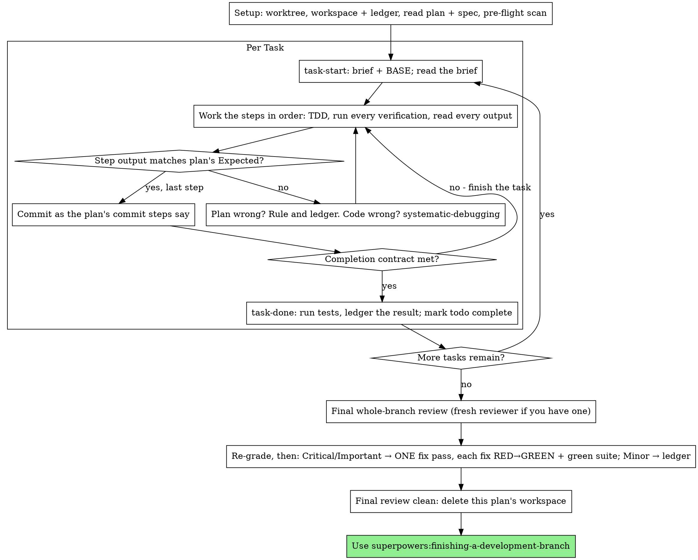
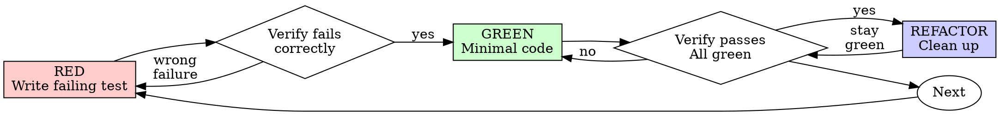

# 对话经过

会话 `01a21a76-8718-7f82-9ea7-2a40f8dbb35d` · 轮次 `01a21a84-d244-7dd0-9915-5b85968ab826`

<!-- foundry-detail 01a21a76-8718-7f82-9ea7-2a40f8dbb35d 01a21a84-d244-7dd0-9915-5b85968ab826 -->
<!-- foundry-event 5139582beac5a3ae947496da91186291beab4245bc16ad0fc7426339d1515970 -->
## 进度原话

- 来源定位：字节 680117

~~~text
我按确认的范围开始 T008。先核对工作区和实施记录，再补测试配置、跑完整回归，并从真实 Git 提交验收 Docker 产物。
~~~

<!-- foundry-event 6c2f0fc88b17f9ed17076596c5f5464186aa56c9a071a18a2286836583a053eb -->
## 宿主命令执行

- 来源定位：字节 700850

~~~text
{
  "command": "[已省略环境变量值] -lc 'cat .agents/skills/conversation-recording/references/recording-timing.md'",
  "workdir": "file:///home/ena/workspace/ena/agent-foundry/feature/init",
  "exitCode": 0,
  "status": "completed"
}
~~~

<!-- foundry-event d52e6b583ed7a746818807d9dadab5be935fec2deb4def572dc998ef322efb40 -->
## 工具结果 `exec-4854693a-cec9-4d57-a1d8-e38516c7ecb4`

- 来源定位：字节 700850

~~~text
# 会话记录的触发和保存时机

## 项目级 Hook 安装

从主线构建产物的记录 Skill 根目录运行 `python3 -B install.py --project <Git 工作树根>`，由 Codex 原生界面确认项目及安装的 Hook。空白引导会话保持零记录，信任完成后普通启动。显式的项目相对资料根可在 `.codex/conversation-recording.json` 中用 `recordRoot` 配置，默认沿资料契约选址。

## 首条消息与普通轮次

1. `UserPromptSubmit` 核实当前轮次和会话归属，以首次开启日定位主记录。在首个业务动作或开始回复前保存并读回用户原话，问候及普通问答适用同一时机。 [会话归属与身份](session-scope.md)
2. `PostToolUse` 保存可取得的业务工具调用和已发生的过程。按真实轮次及事件顺序补写普通发言、同轮补充和详情。实际 Git 提交及对应结果按提交例外处理。 [逐项保存规则](save-events.md) · [内容采集与提交边界](event-capture.md)

## 普通末轮

正常最终回复发送结束后，`Stop` 将宿主实际发出的全文写入主记录的同轮块，保留空白和换行，并重新打开文件读回。回调自动执行，用户收到回复后无需另发消息。普通问答仅有发言时保留主记录。

## 停止或退出

会话停止、中断或关闭时，以最后一次成功落盘为准。恢复后在相同会话的原位置保存后续合格轮次。因中断未能取得或保存的输入及回复仍保留实际缺口。 [保存确认与失败恢复](storage-contract.md#保存确认与失败恢复)

~~~

<!-- foundry-event 2fa884b158588ab80d87230da6d79def52e6140a6e3fe36d6f4bb5445957cba0 -->
## 宿主命令执行

- 来源定位：字节 703359

~~~text
{
  "command": "[已省略环境变量值] -lc 'cat .agents/skills/implementation-preparation/SKILL.md .agents/skills/speckit-implement/SKILL.md'",
  "workdir": "file:///home/ena/workspace/ena/agent-foundry/feature/init",
  "exitCode": 0,
  "status": "completed"
}
~~~

<!-- foundry-event 92a1ee98e0e3fb9d94156f3192d019ebb2eb0b303ad6203a1a4788de3055b8b1 -->
## 工具结果 `exec-a272dd92-92a3-484e-820d-aea632ef3270`

- 来源定位：字节 703359

~~~text
---
name: implementation-preparation
description: 用户在已初始化的 Spec Kit 项目中要求实施、开始或继续正式 Task，或原生 Implement 进入实施前准备时使用。仅修订 Spec、仅调整规划、概念解释和普通讨论时不使用。
---

# 正式 Task 实施准备

执行目标项目已有的工作流治理，将当前请求整理为有实际材料、明确认可范围和继续条件的准备结果。这里负责准备和续接，不代替原生 Implement 执行业务，也不定义第二套任务或认可规则。

## 先核对是否要实施正式 Task

按请求实际内容和已知上下文判断，不因用户说“调整需求”就进入Task实施。仅修订已有Spec或仅调整规划时，将请求交回调用方按目标项目相应文档/规划职责处理，不要求先提供Task、单Task认可方案或补建plan/MVU；本技能的实施前置不阻止独立Spec修订。可以核对现有下游影响，没有变化就保持，不默认改业务代码。

用户明确要实施或继续原Task时，才进入下文完整读取和准备流程，已有适用认可直接复用。实施请求同时含需求变化时，先处理获确认的需求并核对规划及原方案是否仍适用；实质变化尚未解决，只暂停受影响实施，不以旧认可覆盖新逻辑，也不将需求修订误记成已实施。

## 定位并读取

用户明确的项目、Spec及Task优先；否则沿唯一已有上下文或项目的.specify/feature.json定位。Task身份连同所属Spec核对，多候选只澄清必要定位，不另建同一任务。

从目标项目根完整读取.specify/memory/constitution.md，再读取原Task、需求、plan、同级mvu、相关存量代码与项目约定、已有方案和证据。既有方案尚无独立mvu时按项目治理兼容原详情；不可用的治理或必要输入列出实际缺项及影响，不给出开工结论。读取路径以目标项目为根，不以本skill的安装目录为根；不导入其他仓库的个人资料。

## 需求变更与来源

读取所属Spec已有的简洁需求摘要/导航和当前有效要求，核对原Task方案所依据的范围、确认与待定事项；需要判断变更或纠正时追溯原始输入及讨论。摘要帮助定位，不代替正式定义或真实认可；来源与现行要求冲突时说明差异，只暂停受影响的开工结论。

出现实质需求变化时，沿目标项目治理和既有布局保留本次可见原始输入、可知来源及实际日期，默认放requirements/raw；已有相同原文直接引用。讨论、AI建议和润色提示词按职责另存，不能覆盖或冒充用户原话、确认，未知日期/不可见历史明确说明。简洁摘要用短段说明问题、解决方向、本次变化、确认或待定、日期，链接原文、必要讨论及当前有效要求；可复用requirements/README.md，不复制长规格或另造固定栏目/文件注册。新材料按实际用途归类，不批量迁移无关Spec。

在对应写入授权内先保存并检查、读回原文和必要讨论，再更新摘要及获确认的受影响要求，最后核对方案能否沿用。未确认的实质变化保留待定，不能按旧方案实施。仅问进度、普通工程调整或重复续做不构成新需求，不因此重复归档原文；保存失败按下文恢复规则说明已写/未写，后续从实际文件补缺，不靠记忆补造来源。

## 形成适用的讨论结果

核对已有方案的真实讨论来源、适用范围、保存结果、必要前置及有效授权。适用内容直接复用；无有效方案时先听用户方向，结合已读代码提出有依据的建议，讲清目标、核心逻辑与关系、理由、推进顺序及可观察验收。用户尚未认可的建议和未知事项分别保留，不把文件自称或AI回复当认可来源。

讨论中读取直接关联Task，说明仅引用依赖、普通工程调整或实质影响的区别。共享定义优先沿已有契约或负责它的Task方案保存，由其他方案引用；共同决定可以一次讨论，各Task分别说明自身职责及实际认可覆盖。需求、总体方案/依赖或局部实现变化，分别同步其真正受影响的材料，不自动实施关联Task。已完成Task按原事实保留，新增工作按项目的增量规则安排。

## 保存并回传继续范围

按项目治理为已形成的方案选择既有位置；默认implementation/<原Task ID>.md，一Task一份，由原Task引用。内容足以还原逻辑、认可范围和来源、理由、验收及重要调整即可，不预设固定表单。工程checkbox只留原tasks，讨论资料和方案不复制它。

依次保存必要方案、执行目标项目格式检查、完整读回，再补原Task引用并核对。返回本次实际可继续的Task及范围、仍需讨论或恢复的部分、必要证据和下一动作。继续由原生执行者依据目标治理推进；进入其他Task、批量、并行或恢复时，对各自材料重新应用本流程，不把前一次准备结果套给另一项。

## 异常与恢复

核查到治理/能力/材料缺失、过期或不可读、方案保存失败、前置未验、缺有效认可，或逻辑/职责/范围/验收实质变化时，依项目治理只处理允许的核查、讨论和恢复，说明受影响范围与继续条件。配置或hook没有调用本skill不构成准备已完成。普通工程调整沿有效认可记录依据，实质变化回讨论；恢复读取最终文件、真实确认及撤回依据，补未完成动作，不复做已确认修复。
---
name: "speckit-implement"
description: "Execute the implementation plan by processing and executing all tasks defined in tasks.md"
compatibility: "Requires spec-kit project structure with .specify/ directory"
metadata:
  author: "github-spec-kit"
  source: "templates/commands/implement.md"
---


## User Input

```text
$ARGUMENTS
```

You **MUST** consider the user input before proceeding (if not empty).

## Pre-Execution Checks

**Check for extension hooks (before implementation)**:
- Check if `.specify/extensions.yml` exists in the project root.
- If it exists, read it and look for entries under the `hooks.before_implement` key
- If the YAML cannot be parsed or is invalid, do not skip silently: tell the user that `.specify/extensions.yml` could not be read (include the parser error) and that no hooks were checked, including any mandatory (`optional: false`) hooks registered there, then continue normally
- Filter out hooks where `enabled` is explicitly `false`. Treat hooks without an `enabled` field as enabled by default.
- For each remaining hook, do **not** attempt to interpret or evaluate hook `condition` expressions:
  - If the hook has no `condition` field, or it is null/empty, treat the hook as executable
  - If the hook defines a non-empty `condition`, skip the hook and leave condition evaluation to the HookExecutor implementation
- When constructing command invocations from hook command names, replace dots (`.`) with hyphens (`-`). For example, `speckit.git.commit` → `$speckit-git-commit`.
- For each executable hook, output the following based on its `optional` flag:
  - **Optional hook** (`optional: true`):
    ```
    ## Extension Hooks

    **Optional Pre-Hook**: {extension}
    Command: `/{command}`
    Description: {description}

    Prompt: {prompt}
    To execute: `/{command}`
    ```
  - **Mandatory hook** (`optional: false`):
    ```
    ## Extension Hooks

    **Automatic Pre-Hook**: {extension}
    Executing: `/{command}`
    EXECUTE_COMMAND: {command}

    Wait for the result of the hook command before proceeding to the Outline.
    ```
    After emitting the block above you MUST actually invoke the hook and wait for it to finish before continuing. Run it the same way you would run the command yourself in this agent/session (the invocation may differ from the literal `{command}` id shown above, e.g. a skills-mode agent runs it as `/skill:speckit-...` or `$speckit-...`). Emitting the block alone does not run the hook.
- If no hooks are registered or `.specify/extensions.yml` does not exist, skip silently

## Outline

1. Run `.specify/scripts/bash/check-prerequisites.sh --json --require-tasks --include-tasks` from repo root and parse FEATURE_DIR and AVAILABLE_DOCS list. All paths must be absolute. For single quotes in args like "I'm Groot", use escape syntax: e.g 'I'\''m Groot' (or double-quote if possible: "I'm Groot").

2. **Check checklists status** (if FEATURE_DIR/checklists/ exists):
   - Treat checklist markers as a read-only gate: scan checkbox state, report status, and ask before proceeding when needed; do NOT modify checklist files or markers
   - `checklists/requirements.md` is the built-in spec-quality checklist maintained by `$speckit-specify` and `$speckit-clarify`; custom checklists generated by `$speckit-checklist` are reviewer-owned requirements-quality review artifacts
   - For custom checklists, `[x]` means the reviewer determined the requirements-quality criterion is satisfied; it does NOT mean implementation work is complete
   - Scan all checklist files in the checklists/ directory
   - For each checklist, count:
     - Total items: All lines matching `- [ ]` or `- [X]` or `- [x]`
     - Checked items: Lines matching `- [X]` or `- [x]`
     - Unchecked items: Lines matching `- [ ]`
   - Create a status table:

     ```text
     | Checklist | Total | Checked | Unchecked | Status |
     |-----------|-------|---------|-----------|--------|
     | ux.md     | 12    | 12      | 0         | ✓ PASS |
     | test.md   | 8     | 5       | 3         | ✗ FAIL |
     | security.md | 6   | 6       | 0         | ✓ PASS |
     ```

   - Calculate overall status:
     - **PASS**: All checklists have 0 unchecked items
     - **FAIL**: One or more checklists have unchecked items

   - **If any checklist has unchecked items**:
     - Display the table with unchecked item counts
     - **STOP** and ask: "Some checklists have unchecked items. Do you want to proceed with implementation anyway? (yes/no)"
     - Wait for user response before continuing
     - If user says "no" or "wait" or "stop", halt execution
     - If user says "yes" or "proceed" or "continue", proceed to step 3

   - **If all checklists are checked**:
     - Display the table showing all checklists passed
     - Automatically proceed to step 3

3. Load and analyze the implementation context:
   - **REQUIRED**: Read tasks.md for the complete task list and execution plan
   - **REQUIRED**: Read plan.md for tech stack, architecture, and file structure
   - **IF EXISTS**: Read data-model.md for entities and relationships
   - **IF EXISTS**: Read contracts/ for API specifications and test requirements
   - **IF EXISTS**: Read research.md for technical decisions and constraints
   - **IF EXISTS**: Read .specify/memory/constitution.md for governance constraints
   - **IF EXISTS**: Read quickstart.md for integration scenarios

4. **Project Setup Verification**:
   - **REQUIRED**: Create/verify ignore files based on actual project setup:

   **Detection & Creation Logic**:
   - Check if the following command succeeds to determine if the repository is a git repo (create/verify .gitignore if so):

     ```sh
     git rev-parse --git-dir 2>/dev/null
     ```

   - Check if Dockerfile* exists or Docker in plan.md → create/verify .dockerignore
   - Check if .eslintrc* exists → create/verify .eslintignore
   - Check if eslint.config.* exists → ensure the config's `ignores` entries cover required patterns
   - Check if .prettierrc* exists → create/verify .prettierignore
   - Check if .npmrc or package.json exists → create/verify .npmignore (if publishing)
   - Check if terraform files (*.tf) exist → create/verify .terraformignore
   - Check if .helmignore needed (helm charts present) → create/verify .helmignore

   **If ignore file already exists**: Verify it contains essential patterns, append missing critical patterns only
   **If ignore file missing**: Create with full pattern set for detected technology

   **Common Patterns by Technology** (from plan.md tech stack):
   - **Node.js/JavaScript/TypeScript**: `node_modules/`, `dist/`, `build/`, `*.log`, `.env*`
   - **Python**: `__pycache__/`, `*.pyc`, `.venv/`, `venv/`, `dist/`, `*.egg-info/`
   - **Java**: `target/`, `*.class`, `*.jar`, `.gradle/`, `build/`
   - **C#/.NET**: `bin/`, `obj/`, `*.user`, `*.suo`, `packages/`
   - **Go**: `*.exe`, `*.test`, `vendor/`, `*.out`
   - **Ruby**: `.bundle/`, `log/`, `tmp/`, `*.gem`, `vendor/bundle/`
   - **PHP**: `vendor/`, `*.log`, `*.cache`, `*.env`
   - **Rust**: `target/`, `debug/`, `release/`, `*.rs.bk`, `*.rlib`, `*.prof*`, `.idea/`, `*.log`, `.env*`
   - **Kotlin**: `build/`, `out/`, `.gradle/`, `.idea/`, `*.class`, `*.jar`, `*.iml`, `*.log`, `.env*`
   - **C++**: `build/`, `bin/`, `obj/`, `out/`, `*.o`, `*.so`, `*.a`, `*.exe`, `*.dll`, `.idea/`, `*.log`, `.env*`
   - **C**: `build/`, `bin/`, `obj/`, `out/`, `*.o`, `*.a`, `*.so`, `*.exe`, `*.dll`, `autom4te.cache/`, `config.status`, `config.log`, `.idea/`, `*.log`, `.env*`
   - **Swift**: `.build/`, `DerivedData/`, `*.swiftpm/`, `Packages/`
   - **R**: `.Rproj.user/`, `.Rhistory`, `.RData`, `.Ruserdata`, `*.Rproj`, `packrat/`, `renv/`
   - **Universal**: `.DS_Store`, `Thumbs.db`, `*.tmp`, `*.swp`, `.vscode/`, `.idea/`

   **Tool-Specific Patterns**:
   - **Docker**: `node_modules/`, `.git/`, `Dockerfile*`, `.dockerignore`, `*.log*`, `.env*`, `coverage/`
   - **ESLint**: `node_modules/`, `dist/`, `build/`, `coverage/`, `*.min.js`
   - **Prettier**: `node_modules/`, `dist/`, `build/`, `coverage/`, `package-lock.json`, `yarn.lock`, `pnpm-lock.yaml`
   - **Terraform**: `.terraform/`, `*.tfstate*`, `*.tfvars`, `.terraform.lock.hcl`
   - **Kubernetes/k8s**: `*.secret.yaml`, `secrets/`, `.kube/`, `kubeconfig*`, `*.key`, `*.crt`

5. Parse tasks.md structure and extract:
   - **Task phases**: Setup, Tests, Core, Integration, Polish
   - **Task dependencies**: Sequential vs parallel execution rules
   - **Task details**: ID, description, file paths, parallel markers [P]
   - **Execution flow**: Order and dependency requirements

6. Execute implementation following the task plan:
   - **Phase-by-phase execution**: Complete each phase before moving to the next
   - **Respect dependencies**: Run sequential tasks in order, parallel tasks [P] can run together
   - **Follow TDD approach**: Execute test tasks before their corresponding implementation tasks
   - **File-based coordination**: Tasks affecting the same files must run sequentially
   - **Validation checkpoints**: Verify each phase completion before proceeding

7. Implementation execution rules:
   - **Setup first**: Initialize project structure, dependencies, configuration
   - **Tests before code**: If you need to write tests for contracts, entities, and integration scenarios
   - **Core development**: Implement models, services, CLI commands, endpoints
   - **Integration work**: Database connections, middleware, logging, external services
   - **Polish and validation**: Unit tests, performance optimization, documentation

8. Progress tracking and error handling:
   - Report progress after each completed task
   - Halt execution if any non-parallel task fails
   - For parallel tasks [P], continue with successful tasks, report failed ones
   - Provide clear error messages with context for debugging
   - Suggest next steps if implementation cannot proceed
   - **IMPORTANT** For completed tasks, make sure to mark the task off as [X] in the tasks file.

9. Completion validation:
   - Verify all required tasks are completed
   - Check that implemented features match the original specification
   - Validate that tests pass and coverage meets requirements
   - Confirm the implementation follows the technical plan

Note: This command assumes a complete task breakdown exists in tasks.md. If tasks are incomplete or missing, suggest running `$speckit-tasks` first to regenerate the task list.

## Mandatory Post-Execution Hooks

**You MUST complete this section before reporting completion to the user.**

Check if `.specify/extensions.yml` exists in the project root.
- If it does not exist, or no hooks are registered under `hooks.after_implement`, skip to the Completion Report.
- If it exists, read it and look for entries under the `hooks.after_implement` key.
- If the YAML cannot be parsed or is invalid, do not skip silently: tell the user that `.specify/extensions.yml` could not be read (include the parser error) and that no hooks were checked, including any mandatory (`optional: false`) hooks registered there, then continue to the Completion Report.
- Filter out hooks where `enabled` is explicitly `false`. Treat hooks without an `enabled` field as enabled by default.
- For each remaining hook, do **not** attempt to interpret or evaluate hook `condition` expressions:
  - If the hook has no `condition` field, or it is null/empty, treat the hook as executable
  - If the hook defines a non-empty `condition`, skip the hook and leave condition evaluation to the HookExecutor implementation
- When constructing command invocations from hook command names, replace dots (`.`) with hyphens (`-`). For example, `speckit.git.commit` → `$speckit-git-commit`.
- For each executable hook, output the following based on its `optional` flag:
  - **Mandatory hook** (`optional: false`) — **You MUST emit `EXECUTE_COMMAND:` for each mandatory hook**:
    ```
    ## Extension Hooks

    **Automatic Hook**: {extension}
    Executing: `/{command}`
    EXECUTE_COMMAND: {command}
    ```
    After emitting the block above you MUST actually invoke the hook and wait for it to finish before continuing. Run it the same way you would run the command yourself in this agent/session (the invocation may differ from the literal `{command}` id shown above, e.g. a skills-mode agent runs it as `/skill:speckit-...` or `$speckit-...`). Emitting the block alone does not run the hook.
  - **Optional hook** (`optional: true`):
    ```
    ## Extension Hooks

    **Optional Hook**: {extension}
    Command: `/{command}`
    Description: {description}

    Prompt: {prompt}
    To execute: `/{command}`
    ```

## Completion Report

Report final status with summary of completed work.

## Done When

- [ ] All tasks in tasks.md completed and marked `[X]`
- [ ] Implementation validated against specification, plan, and test coverage
- [ ] Extension hooks dispatched or skipped according to the rules in Mandatory Post-Execution Hooks above
- [ ] Completion reported to user with summary of completed work

~~~

<!-- foundry-event a8fe6d999c1f291d22f1d74640b800f64200d62b3529c03aa6c5e6b4526c3fef -->
## 宿主命令执行

- 来源定位：字节 723233

~~~text
{
  "command": "[已省略环境变量值] -lc 'cat /home/ena/.codex/plugins/cache/openai-curated-remote/superpowers/7.0.1/skills/executing-plans/SKILL.md /home/ena/.codex/plugins/cache/openai-curated-remote/superpowers/7.0.1/skills/using-git-worktrees/SKILL.md'",
  "workdir": "file:///home/ena/workspace/ena/agent-foundry/feature/init",
  "exitCode": 0,
  "status": "completed"
}
~~~

<!-- foundry-event 716be0c2304bc20f7b1a2ff7bf2b58b6b0f0ab795abba9578b0348f04d93ff15 -->
## 工具结果 `exec-060a900c-857c-4008-ba31-0cf215c87654`

- 来源定位：字节 723233

~~~text
---
name: executing-plans
description: Use when executing an implementation plan in the current session as the implementer yourself — your human partner chose inline execution, or no subagent tool is available
---

# Executing Plans

Execute the plan yourself, task by task, in this session: no implementer
subagent per task, no reviewer per task. One fresh-context review of the
whole branch at the end.

**Why inline:** Subagent-driven development pays for a fresh implementer
and a fresh reviewer on every task, each re-reading the codebase from zero.
Inline execution pays for one context (yours) plus one reviewer at the end.
What it gives up is a fresh context per task and a second pair of eyes per
task. This skill keeps what those two things bought, by other means: the
brief is the spec, the ledger is your memory, TDD is the per-task gate, and
the final reviewer is the second pair of eyes.

**Core principle:** The plan already did the thinking. Execute it exactly,
prove each step with a test you watched fail and then pass, and leave a
record that survives your own forgetting.

**Narration:** between tool calls, narrate at most one short line — the
ledger and the tool results carry the record.

**Continuous execution:** Do not pause to check in with your human partner
between tasks. They chose inline execution to spend less, not to answer
"should I continue?" after every task. Execute all tasks from the plan
without stopping.

**Rulings, not stalls.** Conflicts, ambiguities, plan defects — decide them.
The spec is the binding authority, the plan is its argument, and your
judgment settles what neither answers. Record every decision in the ledger
as `Ruling: <what you decided> — <why> — <what it costs if wrong>`, and keep
going. Deviating from the plan without a ledgered ruling is a decision made
in secret.

Four things stop you, and only these: an irreversible or destructive
operation; a security-sensitive action; a side effect outside this worktree
that norms say you ask about first (a merge, a push to a shared branch, a
publish); and a plan so broken that every path forward is a guess. For
those, stop and ask.

## When to Use

- You have a plan from superpowers:writing-plans and your human partner
  chose inline execution at the handoff.
- Your harness has no subagent tool (see the per-platform references in
  `../using-superpowers/references/`). Never fabricate a dispatch; run
  the plan here.
- Tasks are mostly independent — the same precondition as
  superpowers:subagent-driven-development.

A fully specified plan makes inline execution transcription plus testing:
it runs well on a mid-tier session model, and the one place the most
capable model earns its cost is the final review, which this skill
dispatches separately. Tell your human partner so when they choose inline.

Prefer superpowers:subagent-driven-development when your human partner
wants a review gate on every task, or when the plan is long enough that
its later tasks would run on a compacted context. Inline execution over a
long plan still works — the ledger is what makes it recoverable — but the
last tasks get the least of you.

## The Process



## Setup

Ensure the work happens in an isolated workspace: use
superpowers:using-git-worktrees to create one or verify the existing one.
Never start implementation on a main/master branch without your human
partner's explicit consent.

Conversation memory does not survive compaction. An inline executor that
loses its place re-implements tasks whose commits already exist — the same
failure as a controller re-dispatching them, paid for in your own context.
Track progress in a ledger file, not only in todos. Harness todos are a
live view; the ledger is the record.

The workspace and ledger are shared with superpowers:subagent-driven-development
— same directory, same format — so a plan can change executors mid-flight
and the new one resumes from the same ledger.

- Each plan owns a workspace: at skill start, run
  `../subagent-driven-development/scripts/sdd-workspace PLAN_FILE` — it
  prints the plan's git-ignored directory
  (`<repo-root>/.superpowers/sdd/<plan-basename>/`), home to every
  artifact for THIS plan: ledger, briefs, review packages. Another plan's
  directory is never yours to read or write.
- Check for this plan's ledger at `<workspace>/progress.md`. If its first
  line names your plan file, tasks with a `Task <N>: complete` line are
  DONE — do not redo them; resume at the first task without one. Their
  commits exist in git even when your context no longer remembers making
  them: after compaction, trust the ledger and `git log` over your own
  recollection. A ledger whose first line names a different plan file is
  another plan's progress: leave it and start your own, fresh.
- Create the ledger with its identity as the first line:
  `# SDD ledger — plan: <plan file path>`.
- `git clean -fdx` will destroy the workspace (it's git-ignored scratch);
  if that happens, recover from `git log`.

Read the plan once, note its context and Global Constraints, and create a
todo per task. If the plan names a Spec, read that too: the spec is the
authority the plan argues from, and conflicts inside the plan resolve
against it. A plan with no reachable spec gets a ledger note saying so —
rulings made without one are provisional.

**REQUIRED SUB-SKILL:** load superpowers:test-driven-development now,
before Task 1. It governs every step of every task below; a plan whose
steps already say "write the failing test first" does not exempt you
from reading it.

Before Task 1, scan the plan for conflicts between tasks. The plan's
Interfaces blocks tell you where to look: for every task that consumes
what an earlier task produces, one ledger row — the two tasks, what one
produces against what the other consumes, and what you found. Tasks that
share nothing get no row; a plan whose tasks share nothing gets the single
line `Pre-flight: no shared interfaces`. Rule on each conflict a row
surfaces with the spec as the binding authority, record the ruling beside
its row, and start Task 1. Each task's own text is checked when you read
its brief, not here.

## The Task Loop

Everything you print, and every tool result, stays resident in your
context for the rest of the session. Redirect long test output to a file
in the workspace and read its tail; read a brief, not the whole plan.

### 1. Take the task

- Run this skill's `scripts/task-start PLAN_FILE N`. It prints the brief
  path and BASE (the commit the task's range is cut from) in one call.
  Read the brief for every task, including ones you remember from setup:
  what you remember is a summary, the brief has the exact values,
  signatures, and test cases.
- Mark the task's todo in_progress.

Every tool call is a turn that re-reads your whole context. Bookkeeping
rides along with work — a ledger append in the same call as the commit,
never in a call of its own.

### 2. Work the steps

The plan's steps are already in RED-GREEN order; follow them in that
order under superpowers:test-driven-development, loaded at setup. A test
step's code is written first and run first. Watching it fail is a step,
not a formality — a test that passes before the implementation exists is
a finding about the test.

Every step that runs a command has an `Expected:` line. Run the command,
read its output, and compare. Three outcomes:

- **Matches.** Next step.
- **The code is wrong.** Use superpowers:systematic-debugging. Find the
  cause; never patch the symptom to make the step's output match.
- **The plan is wrong** — a step contradicts the spec, an interface from an
  earlier task doesn't match what this task consumes, a command that
  cannot work. Rule on the smallest change that satisfies the spec, ledger
  it as `Task <N>: Ruling: <finding> — <what you decided and why>`, and
  continue. The ruling is carried, not remembered: later tasks that touch
  the same interface read it from the ledger.

Commit as the plan's commit steps say. A task that spans several commits
is fine; BASE is what the review range is cut from, never `HEAD~1`.

### 3. The completion contract

Before a task's ledger line, all of the following are true, with evidence
in this session — not inferred from the diff looking right:

- Every test the brief names exists and ran in this task, and you read
  the output.
- The final test run for the task passed — `task-done` is that run, and
  it writes the command and result into the ledger line.
- Every `Expected:` line in the brief was compared against real output.
- Every deviation from the brief has a `Ruling:` line in the ledger.

**REQUIRED SUB-SKILL:** superpowers:verification-before-completion governs
the claim. If any item is missing, the task is not complete: finish it.

### 4. Complete the task

Run this skill's `scripts/task-done PLAN_FILE N BASE -- <test command>`
with the test command the brief names for the whole task. It runs the
tests, keeps the full output in the workspace, prints the tail, and — only
if they pass — appends the completion line to the ledger:

`Task <N>: complete (commits <base7>..<head7>, tests: <command> → <result>)`

A failing run records nothing; the task is not complete. When it records,
mark the todo complete and take the next task.

## Final Review

Run `../subagent-driven-development/scripts/review-package PLAN_FILE MERGE_BASE HEAD`
(MERGE_BASE = the commit the branch started from, e.g.
`git merge-base main HEAD`) and review from the file it prints.

**With a subagent tool:** dispatch the reviewer on the most capable
available model — the whole-branch review is a judgment task — using
superpowers:requesting-code-review's
[code-reviewer.md](../requesting-code-review/code-reviewer.md), with the
package path, the plan and spec paths, the plan's Review Focus section
verbatim if it has one (the input classes and failure modes the plan's
tests do not exercise — the reviewer checks each deliberately), and a
pointer to the ledger's `Ruling:` lines so it can weigh the calls you
made. Specify the model
explicitly; an omitted model inherits the session's, which may not be the
most capable. This is the one fresh context the whole run buys. Do not
skip it, and do not replace it with your own read of the diff.

**Without a subagent tool:** read code-reviewer.md and perform that review
yourself against the package, as a separate pass after the last task's
ledger line. Write `Final review: self-review (no subagent tool)` to the
ledger, and say so in your final message: a self-review by the author is
weaker than a fresh reviewer, and your human partner decides whether that
is enough before merge.

Sort the findings before you act on any of them. The reviewer's severity
labels are advice; the gate is yours. Its "Declined to judge" list is
yours too: every line there is a ruling you make and ledger, exactly like
a plan conflict — `Final: Ruling: <behavior the reviewer set aside> —
<what a reasonable person using this software gets, and why that stands
or why it is now a finding> — <cost if wrong>`. Re-grade first, by effect: the
spec is a vision document, and a finding's grade is what a reasonable
person using this software gets if it ships, not whether the spec names
the input that triggers it — a reviewer who set a finding at Minor
because the spec was silent has graded the spec, not the effect. Then:

- **Critical and Important** enter the fix pass.
- **Minor** goes to the ledger as `Final: minor (deferred): <one-liner>`
  and to your final message under "Deferred minors". Minors never enter
  the fix pass, and never become rulings — a ruling is a decision about a
  conflict, not a note that you declined a polish suggestion.

Fix the Critical and Important findings yourself — you are the
implementer here — in ONE pass. Each fix is verified by TDD, not by a
second reviewer: write the test that reproduces the finding, watch it
fail, make it pass, then run the whole suite. Record each in the ledger as
`Final: fixed <finding> — <test name> RED→GREEN, suite <N>/<N>`. A fix
without a test that failed first is not verified; a suite that is not
green after the pass means the pass is not over. Do not dispatch a
re-review: it would re-read a diff whose covering tests already answer
"addressed" and whose suite run already answers "broke nothing".

A finding you decide not to fix is a ruling — `Final: Ruling: <finding> —
<why the code stands> — <cost if wrong>` — and reaches your human partner
in the rulings list. There is no second fix pass.

## Finish

Before you delete anything, collect every ledger line containing
`Ruling:` into your final message under "Rulings I made", in the order you
made them, each with what it costs if wrong, and every `minor (deferred)`
line under "Deferred minors". Both lists are exhaustive. Your final
message is the only place the decisions you took on your human partner's
behalf — and the findings you chose not to act on — reach them.

When the final review is clean and its fixes are committed, delete this
plan's workspace directory — the git history is the record now. Sibling
directories belong to other plans; leave them alone.

Use superpowers:finishing-a-development-branch.

## Common Rationalizations

| Excuse | Reality |
|--------|---------|
| "I remember what Task N says" | You remember a summary. The brief has the exact values. Read it. |
| "The plan's code is right, skip watching the test fail" | A test you never saw fail proves nothing. It is one step. Run it. |
| "I'll run the full suite at the end instead of per step" | Per-step runs are how you learn which step broke it. The end-of-task run is the contract, not a substitute. |
| "The plan is wrong here, I'll just do the right thing" | Do the right thing and ledger the ruling. Unledgered deviation is a decision made in secret. |
| "I'll write the ledger lines after a few tasks" | Compaction does not wait for a convenient moment. One line per task, in the same message as the commit. |
| "Let me check in before the next task" | They chose inline to spend less. Progress prompts spend their time instead. Only the four stops stop you. |
| "I read my own diff carefully; the final reviewer is redundant" | Same author, same blind spots. The reviewer is the only fresh context this run buys. |
| "Tests should pass, the change was trivial" | "Should" is not evidence. The contract requires the command and its output. |
| "Subagents are slow and expensive, I'll skip the final review too" | Inline already removed the per-task reviewers. One review of the whole branch is the floor, not the ceiling. |
| "The reviewer said Minor, so it's Minor" | The label graded the spec's silence. Grade what the person gets. Re-grade, then gate. |
| "The fix is obvious, no need for a failing test first" | The failing test is the only proof the finding was real and is now gone. Without it you have a diff and a hope. |
| "I'll fix the minors too while I'm in there" | Every minor you fix is a test, a fix, and a suite run your partner did not ask for. Ledger them; your partner decides. |
---
name: using-git-worktrees
description: Use when starting feature work that needs isolation from current workspace or before executing implementation plans - ensures an isolated workspace exists via native tools or git worktree fallback
---

# Using Git Worktrees

## Overview

Ensure work happens in an isolated workspace. Prefer your platform's native worktree tools. Fall back to manual git worktrees only when no native tool is available.

**Core principle:** Detect existing isolation first. Then use native tools. Then fall back to git. Never fight the harness.

**Announce at start:** "I'm using the using-git-worktrees skill to set up an isolated workspace."

## Step 0: Detect Existing Isolation

**Before creating anything, check if you are already in an isolated workspace.**

```bash
GIT_DIR=$(cd "$(git rev-parse --git-dir)" 2>/dev/null && pwd -P)
GIT_COMMON=$(cd "$(git rev-parse --git-common-dir)" 2>/dev/null && pwd -P)
BRANCH=$(git branch --show-current)
```

**Submodule guard:** `GIT_DIR != GIT_COMMON` is also true inside git submodules. Before concluding "already in a worktree," verify you are not in a submodule:

```bash
# If this returns a path, you're in a submodule, not a worktree — treat as normal repo
git rev-parse --show-superproject-working-tree 2>/dev/null
```

**If `GIT_DIR != GIT_COMMON` (and not a submodule):** You are already in a linked worktree. Skip to Step 2 (Project Setup). Do NOT create another worktree.

Report with branch state:
- On a branch: "Already in isolated workspace at `<path>` on branch `<name>`."
- Detached HEAD: "Already in isolated workspace at `<path>` (detached HEAD, externally managed). Branch creation needed at finish time."

**If `GIT_DIR == GIT_COMMON` (or in a submodule):** You are in a normal repo checkout.

Has the user already indicated their worktree preference in your instructions? If not, ask for consent before creating a worktree:

> "Would you like me to set up an isolated worktree? It protects your current branch from changes."

Honor any existing declared preference without asking. If the user declines consent, work in place and skip to Step 2.

## Step 1: Create Isolated Workspace

**You have two mechanisms. Try them in this order.**

### 1a. Native Worktree Tools (preferred)

The user has asked for an isolated workspace (Step 0 consent). Do you already have a way to create a worktree? It might be a tool with a name like `EnterWorktree`, `WorktreeCreate`, a `/worktree` command, or a `--worktree` flag. If you do, use it and skip to Step 2.

Native tools handle directory placement, branch creation, and cleanup automatically. Using `git worktree add` when you have a native tool creates phantom state your harness can't see or manage.

Only proceed to Step 1b if you have no native worktree tool available.

### 1b. Git Worktree Fallback

**Only use this if Step 1a does not apply** — you have no native worktree tool available. Create a worktree manually using git.

#### Directory Selection

Follow this priority order. Explicit user preference always beats observed filesystem state.

1. **Check your instructions for a declared worktree directory preference.** If the user has already specified one, use it without asking.

2. **Check for an existing project-local worktree directory:**
   ```bash
   ls -d .worktrees 2>/dev/null     # Preferred (hidden)
   ls -d worktrees 2>/dev/null      # Alternative
   ```
   If found, use it. If both exist, `.worktrees` wins.

3. **If there is no other guidance available**, default to `.worktrees/` at the project root.

#### Safety Verification (project-local directories only)

**MUST verify directory is ignored before creating worktree:**

```bash
git check-ignore -q .worktrees 2>/dev/null || git check-ignore -q worktrees 2>/dev/null
```

**If NOT ignored:** Add to .gitignore, commit the change, then proceed.

**Why critical:** Prevents accidentally committing worktree contents to repository.

#### Create the Worktree

```bash
# Determine path based on chosen location
path="$LOCATION/$BRANCH_NAME"

git worktree add "$path" -b "$BRANCH_NAME"
cd "$path"
```

**Sandbox fallback:** If `git worktree add` fails with a permission error (sandbox denial), tell the user the sandbox blocked worktree creation and you're working in the current directory instead. Then run setup and baseline tests in place.

## Step 2: Project Setup

Auto-detect and run appropriate setup:

```bash
# Node.js
if [ -f package.json ]; then npm install; fi

# Rust
if [ -f Cargo.toml ]; then cargo build; fi

# Python
if [ -f requirements.txt ]; then pip install -r requirements.txt; fi
if [ -f pyproject.toml ]; then poetry install; fi

# Go
if [ -f go.mod ]; then go mod download; fi
```

## Step 3: Verify Clean Baseline

Run tests to ensure workspace starts clean:

```bash
# Use project-appropriate command
npm test / cargo test / pytest / go test ./...
```

**If tests fail:** Report failures, ask whether to proceed or investigate.

**If tests pass:** Report ready.

### Report

```
Worktree ready at <full-path>
Tests passing (<N> tests, 0 failures)
Ready to implement <feature-name>
```

## Quick Reference

| Situation | Action |
|-----------|--------|
| Already in linked worktree | Skip creation (Step 0) |
| In a submodule | Treat as normal repo (Step 0 guard) |
| Native worktree tool available | Use it (Step 1a) |
| No native tool | Git worktree fallback (Step 1b) |
| `.worktrees/` exists | Use it (verify ignored) |
| `worktrees/` exists | Use it (verify ignored) |
| Both exist | Use `.worktrees/` |
| Neither exists | Check instruction file, then default `.worktrees/` |
| Directory not ignored | Add to .gitignore + commit |
| Permission error on create | Sandbox fallback, work in place |
| Tests fail during baseline | Report failures + ask |
| No package.json/Cargo.toml | Skip dependency install |

## Common Rationalizations

| Excuse | Reality |
|--------|---------|
| "I'm obviously not in a worktree — no need to check" | Run Step 0. Harness-created isolation and submodules both fool eyeballing; the detection commands settle it. |
| "`git worktree add` is quicker than hunting for a native tool" | A native tool (e.g. `EnterWorktree`) owns placement, branching, and cleanup. Bypassing it is the #1 mistake — it creates phantom state your harness can't see or manage. |
| "The worktree directory is surely ignored already" | Run `git check-ignore`. An unignored worktree directory commits the whole tree into the repo. |
| "Any directory name works" | Explicit instructions beat an existing project-local directory, which beats the `.worktrees/` default. |
| "The workspace is fresh — baseline tests can wait" | A dirty baseline makes every later failure ambiguous. Run the tests now; proceeding past failures is your human partner's call. |

~~~

<!-- foundry-event 048511572a506e86e577e7339ef079f6612288822ca32d50ff19d1a11a7d79be -->
## 宿主命令执行

- 来源定位：字节 749882

~~~text
{
  "command": "[已省略环境变量值] -lc 'git status --short --branch'",
  "workdir": "file:///home/ena/workspace/ena/agent-foundry/feature/init",
  "exitCode": 0,
  "status": "completed"
}
~~~

<!-- foundry-event 83bb95be426f2491b3e4f055526cc7bf65f6f9928a28a3f4e00dff9400ec7372 -->
## 工具结果 `exec-8034c2c1-7827-4702-ac4b-b78d26adb200`

- 来源定位：字节 749882

~~~text
## feature/init...origin/feature/init
 M .codex/hooks.json
 M .specify/memory/conversation-recording/records/2026-11-26/01a2174d-dd90-74b1-8444-b2b62149b17b.md
?? .specify/memory/conversation-recording/records/2026-11-27/

~~~

<!-- foundry-event 03dc2cb5fc4e9f54e6ea0be47fd56ff8b8c60f7d4ece1ed645b61aee2926ca12 -->
## 宿主命令执行

- 来源定位：字节 750807

~~~text
{
  "command": "[已省略环境变量值] -lc 'cat /home/ena/.codex/plugins/cache/openai-curated-remote/superpowers/7.0.1/skills/test-driven-development/SKILL.md /home/ena/.codex/plugins/cache/openai-curated-remote/superpowers/7.0.1/skills/verification-before-completion/SKILL.md'",
  "workdir": "file:///home/ena/workspace/ena/agent-foundry/feature/init",
  "exitCode": 0,
  "status": "completed"
}
~~~

<!-- foundry-event 653275baa5c2b2a7a2cf6291c6dcca77b9c3ba8e6197ac7642629de5413f5488 -->
## 工具结果 `exec-dafe75e6-a5ea-4fde-8135-7e99420feddd`

- 来源定位：字节 750807

~~~text
---
name: test-driven-development
description: Use when implementing any feature or bugfix, before writing implementation code
---

# Test-Driven Development (TDD)

## Overview

Write the test first. Watch it fail. Write minimal code to pass.

**Core principle:** If you didn't watch the test fail, you don't know if it tests the right thing.

**Violating the letter of the rules is violating the spirit of the rules.**

## When to Use

**Always:**
- New features
- Bug fixes
- Refactoring
- Behavior changes

**Exceptions (ask your human partner):**
- Throwaway prototypes
- Generated code
- Configuration files

Thinking "skip TDD just this once"? Stop. That's rationalization.

## The Iron Law

```
NO PRODUCTION CODE WITHOUT A FAILING TEST FIRST
```

Write code before the test? Delete it. Start over.

**No exceptions:**
- Don't keep it as "reference"
- Don't "adapt" it while writing tests
- Don't look at it
- Delete means delete

Implement fresh from tests. Period.

## Red-Green-Refactor



### RED - Write Failing Test

Write one minimal test showing what should happen.

<Good>
```typescript
test('retries failed operations 3 times', async () => {
  let attempts = 0;
  const operation = () => {
    attempts++;
    if (attempts < 3) throw new Error('fail');
    return 'success';
  };

  const result = await retryOperation(operation);

  expect(result).toBe('success');
  expect(attempts).toBe(3);
});
```
Clear name, tests real behavior, one thing
</Good>

<Bad>
```typescript
test('retry works', async () => {
  const mock = jest.fn()
    .mockRejectedValueOnce(new Error())
    .mockRejectedValueOnce(new Error())
    .mockResolvedValueOnce('success');
  await retryOperation(mock);
  expect(mock).toHaveBeenCalledTimes(3);
});
```
Vague name, tests mock not code
</Bad>

**Requirements:**
- One behavior
- Clear name
- Real code (no mocks unless unavoidable)

### Verify RED - Watch It Fail

**MANDATORY. Never skip.**

```bash
npm test path/to/test.test.ts
```

Confirm:
- Test fails (not errors)
- Failure message is expected
- Fails because feature missing (not typos)

**Test passes?** You're testing existing behavior. Fix test.

**Test errors?** Fix error, re-run until it fails correctly.

### GREEN - Minimal Code

Write simplest code to pass the test.

<Good>
```typescript
async function retryOperation<T>(fn: () => Promise<T>): Promise<T> {
  for (let i = 0; i < 3; i++) {
    try {
      return await fn();
    } catch (e) {
      if (i === 2) throw e;
    }
  }
  throw new Error('unreachable');
}
```
Just enough to pass
</Good>

<Bad>
```typescript
async function retryOperation<T>(
  fn: () => Promise<T>,
  options?: {
    maxRetries?: number;
    backoff?: 'linear' | 'exponential';
    onRetry?: (attempt: number) => void;
  }
): Promise<T> {
  // YAGNI
}
```
Over-engineered
</Bad>

Don't add features, refactor other code, or "improve" beyond the test.

### Verify GREEN - Watch It Pass

**MANDATORY.**

```bash
npm test path/to/test.test.ts
```

Confirm:
- Test passes
- Other tests still pass
- Output pristine (no errors, warnings)

**Test fails?** Fix code, not test.

**Other tests fail?** Fix now.

**"Other tests" means the project's suite, not just your file.** A
green run of the test you wrote is not a green suite. Before you call
the change done, run the project's test command (bare `pytest`,
`npm test`, `cargo test` — whatever the repo uses) even when your task
named only one test file. A scope statement in your task bounds the
deliverable, not your verification. Any failure that run shows —
including one you didn't cause — goes in your report by name; a red
test you watched scroll past and didn't mention is a report falsified
by omission.

### REFACTOR - Clean Up

After green only:
- Remove duplication
- Improve names
- Extract helpers

Keep tests green. Don't add behavior.

### Repeat

Next failing test for next feature.

## Good Tests

| Quality | Good | Bad |
|---------|------|-----|
| **Minimal** | One thing. "and" in name? Split it. | `test('validates email and domain and whitespace')` |
| **Clear** | Name describes behavior | `test('test1')` |
| **Shows intent** | Demonstrates desired API | Obscures what code should do |

When writing or changing any test, read [writing-good-tests.md](writing-good-tests.md) for the rules that keep tests honest:
- Name the production change that would make the test fail — before writing it
- Assert on real behavior, never on mock behavior
- Keep test-only code in test utilities, out of production classes
- Understand a dependency's side effects before mocking it

## Common Rationalizations

| Excuse | Reality |
|--------|---------|
| "Too simple to test" | Simple code breaks. Test takes 30 seconds. |
| "I'll test after" | Tests written after pass immediately — which proves nothing. They may test the wrong thing, test the implementation instead of the behavior, or miss the edge case you forgot. You never watched it fail, so you never proved it can catch the bug. Test-first forces that failure. |
| "Tests after achieve same goals (spirit not ritual)" | Tests-after answer "what does this do?"; tests-first answer "what should this do?" Tests written after are biased by the code you already wrote — you verify the cases you remembered, not the ones you'd have discovered. Coverage without proof the tests work. |
| "Already manually tested" | Manual testing is ad-hoc: no record of what you covered, no way to re-run it when the code changes, easy to forget cases under pressure. "Worked when I tried it" ≠ comprehensive. Automated tests run the same way every time. |
| "Deleting X hours is wasteful" | Sunk cost fallacy — that time is already spent either way. The real choice: rewrite with TDD (high confidence) vs. keep it and bolt tests on after (low confidence, likely bugs). Keeping code you can't trust is the waste. |
| "Keep as reference, write tests first" | You'll adapt it. That's testing after. Delete means delete. |
| "Need to explore first" | Fine. Throw away exploration, start with TDD. |
| "Test hard = design unclear" | Listen to test. Hard to test = hard to use. |
| "TDD will slow me down" | TDD IS the pragmatic path: catches bugs before commit, prevents regressions, lets you refactor without fear. "Pragmatic" shortcuts mean debugging in production — slower, not faster. |
| "Manual test faster" | Manual doesn't prove edge cases. You'll re-test every change. |
| "Existing code has no tests" | You're improving it. Add tests for existing code. |

## Red Flags - STOP and Start Over

- Code before test
- Test after implementation
- Test passes immediately
- Can't explain why test failed
- Tests added "later"
- Rationalizing "just this once"
- "I already manually tested it"
- "Tests after achieve the same purpose"
- "It's about spirit not ritual"
- "Keep as reference" or "adapt existing code"
- "Already spent X hours, deleting is wasteful"
- "TDD is dogmatic, I'm being pragmatic"
- "This is different because..."

**All of these mean: Delete code. Start over with TDD.**

## Example: Bug Fix

**Bug:** Empty email accepted

**RED**
```typescript
test('rejects empty email', async () => {
  const result = await submitForm({ email: '' });
  expect(result.error).toBe('Email required');
});
```

**Verify RED**
```bash
$ npm test
FAIL: expected 'Email required', got undefined
```

**GREEN**
```typescript
function submitForm(data: FormData) {
  if (!data.email?.trim()) {
    return { error: 'Email required' };
  }
  // ...
}
```

**Verify GREEN**
```bash
$ npm test
PASS
```

**REFACTOR**
Extract validation for multiple fields if needed.

## Verification Checklist

Before marking work complete:

- [ ] Every new function/method has a test
- [ ] Watched each test fail before implementing
- [ ] Each test failed for expected reason (feature missing, not typo)
- [ ] Wrote minimal code to pass each test
- [ ] All tests pass
- [ ] Output pristine (no errors, warnings)
- [ ] Tests use real code (mocks only if unavoidable)
- [ ] Edge cases and errors covered

Can't check all boxes? You skipped TDD. Start over.

## When Stuck

| Problem | Solution |
|---------|----------|
| Don't know how to test | Write wished-for API. Write assertion first. Ask your human partner. |
| Test too complicated | Design too complicated. Simplify interface. |
| Must mock everything | Code too coupled. Use dependency injection. |
| Test setup huge | Extract helpers. Still complex? Simplify design. |

## Debugging Integration

Bug found? Write failing test reproducing it. Follow TDD cycle. Test proves fix and prevents regression.

Never fix bugs without a test.

## Final Rule

```
Production code → test exists and failed first
Otherwise → not TDD
```

No exceptions without your human partner's permission.
---
name: verification-before-completion
description: Use when about to claim work is complete, fixed, or passing, before committing or creating PRs - requires running verification commands and confirming output before making any success claims; evidence before assertions always
---

# Verification Before Completion

## Overview

**Core principle:** Evidence before claims, always.

**Violating the letter of this rule is violating the spirit of this rule.**

## The Iron Law

```
NO COMPLETION CLAIMS WITHOUT FRESH VERIFICATION EVIDENCE
```

If you haven't run the verification command in this message, you cannot claim it passes.

## The Gate Function

```
BEFORE claiming any status or expressing satisfaction:

1. IDENTIFY: What command proves this claim?
2. RUN: Execute the FULL command (fresh, complete)
3. READ: Full output, check exit code, count failures
4. VERIFY: Does output confirm the claim?
   - If NO: State actual status with evidence
   - If YES: State claim WITH evidence
5. ONLY THEN: Make the claim

Skip any step = lying, not verifying
```

## Common Failures

| Claim | Requires | Not Sufficient |
|-------|----------|----------------|
| Tests pass | Test command output: 0 failures | Previous run, "should pass" |
| Linter clean | Linter output: 0 errors | Partial check, extrapolation |
| Build succeeds | Build command: exit 0 | Linter passing, logs look good |
| Bug fixed | Test original symptom: passes | Code changed, assumed fixed |
| Regression test works | Red-green cycle verified | Test passes once |
| Agent completed | VCS diff shows changes | Agent reports "success" |
| Requirements met | Line-by-line checklist | Tests passing |

## Red Flags - STOP

- Using "should", "probably", "seems to"
- Expressing satisfaction before verification ("Great!", "Perfect!", "Done!", etc.)
- About to commit/push/PR without verification
- Trusting agent success reports
- Relying on partial verification
- Thinking "just this once"
- Tired and wanting work over
- **ANY wording implying success without having run verification**

## Rationalization Prevention

| Excuse | Reality |
|--------|---------|
| "Should work now" | RUN the verification |
| "I'm confident" | Confidence ≠ evidence |
| "Just this once" | No exceptions |
| "Linter passed" | Linter ≠ compiler |
| "Agent said success" | Verify independently |
| "I'm tired" | Exhaustion ≠ excuse |
| "Partial check is enough" | Partial proves nothing |
| "Different words so rule doesn't apply" | Spirit over letter |

## Key Patterns

**Tests:**
```
✅ [Run test command] [See: 34/34 pass] "All tests pass"
❌ "Should pass now" / "Looks correct"
```

**Regression tests (TDD Red-Green):**
```
✅ Write → Run (pass) → Revert fix → Run (MUST FAIL) → Restore → Run (pass)
❌ "I've written a regression test" (without red-green verification)
```

**Build:**
```
✅ [Run build] [See: exit 0] "Build passes"
❌ "Linter passed" (linter doesn't check compilation)
```

**Requirements:**
```
✅ Re-read plan → Create checklist → Verify each → Report gaps or completion
❌ "Tests pass, phase complete"
```

**Agent delegation:**
```
✅ Agent reports success → Check VCS diff → Verify changes → Report actual state
❌ Trust agent report
```

## When To Apply

**ALWAYS before:**
- ANY variation of success/completion claims
- ANY expression of satisfaction
- ANY positive statement about work state
- Committing, PR creation, task completion
- Moving to next task
- Delegating to agents

**Rule applies to:**
- Exact phrases
- Paraphrases and synonyms
- Implications of success
- ANY communication suggesting completion/correctness

~~~

<!-- foundry-event be8423af58edee70010e1f8b763c955d9dbe60d83f31eac236fcb8c46c02b0fe -->
## 宿主命令执行

- 来源定位：字节 765735

~~~text
{
  "command": "[已省略环境变量值] -lc 'rg --files --hidden -g AGENTS.md -g '\"'\"'!.git/**'\"'\"' -g '\"'\"'!**/node_modules/**'\"'\"' packages specs .specify .agents'",
  "workdir": "file:///home/ena/workspace/ena/agent-foundry/feature/init",
  "exitCode": 1,
  "status": "failed"
}
~~~

<!-- foundry-event c19470b9609eb16475f100f61ac56b4437e86305a281176a0126fd49c3ae4829 -->
## 工具结果 `exec-b1e14ee0-e431-4cbb-b674-b8fc4c995121`

- 来源定位：字节 765735

~~~text

~~~

<!-- foundry-event 386de7b01cc0b52e148025bb5c90f137c48313b6c56974ea817092b54c35cce5 -->
## 工具调用 `Bash` · `exec-a272dd92-92a3-484e-820d-aea632ef3270`

- 来源定位：工具事件 exec-a272dd92-92a3-484e-820d-aea632ef3270

~~~text
工作目录：/home/ena/workspace/ena/agent-foundry/feature/init
{
  "command": "cat .agents/skills/implementation-preparation/SKILL.md .agents/skills/speckit-implement/SKILL.md"
}
~~~

<!-- foundry-event 7a6ab4b33d7c7af7a0b9b125efcaeb67861695a44cb328bd58cd1e798421c5a8 -->
## 工具调用 `Bash` · `exec-4854693a-cec9-4d57-a1d8-e38516c7ecb4`

- 来源定位：工具事件 exec-4854693a-cec9-4d57-a1d8-e38516c7ecb4

~~~text
工作目录：/home/ena/workspace/ena/agent-foundry/feature/init
{
  "command": "cat .agents/skills/conversation-recording/references/recording-timing.md"
}
~~~

<!-- foundry-event 94abe82ef8e943f26b787c478071ccd883dcfb7ff610d1d688f31cb0ae3a630f -->
## 工具调用 `Bash` · `exec-8034c2c1-7827-4702-ac4b-b78d26adb200`

- 来源定位：工具事件 exec-8034c2c1-7827-4702-ac4b-b78d26adb200

~~~text
工作目录：/home/ena/workspace/ena/agent-foundry/feature/init
{
  "command": "git status --short --branch"
}
~~~

<!-- foundry-event 2da6c23d9b7d2c03ad3c454cb3098bb4d9aca88012b73af045a8293bd24f46ff -->
## 工具调用 `Bash` · `exec-060a900c-857c-4008-ba31-0cf215c87654`

- 来源定位：工具事件 exec-060a900c-857c-4008-ba31-0cf215c87654

~~~text
工作目录：/home/ena/workspace/ena/agent-foundry/feature/init
{
  "command": "cat /home/ena/.codex/plugins/cache/openai-curated-remote/superpowers/7.0.1/skills/executing-plans/SKILL.md /home/ena/.codex/plugins/cache/openai-curated-remote/superpowers/7.0.1/skills/using-git-worktrees/SKILL.md"
}
~~~

<!-- foundry-event a8ddcb451d3282941411a3d7469f10d3937699c26a76e0093ca0f1ac252a0d44 -->
## 工具调用 `Bash` · `exec-dafe75e6-a5ea-4fde-8135-7e99420feddd`

- 来源定位：工具事件 exec-dafe75e6-a5ea-4fde-8135-7e99420feddd

~~~text
工作目录：/home/ena/workspace/ena/agent-foundry/feature/init
{
  "command": "cat /home/ena/.codex/plugins/cache/openai-curated-remote/superpowers/7.0.1/skills/test-driven-development/SKILL.md /home/ena/.codex/plugins/cache/openai-curated-remote/superpowers/7.0.1/skills/verification-before-completion/SKILL.md"
}
~~~

<!-- foundry-event e12039a657a82bb3e1289ab96fd4a259ae0c44f49a74a0fd5733032b060af09a -->
## 工具调用 `Bash` · `exec-b1e14ee0-e431-4cbb-b674-b8fc4c995121`

- 来源定位：工具事件 exec-b1e14ee0-e431-4cbb-b674-b8fc4c995121

~~~text
工作目录：/home/ena/workspace/ena/agent-foundry/feature/init
{
  "command": "rg --files --hidden -g AGENTS.md -g '!.git/**' -g '!**/node_modules/**' packages specs .specify .agents"
}
~~~

<!-- foundry-event 5cf7f5c7c9d4367916013dbd5f29b550f0167cdab89b0e7f38cb55e1a6f93104 -->
## 工具调用 `exec` · `call_6af5cd19d6fc4ec38513019923251ca0`

- 来源定位：字节 698355

~~~text
工作目录：/home/ena/workspace/ena/agent-foundry/feature/init
const sp="/home/ena/.codex/plugins/cache/openai-curated-remote/superpowers/7.0.1/skills";
const cmds=[
  ["project implementation skills","cat .agents/skills/implementation-preparation/SKILL.md .agents/skills/speckit-implement/SKILL.md"],
  ["execution and isolation skills",`cat ${sp}/executing-plans/SKILL.md ${sp}/using-git-worktrees/SKILL.md`],
  ["test and verification skills",`cat ${sp}/test-driven-development/SKILL.md ${sp}/verification-before-completion/SKILL.md`],
  ["status and HEAD","git status --short --branch"],
  ["recording timing","cat .agents/skills/conversation-recording/references/recording-timing.md"],
  ["local project paths","rg --files --hidden -g AGENTS.md -g '!.git/**' -g '!**/node_modules/**' packages specs .specify .agents"]
];
const results=await Promise.allSettled(cmds.map(([label,cmd])=>tools.exec_command({cmd,max_output_tokens:12000}).then(r=>({label,...r}))));
for(const r of results){store("start-"+(r.value?.label??"error"),r);text(r.value?{label:r.value.label,exit:r.value.exit_code,output:r.value.output}:r);}

~~~

<!-- foundry-event ee2d932d6663fe15f2072cf3864a5f05cdb005044110e84831fdadc33ca954ca -->
## 工具结果 `call_6af5cd19d6fc4ec38513019923251ca0`

- 来源定位：字节 766604

~~~text
[
  {
    "type": "input_text",
    "text": "Script completed\nWall time 1.5 seconds\nOutput:\n"
  },
  {
    "type": "input_text",
    "text": "Warning: truncated output (original token count: 15155)\nTotal output lines: 6\n\n{\"label\":\"project implementation skills\",\"exit\":0,\"output\":\"---\\nname: implementation-preparation\\ndescription: 用户在已初始化的 Spec Kit 项目中要求实施、开始或继续正式 Task，或原生 Implement 进入实施前准备时使用。仅修订 Spec、仅调整规划、概念解释和普通讨论时不使用。\\n---\\n\\n# 正式 Task 实施准备\\n\\n执行目标项目已有的工作流治理，将当前请求整理为有实际材料、明确认可范围和继续条件的准备结果。这里负责准备和续接，不代替原生 Implement 执行业务，也不定义第二套任务或认可规则。\\n\\n## 先核对是否要实施正式 Task\\n\\n按请求实际内容和已知上下文判断，不因用户说“调整需求”就进入Task实施。仅修订已有Spec或仅调整规划时，将请求交回调用方按目标项目相应文档/规划职责处理，不要求先提供Task、单Task认可方案或补建plan/MVU；本技能的实施前置不阻止独立Spec修订。可以核对现有下游影响，没有变化就保持，不默认改业务代码。\\n\\n用户明确要实施或继续原Task时，才进入下文完整读取和准备流程，已有适用认可直接复用。实施请求同时含需求变化时，先处理获确认的需求并核对规划及原方案是否仍适用；实质变化尚未解决，只暂停受影响实施，不以旧认可覆盖新逻辑，也不将需求修订误记成已实施。\\n\\n## 定位并读取\\n\\n用户明确的项目、Spec及Task优先；否则沿唯一已有上下文或项目的.specify/feature.json定位。Task身份连同所属Spec核对，多候选只澄清必要定位，不另建同一任务。\\n\\n从目标项目根完整读取.specify/memory/constitution.md，再读取原Task、需求、plan、同级mvu、相关存量代码与项目约定、已有方案和证据。既有方案尚无独立mvu时按项目治理兼容原详情；不可用的治理或必要输入列出实际缺项及影响，不给出开工结论。读取路径以目标项目为根，不以本skill的安装目录为根；不导入其他仓库的个人资料。\\n\\n## 需求变更与来源\\n\\n读取所属Spec已有的简洁需求摘要/导航和当前有效要求，核对原Task方案所依据的范围、确认与待定事项；需要判断变更或纠正时追溯原始输入及讨论。摘要帮助定位，不代替正式定义或真实认可；来源与现行要求冲突时说明差异，只暂停受影响的开工结论。\\n\\n出现实质需求变化时，沿目标项目治理和既有布局保留本次可见原始输入、可知来源及实际日期，默认放requirements/raw；已有相同原文直接引用。讨论、AI建议和润色提示词按职责另存，不能覆盖或冒充用户原话、确认，未知日期/不可见历史明确说明。简洁摘要用短段说明问题、解决方向、本次变化、确认或待定、日期，链接原文、必要讨论及当前有效要求；可复用requirements/README.md，不复制长规格或另造固定栏目/文件注册。新材料按实际用途归类，不批量迁移无关Spec。\\n\\n在对应写入授权内先保存并检查、读回原文和必要讨论，再更新摘要及获确认的受影响要求，最后核对方案能否沿用。未确认的实质变化保留待定，不能按旧方案实施。仅问进度、普通工程调整或重复续做不构成新需求，不因此重复归档原文；保存失败按下文恢复规则说明已写/未写，后续从实际文件补缺，不靠记忆补造来源。\\n\\n## 形成适用的讨论结果\\n\\n核对已有方案的真实讨论来源、适用范围、保存结果、必要前置及有效授权。适用内容直接复用；无有效方案时先听用户方向，结合已读代码提出有依据的建议，讲清目标、核心逻辑与关系、理由、推进顺序及可观察验收。用户尚未认可的建议和未知事项分别保留，不把文件自称或AI回复当认可来源。\\n\\n讨论中读取直接关联Task，说明仅引用依赖、普通工程调整或实质影响的区别。共享定义优先沿已有契约或负责它的Task方案保存，由其他方案引用；共同决定可以一次讨论，各Task分别说明自身职责及实际认可覆盖。需求、总体方案/依赖或局部实现变化，分别同步其真正受影响的材料，不自动实施关联Task。已完成Task按原事实保留，新增工作按项目的增量规则安排。\\n\\n## 保存并回传继续范围\\n\\n按项目治理为已形成的方案选择既有位置；默认implementation/<原Task ID>.md，一Task一份，由原Task引用。内容足以还原逻辑、认可范围和来源、理由、验收及重要调整即可，不预设固定表单。工程checkbox只留原tasks，讨论资料和方案不复制它。\\n\\n依次保存必要方案、执行目标项目格式检查、完整读回，再补原Task引用并核对。返回本次实际可继续的Task及范围、仍需讨论或恢复的部分、必要证据和下一动作。继续由原生执行者依据目标治理推进；进入其他Task、批量、并行或恢复时，对各自材料重新应用本流程，不把前一次准备结果套给另一项。\\n\\n## 异常与恢复\\n\\n核查到治理/能力/材料缺失、过期或不可读、方案保存失败、前置未验、缺有效认可，或逻辑/职责/范围/验收实质变化时，依项目治理只处理允许的核查、讨论和恢复，说明受影响范围与继续条件。配置或hook没有调用本skill不构成准备已完成。普通工程调整沿有效认可记录依据，实质变化回讨论；恢复读取最终文件、真实确认及撤回依据，补未完成动作，不复做已确认修复。\\n---\\nname: \\\"speckit-implement\\\"\\ndescription: \\\"Execute the implementation plan by processing and executing all tasks defined in tasks.md\\\"\\ncompatibility: \\\"Requires spec-kit project structure with .specify/ directory\\\"\\nmetadata:\\n  author: \\\"github-spec-kit\\\"\\n  source: \\\"templates/commands/implement.md\\\"\\n---\\n\\n\\n## User Input\\n\\n```text\\n$ARGUMENTS\\n```\\n\\nYou **MUST** consider the user input before proceeding (if not empty).\\n\\n## Pre-Execution Checks\\n\\n**Check for extension hooks (before implementation)**:\\n- Check if `.specify/extensions.yml` exists in the project root.\\n- If it exists, read it and look for entries under the `hooks.before_implement` key\\n- If the YAML cannot be parsed or is invalid, do not skip silently: tell the user that `.specify/extensions.yml` could not be read (include the parser error) and that no hooks were checked, including any mandatory (`optional: false`) hooks registered there, then continue normally\\n- Filter out hooks where `enabled` is explicitly `false`. Treat hooks without an `enabled` field as enabled by default.\\n- For each remaining hook, do **not** attempt to interpret or evaluate hook `condition` expressions:\\n  - If the hook has no `condition` field, or it is null/empty, treat the hook as executable\\n  - If the hook defines a non-empty `condition`, skip the hook and leave condition evaluation to the HookExecutor implementation\\n- When constructing command invocations from hook command names, replace dots (`.`) with hyphens (`-`). For example, `speckit.git.commit` → `$speckit-git-commit`.\\n- For each executable hook, output the following based on its `optional` flag:\\n  - **Optional hook** (`optional: true`):\\n    ```\\n    ## Extension Hooks\\n\\n    **Optional Pre-Hook**: {extension}\\n    Command: `/{command}`\\n    Description: {description}\\n\\n    Prompt: {prompt}\\n    To execute: `/{command}`\\n    ```\\n  - **Mandatory hook** (`optional: false`):\\n    ```\\n    ## Extension Hooks\\n\\n    **Automatic Pre-Hook**: {extension}\\n    Executing: `/{command}`\\n    EXECUTE_COMMAND: {command}\\n\\n    Wait for the result of the hook command before proceeding to the Outline.\\n    ```\\n    After emitting the block above you MUST actually invoke the hook and wait for it to finish before continuing. Run it the same way you would run the command yourself in this agent/session (the invocation may differ from the literal `{command}` id shown above, e.g. a skills-mode agent runs it as `/skill:speckit-...` or `$speckit-...`). Emitting the block alone does not run the hook.\\n- If no hooks are registered or `.specify/extensions.yml` does not exist, skip silently\\n\\n## Outline\\n\\n1. Run `.specify/scripts/bash/check-prerequisites.sh --json --require-tasks --include-tasks` from repo root and parse FEATURE_DIR and AVAILABLE_DOCS list. All paths must be absolute. For single quotes in args like \\\"I'm Groot\\\", use escape syntax: e.g 'I'\\\\''m Groot' (or double-quote if possible: \\\"I'm Groot\\\").\\n\\n2. **Check checklists status** (if FEATURE_DIR/checklists/ exists):\\n   - Treat checklist markers as a read-only gate: scan checkbox state, report status, and ask before proceeding when needed; do NOT modify checklist files or markers\\n   - `checklists/requirements.md` is the built-in spec-quality checklist maintained by `$speckit-specify` and `$speckit-clarify`; custom checklists generated by `$speckit-checklist` are reviewer-owned requirements-quality review artifacts\\n   - For custom checklists, `[x]` means the reviewer determined the requirements-quality criterion is satisfied; it does NOT mean implementation work is complete\\n   - Scan all checklist files in the checklists/ directory\\n   - For each checklist, count:\\n     - Total items: All lines matching `- [ ]` or `- [X]` or `- [x]`\\n     - Checked items: Lines matching `- [X]` or `- [x]`\\n     - Unchecked items: Lines matching `- [ ]`\\n   - Create a status table:\\n\\n     ```text\\n     | Checklist | Total | Checked | Unchecked | Status |\\n     |-----------|-------|---------|-----------|--------|\\n     | ux.md     | 12    | 12      | 0         | ✓ PASS |\\n     | test.md   | 8     | 5       | 3         | ✗ FAIL |\\n     | security.md | 6   | 6       | 0         | ✓ PASS |\\n     ```\\n\\n   - Calculate overall status:\\n     - **PASS**: All checklists have 0 unchecked items\\n     - **FAIL**: One or more checklists have unchecked items\\n\\n   - **If any checklist has unchecked items**:\\n     - Display the table with unchecked item counts\\n     - **STOP** and ask: \\\"Some checklists have unchecked items. Do you want to proceed with implementation anyway? (yes/no)\\\"\\n     - Wait for user response before continuing\\n     - If user says \\\"no\\\" or \\\"wait\\\" or \\\"stop\\\", halt execution\\n     - If user says \\\"yes\\\" or \\\"proceed\\\" or \\\"continue\\\", proceed to step 3\\n\\n   - **If all checklists are checked**:\\n     - Display the table showing all checklists passed\\n     - Automatically proceed to step 3\\n\\n3. Load and analyze the implementation context:\\n   - **REQUIRED**: Read tasks.md for the complete task list and execution plan\\n   - **REQUIRED**: Read plan.md for tech stack, architecture, and file structure\\n   - **IF EXISTS**: Read data-model.md for entities and relationships\\n   - **IF EXISTS**: Read contracts/ for API specifications and test requirements\\n   - **IF EXISTS**: Read research.md for technical decisions and constraints\\n   - **IF EXISTS**: Read .specify/memory/constitution.md for governance constraints\\n   - **IF EXISTS**: Read quickstart.md for integration scenarios\\n\\n4. **Project Setup Verification**:\\n   - **REQUIRED**: Create/verify ignore files based on actual project setup:\\n\\n   **Detection & Creation Logic**:\\n   - Check if the following command succeeds to determine if the repository is a git repo (create/verify .gitignore if so):\\n\\n     ```sh\\n     git rev-parse --git-dir 2>/dev/null\\n     ```\\n\\n   - Check if Dockerfile* exists or Docker in plan.md → create/verify .dockerignore\\n   - Check if .eslintrc* exists → create/verify .eslintignore\\n   - Check if eslint.config.* exists → ensure the config's `ignores` entries cover required patterns\\n   - Check if .prettierrc* exists → create/verify .prettierignore\\n   - Check if .npmrc or package.json exists → create/verify .npmignore (if publishing)\\n   - Check if terraform files (*.tf) exist → create/verify .terraformignore\\n   - Check if .helmignore needed (helm charts present) → create/verify .helmignore\\n\\n   **If ignore file already exists**: Verify it contains essential patterns, append missing critical patterns only\\n   **If ignore file missing**: Create with full pattern set for detected technology\\n\\n   **Common Patterns by Technology** (from plan.md tech stack):\\n   - **Node.js/JavaScript/TypeScript**: `node_modules/`, `dist/`, `build/`, `*.log`, `.env*`\\n   - **Python**: `__pycache__/`, `*.pyc`, `.venv/`, `venv/`, `dist/`, `*.egg-info/`\\n   - **Java**: `target/`, `*.class`, `*.jar`, `.gradle/`, `build/`\\n   - **C#/.NET**: `bin/`, `obj/`, `*.user`, `*.suo`, `packages/`\\n   - **Go**: `*.exe`, `*.test`, `vendor/`, `*.out`\\n   - **Ruby**: `.bundle/`, `log/`, `tmp/`, `*.gem`, `vendor/bundle/`\\n   - **PHP**: `vendor/`, `*.log`, `*.cache`, `*.env`\\n   - **Rust**: `target/`, `debug/`, `release/`, `*.rs.bk`, `*.rlib`, `*.prof*`, `.idea/`, `*.log`, `.env*`\\n   - **Kotlin**: `build/`, `out/`, `.gradle/`, `.idea/`, `*.class`, `*.jar`, `*.iml`, `*.log`, `.env*`\\n   - **C++**: `build/`, `bin/`, `obj/`, `out/`, `*.o`, `*.so`, `*.a`, `*.exe`, `*.dll`, `.idea/`, `*.log`, `.env*`\\n   - **C**: `build/`, `bin/`, `obj/`, `out/`, `*.o`, `*.a`, `*.so`, `*.exe`, `*.dll`, `autom4te.cache/`, `config.status`, `config.log`, `.idea/`, `*.log`, `.env*`\\n   - **Swift**: `.build/`, `DerivedData/`, `*.swiftpm/`, `Packages/`\\n   - **R**: `.Rproj.user/`, `.Rhistory`, `.RData`, `.Ruserdata`, `*.Rproj`, `packrat/`, `renv/`\\n   - **Universal**: `.DS_Store`, `Thumbs.db`, `*.tmp`, `*.swp`, `.vscode/`, `.idea/`\\n\\n   **Tool-Specific Patterns**:\\n   - **Docker**: `node_modules/`, `.git/`, `Dockerfile*`, `.dockerignore`, `*.log*`, `.env*`, `coverage/`\\n   - **ESLint**: `node_modules/`, `dist/`, `build/`, `coverage/`, `*.min.js`\\n   - **Prettier**: `node_modules/`, `dist/`, `build/`, `coverage/`, `package-lock.json`, `yarn.lock`, `pnpm-lock.yaml`\\n   - **Terraform**: `.terraform/`, `*.tfstate*`, `*.tfvars`, `.terraform.lock.hcl`\\n   - **Kubernetes/k8s**: `*.secret.yaml`, `secrets/`, `.kube/`, `kubeconfig*`, `*.key`, `*.crt`\\n\\n5. Parse tasks.md structure and extract:\\n   - **Task phases**: Setup, Tests, Core, Integration, Polish\\n   - **Task dependencies**: Sequential vs parallel execution rules\\n   - **Task details**: ID, description, file paths, parallel markers [P]\\n   - **Execution flow**: Order and dependency requirements\\n\\n6. Execute implementation following the task plan:\\n   - **Phase-by-phase execution**: Complete each phase before moving to the next\\n   - **Respect dependencies**: Run sequential tasks in order, parallel tasks [P] can run together\\n   - **Follow TDD approach**: Execute test tasks before their corresponding implementation tasks\\n   - **File-based coordination**: Tasks affecting the same files must run sequentially\\n   - **Validation checkpoints**: Verify each phase completion before proceeding\\n\\n7. Implementation execution rules:\\n   - **Setup first**: Initialize project structure, dependencies, configuration\\n   - **Tests before code**: If you need to write tests for contracts, entities, and integration scenarios\\n   - **Core development**: Implement models, services, CLI commands, endpoints\\n   - **Integration work**: Database connections, middleware, logging, external services\\n   - **Polish and validation**: Unit tests, performance optimization, documentation\\n\\n8. Progress tracking and error handling:\\n   - Report progress after each completed task\\n   - Halt execution if any non-parallel task fails\\n   - For parallel tasks [P], continue with successful tasks, report failed ones\\n   - Provide clear error messages with context for debugging\\n   - Suggest next steps if implementation cannot proceed\\n   - **IMPORTANT** For completed tasks, make sure to mark the task off as [X] in the tasks file.\\n\\n9. Completion validation:\\n   - Verify all required tasks are completed\\n   - Check that implemented features match the original specification\\n   - Validate that tests pass and coverage meets requirements\\n   - Confirm the implementation follows the technical plan\\n\\nNote: This command assumes a complete task breakdown exists in tasks.md. If tasks are incomplete or missing, suggest running `$speckit-tasks` first to regenerate the task list.\\n\\n## Mandatory Post-Execution Hooks\\n\\n**You MUST complete this section before reporting completion to the user.**\\n\\nCheck if `.specify/extensions.yml` exists in the project root.\\n- If it does not exist, or no hooks are registered under `hooks.after_implement`, skip to the Completion Report.\\n- If it exists, read it and look for entries under the `hooks.after_implement` key.\\n- If the YAML cannot be parsed or is invalid, do not skip silently: tell the user that `.specify/extensions.yml` could not be read (include the parser error) and that no hooks were checked, including any mandatory (`optional: false`) hooks registered there, then continue to the Completion Report.\\n- Filter out hooks where `enabled` is explicitly `false`. Treat hooks without an `enabled` field as enabled by default.\\n- For each remaining hook, do **not** attempt to interpret or evaluate hook `condition` expressions:\\n  - If the hook has no `condition` field, or it is null/empty, treat the hook as executable\\n  - If the hook defines a non-empty `condition`, skip the hook and leave condition evaluation to the HookExecutor implementation\\n- When constructing command invocations from hook command names, replace dots (`.`) with hyphens (`-`). For example, `speckit.git.commit` → `$speckit-git-commit`.\\n- For each executable hook, output the following based on its `optional` flag:\\n  - **Mandatory hook** (`optional: false`) — **You MUST emit `EXECUTE_COMMAND:` for each mandatory hook**:\\n    ```\\n    ## Extension Hooks\\n\\n    **Automatic Hook**: {extension}\\n    Executing: `/{command}`\\n    EXECUTE_COMMAND: {command}\\n    ```\\n    After emitting the block above you MUST actually invoke the hook and wait for it to finish before continuing. Run it the same way you would run the command yourself in this agent/session (the invocation may differ from the literal `{command}` id shown above, e.g. a skills-mode agent runs it as `/skill:speckit-...` or `$speckit-...`). Emitting the block alone does not run the hook.\\n  - **Optional hook** (`optional: true`):\\n    ```\\n    ## Extension Hooks\\n\\n    **Optional Hook**: {extension}\\n    Command: `/{command}`\\n    Description: {description}\\n\\n    Prompt: {prompt}\\n    To execute: `/{command}`\\n    ```\\n\\n## Completion Report\\n\\nReport final status with summary of completed work.\\n\\n## Done When\\n\\n- [ ] All tasks in tasks.md completed and marked `[X]`\\n- [ ] Implementation validated against specification, plan, and test coverage\\n- [ ] Extension hooks dispatched or skipped according to the rules in Mandatory Post-Execution Hooks above\\n- [ ] Completion reported to user with summary of completed work\\n\"}\n{\"label\":\"execution and isolation skills\",\"exit\":0,\"output\":\"---\\nname: executing-plans\\ndescription: Use when executing an implementation plan in the current session as the implementer yourself — your human partner chose inline execution, or no subagent tool is available\\n---\\n\\n# Executing Plans\\n\\nExecute the plan yourself, task by task, in this session: no implementer\\nsubagent per task, no reviewer per task. One fresh-context review of the\\nwhole branch at the end.\\n\\n**Why inline:** Subagent-driven development pays for a fresh implementer\\nand a fresh reviewer on every task, each re-reading the codebase from zero.\\nInline execution pays for one context (yours) plus one reviewer at the end.\\nWhat it gives up is a fresh context per task and a second pair of eyes per\\ntask. This skill keeps what those two things bought, by other means: the\\nbrief is the spec, the ledger is your mem…5155 tokens truncated…b. Git Worktree Fallback\\n\\n**Only use this if Step 1a does not apply** — you have no native worktree tool available. Create a worktree manually using git.\\n\\n#### Directory Selection\\n\\nFollow this priority order. Explicit user preference always beats observed filesystem state.\\n\\n1. **Check your instructions for a declared worktree directory preference.** If the user has already specified one, use it without asking.\\n\\n2. **Check for an existing project-local worktree directory:**\\n   ```bash\\n   ls -d .worktrees 2>/dev/null     # Preferred (hidden)\\n   ls -d worktrees 2>/dev/null      # Alternative\\n   ```\\n   If found, use it. If both exist, `.worktrees` wins.\\n\\n3. **If there is no other guidance available**, default to `.worktrees/` at the project root.\\n\\n#### Safety Verification (project-local directories only)\\n\\n**MUST verify directory is ignored before creating worktree:**\\n\\n```bash\\ngit check-ignore -q .worktrees 2>/dev/null || git check-ignore -q worktrees 2>/dev/null\\n```\\n\\n**If NOT ignored:** Add to .gitignore, commit the change, then proceed.\\n\\n**Why critical:** Prevents accidentally committing worktree contents to repository.\\n\\n#### Create the Worktree\\n\\n```bash\\n# Determine path based on chosen location\\npath=\\\"$LOCATION/$BRANCH_NAME\\\"\\n\\ngit worktree add \\\"$path\\\" -b \\\"$BRANCH_NAME\\\"\\ncd \\\"$path\\\"\\n```\\n\\n**Sandbox fallback:** If `git worktree add` fails with a permission error (sandbox denial), tell the user the sandbox blocked worktree creation and you're working in the current directory instead. Then run setup and baseline tests in place.\\n\\n## Step 2: Project Setup\\n\\nAuto-detect and run appropriate setup:\\n\\n```bash\\n# Node.js\\nif [ -f package.json ]; then npm install; fi\\n\\n# Rust\\nif [ -f Cargo.toml ]; then cargo build; fi\\n\\n# Python\\nif [ -f requirements.txt ]; then pip install -r requirements.txt; fi\\nif [ -f pyproject.toml ]; then poetry install; fi\\n\\n# Go\\nif [ -f go.mod ]; then go mod download; fi\\n```\\n\\n## Step 3: Verify Clean Baseline\\n\\nRun tests to ensure workspace starts clean:\\n\\n```bash\\n# Use project-appropriate command\\nnpm test / cargo test / pytest / go test ./...\\n```\\n\\n**If tests fail:** Report failures, ask whether to proceed or investigate.\\n\\n**If tests pass:** Report ready.\\n\\n### Report\\n\\n```\\nWorktree ready at <full-path>\\nTests passing (<N> tests, 0 failures)\\nReady to implement <feature-name>\\n```\\n\\n## Quick Reference\\n\\n| Situation | Action |\\n|-----------|--------|\\n| Already in linked worktree | Skip creation (Step 0) |\\n| In a submodule | Treat as normal repo (Step 0 guard) |\\n| Native worktree tool available | Use it (Step 1a) |\\n| No native tool | Git worktree fallback (Step 1b) |\\n| `.worktrees/` exists | Use it (verify ignored) |\\n| `worktrees/` exists | Use it (verify ignored) |\\n| Both exist | Use `.worktrees/` |\\n| Neither exists | Check instruction file, then default `.worktrees/` |\\n| Directory not ignored | Add to .gitignore + commit |\\n| Permission error on create | Sandbox fallback, work in place |\\n| Tests fail during baseline | Report failures + ask |\\n| No package.json/Cargo.toml | Skip dependency install |\\n\\n## Common Rationalizations\\n\\n| Excuse | Reality |\\n|--------|---------|\\n| \\\"I'm obviously not in a worktree — no need to check\\\" | Run Step 0. Harness-created isolation and submodules both fool eyeballing; the detection commands settle it. |\\n| \\\"`git worktree add` is quicker than hunting for a native tool\\\" | A native tool (e.g. `EnterWorktree`) owns placement, branching, and cleanup. Bypassing it is the #1 mistake — it creates phantom state your harness can't see or manage. |\\n| \\\"The worktree directory is surely ignored already\\\" | Run `git check-ignore`. An unignored worktree directory commits the whole tree into the repo. |\\n| \\\"Any directory name works\\\" | Explicit instructions beat an existing project-local directory, which beats the `.worktrees/` default. |\\n| \\\"The workspace is fresh — baseline tests can wait\\\" | A dirty baseline makes every later failure ambiguous. Run the tests now; proceeding past failures is your human partner's call. |\\n\"}\n{\"label\":\"test and verification skills\",\"exit\":0,\"output\":\"---\\nname: test-driven-development\\ndescription: Use when implementing any feature or bugfix, before writing implementation code\\n---\\n\\n# Test-Driven Development (TDD)\\n\\n## Overview\\n\\nWrite the test first. Watch it fail. Write minimal code to pass.\\n\\n**Core principle:** If you didn't watch the test fail, you don't know if it tests the right thing.\\n\\n**Violating the letter of the rules is violating the spirit of the rules.**\\n\\n## When to Use\\n\\n**Always:**\\n- New features\\n- Bug fixes\\n- Refactoring\\n- Behavior changes\\n\\n**Exceptions (ask your human partner):**\\n- Throwaway prototypes\\n- Generated code\\n- Configuration files\\n\\nThinking \\\"skip TDD just this once\\\"? Stop. That's rationalization.\\n\\n## The Iron Law\\n\\n```\\nNO PRODUCTION CODE WITHOUT A FAILING TEST FIRST\\n```\\n\\nWrite code before the test? Delete it. Start over.\\n\\n**No exceptions:**\\n- Don't keep it as \\\"reference\\\"\\n- Don't \\\"adapt\\\" it while writing tests\\n- Don't look at it\\n- Delete means delete\\n\\nImplement fresh from tests. Period.\\n\\n## Red-Green-Refactor\\n\\n```dot\\ndigraph tdd_cycle {\\n    rankdir=LR;\\n    red [label=\\\"RED\\\\nWrite failing test\\\", shape=box, style=filled, fillcolor=\\\"#ffcccc\\\"];\\n    verify_red [label=\\\"Verify fails\\\\ncorrectly\\\", shape=diamond];\\n    green [label=\\\"GREEN\\\\nMinimal code\\\", shape=box, style=filled, fillcolor=\\\"#ccffcc\\\"];\\n    verify_green [label=\\\"Verify passes\\\\nAll green\\\", shape=diamond];\\n    refactor [label=\\\"REFACTOR\\\\nClean up\\\", shape=box, style=filled, fillcolor=\\\"#ccccff\\\"];\\n    next [label=\\\"Next\\\", shape=ellipse];\\n\\n    red -> verify_red;\\n    verify_red -> green [label=\\\"yes\\\"];\\n    verify_red -> red [label=\\\"wrong\\\\nfailure\\\"];\\n    green -> verify_green;\\n    verify_green -> refactor [label=\\\"yes\\\"];\\n    verify_green -> green [label=\\\"no\\\"];\\n    refactor -> verify_green [label=\\\"stay\\\\ngreen\\\"];\\n    verify_green -> next;\\n    next -> red;\\n}\\n```\\n\\n### RED - Write Failing Test\\n\\nWrite one minimal test showing what should happen.\\n\\n<Good>\\n```typescript\\ntest('retries failed operations 3 times', async () => {\\n  let attempts = 0;\\n  const operation = () => {\\n    attempts++;\\n    if (attempts < 3) throw new Error('fail');\\n    return 'success';\\n  };\\n\\n  const result = await retryOperation(operation);\\n\\n  expect(result).toBe('success');\\n  expect(attempts).toBe(3);\\n});\\n```\\nClear name, tests real behavior, one thing\\n</Good>\\n\\n<Bad>\\n```typescript\\ntest('retry works', async () => {\\n  const mock = jest.fn()\\n    .mockRejectedValueOnce(new Error())\\n    .mockRejectedValueOnce(new Error())\\n    .mockResolvedValueOnce('success');\\n  await retryOperation(mock);\\n  expect(mock).toHaveBeenCalledTimes(3);\\n});\\n```\\nVague name, tests mock not code\\n</Bad>\\n\\n**Requirements:**\\n- One behavior\\n- Clear name\\n- Real code (no mocks unless unavoidable)\\n\\n### Verify RED - Watch It Fail\\n\\n**MANDATORY. Never skip.**\\n\\n```bash\\nnpm test path/to/test.test.ts\\n```\\n\\nConfirm:\\n- Test fails (not errors)\\n- Failure message is expected\\n- Fails because feature missing (not typos)\\n\\n**Test passes?** You're testing existing behavior. Fix test.\\n\\n**Test errors?** Fix error, re-run until it fails correctly.\\n\\n### GREEN - Minimal Code\\n\\nWrite simplest code to pass the test.\\n\\n<Good>\\n```typescript\\nasync function retryOperation<T>(fn: () => Promise<T>): Promise<T> {\\n  for (let i = 0; i < 3; i++) {\\n    try {\\n      return await fn();\\n    } catch (e) {\\n      if (i === 2) throw e;\\n    }\\n  }\\n  throw new Error('unreachable');\\n}\\n```\\nJust enough to pass\\n</Good>\\n\\n<Bad>\\n```typescript\\nasync function retryOperation<T>(\\n  fn: () => Promise<T>,\\n  options?: {\\n    maxRetries?: number;\\n    backoff?: 'linear' | 'exponential';\\n    onRetry?: (attempt: number) => void;\\n  }\\n): Promise<T> {\\n  // YAGNI\\n}\\n```\\nOver-engineered\\n</Bad>\\n\\nDon't add features, refactor other code, or \\\"improve\\\" beyond the test.\\n\\n### Verify GREEN - Watch It Pass\\n\\n**MANDATORY.**\\n\\n```bash\\nnpm test path/to/test.test.ts\\n```\\n\\nConfirm:\\n- Test passes\\n- Other tests still pass\\n- Output pristine (no errors, warnings)\\n\\n**Test fails?** Fix code, not test.\\n\\n**Other tests fail?** Fix now.\\n\\n**\\\"Other tests\\\" means the project's suite, not just your file.** A\\ngreen run of the test you wrote is not a green suite. Before you call\\nthe change done, run the project's test command (bare `pytest`,\\n`npm test`, `cargo test` — whatever the repo uses) even when your task\\nnamed only one test file. A scope statement in your task bounds the\\ndeliverable, not your verification. Any failure that run shows —\\nincluding one you didn't cause — goes in your report by name; a red\\ntest you watched scroll past and didn't mention is a report falsified\\nby omission.\\n\\n### REFACTOR - Clean Up\\n\\nAfter green only:\\n- Remove duplication\\n- Improve names\\n- Extract helpers\\n\\nKeep tests green. Don't add behavior.\\n\\n### Repeat\\n\\nNext failing test for next feature.\\n\\n## Good Tests\\n\\n| Quality | Good | Bad |\\n|---------|------|-----|\\n| **Minimal** | One thing. \\\"and\\\" in name? Split it. | `test('validates email and domain and whitespace')` |\\n| **Clear** | Name describes behavior | `test('test1')` |\\n| **Shows intent** | Demonstrates desired API | Obscures what code should do |\\n\\nWhen writing or changing any test, read [writing-good-tests.md](writing-good-tests.md) for the rules that keep tests honest:\\n- Name the production change that would make the test fail — before writing it\\n- Assert on real behavior, never on mock behavior\\n- Keep test-only code in test utilities, out of production classes\\n- Understand a dependency's side effects before mocking it\\n\\n## Common Rationalizations\\n\\n| Excuse | Reality |\\n|--------|---------|\\n| \\\"Too simple to test\\\" | Simple code breaks. Test takes 30 seconds. |\\n| \\\"I'll test after\\\" | Tests written after pass immediately — which proves nothing. They may test the wrong thing, test the implementation instead of the behavior, or miss the edge case you forgot. You never watched it fail, so you never proved it can catch the bug. Test-first forces that failure. |\\n| \\\"Tests after achieve same goals (spirit not ritual)\\\" | Tests-after answer \\\"what does this do?\\\"; tests-first answer \\\"what should this do?\\\" Tests written after are biased by the code you already wrote — you verify the cases you remembered, not the ones you'd have discovered. Coverage without proof the tests work. |\\n| \\\"Already manually tested\\\" | Manual testing is ad-hoc: no record of what you covered, no way to re-run it when the code changes, easy to forget cases under pressure. \\\"Worked when I tried it\\\" ≠ comprehensive. Automated tests run the same way every time. |\\n| \\\"Deleting X hours is wasteful\\\" | Sunk cost fallacy — that time is already spent either way. The real choice: rewrite with TDD (high confidence) vs. keep it and bolt tests on after (low confidence, likely bugs). Keeping code you can't trust is the waste. |\\n| \\\"Keep as reference, write tests first\\\" | You'll adapt it. That's testing after. Delete means delete. |\\n| \\\"Need to explore first\\\" | Fine. Throw away exploration, start with TDD. |\\n| \\\"Test hard = design unclear\\\" | Listen to test. Hard to test = hard to use. |\\n| \\\"TDD will slow me down\\\" | TDD IS the pragmatic path: catches bugs before commit, prevents regressions, lets you refactor without fear. \\\"Pragmatic\\\" shortcuts mean debugging in production — slower, not faster. |\\n| \\\"Manual test faster\\\" | Manual doesn't prove edge cases. You'll re-test every change. |\\n| \\\"Existing code has no tests\\\" | You're improving it. Add tests for existing code. |\\n\\n## Red Flags - STOP and Start Over\\n\\n- Code before test\\n- Test after implementation\\n- Test passes immediately\\n- Can't explain why test failed\\n- Tests added \\\"later\\\"\\n- Rationalizing \\\"just this once\\\"\\n- \\\"I already manually tested it\\\"\\n- \\\"Tests after achieve the same purpose\\\"\\n- \\\"It's about spirit not ritual\\\"\\n- \\\"Keep as reference\\\" or \\\"adapt existing code\\\"\\n- \\\"Already spent X hours, deleting is wasteful\\\"\\n- \\\"TDD is dogmatic, I'm being pragmatic\\\"\\n- \\\"This is different because...\\\"\\n\\n**All of these mean: Delete code. Start over with TDD.**\\n\\n## Example: Bug Fix\\n\\n**Bug:** Empty email accepted\\n\\n**RED**\\n```typescript\\ntest('rejects empty email', async () => {\\n  const result = await submitForm({ email: '' });\\n  expect(result.error).toBe('Email required');\\n});\\n```\\n\\n**Verify RED**\\n```bash\\n$ npm test\\nFAIL: expected 'Email required', got undefined\\n```\\n\\n**GREEN**\\n```typescript\\nfunction submitForm(data: FormData) {\\n  if (!data.email?.trim()) {\\n    return { error: 'Email required' };\\n  }\\n  // ...\\n}\\n```\\n\\n**Verify GREEN**\\n```bash\\n$ npm test\\nPASS\\n```\\n\\n**REFACTOR**\\nExtract validation for multiple fields if needed.\\n\\n## Verification Checklist\\n\\nBefore marking work complete:\\n\\n- [ ] Every new function/method has a test\\n- [ ] Watched each test fail before implementing\\n- [ ] Each test failed for expected reason (feature missing, not typo)\\n- [ ] Wrote minimal code to pass each test\\n- [ ] All tests pass\\n- [ ] Output pristine (no errors, warnings)\\n- [ ] Tests use real code (mocks only if unavoidable)\\n- [ ] Edge cases and errors covered\\n\\nCan't check all boxes? You skipped TDD. Start over.\\n\\n## When Stuck\\n\\n| Problem | Solution |\\n|---------|----------|\\n| Don't know how to test | Write wished-for API. Write assertion first. Ask your human partner. |\\n| Test too complicated | Design too complicated. Simplify interface. |\\n| Must mock everything | Code too coupled. Use dependency injection. |\\n| Test setup huge | Extract helpers. Still complex? Simplify design. |\\n\\n## Debugging Integration\\n\\nBug found? Write failing test reproducing it. Follow TDD cycle. Test proves fix and prevents regression.\\n\\nNever fix bugs without a test.\\n\\n## Final Rule\\n\\n```\\nProduction code → test exists and failed first\\nOtherwise → not TDD\\n```\\n\\nNo exceptions without your human partner's permission.\\n---\\nname: verification-before-completion\\ndescription: Use when about to claim work is complete, fixed, or passing, before committing or creating PRs - requires running verification commands and confirming output before making any success claims; evidence before assertions always\\n---\\n\\n# Verification Before Completion\\n\\n## Overview\\n\\n**Core principle:** Evidence before claims, always.\\n\\n**Violating the letter of this rule is violating the spirit of this rule.**\\n\\n## The Iron Law\\n\\n```\\nNO COMPLETION CLAIMS WITHOUT FRESH VERIFICATION EVIDENCE\\n```\\n\\nIf you haven't run the verification command in this message, you cannot claim it passes.\\n\\n## The Gate Function\\n\\n```\\nBEFORE claiming any status or expressing satisfaction:\\n\\n1. IDENTIFY: What command proves this claim?\\n2. RUN: Execute the FULL command (fresh, complete)\\n3. READ: Full output, check exit code, count failures\\n4. VERIFY: Does output confirm the claim?\\n   - If NO: State actual status with evidence\\n   - If YES: State claim WITH evidence\\n5. ONLY THEN: Make the claim\\n\\nSkip any step = lying, not verifying\\n```\\n\\n## Common Failures\\n\\n| Claim | Requires | Not Sufficient |\\n|-------|----------|----------------|\\n| Tests pass | Test command output: 0 failures | Previous run, \\\"should pass\\\" |\\n| Linter clean | Linter output: 0 errors | Partial check, extrapolation |\\n| Build succeeds | Build command: exit 0 | Linter passing, logs look good |\\n| Bug fixed | Test original symptom: passes | Code changed, assumed fixed |\\n| Regression test works | Red-green cycle verified | Test passes once |\\n| Agent completed | VCS diff shows changes | Agent reports \\\"success\\\" |\\n| Requirements met | Line-by-line checklist | Tests passing |\\n\\n## Red Flags - STOP\\n\\n- Using \\\"should\\\", \\\"probably\\\", \\\"seems to\\\"\\n- Expressing satisfaction before verification (\\\"Great!\\\", \\\"Perfect!\\\", \\\"Done!\\\", etc.)\\n- About to commit/push/PR without verification\\n- Trusting agent success reports\\n- Relying on partial verification\\n- Thinking \\\"just this once\\\"\\n- Tired and wanting work over\\n- **ANY wording implying success without having run verification**\\n\\n## Rationalization Prevention\\n\\n| Excuse | Reality |\\n|--------|---------|\\n| \\\"Should work now\\\" | RUN the verification |\\n| \\\"I'm confident\\\" | Confidence ≠ evidence |\\n| \\\"Just this once\\\" | No exceptions |\\n| \\\"Linter passed\\\" | Linter ≠ compiler |\\n| \\\"Agent said success\\\" | Verify independently |\\n| \\\"I'm tired\\\" | Exhaustion ≠ excuse |\\n| \\\"Partial check is enough\\\" | Partial proves nothing |\\n| \\\"Different words so rule doesn't apply\\\" | Spirit over letter |\\n\\n## Key Patterns\\n\\n**Tests:**\\n```\\n✅ [Run test command] [See: 34/34 pass] \\\"All tests pass\\\"\\n❌ \\\"Should pass now\\\" / \\\"Looks correct\\\"\\n```\\n\\n**Regression tests (TDD Red-Green):**\\n```\\n✅ Write → Run (pass) → Revert fix → Run (MUST FAIL) → Restore → Run (pass)\\n❌ \\\"I've written a regression test\\\" (without red-green verification)\\n```\\n\\n**Build:**\\n```\\n✅ [Run build] [See: exit 0] \\\"Build passes\\\"\\n❌ \\\"Linter passed\\\" (linter doesn't check compilation)\\n```\\n\\n**Requirements:**\\n```\\n✅ Re-read plan → Create checklist → Verify each → Report gaps or completion\\n❌ \\\"Tests pass, phase complete\\\"\\n```\\n\\n**Agent delegation:**\\n```\\n✅ Agent reports success → Check VCS diff → Verify changes → Report actual state\\n❌ Trust agent report\\n```\\n\\n## When To Apply\\n\\n**ALWAYS before:**\\n- ANY variation of success/completion claims\\n- ANY expression of satisfaction\\n- ANY positive statement about work state\\n- Committing, PR creation, task completion\\n- Moving to next task\\n- Delegating to agents\\n\\n**Rule applies to:**\\n- Exact phrases\\n- Paraphrases and synonyms\\n- Implications of success\\n- ANY communication suggesting completion/correctness\\n\"}\n{\"label\":\"status and HEAD\",\"exit\":0,\"output\":\"## feature/init...origin/feature/init\\n M .codex/hooks.json\\n M .specify/memory/conversation-recording/records/2026-11-26/01a2174d-dd90-74b1-8444-b2b62149b17b.md\\n?? .specify/memory/conversation-recording/records/2026-11-27/\\n\"}\n{\"label\":\"recording timing\",\"exit\":0,\"output\":\"# 会话记录的触发和保存时机\\n\\n## 项目级 Hook 安装\\n\\n从主线构建产物的记录 Skill 根目录运行 `python3 -B install.py --project <Git 工作树根>`，由 Codex 原生界面确认项目及安装的 Hook。空白引导会话保持零记录，信任完成后普通启动。显式的项目相对资料根可在 `.codex/conversation-recording.json` 中用 `recordRoot` 配置，默认沿资料契约选址。\\n\\n## 首条消息与普通轮次\\n\\n1. `UserPromptSubmit` 核实当前轮次和会话归属，以首次开启日定位主记录。在首个业务动作或开始回复前保存并读回用户原话，问候及普通问答适用同一时机。 [会话归属与身份](session-scope.md)\\n2. `PostToolUse` 保存可取得的业务工具调用和已发生的过程。按真实轮次及事件顺序补写普通发言、同轮补充和详情。实际 Git 提交及对应结果按提交例外处理。 [逐项保存规则](save-events.md) · [内容采集与提交边界](event-capture.md)\\n\\n## 普通末轮\\n\\n正常最终回复发送结束后，`Stop` 将宿主实际发出的全文写入主记录的同轮块，保留空白和换行，并重新打开文件读回。回调自动执行，用户收到回复后无需另发消息。普通问答仅有发言时保留主记录。\\n\\n## 停止或退出\\n\\n会话停止、中断或关闭时，以最后一次成功落盘为准。恢复后在相同会话的原位置保存后续合格轮次。因中断未能取得或保存的输入及回复仍保留实际缺口。 [保存确认与失败恢复](storage-contract.md#保存确认与失败恢复)\\n\"}\n{\"label\":\"local project paths\",\"exit\":1,\"output\":\"\"}"
  }
]
~~~

<!-- foundry-event a05ade5c4f6e5f20d90269b0e16e0e29de1788e816282d89439f7032bee0aad3 -->
## 宿主命令执行

- 来源定位：字节 818302

~~~text
{
  "command": "[已省略环境变量值] -lc 'cat .specify/memory/constitution.md'",
  "workdir": "file:///home/ena/workspace/ena/agent-foundry/feature/init",
  "exitCode": 0,
  "status": "completed"
}
~~~

<!-- foundry-event 5cc061e06af797622a826f9f4709d46e1f7c810284b27ea0df141350e2b1afc9 -->
## 工具结果 `exec-03f8aefa-8df5-4b2f-88dc-7df1f33faebf`

- 来源定位：字节 818302

~~~text
<!--
Sync Impact Report（审阅后于提交前移除）
- 版本变化：未制定（占位模板，无既有版本）→ 1.0.0。
- 版本依据：首次依据用户提供的完整原则输入制定 Spec Kit 工作流宪章。
- 原则变化：原模板五项未定义原则替换为以下七项正式原则：
  I. 工作流职责与边界；II. 产物契约与一致性；III. 业务闭环（MVU）与技术前置验证；
  IV. 最小充分验证；V. 增量规划与范围控制；VI. 阶段门禁与协作授权；
  VII. 轻量任务、共同准备与详细方案。
- 新增章节：产物目录与定位、开发工作流；填充 Governance。
- 移除章节：无既有有效治理章节；移除模板占位符及示例注释。
- 日期依据：本次首次制定，批准日期及最后修订日期均为 2026-11-14。
- 同步范围：仅更新本宪章；依赖模板与命令在运行时读取，不在本次修改。
- 待办：无占位符或延期治理项；本报告供审阅，审阅后须于提交前移除。
-->

# Agent Foundry Spec Kit 工作流宪章

## Core Principles

### I. 工作流职责与边界

本宪章 MUST 只规范 Spec Kit 的需求澄清、方案规划、任务生成、实施协作、验证门禁及流程验收。
条款 MUST 围绕工作流输入、产物、推进条件和记录职责制定，不定义项目技术栈、源码分层、编码样式、
工程检查命令、安全操作或日常仓库协作规则，不为其他规范设置读取入口或优先级关系。

### II. 产物契约与一致性

spec MUST 保存需求、范围和验收；plan 保存总体方案、顺序、依赖及一处 mvu.md 文件级链接；
与 plan 同级的 mvu.md 集中保存小闭环详情；tasks 保留简洁任务和唯一工程 checkbox。详细实施
方案由原 Task 链接，清单不预先展开全部做法。
分析与证据引用有效来源，不重复维护活动闭环详情或工程状态。生成或更新下游产物前
MUST 读取有效上游输入；缺少必要材料时报告缺项，不靠猜测补造已确认需求或已通过结果。

需求、范围或验收变化时 MUST 在受影响产物间核对覆盖、引用和依赖，记录变更依据及未同步部分。
不以更新某一文档自动完成工程任务，也不以历史材料覆盖后续已确认的要求。

需求实质变化时 MUST 在所属 Spec 保留原始输入、可知来源和实际日期，整理稿和后续确认不能
覆盖原文。相关工作流操作须提供简洁分段摘要，讲清问题、解决方向、本次变化、确认或待定与
日期，并关联原文及必要讨论；普通进度和 AI 建议不能被记录成用户原始要求。

### III. 业务闭环（MVU）与技术前置验证

MVU MUST 以可观察、可验收的业务结果为目标，按“有业务意义、能够验收、范围适合推进、顺序有
依据”说明划分、依赖、暂缓内容和调整条件，并结合真实反馈修订。业务结果可以属于当前 Task 的
局部职责，不强制贯穿全部页面、接口和存储层，不以建表或技术联通直接代替业务验收。

AI MUST 在规划时主动识别技术假设、细化时核对证据、实施发现新风险时补充验证。命中任一条件即
须安排必要的技术前置验证：① 引入仓库无使用先例的新依赖/框架/协议；② 外部交互失败模式未验证；
③ 计划依赖未经证实的高风险条件；④ 首次建立跨包或跨进程契约。同时满足“已有同类已验证实现、
无新依赖与外部交互、失败可被 lint/类型检查/现有测试兜底”三项时可豁免，MUST 记录依据。
已有证据可在核对适用范围后复用；用户熟悉技术或画像中的偏好不能代替项目验证证据。

必要技术验证 MUST 编入对应业务闭环的前置 Task 或原 Task 内步骤，写明可证伪假设、具体输入、
可核验信号、实际证据与下游依赖。验证未通过不得填充依赖该假设的业务逻辑；失败 MUST 报告证据并
回到方案调整路线，只阻止受影响下游，不无理由冻结无关工作。通过的验证实现 MUST 保留为后续增量
骨架，不推倒重写；技术验证通过后仍须按业务条件验收，不自动完成业务闭环。

每条闭环在 mvu.md 中 MUST 用几小段说明闭环结果、节点与关键逻辑、关联 Task 及其职责、可观察
验收信号。必要范围、顺序理由与技术前置可简述或引用已有依据，不强制完整设计、全分支图或 Task
八栏目副本。尚无任务时写明职责关联待补，任务生成后 MUST 补齐真实身份与职责。

plan 保留总体方案、推荐顺序、依赖和一处 mvu.md 文件级链接，不列逐条闭环索引、锚点跳转或
Task 范围列表；技术假设与验证依据可引用相关材料。已有 plan 缺
mvu.md 时 MUST 兼容原详情并按修改范围迁移；只有 mvu.md 不能绕过缺 plan 的前置。迁移保留原
定位、Task 要求、完成事实、历史证据与有效引用，旧锚点可留跳转，不维持两份活动详情。已有文件
先复用，重复更新不另建同一闭环。tasks 保存简洁工程任务与唯一工程状态，详细做法在原 Task 方案；
闭环和节点只作阅读定位，不建立独立工程身份、checkbox 或第二套状态系统。
非 Spec Kit 项目沿用目标项目已有等价方案布局。

### IV. 最小充分验证

工作流验收按复杂度和失败影响选择：小型验证单项规则或功能，中型验证一个完整用户流程，大型验证
跨模式、持久化恢复或端到端集成。不强制每个需求包含全部级别。计划与验收记录 MUST 写明选择依据、
具体命令或操作、输入、预期可观察结果和实际证据；未运行、失败与推测分别记录，不以设计说明代替
通过。实际实现所需的检查 MUST 在任务中明确，不用流程验收替代实现验收。

### V. 增量规划与范围控制

每次 Spec Kit 操作 MUST 明确目标 Spec、可选 Task、有效输入及本次允许修改的产物范围。已有材料
能够覆盖目标时复用并增量补缺，不为重复请求另建同一需求、方案或任务体系。Increment 仅定位 Spec
并接受可选描述，不接受 Task 定位参数，已有 Task 只作现状与职责关联。规划保存只完成规划职责，
不自动进入主要实现、其他模式或下游阶段；发现范围或验收需要改变时先说明影响并取得对应确认。

### VI. 阶段门禁与协作授权

阶段顺序、模式分工及确认点 MUST 以当前有效规格、方案、任务和用户明确授权为依据；技术依赖通过
不自动成为跨阶段批准，准备性核查也不无依据新增批准点。阶段完成后按其原验收报告结果、限制和
未完成项；要求真实用户确认、实践或学习证据时，MUST 保留尚未满足的条件，不用 agent 演练替代。

失败只阻止依赖该结果的推进，保留已完成事实与可复用骨架。模式切换或中断后按 VII 从原材料恢复，
不因会话结束、局部代写或一次局部成功扩大原授权或自动改变分工。

### VII. 轻量任务、共同准备与详细方案

每个正式 Task MUST 在 tasks.md 保留稳定 ID、简洁目标、必要边界/依赖、可核验验收和唯一
工程 checkbox，不强制八栏目或预先内联全部详细步骤。旧任务身份、目标、验收、已完成事实
及证据保持；重排不重新编号，新工作使用未占用 ID，不为格式变化重开完成任务。

真正开工前 MUST 有适用且经真实讨论认可、成功保存并读回的实现方案。自然语言实施与显式
Implement 使用同一实施准备能力，实际读取原 Task、需求、plan、同级 MVU、存量代码、目标
项目既有约定、方案及证据；无有效方案先讨论。用户可提供方向，AI 也可基于项目提议，经真实
认可后继续；文件自称、AI 自评或模拟回复不得替代用户认可，不强制用户先独立完成设计。

详细方案在所属 Spec 的专门目录一 Task 一文件，默认 implementation/<Task ID>.md，由原
任务链接。写清必要目标、逻辑与数据关系、理由、顺序、验收、讨论来源和调整依据即可，不设
固定栏目、字数或全部未来文件清单。新增文件和写法先查既有实现及约定，优先复用；普通工程
安排可以在已确认逻辑内合理调整并留依据，逻辑/职责/范围/验收的实质变化先停受影响部分重议。
已有适用认可和授权复用，不重复审批正常续做；认可不替代技术、工程、业务或阶段验收。

每个实际进入业务实施的 Task 都须完整消费共同准备并核对自身有效方案、确认范围、保存结果、
前置与授权。一次 hook 或 A 的认可不放行 B，连续/并行/批量与恢复仍逐项核对。hook 缺失、禁用、
解析/执行失败或条件跳过不豁免条件；能力/材料缺失、过期或不可读先报告影响与恢复条件，
只做允许的核查、讨论或修复，不推进受影响业务。此为 agent 执行约定，不宣称程序锁或全聊天拦截。

治理修订、独立资料核查和隔离候选验证须明确范围及授权，不把尚未交付的实施能力设为无输入
依赖的资料工作前置，也不把准备动作当业务实施授权。候选验证须保留实际来源；候选成功不等于
最终来源已安装/消费。最终来源变化后须刷新隔离正式入口，核对版本、完整正文、必要附件及
真实读取并复验；不得直接读取源文件冒充正式消费。

任务、方案、分析和证据不得重复维护工程 checkbox，不建立独立子任务身份、状态服务、管理脚本
或 state.json。模式是否启用/暂停及其分工沿有效范围；Tutor 启用时在原 Task 方案和记录增加必要
基础、讲解、用户实践、反馈及掌握验证，默认用户主写，局部代写不扩大授权。工程/学习/报告
分别判断，AI 示例、测试或会话结束不是掌握证据；正式报告沿既有内容体系，不自动发布。

切换模式、中断或重复请求时 MUST 读取原 Task、相关计划、实际文件与已有证据，恢复当前思路、
分工、有效授权、确认与待定事项及下一动作，不重复实施、不串用其他 Task 的状态、不静默改验收。

续接必须复用已确认结论：先核对用户已确认的修复、最终保留代码及已撤回方案。记录与代码不一致时
先报告差异，不得仅依据旧诊断或任务未勾选重复修复；检查未通过时如实记录。

每次必要写入 MUST 核对原要求覆盖、引用和保存结果，按项目格式检查并读回后才标记完成或推进
依赖步骤。失败报告已写、未写、影响及恢复办法，先修复受影响记录；不声称跨文件原子回滚。

历史独立子任务、编号、已完成结果与证据 MUST 保留，不追溯改写。遇到实际存在的历史未完成记录，
先核对其仍有效做法与原验收覆盖，把未完成部分衔接回原 Task 并保留来源；链接、覆盖或保存有问题
先处理，不删原依据、不复制当前状态。没有实际旧记录时不虚构迁移，也不自动批量重做既有任务。

生成或更新需求任务清单时 MUST 在有效执行序列末尾安排开发过程产物清理，先核对并复用等价的
未完成末尾收尾 Task，补齐其清理范围与验收，不重复创建。末尾指执行顺序，与编号大小无关；若
只有历史已完成收尾 Task，MUST 保留其身份、完成事实与记录，为新增范围使用未占用 ID，不重开
旧任务。清理在需求实现及必要验证完成后、整体结案前执行；任务 MUST 明确对象位置、处置依据和
验收结果，无须清理时也 MUST 记录核查范围、依据与结果。

清理对象包括文件、代码段、文档及局部段落、注释、失效代码、临时复核说明、失效迁移或进度描述、
临时试验产物。MUST 按实际用途和依据处置，保护正式交付、有效治理、历史任务事实、验收证据、
复用骨架及有效引用。代码用途须结合调用点、导出/配置、历史和适用测试核对，文档及注释须核对
当前语义与引用；单次文本搜索无命中不能作为可删除依据。用途无法确认的内容 MUST 保留，记录
文件路径及符号/标题/片段位置、保留原因和后续处理条件，不因用途不明而阻断其他可完成的清理。

清理记录 MUST 作为原 Task 的证据，写明对象定位、依据、实际处置或保留结果与引用检查，不另建
对象身份或状态系统。其余应清理内容处理完毕、必要验证及引用检查通过后，清理部分才可判完成；
存在未处理应清理项、保存失败、必要验证失败或引用受损时不得标记完成，按既有恢复规则处理，
只阻止受影响的依赖动作。清理完成不自动满足其他结案条件；复用综合收尾 Task 时，仍须满足该
Task 的全部原验收和项目要求的用户批准，才能勾选其工程 checkbox。

## 产物目录与定位

功能目录按包分层落盘为 `specs/<包>/NNN-功能名/`，禁止扁平
`specs/NNN-` 产出：`<包>` 为 `apps/*` 或 `packages/*` 下的目录名（如 `preset-config`），不带
`apps/`、`packages/` 前缀；用户未明确指定包时，按需求描述推断并向用户确认一次后再建目录。NNN
为 3 位编号，包内独立递增：创建前扫描 `specs/<包>/` 下既有 `NNN-` 目录，取该包下一编号；不同
包之间编号互不影响。speckit-specify 默认产出扁平目录，执行时必须显式传入
`SPECIFY_FEATURE_DIRECTORY=specs/<包>/NNN-功能名` 覆盖；speckit-plan、speckit-tasks 等下游命令经
`.specify/feature.json` 定位目录，无需重复传参。speckit.plan 凡涉及数据同步、状态机或异步回调的
核心逻辑，必须在特性目录新增 `diagrams.md` 用 Mermaid 图示（术语配大白话解释、每张图标注代码
位置、一图一事），plan.md 不塞流程图。

Spec 内资料按职责安排，原生主文件不搬移：原始输入默认 requirements/raw，讨论与确认
requirements/discussions，整理提示词 requirements/prompts，简洁需求导航可用 requirements/README.md；
单 Task 方案 implementation，分析与实际验收 analysis，图示及导航 diagrams 和既有 diagrams.md。
模式启用时的学习等过程资料沿其既有职责归档。

这是基础布局，不是穷尽文件清单。新增资料结合用途、已有约定及阅读需要选择位置/名称/粒度，
必要时扩充分类并更新有效导航，不预列全部未来文件、不新增文件注册或状态系统、不批量迁移
无关 Spec，也不以新布局覆盖原始输入、工程事实或历史证据。

## 开发工作流

Spec Kit 命令及协作模式 MUST 按自身职责读取有效输入、执行对应操作、保存产物和证据，再核对覆盖、
引用及继续条件。规划、实施准备、工程实现、学习掌握和报告验收分别判断，不把一个阶段的产物存在
当作另一个阶段已经通过。原有任务和真实证据始终可追溯，历史快照保留其发生时的适用范围。

## Governance

本宪章的修订与合规核查仅适用于 Spec Kit 工作流及其产物，不承担项目通用工程规则的维护或裁决。

修订程序：任何修订须以明确的工作流治理输入提出，经本文档更新并附带 Sync Impact Report（审阅后
于提交前移除）说明变更范围；版本号按语义化规则递增：MAJOR 为流程治理项移除或不兼容重定义，
MINOR 为新增原则或实质扩展，PATCH 为措辞澄清与非语义修订。Spec Kit 产物与流程验收 MUST 对照
本宪章核验，发现不符合项时明确报告；历史任务、已完成事实及旧版本实测不因新修订而追溯改写。

**Version**: 1.0.0 | **Ratified**: 2026-11-14 | **Last Amended**: 2026-11-14

~~~

<!-- foundry-event 2dd5fec6aaf79c7c2aeaaa8993fbf0ce475ac76f502e58769820728ee9d4e8f3 -->
## 宿主命令执行

- 来源定位：字节 835552

~~~text
{
  "command": "[已省略环境变量值] -lc 'cat /home/ena/.codex/plugins/cache/openai-curated-remote/superpowers/7.0.1/skills/test-driven-development/writing-good-tests.md'",
  "workdir": "file:///home/ena/workspace/ena/agent-foundry/feature/init",
  "exitCode": 0,
  "status": "completed"
}
~~~

<!-- foundry-event 2a3df6be66640b47fb27fedb47eb5813efffa416129880f5bec5972bfe808f20 -->
## 工具结果 `exec-c34e48b4-aa6b-4256-ae57-2436ac2fff47`

- 来源定位：字节 835552

~~~text
# Writing Good Tests

**Load this reference when:** writing or changing tests, adding mocks, or
adding cleanup/helper methods for tests.

## Overview

A test exists to catch a specific break. Two principles govern everything
here:

```
1. Every test names the break it catches
2. Every test exercises the real thing
```

Strict TDD produces both naturally: a test written first and watched
failing against real code has already proven it can fail, and only earns
a mock when the real dependency proves slow or external.

## Principle 1: Name the Break

Before writing the test body, answer: **what production change should
make this test fail — and is that change a bug or a decision?** A test
earns its place by catching a wrong branch, missing side effect, wrong
argument, boundary case, or broken contract.

**Derive expectations independently.** Use literals and hand-checked
fixtures; table-driven tests with literal `want` values are the preferred
shape. An expectation computed by the code under test — or its helpers —
passes no matter what that code does:

```typescript
// ❌ Mirror assertion: the same builder computes both sides — always true
const expected = buildSearchQuery({ tag: 'urgent' });
expect(buildSearchQuery({ tag: 'urgent' })).toBe(expected);

// ✅ Hand-derived literal
expect(buildSearchQuery({ tag: 'urgent' })).toBe('tag:"urgent"');
```

**No change detectors.** If only intentional decisions can fail a test —
a constant's value, exact message wording, private structure — it fires
on redesign and sleeps through bugs. Test the behavior that depends on
the decision: not `expect(MAX_RETRIES).toBe(5)` but "a failing call is
retried 5 times and the 6th attempt never happens."

**Behavior, not text.** Asserting that a script, skill, or config
contains an exact line proves only that the source is the source. Run
scripts against controlled inputs and assert outputs, side effects, or
exit codes. Documents that instruct agents are tested by the consuming
agent's behavior (superpowers:writing-skills); prose for humans earns no
test at all.

**Your code, not the framework.** Test the contract your code makes at
its boundaries — the route you register, the query you emit, the payload
you produce. Upstream mechanics are their maintainers' tests to write
(the classic: asserting your router invokes a registered handler — that
is the framework's test, not yours). When upstream behavior genuinely
surprised you, write one narrow characterization test naming the
assumption. The same boundary applies inside your code: constructors,
getters, constants, and trivial forwarding earn tests only when they
validate, normalize, default, derive, enforce, or cause side effects —
otherwise assert the first consumer-visible result that depends on them.

### Gate Function

```
BEFORE writing the test body:
  Name the production change that would make this test fail.

  Cannot name one            → redesign around an observable behavior
  "The source text changed"  → run the artifact and assert its effects
  Only intentional decisions → change detector; test the behavior
                               that depends on the decision

  Confirm the expected value is derived without the code under test.
  IF it reuses the code's logic or helpers:
    Replace it with a literal or hand-checked fixture
```

## Principle 2: Exercise the Real Thing

**The mock earns no assertions.** A mock assertion passes when the mock
is present and fails when it is absent — it says nothing about the
component. Assert the real component's behavior; if the mock is what you
are checking, unmock it or delete the assertion.

```typescript
// ✅ Real behavior
expect(screen.getByRole('navigation')).toBeInTheDocument();

// ❌ Mock existence
expect(screen.getByTestId('sidebar-mock')).toBeInTheDocument();
```

**your human partner's correction:** "Are we testing the behavior of a
mock?"

**Mock at the right level.** Learn every side effect of the real method
before replacing it; mock the slow or external operation and keep what
the test depends on real. When unsure, run the test against the real
implementation first and observe what actually needs to happen.

```typescript
// ❌ The mock swallows the config write that duplicate detection reads
vi.mock('ToolCatalog', () => ({
  discoverAndCacheTools: vi.fn().mockResolvedValue(undefined)
}));

// ✅ Mock only the slow server startup; the config write stays real
vi.mock('MCPServerManager');
```

**Make doubles specific.** When arguments, call counts, or ordering are
part of the contract, assert them — a fake that accepts anything verifies
nothing. Give each branch (success, error, malformed) its own fixture or
spy, so the wrong branch cannot satisfy the expectation.

**Mirror real data completely.** Mock the complete structure as it exists
in reality — all documented fields — not just the ones your test reads.
Partial mocks fail silently when downstream code reads an omitted field:
the test passes while integration breaks.

**Production classes carry production methods only.** Cleanup that only
tests need lives in test utilities, never as a `destroy()` on the
production class. Ask: is this method called only from tests? Does this
class own this resource's lifecycle? Wrong answers → test utility.

**Prefer real components over complex mocks.** When mock setup outgrows
the test logic, mocks miss methods the real components have, or tests
break when the mock changes, switch to an integration test with real
components. **your human partner's question:** "Do we need to be using a
mock here?"

### Gate Function

```
BEFORE adding a mock or test helper:
  List the real method's side effects; keep the ones the test
  depends on real — mock the slow/external level below them.

  Mock responses mirror the complete real structure.

  A method only tests call lives in test utilities, not production.

  About to assert on the mock itself?
    Unmock it or delete the assertion.
```

## Tests Ship With the Implementation

The TDD cycle — failing test, minimal implementation, refactor — is what
"complete" means. Ship the tests the behavior needs and only those:
trivial code and human prose earn none, and a test written to satisfy
process costs maintenance forever.

## The Mutation Check

Before finishing, mentally mutate the production code; at least one test
should fail for each realistic mutation:

- Wrong constant or argument
- Wrong branch handler
- Missing state change or side effect
- Empty or default return
- Missing validation for zero, empty, nil, unauthorized, or malformed input

A mutation nothing catches marks the behavior as unprotected — or the
test as tautological.

## Quick Reference

| When you... | Do |
|-------------|-----|
| Write any test | Name the break it catches — a bug, not a decision |
| Build an expected value | Derive it by hand; never with the code under test |
| Test a script or document | Run it / pressure-test its consumer; never grep its text |
| Reach for a dependency test | Test your boundary contract, not their documented mechanics |
| Want to assert on a mocked element | Test the real component, or unmock it |
| Are about to mock a method | Learn its side effects; mock the slow/external level |
| Build a mock response | Mirror the real structure completely |
| Need cleanup only tests use | Put it in test utilities |
| Watch mock setup balloon | Switch to an integration test with real components |
| Finish a test file | Run the mutation check |

## Warning Signs

- Setup and assertion share the same object, guaranteeing equality
- The test can fail only through a panic, crash, or missing selector
- The test fails on every intentional change, never on accidental breakage
- Expected values are hidden behind loops, builders, or helpers
- The test greps source text, or asserts a removed symbol stays removed
- The test would still matter if only the framework remained
- The test exists for coverage, checking no side effect or outcome
- An assertion checks a `*-mock` test ID, or fails if you remove the mock
- A method is called only from test files
- Mock setup is more than half the test, or you can't explain why the mock is needed
- Mocking "just to be safe"

~~~

<!-- foundry-event a0b95379f50b86b958af2d8559fd9e6d9410d4a119cb25ec62be55eece3cd4b1 -->
## 宿主命令执行

- 来源定位：字节 845092

~~~text
{
  "command": "[已省略环境变量值] -lc 'git rev-parse --show-toplevel --absolute-git-dir --path-format=absolute --git-common-dir HEAD\nrg -n '\"'\"'SPECIFY_FEATURE|FEATURE_DIR|feature.json'\"'\"' .specify/scripts/bash/common.sh .specify/scripts/bash/check-prerequisites.sh'",
  "workdir": "file:///home/ena/workspace/ena/agent-foundry/feature/init",
  "exitCode": 0,
  "status": "completed"
}
~~~

<!-- foundry-event 327d3778215f10789f49e990638d078a7541ce1af243fb2046d4457b0d940af0 -->
## 工具结果 `exec-2c1fe527-523e-496b-9ddf-7931342764a3`

- 来源定位：字节 845092

~~~text
/home/ena/workspace/ena/agent-foundry/feature/init
/home/ena/workspace/ena/agent-foundry/feature/init/.git
/home/ena/workspace/ena/agent-foundry/feature/init/.git
cf8def37367e76c79cee8366c78495b95a82fda5
.specify/scripts/bash/check-prerequisites.sh:20:#   JSON mode: {"FEATURE_DIR":"...", "AVAILABLE_DOCS":["..."]}
.specify/scripts/bash/check-prerequisites.sh:21:#   Text mode: FEATURE_DIR:... \n AVAILABLE_DOCS: \n ✓/✗ file.md
.specify/scripts/bash/check-prerequisites.sh:22:#   Paths only: REPO_ROOT: ... \n BRANCH: ... \n FEATURE_DIR: ... etc.
.specify/scripts/bash/check-prerequisites.sh:101:# of the feature.json write side effect (issue #3025).
.specify/scripts/bash/check-prerequisites.sh:118:                --arg feature_dir "$FEATURE_DIR" \
.specify/scripts/bash/check-prerequisites.sh:122:                '{REPO_ROOT:$repo_root,BRANCH:$branch,FEATURE_DIR:$feature_dir,FEATURE_SPEC:$feature_spec,IMPL_PLAN:$impl_plan,TASKS:$tasks}'
.specify/scripts/bash/check-prerequisites.sh:124:            printf '{"REPO_ROOT":"%s","BRANCH":"%s","FEATURE_DIR":"%s","FEATURE_SPEC":"%s","IMPL_PLAN":"%s","TASKS":"%s"}\n' \
.specify/scripts/bash/check-prerequisites.sh:125:                "$(json_escape "$REPO_ROOT")" "$(json_escape "$CURRENT_BRANCH")" "$(json_escape "$FEATURE_DIR")" "$(json_escape "$FEATURE_SPEC")" "$(json_escape "$IMPL_PLAN")" "$(json_escape "$TASKS")"
.specify/scripts/bash/check-prerequisites.sh:130:        echo "FEATURE_DIR: $FEATURE_DIR"
.specify/scripts/bash/check-prerequisites.sh:139:if [[ ! -d "$FEATURE_DIR" ]]; then
.specify/scripts/bash/check-prerequisites.sh:140:    echo "ERROR: Feature directory not found: $FEATURE_DIR" >&2
.specify/scripts/bash/check-prerequisites.sh:146:    echo "ERROR: plan.md not found in $FEATURE_DIR" >&2
.specify/scripts/bash/check-prerequisites.sh:152:    echo "ERROR: plan.md is empty in $FEATURE_DIR" >&2
.specify/scripts/bash/check-prerequisites.sh:159:    echo "ERROR: spec.md not found in $FEATURE_DIR" >&2
.specify/scripts/bash/check-prerequisites.sh:166:    echo "ERROR: tasks.md not found in $FEATURE_DIR" >&2
.specify/scripts/bash/check-prerequisites.sh:211:                --arg feature_dir "$FEATURE_DIR" \
.specify/scripts/bash/check-prerequisites.sh:214:                '{FEATURE_DIR:$feature_dir,AVAILABLE_DOCS:$docs,TEMPLATE_CONTENT:$template_content}'
.specify/scripts/bash/check-prerequisites.sh:217:                --arg feature_dir "$FEATURE_DIR" \
.specify/scripts/bash/check-prerequisites.sh:219:                '{FEATURE_DIR:$feature_dir,AVAILABLE_DOCS:$docs}'
.specify/scripts/bash/check-prerequisites.sh:229:            printf '{"FEATURE_DIR":"%s","AVAILABLE_DOCS":%s,"TEMPLATE_CONTENT":"%s"}\n' \
.specify/scripts/bash/check-prerequisites.sh:230:                "$(json_escape "$FEATURE_DIR")" "$json_docs" "$(json_escape "$TEMPLATE_CONTENT")"
.specify/scripts/bash/check-prerequisites.sh:232:            printf '{"FEATURE_DIR":"%s","AVAILABLE_DOCS":%s}\n' "$(json_escape "$FEATURE_DIR")" "$json_docs"
.specify/scripts/bash/check-prerequisites.sh:237:    echo "FEATURE_DIR:$FEATURE_DIR"
.specify/scripts/bash/common.sh:77:# Feature state is set by SPECIFY_FEATURE (from create-new-feature or
.specify/scripts/bash/common.sh:78:# the git extension) or implicitly via .specify/feature.json.
.specify/scripts/bash/common.sh:80:    if [[ -n "${SPECIFY_FEATURE:-}" ]]; then
.specify/scripts/bash/common.sh:81:        echo "$SPECIFY_FEATURE"
.specify/scripts/bash/common.sh:85:    # No explicit feature set — caller must handle this via feature.json
.specify/scripts/bash/common.sh:90:# Safely read .specify/feature.json's "feature_directory" value.
.specify/scripts/bash/common.sh:95:read_feature_json_feature_directory() {
.specify/scripts/bash/common.sh:97:    local fj="$repo_root/.specify/feature.json"
.specify/scripts/bash/common.sh:105:    # never reach the grep/sed fallback -- leaving feature.json unreadable even
.specify/scripts/bash/common.sh:131:# Persist a feature_directory value to .specify/feature.json.
.specify/scripts/bash/common.sh:135:_persist_feature_json() {
.specify/scripts/bash/common.sh:138:    local fj="$repo_root/.specify/feature.json"
.specify/scripts/bash/common.sh:147:    current_val=$(read_feature_json_feature_directory "$repo_root")
.specify/scripts/bash/common.sh:155:    # Write feature.json — prefer jq for safe JSON, fall back to printf
.specify/scripts/bash/common.sh:165:    # --no-persist so pure path resolution never writes .specify/feature.json,
.specify/scripts/bash/common.sh:172:    # SPECIFY_FEATURE_NO_PERSIST is the environment-level equivalent of --no-persist,
.specify/scripts/bash/common.sh:174:    # script invocation in the process tree writes .specify/feature.json, even
.specify/scripts/bash/common.sh:176:    if [[ "${SPECIFY_FEATURE_NO_PERSIST:-}" == "1" || "${SPECIFY_FEATURE_NO_PERSIST:-}" == "true" ]]; then
.specify/scripts/bash/common.sh:188:    #   1. SPECIFY_FEATURE_DIRECTORY env var (explicit override)
.specify/scripts/bash/common.sh:189:    #   2. .specify/feature.json "feature_directory" key (persisted by specify command)
.specify/scripts/bash/common.sh:192:    if [[ -n "${SPECIFY_FEATURE_DIRECTORY:-}" ]]; then
.specify/scripts/bash/common.sh:193:        feature_dir="$SPECIFY_FEATURE_DIRECTORY"
.specify/scripts/bash/common.sh:196:        # Persist to feature.json so future sessions without the env var still
.specify/scripts/bash/common.sh:199:            _persist_feature_json "$repo_root" "$SPECIFY_FEATURE_DIRECTORY"
.specify/scripts/bash/common.sh:201:    elif [[ -f "$repo_root/.specify/feature.json" ]]; then
.specify/scripts/bash/common.sh:203:        _fd=$(read_feature_json_feature_directory "$repo_root")
.specify/scripts/bash/common.sh:209:            echo "ERROR: Feature directory not found. Set SPECIFY_FEATURE_DIRECTORY or ensure .specify/feature.json contains feature_directory." >&2
.specify/scripts/bash/common.sh:213:        echo "ERROR: Feature directory not found. Set SPECIFY_FEATURE_DIRECTORY or run the specify command to create .specify/feature.json." >&2
.specify/scripts/bash/common.sh:217:    # When no branch context exists (no SPECIFY_FEATURE, feature resolved via
.specify/scripts/bash/common.sh:218:    # SPECIFY_FEATURE_DIRECTORY or feature.json), fall back to the feature
.specify/scripts/bash/common.sh:230:    printf 'FEATURE_DIR=%q\n' "$feature_dir"

~~~

<!-- foundry-event daa9999b63af572be530fd5a88391fb0cc49431b3e49c8911d43e8b00fc75806 -->
## 宿主命令执行

- 来源定位：字节 852753

~~~text
{
  "command": "[已省略环境变量值] -lc 'if test -f .specify/extensions.yml; then cat .specify/extensions.yml; fi'",
  "workdir": "file:///home/ena/workspace/ena/agent-foundry/feature/init",
  "exitCode": 0,
  "status": "completed"
}
~~~

<!-- foundry-event 83941f2451455f33dcbe6d03688862b3b66ec06cb4c3cca4efeb6f2e21d21846 -->
## 工具结果 `exec-60aaa502-9fce-47c3-84cc-c58510c2843b`

- 来源定位：字节 852753

~~~text
installed:
- artifact-project-description
- artifact-spec-analysis
- implementation-preparation
- modes
settings:
  auto_execute_hooks: true
hooks:
  after_converge:
  - extension: artifact-project-description
    command: artifact-project-description
    enabled: true
    optional: false
    priority: 20
    prompt: 当前功能目录经 .specify/feature.json 的 feature_directory 解析并校验为仓库内 FD；输入=FD/spec.md、plan.md、tasks.md、实际验收与交付；目标=FD/descriptions/project-description.md；旧候选=FD/project-description.md；仅真正结案后幂等更新；新路径优先、缺失兼容旧根候选，双路径内容不同报告冲突并停止写入，旧快照保留；调用方提供治理与授权，Markdown
      保存后执行 pnpm exec eslint --fix <实际目标> 并读回核对。
    description: ''
    condition: null
  after_tasks:
  - extension: artifact-spec-analysis
    command: artifact-spec-analysis
    enabled: true
    optional: false
    priority: 20
    prompt: 以当前任务生成操作的目标 Spec 为准，完整读取 artifact-spec-analysis 并传入所属 Spec 最新需求及确认、spec、plan、同级
      mvu、tasks、必要证据、已有分析索引和目标位置，沿目标项目现行治理及格式要求创建或刷新分析、检查并读回；Increment 规划保存后显式复用同一能力，不注册
      after_increment。
    description: ''
    condition: null
  before_implement:
  - extension: implementation-preparation
    command: implementation-preparation
    enabled: true
    optional: false
    priority: 20
    prompt: 以用户明确的目标项目和 Spec 为准，完整读取 implementation-preparation skill，依目标项目现行工作流治理核对拟实施的原
      Task、相关材料、认可范围、保存结果、必要前置及授权；返回本次实际可继续范围、待讨论或恢复部分，不用一次准备放行其他 Task。
    description: ''
    condition: null

~~~

<!-- foundry-event 2cef36a7ebfa57e549009dc23ff23d074e29887da99cacbf6c550d630e977aa6 -->
## 宿主命令执行

- 来源定位：字节 855596

~~~text
{
  "command": "[已省略环境变量值] -lc 'rg -n -- '\"'\"'^\\s*- \\[[ xX]\\]'\"'\"' specs/skills/003-skills-release-pipeline/checklists'",
  "workdir": "file:///home/ena/workspace/ena/agent-foundry/feature/init",
  "exitCode": 0,
  "status": "completed"
}
~~~

<!-- foundry-event 8d4c3c7a54321f2e843bbf50acc5a40b299612e5411235247698e63f26f37b34 -->
## 工具结果 `exec-d6989984-de60-4912-8a15-96ba992e4b04`

- 来源定位：字节 855596

~~~text
specs/skills/003-skills-release-pipeline/checklists/requirements.md:11:- [x] 规格以行为、交付和兼容接口约束表达要求，环境传递、流水线编排和并发控制的实现选择留给规划。
specs/skills/003-skills-release-pipeline/checklists/requirements.md:12:- [x] 场景说明维护者和安装者需要的结果及其交付价值。
specs/skills/003-skills-release-pipeline/checklists/requirements.md:13:- [x] 场景使用可直接核对的构建、发布、安装和评审结果，接口名称用于准确识别交付物。
specs/skills/003-skills-release-pipeline/checklists/requirements.md:14:- [x] 场景、需求、验收标准和假设章节均已填写。
specs/skills/003-skills-release-pipeline/checklists/requirements.md:18:- [x] 规格无待用户答复的澄清标记。已知未决项进入规划复核。
specs/skills/003-skills-release-pipeline/checklists/requirements.md:19:- [x] FR-001 至 FR-014 可用构建产物、候选、安装结果、对象回读证据或审查记录核验。
specs/skills/003-skills-release-pipeline/checklists/requirements.md:20:- [x] SC-001 至 SC-007 给出环境数、用例数、版本数或一致率等可度量信号。
specs/skills/003-skills-release-pipeline/checklists/requirements.md:21:- [x] 验收标准从外部结果和交付证据判断，无需知道工具选型或内部实现。
specs/skills/003-skills-release-pipeline/checklists/requirements.md:22:- [x] 五个用户场景均包含独立验证方式和明确的验收情形。
specs/skills/003-skills-release-pipeline/checklists/requirements.md:23:- [x] 覆盖索引缺失或读取失败、发布中断和并发、归档冲突、安装异常及旧引用边界。
specs/skills/003-skills-release-pipeline/checklists/requirements.md:24:- [x] 规范限定主线，并界定生产接入、旧对象处置、版本回退、紧急版和清单消费者范围。
specs/skills/003-skills-release-pipeline/checklists/requirements.md:25:- [x] 标明当前分支依据、测试桶与公网地址依赖，以及规划时需要核对的问题。
specs/skills/003-skills-release-pipeline/checklists/requirements.md:29:- [x] 按环境交付对应场景 1 和 SC-001，发布与门禁对应场景 2 和 SC-002、SC-004，安装对应场景 3 和 SC-003，代码评审对应场景 4 和 SC-006，部署与生产接入对应场景 5 和 SC-005、SC-007。
specs/skills/003-skills-release-pipeline/checklists/requirements.md:30:- [x] 构建、发布、安装、代码评审和阶段接入均有主要场景。
specs/skills/003-skills-release-pipeline/checklists/requirements.md:31:- [x] 规格为全部关键结果给出可观察的验收标准。
specs/skills/003-skills-release-pipeline/checklists/requirements.md:32:- [x] 规格只保留已确认的存储、版本和安装契约，内部字段格式及技术方案留待规划。

~~~

<!-- foundry-event 71eb6313f559750cc34d1dc2ddf93fe07060b968a7cdc4728c18be0d08ea22fd -->
## 宿主命令执行

- 来源定位：字节 859331

~~~text
{
  "command": "[已省略环境变量值] -lc 'cat packages/skills/deploy/Dockerfile .dockerignore mise.toml\nrg -n '\"'\"'verifyDepsBeforeRun|build:packages|skills'\"'\"' pnpm-workspace.yaml package.json'",
  "workdir": "file:///home/ena/workspace/ena/agent-foundry/feature/init",
  "exitCode": 0,
  "status": "completed"
}
~~~

<!-- foundry-event 1da72b9e2de05877062c1700fd496dfb3daf112271a26565a523b88bf6c2b9bf -->
## 工具结果 `exec-0f2c6c9d-1392-451e-9885-92e8ad5bc539`

- 来源定位：字节 859331

~~~text
cat: .dockerignore: No such file or directory
FROM ghcr.io/jdx/mise:2026.10.25-debian AS build

WORKDIR /workspace
COPY . .

RUN mise install
RUN mise exec -- pnpm install

RUN mise exec -- pnpm run build:packages

RUN tar -czf packages/skills/dist/skills.tar.gz -C packages/skills/dist engine skill

FROM scratch AS artifacts
COPY --from=build /workspace/packages/skills/dist/ /
[tools]
node = "latest"
pnpm = "latest"
python = "latest"
uv = "latest"
package.json:18:    "build": "turbo run build --filter=!@foundry/skills-distribution-urgent",
package.json:19:    "build:packages": "turbo run build --filter=@foundry/preset-config --filter=@foundry/skills",
package.json:20:    "build:candidate": "pnpm --filter @foundry/skills-distribution-urgent run build",
package.json:24:    "skills:link": "bash scripts/dev/actions/link-skills/link-skills.sh packages/skills-distribution-urgent/src .agents/skills",

~~~

<!-- foundry-event febc72c8bed6c70ddd52d0d55c8d4f6a67934a82cd8ec69fc03f0c727e7f5fc7 -->
## 工具调用 `Bash` · `exec-03f8aefa-8df5-4b2f-88dc-7df1f33faebf`

- 来源定位：工具事件 exec-03f8aefa-8df5-4b2f-88dc-7df1f33faebf

~~~text
工作目录：/home/ena/workspace/ena/agent-foundry/feature/init
{
  "command": "cat .specify/memory/constitution.md"
}
~~~

<!-- foundry-event a67edcea5f1aa87d4b7ccebb4a25c7e72134f132552c2c00ea25c6ae2bcc39eb -->
## 工具调用 `Bash` · `exec-c34e48b4-aa6b-4256-ae57-2436ac2fff47`

- 来源定位：工具事件 exec-c34e48b4-aa6b-4256-ae57-2436ac2fff47

~~~text
工作目录：/home/ena/workspace/ena/agent-foundry/feature/init
{
  "command": "cat /home/ena/.codex/plugins/cache/openai-curated-remote/superpowers/7.0.1/skills/test-driven-development/writing-good-tests.md"
}
~~~

<!-- foundry-event 95388841fb34a9c09d6859f48164c954c712458263bb20d45ca0ca6ba23deb65 -->
## 工具调用 `Bash` · `exec-2c1fe527-523e-496b-9ddf-7931342764a3`

- 来源定位：工具事件 exec-2c1fe527-523e-496b-9ddf-7931342764a3

~~~text
工作目录：/home/ena/workspace/ena/agent-foundry/feature/init
{
  "command": "git rev-parse --show-toplevel --absolute-git-dir --path-format=absolute --git-common-dir HEAD\nrg -n 'SPECIFY_FEATURE|FEATURE_DIR|feature.json' .specify/scripts/bash/common.sh .specify/scripts/bash/check-prerequisites.sh"
}
~~~

<!-- foundry-event 61b9532b732b6dfe80a482f91383639e986ad01c0eb915507f04f43316e57e99 -->
## 工具调用 `Bash` · `exec-60aaa502-9fce-47c3-84cc-c58510c2843b`

- 来源定位：工具事件 exec-60aaa502-9fce-47c3-84cc-c58510c2843b

~~~text
工作目录：/home/ena/workspace/ena/agent-foundry/feature/init
{
  "command": "if test -f .specify/extensions.yml; then cat .specify/extensions.yml; fi"
}
~~~

<!-- foundry-event 03914e6a3895c9c1a207b87b0a9a6c3b02294aa32c43c9a09b3a51c6528f477b -->
## 工具调用 `Bash` · `exec-d6989984-de60-4912-8a15-96ba992e4b04`

- 来源定位：工具事件 exec-d6989984-de60-4912-8a15-96ba992e4b04

~~~text
工作目录：/home/ena/workspace/ena/agent-foundry/feature/init
{
  "command": "rg -n -- '^\\s*- \\[[ xX]\\]' specs/skills/003-skills-release-pipeline/checklists"
}
~~~

<!-- foundry-event 6ffb7cb113adcdddc725f69e012ccd47f861a9771c00838b25a66d2eb9249346 -->
## 工具调用 `Bash` · `exec-0f2c6c9d-1392-451e-9885-92e8ad5bc539`

- 来源定位：工具事件 exec-0f2c6c9d-1392-451e-9885-92e8ad5bc539

~~~text
工作目录：/home/ena/workspace/ena/agent-foundry/feature/init
{
  "command": "cat packages/skills/deploy/Dockerfile .dockerignore mise.toml\nrg -n 'verifyDepsBeforeRun|build:packages|skills' pnpm-workspace.yaml package.json"
}
~~~

<!-- foundry-event 56c693d6f52cc79e56b30a8fd823556b0fa9d5ab0a7dea46b95bb32a83711ba4 -->
## 工具调用 `exec` · `call_edf066b5acc04ba79ec42e733b64540f`

- 来源定位：字节 815694

~~~text
工作目录：/home/ena/workspace/ena/agent-foundry/feature/init
const cmds=[
  ["constitution","cat .specify/memory/constitution.md"],
  ["hooks","if test -f .specify/extensions.yml; then cat .specify/extensions.yml; fi"],
  ["feature detection and current worktree","git rev-parse --show-toplevel --absolute-git-dir --path-format=absolute --git-common-dir HEAD\nrg -n 'SPECIFY_FEATURE|FEATURE_DIR|feature.json' .specify/scripts/bash/common.sh .specify/scripts/bash/check-prerequisites.sh"],
  ["implementation checklist","rg -n -- '^\\s*- \\[[ xX]\\]' specs/skills/003-skills-release-pipeline/checklists"],
  ["Docker inputs and backend","cat packages/skills/deploy/Dockerfile .dockerignore mise.toml\nrg -n 'verifyDepsBeforeRun|build:packages|skills' pnpm-workspace.yaml package.json"],
  ["test guidance","cat /home/ena/.codex/plugins/cache/openai-curated-remote/superpowers/7.0.1/skills/test-driven-development/writing-good-tests.md"]
];
await Promise.allSettled(cmds.map(([label,cmd])=>tools.exec_command({cmd,max_output_tokens:8500}).then(r=>({label,...r})))).then(rs=>rs.forEach(r=>{store("start-"+(r.value?.label??"error"),r);text(r.value?{label:r.value.label,exit:r.value.exit_code,output:r.value.output}:r);}));

~~~

<!-- foundry-event 5cb5e465071bcad0522a42e18e5b3813b08236e74ed919c45c61d39335447d09 -->
## 工具结果 `call_edf066b5acc04ba79ec42e733b64540f`

- 来源定位：字节 861222

~~~text
[
  {
    "type": "input_text",
    "text": "Script completed\nWall time 2.5 seconds\nOutput:\n"
  },
  {
    "type": "input_text",
    "text": "{\"label\":\"constitution\",\"exit\":0,\"output\":\"<!--\\nSync Impact Report（审阅后于提交前移除）\\n- 版本变化：未制定（占位模板，无既有版本）→ 1.0.0。\\n- 版本依据：首次依据用户提供的完整原则输入制定 Spec Kit 工作流宪章。\\n- 原则变化：原模板五项未定义原则替换为以下七项正式原则：\\n  I. 工作流职责与边界；II. 产物契约与一致性；III. 业务闭环（MVU）与技术前置验证；\\n  IV. 最小充分验证；V. 增量规划与范围控制；VI. 阶段门禁与协作授权；\\n  VII. 轻量任务、共同准备与详细方案。\\n- 新增章节：产物目录与定位、开发工作流；填充 Governance。\\n- 移除章节：无既有有效治理章节；移除模板占位符及示例注释。\\n- 日期依据：本次首次制定，批准日期及最后修订日期均为 2026-11-14。\\n- 同步范围：仅更新本宪章；依赖模板与命令在运行时读取，不在本次修改。\\n- 待办：无占位符或延期治理项；本报告供审阅，审阅后须于提交前移除。\\n-->\\n\\n# Agent Foundry Spec Kit 工作流宪章\\n\\n## Core Principles\\n\\n### I. 工作流职责与边界\\n\\n本宪章 MUST 只规范 Spec Kit 的需求澄清、方案规划、任务生成、实施协作、验证门禁及流程验收。\\n条款 MUST 围绕工作流输入、产物、推进条件和记录职责制定，不定义项目技术栈、源码分层、编码样式、\\n工程检查命令、安全操作或日常仓库协作规则，不为其他规范设置读取入口或优先级关系。\\n\\n### II. 产物契约与一致性\\n\\nspec MUST 保存需求、范围和验收；plan 保存总体方案、顺序、依赖及一处 mvu.md 文件级链接；\\n与 plan 同级的 mvu.md 集中保存小闭环详情；tasks 保留简洁任务和唯一工程 checkbox。详细实施\\n方案由原 Task 链接，清单不预先展开全部做法。\\n分析与证据引用有效来源，不重复维护活动闭环详情或工程状态。生成或更新下游产物前\\nMUST 读取有效上游输入；缺少必要材料时报告缺项，不靠猜测补造已确认需求或已通过结果。\\n\\n需求、范围或验收变化时 MUST 在受影响产物间核对覆盖、引用和依赖，记录变更依据及未同步部分。\\n不以更新某一文档自动完成工程任务，也不以历史材料覆盖后续已确认的要求。\\n\\n需求实质变化时 MUST 在所属 Spec 保留原始输入、可知来源和实际日期，整理稿和后续确认不能\\n覆盖原文。相关工作流操作须提供简洁分段摘要，讲清问题、解决方向、本次变化、确认或待定与\\n日期，并关联原文及必要讨论；普通进度和 AI 建议不能被记录成用户原始要求。\\n\\n### III. 业务闭环（MVU）与技术前置验证\\n\\nMVU MUST 以可观察、可验收的业务结果为目标，按“有业务意义、能够验收、范围适合推进、顺序有\\n依据”说明划分、依赖、暂缓内容和调整条件，并结合真实反馈修订。业务结果可以属于当前 Task 的\\n局部职责，不强制贯穿全部页面、接口和存储层，不以建表或技术联通直接代替业务验收。\\n\\nAI MUST 在规划时主动识别技术假设、细化时核对证据、实施发现新风险时补充验证。命中任一条件即\\n须安排必要的技术前置验证：① 引入仓库无使用先例的新依赖/框架/协议；② 外部交互失败模式未验证；\\n③ 计划依赖未经证实的高风险条件；④ 首次建立跨包或跨进程契约。同时满足“已有同类已验证实现、\\n无新依赖与外部交互、失败可被 lint/类型检查/现有测试兜底”三项时可豁免，MUST 记录依据。\\n已有证据可在核对适用范围后复用；用户熟悉技术或画像中的偏好不能代替项目验证证据。\\n\\n必要技术验证 MUST 编入对应业务闭环的前置 Task 或原 Task 内步骤，写明可证伪假设、具体输入、\\n可核验信号、实际证据与下游依赖。验证未通过不得填充依赖该假设的业务逻辑；失败 MUST 报告证据并\\n回到方案调整路线，只阻止受影响下游，不无理由冻结无关工作。通过的验证实现 MUST 保留为后续增量\\n骨架，不推倒重写；技术验证通过后仍须按业务条件验收，不自动完成业务闭环。\\n\\n每条闭环在 mvu.md 中 MUST 用几小段说明闭环结果、节点与关键逻辑、关联 Task 及其职责、可观察\\n验收信号。必要范围、顺序理由与技术前置可简述或引用已有依据，不强制完整设计、全分支图或 Task\\n八栏目副本。尚无任务时写明职责关联待补，任务生成后 MUST 补齐真实身份与职责。\\n\\nplan 保留总体方案、推荐顺序、依赖和一处 mvu.md 文件级链接，不列逐条闭环索引、锚点跳转或\\nTask 范围列表；技术假设与验证依据可引用相关材料。已有 plan 缺\\nmvu.md 时 MUST 兼容原详情并按修改范围迁移；只有 mvu.md 不能绕过缺 plan 的前置。迁移保留原\\n定位、Task 要求、完成事实、历史证据与有效引用，旧锚点可留跳转，不维持两份活动详情。已有文件\\n先复用，重复更新不另建同一闭环。tasks 保存简洁工程任务与唯一工程状态，详细做法在原 Task 方案；\\n闭环和节点只作阅读定位，不建立独立工程身份、checkbox 或第二套状态系统。\\n非 Spec Kit 项目沿用目标项目已有等价方案布局。\\n\\n### IV. 最小充分验证\\n\\n工作流验收按复杂度和失败影响选择：小型验证单项规则或功能，中型验证一个完整用户流程，大型验证\\n跨模式、持久化恢复或端到端集成。不强制每个需求包含全部级别。计划与验收记录 MUST 写明选择依据、\\n具体命令或操作、输入、预期可观察结果和实际证据；未运行、失败与推测分别记录，不以设计说明代替\\n通过。实际实现所需的检查 MUST 在任务中明确，不用流程验收替代实现验收。\\n\\n### V. 增量规划与范围控制\\n\\n每次 Spec Kit 操作 MUST 明确目标 Spec、可选 Task、有效输入及本次允许修改的产物范围。已有材料\\n能够覆盖目标时复用并增量补缺，不为重复请求另建同一需求、方案或任务体系。Increment 仅定位 Spec\\n并接受可选描述，不接受 Task 定位参数，已有 Task 只作现状与职责关联。规划保存只完成规划职责，\\n不自动进入主要实现、其他模式或下游阶段；发现范围或验收需要改变时先说明影响并取得对应确认。\\n\\n### VI. 阶段门禁与协作授权\\n\\n阶段顺序、模式分工及确认点 MUST 以当前有效规格、方案、任务和用户明确授权为依据；技术依赖通过\\n不自动成为跨阶段批准，准备性核查也不无依据新增批准点。阶段完成后按其原验收报告结果、限制和\\n未完成项；要求真实用户确认、实践或学习证据时，MUST 保留尚未满足的条件，不用 agent 演练替代。\\n\\n失败只阻止依赖该结果的推进，保留已完成事实与可复用骨架。模式切换或中断后按 VII 从原材料恢复，\\n不因会话结束、局部代写或一次局部成功扩大原授权或自动改变分工。\\n\\n### VII. 轻量任务、共同准备与详细方案\\n\\n每个正式 Task MUST 在 tasks.md 保留稳定 ID、简洁目标、必要边界/依赖、可核验验收和唯一\\n工程 checkbox，不强制八栏目或预先内联全部详细步骤。旧任务身份、目标、验收、已完成事实\\n及证据保持；重排不重新编号，新工作使用未占用 ID，不为格式变化重开完成任务。\\n\\n真正开工前 MUST 有适用且经真实讨论认可、成功保存并读回的实现方案。自然语言实施与显式\\nImplement 使用同一实施准备能力，实际读取原 Task、需求、plan、同级 MVU、存量代码、目标\\n项目既有约定、方案及证据；无有效方案先讨论。用户可提供方向，AI 也可基于项目提议，经真实\\n认可后继续；文件自称、AI 自评或模拟回复不得替代用户认可，不强制用户先独立完成设计。\\n\\n详细方案在所属 Spec 的专门目录一 Task 一文件，默认 implementation/<Task ID>.md，由原\\n任务链接。写清必要目标、逻辑与数据关系、理由、顺序、验收、讨论来源和调整依据即可，不设\\n固定栏目、字数或全部未来文件清单。新增文件和写法先查既有实现及约定，优先复用；普通工程\\n安排可以在已确认逻辑内合理调整并留依据，逻辑/职责/范围/验收的实质变化先停受影响部分重议。\\n已有适用认可和授权复用，不重复审批正常续做；认可不替代技术、工程、业务或阶段验收。\\n\\n每个实际进入业务实施的 Task 都须完整消费共同准备并核对自身有效方案、确认范围、保存结果、\\n前置与授权。一次 hook 或 A 的认可不放行 B，连续/并行/批量与恢复仍逐项核对。hook 缺失、禁用、\\n解析/执行失败或条件跳过不豁免条件；能力/材料缺失、过期或不可读先报告影响与恢复条件，\\n只做允许的核查、讨论或修复，不推进受影响业务。此为 agent 执行约定，不宣称程序锁或全聊天拦截。\\n\\n治理修订、独立资料核查和隔离候选验证须明确范围及授权，不把尚未交付的实施能力设为无输入\\n依赖的资料工作前置，也不把准备动作当业务实施授权。候选验证须保留实际来源；候选成功不等于\\n最终来源已安装/消费。最终来源变化后须刷新隔离正式入口，核对版本、完整正文、必要附件及\\n真实读取并复验；不得直接读取源文件冒充正式消费。\\n\\n任务、方案、分析和证据不得重复维护工程 checkbox，不建立独立子任务身份、状态服务、管理脚本\\n或 state.json。模式是否启用/暂停及其分工沿有效范围；Tutor 启用时在原 Task 方案和记录增加必要\\n基础、讲解、用户实践、反馈及掌握验证，默认用户主写，局部代写不扩大授权。工程/学习/报告\\n分别判断，AI 示例、测试或会话结束不是掌握证据；正式报告沿既有内容体系，不自动发布。\\n\\n切换模式、中断或重复请求时 MUST 读取原 Task、相关计划、实际文件与已有证据，恢复当前思路、\\n分工、有效授权、确认与待定事项及下一动作，不重复实施、不串用其他 Task 的状态、不静默改验收。\\n\\n续接必须复用已确认结论：先核对用户已确认的修复、最终保留代码及已撤回方案。记录与代码不一致时\\n先报告差异，不得仅依据旧诊断或任务未勾选重复修复；检查未通过时如实记录。\\n\\n每次必要写入 MUST 核对原要求覆盖、引用和保存结果，按项目格式检查并读回后才标记完成或推进\\n依赖步骤。失败报告已写、未写、影响及恢复办法，先修复受影响记录；不声称跨文件原子回滚。\\n\\n历史独立子任务、编号、已完成结果与证据 MUST 保留，不追溯改写。遇到实际存在的历史未完成记录，\\n先核对其仍有效做法与原验收覆盖，把未完成部分衔接回原 Task 并保留来源；链接、覆盖或保存有问题\\n先处理，不删原依据、不复制当前状态。没有实际旧记录时不虚构迁移，也不自动批量重做既有任务。\\n\\n生成或更新需求任务清单时 MUST 在有效执行序列末尾安排开发过程产物清理，先核对并复用等价的\\n未完成末尾收尾 Task，补齐其清理范围与验收，不重复创建。末尾指执行顺序，与编号大小无关；若\\n只有历史已完成收尾 Task，MUST 保留其身份、完成事实与记录，为新增范围使用未占用 ID，不重开\\n旧任务。清理在需求实现及必要验证完成后、整体结案前执行；任务 MUST 明确对象位置、处置依据和\\n验收结果，无须清理时也 MUST 记录核查范围、依据与结果。\\n\\n清理对象包括文件、代码段、文档及局部段落、注释、失效代码、临时复核说明、失效迁移或进度描述、\\n临时试验产物。MUST 按实际用途和依据处置，保护正式交付、有效治理、历史任务事实、验收证据、\\n复用骨架及有效引用。代码用途须结合调用点、导出/配置、历史和适用测试核对，文档及注释须核对\\n当前语义与引用；单次文本搜索无命中不能作为可删除依据。用途无法确认的内容 MUST 保留，记录\\n文件路径及符号/标题/片段位置、保留原因和后续处理条件，不因用途不明而阻断其他可完成的清理。\\n\\n清理记录 MUST 作为原 Task 的证据，写明对象定位、依据、实际处置或保留结果与引用检查，不另建\\n对象身份或状态系统。其余应清理内容处理完毕、必要验证及引用检查通过后，清理部分才可判完成；\\n存在未处理应清理项、保存失败、必要验证失败或引用受损时不得标记完成，按既有恢复规则处理，\\n只阻止受影响的依赖动作。清理完成不自动满足其他结案条件；复用综合收尾 Task 时，仍须满足该\\nTask 的全部原验收和项目要求的用户批准，才能勾选其工程 checkbox。\\n\\n## 产物目录与定位\\n\\n功能目录按包分层落盘为 `specs/<包>/NNN-功能名/`，禁止扁平\\n`specs/NNN-` 产出：`<包>` 为 `apps/*` 或 `packages/*` 下的目录名（如 `preset-config`），不带\\n`apps/`、`packages/` 前缀；用户未明确指定包时，按需求描述推断并向用户确认一次后再建目录。NNN\\n为 3 位编号，包内独立递增：创建前扫描 `specs/<包>/` 下既有 `NNN-` 目录，取该包下一编号；不同\\n包之间编号互不影响。speckit-specify 默认产出扁平目录，执行时必须显式传入\\n`SPECIFY_FEATURE_DIRECTORY=specs/<包>/NNN-功能名` 覆盖；speckit-plan、speckit-tasks 等下游命令经\\n`.specify/feature.json` 定位目录，无需重复传参。speckit.plan 凡涉及数据同步、状态机或异步回调的\\n核心逻辑，必须在特性目录新增 `diagrams.md` 用 Mermaid 图示（术语配大白话解释、每张图标注代码\\n位置、一图一事），plan.md 不塞流程图。\\n\\nSpec 内资料按职责安排，原生主文件不搬移：原始输入默认 requirements/raw，讨论与确认\\nrequirements/discussions，整理提示词 requirements/prompts，简洁需求导航可用 requirements/README.md；\\n单 Task 方案 implementation，分析与实际验收 analysis，图示及导航 diagrams 和既有 diagrams.md。\\n模式启用时的学习等过程资料沿其既有职责归档。\\n\\n这是基础布局，不是穷尽文件清单。新增资料结合用途、已有约定及阅读需要选择位置/名称/粒度，\\n必要时扩充分类并更新有效导航，不预列全部未来文件、不新增文件注册或状态系统、不批量迁移\\n无关 Spec，也不以新布局覆盖原始输入、工程事实或历史证据。\\n\\n## 开发工作流\\n\\nSpec Kit 命令及协作模式 MUST 按自身职责读取有效输入、执行对应操作、保存产物和证据，再核对覆盖、\\n引用及继续条件。规划、实施准备、工程实现、学习掌握和报告验收分别判断，不把一个阶段的产物存在\\n当作另一个阶段已经通过。原有任务和真实证据始终可追溯，历史快照保留其发生时的适用范围。\\n\\n## Governance\\n\\n本宪章的修订与合规核查仅适用于 Spec Kit 工作流及其产物，不承担项目通用工程规则的维护或裁决。\\n\\n修订程序：任何修订须以明确的工作流治理输入提出，经本文档更新并附带 Sync Impact Report（审阅后\\n于提交前移除）说明变更范围；版本号按语义化规则递增：MAJOR 为流程治理项移除或不兼容重定义，\\nMINOR 为新增原则或实质扩展，PATCH 为措辞澄清与非语义修订。Spec Kit 产物与流程验收 MUST 对照\\n本宪章核验，发现不符合项时明确报告；历史任务、已完成事实及旧版本实测不因新修订而追溯改写。\\n\\n**Version**: 1.0.0 | **Ratified**: 2026-11-14 | **Last Amended**: 2026-11-14\\n\"}"
  },
  {
    "type": "input_text",
    "text": "{\"label\":\"hooks\",\"exit\":0,\"output\":\"installed:\\n- artifact-project-description\\n- artifact-spec-analysis\\n- implementation-preparation\\n- modes\\nsettings:\\n  auto_execute_hooks: true\\nhooks:\\n  after_converge:\\n  - extension: artifact-project-description\\n    command: artifact-project-description\\n    enabled: true\\n    optional: false\\n    priority: 20\\n    prompt: 当前功能目录经 .specify/feature.json 的 feature_directory 解析并校验为仓库内 FD；输入=FD/spec.md、plan.md、tasks.md、实际验收与交付；目标=FD/descriptions/project-description.md；旧候选=FD/project-description.md；仅真正结案后幂等更新；新路径优先、缺失兼容旧根候选，双路径内容不同报告冲突并停止写入，旧快照保留；调用方提供治理与授权，Markdown\\n      保存后执行 pnpm exec eslint --fix <实际目标> 并读回核对。\\n    description: ''\\n    condition: null\\n  after_tasks:\\n  - extension: artifact-spec-analysis\\n    command: artifact-spec-analysis\\n    enabled: true\\n    optional: false\\n    priority: 20\\n    prompt: 以当前任务生成操作的目标 Spec 为准，完整读取 artifact-spec-analysis 并传入所属 Spec 最新需求及确认、spec、plan、同级\\n      mvu、tasks、必要证据、已有分析索引和目标位置，沿目标项目现行治理及格式要求创建或刷新分析、检查并读回；Increment 规划保存后显式复用同一能力，不注册\\n      after_increment。\\n    description: ''\\n    condition: null\\n  before_implement:\\n  - extension: implementation-preparation\\n    command: implementation-preparation\\n    enabled: true\\n    optional: false\\n    priority: 20\\n    prompt: 以用户明确的目标项目和 Spec 为准，完整读取 implementation-preparation skill，依目标项目现行工作流治理核对拟实施的原\\n      Task、相关材料、认可范围、保存结果、必要前置及授权；返回本次实际可继续范围、待讨论或恢复部分，不用一次准备放行其他 Task。\\n    description: ''\\n    condition: null\\n\"}"
  },
  {
    "type": "input_text",
    "text": "{\"label\":\"feature detection and current worktree\",\"exit\":0,\"output\":\"/home/ena/workspace/ena/agent-foundry/feature/init\\n/home/ena/workspace/ena/agent-foundry/feature/init/.git\\n/home/ena/workspace/ena/agent-foundry/feature/init/.git\\ncf8def37367e76c79cee8366c78495b95a82fda5\\n.specify/scripts/bash/check-prerequisites.sh:20:#   JSON mode: {\\\"FEATURE_DIR\\\":\\\"...\\\", \\\"AVAILABLE_DOCS\\\":[\\\"...\\\"]}\\n.specify/scripts/bash/check-prerequisites.sh:21:#   Text mode: FEATURE_DIR:... \\\\n AVAILABLE_DOCS: \\\\n ✓/✗ file.md\\n.specify/scripts/bash/check-prerequisites.sh:22:#   Paths only: REPO_ROOT: ... \\\\n BRANCH: ... \\\\n FEATURE_DIR: ... etc.\\n.specify/scripts/bash/check-prerequisites.sh:101:# of the feature.json write side effect (issue #3025).\\n.specify/scripts/bash/check-prerequisites.sh:118:                --arg feature_dir \\\"$FEATURE_DIR\\\" \\\\\\n.specify/scripts/bash/check-prerequisites.sh:122:                '{REPO_ROOT:$repo_root,BRANCH:$branch,FEATURE_DIR:$feature_dir,FEATURE_SPEC:$feature_spec,IMPL_PLAN:$impl_plan,TASKS:$tasks}'\\n.specify/scripts/bash/check-prerequisites.sh:124:            printf '{\\\"REPO_ROOT\\\":\\\"%s\\\",\\\"BRANCH\\\":\\\"%s\\\",\\\"FEATURE_DIR\\\":\\\"%s\\\",\\\"FEATURE_SPEC\\\":\\\"%s\\\",\\\"IMPL_PLAN\\\":\\\"%s\\\",\\\"TASKS\\\":\\\"%s\\\"}\\\\n' \\\\\\n.specify/scripts/bash/check-prerequisites.sh:125:                \\\"$(json_escape \\\"$REPO_ROOT\\\")\\\" \\\"$(json_escape \\\"$CURRENT_BRANCH\\\")\\\" \\\"$(json_escape \\\"$FEATURE_DIR\\\")\\\" \\\"$(json_escape \\\"$FEATURE_SPEC\\\")\\\" \\\"$(json_escape \\\"$IMPL_PLAN\\\")\\\" \\\"$(json_escape \\\"$TASKS\\\")\\\"\\n.specify/scripts/bash/check-prerequisites.sh:130:        echo \\\"FEATURE_DIR: $FEATURE_DIR\\\"\\n.specify/scripts/bash/check-prerequisites.sh:139:if [[ ! -d \\\"$FEATURE_DIR\\\" ]]; then\\n.specify/scripts/bash/check-prerequisites.sh:140:    echo \\\"ERROR: Feature directory not found: $FEATURE_DIR\\\" >&2\\n.specify/scripts/bash/check-prerequisites.sh:146:    echo \\\"ERROR: plan.md not found in $FEATURE_DIR\\\" >&2\\n.specify/scripts/bash/check-prerequisites.sh:152:    echo \\\"ERROR: plan.md is empty in $FEATURE_DIR\\\" >&2\\n.specify/scripts/bash/check-prerequisites.sh:159:    echo \\\"ERROR: spec.md not found in $FEATURE_DIR\\\" >&2\\n.specify/scripts/bash/check-prerequisites.sh:166:    echo \\\"ERROR: tasks.md not found in $FEATURE_DIR\\\" >&2\\n.specify/scripts/bash/check-prerequisites.sh:211:                --arg feature_dir \\\"$FEATURE_DIR\\\" \\\\\\n.specify/scripts/bash/check-prerequisites.sh:214:                '{FEATURE_DIR:$feature_dir,AVAILABLE_DOCS:$docs,TEMPLATE_CONTENT:$template_content}'\\n.specify/scripts/bash/check-prerequisites.sh:217:                --arg feature_dir \\\"$FEATURE_DIR\\\" \\\\\\n.specify/scripts/bash/check-prerequisites.sh:219:                '{FEATURE_DIR:$feature_dir,AVAILABLE_DOCS:$docs}'\\n.specify/scripts/bash/check-prerequisites.sh:229:            printf '{\\\"FEATURE_DIR\\\":\\\"%s\\\",\\\"AVAILABLE_DOCS\\\":%s,\\\"TEMPLATE_CONTENT\\\":\\\"%s\\\"}\\\\n' \\\\\\n.specify/scripts/bash/check-prerequisites.sh:230:                \\\"$(json_escape \\\"$FEATURE_DIR\\\")\\\" \\\"$json_docs\\\" \\\"$(json_escape \\\"$TEMPLATE_CONTENT\\\")\\\"\\n.specify/scripts/bash/check-prerequisites.sh:232:            printf '{\\\"FEATURE_DIR\\\":\\\"%s\\\",\\\"AVAILABLE_DOCS\\\":%s}\\\\n' \\\"$(json_escape \\\"$FEATURE_DIR\\\")\\\" \\\"$json_docs\\\"\\n.specify/scripts/bash/check-prerequisites.sh:237:    echo \\\"FEATURE_DIR:$FEATURE_DIR\\\"\\n.specify/scripts/bash/common.sh:77:# Feature state is set by SPECIFY_FEATURE (from create-new-feature or\\n.specify/scripts/bash/common.sh:78:# the git extension) or implicitly via .specify/feature.json.\\n.specify/scripts/bash/common.sh:80:    if [[ -n \\\"${SPECIFY_FEATURE:-}\\\" ]]; then\\n.specify/scripts/bash/common.sh:81:        echo \\\"$SPECIFY_FEATURE\\\"\\n.specify/scripts/bash/common.sh:85:    # No explicit feature set — caller must handle this via feature.json\\n.specify/scripts/bash/common.sh:90:# Safely read .specify/feature.json's \\\"feature_directory\\\" value.\\n.specify/scripts/bash/common.sh:95:read_feature_json_feature_directory() {\\n.specify/scripts/bash/common.sh:97:    local fj=\\\"$repo_root/.specify/feature.json\\\"\\n.specify/scripts/bash/common.sh:105:    # never reach the grep/sed fallback -- leaving feature.json unreadable even\\n.specify/scripts/bash/common.sh:131:# Persist a feature_directory value to .specify/feature.json.\\n.specify/scripts/bash/common.sh:135:_persist_feature_json() {\\n.specify/scripts/bash/common.sh:138:    local fj=\\\"$repo_root/.specify/feature.json\\\"\\n.specify/scripts/bash/common.sh:147:    current_val=$(read_feature_json_feature_directory \\\"$repo_root\\\")\\n.specify/scripts/bash/common.sh:155:    # Write feature.json — prefer jq for safe JSON, fall back to printf\\n.specify/scripts/bash/common.sh:165:    # --no-persist so pure path resolution never writes .specify/feature.json,\\n.specify/scripts/bash/common.sh:172:    # SPECIFY_FEATURE_NO_PERSIST is the environment-level equivalent of --no-persist,\\n.specify/scripts/bash/common.sh:174:    # script invocation in the process tree writes .specify/feature.json, even\\n.specify/scripts/bash/common.sh:176:    if [[ \\\"${SPECIFY_FEATURE_NO_PERSIST:-}\\\" == \\\"1\\\" || \\\"${SPECIFY_FEATURE_NO_PERSIST:-}\\\" == \\\"true\\\" ]]; then\\n.specify/scripts/bash/common.sh:188:    #   1. SPECIFY_FEATURE_DIRECTORY env var (explicit override)\\n.specify/scripts/bash/common.sh:189:    #   2. .specify/feature.json \\\"feature_directory\\\" key (persisted by specify command)\\n.specify/scripts/bash/common.sh:192:    if [[ -n \\\"${SPECIFY_FEATURE_DIRECTORY:-}\\\" ]]; then\\n.specify/scripts/bash/common.sh:193:        feature_dir=\\\"$SPECIFY_FEATURE_DIRECTORY\\\"\\n.specify/scripts/bash/common.sh:196:        # Persist to feature.json so future sessions without the env var still\\n.specify/scripts/bash/common.sh:199:            _persist_feature_json \\\"$repo_root\\\" \\\"$SPECIFY_FEATURE_DIRECTORY\\\"\\n.specify/scripts/bash/common.sh:201:    elif [[ -f \\\"$repo_root/.specify/feature.json\\\" ]]; then\\n.specify/scripts/bash/common.sh:203:        _fd=$(read_feature_json_feature_directory \\\"$repo_root\\\")\\n.specify/scripts/bash/common.sh:209:            echo \\\"ERROR: Feature directory not found. Set SPECIFY_FEATURE_DIRECTORY or ensure .specify/feature.json contains feature_directory.\\\" >&2\\n.specify/scripts/bash/common.sh:213:        echo \\\"ERROR: Feature directory not found. Set SPECIFY_FEATURE_DIRECTORY or run the specify command to create .specify/feature.json.\\\" >&2\\n.specify/scripts/bash/common.sh:217:    # When no branch context exists (no SPECIFY_FEATURE, feature resolved via\\n.specify/scripts/bash/common.sh:218:    # SPECIFY_FEATURE_DIRECTORY or feature.json), fall back to the feature\\n.specify/scripts/bash/common.sh:230:    printf 'FEATURE_DIR=%q\\\\n' \\\"$feature_dir\\\"\\n\"}"
  },
  {
    "type": "input_text",
    "text": "{\"label\":\"implementation checklist\",\"exit\":0,\"output\":\"specs/skills/003-skills-release-pipeline/checklists/requirements.md:11:- [x] 规格以行为、交付和兼容接口约束表达要求，环境传递、流水线编排和并发控制的实现选择留给规划。\\nspecs/skills/003-skills-release-pipeline/checklists/requirements.md:12:- [x] 场景说明维护者和安装者需要的结果及其交付价值。\\nspecs/skills/003-skills-release-pipeline/checklists/requirements.md:13:- [x] 场景使用可直接核对的构建、发布、安装和评审结果，接口名称用于准确识别交付物。\\nspecs/skills/003-skills-release-pipeline/checklists/requirements.md:14:- [x] 场景、需求、验收标准和假设章节均已填写。\\nspecs/skills/003-skills-release-pipeline/checklists/requirements.md:18:- [x] 规格无待用户答复的澄清标记。已知未决项进入规划复核。\\nspecs/skills/003-skills-release-pipeline/checklists/requirements.md:19:- [x] FR-001 至 FR-014 可用构建产物、候选、安装结果、对象回读证据或审查记录核验。\\nspecs/skills/003-skills-release-pipeline/checklists/requirements.md:20:- [x] SC-001 至 SC-007 给出环境数、用例数、版本数或一致率等可度量信号。\\nspecs/skills/003-skills-release-pipeline/checklists/requirements.md:21:- [x] 验收标准从外部结果和交付证据判断，无需知道工具选型或内部实现。\\nspecs/skills/003-skills-release-pipeline/checklists/requirements.md:22:- [x] 五个用户场景均包含独立验证方式和明确的验收情形。\\nspecs/skills/003-skills-release-pipeline/checklists/requirements.md:23:- [x] 覆盖索引缺失或读取失败、发布中断和并发、归档冲突、安装异常及旧引用边界。\\nspecs/skills/003-skills-release-pipeline/checklists/requirements.md:24:- [x] 规范限定主线，并界定生产接入、旧对象处置、版本回退、紧急版和清单消费者范围。\\nspecs/skills/003-skills-release-pipeline/checklists/requirements.md:25:- [x] 标明当前分支依据、测试桶与公网地址依赖，以及规划时需要核对的问题。\\nspecs/skills/003-skills-release-pipeline/checklists/requirements.md:29:- [x] 按环境交付对应场景 1 和 SC-001，发布与门禁对应场景 2 和 SC-002、SC-004，安装对应场景 3 和 SC-003，代码评审对应场景 4 和 SC-006，部署与生产接入对应场景 5 和 SC-005、SC-007。\\nspecs/skills/003-skills-release-pipeline/checklists/requirements.md:30:- [x] 构建、发布、安装、代码评审和阶段接入均有主要场景。\\nspecs/skills/003-skills-release-pipeline/checklists/requirements.md:31:- [x] 规格为全部关键结果给出可观察的验收标准。\\nspecs/skills/003-skills-release-pipeline/checklists/requirements.md:32:- [x] 规格只保留已确认的存储、版本和安装契约，内部字段格式及技术方案留待规划。\\n\"}"
  },
  {
    "type": "input_text",
    "text": "{\"label\":\"Docker inputs and backend\",\"exit\":0,\"output\":\"cat: .dockerignore: No such file or directory\\nFROM ghcr.io/jdx/mise:2026.10.25-debian AS build\\n\\nWORKDIR /workspace\\nCOPY . .\\n\\nRUN mise install\\nRUN mise exec -- pnpm install\\n\\nRUN mise exec -- pnpm run build:packages\\n\\nRUN tar -czf packages/skills/dist/skills.tar.gz -C packages/skills/dist engine skill\\n\\nFROM scratch AS artifacts\\nCOPY --from=build /workspace/packages/skills/dist/ /\\n[tools]\\nnode = \\\"latest\\\"\\npnpm = \\\"latest\\\"\\npython = \\\"latest\\\"\\nuv = \\\"latest\\\"\\npackage.json:18:    \\\"build\\\": \\\"turbo run build --filter=!@foundry/skills-distribution-urgent\\\",\\npackage.json:19:    \\\"build:packages\\\": \\\"turbo run build --filter=@foundry/preset-config --filter=@foundry/skills\\\",\\npackage.json:20:    \\\"build:candidate\\\": \\\"pnpm --filter @foundry/skills-distribution-urgent run build\\\",\\npackage.json:24:    \\\"skills:link\\\": \\\"bash scripts/dev/actions/link-skills/link-skills.sh packages/skills-distribution-urgent/src .agents/skills\\\",\\n\"}"
  },
  {
    "type": "input_text",
    "text": "{\"label\":\"test guidance\",\"exit\":0,\"output\":\"# Writing Good Tests\\n\\n**Load this reference when:** writing or changing tests, adding mocks, or\\nadding cleanup/helper methods for tests.\\n\\n## Overview\\n\\nA test exists to catch a specific break. Two principles govern everything\\nhere:\\n\\n```\\n1. Every test names the break it catches\\n2. Every test exercises the real thing\\n```\\n\\nStrict TDD produces both naturally: a test written first and watched\\nfailing against real code has already proven it can fail, and only earns\\na mock when the real dependency proves slow or external.\\n\\n## Principle 1: Name the Break\\n\\nBefore writing the test body, answer: **what production change should\\nmake this test fail — and is that change a bug or a decision?** A test\\nearns its place by catching a wrong branch, missing side effect, wrong\\nargument, boundary case, or broken contract.\\n\\n**Derive expectations independently.** Use literals and hand-checked\\nfixtures; table-driven tests with literal `want` values are the preferred\\nshape. An expectation computed by the code under test — or its helpers —\\npasses no matter what that code does:\\n\\n```typescript\\n// ❌ Mirror assertion: the same builder computes both sides — always true\\nconst expected = buildSearchQuery({ tag: 'urgent' });\\nexpect(buildSearchQuery({ tag: 'urgent' })).toBe(expected);\\n\\n// ✅ Hand-derived literal\\nexpect(buildSearchQuery({ tag: 'urgent' })).toBe('tag:\\\"urgent\\\"');\\n```\\n\\n**No change detectors.** If only intentional decisions can fail a test —\\na constant's value, exact message wording, private structure — it fires\\non redesign and sleeps through bugs. Test the behavior that depends on\\nthe decision: not `expect(MAX_RETRIES).toBe(5)` but \\\"a failing call is\\nretried 5 times and the 6th attempt never happens.\\\"\\n\\n**Behavior, not text.** Asserting that a script, skill, or config\\ncontains an exact line proves only that the source is the source. Run\\nscripts against controlled inputs and assert outputs, side effects, or\\nexit codes. Documents that instruct agents are tested by the consuming\\nagent's behavior (superpowers:writing-skills); prose for humans earns no\\ntest at all.\\n\\n**Your code, not the framework.** Test the contract your code makes at\\nits boundaries — the route you register, the query you emit, the payload\\nyou produce. Upstream mechanics are their maintainers' tests to write\\n(the classic: asserting your router invokes a registered handler — that\\nis the framework's test, not yours). When upstream behavior genuinely\\nsurprised you, write one narrow characterization test naming the\\nassumption. The same boundary applies inside your code: constructors,\\ngetters, constants, and trivial forwarding earn tests only when they\\nvalidate, normalize, default, derive, enforce, or cause side effects —\\notherwise assert the first consumer-visible result that depends on them.\\n\\n### Gate Function\\n\\n```\\nBEFORE writing the test body:\\n  Name the production change that would make this test fail.\\n\\n  Cannot name one            → redesign around an observable behavior\\n  \\\"The source text changed\\\"  → run the artifact and assert its effects\\n  Only intentional decisions → change detector; test the behavior\\n                               that depends on the decision\\n\\n  Confirm the expected value is derived without the code under test.\\n  IF it reuses the code's logic or helpers:\\n    Replace it with a literal or hand-checked fixture\\n```\\n\\n## Principle 2: Exercise the Real Thing\\n\\n**The mock earns no assertions.** A mock assertion passes when the mock\\nis present and fails when it is absent — it says nothing about the\\ncomponent. Assert the real component's behavior; if the mock is what you\\nare checking, unmock it or delete the assertion.\\n\\n```typescript\\n// ✅ Real behavior\\nexpect(screen.getByRole('navigation')).toBeInTheDocument();\\n\\n// ❌ Mock existence\\nexpect(screen.getByTestId('sidebar-mock')).toBeInTheDocument();\\n```\\n\\n**your human partner's correction:** \\\"Are we testing the behavior of a\\nmock?\\\"\\n\\n**Mock at the right level.** Learn every side effect of the real method\\nbefore replacing it; mock the slow or external operation and keep what\\nthe test depends on real. When unsure, run the test against the real\\nimplementation first and observe what actually needs to happen.\\n\\n```typescript\\n// ❌ The mock swallows the config write that duplicate detection reads\\nvi.mock('ToolCatalog', () => ({\\n  discoverAndCacheTools: vi.fn().mockResolvedValue(undefined)\\n}));\\n\\n// ✅ Mock only the slow server startup; the config write stays real\\nvi.mock('MCPServerManager');\\n```\\n\\n**Make doubles specific.** When arguments, call counts, or ordering are\\npart of the contract, assert them — a fake that accepts anything verifies\\nnothing. Give each branch (success, error, malformed) its own fixture or\\nspy, so the wrong branch cannot satisfy the expectation.\\n\\n**Mirror real data completely.** Mock the complete structure as it exists\\nin reality — all documented fields — not just the ones your test reads.\\nPartial mocks fail silently when downstream code reads an omitted field:\\nthe test passes while integration breaks.\\n\\n**Production classes carry production methods only.** Cleanup that only\\ntests need lives in test utilities, never as a `destroy()` on the\\nproduction class. Ask: is this method called only from tests? Does this\\nclass own this resource's lifecycle? Wrong answers → test utility.\\n\\n**Prefer real components over complex mocks.** When mock setup outgrows\\nthe test logic, mocks miss methods the real components have, or tests\\nbreak when the mock changes, switch to an integration test with real\\ncomponents. **your human partner's question:** \\\"Do we need to be using a\\nmock here?\\\"\\n\\n### Gate Function\\n\\n```\\nBEFORE adding a mock or test helper:\\n  List the real method's side effects; keep the ones the test\\n  depends on real — mock the slow/external level below them.\\n\\n  Mock responses mirror the complete real structure.\\n\\n  A method only tests call lives in test utilities, not production.\\n\\n  About to assert on the mock itself?\\n    Unmock it or delete the assertion.\\n```\\n\\n## Tests Ship With the Implementation\\n\\nThe TDD cycle — failing test, minimal implementation, refactor — is what\\n\\\"complete\\\" means. Ship the tests the behavior needs and only those:\\ntrivial code and human prose earn none, and a test written to satisfy\\nprocess costs maintenance forever.\\n\\n## The Mutation Check\\n\\nBefore finishing, mentally mutate the production code; at least one test\\nshould fail for each realistic mutation:\\n\\n- Wrong constant or argument\\n- Wrong branch handler\\n- Missing state change or side effect\\n- Empty or default return\\n- Missing validation for zero, empty, nil, unauthorized, or malformed input\\n\\nA mutation nothing catches marks the behavior as unprotected — or the\\ntest as tautological.\\n\\n## Quick Reference\\n\\n| When you... | Do |\\n|-------------|-----|\\n| Write any test | Name the break it catches — a bug, not a decision |\\n| Build an expected value | Derive it by hand; never with the code under test |\\n| Test a script or document | Run it / pressure-test its consumer; never grep its text |\\n| Reach for a dependency test | Test your boundary contract, not their documented mechanics |\\n| Want to assert on a mocked element | Test the real component, or unmock it |\\n| Are about to mock a method | Learn its side effects; mock the slow/external level |\\n| Build a mock response | Mirror the real structure completely |\\n| Need cleanup only tests use | Put it in test utilities |\\n| Watch mock setup balloon | Switch to an integration test with real components |\\n| Finish a test file | Run the mutation check |\\n\\n## Warning Signs\\n\\n- Setup and assertion share the same object, guaranteeing equality\\n- The test can fail only through a panic, crash, or missing selector\\n- The test fails on every intentional change, never on accidental breakage\\n- Expected values are hidden behind loops, builders, or helpers\\n- The test greps source text, or asserts a removed symbol stays removed\\n- The test would still matter if only the framework remained\\n- The test exists for coverage, checking no side effect or outcome\\n- An assertion checks a `*-mock` test ID, or fails if you remove the mock\\n- A method is called only from test files\\n- Mock setup is more than half the test, or you can't explain why the mock is needed\\n- Mocking \\\"just to be safe\\\"\\n\"}"
  }
]
~~~

<!-- foundry-event f6de51767231d0a7c634ad34ac0f2e5b7006e179ab1c9ac13ee21d207870c263 -->
## 工具调用 `exec` · `call_3a5e68a7ff964874a1663c80adfe2b00`

- 来源定位：字节 901572

~~~text
工作目录：/home/ena/workspace/ena/agent-foundry/feature/init
const r=load("start-execution and isolation skills");
if(r?.value)text(r.value.output);

~~~

<!-- foundry-event fac2bad6d16c82155cdc66b71bee4f11a94342195cf7cd9e460320c8ef207802 -->
## 工具结果 `call_3a5e68a7ff964874a1663c80adfe2b00`

- 来源定位：字节 903067

~~~text
[
  {
    "type": "input_text",
    "text": "Script completed\nWall time 0.0 seconds\nOutput:\n"
  },
  {
    "type": "input_text",
    "text": "---\nname: executing-plans\ndescription: Use when executing an implementation plan in the current session as the implementer yourself — your human partner chose inline execution, or no subagent tool is available\n---\n\n# Executing Plans\n\nExecute the plan yourself, task by task, in this session: no implementer\nsubagent per task, no reviewer per task. One fresh-context review of the\nwhole branch at the end.\n\n**Why inline:** Subagent-driven development pays for a fresh implementer\nand a fresh reviewer on every task, each re-reading the codebase from zero.\nInline execution pays for one context (yours) plus one reviewer at the end.\nWhat it gives up is a fresh context per task and a second pair of eyes per\ntask. This skill keeps what those two things bought, by other means: the\nbrief is the spec, the ledger is your memory, TDD is the per-task gate, and\nthe final reviewer is the second pair of eyes.\n\n**Core principle:** The plan already did the thinking. Execute it exactly,\nprove each step with a test you watched fail and then pass, and leave a\nrecord that survives your own forgetting.\n\n**Narration:** between tool calls, narrate at most one short line — the\nledger and the tool results carry the record.\n\n**Continuous execution:** Do not pause to check in with your human partner\nbetween tasks. They chose inline execution to spend less, not to answer\n\"should I continue?\" after every task. Execute all tasks from the plan\nwithout stopping.\n\n**Rulings, not stalls.** Conflicts, ambiguities, plan defects — decide them.\nThe spec is the binding authority, the plan is its argument, and your\njudgment settles what neither answers. Record every decision in the ledger\nas `Ruling: <what you decided> — <why> — <what it costs if wrong>`, and keep\ngoing. Deviating from the plan without a ledgered ruling is a decision made\nin secret.\n\nFour things stop you, and only these: an irreversible or destructive\noperation; a security-sensitive action; a side effect outside this worktree\nthat norms say you ask about first (a merge, a push to a shared branch, a\npublish); and a plan so broken that every path forward is a guess. For\nthose, stop and ask.\n\n## When to Use\n\n- You have a plan from superpowers:writing-plans and your human partner\n  chose inline execution at the handoff.\n- Your harness has no subagent tool (see the per-platform references in\n  `../using-superpowers/references/`). Never fabricate a dispatch; run\n  the plan here.\n- Tasks are mostly independent — the same precondition as\n  superpowers:subagent-driven-development.\n\nA fully specified plan makes inline execution transcription plus testing:\nit runs well on a mid-tier session model, and the one place the most\ncapable model earns its cost is the final review, which this skill\ndispatches separately. Tell your human partner so when they choose inline.\n\nPrefer superpowers:subagent-driven-development when your human partner\nwants a review gate on every task, or when the plan is long enough that\nits later tasks would run on a compacted context. Inline execution over a\nlong plan still works — the ledger is what makes it recoverable — but the\nlast tasks get the least of you.\n\n## The Process\n\n```dot\ndigraph process {\n    rankdir=TB;\n\n    subgraph cluster_per_task {\n        label=\"Per Task\";\n        \"task-start: brief + BASE; read the brief\" [shape=box];\n        \"Work the steps in order: TDD, run every verification, read every output\" [shape=box];\n        \"Step output matches plan's Expected?\" [shape=diamond];\n        \"Plan wrong? Rule and ledger. Code wrong? systematic-debugging\" [shape=box];\n        \"Commit as the plan's commit steps say\" [shape=box];\n        \"Completion contract met?\" [shape=diamond];\n        \"task-done: run tests, ledger the result; mark todo complete\" [shape=box];\n    }\n\n    \"Setup: worktree, workspace + ledger, read plan + spec, pre-flight scan\" [shape=box];\n    \"More tasks remain?\" [shape=diamond];\n    \"Final whole-branch review (fresh reviewer if you have one)\" [shape=box];\n    \"Re-grade, then: Critical/Important → ONE fix pass, each fix RED→GREEN + green suite; Minor → ledger\" [shape=box];\n    \"Final review clean: delete this plan's workspace\" [shape=box];\n    \"Use superpowers:finishing-a-development-branch\" [shape=box style=filled fillcolor=lightgreen];\n\n    \"Setup: worktree, workspace + ledger, read plan + spec, pre-flight scan\" -> \"task-start: brief + BASE; read the brief\";\n    \"task-start: brief + BASE; read the brief\" -> \"Work the steps in order: TDD, run every verification, read every output\";\n    \"Work the steps in order: TDD, run every verification, read every output\" -> \"Step output matches plan's Expected?\";\n    \"Step output matches plan's Expected?\" -> \"Plan wrong? Rule and ledger. Code wrong? systematic-debugging\" [label=\"no\"];\n    \"Plan wrong? Rule and ledger. Code wrong? systematic-debugging\" -> \"Work the steps in order: TDD, run every verification, read every output\";\n    \"Step output matches plan's Expected?\" -> \"Commit as the plan's commit steps say\" [label=\"yes, last step\"];\n    \"Commit as the plan's commit steps say\" -> \"Completion contract met?\";\n    \"Completion contract met?\" -> \"Work the steps in order: TDD, run every verification, read every output\" [label=\"no - finish the task\"];\n    \"Completion contract met?\" -> \"task-done: run tests, ledger the result; mark todo complete\" [label=\"yes\"];\n    \"task-done: run tests, ledger the result; mark todo complete\" -> \"More tasks remain?\";\n    \"More tasks remain?\" -> \"task-start: brief + BASE; read the brief\" [label=\"yes\"];\n    \"More tasks remain?\" -> \"Final whole-branch review (fresh reviewer if you have one)\" [label=\"no\"];\n    \"Final whole-branch review (fresh reviewer if you have one)\" -> \"Re-grade, then: Critical/Important → ONE fix pass, each fix RED→GREEN + green suite; Minor → ledger\";\n    \"Re-grade, then: Critical/Important → ONE fix pass, each fix RED→GREEN + green suite; Minor → ledger\" -> \"Final review clean: delete this plan's workspace\";\n    \"Final review clean: delete this plan's workspace\" -> \"Use superpowers:finishing-a-development-branch\";\n}\n```\n\n## Setup\n\nEnsure the work happens in an isolated workspace: use\nsuperpowers:using-git-worktrees to create one or verify the existing one.\nNever start implementation on a main/master branch without your human\npartner's explicit consent.\n\nConversation memory does not survive compaction. An inline executor that\nloses its place re-implements tasks whose commits already exist — the same\nfailure as a controller re-dispatching them, paid for in your own context.\nTrack progress in a ledger file, not only in todos. Harness todos are a\nlive view; the ledger is the record.\n\nThe workspace and ledger are shared with superpowers:subagent-driven-development\n— same directory, same format — so a plan can change executors mid-flight\nand the new one resumes from the same ledger.\n\n- Each plan owns a workspace: at skill start, run\n  `../subagent-driven-development/scripts/sdd-workspace PLAN_FILE` — it\n  prints the plan's git-ignored directory\n  (`<repo-root>/.superpowers/sdd/<plan-basename>/`), home to every\n  artifact for THIS plan: ledger, briefs, review packages. Another plan's\n  directory is never yours to read or write.\n- Check for this plan's ledger at `<workspace>/progress.md`. If its first\n  line names your plan file, tasks with a `Task <N>: complete` line are\n  DONE — do not redo them; resume at the first task without one. Their\n  commits exist in git even when your context no longer remembers making\n  them: after compaction, trust the ledger and `git log` over your own\n  recollection. A ledger whose first line names a different plan file is\n  another plan's progress: leave it and start your own, fresh.\n- Create the ledger with its identity as the first line:\n  `# SDD ledger — plan: <plan file path>`.\n- `git clean -fdx` will destroy the workspace (it's git-ignored scratch);\n  if that happens, recover from `git log`.\n\nRead the plan once, note its context and Global Constraints, and create a\ntodo per task. If the plan names a Spec, read that too: the spec is the\nauthority the plan argues from, and conflicts inside the plan resolve\nagainst it. A plan with no reachable spec gets a ledger note saying so —\nrulings made without one are provisional.\n\n**REQUIRED SUB-SKILL:** load superpowers:test-driven-development now,\nbefore Task 1. It governs every step of every task below; a plan whose\nsteps already say \"write the failing test first\" does not exempt you\nfrom reading it.\n\nBefore Task 1, scan the plan for conflicts between tasks. The plan's\nInterfaces blocks tell you where to look: for every task that consumes\nwhat an earlier task produces, one ledger row — the two tasks, what one\nproduces against what the other consumes, and what you found. Tasks that\nshare nothing get no row; a plan whose tasks share nothing gets the single\nline `Pre-flight: no shared interfaces`. Rule on each conflict a row\nsurfaces with the spec as the binding authority, record the ruling beside\nits row, and start Task 1. Each task's own text is checked when you read\nits brief, not here.\n\n## The Task Loop\n\nEverything you print, and every tool result, stays resident in your\ncontext for the rest of the session. Redirect long test output to a file\nin the workspace and read its tail; read a brief, not the whole plan.\n\n### 1. Take the task\n\n- Run this skill's `scripts/task-start PLAN_FILE N`. It prints the brief\n  path and BASE (the commit the task's range is cut from) in one call.\n  Read the brief for every task, including ones you remember from setup:\n  what you remember is a summary, the brief has the exact values,\n  signatures, and test cases.\n- Mark the task's todo in_progress.\n\nEvery tool call is a turn that re-reads your whole context. Bookkeeping\nrides along with work — a ledger append in the same call as the commit,\nnever in a call of its own.\n\n### 2. Work the steps\n\nThe plan's steps are already in RED-GREEN order; follow them in that\norder under superpowers:test-driven-development, loaded at setup. A test\nstep's code is written first and run first. Watching it fail is a step,\nnot a formality — a test that passes before the implementation exists is\na finding about the test.\n\nEvery step that runs a command has an `Expected:` line. Run the command,\nread its output, and compare. Three outcomes:\n\n- **Matches.** Next step.\n- **The code is wrong.** Use superpowers:systematic-debugging. Find the\n  cause; never patch the symptom to make the step's output match.\n- **The plan is wrong** — a step contradicts the spec, an interface from an\n  earlier task doesn't match what this task consumes, a command that\n  cannot work. Rule on the smallest change that satisfies the spec, ledger\n  it as `Task <N>: Ruling: <finding> — <what you decided and why>`, and\n  continue. The ruling is carried, not remembered: later tasks that touch\n  the same interface read it from the ledger.\n\nCommit as the plan's commit steps say. A task that spans several commits\nis fine; BASE is what the review range is cut from, never `HEAD~1`.\n\n### 3. The completion contract\n\nBefore a task's ledger line, all of the following are true, with evidence\nin this session — not inferred from the diff looking right:\n\n- Every test the brief names exists and ran in this task, and you read\n  the output.\n- The final test run for the task passed — `task-done` is that run, and\n  it writes the command and result into the ledger line.\n- Every `Expected:` line in the brief was compared against real output.\n- Every deviation from the brief has a `Ruling:` line in the ledger.\n\n**REQUIRED SUB-SKILL:** superpowers:verification-before-completion governs\nthe claim. If any item is missing, the task is not complete: finish it.\n\n### 4. Complete the task\n\nRun this skill's `scripts/task-done PLAN_FILE N BASE -- <test command>`\nwith the test command the brief names for the whole task. It runs the\ntests, keeps the full output in the workspace, prints the tail, and — only\nif they pass — appends the completion line to the ledger:\n\n`Task <N>: complete (commits <base7>..<head7>, tests: <command> → <result>)`\n\nA failing run records nothing; the task is not complete. When it records,\nmark the todo complete and take the next task.\n\n## Final Review\n\nRun `../subagent-driven-development/scripts/review-package PLAN_FILE MERGE_BASE HEAD`\n(MERGE_BASE = the commit the branch started from, e.g.\n`git merge-base main HEAD`) and review from the file it prints.\n\n**With a subagent tool:** dispatch the reviewer on the most capable\navailable model — the whole-branch review is a judgment task — using\nsuperpowers:requesting-code-review's\n[code-reviewer.md](../requesting-code-review/code-reviewer.md), with the\npackage path, the plan and spec paths, the plan's Review Focus section\nverbatim if it has one (the input classes and failure modes the plan's\ntests do not exercise — the reviewer checks each deliberately), and a\npointer to the ledger's `Ruling:` lines so it can weigh the calls you\nmade. Specify the model\nexplicitly; an omitted model inherits the session's, which may not be the\nmost capable. This is the one fresh context the whole run buys. Do not\nskip it, and do not replace it with your own read of the diff.\n\n**Without a subagent tool:** read code-reviewer.md and perform that review\nyourself against the package, as a separate pass after the last task's\nledger line. Write `Final review: self-review (no subagent tool)` to the\nledger, and say so in your final message: a self-review by the author is\nweaker than a fresh reviewer, and your human partner decides whether that\nis enough before merge.\n\nSort the findings before you act on any of them. The reviewer's severity\nlabels are advice; the gate is yours. Its \"Declined to judge\" list is\nyours too: every line there is a ruling you make and ledger, exactly like\na plan conflict — `Final: Ruling: <behavior the reviewer set aside> —\n<what a reasonable person using this software gets, and why that stands\nor why it is now a finding> — <cost if wrong>`. Re-grade first, by effect: the\nspec is a vision document, and a finding's grade is what a reasonable\nperson using this software gets if it ships, not whether the spec names\nthe input that triggers it — a reviewer who set a finding at Minor\nbecause the spec was silent has graded the spec, not the effect. Then:\n\n- **Critical and Important** enter the fix pass.\n- **Minor** goes to the ledger as `Final: minor (deferred): <one-liner>`\n  and to your final message under \"Deferred minors\". Minors never enter\n  the fix pass, and never become rulings — a ruling is a decision about a\n  conflict, not a note that you declined a polish suggestion.\n\nFix the Critical and Important findings yourself — you are the\nimplementer here — in ONE pass. Each fix is verified by TDD, not by a\nsecond reviewer: write the test that reproduces the finding, watch it\nfail, make it pass, then run the whole suite. Record each in the ledger as\n`Final: fixed <finding> — <test name> RED→GREEN, suite <N>/<N>`. A fix\nwithout a test that failed first is not verified; a suite that is not\ngreen after the pass means the pass is not over. Do not dispatch a\nre-review: it would re-read a diff whose covering tests already answer\n\"addressed\" and whose suite run already answers \"broke nothing\".\n\nA finding you decide not to fix is a ruling — `Final: Ruling: <finding> —\n<why the code stands> — <cost if wrong>` — and reaches your human partner\nin the rulings list. There is no second fix pass.\n\n## Finish\n\nBefore you delete anything, collect every ledger line containing\n`Ruling:` into your final message under \"Rulings I made\", in the order you\nmade them, each with what it costs if wrong, and every `minor (deferred)`\nline under \"Deferred minors\". Both lists are exhaustive. Your final\nmessage is the only place the decisions you took on your human partner's\nbehalf — and the findings you chose not to act on — reach them.\n\nWhen the final review is clean and its fixes are committed, delete this\nplan's workspace directory — the git history is the record now. Sibling\ndirectories belong to other plans; leave them alone.\n\nUse superpowers:finishing-a-development-branch.\n\n## Common Rationalizations\n\n| Excuse | Reality |\n|--------|---------|\n| \"I remember what Task N says\" | You remember a summary. The brief has the exact values. Read it. |\n| \"The plan's code is right, skip watching the test fail\" | A test you never saw fail proves nothing. It is one step. Run it. |\n| \"I'll run the full suite at the end instead of per step\" | Per-step runs are how you learn which step broke it. The end-of-task run is the contract, not a substitute. |\n| \"The plan is wrong here, I'll just do the right thing\" | Do the right thing and ledger the ruling. Unledgered deviation is a decision made in secret. |\n| \"I'll write the ledger lines after a few tasks\" | Compaction does not wait for a convenient moment. One line per task, in the same message as the commit. |\n| \"Let me check in before the next task\" | They chose inline to spend less. Progress prompts spend their time instead. Only the four stops stop you. |\n| \"I read my own diff carefully; the final reviewer is redundant\" | Same author, same blind spots. The reviewer is the only fresh context this run buys. |\n| \"Tests should pass, the change was trivial\" | \"Should\" is not evidence. The contract requires the command and its output. |\n| \"Subagents are slow and expensive, I'll skip the final review too\" | Inline already removed the per-task reviewers. One review of the whole branch is the floor, not the ceiling. |\n| \"The reviewer said Minor, so it's Minor\" | The label graded the spec's silence. Grade what the person gets. Re-grade, then gate. |\n| \"The fix is obvious, no need for a failing test first\" | The failing test is the only proof the finding was real and is now gone. Without it you have a diff and a hope. |\n| \"I'll fix the minors too while I'm in there\" | Every minor you fix is a test, a fix, and a suite run your partner did not ask for. Ledger them; your partner decides. |\n---\nname: using-git-worktrees\ndescription: Use when starting feature work that needs isolation from current workspace or before executing implementation plans - ensures an isolated workspace exists via native tools or git worktree fallback\n---\n\n# Using Git Worktrees\n\n## Overview\n\nEnsure work happens in an isolated workspace. Prefer your platform's native worktree tools. Fall back to manual git worktrees only when no native tool is available.\n\n**Core principle:** Detect existing isolation first. Then use native tools. Then fall back to git. Never fight the harness.\n\n**Announce at start:** \"I'm using the using-git-worktrees skill to set up an isolated workspace.\"\n\n## Step 0: Detect Existing Isolation\n\n**Before creating anything, check if you are already in an isolated workspace.**\n\n```bash\nGIT_DIR=$(cd \"$(git rev-parse --git-dir)\" 2>/dev/null && pwd -P)\nGIT_COMMON=$(cd \"$(git rev-parse --git-common-dir)\" 2>/dev/null && pwd -P)\nBRANCH=$(git branch --show-current)\n```\n\n**Submodule guard:** `GIT_DIR != GIT_COMMON` is also true inside git submodules. Before concluding \"already in a worktree,\" verify you are not in a submodule:\n\n```bash\n# If this returns a path, you're in a submodule, not a worktree — treat as normal repo\ngit rev-parse --show-superproject-working-tree 2>/dev/null\n```\n\n**If `GIT_DIR != GIT_COMMON` (and not a submodule):** You are already in a linked worktree. Skip to Step 2 (Project Setup). Do NOT create another worktree.\n\nReport with branch state:\n- On a branch: \"Already in isolated workspace at `<path>` on branch `<name>`.\"\n- Detached HEAD: \"Already in isolated workspace at `<path>` (detached HEAD, externally managed). Branch creation needed at finish time.\"\n\n**If `GIT_DIR == GIT_COMMON` (or in a submodule):** You are in a normal repo checkout.\n\nHas the user already indicated their worktree preference in your instructions? If not, ask for consent before creating a worktree:\n\n> \"Would you like me to set up an isolated worktree? It protects your current branch from changes.\"\n\nHonor any existing declared preference without asking. If the user declines consent, work in place and skip to Step 2.\n\n## Step 1: Create Isolated Workspace\n\n**You have two mechanisms. Try them in this order.**\n\n### 1a. Native Worktree Tools (preferred)\n\nThe user has asked for an isolated workspace (Step 0 consent). Do you already have a way to create a worktree? It might be a tool with a name like `EnterWorktree`, `WorktreeCreate`, a `/worktree` command, or a `--worktree` flag. If you do, use it and skip to Step 2.\n\nNative tools handle directory placement, branch creation, and cleanup automatically. Using `git worktree add` when you have a native tool creates phantom state your harness can't see or manage.\n\nOnly proceed to Step 1b if you have no native worktree tool available.\n\n### 1b. Git Worktree Fallback\n\n**Only use this if Step 1a does not apply** — you have no native worktree tool available. Create a worktree manually using git.\n\n#### Directory Selection\n\nFollow this priority order. Explicit user preference always beats observed filesystem state.\n\n1. **Check your instructions for a declared worktree directory preference.** If the user has already specified one, use it without asking.\n\n2. **Check for an existing project-local worktree directory:**\n   ```bash\n   ls -d .worktrees 2>/dev/null     # Preferred (hidden)\n   ls -d worktrees 2>/dev/null      # Alternative\n   ```\n   If found, use it. If both exist, `.worktrees` wins.\n\n3. **If there is no other guidance available**, default to `.worktrees/` at the project root.\n\n#### Safety Verification (project-local directories only)\n\n**MUST verify directory is ignored before creating worktree:**\n\n```bash\ngit check-ignore -q .worktrees 2>/dev/null || git check-ignore -q worktrees 2>/dev/null\n```\n\n**If NOT ignored:** Add to .gitignore, commit the change, then proceed.\n\n**Why critical:** Prevents accidentally committing worktree contents to repository.\n\n#### Create the Worktree\n\n```bash\n# Determine path based on chosen location\npath=\"$LOCATION/$BRANCH_NAME\"\n\ngit worktree add \"$path\" -b \"$BRANCH_NAME\"\ncd \"$path\"\n```\n\n**Sandbox fallback:** If `git worktree add` fails with a permission error (sandbox denial), tell the user the sandbox blocked worktree creation and you're working in the current directory instead. Then run setup and baseline tests in place.\n\n## Step 2: Project Setup\n\nAuto-detect and run appropriate setup:\n\n```bash\n# Node.js\nif [ -f package.json ]; then npm install; fi\n\n# Rust\nif [ -f Cargo.toml ]; then cargo build; fi\n\n# Python\nif [ -f requirements.txt ]; then pip install -r requirements.txt; fi\nif [ -f pyproject.toml ]; then poetry install; fi\n\n# Go\nif [ -f go.mod ]; then go mod download; fi\n```\n\n## Step 3: Verify Clean Baseline\n\nRun tests to ensure workspace starts clean:\n\n```bash\n# Use project-appropriate command\nnpm test / cargo test / pytest / go test ./...\n```\n\n**If tests fail:** Report failures, ask whether to proceed or investigate.\n\n**If tests pass:** Report ready.\n\n### Report\n\n```\nWorktree ready at <full-path>\nTests passing (<N> tests, 0 failures)\nReady to implement <feature-name>\n```\n\n## Quick Reference\n\n| Situation | Action |\n|-----------|--------|\n| Already in linked worktree | Skip creation (Step 0) |\n| In a submodule | Treat as normal repo (Step 0 guard) |\n| Native worktree tool available | Use it (Step 1a) |\n| No native tool | Git worktree fallback (Step 1b) |\n| `.worktrees/` exists | Use it (verify ignored) |\n| `worktrees/` exists | Use it (verify ignored) |\n| Both exist | Use `.worktrees/` |\n| Neither exists | Check instruction file, then default `.worktrees/` |\n| Directory not ignored | Add to .gitignore + commit |\n| Permission error on create | Sandbox fallback, work in place |\n| Tests fail during baseline | Report failures + ask |\n| No package.json/Cargo.toml | Skip dependency install |\n\n## Common Rationalizations\n\n| Excuse | Reality |\n|--------|---------|\n| \"I'm obviously not in a worktree — no need to check\" | Run Step 0. Harness-created isolation and submodules both fool eyeballing; the detection commands settle it. |\n| \"`git worktree add` is quicker than hunting for a native tool\" | A native tool (e.g. `EnterWorktree`) owns placement, branching, and cleanup. Bypassing it is the #1 mistake — it creates phantom state your harness can't see or manage. |\n| \"The worktree directory is surely ignored already\" | Run `git check-ignore`. An unignored worktree directory commits the whole tree into the repo. |\n| \"Any directory name works\" | Explicit instructions beat an existing project-local directory, which beats the `.worktrees/` default. |\n| \"The workspace is fresh — baseline tests can wait\" | A dirty baseline makes every later failure ambiguous. Run the tests now; proceeding past failures is your human partner's call. |\n"
  }
]
~~~

<!-- foundry-event 9ab4853028ee8e8cb940113491230df1b6cf260e325520962f38c05f7a484117 -->
## 进度原话

- 来源定位：字节 940356

~~~text
我已按 `implementation-preparation` 核对这轮授权，接下来按 `speckit-implement` 只执行 T008。已有 4 个用例能复现问题，我会用 `test-driven-development` 和 `verification-before-completion` 核实补这一行后的结果。
~~~

<!-- foundry-event a58ab91fc582a9bad18ec8abdfbda7d093f872e925841846e160bc88d23ba195 -->
## 宿主命令执行

- 来源定位：字节 964477

~~~text
{
  "command": "[已省略环境变量值] -lc 'cat specs/skills/003-skills-release-pipeline/plan.md specs/skills/003-skills-release-pipeline/mvu.md specs/skills/003-skills-release-pipeline/implementation/T008.md'",
  "workdir": "file:///home/ena/workspace/ena/agent-foundry/feature/init",
  "exitCode": 0,
  "status": "completed"
}
~~~

<!-- foundry-event d8bb67c661cf01868adc19fd1456ae49c77c8108bb8771380f8db499e299791a -->
## 工具结果 `exec-1472f90c-3ec0-4cc6-afbe-b61298e23900`

- 来源定位：字节 964477

~~~text
# Implementation Plan: 主线技能按环境构建与发布

**Branch** feature/init · **Spec Kit 功能标识** 003-skills-release-pipeline · **Updated** 2026-11-26
**Input** [功能规格与四项澄清](spec.md) · [调研与决策](research.md)

## Summary

在主线技能构建中由扫描器接收 Vite 当次 `mode` 并统一选择集合与技能，把同一份经核验的候选交给版本表准备、发布与回读。release 先通过三组测试门禁和实际测试桶对象回读，再接入面向选定提交的手动生产发布。公开下载根补齐后独立验收测试桶安装。安装新版本时先核对归档 SHA-256、字节长度与包内 VERSION 时间戳，再写入项目。 [构建与发布契约](contracts/build-and-publish.md) · [安装契约](contracts/install.md)

集合环境使用 Vite 当次 `mode`，支持 `development`、`release`、`production`。插件从构建环境取得 mode 交给扫描函数，不由 `vite.config.ts` 传参，也不另设环境变量。技能包保留单一 `build`，不传 `--mode` 时使用默认 `production`；需要显式选择时传 `--mode`。当前配置在三种模式均启用 `profile`，不代表正式生产候选纳入该集合。工作流按发布阶段接入；临时脚本 `scripts/dev/mount-speckit.sh` 不纳入本期开发或验收。

按两份原始需求为每个功能点设置一个里程碑。先记录手写风格和插件评审基线，旧脚本调用可独立核查。环境选择、版本准备与安装器逐步接上隔离发布链，真实门禁通过后才进行测试桶部署与同次回读。同目标从读表到写回和回读串行，部署失败终止并记录现场。门禁和实际测试桶回读通过后接入生产，测试桶公网下载安装随真实地址具备单独验收。闭环详情见 [mvu.md](mvu.md)。

先完成环境产物验收，以及版本插件和安装入口生成的专项改动，再在接入发布工作流前集中评审构建代码，避免评审即将改动的实现。发布平台的前置核查仍可独立推进。评审以开始前的最新代码为输入，固定并记录实际快照，另行标明纳入的相关未提交改动，不把 `HEAD` 当作这些改动的来源。旧评审记录保留作对照，确认最新代码中的问题后才进入优化。

## Technical Context

| 项目       | 计划采用                                                                                                                                      |
| ---------- | --------------------------------------------------------------------------------------------------------------------------------------------- |
| 语言与版本 | 严格 TypeScript 6、ESM、Bash 与 Node.js。使用仓库 mise 工具链、pnpm 12 和锁定的 Vite 8.3.8。                                                  |
| 主要依赖   | 已有 Vite/Rolldown、Node 内建 crypto、Bash/curl/tar/jq/uv、GitHub Actions artifacts、AWS CLI v2 的 S3 API。干净工作区先构建技能包的预设依赖。 |
| 存储       | release 与 production 各一 R2 桶，沿用共用凭据配置。桶根是安装入口和有序版本表，归档是独立的固定键。CI 制品传递同次候选和读表快照。           |
| 测试       | 以真实 Vite 产物、实际安装器和隔离对象存储边界执行三组 Node 门禁。既有 Node、Python 回归与真实 S3、公网安装分别记录。                         |
| 目标平台   | CI 沿用 Ubuntu 24.04，主线验收在 Linux 的隔离 Codex 项目；技能包脚本用 Vite `--mode` 选择集合，本地 `build` 缺省为 production。                    |
| 项目类型   | 主线技能包构建、发布流水线和 Bash 安装入口。                                                                                                  |
| 性能与规模 | 每个 R2 目标同时只处理一个发布，平台队列及单次对象上传上限按调研取证。归档用流式摘要，历史有序保留。规格以正确性和可核验性为度量。            |
| 边界       | 临时版本逻辑放入独立目录，源码版本与发布时间戳各自保存。本期不含回退机制、紧急版及 MCP 清单改造。                                             |

## Constitution Check

| 宪章要求                     | Phase 0 前检查                                                     | Phase 1 后复核                                                                     |
| ---------------------------- | ------------------------------------------------------------------ | ---------------------------------------------------------------------------------- |
| 职责、产物及范围（I、II、V） | 以现行规格和四项实际澄清为输入，目标为技能包 003 的规划产物。      | 方案、数据、契约、验收步骤与状态图按各自职责保存。                                 |
| 小闭环和技术前置（III）      | 列出 Vite 配置时序、跨 job 交接、R2 状态边界及下载校验等验证目标。 | 小闭环记录假设、输入、可观察信号、证据及依赖。尚需远端或实施的检查按实际状态登记。 |
| 最小充分验证（IV）           | 复用适用的现有测试，三组门禁针对同次候选和真实消费。               | 验收指南给出隔离构建与安装、失败注入、授权 S3 回读和公开验证步骤。                 |
| 生产顺序与授权（VI）         | release 实际环境证据先于生产接入，外部操作依目标授权。             | 公网安装证据有独立前置，现阶段保留待执行状态。                                     |
| 后续任务规划及清理（VII）    | 本阶段完成总体方案。                                               | 生成任务时复核分支、闭环及技术前置，使用唯一工程状态，并安排结案前的末尾清理。     |

## Project Structure

### Documentation (this feature)

研究和技术前置依据见 [research.md](research.md)。字段与状态见 [data-model.md](data-model.md)，主要流程见 [diagrams.md](diagrams.md)，可执行验收及前置见 [quickstart.md](quickstart.md)。

### Source Code (repository root)

```text
.github/workflows/
├── skills-test.yml
├── skills-deploy-release.yml
├── skills-deploy-common.yml
└── skills-deploy-prod.yml.example
packages/skills/
├── vite.config.ts
├── utils/
├── src/*/collection.config.ts
├── src/workflow/plugin/vite-plugin-speckit-mount/
├── build/                        # 构建插件与构建专用工具
├── script/                       # 含待核查旧脚本，计划新增 temporary-release/
├── tests/distribution/
├── deploy/Dockerfile
└── README.md
```

沿用现有入口及集合插件结构。扫描器接收同一 mode 并先解析集合启用状态，使用集合配置的有效 `enabled`，仅在扫描输入未提供该字段时兼容旧 `publish` 规则。工作流与直接调用 Vite 的脚本按发布阶段接入。生产入口在 release 门禁和测试桶实际回读通过后接入。

四类消费者的包内环境选择已通过隔离验证。T008 的自定义输出目录和挂载插件类型检查已修复并分项复验。接下来补齐命令挂载测试夹具，复跑完整本地验收，再从包含被验输入的实际 Git 提交验收容器导出与归档。 [T008 当前进度](implementation/T008.md#分项修复与剩余验收)

## Complexity Tracking

当前方案无须偏离宪章。首版并发队列、实际远端对象语义和测试公网根是实施与运行需分别取证的条件，使用现有工程流程记录结果。
# 主线技能构建与发布里程碑

2026-11-25 Increment 按用户确认的「每个功能点就是一个里程碑」调整既有规划。两份原始需求共六项。本页按实施依赖排列，保留四项发布需求的原功能点归属。安装校验、测试桶回读、生产接入和公网验收仍沿已确认的规格，分别落在相关原功能点的交付范围内。2026-11-26 用户确认以 Vite 内置 mode 作为集合环境，不新增自定义环境变量；本轮先完成包内 mode 区分，工作流和直接 Vite 调用后续接入。 [Vite mode 决策](requirements/raw/2026-11-26-vite-built-in-mode.md) · [默认环境确认](requirements/raw/2026-11-26-default-production-environment.md) · [发布原始需求](../../../temp/b/1.md) · [构建评审原始需求](../../../temp/b/2.md) · [汇总提示词](requirements/prompts/2026-11-25-skills-release-pipeline.md) · [规格与澄清](spec.md) · [方案](plan.md)

## 构建插件评审与优化

**状态** 进行中。**依据** T001 已交付手写风格及构建、回归基线。T002 已完成 `1bcc1bd` 快照的逐项评审和隔离复跑，其结果保留作历史依据。T003 尚未开始，等版本插件和安装入口生成的专项改动完成后再进行。 [代码风格](coding-style.md) · [T001 复跑基线](implementation/T001.md#实际复跑结果) · [T002 评审证据](analysis/build-plugin-review.md)

**闭环结果** 维护者可复查全量构建插件的发现、调用影响和验收结果。首次代码变更前，Spec 内已有从可定位手写源码提炼的编码风格。覆盖 FR-003、FR-005 和 SC-006 的插件部分。

**节点与关键逻辑** 先复用已保存的手写风格和历史评审，完成环境产物复验、版本文件及安装入口的专项工作，再在接入发布工作流前集中评审，避免对即将改动的代码重复取证。评审开始前固定当时的最新代码，再逐项核对插件及其构建、安装、测试调用链。按证据确认问题和修复归属；已知 outDir 写散和挂载类型检查遗漏按正常入口复验。 [评审输入确认](requirements/raw/2026-11-26-review-current-code.md) · [审查基线及技术前置](research.md)

**关联 Task** [T001、T002](tasks.md#构建插件评审与优化) 分别保存用户风格及基线、交付原快照全量评审。[T003](tasks.md#专项改动后的构建评审与优化) 在 T009 和 T012 完成后评审最新代码，落实确认的优化及回归；T014 接入发布工作流前须完成 T003，T013 的平台前置核查可独立推进。

**验收信号** 审查记录能逐项找到源码位置、受影响调用方、处置决定及可重放的验证。修改遵循已保存的风格，现有适用行为有回归证据。隔离验证须明确缺前置或实际失败。

## 旧脚本引用核查与清理

**状态** 进行中。**依据** T004 已逐文件核对 15 项，实测主线包不交付旧脚本，并验证旧入口的默认路径失效及显式测试覆盖。`old/` 保留依据和 `curl/.gitkeep` 清理候选已记录，实际清理及回归由 T005 负责。 [T004 核查报告](analysis/legacy-script-review.md)

**闭环结果** 维护者能区分仍有消费者、用途待核实和已证实可删的脚本。清理保留有效入口与历史证据。覆盖 FR-004 和 SC-006 的旧脚本部分。

**节点与关键逻辑** 审查范围含 script/old、script/curl 和相关实际调用。与插件评审可并行核查，任何删除依据需补足配置、导出、工作流、安装、动态环境变量、历史及测试证据。引擎对归档内旧隐匿路径的兼容另有实际消费者证据。用途未决的文件逐项说明。 [旧路径基线](research.md#评审范围与手写源码依据)

**关联 Task** [T004、T005](tasks.md#旧脚本引用核查与清理) 分别核查消费者和执行有依据的清理。

**验收信号** 每个删除项都有可复查的无消费者依据。仍被使用的代码有调用方及用途，保留项有理由。对受影响的现行入口和历史夹具分别复验，当前失效入口单列。

## 环境机制

**状态** 进行中。**依据** T006 已验证连续构建的 mode 传递，T007 已接通集合筛选。T008 已验证四类消费者选择一致和 `write: false` 内存构建。自定义 `outDir` 和挂载插件类型检查已修复并分项复验，命令挂载测试夹具待修。容器验收待包含被验输入的实际 Git 提交。 [T006 实测](implementation/T006.md#实际验证结果) · [T007 历史实测](implementation/T007.md#实际验证结果) · [T008 初次验收](implementation/T008.md#实际结果) · [分项修复与剩余验收](implementation/T008.md#分项修复与剩余验收) · [范围确认](requirements/raw/2026-11-26-temporary-mount-script-scope.md)

**闭环结果** 集合作者能按环境控制实际交付。同次构建的技能复制、插件发现、隐匿候选、Spec Kit 挂载共用同一选择。覆盖 FR-001、FR-002、SC-001。

**节点与关键逻辑** 各插件直接从 Vite 构建环境读取当次 mode，再交给共享扫描函数；`vite.config.ts` 不代传。T008 按当前包的单一 `build` 验收：不加参数使用默认 `production`，其他情况加 `--mode`；当前 `profile` 各模式均启用。隔离构建验证正式挂载产物，不调用临时手动入口；工作流及正式生产候选的要求按发布阶段接入。 [构建契约](contracts/build-and-publish.md#构建入口) · [环境决策](research.md#构建模式与集合选择)

**关联 Task** [T006、T007、T008](tasks.md#环境机制) 分别验证构建时序与输出、接通共享选择、复验模式及派生材料。

**验收信号** 默认 `build` 与传入 `--mode production` 的产物一致；`--mode development` 与 `--mode release` 的实际选择符合各集合声明。显式关闭的集合无技能及适用派生产物，未知 mode 明确失败。T008 保留 `outDir`、`write: false` 和容器产物验收；不改工作流，不修改或执行临时手动入口。

## 临时版本管理

**状态** 未开始。**依据** 已确认时间戳、索引及安装校验契约，新实现尚无实际验收证据。

**闭环结果** 维护者从同次候选获得版本身份和保留历史的新版本表。安装者可从对应根入口选取首条或显式版本，并在项目写入前验证同一归档。覆盖 FR-007、FR-008、FR-010、FR-011、SC-003 及 SC-004 的版本一致性部分。

**节点与关键逻辑** 冻结候选的发布时间戳，关联 VERSION、固定归档键和索引记录。临时版本管理保存在独立目录，读表区分明确缺失与错误，工作区准备结果按成功顺序置顶。安装器核对 SHA-256、字节长度和包内时间戳，在隔离目录验证包结构，保留同包引擎和适用安装选项。先用真实 tar 夹具证明成员核查及无写入行为。正式版本工具接管与自动回退留待后续。 [版本模型](data-model.md) · [安装契约](contracts/install.md)

**关联 Task** [T009 至 T012](tasks.md#临时版本管理) 分别负责候选版本身份、准备版本表、验证隔离包读取、接通安装校验。实际输出交由 R2 发布及门禁消费。

**验收信号** 同一候选的时间戳在包、键和发布记录中一致。明确无索引时初始化，后次准备保留旧条目及顺序。默认和显式安装各能得到实际正确文件，三个校验项的独立失败均产生零项目写入。

## R2 目录结构修改

**状态** 未开始。**依据** 当前流水线仍按源码 SHA 与运行标识写对象，新布局尚无授权部署及实际回读记录。

**闭环结果** 维护者能按新布局在对应 R2 桶定位根入口、版本表和固定归档，核对同次三对象。测试桶实际门禁和回读通过后接入生产。测试桶公网 HTTPS 安装在地址补齐后独立验收。覆盖 FR-006、FR-009、FR-013、FR-014、SC-004、SC-005、SC-007。

**节点与关键逻辑** 先验证同目标排队、作业制品交接和 R2 S3 返回语义，再以隔离边界形成读表至写回的发布实现。归档校验、入口原字节校验、索引登记依次完成。失败当次终止，记录已写对象或提交结果未定。实际测试桶部署依赖测试流水线的三组门禁，通过后接入生产。公网验收依赖真实地址及适用授权，旧 SHA 路径由维护者处理。 [发布契约](contracts/build-and-publish.md) · [外部验证步骤](quickstart.md)

**关联 Task** [T013 至 T015](tasks.md#r2-目录结构修改) 核验平台前置、接通发布并完成隔离回归。[T018 至 T021](tasks.md#环境接入与验收) 负责测试桶回读、生产接入、公网安装及说明对齐。实际测试桶回读以前一阶段完成 T017 为前置。

**验收信号** 隔离发布验证固定键、排队以及失败不重试。经授权从实际测试桶回读归档、入口和首条，分别核对 SHA-256、原字节及候选身份。每次生产发布均以选定提交的三组门禁放行同 SHA 的 `production` 候选，核对其排除 `profile` 且发布材料齐备；门禁未通过或提交不符时无部署。公网地址具备后，核对绑定真实根的入口，按授权处理需要迁移的历史地址，再独立验收默认版本和受影响历史版本的安装。

## 测试流水线

**状态** 未开始。**依据** skills-test 当前固定放行，现有局部回归证据尚未构成三组真实门禁。

**闭环结果** 维护者可从同一提交取得真实的环境选择、默认首条安装和连续两次发布结果，并据其决定是否允许测试环境部署。覆盖 FR-012、SC-002，并引用 SC-001、SC-003、SC-004 的用例。

**节点与关键逻辑** 复用各里程碑的实际入口和隔离夹具。用真实构建输出、真实安装脚本和实际临时发布逻辑执行三组门禁。使用当前 skills-* 工作流对齐同一 SHA 和放行输出。既有测试中引用已删除工作流的断言按实际职责复用。测试结果作为 R2 真实部署的前置。 [用例与失败信号](quickstart.md#2-在同一提交运行三组门禁)

**关联 Task** [T016、T017](tasks.md#测试流水线) 分别形成可执行的三组测试和工作流放行。组内依据来自 T008 的构建、T012 的安装和 T015 的隔离发布。

**验收信号** 三组都产生同 SHA 的真实执行证据。任一缺工具、失败、跳过、未执行或提交不一致时均不放行。删除事件按现有测试发布入口跳过。
# T008 环境构建验收

**关联任务**：[T008](../tasks.md#环境机制) · **前置**：[T006](T006.md)、[T007](T007.md) · **范围**：[临时脚本排除确认](../requirements/raw/2026-11-26-temporary-mount-script-scope.md)

2026-11-26，用户在收到“保留一个 `build`，不传 `--mode` 就走 `production`；其他模式用 `--mode` 指定；`profile` 暂时保持启用，用单独用例验证禁用集合”的验收口径后回复「开始验收」。该口径只用于 T008，不预先改变 T019 的生产发布要求。

## 验收步骤

1. 将实际技能包文件复制到隔离目录，注明 `HEAD` 和纳入的未提交输入。使用当前包的 `pnpm run build`，分别不传 mode 及显式传入 `--mode development`、`--mode release`、`--mode production`；核对默认与显式生产的输出一致，以及各模式的技能、隐匿候选、集合插件与挂载材料。`release` 应包含安装映射、说明和许可。
2. 仅在隔离副本中增加集合探针，覆盖有启用技能和插件的集合，以及集合内自身禁用的技能；再用关闭 `workflow` 集合的独立输入，检查实际工作流技能、隐匿候选和挂载脚本均不进入产物。用不支持的 mode 确认构建失败。
3. 复用已存在的相关回归，并用完整配置独立验证非默认 `outDir`（技能与入口都应写入该目录）及 `write: false`（返回挂载资产，不创建输出目录、不改写已有输出）。
4. 使用含本次输入的真实提交，经现有 Dockerfile 导出并检查容器归档。若该提交或 Docker 缺失，单列未执行，不以工作区构建代替。

只验证本地构建，不修改构建源码、工作流，不修改或执行 `scripts/dev/mount-speckit.sh`，不执行真实挂载或发布。

## 实际结果

2026-11-26，Linux、Node.js `v24.22.2`、pnpm `12.16.1`、Vite `8.3.8`。基线提交为 `e731936e2bddde4d9efeb21080d3d5b5ff6f2387`，被测内容为技能包当前工作区的跟踪文件（含暂存、未暂存改动），不是该提交本身。隔离复制的文件清单 SHA-256 为 `aaaa98a174b51d8bdc60163200eb59d7b5342ab817e337550e8be1801041187d`，未复制工作区原有 `dist`，复用已安装依赖。局部副本不能重装完整 workspace；用 `pnpm --config.verifyDepsBeforeRun=false run build`（隔离复跑时不触发自动安装）及相同 mode 参数得到与首轮逐字节一致的四组文件。

| 输入 | 实际技能与隐匿候选 | Spec Kit 挂载资产 | 测试发布材料 |
| --- | --- | --- | --- |
| 默认 `build` | 8 项，含 `profile`，不含 `eval` | 有，统一引擎入口已引用 | 无 |
| `build --mode production` | 8 项，与默认产物逐字节一致 | 有 | 无 |
| `build --mode development` | 11 项，额外纳入 3 项启用的 `eval` 技能，未纳入 `eval-short-rule` | 有 | 无 |
| `build --mode release` | 8 项，含 `profile`，不含 `eval` | 有 | `curl/skills.tsv`、`README.md`、`LICENSE` 齐全；映射的 8 条记录均指向实际正文 |

- **通过：开关与派生内容。** 隔离探针集合仅在 `development` 交付已启用技能、隐匿候选及子插件的 mode 标记，夹具内另一项有真实正文但关闭的技能未进入任何产物。`release`、`production` 均无探针集合产物。单独关闭 `workflow` 后，`release` 中对应 4 项技能及隐匿候选消失，Spec Kit 挂载脚本未生成，也不再被引擎入口引用；技能映射剩 4 条有效记录。生成的 Shell 资产均通过 `bash -n`。显式 `--mode staging` 构建以“不支持的技能构建模式”失败，原 `dist` 未被改动。
- **通过：`write: false`。** 完整 Vite 配置执行 `build({ mode: 'release', build: { write: false, outDir } })`，返回 8 项资产，含挂载、隐匿及安装映射。指定目录未创建，原 `dist` 的文件路径与 SHA-256 未变。
- **失败：`outDir`。** `build --mode release --outDir <隔离目录>` 两次退出 0，但指定目录只有 8 项生成资产、0 份技能正文；8 份正文全部写入默认 `dist/skill`。扫描器将 `target` 固定为 `dist/skill/...`，复制插件直接使用这一目标，导致安装映射在指定目录内指不到正文。 [扫描器](../../../../packages/skills/build/utils/scan-skills.ts#L182) · [复制钩子](../../../../packages/skills/build/plugins/vite-plugin-skill/index.ts#L223)
- **回归结果。** `vite-mode`、`collection-mode`、`vite-plugin-skill`、`vite-plugin-engine`、`speckit-mount`、`hidden-contract` 共 67 项通过，无跳过。包内 `lint` 和默认 `check-types` 通过，但 `tsc --listFilesOnly` 未覆盖动态挂载插件；隔离纳入 `src/**/plugin/**/*.ts` 后，`mount-script.ts:51` 报 `TS2345`（`string | undefined` 不能传给 YAML 解析器）。技能包 Python 回归运行 56 项，其中 `test_register_commands.py` 的 4 项在准备阶段报错：夹具未声明集合级 `enabled` 或 `publish`，默认 `production` 将该集合排除，测试找不到 `task-increment` 正文。两项回归问题均未修改源码或测试。
- **缺前置，未执行：正式容器导出与归档。** Docker 及 Buildx 可用；环境构建和相关技能输入尚未进入同一个真实提交，未用基线提交或工作区副本替代。无发布、部署或真实挂载操作。

**结论**：环境选择已在当前工作区隔离副本验证，T008 整体验收未通过。保留任务未完成；修复输出目录及相关回归后复验，再从包含被验输入的真实提交完成容器导出。T009 依赖 T008，不在本轮进入。

## 续接复核与待确认的修复方案

2026-11-26，以 `e731936` 为基线，复核当前技能包的跟踪文件，纳入暂存和未暂存的内容。

1. **输出目录**。给 `pnpm --config.verifyDepsBeforeRun=false run build --mode release --outDir` 分别传入含空格的相对路径和绝对路径，两次均退出 0。指定目录各有 8 项生成资产，映射列出的 8 份技能正文均落在默认 `dist/skill`。建议扫描器提供相对的技能路径，由复制插件在 `writeBundle` 以当次输出目录定位正文和附件。复验两种路径下所有安装映射均能找到正文，并核对默认 `dist` 的文件清单和摘要。 [扫描器](../../../../packages/skills/build/utils/scan-skills.ts#L178) · [复制钩子](../../../../packages/skills/build/plugins/vite-plugin-skill/index.ts#L222)
2. **挂载插件类型检查**。默认 `tsc --noEmit` 通过，`--listFilesOnly` 显示它未覆盖 `mount-script.ts`。隔离纳入 `src/**/plugin/**/*.ts` 后，`tsc --noEmit` 在 `frontmatter[1]` 报 TS2345。建议检查正则捕获组后再解析 YAML，并将动态加载的集合插件纳入技能包常规类型检查。 [挂载脚本生成](../../../../packages/skills/src/workflow/plugin/vite-plugin-speckit-mount/mount-script.ts#L43) · [类型配置](../../../../packages/skills/tsconfig.json#L8)
3. **命令挂载回归**。现有夹具直接导出集合配置，缺少集合级开关，默认 `production` 构建将其排除，4 项测试均因找不到技能目录而报错。只在隔离夹具补上 `enabled: true` 后，同样的 4 项断言全部通过。建议在测试源中补齐该字段。 [挂载回归夹具](../../../../packages/skills/tests/test_register_commands.py#L67)

`write: false` 复核返回 8 项资产，包含 `engine/script/speckit-mount.sh` 和安装映射。指定目录未创建，隔离构建的默认 `dist` 内容摘要一致。方案确认后，逐项复验上述结果，再跑 T008 的完整模式矩阵、相关 Node 与 Python 回归及内存构建。正式容器导出仍需包含被验改动的实际 Git 提交。

## 分项修复与剩余验收

2026-11-27 同步分项处理结果。用户在讨论输出目录修复后回复「改一版看看」，在讨论挂载插件类型检查后回复「修改吧」。以下证据来自两次工作区分项验证。

- **自定义 `outDir` 已修复。** 扫描器返回包内相对路径，安装映射和复制插件共用该路径。复制插件在 `writeBundle` 使用当次输出目录写入技能正文和附件。新增 CLI 回归在修复前复现正文缺失，修复后覆盖含空格的相对和绝对路径。用真实技能包隔离执行两次 `release` 构建，各目录的 8 条映射均找到对应正文，默认 `dist` 的文件清单与 SHA-256 保持一致。`write: false` 复验返回安装映射，指定目录未创建，默认 `dist` 的清单与摘要一致。六组 Node 回归首跑因缺少 `jq` 有 8 项失败、9 项跳过，在临时路径补齐 `jq 1.8.1` 后复跑 68 项全部通过。 [扫描器](../../../../packages/skills/build/utils/scan-skills.ts#L182) · [复制钩子](../../../../packages/skills/build/plugins/vite-plugin-skill/index.ts#L227) · [CLI 回归](../../../../packages/skills/tests/distribution/vite-plugin-skill.test.mjs#L167)
- **动态挂载插件类型检查已修复。** 将 `src/**/plugin/**/*.ts` 纳入技能包类型检查后，先复现 `TS2345`，再改为取得捕获组并确认有值后解析 YAML。复验时 `tsc --listFilesOnly` 列出了挂载插件的 `index.ts` 和 `mount-script.ts`。技能包 `check-types` 和 `lint` 通过，挂载与引擎回归共 24 项通过，无失败或跳过。 [挂载脚本生成](../../../../packages/skills/src/workflow/plugin/vite-plugin-speckit-mount/mount-script.ts#L43) · [类型配置](../../../../packages/skills/tsconfig.json#L8)
- **待修命令挂载夹具。** 源测试仍缺少集合级 `enabled: true`。此前 4 项报错仅在隔离夹具中验证过修复方向。补齐源夹具后复跑该组及 T008 的完整本地验收。 [挂载回归夹具](../../../../packages/skills/tests/test_register_commands.py#L67)
- **容器验收缺前置，未执行。** 用包含全部被验输入的实际 Git 提交执行默认容器构建、导出及归档核对。 [容器验收入口](../quickstart.md#容器构建与产物导出)

T008 保持进行中。完成剩余验收后再进入依赖它的 T009。 [任务依赖](../tasks.md#依赖与推荐顺序)

~~~

<!-- foundry-event e11d1e8a8bb5941744afd385e3ec374f18df8fa370b394db2b584e75775697d8 -->
## 宿主命令执行

- 来源定位：字节 995017

~~~text
{
  "command": "[已省略环境变量值] -lc 'git diff HEAD -- packages/skills/tests/test_register_commands.py packages/skills/build/plugins/vite-plugin-skill/index.ts packages/skills/build/utils/scan-skills.ts packages/skills/tsconfig.json packages/skills/src/workflow/plugin/vite-plugin-speckit-mount/mount-script.ts\nsed -n '\"'\"'60,79p'\"'\"' packages/skills/tests/test_register_commands.py'",
  "workdir": "file:///home/ena/workspace/ena/agent-foundry/feature/init",
  "exitCode": 0,
  "status": "completed"
}
~~~

<!-- foundry-event c2a9bc8ee308f347d9fc4652f0acee0d33a241ef139f27efaf244b3908d7bbbf -->
## 工具结果 `exec-9a0d18fd-c587-4f43-9a9e-b1644ad5fb02`

- 来源定位：字节 995017

~~~text
            )

        collection = root / 'src/workflow'
        source = collection / 'task-increment'
        (source / 'references').mkdir(parents=True)
        (source / 'SKILL.md').write_text(SKILL_BODY, encoding='utf-8')
        (source / 'references/example.md').write_text(ATTACHMENT, encoding='utf-8')
        config = {
            'packageName': 'workflow',
            'plugin': True,
            'skill': {'task-increment': {'enabled': True, 'command': 'speckit.modes.increment'}},
        }
        (collection / 'collection.config.ts').write_text(
            'export default ' + json.dumps(config), encoding='utf-8',
        )
        build = subprocess.run(
            ['node', str(PACKAGE / 'node_modules/vite/bin/vite.js'), 'build'],
            cwd=root, capture_output=True, text=True, timeout=30,
        )
        if build.returncode != 0:

~~~

<!-- foundry-event 29a5901c46d58a37be14898eb76d23d61d5130a2269ae48eccecf2af91ccbc35 -->
## 宿主命令执行

- 来源定位：字节 997221

~~~text
{
  "command": "[已省略环境变量值] -lc 'git ls-files .dockerignore '\"'\"'**/.dockerignore'\"'\"' .npmrc '\"'\"'**/.npmrc'\"'\"'\ngit log -1 --format='\"'\"'%H %s'\"'\"'\ngit status --porcelain=v1 --untracked-files=no -- packages/skills specs/skills/003-skills-release-pipeline'",
  "workdir": "file:///home/ena/workspace/ena/agent-foundry/feature/init",
  "exitCode": 0,
  "status": "completed"
}
~~~

<!-- foundry-event ad48f93edf655e68965d74b34117eaf5f8c64c9be8d472864c54f66d06256524 -->
## 工具结果 `exec-e588bcad-8007-4639-9cb0-3e8cd28bfd5c`

- 来源定位：字节 997221

~~~text
cf8def37367e76c79cee8366c78495b95a82fda5 fix(skills): 修复 Git 提交停写与自定义构建输出

~~~

<!-- foundry-event c1c174bb59a885bc19cf74c98f348601394a237e9692364d99f6d2709b43e178 -->
## 宿主命令执行

- 来源定位：字节 998371

~~~text
{
  "command": "[已省略环境变量值] -lc 'rg -n '\"'\"'collection-mode|write: false|mode.*production|挂载|rmSync|git '\"'\"' packages/skills/tests/distribution/test-distribution.mjs\nrg --files packages/skills/tests/distribution'",
  "workdir": "file:///home/ena/workspace/ena/agent-foundry/feature/init",
  "exitCode": 0,
  "status": "completed"
}
~~~

<!-- foundry-event b67b26653e837618f2a01c1fce064016322c05d48f8ff65d1e1f9adc64c54c4a -->
## 工具结果 `exec-e36153f1-18c2-4281-aeaa-af0bb778d4d3`

- 来源定位：字节 998371

~~~text
packages/skills/tests/distribution/entry-discovery.test.mjs
packages/skills/tests/distribution/sandbox.mjs
packages/skills/tests/distribution/speckit-mount.test.mjs
packages/skills/tests/distribution/mvu-c.mjs
packages/skills/tests/distribution/online-agents.test.mjs
packages/skills/tests/distribution/collection-mode.test.mjs
packages/skills/tests/distribution/hidden-contract.test.mjs
packages/skills/tests/distribution/test-entry.mjs
packages/skills/tests/distribution/test-distribution.mjs
packages/skills/tests/distribution/conversation-sandbox.test.mjs
packages/skills/tests/distribution/agent-paths.test.mjs
packages/skills/tests/distribution/vite-plugin-engine.test.mjs
packages/skills/tests/distribution/vite-mode.test.mjs
packages/skills/tests/distribution/collections.test.mjs
packages/skills/tests/distribution/mvu-b.mjs
packages/skills/tests/distribution/pipeline-workflow.test.mjs
packages/skills/tests/distribution/runner-archive.test.mjs
packages/skills/tests/distribution/create-directories.test.mjs
packages/skills/tests/distribution/fixtures/agents-1.7.4.json
packages/skills/tests/distribution/vite-plugin-skill.test.mjs
packages/skills/tests/distribution/build-pipeline.test.mjs
packages/skills/tests/distribution/mvu-e.mjs
packages/skills/tests/distribution/fixtures/legacy-registration-hooks.json
packages/skills/tests/distribution/helpers/registration-migration.mjs
packages/skills/tests/distribution/helpers/registration-bash-fixture.mjs
packages/skills/tests/distribution/helpers/entry-discovery.mjs
packages/skills/tests/distribution/helpers/build-fixture.mjs
packages/skills/tests/distribution/helpers/https-source.mjs
packages/skills/tests/distribution/helpers/registration-fixture.mjs
packages/skills/tests/distribution/helpers/online-provider.mjs

~~~

<!-- foundry-event 929e27756824f5335d8f98e086b615e510a64fe0c164ba088419cb852836d791 -->
## 宿主命令执行

- 来源定位：字节 1001333

~~~text
{
  "command": "[已省略环境变量值] -lc 'env SPECIFY_FEATURE_DIRECTORY=specs/skills/003-skills-release-pipeline SPECIFY_FEATURE_NO_PERSIST=1 .specify/scripts/bash/check-prerequisites.sh --json --require-tasks --include-tasks'",
  "workdir": "file:///home/ena/workspace/ena/agent-foundry/feature/init",
  "exitCode": 0,
  "status": "completed"
}
~~~

<!-- foundry-event 01b6450dec1f921116479d5dc430f53d84af01a1c5baeb248df1f11192827e7c -->
## 工具结果 `exec-5de5170a-5b22-46ce-9b12-be6ac4819ac4`

- 来源定位：字节 1001333

~~~text
{"FEATURE_DIR":"/home/ena/workspace/ena/agent-foundry/feature/init/specs/skills/003-skills-release-pipeline","AVAILABLE_DOCS":["research.md","data-model.md","contracts/","quickstart.md","tasks.md"]}

~~~

<!-- foundry-event b2e53d5b1e9a7a1dc694812336dbcd12bed86261c055d3116b76cd0a46fdbf61 -->
## 宿主命令执行

- 来源定位：字节 1002560

~~~text
{
  "command": "[已省略环境变量值] -lc 'node --version\npnpm --version\npython --version\njq --version\nuv --version\ntest -x packages/skills/node_modules/.bin/vite'",
  "workdir": "file:///home/ena/workspace/ena/agent-foundry/feature/init",
  "exitCode": 0,
  "status": "completed"
}
~~~

<!-- foundry-event d7ffc4f593582bc41443b8ea976f92d32eff7df5c7579c09a81925bfee2100c4 -->
## 工具结果 `exec-2d551700-97ab-40fb-ab9e-c76c8c6348f9`

- 来源定位：字节 1002560

~~~text
v24.22.2
12.16.1
Python 3.15.2
jq-1.8.1
uv 0.13.6 (x86_64-unknown-linux-gnu)

~~~

<!-- foundry-event 1113cc748045da1ccdc941a4dd3836c1cb9dc19119d7c201401d798e3b7b42e5 -->
## 工具调用 `Bash` · `exec-1472f90c-3ec0-4cc6-afbe-b61298e23900`

- 来源定位：工具事件 exec-1472f90c-3ec0-4cc6-afbe-b61298e23900

~~~text
工作目录：/home/ena/workspace/ena/agent-foundry/feature/init
{
  "command": "cat specs/skills/003-skills-release-pipeline/plan.md specs/skills/003-skills-release-pipeline/mvu.md specs/skills/003-skills-release-pipeline/implementation/T008.md"
}
~~~

<!-- foundry-event efd258029563759f41468cabbcf9ffd751e283bcd36575e5a84219cfee1d45c2 -->
## 工具调用 `Bash` · `exec-9a0d18fd-c587-4f43-9a9e-b1644ad5fb02`

- 来源定位：工具事件 exec-9a0d18fd-c587-4f43-9a9e-b1644ad5fb02

~~~text
工作目录：/home/ena/workspace/ena/agent-foundry/feature/init
{
  "command": "git diff HEAD -- packages/skills/tests/test_register_commands.py packages/skills/build/plugins/vite-plugin-skill/index.ts packages/skills/build/utils/scan-skills.ts packages/skills/tsconfig.json packages/skills/src/workflow/plugin/vite-plugin-speckit-mount/mount-script.ts\nsed -n '60,79p' packages/skills/tests/test_register_commands.py"
}
~~~

<!-- foundry-event e4c908cdc6d45cdeec483413f2d988c6315168b0d33156b288bc0a1d2264cf85 -->
## 工具调用 `Bash` · `exec-e588bcad-8007-4639-9cb0-3e8cd28bfd5c`

- 来源定位：工具事件 exec-e588bcad-8007-4639-9cb0-3e8cd28bfd5c

~~~text
工作目录：/home/ena/workspace/ena/agent-foundry/feature/init
{
  "command": "git ls-files .dockerignore '**/.dockerignore' .npmrc '**/.npmrc'\ngit log -1 --format='%H %s'\ngit status --porcelain=v1 --untracked-files=no -- packages/skills specs/skills/003-skills-release-pipeline"
}
~~~

<!-- foundry-event e6ee5ebe4d3fcfac0757aa890ca0f9c3e6ffe5168f2d4d2e001354ce719028b9 -->
## 工具调用 `Bash` · `exec-e36153f1-18c2-4281-aeaa-af0bb778d4d3`

- 来源定位：工具事件 exec-e36153f1-18c2-4281-aeaa-af0bb778d4d3

~~~text
工作目录：/home/ena/workspace/ena/agent-foundry/feature/init
{
  "command": "rg -n 'collection-mode|write: false|mode.*production|挂载|rmSync|git ' packages/skills/tests/distribution/test-distribution.mjs\nrg --files packages/skills/tests/distribution"
}
~~~

<!-- foundry-event 2dd4a8c397b316af3189f741de208caab446ed6d0fed52fc0ec48314d511642e -->
## 工具调用 `Bash` · `exec-5de5170a-5b22-46ce-9b12-be6ac4819ac4`

- 来源定位：工具事件 exec-5de5170a-5b22-46ce-9b12-be6ac4819ac4

~~~text
工作目录：/home/ena/workspace/ena/agent-foundry/feature/init
{
  "command": "env SPECIFY_FEATURE_DIRECTORY=specs/skills/003-skills-release-pipeline SPECIFY_FEATURE_NO_PERSIST=1 .specify/scripts/bash/check-prerequisites.sh --json --require-tasks --include-tasks"
}
~~~

<!-- foundry-event 1a48f512ccd76af8522b972a59a68af47aa3cee2f2d77eee4da0823a5e70de9e -->
## 工具调用 `Bash` · `exec-2d551700-97ab-40fb-ab9e-c76c8c6348f9`

- 来源定位：工具事件 exec-2d551700-97ab-40fb-ab9e-c76c8c6348f9

~~~text
工作目录：/home/ena/workspace/ena/agent-foundry/feature/init
{
  "command": "node --version\npnpm --version\npython --version\njq --version\nuv --version\ntest -x packages/skills/node_modules/.bin/vite"
}
~~~

<!-- foundry-event 5c503a1f7c9f97cfdadf23fb45b4156a14f8ded6779e409a37b541f0da2d56bd -->
## 工具调用 `exec` · `call_56d7caa85704480aa0a43387059fb5e3`

- 来源定位：字节 962295

~~~text
工作目录：/home/ena/workspace/ena/agent-foundry/feature/init
const base="specs/skills/003-skills-release-pipeline";
const cmds=[
  ["feature prerequisite",`env SPECIFY_FEATURE_DIRECTORY=${base} SPECIFY_FEATURE_NO_PERSIST=1 .specify/scripts/bash/check-prerequisites.sh --json --require-tasks --include-tasks`],
  ["plan and task evidence",`cat ${base}/plan.md ${base}/mvu.md ${base}/implementation/T008.md`],
  ["fixture and relevant changes","git diff HEAD -- packages/skills/tests/test_register_commands.py packages/skills/build/plugins/vite-plugin-skill/index.ts packages/skills/build/utils/scan-skills.ts packages/skills/tsconfig.json packages/skills/src/workflow/plugin/vite-plugin-speckit-mount/mount-script.ts\nsed -n '60,79p' packages/skills/tests/test_register_commands.py"],
  ["toolchain and dependencies","node --version\npnpm --version\npython --version\njq --version\nuv --version\ntest -x packages/skills/node_modules/.bin/vite"],
  ["test runner and acceptance helpers","rg -n 'collection-mode|write: false|mode.*production|挂载|rmSync|git ' packages/skills/tests/distribution/test-distribution.mjs\nrg --files packages/skills/tests/distribution"],
  ["context backend","git ls-files .dockerignore '**/.dockerignore' .npmrc '**/.npmrc'\ngit log -1 --format='%H %s'\ngit status --porcelain=v1 --untracked-files=no -- packages/skills specs/skills/003-skills-release-pipeline"]
];
await Promise.allSettled(cmds.map(([label,cmd])=>tools.exec_command({cmd,max_output_tokens:11000}).then(r=>({label,...r})))).then(rs=>rs.forEach(r=>{store("start-"+(r.value?.label??"error"),r);text(r.value?{label:r.value.label,exit:r.value.exit_code,output:r.value.output}:r);}));

~~~

<!-- foundry-event 3c0b0f008a07063f08d5601dc781c3558cd6dc44fa2edee45d961a3117b27cf7 -->
## 工具结果 `call_56d7caa85704480aa0a43387059fb5e3`

- 来源定位：字节 1003537

~~~text
[
  {
    "type": "input_text",
    "text": "Script completed\nWall time 2.1 seconds\nOutput:\n"
  },
  {
    "type": "input_text",
    "text": "{\"label\":\"feature prerequisite\",\"exit\":0,\"output\":\"{\\\"FEATURE_DIR\\\":\\\"/home/ena/workspace/ena/agent-foundry/feature/init/specs/skills/003-skills-release-pipeline\\\",\\\"AVAILABLE_DOCS\\\":[\\\"research.md\\\",\\\"data-model.md\\\",\\\"contracts/\\\",\\\"quickstart.md\\\",\\\"tasks.md\\\"]}\\n\"}"
  },
  {
    "type": "input_text",
    "text": "{\"label\":\"plan and task evidence\",\"exit\":0,\"output\":\"# Implementation Plan: 主线技能按环境构建与发布\\n\\n**Branch** feature/init · **Spec Kit 功能标识** 003-skills-release-pipeline · **Updated** 2026-11-26\\n**Input** [功能规格与四项澄清](spec.md) · [调研与决策](research.md)\\n\\n## Summary\\n\\n在主线技能构建中由扫描器接收 Vite 当次 `mode` 并统一选择集合与技能，把同一份经核验的候选交给版本表准备、发布与回读。release 先通过三组测试门禁和实际测试桶对象回读，再接入面向选定提交的手动生产发布。公开下载根补齐后独立验收测试桶安装。安装新版本时先核对归档 SHA-256、字节长度与包内 VERSION 时间戳，再写入项目。 [构建与发布契约](contracts/build-and-publish.md) · [安装契约](contracts/install.md)\\n\\n集合环境使用 Vite 当次 `mode`，支持 `development`、`release`、`production`。插件从构建环境取得 mode 交给扫描函数，不由 `vite.config.ts` 传参，也不另设环境变量。技能包保留单一 `build`，不传 `--mode` 时使用默认 `production`；需要显式选择时传 `--mode`。当前配置在三种模式均启用 `profile`，不代表正式生产候选纳入该集合。工作流按发布阶段接入；临时脚本 `scripts/dev/mount-speckit.sh` 不纳入本期开发或验收。\\n\\n按两份原始需求为每个功能点设置一个里程碑。先记录手写风格和插件评审基线，旧脚本调用可独立核查。环境选择、版本准备与安装器逐步接上隔离发布链，真实门禁通过后才进行测试桶部署与同次回读。同目标从读表到写回和回读串行，部署失败终止并记录现场。门禁和实际测试桶回读通过后接入生产，测试桶公网下载安装随真实地址具备单独验收。闭环详情见 [mvu.md](mvu.md)。\\n\\n先完成环境产物验收，以及版本插件和安装入口生成的专项改动，再在接入发布工作流前集中评审构建代码，避免评审即将改动的实现。发布平台的前置核查仍可独立推进。评审以开始前的最新代码为输入，固定并记录实际快照，另行标明纳入的相关未提交改动，不把 `HEAD` 当作这些改动的来源。旧评审记录保留作对照，确认最新代码中的问题后才进入优化。\\n\\n## Technical Context\\n\\n| 项目       | 计划采用                                                                                                                                      |\\n| ---------- | --------------------------------------------------------------------------------------------------------------------------------------------- |\\n| 语言与版本 | 严格 TypeScript 6、ESM、Bash 与 Node.js。使用仓库 mise 工具链、pnpm 12 和锁定的 Vite 8.3.8。                                                  |\\n| 主要依赖   | 已有 Vite/Rolldown、Node 内建 crypto、Bash/curl/tar/jq/uv、GitHub Actions artifacts、AWS CLI v2 的 S3 API。干净工作区先构建技能包的预设依赖。 |\\n| 存储       | release 与 production 各一 R2 桶，沿用共用凭据配置。桶根是安装入口和有序版本表，归档是独立的固定键。CI 制品传递同次候选和读表快照。           |\\n| 测试       | 以真实 Vite 产物、实际安装器和隔离对象存储边界执行三组 Node 门禁。既有 Node、Python 回归与真实 S3、公网安装分别记录。                         |\\n| 目标平台   | CI 沿用 Ubuntu 24.04，主线验收在 Linux 的隔离 Codex 项目；技能包脚本用 Vite `--mode` 选择集合，本地 `build` 缺省为 production。                    |\\n| 项目类型   | 主线技能包构建、发布流水线和 Bash 安装入口。                                                                                                  |\\n| 性能与规模 | 每个 R2 目标同时只处理一个发布，平台队列及单次对象上传上限按调研取证。归档用流式摘要，历史有序保留。规格以正确性和可核验性为度量。            |\\n| 边界       | 临时版本逻辑放入独立目录，源码版本与发布时间戳各自保存。本期不含回退机制、紧急版及 MCP 清单改造。                                             |\\n\\n## Constitution Check\\n\\n| 宪章要求                     | Phase 0 前检查                                                     | Phase 1 后复核                                                                     |\\n| ---------------------------- | ------------------------------------------------------------------ | ---------------------------------------------------------------------------------- |\\n| 职责、产物及范围（I、II、V） | 以现行规格和四项实际澄清为输入，目标为技能包 003 的规划产物。      | 方案、数据、契约、验收步骤与状态图按各自职责保存。                                 |\\n| 小闭环和技术前置（III）      | 列出 Vite 配置时序、跨 job 交接、R2 状态边界及下载校验等验证目标。 | 小闭环记录假设、输入、可观察信号、证据及依赖。尚需远端或实施的检查按实际状态登记。 |\\n| 最小充分验证（IV）           | 复用适用的现有测试，三组门禁针对同次候选和真实消费。               | 验收指南给出隔离构建与安装、失败注入、授权 S3 回读和公开验证步骤。                 |\\n| 生产顺序与授权（VI）         | release 实际环境证据先于生产接入，外部操作依目标授权。             | 公网安装证据有独立前置，现阶段保留待执行状态。                                     |\\n| 后续任务规划及清理（VII）    | 本阶段完成总体方案。                                               | 生成任务时复核分支、闭环及技术前置，使用唯一工程状态，并安排结案前的末尾清理。     |\\n\\n## Project Structure\\n\\n### Documentation (this feature)\\n\\n研究和技术前置依据见 [research.md](research.md)。字段与状态见 [data-model.md](data-model.md)，主要流程见 [diagrams.md](diagrams.md)，可执行验收及前置见 [quickstart.md](quickstart.md)。\\n\\n### Source Code (repository root)\\n\\n```text\\n.github/workflows/\\n├── skills-test.yml\\n├── skills-deploy-release.yml\\n├── skills-deploy-common.yml\\n└── skills-deploy-prod.yml.example\\npackages/skills/\\n├── vite.config.ts\\n├── utils/\\n├── src/*/collection.config.ts\\n├── src/workflow/plugin/vite-plugin-speckit-mount/\\n├── build/                        # 构建插件与构建专用工具\\n├── script/                       # 含待核查旧脚本，计划新增 temporary-release/\\n├── tests/distribution/\\n├── deploy/Dockerfile\\n└── README.md\\n```\\n\\n沿用现有入口及集合插件结构。扫描器接收同一 mode 并先解析集合启用状态，使用集合配置的有效 `enabled`，仅在扫描输入未提供该字段时兼容旧 `publish` 规则。工作流与直接调用 Vite 的脚本按发布阶段接入。生产入口在 release 门禁和测试桶实际回读通过后接入。\\n\\n四类消费者的包内环境选择已通过隔离验证。T008 的自定义输出目录和挂载插件类型检查已修复并分项复验。接下来补齐命令挂载测试夹具，复跑完整本地验收，再从包含被验输入的实际 Git 提交验收容器导出与归档。 [T008 当前进度](implementation/T008.md#分项修复与剩余验收)\\n\\n## Complexity Tracking\\n\\n当前方案无须偏离宪章。首版并发队列、实际远端对象语义和测试公网根是实施与运行需分别取证的条件，使用现有工程流程记录结果。\\n# 主线技能构建与发布里程碑\\n\\n2026-11-25 Increment 按用户确认的「每个功能点就是一个里程碑」调整既有规划。两份原始需求共六项。本页按实施依赖排列，保留四项发布需求的原功能点归属。安装校验、测试桶回读、生产接入和公网验收仍沿已确认的规格，分别落在相关原功能点的交付范围内。2026-11-26 用户确认以 Vite 内置 mode 作为集合环境，不新增自定义环境变量；本轮先完成包内 mode 区分，工作流和直接 Vite 调用后续接入。 [Vite mode 决策](requirements/raw/2026-11-26-vite-built-in-mode.md) · [默认环境确认](requirements/raw/2026-11-26-default-production-environment.md) · [发布原始需求](../../../temp/b/1.md) · [构建评审原始需求](../../../temp/b/2.md) · [汇总提示词](requirements/prompts/2026-11-25-skills-release-pipeline.md) · [规格与澄清](spec.md) · [方案](plan.md)\\n\\n## 构建插件评审与优化\\n\\n**状态** 进行中。**依据** T001 已交付手写风格及构建、回归基线。T002 已完成 `1bcc1bd` 快照的逐项评审和隔离复跑，其结果保留作历史依据。T003 尚未开始，等版本插件和安装入口生成的专项改动完成后再进行。 [代码风格](coding-style.md) · [T001 复跑基线](implementation/T001.md#实际复跑结果) · [T002 评审证据](analysis/build-plugin-review.md)\\n\\n**闭环结果** 维护者可复查全量构建插件的发现、调用影响和验收结果。首次代码变更前，Spec 内已有从可定位手写源码提炼的编码风格。覆盖 FR-003、FR-005 和 SC-006 的插件部分。\\n\\n**节点与关键逻辑** 先复用已保存的手写风格和历史评审，完成环境产物复验、版本文件及安装入口的专项工作，再在接入发布工作流前集中评审，避免对即将改动的代码重复取证。评审开始前固定当时的最新代码，再逐项核对插件及其构建、安装、测试调用链。按证据确认问题和修复归属；已知 outDir 写散和挂载类型检查遗漏按正常入口复验。 [评审输入确认](requirements/raw/2026-11-26-review-current-code.md) · [审查基线及技术前置](research.md)\\n\\n**关联 Task** [T001、T002](tasks.md#构建插件评审与优化) 分别保存用户风格及基线、交付原快照全量评审。[T003](tasks.md#专项改动后的构建评审与优化) 在 T009 和 T012 完成后评审最新代码，落实确认的优化及回归；T014 接入发布工作流前须完成 T003，T013 的平台前置核查可独立推进。\\n\\n**验收信号** 审查记录能逐项找到源码位置、受影响调用方、处置决定及可重放的验证。修改遵循已保存的风格，现有适用行为有回归证据。隔离验证须明确缺前置或实际失败。\\n\\n## 旧脚本引用核查与清理\\n\\n**状态** 进行中。**依据** T004 已逐文件核对 15 项，实测主线包不交付旧脚本，并验证旧入口的默认路径失效及显式测试覆盖。`old/` 保留依据和 `curl/.gitkeep` 清理候选已记录，实际清理及回归由 T005 负责。 [T004 核查报告](analysis/legacy-script-review.md)\\n\\n**闭环结果** 维护者能区分仍有消费者、用途待核实和已证实可删的脚本。清理保留有效入口与历史证据。覆盖 FR-004 和 SC-006 的旧脚本部分。\\n\\n**节点与关键逻辑** 审查范围含 script/old、script/curl 和相关实际调用。与插件评审可并行核查，任何删除依据需补足配置、导出、工作流、安装、动态环境变量、历史及测试证据。引擎对归档内旧隐匿路径的兼容另有实际消费者证据。用途未决的文件逐项说明。 [旧路径基线](research.md#评审范围与手写源码依据)\\n\\n**关联 Task** [T004、T005](tasks.md#旧脚本引用核查与清理) 分别核查消费者和执行有依据的清理。\\n\\n**验收信号** 每个删除项都有可复查的无消费者依据。仍被使用的代码有调用方及用途，保留项有理由。对受影响的现行入口和历史夹具分别复验，当前失效入口单列。\\n\\n## 环境机制\\n\\n**状态** 进行中。**依据** T006 已验证连续构建的 mode 传递，T007 已接通集合筛选。T008 已验证四类消费者选择一致和 `write: false` 内存构建。自定义 `outDir` 和挂载插件类型检查已修复并分项复验，命令挂载测试夹具待修。容器验收待包含被验输入的实际 Git 提交。 [T006 实测](implementation/T006.md#实际验证结果) · [T007 历史实测](implementation/T007.md#实际验证结果) · [T008 初次验收](implementation/T008.md#实际结果) · [分项修复与剩余验收](implementation/T008.md#分项修复与剩余验收) · [范围确认](requirements/raw/2026-11-26-temporary-mount-script-scope.md)\\n\\n**闭环结果** 集合作者能按环境控制实际交付。同次构建的技能复制、插件发现、隐匿候选、Spec Kit 挂载共用同一选择。覆盖 FR-001、FR-002、SC-001。\\n\\n**节点与关键逻辑** 各插件直接从 Vite 构建环境读取当次 mode，再交给共享扫描函数；`vite.config.ts` 不代传。T008 按当前包的单一 `build` 验收：不加参数使用默认 `production`，其他情况加 `--mode`；当前 `profile` 各模式均启用。隔离构建验证正式挂载产物，不调用临时手动入口；工作流及正式生产候选的要求按发布阶段接入。 [构建契约](contracts/build-and-publish.md#构建入口) · [环境决策](research.md#构建模式与集合选择)\\n\\n**关联 Task** [T006、T007、T008](tasks.md#环境机制) 分别验证构建时序与输出、接通共享选择、复验模式及派生材料。\\n\\n**验收信号** 默认 `build` 与传入 `--mode production` 的产物一致；`--mode development` 与 `--mode release` 的实际选择符合各集合声明。显式关闭的集合无技能及适用派生产物，未知 mode 明确失败。T008 保留 `outDir`、`write: false` 和容器产物验收；不改工作流，不修改或执行临时手动入口。\\n\\n## 临时版本管理\\n\\n**状态** 未开始。**依据** 已确认时间戳、索引及安装校验契约，新实现尚无实际验收证据。\\n\\n**闭环结果** 维护者从同次候选获得版本身份和保留历史的新版本表。安装者可从对应根入口选取首条或显式版本，并在项目写入前验证同一归档。覆盖 FR-007、FR-008、FR-010、FR-011、SC-003 及 SC-004 的版本一致性部分。\\n\\n**节点与关键逻辑** 冻结候选的发布时间戳，关联 VERSION、固定归档键和索引记录。临时版本管理保存在独立目录，读表区分明确缺失与错误，工作区准备结果按成功顺序置顶。安装器核对 SHA-256、字节长度和包内时间戳，在隔离目录验证包结构，保留同包引擎和适用安装选项。先用真实 tar 夹具证明成员核查及无写入行为。正式版本工具接管与自动回退留待后续。 [版本模型](data-model.md) · [安装契约](contracts/install.md)\\n\\n**关联 Task** [T009 至 T012](tasks.md#临时版本管理) 分别负责候选版本身份、准备版本表、验证隔离包读取、接通安装校验。实际输出交由 R2 发布及门禁消费。\\n\\n**验收信号** 同一候选的时间戳在包、键和发布记录中一致。明确无索引时初始化，后次准备保留旧条目及顺序。默认和显式安装各能得到实际正确文件，三个校验项的独立失败均产生零项目写入。\\n\\n## R2 目录结构修改\\n\\n**状态** 未开始。**依据** 当前流水线仍按源码 SHA 与运行标识写对象，新布局尚无授权部署及实际回读记录。\\n\\n**闭环结果** 维护者能按新布局在对应 R2 桶定位根入口、版本表和固定归档，核对同次三对象。测试桶实际门禁和回读通过后接入生产。测试桶公网 HTTPS 安装在地址补齐后独立验收。覆盖 FR-006、FR-009、FR-013、FR-014、SC-004、SC-005、SC-007。\\n\\n**节点与关键逻辑** 先验证同目标排队、作业制品交接和 R2 S3 返回语义，再以隔离边界形成读表至写回的发布实现。归档校验、入口原字节校验、索引登记依次完成。失败当次终止，记录已写对象或提交结果未定。实际测试桶部署依赖测试流水线的三组门禁，通过后接入生产。公网验收依赖真实地址及适用授权，旧 SHA 路径由维护者处理。 [发布契约](contracts/build-and-publish.md) · [外部验证步骤](quickstart.md)\\n\\n**关联 Task** [T013 至 T015](tasks.md#r2-目录结构修改) 核验平台前置、接通发布并完成隔离回归。[T018 至 T021](tasks.md#环境接入与验收) 负责测试桶回读、生产接入、公网安装及说明对齐。实际测试桶回读以前一阶段完成 T017 为前置。\\n\\n**验收信号** 隔离发布验证固定键、排队以及失败不重试。经授权从实际测试桶回读归档、入口和首条，分别核对 SHA-256、原字节及候选身份。每次生产发布均以选定提交的三组门禁放行同 SHA 的 `production` 候选，核对其排除 `profile` 且发布材料齐备；门禁未通过或提交不符时无部署。公网地址具备后，核对绑定真实根的入口，按授权处理需要迁移的历史地址，再独立验收默认版本和受影响历史版本的安装。\\n\\n## 测试流水线\\n\\n**状态** 未开始。**依据** skills-test 当前固定放行，现有局部回归证据尚未构成三组真实门禁。\\n\\n**闭环结果** 维护者可从同一提交取得真实的环境选择、默认首条安装和连续两次发布结果，并据其决定是否允许测试环境部署。覆盖 FR-012、SC-002，并引用 SC-001、SC-003、SC-004 的用例。\\n\\n**节点与关键逻辑** 复用各里程碑的实际入口和隔离夹具。用真实构建输出、真实安装脚本和实际临时发布逻辑执行三组门禁。使用当前 skills-* 工作流对齐同一 SHA 和放行输出。既有测试中引用已删除工作流的断言按实际职责复用。测试结果作为 R2 真实部署的前置。 [用例与失败信号](quickstart.md#2-在同一提交运行三组门禁)\\n\\n**关联 Task** [T016、T017](tasks.md#测试流水线) 分别形成可执行的三组测试和工作流放行。组内依据来自 T008 的构建、T012 的安装和 T015 的隔离发布。\\n\\n**验收信号** 三组都产生同 SHA 的真实执行证据。任一缺工具、失败、跳过、未执行或提交不一致时均不放行。删除事件按现有测试发布入口跳过。\\n# T008 环境构建验收\\n\\n**关联任务**：[T008](../tasks.md#环境机制) · **前置**：[T006](T006.md)、[T007](T007.md) · **范围**：[临时脚本排除确认](../requirements/raw/2026-11-26-temporary-mount-script-scope.md)\\n\\n2026-11-26，用户在收到“保留一个 `build`，不传 `--mode` 就走 `production`；其他模式用 `--mode` 指定；`profile` 暂时保持启用，用单独用例验证禁用集合”的验收口径后回复「开始验收」。该口径只用于 T008，不预先改变 T019 的生产发布要求。\\n\\n## 验收步骤\\n\\n1. 将实际技能包文件复制到隔离目录，注明 `HEAD` 和纳入的未提交输入。使用当前包的 `pnpm run build`，分别不传 mode 及显式传入 `--mode development`、`--mode release`、`--mode production`；核对默认与显式生产的输出一致，以及各模式的技能、隐匿候选、集合插件与挂载材料。`release` 应包含安装映射、说明和许可。\\n2. 仅在隔离副本中增加集合探针，覆盖有启用技能和插件的集合，以及集合内自身禁用的技能；再用关闭 `workflow` 集合的独立输入，检查实际工作流技能、隐匿候选和挂载脚本均不进入产物。用不支持的 mode 确认构建失败。\\n3. 复用已存在的相关回归，并用完整配置独立验证非默认 `outDir`（技能与入口都应写入该目录）及 `write: false`（返回挂载资产，不创建输出目录、不改写已有输出）。\\n4. 使用含本次输入的真实提交，经现有 Dockerfile 导出并检查容器归档。若该提交或 Docker 缺失，单列未执行，不以工作区构建代替。\\n\\n只验证本地构建，不修改构建源码、工作流，不修改或执行 `scripts/dev/mount-speckit.sh`，不执行真实挂载或发布。\\n\\n## 实际结果\\n\\n2026-11-26，Linux、Node.js `v24.22.2`、pnpm `12.16.1`、Vite `8.3.8`。基线提交为 `e731936e2bddde4d9efeb21080d3d5b5ff6f2387`，被测内容为技能包当前工作区的跟踪文件（含暂存、未暂存改动），不是该提交本身。隔离复制的文件清单 SHA-256 为 `aaaa98a174b51d8bdc60163200eb59d7b5342ab817e337550e8be1801041187d`，未复制工作区原有 `dist`，复用已安装依赖。局部副本不能重装完整 workspace；用 `pnpm --config.verifyDepsBeforeRun=false run build`（隔离复跑时不触发自动安装）及相同 mode 参数得到与首轮逐字节一致的四组文件。\\n\\n| 输入 | 实际技能与隐匿候选 | Spec Kit 挂载资产 | 测试发布材料 |\\n| --- | --- | --- | --- |\\n| 默认 `build` | 8 项，含 `profile`，不含 `eval` | 有，统一引擎入口已引用 | 无 |\\n| `build --mode production` | 8 项，与默认产物逐字节一致 | 有 | 无 |\\n| `build --mode development` | 11 项，额外纳入 3 项启用的 `eval` 技能，未纳入 `eval-short-rule` | 有 | 无 |\\n| `build --mode release` | 8 项，含 `profile`，不含 `eval` | 有 | `curl/skills.tsv`、`README.md`、`LICENSE` 齐全；映射的 8 条记录均指向实际正文 |\\n\\n- **通过：开关与派生内容。** 隔离探针集合仅在 `development` 交付已启用技能、隐匿候选及子插件的 mode 标记，夹具内另一项有真实正文但关闭的技能未进入任何产物。`release`、`production` 均无探针集合产物。单独关闭 `workflow` 后，`release` 中对应 4 项技能及隐匿候选消失，Spec Kit 挂载脚本未生成，也不再被引擎入口引用；技能映射剩 4 条有效记录。生成的 Shell 资产均通过 `bash -n`。显式 `--mode staging` 构建以“不支持的技能构建模式”失败，原 `dist` 未被改动。\\n- **通过：`write: false`。** 完整 Vite 配置执行 `build({ mode: 'release', build: { write: false, outDir } })`，返回 8 项资产，含挂载、隐匿及安装映射。指定目录未创建，原 `dist` 的文件路径与 SHA-256 未变。\\n- **失败：`outDir`。** `build --mode release --outDir <隔离目录>` 两次退出 0，但指定目录只有 8 项生成资产、0 份技能正文；8 份正文全部写入默认 `dist/skill`。扫描器将 `target` 固定为 `dist/skill/...`，复制插件直接使用这一目标，导致安装映射在指定目录内指不到正文。 [扫描器](../../../../packages/skills/build/utils/scan-skills.ts#L182) · [复制钩子](../../../../packages/skills/build/plugins/vite-plugin-skill/index.ts#L223)\\n- **回归结果。** `vite-mode`、`collection-mode`、`vite-plugin-skill`、`vite-plugin-engine`、`speckit-mount`、`hidden-contract` 共 67 项通过，无跳过。包内 `lint` 和默认 `check-types` 通过，但 `tsc --listFilesOnly` 未覆盖动态挂载插件；隔离纳入 `src/**/plugin/**/*.ts` 后，`mount-script.ts:51` 报 `TS2345`（`string | undefined` 不能传给 YAML 解析器）。技能包 Python 回归运行 56 项，其中 `test_register_commands.py` 的 4 项在准备阶段报错：夹具未声明集合级 `enabled` 或 `publish`，默认 `production` 将该集合排除，测试找不到 `task-increment` 正文。两项回归问题均未修改源码或测试。\\n- **缺前置，未执行：正式容器导出与归档。** Docker 及 Buildx 可用；环境构建和相关技能输入尚未进入同一个真实提交，未用基线提交或工作区副本替代。无发布、部署或真实挂载操作。\\n\\n**结论**：环境选择已在当前工作区隔离副本验证，T008 整体验收未通过。保留任务未完成；修复输出目录及相关回归后复验，再从包含被验输入的真实提交完成容器导出。T009 依赖 T008，不在本轮进入。\\n\\n## 续接复核与待确认的修复方案\\n\\n2026-11-26，以 `e731936` 为基线，复核当前技能包的跟踪文件，纳入暂存和未暂存的内容。\\n\\n1. **输出目录**。给 `pnpm --config.verifyDepsBeforeRun=false run build --mode release --outDir` 分别传入含空格的相对路径和绝对路径，两次均退出 0。指定目录各有 8 项生成资产，映射列出的 8 份技能正文均落在默认 `dist/skill`。建议扫描器提供相对的技能路径，由复制插件在 `writeBundle` 以当次输出目录定位正文和附件。复验两种路径下所有安装映射均能找到正文，并核对默认 `dist` 的文件清单和摘要。 [扫描器](../../../../packages/skills/build/utils/scan-skills.ts#L178) · [复制钩子](../../../../packages/skills/build/plugins/vite-plugin-skill/index.ts#L222)\\n2. **挂载插件类型检查**。默认 `tsc --noEmit` 通过，`--listFilesOnly` 显示它未覆盖 `mount-script.ts`。隔离纳入 `src/**/plugin/**/*.ts` 后，`tsc --noEmit` 在 `frontmatter[1]` 报 TS2345。建议检查正则捕获组后再解析 YAML，并将动态加载的集合插件纳入技能包常规类型检查。 [挂载脚本生成](../../../../packages/skills/src/workflow/plugin/vite-plugin-speckit-mount/mount-script.ts#L43) · [类型配置](../../../../packages/skills/tsconfig.json#L8)\\n3. **命令挂载回归**。现有夹具直接导出集合配置，缺少集合级开关，默认 `production` 构建将其排除，4 项测试均因找不到技能目录而报错。只在隔离夹具补上 `enabled: true` 后，同样的 4 项断言全部通过。建议在测试源中补齐该字段。 [挂载回归夹具](../../../../packages/skills/tests/test_register_commands.py#L67)\\n\\n`write: false` 复核返回 8 项资产，包含 `engine/script/speckit-mount.sh` 和安装映射。指定目录未创建，隔离构建的默认 `dist` 内容摘要一致。方案确认后，逐项复验上述结果，再跑 T008 的完整模式矩阵、相关 Node 与 Python 回归及内存构建。正式容器导出仍需包含被验改动的实际 Git 提交。\\n\\n## 分项修复与剩余验收\\n\\n2026-11-27 同步分项处理结果。用户在讨论输出目录修复后回复「改一版看看」，在讨论挂载插件类型检查后回复「修改吧」。以下证据来自两次工作区分项验证。\\n\\n- **自定义 `outDir` 已修复。** 扫描器返回包内相对路径，安装映射和复制插件共用该路径。复制插件在 `writeBundle` 使用当次输出目录写入技能正文和附件。新增 CLI 回归在修复前复现正文缺失，修复后覆盖含空格的相对和绝对路径。用真实技能包隔离执行两次 `release` 构建，各目录的 8 条映射均找到对应正文，默认 `dist` 的文件清单与 SHA-256 保持一致。`write: false` 复验返回安装映射，指定目录未创建，默认 `dist` 的清单与摘要一致。六组 Node 回归首跑因缺少 `jq` 有 8 项失败、9 项跳过，在临时路径补齐 `jq 1.8.1` 后复跑 68 项全部通过。 [扫描器](../../../../packages/skills/build/utils/scan-skills.ts#L182) · [复制钩子](../../../../packages/skills/build/plugins/vite-plugin-skill/index.ts#L227) · [CLI 回归](../../../../packages/skills/tests/distribution/vite-plugin-skill.test.mjs#L167)\\n- **动态挂载插件类型检查已修复。** 将 `src/**/plugin/**/*.ts` 纳入技能包类型检查后，先复现 `TS2345`，再改为取得捕获组并确认有值后解析 YAML。复验时 `tsc --listFilesOnly` 列出了挂载插件的 `index.ts` 和 `mount-script.ts`。技能包 `check-types` 和 `lint` 通过，挂载与引擎回归共 24 项通过，无失败或跳过。 [挂载脚本生成](../../../../packages/skills/src/workflow/plugin/vite-plugin-speckit-mount/mount-script.ts#L43) · [类型配置](../../../../packages/skills/tsconfig.json#L8)\\n- **待修命令挂载夹具。** 源测试仍缺少集合级 `enabled: true`。此前 4 项报错仅在隔离夹具中验证过修复方向。补齐源夹具后复跑该组及 T008 的完整本地验收。 [挂载回归夹具](../../../../packages/skills/tests/test_register_commands.py#L67)\\n- **容器验收缺前置，未执行。** 用包含全部被验输入的实际 Git 提交执行默认容器构建、导出及归档核对。 [容器验收入口](../quickstart.md#容器构建与产物导出)\\n\\nT008 保持进行中。完成剩余验收后再进入依赖它的 T009。 [任务依赖](../tasks.md#依赖与推荐顺序)\\n\"}"
  },
  {
    "type": "input_text",
    "text": "{\"label\":\"fixture and relevant changes\",\"exit\":0,\"output\":\"            )\\n\\n        collection = root / 'src/workflow'\\n        source = collection / 'task-increment'\\n        (source / 'references').mkdir(parents=True)\\n        (source / 'SKILL.md').write_text(SKILL_BODY, encoding='utf-8')\\n        (source / 'references/example.md').write_text(ATTACHMENT, encoding='utf-8')\\n        config = {\\n            'packageName': 'workflow',\\n            'plugin': True,\\n            'skill': {'task-increment': {'enabled': True, 'command': 'speckit.modes.increment'}},\\n        }\\n        (collection / 'collection.config.ts').write_text(\\n            'export default ' + json.dumps(config), encoding='utf-8',\\n        )\\n        build = subprocess.run(\\n            ['node', str(PACKAGE / 'node_modules/vite/bin/vite.js'), 'build'],\\n            cwd=root, capture_output=True, text=True, timeout=30,\\n        )\\n        if build.returncode != 0:\\n\"}"
  },
  {
    "type": "input_text",
    "text": "{\"label\":\"toolchain and dependencies\",\"exit\":0,\"output\":\"v24.22.2\\n12.16.1\\nPython 3.15.2\\njq-1.8.1\\nuv 0.13.6 (x86_64-unknown-linux-gnu)\\n\"}"
  },
  {
    "type": "input_text",
    "text": "{\"label\":\"test runner and acceptance helpers\",\"exit\":0,\"output\":\"packages/skills/tests/distribution/entry-discovery.test.mjs\\npackages/skills/tests/distribution/sandbox.mjs\\npackages/skills/tests/distribution/speckit-mount.test.mjs\\npackages/skills/tests/distribution/mvu-c.mjs\\npackages/skills/tests/distribution/online-agents.test.mjs\\npackages/skills/tests/distribution/collection-mode.test.mjs\\npackages/skills/tests/distribution/hidden-contract.test.mjs\\npackages/skills/tests/distribution/test-entry.mjs\\npackages/skills/tests/distribution/test-distribution.mjs\\npackages/skills/tests/distribution/conversation-sandbox.test.mjs\\npackages/skills/tests/distribution/agent-paths.test.mjs\\npackages/skills/tests/distribution/vite-plugin-engine.test.mjs\\npackages/skills/tests/distribution/vite-mode.test.mjs\\npackages/skills/tests/distribution/collections.test.mjs\\npackages/skills/tests/distribution/mvu-b.mjs\\npackages/skills/tests/distribution/pipeline-workflow.test.mjs\\npackages/skills/tests/distribution/runner-archive.test.mjs\\npackages/skills/tests/distribution/create-directories.test.mjs\\npackages/skills/tests/distribution/fixtures/agents-1.7.4.json\\npackages/skills/tests/distribution/vite-plugin-skill.test.mjs\\npackages/skills/tests/distribution/build-pipeline.test.mjs\\npackages/skills/tests/distribution/mvu-e.mjs\\npackages/skills/tests/distribution/fixtures/legacy-registration-hooks.json\\npackages/skills/tests/distribution/helpers/registration-migration.mjs\\npackages/skills/tests/distribution/helpers/registration-bash-fixture.mjs\\npackages/skills/tests/distribution/helpers/entry-discovery.mjs\\npackages/skills/tests/distribution/helpers/build-fixture.mjs\\npackages/skills/tests/distribution/helpers/https-source.mjs\\npackages/skills/tests/distribution/helpers/registration-fixture.mjs\\npackages/skills/tests/distribution/helpers/online-provider.mjs\\n\"}"
  },
  {
    "type": "input_text",
    "text": "{\"label\":\"context backend\",\"exit\":0,\"output\":\"cf8def37367e76c79cee8366c78495b95a82fda5 fix(skills): 修复 Git 提交停写与自定义构建输出\\n\"}"
  }
]
~~~

<!-- foundry-event 72db488395315d52cbe344940a36d943af1da64f61f5f66e3f0e4ddf3db745a3 -->
## 宿主命令执行

- 来源定位：字节 1046039

~~~text
{
  "command": "[已省略环境变量值] -lc 'cat specs/skills/003-skills-release-pipeline/spec.md'",
  "workdir": "file:///home/ena/workspace/ena/agent-foundry/feature/init",
  "exitCode": 0,
  "status": "completed"
}
~~~

<!-- foundry-event 355c7ef5e02b19d514b28e44d194648e35cfcc1fec80e60a32ef3e0cb3c886d0 -->
## 工具结果 `exec-7697356e-e012-49c0-b960-a351dda7900c`

- 来源定位：字节 1046039

~~~text
# Feature Specification: 主线技能按环境构建与发布

**Feature Branch** `feature/init`

**Created** 2026-11-25

**Status** 草案

**Input** [本次整理提示词](requirements/prompts/2026-11-25-skills-release-pipeline.md)、[构建与发布原始讨论](../../../temp/b/1.md)、[构建代码评审原始讨论](../../../temp/b/2.md)、[已确认的 R2 发布布局](../002-conversation-to-skill/requirements/raw/2026-11-24-r2-release-layout.md)。

主线技能维护者需要按环境交付符合预期的集合，并用同一份已验证的候选完成发布。安装者可从固定入口安装当前默认版本，或按版本标识精确选择已发布的历史归档。先在 `release` 测试环境建立验收证据，再接入生产。

## Clarifications

### Session 2026-11-25

- Q: 接入生产发布入口前，是否必须先通过测试桶公网入口的实际下载安装验收？ → A: 三组测试门禁和测试桶对象回读全部通过后即可接入生产。测试桶公网安装在地址补齐后独立验收。

- Q: 安装新发布的时间戳版本时，安装器必须通过哪些检查才能写入项目？ → A: 新版本对象记录归档的 SHA-256 和字节长度。安装器必须验证归档摘要、长度及包内 `VERSION` 时间戳，三项均通过后才能写入项目。

- Q: 构建和打包已完成，但上传中途失败时，重跑应继续发布原候选，还是发起一次新发布？ → A: 算部署失败，不重试。

- Q: 本地直接执行 `pnpm build` 且未指定环境时，应该使用开发环境还是生产环境的集合配置？ → A: 使用默认配置。本地普通构建沿用入口现有默认值，生产发布显式使用 `prod`。（2026-11-26 后续确认修正了默认环境解释，见下节。）

### Session 2026-11-26

- [环境标识使用全拼](requirements/raw/2026-11-26-environment-naming.md)、[默认环境确认](requirements/raw/2026-11-26-default-production-environment.md)与[Vite mode 决策](requirements/raw/2026-11-26-vite-built-in-mode.md)：使用 Vite 当次 `mode` 作为集合环境，不新增自定义环境变量。支持 `development`、`release`、`production`。插件从 Vite 构建环境取得 mode，交给扫描函数；`vite.config.ts` 不代传 mode。先实现包内环境区分，暂不改工作流和直接调用 Vite 的脚本。
- [T008 验收口径确认](requirements/raw/2026-11-26-sync-build-acceptance.md)：技能包只保留 `build`，不传 `--mode` 即使用 Vite 默认 `production`，需要显式选择时传 `--mode <环境>`。当前 `profile` 在三个模式均启用，用独立夹具验收禁用集合。默认生产模式构建不等于正式生产发布；T019 的候选范围、完整发布材料及部署门禁不变。

- [临时脚本范围确认](requirements/raw/2026-11-26-temporary-mount-script-scope.md)：`scripts/dev/mount-speckit.sh` 是临时手动入口，不纳入本期开发或验收。技能包自身生成的挂载材料及其集合选择仍须验证。
- [构建评审输入确认](requirements/raw/2026-11-26-review-current-code.md)：评审以开始评审前的最新代码为准，纳入当时已有的相关手动修改；旧评审仅作为对应快照的历史证据。

## User Scenarios & Testing _(mandatory)_

### User Story 1 - 按环境确认交付内容 (P1)

集合作者希望在同一份集合配置中声明启用条件，并能从各环境的实际构建产物确认技能及其派生交付内容。

**优先理由** 发布产物与本地挂载都依赖正确的集合选择。

**独立验证** 用同一个 `build` 构建默认 `production` 和显式 `development`、`release`、`production`，用集合级与技能级开关的正反夹具检查实际技能目录、启用的集合插件及其派生产物。默认构建与显式 `--mode production` 应采用相同的集合选择。

1. 各模式按集合配置交付技能及适用派生内容。当前配置在三种模式均交付 `profile` 中启用的技能；仅 `development` 交付 `eval` 中启用的技能。
2. 在集合按布尔值启用时，只交付其中启用且符合现有交付规则的技能。集合关闭时，组内技能即使开启也应全部跳过。
3. 针对同次构建核对技能目录、集合插件、隐匿候选和 Spec Kit 挂载材料时，各处应使用一致的集合选择。
4. 未传 `--mode` 的 `build` 使用 Vite 默认 `production`，与显式 `--mode production` 选择一致。生产模式构建不自动部署。

### User Story 2 - 连续发布并保留已交付版本 (P1)

发布维护者希望把经过真实测试的同一提交构建成果发布到指定环境，能够核对当前默认版本和历史归档。

**优先理由** 安装者依赖版本表指向完整的交付，发布中断或并行触发时尤其需要保持这项契约。

**独立验证** 从无版本表的隔离目标连续执行两次发布，第二次可补发旧提交。读取归档和版本表，核对条目顺序、两份归档的可访问性及包内发布标识。

1. 当确知测试桶尚无版本表时，首发应先在工作区生成只含本次发布的候选索引。归档校验和安装入口交付成功后，才将该索引写入桶根。
2. 当版本表已有一条有效记录且第二次发布成功时，首条应指向第二次归档，首次条目和归档继续可用。补发旧提交也按本次成功发布置顶。
3. 当同一目标在一项发布读表后收到另一项发布时，第一项可继续完成。后续发布应在前一次操作结束后读取版本表，成功后保留此前新增条目。
4. 当同一提交的必需测试失败、被跳过或尚未执行，或者归档、入口、索引任一交接材料缺失或归档核验失败时，发布不得将本次版本列为已交付。
5. 完成测试桶部署后，维护者可按实际对象键回读归档、入口和版本表，并将同次运行的对照结果存为部署证据。
6. 当归档上传或校验失败，或桶根安装入口、版本表写入失败时，本次部署应报告失败并终止，不重试。报告应标明失败步骤和已经写入的对象。

### User Story 3 - 使用固定入口安装指定归档 (P1)

安装者希望用测试或生产环境提供的固定入口选包，默认安装当前首条记录，也能精确选择一个历史版本。

**优先理由** 安装结果是发布契约的直接验收信号。

**独立验证** 为隔离项目提供两份内容可区分的真实归档和有序版本表，运行实际安装入口，核对下载请求和安装后的文件。

1. 在两条有效记录且第一条标识并非字面排序中最大值时，默认运行入口应下载第一条指定的归档，校验成功后安装该归档的技能。
2. 在显式指定第二条记录的标识时，入口应下载并安装第二条对应的归档。显式标识缺失或匹配多条记录时，入口应报错。
3. 当版本表或选中记录无效、下载失败，或归档 SHA-256、字节长度、包内 `VERSION` 时间戳任一项不匹配时，入口应报告失败并保持项目内容不变。
4. 公网下载根可用后，在隔离项目运行真实环境的固定入口，应能获取有效索引，从实际 HTTPS 地址下载对应归档并完成安装。

### User Story 4 - 逐项评审构建代码和旧脚本 (P2)

维护者希望清楚知道现有构建插件的问题、仍在使用的脚本以及可安全清理的旧代码，并让后续改动沿用本项目用户手写代码中可复核的风格。

**优先理由** 审查结果为有调用方的构建和安装能力提供回归依据，也确定清理范围。

**独立验证** 对照插件和脚本清单抽查审查记录、调用依据、已删文件或保留决定及回归结果，核对风格说明中的实际源码示例与本功能的改动。

1. 当插件审查完成时，维护者应能逐项找到问题、受影响调用方、处理结果和可复验的验收证据。
2. 当旧脚本的直接和动态引用都得到核对时，只清理已证实无消费者的代码。仍被调用或用途未证实的代码应保留，并有调用方及用途或待复核原因。
3. 当本功能后续产生代码变更时，审查者应能在本 Spec 目录找到先行保存的项目编码风格规则及源码示例，并据此核对改动。

### User Story 5 - 依据测试环境验收接入生产 (P2)

发布维护者希望知道何时可以接入生产，并能识别测试通过、存储回读通过和公开安装通过各自的证据。

**优先理由** 生产取决于先行测试环境的实际验收，公网地址的补齐有独立的交付安排。

**独立验证** 核对测试环境的三组门禁和对象回读结果，验证测试桶公网地址尚未补齐时也能按条件接入生产。随后核对生产模式、专用目标及公网安装的独立验收记录。

1. 三组测试门禁或测试桶对象回读任一未通过时，生产入口应保持待接入。
2. 三组测试门禁与测试桶对象回读全部通过后，即可接入生产入口。每次手动生产发布须先通过本次所选提交的三组门禁，再用同一提交构建 `production` 候选并写入生产桶。测试入口继续使用 `release` 与测试桶。
3. 测试桶公网下载根尚未补齐时，公网安装记为缺前置。地址补齐后须用实际公网入口完成独立验收。

### Edge Cases

- 版本表对象明确不存在时可初始化。拒绝访问、网络故障、无法判定是否存在或已存在的版本表不可读、格式无效时，报告原因并停止本次版本登记。
- 归档已上传但入口或索引写入失败时，本次部署失败并停止。记录已写入对象和失败阶段，索引不得新增未完整交付的版本，先前登记的有效历史继续可用。
- 同一发布标识与已有归档发生内容冲突时，保留已交付内容并报告冲突。维护者另行发起发布时，按独立的新发布处理。
- 版本表已有条目但显式选择的版本不可用时，报告所选版本的失败。默认首条不可用时也应报告失败，自动回退留待后续。
- 在旧路径出现文本匹配时，区分真实调用、动态生成路径、夹具和历史说明。引用已指向不存在位置的调用方仍需记录，单次搜索结果不足以判定现存脚本可删。

## Requirements _(mandatory)_

### Functional Requirements

- **FR-001** 集合配置 `defineCollectionHandle` 必须支持集合级布尔字段 `enabled`，可直接声明或根据当次 Vite `mode` 求值。环境值为 `development`、`release` 或 `production`。扫描先判断集合，再按 `skill` 下各项的 `enabled` 选择技能。
- **FR-002** 同次构建的集合选择必须共同约束技能复制、集合插件发现、隐匿候选和挂载脚本。技能包只保留 `build`，未传 `--mode` 时沿用 Vite 默认 `production`；显式环境由 `--mode` 选择，默认与显式 `production` 的集合选择一致。发布材料及真实部署行为仍按发布入口处理。
- **FR-003** 评审以该环节开始前的最新代码为准，必须记录实际评审输入并完整覆盖 `packages/skills/build/plugins`、`packages/skills/script` 及其构建、安装和测试调用链。对构建插件逐项记录问题和调用影响，实施评审确定的范围内优化，并附可复验的验收证据。历史结果只证明所评快照，不代替对后续改动的核对。
- **FR-004** 清理旧脚本前必须核对直接引用、导出与配置、动态路径、工作流、安装入口、测试和历史使用依据。确认无引用后清理对应旧代码，并记录实删项。仍被引用的代码须记录调用方与用途，证据不足时须说明保留依据。
- **FR-005** 本功能后续新增或修改代码前，须在本 Spec 目录保存从用户手写代码中提炼的规则与可定位源码示例，并依该记录编写和审查改动。
- **FR-006** 测试和生产必须使用各自的 R2 桶，沿用共用访问凭据配置。各桶的发布对象为根 `install.sh`、根 `release.json` 和 `release/<时间戳>/skills.tar.gz`。旧 SHA 目录由维护者手动处理。
- **FR-007** 构建必须在 `VERSION` 保有源码包版本并新增本次发布的时间戳。归档目录、包内发布标识与版本表 `version` 取同一个值。源码包版本以 `package.json.version` 为准。本地构建可在无线上版本表和凭据的情况下完成。
- **FR-008** 在候选构建和打包之后，版本表准备作业必须经目标桶的 S3 接口读取现有根版本表，在工作区生成更新版本表。只在确知对象缺失时初始化。新版本对象包含本次时间戳、固定归档下载信息、归档 SHA-256 摘要和实际字节长度，并置于有序数组首条，原记录与原顺序保留。补发旧提交遵循当次成功发布顺序。
- **FR-009** 独立发布作业须在归档、安装脚本和更新后的版本表全部就绪后开始上传。先上传并校验归档，再写桶根入口，最后写桶根版本表。同目标串行边界覆盖读表至写回，后续请求排队，已开始的发布继续执行直至成功或失败。部署步骤失败时，本次运行标记失败并终止，不重试。若维护者另行发起发布，使用该次发布自己的时间戳，并读取当时的版本表。
- **FR-010** 临时版本管理逻辑须在独立临时目录集中维护。本期默认版本由首条记录表达。正式版本工具接管和故障后的回退机制留待后续。
- **FR-011** 桶根安装入口运行时须从对应环境的下载根读取 `release.json`。默认使用数组首条，显式版本按 `version` 精确匹配一条记录，按记录的 `url` 获取归档。安装新发布的时间戳版本时，入口必须核对归档的 SHA-256 和字节长度，并确认包内 `VERSION` 时间戳等于记录的 `version`。三项均通过后才可写入项目，字段缺失或核对失败时须报告原因。项目级技能安装及适用的挂载和隐匿接口纳入兼容核对。面向公网的版本表须使用实际 HTTPS 归档地址。
- **FR-012** 测试和生产的每次发布均须由 `skills-test` 针对候选提交运行三组真实最小用例，验证三环境集合选择、默认安装首条以及连续两次发布。三组全部通过且被测提交与候选提交一致才允许发布，结果须可追溯到被测提交。
- **FR-013** 测试环境应保有当前 `feature/init` 推送和可复用调用入口，分支删除事件跳过部署。测试阶段须从实际对象键经 S3 回读三份材料，核对同次运行的归档 SHA-256、入口原字节和索引首条与候选身份。公网根补齐后须用真实公开入口验下载安装。测试、对象回读和公网安装须各自记录通过、失败或缺前置未执行的证据。
- **FR-014** 生产入口接入所需的测试环境验收证据为 FR-012 的三组门禁和 FR-013 的测试桶对象回读均通过。测试桶公网安装作为地址补齐后的独立验收。正式生产候选沿用 Vite 的 `production` 模式，由生产发布入口选定交付范围并生成完整发布材料，使用相同的版本和发布契约写入生产桶。实际外部部署、发布和资源变更须有适用授权。

### Key Entities _(include if feature involves data)_

- **集合配置**。集合标识、当次构建模式、集合开关、技能开关和适用的插件及安装附属材料。
- **发布候选**。同次构建产生的归档和安装入口，关联源码提交、源码包版本、发布时间戳和核验摘要。
- **版本表**。由目标 R2 桶持久化的有序发布记录。每个版本对象记录唯一发布标识和固定归档下载地址。新发布的版本对象还记录该归档的 SHA-256 摘要和字节长度。首条是默认选择。
- **验收记录**。被测提交、目标环境、动作、预期信号和实际结果。部署证据还关联真实对象键和同次候选。

## Success Criteria _(mandatory)_

### Measurable Outcomes

- **SC-001** 分别核验 `development`、`release` 和 `production` 的实际构建产物。按集合配置启用的集合及适用派生内容与环境一致；默认 `build` 与 `build --mode production` 的选择结果相同。同次构建四类消费者的集合选择矛盾数为 0。
- **SC-002** 同一提交三组门禁用例全部有真实执行结果。任一失败、跳过或未执行时的错误放行次数为 0。
- **SC-003** 两份可区分的归档各完成一次实际安装验证，分别覆盖默认首条和显式历史版本。下载和安装内容与选中归档的匹配率为 100%。归档 SHA-256、字节长度及包内 `VERSION` 时间戳各验证一次独立不匹配情形，产生的项目写入次数均为 0。
- **SC-004** 从无索引起连续成功发布两次时，两个版本的包内标识、归档目录及索引标识各自完全一致，第二次保留首发条目。并行触发和失败场景中，已登记的不同内容归档覆盖数、已交付记录丢失数和未完成版本入表数均为 0。至少验证一次部署写入中途失败，运行结果为失败，同次发布的后续部署尝试次数为 0。
- **SC-005** 至少一次测试桶实际部署可按对象键回读三份材料，归档摘要、入口字节和索引首条三项均与同次候选对应。公网地址具备后，在至少一个隔离项目经真实公开入口完成一次下载、校验与安装，分别留存三类结果。
- **SC-006** 插件审查结果逐项附问题、调用影响及验收依据，旧脚本审查覆盖其直接和动态使用路径。清理项有证据的比例为 100%，有有效消费者的旧代码误删数为 0。本 Spec 内有一份可按实际用户源码复核的风格记录。
- **SC-007** 每次接入生产都须有三组门禁与测试桶对象回读均通过的证据。即使测试桶公网安装仍缺前置，上述两项通过后也可接入。对测试与生产入口各核对一次目标环境和提交，提前接入、错提交及跨环境写入次数均为 0。

## Assumptions

### 范围与兼容边界

- 本期范围为主线 `packages/skills`，包括用户明确提出的构建插件评审和优化。紧急版候选构建、源码挂载及独立固定 Git 来源另循原规格。MCP 和 `estimate-context` 仍使用旧 `dist/manifest.json`，其契约修复留待对应工作。 [主线迁移记录](../001-skills-distribution/implementation/repository-migration-files.md#六发现的差异不混入搬迁修改) · [MCP 当前前置](../../../apps/docs/content/mcp/index.md)
- 新版根布局、时间戳发布标识和首版三个测试场景采用本次确认。旧 `curl/` 桶路径、SemVer 发布键及早期门禁假设沿原记录追溯。已有有效安装行为纳入回归核对。 [旧安装交付契约](../001-skills-distribution/contracts/curl-delivery.md) · [已确认的 R2 发布布局](../002-conversation-to-skill/requirements/raw/2026-11-24-r2-release-layout.md)
- 开发阶段将彼此独立的调研、核对和审查尽量交给子代理并行处理。子代理主动汇报结论，主代理继续推进手头开发。

<a id="当前分支依据"></a>

### 历史基线与当前验收

- 在 `1bcc1bd` 快照中，`profile` 的 `enabled: true` 已提交，扫描仍在精确的 `release` 模式以 `publish: true` 过滤。当时 `coding`、`frontend`、`workflow` 声明参与发布，`eval` 和 `profile` 未声明。开发模式下 `eval` 的技能开关不构成正式发布授权。 [历史评审](analysis/build-plugin-review.md#已有专项任务接手的问题) · [eval 迁移差异](../001-skills-distribution/implementation/repository-migration-files.md#六发现的差异不混入搬迁修改)
- 根 `build`、技能包 `build` 和现存 Dockerfile 可触发主线构建。引擎、隐匿和工作流挂载插件分别参与集合选择或派生产物生成；本期不使用临时开发挂载脚本验收。 [根脚本](../../../package.json) · [技能包脚本](../../../packages/skills/package.json) · [容器构建](../../../packages/skills/deploy/Dockerfile) · [引擎](../../../packages/skills/build/plugins/vite-plugin-engine/index.ts) · [隐匿](../../../packages/skills/build/plugins/vite-plugin-engine/sub-plugins/vite-plugin-hidden-install/index.ts) · [Spec Kit 挂载插件](../../../packages/skills/src/workflow/plugin/vite-plugin-speckit-mount/index.ts)
- 从 `1bcc1bd` 的隔离源码构建，默认模式 `production`、显式 `development` 和显式 `prod` 均交付 11 项技能，包含 `eval` 与 `profile`。`release` 交付 7 项，来自 `coding`、`frontend`、`workflow`，且只有该模式交付 `curl/skills.tsv`。覆盖 `outDir` 时，`VERSION` 等资产写入指定目录，技能仍写到固定 `dist/skill`。完整配置的 `write: false` 复跑返回 8 项资产，未创建输出目录。默认类型检查通过，但遗漏动态挂载源码，临时纳入后复现一处 TS2345。这些是 T002 快照的历史结果。 [T002 专项发现](analysis/build-plugin-review.md#已有专项任务接手的问题) · [实测记录](analysis/build-plugin-review.md#本轮验证记录)
- T008 以含未提交改动的工作区快照核对隔离构建。默认和显式 `production` 的产物逐字节一致，各有 8 项技能。`development` 有 11 项技能，`release` 有 8 项技能并生成测试发布材料。集合过滤、派生产物及 `write: false` 均通过。 [T008 验收记录](implementation/T008.md#实际结果)
- T008 已修复自定义 `outDir` 的产物分离问题。含空格的相对和绝对目录各有 8 条有效安装映射，正文均在对应目录内。动态挂载插件已纳入常规类型检查，捕获组引发的 `TS2345` 已修复。T008 仍在进行中，待补齐命令挂载测试夹具并复跑完整本地验收，再用包含被验输入的实际 Git 提交验收容器导出与归档。 [分项修复与剩余验收](implementation/T008.md#分项修复与剩余验收)
- 当前 `VERSION` 仅有包版本。部署流程固定使用 `release` 构建、会取消同目标在途运行，并按源码 SHA 和运行标识上传。测试放行是占位，生产文件是草稿。安装源使用示例下载根，已有首条与显式版本选择，以及下载校验后调用引擎的行为。 [通用部署](../../../.github/workflows/skills-deploy-common.yml) · [测试放行](../../../.github/workflows/skills-test.yml) · [测试环境入口](../../../.github/workflows/skills-deploy-release.yml) · [生产草稿](../../../.github/workflows/skills-deploy-prod.yml.example) · [版本文件](../../../packages/skills/build/plugins/vite-plugin-version/index.ts) · [安装入口](../../../packages/skills/build/plugins/vite-plugin-curl/install.source.sh)
- T001 已保存代码风格及可定位的手写样本。2026-11-25 的隔离基线中，四组 Node 分发用例通过 64 项，技能包 Python 测试通过 39 项。T002 完成构建插件和调用链评审，复跑四组 Node 用例仍为 64 项通过。另有两项旧工作流测试因引用已移除的 YAML 失败。评审记录了四类可复现问题和各自的影响，具体优化范围仍待 T003 确认。 [代码风格](coding-style.md) · [T001 基线](implementation/T001.md#实际复跑结果) · [T002 评审](analysis/build-plugin-review.md)
- T004 已核对 `packages/skills/script` 的 15 项文件。实际 release 构建和本地 `pnpm pack` 确认当前发布包不含旧脚本。旧默认路径已失效，显式指向 `script/old` 后，8 项定向 Node 调度测试通过。`script/old` 的 14 项有测试、内部依赖或历史用途未决等保留依据。空占位 `script/curl/.gitkeep` 是 T005 唯一清理候选，实际清理及回归待执行。归档内 `script/hidden-install.sh` 的回退由现行引擎及其回归覆盖。 [逐文件核查](analysis/legacy-script-review.md#逐文件处置依据) · [T004 实测](analysis/legacy-script-review.md#本轮验证)
- 首版发布门禁、R2 新布局的实际部署和对象回读、公开安装仍待对应任务验收。 [验收入口](quickstart.md)

### 规划时待确认与复核

- T003 修改前，先以该轮评审开始前的最新代码复核构建插件及调用链。对比 T002 的历史证据，确认仍成立的问题、新发现和优化范围，再实施并复验。依据 T004 的逐文件结论复核 T005 的清理候选，再核对有效入口和历史夹具。 [评审与清理任务](tasks.md#构建插件评审与优化)
- 环境选择使用 Vite 当前 `mode`；包内 mode 传递、扫描和实际构建产物按对应任务验收。工作流按发布阶段接入，临时手动挂载脚本不纳入本期。
- 确认 `VERSION` 字段格式、时间戳粒度，以及同一发布输入的重复构建比较口径。 [旧规格的同源构建验收](../001-skills-distribution/spec.md)
- 核对旧公开地址或 SemVer 条目的真实消费者，确定兼容范围。核对包内 `curl/install.sh` 和 `engine/install.sh` 的接口，以及旧安装器是否仍需读取 `md5` 字段。 [旧安装交付契约](../001-skills-distribution/contracts/curl-delivery.md#版本表与固定对象)
- 确认真实 HTTPS 下载根及缓存对公网安装验收的影响。缺少公网地址时，测试桶仍可按实际对象键完成回读验收，公网验证结果记为缺前置。
- 后续调整任务清单时，依本规格、方案及调研记录复核当前分支、可复用入口和验证方式。若代码或证据范围发生变化，先补齐相关材料，保留测试环境验收先于生产接入的依赖关系。 [任务清单](tasks.md)

~~~

<!-- foundry-event f6dac95f039c7f8b5bb18393cfa08d44ecf7a812b46a316f86a5650b35e776cf -->
## 宿主命令执行

- 来源定位：字节 1072798

~~~text
{
  "command": "[已省略环境变量值] -lc 'sed -n '\"'\"'1,86p'\"'\"' specs/skills/003-skills-release-pipeline/quickstart.md\nrg -n '\"'\"'mode|Docker|T008'\"'\"' specs/skills/003-skills-release-pipeline/contracts/build-and-publish.md specs/skills/003-skills-release-pipeline/requirements/raw/*.md\ncat packages/skills/tests/distribution/test-distribution.mjs'",
  "workdir": "file:///home/ena/workspace/ena/agent-foundry/feature/init",
  "exitCode": 0,
  "status": "completed"
}
~~~

<!-- foundry-event 4c919a8c0550cfab1d91bfe1b982995c4a003dae95fc3ed6e5bd53c7e5647aed -->
## 工具结果 `exec-0f906cf0-224d-4f99-94bd-10de6b8dfcc1`

- 来源定位：字节 1072798

~~~text
# 验收指南：主线技能按环境构建与发布

在功能实现后按以下步骤复验，独立保存门禁、S3 回读和公网安装结果。当前规划继承已核对的基线，尚无新功能部署结果。 [范围与现状](spec.md) · [数据模型](data-model.md)

## 1. 本地工具和基线

以待验证的明确提交建立干净工作区。安装仓库锁定依赖及 mise 工具链。安装验收需要 Linux、Bash、curl、Node、npm、tar、jq、uv，真实挂载另需已初始化的隔离 Spec Kit 项目与 Specify。T008 用隔离 Vite 构建检查正式挂载产物及内存构建行为，不调用临时手动挂载脚本。容器验收需可用 Docker。

```bash
git rev-parse HEAD
pnpm install --frozen-lockfile
pnpm --filter @foundry/preset-config run build
pnpm --filter @foundry/skills run check-types
pnpm --filter @foundry/skills run lint
pnpm --filter @foundry/skills run test
node --test packages/skills/tests/distribution/{vite-plugin-skill,vite-plugin-engine,speckit-mount,hidden-contract}.test.mjs
```

预期满足目标包的类型检查和相关回归。验证实际动态加载的挂载子插件也进入类型检查。此前基线为 Node 64 项和 Python 39 项，Node 运行前需具备 jq。旧工作流测试的缺文件结果按现状记录，复用到新入口的断言有独立判定。

## 2. 在同一提交运行三组门禁

实现阶段提供技能包 test:release 命令，CI 与本地验收均调用同一个入口。提交核对后执行如下命令。

```bash
command -v jq
command -v uv
git rev-parse HEAD
pnpm --filter @foundry/skills run test:release
```

| 用例         | 输入和操作                                                                                                                                   | 预期观察                                                                                                                                               |
| ------------ | -------------------------------------------------------------------------------------------------------------------------------------------- | ------------------------------------------------------------------------------------------------------------------------------------------------------ |
| 按环境选择   | 运行无参数的 `build` 以及显式 `--mode development`、`--mode release`、`--mode production`，加入集合与技能级开关夹具。 | 默认与显式 `production` 选择一致；各 mode 按配置过滤集合，`release` 生成测试发布材料。未知 mode 失败。 |
| 安装器选包   | 生成两份标记不同的真实归档，用隔离 HTTPS 夹具提供倒序版本与根入口。分别默认选首条、显式选另一条，再分别让 SHA-256、长度和包内时间戳不一致。  | 请求的下载地址与实际安装文件都对应选中记录。三类失败各返回失败且无项目写入。默认挂载、--no-mount、--hidden 沿原接口复核。                              |
| 持久化与顺序 | 在独立对象存储边界执行实际版本准备及发布逻辑，首发后补发旧提交，并模拟同目标连续请求、读表错误、条件冲突和中途写入失败。                     | 第一轮从确认缺失开始，第二轮置顶并保留首发。归档目录和 VERSION 同值。失败运行零重试、零未完整条目登记。                                                |

本地隔离门禁无需真实桶凭据。作业证据保留三组结果、被测提交、关键产物和失败阶段。失败、工具缺失和必需测试跳过均阻止放行。队列调度及 R2 对象语义还需实际平台前置验证。 [发布契约](contracts/build-and-publish.md)

### 容器构建与产物导出

这是 T008 的单独产物验收。从仓库根设置本次待验的 SOURCE_REVISION 为实际提交 SHA。Dockerfile 使用该提交的源码作为构建上下文，并按本地默认配置构建。依赖和导出放在隔离目录。

```bash
(
  set -euo pipefail
  : "${SOURCE_REVISION:?需要待验提交 SHA}"
  docker_check_dir="$(mktemp -d)"
  mkdir "$docker_check_dir/source"
  git archive "$SOURCE_REVISION" | tar -xf - -C "$docker_check_dir/source"
  docker buildx build \
    --file "$docker_check_dir/source/packages/skills/deploy/Dockerfile" \
    --target artifacts --output "type=local,dest=$docker_check_dir/artifacts" \
    "$docker_check_dir/source"
  test -f "$docker_check_dir/artifacts/VERSION"
  test -f "$docker_check_dir/artifacts/curl/install.sh"
  test -f "$docker_check_dir/artifacts/engine/install.sh"
  test -f "$docker_check_dir/artifacts/skill/profile/conversation-recording/SKILL.md"
  test ! -d "$docker_check_dir/artifacts/skill/eval"
  tar -tzf "$docker_check_dir/artifacts/skills.tar.gz" |
    grep -Fx -- 'skill/coding/document-changed-symbols/SKILL.md'
  printf '容器构建提交与导出目录：%s %s\n' "$SOURCE_REVISION" "$docker_check_dir/artifacts"
)
```

记录待验 SHA、Docker 构建结果及 artifacts 的实际文件。按 [T008 确认的验收口径](implementation/T008.md)，未指定 Vite `--mode` 的容器构建按默认 `production` 选择，包含当前启用的 `profile`，不含仅开发模式启用的 `eval`，且保有 VERSION、安装入口与引擎入口。容器附带归档应包含已启用集合的技能成员。若缺可用 Docker 或含待验输入的真实提交，记录缺前置；本项不代替 T019 的生产发布验收。

## 3. 比较同源构建与交接候选

用两个干净输出目录和同一已确认的源码 SHA、依赖、构建模式、下载根及固定时间戳。下例中的下载根是隔离测试夹具输入。实现后的构建以这两个变量接收冻结值和下载根。

```bash
export FOUNDRY_SKILLS_RELEASE_TIMESTAMP=20261125T120905123Z
export FOUNDRY_SKILLS_DOWNLOAD_BASE_URL=https://downloads.fixture.invalid
comparison_dir="$(mktemp -d)"
pnpm --filter @foundry/skills run build --mode release --outDir "$comparison_dir/first"
pnpm --filter @foundry/skills run build --mode release --outDir "$comparison_dir/second"
diff -qr "$comparison_dir/first" "$comparison_dir/second"
```

预期两份输出的文件相对路径和原字节一致。CI 实际发布另对冻结归档的 SHA-256 与字节长度核验，复核包内入口和从构建作业交接给发布作业的入口字节一致。归档可记录 tar/gzip 元数据差异，实际上传使用候选制品交接的原字节。

## 4. 从测试桶回读同次对象

获得对 release 测试桶的适用授权后，通过现行测试发布入口运行目标提交。记录触发 SHA、三组门禁、候选 SHA-256、入口制品、发布时间戳及实际对象键。以下命令在已有授权配置的 AWS CLI 环境中只读运行。使用实际 release 桶、R2 S3 endpoint 与发布版本。

specs/skills/003-skills-release-pipeline/requirements/raw/2026-11-26-vite-built-in-mode.md:1:# 使用 Vite 内置 mode 区分环境
specs/skills/003-skills-release-pipeline/requirements/raw/2026-11-26-vite-built-in-mode.md:9:确认含义：采用 Vite 当前构建的 `mode` 作为集合环境，不再增加项目自定义环境变量。原始问题指向上一轮建议的自定义变量方案。
specs/skills/003-skills-release-pipeline/requirements/raw/2026-11-26-temporary-mount-script-scope.md:3:来源：2026-11-26，用户在讨论 T008 和 `scripts/dev/mount-speckit.sh` 时说明：
specs/skills/003-skills-release-pipeline/requirements/raw/2026-11-26-sync-build-acceptance.md:3:来源：2026-11-26，用户在收到 [T008 验收口径](../../implementation/T008.md) 后回复：
specs/skills/003-skills-release-pipeline/requirements/raw/2026-11-26-sync-build-acceptance.md:11:本次同步范围为技能包单一 `build` 入口及其环境验收：无 `--mode` 时使用默认 `production`，显式模式通过 `--mode` 指定，当前 `profile` 配置保持启用，用单独的禁用用例验证过滤。本次不是生产发布验收，不变更 T019 的生产候选要求。
specs/skills/003-skills-release-pipeline/contracts/build-and-publish.md:5:集合选择直接使用 Vite 当次 `mode`。技能包仅保留 `build`：不传 `--mode` 时使用默认 `production`，也可传入 `--mode development`、`--mode release` 或 `--mode production`。默认与显式 `production` 选择一致。扫描函数接收插件从 Vite 构建环境取得的 mode，`vite.config.ts` 不代传，不在 Node 扫描模块读取 `import.meta.env.MODE`，也不增加自定义环境变量。集合配置支持静态布尔值与按 mode 计算的 `enabled`。下表是 T008 已验证的当前集合配置，不是正式生产发布的候选清单。 [验收结果](../implementation/T008.md#实际结果)
specs/skills/003-skills-release-pipeline/contracts/build-and-publish.md:15:扫描优先使用集合配置的有效 `enabled`（布尔值或按当前 mode 求值）。当前 `defineCollectionHandle` 默认填入 `enabled: true`；只有扫描实际收到的配置没有 `enabled` 时，才走旧规则：`development` 纳入集合，`release` 和 `production` 仅纳入 `publish: true` 的集合。随后才选择技能级 `enabled`。集合插件发现额外尊重已有 plugin 开关，可以运行没有启用技能但声明了适用插件的启用集合。继续保留已有的缺配置、导入错误、链接和安装名冲突处理，并确认消费者间原有差异的实际影响。
specs/skills/003-skills-release-pipeline/contracts/build-and-publish.md:17:同次快照为技能复制、引擎插件发现、隐匿列表和 Spec Kit 挂载提供依据。真实写出使用当次解析的输出目录，安装映射与技能复制共用包内相对路径。T008 已用含空格的相对和绝对 `outDir` 验证映射与正文在同一输出目录。内存构建返回生成的挂载材料，保持磁盘输出不被改写。测试发布和正式生产归档都应包含同次 VERSION、curl/install.sh、适用的 engine 与 skill 内容、安装映射、说明、许可和实际必要的通知文件。正式生产候选的交付范围和材料由 T019 验收，默认 `build` 继续按上表选择集合。 [T008 分项验证](../implementation/T008.md#分项修复与剩余验收)
specs/skills/003-skills-release-pipeline/contracts/build-and-publish.md:22:- 公共流程按阶段接入 `release` 和 `production`，核对目标、mode、环境绑定与各自 R2 桶。沿用 SKILL_DEPLOY_RELEASE_R2 / SKILL_DEPLOY_R2 的账户和桶变量以及共用凭据。计划给相应前缀提供 DOWNLOAD_BASE_URL 非秘密配置。R2 作业只执行受信工作流版本的脚本，候选字节作为输入读取。选中源码的构建与测试无 R2 凭据。
specs/skills/003-skills-release-pipeline/contracts/build-and-publish.md:23:- 每次测试或手动生产发布，三组门禁须有该次所选 SHA 的实际通过记录。门禁失败、跳过、结果缺失或候选 SHA 与被测 SHA 不符时停止部署。构建使用与门禁一致的锁定依赖和工具配置，直接构建该包生成目标模式的候选。补发旧提交也须通过现行门禁和候选核验。候选核对获准集合和必要附件，排除项目个人材料、工作区凭据与环境文件。用同一工作流运行的制品传递归档、根入口字节及候选元数据，下载后逐项验证身份、长度和摘要。版本表准备作业另交接新表及源状态。 [数据模型](../data-model.md)
import { spawnSync } from 'node:child_process'
import fs from 'node:fs'
import path from 'node:path'
import process from 'node:process'
import { fileURLToPath } from 'node:url'
import { createSandbox, probeRuntime } from './sandbox.mjs'

/**
 * 场景脚本按本文件位置解析，调用方可处于任意工作目录。
 */
const suiteDirectory = fileURLToPath(new URL('.', import.meta.url))

/**
 * 验证唯一范围、来源和固定提交参数；错误在启动场景或创建沙箱前抛出。
 * @param {string[]} argv 用户参数，允许 pnpm 传入一个前置分隔符。
 * @returns {Map<string, string>} 已验证参数。
 */
function parseArguments(argv) {
  /**
   * pnpm run 可能保留的单个参数分隔符。
   */
  const args = argv[0] === '--' ? argv.slice(1) : argv
  /**
   * 全部允许的参数，范围值显式枚举。
   */
  const allowed = new Map([
    ['--mvu', ['A', 'B', 'C', 'D', 'E', 'F']],
    ['--story', ['US1', 'US2', 'US3', 'US4', 'US5']],
    ['--matrix', ['full']],
    ['--source', ['local', 'remote']],
    ['--source-dir', null],
    ['--release-source', null],
  ])
  /**
   * 重复参数被拒绝，避免静默覆盖选择范围。
   */
  const values = new Map()
  /**
   * 参数均为一键一值，不接受隐式布尔值或额外位置参数。
   */
  for (let index = 0; index < args.length; index += 2) {
    /**
     * 当前参数名、值及其允许集合。
     */
    const key = args[index]
    /**
     * 当前参数值不能由下一个参数名替代。
     */
    const value = args[index + 1]
    /**
     * null 表示由后续路径或来源约束校验。
     */
    const choices = allowed.get(key)
    if (!allowed.has(key) || values.has(key) || !value || value.startsWith('--') || (choices && !choices.includes(value)))
      throw new Error(`未知、重复或无效参数：${key}${value ? ` ${value}` : '（缺值）'}`)
    values.set(key, value)
  }
  if (['--mvu', '--story', '--matrix'].filter(key => values.has(key)).length > 1)
    throw new Error('--mvu、--story、--matrix 只能选择一个')
  values.set('--source', values.get('--source') || 'local')
  validateSource(values)
  return values
}

/**
 * 校验来源模式及其附加参数，不执行下载或写入。
 * @param {Map<string, string>} values 经过枚举及重复检查的参数。
 */
function validateSource(values) {
  if (values.has('--source-dir') && (values.get('--source') !== 'local' || !path.isAbsolute(values.get('--source-dir')) || !fs.statSync(values.get('--source-dir')).isDirectory()))
    throw new Error('--source-dir 必须是 local 模式下存在的绝对目录')
  if (values.get('--source') === 'remote') {
    if (!values.has('--release-source'))
      throw new Error('remote 模式必须提供 --release-source 固定提交 HTTPS 根 URL')
    /**
     * 发布来源必须携带不可变的完整 Git 提交，不接受认证信息、查询或片段。
     */
    const source = new URL(values.get('--release-source'))
    if (source.protocol !== 'https:' || source.username || source.password || source.search || source.hash || !/(?:^|\/)[a-f\d]{40}(?:\/|$)/iu.test(source.pathname))
      throw new Error('--release-source 必须是包含完整提交 SHA 的 HTTPS 根 URL')
  }
  else if (values.has('--release-source')) {
    throw new Error('--release-source 仅供 remote 模式使用')
  }
}

/**
 * 运行选择的场景并汇总真实结果；未实现入口始终 not-run 且请求退出非零。
 * @param {Map<string, string>} options 已验证参数。
 * @returns {object} 包含来源、工具探测和逐场景结果的报告。
 */
function runDistribution(options) {
  /**
   * 固定场景约定；未来任务创建文件后即可执行，不创建空成功入口。
   */
  const entries = [
    ...['A', 'B', 'C', 'D', 'E', 'F'].map(id => ({ selector: '--mvu', id, file: `mvu-${id.toLowerCase()}.mjs` })),
    ...['US1', 'US2', 'US3', 'US4', 'US5'].map((id, index) => ({ selector: '--story', id, file: `${['official', 'install', 'mount', 'hidden', 'release'][index]}-contract.test.mjs` })),
    { selector: '--matrix', id: 'full', file: 'matrix.mjs' },
  ]
  /**
   * 未给范围时运行全体；显式范围不会悄悄退回默认集合。
   */
  const selected = entries.filter(entry => !['--mvu', '--story', '--matrix'].some(key => options.has(key)) || options.get(entry.selector) === entry.id)
  /**
   * 来源参数透传给实际测试脚本，不在调度层下载内容。
   */
  const sourceArgs = ['--source', options.get('--source')]
  /**
   * 只有已给出的来源参数才透传，保留其原始值。
   */
  for (const key of ['--source-dir', '--release-source']) {
    if (options.has(key))
      sourceArgs.push(key, options.get(key))
  }
  /**
   * 工具缺项与场景结果分列；具体 MVU 负责阻塞其必需工具及最低版本。
   */
  const runtimes = ['npm', 'git', 'bash', 'pwsh', 'specify'].map(probeRuntime)
  /**
   * 每个入口都有独立项目和用户目录，结束或失败后均清理。
   */
  const results = selected.map((entry) => {
    /**
     * 本项对应的固定测试入口。
     */
    const script = path.join(suiteDirectory, entry.file)
    if (!fs.existsSync(script))
      return { id: entry.id, status: 'not-run', reason: `未实现场景入口：${entry.file}` }
    /**
     * 仅有真实场景入口时创建隔离测试环境。
     */
    const sandbox = createSandbox()
    try {
      /**
       * 使用当前 Node 的绝对路径，不通过 shell 拼接来源参数。
       */
      const result = spawnSync(process.execPath, [script, ...sourceArgs], {
        cwd: sandbox.project,
        env: sandbox.env,
        encoding: 'utf8',
        maxBuffer: 16 * 1024 * 1024,
        windowsHide: true,
      })
      return {
        id: entry.id,
        status: result.status === 0 && !result.error ? 'passed' : 'failed',
        exitCode: result.status,
        reason: result.error?.message || result.signal || null,
        stdout: result.stdout || '',
        stderr: result.stderr || '',
      }
    }
    finally {
      sandbox.cleanup()
    }
  })
  return {
    status: results.every(result => result.status === 'passed') ? 'passed' : results.some(result => result.status === 'failed') ? 'failed' : results.some(result => result.status === 'passed') ? 'partial' : 'not-run',
    source: options.get('--source'),
    sourceDir: options.get('--source-dir') || null,
    releaseSource: options.get('--release-source') || null,
    nodeVersion: process.version,
    runtimes,
    results,
  }
}

/**
 * 仅完成静态校验的请求才进入执行阶段，区分参数错误与执行故障。
 */
let options
try {
  options = parseArguments(process.argv.slice(2))
}
catch (error) {
  console.error(`参数错误：${error instanceof Error ? error.message : String(error)}`)
  process.exitCode = 2
}
if (options) {
  try {
    /**
     * 只有全部真实入口成功才允许退出 0，缺项与部分成功均退出 1。
     */
    const report = runDistribution(options)
    process.stdout.write(`${JSON.stringify(report, null, 2)}\n`)
    process.exitCode = report.status === 'passed' ? 0 : 1
  }
  catch (error) {
    console.error(`调度失败：${error instanceof Error ? error.message : String(error)}`)
    process.exitCode = 1
  }
}

~~~

<!-- foundry-event 4c43b67ae1bdfcbc1113ad7f7819b1cf1e1b24df34acb0db731a684970c89bd2 -->
## 工具调用 `Bash` · `exec-7697356e-e012-49c0-b960-a351dda7900c`

- 来源定位：工具事件 exec-7697356e-e012-49c0-b960-a351dda7900c

~~~text
工作目录：/home/ena/workspace/ena/agent-foundry/feature/init
{
  "command": "cat specs/skills/003-skills-release-pipeline/spec.md"
}
~~~

<!-- foundry-event ce53a34a6a0781a08ef6513f72a6f36a61afb1ba564bb0861f57d767116cfab0 -->
## 工具调用 `Bash` · `exec-0f906cf0-224d-4f99-94bd-10de6b8dfcc1`

- 来源定位：工具事件 exec-0f906cf0-224d-4f99-94bd-10de6b8dfcc1

~~~text
工作目录：/home/ena/workspace/ena/agent-foundry/feature/init
{
  "command": "sed -n '1,86p' specs/skills/003-skills-release-pipeline/quickstart.md\nrg -n 'mode|Docker|T008' specs/skills/003-skills-release-pipeline/contracts/build-and-publish.md specs/skills/003-skills-release-pipeline/requirements/raw/*.md\ncat packages/skills/tests/distribution/test-distribution.mjs"
}
~~~

<!-- foundry-event f71629e1d8c166a4b142cd2317c5322bc907127b8fb2aff52069b9e4a157e3b7 -->
## 宿主命令执行

- 来源定位：字节 1094061

~~~text
{
  "command": "[已省略环境变量值] -lc 'python -B -m unittest discover -s packages/skills/tests -p test_register_commands.py'",
  "workdir": "file:///home/ena/workspace/ena/agent-foundry/feature/init",
  "exitCode": 1,
  "status": "failed"
}
~~~

<!-- foundry-event b103999f10b4159a7c76e4be5ba432c5d6aea0b152e42fb156b15046813e99fd -->
## 工具结果 `exec-ab36015e-eb2e-48e2-9e7a-35d7996751be`

- 来源定位：字节 1094061

~~~~~~~~~~~~~~~~text
EEEE
======================================================================
ERROR: test_cli_failure_is_reported (test_register_commands.RegisterCommandsTests.test_cli_failure_is_reported)
指定的 CLI 失败码经实际引擎返回。
----------------------------------------------------------------------
Traceback (most recent call last):
  File "/home/ena/workspace/ena/agent-foundry/feature/init/packages/skills/tests/test_register_commands.py", line 91, in setUp
    shutil.copytree(self.dist / 'skill/workflow/task-increment', self.installed)
    ~~~~~~~~~~~~~~~^^^^^^^^^^^^^^^^^^^^^^^^^^^^^^^^^^^^^^^^^^^^^^^^^^^^^^^^^^^^^
  File "/home/ena/.local/share/mise/installs/python/3.15.2/lib/python3.15/shutil.py", line 652, in copytree
    with os.scandir(src) as itr:
         ~~~~~~~~~~^^^^^
FileNotFoundError: [Errno 2] No such file or directory: '/tmp/foundry increment build lp81e0dk/dist/skill/workflow/task-increment'

======================================================================
ERROR: test_each_mount_submits_increment_reference (test_register_commands.RegisterCommandsTests.test_each_mount_submits_increment_reference)
重复挂载继续提交当前引用，保留官方冲突的退出状态。
----------------------------------------------------------------------
Traceback (most recent call last):
  File "/home/ena/workspace/ena/agent-foundry/feature/init/packages/skills/tests/test_register_commands.py", line 91, in setUp
    shutil.copytree(self.dist / 'skill/workflow/task-increment', self.installed)
    ~~~~~~~~~~~~~~~^^^^^^^^^^^^^^^^^^^^^^^^^^^^^^^^^^^^^^^^^^^^^^^^^^^^^^^^^^^^^
  File "/home/ena/.local/share/mise/installs/python/3.15.2/lib/python3.15/shutil.py", line 652, in copytree
    with os.scandir(src) as itr:
         ~~~~~~~~~~^^^^^
FileNotFoundError: [Errno 2] No such file or directory: '/tmp/foundry increment build lp81e0dk/dist/skill/workflow/task-increment'

======================================================================
ERROR: test_increment_and_attachments_survive_mount (test_register_commands.RegisterCommandsTests.test_increment_and_attachments_survive_mount)
真实产物交付完整正文和附件，并注册引用这份内容的入口。
----------------------------------------------------------------------
Traceback (most recent call last):
  File "/home/ena/workspace/ena/agent-foundry/feature/init/packages/skills/tests/test_register_commands.py", line 91, in setUp
    shutil.copytree(self.dist / 'skill/workflow/task-increment', self.installed)
    ~~~~~~~~~~~~~~~^^^^^^^^^^^^^^^^^^^^^^^^^^^^^^^^^^^^^^^^^^^^^^^^^^^^^^^^^^^^^
  File "/home/ena/.local/share/mise/installs/python/3.15.2/lib/python3.15/shutil.py", line 652, in copytree
    with os.scandir(src) as itr:
         ~~~~~~~~~~^^^^^
FileNotFoundError: [Errno 2] No such file or directory: '/tmp/foundry increment build lp81e0dk/dist/skill/workflow/task-increment'

======================================================================
ERROR: test_missing_source_does_not_submit_partial_install (test_register_commands.RegisterCommandsTests.test_missing_source_does_not_submit_partial_install)
合法引擎拒绝缺少 Increment 正文的项目并保留已有入口。
----------------------------------------------------------------------
Traceback (most recent call last):
  File "/home/ena/workspace/ena/agent-foundry/feature/init/packages/skills/tests/test_register_commands.py", line 91, in setUp
    shutil.copytree(self.dist / 'skill/workflow/task-increment', self.installed)
    ~~~~~~~~~~~~~~~^^^^^^^^^^^^^^^^^^^^^^^^^^^^^^^^^^^^^^^^^^^^^^^^^^^^^^^^^^^^^
  File "/home/ena/.local/share/mise/installs/python/3.15.2/lib/python3.15/shutil.py", line 652, in copytree
    with os.scandir(src) as itr:
         ~~~~~~~~~~^^^^^
FileNotFoundError: [Errno 2] No such file or directory: '/tmp/foundry increment build lp81e0dk/dist/skill/workflow/task-increment'

----------------------------------------------------------------------
Ran 4 tests in 0.759s

FAILED (errors=4)

~~~~~~~~~~~~~~~~

<!-- foundry-event 939fc6b2390d632a3969b2753fd387f7679c14cbdb9a83578644c9601ebd3e58 -->
## 工具调用 `Bash` · `exec-ab36015e-eb2e-48e2-9e7a-35d7996751be`

- 来源定位：工具事件 exec-ab36015e-eb2e-48e2-9e7a-35d7996751be

~~~text
工作目录：/home/ena/workspace/ena/agent-foundry/feature/init
{
  "command": "python -B -m unittest discover -s packages/skills/tests -p test_register_commands.py"
}
~~~

<!-- foundry-event b75bac8485c3fec6208914fd6282d7ae5754c427e4b02a10ff99b8d8007b06f4 -->
## 工具调用 `exec` · `call_bebe401535014a4180bebac9e9583b28`

- 来源定位：字节 1044747

~~~text
工作目录：/home/ena/workspace/ena/agent-foundry/feature/init
const base="specs/skills/003-skills-release-pipeline";
const cmds=[
  ["red baseline","python -B -m unittest discover -s packages/skills/tests -p test_register_commands.py"],
  ["current specification",`cat ${base}/spec.md`],
  ["build requirements and related proofs",`sed -n '1,86p' ${base}/quickstart.md
rg -n 'mode|Docker|T008' ${base}/contracts/build-and-publish.md ${base}/requirements/raw/*.md
cat packages/skills/tests/distribution/test-distribution.mjs`]
];
await Promise.allSettled(cmds.map(([label,cmd])=>tools.exec_command({cmd,max_output_tokens:8900}).then(r=>({label,...r})))).then(rs=>rs.forEach(r=>{store("start-"+(r.value?.label??"error"),r);text(r.value?{label:r.value.label,exit:r.value.exit_code,output:r.value.output}:r);}));

~~~

<!-- foundry-event 445d20136afeb875ee3e4306fb08ba2eafc23f8ce0476e5bbda8c3beca65e18c -->
## 工具结果 `call_bebe401535014a4180bebac9e9583b28`

- 来源定位：字节 1098958

~~~~~~~~~~~~~~~~text
[
  {
    "type": "input_text",
    "text": "Script completed\nWall time 1.4 seconds\nOutput:\n"
  },
  {
    "type": "input_text",
    "text": "Warning: truncated output (original token count: 12335)\nTotal output lines: 3\n\n{\"label\":\"red baseline\",\"exit\":1,\"output\":\"EEEE\\n======================================================================\\nERROR: test_cli_failure_is_reported (test_register_commands.RegisterCommandsTests.test_cli_failure_is_reported)\\n指定的 CLI 失败码经实际引擎返回。\\n----------------------------------------------------------------------\\nTraceback (most recent call last):\\n  File \\\"/home/ena/workspace/ena/agent-foundry/feature/init/packages/skills/tests/test_register_commands.py\\\", line 91, in setUp\\n    shutil.copytree(self.dist / 'skill/workflow/task-increment', self.installed)\\n    ~~~~~~~~~~~~~~~^^^^^^^^^^^^^^^^^^^^^^^^^^^^^^^^^^^^^^^^^^^^^^^^^^^^^^^^^^^^^\\n  File \\\"/home/ena/.local/share/mise/installs/python/3.15.2/lib/python3.15/shutil.py\\\", line 652, in copytree\\n    with os.scandir(src) as itr:\\n         ~~~~~~~~~~^^^^^\\nFileNotFoundError: [Errno 2] No such file or directory: '/tmp/foundry increment build lp81e0dk/dist/skill/workflow/task-increment'\\n\\n======================================================================\\nERROR: test_each_mount_submits_increment_reference (test_register_commands.RegisterCommandsTests.test_each_mount_submits_increment_reference)\\n重复挂载继续提交当前引用，保留官方冲突的退出状态。\\n----------------------------------------------------------------------\\nTraceback (most recent call last):\\n  File \\\"/home/ena/workspace/ena/agent-foundry/feature/init/packages/skills/tests/test_register_commands.py\\\", line 91, in setUp\\n    shutil.copytree(self.dist / 'skill/workflow/task-increment', self.installed)\\n    ~~~~~~~~~~~~~~~^^^^^^^^^^^^^^^^^^^^^^^^^^^^^^^^^^^^^^^^^^^^^^^^^^^^^^^^^^^^^\\n  File \\\"/home/ena/.local/share/mise/installs/python/3.15.2/lib/python3.15/shutil.py\\\", line 652, in copytree\\n    with os.scandir(src) as itr:\\n         ~~~~~~~~~~^^^^^\\nFileNotFoundError: [Errno 2] No such file or directory: '/tmp/foundry increment build lp81e0dk/dist/skill/workflow/task-increment'\\n\\n======================================================================\\nERROR: test_increment_and_attachments_survive_mount (test_register_commands.RegisterCommandsTests.test_increment_and_attachments_survive_mount)\\n真实产物交付完整正文和附件，并注册引用这份内容的入口。\\n----------------------------------------------------------------------\\nTraceback (most recent call last):\\n  File \\\"/home/ena/workspace/ena/agent-foundry/feature/init/packages/skills/tests/test_register_commands.py\\\", line 91, in setUp\\n    shutil.copytree(self.dist / 'skill/workflow/task-increment', self.installed)\\n    ~~~~~~~~~~~~~~~^^^^^^^^^^^^^^^^^^^^^^^^^^^^^^^^^^^^^^^^^^^^^^^^^^^^^^^^^^^^^\\n  File \\\"/home/ena/.local/share/mise/installs/python/3.15.2/lib/python3.15/shutil.py\\\", line 652, in copytree\\n    with os.scandir(src) as itr:\\n         ~~~~~~~~~~^^^^^\\nFileNotFoundError: [Errno 2] No such file or directory: '/tmp/foundry increment build lp81e0dk/dist/skill/workflow/task-increment'\\n\\n======================================================================\\nERROR: test_missing_source_does_not_submit_partial_install (test_register_commands.RegisterCommandsTests.test_missing_source_does_not_submit_partial_install)\\n合法引擎拒绝缺少 Increment 正文的项目并保留已有入口。\\n----------------------------------------------------------------------\\nTraceback (most recent call last):\\n  File \\\"/home/ena/workspace/ena/agent-foundry/feature/init/packages/skills/tests/test_register_commands.py\\\", line 91, in setUp\\n    shutil.copytree(self.dist / 'skill/workflow/task-increment', self.installed)\\n    ~~~~~~~~~~~~~~~^^^^^^^^^^^^^^^^^^^^^^^^^^^^^^^^^^^^^^^^^^^^^^^^^^^^^^^^^^^^^\\n  File \\\"/home/ena/.local/share/mise/installs/python/3.15.2/lib/python3.15/shutil.py\\\", line 652, in copytree\\n    with os.scandir(src) as itr:\\n         ~~~~~~~~~~^^^^^\\nFileNotFoundError: [Errno 2] No such file or directory: '/tmp/foundry increment build lp81e0dk/dist/skill/workflow/task-increment'\\n\\n----------------------------------------------------------------------\\nRan 4 tests in 0.759s\\n\\nFAILED (errors=4)\\n\"}\n{\"label\":\"current specification\",\"exit\":0,\"output\":\"# Feature Specification: 主线技能按环境构建与发布\\n\\n**Feature Branch** `feature/init`\\n\\n**Created** 2026-11-25\\n\\n**Status** 草案\\n\\n**Input** [本次整理提示词](requirements/prompts/2026-11-25-skills-release-pipeline.md)、[构建与发布原始讨论](../../../temp/b/1.md)、[构建代码评审原始讨论](../../../temp/b/2.md)、[已确认的 R2 发布布局](../002-conversation-to-skill/requirements/raw/2026-11-24-r2-release-layout.md)。\\n\\n主线技能维护者需要按环境交付符合预期的集合，并用同一份已验证的候选完成发布。安装者可从固定入口安装当前默认版本，或按版本标识精确选择已发布的历史归档。先在 `release` 测试环境建立验收证据，再接入生产。\\n\\n## Clarifications\\n\\n### Session 2026-11-25\\n\\n- Q: 接入生产发布入口前，是否必须先通过测试桶公网入口的实际下载安装验收？ → A: 三组测试门禁和测试桶对象回读全部通过后即可接入生产。测试桶公网安装在地址补齐后独立验收。\\n\\n- Q: 安装新发布的时间戳版本时，安装器必须通过哪些检查才能写入项目？ → A: 新版本对象记录归档的 SHA-256 和字节长度。安装器必须验证归档摘要、长度及包内 `VERSION` 时间戳，三项均通过后才能写入项目。\\n\\n- Q: 构建和打包已完成，但上传中途失败时，重跑应继续发布原候选，还是发起一次新发布？ → A: 算部署失败，不重试。\\n\\n- Q: 本地直接执行 `pnpm build` 且未指定环境时，应该使用开发环境还是生产环境的集合配置？ → A: 使用默认配置。本地普通构建沿用入口现有默认值，生产发布显式使用 `prod`。（2026-11-26 后续确认修正了默认环境解释，见下节。）\\n\\n### Session 2026-11-26\\n\\n- [环境标识使用全拼](requirements/raw/2026-11-26-environment-naming.md)、[默认环境确认](requirements/raw/2026-11-26-default-production-environment.md)与[Vite mode 决策](requirements/raw/2026-11-26-vite-built-in-mode.md)：使用 Vite 当次 `mode` 作为集合环境，不新增自定义环境变量。支持 `development`、`release`、`production`。插件从 Vite 构建环境取得 mode，交给扫描函数；`vite.config.ts` 不代传 mode。先实现包内环境区分，暂不改工作流和直接调用 Vite 的脚本。\\n- [T008 验收口径确认](requirements/raw/2026-11-26-sync-build-acceptance.md)：技能包只保留 `build`，不传 `--mode` 即使用 Vite 默认 `production`，需要显式选择时传 `--mode <环境>`。当前 `profile` 在三个模式均启用，用独立夹具验收禁用集合。默认生产模式构建不等于正式生产发布；T019 的候选范围、完整发布材料及部署门禁不变。\\n\\n- [临时脚本范围确认](requirements/raw/2026-11-26-temporary-mount-script-scope.md)：`scripts/dev/mount-speckit.sh` 是临时手动入口，不纳入本期开发或验收。技能包自身生成的挂载材料及其集合选择仍须验证。\\n- [构建评审输入确认](requirements/raw/2026-11-26-review-current-code.md)：评审以开始评审前的最新代码为准，纳入当时已有的相关手动修改；旧评审仅作为对应快照的历史证据。\\n\\n## User Scenarios & Testing _(mandatory)_\\n\\n### User Story 1 - 按环境确认交付内容 (P1)\\n\\n集合作者希望在同一份集合配置中声明启用条件，并能从各环境的实际构建产物确认技能及其派生交付内容。\\n\\n**优先理由** 发布产物与本地挂载都依赖正确的集合选择。\\n\\n**独立验证** 用同一个 `build` 构建默认 `production` 和显式 `development`、`release`、`production`，用集合级与技能级开关的正反夹具检查实际技能目录、启用的集合插件及其派生产物。默认构建与显式 `--mode production` 应采用相同的集合选择。\\n\\n1. 各模式按集合配置交付技能及适用派生内容。当前配置在三种模式均交付 `profile` 中启用的技能；仅 `development` 交付 `eval` 中启用的技能。\\n2. 在集合按布尔值启用时，只交付其中启用且符合现有交付规则的技能。集合关闭时，组内技能即使开启也应全部跳过。\\n3. 针对同次构建核对技能目录、集合插件、隐匿候选和 Spec Kit 挂载材料时，各处应使用一致的集合选择。\\n4. 未传 `--mode` 的 `build` 使用 Vite 默认 `production`，与显式 `--mode production` 选择一致。生产模式构建不自动部署。\\n\\n### User Story 2 - 连续发布并保留已交付版本 (P1)\\n\\n发布维护者希望把经过真实测试的同一提交构建成果发布到指定环境，能够核对当前默认版本和历史归档。\\n\\n**优先理由** 安装者依赖版本表指向完整的交付，发布中断或并行触发时尤其需要保持这项契约。\\n\\n**独立验证** 从无版本表的隔离目标连续执行两次发布，第二次可补发旧提交。读取归档和版本表，核对条目顺序、两份归档的可访问性及包内发布标识。\\n\\n1. 当确知测试桶尚无版本表时，首发应先在工作区生成只含本次发布的候选索引。归档校验和安装入口交付成功后，才将该索引写入桶根。\\n2. 当版本表已有一条有效记录且第二次发布成功时，首条应指向第二次归档，首次条目和归档继续可用。补发旧提交也按本次成功发布置顶。\\n3. 当同一目标在一项发布读表后收到另一项发布时，第一项可继续完成。后续发布应在前一次操作结束后读取版本表，成功后保留此前新增条目。\\n4. 当同一提交的必需测试失败、被跳过或尚未执行，或者归档、入口、索引任一交接材料缺失或归档核验失败时，发布不得将本次版本列为已交付。\\n5. 完成测试桶部署后，维护者可按实际对象键回读归档、入口和版本表，并将同次运行的对照结果存为部署证据。\\n6. 当归档上传或校验失败，或桶根安装入口、版本表写入失败时，本次部署应报告失败并终止，不重试。报告应标明失败步骤和已经写入的对象。\\n\\n### User Story 3 - 使用固定入口安装指定归档 (P1)\\n\\n安装者希望用测试或生产环境提供的固定入口选包，默认安装当前首条记录，也能精确选择一个历史版本。\\n\\n**优先理由** 安装结果是发布契约的直接验收信号。\\n\\n**独立验证** 为隔离项目提供两份内容可区分的真实归档和有序版本表，运行实际安装入口，核对下载请求和安装后的文件。\\n\\n1. 在两条有效记录且第一条标识并非字面排序中最大值时，默认运行入口应下载第一条指定的归档，校验成功后安装该归档的技能。\\n2. 在显式指定第二条记录的标识时，入口应下载并安装第二条对应的归档。显式标识缺失或匹配多条记录时，入口应报错。\\n3. 当版本表或选中记录无效、下载失败，或归档 SHA-256、字节长度、包内 `VERSION` 时间戳任一项不匹配时，入口应报告失败并保持项目内容不变。\\n4. 公网下载根可用后，在隔离项目运行真实环境的固定入口，应能获取有效索引，从实际 HTTPS 地址下载对应归档并完成安装。\\n\\n### User Story 4 - 逐项评审构建代码和旧脚本 (P2)\\n\\n维护者希望清楚知道现有构建插件的问题、仍在使用的脚本以及可安全清理的旧代码，并让后续改动沿用本项目用户手写代码中可复核的风格。\\n\\n**优先理由** 审查结果为有调用方的构建和安装能力提供回归依据，也确定清理范围。\\n\\n**独立验证** 对照插件和脚本清单抽查审查记录、调用依据、已删文件或保留决定及回归结果，核对风格说明中的实际源码示例与本功能的改动。\\n\\n1. 当插件审查完成时，维护者应能逐项找到问题、受影响调用方、处理结果和可复验的验收证据。\\n2. 当旧脚本的直接和动态引用都得到核对时，只清理已证实无消费者的代码。仍被调用或用途未证实的代码应保留，并有调用方及用途或待复核原因。\\n3. 当本功能后续产生代码变更时，审查者应能在本 Spec 目录找到先行保存的项目编码风格规则及源码示例，并据此核对改动。\\n\\n### User Story 5 - 依据测试环境验收接入生产 (P2)\\n\\n发布维护者希望知道何时可以接入生产，并能识别测试通过、存储回读通过和公开安装通过各自的证据。\\n\\n**优先理由** 生产取决于先行测试环境的实际验收，公网地址的补齐有独立的交付安排。\\n\\n**独立验证** 核对测试环境的三组门禁和对象回读结果，验证测试桶公网地址尚未补齐时也能按条件接入生产。随后核对生产模式、专用目标及公网安装的独立验收记录。\\n\\n1. 三组测试门禁或测试桶对象回读任一未通过时，生产入口应保持待接入。\\n2. 三组测试门禁与测试桶对象回读全部通过后，即可接入生产入口。每次手动生产发布须先通过本次所选提交的三组门禁，再用同一提交构建 `production` 候选并写入生产桶。测试入口继续使用 `release` 与测试桶。\\n3. 测试桶公网下载根尚未补齐时，公网安装记为缺前置。地址补齐后须用实际公网入口完成独立验收。\\n\\n### Edge Cases\\n\\n- 版本表对象明确不存在时可初始化。拒绝访问、网络故障、无法判定是否存在或已存在的版本表不可读、格式无效时，报告原因并停止本次版本登记。\\n- 归档已上传但入口或索引写入失败时，本次部署失败并停止。记录已写入对象和失败阶段，索引不得新增未完整交付的版本，先前登记的有效历史继续可用。\\n- 同一发布标识与已有归档发生内容冲突时，保留已交付内容并报告冲突。维护者另行发起发布时，按独立的新发布处理。\\n- 版本表已有条目但显式选择的版本不可用时，报告所选版本的失败。默认首条不可用时也应报告失败，自动回退留待后续。\\n- 在旧路径出现文本匹配时，区分真实调用、动态生成路径、夹具和历史说明。引用已指向不存在位置的调用方仍需记录，单次搜索结果不足以判定现存脚本可删。\\n\\n## Requirements _(mandatory)_\\n\\n### Functional Requirements\\n\\n- **FR-001** 集合配置 `defineCollectionHandle` 必须支持集合级布尔字段 `enabled`，可直接声明或根据当次 Vite `mode` 求值。环境值为 `development`、`release` 或 `production`。扫描先判断集合，再按 `skill` 下各项的 `enabled` 选择技能。\\n- **FR-002** 同次构建的集合选择必须共同约束技能复制、集合插件发现、隐匿候选和挂载脚本。技能包只保留 `build`，未传 `--mode` 时沿用 Vite 默认 `production`；显式环境由 `--mode` 选择，默认与显式 `production` 的集合选择一致。发布材料及真实部署行为仍按发布入口处理。\\n- **FR-003** 评审以该环节开始前的最新代码为准，必须记录实际评审输入并完整覆盖 `packages/skills/build/plugins`、`packages/skills/script` 及其构建、安装和测试调用链。对构建插件逐项记录问题和调用影响，实施评审确定的范围内优化，并附可复验的验收证据。历史结果只证明所评快照，不代替对后续改动的核对。\\n- **FR-004** 清理旧脚本前必须核对直接引用、导出与配置、动态路径、工作流、安装入口、测试和历史使用依据。确认无引用后清理对应旧代码，并记录实删项。仍被引用的代码须记录调用方与用途，证据不足时须说明保留依据。\\n- **FR-005** 本功能后续新增或修改代码前，须在本 Spec 目录保存从用户手写代码中提炼的规则与可定位源码示例，并依该记录编写和审查改动。\\n- **FR-006** 测试和生产必须使用各自的 R2 桶，沿用共用访问凭据配置。各桶的发布对象为根 `install.sh`、根 `release.json` 和 `release/<时间戳>/skills.tar.gz`。旧 SHA 目录由维护者手动处理。\\n- **FR-007** 构建必须在 `VERSION` 保有源码包版本并新增本次发布的时间戳。归档目录、包内发布标识与版本表 `version` 取同一个值。源码包版本以 `package.json.version` 为准。本地构建可在无线上版本表和凭据的情况下完成。\\n- **FR-008** 在候选构建和打包之后，版本表准备作业必须经目标桶的 S3 接口读取现有根版本表，在工作区生成更新版本表。只在确知对象缺失时初始化。新版本对象包含本次时间戳、固定归档下载信息、归档 SHA-256 摘要和实际字节长度，并置于有序数组首条，原记录与原顺序保留。补发旧提交遵循当次成功发布顺序。\\n- **FR-009** 独立发布作业须在归档、安装脚本和更新后的版本表全部就绪后开始上传。先上传并校验归档，再写桶根入口，最后写桶根版本表。同目标串行边界覆盖读表至写回，后续请求排队，已开始的发布继续执行直至成功或失败。部署步骤失败时，本次运行标记失败并终止，不重试。若维护者另行发起发布，使用该次发布自己的时间戳，并读取当时的版本表。\\n- **FR-010** 临时版本管理逻辑须在独立临时目录集中维护。本期默认版本由首条记录表达。正式版本工具接管和故障后的回退机制留待后续。\\n- **FR-011** 桶根安装入口运行时须从对应环境的下载根读取 `release.json`。默认使用数组首条，显式版本按 `version` 精确匹配一条记录，按记录的 `url` 获取归档。安装新发布的时间戳版本时，入口必须核对归档的 SHA-256 和字节长度，并确认包内 `VERSION` 时间戳等于记录的 `version`。三项均通过后才可写入项目，字段缺失或核对失败时须报告原因。项目级技能安装及适用的挂载和隐匿接口纳入兼容核对。面向公网的版本表须使用实际 HTTPS 归档地址。\\n- **FR-012** 测试和生产的每次发布均须由 `skills-test` 针对候选提交运行三组真实最小用例，验证三环境集合选择、默认安装首条以及连续两次发布。三组全部通过且被测提交与候选提交一致才允许发布，结果须可追溯到被测提交。\\n- **FR-013** 测试环境应保有当前 `feature/init` 推送和可复用调用入口，分支删除事件跳过部署。测试阶段须从实际对象键经 S3 回读三份材料，核对同次运行的归档 SHA-256、入口原字节和索引首条与候选身份。公网根补齐后须用真实公开入口验下载安装。测试、对象回读和公网安装须各自记录通过、失败或缺前置未执行的证据。\\n- **FR-014** 生产入口接入所需的测试环境验收证据为 FR-012 的三组门禁和 FR-013 的测试桶对象回读均通过。测试桶公网安装作为地址补齐后的独立验收。正式生产候选沿用 Vite 的 `production` 模式，由生产发布入口选定交付范围并生成完整发布材料，使用相同的版本和发布契约写入生产桶。实际外部部署、发布和资源变更须有适用授权。\\n\\n### Key Entities _(include if feature involves data)_\\n\\n- **集合配置**。集合标识、当次构建模式、集合开关、技能开关和适用的插件及安装附属材料。\\n- **发布候选**。同次构建产生的归档和安装入口，关联源码提交、源码包版本、发布时间戳和核验摘要。\\n- **版本表*…2335 tokens truncated…on/spec.md)\\n- 核对旧公开地址或 SemVer 条目的真实消费者，确定兼容范围。核对包内 `curl/install.sh` 和 `engine/install.sh` 的接口，以及旧安装器是否仍需读取 `md5` 字段。 [旧安装交付契约](../001-skills-distribution/contracts/curl-delivery.md#版本表与固定对象)\\n- 确认真实 HTTPS 下载根及缓存对公网安装验收的影响。缺少公网地址时，测试桶仍可按实际对象键完成回读验收，公网验证结果记为缺前置。\\n- 后续调整任务清单时，依本规格、方案及调研记录复核当前分支、可复用入口和验证方式。若代码或证据范围发生变化，先补齐相关材料，保留测试环境验收先于生产接入的依赖关系。 [任务清单](tasks.md)\\n\"}\n{\"label\":\"build requirements and related proofs\",\"exit\":0,\"output\":\"# 验收指南：主线技能按环境构建与发布\\n\\n在功能实现后按以下步骤复验，独立保存门禁、S3 回读和公网安装结果。当前规划继承已核对的基线，尚无新功能部署结果。 [范围与现状](spec.md) · [数据模型](data-model.md)\\n\\n## 1. 本地工具和基线\\n\\n以待验证的明确提交建立干净工作区。安装仓库锁定依赖及 mise 工具链。安装验收需要 Linux、Bash、curl、Node、npm、tar、jq、uv，真实挂载另需已初始化的隔离 Spec Kit 项目与 Specify。T008 用隔离 Vite 构建检查正式挂载产物及内存构建行为，不调用临时手动挂载脚本。容器验收需可用 Docker。\\n\\n```bash\\ngit rev-parse HEAD\\npnpm install --frozen-lockfile\\npnpm --filter @foundry/preset-config run build\\npnpm --filter @foundry/skills run check-types\\npnpm --filter @foundry/skills run lint\\npnpm --filter @foundry/skills run test\\nnode --test packages/skills/tests/distribution/{vite-plugin-skill,vite-plugin-engine,speckit-mount,hidden-contract}.test.mjs\\n```\\n\\n预期满足目标包的类型检查和相关回归。验证实际动态加载的挂载子插件也进入类型检查。此前基线为 Node 64 项和 Python 39 项，Node 运行前需具备 jq。旧工作流测试的缺文件结果按现状记录，复用到新入口的断言有独立判定。\\n\\n## 2. 在同一提交运行三组门禁\\n\\n实现阶段提供技能包 test:release 命令，CI 与本地验收均调用同一个入口。提交核对后执行如下命令。\\n\\n```bash\\ncommand -v jq\\ncommand -v uv\\ngit rev-parse HEAD\\npnpm --filter @foundry/skills run test:release\\n```\\n\\n| 用例         | 输入和操作                                                                                                                                   | 预期观察                                                                                                                                               |\\n| ------------ | -------------------------------------------------------------------------------------------------------------------------------------------- | ------------------------------------------------------------------------------------------------------------------------------------------------------ |\\n| 按环境选择   | 运行无参数的 `build` 以及显式 `--mode development`、`--mode release`、`--mode production`，加入集合与技能级开关夹具。 | 默认与显式 `production` 选择一致；各 mode 按配置过滤集合，`release` 生成测试发布材料。未知 mode 失败。 |\\n| 安装器选包   | 生成两份标记不同的真实归档，用隔离 HTTPS 夹具提供倒序版本与根入口。分别默认选首条、显式选另一条，再分别让 SHA-256、长度和包内时间戳不一致。  | 请求的下载地址与实际安装文件都对应选中记录。三类失败各返回失败且无项目写入。默认挂载、--no-mount、--hidden 沿原接口复核。                              |\\n| 持久化与顺序 | 在独立对象存储边界执行实际版本准备及发布逻辑，首发后补发旧提交，并模拟同目标连续请求、读表错误、条件冲突和中途写入失败。                     | 第一轮从确认缺失开始，第二轮置顶并保留首发。归档目录和 VERSION 同值。失败运行零重试、零未完整条目登记。                                                |\\n\\n本地隔离门禁无需真实桶凭据。作业证据保留三组结果、被测提交、关键产物和失败阶段。失败、工具缺失和必需测试跳过均阻止放行。队列调度及 R2 对象语义还需实际平台前置验证。 [发布契约](contracts/build-and-publish.md)\\n\\n### 容器构建与产物导出\\n\\n这是 T008 的单独产物验收。从仓库根设置本次待验的 SOURCE_REVISION 为实际提交 SHA。Dockerfile 使用该提交的源码作为构建上下文，并按本地默认配置构建。依赖和导出放在隔离目录。\\n\\n```bash\\n(\\n  set -euo pipefail\\n  : \\\"${SOURCE_REVISION:?需要待验提交 SHA}\\\"\\n  docker_check_dir=\\\"$(mktemp -d)\\\"\\n  mkdir \\\"$docker_check_dir/source\\\"\\n  git archive \\\"$SOURCE_REVISION\\\" | tar -xf - -C \\\"$docker_check_dir/source\\\"\\n  docker buildx build \\\\\\n    --file \\\"$docker_check_dir/source/packages/skills/deploy/Dockerfile\\\" \\\\\\n    --target artifacts --output \\\"type=local,dest=$docker_check_dir/artifacts\\\" \\\\\\n    \\\"$docker_check_dir/source\\\"\\n  test -f \\\"$docker_check_dir/artifacts/VERSION\\\"\\n  test -f \\\"$docker_check_dir/artifacts/curl/install.sh\\\"\\n  test -f \\\"$docker_check_dir/artifacts/engine/install.sh\\\"\\n  test -f \\\"$docker_check_dir/artifacts/skill/profile/conversation-recording/SKILL.md\\\"\\n  test ! -d \\\"$docker_check_dir/artifacts/skill/eval\\\"\\n  tar -tzf \\\"$docker_check_dir/artifacts/skills.tar.gz\\\" |\\n    grep -Fx -- 'skill/coding/document-changed-symbols/SKILL.md'\\n  printf '容器构建提交与导出目录：%s %s\\\\n' \\\"$SOURCE_REVISION\\\" \\\"$docker_check_dir/artifacts\\\"\\n)\\n```\\n\\n记录待验 SHA、Docker 构建结果及 artifacts 的实际文件。按 [T008 确认的验收口径](implementation/T008.md)，未指定 Vite `--mode` 的容器构建按默认 `production` 选择，包含当前启用的 `profile`，不含仅开发模式启用的 `eval`，且保有 VERSION、安装入口与引擎入口。容器附带归档应包含已启用集合的技能成员。若缺可用 Docker 或含待验输入的真实提交，记录缺前置；本项不代替 T019 的生产发布验收。\\n\\n## 3. 比较同源构建与交接候选\\n\\n用两个干净输出目录和同一已确认的源码 SHA、依赖、构建模式、下载根及固定时间戳。下例中的下载根是隔离测试夹具输入。实现后的构建以这两个变量接收冻结值和下载根。\\n\\n```bash\\nexport FOUNDRY_SKILLS_RELEASE_TIMESTAMP=20261125T120905123Z\\nexport FOUNDRY_SKILLS_DOWNLOAD_BASE_URL=https://downloads.fixture.invalid\\ncomparison_dir=\\\"$(mktemp -d)\\\"\\npnpm --filter @foundry/skills run build --mode release --outDir \\\"$comparison_dir/first\\\"\\npnpm --filter @foundry/skills run build --mode release --outDir \\\"$comparison_dir/second\\\"\\ndiff -qr \\\"$comparison_dir/first\\\" \\\"$comparison_dir/second\\\"\\n```\\n\\n预期两份输出的文件相对路径和原字节一致。CI 实际发布另对冻结归档的 SHA-256 与字节长度核验，复核包内入口和从构建作业交接给发布作业的入口字节一致。归档可记录 tar/gzip 元数据差异，实际上传使用候选制品交接的原字节。\\n\\n## 4. 从测试桶回读同次对象\\n\\n获得对 release 测试桶的适用授权后，通过现行测试发布入口运行目标提交。记录触发 SHA、三组门禁、候选 SHA-256、入口制品、发布时间戳及实际对象键。以下命令在已有授权配置的 AWS CLI 环境中只读运行。使用实际 release 桶、R2 S3 endpoint 与发布版本。\\n\\nspecs/skills/003-skills-release-pipeline/requirements/raw/2026-11-26-vite-built-in-mode.md:1:# 使用 Vite 内置 mode 区分环境\\nspecs/skills/003-skills-release-pipeline/requirements/raw/2026-11-26-vite-built-in-mode.md:9:确认含义：采用 Vite 当前构建的 `mode` 作为集合环境，不再增加项目自定义环境变量。原始问题指向上一轮建议的自定义变量方案。\\nspecs/skills/003-skills-release-pipeline/requirements/raw/2026-11-26-temporary-mount-script-scope.md:3:来源：2026-11-26，用户在讨论 T008 和 `scripts/dev/mount-speckit.sh` 时说明：\\nspecs/skills/003-skills-release-pipeline/requirements/raw/2026-11-26-sync-build-acceptance.md:3:来源：2026-11-26，用户在收到 [T008 验收口径](../../implementation/T008.md) 后回复：\\nspecs/skills/003-skills-release-pipeline/requirements/raw/2026-11-26-sync-build-acceptance.md:11:本次同步范围为技能包单一 `build` 入口及其环境验收：无 `--mode` 时使用默认 `production`，显式模式通过 `--mode` 指定，当前 `profile` 配置保持启用，用单独的禁用用例验证过滤。本次不是生产发布验收，不变更 T019 的生产候选要求。\\nspecs/skills/003-skills-release-pipeline/contracts/build-and-publish.md:5:集合选择直接使用 Vite 当次 `mode`。技能包仅保留 `build`：不传 `--mode` 时使用默认 `production`，也可传入 `--mode development`、`--mode release` 或 `--mode production`。默认与显式 `production` 选择一致。扫描函数接收插件从 Vite 构建环境取得的 mode，`vite.config.ts` 不代传，不在 Node 扫描模块读取 `import.meta.env.MODE`，也不增加自定义环境变量。集合配置支持静态布尔值与按 mode 计算的 `enabled`。下表是 T008 已验证的当前集合配置，不是正式生产发布的候选清单。 [验收结果](../implementation/T008.md#实际结果)\\nspecs/skills/003-skills-release-pipeline/contracts/build-and-publish.md:15:扫描优先使用集合配置的有效 `enabled`（布尔值或按当前 mode 求值）。当前 `defineCollectionHandle` 默认填入 `enabled: true`；只有扫描实际收到的配置没有 `enabled` 时，才走旧规则：`development` 纳入集合，`release` 和 `production` 仅纳入 `publish: true` 的集合。随后才选择技能级 `enabled`。集合插件发现额外尊重已有 plugin 开关，可以运行没有启用技能但声明了适用插件的启用集合。继续保留已有的缺配置、导入错误、链接和安装名冲突处理，并确认消费者间原有差异的实际影响。\\nspecs/skills/003-skills-release-pipeline/contracts/build-and-publish.md:17:同次快照为技能复制、引擎插件发现、隐匿列表和 Spec Kit 挂载提供依据。真实写出使用当次解析的输出目录，安装映射与技能复制共用包内相对路径。T008 已用含空格的相对和绝对 `outDir` 验证映射与正文在同一输出目录。内存构建返回生成的挂载材料，保持磁盘输出不被改写。测试发布和正式生产归档都应包含同次 VERSION、curl/install.sh、适用的 engine 与 skill 内容、安装映射、说明、许可和实际必要的通知文件。正式生产候选的交付范围和材料由 T019 验收，默认 `build` 继续按上表选择集合。 [T008 分项验证](../implementation/T008.md#分项修复与剩余验收)\\nspecs/skills/003-skills-release-pipeline/contracts/build-and-publish.md:22:- 公共流程按阶段接入 `release` 和 `production`，核对目标、mode、环境绑定与各自 R2 桶。沿用 SKILL_DEPLOY_RELEASE_R2 / SKILL_DEPLOY_R2 的账户和桶变量以及共用凭据。计划给相应前缀提供 DOWNLOAD_BASE_URL 非秘密配置。R2 作业只执行受信工作流版本的脚本，候选字节作为输入读取。选中源码的构建与测试无 R2 凭据。\\nspecs/skills/003-skills-release-pipeline/contracts/build-and-publish.md:23:- 每次测试或手动生产发布，三组门禁须有该次所选 SHA 的实际通过记录。门禁失败、跳过、结果缺失或候选 SHA 与被测 SHA 不符时停止部署。构建使用与门禁一致的锁定依赖和工具配置，直接构建该包生成目标模式的候选。补发旧提交也须通过现行门禁和候选核验。候选核对获准集合和必要附件，排除项目个人材料、工作区凭据与环境文件。用同一工作流运行的制品传递归档、根入口字节及候选元数据，下载后逐项验证身份、长度和摘要。版本表准备作业另交接新表及源状态。 [数据模型](../data-model.md)\\nimport { spawnSync } from 'node:child_process'\\nimport fs from 'node:fs'\\nimport path from 'node:path'\\nimport process from 'node:process'\\nimport { fileURLToPath } from 'node:url'\\nimport { createSandbox, probeRuntime } from './sandbox.mjs'\\n\\n/**\\n * 场景脚本按本文件位置解析，调用方可处于任意工作目录。\\n */\\nconst suiteDirectory = fileURLToPath(new URL('.', import.meta.url))\\n\\n/**\\n * 验证唯一范围、来源和固定提交参数；错误在启动场景或创建沙箱前抛出。\\n * @param {string[]} argv 用户参数，允许 pnpm 传入一个前置分隔符。\\n * @returns {Map<string, string>} 已验证参数。\\n */\\nfunction parseArguments(argv) {\\n  /**\\n   * pnpm run 可能保留的单个参数分隔符。\\n   */\\n  const args = argv[0] === '--' ? argv.slice(1) : argv\\n  /**\\n   * 全部允许的参数，范围值显式枚举。\\n   */\\n  const allowed = new Map([\\n    ['--mvu', ['A', 'B', 'C', 'D', 'E', 'F']],\\n    ['--story', ['US1', 'US2', 'US3', 'US4', 'US5']],\\n    ['--matrix', ['full']],\\n    ['--source', ['local', 'remote']],\\n    ['--source-dir', null],\\n    ['--release-source', null],\\n  ])\\n  /**\\n   * 重复参数被拒绝，避免静默覆盖选择范围。\\n   */\\n  const values = new Map()\\n  /**\\n   * 参数均为一键一值，不接受隐式布尔值或额外位置参数。\\n   */\\n  for (let index = 0; index < args.length; index += 2) {\\n    /**\\n     * 当前参数名、值及其允许集合。\\n     */\\n    const key = args[index]\\n    /**\\n     * 当前参数值不能由下一个参数名替代。\\n     */\\n    const value = args[index + 1]\\n    /**\\n     * null 表示由后续路径或来源约束校验。\\n     */\\n    const choices = allowed.get(key)\\n    if (!allowed.has(key) || values.has(key) || !value || value.startsWith('--') || (choices && !choices.includes(value)))\\n      throw new Error(`未知、重复或无效参数：${key}${value ? ` ${value}` : '（缺值）'}`)\\n    values.set(key, value)\\n  }\\n  if (['--mvu', '--story', '--matrix'].filter(key => values.has(key)).length > 1)\\n    throw new Error('--mvu、--story、--matrix 只能选择一个')\\n  values.set('--source', values.get('--source') || 'local')\\n  validateSource(values)\\n  return values\\n}\\n\\n/**\\n * 校验来源模式及其附加参数，不执行下载或写入。\\n * @param {Map<string, string>} values 经过枚举及重复检查的参数。\\n */\\nfunction validateSource(values) {\\n  if (values.has('--source-dir') && (values.get('--source') !== 'local' || !path.isAbsolute(values.get('--source-dir')) || !fs.statSync(values.get('--source-dir')).isDirectory()))\\n    throw new Error('--source-dir 必须是 local 模式下存在的绝对目录')\\n  if (values.get('--source') === 'remote') {\\n    if (!values.has('--release-source'))\\n      throw new Error('remote 模式必须提供 --release-source 固定提交 HTTPS 根 URL')\\n    /**\\n     * 发布来源必须携带不可变的完整 Git 提交，不接受认证信息、查询或片段。\\n     */\\n    const source = new URL(values.get('--release-source'))\\n    if (source.protocol !== 'https:' || source.username || source.password || source.search || source.hash || !/(?:^|\\\\/)[a-f\\\\d]{40}(?:\\\\/|$)/iu.test(source.pathname))\\n      throw new Error('--release-source 必须是包含完整提交 SHA 的 HTTPS 根 URL')\\n  }\\n  else if (values.has('--release-source')) {\\n    throw new Error('--release-source 仅供 remote 模式使用')\\n  }\\n}\\n\\n/**\\n * 运行选择的场景并汇总真实结果；未实现入口始终 not-run 且请求退出非零。\\n * @param {Map<string, string>} options 已验证参数。\\n * @returns {object} 包含来源、工具探测和逐场景结果的报告。\\n */\\nfunction runDistribution(options) {\\n  /**\\n   * 固定场景约定；未来任务创建文件后即可执行，不创建空成功入口。\\n   */\\n  const entries = [\\n    ...['A', 'B', 'C', 'D', 'E', 'F'].map(id => ({ selector: '--mvu', id, file: `mvu-${id.toLowerCase()}.mjs` })),\\n    ...['US1', 'US2', 'US3', 'US4', 'US5'].map((id, index) => ({ selector: '--story', id, file: `${['official', 'install', 'mount', 'hidden', 'release'][index]}-contract.test.mjs` })),\\n    { selector: '--matrix', id: 'full', file: 'matrix.mjs' },\\n  ]\\n  /**\\n   * 未给范围时运行全体；显式范围不会悄悄退回默认集合。\\n   */\\n  const selected = entries.filter(entry => !['--mvu', '--story', '--matrix'].some(key => options.has(key)) || options.get(entry.selector) === entry.id)\\n  /**\\n   * 来源参数透传给实际测试脚本，不在调度层下载内容。\\n   */\\n  const sourceArgs = ['--source', options.get('--source')]\\n  /**\\n   * 只有已给出的来源参数才透传，保留其原始值。\\n   */\\n  for (const key of ['--source-dir', '--release-source']) {\\n    if (options.has(key))\\n      sourceArgs.push(key, options.get(key))\\n  }\\n  /**\\n   * 工具缺项与场景结果分列；具体 MVU 负责阻塞其必需工具及最低版本。\\n   */\\n  const runtimes = ['npm', 'git', 'bash', 'pwsh', 'specify'].map(probeRuntime)\\n  /**\\n   * 每个入口都有独立项目和用户目录，结束或失败后均清理。\\n   */\\n  const results = selected.map((entry) => {\\n    /**\\n     * 本项对应的固定测试入口。\\n     */\\n    const script = path.join(suiteDirectory, entry.file)\\n    if (!fs.existsSync(script))\\n      return { id: entry.id, status: 'not-run', reason: `未实现场景入口：${entry.file}` }\\n    /**\\n     * 仅有真实场景入口时创建隔离测试环境。\\n     */\\n    const sandbox = createSandbox()\\n    try {\\n      /**\\n       * 使用当前 Node 的绝对路径，不通过 shell 拼接来源参数。\\n       */\\n      const result = spawnSync(process.execPath, [script, ...sourceArgs], {\\n        cwd: sandbox.project,\\n        env: sandbox.env,\\n        encoding: 'utf8',\\n        maxBuffer: 16 * 1024 * 1024,\\n        windowsHide: true,\\n      })\\n      return {\\n        id: entry.id,\\n        status: result.status === 0 && !result.error ? 'passed' : 'failed',\\n        exitCode: result.status,\\n        reason: result.error?.message || result.signal || null,\\n        stdout: result.stdout || '',\\n        stderr: result.stderr || '',\\n      }\\n    }\\n    finally {\\n      sandbox.cleanup()\\n    }\\n  })\\n  return {\\n    status: results.every(result => result.status === 'passed') ? 'passed' : results.some(result => result.status === 'failed') ? 'failed' : results.some(result => result.status === 'passed') ? 'partial' : 'not-run',\\n    source: options.get('--source'),\\n    sourceDir: options.get('--source-dir') || null,\\n    releaseSource: options.get('--release-source') || null,\\n    nodeVersion: process.version,\\n    runtimes,\\n    results,\\n  }\\n}\\n\\n/**\\n * 仅完成静态校验的请求才进入执行阶段，区分参数错误与执行故障。\\n */\\nlet options\\ntry {\\n  options = parseArguments(process.argv.slice(2))\\n}\\ncatch (error) {\\n  console.error(`参数错误：${error instanceof Error ? error.message : String(error)}`)\\n  process.exitCode = 2\\n}\\nif (options) {\\n  try {\\n    /**\\n     * 只有全部真实入口成功才允许退出 0，缺项与部分成功均退出 1。\\n     */\\n    const report = runDistribution(options)\\n    process.stdout.write(`${JSON.stringify(report, null, 2)}\\\\n`)\\n    process.exitCode = report.status === 'passed' ? 0 : 1\\n  }\\n  catch (error) {\\n    console.error(`调度失败：${error instanceof Error ? error.message : String(error)}`)\\n    process.exitCode = 1\\n  }\\n}\\n\"}"
  }
]
~~~~~~~~~~~~~~~~

<!-- foundry-event 3cd595e6babd3a18aa1ccdc4ab8f9ceeede0a1ff2b0c77eeee5a81c69b6cd225 -->
## 工具调用 `apply_patch` · `exec-e0fc1a44-7744-472b-983a-29b4187a7ac5`

- 来源定位：工具事件 exec-e0fc1a44-7744-472b-983a-29b4187a7ac5

~~~text
工作目录：/home/ena/workspace/ena/agent-foundry/feature/init
{
  "command": "*** Begin Patch\n*** Update File: packages/skills/tests/test_register_commands.py\n@@\n         config = {\n             'packageName': 'workflow',\n+            'enabled': True,\n             'plugin': True,\n             'skill': {'task-increment': {'enabled': True, 'command': 'speckit.modes.increment'}},\n         }\n*** End Patch"
}
~~~

<!-- foundry-pending c5fdd3b65f9723b02f9a533cecfe76d5393ac63dc490c594c412feddda51133d -->
## 工具结果 `exec-e0fc1a44-7744-472b-983a-29b4187a7ac5`

- 来源定位：工具事件 exec-e0fc1a44-7744-472b-983a-29b4187a7ac5

~~~text
Exit code: 0
Wall time: 0 seconds
Output:
Success. Updated the following files:
M packages/skills/tests/test_register_commands.py

~~~

<!-- foundry-event 3a8a357e7f0297e23bb00a76c3359ec2db6f527ef80fbe118ec4c2c99b949b6e -->
## 工具调用 `exec` · `call_7aa2b4f9d91842e690589664e4852a2c`

- 来源定位：字节 1146482

~~~text
工作目录：/home/ena/workspace/ena/agent-foundry/feature/init
text(await tools.apply_patch("*** Begin Patch\n*** Update File: packages/skills/tests/test_register_commands.py\n@@\n         config = {\n             'packageName': 'workflow',\n+            'enabled': True,\n             'plugin': True,\n             'skill': {'task-increment': {'enabled': True, 'command': 'speckit.modes.increment'}},\n         }\n*** End Patch"));

~~~

<!-- foundry-event 55c6f8235455478ffda9719d95a352d08daa153de4cb34b0e70f76029e8f821e -->
## 工具结果 `call_7aa2b4f9d91842e690589664e4852a2c`

- 来源定位：字节 1149047

~~~text
[
  {
    "type": "input_text",
    "text": "Script completed\nWall time 0.4 seconds\nOutput:\n"
  },
  {
    "type": "input_text",
    "text": "{}"
  }
]
~~~

<!-- foundry-event 2892f404ad90ad9db0a91490d5bb63cfdf62296f74b3b1050e756d4319176738 -->
## 宿主命令执行

- 来源定位：字节 1185799

~~~text
{
  "command": "[已省略环境变量值] -lc 'mktemp -d -t foundry-t008.XXXXXXXX'",
  "workdir": "file:///home/ena/workspace/ena/agent-foundry/feature/init",
  "exitCode": 0,
  "status": "completed"
}
~~~

<!-- foundry-event c07c7c73d6f5d60db57e5d978a294992b8075e1bd88fb8c8ac89ca3b3e2c0012 -->
## 工具结果 `exec-ec997e05-969b-4b21-8fe5-8bc079477bc0`

- 来源定位：字节 1185799

~~~text
/tmp/foundry-t008.6Sm6POuT

~~~

<!-- foundry-event 0f0338712ac498cadd67258300ac8237ad2a4a31c4452974c176e3dbf4598063 -->
## 工具调用 `Bash` · `exec-ec997e05-969b-4b21-8fe5-8bc079477bc0`

- 来源定位：工具事件 exec-ec997e05-969b-4b21-8fe5-8bc079477bc0

~~~text
工作目录：/home/ena/workspace/ena/agent-foundry/feature/init
{
  "command": "mktemp -d -t foundry-t008.XXXXXXXX"
}
~~~

<!-- foundry-event 267b73ece96901f82751043c138ced3e5926a4f52d25032df17b80034e14d986 -->
## 宿主命令执行

- 来源定位：字节 1187434

~~~text
{
  "command": "[已省略环境变量值] -lc 'docker context show\ndocker buildx inspect --format '\"'\"'{{.Name}} {{.Driver}} {{range .Nodes}}{{.Endpoint}} {{end}}'\"'\"''",
  "workdir": "file:///home/ena/workspace/ena/agent-foundry/feature/init",
  "exitCode": 125,
  "status": "failed"
}
~~~

<!-- foundry-event 82b26c0c5d67be94ae01b17dcbda600ba96078a46f0b9ec4ba4d2ce70eb7dbc8 -->
## 工具结果 `exec-094db116-fbc2-408b-b0e6-ab2fa61cc0ab`

- 来源定位：字节 1187434

~~~text
default
unknown flag: --format

Usage:  docker buildx inspect [NAME]

Run 'docker buildx inspect --help' for more information

~~~

<!-- foundry-event 91aed9512d3b97aa08ca61b63ce332554b93c5a42fe9f1e340a5a6d701d5978a -->
## 工具调用 `Bash` · `exec-094db116-fbc2-408b-b0e6-ab2fa61cc0ab`

- 来源定位：工具事件 exec-094db116-fbc2-408b-b0e6-ab2fa61cc0ab

~~~text
工作目录：/home/ena/workspace/ena/agent-foundry/feature/init
{
  "command": "docker context show\ndocker buildx inspect --format '{{.Name}} {{.Driver}} {{range .Nodes}}{{.Endpoint}} {{end}}'"
}
~~~

<!-- foundry-event aaf6a34cf8c436d9a7dbcfcb61f65cdad7aeb900fe6bbce77e68befa10a66307 -->
## 工具调用 `exec` · `call_90030aeb89be4f97927fa782b5732d3c`

- 来源定位：字节 1184148

~~~text
工作目录：/home/ena/workspace/ena/agent-foundry/feature/init
const checks=[
  ["fixture green","python -B -m unittest discover -s packages/skills/tests -p test_register_commands.py -v"],
  ["Python suite","pnpm --config.verifyDepsBeforeRun=false --filter @foundry/skills run test"],
  ["six Node regression groups","node --test --test-reporter=spec packages/skills/tests/distribution/{vite-mode,collection-mode,vite-plugin-skill,vite-plugin-engine,speckit-mount,hidden-contract}.test.mjs"],
  ["skills lint","pnpm --config.verifyDepsBeforeRun=false --filter @foundry/skills run lint"],
  ["skills types","pnpm --config.verifyDepsBeforeRun=false --filter @foundry/skills run check-types"],
  ["local builder","docker context show\ndocker buildx inspect --format '{{.Name}} {{.Driver}} {{range .Nodes}}{{.Endpoint}} {{end}}'"],
  ["isolated verification directory","mktemp -d -t foundry-t008.XXXXXXXX"]
];
await Promise.allSettled(checks.map(([label,cmd])=>tools.exec_command({cmd,max_output_tokens:2400,yield_time_ms:1000}).then(r=>({label,...r})))).then(rs=>rs.forEach(r=>{store("t008-"+(r.value?.label??"error"),r.value??r);text(r.value??r);}));

~~~

<!-- foundry-event b927074da885cdd86a0f54dba0aedbe2980fe7f61c2b23d4a3f83ab714d54bf6 -->
## 工具结果 `call_90030aeb89be4f97927fa782b5732d3c`

- 来源定位：字节 1188440

~~~text
[
  {
    "type": "input_text",
    "text": "Script completed\nWall time 2.0 seconds\nOutput:\n"
  },
  {
    "type": "input_text",
    "text": "{\"label\":\"fixture green\",\"chunk_id\":\"02f3ed\",\"wall_time_seconds\":1.00720924,\"session_id\":81255,\"original_token_count\":0,\"output\":\"\"}"
  },
  {
    "type": "input_text",
    "text": "{\"label\":\"Python suite\",\"chunk_id\":\"d3ea3f\",\"wall_time_seconds\":1.000670969,\"session_id\":78159,\"original_token_count\":15,\"output\":\"$ python -B -m unittest discover -s tests -p \\\"test_*.py\\\"\\n\"}"
  },
  {
    "type": "input_text",
    "text": "{\"label\":\"six Node regression groups\",\"chunk_id\":\"83a71e\",\"wall_time_seconds\":1.008473194,\"session_id\":18718,\"original_token_count\":23,\"output\":\"✔ 集合按当次 mode 筛选，显式启用优先于旧 publish 规则 (123.254048ms)\\n\"}"
  },
  {
    "type": "input_text",
    "text": "{\"label\":\"skills lint\",\"chunk_id\":\"6ae8d4\",\"wall_time_seconds\":1.002603689,\"session_id\":2021,\"original_token_count\":3,\"output\":\"$ eslint .\\n\"}"
  },
  {
    "type": "input_text",
    "text": "{\"label\":\"skills types\",\"chunk_id\":\"627dd6\",\"wall_time_seconds\":1.002948111,\"session_id\":65928,\"original_token_count\":4,\"output\":\"$ tsc --noEmit\\n\"}"
  },
  {
    "type": "input_text",
    "text": "{\"label\":\"local builder\",\"chunk_id\":\"d1be8e\",\"wall_time_seconds\":0.636573288,\"exit_code\":125,\"original_token_count\":32,\"output\":\"default\\nunknown flag: --format\\n\\nUsage:  docker buildx inspect [NAME]\\n\\nRun 'docker buildx inspect --help' for more information\\n\"}"
  },
  {
    "type": "input_text",
    "text": "{\"label\":\"isolated verification directory\",\"chunk_id\":\"4a391d\",\"wall_time_seconds\":0.000035893,\"exit_code\":0,\"original_token_count\":7,\"output\":\"/tmp/foundry-t008.6Sm6POuT\\n\"}"
  }
]
~~~

<!-- foundry-event babacaf0f94f2192169a9e72ecb78593a50c66d458c4b1eae13d071e5bec8328 -->
## 宿主命令执行

- 来源定位：字节 1201227

~~~text
{
  "command": "[已省略环境变量值] -lc 'rg -n '\"'\"'test\\(|fixture|hidden|mount|outDir|mode'\"'\"' packages/skills/tests/distribution/{collection-mode,vite-plugin-skill,speckit-mount,hidden-contract}.test.mjs | head -135'",
  "workdir": "file:///home/ena/workspace/ena/agent-foundry/feature/init",
  "exitCode": 0,
  "status": "completed"
}
~~~

<!-- foundry-event 0c034c238a6b6ccb3e9677834515509b1ad754a7afeb92a06571a2d46f36baa1 -->
## 工具结果 `exec-0d35eb3a-27b2-40e7-99a0-2c7e0098f884`

- 来源定位：字节 1201227

~~~text
packages/skills/tests/distribution/hidden-contract.test.mjs:9:import { createHiddenInstallScript } from '../../build/plugins/vite-plugin-engine/sub-plugins/vite-plugin-hidden-install/index.ts'
packages/skills/tests/distribution/hidden-contract.test.mjs:28:function write(root, relative, content, mode) {
packages/skills/tests/distribution/hidden-contract.test.mjs:34:  writeFileSync(file, content, { mode })
packages/skills/tests/distribution/hidden-contract.test.mjs:63:  const script = write(work, 'hidden-install.sh', createHiddenInstallScript(candidates.map(name => ({ name }))))
packages/skills/tests/distribution/hidden-contract.test.mjs:98:test('隐匿只处理本次成功的候选并保留历史、跟踪和未完成内容', (t) => {
packages/skills/tests/distribution/hidden-contract.test.mjs:157:test('生成的隐匿脚本可在 Node 调用失败时写入规则', (t) => {
packages/skills/tests/distribution/hidden-contract.test.mjs:174:test('排除规则去重时区分 CRLF 与未换行的末尾回车', (t) => {
packages/skills/tests/distribution/hidden-contract.test.mjs:198:test('Git 索引跟踪了技能目录名本身时跳过该技能', (t) => {
packages/skills/tests/distribution/hidden-contract.test.mjs:221:test('子目录和 .git 文件跳过隐匿且保留父仓库规则', (t) => {
packages/skills/tests/distribution/hidden-contract.test.mjs:244:test('技能根是外部链接时不写规则', (t) => {
packages/skills/tests/distribution/hidden-contract.test.mjs:261:test('排除文件是外部链接时报告失败且保留外部原文件', (t) => {
packages/skills/tests/distribution/hidden-contract.test.mjs:283:test('项目反向规则使隐匿失效时返回失败并保留实际技能', (t) => {
packages/skills/tests/distribution/hidden-contract.test.mjs:310: * @param options.hiddenPath 包内的隐匿脚本路径。
packages/skills/tests/distribution/hidden-contract.test.mjs:311: * @param options.hiddenScript 用于协议或运行异常的脚本正文。
packages/skills/tests/distribution/hidden-contract.test.mjs:312: * @param options.mountPath 包内的挂载脚本路径。
packages/skills/tests/distribution/hidden-contract.test.mjs:313: * @param options.mountSource 用于观察挂载结果的脚本正文。
packages/skills/tests/distribution/hidden-contract.test.mjs:317:  hiddenPath = 'engine/script/hidden-install.sh',
packages/skills/tests/distribution/hidden-contract.test.mjs:318:  hiddenScript,
packages/skills/tests/distribution/hidden-contract.test.mjs:319:  mountPath = 'engine/script/speckit-mount.sh',
packages/skills/tests/distribution/hidden-contract.test.mjs:320:  mountSource = 'printf "mounted\\n" > mount-result\n',
packages/skills/tests/distribution/hidden-contract.test.mjs:345:  write(source, hiddenPath, hiddenScript ?? createHiddenInstallScript([...names, 'historical'].map(name => ({ name }))))
packages/skills/tests/distribution/hidden-contract.test.mjs:346:  write(source, mountPath, mountSource)
packages/skills/tests/distribution/hidden-contract.test.mjs:347:  if (mountPath.startsWith('engine/'))
packages/skills/tests/distribution/hidden-contract.test.mjs:348:    write(source, 'engine/install.sh', engineSource ?? createEngineInstallScript([mountPath.slice('engine/'.length)]))
packages/skills/tests/distribution/hidden-contract.test.mjs:351:    { version: '0.1.0', url: 'https://fixture.invalid/content.tar.gz', md5: createHash('md5').update(readFileSync(archive)).digest('hex') },
packages/skills/tests/distribution/hidden-contract.test.mjs:358:  https://fixture.invalid/content.tar.gz) cp -- "$FOUNDRY_FIXTURE/content.tar.gz" "$2" ;;
packages/skills/tests/distribution/hidden-contract.test.mjs:392:test('安装入口仅在 --hidden 时隐匿本次复制的技能', (t) => {
packages/skills/tests/distribution/hidden-contract.test.mjs:396:  for (const options of [[], ['--no-mount'], ['--hidden'], ['--hidden', '--no-mount']]) {
packages/skills/tests/distribution/hidden-contract.test.mjs:410:    assert.equal(ignored(sandbox, 'current'), options.includes('--hidden'))
packages/skills/tests/distribution/hidden-contract.test.mjs:412:    assert.equal(existsSync(join(sandbox.project, 'mount-result')), !options.includes('--no-mount'))
packages/skills/tests/distribution/hidden-contract.test.mjs:416:test('引擎入口能从包根下的旧脚本路径执行显式隐匿', (t) => {
packages/skills/tests/distribution/hidden-contract.test.mjs:420:  const sandbox = installerFixture(t, ['current'], { hiddenPath: 'script/hidden-install.sh' })
packages/skills/tests/distribution/hidden-contract.test.mjs:426:  const result = install(sandbox, '--hidden', '--no-mount')
packages/skills/tests/distribution/hidden-contract.test.mjs:431:test('第二次复制失败时只隐匿先前完整复制的技能', (t) => {
packages/skills/tests/distribution/hidden-contract.test.mjs:454:  const result = install(sandbox, '--hidden')
packages/skills/tests/distribution/hidden-contract.test.mjs:458:  assert.equal(existsSync(join(sandbox.project, 'mount-result')), false)
packages/skills/tests/distribution/hidden-contract.test.mjs:461:test('同包隐匿协议未知时保留安装并继续默认挂载', (t) => {
packages/skills/tests/distribution/hidden-contract.test.mjs:466:    hiddenScript: '#!/usr/bin/env bash\n# foundry-hidden-interface: 2\n: > unknown-script-ran\n',
packages/skills/tests/distribution/hidden-contract.test.mjs:473:  const result = install(sandbox, '--hidden')
packages/skills/tests/distribution/hidden-contract.test.mjs:477:  assert.equal(existsSync(join(sandbox.project, 'mount-result')), true)
packages/skills/tests/distribution/hidden-contract.test.mjs:482:test('缺引擎入口时保留技能，隐匿和挂载均需经统一入口', (t) => {
packages/skills/tests/distribution/hidden-contract.test.mjs:486:  const sandbox = installerFixture(t, ['current'], { mountPath: 'script/speckit-mount.sh' })
packages/skills/tests/distribution/hidden-contract.test.mjs:492:  const result = install(sandbox, '--hidden')
packages/skills/tests/distribution/hidden-contract.test.mjs:495:  assert.equal(existsSync(join(sandbox.project, 'mount-result')), false)
packages/skills/tests/distribution/hidden-contract.test.mjs:500:test('安装器直接透传引擎参数及退出码', (t) => {
packages/skills/tests/distribution/hidden-contract.test.mjs:512:  const result = install(sandbox, '--hidden', '--no-mount')
packages/skills/tests/distribution/hidden-contract.test.mjs:519:  assert.deepEqual(args.slice(0, 6), ['--no-mount', '--hidden', '--project', sandbox.project, '--agent-root', '.agents/skills'])
packages/skills/tests/distribution/hidden-contract.test.mjs:523:  assert.match(args[9], /\/hidden-result\.json$/u)
packages/skills/tests/distribution/hidden-contract.test.mjs:526:test('安装器经真实引擎入口执行其他子插件脚本', (t) => {
packages/skills/tests/distribution/hidden-contract.test.mjs:530:  const sandbox = installerFixture(t, ['current'], { mountPath: 'engine/custom/other-plugin.sh' })
packages/skills/tests/distribution/hidden-contract.test.mjs:538:  assert.equal(readFileSync(join(sandbox.project, 'mount-result'), 'utf8'), 'mounted\n')
packages/skills/tests/distribution/hidden-contract.test.mjs:542:test('安装器保留经引擎执行的子脚本失败码及已安装技能', (t) => {
packages/skills/tests/distribution/hidden-contract.test.mjs:546:  const sandbox = installerFixture(t, ['current'], { mountPath: 'engine/custom/failure.sh', mountSource: 'exit 31\n' })
packages/skills/tests/distribution/hidden-contract.test.mjs:557:test('隐匿脚本退出 0 且缺少核验明细时保留安装并报告隐匿失败', (t) => {
packages/skills/tests/distribution/hidden-contract.test.mjs:562:    hiddenScript: `#!/usr/bin/env bash
packages/skills/tests/distribution/hidden-contract.test.mjs:563:# foundry-hidden-interface: 1
packages/skills/tests/distribution/hidden-contract.test.mjs:573:  const result = install(sandbox, '--hidden', '--no-mount')
packages/skills/tests/distribution/speckit-mount.test.mjs:10:import vitePluginSpeckitMount from '../../src/workflow/plugin/vite-plugin-speckit-mount/index.ts'
packages/skills/tests/distribution/speckit-mount.test.mjs:15:function fixture(t, skill) {
packages/skills/tests/distribution/speckit-mount.test.mjs:37:`, { mode: 0o755 })
packages/skills/tests/distribution/speckit-mount.test.mjs:71:  writeFileSync(join(root, 'mount.sh'), source)
packages/skills/tests/distribution/speckit-mount.test.mjs:76:  return spawnSync('bash', [join(root, 'mount.sh')], { cwd: join(root, 'project'), env, encoding: 'utf8' })
packages/skills/tests/distribution/speckit-mount.test.mjs:79:test('按配置交付多技能 hook，保留参数和提示词且不执行其中的 Shell', async (t) => {
packages/skills/tests/distribution/speckit-mount.test.mjs:87:  const root = fixture(t, {
packages/skills/tests/distribution/speckit-mount.test.mjs:91:    command: { enabled: false, command: 'speckit.modes.increment' },
packages/skills/tests/distribution/speckit-mount.test.mjs:97:  assert.deepEqual(assets.map(asset => asset.fileName), ['script/speckit-mount.sh'])
packages/skills/tests/distribution/speckit-mount.test.mjs:118:test('无有效 hook 或 command 时不交付空挂载脚本', async (t) => {
packages/skills/tests/distribution/speckit-mount.test.mjs:122:  const root = fixture(t, { command: { enabled: false, command: 'speckit.modes.increment' }, disabled: { enabled: true, hook: { after_tasks: { prompt: '关闭', enabled: false } } } })
packages/skills/tests/distribution/speckit-mount.test.mjs:126:test('官方注册失败保留退出码、停止后续项并清理临时输入', async (t) => {
packages/skills/tests/distribution/speckit-mount.test.mjs:130:  const root = fixture(t, { first: { enabled: true, hook: { after_tasks: { prompt: '分析' } } }, second: { enabled: true, hook: { after_converge: { prompt: '结案' } } } })
packages/skills/tests/distribution/speckit-mount.test.mjs:145:test('只有 Increment 声明也生成脚本，并保留命令元数据和参数字面量', async (t) => {
packages/skills/tests/distribution/speckit-mount.test.mjs:149:  const root = fixture(t, { 'task-increment': { enabled: true, command: 'speckit.modes.increment' } })
packages/skills/tests/distribution/speckit-mount.test.mjs:159:   * 首次运行提交一个正式 modes 扩展和可读取的命令文件。
packages/skills/tests/distribution/speckit-mount.test.mjs:167:  assert.equal(call.manifest.extension.id, 'modes')
packages/skills/tests/distribution/speckit-mount.test.mjs:168:  assert.deepEqual(call.manifest.provides.commands, [{ name: 'speckit.modes.increment', file: 'commands/increment.md', description: '测试技能' }])
packages/skills/tests/distribution/speckit-mount.test.mjs:189:test('同一脚本保留 hook 并注册配置声明的 Increment 命令', async (t) => {
packages/skills/tests/distribution/speckit-mount.test.mjs:193:  const root = fixture(t, { 'preparation': { enabled: true, hook: { before_implement: { prompt: '先准备' } } }, 'task-increment': { enabled: true, command: 'speckit.modes.increment' } })
packages/skills/tests/distribution/speckit-mount.test.mjs:206:  assert.deepEqual(calls.map(call => call.manifest.extension.id), ['preparation', 'modes'])
packages/skills/tests/distribution/speckit-mount.test.mjs:208:  assert.equal(calls[1].manifest.provides.commands[0].name, 'speckit.modes.increment')
packages/skills/tests/distribution/speckit-mount.test.mjs:211:test('目标技能未安装时在任何注册前失败', async (t) => {
packages/skills/tests/distribution/speckit-mount.test.mjs:215:  const root = fixture(t, { 'preparation': { enabled: true, hook: { before_implement: { prompt: '先准备' } } }, 'task-increment': { enabled: true, command: 'speckit.modes.increment' } })
packages/skills/tests/distribution/speckit-mount.test.mjs:226:test('非法命令名在生成时失败', async (t) => {
packages/skills/tests/distribution/speckit-mount.test.mjs:230:  const invalid = fixture(t, { 'task-increment': { enabled: true, command: 'speckit.modes.increment/../../outside' } })
packages/skills/tests/distribution/speckit-mount.test.mjs:234:test('缺失 description 在生成时失败', async (t) => {
packages/skills/tests/distribution/speckit-mount.test.mjs:238:  const missing = fixture(t, { 'task-increment': { enabled: true, command: 'speckit.modes.increment' } })
packages/skills/tests/distribution/vite-plugin-skill.test.mjs:71: * @param {ReturnType<typeof skillFixture>} fixture 测试项目。
packages/skills/tests/distribution/vite-plugin-skill.test.mjs:75:function assertRejectedInput(fixture, diagnostic) {
packages/skills/tests/distribution/vite-plugin-skill.test.mjs:79:  const result = buildSkills(fixture.root)
packages/skills/tests/distribution/vite-plugin-skill.test.mjs:86:  assert.ok(result.stderr.includes(fixture.collection), result.stderr)
packages/skills/tests/distribution/vite-plugin-skill.test.mjs:87:  assert.deepEqual(readdirSync(fixture.output), ['previous.txt'])
packages/skills/tests/distribution/vite-plugin-skill.test.mjs:88:  assert.equal(readFileSync(join(fixture.output, 'previous.txt'), 'utf8'), '上一轮产物\n')
packages/skills/tests/distribution/vite-plugin-skill.test.mjs:89:  assert.equal(existsSync(join(fixture.root, 'outside')), false)
packages/skills/tests/distribution/vite-plugin-skill.test.mjs:97:  test(`非法集合目标直接报错并保留旧产物：${JSON.stringify(packageName)}`, (t) => {
packages/skills/tests/distribution/vite-plugin-skill.test.mjs:101:    const fixture = skillFixture(t)
packages/skills/tests/distribution/vite-plugin-skill.test.mjs:102:    writeSkillConfig(fixture.collection, packageName)
packages/skills/tests/distribution/vite-plugin-skill.test.mjs:103:    assertRejectedInput(fixture, /packageName/)
packages/skills/tests/distribution/vite-plugin-skill.test.mjs:107:test('启用技能名包含父目录时直接报错', (t) => {
packages/skills/tests/distribution/vite-plugin-skill.test.mjs:111:  const fixture = skillFixture(t)
packages/skills/tests/distribution/vite-plugin-skill.test.mjs:112:  writeSkillConfig(fixture.collection, 'workflow', { '../workflow/sample': { enabled: true } })
packages/skills/tests/distribution/vite-plugin-skill.test.mjs:113:  assertRejectedInput(fixture, /技能.*\.\.\/workflow\/sample/)
packages/skills/tests/distribution/vite-plugin-skill.test.mjs:120:  test(`技能软链接直接报错并保留旧产物：${linkedPath}`, (t) => {
packages/skills/tests/distribution/vite-plugin-skill.test.mjs:124:    const fixture = skillFixture(t)
packages/skills/tests/distribution/vite-plugin-skill.test.mjs:128:    const external = join(fixture.root, 'linked-source')
packages/skills/tests/distribution/vite-plugin-skill.test.mjs:134:    const link = join(fixture.source, linkedPath)
packages/skills/tests/distribution/vite-plugin-skill.test.mjs:136:      rmSync(fixture.source, { recursive: true })
packages/skills/tests/distribution/vite-plugin-skill.test.mjs:138:      mkdirSync(join(fixture.source, 'references'), { recursive: true })
packages/skills/tests/distribution/vite-plugin-skill.test.mjs:142:    assertRejectedInput(fixture, link)
packages/skills/tests/distribution/vite-plugin-skill.test.mjs:147:test('普通附件保持字节且禁用技能的链接不阻止构建', (t) => {
packages/skills/tests/distribution/vite-plugin-skill.test.mjs:151:  const fixture = skillFixture(t)
packages/skills/tests/distribution/vite-plugin-skill.test.mjs:152:  mkdirSync(join(fixture.source, 'references'))
packages/skills/tests/distribution/vite-plugin-skill.test.mjs:153:  writeFileSync(join(fixture.source, 'references/中文 附件.bin'), Buffer.from([0, 255, 128, 10]))
packages/skills/tests/distribution/vite-plugin-skill.test.mjs:154:  symlinkSync(fixture.source, join(fixture.collection, 'disabled'))
packages/skills/tests/distribution/vite-plugin-skill.test.mjs:155:  writeSkillConfig(fixture.collection, 'workflow', { sample: { enabled: true }, disabled: { enabled: false } })
packages/skills/tests/distribution/vite-plugin-skill.test.mjs:159:  const result = buildSkills(fixture.root)
packages/skills/tests/distribution/vite-plugin-skill.test.mjs:162:  assert.equal(readFileSync(join(fixture.output, 'skill/workflow/sample/SKILL.md'), 'utf8'), '# 示例技能\n')
packages/skills/tests/distribution/vite-plugin-skill.test.mjs:163:  assert.deepEqual(readFileSync(join(fixture.output, 'skill/workflow/sample/references/中文 附件.bin')), Buffer.from([0, 255, 128, 10]))
packages/skills/tests/distribution/vite-plugin-skill.test.mjs:164:  assert.equal(existsSync(join(fixture.output, 'skill/workflow/disabled')), false)
packages/skills/tests/distribution/vite-plugin-skill.test.mjs:167:test('自定义输出目录同时接收入口、技能正文和附件', (t) => {
packages/skills/tests/distribution/vite-plugin-skill.test.mjs:171:  const fixture = skillFixture(t)
packages/skills/tests/distribution/vite-plugin-skill.test.mjs:172:  mkdirSync(join(fixture.source, 'references'))
packages/skills/tests/distribution/vite-plugin-skill.test.mjs:173:  writeFileSync(join(fixture.source, 'references/示例 附件.txt'), '附件内容\n')
packages/skills/tests/distribution/vite-plugin-skill.test.mjs:175:  for (const outDir of ['相对 输出', join(fixture.root, '绝对 输出')]) {
packages/skills/tests/distribution/vite-plugin-skill.test.mjs:179:    const result = buildSkills(fixture.root, ['--outDir', outDir])
packages/skills/tests/distribution/vite-plugin-skill.test.mjs:185:    const output = resolve(fixture.root, outDir)
packages/skills/tests/distribution/vite-plugin-skill.test.mjs:189:    assert.deepEqual(readdirSync(fixture.output), ['previous.txt'])
packages/skills/tests/distribution/vite-plugin-skill.test.mjs:190:    assert.equal(readFileSync(join(fixture.output, 'previous.txt'), 'utf8'), '上一轮产物\n')
packages/skills/tests/distribution/vite-plugin-skill.test.mjs:194:test('真实构建交付压缩的 curl 入口及可选隐匿脚本', (t) => {
packages/skills/tests/distribution/vite-plugin-skill.test.mjs:198:  const fixture = skillFixture(t)
packages/skills/tests/distribution/vite-plugin-skill.test.mjs:202:  const result = buildSkills(fixture.root)
packages/skills/tests/distribution/vite-plugin-skill.test.mjs:208:  const curlScript = readFileSync(join(fixture.output, 'curl/install.sh'), 'utf8')
packages/skills/tests/distribution/vite-plugin-skill.test.mjs:219:  const hiddenScript = readFileSync(join(fixture.output, 'engine/script/hidden-install.sh'), 'utf8')
packages/skills/tests/distribution/vite-plugin-skill.test.mjs:223:  const hiddenSource = readFileSync(new URL('../../build/plugins/vite-plugin-engine/sub-plugins/vite-plugin-hidden-install/hidden-install.source.sh', import.meta.url), 'utf8')
packages/skills/tests/distribution/vite-plugin-skill.test.mjs:227:  const compactSource = minifyShellScript(hiddenSource, { preserveHeaderLines: 2 })
packages/skills/tests/distribution/vite-plugin-skill.test.mjs:229:  assert.equal(hiddenScript, compactSource.replace(/^candidate_paths='\[\]'$/mu, 'candidate_paths=\'["@@AGENT_SKILLS_ROOT@@/sample"]\''))
packages/skills/tests/distribution/vite-plugin-skill.test.mjs:230:  assert.match(hiddenScript, /^#!\/usr\/bin\/env bash\n# foundry-hidden-interface: 1\n/u)

~~~

<!-- foundry-event df224c76971dbb716b5fd0480ea61d323d95ec4763b4e46ade9f3c548f89b0c8 -->
## 宿主命令执行

- 来源定位：字节 1221659

~~~text
{
  "command": "[已省略环境变量值] -lc 'rg -n '\"'\"'enabled:|^export default|plugin:'\"'\"' packages/skills/src/{coding,eval,frontend,profile,workflow}/collection.config.ts\nsed -n '\"'\"'1,110p'\"'\"' packages/skills/vite.config.ts\ncat packages/skills/tests/distribution/helpers/build-fixture.mjs'",
  "workdir": "file:///home/ena/workspace/ena/agent-foundry/feature/init",
  "exitCode": 0,
  "status": "completed"
}
~~~

<!-- foundry-event 97095c762ccdac8a122432a36d508aa22fdf699e531319e4bece5c0d159cf910 -->
## 工具结果 `exec-e10b99ba-89ca-4336-85ed-771aa7e5e8f7`

- 来源定位：字节 1221659

~~~text
packages/skills/src/workflow/collection.config.ts:8:export default defineCollectionHandle({
packages/skills/src/workflow/collection.config.ts:10:  enabled: true,
packages/skills/src/workflow/collection.config.ts:13:  plugin: true,
packages/skills/src/workflow/collection.config.ts:17:      enabled: true,
packages/skills/src/workflow/collection.config.ts:27:      enabled: true,
packages/skills/src/workflow/collection.config.ts:31:          enabled: true,
packages/skills/src/workflow/collection.config.ts:39:      enabled: true,
packages/skills/src/workflow/collection.config.ts:43:          enabled: true,
packages/skills/src/workflow/collection.config.ts:51:      enabled: true,
packages/skills/src/profile/collection.config.ts:3:export default defineCollectionHandle({
packages/skills/src/profile/collection.config.ts:4:  enabled: true,
packages/skills/src/profile/collection.config.ts:8:    'conversation-recording': { enabled: true },
packages/skills/src/frontend/collection.config.ts:6:export default defineCollectionHandle({
packages/skills/src/frontend/collection.config.ts:12:      enabled: true,
packages/skills/src/frontend/collection.config.ts:15:      enabled: true,
packages/skills/src/eval/collection.config.ts:6:export default defineCollectionHandle({
packages/skills/src/eval/collection.config.ts:7:  enabled: mode => mode === 'development',
packages/skills/src/eval/collection.config.ts:12:      enabled: false,
packages/skills/src/eval/collection.config.ts:15:      enabled: true,
packages/skills/src/eval/collection.config.ts:18:      enabled: true,
packages/skills/src/eval/collection.config.ts:21:      enabled: true,
packages/skills/src/coding/collection.config.ts:6:export default defineCollectionHandle({
packages/skills/src/coding/collection.config.ts:12:      enabled: false,
packages/skills/src/coding/collection.config.ts:15:      enabled: true,
import { defineConfig } from 'vite'
import vitePluginCurl from '#build/plugins/vite-plugin-curl/index'
import vitePluginEngine from '#build/plugins/vite-plugin-engine/index'
import vitePluginSkill from '#build/plugins/vite-plugin-skill/index'
import vitePluginVersion from '#build/plugins/vite-plugin-version/index'
/**
 * 注册技能、curl、统一版本插件及集合插件引擎，统一输出到 dist。
 * 复用技能虚拟入口驱动构建，不交付占位 JS 文件。
 * 各插件从 Vite 构建环境取得当次模式。
 */
export default defineConfig({
  publicDir: false,
  // plugins: [skillCollectionsPlugin(), createDirectoriesPlugin()],
  plugins: [vitePluginSkill(), vitePluginCurl(), vitePluginVersion(), vitePluginEngine()],
  build: {
    outDir: 'dist',
    emptyOutDir: true,
    rolldownOptions: { input: ['virtual:skill'] },
  },
})
import assert from 'node:assert/strict'
import { spawnSync } from 'node:child_process'
import { createHash } from 'node:crypto'
import fs from 'node:fs'
import path from 'node:path'
import process from 'node:process'
import { fileURLToPath, pathToFileURL } from 'node:url'
import { build } from 'vite'
import { createSandbox } from '../sandbox.mjs'

/**
 * 只用于取得当前有效配置、实际依赖及运行脚本，不读取旧构建存档。
 */
const sourcePackage = fileURLToPath(new URL('../../../', import.meta.url))

/**
 * 手工给定的线下正文，中文与空格附件名用于检验完整复制及引用解析。
 */
export const demoSkill = '---\nname: demo-skill\ndescription: 测试内容分发\ndestructive: false\n---\n\n# 内容核验\n\n[资料](references/资料 空格.txt)\n[二进制](references/data.bin)\n'

/**
 * 手工给定 Eve 的完整期望，移除不支持字段并保留原正文和附件引用。
 */
export const eveSkill = '---\nname: demo-skill\ndescription: 测试内容分发\n---\n# 内容核验\n\n[资料](references/资料 空格.txt)\n[二进制](references/data.bin)\n'

/**
 * MCP 完整原文应进入独立清单，不得由线下公开分类推导。
 */
export const mcpSkill = '---\nname: mcp-example\ndescription: 线上技能示例\ndestructive: false\n---\n\n# MCP 示例\n\n[核验](references/说明.txt)\n'

/**
 * 非文本附件保留零字节、最高字节及换行组合，避免字符串转换损坏内容。
 */
export const binaryAttachment = new Uint8Array([0, 255, 13, 10, 128, 1])

/**
 * 在测试自有根写入来源或故障文件。
 * @param {string} root 本次测试独占目录。
 * @param {string} relative 明确的测试相对路径。
 * @param {string | Uint8Array} bytes 原始内容。
 */
export function writeFixtureFile(root, relative, bytes) {
  /**
   * 仅由测试字面量组成的目标位置。
   */
  const target = path.join(root, relative)
  fs.mkdirSync(path.dirname(target), { recursive: true })
  fs.writeFileSync(target, bytes)
}

/**
 * 从原始字节独立计算摘要，不调用产品校验或投影实现生成期望。
 * @param {string | Uint8Array} bytes 输入内容。
 * @returns {string} 小写 SHA-256。
 */
export function digest(bytes) {
  return createHash('sha256').update(bytes).digest('hex')
}

/**
 * 记录目录实际字节与链接事实，不跟随链接读取外部目录。
 * @param {string} root 待观察的测试目录。
 * @returns {Record<string, string>} 相对路径对应的字节或链接记录。
 */
export function snapshotTree(root) {
  /**
   * 普通对象便于断言完整集合，而非只对已知文件逐项核对。
   */
  const files = {}
  if (!fs.existsSync(root))
    return files
  /**
   * 排序遍历使两次独立构建的文件全集可直接比较。
   */
  for (const relative of fs.readdirSync(root, { recursive: true }).sort()) {
    /**
     * lstat 保留链接本身，不用 realpath 隐藏越界输入。
     */
    const target = path.join(root, relative)
    /**
     * 当前条目的真实类型。
     */
    const stat = fs.lstatSync(target)
    if (stat.isSymbolicLink())
      files[relative.split(path.sep).join('/')] = `link:${fs.readlinkSync(target)}`
    else if (stat.isFile())
      files[relative.split(path.sep).join('/')] = fs.readFileSync(target).toString('base64')
  }
  return files
}

/**
 * 真实调用 Git，仅在沙箱中建立来源提交，不写全局配置。
 * @param {object} fixture 当前隔离工程。
 * @param {string[]} args 明确的 Git 参数。
 * @returns {string} Git 实际输出，来源身份取真实提交。
 */
function runGit(fixture, args) {
  /**
   * 子进程错误须与产品契约失败分开，不以 EPERM 等环境错误代替红灯。
   */
  const result = spawnSync('git', args, { cwd: fixture.packageRoot, env: fixture.env, encoding: 'utf8', timeout: 15000 })
  assert.ifError(result.error)
  assert.equal(result.status, 0, result.stderr)
  return result.stdout.trim()
}

/**
 * 建立最小真实内容工程；依赖链接仅用于本地契约，不证明独立迁移可用。
 * @returns {ReturnType<typeof createSandbox> & {packageRoot: string, output: string, sourceRevision: string}} 夹具及清理入口。
 */
export function createBuildFixture() {
  /**
   * 复用现有隔离 HOME、Git 环境和生命周期清理约定。
   */
  const sandbox = createSandbox()
  /**
   * 构建根与消费项目分离，路径同时含中文和空格。
   */
  const packageRoot = path.join(sandbox.root, '构建 project')
  /**
   * 输出仅属于本次工程，不访问真实仓库 dist。
   */
  const fixture = { ...sandbox, packageRoot, output: path.join(packageRoot, 'dist'), sourceRevision: '' }
  try {
    fs.mkdirSync(packageRoot)
    fs.copyFileSync(path.join(sourcePackage, 'vite.config.ts'), path.join(packageRoot, 'vite.config.ts'))
    if (fs.existsSync(path.join(sourcePackage, 'build')))
      fs.cpSync(path.join(sourcePackage, 'build'), path.join(packageRoot, 'build'), { recursive: true })
    fs.cpSync(path.join(sourcePackage, 'script'), path.join(packageRoot, 'script'), { recursive: true })
    fs.symlinkSync(path.join(sourcePackage, 'node_modules'), path.join(packageRoot, 'node_modules'), process.platform === 'win32' ? 'junction' : 'dir')
    writeFixtureFile(packageRoot, '.gitignore', 'node_modules\ndist\n')
    /**
     * 声明本次真正使用的构建工具版本，不伪造缺依赖的独立工程。
     */
    const viteVersion = JSON.parse(fs.readFileSync(path.join(sourcePackage, 'node_modules/vite/package.json'), 'utf8')).version
    /**
     * YAML 仍使用包内已声明并准备好的直接依赖。
     */
    const yamlVersion = JSON.parse(fs.readFileSync(path.join(sourcePackage, 'node_modules/yaml/package.json'), 'utf8')).version
    writeFixtureFile(packageRoot, 'package.json', JSON.stringify({ name: '@foundry/skills', type: 'module', version: '0.1.0', devDependencies: { vite: viteVersion, yaml: yamlVersion } }))
    writeFixtureFile(packageRoot, 'README.md', '# 隔离内容夹具\n')
    writeFixtureFile(packageRoot, 'src/skills/coding/demo-skill/SKILL.md', demoSkill)
    writeFixtureFile(packageRoot, 'src/skills/coding/demo-skill/references/资料 空格.txt', '完整附件\n')
    writeFixtureFile(packageRoot, 'src/skills/coding/demo-skill/references/data.bin', binaryAttachment)
    fs.mkdirSync(path.join(packageRoot, 'src/skills/frontend'), { recursive: true })
    writeFixtureFile(packageRoot, 'src/mcp/category/mcp-example/SKILL.md', mcpSkill)
    writeFixtureFile(packageRoot, 'src/mcp/category/mcp-example/references/说明.txt', '线上附件\n')
    writeFixtureFile(packageRoot, 'src/mcp/.gitkeep', '')
    writeFixtureFile(packageRoot, 'script/build-poison.mjs', 'import "foundry-missing-runtime-dependency"; throw new Error("构建不得导入运行脚本")\n')
    writeFixtureFile(packageRoot, 'script/build-write.mjs', 'import fs from "node:fs"; fs.writeFileSync(new URL("../executed.txt", import.meta.url), "不得执行")\n')
    runGit(fixture, ['init', '--quiet'])
    runGit(fixture, ['add', '.'])
    runGit(fixture, ['-c', 'user.name=Fixture', '-c', 'user.email=fixture@example.invalid', 'commit', '--quiet', '-m', 'fixture'])
    fixture.sourceRevision = runGit(fixture, ['rev-parse', 'HEAD'])
    return fixture
  }
  catch (error) {
    sandbox.cleanup()
    throw error
  }
}

/**
 * 唯一真实 Vite 配置始终参与构建；测试只注入文件系统故障与输出边界。
 * @param {ReturnType<typeof createBuildFixture>} fixture 当前隔离工程。
 * @param {import('vite').InlineConfig} options 限于本用例的 Vite 覆盖参数。
 * @returns {ReturnType<typeof build>} 真实构建结果。
 */
export function buildFixture(fixture, options = {}) {
  return build({ root: fixture.packageRoot, configFile: path.join(fixture.packageRoot, 'vite.config.ts'), configLoader: 'runner', cacheDir: path.join(fixture.root, 'vite-cache'), logLevel: 'silent', ...options })
}

/**
 * 用真实 Vite 编译阶段导出，在阶段之间注入故障，不依赖 Vite 钩子时序。
 * 编译入口仅属于测试；生产仍使用唯一 vite.config，阶段函数与该配置复用。
 * @param {ReturnType<typeof createBuildFixture>} fixture 当前隔离工程。
 * @returns {Promise<object>} 实际生产阶段导出，缺失时明确保留红灯。
 */
export async function loadBuildStages(fixture) {
  /**
   * 源码读取、计划和生成归属既定 export 模块，复核归属 verify 模块。
   */
  const exportsFile = path.join(fixture.packageRoot, 'build/distribution/export.ts')
  /**
   * 磁盘复核必须由真实产品实现完成，不能在测试中重写。
   */
  const verifyFile = path.join(fixture.packageRoot, 'build/distribution/verify.ts')
  assert.equal(fs.existsSync(exportsFile), true, '缺少 T067/T069 的真实构建阶段模块：build/distribution/export.ts')
  assert.equal(fs.existsSync(verifyFile), true, '缺少 T070 的真实磁盘复核模块：build/distribution/verify.ts')
  /**
   * 测试入口位于包根之外，不成为被测来源快照的一部分。
   */
  const entry = path.join(fixture.root, 'stage-entry.mjs')
  /**
   * 仅编译本次夹具中生产源码的导出，不读已存档实现。
   */
  const output = path.join(fixture.root, 'compiled-stages')
  fs.writeFileSync(entry, `export * from ${JSON.stringify(exportsFile.split(path.sep).join('/'))};\nexport * from ${JSON.stringify(verifyFile.split(path.sep).join('/'))};\n`)
  await build({ root: fixture.packageRoot, configFile: false, cacheDir: path.join(fixture.root, 'stage-cache'), logLevel: 'silent', ssr: { noExternal: true }, build: { ssr: entry, outDir: output, emptyOutDir: true, rollupOptions: { output: { entryFileNames: 'stages.mjs' } } } })
  /**
   * 输出目录每个用例独占，不从前次模块缓存获得旧结果。
   */
  const stages = await import(pathToFileURL(path.join(output, 'stages.mjs')).href)
  /**
   * 这四个函数承接既定数据对象，参数不引入测试专用生产 hook。
   */
  for (const name of ['readSourceSnapshot', 'createBuildPlan', 'writeBuildOutput', 'verifyBuildOutput'])
    assert.equal(typeof stages[name], 'function', `缺少真实阶段导出：${name}`)
  return stages
}

/**
 * 只接受具有实际阶段和原因的拒绝，防止临时统一报错让负例误通过。
 * @param {unknown} error 真实构建抛出的错误。
 * @param {RegExp} stage 允许的阶段语义。
 * @param {RegExp} reason 该故障对应的原因语义。
 * @returns {boolean} 断言成功后供 assert.rejects 使用。
 */
export function assertStageError(error, stage, reason) {
  assert.ok(error instanceof Error, '构建应抛出真实错误')
  /**
   * Vite 可以包装错误，原始 StageError 必须仍作为本体或 cause 可达。
   */
  const actual = typeof error.stage === 'string' ? error : error.cause
  assert.equal(typeof actual?.stage, 'string', `缺少 StageError.stage；实际：${error.message}`)
  assert.equal(typeof actual?.reasonCode, 'string', '缺少 StageError.reasonCode')
  assert.match(actual.stage, stage)
  assert.match(actual.reasonCode, reason)
  return true
}

~~~

<!-- foundry-event 0450168d8cc8bac8def043daa886927a921ffc39e17a8645199ba10583be8b31 -->
## 宿主命令执行

- 来源定位：字节 1237087

~~~text
{
  "command": "[已省略环境变量值] -lc 'rg -n '\"'\"'fileName|hidden.*\\.(sh|json|tsv)|ski(lls|ll)\\.tsv|JSON\\.stringify'\"'\"' packages/skills/build/plugins/vite-plugin-{curl,engine,skill} packages/skills/src/workflow/plugin'",
  "workdir": "file:///home/ena/workspace/ena/agent-foundry/feature/init",
  "exitCode": 0,
  "status": "completed"
}
~~~

<!-- foundry-event bfe2319095541a77dd54e330c876db2754c3cd15cd739458269fba4581fb59bd -->
## 工具结果 `exec-38d1571f-c515-4154-81b5-e9707f23e007`

- 来源定位：字节 1237087

~~~text
packages/skills/src/workflow/plugin/vite-plugin-speckit-mount/mount-script.ts:130:      `printf '%s\\n' ${quoteShell(JSON.stringify(manifest))} > "$temporary_root/${extensionId}/extension.yml"`,
packages/skills/src/workflow/plugin/vite-plugin-speckit-mount/index.ts:30:        this.emitFile({ type: 'asset', fileName: 'script/speckit-mount.sh', source })
packages/skills/build/plugins/vite-plugin-engine/index.ts:58:      let fileName: string
packages/skills/build/plugins/vite-plugin-engine/index.ts:60:        fileName = file.fileName
packages/skills/build/plugins/vite-plugin-engine/index.ts:62:      else if (file.fileName != null) {
packages/skills/build/plugins/vite-plugin-engine/index.ts:63:        fileName = file.fileName
packages/skills/build/plugins/vite-plugin-engine/index.ts:78:        fileName = file.type === 'chunk'
packages/skills/build/plugins/vite-plugin-engine/index.ts:86:      const paths: [string, string?] = [fileName]
packages/skills/build/plugins/vite-plugin-engine/index.ts:104:        ? { ...file, fileName: paths[0], sourcemapFileName: paths[1] }
packages/skills/build/plugins/vite-plugin-engine/index.ts:105:        : { ...file, fileName: paths[0] })
packages/skills/build/plugins/vite-plugin-engine/index.ts:230:            && output.fileName.startsWith('engine/')
packages/skills/build/plugins/vite-plugin-engine/index.ts:231:            && output.fileName !== 'engine/script/hidden-install.sh'
packages/skills/build/plugins/vite-plugin-engine/index.ts:232:            && output.fileName.endsWith('.sh'),
packages/skills/build/plugins/vite-plugin-engine/index.ts:234:          .map(output => output.fileName.slice('engine/'.length))
packages/skills/build/plugins/vite-plugin-engine/index.ts:236:        this.emitFile({ type: 'asset', fileName: 'engine/install.sh', source: createEngineInstallScript(scripts) })
packages/skills/build/plugins/vite-plugin-engine/install.source.sh:28:  local root="$engine_root" relative_script='script/hidden-install.sh'
packages/skills/build/plugins/vite-plugin-skill/index.ts:189:      Object.entries(bundle).forEach(([fileName, output]) => {
packages/skills/build/plugins/vite-plugin-skill/index.ts:191:          delete bundle[fileName]
packages/skills/build/plugins/vite-plugin-skill/index.ts:200:      this.emitFile({ type: 'asset', fileName: 'curl/skills.tsv', source: await createSkillMap(selectedSkills) })
packages/skills/build/plugins/vite-plugin-skill/index.ts:205:      for (const [fileName, sourcePath] of Object.entries({
packages/skills/build/plugins/vite-plugin-skill/index.ts:214:        if (!info && fileName === 'NOTICE')
packages/skills/build/plugins/vite-plugin-skill/index.ts:218:        this.emitFile({ type: 'asset', fileName, source: await readFile(sourcePath) })
packages/skills/build/plugins/vite-plugin-engine/sub-plugins/vite-plugin-hidden-install/hidden-install.template.ts:21:  const candidatePaths = JSON.stringify(enabledSkills.map(({ name }) => `@@AGENT_SKILLS_ROOT@@/${name}`))
packages/skills/build/plugins/vite-plugin-curl/index.ts:12:      this.emitFile({ type: 'asset', fileName: 'curl/install.sh', source: minifyShellScript(source) })
packages/skills/build/plugins/vite-plugin-engine/sub-plugins/vite-plugin-hidden-install/index.ts:18:  const source = readFileSync(new URL('./hidden-install.source.sh', import.meta.url), 'utf8')
packages/skills/build/plugins/vite-plugin-engine/sub-plugins/vite-plugin-hidden-install/index.ts:28:    throw new Error('hidden-install.source.sh 必须恰好包含一行 candidate_paths=\'[]\'')
packages/skills/build/plugins/vite-plugin-engine/sub-plugins/vite-plugin-hidden-install/index.ts:50:      this.emitFile({ type: 'asset', fileName: 'script/hidden-install.sh', source: createHiddenInstallScript(enabledSkills) })
packages/skills/build/plugins/vite-plugin-curl/install.source.sh:134:      --result-file "$download_dir/hidden-result.json"

~~~

<!-- foundry-event bf869979e1331d519b80bdc55be663c088ebd7e41965c86706b648b0d4fc1a51 -->
## 工具调用 `Bash` · `exec-0d35eb3a-27b2-40e7-99a0-2c7e0098f884`

- 来源定位：工具事件 exec-0d35eb3a-27b2-40e7-99a0-2c7e0098f884

~~~text
工作目录：/home/ena/workspace/ena/agent-foundry/feature/init
{
  "command": "rg -n 'test\\(|fixture|hidden|mount|outDir|mode' packages/skills/tests/distribution/{collection-mode,vite-plugin-skill,speckit-mount,hidden-contract}.test.mjs | head -135"
}
~~~

<!-- foundry-event 6931d6f4a8647b1a51feae850c47b115fb64bc47a85928a717cbae7ced9142f0 -->
## 宿主命令执行

- 来源定位：字节 1242890

~~~text
{
  "command": "[已省略环境变量值] -lc 'docker context inspect default --format '\"'\"'{{.Endpoints.docker.Host}}'\"'\"'\ndocker buildx inspect'",
  "workdir": "file:///home/ena/workspace/ena/agent-foundry/feature/init",
  "exitCode": 0,
  "status": "completed"
}
~~~

<!-- foundry-event 781e96325bb026b7d8e8949bf0fb0c0c385a8cc457967a7d4511e2b5c7394d79 -->
## 工具结果 `exec-efe45693-fbff-4db8-8d83-83421b71c3ac`

- 来源定位：字节 1242890

~~~text
unix:///var/run/docker.sock
Name:   default
Driver: docker

Nodes:
Name:             default
Endpoint:         default
Status:           running
BuildKit version: v0.34.2
Platforms:        linux/amd64, linux/amd64/v2, linux/amd64/v3, linux/amd64/v4
Labels:
 org.mobyproject.buildkit.worker.containerd.namespace: moby
 org.mobyproject.buildkit.worker.containerd.uuid:      8a04b266-4ca0-4349-9c7f-8f84b66bc313
 org.mobyproject.buildkit.worker.executor:             containerd
 org.mobyproject.buildkit.worker.hostname:             [已省略环境变量值]
 org.mobyproject.buildkit.worker.moby.host-gateway-ip: 172.17.0.1
 org.mobyproject.buildkit.worker.network:              host
 org.mobyproject.buildkit.worker.selinux.enabled:      false
 org.mobyproject.buildkit.worker.snapshotter:          overlayfs
GC Policy rule#0:
 All:            false
 Filters:        type==source.local type==exec.cachemount type==source.git.checkout
 Keep Duration:  48h0m0s
 Max Used Space: 13GiB
GC Policy rule#1:
 All:            false
 Keep Duration:  1440h0m0s
 Reserved Space: 94.06GiB
 Max Used Space: 750.6GiB
 Min Free Space: 188.1GiB
GC Policy rule#2:
 All:            false
 Reserved Space: 94.06GiB
 Max Used Space: 750.6GiB
 Min Free Space: 188.1GiB
GC Policy rule#3:
 All:            true
 Reserved Space: 94.06GiB
 Max Used Space: 750.6GiB
 Min Free Space: 188.1GiB

~~~

<!-- foundry-event 651ffc53d6c86915c015700900b369c4ebbc72dcc3fd3fd7eb70d999ea1c6fa8 -->
## 工具调用 `Bash` · `exec-e10b99ba-89ca-4336-85ed-771aa7e5e8f7`

- 来源定位：工具事件 exec-e10b99ba-89ca-4336-85ed-771aa7e5e8f7

~~~text
工作目录：/home/ena/workspace/ena/agent-foundry/feature/init
{
  "command": "rg -n 'enabled:|^export default|plugin:' packages/skills/src/{coding,eval,frontend,profile,workflow}/collection.config.ts\nsed -n '1,110p' packages/skills/vite.config.ts\ncat packages/skills/tests/distribution/helpers/build-fixture.mjs"
}
~~~

<!-- foundry-event 09c19608f71f6c17fae8448f94b5e8263a020b9a2dfa77f8aea01be86644fb4e -->
## 工具调用 `Bash` · `exec-38d1571f-c515-4154-81b5-e9707f23e007`

- 来源定位：工具事件 exec-38d1571f-c515-4154-81b5-e9707f23e007

~~~text
工作目录：/home/ena/workspace/ena/agent-foundry/feature/init
{
  "command": "rg -n 'fileName|hidden.*\\.(sh|json|tsv)|ski(lls|ll)\\.tsv|JSON\\.stringify' packages/skills/build/plugins/vite-plugin-{curl,engine,skill} packages/skills/src/workflow/plugin"
}
~~~

<!-- foundry-event 105a566c052820913861ff49864ec665d08428dffe455d16ca31d0a9d335abb2 -->
## 工具调用 `Bash` · `exec-efe45693-fbff-4db8-8d83-83421b71c3ac`

- 来源定位：工具事件 exec-efe45693-fbff-4db8-8d83-83421b71c3ac

~~~text
工作目录：/home/ena/workspace/ena/agent-foundry/feature/init
{
  "command": "docker context inspect default --format '{{.Endpoints.docker.Host}}'\ndocker buildx inspect"
}
~~~

<!-- foundry-event a067db3e9771ebb2d97fa9f90778bcd4f5b71e4bb5f7595e8bd59fd0429c971f -->
## 工具调用 `exec` · `call_5a57afe567114916a75081d49e517a0f`

- 来源定位：字节 1199628

~~~text
工作目录：/home/ena/workspace/ena/agent-foundry/feature/init
const cmds=[
  ["local builder route","docker context inspect default --format '{{.Endpoints.docker.Host}}'\ndocker buildx inspect"],
  ["existing scope fixtures","rg -n 'test\\(|fixture|hidden|mount|outDir|mode' packages/skills/tests/distribution/{collection-mode,vite-plugin-skill,speckit-mount,hidden-contract}.test.mjs | head -135"],
  ["output names and format","rg -n 'fileName|hidden.*\\.(sh|json|tsv)|ski(lls|ll)\\.tsv|JSON\\.stringify' packages/skills/build/plugins/vite-plugin-{curl,engine,skill} packages/skills/src/workflow/plugin"],
  ["exact build declarations","rg -n 'enabled:|^export default|plugin:' packages/skills/src/{coding,eval,frontend,profile,workflow}/collection.config.ts\nsed -n '1,110p' packages/skills/vite.config.ts\ncat packages/skills/tests/distribution/helpers/build-fixture.mjs"]
];
await Promise.allSettled(cmds.map(([label,cmd])=>tools.exec_command({cmd,max_output_tokens:6600}).then(r=>({label,...r})))).then(rs=>rs.forEach(r=>{store("t008-"+(r.value?.label??"error"),r.value??r);text(r.value??r);}));

~~~

<!-- foundry-event be211323cee330514c945aeb5867994da99381e27a37728777a338ae6884397e -->
## 工具结果 `call_5a57afe567114916a75081d49e517a0f`

- 来源定位：字节 1245113

~~~text
[
  {
    "type": "input_text",
    "text": "Script completed\nWall time 2.6 seconds\nOutput:\n"
  },
  {
    "type": "input_text",
    "text": "{\"label\":\"local builder route\",\"chunk_id\":\"dc8700\",\"wall_time_seconds\":0.699068409,\"exit_code\":0,\"original_token_count\":338,\"output\":\"unix:///var/run/docker.sock\\nName:   default\\nDriver: docker\\n\\nNodes:\\nName:             default\\nEndpoint:         default\\nStatus:           running\\nBuildKit version: v0.34.2\\nPlatforms:        linux/amd64, linux/amd64/v2, linux/amd64/v3, linux/amd64/v4\\nLabels:\\n org.mobyproject.buildkit.worker.containerd.namespace: moby\\n org.mobyproject.buildkit.worker.containerd.uuid:      8a04b266-4ca0-4349-9c7f-8f84b66bc313\\n org.mobyproject.buildkit.worker.executor:             containerd\\n org.mobyproject.buildkit.worker.hostname:             [已省略环境变量值]\\n org.mobyproject.buildkit.worker.moby.host-gateway-ip: 172.17.0.1\\n org.mobyproject.buildkit.worker.network:              host\\n org.mobyproject.buildkit.worker.selinux.enabled:      false\\n org.mobyproject.buildkit.worker.snapshotter:          overlayfs\\nGC Policy rule#0:\\n All:            false\\n Filters:        type==source.local type==exec.cachemount type==source.git.checkout\\n Keep Duration:  48h0m0s\\n Max Used Space: 13GiB\\nGC Policy rule#1:\\n All:            false\\n Keep Duration:  1440h0m0s\\n Reserved Space: 94.06GiB\\n Max Used Space: 750.6GiB\\n Min Free Space: 188.1GiB\\nGC Policy rule#2:\\n All:            false\\n Reserved Space: 94.06GiB\\n Max Used Space: 750.6GiB\\n Min Free Space: 188.1GiB\\nGC Policy rule#3:\\n All:            true\\n Reserved Space: 94.06GiB\\n Max Used Space: 750.6GiB\\n Min Free Space: 188.1GiB\\n\"}"
  },
  {
    "type": "input_text",
    "text": "{\"label\":\"existing scope fixtures\",\"chunk_id\":\"854b47\",\"wall_time_seconds\":0.000032793,\"exit_code\":0,\"original_token_count\":4820,\"output\":\"packages/skills/tests/distribution/hidden-contract.test.mjs:9:import { createHiddenInstallScript } from '../../build/plugins/vite-plugin-engine/sub-plugins/vite-plugin-hidden-install/index.ts'\\npackages/skills/tests/distribution/hidden-contract.test.mjs:28:function write(root, relative, content, mode) {\\npackages/skills/tests/distribution/hidden-contract.test.mjs:34:  writeFileSync(file, content, { mode })\\npackages/skills/tests/distribution/hidden-contract.test.mjs:63:  const script = write(work, 'hidden-install.sh', createHiddenInstallScript(candidates.map(name => ({ name }))))\\npackages/skills/tests/distribution/hidden-contract.test.mjs:98:test('隐匿只处理本次成功的候选并保留历史、跟踪和未完成内容', (t) => {\\npackages/skills/tests/distribution/hidden-contract.test.mjs:157:test('生成的隐匿脚本可在 Node 调用失败时写入规则', (t) => {\\npackages/skills/tests/distribution/hidden-contract.test.mjs:174:test('排除规则去重时区分 CRLF 与未换行的末尾回车', (t) => {\\npackages/skills/tests/distribution/hidden-contract.test.mjs:198:test('Git 索引跟踪了技能目录名本身时跳过该技能', (t) => {\\npackages/skills/tests/distribution/hidden-contract.test.mjs:221:test('子目录和 .git 文件跳过隐匿且保留父仓库规则', (t) => {\\npackages/skills/tests/distribution/hidden-contract.test.mjs:244:test('技能根是外部链接时不写规则', (t) => {\\npackages/skills/tests/distribution/hidden-contract.test.mjs:261:test('排除文件是外部链接时报告失败且保留外部原文件', (t) => {\\npackages/skills/tests/distribution/hidden-contract.test.mjs:283:test('项目反向规则使隐匿失效时返回失败并保留实际技能', (t) => {\\npackages/skills/tests/distribution/hidden-contract.test.mjs:310: * @param options.hiddenPath 包内的隐匿脚本路径。\\npackages/skills/tests/distribution/hidden-contract.test.mjs:311: * @param options.hiddenScript 用于协议或运行异常的脚本正文。\\npackages/skills/tests/distribution/hidden-contract.test.mjs:312: * @param options.mountPath 包内的挂载脚本路径。\\npackages/skills/tests/distribution/hidden-contract.test.mjs:313: * @param options.mountSource 用于观察挂载结果的脚本正文。\\npackages/skills/tests/distribution/hidden-contract.test.mjs:317:  hiddenPath = 'engine/script/hidden-install.sh',\\npackages/skills/tests/distribution/hidden-contract.test.mjs:318:  hiddenScript,\\npackages/skills/tests/distribution/hidden-contract.test.mjs:319:  mountPath = 'engine/script/speckit-mount.sh',\\npackages/skills/tests/distribution/hidden-contract.test.mjs:320:  mountSource = 'printf \\\"mounted\\\\\\\\n\\\" > mount-result\\\\n',\\npackages/skills/tests/distribution/hidden-contract.test.mjs:345:  write(source, hiddenPath, hiddenScript ?? createHiddenInstallScript([...names, 'historical'].map(name => ({ name }))))\\npackages/skills/tests/distribution/hidden-contract.test.mjs:346:  write(source, mountPath, mountSource)\\npackages/skills/tests/distribution/hidden-contract.test.mjs:347:  if (mountPath.startsWith('engine/'))\\npackages/skills/tests/distribution/hidden-contract.test.mjs:348:    write(source, 'engine/install.sh', engineSource ?? createEngineInstallScript([mountPath.slice('engine/'.length)]))\\npackages/skills/tests/distribution/hidden-contract.test.mjs:351:    { version: '0.1.0', url: 'https://fixture.invalid/content.tar.gz', md5: createHash('md5').update(readFileSync(archive)).digest('hex') },\\npackages/skills/tests/distribution/hidden-contract.test.mjs:358:  https://fixture.invalid/content.tar.gz) cp -- \\\"$FOUNDRY_FIXTURE/content.tar.gz\\\" \\\"$2\\\" ;;\\npackages/skills/tests/distribution/hidden-contract.test.mjs:392:test('安装入口仅在 --hidden 时隐匿本次复制的技能', (t) => {\\npackages/skills/tests/distribution/hidden-contract.test.mjs:396:  for (const options of [[], ['--no-mount'], ['--hidden'], ['--hidden', '--no-mount']]) {\\npackages/skills/tests/distribution/hidden-contract.test.mjs:410:    assert.equal(ignored(sandbox, 'current'), options.includes('--hidden'))\\npackages/skills/tests/distribution/hidden-contract.test.mjs:412:    assert.equal(existsSync(join(sandbox.project, 'mount-result')), !options.includes('--no-mount'))\\npackages/skills/tests/distribution/hidden-contract.test.mjs:416:test('引擎入口能从包根下的旧脚本路径执行显式隐匿', (t) => {\\npackages/skills/tests/distribution/hidden-contract.test.mjs:420:  const sandbox = installerFixture(t, ['current'], { hiddenPath: 'script/hidden-install.sh' })\\npackages/skills/tests/distribution/hidden-contract.test.mjs:426:  const result = install(sandbox, '--hidden', '--no-mount')\\npackages/skills/tests/distribution/hidden-contract.test.mjs:431:test('第二次复制失败时只隐匿先前完整复制的技能', (t) => {\\npackages/skills/tests/distribution/hidden-contract.test.mjs:454:  const result = install(sandbox, '--hidden')\\npackages/skills/tests/distribution/hidden-contract.test.mjs:458:  assert.equal(existsSync(join(sandbox.project, 'mount-result')), false)\\npackages/skills/tests/distribution/hidden-contract.test.mjs:461:test('同包隐匿协议未知时保留安装并继续默认挂载', (t) => {\\npackages/skills/tests/distribution/hidden-contract.test.mjs:466:    hiddenScript: '#!/usr/bin/env bash\\\\n# foundry-hidden-interface: 2\\\\n: > unknown-script-ran\\\\n',\\npackages/skills/tests/distribution/hidden-contract.test.mjs:473:  const result = install(sandbox, '--hidden')\\npackages/skills/tests/distribution/hidden-contract.test.mjs:477:  assert.equal(existsSync(join(sandbox.project, 'mount-result')), true)\\npackages/skills/tests/distribution/hidden-contract.test.mjs:482:test('缺引擎入口时保留技能，隐匿和挂载均需经统一入口', (t) => {\\npackages/skills/tests/distribution/hidden-contract.test.mjs:486:  const sandbox = installerFixture(t, ['current'], { mountPath: 'script/speckit-mount.sh' })\\npackages/skills/tests/distribution/hidden-contract.test.mjs:492:  const result = install(sandbox, '--hidden')\\npackages/skills/tests/distribution/hidden-contract.test.mjs:495:  assert.equal(existsSync(join(sandbox.project, 'mount-result')), false)\\npackages/skills/tests/distribution/hidden-contract.test.mjs:500:test('安装器直接透传引擎参数及退出码', (t) => {\\npackages/skills/tests/distribution/hidden-contract.test.mjs:512:  const result = install(sandbox, '--hidden', '--no-mount')\\npackages/skills/tests/distribution/hidden-contract.test.mjs:519:  assert.deepEqual(args.slice(0, 6), ['--no-mount', '--hidden', '--project', sandbox.project, '--agent-root', '.agents/skills'])\\npackages/skills/tests/distribution/hidden-contract.test.mjs:523:  assert.match(args[9], /\\\\/hidden-result\\\\.json$/u)\\npackages/skills/tests/distribution/hidden-contract.test.mjs:526:test('安装器经真实引擎入口执行其他子插件脚本', (t) => {\\npackages/skills/tests/distribution/hidden-contract.test.mjs:530:  const sandbox = installerFixture(t, ['current'], { mountPath: 'engine/custom/other-plugin.sh' })\\npackages/skills/tests/distribution/hidden-contract.test.mjs:538:  assert.equal(readFileSync(join(sandbox.project, 'mount-result'), 'utf8'), 'mounted\\\\n')\\npackages/skills/tests/distribution/hidden-contract.test.mjs:542:test('安装器保留经引擎执行的子脚本失败码及已安装技能', (t) => {\\npackages/skills/tests/distribution/hidden-contract.test.mjs:546:  const sandbox = installerFixture(t, ['current'], { mountPath: 'engine/custom/failure.sh', mountSource: 'exit 31\\\\n' })\\npackages/skills/tests/distribution/hidden-contract.test.mjs:557:test('隐匿脚本退出 0 且缺少核验明细时保留安装并报告隐匿失败', (t) => {\\npackages/skills/tests/distribution/hidden-contract.test.mjs:562:    hiddenScript: `#!/usr/bin/env bash\\npackages/skills/tests/distribution/hidden-contract.test.mjs:563:# foundry-hidden-interface: 1\\npackages/skills/tests/distribution/hidden-contract.test.mjs:573:  const result = install(sandbox, '--hidden', '--no-mount')\\npackages/skills/tests/distribution/speckit-mount.test.mjs:10:import vitePluginSpeckitMount from '../../src/workflow/plugin/vite-plugin-speckit-mount/index.ts'\\npackages/skills/tests/distribution/speckit-mount.test.mjs:15:function fixture(t, skill) {\\npackages/skills/tests/distribution/speckit-mount.test.mjs:37:`, { mode: 0o755 })\\npackages/skills/tests/distribution/speckit-mount.test.mjs:71:  writeFileSync(join(root, 'mount.sh'), source)\\npackages/skills/tests/distribution/speckit-mount.test.mjs:76:  return spawnSync('bash', [join(root, 'mount.sh')], { cwd: join(root, 'project'), env, encoding: 'utf8' })\\npackages/skills/tests/distribution/speckit-mount.test.mjs:79:test('按配置交付多技能 hook，保留参数和提示词且不执行其中的 Shell', async (t) => {\\npackages/skills/tests/distribution/speckit-mount.test.mjs:87:  const root = fixture(t, {\\npackages/skills/tests/distribution/speckit-mount.test.mjs:91:    command: { enabled: false, command: 'speckit.modes.increment' },\\npackages/skills/tests/distribution/speckit-mount.test.mjs:97:  assert.deepEqual(assets.map(asset => asset.fileName), ['script/speckit-mount.sh'])\\npackages/skills/tests/distribution/speckit-mount.test.mjs:118:test('无有效 hook 或 command 时不交付空挂载脚本', async (t) => {\\npackages/skills/tests/distribution/speckit-mount.test.mjs:122:  const root = fixture(t, { command: { enabled: false, command: 'speckit.modes.increment' }, disabled: { enabled: true, hook: { after_tasks: { prompt: '关闭', enabled: false } } } })\\npackages/skills/tests/distribution/speckit-mount.test.mjs:126:test('官方注册失败保留退出码、停止后续项并清理临时输入', async (t) => {\\npackages/skills/tests/distribution/speckit-mount.test.mjs:130:  const root = fixture(t, { first: { enabled: true, hook: { after_tasks: { prompt: '分析' } } }, second: { enabled: true, hook: { after_converge: { prompt: '结案' } } } })\\npackages/skills/tests/distribution/speckit-mount.test.mjs:145:test('只有 Increment 声明也生成脚本，并保留命令元数据和参数字面量', async (t) => {\\npackages/skills/tests/distribution/speckit-mount.test.mjs:149:  const root = fixture(t, { 'task-increment': { enabled: true, command: 'speckit.modes.increment' } })\\npackages/skills/tests/distribution/speckit-mount.test.mjs:159:   * 首次运行提交一个正式 modes 扩展和可读取的命令文件。\\npackages/skills/tests/distribution/speckit-mount.test.mjs:167:  assert.equal(call.manifest.extension.id, 'modes')\\npackages/skills/tests/distribution/speckit-mount.test.mjs:168:  assert.deepEqual(call.manifest.provides.commands, [{ name: 'speckit.modes.increment', file: 'commands/increment.md', description: '测试技能' }])\\npackages/skills/tests/distribution/speckit-mount.test.mjs:189:test('同一脚本保留 hook 并注册配置声明的 Increment 命令', async (t) => {\\npackages/skills/tests/distribution/speckit-mount.test.mjs:193:  const root = fixture(t, { 'preparation': { enabled: true, hook: { before_implement: { prompt: '先准备' } } }, 'task-increment': { enabled: true, command: 'speckit.modes.increment' } })\\npackages/skills/tests/distribution/speckit-mount.test.mjs:206:  assert.deepEqual(calls.map(call => call.manifest.extension.id), ['preparation', 'modes'])\\npackages/skills/tests/distribution/speckit-mount.test.mjs:208:  assert.equal(calls[1].manifest.provides.commands[0].name, 'speckit.modes.increment')\\npackages/skills/tests/distribution/speckit-mount.test.mjs:211:test('目标技能未安装时在任何注册前失败', async (t) => {\\npackages/skills/tests/distribution/speckit-mount.test.mjs:215:  const root = fixture(t, { 'preparation': { enabled: true, hook: { before_implement: { prompt: '先准备' } } }, 'task-increment': { enabled: true, command: 'speckit.modes.increment' } })\\npackages/skills/tests/distribution/speckit-mount.test.mjs:226:test('非法命令名在生成时失败', async (t) => {\\npackages/skills/tests/distribution/speckit-mount.test.mjs:230:  const invalid = fixture(t, { 'task-increment': { enabled: true, command: 'speckit.modes.increment/../../outside' } })\\npackages/skills/tests/distribution/speckit-mount.test.mjs:234:test('缺失 description 在生成时失败', async (t) => {\\npackages/skills/tests/distribution/speckit-mount.test.mjs:238:  const missing = fixture(t, { 'task-increment': { enabled: true, command: 'speckit.modes.increment' } })\\npackages/skills/tests/distribution/vite-plugin-skill.test.mjs:71: * @param {ReturnType<typeof skillFixture>} fixture 测试项目。\\npackages/skills/tests/distribution/vite-plugin-skill.test.mjs:75:function assertRejectedInput(fixture, diagnostic) {\\npackages/skills/tests/distribution/vite-plugin-skill.test.mjs:79:  const result = buildSkills(fixture.root)\\npackages/skills/tests/distribution/vite-plugin-skill.test.mjs:86:  assert.ok(result.stderr.includes(fixture.collection), result.stderr)\\npackages/skills/tests/distribution/vite-plugin-skill.test.mjs:87:  assert.deepEqual(readdirSync(fixture.output), ['previous.txt'])\\npackages/skills/tests/distribution/vite-plugin-skill.test.mjs:88:  assert.equal(readFileSync(join(fixture.output, 'previous.txt'), 'utf8'), '上一轮产物\\\\n')\\npackages/skills/tests/distribution/vite-plugin-skill.test.mjs:89:  assert.equal(existsSync(join(fixture.root, 'outside')), false)\\npackages/skills/tests/distribution/vite-plugin-skill.test.mjs:97:  test(`非法集合目标直接报错并保留旧产物：${JSON.stringify(packageName)}`, (t) => {\\npackages/skills/tests/distribution/vite-plugin-skill.test.mjs:101:    const fixture = skillFixture(t)\\npackages/skills/tests/distribution/vite-plugin-skill.test.mjs:102:    writeSkillConfig(fixture.collection, packageName)\\npackages/skills/tests/distribution/vite-plugin-skill.test.mjs:103:    assertRejectedInput(fixture, /packageName/)\\npackages/skills/tests/distribution/vite-plugin-skill.test.mjs:107:test('启用技能名包含父目录时直接报错', (t) => {\\npackages/skills/tests/distribution/vite-plugin-skill.test.mjs:111:  const fixture = skillFixture(t)\\npackages/skills/tests/distribution/vite-plugin-skill.test.mjs:112:  writeSkillConfig(fixture.collection, 'workflow', { '../workflow/sample': { enabled: true } })\\npackages/skills/tests/distribution/vite-plugin-skill.test.mjs:113:  assertRejectedInput(fixture, /技能.*\\\\.\\\\.\\\\/workflow\\\\/sample/)\\npackages/skills/tests/distribution/vite-plugin-skill.test.mjs:120:  test(`技能软链接直接报错并保留旧产物：${linkedPath}`, (t) => {\\npackages/skills/tests/distribution/vite-plugin-skill.test.mjs:124:    const fixture = skillFixture(t)\\npackages/skills/tests/distribution/vite-plugin-skill.test.mjs:128:    const external = join(fixture.root, 'linked-source')\\npackages/skills/tests/distribution/vite-plugin-skill.test.mjs:134:    const link = join(fixture.source, linkedPath)\\npackages/skills/tests/distribution/vite-plugin-skill.test.mjs:136:      rmSync(fixture.source, { recursive: true })\\npackages/skills/tests/distribution/vite-plugin-skill.test.mjs:138:      mkdirSync(join(fixture.source, 'references'), { recursive: true })\\npackages/skills/tests/distribution/vite-plugin-skill.test.mjs:142:    assertRejectedInput(fixture, link)\\npackages/skills/tests/distribution/vite-plugin-skill.test.mjs:147:test('普通附件保持字节且禁用技能的链接不阻止构建', (t) => {\\npackages/skills/tests/distribution/vite-plugin-skill.test.mjs:151:  const fixture = skillFixture(t)\\npackages/skills/tests/distribution/vite-plugin-skill.test.mjs:152:  mkdirSync(join(fixture.source, 'references'))\\npackages/skills/tests/distribution/vite-plugin-skill.test.mjs:153:  writeFileSync(join(fixture.source, 'references/中文 附件.bin'), Buffer.from([0, 255, 128, 10]))\\npackages/skills/tests/distribution/vite-plugin-skill.test.mjs:154:  symlinkSync(fixture.source, join(fixture.collection, 'disabled'))\\npackages/skills/tests/distribution/vite-plugin-skill.test.mjs:155:  writeSkillConfig(fixture.collection, 'workflow', { sample: { enabled: true }, disabled: { enabled: false } })\\npackages/skills/tests/distribution/vite-plugin-skill.test.mjs:159:  const result = buildSkills(fixture.root)\\npackages/skills/tests/distribution/vite-plugin-skill.test.mjs:162:  assert.equal(readFileSync(join(fixture.output, 'skill/workflow/sample/SKILL.md'), 'utf8'), '# 示例技能\\\\n')\\npackages/skills/tests/distribution/vite-plugin-skill.test.mjs:163:  assert.deepEqual(readFileSync(join(fixture.output, 'skill/workflow/sample/references/中文 附件.bin')), Buffer.from([0, 255, 128, 10]))\\npackages/skills/tests/distribution/vite-plugin-skill.test.mjs:164:  assert.equal(existsSync(join(fixture.output, 'skill/workflow/disabled')), false)\\npackages/skills/tests/distribution/vite-plugin-skill.test.mjs:167:test('自定义输出目录同时接收入口、技能正文和附件', (t) => {\\npackages/skills/tests/distribution/vite-plugin-skill.test.mjs:171:  const fixture = skillFixture(t)\\npackages/skills/tests/distribution/vite-plugin-skill.test.mjs:172:  mkdirSync(join(fixture.source, 'references'))\\npackages/skills/tests/distribution/vite-plugin-skill.test.mjs:173:  writeFileSync(join(fixture.source, 'references/示例 附件.txt'), '附件内容\\\\n')\\npackages/skills/tests/distribution/vite-plugin-skill.test.mjs:175:  for (const outDir of ['相对 输出', join(fixture.root, '绝对 输出')]) {\\npackages/skills/tests/distribution/vite-plugin-skill.test.mjs:179:    const result = buildSkills(fixture.root, ['--outDir', outDir])\\npackages/skills/tests/distribution/vite-plugin-skill.test.mjs:185:    const output = resolve(fixture.root, outDir)\\npackages/skills/tests/distribution/vite-plugin-skill.test.mjs:189:    assert.deepEqual(readdirSync(fixture.output), ['previous.txt'])\\npackages/skills/tests/distribution/vite-plugin-skill.test.mjs:190:    assert.equal(readFileSync(join(fixture.output, 'previous.txt'), 'utf8'), '上一轮产物\\\\n')\\npackages/skills/tests/distribution/vite-plugin-skill.test.mjs:194:test('真实构建交付压缩的 curl 入口及可选隐匿脚本', (t) => {\\npackages/skills/tests/distribution/vite-plugin-skill.test.mjs:198:  const fixture = skillFixture(t)\\npackages/skills/tests/distribution/vite-plugin-skill.test.mjs:202:  const result = buildSkills(fixture.root)\\npackages/skills/tests/distribution/vite-plugin-skill.test.mjs:208:  const curlScript = readFileSync(join(fixture.output, 'curl/install.sh'), 'utf8')\\npackages/skills/tests/distribution/vite-plugin-skill.test.mjs:219:  const hiddenScript = readFileSync(join(fixture.output, 'engine/script/hidden-install.sh'), 'utf8')\\npackages/skills/tests/distribution/vite-plugin-skill.test.mjs:223:  const hiddenSource = readFileSync(new URL('../../build/plugins/vite-plugin-engine/sub-plugins/vite-plugin-hidden-install/hidden-install.source.sh', import.meta.url), 'utf8')\\npackages/skills/tests/distribution/vite-plugin-skill.test.mjs:227:  const compactSource = minifyShellScript(hiddenSource, { preserveHeaderLines: 2 })\\npackages/skills/tests/distribution/vite-plugin-skill.test.mjs:229:  assert.equal(hiddenScript, compactSource.replace(/^candidate_paths='\\\\[\\\\]'$/mu, 'candidate_paths=\\\\'[\\\"@@AGENT_SKILLS_ROOT@@/sample\\\"]\\\\''))\\npackages/skills/tests/distribution/vite-plugin-skill.test.mjs:230:  assert.match(hiddenScript, /^#!\\\\/usr\\\\/bin\\\\/env bash\\\\n# foundry-hidden-interface: 1\\\\n/u)\\n\"}"
  },
  {
    "type": "input_text",
    "text": "{\"label\":\"output names and format\",\"chunk_id\":\"d5affa\",\"wall_time_seconds\":0.000070122,\"exit_code\":0,\"original_token_count\":971,\"output\":\"packages/skills/src/workflow/plugin/vite-plugin-speckit-mount/mount-script.ts:130:      `printf '%s\\\\\\\\n' ${quoteShell(JSON.stringify(manifest))} > \\\"$temporary_root/${extensionId}/extension.yml\\\"`,\\npackages/skills/src/workflow/plugin/vite-plugin-speckit-mount/index.ts:30:        this.emitFile({ type: 'asset', fileName: 'script/speckit-mount.sh', source })\\npackages/skills/build/plugins/vite-plugin-engine/index.ts:58:      let fileName: string\\npackages/skills/build/plugins/vite-plugin-engine/index.ts:60:        fileName = file.fileName\\npackages/skills/build/plugins/vite-plugin-engine/index.ts:62:      else if (file.fileName != null) {\\npackages/skills/build/plugins/vite-plugin-engine/index.ts:63:        fileName = file.fileName\\npackages/skills/build/plugins/vite-plugin-engine/index.ts:78:        fileName = file.type === 'chunk'\\npackages/skills/build/plugins/vite-plugin-engine/index.ts:86:      const paths: [string, string?] = [fileName]\\npackages/skills/build/plugins/vite-plugin-engine/index.ts:104:        ? { ...file, fileName: paths[0], sourcemapFileName: paths[1] }\\npackages/skills/build/plugins/vite-plugin-engine/index.ts:105:        : { ...file, fileName: paths[0] })\\npackages/skills/build/plugins/vite-plugin-engine/index.ts:230:            && output.fileName.startsWith('engine/')\\npackages/skills/build/plugins/vite-plugin-engine/index.ts:231:            && output.fileName !== 'engine/script/hidden-install.sh'\\npackages/skills/build/plugins/vite-plugin-engine/index.ts:232:            && output.fileName.endsWith('.sh'),\\npackages/skills/build/plugins/vite-plugin-engine/index.ts:234:          .map(output => output.fileName.slice('engine/'.length))\\npackages/skills/build/plugins/vite-plugin-engine/index.ts:236:        this.emitFile({ type: 'asset', fileName: 'engine/install.sh', source: createEngineInstallScript(scripts) })\\npackages/skills/build/plugins/vite-plugin-engine/install.source.sh:28:  local root=\\\"$engine_root\\\" relative_script='script/hidden-install.sh'\\npackages/skills/build/plugins/vite-plugin-skill/index.ts:189:      Object.entries(bundle).forEach(([fileName, output]) => {\\npackages/skills/build/plugins/vite-plugin-skill/index.ts:191:          delete bundle[fileName]\\npackages/skills/build/plugins/vite-plugin-skill/index.ts:200:      this.emitFile({ type: 'asset', fileName: 'curl/skills.tsv', source: await createSkillMap(selectedSkills) })\\npackages/skills/build/plugins/vite-plugin-skill/index.ts:205:      for (const [fileName, sourcePath] of Object.entries({\\npackages/skills/build/plugins/vite-plugin-skill/index.ts:214:        if (!info && fileName === 'NOTICE')\\npackages/skills/build/plugins/vite-plugin-skill/index.ts:218:        this.emitFile({ type: 'asset', fileName, source: await readFile(sourcePath) })\\npackages/skills/build/plugins/vite-plugin-engine/sub-plugins/vite-plugin-hidden-install/hidden-install.template.ts:21:  const candidatePaths = JSON.stringify(enabledSkills.map(({ name }) => `@@AGENT_SKILLS_ROOT@@/${name}`))\\npackages/skills/build/plugins/vite-plugin-curl/index.ts:12:      this.emitFile({ type: 'asset', fileName: 'curl/install.sh', source: minifyShellScript(source) })\\npackages/skills/build/plugins/vite-plugin-engine/sub-plugins/vite-plugin-hidden-install/index.ts:18:  const source = readFileSync(new URL('./hidden-install.source.sh', import.meta.url), 'utf8')\\npackages/skills/build/plugins/vite-plugin-engine/sub-plugins/vite-plugin-hidden-install/index.ts:28:    throw new Error('hidden-install.source.sh 必须恰好包含一行 candidate_paths=\\\\'[]\\\\'')\\npackages/skills/build/plugins/vite-plugin-engine/sub-plugins/vite-plugin-hidden-install/index.ts:50:      this.emitFile({ type: 'asset', fileName: 'script/hidden-install.sh', source: createHiddenInstallScript(enabledSkills) })\\npackages/skills/build/plugins/vite-plugin-curl/install.source.sh:134:      --result-file \\\"$download_dir/hidden-result.json\\\"\\n\"}"
  },
  {
    "type": "input_text",
    "text": "{\"label\":\"exact build declarations\",\"chunk_id\":\"17a432\",\"wall_time_seconds\":0.000029141,\"exit_code\":0,\"original_token_count\":3498,\"output\":\"packages/skills/src/workflow/collection.config.ts:8:export default defineCollectionHandle({\\npackages/skills/src/workflow/collection.config.ts:10:  enabled: true,\\npackages/skills/src/workflow/collection.config.ts:13:  plugin: true,\\npackages/skills/src/workflow/collection.config.ts:17:      enabled: true,\\npackages/skills/src/workflow/collection.config.ts:27:      enabled: true,\\npackages/skills/src/workflow/collection.config.ts:31:          enabled: true,\\npackages/skills/src/workflow/collection.config.ts:39:      enabled: true,\\npackages/skills/src/workflow/collection.config.ts:43:          enabled: true,\\npackages/skills/src/workflow/collection.config.ts:51:      enabled: true,\\npackages/skills/src/profile/collection.config.ts:3:export default defineCollectionHandle({\\npackages/skills/src/profile/collection.config.ts:4:  enabled: true,\\npackages/skills/src/profile/collection.config.ts:8:    'conversation-recording': { enabled: true },\\npackages/skills/src/frontend/collection.config.ts:6:export default defineCollectionHandle({\\npackages/skills/src/frontend/collection.config.ts:12:      enabled: true,\\npackages/skills/src/frontend/collection.config.ts:15:      enabled: true,\\npackages/skills/src/eval/collection.config.ts:6:export default defineCollectionHandle({\\npackages/skills/src/eval/collection.config.ts:7:  enabled: mode => mode === 'development',\\npackages/skills/src/eval/collection.config.ts:12:      enabled: false,\\npackages/skills/src/eval/collection.config.ts:15:      enabled: true,\\npackages/skills/src/eval/collection.config.ts:18:      enabled: true,\\npackages/skills/src/eval/collection.config.ts:21:      enabled: true,\\npackages/skills/src/coding/collection.config.ts:6:export default defineCollectionHandle({\\npackages/skills/src/coding/collection.config.ts:12:      enabled: false,\\npackages/skills/src/coding/collection.config.ts:15:      enabled: true,\\nimport { defineConfig } from 'vite'\\nimport vitePluginCurl from '#build/plugins/vite-plugin-curl/index'\\nimport vitePluginEngine from '#build/plugins/vite-plugin-engine/index'\\nimport vitePluginSkill from '#build/plugins/vite-plugin-skill/index'\\nimport vitePluginVersion from '#build/plugins/vite-plugin-version/index'\\n/**\\n * 注册技能、curl、统一版本插件及集合插件引擎，统一输出到 dist。\\n * 复用技能虚拟入口驱动构建，不交付占位 JS 文件。\\n * 各插件从 Vite 构建环境取得当次模式。\\n */\\nexport default defineConfig({\\n  publicDir: false,\\n  // plugins: [skillCollectionsPlugin(), createDirectoriesPlugin()],\\n  plugins: [vitePluginSkill(), vitePluginCurl(), vitePluginVersion(), vitePluginEngine()],\\n  build: {\\n    outDir: 'dist',\\n    emptyOutDir: true,\\n    rolldownOptions: { input: ['virtual:skill'] },\\n  },\\n})\\nimport assert from 'node:assert/strict'\\nimport { spawnSync } from 'node:child_process'\\nimport { createHash } from 'node:crypto'\\nimport fs from 'node:fs'\\nimport path from 'node:path'\\nimport process from 'node:process'\\nimport { fileURLToPath, pathToFileURL } from 'node:url'\\nimport { build } from 'vite'\\nimport { createSandbox } from '../sandbox.mjs'\\n\\n/**\\n * 只用于取得当前有效配置、实际依赖及运行脚本，不读取旧构建存档。\\n */\\nconst sourcePackage = fileURLToPath(new URL('../../../', import.meta.url))\\n\\n/**\\n * 手工给定的线下正文，中文与空格附件名用于检验完整复制及引用解析。\\n */\\nexport const demoSkill = '---\\\\nname: demo-skill\\\\ndescription: 测试内容分发\\\\ndestructive: false\\\\n---\\\\n\\\\n# 内容核验\\\\n\\\\n[资料](references/资料 空格.txt)\\\\n[二进制](references/data.bin)\\\\n'\\n\\n/**\\n * 手工给定 Eve 的完整期望，移除不支持字段并保留原正文和附件引用。\\n */\\nexport const eveSkill = '---\\\\nname: demo-skill\\\\ndescription: 测试内容分发\\\\n---\\\\n# 内容核验\\\\n\\\\n[资料](references/资料 空格.txt)\\\\n[二进制](references/data.bin)\\\\n'\\n\\n/**\\n * MCP 完整原文应进入独立清单，不得由线下公开分类推导。\\n */\\nexport const mcpSkill = '---\\\\nname: mcp-example\\\\ndescription: 线上技能示例\\\\ndestructive: false\\\\n---\\\\n\\\\n# MCP 示例\\\\n\\\\n[核验](references/说明.txt)\\\\n'\\n\\n/**\\n * 非文本附件保留零字节、最高字节及换行组合，避免字符串转换损坏内容。\\n */\\nexport const binaryAttachment = new Uint8Array([0, 255, 13, 10, 128, 1])\\n\\n/**\\n * 在测试自有根写入来源或故障文件。\\n * @param {string} root 本次测试独占目录。\\n * @param {string} relative 明确的测试相对路径。\\n * @param {string | Uint8Array} bytes 原始内容。\\n */\\nexport function writeFixtureFile(root, relative, bytes) {\\n  /**\\n   * 仅由测试字面量组成的目标位置。\\n   */\\n  const target = path.join(root, relative)\\n  fs.mkdirSync(path.dirname(target), { recursive: true })\\n  fs.writeFileSync(target, bytes)\\n}\\n\\n/**\\n * 从原始字节独立计算摘要，不调用产品校验或投影实现生成期望。\\n * @param {string | Uint8Array} bytes 输入内容。\\n * @returns {string} 小写 SHA-256。\\n */\\nexport function digest(bytes) {\\n  return createHash('sha256').update(bytes).digest('hex')\\n}\\n\\n/**\\n * 记录目录实际字节与链接事实，不跟随链接读取外部目录。\\n * @param {string} root 待观察的测试目录。\\n * @returns {Record<string, string>} 相对路径对应的字节或链接记录。\\n */\\nexport function snapshotTree(root) {\\n  /**\\n   * 普通对象便于断言完整集合，而非只对已知文件逐项核对。\\n   */\\n  const files = {}\\n  if (!fs.existsSync(root))\\n    return files\\n  /**\\n   * 排序遍历使两次独立构建的文件全集可直接比较。\\n   */\\n  for (const relative of fs.readdirSync(root, { recursive: true }).sort()) {\\n    /**\\n     * lstat 保留链接本身，不用 realpath 隐藏越界输入。\\n     */\\n    const target = path.join(root, relative)\\n    /**\\n     * 当前条目的真实类型。\\n     */\\n    const stat = fs.lstatSync(target)\\n    if (stat.isSymbolicLink())\\n      files[relative.split(path.sep).join('/')] = `link:${fs.readlinkSync(target)}`\\n    else if (stat.isFile())\\n      files[relative.split(path.sep).join('/')] = fs.readFileSync(target).toString('base64')\\n  }\\n  return files\\n}\\n\\n/**\\n * 真实调用 Git，仅在沙箱中建立来源提交，不写全局配置。\\n * @param {object} fixture 当前隔离工程。\\n * @param {string[]} args 明确的 Git 参数。\\n * @returns {string} Git 实际输出，来源身份取真实提交。\\n */\\nfunction runGit(fixture, args) {\\n  /**\\n   * 子进程错误须与产品契约失败分开，不以 EPERM 等环境错误代替红灯。\\n   */\\n  const result = spawnSync('git', args, { cwd: fixture.packageRoot, env: fixture.env, encoding: 'utf8', timeout: 15000 })\\n  assert.ifError(result.error)\\n  assert.equal(result.status, 0, result.stderr)\\n  return result.stdout.trim()\\n}\\n\\n/**\\n * 建立最小真实内容工程；依赖链接仅用于本地契约，不证明独立迁移可用。\\n * @returns {ReturnType<typeof createSandbox> & {packageRoot: string, output: string, sourceRevision: string}} 夹具及清理入口。\\n */\\nexport function createBuildFixture() {\\n  /**\\n   * 复用现有隔离 HOME、Git 环境和生命周期清理约定。\\n   */\\n  const sandbox = createSandbox()\\n  /**\\n   * 构建根与消费项目分离，路径同时含中文和空格。\\n   */\\n  const packageRoot = path.join(sandbox.root, '构建 project')\\n  /**\\n   * 输出仅属于本次工程，不访问真实仓库 dist。\\n   */\\n  const fixture = { ...sandbox, packageRoot, output: path.join(packageRoot, 'dist'), sourceRevision: '' }\\n  try {\\n    fs.mkdirSync(packageRoot)\\n    fs.copyFileSync(path.join(sourcePackage, 'vite.config.ts'), path.join(packageRoot, 'vite.config.ts'))\\n    if (fs.existsSync(path.join(sourcePackage, 'build')))\\n      fs.cpSync(path.join(sourcePackage, 'build'), path.join(packageRoot, 'build'), { recursive: true })\\n    fs.cpSync(path.join(sourcePackage, 'script'), path.join(packageRoot, 'script'), { recursive: true })\\n    fs.symlinkSync(path.join(sourcePackage, 'node_modules'), path.join(packageRoot, 'node_modules'), process.platform === 'win32' ? 'junction' : 'dir')\\n    writeFixtureFile(packageRoot, '.gitignore', 'node_modules\\\\ndist\\\\n')\\n    /**\\n     * 声明本次真正使用的构建工具版本，不伪造缺依赖的独立工程。\\n     */\\n    const viteVersion = JSON.parse(fs.readFileSync(path.join(sourcePackage, 'node_modules/vite/package.json'), 'utf8')).version\\n    /**\\n     * YAML 仍使用包内已声明并准备好的直接依赖。\\n     */\\n    const yamlVersion = JSON.parse(fs.readFileSync(path.join(sourcePackage, 'node_modules/yaml/package.json'), 'utf8')).version\\n    writeFixtureFile(packageRoot, 'package.json', JSON.stringify({ name: '@foundry/skills', type: 'module', version: '0.1.0', devDependencies: { vite: viteVersion, yaml: yamlVersion } }))\\n    writeFixtureFile(packageRoot, 'README.md', '# 隔离内容夹具\\\\n')\\n    writeFixtureFile(packageRoot, 'src/skills/coding/demo-skill/SKILL.md', demoSkill)\\n    writeFixtureFile(packageRoot, 'src/skills/coding/demo-skill/references/资料 空格.txt', '完整附件\\\\n')\\n    writeFixtureFile(packageRoot, 'src/skills/coding/demo-skill/references/data.bin', binaryAttachment)\\n    fs.mkdirSync(path.join(packageRoot, 'src/skills/frontend'), { recursive: true })\\n    writeFixtureFile(packageRoot, 'src/mcp/category/mcp-example/SKILL.md', mcpSkill)\\n    writeFixtureFile(packageRoot, 'src/mcp/category/mcp-example/references/说明.txt', '线上附件\\\\n')\\n    writeFixtureFile(packageRoot, 'src/mcp/.gitkeep', '')\\n    writeFixtureFile(packageRoot, 'script/build-poison.mjs', 'import \\\"foundry-missing-runtime-dependency\\\"; throw new Error(\\\"构建不得导入运行脚本\\\")\\\\n')\\n    writeFixtureFile(packageRoot, 'script/build-write.mjs', 'import fs from \\\"node:fs\\\"; fs.writeFileSync(new URL(\\\"../executed.txt\\\", import.meta.url), \\\"不得执行\\\")\\\\n')\\n    runGit(fixture, ['init', '--quiet'])\\n    runGit(fixture, ['add', '.'])\\n    runGit(fixture, ['-c', 'user.name=Fixture', '-c', 'user.email=fixture@example.invalid', 'commit', '--quiet', '-m', 'fixture'])\\n    fixture.sourceRevision = runGit(fixture, ['rev-parse', 'HEAD'])\\n    return fixture\\n  }\\n  catch (error) {\\n    sandbox.cleanup()\\n    throw error\\n  }\\n}\\n\\n/**\\n * 唯一真实 Vite 配置始终参与构建；测试只注入文件系统故障与输出边界。\\n * @param {ReturnType<typeof createBuildFixture>} fixture 当前隔离工程。\\n * @param {import('vite').InlineConfig} options 限于本用例的 Vite 覆盖参数。\\n * @returns {ReturnType<typeof build>} 真实构建结果。\\n */\\nexport function buildFixture(fixture, options = {}) {\\n  return build({ root: fixture.packageRoot, configFile: path.join(fixture.packageRoot, 'vite.config.ts'), configLoader: 'runner', cacheDir: path.join(fixture.root, 'vite-cache'), logLevel: 'silent', ...options })\\n}\\n\\n/**\\n * 用真实 Vite 编译阶段导出，在阶段之间注入故障，不依赖 Vite 钩子时序。\\n * 编译入口仅属于测试；生产仍使用唯一 vite.config，阶段函数与该配置复用。\\n * @param {ReturnType<typeof createBuildFixture>} fixture 当前隔离工程。\\n * @returns {Promise<object>} 实际生产阶段导出，缺失时明确保留红灯。\\n */\\nexport async function loadBuildStages(fixture) {\\n  /**\\n   * 源码读取、计划和生成归属既定 export 模块，复核归属 verify 模块。\\n   */\\n  const exportsFile = path.join(fixture.packageRoot, 'build/distribution/export.ts')\\n  /**\\n   * 磁盘复核必须由真实产品实现完成，不能在测试中重写。\\n   */\\n  const verifyFile = path.join(fixture.packageRoot, 'build/distribution/verify.ts')\\n  assert.equal(fs.existsSync(exportsFile), true, '缺少 T067/T069 的真实构建阶段模块：build/distribution/export.ts')\\n  assert.equal(fs.existsSync(verifyFile), true, '缺少 T070 的真实磁盘复核模块：build/distribution/verify.ts')\\n  /**\\n   * 测试入口位于包根之外，不成为被测来源快照的一部分。\\n   */\\n  const entry = path.join(fixture.root, 'stage-entry.mjs')\\n  /**\\n   * 仅编译本次夹具中生产源码的导出，不读已存档实现。\\n   */\\n  const output = path.join(fixture.root, 'compiled-stages')\\n  fs.writeFileSync(entry, `export * from ${JSON.stringify(exportsFile.split(path.sep).join('/'))};\\\\nexport * from ${JSON.stringify(verifyFile.split(path.sep).join('/'))};\\\\n`)\\n  await build({ root: fixture.packageRoot, configFile: false, cacheDir: path.join(fixture.root, 'stage-cache'), logLevel: 'silent', ssr: { noExternal: true }, build: { ssr: entry, outDir: output, emptyOutDir: true, rollupOptions: { output: { entryFileNames: 'stages.mjs' } } } })\\n  /**\\n   * 输出目录每个用例独占，不从前次模块缓存获得旧结果。\\n   */\\n  const stages = await import(pathToFileURL(path.join(output, 'stages.mjs')).href)\\n  /**\\n   * 这四个函数承接既定数据对象，参数不引入测试专用生产 hook。\\n   */\\n  for (const name of ['readSourceSnapshot', 'createBuildPlan', 'writeBuildOutput', 'verifyBuildOutput'])\\n    assert.equal(typeof stages[name], 'function', `缺少真实阶段导出：${name}`)\\n  return stages\\n}\\n\\n/**\\n * 只接受具有实际阶段和原因的拒绝，防止临时统一报错让负例误通过。\\n * @param {unknown} error 真实构建抛出的错误。\\n * @param {RegExp} stage 允许的阶段语义。\\n * @param {RegExp} reason 该故障对应的原因语义。\\n * @returns {boolean} 断言成功后供 assert.rejects 使用。\\n */\\nexport function assertStageError(error, stage, reason) {\\n  assert.ok(error instanceof Error, '构建应抛出真实错误')\\n  /**\\n   * Vite 可以包装错误，原始 StageError 必须仍作为本体或 cause 可达。\\n   */\\n  const actual = typeof error.stage === 'string' ? error : error.cause\\n  assert.equal(typeof actual?.stage, 'string', `缺少 StageError.stage；实际：${error.message}`)\\n  assert.equal(typeof actual?.reasonCode, 'string', '缺少 StageError.reasonCode')\\n  assert.match(actual.stage, stage)\\n  assert.match(actual.reasonCode, reason)\\n  return true\\n}\\n\"}"
  }
]
~~~

<!-- foundry-event 30b46e9ca0fa38fdf9445c1a662d5db269631bbbc50690c8a95c67678b7c6c24 -->
## 工具调用 `Bash` · `exec-b8cd37c7-ebc4-48e9-9ad5-c64f8fb2a6e2`

- 来源定位：工具事件 exec-b8cd37c7-ebc4-48e9-9ad5-c64f8fb2a6e2

~~~text
工作目录：/home/ena/workspace/ena/agent-foundry/feature/init
{
  "command": "pnpm --config.verifyDepsBeforeRun=false --filter @foundry/skills run check-types"
}
~~~

<!-- foundry-pending 407e52d09a0ff6266c341df820432378068c0269d95230ac05982613504c7905 -->
## 工具结果 `exec-b8cd37c7-ebc4-48e9-9ad5-c64f8fb2a6e2`

- 来源定位：工具事件 exec-b8cd37c7-ebc4-48e9-9ad5-c64f8fb2a6e2

~~~text

~~~

<!-- foundry-event 3966916a0623591ed041cd981cb4cbc9bbcbc3f42e6706ed180ea666cdf07b9d -->
## 工具调用 `Bash` · `exec-ba90f078-d5e2-419c-a554-8bc99c4302b5`

- 来源定位：工具事件 exec-ba90f078-d5e2-419c-a554-8bc99c4302b5

~~~text
工作目录：/home/ena/workspace/ena/agent-foundry/feature/init
{
  "command": "python -B -m unittest discover -s packages/skills/tests -p test_register_commands.py -v"
}
~~~

<!-- foundry-pending d3ec8f8e9fa846426548ae5d5e4f10857972812f7d5213264aa5cfd2d2d19215 -->
## 工具结果 `exec-ba90f078-d5e2-419c-a554-8bc99c4302b5`

- 来源定位：工具事件 exec-ba90f078-d5e2-419c-a554-8bc99c4302b5

~~~text
test_cli_failure_is_reported (test_register_commands.RegisterCommandsTests.test_cli_failure_is_reported)
指定的 CLI 失败码经实际引擎返回。 ... ok
test_each_mount_submits_increment_reference (test_register_commands.RegisterCommandsTests.test_each_mount_submits_increment_reference)
重复挂载继续提交当前引用，保留官方冲突的退出状态。 ... ok
test_increment_and_attachments_survive_mount (test_register_commands.RegisterCommandsTests.test_increment_and_attachments_survive_mount)
真实产物交付完整正文和附件，并注册引用这份内容的入口。 ... ok
test_missing_source_does_not_submit_partial_install (test_register_commands.RegisterCommandsTests.test_missing_source_does_not_submit_partial_install)
合法引擎拒绝缺少 Increment 正文的项目并保留已有入口。 ... ok

----------------------------------------------------------------------
Ran 4 tests in 2.599s

OK

~~~

<!-- foundry-event ae48f268d13240fb2a1e95ffabbe79ac9167f996a5af6abc5908066f74c2ccb9 -->
## 工具调用 `exec` · `call_901e949cf51746f1bcb88548845c3412`

- 来源定位：字节 1292282

~~~text
工作目录：/home/ena/workspace/ena/agent-foundry/feature/init
const keys=["fixture green","Python suite","six Node regression groups","skills lint","skills types"];
const waiters=keys.map(key=>({key,...load("t008-"+key)})).filter(r=>r.session_id);
await Promise.allSettled(waiters.map(async r=>{
  const progress=await tools.write_stdin({session_id:r.session_id,chars:"",max_output_tokens:2800,yield_time_ms:1000});
  const next={...r,...progress,output:`${r.output}${progress.output}`,session_id:progress.session_id};
  store("t008-"+r.key,next);
  return {key:r.key,...progress};
})).then(rs=>rs.forEach(r=>text(r)));

~~~

<!-- foundry-event 4ca87861f3e155e9ec8018ac1a9434f39c85062ba0ff4ecfe4326c1a54824eb8 -->
## 工具结果 `call_901e949cf51746f1bcb88548845c3412`

- 来源定位：字节 1294277

~~~text
[
  {
    "type": "input_text",
    "text": "Script completed\nWall time 5.0 seconds\nOutput:\n"
  },
  {
    "type": "input_text",
    "text": "{\"status\":\"fulfilled\",\"value\":{\"key\":\"fixture green\",\"chunk_id\":\"95276c\",\"wall_time_seconds\":0.000028464,\"exit_code\":0,\"original_token_count\":234,\"output\":\"test_cli_failure_is_reported (test_register_commands.RegisterCommandsTests.test_cli_failure_is_reported)\\n指定的 CLI 失败码经实际引擎返回。 ... ok\\ntest_each_mount_submits_increment_reference (test_register_commands.RegisterCommandsTests.test_each_mount_submits_increment_reference)\\n重复挂载继续提交当前引用，保留官方冲突的退出状态。 ... ok\\ntest_increment_and_attachments_survive_mount (test_register_commands.RegisterCommandsTests.test_increment_and_attachments_survive_mount)\\n真实产物交付完整正文和附件，并注册引用这份内容的入口。 ... ok\\ntest_missing_source_does_not_submit_partial_install (test_register_commands.RegisterCommandsTests.test_missing_source_does_not_submit_partial_install)\\n合法引擎拒绝缺少 Increment 正文的项目并保留已有入口。 ... ok\\n\\n----------------------------------------------------------------------\\nRan 4 tests in 2.599s\\n\\nOK\\n\"}}"
  },
  {
    "type": "input_text",
    "text": "{\"status\":\"fulfilled\",\"value\":{\"key\":\"Python suite\",\"chunk_id\":\"993060\",\"wall_time_seconds\":5.002018738,\"session_id\":78159,\"original_token_count\":5,\"output\":\"....................\"}}"
  },
  {
    "type": "input_text",
    "text": "{\"status\":\"fulfilled\",\"value\":{\"key\":\"six Node regression groups\",\"chunk_id\":\"226ab0\",\"wall_time_seconds\":5.002177323,\"session_id\":18718,\"original_token_count\":853,\"output\":\"✔ 隐匿只处理本次成功的候选并保留历史、跟踪和未完成内容 (857.059193ms)\\n✔ 生成的隐匿脚本可在 Node 调用失败时写入规则 (307.778ms)\\n✔ 排除规则去重时区分 CRLF 与未换行的末尾回车 (279.067214ms)\\n✔ Git 索引跟踪了技能目录名本身时跳过该技能 (139.293774ms)\\n✔ 子目录和 .git 文件跳过隐匿且保留父仓库规则 (269.318175ms)\\n✔ 技能根是外部链接时不写规则 (100.296553ms)\\n✔ 排除文件是外部链接时报告失败且保留外部原文件 (102.688236ms)\\n✔ 项目反向规则使隐匿失效时返回失败并保留实际技能 (150.349829ms)\\n✔ 安装入口仅在 --hidden 时隐匿本次复制的技能 (1547.48684ms)\\n✔ 引擎入口能从包根下的旧脚本路径执行显式隐匿 (496.74466ms)\\n✔ 第二次复制失败时只隐匿先前完整复制的技能 (427.380093ms)\\n✔ 同包隐匿协议未知时保留安装并继续默认挂载 (261.576885ms)\\n✔ 缺引擎入口时保留技能，隐匿和挂载均需经统一入口 (276.346358ms)\\n✔ 安装器直接透传引擎参数及退出码 (264.219206ms)\\n✔ 安装器经真实引擎入口执行其他子插件脚本 (298.154308ms)\\n✔ 安装器保留经引擎执行的子脚本失败码及已安装技能 (449.618595ms)\\n✔ 隐匿脚本退出 0 且缺少核验明细时保留安装并报告隐匿失败 (269.01939ms)\\n✔ 按配置交付多技能 hook，保留参数和提示词且不执行其中的 Shell (582.488503ms)\\n✔ 无有效 hook 或 command 时不交付空挂载脚本 (99.771482ms)\\n✔ 官方注册失败保留退出码、停止后续项并清理临时输入 (236.230752ms)\\n✔ 只有 Increment 声明也生成脚本，并保留命令元数据和参数字面量 (342.890707ms)\\n✔ 同一脚本保留 hook 并注册配置声明的 Increment 命令 (310.302521ms)\\n✔ 目标技能未安装时在任何注册前失败 (91.784115ms)\\n✔ 非法命令名在生成时失败 (65.993697ms)\\n✔ 缺失 description 在生成时失败 (59.888566ms)\\n✔ Vite 默认及显式 mode 在同进程配置和插件中保持一致 (811.018626ms)\\n✔ 加载全局子插件时跳过备份与禁用集合的入口 (180.439059ms)\\n✔ true 扫描单数 plugin 目录，独立于 script 和技能开关 (29.609384ms)\\n✔ 移除入口后重新加载配置不再发现该插件 (27.66854ms)\\n✔ 启用集合缺少插件目录或入口时正常返回空结果 (16.570305ms)\\n✔ 隐匿脚本模板缺失时保留旧构建产物 (1118.181482ms)\\n✔ 按稳定顺序加载异步嵌套插件，并将它们发出的文件写到 engine 下 (278.580228ms)\\n✔ 已匹配的坏插件报错并保留实际入口路径 (61.246154ms)\\n✔ 已匹配的全局子插件失败时保留入口路径和原错 (19.724596ms)\\n✔ 无参引擎由 Vite 环境选择集合插件，连续构建不串用 mode (258.619375ms)\\n✔ 统一入口调用后置子插件的脚本，保留路径字面量、顺序、参数和项目目录 (104.028614ms)\\n✔ 统一入口保留子脚本失败码并停止后续脚本 (75.905468ms)\\n✔ 统一入口拒绝 missing 且零子脚本执行 (93.66015ms)\\n✔ 统一入口拒绝 file-link 且零子脚本执行 (101.299873ms)\\n✔ 统一入口拒绝 directory-link 且零子脚本执行 (105.191216ms)\\n✔ 无子脚本的入口正常退出，移除插件后不保留旧调用 (182.699951ms)\\n✔ 子插件占用统一入口路径时构建报错 (134.324917ms)\\n\"}}"
  },
  {
    "type": "input_text",
    "text": "{\"status\":\"fulfilled\",\"value\":{\"key\":\"skills lint\",\"chunk_id\":\"91f1df\",\"wall_time_seconds\":5.002133805,\"session_id\":2021,\"original_token_count\":0,\"output\":\"\"}}"
  },
  {
    "type": "input_text",
    "text": "{\"status\":\"fulfilled\",\"value\":{\"key\":\"skills types\",\"chunk_id\":\"551b85\",\"wall_time_seconds\":0.000025414,\"exit_code\":0,\"original_token_count\":0,\"output\":\"\"}}"
  }
]
~~~

<!-- foundry-event 1f4b0eb9a13cfd4db58db98667c3f21cfab197ff5d9dfe0a63f20c98f940d52e -->
## 宿主命令执行

- 来源定位：字节 1316030

~~~text
{
  "command": "[已省略环境变量值] -lc 'for t008_collection in coding eval frontend profile workflow; do sed -n '\"'\"'1,90p'\"'\"' \"packages/skills/src/$t008_collection/collection.config.ts\"; done\nsed -n '\"'\"'1,80p'\"'\"' packages/skills/build/plugins/vite-plugin-skill/index.ts\nrg -n -C 5 '\"'\"'candidate_paths|not supported|不支持的'\"'\"' packages/skills/build/{utils,plugins/vite-plugin-engine} -g '\"'\"'*.ts'\"'\"''",
  "workdir": "file:///home/ena/workspace/ena/agent-foundry/feature/init",
  "exitCode": 0,
  "status": "completed"
}
~~~

<!-- foundry-event abd3a71f2330a8b3d8538f12177aa202a0096e93add383ad5b390b26d6cd97bc -->
## 工具结果 `exec-180d8c0b-f4f0-4f57-a96a-d98a2c866b57`

- 来源定位：字节 1316030

~~~text
[已省略环境变量值或认证内容]
~~~

<!-- foundry-event 9cab56950e8ae188992b9f13c8a88b25cc13a64653c6fa68e998cac7da3c64cd -->
## 工具调用 `Bash` · `exec-180d8c0b-f4f0-4f57-a96a-d98a2c866b57`

- 来源定位：工具事件 exec-180d8c0b-f4f0-4f57-a96a-d98a2c866b57

~~~text
工作目录：/home/ena/workspace/ena/agent-foundry/feature/init
{
  "command": "for t008_collection in coding eval frontend profile workflow; do sed -n '1,90p' \"packages/skills/src/$t008_collection/collection.config.ts\"; done\nsed -n '1,80p' packages/skills/build/plugins/vite-plugin-skill/index.ts\nrg -n -C 5 'candidate_paths|not supported|不支持的' packages/skills/build/{utils,plugins/vite-plugin-engine} -g '*.ts'"
}
~~~

<!-- foundry-event 43aa018b760bb7f4ee141e124845da9cd361b5202fb596aac91cbefc90855b50 -->
## 工具调用 `exec` · `call_fad85c3cbf044ac5bb474f685744b10d`

- 来源定位：字节 1315071

~~~text
工作目录：/home/ena/workspace/ena/agent-foundry/feature/init
const c=await tools.exec_command({cmd:"for t008_collection in coding eval frontend profile workflow; do sed -n '1,90p' \"packages/skills/src/$t008_collection/collection.config.ts\"; done\nsed -n '1,80p' packages/skills/build/plugins/vite-plugin-skill/index.ts\nrg -n -C 5 'candidate_paths|not supported|不支持的' packages/skills/build/{utils,plugins/vite-plugin-engine} -g '*.ts'",max_output_tokens:5200});
text(c.output);

~~~

<!-- foundry-event 22ee9db5bc00f4d88ac809aa42e249df26af57c84c9e602490bd634ea93c4137 -->
## 工具结果 `call_fad85c3cbf044ac5bb474f685744b10d`

- 来源定位：字节 1330256

~~~text
[已省略环境变量值或认证内容]
~~~

<!-- foundry-event 9771d6e9998ad6c9d81f500f28fc3ba1fb9cf631930a0fb97b02be9a747d0b93 -->
## 宿主命令执行

- 来源定位：字节 1355410

~~~text
{
  "command": "[已省略环境变量值] -lc 'sed -n '\"'\"'84,112p'\"'\"' packages/skills/build/plugins/vite-plugin-skill/index.ts\nsed -n '\"'\"'164,192p'\"'\"' packages/skills/tests/distribution/vite-plugin-skill.test.mjs\nrg -n '\"'\"'files:|ignore|markdown'\"'\"' eslint.config.*'",
  "workdir": "file:///home/ena/workspace/ena/agent-foundry/feature/init",
  "exitCode": 0,
  "status": "completed"
}
~~~

<!-- foundry-event 10d1930727879111a98108c9afa883982423d00877e409bbe55196fb3317cebd -->
## 工具结果 `exec-f95432e4-772a-4692-8e3c-6c081f6e2772`

- 来源定位：字节 1355410

~~~text
  if (byName.size !== rows.length)
    throw new Error('正式技能声明名存在冲突')
  /**
   * 记录当前依赖分支与已核对的名称，识别有向环。
   */
  const active = new Set<string>()
  /**
   * 免除对已经核对的依赖重复遍历。
   */
  const complete = new Set<string>()

  /**
   * 沿依赖声明查找本次一起发布的技能。
   */
  function visit(name: string): void {
    if (complete.has(name))
      return
    if (active.has(name))
      throw new Error(`正式技能存在循环依赖：${name}`)
    /**
     * 缺少映射条目的依赖无法随本次归档安装。
     */
    const row = byName.get(name)
    if (!row)
      throw new Error(`正式技能引用未知技能依赖：${name}`)
    active.add(name)
    row.requiresSkills.forEach(visit)
    active.delete(name)
    complete.add(name)
  assert.equal(existsSync(join(fixture.output, 'skill/workflow/disabled')), false)
})

test('自定义输出目录同时接收入口、技能正文和附件', (t) => {
  /**
   * 用隔离项目保留上一轮默认输出，核对自定义构建没有写入该目录。
   */
  const fixture = skillFixture(t)
  mkdirSync(join(fixture.source, 'references'))
  writeFileSync(join(fixture.source, 'references/示例 附件.txt'), '附件内容\n')

  for (const outDir of ['相对 输出', join(fixture.root, '绝对 输出')]) {
    /**
     * 通过真实 CLI 分别传递含空格的相对和绝对路径。
     */
    const result = buildSkills(fixture.root, ['--outDir', outDir])
    assert.ifError(result.error)
    assert.equal(result.status, 0, result.stderr)
    /**
     * 相对目标以测试项目根为基准，绝对目标直接使用。
     */
    const output = resolve(fixture.root, outDir)
    assert.ok(existsSync(join(output, 'curl/install.sh')))
    assert.equal(readFileSync(join(output, 'skill/workflow/sample/SKILL.md'), 'utf8'), '# 示例技能\n')
    assert.equal(readFileSync(join(output, 'skill/workflow/sample/references/示例 附件.txt'), 'utf8'), '附件内容\n')
    assert.deepEqual(readdirSync(fixture.output), ['previous.txt'])
    assert.equal(readFileSync(join(fixture.output, 'previous.txt'), 'utf8'), '上一轮产物\n')
  }
})
6:export default defineEslintHandler(() => [{ ignores: ['specs/**', '**/tests/fixtures/**', '.agents/**'] }])

~~~

<!-- foundry-event 0d1fdbda3b8d3d4a080b4d60260cf78978190462663250c4c32c786860fef9a6 -->
## 工具调用 `Bash` · `exec-f95432e4-772a-4692-8e3c-6c081f6e2772`

- 来源定位：工具事件 exec-f95432e4-772a-4692-8e3c-6c081f6e2772

~~~text
工作目录：/home/ena/workspace/ena/agent-foundry/feature/init
{
  "command": "sed -n '84,112p' packages/skills/build/plugins/vite-plugin-skill/index.ts\nsed -n '164,192p' packages/skills/tests/distribution/vite-plugin-skill.test.mjs\nrg -n 'files:|ignore|markdown' eslint.config.*"
}
~~~

<!-- foundry-event 90fc2d61c86134f8382de8b503c8eacac7e4ef59c9cbffd32500723e75656a8b -->
## 工具调用 `exec` · `call_4828402dfb43486f95eb676a70436c8a`

- 来源定位：字节 1354599

~~~text
工作目录：/home/ena/workspace/ena/agent-foundry/feature/init
const r=await tools.exec_command({cmd:"sed -n '84,112p' packages/skills/build/plugins/vite-plugin-skill/index.ts\nsed -n '164,192p' packages/skills/tests/distribution/vite-plugin-skill.test.mjs\nrg -n 'files:|ignore|markdown' eslint.config.*",max_output_tokens:1700});text(r.output);

~~~

<!-- foundry-event 1e7d604070bd96a6a144ad6e6b04cc1113829c3f71320c4cdfdd51b9593d42d2 -->
## 工具结果 `call_4828402dfb43486f95eb676a70436c8a`

- 来源定位：字节 1359759

~~~text
[
  {
    "type": "input_text",
    "text": "Script completed\nWall time 0.6 seconds\nOutput:\n"
  },
  {
    "type": "input_text",
    "text": "  if (byName.size !== rows.length)\n    throw new Error('正式技能声明名存在冲突')\n  /**\n   * 记录当前依赖分支与已核对的名称，识别有向环。\n   */\n  const active = new Set<string>()\n  /**\n   * 免除对已经核对的依赖重复遍历。\n   */\n  const complete = new Set<string>()\n\n  /**\n   * 沿依赖声明查找本次一起发布的技能。\n   */\n  function visit(name: string): void {\n    if (complete.has(name))\n      return\n    if (active.has(name))\n      throw new Error(`正式技能存在循环依赖：${name}`)\n    /**\n     * 缺少映射条目的依赖无法随本次归档安装。\n     */\n    const row = byName.get(name)\n    if (!row)\n      throw new Error(`正式技能引用未知技能依赖：${name}`)\n    active.add(name)\n    row.requiresSkills.forEach(visit)\n    active.delete(name)\n    complete.add(name)\n  assert.equal(existsSync(join(fixture.output, 'skill/workflow/disabled')), false)\n})\n\ntest('自定义输出目录同时接收入口、技能正文和附件', (t) => {\n  /**\n   * 用隔离项目保留上一轮默认输出，核对自定义构建没有写入该目录。\n   */\n  const fixture = skillFixture(t)\n  mkdirSync(join(fixture.source, 'references'))\n  writeFileSync(join(fixture.source, 'references/示例 附件.txt'), '附件内容\\n')\n\n  for (const outDir of ['相对 输出', join(fixture.root, '绝对 输出')]) {\n    /**\n     * 通过真实 CLI 分别传递含空格的相对和绝对路径。\n     */\n    const result = buildSkills(fixture.root, ['--outDir', outDir])\n    assert.ifError(result.error)\n    assert.equal(result.status, 0, result.stderr)\n    /**\n     * 相对目标以测试项目根为基准，绝对目标直接使用。\n     */\n    const output = resolve(fixture.root, outDir)\n    assert.ok(existsSync(join(output, 'curl/install.sh')))\n    assert.equal(readFileSync(join(output, 'skill/workflow/sample/SKILL.md'), 'utf8'), '# 示例技能\\n')\n    assert.equal(readFileSync(join(output, 'skill/workflow/sample/references/示例 附件.txt'), 'utf8'), '附件内容\\n')\n    assert.deepEqual(readdirSync(fixture.output), ['previous.txt'])\n    assert.equal(readFileSync(join(fixture.output, 'previous.txt'), 'utf8'), '上一轮产物\\n')\n  }\n})\n6:export default defineEslintHandler(() => [{ ignores: ['specs/**', '**/tests/fixtures/**', '.agents/**'] }])\n"
  }
]
~~~

<!-- foundry-event f79c50ea28431e88f3d495079805583f5fc6e09ce2233dd8a1adc5c21e271392 -->
## 工具调用 `exec` · `call_20c89fbf8228470a82598a9239da8b55`

- 来源定位：字节 1375255

~~~text
工作目录：/home/ena/workspace/ena/agent-foundry/feature/init
const scratch=load("t008-isolated verification directory").output.trim();
if(!/^\/tmp\/foundry-t008\.[a-zA-Z0-9]+$/.test(scratch))throw Error("Unexpected temp path");
const script=String.raw`
import hashlib
import json
from pathlib import Path
import re
import shutil
import subprocess
import sys

checkout = Path.cwd()
work = Path(sys.argv[1])
source = work / 'local-source'
source.mkdir()
base = subprocess.check_output(['git', 'rev-parse', 'HEAD'], text=True).strip()
assert base == 'cf8def37367e76c79cee8366c78495b95a82fda5', base
archive = work / 'skill-source.tar'
with archive.open('wb') as stream:
    subprocess.run(['git', 'archive', base, 'packages/skills'], stdout=stream, check=True)
subprocess.run(['tar', '-xf', str(archive), '-C', str(source)], check=True)
pkg = source / 'packages/skills'
fixture = 'tests/test_register_commands.py'
shutil.copyfile(checkout / 'packages/skills' / fixture, pkg / fixture)

def snapshot(directory):
    return {
        entry.relative_to(directory).as_posix(): hashlib.sha256(entry.read_bytes()).hexdigest()
        for entry in sorted(directory.rglob('*')) if entry.is_file()
    }

input_manifest = snapshot(pkg)
with (work / 'local-skills-input.json').open('w', encoding='utf-8') as stream:
    json.dump(input_manifest, stream, indent=2, sort_keys=True, ensure_ascii=False)
(pkg / 'node_modules').symlink_to(checkout / 'packages/skills/node_modules', target_is_directory=True)
dist = pkg / 'dist'
outputs = work / 'modes'
outputs.mkdir()

baseline = {
    'coding/document-changed-symbols',
    'frontend/nuxt-ui-styling',
    'frontend/vue-reactivity',
    'profile/conversation-recording',
    'workflow/artifact-project-description',
    'workflow/artifact-spec-analysis',
    'workflow/implementation-preparation',
    'workflow/task-increment',
}
development_only = {
    'eval/eval-with-reference',
    'eval/eval-workflow-guide',
    'eval/mcp-build-smoke',
}

def build(label, *args, valid=True):
    result = subprocess.run(
        ['pnpm', '--config.verifyDepsBeforeRun=false', 'run', 'build', *args],
        cwd=pkg, text=True, stdout=subprocess.PIPE, stderr=subprocess.STDOUT, timeout=60,
    )
    (work / f'{label}.log').write_text(result.stdout, encoding='utf-8')
    if valid:
        assert result.returncode == 0, result.stdout
    else:
        assert result.returncode != 0 and '不支持的技能构建模式' in result.stdout, result.stdout

def check_output(output, expected, *, mount=True, release=False):
    actual = {entry.parent.relative_to(output / 'skill').as_posix() for entry in (output / 'skill').glob('*/*/SKILL.md')}
    assert actual == expected, (output.name, sorted(actual - expected), sorted(expected - actual))
    hidden = (output / 'engine/script/hidden-install.sh').read_text(encoding='utf-8')
    candidates = re.search(r"(?m)^candidate_paths='([^'\n]+)'$", hidden)
    assert candidates, output
    observed = json.loads(candidates.group(1))
    assert sorted(observed) == sorted(f'@@AGENT_SKILLS_ROOT@@/{name.rsplit("/", 1)[-1]}' for name in expected), output
    engine = (output / 'engine/install.sh').read_text(encoding='utf-8')
    assert ('script/speckit-mount.sh' in engine) is mount, output
    assert (output / 'engine/script/speckit-mount.sh').is_file() is mount, output
    assert (output / 'curl/install.sh').is_file(), output
    expected_version = json.loads((pkg / 'package.json').read_text(encoding='utf-8'))['version']
    assert (output / 'VERSION').read_text(encoding='utf-8').strip() == expected_version, output
    for script in output.rglob('*.sh'):
        subprocess.run(['bash', '-n', str(script)], check=True)
    for material in ('curl/skills.tsv', 'README.md', 'LICENSE'):
        assert (output / material).is_file() is release, (output, material)
    if release:
        mapping = (output / 'curl/skills.tsv').read_text(encoding='utf-8').splitlines()
        locations = [field for row in mapping for field in row.split('\t') if field.startswith('skill/')]
        assert len(locations) == len(expected) and set(locations) == {f'skill/{item}' for item in expected}, mapping
        assert all((output / item / 'SKILL.md').is_file() for item in locations), output
    print(f'{output.name}: {len(actual)} 项技能，{len(observed)} 条隐匿候选，挂载={mount}，发布材料={release}', flush=True)

for label, args, expected in (
    ('default', (), baseline),
    ('production', ('--mode', 'production'), baseline),
    ('development', ('--mode', 'development'), baseline | development_only),
    ('release', ('--mode', 'release'), baseline),
):
    build(label, *args)
    output = outputs / label
    dist.rename(output)
    check_output(output, expected, release=label == 'release')

assert snapshot(outputs / 'default') == snapshot(outputs / 'production')
print(f'默认构建与显式 production 的 {len(snapshot(outputs / "default"))} 个文件逐字节一致', flush=True)
shutil.copytree(outputs / 'default', dist)
before = snapshot(dist)

for label, output_path in (
    ('relative-out', '相对 输出'),
    ('absolute-out', str(work / '绝对 输出')),
):
    build(label, '--mode', 'release', '--outDir', output_path)
    output = pkg / output_path
    check_output(output, baseline, release=True)
    assert snapshot(output) == snapshot(outputs / 'release'), output
    assert snapshot(dist) == before, output

build('unknown-mode', '--mode', 'staging', valid=False)
assert snapshot(dist) == before
print('相对及绝对 outDir 产物与 release 一致，未知模式明确失败，默认 dist 字节一致', flush=True)

memory_out = work / 'memory-only'
memory_build = """import assert from 'node:assert/strict'
import { build } from 'vite'

const result = await build({
  mode: 'release',
  build: { write: false, outDir: process.argv[1] },
  logLevel: 'silent',
})
const outputs = [result].flat().flatMap(bundle => bundle.output.map(asset => asset.fileName))
for (const asset of ['VERSION', 'curl/install.sh', 'curl/skills.tsv', 'engine/install.sh', 'engine/script/hidden-install.sh', 'engine/script/speckit-mount.sh']) {
  assert.ok(outputs.includes(asset), asset)
}
console.log(outputs.sort().join('\\n'))
"""
assets = subprocess.check_output(['node', '--input-type=module', '-e', memory_build, str(memory_out)], cwd=pkg, text=True, timeout=60)
(work / 'memory.log').write_text(assets, encoding='utf-8')
assert not memory_out.exists()
assert snapshot(dist) == before
print(f'write: false 返回 {len(assets.splitlines())} 个资产，目标目录未创建，默认 dist 字节一致', flush=True)

workflow_config = pkg / 'src/workflow/collection.config.ts'
original = workflow_config.read_text(encoding='utf-8')
old = "  packageName: 'workflow',\n  enabled: true,\n"
assert original.count(old) == 1
workflow_config.write_text(original.replace(old, old.replace('true', 'false'), 1), encoding='utf-8')
try:
    build('workflow-disabled', '--mode', 'release', '--outDir', str(outputs / 'workflow-disabled'))
    no_workflow = {item for item in baseline if not item.startswith('workflow/')}
    check_output(outputs / 'workflow-disabled', no_workflow, mount=False, release=True)
    assert snapshot(dist) == before
finally:
    workflow_config.write_text(original, encoding='utf-8')

print('模式矩阵、派生产物和输出边界复验通过', flush=True)
`;
const r=await tools.exec_command({cmd:`python -B - '${scratch}' <<'PY'\n${script}\nPY`,yield_time_ms:1000,max_output_tokens:2600});
store("t008-mode-matrix",r);
text(r);

~~~

<!-- foundry-event dad37290adfa4364f8e370b7b736290869edc87375a6d2804f64beae7dfdff04 -->
## 工具结果 `call_20c89fbf8228470a82598a9239da8b55`

- 来源定位：字节 1384353

~~~text
[
  {
    "type": "input_text",
    "text": "Script completed\nWall time 1.2 seconds\nOutput:\n"
  },
  {
    "type": "input_text",
    "text": "{\"chunk_id\":\"f09fe3\",\"wall_time_seconds\":1.00126364,\"session_id\":60059,\"original_token_count\":19,\"output\":\"default: 8 项技能，8 条隐匿候选，挂载=True，发布材料=False\\n\"}"
  }
]
~~~

<!-- foundry-event 500487c925ad5a19d026abed24fffae6b1d40882da778c655229d16e2245751b -->
## 进度原话

- 来源定位：字节 1424281

~~~text
补上集合开关后，4 个命令挂载用例都通过了，类型检查也已通过。完整 Python、Node 回归和隔离构建矩阵正在运行。
~~~

<!-- foundry-event e283cacd274af4e3a9fa9fbbf595f9287c4b3502da68999563eb99f7e79b7711 -->
## 工具调用 `Bash` · `exec-fa323bbc-8c6a-402f-9cce-b1a401d6291f`

- 来源定位：工具事件 exec-fa323bbc-8c6a-402f-9cce-b1a401d6291f

~~~text
工作目录：/home/ena/workspace/ena/agent-foundry/feature/init
{
  "command": "pnpm --config.verifyDepsBeforeRun=false --filter @foundry/skills run lint"
}
~~~

<!-- foundry-pending 9da35853085d578e90e913a132f48fefbd0c0caf1bea56f680b897572a56be50 -->
## 工具结果 `exec-fa323bbc-8c6a-402f-9cce-b1a401d6291f`

- 来源定位：工具事件 exec-fa323bbc-8c6a-402f-9cce-b1a401d6291f

~~~text

~~~

<!-- foundry-event 050dab829e758edddf845d0d8d504260095fb7d895eda2365f3b6101c07943d3 -->
## 工具调用 `Bash` · `exec-ef93e45d-b496-4f03-a820-5714e1b0d294`

- 来源定位：工具事件 exec-ef93e45d-b496-4f03-a820-5714e1b0d294

~~~text
工作目录：/home/ena/workspace/ena/agent-foundry/feature/init
{
  "command": "pnpm --config.verifyDepsBeforeRun=false --filter @foundry/skills run test"
}
~~~

<!-- foundry-pending 97120226d4c86417c58682ea1badda304cab9262c1e1dcee51d662fc53e61ff9 -->
## 工具结果 `exec-ef93e45d-b496-4f03-a820-5714e1b0d294`

- 来源定位：工具事件 exec-ef93e45d-b496-4f03-a820-5714e1b0d294

~~~text
...........................................
----------------------------------------------------------------------
Ran 63 tests in 33.615s

OK

~~~

<!-- foundry-event eca08f6454a61151ef58e28ded711f0c47b3bd61cc0a8c1c39cf03768a88ccd5 -->
## 工具调用 `Bash` · `exec-1d8c8b6d-7174-49c5-88a9-4faf11b968e8`

- 来源定位：工具事件 exec-1d8c8b6d-7174-49c5-88a9-4faf11b968e8

~~~text
工作目录：/home/ena/workspace/ena/agent-foundry/feature/init
{
  "command": "python -B - '/tmp/foundry-t008.6Sm6POuT' <<'PY'\n\nimport hashlib\nimport json\nfrom pathlib import Path\nimport re\nimport shutil\nimport subprocess\nimport sys\n\ncheckout = Path.cwd()\nwork = Path(sys.argv[1])\nsource = work / 'local-source'\nsource.mkdir()\nbase = subprocess.check_output(['git', 'rev-parse', 'HEAD'], text=True).strip()\nassert base == 'cf8def37367e76c79cee8366c78495b95a82fda5', base\narchive = work / 'skill-source.tar'\nwith archive.open('wb') as stream:\n    subprocess.run(['git', 'archive', base, 'packages/skills'], stdout=stream, check=True)\nsubprocess.run(['tar', '-xf', str(archive), '-C', str(source)], check=True)\npkg = source / 'packages/skills'\nfixture = 'tests/test_register_commands.py'\nshutil.copyfile(checkout / 'packages/skills' / fixture, pkg / fixture)\n\ndef snapshot(directory):\n    return {\n        entry.relative_to(directory).as_posix(): hashlib.sha256(entry.read_bytes()).hexdigest()\n        for entry in sorted(directory.rglob('*')) if entry.is_file()\n    }\n\ninput_manifest = snapshot(pkg)\nwith (work / 'local-skills-input.json').open('w', encoding='utf-8') as stream:\n    json.dump(input_manifest, stream, indent=2, sort_keys=True, ensure_ascii=False)\n(pkg / 'node_modules').symlink_to(checkout / 'packages/skills/node_modules', target_is_directory=True)\ndist = pkg / 'dist'\noutputs = work / 'modes'\noutputs.mkdir()\n\nbaseline = {\n    'coding/document-changed-symbols',\n    'frontend/nuxt-ui-styling',\n    'frontend/vue-reactivity',\n    'profile/conversation-recording',\n    'workflow/artifact-project-description',\n    'workflow/artifact-spec-analysis',\n    'workflow/implementation-preparation',\n    'workflow/task-increment',\n}\ndevelopment_only = {\n    'eval/eval-with-reference',\n    'eval/eval-workflow-guide',\n    'eval/mcp-build-smoke',\n}\n\ndef build(label, *args, valid=True):\n    result = subprocess.run(\n        ['pnpm', '--config.verifyDepsBeforeRun=false', 'run', 'build', *args],\n        cwd=pkg, text=True, stdout=subprocess.PIPE, stderr=subprocess.STDOUT, timeout=60,\n    )\n    (work / f'{label}.log').write_text(result.stdout, encoding='utf-8')\n    if valid:\n        assert result.returncode == 0, result.stdout\n    else:\n        assert result.returncode != 0 and '不支持的技能构建模式' in result.stdout, result.stdout\n\ndef check_output(output, expected, *, mount=True, release=False):\n    actual = {entry.parent.relative_to(output / 'skill').as_posix() for entry in (output / 'skill').glob('*/*/SKILL.md')}\n    assert actual == expected, (output.name, sorted(actual - expected), sorted(expected - actual))\n    hidden = (output / 'engine/script/hidden-install.sh').read_text(encoding='utf-8')\n    candidates = re.search(r\"(?m)^candidate_paths='([^'\\n]+)'$\", hidden)\n    assert candidates, output\n    observed = json.loads(candidates.group(1))\n    assert sorted(observed) == sorted(f'@@AGENT_SKILLS_ROOT@@/{name.rsplit(\"/\", 1)[-1]}' for name in expected), output\n    engine = (output / 'engine/install.sh').read_text(encoding='utf-8')\n    assert ('script/speckit-mount.sh' in engine) is mount, output\n    assert (output / 'engine/script/speckit-mount.sh').is_file() is mount, output\n    assert (output / 'curl/install.sh').is_file(), output\n    expected_version = json.loads((pkg / 'package.json').read_text(encoding='utf-8'))['version']\n    assert (output / 'VERSION').read_text(encoding='utf-8').strip() == expected_version, output\n    for script in output.rglob('*.sh'):\n        subprocess.run(['bash', '-n', str(script)], check=True)\n    for material in ('curl/skills.tsv', 'README.md', 'LICENSE'):\n        assert (output / material).is_file() is release, (output, material)\n    if release:\n        mapping = (output / 'curl/skills.tsv').read_text(encoding='utf-8').splitlines()\n        locations = [field for row in mapping for field in row.split('\\t') if field.startswith('skill/')]\n        assert len(locations) == len(expected) and set(locations) == {f'skill/{item}' for item in expected}, mapping\n        assert all((output / item / 'SKILL.md').is_file() for item in locations), output\n    print(f'{output.name}: {len(actual)} 项技能，{len(observed)} 条隐匿候选，挂载={mount}，发布材料={release}', flush=True)\n\nfor label, args, expected in (\n    ('default', (), baseline),\n    ('production', ('--mode', 'production'), baseline),\n    ('development', ('--mode', 'development'), baseline | development_only),\n    ('release', ('--mode', 'release'), baseline),\n):\n    build(label, *args)\n    output = outputs / label\n    dist.rename(output)\n    check_output(output, expected, release=label == 'release')\n\nassert snapshot(outputs / 'default') == snapshot(outputs / 'production')\nprint(f'默认构建与显式 production 的 {len(snapshot(outputs / \"default\"))} 个文件逐字节一致', flush=True)\nshutil.copytree(outputs / 'default', dist)\nbefore = snapshot(dist)\n\nfor label, output_path in (\n    ('relative-out', '相对 输出'),\n    ('absolute-out', str(work / '绝对 输出')),\n):\n    build(label, '--mode', 'release', '--outDir', output_path)\n    output = pkg / output_path\n    check_output(output, baseline, release=True)\n    assert snapshot(output) == snapshot(outputs / 'release'), output\n    assert snapshot(dist) == before, output\n\nbuild('unknown-mode', '--mode', 'staging', valid=False)\nassert snapshot(dist) == before\nprint('相对及绝对 outDir 产物与 release 一致，未知模式明确失败，默认 dist 字节一致', flush=True)\n\nmemory_out = work / 'memory-only'\nmemory_build = \"\"\"import assert from 'node:assert/strict'\nimport { build } from 'vite'\n\nconst result = await build({\n  mode: 'release',\n  build: { write: false, outDir: process.argv[1] },\n  logLevel: 'silent',\n})\nconst outputs = [result].flat().flatMap(bundle => bundle.output.map(asset => asset.fileName))\nfor (const asset of ['VERSION', 'curl/install.sh', 'curl/skills.tsv', 'engine/install.sh', 'engine/script/hidden-install.sh', 'engine/script/speckit-mount.sh']) {\n  assert.ok(outputs.includes(asset), asset)\n}\nconsole.log(outputs.sort().join('\\\\n'))\n\"\"\"\nassets = subprocess.check_output(['node', '--input-type=module', '-e', memory_build, str(memory_out)], cwd=pkg, text=True, timeout=60)\n(work / 'memory.log').write_text(assets, encoding='utf-8')\nassert not memory_out.exists()\nassert snapshot(dist) == before\nprint(f'write: false 返回 {len(assets.splitlines())} 个资产，目标目录未创建，默认 dist 字节一致', flush=True)\n\nworkflow_config = pkg / 'src/workflow/collection.config.ts'\noriginal = workflow_config.read_text(encoding='utf-8')\nold = \"  packageName: 'workflow',\\n  enabled: true,\\n\"\nassert original.count(old) == 1\nworkflow_config.write_text(original.replace(old, old.replace('true', 'false'), 1), encoding='utf-8')\ntry:\n    build('workflow-disabled', '--mode', 'release', '--outDir', str(outputs / 'workflow-disabled'))\n    no_workflow = {item for item in baseline if not item.startswith('workflow/')}\n    check_output(outputs / 'workflow-disabled', no_workflow, mount=False, release=True)\n    assert snapshot(dist) == before\nfinally:\n    workflow_config.write_text(original, encoding='utf-8')\n\nprint('模式矩阵、派生产物和输出边界复验通过', flush=True)\n\nPY"
}
~~~

<!-- foundry-pending d1d42051d0f6e0b6f07d995ff0fd080aa3e8c3b79f33fd13d1a2ab98b8af52bf -->
## 工具结果 `exec-1d8c8b6d-7174-49c5-88a9-4faf11b968e8`

- 来源定位：工具事件 exec-1d8c8b6d-7174-49c5-88a9-4faf11b968e8

~~~text
production: 8 项技能，8 条隐匿候选，挂载=True，发布材料=False
development: 11 项技能，11 条隐匿候选，挂载=True，发布材料=False
Traceback (most recent call last):
  File "<stdin>", line 96, in <module>
  File "<stdin>", line 61, in build
AssertionError: $ vite build --mode release
vite v8.3.8 building client environment for release...
transforming...
✓ 2 modules transformed.
rendering chunks...
✗ Build failed in 150ms
error during build:
Build failed with 1 error:

[plugin vite-plugin-skill]
RolldownError: 正式材料需要独立的普通文件：/tmp/foundry-t008.6Sm6POuT/local-source/LICENSE
    at error (file:///home/ena/workspace/ena/agent-foundry/feature/init/node_modules/.pnpm/rolldown@1.2.19/node_modules/rolldown/dist/shared/logs-DyTyzzWG.mjs:164:24)
    at PluginContextImpl.error (file:///home/ena/workspace/ena/agent-foundry/feature/init/node_modules/.pnpm/rolldown@1.2.19/node_modules/rolldown/dist/shared/bindingify-input-options-BjFSnI07.mjs:286:10)
    at PluginContextImpl.generateBundle (file:///home/ena/workspace/ena/agent-foundry/feature/init/packages/skills/node_modules/.vite-temp/vite.config.ts.timestamp-1795741471991-da9056f256f3c.mjs:651:51)
    at async plugin (file:///home/ena/workspace/ena/agent-foundry/feature/init/node_modules/.pnpm/rolldown@1.2.19/node_modules/rolldown/dist/shared/bindingify-input-options-BjFSnI07.mjs:1928:3)
    at async plugin.<computed> (file:///home/ena/workspace/ena/agent-foundry/feature/init/node_modules/.pnpm/rolldown@1.2.19/node_modules/rolldown/dist/shared/bindingify-input-options-BjFSnI07.mjs:2343:12)
    at aggregateBindingErrorsIntoJsError (file:///home/ena/workspace/ena/agent-foundry/feature/init/node_modules/.pnpm/rolldown@1.2.19/node_modules/rolldown/dist/shared/error-CLo6EJKG.mjs:50:18)
    at unwrapBindingResult (file:///home/ena/workspace/ena/agent-foundry/feature/init/node_modules/.pnpm/rolldown@1.2.19/node_modules/rolldown/dist/shared/error-CLo6EJKG.mjs:20:128)
    at #build (file:///home/ena/workspace/ena/agent-foundry/feature/init/node_modules/.pnpm/rolldown@1.2.19/node_modules/rolldown/dist/shared/rolldown-AohEFLrh.mjs:146:34)
    at async buildEnvironment (file:///home/ena/workspace/ena/agent-foundry/feature/init/node_modules/.pnpm/vite@8.3.8_@types+node@25.9.9_esbuild@0.28.2_jiti@2.7.0_terser@5.51.4_yaml@2.8.3/node_modules/vite/dist/node/chunks/node.js:34787:66)
    at async Object.build (file:///home/ena/workspace/ena/agent-foundry/feature/init/node_modules/.pnpm/vite@8.3.8_@types+node@25.9.9_esbuild@0.28.2_jiti@2.7.0_terser@5.51.4_yaml@2.8.3/node_modules/vite/dist/node/chunks/node.js:35208:19)
    at async Object.buildApp (file:///home/ena/workspace/ena/agent-foundry/feature/init/node_modules/.pnpm/vite@8.3.8_@types+node@25.9.9_esbuild@0.28.2_jiti@2.7.0_terser@5.51.4_yaml@2.8.3/node_modules/vite/dist/node/chunks/node.js:35205:153)
    at async CAC.<anonymous> (file:///home/ena/workspace/ena/agent-foundry/feature/init/node_modules/.pnpm/vite@8.3.8_@types+node@25.9.9_esbuild@0.28.2_jiti@2.7.0_terser@5.51.4_yaml@2.8.3/node_modules/vite/dist/node/cli.js:789:3) {
  errors: [Getter/Setter]
}
[ELIFECYCLE] Command failed with exit code 1.


~~~

<!-- foundry-event 52295ff71636022f5e25c06425a5934deb38773a6084ce2d3c32633169f2d780 -->
## 工具调用 `Bash` · `exec-d01f6d31-5ab4-472c-94e6-0d215fe0befb`

- 来源定位：工具事件 exec-d01f6d31-5ab4-472c-94e6-0d215fe0befb

~~~text
工作目录：/home/ena/workspace/ena/agent-foundry/feature/init
{
  "command": "node --test --test-reporter=spec packages/skills/tests/distribution/{vite-mode,collection-mode,vite-plugin-skill,vite-plugin-engine,speckit-mount,hidden-contract}.test.mjs"
}
~~~

<!-- foundry-pending 51924832d566c2244b8046c214d8e7509d5b08e97cdc974806a52991370ff0e7 -->
## 工具结果 `exec-d01f6d31-5ab4-472c-94e6-0d215fe0befb`

- 来源定位：工具事件 exec-d01f6d31-5ab4-472c-94e6-0d215fe0befb

~~~text
✔ 非法集合目标直接报错并保留旧产物："../../outside" (1303.590479ms)
✔ 非法集合目标直接报错并保留旧产物："../other" (1017.854059ms)
✔ 非法集合目标直接报错并保留旧产物："nested/name" (878.369133ms)
✔ 非法集合目标直接报错并保留旧产物："/absolute" (895.017013ms)
✔ 非法集合目标直接报错并保留旧产物："nested\\name" (745.518205ms)
✔ 非法集合目标直接报错并保留旧产物："C:outside" (873.138849ms)
✔ 非法集合目标直接报错并保留旧产物："." (759.005815ms)
✔ 非法集合目标直接报错并保留旧产物：".." (801.778183ms)
✔ 非法集合目标直接报错并保留旧产物："" (749.823601ms)
✔ 非法集合目标直接报错并保留旧产物：null (959.354247ms)
✔ 非法集合目标直接报错并保留旧产物："bad\u0000name" (838.740192ms)
✔ 启用技能名包含父目录时直接报错 (622.402275ms)
✔ 技能软链接直接报错并保留旧产物：. (785.301926ms)
✔ 技能软链接直接报错并保留旧产物：SKILL.md (894.071718ms)
✔ 技能软链接直接报错并保留旧产物：references/资料.md (764.163416ms)
✔ 技能软链接直接报错并保留旧产物：references/assets (719.286469ms)
✔ 技能软链接直接报错并保留旧产物：references/missing.md (710.032113ms)
✔ 普通附件保持字节且禁用技能的链接不阻止构建 (1061.919563ms)
✔ 自定义输出目录同时接收入口、技能正文和附件 (2352.312006ms)
✔ 真实构建交付压缩的 curl 入口及可选隐匿脚本 (2173.879611ms)
✔ 缺集合配置时只警告一次并继续构建其他集合 (1373.967083ms)
✔ 已有集合配置的依赖缺失时仍报错并保留旧产物 (1441.723963ms)
✔ 仅大小写不同的技能安装名在清理输出前被拒绝 (1338.637477ms)
✔ 脚本压缩保留引号和 heredoc 中的井号与换行 (14.396048ms)
✔ 重名技能使真实 Vite 构建在清理旧产物前失败 (1070.84563ms)
ℹ tests 68
ℹ suites 0
ℹ pass 68
ℹ fail 0
ℹ cancelled 0
ℹ skipped 0
ℹ todo 0
ℹ duration_ms 26151.345528

~~~

<!-- foundry-event 0b6c3197abf3838b0360b8a1437a0d2f110e7242dda89257ba1de1cc1ef75569 -->
## 工具调用 `exec` · `call_15595d4a8a7c42318a3d86537cf996cd`

- 来源定位：字节 1425282

~~~text
工作目录：/home/ena/workspace/ena/agent-foundry/feature/init
const keys=["Python suite","six Node regression groups","skills lint","mode-matrix"];
const active=keys.map(key=>({key,...load("t008-"+key)})).filter(r=>r.session_id);
await Promise.allSettled(active.map(async r=>{
  const p=await tools.write_stdin({session_id:r.session_id,chars:"",max_output_tokens:4000,yield_time_ms:1000});
  store("t008-"+r.key,{...r,...p,output:`${r.output}${p.output}`,session_id:p.session_id});
  return {key:r.key,...p};
})).then(rs=>rs.forEach(r=>text(r)));

~~~

<!-- foundry-event 29928d45fe8e8d71169703c0c9166a233e192f6b1b66193f234bbe8b049cc95a -->
## 工具结果 `call_15595d4a8a7c42318a3d86537cf996cd`

- 来源定位：字节 1427204

~~~text
[
  {
    "type": "input_text",
    "text": "Script completed\nWall time 1.3 seconds\nOutput:\n"
  },
  {
    "type": "input_text",
    "text": "{\"status\":\"fulfilled\",\"value\":{\"key\":\"Python suite\",\"chunk_id\":\"73d907\",\"wall_time_seconds\":0.000013425,\"exit_code\":0,\"original_token_count\":36,\"output\":\"...........................................\\n----------------------------------------------------------------------\\nRan 63 tests in 33.615s\\n\\nOK\\n\"}}"
  },
  {
    "type": "input_text",
    "text": "{\"status\":\"fulfilled\",\"value\":{\"key\":\"six Node regression groups\",\"chunk_id\":\"f188aa\",\"wall_time_seconds\":0.000015426,\"exit_code\":0,\"original_token_count\":533,\"output\":\"✔ 非法集合目标直接报错并保留旧产物：\\\"../../outside\\\" (1303.590479ms)\\n✔ 非法集合目标直接报错并保留旧产物：\\\"../other\\\" (1017.854059ms)\\n✔ 非法集合目标直接报错并保留旧产物：\\\"nested/name\\\" (878.369133ms)\\n✔ 非法集合目标直接报错并保留旧产物：\\\"/absolute\\\" (895.017013ms)\\n✔ 非法集合目标直接报错并保留旧产物：\\\"nested\\\\\\\\name\\\" (745.518205ms)\\n✔ 非法集合目标直接报错并保留旧产物：\\\"C:outside\\\" (873.138849ms)\\n✔ 非法集合目标直接报错并保留旧产物：\\\".\\\" (759.005815ms)\\n✔ 非法集合目标直接报错并保留旧产物：\\\"..\\\" (801.778183ms)\\n✔ 非法集合目标直接报错并保留旧产物：\\\"\\\" (749.823601ms)\\n✔ 非法集合目标直接报错并保留旧产物：null (959.354247ms)\\n✔ 非法集合目标直接报错并保留旧产物：\\\"bad\\\\u0000name\\\" (838.740192ms)\\n✔ 启用技能名包含父目录时直接报错 (622.402275ms)\\n✔ 技能软链接直接报错并保留旧产物：. (785.301926ms)\\n✔ 技能软链接直接报错并保留旧产物：SKILL.md (894.071718ms)\\n✔ 技能软链接直接报错并保留旧产物：references/资料.md (764.163416ms)\\n✔ 技能软链接直接报错并保留旧产物：references/assets (719.286469ms)\\n✔ 技能软链接直接报错并保留旧产物：references/missing.md (710.032113ms)\\n✔ 普通附件保持字节且禁用技能的链接不阻止构建 (1061.919563ms)\\n✔ 自定义输出目录同时接收入口、技能正文和附件 (2352.312006ms)\\n✔ 真实构建交付压缩的 curl 入口及可选隐匿脚本 (2173.879611ms)\\n✔ 缺集合配置时只警告一次并继续构建其他集合 (1373.967083ms)\\n✔ 已有集合配置的依赖缺失时仍报错并保留旧产物 (1441.723963ms)\\n✔ 仅大小写不同的技能安装名在清理输出前被拒绝 (1338.637477ms)\\n✔ 脚本压缩保留引号和 heredoc 中的井号与换行 (14.396048ms)\\n✔ 重名技能使真实 Vite 构建在清理旧产物前失败 (1070.84563ms)\\nℹ tests 68\\nℹ suites 0\\nℹ pass 68\\nℹ fail 0\\nℹ cancelled 0\\nℹ skipped 0\\nℹ todo 0\\nℹ duration_ms 26151.345528\\n\"}}"
  },
  {
    "type": "input_text",
    "text": "{\"status\":\"fulfilled\",\"value\":{\"key\":\"skills lint\",\"chunk_id\":\"1bb5bf\",\"wall_time_seconds\":0.00000895,\"exit_code\":0,\"original_token_count\":0,\"output\":\"\"}}"
  },
  {
    "type": "input_text",
    "text": "{\"status\":\"fulfilled\",\"value\":{\"key\":\"mode-matrix\",\"chunk_id\":\"2434da\",\"wall_time_seconds\":0.000011249,\"exit_code\":1,\"original_token_count\":799,\"output\":\"production: 8 项技能，8 条隐匿候选，挂载=True，发布材料=False\\ndevelopment: 11 项技能，11 条隐匿候选，挂载=True，发布材料=False\\nTraceback (most recent call last):\\n  File \\\"<stdin>\\\", line 96, in <module>\\n  File \\\"<stdin>\\\", line 61, in build\\nAssertionError: $ vite build --mode release\\nvite v8.3.8 building client environment for release...\\ntransforming...\\n✓ 2 modules transformed.\\nrendering chunks...\\n✗ Build failed in 150ms\\nerror during build:\\nBuild failed with 1 error:\\n\\n[plugin vite-plugin-skill]\\nRolldownError: 正式材料需要独立的普通文件：/tmp/foundry-t008.6Sm6POuT/local-source/LICENSE\\n    at error (file:///home/ena/workspace/ena/agent-foundry/feature/init/node_modules/.pnpm/rolldown@1.2.19/node_modules/rolldown/dist/shared/logs-DyTyzzWG.mjs:164:24)\\n    at PluginContextImpl.error (file:///home/ena/workspace/ena/agent-foundry/feature/init/node_modules/.pnpm/rolldown@1.2.19/node_modules/rolldown/dist/shared/bindingify-input-options-BjFSnI07.mjs:286:10)\\n    at PluginContextImpl.generateBundle (file:///home/ena/workspace/ena/agent-foundry/feature/init/packages/skills/node_modules/.vite-temp/vite.config.ts.timestamp-1795741471991-da9056f256f3c.mjs:651:51)\\n    at async plugin (file:///home/ena/workspace/ena/agent-foundry/feature/init/node_modules/.pnpm/rolldown@1.2.19/node_modules/rolldown/dist/shared/bindingify-input-options-BjFSnI07.mjs:1928:3)\\n    at async plugin.<computed> (file:///home/ena/workspace/ena/agent-foundry/feature/init/node_modules/.pnpm/rolldown@1.2.19/node_modules/rolldown/dist/shared/bindingify-input-options-BjFSnI07.mjs:2343:12)\\n    at aggregateBindingErrorsIntoJsError (file:///home/ena/workspace/ena/agent-foundry/feature/init/node_modules/.pnpm/rolldown@1.2.19/node_modules/rolldown/dist/shared/error-CLo6EJKG.mjs:50:18)\\n    at unwrapBindingResult (file:///home/ena/workspace/ena/agent-foundry/feature/init/node_modules/.pnpm/rolldown@1.2.19/node_modules/rolldown/dist/shared/error-CLo6EJKG.mjs:20:128)\\n    at #build (file:///home/ena/workspace/ena/agent-foundry/feature/init/node_modules/.pnpm/rolldown@1.2.19/node_modules/rolldown/dist/shared/rolldown-AohEFLrh.mjs:146:34)\\n    at async buildEnvironment (file:///home/ena/workspace/ena/agent-foundry/feature/init/node_modules/.pnpm/vite@8.3.8_@types+node@25.9.9_esbuild@0.28.2_jiti@2.7.0_terser@5.51.4_yaml@2.8.3/node_modules/vite/dist/node/chunks/node.js:34787:66)\\n    at async Object.build (file:///home/ena/workspace/ena/agent-foundry/feature/init/node_modules/.pnpm/vite@8.3.8_@types+node@25.9.9_esbuild@0.28.2_jiti@2.7.0_terser@5.51.4_yaml@2.8.3/node_modules/vite/dist/node/chunks/node.js:35208:19)\\n    at async Object.buildApp (file:///home/ena/workspace/ena/agent-foundry/feature/init/node_modules/.pnpm/vite@8.3.8_@types+node@25.9.9_esbuild@0.28.2_jiti@2.7.0_terser@5.51.4_yaml@2.8.3/node_modules/vite/dist/node/chunks/node.js:35205:153)\\n    at async CAC.<anonymous> (file:///home/ena/workspace/ena/agent-foundry/feature/init/node_modules/.pnpm/vite@8.3.8_@types+node@25.9.9_esbuild@0.28.2_jiti@2.7.0_terser@5.51.4_yaml@2.8.3/node_modules/vite/dist/node/cli.js:789:3) {\\n  errors: [Getter/Setter]\\n}\\n[ELIFECYCLE] Command failed with exit code 1.\\n\\n\"}}"
  }
]
~~~

<!-- foundry-event f54c59a6bf9dac851ed50c94b88d785defad3775a5b6c58d530654a02a96b501 -->
## 宿主命令执行

- 来源定位：字节 1444681

~~~text
{
  "command": "[已省略环境变量值] -lc 'sed -n '\"'\"'195,226p'\"'\"' packages/skills/build/plugins/vite-plugin-skill/index.ts\ngit ls-files -- LICENSE NOTICE packages/skills/README.md\ngit diff --check -- packages/skills/tests/test_register_commands.py\ngit diff --stat -- packages/skills/tests/test_register_commands.py\ndate '\"'\"'+%F %T %Z'\"'\"''",
  "workdir": "file:///home/ena/workspace/ena/agent-foundry/feature/init",
  "exitCode": 0,
  "status": "completed"
}
~~~

<!-- foundry-event 56ac08eeaf9060af0c881e3e672a5b430124813884b1320b8e33247301203610 -->
## 工具结果 `exec-29b632c4-a364-4f71-ac2c-b2d1e599506e`

- 来源定位：字节 1444681

~~~text
        }
      })
      if (this.environment.config.mode !== 'release')
        return

      this.emitFile({ type: 'asset', fileName: 'curl/skills.tsv', source: await createSkillMap(selectedSkills) })
      /**
       * 说明和许可取自本次构建使用的技能包和仓库。
       */
      const { root } = this.environment.config
      for (const [fileName, sourcePath] of Object.entries({
        'README.md': join(root, 'README.md'),
        'LICENSE': join(root, '../../LICENSE'),
        'NOTICE': join(root, 'NOTICE'),
      })) {
        /**
         * NOTICE 随仓库已有材料交付，说明和许可必须存在。
         */
        const info = lstatSync(sourcePath, { throwIfNoEntry: false })
        if (!info && fileName === 'NOTICE')
          continue
        if (!info?.isFile() || info.nlink !== 1)
          this.error(`正式材料需要独立的普通文件：${sourcePath}`)
        this.emitFile({ type: 'asset', fileName, source: await readFile(sourcePath) })
      }
    },

    /**
     * 将已选中的技能正文及附件复制到当次构建输出。
     *
     * @param outputOptions 打包器为当前产物使用的输出选项。
     */
LICENSE
packages/skills/README.md
 packages/skills/tests/test_register_commands.py | 1 +
 1 file changed, 1 insertion(+)
2026-11-27 09:05:01 CST

~~~

<!-- foundry-event 349a8307738d18375d192e1a6e3ee1fc735215f0ec82b1cdcfc2740c8e72e55e -->
## 工具调用 `Bash` · `exec-29b632c4-a364-4f71-ac2c-b2d1e599506e`

- 来源定位：工具事件 exec-29b632c4-a364-4f71-ac2c-b2d1e599506e

~~~text
工作目录：/home/ena/workspace/ena/agent-foundry/feature/init
{
  "command": "sed -n '195,226p' packages/skills/build/plugins/vite-plugin-skill/index.ts\ngit ls-files -- LICENSE NOTICE packages/skills/README.md\ngit diff --check -- packages/skills/tests/test_register_commands.py\ngit diff --stat -- packages/skills/tests/test_register_commands.py\ndate '+%F %T %Z'"
}
~~~

<!-- foundry-event b7b3a2b5cc526c7fc2423e39acbcb25ad54e55fb2dd82640e4a12afc2df31bf9 -->
## 工具调用 `exec` · `call_1791852bf041452f85b0b5a5c43fd13e`

- 来源定位：字节 1442887

~~~text
工作目录：/home/ena/workspace/ena/agent-foundry/feature/init
const c=await tools.exec_command({cmd:"sed -n '195,226p' packages/skills/build/plugins/vite-plugin-skill/index.ts\ngit ls-files -- LICENSE NOTICE packages/skills/README.md\ngit diff --check -- packages/skills/tests/test_register_commands.py\ngit diff --stat -- packages/skills/tests/test_register_commands.py\ndate '+%F %T %Z'",max_output_tokens:1500});text(c.output);

~~~

<!-- foundry-event 4c486b290508d36f2b6751e932c825d14ebbce1970ef846181e67fd6fcb3afde -->
## 工具结果 `call_1791852bf041452f85b0b5a5c43fd13e`

- 来源定位：字节 1447272

~~~text
[
  {
    "type": "input_text",
    "text": "Script completed\nWall time 0.4 seconds\nOutput:\n"
  },
  {
    "type": "input_text",
    "text": "        }\n      })\n      if (this.environment.config.mode !== 'release')\n        return\n\n      this.emitFile({ type: 'asset', fileName: 'curl/skills.tsv', source: await createSkillMap(selectedSkills) })\n      /**\n       * 说明和许可取自本次构建使用的技能包和仓库。\n       */\n      const { root } = this.environment.config\n      for (const [fileName, sourcePath] of Object.entries({\n        'README.md': join(root, 'README.md'),\n        'LICENSE': join(root, '../../LICENSE'),\n        'NOTICE': join(root, 'NOTICE'),\n      })) {\n        /**\n         * NOTICE 随仓库已有材料交付，说明和许可必须存在。\n         */\n        const info = lstatSync(sourcePath, { throwIfNoEntry: false })\n        if (!info && fileName === 'NOTICE')\n          continue\n        if (!info?.isFile() || info.nlink !== 1)\n          this.error(`正式材料需要独立的普通文件：${sourcePath}`)\n        this.emitFile({ type: 'asset', fileName, source: await readFile(sourcePath) })\n      }\n    },\n\n    /**\n     * 将已选中的技能正文及附件复制到当次构建输出。\n     *\n     * @param outputOptions 打包器为当前产物使用的输出选项。\n     */\nLICENSE\npackages/skills/README.md\n packages/skills/tests/test_register_commands.py | 1 +\n 1 file changed, 1 insertion(+)\n2026-11-27 09:05:01 CST\n"
  }
]
~~~

<!-- foundry-event bba1fcee9cc6d6792470611e47d831eb4ef20e1b3a84dbade1d30bfd9f8ed763 -->
## 宿主命令执行

- 来源定位：字节 1484791

~~~text
{
  "command": "[已省略环境变量值] -lc 'sed -n '\"'\"'112,151p'\"'\"' packages/skills/build/plugins/vite-plugin-skill/index.ts'",
  "workdir": "file:///home/ena/workspace/ena/agent-foundry/feature/init",
  "exitCode": 0,
  "status": "completed"
}
~~~

<!-- foundry-event 8c68adfbe35990d60a2745ea54fd431fc7726a3e71582b845a137e5e58619331 -->
## 工具结果 `exec-fb8d2332-fd7d-4480-b6f9-5c542a154989`

- 来源定位：字节 1484791

~~~text
    complete.add(name)
  }

  /**
   * 保持映射顺序固定，无依赖以短横线表示。
   */
  const lines = ['# foundry-skills 1']
  for (const { name, collection, directory, relativeTarget, requiresSkills } of rows.toSorted((a, b) => a.name.localeCompare(b.name, 'en'))) {
    visit(name)
    lines.push([name, collection, relativeTarget, directory, requiresSkills.join(',') || '-'].join('\t'))
  }
  return `${lines.join('\n')}\n`
}

/**
 * 在构建开始时按小写比较技能安装目录名，输出阶段复制已校验的技能内容。
 * 发布模式将参与发布的集合与安装材料写入当次输出目录。
 *
 * @returns 技能构建插件。
 */
export default function vitePluginSkill(): Plugin {
  const virtualId = 'virtual:skill'
  const resolvedId = `\0${virtualId}`
  /**
   * 同一次构建扫描并通过校验的技能列表，供输出阶段复制。
   */
  let selectedSkills: SelectedSkills = []

  return {
    name: 'vite-plugin-skill',
    apply: 'build',

    /**
     * 报告缺配置的集合，并在清理输出目录前拒绝安装名的同名和大小写冲突。
     */
    async buildStart() {
      /**
       * 本次启用且具备正文的技能，由复制插件统一报告缺配置的集合。
       */
      const skills = await scanSkills(this.environment.config.mode, undefined, {

~~~

<!-- foundry-event 30bfa18efe334c899e2611018311a32bdc464e46452f6fc60c6dcb8fcbad8c09 -->
## 宿主命令执行

- 来源定位：字节 1487063

~~~text
{
  "command": "[已省略环境变量值] -lc 'git show --format='\"'\"'%H%n%s'\"'\"' --stat HEAD'",
  "workdir": "file:///home/ena/workspace/ena/agent-foundry/feature/init",
  "exitCode": 0,
  "status": "completed"
}
~~~

<!-- foundry-event 9617dc7def7057e2289df8b638552f5ec162f23ee12e70455749ce89963b375f -->
## 工具结果 `exec-2e49038d-88c8-424c-89ef-c33314b8461d`

- 来源定位：字节 1487063

~~~text
85632536c6a2dbab495c3a7323d25e6a95f6dcee
test(skills): 补齐命令挂载测试的集合开关

 packages/skills/tests/test_register_commands.py | 1 +
 1 file changed, 1 insertion(+)

~~~

<!-- foundry-event 5e62496eb84a5e1b09179184a25924ea65d24176fad8bc15385012ec266b53c7 -->
## 宿主命令执行

- 来源定位：字节 1487972

~~~text
{
  "command": "[已省略环境变量值] -lc 'git status --short --branch\ngit ls-files '\"'\"':(glob)**/.env'\"'\"' '\"'\"':(glob)**/.env.local'\"'\"' '\"'\"':(glob)**/.npmrc'\"'\"' '\"'\"':(glob)**/.netrc'\"'\"' '\"'\"':(glob)**/.ssh/**'\"'\"''",
  "workdir": "file:///home/ena/workspace/ena/agent-foundry/feature/init",
  "exitCode": 0,
  "status": "completed"
}
~~~

<!-- foundry-event f2604842b9704742431fb2b60ea5fa6a7125bc0062ac7952594cedfb56381f99 -->
## 工具结果 `exec-16631ae2-7af4-4d79-a33c-a1f2a6daeff5`

- 来源定位：字节 1487972

~~~text
[已省略环境变量值或认证内容]
~~~

<!-- foundry-event 1526b42de1a3d14dcc7eb7ff20363f3d38099c221604503e7ddbcc24fc02844b -->
## 工具调用 `Bash` · `exec-fb8d2332-fd7d-4480-b6f9-5c542a154989`

- 来源定位：工具事件 exec-fb8d2332-fd7d-4480-b6f9-5c542a154989

~~~text
工作目录：/home/ena/workspace/ena/agent-foundry/feature/init
{
  "command": "sed -n '112,151p' packages/skills/build/plugins/vite-plugin-skill/index.ts"
}
~~~

<!-- foundry-event 26d37dee1cc75b90121da78f36887264cd539490dbb267023241509275710ac0 -->
## 工具调用 `Bash` · `exec-2e49038d-88c8-424c-89ef-c33314b8461d`

- 来源定位：工具事件 exec-2e49038d-88c8-424c-89ef-c33314b8461d

~~~text
工作目录：/home/ena/workspace/ena/agent-foundry/feature/init
{
  "command": "git show --format='%H%n%s' --stat HEAD"
}
~~~

<!-- foundry-event 98388b6860f222c9d61759d5730110c1b3bb69509700c491c309dab3483b956c -->
## 工具调用 `Bash` · `exec-16631ae2-7af4-4d79-a33c-a1f2a6daeff5`

- 来源定位：工具事件 exec-16631ae2-7af4-4d79-a33c-a1f2a6daeff5

~~~text
工作目录：/home/ena/workspace/ena/agent-foundry/feature/init
{
  "command": "git status --short --branch\ngit ls-files ':(glob)**/.env' ':(glob)**/.env.local' ':(glob)**/.npmrc' ':(glob)**/.netrc' ':(glob)**/.ssh/**'"
}
~~~

<!-- foundry-event be2c0fa4f44cd449c0296829125c2038e177507ba929ac6720ab6c6205b85ec7 -->
## 工具调用 `exec` · `call_2a9c2e8356b743adb2a5ea32624f4b1f`

- 来源定位：字节 1483661

~~~text
工作目录：/home/ena/workspace/ena/agent-foundry/feature/init
const cmds=[
  ["verified input commit","git show --format='%H%n%s' --stat HEAD"],
  ["release mapping fields","sed -n '112,151p' packages/skills/build/plugins/vite-plugin-skill/index.ts"],
  ["archive path safety","git status --short --branch\ngit ls-files ':(glob)**/.env' ':(glob)**/.env.local' ':(glob)**/.npmrc' ':(glob)**/.netrc' ':(glob)**/.ssh/**'"]
];
await Promise.allSettled(cmds.map(([label,cmd])=>tools.exec_command({cmd,max_output_tokens:1200}).then(r=>({label,...r})))).then(rs=>rs.forEach(r=>{store("t008-"+(r.value?.label??"error"),r.value??r);text(r.value??r);}));

~~~

<!-- foundry-event 68ca16989a4c61193f2351fe8f48fb73245d7c47c231cceed03da5fcc23b9382 -->
## 工具结果 `call_2a9c2e8356b743adb2a5ea32624f4b1f`

- 来源定位：字节 1490027

~~~text
[已省略环境变量值或认证内容]
~~~

<!-- foundry-event bfabfbed8ff8c262da9c9c183145fc4871c5c73ecf2e05738d4d66133ffa06c2 -->
## 进度原话

- 来源定位：字节 1499770

~~~text
68 项 Node 回归和 63 项 Python 回归均已通过。测试配置已进入本地提交 `8563253`，我会用这个提交作为隔离构建和 Docker 验收的输入。
~~~

<!-- foundry-event 05435208d944ca79b1a8abab40e108c81d14fe1d55f63a10e33f8f7d3fbd9aa5 -->
## 工具调用 `exec` · `call_354811a43a124b9b8a55ea16d0c70063`

- 来源定位：字节 1500791

~~~text
工作目录：/home/ena/workspace/ena/agent-foundry/feature/init
const scratch=load("t008-isolated verification directory").output.trim();
if(!/^\/tmp\/foundry-t008\.[a-zA-Z0-9]+$/.test(scratch))throw Error("Unexpected temp path");
const path=scratch+"/docker";
const params=[
  ["docker build",`set -euo pipefail
t008_docker='${path}'
t008_source_revision=85632536c6a2dbab495c3a7323d25e6a95f6dcee
mkdir -p "$t008_docker/source"
git archive "$t008_source_revision" | tar -xf - -C "$t008_docker/source"
test -f "$t008_docker/source/LICENSE"
printf '%s\\n' "$t008_source_revision"
docker buildx build --builder default --progress=plain \\
  --file "$t008_docker/source/packages/skills/deploy/Dockerfile" \\
  --target artifacts --output "type=local,dest=$t008_docker/artifacts" \\
  "$t008_docker/source" 2>&1 | tee "$t008_docker/build.log"`],
  ["type coverage","set -o pipefail\npnpm --config.verifyDepsBeforeRun=false --filter @foundry/skills exec tsc --listFilesOnly --pretty false | rg '/vite-plugin-speckit-mount/(index|mount-script)\\.ts$'"]
];
await Promise.allSettled(params.map(async ([key,cmd])=>({key,...await tools.exec_command({cmd,max_output_tokens:4000,yield_time_ms:1000})}))).then(rs=>rs.forEach(r=>{store("t008-"+(r.value?.key??"error"),r.value??r);text(r.value??r);}));

~~~

<!-- foundry-event 88e092056543614739e37a9ab8129e7bc0043137d961750e303ec13101786c33 -->
## 工具结果 `call_354811a43a124b9b8a55ea16d0c70063`

- 来源定位：字节 1503499

~~~text
[
  {
    "type": "input_text",
    "text": "Script completed\nWall time 1.2 seconds\nOutput:\n"
  },
  {
    "type": "input_text",
    "text": "{\"key\":\"docker build\",\"chunk_id\":\"c4e0ca\",\"wall_time_seconds\":1.00173889,\"session_id\":87156,\"original_token_count\":11,\"output\":\"85632536c6a2dbab495c3a7323d25e6a95f6dcee\\n\"}"
  },
  {
    "type": "input_text",
    "text": "{\"key\":\"type coverage\",\"chunk_id\":\"69b3b9\",\"wall_time_seconds\":1.001198032,\"session_id\":31523,\"original_token_count\":0,\"output\":\"\"}"
  }
]
~~~

<!-- foundry-event 32a5a9378dd127dfad63ba3c078dc3e0e814d9e7e37f67eaa41f1232ec920cff -->
## 工具调用 `exec` · `call_a9f1d448e64d4d1c8ddfdc54fc40984a`

- 来源定位：字节 1513750

~~~text
工作目录：/home/ena/workspace/ena/agent-foundry/feature/init
const scratch=load("t008-isolated verification directory").output.trim();
if(!/^\/tmp\/foundry-t008\.[a-zA-Z0-9]+$/.test(scratch))throw Error("Unexpected temp path");
const script=String.raw`
import hashlib
import json
from pathlib import Path
import re
import shutil
import subprocess
import sys

scratch = Path(sys.argv[1])
source_revision = sys.argv[2]
checkout = Path.cwd()
source = scratch / 'verified-source'
source.mkdir()
archive = scratch / 'committed-skills-input.tar'
with archive.open('wb') as stream:
    subprocess.run(['git', 'archive', source_revision, 'LICENSE', 'packages/skills'], stdout=stream, check=True)
subprocess.run(['tar', '-xf', str(archive), '-C', str(source)], check=True)
package = source / 'packages/skills'
assert (source / 'LICENSE').is_file()
(package / 'node_modules').symlink_to(checkout / 'packages/skills/node_modules', target_is_directory=True)
dist = package / 'dist'
outputs = scratch / 'verified-modes'
outputs.mkdir()
print(f'构建来源 {source_revision}', flush=True)

standard = {
    'coding/document-changed-symbols',
    'frontend/nuxt-ui-styling', 'frontend/vue-reactivity',
    'profile/conversation-recording',
    'workflow/artifact-project-description', 'workflow/artifact-spec-analysis',
    'workflow/implementation-preparation', 'workflow/task-increment',
}
development = standard | {'eval/eval-with-reference', 'eval/eval-workflow-guide', 'eval/mcp-build-smoke'}

def snapshot(directory):
    return {
        file.relative_to(directory).as_posix(): hashlib.sha256(file.read_bytes()).hexdigest()
        for file in directory.rglob('*') if file.is_file()
    }

def build(name, *options, succeeds=True):
    result = subprocess.run(
        ['pnpm', '--config.verifyDepsBeforeRun=false', 'run', 'build', *options],
        cwd=package, stdout=subprocess.PIPE, stderr=subprocess.STDOUT, text=True, timeout=60,
    )
    (scratch / f'verified-{name}.log').write_text(result.stdout, encoding='utf-8')
    if succeeds:
        assert result.returncode == 0, result.stdout
    else:
        assert result.returncode != 0 and '不支持的技能构建模式' in result.stdout, result.stdout

def inspect(output, expected, *, release=False, mount=True):
    actual = {file.parent.relative_to(output / 'skill').as_posix() for file in (output / 'skill').glob('*/*/SKILL.md')}
    assert actual == expected, (output, sorted(actual - expected), sorted(expected - actual))
    hidden = (output / 'engine/script/hidden-install.sh').read_text(encoding='utf-8')
    extracted = re.search(r"(?m)^candidate_paths='([^'\n]+)'$", hidden)
    assert extracted, output
    candidates = json.loads(extracted.group(1))
    assert sorted(candidates) == sorted(f'@@AGENT_SKILLS_ROOT@@/{Path(item).name}' for item in expected), output
    assert ('script/speckit-mount.sh' in (output / 'engine/install.sh').read_text(encoding='utf-8')) is mount
    assert (output / 'engine/script/speckit-mount.sh').is_file() is mount
    assert (output / 'curl/install.sh').is_file()
    version = json.loads((package / 'package.json').read_text(encoding='utf-8'))['version']
    assert (output / 'VERSION').read_text(encoding='utf-8').strip() == version
    for shell in output.rglob('*.sh'):
        subprocess.run(['bash', '-n', str(shell)], check=True)
    for material in ('curl/skills.tsv', 'README.md', 'LICENSE'):
        assert (output / material).is_file() is release, (output, material)
    if release:
        header, *items = (output / 'curl/skills.tsv').read_text(encoding='utf-8').splitlines()
        assert header == '# foundry-skills 1'
        targets = [item.split('\t')[2] for item in items]
        assert len(targets) == len(expected) and set(targets) == {f'skill/{item}' for item in expected}, targets
        assert all((output / target / 'SKILL.md').is_file() for target in targets)
        assert (output / 'LICENSE').read_bytes() == (source / 'LICENSE').read_bytes()
    print(f'{output.name}: {len(actual)} 项技能，{len(candidates)} 条隐匿候选，挂载={mount}，测试发布材料={release}', flush=True)

for name in ('default', 'production', 'development', 'release'):
    build(name, *(() if name == 'default' else ('--mode', name)))
    output = outputs / name
    dist.rename(output)
    inspect(output, development if name == 'development' else standard, release=name == 'release')
default_files = snapshot(outputs / 'default')
assert default_files == snapshot(outputs / 'production')
print(f'默认构建与显式 production 的 {len(default_files)} 个文件逐字节一致', flush=True)
shutil.copytree(outputs / 'default', dist)

for out_dir in ('相对 输出', str(scratch / '绝对 输出')):
    build(Path(out_dir).name, '--mode', 'release', '--outDir', out_dir)
    output = package / out_dir
    inspect(output, standard, release=True)
    assert snapshot(output) == snapshot(outputs / 'release')
    assert snapshot(dist) == default_files
build('staging', '--mode', 'staging', succeeds=False)
assert snapshot(dist) == default_files
print('相对和绝对 outDir 输出与 release 一致，未知模式失败，默认 dist 字节未变', flush=True)

memory_dir = scratch / 'memory-only'
memory_probe = """import assert from 'node:assert/strict'
import { build } from 'vite'
const result = await build({ mode: 'release', build: { write: false, outDir: process.argv[1] }, logLevel: 'silent' })
const names = [result].flat().flatMap(bundle => bundle.output.map(item => item.fileName))
for (const name of ['VERSION', 'curl/install.sh', 'curl/skills.tsv', 'engine/install.sh', 'engine/script/hidden-install.sh', 'engine/script/speckit-mount.sh']) {
  assert.ok(names.includes(name), name)
}
console.log(names.sort().join('\\n'))
"""
assets = subprocess.check_output(['node', '--input-type=module', '-e', memory_probe, str(memory_dir)], cwd=package, text=True, timeout=60)
(scratch / 'verified-memory.log').write_text(assets, encoding='utf-8')
assert not memory_dir.exists() and snapshot(dist) == default_files
print(f'write: false 返回 {len(assets.splitlines())} 个资产，目标目录未创建，默认 dist 字节未变', flush=True)

config = package / 'src/workflow/collection.config.ts'
original = config.read_text(encoding='utf-8')
enabled = "  packageName: 'workflow',\n  enabled: true,\n"
assert original.count(enabled) == 1
config.write_text(original.replace(enabled, enabled.replace('true', 'false'), 1), encoding='utf-8')
try:
    disabled = outputs / 'workflow-disabled'
    build('workflow-disabled', '--mode', 'release', '--outDir', str(disabled))
    inspect(disabled, {item for item in standard if not item.startswith('workflow/')}, release=True, mount=False)
    assert snapshot(dist) == default_files
finally:
    config.write_text(original, encoding='utf-8')

print('T008 隔离构建矩阵及输出边界通过', flush=True)
`;
store("t008-matrix-script",script);
const r=await tools.exec_command({cmd:`python -B - '${scratch}' 85632536c6a2dbab495c3a7323d25e6a95f6dcee <<'PY'\n${script}\nPY`,yield_time_ms:1000,max_output_tokens:2800});
store("t008-matrix retry",r);
text(r);

~~~

<!-- foundry-event 5bf0342902c316ab983baedd70840c1ad28906127caa4bdf1eb1b7ffefda60ce -->
## 工具结果 `call_a9f1d448e64d4d1c8ddfdc54fc40984a`

- 来源定位：字节 1522404

~~~text
[
  {
    "type": "input_text",
    "text": "Script completed\nWall time 1.2 seconds\nOutput:\n"
  },
  {
    "type": "input_text",
    "text": "{\"chunk_id\":\"176cf0\",\"wall_time_seconds\":1.001473236,\"session_id\":83167,\"original_token_count\":34,\"output\":\"构建来源 85632536c6a2dbab495c3a7323d25e6a95f6dcee\\ndefault: 8 项技能，8 条隐匿候选，挂载=True，测试发布材料=False\\n\"}"
  }
]
~~~

<!-- foundry-event b7949f7688ac06e47ffcf8253c1819958b079252c1f0b2e123e8b7b4d0ad4a83 -->
## 工具调用 `Bash` · `exec-5df35343-272f-452d-b9c1-de4316b98a47`

- 来源定位：工具事件 exec-5df35343-272f-452d-b9c1-de4316b98a47

~~~text
工作目录：/home/ena/workspace/ena/agent-foundry/feature/init
{
  "command": "python -B - '/tmp/foundry-t008.6Sm6POuT' 85632536c6a2dbab495c3a7323d25e6a95f6dcee <<'PY'\n\nimport hashlib\nimport json\nfrom pathlib import Path\nimport re\nimport shutil\nimport subprocess\nimport sys\n\nscratch = Path(sys.argv[1])\nsource_revision = sys.argv[2]\ncheckout = Path.cwd()\nsource = scratch / 'verified-source'\nsource.mkdir()\narchive = scratch / 'committed-skills-input.tar'\nwith archive.open('wb') as stream:\n    subprocess.run(['git', 'archive', source_revision, 'LICENSE', 'packages/skills'], stdout=stream, check=True)\nsubprocess.run(['tar', '-xf', str(archive), '-C', str(source)], check=True)\npackage = source / 'packages/skills'\nassert (source / 'LICENSE').is_file()\n(package / 'node_modules').symlink_to(checkout / 'packages/skills/node_modules', target_is_directory=True)\ndist = package / 'dist'\noutputs = scratch / 'verified-modes'\noutputs.mkdir()\nprint(f'构建来源 {source_revision}', flush=True)\n\nstandard = {\n    'coding/document-changed-symbols',\n    'frontend/nuxt-ui-styling', 'frontend/vue-reactivity',\n    'profile/conversation-recording',\n    'workflow/artifact-project-description', 'workflow/artifact-spec-analysis',\n    'workflow/implementation-preparation', 'workflow/task-increment',\n}\ndevelopment = standard | {'eval/eval-with-reference', 'eval/eval-workflow-guide', 'eval/mcp-build-smoke'}\n\ndef snapshot(directory):\n    return {\n        file.relative_to(directory).as_posix(): hashlib.sha256(file.read_bytes()).hexdigest()\n        for file in directory.rglob('*') if file.is_file()\n    }\n\ndef build(name, *options, succeeds=True):\n    result = subprocess.run(\n        ['pnpm', '--config.verifyDepsBeforeRun=false', 'run', 'build', *options],\n        cwd=package, stdout=subprocess.PIPE, stderr=subprocess.STDOUT, text=True, timeout=60,\n    )\n    (scratch / f'verified-{name}.log').write_text(result.stdout, encoding='utf-8')\n    if succeeds:\n        assert result.returncode == 0, result.stdout\n    else:\n        assert result.returncode != 0 and '不支持的技能构建模式' in result.stdout, result.stdout\n\ndef inspect(output, expected, *, release=False, mount=True):\n    actual = {file.parent.relative_to(output / 'skill').as_posix() for file in (output / 'skill').glob('*/*/SKILL.md')}\n    assert actual == expected, (output, sorted(actual - expected), sorted(expected - actual))\n    hidden = (output / 'engine/script/hidden-install.sh').read_text(encoding='utf-8')\n    extracted = re.search(r\"(?m)^candidate_paths='([^'\\n]+)'$\", hidden)\n    assert extracted, output\n    candidates = json.loads(extracted.group(1))\n    assert sorted(candidates) == sorted(f'@@AGENT_SKILLS_ROOT@@/{Path(item).name}' for item in expected), output\n    assert ('script/speckit-mount.sh' in (output / 'engine/install.sh').read_text(encoding='utf-8')) is mount\n    assert (output / 'engine/script/speckit-mount.sh').is_file() is mount\n    assert (output / 'curl/install.sh').is_file()\n    version = json.loads((package / 'package.json').read_text(encoding='utf-8'))['version']\n    assert (output / 'VERSION').read_text(encoding='utf-8').strip() == version\n    for shell in output.rglob('*.sh'):\n        subprocess.run(['bash', '-n', str(shell)], check=True)\n    for material in ('curl/skills.tsv', 'README.md', 'LICENSE'):\n        assert (output / material).is_file() is release, (output, material)\n    if release:\n        header, *items = (output / 'curl/skills.tsv').read_text(encoding='utf-8').splitlines()\n        assert header == '# foundry-skills 1'\n        targets = [item.split('\\t')[2] for item in items]\n        assert len(targets) == len(expected) and set(targets) == {f'skill/{item}' for item in expected}, targets\n        assert all((output / target / 'SKILL.md').is_file() for target in targets)\n        assert (output / 'LICENSE').read_bytes() == (source / 'LICENSE').read_bytes()\n    print(f'{output.name}: {len(actual)} 项技能，{len(candidates)} 条隐匿候选，挂载={mount}，测试发布材料={release}', flush=True)\n\nfor name in ('default', 'production', 'development', 'release'):\n    build(name, *(() if name == 'default' else ('--mode', name)))\n    output = outputs / name\n    dist.rename(output)\n    inspect(output, development if name == 'development' else standard, release=name == 'release')\ndefault_files = snapshot(outputs / 'default')\nassert default_files == snapshot(outputs / 'production')\nprint(f'默认构建与显式 production 的 {len(default_files)} 个文件逐字节一致', flush=True)\nshutil.copytree(outputs / 'default', dist)\n\nfor out_dir in ('相对 输出', str(scratch / '绝对 输出')):\n    build(Path(out_dir).name, '--mode', 'release', '--outDir', out_dir)\n    output = package / out_dir\n    inspect(output, standard, release=True)\n    assert snapshot(output) == snapshot(outputs / 'release')\n    assert snapshot(dist) == default_files\nbuild('staging', '--mode', 'staging', succeeds=False)\nassert snapshot(dist) == default_files\nprint('相对和绝对 outDir 输出与 release 一致，未知模式失败，默认 dist 字节未变', flush=True)\n\nmemory_dir = scratch / 'memory-only'\nmemory_probe = \"\"\"import assert from 'node:assert/strict'\nimport { build } from 'vite'\nconst result = await build({ mode: 'release', build: { write: false, outDir: process.argv[1] }, logLevel: 'silent' })\nconst names = [result].flat().flatMap(bundle => bundle.output.map(item => item.fileName))\nfor (const name of ['VERSION', 'curl/install.sh', 'curl/skills.tsv', 'engine/install.sh', 'engine/script/hidden-install.sh', 'engine/script/speckit-mount.sh']) {\n  assert.ok(names.includes(name), name)\n}\nconsole.log(names.sort().join('\\\\n'))\n\"\"\"\nassets = subprocess.check_output(['node', '--input-type=module', '-e', memory_probe, str(memory_dir)], cwd=package, text=True, timeout=60)\n(scratch / 'verified-memory.log').write_text(assets, encoding='utf-8')\nassert not memory_dir.exists() and snapshot(dist) == default_files\nprint(f'write: false 返回 {len(assets.splitlines())} 个资产，目标目录未创建，默认 dist 字节未变', flush=True)\n\nconfig = package / 'src/workflow/collection.config.ts'\noriginal = config.read_text(encoding='utf-8')\nenabled = \"  packageName: 'workflow',\\n  enabled: true,\\n\"\nassert original.count(enabled) == 1\nconfig.write_text(original.replace(enabled, enabled.replace('true', 'false'), 1), encoding='utf-8')\ntry:\n    disabled = outputs / 'workflow-disabled'\n    build('workflow-disabled', '--mode', 'release', '--outDir', str(disabled))\n    inspect(disabled, {item for item in standard if not item.startswith('workflow/')}, release=True, mount=False)\n    assert snapshot(dist) == default_files\nfinally:\n    config.write_text(original, encoding='utf-8')\n\nprint('T008 隔离构建矩阵及输出边界通过', flush=True)\n\nPY"
}
~~~

<!-- foundry-pending 3dbdd1c3459aa1b52a760fe6e8d18ed7664a66c0191113d7bceee4f075b68b88 -->
## 工具结果 `exec-5df35343-272f-452d-b9c1-de4316b98a47`

- 来源定位：工具事件 exec-5df35343-272f-452d-b9c1-de4316b98a47

~~~text
production: 8 项技能，8 条隐匿候选，挂载=True，测试发布材料=False
development: 11 项技能，11 条隐匿候选，挂载=True，测试发布材料=False
release: 8 项技能，8 条隐匿候选，挂载=True，测试发布材料=True
默认构建与显式 production 的 32 个文件逐字节一致
相对 输出: 8 项技能，8 条隐匿候选，挂载=True，测试发布材料=True
绝对 输出: 8 项技能，8 条隐匿候选，挂载=True，测试发布材料=True
相对和绝对 outDir 输出与 release 一致，未知模式失败，默认 dist 字节未变
write: false 返回 8 个资产，目标目录未创建，默认 dist 字节未变
workflow-disabled: 4 项技能，4 条隐匿候选，挂载=False，测试发布材料=True
T008 隔离构建矩阵及输出边界通过

~~~

<!-- foundry-event c43041574e015d3e470a78a326f4b63d12c4424903e4dafdba1853d3a009158b -->
## 工具调用 `Bash` · `exec-cec3b663-d332-4333-a6e9-813153444581`

- 来源定位：工具事件 exec-cec3b663-d332-4333-a6e9-813153444581

~~~text
工作目录：/home/ena/workspace/ena/agent-foundry/feature/init
{
  "command": "set -o pipefail\npnpm --config.verifyDepsBeforeRun=false --filter @foundry/skills exec tsc --listFilesOnly --pretty false | rg '/vite-plugin-speckit-mount/(index|mount-script)\\.ts$'"
}
~~~

<!-- foundry-event dffdd407d29a06dd79ba034d2d7a09a028b9880c975eebdef326667568d12458 -->
## 工具结果 `exec-cec3b663-d332-4333-a6e9-813153444581`

- 来源定位：工具事件 exec-cec3b663-d332-4333-a6e9-813153444581

~~~text
[已省略环境变量值或认证内容]
~~~

<!-- foundry-event 2072d324230f7ddce04334c4568b9b97aae0d31d4c4b2f973925a91f5fb1ae3e -->
## 工具调用 `exec` · `call_af04738572d5469db5a887c9de4a4aa6`

- 来源定位：字节 1549010

~~~text
工作目录：/home/ena/workspace/ena/agent-foundry/feature/init
const active=["docker build","type coverage","matrix retry"].map(key=>({key,...load("t008-"+key)})).filter(r=>r.session_id);
await Promise.allSettled(active.map(async r=>{
  const p=await tools.write_stdin({session_id:r.session_id,chars:"",max_output_tokens:3200,yield_time_ms:1000});
  store("t008-"+r.key,{...r,...p,output:`${r.output}${p.output}`,session_id:p.session_id});
  return {key:r.key,...p};
})).then(rs=>rs.forEach(r=>text(r)));

~~~

<!-- foundry-event 50948fd5aae71fa9bfb1a8fdc177ddadac9502adb00f1036c7ea090e580525b1 -->
## 工具结果 `call_af04738572d5469db5a887c9de4a4aa6`

- 来源定位：字节 1550890

~~~text
[
  {
    "type": "input_text",
    "text": "Script completed\nWall time 5.0 seconds\nOutput:\n"
  },
  {
    "type": "input_text",
    "text": "{\"status\":\"fulfilled\",\"value\":{\"key\":\"docker build\",\"chunk_id\":\"30b6b9\",\"wall_time_seconds\":5.000957508,\"session_id\":87156,\"original_token_count\":1716,\"output\":\"#0 building with \\\"default\\\" instance using docker driver\\n\\n#1 [internal] load build definition from Dockerfile\\n#1 transferring dockerfile:\\n#1 transferring dockerfile: 373B done\\n#1 DONE 0.2s\\n\\n#2 [internal] load metadata for ghcr.io/jdx/mise:2026.10.25-debian\\n#2 DONE 1.5s\\n\\n#3 [internal] load .dockerignore\\n#3 transferring context: 2B done\\n#3 DONE 0.1s\\n\\n#4 [internal] load build context\\n#4 DONE 0.0s\\n\\n#5 [build 1/7] FROM ghcr.io/jdx/mise:2026.10.25-debian@sha256:00a8a9d05a300e5a15a89d6d3a87ea88ec4e78c4702b78d49aa1d3250af61427\\n#5 resolve ghcr.io/jdx/mise:2026.10.25-debian@sha256:00a8a9d05a300e5a15a89d6d3a87ea88ec4e78c4702b78d49aa1d3250af61427 0.1s done\\n#5 DONE 0.1s\\n\\n#4 [internal] load build context\\n#4 transferring context: 47.59MB 0.5s done\\n#4 DONE 0.6s\\n\\n#6 [build 2/7] WORKDIR /workspace\\n#6 CACHED\\n\\n#7 [build 3/7] COPY . .\\n#7 DONE 0.7s\\n\\n#8 [build 4/7] RUN mise install\\n#8 0.932 mise by @jdx – installing 4 tools\\n#8 3.933 mise ░░░░░░░░░░░░░░░░ 0/4 · 3.0s\\n#8 3.933   node@26.13.1   downloading  384ms\\n#8 3.933   pnpm@12.23.0   installing   384ms\\n#8 3.933   python@3.15.2  downloading  384ms\\n#8 3.933   uv@0.13.10     installing   384ms\\n#8 6.933 mise ░░░░░░░░░░░░░░░░ 0/4 · 6.0s\\n#8 6.933   node@26.13.1   downloading  3.4s  1.3/62.9 MB · 633 kB/s\\n#8 6.933   pnpm@12.23.0   downloading  3.4s  0.5/28.0 MB · 322 kB/s\\n#8 6.933   python@3.15.2  downloading  3.4s  0.2/38.3 MB · 215 kB/s\\n#8 6.933   uv@0.13.10     downloading  3.4s  0.3/17.1 MB · 245 kB/s\\n#8 9.934 mise ░░░░░░░░░░░░░░░░ 0/4 · 9.0s\\n#8 9.934   node@26.13.1   downloading  6.4s  2.8/62.9 MB · 550 kB/s\\n#8 9.934   pnpm@12.23.0   downloading  6.4s  1.2/28.0 MB · 259 kB/s\\n#8 9.934   python@3.15.2  downloading  6.4s  0.9/38.3 MB · 230 kB/s\\n#8 9.934   uv@0.13.10     downloading  6.4s  1.0/17.1 MB · 237 kB/s\\n#8 12.93 mise ░░░░░░░░░░░░░░░░ 0/4 · 12.0s\\n#8 12.93   node@26.13.1   downloading  9.4s  4.8/62.9 MB · 594 kB/s\\n#8 12.93   pnpm@12.23.0   downloading  9.4s  1.4/28.0 MB · 185 kB/s\\n#8 12.93   python@3.15.2  downloading  9.4s  1.1/38.3 MB · 164 kB/s\\n#8 12.93   uv@0.13.10     downloading  9.4s  1.3/17.1 MB · 170 kB/s\\n#8 15.93 mise ░░░░░░░░░░░░░░░░ 0/4 · 15.0s\\n#8 15.93   node@26.13.1   downloading  12.4s  7.2/62.9 MB · 648 kB/s\\n#8 15.93   pnpm@12.23.0   downloading  12.4s  1.8/28.0 MB · 167 kB/s\\n#8 15.93   python@3.15.2  downloading  12.4s  1.5/38.3 MB · 152 kB/s\\n#8 15.93   uv@0.13.10     downloading  12.4s  1.6/17.1 MB · 157 kB/s\\n#8 18.93 mise █░░░░░░░░░░░░░░░ 0/4 · 18.0s\\n#8 18.93   node@26.13.1   downloading  15.4s  9.3/62.9 MB · 661 kB/s\\n#8 18.93   pnpm@12.23.0   downloading  15.4s  2.2/28.0 MB · 164 kB/s\\n#8 18.93   python@3.15.2  downloading  15.4s  2.0/38.3 MB · 153 kB/s\\n#8 18.93   uv@0.13.10     downloading  15.4s  2.1/17.1 MB · 156 kB/s\\n#8 21.93 mise █░░░░░░░░░░░░░░░ 0/4 · 21.0s\\n#8 21.93   node@26.13.1   downloading  18.4s  11.3/62.9 MB · 660 kB/s\\n#8 21.93   pnpm@12.23.0   downloading  18.4s  2.6/28.0 MB · 158 kB/s\\n#8 21.93   python@3.15.2  downloading  18.4s  2.4/38.3 MB · 149 kB/s\\n#8 21.93   uv@0.13.10     downloading  18.4s  2.5/17.1 MB · 151 kB/s\\n#8 24.93 mise █░░░░░░░░░░░░░░░ 0/4 · 24.0s\\n#8 24.93   node@26.13.1   downloading  21.4s  13.1/62.9 MB · 651 kB/s\\n#8 24.93   pnpm@12.23.0   downloading  21.4s  3.0/28.0 MB · 154 kB/s\\n#8 24.93   python@3.15.2  downloading  21.4s  2.8/38.3 MB · 147 kB/s\\n#8 24.93   uv@0.13.10     downloading  21.4s  2.9/17.1 MB · 150 kB/s\\n#8 27.93 mise █░░░░░░░░░░░░░░░ 0/4 · 27.0s\\n#8 27.93   node@26.13.1   downloading  24.4s  14.8/62.9 MB · 640 kB/s\\n#8 27.93   pnpm@12.23.0   downloading  24.4s  3.5/28.0 MB · 158 kB/s\\n#8 27.93   python@3.15.2  downloading  24.4s  3.3/38.3 MB · 151 kB/s\\n#8 27.93   uv@0.13.10     downloading  24.4s  3.4/17.1 MB · 152 kB/s\\n#8 30.94 mise ██░░░░░░░░░░░░░░ 0/4 · 30.0s\\n#8 30.94   node@26.13.1   downloading  27.4s  16.1/62.9 MB · 617 kB/s\\n#8 30.94   pnpm@12.23.0   downloading  27.4s  4.0/28.0 MB · 156 kB/s\\n#8 30.94   python@3.15.2  downloading  27.4s  3.8/38.3 MB · 151 kB/s\\n#8 30.94   uv@0.13.10     downloading  27.4s  3.8/17.1 MB · 152 kB/s\\n#8 33.94 mise ██░░░░░░░░░░░░░░ 0/4 · 33.0s\\n#8 33.94   node@26.13.1   downloading  30.4s  18.2/62.9 MB · 624 kB/s\\n#8 33.94   pnpm@12.23.0   downloading  30.4s  4.5/28.0 MB · 156 kB/s\\n#8 33.94   python@3.15.2  downloading  30.4s  4.2/38.3 MB · 152 kB/s\\n#8 33.94   uv@0.13.10     downloading  30.4s  4.3/17.1 MB · 152 kB/s\\n#8 37.24 mise ██░░░░░░░░░░░░░░ 0/4 · 36.3s\\n#8 37.24   node@26.13.1   downloading  33.7s  20.5/62.9 MB · 632 kB/s\\n#8 37.24   pnpm@12.23.0   downloading  33.7s  5.0/28.0 MB · 156 kB/s\\n#8 37.24   python@3.15.2  downloading  33.7s  4.8/38.3 MB · 152 kB/s\\n#8 37.24   uv@0.13.10     downloading  33.7s  4.8/17.1 MB · 152 kB/s\\n#8 40.87 mise ██░░░░░░░░░░░░░░ 0/4 · 39.9s\\n#8 40.87   node@26.13.1   downloading  37.3s  23.2/62.9 MB · 642 kB/s\\n#8 40.87   pnpm@12.23.0   downloading  37.3s  5.6/28.0 MB · 158 kB/s\\n#8 40.87   python@3.15.2  downloading  37.3s  5.4/38.3 MB · 154 kB/s\\n#8 40.87   uv@0.13.10     downloading  37.3s  5.5/17.1 MB · 155 kB/s\\n#8 44.86 mise ███░░░░░░░░░░░░░ 0/4 · 43.9s\\n#8 44.86   node@26.13.1   downloading  41.3s  26.0/62.9 MB · 649 kB/s\\n#8 44.86   pnpm@12.23.0   downloading  41.3s  6.2/28.0 MB · 158 kB/s\\n#8 44.86   python@3.15.2  downloading  41.3s  6.0/38.3 MB · 155 kB/s\\n#8 44.86   uv@0.13.10     downloading  41.3s  6.1/17.1 MB · 156 kB/s\\n#8 49.25 mise ███░░░░░░░░░░░░░ 0/4 · 48.3s\\n#8 49.25   node@26.13.1   downloading  45.7s  29.1/62.9 MB · 654 kB/s\\n#8 49.25   pnpm@12.23.0   downloading  45.7s  7.0/28.0 MB · 160 kB/s\\n#8 49.25   python@3.15.2  downloading  45.7s  6.8/38.3 MB · 157 kB/s\\n#8 49.25   uv@0.13.10     downloading  45.7s  6.9/17.1 MB · 157 kB/s\\n#8 54.09 mise ████░░░░░░░░░░░░ 0/4 · 53.2s\\n#8 54.09   node@26.13.1   downloading  50.5s  32.5/62.9 MB · 660 kB/s\\n#8 54.09   pnpm@12.23.0   downloading  50.5s  7.9/28.0 MB · 162 kB/s\\n#8 54.09   python@3.15.2  downloading  50.5s  7.7/38.3 MB · 160 kB/s\\n#8 54.09   uv@0.13.10     downloading  50.5s  7.7/17.1 MB · 159 kB/s\\n#8 59.40 mise ████░░░░░░░░░░░░ 0/4 · 58.5s\\n#8 59.40   node@26.13.1   downloading  55.9s  36.3/62.9 MB · 665 kB/s\\n#8 59.40   pnpm@12.23.0   downloading  55.9s  8.7/28.0 MB · 161 kB/s\\n#8 59.40   python@3.15.2  downloading  55.9s  8.5/38.3 MB · 160 kB/s\\n#8 59.40   uv@0.13.10     downloading  55.9s  8.6/17.1 MB · 159 kB/s\\n\"}}"
  },
  {
    "type": "input_text",
    "text": "{\"status\":\"fulfilled\",\"value\":{\"key\":\"type coverage\",\"chunk_id\":\"242cec\",\"wall_time_seconds\":0.000014074,\"exit_code\":0,\"original_token_count\":63,\"output\":\"/home/ena/workspace/ena/agent-foundry/feature/init/packages/skills/src/workflow/plugin/vite-plugin-speckit-mount/mount-script.ts\\n/home/ena/workspace/ena/agent-foundry/feature/init/packages/skills/src/workflow/plugin/vite-plugin-speckit-mount/index.ts\\n\"}}"
  },
  {
    "type": "input_text",
    "text": "{\"status\":\"fulfilled\",\"value\":{\"key\":\"matrix retry\",\"chunk_id\":\"a3fb9c\",\"wall_time_seconds\":0.000015248,\"exit_code\":0,\"original_token_count\":203,\"output\":\"production: 8 项技能，8 条隐匿候选，挂载=True，测试发布材料=False\\ndevelopment: 11 项技能，11 条隐匿候选，挂载=True，测试发布材料=False\\nrelease: 8 项技能，8 条隐匿候选，挂载=True，测试发布材料=True\\n默认构建与显式 production 的 32 个文件逐字节一致\\n相对 输出: 8 项技能，8 条隐匿候选，挂载=True，测试发布材料=True\\n绝对 输出: 8 项技能，8 条隐匿候选，挂载=True，测试发布材料=True\\n相对和绝对 outDir 输出与 release 一致，未知模式失败，默认 dist 字节未变\\nwrite: false 返回 8 个资产，目标目录未创建，默认 dist 字节未变\\nworkflow-disabled: 4 项技能，4 条隐匿候选，挂载=False，测试发布材料=True\\nT008 隔离构建矩阵及输出边界通过\\n\"}}"
  }
]
~~~

<!-- foundry-event 68b59bf8cb271551c0f1ab9b16bb152e041c6efbabe2da967ecece2ac668dd2d -->
## 进度原话

- 来源定位：字节 1579349

~~~text
隔离构建矩阵已通过。默认构建和显式 `production` 的 32 个文件逐字节一致，`development` 产出 11 项技能，`release` 的 8 条安装映射都能找到正文。Docker 正在下载构建工具。
~~~

<!-- foundry-event 83d3fd86f1daf73b7bc461917c1969664c1cbe9f5b23953e7a4f8324617e64db -->
## 工具调用 `apply_patch` · `exec-1e66bdbf-ae46-42f5-b8b2-d050aa7bf020`

- 来源定位：工具事件 exec-1e66bdbf-ae46-42f5-b8b2-d050aa7bf020

~~~text
工作目录：/home/ena/workspace/ena/agent-foundry/feature/init
{
  "command": "*** Begin Patch\n*** Update File: specs/skills/003-skills-release-pipeline/implementation/T008.md\n@@\n T008 保持进行中。完成剩余验收后再进入依赖它的 T009。 [任务依赖](../tasks.md#依赖与推荐顺序)\n+\n+## 2026-11-27 续接验收\n+\n+用户在确认改动是给现有命令挂载测试的模拟集合补一行配置后回复「开始吧」。在夹具的 `workflow` 集合声明 `enabled: true`，让默认 `production` 构建选中用于回归的 `task-increment`。修复前 4 项均在复制该技能的准备阶段因目录缺失报错，修复后 4 项实际执行并通过。该改动已进入本地提交 `85632536c6a2dbab495c3a7323d25e6a95f6dcee`。 [命令挂载测试配置](../../../../packages/skills/tests/test_register_commands.py#L67)\n+\n+### 本地构建与回归\n+\n+本机为 Linux，使用 Node.js `24.22.2`、pnpm `12.16.1`、Vite `8.3.8` 和 jq `1.8.1`。第一次隔离复验只导出技能包，`release` 因缺少仓库根 `LICENSE` 退出失败。随后从上述提交导出技能包和仓库根 `LICENSE`，复用已安装依赖，执行 `pnpm --config.verifyDepsBeforeRun=false run build` 及三个显式模式。\n+\n+| 检查 | 实际结果 |\n+| --- | --- |\n+| 三种模式和默认入口 | 默认及显式 `production` 的 32 个文件逐字节一致，各含 8 项技能及 8 条隐匿候选。`development` 多出 3 项已启用的 `eval` 技能，共 11 项。`release` 有 8 项技能，`curl/skills.tsv`、说明及许可齐全，8 条映射均能找到正文。四次均含 `profile` 和构建生成的挂载脚本。 |\n+| 集合及技能开关 | 隔离关闭 `workflow` 后，技能及隐匿候选各剩 4 项，引擎无对应挂载脚本及调用，安装映射均指向正文。`development` 未包含已禁用的 `eval-short-rule`。`--mode staging` 明确失败且原输出内容不变。 |\n+| 自定义输出与内存构建 | 含空格的相对和绝对 `outDir` 均交付同一份 `release` 产物且原 `dist` 字节不变。完整配置的 `write: false` 返回 8 个资产，含挂载脚本及安装映射，指定目录未创建。生成的 Shell 脚本均通过 `bash -n`。 |\n+| Node 分发回归 | `node --test` 执行 `vite-mode`、`collection-mode`、`vite-plugin-skill`、`vite-plugin-engine`、`speckit-mount` 和 `hidden-contract`，68 项通过，零失败、零跳过。 |\n+| Python 回归 | `pnpm --filter @foundry/skills run test` 共 63 项通过，无跳过。 |\n+| lint 与类型 | 技能包 `lint` 和 `check-types` 通过，`tsc --listFilesOnly` 包含挂载插件的 `index.ts`、`mount-script.ts`。 |\n*** End Patch"
}
~~~

<!-- foundry-pending 8be7f1c95abf287acb1a2adf3af46ed8da7a5fb6ad9ed29a7865d52f92f91e64 -->
## 工具结果 `exec-1e66bdbf-ae46-42f5-b8b2-d050aa7bf020`

- 来源定位：工具事件 exec-1e66bdbf-ae46-42f5-b8b2-d050aa7bf020

~~~text
Exit code: 0
Wall time: 0 seconds
Output:
Success. Updated the following files:
M specs/skills/003-skills-release-pipeline/implementation/T008.md

~~~

<!-- foundry-event bb0919fe2113831c9bdcd6b8fe9b6617f7ba0acfcb60b62caf366414a15de404 -->
## 工具调用 `exec` · `call_d04f04c8aab94655a65729220cd2a739`

- 来源定位：字节 1580421

~~~text
工作目录：/home/ena/workspace/ena/agent-foundry/feature/init
const file="specs/skills/003-skills-release-pipeline/implementation/T008.md";
const patch=`*** Begin Patch
*** Update File: ${file}
@@
 T008 保持进行中。完成剩余验收后再进入依赖它的 T009。 [任务依赖](../tasks.md#依赖与推荐顺序)
+
+## 2026-11-27 续接验收
+
+用户在确认改动是给现有命令挂载测试的模拟集合补一行配置后回复「开始吧」。在夹具的 \`workflow\` 集合声明 \`enabled: true\`，让默认 \`production\` 构建选中用于回归的 \`task-increment\`。修复前 4 项均在复制该技能的准备阶段因目录缺失报错，修复后 4 项实际执行并通过。该改动已进入本地提交 \`85632536c6a2dbab495c3a7323d25e6a95f6dcee\`。 [命令挂载测试配置](../../../../packages/skills/tests/test_register_commands.py#L67)
+
+### 本地构建与回归
+
+本机为 Linux，使用 Node.js \`24.22.2\`、pnpm \`12.16.1\`、Vite \`8.3.8\` 和 jq \`1.8.1\`。第一次隔离复验只导出技能包，\`release\` 因缺少仓库根 \`LICENSE\` 退出失败。随后从上述提交导出技能包和仓库根 \`LICENSE\`，复用已安装依赖，执行 \`pnpm --config.verifyDepsBeforeRun=false run build\` 及三个显式模式。
+
+| 检查 | 实际结果 |
+| --- | --- |
+| 三种模式和默认入口 | 默认及显式 \`production\` 的 32 个文件逐字节一致，各含 8 项技能及 8 条隐匿候选。\`development\` 多出 3 项已启用的 \`eval\` 技能，共 11 项。\`release\` 有 8 项技能，\`curl/skills.tsv\`、说明及许可齐全，8 条映射均能找到正文。四次均含 \`profile\` 和构建生成的挂载脚本。 |
+| 集合及技能开关 | 隔离关闭 \`workflow\` 后，技能及隐匿候选各剩 4 项，引擎无对应挂载脚本及调用，安装映射均指向正文。\`development\` 未包含已禁用的 \`eval-short-rule\`。\`--mode staging\` 明确失败且原输出内容不变。 |
+| 自定义输出与内存构建 | 含空格的相对和绝对 \`outDir\` 均交付同一份 \`release\` 产物且原 \`dist\` 字节不变。完整配置的 \`write: false\` 返回 8 个资产，含挂载脚本及安装映射，指定目录未创建。生成的 Shell 脚本均通过 \`bash -n\`。 |
+| Node 分发回归 | \`node --test\` 执行 \`vite-mode\`、\`collection-mode\`、\`vite-plugin-skill\`、\`vite-plugin-engine\`、\`speckit-mount\` 和 \`hidden-contract\`，68 项通过，零失败、零跳过。 |
+| Python 回归 | \`pnpm --filter @foundry/skills run test\` 共 63 项通过，无跳过。 |
+| lint 与类型 | 技能包 \`lint\` 和 \`check-types\` 通过，\`tsc --listFilesOnly\` 包含挂载插件的 \`index.ts\`、\`mount-script.ts\`。 |
*** End Patch`;
text(await tools.apply_patch(patch));

~~~

<!-- foundry-event 95425d2685a1b92d1c3b90fc65cf164bcc3fa64b40dcf85022284e77319a3769 -->
## 工具结果 `call_d04f04c8aab94655a65729220cd2a739`

- 来源定位：字节 1587918

~~~text
[
  {
    "type": "input_text",
    "text": "Script completed\nWall time 0.5 seconds\nOutput:\n"
  },
  {
    "type": "input_text",
    "text": "{}"
  }
]
~~~

<!-- foundry-event 8a63ebe2dd28d8b04a0b2523b6e8156ed767dcc4ad07a999d3a13223a0ff1be1 -->
## 宿主命令执行

- 来源定位：字节 1596458

~~~text
{
  "command": "[已省略环境变量值] -lc 'tail -18 '\"'\"'/tmp/foundry-t008.6Sm6POuT/docker/build.log'\"'\"''",
  "workdir": "file:///home/ena/workspace/ena/agent-foundry/feature/init",
  "exitCode": 0,
  "status": "completed"
}
~~~

<!-- foundry-event 01671187da9e76de8bcfab8415b4e158b222a27983862cc051e2f2242940a688 -->
## 工具结果 `exec-3f9badef-8c48-4575-aa24-2e2a610f21dc`

- 来源定位：字节 1596458

~~~text
#8 78.76 mise ██████░░░░░░░░░░ 0/4 · 77.8s
#8 78.76   node@26.13.1   downloading  75.2s  50.1/62.9 MB · 677 kB/s
#8 78.76   pnpm@12.23.0   downloading  75.2s  12.0/28.0 MB · 164 kB/s
#8 78.76   python@3.15.2  downloading  75.2s  11.9/38.3 MB · 163 kB/s
#8 78.76   uv@0.13.10     downloading  75.2s  11.9/17.1 MB · 163 kB/s
#8 86.54 mise ██████░░░░░░░░░░ 0/4 · 85.6s
#8 86.54   node@26.13.1   downloading  83.0s  55.8/62.9 MB · 682 kB/s
#8 86.54   pnpm@12.23.0   downloading  83.0s  13.2/28.0 MB · 163 kB/s
#8 86.54   python@3.15.2  downloading  83.0s  13.1/38.3 MB · 162 kB/s
#8 86.54   uv@0.13.10     downloading  83.0s  13.1/17.1 MB · 162 kB/s
#8 95.10 mise ███████░░░░░░░░░ 0/4 · 94.2s
#8 95.10   node@26.13.1   downloading  91.5s  61.9/62.9 MB · 685 kB/s
#8 95.10   pnpm@12.23.0   downloading  91.5s  14.5/28.0 MB · 162 kB/s
#8 95.10   python@3.15.2  downloading  91.5s  14.4/38.3 MB · 162 kB/s
#8 95.10   uv@0.13.10     downloading  91.5s  14.4/17.1 MB · 161 kB/s
#8 99.34 mise node@26.13.1 v26.13.1
#8 99.59 mise node@26.13.1 11.20.0
#8 99.66 mise ✓ node@26.13.1   96.1s  node-v26.13.1-linux-x64.tar.gz

~~~

<!-- foundry-event 98ee8c07b26bdaa9979613c3e555eaa10cf99b7e1e35cc56782e3e4554b52f1e -->
## 宿主命令执行

- 来源定位：字节 1598451

~~~text
{
  "command": "[已省略环境变量值] -lc 'rg -n '\"'\"'命令挂载测试夹具|容器验收待|T008 仍在|T008 当前进度|T008 已验证'\"'\"' specs/skills/003-skills-release-pipeline/{plan,mvu,spec,tasks}.md specs/skills/003-skills-release-pipeline/analysis/spec-analysis/README.md'",
  "workdir": "file:///home/ena/workspace/ena/agent-foundry/feature/init",
  "exitCode": 0,
  "status": "completed"
}
~~~

<!-- foundry-event 38507225fab70cb5929868a4ed176ffa78f8260d9e5ed4617777e7b61a54adda -->
## 工具结果 `exec-a587098f-7304-4942-b1e6-3a7708b0648e`

- 来源定位：字节 1598451

~~~text
specs/skills/003-skills-release-pipeline/analysis/spec-analysis/README.md:15:集合作者可按 Vite 当次 `mode` 配置启用条件，不需额外环境变量。技能包只保留 `build`，用 `--mode` 显式选择。T008 的默认与显式 `production` 产物逐字节一致，三个模式均按现有配置启用 `profile`。独立夹具验证了集合关闭时的交付范围。`write: false` 复验通过，自定义输出目录和动态挂载插件类型检查已修复并分项复验。命令挂载测试夹具待修，正式容器归档依赖包含被验输入的实际 Git 提交。 [环境决策](../../research.md#构建模式与集合选择) · [构建契约](../../contracts/build-and-publish.md#构建入口) · [选择与派生流程](../../diagrams.md#一次构建共享同一份技能选择) · [里程碑](../../mvu.md#环境机制) · [T008 当前进度](../../implementation/T008.md#分项修复与剩余验收)
specs/skills/003-skills-release-pipeline/spec.md:162:- T008 已修复自定义 `outDir` 的产物分离问题。含空格的相对和绝对目录各有 8 条有效安装映射，正文均在对应目录内。动态挂载插件已纳入常规类型检查，捕获组引发的 `TS2345` 已修复。T008 仍在进行中，待补齐命令挂载测试夹具并复跑完整本地验收，再用包含被验输入的实际 Git 提交验收容器导出与归档。 [分项修复与剩余验收](implementation/T008.md#分项修复与剩余验收)
specs/skills/003-skills-release-pipeline/plan.md:67:四类消费者的包内环境选择已通过隔离验证。T008 的自定义输出目录和挂载插件类型检查已修复并分项复验。接下来补齐命令挂载测试夹具，复跑完整本地验收，再从包含被验输入的实际 Git 提交验收容器导出与归档。 [T008 当前进度](implementation/T008.md#分项修复与剩余验收)
specs/skills/003-skills-release-pipeline/mvu.md:31:**状态** 进行中。**依据** T006 已验证连续构建的 mode 传递，T007 已接通集合筛选。T008 已验证四类消费者选择一致和 `write: false` 内存构建。自定义 `outDir` 和挂载插件类型检查已修复并分项复验，命令挂载测试夹具待修。容器验收待包含被验输入的实际 Git 提交。 [T006 实测](implementation/T006.md#实际验证结果) · [T007 历史实测](implementation/T007.md#实际验证结果) · [T008 初次验收](implementation/T008.md#实际结果) · [分项修复与剩余验收](implementation/T008.md#分项修复与剩余验收) · [范围确认](requirements/raw/2026-11-26-temporary-mount-script-scope.md)

~~~

<!-- foundry-event 91673b2e53afd078100e49adfdf4e4cf1b266c3c00f3dc4516fdf6d65e091ace -->
## 工具调用 `Bash` · `exec-3f9badef-8c48-4575-aa24-2e2a610f21dc`

- 来源定位：工具事件 exec-3f9badef-8c48-4575-aa24-2e2a610f21dc

~~~text
工作目录：/home/ena/workspace/ena/agent-foundry/feature/init
{
  "command": "tail -18 '/tmp/foundry-t008.6Sm6POuT/docker/build.log'"
}
~~~

<!-- foundry-event 3a8b875388af7dc934da02aee1d61e46368935cd66303554f9e7f1e7ba43a734 -->
## 工具调用 `Bash` · `exec-a587098f-7304-4942-b1e6-3a7708b0648e`

- 来源定位：工具事件 exec-a587098f-7304-4942-b1e6-3a7708b0648e

~~~text
工作目录：/home/ena/workspace/ena/agent-foundry/feature/init
{
  "command": "rg -n '命令挂载测试夹具|容器验收待|T008 仍在|T008 当前进度|T008 已验证' specs/skills/003-skills-release-pipeline/{plan,mvu,spec,tasks}.md specs/skills/003-skills-release-pipeline/analysis/spec-analysis/README.md"
}
~~~

<!-- foundry-event eebc534677bf59ca8bdce25078f073f4e7db70539cd2852e0821ee20c9ba4adb -->
## 工具调用 `exec` · `call_1045a535e785433b818314f3fc960be6`

- 来源定位：字节 1595021

~~~text
工作目录：/home/ena/workspace/ena/agent-foundry/feature/init
const scratch=load("t008-isolated verification directory").output.trim();
if(!/^\/tmp\/foundry-t008\.[a-zA-Z0-9]+$/.test(scratch))throw Error("Unexpected temp path");
const checks=[
  ["evidence markdown lint","pnpm exec eslint --fix --no-ignore specs/skills/003-skills-release-pipeline/implementation/T008.md"],
  ["docker log tail",`tail -18 '${scratch}/docker/build.log'`],
  ["current task references","rg -n '命令挂载测试夹具|容器验收待|T008 仍在|T008 当前进度|T008 已验证' specs/skills/003-skills-release-pipeline/{plan,mvu,spec,tasks}.md specs/skills/003-skills-release-pipeline/analysis/spec-analysis/README.md"]
];
await Promise.allSettled(checks.map(async ([key,cmd])=>({key,...await tools.exec_command({cmd,max_output_tokens:2600,yield_time_ms:1500})}))).then(rs=>rs.forEach(r=>{store("t008-"+(r.value?.key??"error"),r.value??r);text(r.value??r);}));

~~~

<!-- foundry-event fa13fcc3ae00fabe8ae6834ddec036cdf6448286abd661df20d30520cb1c2ddb -->
## 工具结果 `call_1045a535e785433b818314f3fc960be6`

- 来源定位：字节 1603088

~~~text
[
  {
    "type": "input_text",
    "text": "Script completed\nWall time 1.7 seconds\nOutput:\n"
  },
  {
    "type": "input_text",
    "text": "{\"key\":\"evidence markdown lint\",\"chunk_id\":\"b3b881\",\"wall_time_seconds\":1.50080327,\"session_id\":15281,\"original_token_count\":0,\"output\":\"\"}"
  },
  {
    "type": "input_text",
    "text": "{\"key\":\"docker log tail\",\"chunk_id\":\"33372f\",\"wall_time_seconds\":0.00003967,\"exit_code\":0,\"original_token_count\":306,\"output\":\"#8 78.76 mise ██████░░░░░░░░░░ 0/4 · 77.8s\\n#8 78.76   node@26.13.1   downloading  75.2s  50.1/62.9 MB · 677 kB/s\\n#8 78.76   pnpm@12.23.0   downloading  75.2s  12.0/28.0 MB · 164 kB/s\\n#8 78.76   python@3.15.2  downloading  75.2s  11.9/38.3 MB · 163 kB/s\\n#8 78.76   uv@0.13.10     downloading  75.2s  11.9/17.1 MB · 163 kB/s\\n#8 86.54 mise ██████░░░░░░░░░░ 0/4 · 85.6s\\n#8 86.54   node@26.13.1   downloading  83.0s  55.8/62.9 MB · 682 kB/s\\n#8 86.54   pnpm@12.23.0   downloading  83.0s  13.2/28.0 MB · 163 kB/s\\n#8 86.54   python@3.15.2  downloading  83.0s  13.1/38.3 MB · 162 kB/s\\n#8 86.54   uv@0.13.10     downloading  83.0s  13.1/17.1 MB · 162 kB/s\\n#8 95.10 mise ███████░░░░░░░░░ 0/4 · 94.2s\\n#8 95.10   node@26.13.1   downloading  91.5s  61.9/62.9 MB · 685 kB/s\\n#8 95.10   pnpm@12.23.0   downloading  91.5s  14.5/28.0 MB · 162 kB/s\\n#8 95.10   python@3.15.2  downloading  91.5s  14.4/38.3 MB · 162 kB/s\\n#8 95.10   uv@0.13.10     downloading  91.5s  14.4/17.1 MB · 161 kB/s\\n#8 99.34 mise node@26.13.1 v26.13.1\\n#8 99.59 mise node@26.13.1 11.20.0\\n#8 99.66 mise ✓ node@26.13.1   96.1s  node-v26.13.1-linux-x64.tar.gz\\n\"}"
  },
  {
    "type": "input_text",
    "text": "{\"key\":\"current task references\",\"chunk_id\":\"38139a\",\"wall_time_seconds\":0.000019501,\"exit_code\":0,\"original_token_count\":657,\"output\":\"specs/skills/003-skills-release-pipeline/analysis/spec-analysis/README.md:15:集合作者可按 Vite 当次 `mode` 配置启用条件，不需额外环境变量。技能包只保留 `build`，用 `--mode` 显式选择。T008 的默认与显式 `production` 产物逐字节一致，三个模式均按现有配置启用 `profile`。独立夹具验证了集合关闭时的交付范围。`write: false` 复验通过，自定义输出目录和动态挂载插件类型检查已修复并分项复验。命令挂载测试夹具待修，正式容器归档依赖包含被验输入的实际 Git 提交。 [环境决策](../../research.md#构建模式与集合选择) · [构建契约](../../contracts/build-and-publish.md#构建入口) · [选择与派生流程](../../diagrams.md#一次构建共享同一份技能选择) · [里程碑](../../mvu.md#环境机制) · [T008 当前进度](../../implementation/T008.md#分项修复与剩余验收)\\nspecs/skills/003-skills-release-pipeline/spec.md:162:- T008 已修复自定义 `outDir` 的产物分离问题。含空格的相对和绝对目录各有 8 条有效安装映射，正文均在对应目录内。动态挂载插件已纳入常规类型检查，捕获组引发的 `TS2345` 已修复。T008 仍在进行中，待补齐命令挂载测试夹具并复跑完整本地验收，再用包含被验输入的实际 Git 提交验收容器导出与归档。 [分项修复与剩余验收](implementation/T008.md#分项修复与剩余验收)\\nspecs/skills/003-skills-release-pipeline/plan.md:67:四类消费者的包内环境选择已通过隔离验证。T008 的自定义输出目录和挂载插件类型检查已修复并分项复验。接下来补齐命令挂载测试夹具，复跑完整本地验收，再从包含被验输入的实际 Git 提交验收容器导出与归档。 [T008 当前进度](implementation/T008.md#分项修复与剩余验收)\\nspecs/skills/003-skills-release-pipeline/mvu.md:31:**状态** 进行中。**依据** T006 已验证连续构建的 mode 传递，T007 已接通集合筛选。T008 已验证四类消费者选择一致和 `write: false` 内存构建。自定义 `outDir` 和挂载插件类型检查已修复并分项复验，命令挂载测试夹具待修。容器验收待包含被验输入的实际 Git 提交。 [T006 实测](implementation/T006.md#实际验证结果) · [T007 历史实测](implementation/T007.md#实际验证结果) · [T008 初次验收](implementation/T008.md#实际结果) · [分项修复与剩余验收](implementation/T008.md#分项修复与剩余验收) · [范围确认](requirements/raw/2026-11-26-temporary-mount-script-scope.md)\\n\"}"
  }
]
~~~

<!-- foundry-event ef77e5bcd6e75c0dc0317e98f0aa47fc9ba28dafd29392ba087c4866ced505e2 -->
## 宿主命令执行

- 来源定位：字节 1639227

~~~text
{
  "command": "[已省略环境变量值] -lc 'sed -n '\"'\"'254,330p'\"'\"' packages/skills/tests/distribution/vite-plugin-engine.test.mjs'",
  "workdir": "file:///home/ena/workspace/ena/agent-foundry/feature/init",
  "exitCode": 0,
  "status": "completed"
}
~~~

<!-- foundry-event 2b9626c7912dda61c2e11e7a3994a247ef246d48ff8972562825267c55aa1fc7 -->
## 工具结果 `exec-55141fba-8bb2-4dcc-9820-8a8e70da402a`

- 来源定位：字节 1639227

~~~text
  assert.match([...assets.entries()].find(([, source]) => source === 'automatic')?.[0] ?? '', /^engine\/.*automatic.*\.txt$/u)
  assert.match(result.output.find(item => item.type === 'chunk' && item.facadeModuleId === '\0virtual:engine-entry')?.fileName ?? '', /^engine\/.*engine-entry.*\.js$/u)
  assert.equal(existsSync(join(root, 'dist')), false)
})

test('已匹配的坏插件报错并保留实际入口路径', async (t) => {
  for (const source of ['throw new Error("导入失败")', 'export default {}', 'export default () => { throw new Error("工厂失败") }']) {
    /**
     * 各失败类型使用独立目录，避免复用失败模块缓存。
     */
    const root = fixture(t)
    configure(root, 'enabled', { plugin: true })
    /**
     * 错误必须指向命中的插件入口，便于定位集合。
     */
    const entry = 'src/enabled/plugin/vite-plugin-broken/index.ts'
    write(root, entry, source)
    await assert.rejects(loadFixtureEngine(root), error => error.message.includes(join(root, entry)))
  }
})

test('已匹配的全局子插件失败时保留入口路径和原错', async (t) => {
  /**
   * 全局工厂独立于集合配置执行，原异常用于定位实际失败原因。
   */
  const root = fixture(t)
  /**
   * 放入全局目录的匹配入口，验证错误指向对应来源。
   */
  const entry = `${engineDirectory}/sub-plugins/vite-plugin-broken/index.ts`
  write(root, entry, 'export default () => { throw new Error("工厂失败") }')
  await assert.rejects(loadFixtureEngine(root), error => error.message.includes(join(root, entry)) && error.cause?.message === '工厂失败')
})

/**
 * 使用无参引擎入口进行真实 Vite 内存构建，不运行任何生成脚本。
 *
 * @param {string} root 隔离包根目录。
 * @param {string} mode Vite 构建模式；原有夹具沿用开发模式。
 */
async function buildEngine(root, mode = 'development') {
  /**
   * 从隔离包加载正式引擎工厂，由 Vite 提供环境而非工厂参数。
   */
  const { default: engine } = await import(pathToFileURL(join(root, engineDirectory, 'index.ts')).href)
  return build({
    configFile: false,
    mode,
    root,
    publicDir: false,
    logLevel: 'silent',
    plugins: [engine(), {
      name: 'engine-test-entry',
      resolveId: id => id === 'virtual:test' ? '\0virtual:test' : undefined,
      load: id => id === '\0virtual:test' ? 'export {}' : undefined,
    }],
    build: { write: false, rolldownOptions: { input: 'virtual:test' } },
  })
}

/**
 * 验证同一隔离包连续改变 Vite mode 时，引擎仅加载当次启用的集合插件。
 *
 * @param {import('node:test').TestContext} t 当前测试上下文。
 */
async function verifyEngineEnvironment(t) {
  /**
   * 在隔离包中声明一个仅参与测试发布的子插件。
   */
  const root = fixture(t)
  write(root, 'src/probe/collection.config.ts', 'export default { packageName: "probe", skill: {}, plugin: true, enabled: mode => mode === "release" }')
  write(root, 'src/probe/plugin/vite-plugin-probe/index.ts', `export default () => ({
    name: 'mode-probe',
    generateBundle() {
      this.emitFile({ type: 'asset', fileName: 'probe.txt', source: this.environment.config.mode })
    },
  })`)

~~~

<!-- foundry-event 117f6f6e4e5dba78712a143d4831c112ed278b32a2060778750c247ac167a347 -->
## 宿主命令执行

- 来源定位：字节 1643496

~~~text
{
  "command": "[已省略环境变量值] -lc 'cat .agents/skills/document-changed-symbols/SKILL.md'",
  "workdir": "file:///home/ena/workspace/ena/agent-foundry/feature/init",
  "exitCode": 0,
  "status": "completed"
}
~~~

<!-- foundry-event a02a5233f65b8d10b50feb062b7baafd2a86b94ae9df7124531abc97cd2ec969 -->
## 工具结果 `exec-8c089546-e48b-4c33-9ab3-3e06ac16d180`

- 来源定位：字节 1643496

~~~text
---
name: document-changed-symbols
description: 每次编码 agent 执行 TypeScript、JavaScript、Vue 或相关前端代码编辑时都必须使用。要求为本次新增或修改的每个函数、方法、变量、常量、ref、computed、类字段、类型别名、接口、枚举、导出符号和配置声明，在声明上方补充多行 JSDoc 注释。当用户要求补充 JSDoc 或改动符号注释时也必须使用。
destructive: false
---

# 改动符号 JSDoc 注释

## 核心规则

每次编辑 TypeScript、JavaScript、Vue 或相关前端代码时，凡是本次新增的声明，或本次修改了行为、签名、类型、初始值、业务含义的声明，都必须在声明正上方添加或保留准确的多行 JSDoc 注释。

需要覆盖的改动符号包括：

- 函数、方法、构造函数、赋值给标识符的回调函数、组合式函数、hook、事件处理函数和计算辅助函数。
- 变量、常量、ref、reactive 状态、类字段，以及新增或语义变化的解构别名。对象字面量属性、interface/type 属性、枚举成员等内部成员不单独挂注释，按下方执行流程第 5 条收拢到外层声明。
- 类型、接口、枚举、类型别名、类、模块、导出对象和 schema 定义。

不要为了满足规则去给无关的旧代码批量补注释，除非它们属于同一个被修改声明块且不补会造成风格或含义不一致。

## 执行流程

1. 编辑前，先识别这次可能会新增或修改的声明。
2. 编辑时，在每个改动声明的正上方放置多行 JSDoc 块，格式必须是：`/**` 开始，中间每行以 `*` 开头，` */` 结束。
3. JSDoc 块至少包含一句职责说明；函数、方法、回调、复杂类型或有约束的声明，应按需添加 `@param`、`@returns`、`@template`、`@property`、`@throws` 等标签。
4. 不要使用单行 `/** ... */`、普通 `//`、普通 `/* ... */`、Python docstring、Go 导出注释等格式替代 JSDoc。
5. **不在声明内部写注释**：对象字面量、interface/type 的属性、枚举成员、泛型参数等声明内部（如属性上方）不放 JSDoc；属性语义收拢到外层声明（接口、类型别名、常量、函数）的 JSDoc 块里统一描述。JSDoc 只挂在外层声明正上方。
6. 注释要简短、事实准确，说明符号的职责、含义或约束，不要写“这是新增/修改的函数”。
7. 完成编辑后检查 diff，确认每个改动声明上方都有准确的多行 JSDoc 注释。
8. 使用中文写注释

## 注释质量

优先描述意图、约束或业务含义。

推荐：

```ts
/**
 * 将承运商对账原始行转换为表格可渲染的数据。
 *
 * @returns 标准化后的对账行集合。
 */
const reconciliationRows = computed(() => normalizeRows(rawRows.value))

/**
 * 提交选中的订单发起仓库取消流程。
 *
 * @param orderIds 需要取消的订单 ID 列表。
 * @returns 取消流程提交完成后的 Promise。
 */
function submitWarehouseCancel(orderIds: string[]) {
  // ...
  return Promise.resolve()
}
```

避免：

```ts
/** submitWarehouseCancel 函数。 */
function submitWarehouseCancel() {}

// 提交选中的订单发起仓库取消流程。
function submitWarehouseCancel() {}

/** 新变量。 */
const value = 1
```

## 边界情况

- 如果匿名内联回调无法自然放置直接注释，且该回调有独立业务含义，优先提取为带多行 JSDoc 注释的命名常量。
- 如果声明已经有准确的多行 JSDoc 注释，只在本次改动导致注释过期时更新它。
- 即使项目平时不给简单局部变量写 JSDoc 注释，只要用户明确要求本次改动的变量要有注释，就按本技能执行。
- 不要用单行 JSDoc 或普通行注释凑数；格式不符合多行 JSDoc 时视为未完成。
- 对生成文件、压缩文件、lockfile、snapshot 或机器维护的产物，不主动添加手写 JSDoc 注释，除非用户明确要求修改这些文件并补注释。

## 验证清单

结束前检查最终 diff，并确认：

- 每个新增声明的正上方都有多行 JSDoc 注释。
- 每个修改了行为、签名、类型、初始值或业务含义的声明，都有或保留了准确的多行 JSDoc 注释。
- 注释简洁、有用，并符合附近代码的语言和风格。
- 改动声明的内部（对象字面量、interface/type 属性、枚举成员、泛型参数上方）没有新增 JSDoc 或行注释，属性语义已收拢到外层声明的 JSDoc 块。
- 没有对无关旧代码做大范围注释补充或格式扰动。

测试词和触发示例见 [test-prompts.md](references/test-prompts.md)。

~~~

<!-- foundry-event e79f069b97a30a00114a7ebb2c6f67087fe9bf98c8188c1cd3596c194128611a -->
## 宿主命令执行

- 来源定位：字节 1649098

~~~text
{
  "command": "[已省略环境变量值] -lc 'git diff --check -- specs/skills/003-skills-release-pipeline\ngit diff --stat -- specs/skills/003-skills-release-pipeline'",
  "workdir": "file:///home/ena/workspace/ena/agent-foundry/feature/init",
  "exitCode": 0,
  "status": "completed"
}
~~~

<!-- foundry-event 34b251380be1532206512466b7627d312c849445782a59981682e6e2f220e66b -->
## 工具结果 `exec-96fce4bf-2346-4b31-8f6b-da960109931f`

- 来源定位：字节 1649098

~~~text
 .../implementation/T008.md                         | 29 +++++++++++++++++-----
 1 file changed, 23 insertions(+), 6 deletions(-)

~~~

<!-- foundry-event fdf65f91fce61e76a6b54b08f364a821ef3f158be3ea8ca6263e734165301f65 -->
## 工具调用 `Bash` · `exec-55141fba-8bb2-4dcc-9820-8a8e70da402a`

- 来源定位：工具事件 exec-55141fba-8bb2-4dcc-9820-8a8e70da402a

~~~text
工作目录：/home/ena/workspace/ena/agent-foundry/feature/init
{
  "command": "sed -n '254,330p' packages/skills/tests/distribution/vite-plugin-engine.test.mjs"
}
~~~

<!-- foundry-event 1ca1411cafc7ae7f7b9b64d05a73f9d39c8574bd94f952724140ce058bedd8c4 -->
## 工具调用 `Bash` · `exec-96fce4bf-2346-4b31-8f6b-da960109931f`

- 来源定位：工具事件 exec-96fce4bf-2346-4b31-8f6b-da960109931f

~~~text
工作目录：/home/ena/workspace/ena/agent-foundry/feature/init
{
  "command": "git diff --check -- specs/skills/003-skills-release-pipeline\ngit diff --stat -- specs/skills/003-skills-release-pipeline"
}
~~~

<!-- foundry-event 7aca1eff1752899d8737b0192a0217536f24593325613a605615e5d9d2442a00 -->
## 工具调用 `Bash` · `exec-8c089546-e48b-4c33-9ab3-3e06ac16d180`

- 来源定位：工具事件 exec-8c089546-e48b-4c33-9ab3-3e06ac16d180

~~~text
工作目录：/home/ena/workspace/ena/agent-foundry/feature/init
{
  "command": "cat .agents/skills/document-changed-symbols/SKILL.md"
}
~~~

<!-- foundry-event 1658a54b08bf2d17a12fd3ccbbba5f296deb25356c2bbb0b5bf740d5eb41a774 -->
## 工具调用 `exec` · `call_9808e729887f4d8fb3d771c051dc04e2`

- 来源定位：字节 1638105

~~~text
工作目录：/home/ena/workspace/ena/agent-foundry/feature/init
const cmds=[
  ["mode plugin fixture","sed -n '254,330p' packages/skills/tests/distribution/vite-plugin-engine.test.mjs"],
  ["current docs diff","git diff --check -- specs/skills/003-skills-release-pipeline\ngit diff --stat -- specs/skills/003-skills-release-pipeline"],
  ["symbol comments skill","cat .agents/skills/document-changed-symbols/SKILL.md"]
];
await Promise.allSettled(cmds.map(async ([key,cmd])=>({key,...await tools.exec_command({cmd,max_output_tokens:6000})}))).then(rs=>rs.forEach(r=>{store("t008-"+(r.value?.key??"error"),r.value??r);text(r.value??r);}));

~~~

<!-- foundry-event 906c0ec762be8094a69f8ffdbdd2382343ddf46b3b5122f7b08cfcb946db0327 -->
## 工具结果 `call_9808e729887f4d8fb3d771c051dc04e2`

- 来源定位：字节 1651015

~~~text
[
  {
    "type": "input_text",
    "text": "Script completed\nWall time 1.3 seconds\nOutput:\n"
  },
  {
    "type": "input_text",
    "text": "{\"key\":\"mode plugin fixture\",\"chunk_id\":\"6e162a\",\"wall_time_seconds\":0.000020487,\"exit_code\":0,\"original_token_count\":817,\"output\":\"  assert.match([...assets.entries()].find(([, source]) => source === 'automatic')?.[0] ?? '', /^engine\\\\/.*automatic.*\\\\.txt$/u)\\n  assert.match(result.output.find(item => item.type === 'chunk' && item.facadeModuleId === '\\\\0virtual:engine-entry')?.fileName ?? '', /^engine\\\\/.*engine-entry.*\\\\.js$/u)\\n  assert.equal(existsSync(join(root, 'dist')), false)\\n})\\n\\ntest('已匹配的坏插件报错并保留实际入口路径', async (t) => {\\n  for (const source of ['throw new Error(\\\"导入失败\\\")', 'export default {}', 'export default () => { throw new Error(\\\"工厂失败\\\") }']) {\\n    /**\\n     * 各失败类型使用独立目录，避免复用失败模块缓存。\\n     */\\n    const root = fixture(t)\\n    configure(root, 'enabled', { plugin: true })\\n    /**\\n     * 错误必须指向命中的插件入口，便于定位集合。\\n     */\\n    const entry = 'src/enabled/plugin/vite-plugin-broken/index.ts'\\n    write(root, entry, source)\\n    await assert.rejects(loadFixtureEngine(root), error => error.message.includes(join(root, entry)))\\n  }\\n})\\n\\ntest('已匹配的全局子插件失败时保留入口路径和原错', async (t) => {\\n  /**\\n   * 全局工厂独立于集合配置执行，原异常用于定位实际失败原因。\\n   */\\n  const root = fixture(t)\\n  /**\\n   * 放入全局目录的匹配入口，验证错误指向对应来源。\\n   */\\n  const entry = `${engineDirectory}/sub-plugins/vite-plugin-broken/index.ts`\\n  write(root, entry, 'export default () => { throw new Error(\\\"工厂失败\\\") }')\\n  await assert.rejects(loadFixtureEngine(root), error => error.message.includes(join(root, entry)) && error.cause?.message === '工厂失败')\\n})\\n\\n/**\\n * 使用无参引擎入口进行真实 Vite 内存构建，不运行任何生成脚本。\\n *\\n * @param {string} root 隔离包根目录。\\n * @param {string} mode Vite 构建模式；原有夹具沿用开发模式。\\n */\\nasync function buildEngine(root, mode = 'development') {\\n  /**\\n   * 从隔离包加载正式引擎工厂，由 Vite 提供环境而非工厂参数。\\n   */\\n  const { default: engine } = await import(pathToFileURL(join(root, engineDirectory, 'index.ts')).href)\\n  return build({\\n    configFile: false,\\n    mode,\\n    root,\\n    publicDir: false,\\n    logLevel: 'silent',\\n    plugins: [engine(), {\\n      name: 'engine-test-entry',\\n      resolveId: id => id === 'virtual:test' ? '\\\\0virtual:test' : undefined,\\n      load: id => id === '\\\\0virtual:test' ? 'export {}' : undefined,\\n    }],\\n    build: { write: false, rolldownOptions: { input: 'virtual:test' } },\\n  })\\n}\\n\\n/**\\n * 验证同一隔离包连续改变 Vite mode 时，引擎仅加载当次启用的集合插件。\\n *\\n * @param {import('node:test').TestContext} t 当前测试上下文。\\n */\\nasync function verifyEngineEnvironment(t) {\\n  /**\\n   * 在隔离包中声明一个仅参与测试发布的子插件。\\n   */\\n  const root = fixture(t)\\n  write(root, 'src/probe/collection.config.ts', 'export default { packageName: \\\"probe\\\", skill: {}, plugin: true, enabled: mode => mode === \\\"release\\\" }')\\n  write(root, 'src/probe/plugin/vite-plugin-probe/index.ts', `export default () => ({\\n    name: 'mode-probe',\\n    generateBundle() {\\n      this.emitFile({ type: 'asset', fileName: 'probe.txt', source: this.environment.config.mode })\\n    },\\n  })`)\\n\"}"
  },
  {
    "type": "input_text",
    "text": "{\"key\":\"current docs diff\",\"chunk_id\":\"a765d5\",\"wall_time_seconds\":0.000076927,\"exit_code\":0,\"original_token_count\":33,\"output\":\" .../implementation/T008.md                         | 29 +++++++++++++++++-----\\n 1 file changed, 23 insertions(+), 6 deletions(-)\\n\"}"
  },
  {
    "type": "input_text",
    "text": "{\"key\":\"symbol comments skill\",\"chunk_id\":\"e6a0c2\",\"wall_time_seconds\":0.00002382,\"exit_code\":0,\"original_token_count\":1173,\"output\":\"---\\nname: document-changed-symbols\\ndescription: 每次编码 agent 执行 TypeScript、JavaScript、Vue 或相关前端代码编辑时都必须使用。要求为本次新增或修改的每个函数、方法、变量、常量、ref、computed、类字段、类型别名、接口、枚举、导出符号和配置声明，在声明上方补充多行 JSDoc 注释。当用户要求补充 JSDoc 或改动符号注释时也必须使用。\\ndestructive: false\\n---\\n\\n# 改动符号 JSDoc 注释\\n\\n## 核心规则\\n\\n每次编辑 TypeScript、JavaScript、Vue 或相关前端代码时，凡是本次新增的声明，或本次修改了行为、签名、类型、初始值、业务含义的声明，都必须在声明正上方添加或保留准确的多行 JSDoc 注释。\\n\\n需要覆盖的改动符号包括：\\n\\n- 函数、方法、构造函数、赋值给标识符的回调函数、组合式函数、hook、事件处理函数和计算辅助函数。\\n- 变量、常量、ref、reactive 状态、类字段，以及新增或语义变化的解构别名。对象字面量属性、interface/type 属性、枚举成员等内部成员不单独挂注释，按下方执行流程第 5 条收拢到外层声明。\\n- 类型、接口、枚举、类型别名、类、模块、导出对象和 schema 定义。\\n\\n不要为了满足规则去给无关的旧代码批量补注释，除非它们属于同一个被修改声明块且不补会造成风格或含义不一致。\\n\\n## 执行流程\\n\\n1. 编辑前，先识别这次可能会新增或修改的声明。\\n2. 编辑时，在每个改动声明的正上方放置多行 JSDoc 块，格式必须是：`/**` 开始，中间每行以 `*` 开头，` */` 结束。\\n3. JSDoc 块至少包含一句职责说明；函数、方法、回调、复杂类型或有约束的声明，应按需添加 `@param`、`@returns`、`@template`、`@property`、`@throws` 等标签。\\n4. 不要使用单行 `/** ... */`、普通 `//`、普通 `/* ... */`、Python docstring、Go 导出注释等格式替代 JSDoc。\\n5. **不在声明内部写注释**：对象字面量、interface/type 的属性、枚举成员、泛型参数等声明内部（如属性上方）不放 JSDoc；属性语义收拢到外层声明（接口、类型别名、常量、函数）的 JSDoc 块里统一描述。JSDoc 只挂在外层声明正上方。\\n6. 注释要简短、事实准确，说明符号的职责、含义或约束，不要写“这是新增/修改的函数”。\\n7. 完成编辑后检查 diff，确认每个改动声明上方都有准确的多行 JSDoc 注释。\\n8. 使用中文写注释\\n\\n## 注释质量\\n\\n优先描述意图、约束或业务含义。\\n\\n推荐：\\n\\n```ts\\n/**\\n * 将承运商对账原始行转换为表格可渲染的数据。\\n *\\n * @returns 标准化后的对账行集合。\\n */\\nconst reconciliationRows = computed(() => normalizeRows(rawRows.value))\\n\\n/**\\n * 提交选中的订单发起仓库取消流程。\\n *\\n * @param orderIds 需要取消的订单 ID 列表。\\n * @returns 取消流程提交完成后的 Promise。\\n */\\nfunction submitWarehouseCancel(orderIds: string[]) {\\n  // ...\\n  return Promise.resolve()\\n}\\n```\\n\\n避免：\\n\\n```ts\\n/** submitWarehouseCancel 函数。 */\\nfunction submitWarehouseCancel() {}\\n\\n// 提交选中的订单发起仓库取消流程。\\nfunction submitWarehouseCancel() {}\\n\\n/** 新变量。 */\\nconst value = 1\\n```\\n\\n## 边界情况\\n\\n- 如果匿名内联回调无法自然放置直接注释，且该回调有独立业务含义，优先提取为带多行 JSDoc 注释的命名常量。\\n- 如果声明已经有准确的多行 JSDoc 注释，只在本次改动导致注释过期时更新它。\\n- 即使项目平时不给简单局部变量写 JSDoc 注释，只要用户明确要求本次改动的变量要有注释，就按本技能执行。\\n- 不要用单行 JSDoc 或普通行注释凑数；格式不符合多行 JSDoc 时视为未完成。\\n- 对生成文件、压缩文件、lockfile、snapshot 或机器维护的产物，不主动添加手写 JSDoc 注释，除非用户明确要求修改这些文件并补注释。\\n\\n## 验证清单\\n\\n结束前检查最终 diff，并确认：\\n\\n- 每个新增声明的正上方都有多行 JSDoc 注释。\\n- 每个修改了行为、签名、类型、初始值或业务含义的声明，都有或保留了准确的多行 JSDoc 注释。\\n- 注释简洁、有用，并符合附近代码的语言和风格。\\n- 改动声明的内部（对象字面量、interface/type 属性、枚举成员、泛型参数上方）没有新增 JSDoc 或行注释，属性语义已收拢到外层声明的 JSDoc 块。\\n- 没有对无关旧代码做大范围注释补充或格式扰动。\\n\\n测试词和触发示例见 [test-prompts.md](references/test-prompts.md)。\\n\"}"
  }
]
~~~

<!-- foundry-event 152d7f65875c489b22b1d560fb9024199ed0da702744dc3d9b982b8129c2f623 -->
## 宿主命令执行

- 来源定位：字节 1670756

~~~text
{
  "command": "[已省略环境变量值] -lc 'git diff -- specs/skills/003-skills-release-pipeline/implementation/T008.md'",
  "workdir": "file:///home/ena/workspace/ena/agent-foundry/feature/init",
  "exitCode": 0,
  "status": "completed"
}
~~~

<!-- foundry-event 46bc0eaa0a65f048c3361c90fc7b38f0c7b387fdc615abc76c190fa43bd955f4 -->
## 工具结果 `exec-f24e6de7-9f54-45b6-96d3-0694e3ea976e`

- 来源定位：字节 1670756

~~~text
diff --git a/specs/skills/003-skills-release-pipeline/implementation/T008.md b/specs/skills/003-skills-release-pipeline/implementation/T008.md
index e1c79b2..842fd9f 100644
--- a/specs/skills/003-skills-release-pipeline/implementation/T008.md
+++ b/specs/skills/003-skills-release-pipeline/implementation/T008.md
@@ -17,12 +17,12 @@
 
 2026-11-26，Linux、Node.js `v24.22.2`、pnpm `12.16.1`、Vite `8.3.8`。基线提交为 `e731936e2bddde4d9efeb21080d3d5b5ff6f2387`，被测内容为技能包当前工作区的跟踪文件（含暂存、未暂存改动），不是该提交本身。隔离复制的文件清单 SHA-256 为 `aaaa98a174b51d8bdc60163200eb59d7b5342ab817e337550e8be1801041187d`，未复制工作区原有 `dist`，复用已安装依赖。局部副本不能重装完整 workspace；用 `pnpm --config.verifyDepsBeforeRun=false run build`（隔离复跑时不触发自动安装）及相同 mode 参数得到与首轮逐字节一致的四组文件。
 
-| 输入 | 实际技能与隐匿候选 | Spec Kit 挂载资产 | 测试发布材料 |
-| --- | --- | --- | --- |
-| 默认 `build` | 8 项，含 `profile`，不含 `eval` | 有，统一引擎入口已引用 | 无 |
-| `build --mode production` | 8 项，与默认产物逐字节一致 | 有 | 无 |
-| `build --mode development` | 11 项，额外纳入 3 项启用的 `eval` 技能，未纳入 `eval-short-rule` | 有 | 无 |
-| `build --mode release` | 8 项，含 `profile`，不含 `eval` | 有 | `curl/skills.tsv`、`README.md`、`LICENSE` 齐全；映射的 8 条记录均指向实际正文 |
+| 输入                       | 实际技能与隐匿候选                                               | Spec Kit 挂载资产      | 测试发布材料                                                                  |
+| -------------------------- | ---------------------------------------------------------------- | ---------------------- | ----------------------------------------------------------------------------- |
+| 默认 `build`               | 8 项，含 `profile`，不含 `eval`                                  | 有，统一引擎入口已引用 | 无                                                                            |
+| `build --mode production`  | 8 项，与默认产物逐字节一致                                       | 有                     | 无                                                                            |
+| `build --mode development` | 11 项，额外纳入 3 项启用的 `eval` 技能，未纳入 `eval-short-rule` | 有                     | 无                                                                            |
+| `build --mode release`     | 8 项，含 `profile`，不含 `eval`                                  | 有                     | `curl/skills.tsv`、`README.md`、`LICENSE` 齐全；映射的 8 条记录均指向实际正文 |
 
 - **通过：开关与派生内容。** 隔离探针集合仅在 `development` 交付已启用技能、隐匿候选及子插件的 mode 标记，夹具内另一项有真实正文但关闭的技能未进入任何产物。`release`、`production` 均无探针集合产物。单独关闭 `workflow` 后，`release` 中对应 4 项技能及隐匿候选消失，Spec Kit 挂载脚本未生成，也不再被引擎入口引用；技能映射剩 4 条有效记录。生成的 Shell 资产均通过 `bash -n`。显式 `--mode staging` 构建以“不支持的技能构建模式”失败，原 `dist` 未被改动。
 - **通过：`write: false`。** 完整 Vite 配置执行 `build({ mode: 'release', build: { write: false, outDir } })`，返回 8 项资产，含挂载、隐匿及安装映射。指定目录未创建，原 `dist` 的文件路径与 SHA-256 未变。
@@ -52,3 +52,20 @@
 - **容器验收缺前置，未执行。** 用包含全部被验输入的实际 Git 提交执行默认容器构建、导出及归档核对。 [容器验收入口](../quickstart.md#容器构建与产物导出)
 
 T008 保持进行中。完成剩余验收后再进入依赖它的 T009。 [任务依赖](../tasks.md#依赖与推荐顺序)
+
+## 2026-11-27 续接验收
+
+用户在确认改动是给现有命令挂载测试的模拟集合补一行配置后回复「开始吧」。在夹具的 `workflow` 集合声明 `enabled: true`，让默认 `production` 构建选中用于回归的 `task-increment`。修复前 4 项均在复制该技能的准备阶段因目录缺失报错，修复后 4 项实际执行并通过。该改动已进入本地提交 `85632536c6a2dbab495c3a7323d25e6a95f6dcee`。 [命令挂载测试配置](../../../../packages/skills/tests/test_register_commands.py#L67)
+
+### 本地构建与回归
+
+本机为 Linux，使用 Node.js `24.22.2`、pnpm `12.16.1`、Vite `8.3.8` 和 jq `1.8.1`。第一次隔离复验只导出技能包，`release` 因缺少仓库根 `LICENSE` 退出失败。随后从上述提交导出技能包和仓库根 `LICENSE`，复用已安装依赖，执行 `pnpm --config.verifyDepsBeforeRun=false run build` 及三个显式模式。
+
+| 检查                 | 实际结果                                                                                                                                                                                                                                                       |
+| -------------------- | -------------------------------------------------------------------------------------------------------------------------------------------------------------------------------------------------------------------------------------------------------------- |
+| 三种模式和默认入口   | 默认及显式 `production` 的 32 个文件逐字节一致，各含 8 项技能及 8 条隐匿候选。`development` 多出 3 项已启用的 `eval` 技能，共 11 项。`release` 有 8 项技能，`curl/skills.tsv`、说明及许可齐全，8 条映射均能找到正文。四次均含 `profile` 和构建生成的挂载脚本。 |
+| 集合及技能开关       | 隔离关闭 `workflow` 后，技能及隐匿候选各剩 4 项，引擎无对应挂载脚本及调用，安装映射均指向正文。`development` 未包含已禁用的 `eval-short-rule`。`--mode staging` 明确失败且原输出内容不变。                                                                     |
+| 自定义输出与内存构建 | 含空格的相对和绝对 `outDir` 均交付同一份 `release` 产物且原 `dist` 字节不变。完整配置的 `write: false` 返回 8 个资产，含挂载脚本及安装映射，指定目录未创建。生成的 Shell 脚本均通过 `bash -n`。                                                                |
+| Node 分发回归        | `node --test` 执行 `vite-mode`、`collection-mode`、`vite-plugin-skill`、`vite-plugin-engine`、`speckit-mount` 和 `hidden-contract`，68 项通过，零失败、零跳过。                                                                                                |
+| Python 回归          | `pnpm --filter @foundry/skills run test` 共 63 项通过，无跳过。                                                                                                                                                                                                |
+| lint 与类型          | 技能包 `lint` 和 `check-types` 通过，`tsc --listFilesOnly` 包含挂载插件的 `index.ts`、`mount-script.ts`。                                                                                                                                                      |

~~~

<!-- foundry-event 2cbad8b323eab0e926da7fa97879095da88da32f0d655a1a4d1ba08919702131 -->
## 工具调用 `Bash` · `exec-f24e6de7-9f54-45b6-96d3-0694e3ea976e`

- 来源定位：工具事件 exec-f24e6de7-9f54-45b6-96d3-0694e3ea976e

~~~text
工作目录：/home/ena/workspace/ena/agent-foundry/feature/init
{
  "command": "git diff -- specs/skills/003-skills-release-pipeline/implementation/T008.md"
}
~~~

<!-- foundry-event 4817b48c8fcb57381bb855230598af3879c2c6643fc4fcc4ea794f59628b5adf -->
## 工具调用 `exec` · `call_5427709d768f4e65b2b530bd76e45adb`

- 来源定位：字节 1670073

~~~text
工作目录：/home/ena/workspace/ena/agent-foundry/feature/init
const r=await tools.exec_command({cmd:"git diff -- specs/skills/003-skills-release-pipeline/implementation/T008.md",max_output_tokens:6200});text(r.output);

~~~

<!-- foundry-event 393e63ec5da28126b77114afaced20ca3442cd3723d4fa0d38e5e1b5f774bee9 -->
## 工具结果 `call_5427709d768f4e65b2b530bd76e45adb`

- 来源定位：字节 1680088

~~~text
[
  {
    "type": "input_text",
    "text": "Script completed\nWall time 0.5 seconds\nOutput:\n"
  },
  {
    "type": "input_text",
    "text": "diff --git a/specs/skills/003-skills-release-pipeline/implementation/T008.md b/specs/skills/003-skills-release-pipeline/implementation/T008.md\nindex e1c79b2..842fd9f 100644\n--- a/specs/skills/003-skills-release-pipeline/implementation/T008.md\n+++ b/specs/skills/003-skills-release-pipeline/implementation/T008.md\n@@ -17,12 +17,12 @@\n \n 2026-11-26，Linux、Node.js `v24.22.2`、pnpm `12.16.1`、Vite `8.3.8`。基线提交为 `e731936e2bddde4d9efeb21080d3d5b5ff6f2387`，被测内容为技能包当前工作区的跟踪文件（含暂存、未暂存改动），不是该提交本身。隔离复制的文件清单 SHA-256 为 `aaaa98a174b51d8bdc60163200eb59d7b5342ab817e337550e8be1801041187d`，未复制工作区原有 `dist`，复用已安装依赖。局部副本不能重装完整 workspace；用 `pnpm --config.verifyDepsBeforeRun=false run build`（隔离复跑时不触发自动安装）及相同 mode 参数得到与首轮逐字节一致的四组文件。\n \n-| 输入 | 实际技能与隐匿候选 | Spec Kit 挂载资产 | 测试发布材料 |\n-| --- | --- | --- | --- |\n-| 默认 `build` | 8 项，含 `profile`，不含 `eval` | 有，统一引擎入口已引用 | 无 |\n-| `build --mode production` | 8 项，与默认产物逐字节一致 | 有 | 无 |\n-| `build --mode development` | 11 项，额外纳入 3 项启用的 `eval` 技能，未纳入 `eval-short-rule` | 有 | 无 |\n-| `build --mode release` | 8 项，含 `profile`，不含 `eval` | 有 | `curl/skills.tsv`、`README.md`、`LICENSE` 齐全；映射的 8 条记录均指向实际正文 |\n+| 输入                       | 实际技能与隐匿候选                                               | Spec Kit 挂载资产      | 测试发布材料                                                                  |\n+| -------------------------- | ---------------------------------------------------------------- | ---------------------- | ----------------------------------------------------------------------------- |\n+| 默认 `build`               | 8 项，含 `profile`，不含 `eval`                                  | 有，统一引擎入口已引用 | 无                                                                            |\n+| `build --mode production`  | 8 项，与默认产物逐字节一致                                       | 有                     | 无                                                                            |\n+| `build --mode development` | 11 项，额外纳入 3 项启用的 `eval` 技能，未纳入 `eval-short-rule` | 有                     | 无                                                                            |\n+| `build --mode release`     | 8 项，含 `profile`，不含 `eval`                                  | 有                     | `curl/skills.tsv`、`README.md`、`LICENSE` 齐全；映射的 8 条记录均指向实际正文 |\n \n - **通过：开关与派生内容。** 隔离探针集合仅在 `development` 交付已启用技能、隐匿候选及子插件的 mode 标记，夹具内另一项有真实正文但关闭的技能未进入任何产物。`release`、`production` 均无探针集合产物。单独关闭 `workflow` 后，`release` 中对应 4 项技能及隐匿候选消失，Spec Kit 挂载脚本未生成，也不再被引擎入口引用；技能映射剩 4 条有效记录。生成的 Shell 资产均通过 `bash -n`。显式 `--mode staging` 构建以“不支持的技能构建模式”失败，原 `dist` 未被改动。\n - **通过：`write: false`。** 完整 Vite 配置执行 `build({ mode: 'release', build: { write: false, outDir } })`，返回 8 项资产，含挂载、隐匿及安装映射。指定目录未创建，原 `dist` 的文件路径与 SHA-256 未变。\n@@ -52,3 +52,20 @@\n - **容器验收缺前置，未执行。** 用包含全部被验输入的实际 Git 提交执行默认容器构建、导出及归档核对。 [容器验收入口](../quickstart.md#容器构建与产物导出)\n \n T008 保持进行中。完成剩余验收后再进入依赖它的 T009。 [任务依赖](../tasks.md#依赖与推荐顺序)\n+\n+## 2026-11-27 续接验收\n+\n+用户在确认改动是给现有命令挂载测试的模拟集合补一行配置后回复「开始吧」。在夹具的 `workflow` 集合声明 `enabled: true`，让默认 `production` 构建选中用于回归的 `task-increment`。修复前 4 项均在复制该技能的准备阶段因目录缺失报错，修复后 4 项实际执行并通过。该改动已进入本地提交 `85632536c6a2dbab495c3a7323d25e6a95f6dcee`。 [命令挂载测试配置](../../../../packages/skills/tests/test_register_commands.py#L67)\n+\n+### 本地构建与回归\n+\n+本机为 Linux，使用 Node.js `24.22.2`、pnpm `12.16.1`、Vite `8.3.8` 和 jq `1.8.1`。第一次隔离复验只导出技能包，`release` 因缺少仓库根 `LICENSE` 退出失败。随后从上述提交导出技能包和仓库根 `LICENSE`，复用已安装依赖，执行 `pnpm --config.verifyDepsBeforeRun=false run build` 及三个显式模式。\n+\n+| 检查                 | 实际结果                                                                                                                                                                                                                                                       |\n+| -------------------- | -------------------------------------------------------------------------------------------------------------------------------------------------------------------------------------------------------------------------------------------------------------- |\n+| 三种模式和默认入口   | 默认及显式 `production` 的 32 个文件逐字节一致，各含 8 项技能及 8 条隐匿候选。`development` 多出 3 项已启用的 `eval` 技能，共 11 项。`release` 有 8 项技能，`curl/skills.tsv`、说明及许可齐全，8 条映射均能找到正文。四次均含 `profile` 和构建生成的挂载脚本。 |\n+| 集合及技能开关       | 隔离关闭 `workflow` 后，技能及隐匿候选各剩 4 项，引擎无对应挂载脚本及调用，安装映射均指向正文。`development` 未包含已禁用的 `eval-short-rule`。`--mode staging` 明确失败且原输出内容不变。                                                                     |\n+| 自定义输出与内存构建 | 含空格的相对和绝对 `outDir` 均交付同一份 `release` 产物且原 `dist` 字节不变。完整配置的 `write: false` 返回 8 个资产，含挂载脚本及安装映射，指定目录未创建。生成的 Shell 脚本均通过 `bash -n`。                                                                |\n+| Node 分发回归        | `node --test` 执行 `vite-mode`、`collection-mode`、`vite-plugin-skill`、`vite-plugin-engine`、`speckit-mount` 和 `hidden-contract`，68 项通过，零失败、零跳过。                                                                                                |\n+| Python 回归          | `pnpm --filter @foundry/skills run test` 共 63 项通过，无跳过。                                                                                                                                                                                                |\n+| lint 与类型          | 技能包 `lint` 和 `check-types` 通过，`tsc --listFilesOnly` 包含挂载插件的 `index.ts`、`mount-script.ts`。                                                                                                                                                      |\n"
  }
]
~~~

<!-- foundry-event 54c52ddc8dfd82b0089a49009b960355d9a800bc2270923c14b854bd6ff97d5b -->
## 宿主命令执行

- 来源定位：字节 1697012

~~~text
{
  "command": "[已省略环境变量值] -lc 'rg -n '\"'\"'eslint|Markdown'\"'\"' specs/skills/003-skills-release-pipeline/{implementation,analysis} -g '\"'\"'*.md'\"'\"' | head -35\nrg -n '\"'\"'flake|pnpm'\"'\"' mise.toml pnpm-workspace.yaml package.json | head -30'",
  "workdir": "file:///home/ena/workspace/ena/agent-foundry/feature/init",
  "exitCode": 0,
  "status": "completed"
}
~~~

<!-- foundry-event 70ca38cfd69c632c51cb54649ccac37aea9fcb65a73dce21fc7cf0cf0de537bb -->
## 工具结果 `exec-fb6ff1cb-b30b-4c2e-a847-336b0e0a1d05`

- 来源定位：字节 1697012

~~~text
specs/skills/003-skills-release-pipeline/implementation/T002.md:9:在 `analysis/build-plugin-review.md` 记录每个插件及辅助文件的调用路径、行为、发现、影响、当轮证据和对应 Task。专项验证和实现沿已有任务，旧脚本全量消费者核查沿 T004。报告通过 Markdown 检查和读回核验后更新 T002 的原任务及里程碑引用。
specs/skills/003-skills-release-pipeline/implementation/T006.md:46:| `pnpm exec eslint packages/skills/tests/distribution/vite-mode.test.mjs` | 通过。 |
specs/skills/003-skills-release-pipeline/implementation/T001.md:17:写入后运行仓库 Markdown 格式检查，读回核对任务引用、来源和验证结果，再据实际证据更新 T001 和对应里程碑依据。
package.json:11:      "name": "pnpm",
package.json:17:    "dev": "pnpm --filter @foundry/docs run dev",
package.json:20:    "build:candidate": "pnpm --filter @foundry/skills-distribution-urgent run build",
package.json:23:    "prepare:workspace": "pnpm --filter @foundry/preset-config run build && pnpm --filter @foundry/docs run nuxt:prepare",
package.json:26:    "postinstall": "pnpm prepare:workspace"
mise.toml:3:pnpm = "latest"

~~~

<!-- foundry-event 41123dfc04ceb741731d7ef5035492642663ab0b79f4734c77fb6c94f2311e15 -->
## 工具调用 `Bash` · `exec-fb6ff1cb-b30b-4c2e-a847-336b0e0a1d05`

- 来源定位：工具事件 exec-fb6ff1cb-b30b-4c2e-a847-336b0e0a1d05

~~~text
工作目录：/home/ena/workspace/ena/agent-foundry/feature/init
{
  "command": "rg -n 'eslint|Markdown' specs/skills/003-skills-release-pipeline/{implementation,analysis} -g '*.md' | head -35\nrg -n 'flake|pnpm' mise.toml pnpm-workspace.yaml package.json | head -30"
}
~~~

<!-- foundry-event 7ea994a7c32d31dc946b518b5b36053bfd5ecf6876f31dbb39fed6becd469e64 -->
## 工具调用 `exec` · `call_e56f3467a7974a38804ea18487426c3a`

- 来源定位：字节 1696217

~~~text
工作目录：/home/ena/workspace/ena/agent-foundry/feature/init
const r=await tools.exec_command({cmd:"rg -n 'eslint|Markdown' specs/skills/003-skills-release-pipeline/{implementation,analysis} -g '*.md' | head -35\nrg -n 'flake|pnpm' mise.toml pnpm-workspace.yaml package.json | head -30",max_output_tokens:3000});text(r.output);

~~~

<!-- foundry-event 85f9f617b98a67276db8a67ccec8a7ebe646d2929cee20f3d26dc409aa32a1fe -->
## 工具结果 `call_e56f3467a7974a38804ea18487426c3a`

- 来源定位：字节 1700148

~~~text
[
  {
    "type": "input_text",
    "text": "Script completed\nWall time 0.5 seconds\nOutput:\n"
  },
  {
    "type": "input_text",
    "text": "specs/skills/003-skills-release-pipeline/implementation/T002.md:9:在 `analysis/build-plugin-review.md` 记录每个插件及辅助文件的调用路径、行为、发现、影响、当轮证据和对应 Task。专项验证和实现沿已有任务，旧脚本全量消费者核查沿 T004。报告通过 Markdown 检查和读回核验后更新 T002 的原任务及里程碑引用。\nspecs/skills/003-skills-release-pipeline/implementation/T006.md:46:| `pnpm exec eslint packages/skills/tests/distribution/vite-mode.test.mjs` | 通过。 |\nspecs/skills/003-skills-release-pipeline/implementation/T001.md:17:写入后运行仓库 Markdown 格式检查，读回核对任务引用、来源和验证结果，再据实际证据更新 T001 和对应里程碑依据。\npackage.json:11:      \"name\": \"pnpm\",\npackage.json:17:    \"dev\": \"pnpm --filter @foundry/docs run dev\",\npackage.json:20:    \"build:candidate\": \"pnpm --filter @foundry/skills-distribution-urgent run build\",\npackage.json:23:    \"prepare:workspace\": \"pnpm --filter @foundry/preset-config run build && pnpm --filter @foundry/docs run nuxt:prepare\",\npackage.json:26:    \"postinstall\": \"pnpm prepare:workspace\"\nmise.toml:3:pnpm = \"latest\"\n"
  }
]
~~~

<!-- foundry-event a74c3f7f8d2aa8c8a1193d2eaf0a0b3ea6aabbf08a03c5dd727c0a0f69a5c816 -->
## 宿主命令执行

- 来源定位：字节 1719125

~~~text
{
  "command": "[已省略环境变量值] -lc 'tail -12 '\"'\"'/tmp/foundry-t008.6Sm6POuT/docker/build.log'\"'\"''",
  "workdir": "file:///home/ena/workspace/ena/agent-foundry/feature/init",
  "exitCode": 0,
  "status": "completed"
}
~~~

<!-- foundry-event 04b118cb1329b915f7e684920338e7a48ffaacf35ddd7a1365cc5d218f210873 -->
## 工具结果 `exec-89da9757-0db6-4fef-a769-935d6d35e500`

- 来源定位：字节 1719125

~~~text
#9 23.04 Packages are hard linked from the content-addressable store to the virtual store.
#9 23.04   Content-addressable store is at: /root/.local/share/pnpm/store/v11
#9 23.04   Virtual store is at:             node_modules/.pnpm
#9 25.04 Downloading @turbo/linux-64@2.11.13: 7.43 MB/27.39 MB
#9 26.21 Progress: resolved 0, reused 0, downloaded 80, added 0
#9 27.32 Progress: resolved 0, reused 0, downloaded 81, added 0
#9 28.37 Progress: resolved 0, reused 0, downloaded 93, added 0
#9 28.73 [WARN] Tarball download average speed 13 KiB/s (size 17 KiB) is below 50 KiB/s: https://registry.npmjs.org/remark-mdc/-/remark-mdc-3.11.1.tgz (GET)
#9 29.21 [WARN] Tarball download average speed 12 KiB/s (size 14 KiB) is below 50 KiB/s: https://registry.npmjs.org/micromatch/-/micromatch-4.0.8.tgz (GET)
#9 29.21 [WARN] Tarball download average speed 2 KiB/s (size 3 KiB) is below 50 KiB/s: https://registry.npmjs.org/@webcontainer/env/-/env-1.1.1.tgz (GET)
#9 29.39 [WARN] Tarball download average speed 13 KiB/s (size 42 KiB) is below 50 KiB/s: https://registry.npmjs.org/ignore/-/ignore-7.0.17.tgz (GET)
#9 29.39 [WARN] Tarball download average speed 36 KiB/s (size 44 KiB) is below 50 KiB/s: https://registry.npmjs.org/@nuxtjs/mdc/-/mdc-0.23.4.tgz (GET)

~~~

<!-- foundry-event f796d80fa897a151ab449544d744b33e85a06aba8b9f4b9cb43da8d2f6e3c43a -->
## 工具调用 `Bash` · `exec-dc6a15d4-ad5a-4fbb-b5c3-ce812112ed8a`

- 来源定位：工具事件 exec-dc6a15d4-ad5a-4fbb-b5c3-ce812112ed8a

~~~text
工作目录：/home/ena/workspace/ena/agent-foundry/feature/init
{
  "command": "pnpm exec eslint --fix --no-ignore specs/skills/003-skills-release-pipeline/implementation/T008.md"
}
~~~

<!-- foundry-pending 00009bd54b0569c4ad43112626e1959b56074de920864747edf447a8740e356d -->
## 工具结果 `exec-dc6a15d4-ad5a-4fbb-b5c3-ce812112ed8a`

- 来源定位：工具事件 exec-dc6a15d4-ad5a-4fbb-b5c3-ce812112ed8a

~~~text

~~~

<!-- foundry-event 173a60610dd04da5152a8d81fb44d48a019b84a57b6dfb8a253cfd7864e39695 -->
## 工具调用 `Bash` · `exec-89da9757-0db6-4fef-a769-935d6d35e500`

- 来源定位：工具事件 exec-89da9757-0db6-4fef-a769-935d6d35e500

~~~text
工作目录：/home/ena/workspace/ena/agent-foundry/feature/init
{
  "command": "tail -12 '/tmp/foundry-t008.6Sm6POuT/docker/build.log'"
}
~~~

<!-- foundry-event f9eb6b6a56162c812330831899e1d71a713467a88895e178c0ed30d8c036d98e -->
## 工具调用 `exec` · `call_76cd37cf10924101ab69609c9f90767a`

- 来源定位：字节 1714061

~~~text
工作目录：/home/ena/workspace/ena/agent-foundry/feature/init
const scratch=load("t008-isolated verification directory").output.trim();
if(!/^\/tmp\/foundry-t008\.[a-zA-Z0-9]+$/.test(scratch))throw Error("Unexpected temp path");
const probe=String.raw`
import json
from pathlib import Path
import re
import shutil
import subprocess
import sys

root = Path(sys.argv[1])
pkg = root / 'verified-source/packages/skills'
collection = pkg / 'src/t008-probe'
collection.mkdir()
(collection / 'collection.config.ts').write_text("""/**
 * 仅在 development 启用探针集合，提供两种技能开关及集合子插件。
 */
export default {
  packageName: 't008-probe',
  enabled: (mode: string) => mode === 'development',
  plugin: true,
  skill: { 't008-probe-enabled': { enabled: true }, 't008-probe-disabled': { enabled: false } },
}
""", encoding='utf-8')
plugin = collection / 'plugin/vite-plugin-mode-probe'
plugin.mkdir(parents=True)
(plugin / 'index.ts').write_text("""import type { Plugin } from 'vite'

/**
 * 将隔离探针构建收到的模式写入可核对资产。
 */
export default function vitePluginModeProbe(): Plugin {
  return {
    name: 't008-mode-probe',
    generateBundle() {
      this.emitFile({ type: 'asset', fileName: 't008-mode.txt', source: this.environment.config.mode })
    },
  }
}
""", encoding='utf-8')
for name in ('t008-probe-enabled', 't008-probe-disabled'):
    skill = collection / name
    skill.mkdir()
    (skill / 'SKILL.md').write_text(f'---\nname: {name}\ndescription: T008 隔离验收输入\n---\n\n探针正文\n', encoding='utf-8')
try:
    for mode in ('development', 'release', 'production'):
        out = root / 'probe-output' / mode
        result = subprocess.run(
            ['pnpm', '--config.verifyDepsBeforeRun=false', 'run', 'build', '--mode', mode, '--outDir', str(out)],
            cwd=pkg, stdout=subprocess.PIPE, stderr=subprocess.STDOUT, text=True, timeout=60,
        )
        (root / f'probe-{mode}.log').write_text(result.stdout, encoding='utf-8')
        assert result.returncode == 0, result.stdout
        expected = mode == 'development'
        skills = out / 'skill/t008-probe'
        assert (skills / 't008-probe-enabled/SKILL.md').is_file() is expected
        assert not (skills / 't008-probe-disabled').exists()
        asset = out / 'engine/t008-mode.txt'
        assert asset.is_file() is expected
        if expected:
            assert asset.read_text(encoding='utf-8') == mode
        hidden = (out / 'engine/script/hidden-install.sh').read_text(encoding='utf-8')
        candidate_paths = json.loads(re.search(r"(?m)^candidate_paths='([^'\n]+)'$", hidden).group(1))
        assert ('@@AGENT_SKILLS_ROOT@@/t008-probe-enabled' in candidate_paths) is expected
        assert '@@AGENT_SKILLS_ROOT@@/t008-probe-disabled' not in candidate_paths
        print(f'{mode}: 集合技能、隐匿候选、插件资产={expected}，技能级禁用通过', flush=True)
finally:
    shutil.rmtree(collection)
`;
const checks=[
 {key:"isolated collection probe",call:tools.exec_command({cmd:`python -B - '${scratch}' <<'PY'\n${probe}\nPY`,yield_time_ms:1000,max_output_tokens:2400})},
 {key:"evidence markdown lint",call:tools.write_stdin({session_id:15281,chars:"",yield_time_ms:1000,max_output_tokens:1600})},
 {key:"docker milestone",call:tools.exec_command({cmd:`tail -12 '${scratch}/docker/build.log'`,max_output_tokens:2000})}
];
await Promise.allSettled(checks.map(async ({key,call})=>({key,...await call}))).then(rs=>rs.forEach(r=>{store("t008-"+(r.value?.key??"error"),r.value??r);text(r.value??r);}));

~~~

<!-- foundry-event 08842fcc7ee7fc073fee051efe64f65961ab6a35f652997d16cbf58d9ad08881 -->
## 工具结果 `call_76cd37cf10924101ab69609c9f90767a`

- 来源定位：字节 1721144

~~~text
[
  {
    "type": "input_text",
    "text": "Script completed\nWall time 1.2 seconds\nOutput:\n"
  },
  {
    "type": "input_text",
    "text": "{\"key\":\"isolated collection probe\",\"chunk_id\":\"950cf6\",\"wall_time_seconds\":1.000841661,\"session_id\":54932,\"original_token_count\":22,\"output\":\"development: 集合技能、隐匿候选、插件资产=True，技能级禁用通过\\n\"}"
  },
  {
    "type": "input_text",
    "text": "{\"key\":\"evidence markdown lint\",\"chunk_id\":\"e12a13\",\"wall_time_seconds\":0.000015919,\"exit_code\":0,\"original_token_count\":0,\"output\":\"\"}"
  },
  {
    "type": "input_text",
    "text": "{\"key\":\"docker milestone\",\"chunk_id\":\"02e816\",\"wall_time_seconds\":0.000027573,\"exit_code\":0,\"original_token_count\":314,\"output\":\"#9 23.04 Packages are hard linked from the content-addressable store to the virtual store.\\n#9 23.04   Content-addressable store is at: /root/.local/share/pnpm/store/v11\\n#9 23.04   Virtual store is at:             node_modules/.pnpm\\n#9 25.04 Downloading @turbo/linux-64@2.11.13: 7.43 MB/27.39 MB\\n#9 26.21 Progress: resolved 0, reused 0, downloaded 80, added 0\\n#9 27.32 Progress: resolved 0, reused 0, downloaded 81, added 0\\n#9 28.37 Progress: resolved 0, reused 0, downloaded 93, added 0\\n#9 28.73 [WARN] Tarball download average speed 13 KiB/s (size 17 KiB) is below 50 KiB/s: https://registry.npmjs.org/remark-mdc/-/remark-mdc-3.11.1.tgz (GET)\\n#9 29.21 [WARN] Tarball download average speed 12 KiB/s (size 14 KiB) is below 50 KiB/s: https://registry.npmjs.org/micromatch/-/micromatch-4.0.8.tgz (GET)\\n#9 29.21 [WARN] Tarball download average speed 2 KiB/s (size 3 KiB) is below 50 KiB/s: https://registry.npmjs.org/@webcontainer/env/-/env-1.1.1.tgz (GET)\\n#9 29.39 [WARN] Tarball download average speed 13 KiB/s (size 42 KiB) is below 50 KiB/s: https://registry.npmjs.org/ignore/-/ignore-7.0.17.tgz (GET)\\n#9 29.39 [WARN] Tarball download average speed 36 KiB/s (size 44 KiB) is below 50 KiB/s: https://registry.npmjs.org/@nuxtjs/mdc/-/mdc-0.23.4.tgz (GET)\\n\"}"
  }
]
~~~

<!-- foundry-event 5058d68c066e7e7f219430b584b4901bb67d3d9526ff920cac7d00382c37de4e -->
## 宿主命令执行

- 来源定位：字节 1741225

~~~text
{
  "command": "[已省略环境变量值] -lc 'rg '\"'\"'mise ✓|Scope:|Packages:|Progress:|Lockfile|ERROR|ERR_PNPM'\"'\"' '\"'\"'/tmp/foundry-t008.6Sm6POuT/docker/build.log'\"'\"' | tail -24'",
  "workdir": "file:///home/ena/workspace/ena/agent-foundry/feature/init",
  "exitCode": 0,
  "status": "completed"
}
~~~

<!-- foundry-event d90bc7649bf56dfe6c75adb597ad28d6b290f9efc785bb359f963d1251414bd8 -->
## 工具结果 `exec-15a44e2e-8f4f-4158-8ce3-fea155a87613`

- 来源定位：字节 1741225

~~~text
#8 99.66 mise ✓ node@26.13.1   96.1s  node-v26.13.1-linux-x64.tar.gz
#8 111.0 mise ✓ uv@0.13.10     107.4s  uv-x86_64-unknown-linux-gnu.tar.gz
#8 139.8 mise ✓ pnpm@12.23.0   136.3s  pnpm-linux-x64.tar.gz
#8 156.3 mise ✓ python@3.15.2  152.7s  cpython-3.15.2+20261124-x86_64-unknown-linux-gnu-install_only_stripped.tar.gz
#9 3.316 Scope: all 5 workspace projects
#9 8.011 Progress: resolved 0, reused 0, downloaded 12, added 0
#9 26.21 Progress: resolved 0, reused 0, downloaded 80, added 0
#9 27.32 Progress: resolved 0, reused 0, downloaded 81, added 0
#9 28.37 Progress: resolved 0, reused 0, downloaded 93, added 0

~~~

<!-- foundry-event 5d6e1d25af8612db21f0445d25bdeedc933cbc147706c00183cab810ac5a4134 -->
## 宿主命令执行

- 来源定位：字节 1742822

~~~text
{
  "command": "[已省略环境变量值] -lc 'git diff HEAD^ HEAD --check\ngit diff HEAD^ HEAD -- packages/skills/tests/test_register_commands.py\ngit status --short -- specs/skills/003-skills-release-pipeline'",
  "workdir": "file:///home/ena/workspace/ena/agent-foundry/feature/init",
  "exitCode": 0,
  "status": "completed"
}
~~~

<!-- foundry-event 32f720c0f998d139883b1c380608bddb0566b772a39d732a864b378bc0e327b9 -->
## 工具结果 `exec-c6c5eed4-a800-48aa-84ca-3e680fee621f`

- 来源定位：字节 1742822

~~~text
diff --git a/packages/skills/tests/test_register_commands.py b/packages/skills/tests/test_register_commands.py
index c5b13dd..e7a0fb9 100644
--- a/packages/skills/tests/test_register_commands.py
+++ b/packages/skills/tests/test_register_commands.py
@@ -66,6 +66,7 @@ class RegisterCommandsTests(unittest.TestCase):
         (source / 'references/example.md').write_text(ATTACHMENT, encoding='utf-8')
         config = {
             'packageName': 'workflow',
+            'enabled': True,
             'plugin': True,
             'skill': {'task-increment': {'enabled': True, 'command': 'speckit.modes.increment'}},
         }
 M specs/skills/003-skills-release-pipeline/implementation/T008.md

~~~

<!-- foundry-event e4d71e7e8311b5401f1b0b2c8d59dff01a6eeab51621165bd951544200ffda91 -->
## 工具调用 `Bash` · `exec-111cba15-0264-4000-ab48-57935380a278`

- 来源定位：工具事件 exec-111cba15-0264-4000-ab48-57935380a278

~~~text
工作目录：/home/ena/workspace/ena/agent-foundry/feature/init
{
  "command": "python -B - '/tmp/foundry-t008.6Sm6POuT' <<'PY'\n\nimport json\nfrom pathlib import Path\nimport re\nimport shutil\nimport subprocess\nimport sys\n\nroot = Path(sys.argv[1])\npkg = root / 'verified-source/packages/skills'\ncollection = pkg / 'src/t008-probe'\ncollection.mkdir()\n(collection / 'collection.config.ts').write_text(\"\"\"/**\n * 仅在 development 启用探针集合，提供两种技能开关及集合子插件。\n */\nexport default {\n  packageName: 't008-probe',\n  enabled: (mode: string) => mode === 'development',\n  plugin: true,\n  skill: { 't008-probe-enabled': { enabled: true }, 't008-probe-disabled': { enabled: false } },\n}\n\"\"\", encoding='utf-8')\nplugin = collection / 'plugin/vite-plugin-mode-probe'\nplugin.mkdir(parents=True)\n(plugin / 'index.ts').write_text(\"\"\"import type { Plugin } from 'vite'\n\n/**\n * 将隔离探针构建收到的模式写入可核对资产。\n */\nexport default function vitePluginModeProbe(): Plugin {\n  return {\n    name: 't008-mode-probe',\n    generateBundle() {\n      this.emitFile({ type: 'asset', fileName: 't008-mode.txt', source: this.environment.config.mode })\n    },\n  }\n}\n\"\"\", encoding='utf-8')\nfor name in ('t008-probe-enabled', 't008-probe-disabled'):\n    skill = collection / name\n    skill.mkdir()\n    (skill / 'SKILL.md').write_text(f'---\\nname: {name}\\ndescription: T008 隔离验收输入\\n---\\n\\n探针正文\\n', encoding='utf-8')\ntry:\n    for mode in ('development', 'release', 'production'):\n        out = root / 'probe-output' / mode\n        result = subprocess.run(\n            ['pnpm', '--config.verifyDepsBeforeRun=false', 'run', 'build', '--mode', mode, '--outDir', str(out)],\n            cwd=pkg, stdout=subprocess.PIPE, stderr=subprocess.STDOUT, text=True, timeout=60,\n        )\n        (root / f'probe-{mode}.log').write_text(result.stdout, encoding='utf-8')\n        assert result.returncode == 0, result.stdout\n        expected = mode == 'development'\n        skills = out / 'skill/t008-probe'\n        assert (skills / 't008-probe-enabled/SKILL.md').is_file() is expected\n        assert not (skills / 't008-probe-disabled').exists()\n        asset = out / 'engine/t008-mode.txt'\n        assert asset.is_file() is expected\n        if expected:\n            assert asset.read_text(encoding='utf-8') == mode\n        hidden = (out / 'engine/script/hidden-install.sh').read_text(encoding='utf-8')\n        candidate_paths = json.loads(re.search(r\"(?m)^candidate_paths='([^'\\n]+)'$\", hidden).group(1))\n        assert ('@@AGENT_SKILLS_ROOT@@/t008-probe-enabled' in candidate_paths) is expected\n        assert '@@AGENT_SKILLS_ROOT@@/t008-probe-disabled' not in candidate_paths\n        print(f'{mode}: 集合技能、隐匿候选、插件资产={expected}，技能级禁用通过', flush=True)\nfinally:\n    shutil.rmtree(collection)\n\nPY"
}
~~~

<!-- foundry-pending 4c13d82c2e73aca0f486cf05fd51223b056d73627629372b31b2eebbf907d453 -->
## 工具结果 `exec-111cba15-0264-4000-ab48-57935380a278`

- 来源定位：工具事件 exec-111cba15-0264-4000-ab48-57935380a278

~~~text
release: 集合技能、隐匿候选、插件资产=False，技能级禁用通过
production: 集合技能、隐匿候选、插件资产=False，技能级禁用通过

~~~

<!-- foundry-event c3a57ebd02dfad4c99b1cb2cb40d8ffc5ab72748f09102c899a888f2418df1fe -->
## 工具调用 `Bash` · `exec-c6c5eed4-a800-48aa-84ca-3e680fee621f`

- 来源定位：工具事件 exec-c6c5eed4-a800-48aa-84ca-3e680fee621f

~~~text
工作目录：/home/ena/workspace/ena/agent-foundry/feature/init
{
  "command": "git diff HEAD^ HEAD --check\ngit diff HEAD^ HEAD -- packages/skills/tests/test_register_commands.py\ngit status --short -- specs/skills/003-skills-release-pipeline"
}
~~~

<!-- foundry-event 4a8e77484f4142d382a397c2ade1eba34a66365bbae5e006b4d8a6b6b2eca3c2 -->
## 工具调用 `Bash` · `exec-15a44e2e-8f4f-4158-8ce3-fea155a87613`

- 来源定位：工具事件 exec-15a44e2e-8f4f-4158-8ce3-fea155a87613

~~~text
工作目录：/home/ena/workspace/ena/agent-foundry/feature/init
{
  "command": "rg 'mise ✓|Scope:|Packages:|Progress:|Lockfile|ERROR|ERR_PNPM' '/tmp/foundry-t008.6Sm6POuT/docker/build.log' | tail -24"
}
~~~

<!-- foundry-event 61b610582a02d44ad043c80c6986553f5a297f1b352242c617d6de0d8da9214d -->
## 工具调用 `exec` · `call_7b5b03a159c24c04b7422fc9fea2ef5c`

- 来源定位：字节 1739522

~~~text
工作目录：/home/ena/workspace/ena/agent-foundry/feature/init
const scratch=load("t008-isolated verification directory").output.trim();
if(!/^\/tmp\/foundry-t008\.[a-zA-Z0-9]+$/.test(scratch))throw Error("Unexpected temp path");
const entries=[
  ["build install progress",`rg 'mise ✓|Scope:|Packages:|Progress:|Lockfile|ERROR|ERR_PNPM' '${scratch}/docker/build.log' | tail -24`],
  ["skills diff and tracked paths","git diff HEAD^ HEAD --check\ngit diff HEAD^ HEAD -- packages/skills/tests/test_register_commands.py\ngit status --short -- specs/skills/003-skills-release-pipeline"],
  ["fixture probe status","true"]
];
const active=load("t008-isolated collection probe");
await Promise.allSettled(entries.slice(0,2).map(async ([key,cmd])=>({key,...await tools.exec_command({cmd,max_output_tokens:2200})})).concat(active.session_id?[tools.write_stdin({session_id:active.session_id,chars:"",yield_time_ms:1000,max_output_tokens:2300}).then(r=>({key:"isolated collection probe",...r}))]:[])).then(rs=>rs.forEach(r=>{if(r.value?.key==="isolated collection probe"){store("t008-"+r.value.key,{...active,...r.value,output:active.output+r.value.output,session_id:r.value.session_id});}text(r.value??r);}));

~~~

<!-- foundry-event 71dcb1c067cd4f30d89534b649af77a55aea9b2b229a037ad7aa033caf53405c -->
## 工具结果 `call_7b5b03a159c24c04b7422fc9fea2ef5c`

- 来源定位：字节 1745398

~~~text
[
  {
    "type": "input_text",
    "text": "Script completed\nWall time 2.2 seconds\nOutput:\n"
  },
  {
    "type": "input_text",
    "text": "{\"key\":\"build install progress\",\"chunk_id\":\"1e84b0\",\"wall_time_seconds\":0.000036303,\"exit_code\":0,\"original_token_count\":157,\"output\":\"#8 99.66 mise ✓ node@26.13.1   96.1s  node-v26.13.1-linux-x64.tar.gz\\n#8 111.0 mise ✓ uv@0.13.10     107.4s  uv-x86_64-unknown-linux-gnu.tar.gz\\n#8 139.8 mise ✓ pnpm@12.23.0   136.3s  pnpm-linux-x64.tar.gz\\n#8 156.3 mise ✓ python@3.15.2  152.7s  cpython-3.15.2+20261124-x86_64-unknown-linux-gnu-install_only_stripped.tar.gz\\n#9 3.316 Scope: all 5 workspace projects\\n#9 8.011 Progress: resolved 0, reused 0, downloaded 12, added 0\\n#9 26.21 Progress: resolved 0, reused 0, downloaded 80, added 0\\n#9 27.32 Progress: resolved 0, reused 0, downloaded 81, added 0\\n#9 28.37 Progress: resolved 0, reused 0, downloaded 93, added 0\\n\"}"
  },
  {
    "type": "input_text",
    "text": "{\"key\":\"skills diff and tracked paths\",\"chunk_id\":\"d76bf2\",\"wall_time_seconds\":0.000028997,\"exit_code\":0,\"original_token_count\":174,\"output\":\"diff --git a/packages/skills/tests/test_register_commands.py b/packages/skills/tests/test_register_commands.py\\nindex c5b13dd..e7a0fb9 100644\\n--- a/packages/skills/tests/test_register_commands.py\\n+++ b/packages/skills/tests/test_register_commands.py\\n@@ -66,6 +66,7 @@ class RegisterCommandsTests(unittest.TestCase):\\n         (source / 'references/example.md').write_text(ATTACHMENT, encoding='utf-8')\\n         config = {\\n             'packageName': 'workflow',\\n+            'enabled': True,\\n             'plugin': True,\\n             'skill': {'task-increment': {'enabled': True, 'command': 'speckit.modes.increment'}},\\n         }\\n M specs/skills/003-skills-release-pipeline/implementation/T008.md\\n\"}"
  },
  {
    "type": "input_text",
    "text": "{\"key\":\"isolated collection probe\",\"chunk_id\":\"61d55c\",\"wall_time_seconds\":0.000024277,\"exit_code\":0,\"original_token_count\":42,\"output\":\"release: 集合技能、隐匿候选、插件资产=False，技能级禁用通过\\nproduction: 集合技能、隐匿候选、插件资产=False，技能级禁用通过\\n\"}"
  }
]
~~~

<!-- foundry-event 3c684188a292c213a706fc239da0904d988b17dc8d9893f63605e9361bf869ae -->
## 宿主命令执行

- 来源定位：字节 1781303

~~~text
{
  "command": "[已省略环境变量值] -lc 'rg '\"'\"'(^#[0-9]+ \\[build|Progress: resolved|ERR_PNPM|failed to solve)'\"'\"' '\"'\"'/tmp/foundry-t008.6Sm6POuT/docker/build.log'\"'\"' | tail -10'",
  "workdir": "file:///home/ena/workspace/ena/agent-foundry/feature/init",
  "exitCode": 0,
  "status": "completed"
}
~~~

<!-- foundry-event 6640714678d3c77e52f935f6c1dd715bba6653a8656c10b2f46a691e9a2080dd -->
## 工具结果 `exec-34788f23-4662-4269-b48d-7463f616c1d8`

- 来源定位：字节 1781303

~~~text
#6 [build 2/7] WORKDIR /workspace
#7 [build 3/7] COPY . .
#8 [build 4/7] RUN mise install
#9 [build 5/7] RUN mise exec -- pnpm install
#9 8.011 Progress: resolved 0, reused 0, downloaded 12, added 0
#9 26.21 Progress: resolved 0, reused 0, downloaded 80, added 0
#9 27.32 Progress: resolved 0, reused 0, downloaded 81, added 0
#9 28.37 Progress: resolved 0, reused 0, downloaded 93, added 0
#9 48.62 Progress: resolved 0, reused 0, downloaded 334, added 0
#9 54.79 Progress: resolved 0, reused 0, downloaded 390, added 0

~~~

<!-- foundry-event b152e22b24f467df27f29dffceeb8696207ea61cef4b130c83b77a0012d47e18 -->
## 工具调用 `Bash` · `exec-34788f23-4662-4269-b48d-7463f616c1d8`

- 来源定位：工具事件 exec-34788f23-4662-4269-b48d-7463f616c1d8

~~~text
工作目录：/home/ena/workspace/ena/agent-foundry/feature/init
{
  "command": "rg '(^#[0-9]+ \\[build|Progress: resolved|ERR_PNPM|failed to solve)' '/tmp/foundry-t008.6Sm6POuT/docker/build.log' | tail -10"
}
~~~

<!-- foundry-event b95757205da8648053cc6f08582c76f0b0dc5d7614c4d593f139cfe27c6908b1 -->
## 工具调用 `exec` · `call_22696e9dea9844b69fb437cd75d2b661`

- 来源定位：字节 1780407

~~~text
工作目录：/home/ena/workspace/ena/agent-foundry/feature/init
const scratch=load("t008-isolated verification directory").output.trim();
if(!/^\/tmp\/foundry-t008\.[a-zA-Z0-9]+$/.test(scratch))throw Error("Unexpected temp path");
const r=await tools.exec_command({cmd:`rg '(^#[0-9]+ \\[build|Progress: resolved|ERR_PNPM|failed to solve)' '${scratch}/docker/build.log' | tail -10`,max_output_tokens:1400});
text(r.output);

~~~

<!-- foundry-event 35fd7ebbc1f5191f03a4b9dd30846ac6889f5f1a5bdac2e473bd36dcc0bcf749 -->
## 工具结果 `call_22696e9dea9844b69fb437cd75d2b661`

- 来源定位：字节 1783715

~~~text
[
  {
    "type": "input_text",
    "text": "Script completed\nWall time 0.6 seconds\nOutput:\n"
  },
  {
    "type": "input_text",
    "text": "#6 [build 2/7] WORKDIR /workspace\n#7 [build 3/7] COPY . .\n#8 [build 4/7] RUN mise install\n#9 [build 5/7] RUN mise exec -- pnpm install\n#9 8.011 Progress: resolved 0, reused 0, downloaded 12, added 0\n#9 26.21 Progress: resolved 0, reused 0, downloaded 80, added 0\n#9 27.32 Progress: resolved 0, reused 0, downloaded 81, added 0\n#9 28.37 Progress: resolved 0, reused 0, downloaded 93, added 0\n#9 48.62 Progress: resolved 0, reused 0, downloaded 334, added 0\n#9 54.79 Progress: resolved 0, reused 0, downloaded 390, added 0\n"
  }
]
~~~

<!-- foundry-event 251ae807849de27e4f9ba7e94eb5a756c543b2fda90df02b828cc88f11c3ccd1 -->
## 宿主命令执行

- 来源定位：字节 1806167

~~~text
{
  "command": "[已省略环境变量值] -lc 'rg '\"'\"'(^#[0-9]+ \\[build|Progress: resolved|ERR_PNPM|failed to solve)'\"'\"' '\"'\"'/tmp/foundry-t008.6Sm6POuT/docker/build.log'\"'\"' | tail -8'",
  "workdir": "file:///home/ena/workspace/ena/agent-foundry/feature/init",
  "exitCode": 0,
  "status": "completed"
}
~~~

<!-- foundry-event 89eeb5124eeca7016dd8dff770df3fdb287648ef70914b389669da7615d605d6 -->
## 工具结果 `exec-57e1eddc-764d-4ff7-afd6-116d8b6b4091`

- 来源定位：字节 1806167

~~~text
#8 [build 4/7] RUN mise install
#9 [build 5/7] RUN mise exec -- pnpm install
#9 8.011 Progress: resolved 0, reused 0, downloaded 12, added 0
#9 26.21 Progress: resolved 0, reused 0, downloaded 80, added 0
#9 27.32 Progress: resolved 0, reused 0, downloaded 81, added 0
#9 28.37 Progress: resolved 0, reused 0, downloaded 93, added 0
#9 48.62 Progress: resolved 0, reused 0, downloaded 334, added 0
#9 54.79 Progress: resolved 0, reused 0, downloaded 390, added 0

~~~

<!-- foundry-event 5ac5d5743341a0662c05761b55e41e124fc88af0454f9466c54113acaae9aa54 -->
## 工具调用 `Bash` · `exec-57e1eddc-764d-4ff7-afd6-116d8b6b4091`

- 来源定位：工具事件 exec-57e1eddc-764d-4ff7-afd6-116d8b6b4091

~~~text
工作目录：/home/ena/workspace/ena/agent-foundry/feature/init
{
  "command": "rg '(^#[0-9]+ \\[build|Progress: resolved|ERR_PNPM|failed to solve)' '/tmp/foundry-t008.6Sm6POuT/docker/build.log' | tail -8"
}
~~~

<!-- foundry-event b0155203327dc6e53ea2f626254543d6fc4ab3d9c8d2e2df01eb889f1cbd88e5 -->
## 工具调用 `exec` · `call_4082f80d840f4e5caea252196b4b8564`

- 来源定位：字节 1802591

~~~text
工作目录：/home/ena/workspace/ena/agent-foundry/feature/init
store("t008-docker-inspect-script",String.raw`
import hashlib
import json
from pathlib import Path
import sys
import tarfile

scratch = Path(sys.argv[1])
docker = scratch / 'docker'
out = docker / 'artifacts'
host = scratch / 'verified-modes/default'

assert out.is_dir(), out
archive = out / 'skills.tar.gz'
source_version = json.loads((docker / 'source/packages/skills/package.json').read_text(encoding='utf-8'))['version']
assert (out / 'VERSION').read_text(encoding='utf-8').strip() == source_version
assert (out / 'curl/install.sh').is_file()
assert (out / 'engine/install.sh').is_file()
assert (out / 'engine/script/speckit-mount.sh').is_file()
assert (out / 'skill/profile/conversation-recording/SKILL.md').is_file()
assert not (out / 'skill/eval').exists()
assert not (out / 'curl/skills.tsv').exists()

def files(directory):
    return {item.relative_to(directory).as_posix(): item for item in directory.rglob('*') if item.is_file()}

docker_files = files(out)
host_files = files(host)
assert set(docker_files) - {archive.name} == set(host_files)
skill_bodies = sorted(name for name in docker_files if name.startswith('skill/') and name.endswith('/SKILL.md'))
assert len(skill_bodies) == 8, skill_bodies
payload = {name: item for name, item in docker_files.items() if name.startswith(('engine/', 'skill/'))}

with tarfile.open(archive, 'r:gz') as bundle:
    members = bundle.getmembers()
    contents = [member for member in members if member.isfile()]
    assert all(member.isdir() or member.isfile() for member in members)
    assert len(contents) == len(payload)
    assert {member.name for member in contents} == set(payload)
    assert 'skill/coding/document-changed-symbols/SKILL.md' in payload
    for member in contents:
        with bundle.extractfile(member) as stream:
            assert hashlib.file_digest(stream, 'sha256').hexdigest() == hashlib.sha256(payload[member.name].read_bytes()).hexdigest(), member.name

differences = sorted(name for name in host_files if host_files[name].read_bytes() != docker_files[name].read_bytes())
print(f'容器导出 {len(docker_files)} 个文件，含 {len(skill_bodies)} 项技能，VERSION={source_version}')
print('集合：' + ', '.join(sorted({name.split('/')[1] for name in skill_bodies})))
print(f'归档 {len(contents)} 个文件均与容器导出对应文件的 SHA-256 一致')
print(f'Docker 导出和宿主默认产物的文件清单一致，字节差异 {len(differences)} 处')
for item in differences:
    print(item)
print(f'归档字节数 {archive.stat().st_size}')
print(f'归档 SHA-256 {hashlib.sha256(archive.read_bytes()).hexdigest()}')
`);
const scratch=load("t008-isolated verification directory").output.trim();
if(!/^\/tmp\/foundry-t008\.[a-zA-Z0-9]+$/.test(scratch))throw Error("Unexpected temp path");
const r=await tools.exec_command({cmd:`rg '(^#[0-9]+ \\[build|Progress: resolved|ERR_PNPM|failed to solve)' '${scratch}/docker/build.log' | tail -8`,max_output_tokens:1600});
text(r.output);

~~~

<!-- foundry-event 3670c2148e35c090dc6c3c5a1f348e31acc2879c979e02eaae03571ca70705f3 -->
## 工具结果 `call_4082f80d840f4e5caea252196b4b8564`

- 来源定位：字节 1808517

~~~text
[
  {
    "type": "input_text",
    "text": "Script completed\nWall time 0.7 seconds\nOutput:\n"
  },
  {
    "type": "input_text",
    "text": "#8 [build 4/7] RUN mise install\n#9 [build 5/7] RUN mise exec -- pnpm install\n#9 8.011 Progress: resolved 0, reused 0, downloaded 12, added 0\n#9 26.21 Progress: resolved 0, reused 0, downloaded 80, added 0\n#9 27.32 Progress: resolved 0, reused 0, downloaded 81, added 0\n#9 28.37 Progress: resolved 0, reused 0, downloaded 93, added 0\n#9 48.62 Progress: resolved 0, reused 0, downloaded 334, added 0\n#9 54.79 Progress: resolved 0, reused 0, downloaded 390, added 0\n"
  }
]
~~~

<!-- foundry-event d198714731edf4d8873322db1690264381fa8b0bc37da010d0653047cf650c06 -->
## 进度原话

- 来源定位：字节 1817866

~~~text
Docker 已装好工具链，正在安装 workspace 依赖。隔离探针也确认了集合开关会同步控制技能正文、隐匿候选和插件产物。
~~~

<!-- foundry-event 9f60f998faf030c2b0f60edb793710d9264a2ebcd083680795e606153e4217f4 -->
## 工具调用 `exec` · `call_2172f8fba04a4d8ca28809963b9be17e`

- 来源定位：字节 1818873

~~~text
工作目录：/home/ena/workspace/ena/agent-foundry/feature/init
// @exec: {"yield_time_ms": 45000, "max_output_tokens": 1000}
const active=load("t008-docker build");
const p=await tools.write_stdin({session_id:active.session_id,chars:"",max_output_tokens:700,yield_time_ms:40000});
store("t008-docker build",{...active,...p,output:active.output+p.output,session_id:p.session_id});
text({status:p.exit_code,session:p.session_id,tail:p.output.trim().split("\n").slice(-11).join("\n")});

~~~

<!-- foundry-event 7b1b2db49e9a4114da4ccbfbc28108ae770d105de0983fc162820487cd5aba81 -->
## 工具结果 `call_2172f8fba04a4d8ca28809963b9be17e`

- 来源定位：字节 1820735

~~~text
[
  {
    "type": "input_text",
    "text": "Script completed\nWall time 40.0 seconds\nOutput:\n"
  },
  {
    "type": "input_text",
    "text": "{\"session\":87156,\"tail\":\"#9 88.17 [WARN] Request took 41290ms: https://registry.npmjs.org/vite\\n#9 89.28 Downloading @turbo/linux-64@2.11.13: 21.70 MB/27.39 MB\\n#9 90.50 Downloading @turbo/linux-64@2.11.13: 22.51 MB/27.39 MB\\n#9 91.66 Downloading @turbo/linux-64@2.11.13: 23.16 MB/27.39 MB\\n#9 92.42 [WARN] Tarball download average speed 23 KiB/s (size 1256 KiB) is below 50 KiB/s: https://registry.npmjs.org/isomorphic-git/-/isomorphic-git-1.44.19.tgz (GET)\\n#9 93.86 Downloading @turbo/linux-64@2.11.13: 24.34 MB/27.39 MB\\n#9 94.88 Downloading @turbo/linux-64@2.11.13: 24.96 MB/27.39 MB\\n#9 95.14 [WARN] Request took 41126ms: https://registry.npmjs.org/@typescript-eslint%2Ftypes\\n#9 96.47 [WARN] Tarball download average speed 9 KiB/s (size 594 KiB) is below 50 KiB/s: https://registry.npmjs.org/@vue/compiler-sfc/-/compiler-sfc-3.5.46.tgz (GET)\\n#9 97.55 Downloading @turbo/linux-64@2.11.13: 27.03 MB/27.39 MB\\n#9 151.6 [WARN] Tarball download average speed 0 KiB/s (size 114 KiB) is below 50 KiB/s: https://registry.npmjs.org/@nuxt/content/-/content-3.17.0.tgz (GET)\"}"
  }
]
~~~

<!-- foundry-event 0a36b4e4303da0ce4a862745ed7b35988f30018eac29a380d8725957460db7d5 -->
## 宿主命令执行

- 来源定位：字节 1830757

~~~text
{
  "command": "[已省略环境变量值] -lc 'rg '\"'\"'Progress: resolved|Scope:|Lockfile|policy|WARN.+retry|ERR_PNPM'\"'\"' '\"'\"'/tmp/foundry-t008.6Sm6POuT/docker/build.log'\"'\"' | tail -20'",
  "workdir": "file:///home/ena/workspace/ena/agent-foundry/feature/init",
  "exitCode": 0,
  "status": "completed"
}
~~~

<!-- foundry-event cdf648d3ec5b97ce856f9cd97b0d915d9467e876662c192519b7d5d9a52abbde -->
## 工具结果 `exec-96d15ebd-fcd6-4b82-853d-06054d4d5ef4`

- 来源定位：字节 1830757

~~~text
#9 3.316 Scope: all 5 workspace projects
#9 8.011 Progress: resolved 0, reused 0, downloaded 12, added 0
#9 26.21 Progress: resolved 0, reused 0, downloaded 80, added 0
#9 27.32 Progress: resolved 0, reused 0, downloaded 81, added 0
#9 28.37 Progress: resolved 0, reused 0, downloaded 93, added 0
#9 48.62 Progress: resolved 0, reused 0, downloaded 334, added 0
#9 54.79 Progress: resolved 0, reused 0, downloaded 390, added 0

~~~

<!-- foundry-event a9c8943b17f0de7cde999c7ac4af8f8627843d8d46e51ff8270a2f377acb9376 -->
## 工具调用 `Bash` · `exec-96d15ebd-fcd6-4b82-853d-06054d4d5ef4`

- 来源定位：工具事件 exec-96d15ebd-fcd6-4b82-853d-06054d4d5ef4

~~~text
工作目录：/home/ena/workspace/ena/agent-foundry/feature/init
{
  "command": "rg 'Progress: resolved|Scope:|Lockfile|policy|WARN.+retry|ERR_PNPM' '/tmp/foundry-t008.6Sm6POuT/docker/build.log' | tail -20"
}
~~~

<!-- foundry-event f694d1aa4a431d4f8c235385d4c93e8f1125b858c19dd46a378d4afbdad5658c -->
## 工具调用 `exec` · `call_ecb1f13a560a41e3b7ce28a84170850d`

- 来源定位：字节 1829865

~~~text
工作目录：/home/ena/workspace/ena/agent-foundry/feature/init
const scratch=load("t008-isolated verification directory").output.trim();
if(!/^\/tmp\/foundry-t008\.[a-zA-Z0-9]+$/.test(scratch))throw Error("Unexpected temp path");
const r=await tools.exec_command({cmd:`rg 'Progress: resolved|Scope:|Lockfile|policy|WARN.+retry|ERR_PNPM' '${scratch}/docker/build.log' | tail -20`,max_output_tokens:1800});
text(r.output);

~~~

<!-- foundry-event aa64fc9f77ff0a129f4a10c1019fec859f172642da38c26f5bce13fed671a0ae -->
## 工具结果 `call_ecb1f13a560a41e3b7ce28a84170850d`

- 来源定位：字节 1833058

~~~text
[
  {
    "type": "input_text",
    "text": "Script completed\nWall time 0.5 seconds\nOutput:\n"
  },
  {
    "type": "input_text",
    "text": "#9 3.316 Scope: all 5 workspace projects\n#9 8.011 Progress: resolved 0, reused 0, downloaded 12, added 0\n#9 26.21 Progress: resolved 0, reused 0, downloaded 80, added 0\n#9 27.32 Progress: resolved 0, reused 0, downloaded 81, added 0\n#9 28.37 Progress: resolved 0, reused 0, downloaded 93, added 0\n#9 48.62 Progress: resolved 0, reused 0, downloaded 334, added 0\n#9 54.79 Progress: resolved 0, reused 0, downloaded 390, added 0\n"
  }
]
~~~

<!-- foundry-event 4de65b64bb0001c39a066840d46953e53116619da1e3ad841ab1f05e2ac67220 -->
## 宿主命令执行

- 来源定位：字节 1843621

~~~text
{
  "command": "[已省略环境变量值] -lc 'sed -n '\"'\"'1,86p'\"'\"' pnpm-workspace.yaml\nsed -n '\"'\"'1,32p'\"'\"' package.json\nsed -n '\"'\"'1,17p'\"'\"' pnpm-lock.yaml'",
  "workdir": "file:///home/ena/workspace/ena/agent-foundry/feature/init",
  "exitCode": 0,
  "status": "completed"
}
~~~

<!-- foundry-event ae760561c48f6df7923693953eeeafcb0d1da17de309e21728a5c831a66b6286 -->
## 工具结果 `exec-01848078-86d2-4b06-9224-450385dc5d89`

- 来源定位：字节 1843621

~~~text
minimumReleaseAgeExcludePrune: true
trustPolicy: no-downgrade
autoInstallPeers: true
strictPeerDependencies: false
shellEmulator: true

packages:
  - apps/*
  - packages/*

overrides:
  encodeurl@^2.0.0: 2.0.0

allowBuilds:
  esbuild: true

catalog:
  '@nuxt/content': ^3.16.0
  eslint-plugin-slop: ^0.1.3
  sh-syntax: 0.8.7

catalogs:
  build:
    vite: ^8.0.10
  dev:
    '@antfu/eslint-config': ^9.5.1
    '@unocss/eslint-config': ^66.6.7
    '@unocss/eslint-plugin': ^66.6.7
    '@unocss/preset-web-fonts': ^66.6.7
    eslint: ^10.11.0
    eslint-plugin-cypress: ^7.0.4
    eslint-plugin-format: ^2.0.1
    eslint-plugin-sonarjs: ^4.2.2
    prettier: ^3.9.9
    turbo: ^2.11.5
    typescript: 6.0.3
    unocss: ^66.6.1
    vue-tsc: ^3.2.6
  frontend:
    vue: ^3.5.30
  nuxt:
    '@nuxt/eslint': ^1.15.2
    '@unocss/nuxt': ^66.6.7
    nuxt: ^4.4.2
  shared:
    consola: ^3.4.2
    defu: ^6.1.7
    semver: ^7.7.4
    yaml: 2.8.3
  types:
    '@types/node': ^25.5.0
    '@types/semver': ^7.8.0
{
  "name": "@ena/agent-foundry",
  "type": "module",
  "private": true,
  "license": "ISC",
  "engines": {
    "node": ">=22.20.0"
  },
  "devEngines": {
    "packageManager": {
      "name": "pnpm",
      "version": "12",
      "onFail": "download"
    }
  },
  "scripts": {
    "dev": "pnpm --filter @foundry/docs run dev",
    "build": "turbo run build --filter=!@foundry/skills-distribution-urgent",
    "build:packages": "turbo run build --filter=@foundry/preset-config --filter=@foundry/skills",
    "build:candidate": "pnpm --filter @foundry/skills-distribution-urgent run build",
    "lint": "turbo run lint",
    "check-types": "turbo run check-types",
    "prepare:workspace": "pnpm --filter @foundry/preset-config run build && pnpm --filter @foundry/docs run nuxt:prepare",
    "skills:link": "bash scripts/dev/actions/link-skills/link-skills.sh packages/skills-distribution-urgent/src .agents/skills",
    "mcp:test": "uv run --project apps/mcp --frozen --group dev pytest apps/mcp/tests",
    "postinstall": "pnpm prepare:workspace"
  },
  "devDependencies": {
    "@foundry/preset-config": "workspace:*",
    "eslint": "catalog:dev",
    "prettier": "catalog:dev",
    "turbo": "catalog:dev",
---
lockfileVersion: '9.0'

importers:

  .:
    configDependencies: {}
    packageManagerDependencies:
      pnpm:
        specifier: '12'
        version: 12.16.1

packages:

  '@pnpm/exe.android-arm64@12.16.1':
    resolution: {integrity: sha512-PKf78Ew+i0CBYf0Xc+eMcqQiqyBT+u8XCVg1F5roc98/6wWfdYlWhrUMmEBiKWaJ3JqHxrtt8l1NwZ7qfJt2/Q==}
    cpu: [arm64]

~~~

<!-- foundry-event 6de9c5d61541719663769a2de51b7fb800d80f59538ca9843fe3afaff1de7d8c -->
## 工具调用 `Bash` · `exec-01848078-86d2-4b06-9224-450385dc5d89`

- 来源定位：工具事件 exec-01848078-86d2-4b06-9224-450385dc5d89

~~~text
工作目录：/home/ena/workspace/ena/agent-foundry/feature/init
{
  "command": "sed -n '1,86p' pnpm-workspace.yaml\nsed -n '1,32p' package.json\nsed -n '1,17p' pnpm-lock.yaml"
}
~~~

<!-- foundry-event 8db896d9f85addd939190f0ef86ec7757ddc73b309e62754fbb355f23c055a78 -->
## 工具调用 `exec` · `call_a07c42f33e1c45649606fe82553297e7`

- 来源定位：字节 1842916

~~~text
工作目录：/home/ena/workspace/ena/agent-foundry/feature/init
const r=await tools.exec_command({cmd:"sed -n '1,86p' pnpm-workspace.yaml\nsed -n '1,32p' package.json\nsed -n '1,17p' pnpm-lock.yaml",max_output_tokens:2400});text(r.output);

~~~

<!-- foundry-event 52434b6088afc63752bb8fae2455f4121621951bbf522eac4e03ff55ad980a13 -->
## 工具结果 `call_a07c42f33e1c45649606fe82553297e7`

- 来源定位：字节 1848304

~~~text
[
  {
    "type": "input_text",
    "text": "Script completed\nWall time 0.5 seconds\nOutput:\n"
  },
  {
    "type": "input_text",
    "text": "minimumReleaseAgeExcludePrune: true\ntrustPolicy: no-downgrade\nautoInstallPeers: true\nstrictPeerDependencies: false\nshellEmulator: true\n\npackages:\n  - apps/*\n  - packages/*\n\noverrides:\n  encodeurl@^2.0.0: 2.0.0\n\nallowBuilds:\n  esbuild: true\n\ncatalog:\n  '@nuxt/content': ^3.16.0\n  eslint-plugin-slop: ^0.1.3\n  sh-syntax: 0.8.7\n\ncatalogs:\n  build:\n    vite: ^8.0.10\n  dev:\n    '@antfu/eslint-config': ^9.5.1\n    '@unocss/eslint-config': ^66.6.7\n    '@unocss/eslint-plugin': ^66.6.7\n    '@unocss/preset-web-fonts': ^66.6.7\n    eslint: ^10.11.0\n    eslint-plugin-cypress: ^7.0.4\n    eslint-plugin-format: ^2.0.1\n    eslint-plugin-sonarjs: ^4.2.2\n    prettier: ^3.9.9\n    turbo: ^2.11.5\n    typescript: 6.0.3\n    unocss: ^66.6.1\n    vue-tsc: ^3.2.6\n  frontend:\n    vue: ^3.5.30\n  nuxt:\n    '@nuxt/eslint': ^1.15.2\n    '@unocss/nuxt': ^66.6.7\n    nuxt: ^4.4.2\n  shared:\n    consola: ^3.4.2\n    defu: ^6.1.7\n    semver: ^7.7.4\n    yaml: 2.8.3\n  types:\n    '@types/node': ^25.5.0\n    '@types/semver': ^7.8.0\n{\n  \"name\": \"@ena/agent-foundry\",\n  \"type\": \"module\",\n  \"private\": true,\n  \"license\": \"ISC\",\n  \"engines\": {\n    \"node\": \">=22.20.0\"\n  },\n  \"devEngines\": {\n    \"packageManager\": {\n      \"name\": \"pnpm\",\n      \"version\": \"12\",\n      \"onFail\": \"download\"\n    }\n  },\n  \"scripts\": {\n    \"dev\": \"pnpm --filter @foundry/docs run dev\",\n    \"build\": \"turbo run build --filter=!@foundry/skills-distribution-urgent\",\n    \"build:packages\": \"turbo run build --filter=@foundry/preset-config --filter=@foundry/skills\",\n    \"build:candidate\": \"pnpm --filter @foundry/skills-distribution-urgent run build\",\n    \"lint\": \"turbo run lint\",\n    \"check-types\": \"turbo run check-types\",\n    \"prepare:workspace\": \"pnpm --filter @foundry/preset-config run build && pnpm --filter @foundry/docs run nuxt:prepare\",\n    \"skills:link\": \"bash scripts/dev/actions/link-skills/link-skills.sh packages/skills-distribution-urgent/src .agents/skills\",\n    \"mcp:test\": \"uv run --project apps/mcp --frozen --group dev pytest apps/mcp/tests\",\n    \"postinstall\": \"pnpm prepare:workspace\"\n  },\n  \"devDependencies\": {\n    \"@foundry/preset-config\": \"workspace:*\",\n    \"eslint\": \"catalog:dev\",\n    \"prettier\": \"catalog:dev\",\n    \"turbo\": \"catalog:dev\",\n---\nlockfileVersion: '9.0'\n\nimporters:\n\n  .:\n    configDependencies: {}\n    packageManagerDependencies:\n      pnpm:\n        specifier: '12'\n        version: 12.16.1\n\npackages:\n\n  '@pnpm/exe.android-arm64@12.16.1':\n    resolution: {integrity: sha512-PKf78Ew+i0CBYf0Xc+eMcqQiqyBT+u8XCVg1F5roc98/6wWfdYlWhrUMmEBiKWaJ3JqHxrtt8l1NwZ7qfJt2/Q==}\n    cpu: [arm64]\n"
  }
]
~~~

<!-- foundry-event d5dd7d0d0053cc0ef93cb831150b331a33ff5bd2cd4e0eb7e5a3981e924a8cee -->
## 宿主命令执行

- 来源定位：字节 1860215

~~~text
{
  "command": "[已省略环境变量值] -lc 'git ls-files '\"'\"'**/pnpm-lock*'\"'\"' '\"'\"'pnpm-lock*'\"'\"'\ntail -20 '\"'\"'/tmp/foundry-t008.6Sm6POuT/docker/build.log'\"'\"''",
  "workdir": "file:///home/ena/workspace/ena/agent-foundry/feature/init",
  "exitCode": 0,
  "status": "completed"
}
~~~

<!-- foundry-event 9b07c76055323bafa75fb09786722eae137611d50a92e59ab5fb6520b217c323 -->
## 工具结果 `exec-6cb0f3b9-10b7-40c9-8442-9db30ef00aa9`

- 来源定位：字节 1860215

~~~text
#9 79.27 [WARN] Tarball download average speed 16 KiB/s (size 613 KiB) is below 50 KiB/s: https://registry.npmjs.org/oxc-parser/-/oxc-parser-0.153.0.tgz (GET)
#9 80.59 Downloading @turbo/linux-64@2.11.13: 15.89 MB/27.39 MB
#9 81.62 Downloading @turbo/linux-64@2.11.13: 16.54 MB/27.39 MB
#9 82.71 [WARN] Tarball download average speed 5 KiB/s (size 200 KiB) is below 50 KiB/s: https://registry.npmjs.org/rolldown/-/rolldown-1.2.19.tgz (GET)
#9 83.74 Downloading @turbo/linux-64@2.11.13: 17.82 MB/27.39 MB
#9 84.83 Downloading @turbo/linux-64@2.11.13: 18.55 MB/27.39 MB
#9 84.94 [WARN] Request took 35018ms: https://registry.npmjs.org/@typescript-eslint%2Fparser
#9 86.44 Downloading @turbo/linux-64@2.11.13: 19.84 MB/27.39 MB
#9 87.66 Downloading @turbo/linux-64@2.11.13: 20.56 MB/27.39 MB
#9 88.17 [WARN] Request took 41290ms: https://registry.npmjs.org/vite
#9 89.28 Downloading @turbo/linux-64@2.11.13: 21.70 MB/27.39 MB
#9 90.50 Downloading @turbo/linux-64@2.11.13: 22.51 MB/27.39 MB
#9 91.66 Downloading @turbo/linux-64@2.11.13: 23.16 MB/27.39 MB
#9 92.42 [WARN] Tarball download average speed 23 KiB/s (size 1256 KiB) is below 50 KiB/s: https://registry.npmjs.org/isomorphic-git/-/isomorphic-git-1.44.19.tgz (GET)
#9 93.86 Downloading @turbo/linux-64@2.11.13: 24.34 MB/27.39 MB
#9 94.88 Downloading @turbo/linux-64@2.11.13: 24.96 MB/27.39 MB
#9 95.14 [WARN] Request took 41126ms: https://registry.npmjs.org/@typescript-eslint%2Ftypes
#9 96.47 [WARN] Tarball download average speed 9 KiB/s (size 594 KiB) is below 50 KiB/s: https://registry.npmjs.org/@vue/compiler-sfc/-/compiler-sfc-3.5.46.tgz (GET)
#9 97.55 Downloading @turbo/linux-64@2.11.13: 27.03 MB/27.39 MB
#9 151.6 [WARN] Tarball download average speed 0 KiB/s (size 114 KiB) is below 50 KiB/s: https://registry.npmjs.org/@nuxt/content/-/content-3.17.0.tgz (GET)

~~~

<!-- foundry-event 3b27c5565e4eba8ee0039cdc12e00d0b660b4f712c404e25b2f6bcc65c440801 -->
## 工具调用 `Bash` · `exec-6cb0f3b9-10b7-40c9-8442-9db30ef00aa9`

- 来源定位：工具事件 exec-6cb0f3b9-10b7-40c9-8442-9db30ef00aa9

~~~text
工作目录：/home/ena/workspace/ena/agent-foundry/feature/init
{
  "command": "git ls-files '**/pnpm-lock*' 'pnpm-lock*'\ntail -20 '/tmp/foundry-t008.6Sm6POuT/docker/build.log'"
}
~~~

<!-- foundry-event 5eed16c0dda4c7e65a8311eb20675fa0dd2a04e2e7d8477e04c62288be2db7b1 -->
## 工具调用 `exec` · `call_3c775e37d1484861863ebd026b8705f7`

- 来源定位：字节 1859463

~~~text
工作目录：/home/ena/workspace/ena/agent-foundry/feature/init
const s=load("t008-isolated verification directory").output.trim();
const r=await tools.exec_command({cmd:`git ls-files '**/pnpm-lock*' 'pnpm-lock*'
tail -20 '${s}/docker/build.log'`,max_output_tokens:2800});text(r.output);

~~~

<!-- foundry-event 9e12471a215e193ceb2204cf552280fce01fdac8d5c53a248c4152c89048c073 -->
## 工具结果 `call_3c775e37d1484861863ebd026b8705f7`

- 来源定位：字节 1863797

~~~text
[
  {
    "type": "input_text",
    "text": "Script completed\nWall time 0.4 seconds\nOutput:\n"
  },
  {
    "type": "input_text",
    "text": "#9 79.27 [WARN] Tarball download average speed 16 KiB/s (size 613 KiB) is below 50 KiB/s: https://registry.npmjs.org/oxc-parser/-/oxc-parser-0.153.0.tgz (GET)\n#9 80.59 Downloading @turbo/linux-64@2.11.13: 15.89 MB/27.39 MB\n#9 81.62 Downloading @turbo/linux-64@2.11.13: 16.54 MB/27.39 MB\n#9 82.71 [WARN] Tarball download average speed 5 KiB/s (size 200 KiB) is below 50 KiB/s: https://registry.npmjs.org/rolldown/-/rolldown-1.2.19.tgz (GET)\n#9 83.74 Downloading @turbo/linux-64@2.11.13: 17.82 MB/27.39 MB\n#9 84.83 Downloading @turbo/linux-64@2.11.13: 18.55 MB/27.39 MB\n#9 84.94 [WARN] Request took 35018ms: https://registry.npmjs.org/@typescript-eslint%2Fparser\n#9 86.44 Downloading @turbo/linux-64@2.11.13: 19.84 MB/27.39 MB\n#9 87.66 Downloading @turbo/linux-64@2.11.13: 20.56 MB/27.39 MB\n#9 88.17 [WARN] Request took 41290ms: https://registry.npmjs.org/vite\n#9 89.28 Downloading @turbo/linux-64@2.11.13: 21.70 MB/27.39 MB\n#9 90.50 Downloading @turbo/linux-64@2.11.13: 22.51 MB/27.39 MB\n#9 91.66 Downloading @turbo/linux-64@2.11.13: 23.16 MB/27.39 MB\n#9 92.42 [WARN] Tarball download average speed 23 KiB/s (size 1256 KiB) is below 50 KiB/s: https://registry.npmjs.org/isomorphic-git/-/isomorphic-git-1.44.19.tgz (GET)\n#9 93.86 Downloading @turbo/linux-64@2.11.13: 24.34 MB/27.39 MB\n#9 94.88 Downloading @turbo/linux-64@2.11.13: 24.96 MB/27.39 MB\n#9 95.14 [WARN] Request took 41126ms: https://registry.npmjs.org/@typescript-eslint%2Ftypes\n#9 96.47 [WARN] Tarball download average speed 9 KiB/s (size 594 KiB) is below 50 KiB/s: https://registry.npmjs.org/@vue/compiler-sfc/-/compiler-sfc-3.5.46.tgz (GET)\n#9 97.55 Downloading @turbo/linux-64@2.11.13: 27.03 MB/27.39 MB\n#9 151.6 [WARN] Tarball download average speed 0 KiB/s (size 114 KiB) is below 50 KiB/s: https://registry.npmjs.org/@nuxt/content/-/content-3.17.0.tgz (GET)\n"
  }
]
~~~

<!-- foundry-event ecad92ba1cd92def4d97253cf574c3e3458ac68a7e7875e37a15ef3013cbfcad -->
## 宿主命令执行

- 来源定位：字节 1874450

~~~text
{
  "command": "[已省略环境变量值] -lc 'git check-ignore -v pnpm-lock.yaml pnpm-lock.yml\nrg -n '\"'\"'pnpm-lock|lockfile'\"'\"' .gitignore'",
  "workdir": "file:///home/ena/workspace/ena/agent-foundry/feature/init",
  "exitCode": 0,
  "status": "completed"
}
~~~

<!-- foundry-event 3bdea5a80de75b3feac902a39cac9e104524c23fce69456cb891b4cb007dc52d -->
## 工具结果 `exec-bc849500-6c97-4581-ad7f-8e56d7bf3de7`

- 来源定位：字节 1874450

~~~text
.gitignore:14:pnpm-lock.yaml	pnpm-lock.yaml
14:pnpm-lock.yaml

~~~

<!-- foundry-event 1504d979ecdc2b814fc60e2d8676dd1cc6038cbee1e2c30390c11ee871ba288c -->
## 宿主命令执行

- 来源定位：字节 1875334

~~~text
{
  "command": "[已省略环境变量值] -lc 'date '\"'\"'+%F %T %Z'\"'\"'; stat -c '\"'\"'%y %s bytes'\"'\"' '\"'\"'/tmp/foundry-t008.6Sm6POuT/docker/build.log'\"'\"''",
  "workdir": "file:///home/ena/workspace/ena/agent-foundry/feature/init",
  "exitCode": 0,
  "status": "completed"
}
~~~

<!-- foundry-event 9038cd972da029331f0de7a1458f9ea484ad49bc40afe4799955ac339c4ebd0d -->
## 工具结果 `exec-4c6e43b0-6ddd-4242-a3c2-c8c878dca325`

- 来源定位：字节 1875334

~~~text
2026-11-27 09:11:35 CST
2026-11-27 09:11:00.420146010 +0800 33971 bytes

~~~

<!-- foundry-event 21de38bf69abbef32ddcdaa249cf74e874bb53c5585b9e49335864682a65cc36 -->
## 工具调用 `Bash` · `exec-4c6e43b0-6ddd-4242-a3c2-c8c878dca325`

- 来源定位：工具事件 exec-4c6e43b0-6ddd-4242-a3c2-c8c878dca325

~~~text
工作目录：/home/ena/workspace/ena/agent-foundry/feature/init
{
  "command": "date '+%F %T %Z'; stat -c '%y %s bytes' '/tmp/foundry-t008.6Sm6POuT/docker/build.log'"
}
~~~

<!-- foundry-event aff83972c7320376eabbb240220e15987847fd92f836eead5040ef18e34bd98c -->
## 工具调用 `Bash` · `exec-bc849500-6c97-4581-ad7f-8e56d7bf3de7`

- 来源定位：工具事件 exec-bc849500-6c97-4581-ad7f-8e56d7bf3de7

~~~text
工作目录：/home/ena/workspace/ena/agent-foundry/feature/init
{
  "command": "git check-ignore -v pnpm-lock.yaml pnpm-lock.yml\nrg -n 'pnpm-lock|lockfile' .gitignore"
}
~~~

<!-- foundry-event 8478ecd7bf2d52556f54a1688c98657a7e288d60931639e01c28d18f94d5d467 -->
## 工具调用 `exec` · `call_2d99407be8474416b5c72d030ee2cd60`

- 来源定位：字节 1873447

~~~text
工作目录：/home/ena/workspace/ena/agent-foundry/feature/init
const s=load("t008-isolated verification directory").output.trim();
const cmds=[
  ["tracked dependency inputs","git check-ignore -v pnpm-lock.yaml pnpm-lock.yml\nrg -n 'pnpm-lock|lockfile' .gitignore"],
  ["build progress clock",`date '+%F %T %Z'; stat -c '%y %s bytes' '${s}/docker/build.log'`]
];
await Promise.allSettled(cmds.map(async ([key,cmd])=>({key,...await tools.exec_command({cmd,max_output_tokens:1200})}))).then(rs=>rs.forEach(r=>text(r.value??r)));

~~~

<!-- foundry-event 4e8210e875aa0aed13023da86eb8fb8f0f00ba0f39fd7fc85315a6846f3158d0 -->
## 工具结果 `call_2d99407be8474416b5c72d030ee2cd60`

- 来源定位：字节 1877120

~~~text
[
  {
    "type": "input_text",
    "text": "Script completed\nWall time 0.9 seconds\nOutput:\n"
  },
  {
    "type": "input_text",
    "text": "{\"key\":\"tracked dependency inputs\",\"chunk_id\":\"bd41a2\",\"wall_time_seconds\":0.000021712,\"exit_code\":0,\"original_token_count\":16,\"output\":\".gitignore:14:pnpm-lock.yaml\\tpnpm-lock.yaml\\n14:pnpm-lock.yaml\\n\"}"
  },
  {
    "type": "input_text",
    "text": "{\"key\":\"build progress clock\",\"chunk_id\":\"561d60\",\"wall_time_seconds\":0.000017173,\"exit_code\":0,\"original_token_count\":18,\"output\":\"2026-11-27 09:11:35 CST\\n2026-11-27 09:11:00.420146010 +0800 33971 bytes\\n\"}"
  }
]
~~~

<!-- foundry-event feac43c5a184b1a6e8e66f32a0cf2df4b670b5974b1551fb7e5ae8b0ecb36aae -->
## 工具调用 `exec` · `call_4fb0c5fd95cf41bfb4a5265055b6b109`

- 来源定位：字节 1897484

~~~text
工作目录：/home/ena/workspace/ena/agent-foundry/feature/init
// @exec: {"yield_time_ms": 45000, "max_output_tokens": 1100}
const active=load("t008-docker build");
const next=await tools.write_stdin({session_id:active.session_id,chars:"",max_output_tokens:850,yield_time_ms:40000});
store("t008-docker build",{...active,...next,output:active.output+next.output,session_id:next.session_id});
text({exit:next.exit_code,running:!!next.session_id,tail:next.output.trim().split("\n").slice(-10).join("\n")});

~~~

<!-- foundry-event 5fbfb50b8e0ea73e7decbf1d54b24fd514da324f22aaa0c2fd1e61a9e4fe9b9c -->
## 工具结果 `call_4fb0c5fd95cf41bfb4a5265055b6b109`

- 来源定位：字节 1899368

~~~text
[
  {
    "type": "input_text",
    "text": "Script completed\nWall time 40.0 seconds\nOutput:\n"
  },
  {
    "type": "input_text",
    "text": "{\"running\":true,\"tail\":\"\"}"
  }
]
~~~

<!-- foundry-event c60cab18b4d20f2541b682eeace8aff23a2c2a8f1a728233072e41a87229252b -->
## 宿主命令执行

- 来源定位：字节 1919362

~~~text
{
  "command": "[已省略环境变量值] -lc 'date '\"'\"'+%T %Z'\"'\"'\nstat -c '\"'\"'%y %s bytes'\"'\"' '\"'\"'/tmp/foundry-t008.6Sm6POuT/docker/build.log'\"'\"'\ntail -8 '\"'\"'/tmp/foundry-t008.6Sm6POuT/docker/build.log'\"'\"''",
  "workdir": "file:///home/ena/workspace/ena/agent-foundry/feature/init",
  "exitCode": 0,
  "status": "completed"
}
~~~

<!-- foundry-event 063867e631fcb335f8428698f32781f3a73c6ef880f0954df9d94a07d18e1848 -->
## 工具结果 `exec-87a5167c-0d02-4ec4-a3be-3bc00c5207b9`

- 来源定位：字节 1919362

~~~text
09:12:53 CST
2026-11-27 09:11:00.420146010 +0800 33971 bytes
#9 91.66 Downloading @turbo/linux-64@2.11.13: 23.16 MB/27.39 MB
#9 92.42 [WARN] Tarball download average speed 23 KiB/s (size 1256 KiB) is below 50 KiB/s: https://registry.npmjs.org/isomorphic-git/-/isomorphic-git-1.44.19.tgz (GET)
#9 93.86 Downloading @turbo/linux-64@2.11.13: 24.34 MB/27.39 MB
#9 94.88 Downloading @turbo/linux-64@2.11.13: 24.96 MB/27.39 MB
#9 95.14 [WARN] Request took 41126ms: https://registry.npmjs.org/@typescript-eslint%2Ftypes
#9 96.47 [WARN] Tarball download average speed 9 KiB/s (size 594 KiB) is below 50 KiB/s: https://registry.npmjs.org/@vue/compiler-sfc/-/compiler-sfc-3.5.46.tgz (GET)
#9 97.55 Downloading @turbo/linux-64@2.11.13: 27.03 MB/27.39 MB
#9 151.6 [WARN] Tarball download average speed 0 KiB/s (size 114 KiB) is below 50 KiB/s: https://registry.npmjs.org/@nuxt/content/-/content-3.17.0.tgz (GET)

~~~

<!-- foundry-event dbaf00853b9d13dbce0ae8ed7d5387e3dafa3876d600a17d76a5646e98ce7782 -->
## 宿主命令执行

- 来源定位：字节 1921191

~~~text
{
  "command": "[已省略环境变量值] -lc 'sed -n '\"'\"'54,80p'\"'\"' specs/skills/003-skills-release-pipeline/implementation/T008.md'",
  "workdir": "file:///home/ena/workspace/ena/agent-foundry/feature/init",
  "exitCode": 0,
  "status": "completed"
}
~~~

<!-- foundry-event f62e2c5cc8eb0d088827995a91a2da897591819686bd04450639067c3bbabd37 -->
## 工具结果 `exec-67373040-47a3-45b1-93d3-1952abfd4733`

- 来源定位：字节 1921191

~~~text
T008 保持进行中。完成剩余验收后再进入依赖它的 T009。 [任务依赖](../tasks.md#依赖与推荐顺序)

## 2026-11-27 续接验收

用户在确认改动是给现有命令挂载测试的模拟集合补一行配置后回复「开始吧」。在夹具的 `workflow` 集合声明 `enabled: true`，让默认 `production` 构建选中用于回归的 `task-increment`。修复前 4 项均在复制该技能的准备阶段因目录缺失报错，修复后 4 项实际执行并通过。该改动已进入本地提交 `85632536c6a2dbab495c3a7323d25e6a95f6dcee`。 [命令挂载测试配置](../../../../packages/skills/tests/test_register_commands.py#L67)

### 本地构建与回归

本机为 Linux，使用 Node.js `24.22.2`、pnpm `12.16.1`、Vite `8.3.8` 和 jq `1.8.1`。第一次隔离复验只导出技能包，`release` 因缺少仓库根 `LICENSE` 退出失败。随后从上述提交导出技能包和仓库根 `LICENSE`，复用已安装依赖，执行 `pnpm --config.verifyDepsBeforeRun=false run build` 及三个显式模式。

| 检查                 | 实际结果                                                                                                                                                                                                                                                       |
| -------------------- | -------------------------------------------------------------------------------------------------------------------------------------------------------------------------------------------------------------------------------------------------------------- |
| 三种模式和默认入口   | 默认及显式 `production` 的 32 个文件逐字节一致，各含 8 项技能及 8 条隐匿候选。`development` 多出 3 项已启用的 `eval` 技能，共 11 项。`release` 有 8 项技能，`curl/skills.tsv`、说明及许可齐全，8 条映射均能找到正文。四次均含 `profile` 和构建生成的挂载脚本。 |
| 集合及技能开关       | 隔离关闭 `workflow` 后，技能及隐匿候选各剩 4 项，引擎无对应挂载脚本及调用，安装映射均指向正文。`development` 未包含已禁用的 `eval-short-rule`。`--mode staging` 明确失败且原输出内容不变。                                                                     |
| 自定义输出与内存构建 | 含空格的相对和绝对 `outDir` 均交付同一份 `release` 产物且原 `dist` 字节不变。完整配置的 `write: false` 返回 8 个资产，含挂载脚本及安装映射，指定目录未创建。生成的 Shell 脚本均通过 `bash -n`。                                                                |
| Node 分发回归        | `node --test` 执行 `vite-mode`、`collection-mode`、`vite-plugin-skill`、`vite-plugin-engine`、`speckit-mount` 和 `hidden-contract`，68 项通过，零失败、零跳过。                                                                                                |
| Python 回归          | `pnpm --filter @foundry/skills run test` 共 63 项通过，无跳过。                                                                                                                                                                                                |
| lint 与类型          | 技能包 `lint` 和 `check-types` 通过，`tsc --listFilesOnly` 包含挂载插件的 `index.ts`、`mount-script.ts`。                                                                                                                                                      |

~~~

<!-- foundry-event 721f702dfa36a974776b1ae24eb5a4cafa7733e51cd8417fafaf824a7fc4d691 -->
## 宿主命令执行

- 来源定位：字节 1925698

~~~text
{
  "command": "[已省略环境变量值] -lc 'ps -eo pid,ppid,etime,time,stat,comm | rg '\"'\"'(^\\s*PID|pnpm|mise|docker-buildx)'\"'\"''",
  "workdir": "file:///home/ena/workspace/ena/agent-foundry/feature/init",
  "exitCode": 0,
  "status": "completed"
}
~~~

<!-- foundry-event 48271ef24b889e1bc7ecf7dd9742db048cd43707145b92166c09d47596755dbd -->
## 工具结果 `exec-9956c781-34a4-4485-bbfa-710b60277566`

- 来源定位：字节 1925698

~~~text
    PID    PPID     ELAPSED     TIME STAT COMMAND
   3536    3347       56:52 00:00:00 Sl   pnpm
   3537    3347       56:52 00:00:00 Sl   pnpm
   3538    3347       56:52 00:00:00 Sl   pnpm
  11672   11477       49:06 00:00:00 Sl+  pnpm
  11688   11672       49:06 00:00:00 Sl+  pnpm
  32235    3347       26:45 00:00:00 Sl   pnpm
  38481    3347       17:50 00:00:00 Sl   pnpm
  38482    3347       17:50 00:00:00 Sl   pnpm
  42391    3347       16:06 00:00:00 Sl   pnpm
  42392    3347       16:06 00:00:00 Sl   pnpm
  42393    3347       16:06 00:00:00 Sl   pnpm
  72156   72069       07:05 00:00:02 Sl   docker-buildx
  82930   82915       04:24 00:00:28 Ssl  pnpm

~~~

<!-- foundry-event 8586eccd9f63f7b01f074d1b7bef1974d5a048963ec44443edd245d408c35642 -->
## 工具调用 `Bash` · `exec-67373040-47a3-45b1-93d3-1952abfd4733`

- 来源定位：工具事件 exec-67373040-47a3-45b1-93d3-1952abfd4733

~~~text
工作目录：/home/ena/workspace/ena/agent-foundry/feature/init
{
  "command": "sed -n '54,80p' specs/skills/003-skills-release-pipeline/implementation/T008.md"
}
~~~

<!-- foundry-event 35cf6182d742c69d722d6fd523ec66761f0e1c2bb2edbbad2593e731579304a4 -->
## 工具调用 `Bash` · `exec-87a5167c-0d02-4ec4-a3be-3bc00c5207b9`

- 来源定位：工具事件 exec-87a5167c-0d02-4ec4-a3be-3bc00c5207b9

~~~text
工作目录：/home/ena/workspace/ena/agent-foundry/feature/init
{
  "command": "date '+%T %Z'\nstat -c '%y %s bytes' '/tmp/foundry-t008.6Sm6POuT/docker/build.log'\ntail -8 '/tmp/foundry-t008.6Sm6POuT/docker/build.log'"
}
~~~

<!-- foundry-event 428c152f90ce4b07fa0c908c066dc7fbf146a2996e0b39229c0d4b90f94d77c0 -->
## 工具调用 `Bash` · `exec-9956c781-34a4-4485-bbfa-710b60277566`

- 来源定位：工具事件 exec-9956c781-34a4-4485-bbfa-710b60277566

~~~text
工作目录：/home/ena/workspace/ena/agent-foundry/feature/init
{
  "command": "ps -eo pid,ppid,etime,time,stat,comm | rg '(^\\s*PID|pnpm|mise|docker-buildx)'"
}
~~~

<!-- foundry-event 18d9726bf5389fd94b203d7461c6caf4c3a8774e8de3d9e4418d1586fa8cb05f -->
## 工具调用 `exec` · `call_5d8d15d6d0454aea932e8d98a72c9b76`

- 来源定位：字节 1918216

~~~text
工作目录：/home/ena/workspace/ena/agent-foundry/feature/init
const s=load("t008-isolated verification directory").output.trim();
const cmds=[
  ["process progress","ps -eo pid,ppid,etime,time,stat,comm | rg '(^\\s*PID|pnpm|mise|docker-buildx)'"],
  ["build log freshness",`date '+%T %Z'
stat -c '%y %s bytes' '${s}/docker/build.log'
tail -8 '${s}/docker/build.log'`],
  ["markdown readback","sed -n '54,80p' specs/skills/003-skills-release-pipeline/implementation/T008.md"]
];
await Promise.allSettled(cmds.map(async ([key,cmd])=>({key,...await tools.exec_command({cmd,max_output_tokens:2200,yield_time_ms:2000})}))).then(rs=>rs.forEach(r=>text(r.value??r)));

~~~

<!-- foundry-event 4824cb8dcd456d771dd3330b1276022261c2ea944b91e87af00ea0f4b43e35e7 -->
## 工具结果 `call_5d8d15d6d0454aea932e8d98a72c9b76`

- 来源定位：字节 1928080

~~~text
[
  {
    "type": "input_text",
    "text": "Script completed\nWall time 1.1 seconds\nOutput:\n"
  },
  {
    "type": "input_text",
    "text": "{\"key\":\"process progress\",\"chunk_id\":\"0113f8\",\"wall_time_seconds\":0.00002046,\"exit_code\":0,\"original_token_count\":168,\"output\":\"    PID    PPID     ELAPSED     TIME STAT COMMAND\\n   3536    3347       56:52 00:00:00 Sl   pnpm\\n   3537    3347       56:52 00:00:00 Sl   pnpm\\n   3538    3347       56:52 00:00:00 Sl   pnpm\\n  11672   11477       49:06 00:00:00 Sl+  pnpm\\n  11688   11672       49:06 00:00:00 Sl+  pnpm\\n  32235    3347       26:45 00:00:00 Sl   pnpm\\n  38481    3347       17:50 00:00:00 Sl   pnpm\\n  38482    3347       17:50 00:00:00 Sl   pnpm\\n  42391    3347       16:06 00:00:00 Sl   pnpm\\n  42392    3347       16:06 00:00:00 Sl   pnpm\\n  42393    3347       16:06 00:00:00 Sl   pnpm\\n  72156   72069       07:05 00:00:02 Sl   docker-buildx\\n  82930   82915       04:24 00:00:28 Ssl  pnpm\\n\"}"
  },
  {
    "type": "input_text",
    "text": "{\"key\":\"build log freshness\",\"chunk_id\":\"70afa5\",\"wall_time_seconds\":0.000020306,\"exit_code\":0,\"original_token_count\":225,\"output\":\"09:12:53 CST\\n2026-11-27 09:11:00.420146010 +0800 33971 bytes\\n#9 91.66 Downloading @turbo/linux-64@2.11.13: 23.16 MB/27.39 MB\\n#9 92.42 [WARN] Tarball download average speed 23 KiB/s (size 1256 KiB) is below 50 KiB/s: https://registry.npmjs.org/isomorphic-git/-/isomorphic-git-1.44.19.tgz (GET)\\n#9 93.86 Downloading @turbo/linux-64@2.11.13: 24.34 MB/27.39 MB\\n#9 94.88 Downloading @turbo/linux-64@2.11.13: 24.96 MB/27.39 MB\\n#9 95.14 [WARN] Request took 41126ms: https://registry.npmjs.org/@typescript-eslint%2Ftypes\\n#9 96.47 [WARN] Tarball download average speed 9 KiB/s (size 594 KiB) is below 50 KiB/s: https://registry.npmjs.org/@vue/compiler-sfc/-/compiler-sfc-3.5.46.tgz (GET)\\n#9 97.55 Downloading @turbo/linux-64@2.11.13: 27.03 MB/27.39 MB\\n#9 151.6 [WARN] Tarball download average speed 0 KiB/s (size 114 KiB) is below 50 KiB/s: https://registry.npmjs.org/@nuxt/content/-/content-3.17.0.tgz (GET)\\n\"}"
  },
  {
    "type": "input_text",
    "text": "{\"key\":\"markdown readback\",\"chunk_id\":\"5f5b82\",\"wall_time_seconds\":0.000022621,\"exit_code\":0,\"original_token_count\":900,\"output\":\"T008 保持进行中。完成剩余验收后再进入依赖它的 T009。 [任务依赖](../tasks.md#依赖与推荐顺序)\\n\\n## 2026-11-27 续接验收\\n\\n用户在确认改动是给现有命令挂载测试的模拟集合补一行配置后回复「开始吧」。在夹具的 `workflow` 集合声明 `enabled: true`，让默认 `production` 构建选中用于回归的 `task-increment`。修复前 4 项均在复制该技能的准备阶段因目录缺失报错，修复后 4 项实际执行并通过。该改动已进入本地提交 `85632536c6a2dbab495c3a7323d25e6a95f6dcee`。 [命令挂载测试配置](../../../../packages/skills/tests/test_register_commands.py#L67)\\n\\n### 本地构建与回归\\n\\n本机为 Linux，使用 Node.js `24.22.2`、pnpm `12.16.1`、Vite `8.3.8` 和 jq `1.8.1`。第一次隔离复验只导出技能包，`release` 因缺少仓库根 `LICENSE` 退出失败。随后从上述提交导出技能包和仓库根 `LICENSE`，复用已安装依赖，执行 `pnpm --config.verifyDepsBeforeRun=false run build` 及三个显式模式。\\n\\n| 检查                 | 实际结果                                                                                                                                                                                                                                                       |\\n| -------------------- | -------------------------------------------------------------------------------------------------------------------------------------------------------------------------------------------------------------------------------------------------------------- |\\n| 三种模式和默认入口   | 默认及显式 `production` 的 32 个文件逐字节一致，各含 8 项技能及 8 条隐匿候选。`development` 多出 3 项已启用的 `eval` 技能，共 11 项。`release` 有 8 项技能，`curl/skills.tsv`、说明及许可齐全，8 条映射均能找到正文。四次均含 `profile` 和构建生成的挂载脚本。 |\\n| 集合及技能开关       | 隔离关闭 `workflow` 后，技能及隐匿候选各剩 4 项，引擎无对应挂载脚本及调用，安装映射均指向正文。`development` 未包含已禁用的 `eval-short-rule`。`--mode staging` 明确失败且原输出内容不变。                                                                     |\\n| 自定义输出与内存构建 | 含空格的相对和绝对 `outDir` 均交付同一份 `release` 产物且原 `dist` 字节不变。完整配置的 `write: false` 返回 8 个资产，含挂载脚本及安装映射，指定目录未创建。生成的 Shell 脚本均通过 `bash -n`。                                                                |\\n| Node 分发回归        | `node --test` 执行 `vite-mode`、`collection-mode`、`vite-plugin-skill`、`vite-plugin-engine`、`speckit-mount` 和 `hidden-contract`，68 项通过，零失败、零跳过。                                                                                                |\\n| Python 回归          | `pnpm --filter @foundry/skills run test` 共 63 项通过，无跳过。                                                                                                                                                                                                |\\n| lint 与类型          | 技能包 `lint` 和 `check-types` 通过，`tsc --listFilesOnly` 包含挂载插件的 `index.ts`、`mount-script.ts`。                                                                                                                                                      |\\n\"}"
  }
]
~~~

<!-- foundry-event 14e531fcdd929623b439ad921ad97867d450bd8405e97ff53f64301db799cd48 -->
## 进度原话

- 来源定位：字节 1956940

~~~text
本地验收结果已写入 T008。Docker 的依赖安装暂时停在 npm 下载阶段，我正在检查网络和进程，确认能否继续完成归档验收。
~~~

<!-- foundry-event f32ba0347041cbb9cff69153a42088f7ea42e86bf01ba1c99f5aa5ddc377ee5d -->
## 宿主命令执行

- 来源定位：字节 1959394

~~~text
{
  "command": "[已省略环境变量值] -lc 'date '\"'\"'+%T %Z'\"'\"'\nstat -c '\"'\"'%y %s bytes'\"'\"' '\"'\"'/tmp/foundry-t008.6Sm6POuT/docker/build.log'\"'\"'\ntail -10 '\"'\"'/tmp/foundry-t008.6Sm6POuT/docker/build.log'\"'\"''",
  "workdir": "file:///home/ena/workspace/ena/agent-foundry/feature/init",
  "exitCode": 0,
  "status": "completed"
}
~~~

<!-- foundry-event 38c7d6cdb0e4ada01deb203739e49e1fd7a9b463af9ec9cafd3f2907b2f133f4 -->
## 工具结果 `exec-9c819c38-f40c-4e90-a9a0-f6a22c22dd1f`

- 来源定位：字节 1959394

~~~text
09:13:21 CST
2026-11-27 09:11:00.420146010 +0800 33971 bytes
#9 89.28 Downloading @turbo/linux-64@2.11.13: 21.70 MB/27.39 MB
#9 90.50 Downloading @turbo/linux-64@2.11.13: 22.51 MB/27.39 MB
#9 91.66 Downloading @turbo/linux-64@2.11.13: 23.16 MB/27.39 MB
#9 92.42 [WARN] Tarball download average speed 23 KiB/s (size 1256 KiB) is below 50 KiB/s: https://registry.npmjs.org/isomorphic-git/-/isomorphic-git-1.44.19.tgz (GET)
#9 93.86 Downloading @turbo/linux-64@2.11.13: 24.34 MB/27.39 MB
#9 94.88 Downloading @turbo/linux-64@2.11.13: 24.96 MB/27.39 MB
#9 95.14 [WARN] Request took 41126ms: https://registry.npmjs.org/@typescript-eslint%2Ftypes
#9 96.47 [WARN] Tarball download average speed 9 KiB/s (size 594 KiB) is below 50 KiB/s: https://registry.npmjs.org/@vue/compiler-sfc/-/compiler-sfc-3.5.46.tgz (GET)
#9 97.55 Downloading @turbo/linux-64@2.11.13: 27.03 MB/27.39 MB
#9 151.6 [WARN] Tarball download average speed 0 KiB/s (size 114 KiB) is below 50 KiB/s: https://registry.npmjs.org/@nuxt/content/-/content-3.17.0.tgz (GET)

~~~

<!-- foundry-event ea27e6629ff462f50e4afd27ea6ef7e739cfddd2b8e6246cc762b2039008965f -->
## 宿主命令执行

- 来源定位：字节 1961355

~~~text
{
  "command": "[已省略环境变量值] -lc 'ps -p 82930 -o pid,ppid,etime,time,pcpu,stat,comm\nps -T -p 82930 -o stat,wchan:25,comm | head -14'",
  "workdir": "file:///home/ena/workspace/ena/agent-foundry/feature/init",
  "exitCode": 0,
  "status": "completed"
}
~~~

<!-- foundry-event f0503b55f322a52ef3c469e96e5fb6323b51ce292384b8c1976d6db93d83697f -->
## 工具结果 `exec-db64bb0a-3fb3-4b36-9209-7834298227d6`

- 来源定位：字节 1961355

~~~text
    PID    PPID     ELAPSED     TIME %CPU STAT COMMAND
  82930   82915       04:52 00:00:28  9.7 Ssl  pnpm
STAT WCHAN                     COMMAND
Ssl  -                         pnpm
Ssl  -                         pacquet-startup
Ssl  -                         pnpm-metadata-d
Ssl  -                         pnpm-metadata-d
Ssl  -                         pnpm-metadata-d
Ssl  -                         pnpm-metadata-d
Ssl  -                         pacquet-startup
Ssl  -                         pacquet-startup
Ssl  -                         pacquet-startup
Ssl  -                         pacquet-startup
Ssl  -                         pacquet-startup
Ssl  -                         pacquet-startup
Ssl  -                         pacquet-startup

~~~

<!-- foundry-event 4f3bfcd99fae93c61253f8ff93a1448fef66a0685bbe7b6323e3e079d22bf8f2 -->
## 工具调用 `Bash` · `exec-9c819c38-f40c-4e90-a9a0-f6a22c22dd1f`

- 来源定位：工具事件 exec-9c819c38-f40c-4e90-a9a0-f6a22c22dd1f

~~~text
工作目录：/home/ena/workspace/ena/agent-foundry/feature/init
{
  "command": "date '+%T %Z'\nstat -c '%y %s bytes' '/tmp/foundry-t008.6Sm6POuT/docker/build.log'\ntail -10 '/tmp/foundry-t008.6Sm6POuT/docker/build.log'"
}
~~~

<!-- foundry-event 54756943d617151524f60d8ed734448f1ccf5775c98b86ccb1bdfeac0f7d50c8 -->
## 工具调用 `Bash` · `exec-db64bb0a-3fb3-4b36-9209-7834298227d6`

- 来源定位：工具事件 exec-db64bb0a-3fb3-4b36-9209-7834298227d6

~~~text
工作目录：/home/ena/workspace/ena/agent-foundry/feature/init
{
  "command": "ps -p 82930 -o pid,ppid,etime,time,pcpu,stat,comm\nps -T -p 82930 -o stat,wchan:25,comm | head -14"
}
~~~

<!-- foundry-event f2e7a08de11d28b2b6030e9c519f77ee1650277ac4f57918295707fc98c56116 -->
## 宿主命令执行

- 来源定位：字节 1963856

~~~text
{
  "command": "[已省略环境变量值] -lc 'curl --silent --show-error --fail --max-time 15 -o /dev/null -w '\"'\"'HTTP %{http_code}; %{size_download} bytes; %{time_total}s\\n'\"'\"' https://registry.npmjs.org/@nuxt/content/-/content-3.17.0.tgz'",
  "workdir": "file:///home/ena/workspace/ena/agent-foundry/feature/init",
  "exitCode": 0,
  "status": "completed"
}
~~~

<!-- foundry-event 069024b13fb827b1154c1e0861ea667dc8535ec49e8abe8b911e4c6bfa3529d9 -->
## 工具结果 `exec-dc7e786c-7924-4085-aa91-a12aae7daecb`

- 来源定位：字节 1963856

~~~text
HTTP 200; 117674 bytes; 0.879456s

~~~

<!-- foundry-event 4c8ef8e9ed7e024ac6350c6aabd42c68d5529fcc78d50cd5fe2ce0b7d393f1e6 -->
## 工具调用 `Bash` · `exec-dc7e786c-7924-4085-aa91-a12aae7daecb`

- 来源定位：工具事件 exec-dc7e786c-7924-4085-aa91-a12aae7daecb

~~~text
工作目录：/home/ena/workspace/ena/agent-foundry/feature/init
{
  "command": "curl --silent --show-error --fail --max-time 15 -o /dev/null -w 'HTTP %{http_code}; %{size_download} bytes; %{time_total}s\\n' https://registry.npmjs.org/@nuxt/content/-/content-3.17.0.tgz"
}
~~~

<!-- foundry-event 47d1ff644332d203b35d772f2e94e3a1014d8c23ae84b8ff9fb4bbe9439e8ba4 -->
## 工具调用 `exec` · `call_1faadf633cfe4eebbd59fc9e4958d882`

- 来源定位：字节 1957952

~~~text
工作目录：/home/ena/workspace/ena/agent-foundry/feature/init
const s=load("t008-isolated verification directory").output.trim();
if(!/^\/tmp\/foundry-t008\.[a-zA-Z0-9]+$/.test(s))throw Error("Unexpected temp path");
const checks=[
  ["registry reachability","curl --silent --show-error --fail --max-time 15 -o /dev/null -w 'HTTP %{http_code}; %{size_download} bytes; %{time_total}s\\n' https://registry.npmjs.org/@nuxt/content/-/content-3.17.0.tgz"],
  ["builder step process","ps -p 82930 -o pid,ppid,etime,time,pcpu,stat,comm\nps -T -p 82930 -o stat,wchan:25,comm | head -14"],
  ["docker recent progress",`date '+%T %Z'
stat -c '%y %s bytes' '${s}/docker/build.log'
tail -10 '${s}/docker/build.log'`]
];
await Promise.allSettled(checks.map(async ([key,cmd])=>({key,...await tools.exec_command({cmd,max_output_tokens:2300,yield_time_ms:1200})}))).then(rs=>rs.forEach(r=>{store("t008-"+(r.value?.key??"error"),r.value??r);text(r.value??r);}));

~~~

<!-- foundry-event c059519361b252fef0c3383478e4ed5d2a3f0f4118b141c579135b9f7fa83ae3 -->
## 工具结果 `call_1faadf633cfe4eebbd59fc9e4958d882`

- 来源定位：字节 1964915

~~~text
[
  {
    "type": "input_text",
    "text": "Script completed\nWall time 1.4 seconds\nOutput:\n"
  },
  {
    "type": "input_text",
    "text": "{\"key\":\"registry reachability\",\"chunk_id\":\"36c9bc\",\"wall_time_seconds\":0.740322631,\"exit_code\":0,\"original_token_count\":9,\"output\":\"HTTP 200; 117674 bytes; 0.879456s\\n\"}"
  },
  {
    "type": "input_text",
    "text": "{\"key\":\"builder step process\",\"chunk_id\":\"d91656\",\"wall_time_seconds\":0.00005624,\"exit_code\":0,\"original_token_count\":187,\"output\":\"    PID    PPID     ELAPSED     TIME %CPU STAT COMMAND\\n  82930   82915       04:52 00:00:28  9.7 Ssl  pnpm\\nSTAT WCHAN                     COMMAND\\nSsl  -                         pnpm\\nSsl  -                         pacquet-startup\\nSsl  -                         pnpm-metadata-d\\nSsl  -                         pnpm-metadata-d\\nSsl  -                         pnpm-metadata-d\\nSsl  -                         pnpm-metadata-d\\nSsl  -                         pacquet-startup\\nSsl  -                         pacquet-startup\\nSsl  -                         pacquet-startup\\nSsl  -                         pacquet-startup\\nSsl  -                         pacquet-startup\\nSsl  -                         pacquet-startup\\nSsl  -                         pacquet-startup\\n\"}"
  },
  {
    "type": "input_text",
    "text": "{\"key\":\"docker recent progress\",\"chunk_id\":\"25c77c\",\"wall_time_seconds\":0.000023268,\"exit_code\":0,\"original_token_count\":257,\"output\":\"09:13:21 CST\\n2026-11-27 09:11:00.420146010 +0800 33971 bytes\\n#9 89.28 Downloading @turbo/linux-64@2.11.13: 21.70 MB/27.39 MB\\n#9 90.50 Downloading @turbo/linux-64@2.11.13: 22.51 MB/27.39 MB\\n#9 91.66 Downloading @turbo/linux-64@2.11.13: 23.16 MB/27.39 MB\\n#9 92.42 [WARN] Tarball download average speed 23 KiB/s (size 1256 KiB) is below 50 KiB/s: https://registry.npmjs.org/isomorphic-git/-/isomorphic-git-1.44.19.tgz (GET)\\n#9 93.86 Downloading @turbo/linux-64@2.11.13: 24.34 MB/27.39 MB\\n#9 94.88 Downloading @turbo/linux-64@2.11.13: 24.96 MB/27.39 MB\\n#9 95.14 [WARN] Request took 41126ms: https://registry.npmjs.org/@typescript-eslint%2Ftypes\\n#9 96.47 [WARN] Tarball download average speed 9 KiB/s (size 594 KiB) is below 50 KiB/s: https://registry.npmjs.org/@vue/compiler-sfc/-/compiler-sfc-3.5.46.tgz (GET)\\n#9 97.55 Downloading @turbo/linux-64@2.11.13: 27.03 MB/27.39 MB\\n#9 151.6 [WARN] Tarball download average speed 0 KiB/s (size 114 KiB) is below 50 KiB/s: https://registry.npmjs.org/@nuxt/content/-/content-3.17.0.tgz (GET)\\n\"}"
  }
]
~~~

<!-- foundry-event cc9b0e586789c938d5d2cdc8faeaadd5b9dc0bb2c21d663fd2d2df9170b2d99b -->
## 宿主命令执行

- 来源定位：字节 2000314

~~~text
{
  "command": "[已省略环境变量值] -lc 'awk '\"'\"'FNR>1 {counts[$4]++} END {for (state in counts) print state, counts[state]}'\"'\"' /proc/82930/net/tcp /proc/82930/net/tcp6'",
  "workdir": "file:///home/ena/workspace/ena/agent-foundry/feature/init",
  "exitCode": 0,
  "status": "completed"
}
~~~

<!-- foundry-event 9ea3b06475f56197e5bc8582901e11595ebd31590d73423b3d8549d71b797b64 -->
## 工具结果 `exec-e834ebeb-889a-4a6d-8511-02bcb0d0ed2d`

- 来源定位：字节 2000314

~~~text
[已省略环境变量值或认证内容]
~~~

<!-- foundry-event e2c366f5ee381c04ff0a087e8c1e9476376b35c50200735ba05f029f748433af -->
## 宿主命令执行

- 来源定位：字节 2001248

~~~text
{
  "command": "[已省略环境变量值] -lc 'ps -p 82930 -o etime,time,stat,comm'",
  "workdir": "file:///home/ena/workspace/ena/agent-foundry/feature/init",
  "exitCode": 0,
  "status": "completed"
}
~~~

<!-- foundry-event c7d709a02b8c719dacf129f3abec45ae84c35cdf1c57b19d80c82218a5e257e9 -->
## 工具结果 `exec-a62ea247-73ba-46f6-b8b5-8209f0fd1f6a`

- 来源定位：字节 2001248

~~~text
    ELAPSED     TIME STAT COMMAND
      05:27 00:00:28 Ssl  pnpm

~~~

<!-- foundry-event 9550f67caf686aad191dfd06d827c3f95556f9abaffdec600c60c46cfb5f812c -->
## 工具调用 `Bash` · `exec-e834ebeb-889a-4a6d-8511-02bcb0d0ed2d`

- 来源定位：工具事件 exec-e834ebeb-889a-4a6d-8511-02bcb0d0ed2d

~~~text
工作目录：/home/ena/workspace/ena/agent-foundry/feature/init
{
  "command": "awk 'FNR>1 {counts[$4]++} END {for (state in counts) print state, counts[state]}' /proc/82930/net/tcp /proc/82930/net/tcp6"
}
~~~

<!-- foundry-event 0708804db665c05b244078e386b246c075902c897f616647986c48a0d6442bcc -->
## 工具调用 `Bash` · `exec-a62ea247-73ba-46f6-b8b5-8209f0fd1f6a`

- 来源定位：工具事件 exec-a62ea247-73ba-46f6-b8b5-8209f0fd1f6a

~~~text
工作目录：/home/ena/workspace/ena/agent-foundry/feature/init
{
  "command": "ps -p 82930 -o etime,time,stat,comm"
}
~~~

<!-- foundry-event 8be5d0d6fa95db4164d1929a87a1327dc5d2ae77c2af6f6ad48047c421b08daa -->
## 工具调用 `exec` · `call_098332f939734801a4065b158c897485`

- 来源定位：字节 1998850

~~~text
工作目录：/home/ena/workspace/ena/agent-foundry/feature/init
const base="ghcr.io/jdx/mise:2026.10.25-debian";
const cmd=`docker buildx build --builder default --network=default --progress=plain --output type=cacheonly - <<'DOCKERFILE'
FROM ${base}
RUN curl -sSf --connect-timeout 5 --max-time 15 -o /dev/null -w 'registry HTTP %{http_code}; %{size_download} bytes in %{time_total}s\\n' https://registry.npmjs.org/@nuxt/content/-/content-3.17.0.tgz
DOCKERFILE`;
const cmds=[
  ["docker registry diagnostic",cmd],
  ["network state inventory","awk 'FNR>1 {counts[$4]++} END {for (state in counts) print state, counts[state]}' /proc/82930/net/tcp /proc/82930/net/tcp6"],
  ["docker build process","ps -p 82930 -o etime,time,stat,comm"]
];
await Promise.allSettled(cmds.map(async ([key,cmd])=>({key,...await tools.exec_command({cmd,max_output_tokens:2300,yield_time_ms:1000})}))).then(rs=>rs.forEach(r=>{store("t008-"+(r.value?.key??"error"),r.value??r);text(r.value??r);}));

~~~

<!-- foundry-event d7a09aea22fad7306aa55872ffd76caa21ecaa5c535e63ffd1d3b795447ef07b -->
## 工具结果 `call_098332f939734801a4065b158c897485`

- 来源定位：字节 2002928

~~~text
[
  {
    "type": "input_text",
    "text": "Script completed\nWall time 1.2 seconds\nOutput:\n"
  },
  {
    "type": "input_text",
    "text": "{\"key\":\"docker registry diagnostic\",\"chunk_id\":\"25ac5b\",\"wall_time_seconds\":1.001656394,\"session_id\":5216,\"original_token_count\":57,\"output\":\"#0 building with \\\"default\\\" instance using docker driver\\n\\n#1 [internal] load build definition from Dockerfile\\n#1 transferring dockerfile: 278B done\\n#1 DONE 0.1s\\n\\n#2 [internal] load metadata for ghcr.io/jdx/mise:2026.10.25-debian\\n\"}"
  },
  {
    "type": "input_text",
    "text": "{\"key\":\"network state inventory\",\"chunk_id\":\"da1212\",\"wall_time_seconds\":0.000021628,\"exit_code\":0,\"original_token_count\":2,\"output\":\"01 1\\n\"}"
  },
  {
    "type": "input_text",
    "text": "{\"key\":\"docker build process\",\"chunk_id\":\"1bd54e\",\"wall_time_seconds\":0.000016541,\"exit_code\":0,\"original_token_count\":17,\"output\":\"    ELAPSED     TIME STAT COMMAND\\n      05:27 00:00:28 Ssl  pnpm\\n\"}"
  }
]
~~~

<!-- foundry-event 97e7c49a71d749c32c80c18a5bc0b0352903c2535bb0d8abfa22a877de36ce61 -->
## 宿主命令执行

- 来源定位：字节 2030348

~~~text
{
  "command": "[已省略环境变量值] -lc 'date '\"'\"'+%T %Z'\"'\"'\nstat -c '\"'\"'%y %s bytes'\"'\"' '\"'\"'/tmp/foundry-t008.6Sm6POuT/docker/build.log'\"'\"'\ntail -6 '\"'\"'/tmp/foundry-t008.6Sm6POuT/docker/build.log'\"'\"''",
  "workdir": "file:///home/ena/workspace/ena/agent-foundry/feature/init",
  "exitCode": 0,
  "status": "completed"
}
~~~

<!-- foundry-event a744b345054799640b328eeb78343db00ab034312c56456f5fa47e87bddfb67c -->
## 工具结果 `exec-00bbb762-ef67-44ea-ba94-191ae8f767dc`

- 来源定位：字节 2030348

~~~text
09:14:22 CST
2026-11-27 09:13:58.616043478 +0800 34162 bytes
#9 ...

#5 [build 1/7] FROM ghcr.io/jdx/mise:2026.10.25-debian@sha256:00a8a9d05a300e5a15a89d6d3a87ea88ec4e78c4702b78d49aa1d3250af61427
#5 CACHED

#9 [build 5/7] RUN mise exec -- pnpm install

~~~

<!-- foundry-event 88d935e9bf314f39dc6ce4bfdb462e2a3283f5fc4ecab0b8180ccdc9f64b96be -->
## 工具调用 `Bash` · `exec-e5fa5534-56b6-4dc6-a335-7980d2b19ae5`

- 来源定位：工具事件 exec-e5fa5534-56b6-4dc6-a335-7980d2b19ae5

~~~text
工作目录：/home/ena/workspace/ena/agent-foundry/feature/init
{
  "command": "docker buildx build --builder default --network=default --progress=plain --output type=cacheonly - <<'DOCKERFILE'\nFROM ghcr.io/jdx/mise:2026.10.25-debian\nRUN curl -sSf --connect-timeout 5 --max-time 15 -o /dev/null -w 'registry HTTP %{http_code}; %{size_download} bytes in %{time_total}s\\n' https://registry.npmjs.org/@nuxt/content/-/content-3.17.0.tgz\nDOCKERFILE"
}
~~~

<!-- foundry-pending fccf5e8acdd3790b0d93298cad7790dc3990d80e8eb60f0a52726a25f874457c -->
## 工具结果 `exec-e5fa5534-56b6-4dc6-a335-7980d2b19ae5`

- 来源定位：工具事件 exec-e5fa5534-56b6-4dc6-a335-7980d2b19ae5

~~~text
#2 DONE 1.1s

#3 [internal] load .dockerignore
#3 transferring context: 2B done
#3 DONE 0.1s

#4 [build 1/7] FROM ghcr.io/jdx/mise:2026.10.25-debian@sha256:00a8a9d05a300e5a15a89d6d3a87ea88ec4e78c4702b78d49aa1d3250af61427
#4 resolve ghcr.io/jdx/mise:2026.10.25-debian@sha256:00a8a9d05a300e5a15a89d6d3a87ea88ec4e78c4702b78d49aa1d3250af61427 0.1s done
#4 CACHED

#5 [2/2] RUN curl -sSf --connect-timeout 5 --max-time 15 -o /dev/null -w 'registry HTTP %{http_code}; %{size_download} bytes in %{time_total}s\n' https://registry.npmjs.org/@nuxt/content/-/content-3.17.0.tgz
#5 0.719 registry HTTP 200; 117674 bytes in 0.374820s
#5 DONE 0.8s

~~~

<!-- foundry-event 77c943dcb36f34719be36e5e07f6e1f87e773e9ad9d3cca39011cdc2c8453adb -->
## 工具调用 `Bash` · `exec-00bbb762-ef67-44ea-ba94-191ae8f767dc`

- 来源定位：工具事件 exec-00bbb762-ef67-44ea-ba94-191ae8f767dc

~~~text
工作目录：/home/ena/workspace/ena/agent-foundry/feature/init
{
  "command": "date '+%T %Z'\nstat -c '%y %s bytes' '/tmp/foundry-t008.6Sm6POuT/docker/build.log'\ntail -6 '/tmp/foundry-t008.6Sm6POuT/docker/build.log'"
}
~~~

<!-- foundry-event ff3330aef7d66fccb5244b573f91ba7f84b9be782da813d087bb25d4c2a555ca -->
## 工具调用 `exec` · `call_522467af5b5f47abb442eda184234dc1`

- 来源定位：字节 2029153

~~~text
工作目录：/home/ena/workspace/ena/agent-foundry/feature/init
const diagnostic=load("t008-docker registry diagnostic");
const s=load("t008-isolated verification directory").output.trim();
const checks=[
  {key:"docker registry diagnostic",call:tools.write_stdin({session_id:diagnostic.session_id,chars:"",yield_time_ms:1000,max_output_tokens:2300})},
  {key:"recent build activity",call:tools.exec_command({cmd:`date '+%T %Z'
stat -c '%y %s bytes' '${s}/docker/build.log'
tail -6 '${s}/docker/build.log'`,max_output_tokens:1300})}
];
await Promise.allSettled(checks.map(async ({key,call})=>({key,...await call}))).then(rs=>rs.forEach(r=>{store("t008-"+(r.value?.key??"error"),r.value??r);text(r.value??r);}));

~~~

<!-- foundry-event 2ea09cfc3a7914abda33394751cf5fad958dd47c94fd8be071b51d20f1cc504f -->
## 工具结果 `call_522467af5b5f47abb442eda184234dc1`

- 来源定位：字节 2032425

~~~text
[
  {
    "type": "input_text",
    "text": "Script completed\nWall time 0.9 seconds\nOutput:\n"
  },
  {
    "type": "input_text",
    "text": "{\"key\":\"docker registry diagnostic\",\"chunk_id\":\"fdbb1e\",\"wall_time_seconds\":0.000011111,\"exit_code\":0,\"original_token_count\":159,\"output\":\"#2 DONE 1.1s\\n\\n#3 [internal] load .dockerignore\\n#3 transferring context: 2B done\\n#3 DONE 0.1s\\n\\n#4 [build 1/7] FROM ghcr.io/jdx/mise:2026.10.25-debian@sha256:00a8a9d05a300e5a15a89d6d3a87ea88ec4e78c4702b78d49aa1d3250af61427\\n#4 resolve ghcr.io/jdx/mise:2026.10.25-debian@sha256:00a8a9d05a300e5a15a89d6d3a87ea88ec4e78c4702b78d49aa1d3250af61427 0.1s done\\n#4 CACHED\\n\\n#5 [2/2] RUN curl -sSf --connect-timeout 5 --max-time 15 -o /dev/null -w 'registry HTTP %{http_code}; %{size_download} bytes in %{time_total}s\\\\n' https://registry.npmjs.org/@nuxt/content/-/content-3.17.0.tgz\\n#5 0.719 registry HTTP 200; 117674 bytes in 0.374820s\\n#5 DONE 0.8s\\n\"}"
  },
  {
    "type": "input_text",
    "text": "{\"key\":\"recent build activity\",\"chunk_id\":\"1d0ff1\",\"wall_time_seconds\":0.000017604,\"exit_code\":0,\"original_token_count\":63,\"output\":\"09:14:22 CST\\n2026-11-27 09:13:58.616043478 +0800 34162 bytes\\n#9 ...\\n\\n#5 [build 1/7] FROM ghcr.io/jdx/mise:2026.10.25-debian@sha256:00a8a9d05a300e5a15a89d6d3a87ea88ec4e78c4702b78d49aa1d3250af61427\\n#5 CACHED\\n\\n#9 [build 5/7] RUN mise exec -- pnpm install\\n\"}"
  }
]
~~~

<!-- foundry-event 76d834e6102ba462b55bd255e23e6f9d2f39cd707ef4534bc20f9867751cfab5 -->
## 宿主命令执行

- 来源定位：字节 2068217

~~~text
{
  "command": "[已省略环境变量值] -lc 'date '\"'\"'+%T %Z'\"'\"'\nps -p 72156,82930 -o pid,etime,time,stat,comm\nrg '\"'\"'^#9 [0-9].*(Progress|WARN|DONE|ERROR)'\"'\"' '\"'\"'/tmp/foundry-t008.6Sm6POuT/docker/build.log'\"'\"' | tail -6\nstat -c '\"'\"'%y'\"'\"' '\"'\"'/tmp/foundry-t008.6Sm6POuT/docker/build.log'\"'\"''",
  "workdir": "file:///home/ena/workspace/ena/agent-foundry/feature/init",
  "exitCode": 0,
  "status": "completed"
}
~~~

<!-- foundry-event bc395f05d540f407205cf4335c7646d35533891c8e00fc230d0bb2e1dc86319d -->
## 工具结果 `exec-b65dc755-dcdb-427d-996b-e65ed2193624`

- 来源定位：字节 2068217

~~~text
09:14:55 CST
    PID     ELAPSED     TIME STAT COMMAND
  72156       09:07 00:00:02 Sl   docker-buildx
  82930       06:26 00:00:29 Ssl  pnpm
#9 84.94 [WARN] Request took 35018ms: https://registry.npmjs.org/@typescript-eslint%2Fparser
#9 88.17 [WARN] Request took 41290ms: https://registry.npmjs.org/vite
#9 92.42 [WARN] Tarball download average speed 23 KiB/s (size 1256 KiB) is below 50 KiB/s: https://registry.npmjs.org/isomorphic-git/-/isomorphic-git-1.44.19.tgz (GET)
#9 95.14 [WARN] Request took 41126ms: https://registry.npmjs.org/@typescript-eslint%2Ftypes
#9 96.47 [WARN] Tarball download average speed 9 KiB/s (size 594 KiB) is below 50 KiB/s: https://registry.npmjs.org/@vue/compiler-sfc/-/compiler-sfc-3.5.46.tgz (GET)
#9 151.6 [WARN] Tarball download average speed 0 KiB/s (size 114 KiB) is below 50 KiB/s: https://registry.npmjs.org/@nuxt/content/-/content-3.17.0.tgz (GET)
2026-11-27 09:13:58.616043478 +0800

~~~

<!-- foundry-event 062f65564a1e6dd20a63bd84efaee79335834375b442e41015102dc5088c7985 -->
## 工具调用 `Bash` · `exec-b65dc755-dcdb-427d-996b-e65ed2193624`

- 来源定位：工具事件 exec-b65dc755-dcdb-427d-996b-e65ed2193624

~~~text
工作目录：/home/ena/workspace/ena/agent-foundry/feature/init
{
  "command": "date '+%T %Z'\nps -p 72156,82930 -o pid,etime,time,stat,comm\nrg '^#9 [0-9].*(Progress|WARN|DONE|ERROR)' '/tmp/foundry-t008.6Sm6POuT/docker/build.log' | tail -6\nstat -c '%y' '/tmp/foundry-t008.6Sm6POuT/docker/build.log'"
}
~~~

<!-- foundry-event 17168e008f1edff4f0ba592660f8173698918ce2648fbed0eee5c9fc3e5f0246 -->
## 工具调用 `exec` · `call_00162f0b70554aa69882b58f7461b23e`

- 来源定位：字节 2067363

~~~text
工作目录：/home/ena/workspace/ena/agent-foundry/feature/init
const s=load("t008-isolated verification directory").output.trim();
const r=await tools.exec_command({cmd:`date '+%T %Z'
ps -p 72156,82930 -o pid,etime,time,stat,comm
rg '^#9 [0-9].*(Progress|WARN|DONE|ERROR)' '${s}/docker/build.log' | tail -6
stat -c '%y' '${s}/docker/build.log'`,max_output_tokens:1700});text(r.output);

~~~

<!-- foundry-event 56610575ce78c20b6fa0338f81229e550ed647bbaf1f88fb0fb9a439f5d34020 -->
## 工具结果 `call_00162f0b70554aa69882b58f7461b23e`

- 来源定位：字节 2071136

~~~text
[
  {
    "type": "input_text",
    "text": "Script completed\nWall time 0.5 seconds\nOutput:\n"
  },
  {
    "type": "input_text",
    "text": "09:14:55 CST\n    PID     ELAPSED     TIME STAT COMMAND\n  72156       09:07 00:00:02 Sl   docker-buildx\n  82930       06:26 00:00:29 Ssl  pnpm\n#9 84.94 [WARN] Request took 35018ms: https://registry.npmjs.org/@typescript-eslint%2Fparser\n#9 88.17 [WARN] Request took 41290ms: https://registry.npmjs.org/vite\n#9 92.42 [WARN] Tarball download average speed 23 KiB/s (size 1256 KiB) is below 50 KiB/s: https://registry.npmjs.org/isomorphic-git/-/isomorphic-git-1.44.19.tgz (GET)\n#9 95.14 [WARN] Request took 41126ms: https://registry.npmjs.org/@typescript-eslint%2Ftypes\n#9 96.47 [WARN] Tarball download average speed 9 KiB/s (size 594 KiB) is below 50 KiB/s: https://registry.npmjs.org/@vue/compiler-sfc/-/compiler-sfc-3.5.46.tgz (GET)\n#9 151.6 [WARN] Tarball download average speed 0 KiB/s (size 114 KiB) is below 50 KiB/s: https://registry.npmjs.org/@nuxt/content/-/content-3.17.0.tgz (GET)\n2026-11-27 09:13:58.616043478 +0800\n"
  }
]
~~~

<!-- foundry-event 02e55eb73d4ac528a63d13accff1db84cd1e85c078d3f33a3a8ea03b5cb359fd -->
## 进度原话

- 来源定位：字节 2083167

~~~text
同一个 npm 包在容器内可以正常下载，但这次 `pnpm install` 已数分钟没有实质进度。我会停止这次构建，用同一提交和 Dockerfile 重跑。
~~~

<!-- foundry-event 993f395b024d10a4885cbec976d29751d3fda243df01adc510025a5f4955e70d -->
## 宿主命令执行

- 来源定位：字节 2085536

~~~text
{
  "command": "[已省略环境变量值] -lc 'python -B - '\"'\"'/tmp/foundry-t008.6Sm6POuT'\"'\"' <<'\"'\"'PY'\"'\"'\nfrom pathlib import Path\nimport os\nimport signal\nimport sys\n\npid = 72156\nsource = str(Path(sys.argv[1]) / '\"'\"'docker/source'\"'\"').encode()\nprocess = Path(f'\"'\"'/proc/{pid}/cmdline'\"'\"')\nif process.exists():\n    command = process.read_bytes().split(b'\"'\"'\\0'\"'\"')\n    assert command and Path(os.fsdecode(command[0])).name == '\"'\"'docker-buildx'\"'\"' and b'\"'\"'build'\"'\"' in command and source in command, command[:2]\n    os.kill(pid, signal.SIGINT)\n    print('\"'\"'Canceled the stalled T008 Docker build.'\"'\"')\nelse:\n    print('\"'\"'T008 Docker build already exited.'\"'\"')\nPY'",
  "workdir": "file:///home/ena/workspace/ena/agent-foundry/feature/init",
  "exitCode": 0,
  "status": "completed"
}
~~~

<!-- foundry-event 765aaf0ecbe5206d079d0b2dab58eb307c69fc661f6c80b80b4dec23102145a7 -->
## 工具结果 `exec-b65d063f-27fb-4861-9250-2d4866bdbdac`

- 来源定位：字节 2085536

~~~text
Canceled the stalled T008 Docker build.

~~~

<!-- foundry-event dfebff645fb51c80190bca504c5d934053926dcbd94330cb32334f2f75a7e4f2 -->
## 宿主命令执行

- 来源定位：字节 2088281

~~~text
{
  "command": "[已省略环境变量值] -lc 'set -euo pipefail\nt008_docker='\"'\"'/tmp/foundry-t008.6Sm6POuT/docker'\"'\"'\nt008_source_revision=85632536c6a2dbab495c3a7323d25e6a95f6dcee\nmkdir -p \"$t008_docker/source\"\ngit archive \"$t008_source_revision\" | tar -xf - -C \"$t008_docker/source\"\ntest -f \"$t008_docker/source/LICENSE\"\nprintf '\"'\"'%s\\n'\"'\"' \"$t008_source_revision\"\ndocker buildx build --builder default --progress=plain \\\n  --file \"$t008_docker/source/packages/skills/deploy/Dockerfile\" \\\n  --target artifacts --output \"type=local,dest=$t008_docker/artifacts\" \\\n  \"$t008_docker/source\" 2>&1 | tee \"$t008_docker/build.log\"'",
  "workdir": "file:///home/ena/workspace/ena/agent-foundry/feature/init",
  "exitCode": 130,
  "status": "failed"
}
~~~

<!-- foundry-event 6969040a461feeb2ea7d4178098d0a31b158b0c4d1944acadffb205ab12b5551 -->
## 工具结果 `exec-0bbab50a-23bd-464f-b4aa-2b11ac7d26a1`

- 来源定位：字节 2088281

~~~text
[已省略环境变量值或认证内容]
~~~

<!-- foundry-event b1cbce41706620c15cc4be44a6facd90230f8b41cbb3768839204b6236ec1f5b -->
## 工具调用 `Bash` · `exec-b65d063f-27fb-4861-9250-2d4866bdbdac`

- 来源定位：工具事件 exec-b65d063f-27fb-4861-9250-2d4866bdbdac

~~~text
工作目录：/home/ena/workspace/ena/agent-foundry/feature/init
{
  "command": "python -B - '/tmp/foundry-t008.6Sm6POuT' <<'PY'\nfrom pathlib import Path\nimport os\nimport signal\nimport sys\n\npid = 72156\nsource = str(Path(sys.argv[1]) / 'docker/source').encode()\nprocess = Path(f'/proc/{pid}/cmdline')\nif process.exists():\n    command = process.read_bytes().split(b'\\0')\n    assert command and Path(os.fsdecode(command[0])).name == 'docker-buildx' and b'build' in command and source in command, command[:2]\n    os.kill(pid, signal.SIGINT)\n    print('Canceled the stalled T008 Docker build.')\nelse:\n    print('T008 Docker build already exited.')\nPY"
}
~~~

<!-- foundry-event f8ee35d9aedae408fd2a2b3099b4b4394bb6ad6d0ebbd635f520820c83181140 -->
## 工具调用 `exec` · `call_fa91158c2c024cf7827adaa12863208f`

- 来源定位：字节 2084191

~~~text
工作目录：/home/ena/workspace/ena/agent-foundry/feature/init
const s=load("t008-isolated verification directory").output.trim();
if(!/^\/tmp\/foundry-t008\.[a-zA-Z0-9]+$/.test(s))throw Error("Unexpected temp path");
const r=await tools.exec_command({cmd:`python -B - '${s}' <<'PY'
from pathlib import Path
import os
import signal
import sys

pid = 72156
source = str(Path(sys.argv[1]) / 'docker/source').encode()
process = Path(f'/proc/{pid}/cmdline')
if process.exists():
    command = process.read_bytes().split(b'\\0')
    assert command and Path(os.fsdecode(command[0])).name == 'docker-buildx' and b'build' in command and source in command, command[:2]
    os.kill(pid, signal.SIGINT)
    print('Canceled the stalled T008 Docker build.')
else:
    print('T008 Docker build already exited.')
PY`,yield_time_ms:1000,max_output_tokens:1800});
text(r);

~~~

<!-- foundry-event d79954b4e929afc7a1ecc78513f27be3e574e4fa019746e52e565428a32afd4f -->
## 工具结果 `call_fa91158c2c024cf7827adaa12863208f`

- 来源定位：字节 2124774

~~~text
[
  {
    "type": "input_text",
    "text": "Script completed\nWall time 0.5 seconds\nOutput:\n"
  },
  {
    "type": "input_text",
    "text": "{\"chunk_id\":\"32d13d\",\"wall_time_seconds\":0.000019245,\"exit_code\":0,\"original_token_count\":10,\"output\":\"Canceled the stalled T008 Docker build.\\n\"}"
  }
]
~~~

<!-- foundry-event 38998abe7a0dc6be6497d90c71bb634280e52d5ee7a8b8bce54783a50fd29e23 -->
## 工具调用 `Bash` · `exec-0bbab50a-23bd-464f-b4aa-2b11ac7d26a1`

- 来源定位：工具事件 exec-0bbab50a-23bd-464f-b4aa-2b11ac7d26a1

~~~text
工作目录：/home/ena/workspace/ena/agent-foundry/feature/init
{
  "command": "set -euo pipefail\nt008_docker='/tmp/foundry-t008.6Sm6POuT/docker'\nt008_source_revision=85632536c6a2dbab495c3a7323d25e6a95f6dcee\nmkdir -p \"$t008_docker/source\"\ngit archive \"$t008_source_revision\" | tar -xf - -C \"$t008_docker/source\"\ntest -f \"$t008_docker/source/LICENSE\"\nprintf '%s\\n' \"$t008_source_revision\"\ndocker buildx build --builder default --progress=plain \\\n  --file \"$t008_docker/source/packages/skills/deploy/Dockerfile\" \\\n  --target artifacts --output \"type=local,dest=$t008_docker/artifacts\" \\\n  \"$t008_docker/source\" 2>&1 | tee \"$t008_docker/build.log\""
}
~~~

<!-- foundry-event 0cc9c0c650c077b53b4b696b34acdb011db0a42fdf3863e34947d7c8f03d1725 -->
## 工具调用 `exec` · `call_72f2468753e1458299daa6f76048864b`

- 来源定位：字节 2126424

~~~text
工作目录：/home/ena/workspace/ena/agent-foundry/feature/init
const a=load("t008-docker build");
const p=await tools.write_stdin({session_id:a.session_id,chars:"",max_output_tokens:1200,yield_time_ms:1000});
store("t008-docker build",{...a,...p,output:a.output+p.output,session_id:p.session_id});
text(p);

~~~

<!-- foundry-event 5db62080e8d3af15d3750b8ed292e11dd53288d5de3f3e611f756c1771ac5ddf -->
## 工具结果 `call_72f2468753e1458299daa6f76048864b`

- 来源定位：字节 2128096

~~~text
[
  {
    "type": "input_text",
    "text": "Script completed\nWall time 0.4 seconds\nOutput:\n"
  },
  {
    "type": "input_text",
    "text": "{\"chunk_id\":\"7045c8\",\"wall_time_seconds\":0.000021504,\"exit_code\":130,\"original_token_count\":68,\"output\":\"#9 ...\\n\\n#5 [build 1/7] FROM ghcr.io/jdx/mise:2026.10.25-debian@sha256:00a8a9d05a300e5a15a89d6d3a87ea88ec4e78c4702b78d49aa1d3250af61427\\n#5 CACHED\\n\\n#9 [build 5/7] RUN mise exec -- pnpm install\\n#9 CANCELED\\nERROR: failed to build: failed to solve: Canceled: context canceled\\n\"}"
  }
]
~~~

<!-- foundry-event 63ef616b190698781286895eb9632e4558eb7f8440d2d5d0095057b3cef33b54 -->
## 工具调用 `exec` · `call_a07973122b2540c289f867b2f63fd14a`

- 来源定位：字节 2129989

~~~text
工作目录：/home/ena/workspace/ena/agent-foundry/feature/init
const scratch=load("t008-isolated verification directory").output.trim();
if(!/^\/tmp\/foundry-t008\.[a-zA-Z0-9]+$/.test(scratch))throw Error("Unexpected temp path");
const cmd=`set -euo pipefail
t008_docker='${scratch}/docker'
docker buildx build --builder default --progress=plain \\
  --file "$t008_docker/source/packages/skills/deploy/Dockerfile" \\
  --target artifacts --output "type=local,dest=$t008_docker/artifacts" \\
  "$t008_docker/source" 2>&1 | tee "$t008_docker/retry.log"`;
const r=await tools.exec_command({cmd,yield_time_ms:1000,max_output_tokens:1800});
store("t008-docker retry",r);
text(r);

~~~

<!-- foundry-event dbea7ec7c61fd085df72c57f50fba69d086b2b32504417e63eefac04f4c867b3 -->
## 工具结果 `call_a07973122b2540c289f867b2f63fd14a`

- 来源定位：字节 2132053

~~~text
[
  {
    "type": "input_text",
    "text": "Script completed\nWall time 1.2 seconds\nOutput:\n"
  },
  {
    "type": "input_text",
    "text": "{\"chunk_id\":\"f3fc3d\",\"wall_time_seconds\":1.000980177,\"session_id\":45424,\"original_token_count\":74,\"output\":\"#0 building with \\\"default\\\" instance using docker driver\\n\\n#1 [internal] load build definition from Dockerfile\\n#1 DONE 0.0s\\n\\n#1 [internal] load build definition from Dockerfile\\n#1 transferring dockerfile: 373B done\\n#1 DONE 0.0s\\n\\n#2 [internal] load metadata for ghcr.io/jdx/mise:2026.10.25-debian\\n\"}"
  }
]
~~~

<!-- foundry-event 1ddff58a7e18cc69fa63e596b1b056be20999701948ff17695e2423cc9aa6fba -->
## 工具调用 `webrun` · `exec-dbb8b61d-47f8-4330-bbbf-d8125ebc741e`

- 来源定位：工具事件 exec-dbb8b61d-47f8-4330-bbbf-d8125ebc741e

~~~text
工作目录：/home/ena/workspace/ena/agent-foundry/feature/init
{
  "search_query": [
    {
      "q": "site:pnpm.io pnpm install pacquet native installer disable use pacquet pnpm 12 environment"
    },
    {
      "q": "site:github.com/pnpm/pnpm pnpm install hangs Progress resolved 0 native pacquet fetch v12"
    }
  ],
  "response_length": "short"
}
~~~

<!-- foundry-pending 24a11e15855abd2beaabe726efa3427b95e11161f66bff5572a6678da4a49226 -->
## 工具结果 `exec-dbb8b61d-47f8-4330-bbbf-d8125ebc741e`

- 来源定位：工具事件 exec-dbb8b61d-47f8-4330-bbbf-d8125ebc741e

~~~text
[
  {
    "type": "input_text",
    "text": "pnpm/pnpm/docs/installation.md at main · pnpm/pnpm · GitHub (https://github.com/pnpm/pnpm/blob/main/pnpm/docs/installation.md)\nciteturn0search0 [wordlim: 200] Crawled: 4 weeks ago; pnpm 12 is a native executable and does not require Node.js after it is installed. ... If you already have pnpm v11.10.0 or newer, update directly to pnpm 12: ... For example, a leftover install of an older, JavaScript-based pnpm earlier on PATH can shadow pnpm 12 and fail like this when running `pnpm install`: ...     Error: Cannot find module 'C:\\Users\\Bence\\AppData\\Roaming\\npm\\pnpm-global\\4\\node_modules\\pnpm\\bin\\pnpm.js'\n\n# installation.md\n\nid  | installation\ntitle  | Installation\n\n## Prerequisites\n\npnpm 12 is a native executable and does not require Node.js after it is installed. The `pnpm` npm package installs on Node.js 18 or newer. The `npx get-pnpm` installer requires Node.js 22.13 or newer.\n\npnpm 12 is the current release line. The `latest` tag on npm points at it, so the commands below install pnpm 12 without naming a version.\n\n### Supported platforms\n\npnpm 12 ships a prebuilt binary for each of these targets:\n\nOperating system  | Architectures\n--- | ---\nLinux (glibc)  | x64, arm64, riscv64, ppc64le, s390x\nLinux (musl)  | x64, arm64\nmacOS  | arm64, x64\nWindows  | x64, arm64\nFreeBSD  | x64\nAndroid  | arm64, x64\n\nFreeBSD, ppc64le, s390x, RISC-V, and Android were added in v12.4.0. On a target with no binary, install the JavaScript pnpm 11 instead.\n\n## Using pnpm\n\nIf you already have pnpm v11.10.0 or newer, update directly to pnpm 12:\n    \n    pnpm self-update\n\nInside a project that pins pnpm through the `packageManager` field, `self-update` only updates that pin instead of installing pnpm globally.\n--------------------------------------------------------------------------------\nInstallation hangs indefinitely when resolving peers in pnpm 9.13.2 – 10.12.1 (regression of #8760) · Issue #9673 · pnpm/pnpm · GitHub (https://github.com/pnpm/pnpm/issues/9673)\nciteturn0search1 [wordlim: 200] Published: 1.4 years ago; Crawled: 3 months ago; Update: Full reproduction repo: https://github.com/reekystive/pnpm-peers-deadlock-issue ... Upgrading from pnpm 9.12.3 to 9.13.2 (or any newer release up to 10.12.1, tested 2025‑06‑20) causes `pnpm i` to hang forever at the Progress stage. ... 9.13.2 – 10.12.1  | ⏳ Hangs at Progress  | Regression after merging #8760 ... `resolvePeers.ts` line 578 now returns a Promise that is never resolved.\n\n### Actual behavior\n\nThe installation hangs permanently at the Progress stage. CPU usage drops to 0 %. The process must be terminated manually.\n\n### Additional information\n\nUpgrading from pnpm 9.12.3 to 9.13.2 (or any newer release up to 10.12.1, tested 2025‑06‑20) causes `pnpm i` to hang forever at the Progress stage.\n\nVersion 9.13.1 previously crashed with Duplicate edge specification (see #8759); the fix shipped in #8760 (version 9.13.2) eliminated that error but introduced a dead‑lock in peer‑dependency resolution.\n\npnpm version  | Behaviour  | Notes\n--- | --- | ---\n9.12.3  | ✅ Installation succeeds  | Last good version\n9.13.1  | ❌ Throws Duplicate edge specification from \"@private/pkg-b\"  | Reported in #8759\n9.13.2 – 10.12.1  | ⏳ Hangs at Progress  | Regression after merging #8760\n\npnpm/pkg-manager/resolve-dependencies/src/resolvePeers.ts\n\nLines 570 to 579 in bd01a2a\n\n | ...await Promise.all(pendingPeerNodes\n | .map(async (pendingPeer) => {\n--------------------------------------------------------------------------------\n`pnpm install` occasionally completes (\"Done in Xs\") but the process never exits (Linux CI and macOS) · Issue #13617 · pnpm/pnpm · GitHub (https://github.com/pnpm/pnpm/issues/13617)\nciteturn0search2 [wordlim: 200] Published: 3 months ago; Crawled: last month; What the hung 11.7.0 process looked like, inspected while it hung: no child processes, no open sockets, the main thread idle in `epoll_wait`, eight `eventpoll` + `eventfd` pairs (the main loop plus seven worker-thread loops) with their `MessagePort` pipes, and several open handles on `.pnpm-store/v11/index.db`. ... I couldn't reproduce the hang on 11.27.1, 11.28.0, 12.6.0 or 12.7.0 on Linux, but I also couldn't reproduce the original authentik hang on 11.9.0, so that part is not proven. ... I also tried `pnpm run` with `verifyDepsBeforeRun` after removing a devDependency: all four versions run the script and exit, and 11.7.0 hangs.\n     * authentik at 065170f2, the last commit pinned to pnpm 11.9.0: its web `pnpm install --frozen-lockfile` step from `lifecycle/container/Dockerfile`, with `NODE_ENV=production` and the store on a BuildKit cache mount, on `node:26-trixie-slim`. 3 fresh installs of about 1,300 packages per version, plus two follow-up installs each.\nResults\n\npnpm  | full install  | `install --prod`\n--- | --- | ---\n11.7.0  | exit 0  | exit 124 (hung), 3 of 3 runs\n11.26.0  | exit 0  | exit 0 after ~1 s, 2 of 2 runs\n11.7.0 without `esbuild`  | exit 0  | exit 0\n\nRemoving `esbuild` — the one dependency with platform-specific optional packages — makes the hang disappear. That matches the root cause in the triage above: a fetch finishing after `finishWorkers()` recreates a worker pool that is never finished.\n\nWhat the hung 11.7.0 process looked like, inspected while it hung: no child processes, no open sockets, the main thread idle in `epoll_wait`, eight `eventpoll` + `eventfd` pairs (the main loop plus seven worker-thread loops) with their `MessagePort` pipes, and several open handles on `.pnpm-store/v11/index.db`.\n\nSince 11.23.0+ no longer reproduces it with this setup, this issue may be closable as a duplicate of #12297.\n\n  7. zkochan\n\nadded\n\npriority: 1\n\non Sep 19, 2026\n\n  8. ### altaywtf commented on Sep 25, 2026\n--------------------------------------------------------------------------------\nPNPM v9.12.3 hanging on `pnpm install` · Issue #8720 · pnpm/pnpm · GitHub (https://github.com/pnpm/pnpm/issues/8720)\nciteturn0search3 [wordlim: 200] Published: 2.1 years ago; Crawled: last week; # PNPM v9.12.3 hanging on `pnpm install` #8720 ...   * Command hangs with most all packages complete: `Progress: resolved 2686, reused 2656, downloaded 0, added 0` ... The `pnpm install` command does not hang\n\n# PNPM v9.12.3 hanging on `pnpm install` #8720\n\nClosed\n\n#8755\n\nClosed\n\nPNPM v9.12.3 hanging on `pnpm install`#8720\n\n#8755\n\nCopy link\n\nLabels\n\ntype: bug\n\n## Description\n\nlfloyd117\n\nopened on Oct 30, 2024\n\n### Verify latest release\n\n  * [Input] I verified that the issue exists in the latest pnpm release\n\n### pnpm version\n\n9.7.1, verified it also occurs on 9.12.3\n\n### Which area(s) of pnpm are affected? (leave empty if unsure)\n\nCLI\n\n### Link to the code that reproduces this issue or a replay of the bug\n\nNo response\n\n### Reproduction steps\n\n  * Changed the versions of `ember-data` packages from `4.6.4` to `4.12.8` repo-wide\n  * Run `pnpm install`\n  * Command hangs with most all packages complete: `Progress: resolved 2686, reused 2656, downloaded 0, added 0`\n\n### Describe the Bug\n\nThe `pnpm install` command seems to resolve most packages then hangs and never completes.\nI have also tried deleting the lockfile to see if that was messing it up and the hanging continues.\n--------------------------------------------------------------------------------\nReleases · pnpm/pnpm · GitHub (https://github.com/pnpm/pnpm/releases?after=v6.10.1)\nciteturn0search4 [wordlim: 200] Crawled: last week;   * Running a global command such as `node` in a project that pins its version no longer hangs while pnpm installs that version. The hang kept starting new processes until the machine ran out of memory. ... Before, pnpm ignored such a URL and resolved packages from another registry, such as npmjs.org. pnpm now warns when it ignores a placeholder in a proxy, `pnprServer`, or `userAgent` setting in `pnpm-workspace.yaml` #17762. ...   * A package tarball that keeps failing to download now fails the install after `fetchRetries` retries. pnpm used to download it again with a second full set of retries, which doubled the wait. ...   * When the native binary of the pnpm version a project pins fails to download, pnpm now reports the download error.\n### Patch Changes\n\n#### Security\n\n  * The error for a tarball that is missing from the store in offline mode no longer prints the credentials or token in the tarball URL.\n\n#### Installs that failed or hung\n\n  * `pnpm install`, `pnpm ci`, and `pnpm install-test` outside a workspace now fail with `ERR_PNPM_NO_PKG_MANIFEST` when the directory has no `package.json`, `package.json5`, or `package.yaml`. They no longer create a `package.json`, a lockfile, and `node_modules` there #17727.\n\n  * Fixed `pnpm install` hanging when a concurrent tarball download or manifest read is cancelled while other tasks are waiting on the same archive.\n\n  * Running a global command such as `node` in a project that pins its version no longer hangs while pnpm installs that version. The hang kept starting new processes until the machine ran out of memory.\n\n  * A global command such as `node` now runs the version a project pins when `PNPM_CONFIG_LOCKFILE_DIR`, `PNPM_CONFIG_VIRTUAL_STORE_ONLY`, or `PNPM_CONFIG_SYMLINK` is set in the environment. --------------------------------------------------------------------------------\npnpm install sometimes never exits after printing `Done in Xs` (CI, Linux, pnpm 11.x) · Issue #12297 · pnpm/pnpm · GitHub (https://github.com/pnpm/pnpm/issues/12297)\nciteturn0search5 [wordlim: 200] Published: 5 months ago; Crawled: 3 months ago; GitHub Actions self-hosted runner, Linux x64, Node 24.12.0, pnpm 11.5.1 via corepack ... Run `pnpm install --frozen-lockfile` ...     2026-06-09T16:37:43.049Z Progress: resolved 0, reused 0, downloaded 325, added 34, done\n--------------------------------------------------------------------------------\npnpm can hang for up to 5 minutes after a killed install · Issue #15360 · pnpm/pnpm · GitHub (https://github.com/pnpm/pnpm/issues/15360)\nciteturn0search6 [wordlim: 200] Published: 2 months ago; Crawled: last month; # pnpm can hang for up to 5 minutes after a killed install #15360 ... It hangs for up to 5 minutes with no output, before finally working again. ... chore(deps): update pnpm to v12.7.0 ... to join this conversation on GitHub.\n--------------------------------------------------------------------------------\n`pnpm install` hangs indefinitely after showing “done” - Windows · Issue #9530 · pnpm/pnpm · GitHub (https://github.com/pnpm/pnpm/issues/9530)\nciteturn0search7 [wordlim: 200] Published: 1.5 years ago; Crawled: 3 weeks ago; # `pnpm install` hangs indefinitely after showing “done” - Windows #9530 ... https://github.com/ReMarket-SE2/webapp ... clone repo from my org on Windows: https://github.com/ReMarket-SE2/webapp ...     Progress: resolved 1103, reused 1103, downloaded 0, added 0, done ...     ----- Native stack trace ----- ... I couldn't reproduce this on 12.6.0 or 11.27.1 (Windows 11, Node 24.21.0), but I haven't covered every case. ... `). `pnpm install` failed in about a second with `ERR_PNPM_INVALID_DEPENDENCY_NAME` and didn't hang.\n--------------------------------------------------------------------------------\npnpm/pnpm/docs/cli/fetch.md at main · pnpm/pnpm · GitHub (https://github.com/pnpm/pnpm/blob/main/pnpm/docs/cli/fetch.md)\nciteturn0search8 [wordlim: 200] Crawled: 2 weeks ago; When the project pins a pnpm version that commands would switch to, `pnpm fetch` also downloads that pnpm into the store, so a later `pnpm install --offline` finds it. ...     FROM ghcr.io/pnpm/pnpm:12 ...     EXPOSE 8080\n--------------------------------------------------------------------------------\npnpm/pnpm/docs/settings/dependency-resolution.md at main · pnpm/pnpm · GitHub (https://github.com/pnpm/pnpm/blob/main/pnpm/docs/settings/dependency-resolution.md)\nciteturn0search9 [wordlim: 200] Crawled: today; When set, `pnpm install` offloads dependency resolution to the remote pnpr server. pnpm sends its workspace manifests and registry configuration to the server, and the server resolves the dependency graph against those registries, streaming back resolved package metadata frames as it walks the graph so pnpm can download tarballs in parallel. ... Added in: v12.6.0 ... When set to `true`, `pnpm install` and `pnpm add` deduplicate compatible dependency versions during installation.\n--------------------------------------------------------------------------------\npnpm/pnpm/docs/cli/install.md at main · pnpm/pnpm · GitHub (https://github.com/pnpm/pnpm/blob/main/pnpm/docs/cli/install.md)\nciteturn0search10 [wordlim: 200] Crawled: last month; Without a lockfile, pnpm has to create one, and it must be consistent regardless of dependencies filtering, so running `pnpm install --prod` on a directory without a lockfile would still resolve the dev dependencies, and it would error if the resolution is unsuccessful. ... Since v12.7.0, `--force` no longer installs optional dependencies whose `os`, `cpu`, or `libc` do not match the host. ... By default, since v11.4.0, an integrity mismatch is a hard failure: `pnpm install` exits with `ERR_PNPM_TARBALL_INTEGRITY` rather than silently re-resolving from the registry and overwriting the locked integrity. ... Allows you to choose the reporter that will log debug info to the terminal about the installation progress.\n--------------------------------------------------------------------------------\npnpm.io/docs/settings/cli.md at main · pnpm/pnpm.io · GitHub (https://github.com/pnpm/pnpm.io/blob/main/docs/settings/cli.md)\nciteturn0search11 [wordlim: 200] Crawled: 4 weeks ago; Controls whether dependency and download progress lines are printed during installation. ... Since v12.0.0 the exemption follows the edge rather than the subtree: an incompatible package reached through a regular `dependencies` edge of a package that is being installed fails the install, even when the subtree it sits in hangs off an `optionalDependencies` entry. pnpm 11 installs it and prints an install-check warning instead.\n"
  }
]
~~~

<!-- foundry-event 6e77bc20e8aa2d4d4900c5f17e44d931ada3e528527dd697f38dc6f89feeb6ec -->
## 工具调用 `exec` · `call_0861299604054ef48c829b3e1b7204a7`

- 来源定位：字节 2143199

~~~text
工作目录：/home/ena/workspace/ena/agent-foundry/feature/init
const w=await tools.web__run({
  search_query:[
    {q:"site:pnpm.io pnpm install pacquet native installer disable use pacquet pnpm 12 environment"},
    {q:"site:github.com/pnpm/pnpm pnpm install hangs Progress resolved 0 native pacquet fetch v12"}
  ],
  response_length:"short"
});store("t008-pnpm-docs",w);text(w);

~~~

<!-- foundry-event 702941795d08f2a8da3e91caff714e5e49df0b64be29b68ea52611ce5ec23f4f -->
## 工具结果 `call_0861299604054ef48c829b3e1b7204a7`

- 来源定位：字节 2150508

~~~text
[
  {
    "type": "input_text",
    "text": "Script completed\nWall time 6.6 seconds\nOutput:\n"
  },
  {
    "type": "input_text",
    "text": "pnpm/pnpm/docs/installation.md at main · pnpm/pnpm · GitHub (https://github.com/pnpm/pnpm/blob/main/pnpm/docs/installation.md)\nciteturn0search0 [wordlim: 200] Crawled: 4 weeks ago; pnpm 12 is a native executable and does not require Node.js after it is installed. ... If you already have pnpm v11.10.0 or newer, update directly to pnpm 12: ... For example, a leftover install of an older, JavaScript-based pnpm earlier on PATH can shadow pnpm 12 and fail like this when running `pnpm install`: ...     Error: Cannot find module 'C:\\Users\\Bence\\AppData\\Roaming\\npm\\pnpm-global\\4\\node_modules\\pnpm\\bin\\pnpm.js'\n\n# installation.md\n\nid  | installation\ntitle  | Installation\n\n## Prerequisites\n\npnpm 12 is a native executable and does not require Node.js after it is installed. The `pnpm` npm package installs on Node.js 18 or newer. The `npx get-pnpm` installer requires Node.js 22.13 or newer.\n\npnpm 12 is the current release line. The `latest` tag on npm points at it, so the commands below install pnpm 12 without naming a version.\n\n### Supported platforms\n\npnpm 12 ships a prebuilt binary for each of these targets:\n\nOperating system  | Architectures\n--- | ---\nLinux (glibc)  | x64, arm64, riscv64, ppc64le, s390x\nLinux (musl)  | x64, arm64\nmacOS  | arm64, x64\nWindows  | x64, arm64\nFreeBSD  | x64\nAndroid  | arm64, x64\n\nFreeBSD, ppc64le, s390x, RISC-V, and Android were added in v12.4.0. On a target with no binary, install the JavaScript pnpm 11 instead.\n\n## Using pnpm\n\nIf you already have pnpm v11.10.0 or newer, update directly to pnpm 12:\n    \n    pnpm self-update\n\nInside a project that pins pnpm through the `packageManager` field, `self-update` only updates that pin instead of installing pnpm globally.\n--------------------------------------------------------------------------------\nInstallation hangs indefinitely when resolving peers in pnpm 9.13.2 – 10.12.1 (regression of #8760) · Issue #9673 · pnpm/pnpm · GitHub (https://github.com/pnpm/pnpm/issues/9673)\nciteturn0search1 [wordlim: 200] Published: 1.4 years ago; Crawled: 3 months ago; Update: Full reproduction repo: https://github.com/reekystive/pnpm-peers-deadlock-issue ... Upgrading from pnpm 9.12.3 to 9.13.2 (or any newer release up to 10.12.1, tested 2025‑06‑20) causes `pnpm i` to hang forever at the Progress stage. ... 9.13.2 – 10.12.1  | ⏳ Hangs at Progress  | Regression after merging #8760 ... `resolvePeers.ts` line 578 now returns a Promise that is never resolved.\n\n### Actual behavior\n\nThe installation hangs permanently at the Progress stage. CPU usage drops to 0 %. The process must be terminated manually.\n\n### Additional information\n\nUpgrading from pnpm 9.12.3 to 9.13.2 (or any newer release up to 10.12.1, tested 2025‑06‑20) causes `pnpm i` to hang forever at the Progress stage.\n\nVersion 9.13.1 previously crashed with Duplicate edge specification (see #8759); the fix shipped in #8760 (version 9.13.2) eliminated that error but introduced a dead‑lock in peer‑dependency resolution.\n\npnpm version  | Behaviour  | Notes\n--- | --- | ---\n9.12.3  | ✅ Installation succeeds  | Last good version\n9.13.1  | ❌ Throws Duplicate edge specification from \"@private/pkg-b\"  | Reported in #8759\n9.13.2 – 10.12.1  | ⏳ Hangs at Progress  | Regression after merging #8760\n\npnpm/pkg-manager/resolve-dependencies/src/resolvePeers.ts\n\nLines 570 to 579 in bd01a2a\n\n | ...await Promise.all(pendingPeerNodes\n | .map(async (pendingPeer) => {\n--------------------------------------------------------------------------------\n`pnpm install` occasionally completes (\"Done in Xs\") but the process never exits (Linux CI and macOS) · Issue #13617 · pnpm/pnpm · GitHub (https://github.com/pnpm/pnpm/issues/13617)\nciteturn0search2 [wordlim: 200] Published: 3 months ago; Crawled: last month; What the hung 11.7.0 process looked like, inspected while it hung: no child processes, no open sockets, the main thread idle in `epoll_wait`, eight `eventpoll` + `eventfd` pairs (the main loop plus seven worker-thread loops) with their `MessagePort` pipes, and several open handles on `.pnpm-store/v11/index.db`. ... I couldn't reproduce the hang on 11.27.1, 11.28.0, 12.6.0 or 12.7.0 on Linux, but I also couldn't reproduce the original authentik hang on 11.9.0, so that part is not proven. ... I also tried `pnpm run` with `verifyDepsBeforeRun` after removing a devDependency: all four versions run the script and exit, and 11.7.0 hangs.\n     * authentik at 065170f2, the last commit pinned to pnpm 11.9.0: its web `pnpm install --frozen-lockfile` step from `lifecycle/container/Dockerfile`, with `NODE_ENV=production` and the store on a BuildKit cache mount, on `node:26-trixie-slim`. 3 fresh installs of about 1,300 packages per version, plus two follow-up installs each.\nResults\n\npnpm  | full install  | `install --prod`\n--- | --- | ---\n11.7.0  | exit 0  | exit 124 (hung), 3 of 3 runs\n11.26.0  | exit 0  | exit 0 after ~1 s, 2 of 2 runs\n11.7.0 without `esbuild`  | exit 0  | exit 0\n\nRemoving `esbuild` — the one dependency with platform-specific optional packages — makes the hang disappear. That matches the root cause in the triage above: a fetch finishing after `finishWorkers()` recreates a worker pool that is never finished.\n\nWhat the hung 11.7.0 process looked like, inspected while it hung: no child processes, no open sockets, the main thread idle in `epoll_wait`, eight `eventpoll` + `eventfd` pairs (the main loop plus seven worker-thread loops) with their `MessagePort` pipes, and several open handles on `.pnpm-store/v11/index.db`.\n\nSince 11.23.0+ no longer reproduces it with this setup, this issue may be closable as a duplicate of #12297.\n\n  7. zkochan\n\nadded\n\npriority: 1\n\non Sep 19, 2026\n\n  8. ### altaywtf commented on Sep 25, 2026\n--------------------------------------------------------------------------------\nPNPM v9.12.3 hanging on `pnpm install` · Issue #8720 · pnpm/pnpm · GitHub (https://github.com/pnpm/pnpm/issues/8720)\nciteturn0search3 [wordlim: 200] Published: 2.1 years ago; Crawled: last week; # PNPM v9.12.3 hanging on `pnpm install` #8720 ...   * Command hangs with most all packages complete: `Progress: resolved 2686, reused 2656, downloaded 0, added 0` ... The `pnpm install` command does not hang\n\n# PNPM v9.12.3 hanging on `pnpm install` #8720\n\nClosed\n\n#8755\n\nClosed\n\nPNPM v9.12.3 hanging on `pnpm install`#8720\n\n#8755\n\nCopy link\n\nLabels\n\ntype: bug\n\n## Description\n\nlfloyd117\n\nopened on Oct 30, 2024\n\n### Verify latest release\n\n  * [Input] I verified that the issue exists in the latest pnpm release\n\n### pnpm version\n\n9.7.1, verified it also occurs on 9.12.3\n\n### Which area(s) of pnpm are affected? (leave empty if unsure)\n\nCLI\n\n### Link to the code that reproduces this issue or a replay of the bug\n\nNo response\n\n### Reproduction steps\n\n  * Changed the versions of `ember-data` packages from `4.6.4` to `4.12.8` repo-wide\n  * Run `pnpm install`\n  * Command hangs with most all packages complete: `Progress: resolved 2686, reused 2656, downloaded 0, added 0`\n\n### Describe the Bug\n\nThe `pnpm install` command seems to resolve most packages then hangs and never completes.\nI have also tried deleting the lockfile to see if that was messing it up and the hanging continues.\n--------------------------------------------------------------------------------\nReleases · pnpm/pnpm · GitHub (https://github.com/pnpm/pnpm/releases?after=v6.10.1)\nciteturn0search4 [wordlim: 200] Crawled: last week;   * Running a global command such as `node` in a project that pins its version no longer hangs while pnpm installs that version. The hang kept starting new processes until the machine ran out of memory. ... Before, pnpm ignored such a URL and resolved packages from another registry, such as npmjs.org. pnpm now warns when it ignores a placeholder in a proxy, `pnprServer`, or `userAgent` setting in `pnpm-workspace.yaml` #17762. ...   * A package tarball that keeps failing to download now fails the install after `fetchRetries` retries. pnpm used to download it again with a second full set of retries, which doubled the wait. ...   * When the native binary of the pnpm version a project pins fails to download, pnpm now reports the download error.\n### Patch Changes\n\n#### Security\n\n  * The error for a tarball that is missing from the store in offline mode no longer prints the credentials or token in the tarball URL.\n\n#### Installs that failed or hung\n\n  * `pnpm install`, `pnpm ci`, and `pnpm install-test` outside a workspace now fail with `ERR_PNPM_NO_PKG_MANIFEST` when the directory has no `package.json`, `package.json5`, or `package.yaml`. They no longer create a `package.json`, a lockfile, and `node_modules` there #17727.\n\n  * Fixed `pnpm install` hanging when a concurrent tarball download or manifest read is cancelled while other tasks are waiting on the same archive.\n\n  * Running a global command such as `node` in a project that pins its version no longer hangs while pnpm installs that version. The hang kept starting new processes until the machine ran out of memory.\n\n  * A global command such as `node` now runs the version a project pins when `PNPM_CONFIG_LOCKFILE_DIR`, `PNPM_CONFIG_VIRTUAL_STORE_ONLY`, or `PNPM_CONFIG_SYMLINK` is set in the environment. --------------------------------------------------------------------------------\npnpm install sometimes never exits after printing `Done in Xs` (CI, Linux, pnpm 11.x) · Issue #12297 · pnpm/pnpm · GitHub (https://github.com/pnpm/pnpm/issues/12297)\nciteturn0search5 [wordlim: 200] Published: 5 months ago; Crawled: 3 months ago; GitHub Actions self-hosted runner, Linux x64, Node 24.12.0, pnpm 11.5.1 via corepack ... Run `pnpm install --frozen-lockfile` ...     2026-06-09T16:37:43.049Z Progress: resolved 0, reused 0, downloaded 325, added 34, done\n--------------------------------------------------------------------------------\npnpm can hang for up to 5 minutes after a killed install · Issue #15360 · pnpm/pnpm · GitHub (https://github.com/pnpm/pnpm/issues/15360)\nciteturn0search6 [wordlim: 200] Published: 2 months ago; Crawled: last month; # pnpm can hang for up to 5 minutes after a killed install #15360 ... It hangs for up to 5 minutes with no output, before finally working again. ... chore(deps): update pnpm to v12.7.0 ... to join this conversation on GitHub.\n--------------------------------------------------------------------------------\n`pnpm install` hangs indefinitely after showing “done” - Windows · Issue #9530 · pnpm/pnpm · GitHub (https://github.com/pnpm/pnpm/issues/9530)\nciteturn0search7 [wordlim: 200] Published: 1.5 years ago; Crawled: 3 weeks ago; # `pnpm install` hangs indefinitely after showing “done” - Windows #9530 ... https://github.com/ReMarket-SE2/webapp ... clone repo from my org on Windows: https://github.com/ReMarket-SE2/webapp ...     Progress: resolved 1103, reused 1103, downloaded 0, added 0, done ...     ----- Native stack trace ----- ... I couldn't reproduce this on 12.6.0 or 11.27.1 (Windows 11, Node 24.21.0), but I haven't covered every case. ... `). `pnpm install` failed in about a second with `ERR_PNPM_INVALID_DEPENDENCY_NAME` and didn't hang.\n--------------------------------------------------------------------------------\npnpm/pnpm/docs/cli/fetch.md at main · pnpm/pnpm · GitHub (https://github.com/pnpm/pnpm/blob/main/pnpm/docs/cli/fetch.md)\nciteturn0search8 [wordlim: 200] Crawled: 2 weeks ago; When the project pins a pnpm version that commands would switch to, `pnpm fetch` also downloads that pnpm into the store, so a later `pnpm install --offline` finds it. ...     FROM ghcr.io/pnpm/pnpm:12 ...     EXPOSE 8080\n--------------------------------------------------------------------------------\npnpm/pnpm/docs/settings/dependency-resolution.md at main · pnpm/pnpm · GitHub (https://github.com/pnpm/pnpm/blob/main/pnpm/docs/settings/dependency-resolution.md)\nciteturn0search9 [wordlim: 200] Crawled: today; When set, `pnpm install` offloads dependency resolution to the remote pnpr server. pnpm sends its workspace manifests and registry configuration to the server, and the server resolves the dependency graph against those registries, streaming back resolved package metadata frames as it walks the graph so pnpm can download tarballs in parallel. ... Added in: v12.6.0 ... When set to `true`, `pnpm install` and `pnpm add` deduplicate compatible dependency versions during installation.\n--------------------------------------------------------------------------------\npnpm/pnpm/docs/cli/install.md at main · pnpm/pnpm · GitHub (https://github.com/pnpm/pnpm/blob/main/pnpm/docs/cli/install.md)\nciteturn0search10 [wordlim: 200] Crawled: last month; Without a lockfile, pnpm has to create one, and it must be consistent regardless of dependencies filtering, so running `pnpm install --prod` on a directory without a lockfile would still resolve the dev dependencies, and it would error if the resolution is unsuccessful. ... Since v12.7.0, `--force` no longer installs optional dependencies whose `os`, `cpu`, or `libc` do not match the host. ... By default, since v11.4.0, an integrity mismatch is a hard failure: `pnpm install` exits with `ERR_PNPM_TARBALL_INTEGRITY` rather than silently re-resolving from the registry and overwriting the locked integrity. ... Allows you to choose the reporter that will log debug info to the terminal about the installation progress.\n--------------------------------------------------------------------------------\npnpm.io/docs/settings/cli.md at main · pnpm/pnpm.io · GitHub (https://github.com/pnpm/pnpm.io/blob/main/docs/settings/cli.md)\nciteturn0search11 [wordlim: 200] Crawled: 4 weeks ago; Controls whether dependency and download progress lines are printed during installation. ... Since v12.0.0 the exemption follows the edge rather than the subtree: an incompatible package reached through a regular `dependencies` edge of a package that is being installed fails the install, even when the subtree it sits in hangs off an `optionalDependencies` entry. pnpm 11 installs it and prints an install-check warning instead.\n"
  }
]
~~~

<!-- foundry-event faecda442e65c2040855368812f2155f8d2ff12c19d2d6a361c63abd515468a9 -->
## 宿主命令执行

- 来源定位：字节 2175106

~~~text
{
  "command": "[已省略环境变量值] -lc 'rg '\"'\"'(^#.* CACHED|Progress:|WARN|ERR_PNPM)'\"'\"' '\"'\"'/tmp/foundry-t008.6Sm6POuT/docker/retry.log'\"'\"' | tail -14'",
  "workdir": "file:///home/ena/workspace/ena/agent-foundry/feature/init",
  "exitCode": 0,
  "status": "completed"
}
~~~

<!-- foundry-event 85bd1ac1cf18c2f44d2ea97b2b1e47677ca090f9c2608aa33f6dfefa9b0a5675 -->
## 工具结果 `exec-4979517f-b339-4a86-aeec-10e6d56c4fd2`

- 来源定位：字节 2175106

~~~text
#9 22.24 [WARN] Tarball download average speed 38 KiB/s (size 87 KiB) is below 50 KiB/s: https://registry.npmjs.org/magic-string/-/magic-string-0.30.21.tgz (GET)
#9 22.98 [WARN] Tarball download average speed 16 KiB/s (size 31 KiB) is below 50 KiB/s: https://registry.npmjs.org/hast-util-to-mdast/-/hast-util-to-mdast-10.1.4.tgz (GET)
#9 23.95 [WARN] Tarball download average speed 23 KiB/s (size 187 KiB) is below 50 KiB/s: https://registry.npmjs.org/shiki/-/shiki-4.6.0.tgz (GET)
#9 23.98 [WARN] Tarball download average speed 27 KiB/s (size 39 KiB) is below 50 KiB/s: https://registry.npmjs.org/confbox/-/confbox-0.2.4.tgz (GET)
#9 24.05 [WARN] Tarball download average speed 0 KiB/s (size 7 KiB) is below 50 KiB/s: https://registry.npmjs.org/levn/-/levn-0.4.1.tgz (GET)
#9 24.24 [WARN] Tarball download average speed 29 KiB/s (size 60 KiB) is below 50 KiB/s: https://registry.npmjs.org/crossws/-/crossws-0.4.17.tgz (GET)
#9 24.29 [WARN] Tarball download average speed 26 KiB/s (size 176 KiB) is below 50 KiB/s: https://registry.npmjs.org/engine.io-client/-/engine.io-client-6.6.8.tgz (GET)
#9 24.37 [WARN] Tarball download average speed 3 KiB/s (size 23 KiB) is below 50 KiB/s: https://registry.npmjs.org/picomatch/-/picomatch-4.0.7.tgz (GET)
#9 24.59 [WARN] Tarball download average speed 32 KiB/s (size 176 KiB) is below 50 KiB/s: https://registry.npmjs.org/@shikijs/themes/-/themes-4.6.0.tgz (GET)
#9 25.06 [WARN] Request took 12345ms: https://registry.npmjs.org/chokidar
#9 25.33 [WARN] Tarball download average speed 18 KiB/s (size 56 KiB) is below 50 KiB/s: https://registry.npmjs.org/crossws/-/crossws-0.3.5.tgz (GET)
#9 26.31 [WARN] Tarball download average speed 43 KiB/s (size 417 KiB) is below 50 KiB/s: https://registry.npmjs.org/jiti/-/jiti-2.7.0.tgz (GET)
#9 26.45 [WARN] Tarball download average speed 1 KiB/s (size 4 KiB) is below 50 KiB/s: https://registry.npmjs.org/rehype-raw/-/rehype-raw-7.0.0.tgz (GET)
#9 26.94 [WARN] Tarball download average speed 1 KiB/s (size 6 KiB) is below 50 KiB/s: https://registry.npmjs.org/cookie-es/-/cookie-es-1.2.3.tgz (GET)

~~~

<!-- foundry-event 47a262ef3c7703230d1324290241b47e1892574ace3d77923ee791f3c9b6e33a -->
## 工具调用 `Bash` · `exec-4979517f-b339-4a86-aeec-10e6d56c4fd2`

- 来源定位：工具事件 exec-4979517f-b339-4a86-aeec-10e6d56c4fd2

~~~text
工作目录：/home/ena/workspace/ena/agent-foundry/feature/init
{
  "command": "rg '(^#.* CACHED|Progress:|WARN|ERR_PNPM)' '/tmp/foundry-t008.6Sm6POuT/docker/retry.log' | tail -14"
}
~~~

<!-- foundry-event 1e0a8b00ccfbd96fbe2e75fd23eca93e03dff3a3190558b23f8a4a814b15684f -->
## 工具调用 `webrun` · `exec-16352fd6-8981-44fb-aa71-721d16ac263c`

- 来源定位：工具事件 exec-16352fd6-8981-44fb-aa71-721d16ac263c

~~~text
工作目录：/home/ena/workspace/ena/agent-foundry/feature/init
{
  "search_query": [
    {
      "q": "site:github.com/pnpm/pnpm/releases \"Fixed `pnpm install` hanging when a concurrent tarball\""
    },
    {
      "q": "site:github.com/pnpm/pnpm \"12.23.0\" \"hang\" pnpm install"
    }
  ],
  "response_length": "short"
}
~~~

<!-- foundry-pending a6e1b7e4139baabc0a9fbe00a113e89fa56b6fd945b748ca2e6523ef0aaa1688 -->
## 工具结果 `exec-16352fd6-8981-44fb-aa71-721d16ac263c`

- 来源定位：工具事件 exec-16352fd6-8981-44fb-aa71-721d16ac263c

~~~text
[
  {
    "type": "input_text",
    "text": "Releases · pnpm/pnpm · GitHub (https://github.com/pnpm/pnpm/releases?after=v6.10.1)\nciteturn1search0 [wordlim: 200] Crawled: last week;   * Fixed an offline install failing the `minimumReleaseAge` lockfile check with `ERR_PNPM_NO_OFFLINE_META` after an online install resolved the same packages with the same cache directory. ... pnpm 11.28.13 includes a security fix. ...   * Fixed GitHub Actions support in `pnpm update` and `pnpm outdated`. ... Besides registry packages, `pnpm install --offline --frozen-lockfile` can then install dependencies on a tarball URL and dependencies on a git host such as GitHub whose lockfile entry records an `integrity`. ...   * Fixed `pnpm install` hanging when a concurrent tarball download or manifest read is cancelled while other tasks are waiting on the same archive.\n\n  * Fixed `pnpm install --merge-git-branch-lockfiles --frozen-lockfile` failing with `ERR_PNPM_OUTDATED_LOCKFILE` when a project sets or removes `publishConfig.directory`, `publishConfig.linkDirectory`, or `dependenciesMeta`. Lockfile merging now preserves and reconciles `publishDirectory`, `linkDirectory`, and `dependenciesMeta` on importers.\n\n  * Frozen installs accept injected workspace packages whose child dependencies use `link:` or a bare relative path pnpm/tasks#274.\n\n  * Installing an injected local package no longer fails with a \"no such file or directory\" error when another process renames or removes files in that package while pnpm lists them. This happened most often on macOS in workspaces with `sharedWorkspaceLockfile: false`, where the install of the package itself writes its lockfile at the same time.\n\n  * Fixed a crash when `pnpm-lock.yaml` or a dependency selector contains a package name that starts with a multi-byte UTF-8 character.\n\n  * Tarball URLs that reject HEAD requests with 405 Method Not Allowed now fall back to a GET request during resolution.\n\n#### Installs that failed\n\n  * Fixed an offline install failing the `minimumReleaseAge` lockfile check with `ERR_PNPM_NO_OFFLINE_META` after an online install resolved the same packages with the same cache directory. The check now reads publish times from the metadata that the resolution cached #18063.\n\n  * pnpm no longer stalls on a patch file whose `diff --git` line contains a long run of spaces.\n\n  * Installing an injected local package no longer fails with a \"no such file or directory\" error when another process renames or removes files in that package while pnpm lists them. This happened most often on macOS in workspaces with `sharedWorkspaceLockfile: false`, where the install of the package itself writes its lockfile at the same time.\n\n  * Fixed `pnpm install --merge-git-branch-lockfiles --frozen-lockfile` failing with `ERR_PNPM_OUTDATED_LOCKFILE` when a project sets or removes `publishConfig.directory`, `publishConfig.linkDirectory`, or `dependenciesMeta`. Lockfile merging now preserves and reconciles `publishDirectory`, `linkDirectory`, and `dependenciesMeta` on importers.\n### Patch Changes\n\n#### Security\n\n  * The error for a tarball that is missing from the store in offline mode no longer prints the credentials or token in the tarball URL.\n\n#### Installs that failed or hung\n\n  * `pnpm install`, `pnpm ci`, and `pnpm install-test` outside a workspace now fail with `ERR_PNPM_NO_PKG_MANIFEST` when the directory has no `package.json`, `package.json5`, or `package.yaml`. They no longer create a `package.json`, a lockfile, and `node_modules` there #17727.\n\n  * Fixed `pnpm install` hanging when a concurrent tarball download or manifest read is cancelled while other tasks are waiting on the same archive.\n\n  * Running a global command such as `node` in a project that pins its version no longer hangs while pnpm installs that version. The hang kept starting new processes until the machine ran out of memory.\n\n  * A global command such as `node` now runs the version a project pins when `PNPM_CONFIG_LOCKFILE_DIR`, `PNPM_CONFIG_VIRTUAL_STORE_ONLY`, or `PNPM_CONFIG_SYMLINK` is set in the environment. Before, the dispatch failed with \"the installed node executable is not under\" the store.\n\n  * `pnpm install` now fetches fresh metadata for a package when a version allowed by `minimumReleaseAgeExclude` is missing from the cached metadata. Before, it could fail with `ERR_PNPM_NO_MATCHING_VERSION` without contacting the registry #17723.\n\n  * A `${VAR}` placeholder in a registry URL in `pnpm-workspace.yaml` or the project `.npmrc` now fails the command. pnpm does not expand environment variables in these files. Before, pnpm ignored such a URL and resolved packages from another registry, such as npmjs.org. pnpm now warns when it ignores a placeholder in a proxy, `pnprServer`, or `userAgent` setting in `pnpm-workspace.yaml` #17762.\n\n  * Fixed local package installs failing while a workspace lockfile is being written.\n\n  * `pnpm self-update` and switching to the `packageManager` version now work behind a proxy that ends a response by closing the TLS connection without a `close_notify` alert. The registry signature check failed there with `ERR_PNPM_PNPM_ENGINE_IDENTITY_UNVERIFIABLE` #17763.\n\n  * A package tarball that keeps failing to download now fails the install after `fetchRetries` retries. pnpm used to download it again with a second full set of retries, which doubled the wait. The error now names the actual download failure.\n\n  * When the native binary of the pnpm version a project pins fails to download, pnpm now reports the download error. It used to report only that no native binary was found for the host.\n\n  * POSIX bin shims and the `pnpm`, `pn`, `pnpx`, and `pnx` launchers now run inside a Nix build on macOS with the sandbox enabled. Installing again replaces the shims already in `node_modules` #17750.\n\n  * Fixed pnpm leaving process pipes open after it exits on macOS pnpm/tasks#229.\n\n\nIn a workspace that uses pnpm's versioning, `pnpm version -r --release-notes <file>` puts a summary above the composed notes of the release.\n\n`pnpm view <pkg>@<version> releaseNotes`, `pnpm outdated --notes`, and `pnpm update --interactive` show the release notes from these registries.\n\n#### Store and hooks\n\n  * `pnpm store add` now prepares the store for offline installs from package tarballs downloaded some other way. After `pnpm store add ./tarballs/*.tgz`, `pnpm install --offline --frozen-lockfile` installs each registry package whose lockfile entry pins one of those tarballs #2978.\n\n  * Custom pnpmfile fetchers can use `fetchers.gitHostedTarball`, `fetchers.git`, and `fetchers.binary` pnpm/tasks#191.\n\n### Patch Changes\n\n#### Installing packages\n\n  * Running `node` or `pnpm install` in a project that pins a Node.js version pnpm has not downloaded yet no longer hangs when a `globalPnpmfile` is configured #17530.\n\n  * `pnpm install` with `enableGlobalVirtualStore` no longer fails on Windows for a dependency from a named registry, such as `gh:` or `npmjs:` #17665.\n--------------------------------------------------------------------------------\nReleases · pnpm/pnpm · GitHub (https://github.com/pnpm/pnpm/releases?after=v6.1.0)\nciteturn1search1 [wordlim: 200] Crawled: 2 months ago; This commit was created on GitHub.com and signed with GitHub’s verified signature. ...   * Fixed `pnpm audit --fix` failing without a value or when followed by another flag. `pnpm audit --fix=override` now respects `saveExact` and `savePrefix` when writing overrides #13261, #11523. ...   * Fixed concurrent installs sharing a store occasionally failing with an `ENOENT` error while importing a package file #14353. ... Immutable release. ...   * `pnpm install` now reports \"Already up to date\" when local tarball dependencies have not changed #14495.\n\n  * `pnpm install` no longer writes a package file through a symlink left at the path it is importing to. Copying such a file overwrote whatever the link pointed at, and created that file when the link pointed nowhere. An executable package file also made the link's target executable.\n\n  * Fixed `pnpm install` and `pnpm dlx` on Android. Registry requests crashed because pnpm found no system CA certificates, so pnpm uses bundled ones there #14777. Imports also failed with \"Permission denied\" on filesystems that deny hard links and reflinks, and now fall back to copying #14780.\n\n  * `pnpm install` no longer fails with \"Invalid cross-device link\" while preserving a package's nested `node_modules` directory during a Docker build #14758.\n\n  * `pnpm install` no longer fails on a package tarball that carries a file at the archive root, such as the `._*` entries macOS `tar` adds #14701. The file is installed at the root of the package.\n\nA `file:` tarball packed without the usual `package/` directory is now recorded under the name and version from its own `package.json`. It was recorded under the alias the dependency was given, at version 0.0.0.\n\n  * Under `nodeLinker: hoisted`, `pnpm install` no longer re-imports packages that are already in place. A repeat install replaced the whole `node_modules` tree and reported `Packages: +N`. A package is still imported when its directory is missing, when its `package.json` no longer carries the installed version, when it is a `file:` dependency, and when it is patched. Lifecycle scripts no longer run again for a package left in place, and `pnpm rebuild` and a change to `allowBuilds` still reach it.\n\n  * `pnpm install` now runs a dependency's build scripts again when its side-effects cache entry has no files to restore #14717. Such builds were skipped and nothing was put in their place, so a script whose whole effect lands outside its own package directory, such as a git hook installer, never took effect. pnpm no longer publishes empty artifacts to the shared side-effects cache either.\n\n\n  * `pnpm deploy` no longer requires `injectWorkspacePackages`. If a workspace dependency's peer has multiple possible versions, deployment reports `ERR_PNPM_DEPLOY_AMBIGUOUS_PEER` with the conflicting versions. Pin the peer with `overrides` to deploy without injection #9386.\n\n  * Fixed concurrent installs sharing a store occasionally failing with an `ENOENT` error while importing a package file #14353.\n\n  * Fixed installation failures when a linked local dependency provides a peer dependency also provided by an ancestor, including with `pnpm deploy --legacy`.\n\n  * `pnpm install --node-linker=hoisted` no longer downloads skipped optional dependencies when `node_modules` already exists #14139.\n\n  * Fixed `pnpm install` rejecting a symlinked lockfile when config dependencies are unchanged. Updates to config dependencies also preserve lockfiles with a byte order mark. Writes through symlinked lockfiles remain blocked #14372.\n\n  * `pnpm install` now relinks workspace packages when `publishConfig.linkDirectory` changes. \nLearn about vigilant mode.\n\n## Patch Changes\n\n  * Fixed concurrent installs sharing a store occasionally failing with an ENOENT error while importing a package file #14353.\n\n  * Sped up writing the lockfile in large workspaces #14352.\n\n  * Sped up dependency resolution in large workspaces #14352.\n\n  * pnpm now runs through Node.js when it was installed by a tool that skips build scripts, such as Vercel's `packageManager` provisioning, Bun, Deno, or `npm install --ignore-scripts`. Those installs previously failed with `syntax error near unexpected token ')'`. They still cannot run pnpm on Windows. On macOS only a shell can start it #14346.\n\n## Platinum Sponsors\n\n |  | \n\n## Gold Sponsors\n\n |  | \n |  | \n |  | \n\nAssets 11\n\n## pnpm 12.3.2\n\npnpm 12.3.2\n\nCompare\n\n# Choose a tag to compare\n\n## Sorry, something went wrong.\n\nFilter\n\nLoading [Input]\n\n## Sorry, something went wrong.\n\n### Uh oh!\n\nThere was an error while loading. Please reload this page.\n--------------------------------------------------------------------------------\nReleases · pnpm/pnpm · GitHub (https://github.com/pnpm/pnpm/releases?after=v5.13.0)\nciteturn1search2 [wordlim: 200] Crawled: 2 months ago;   * Provisioning Yarn 6 now uses `GH_TOKEN` or `GITHUB_TOKEN` when available to avoid GitHub's anonymous API rate limit in CI. ...   * Fixed concurrent installs sharing a store occasionally failing with an `ENOENT` error while importing a package file #14353. ...   * `pnpm audit --fix update` no longer aborts when a vulnerable package has no safe version inside its declared range #14508. ...   * `pnpm install` now reports \"Already up to date\" when local tarball dependencies have not changed #14495. ...   * Fixed filtered and recursive `pnpm run` and `pnpm exec` hanging when a script reads from the terminal. ...   * `minimumReleaseAgeStrict` now defaults to `true` when `minimumReleaseAge` is explicitly configured, whether in `pnpm-workspace.yaml`, the global `config.yaml`, a `PNPM_CONFIG_*` variable, or a CLI flag.\nSuch a file failed the install under `packageImportMethod: hardlink`, and under `auto` it stopped pnpm hard linking for the rest of the install.\n\n  * `pnpm install` no longer writes a package file through a symlink left at the path it is importing to. Copying such a file overwrote whatever the link pointed at, and created that file when the link pointed nowhere. An executable package file also made the link's target executable.\n\n  * Fixed `pnpm install` and `pnpm dlx` on Android. Registry requests crashed because pnpm found no system CA certificates, so pnpm uses bundled ones there #14777. Imports also failed with \"Permission denied\" on filesystems that deny hard links and reflinks, and now fall back to copying #14780.\n\n  * `pnpm install` no longer fails with \"Invalid cross-device link\" while preserving a package's nested `node_modules` directory during a Docker build #14758.\n\n  * `pnpm install` no longer fails on a package tarball that carries a file at the archive root, such as the `._*` entries macOS `tar` adds #14701. \n  * `pnpm deploy` no longer requires `injectWorkspacePackages`. If a workspace dependency's peer has multiple possible versions, deployment reports `ERR_PNPM_DEPLOY_AMBIGUOUS_PEER` with the conflicting versions. Pin the peer with `overrides` to deploy without injection #9386.\n\n  * Fixed concurrent installs sharing a store occasionally failing with an `ENOENT` error while importing a package file #14353.\n\n  * Fixed installation failures when a linked local dependency provides a peer dependency also provided by an ancestor, including with `pnpm deploy --legacy`.\n\n  * `pnpm install --node-linker=hoisted` no longer downloads skipped optional dependencies when `node_modules` already exists #14139.\n\n  * Fixed `pnpm install` rejecting a symlinked lockfile when config dependencies are unchanged. Updates to config dependencies also preserve lockfiles with a byte order mark. Writes through symlinked lockfiles remain blocked #14372.\n\n  * `pnpm install` now relinks workspace packages when `publishConfig.linkDirectory` changes. \nLearn about vigilant mode.\n\n## Patch Changes\n\n  * Fixed concurrent installs sharing a store occasionally failing with an ENOENT error while importing a package file #14353.\n\n  * Sped up writing the lockfile in large workspaces #14352.\n\n  * Sped up dependency resolution in large workspaces #14352.\n\n  * pnpm now runs through Node.js when it was installed by a tool that skips build scripts, such as Vercel's `packageManager` provisioning, Bun, Deno, or `npm install --ignore-scripts`. Those installs previously failed with `syntax error near unexpected token ')'`. They still cannot run pnpm on Windows. On macOS only a shell can start it #14346.\n\n## Platinum Sponsors\n\n |  | \n\n## Gold Sponsors\n\n |  | \n |  | \n |  | \n\nAssets 11\n\n## pnpm 12.3.2\n\npnpm 12.3.2\n\nCompare\n\n# Choose a tag to compare\n\n## Sorry, something went wrong.\n\nFilter\n\nLoading [Input]\n\n## Sorry, something went wrong.\n\n### Uh oh!\n\nThere was an error while loading. Please reload this page.\n\n  * Fixed detached child processes being terminated on Windows when another program launches `pnpm` directly, without a shell, as `nr` from `@antfu/ni` does #14447.\n\n  * Fixed `pnpm docs <package>@<version>` ignoring the requested version. It now opens the selected version's homepage and reports a missing version instead of opening the package-level homepage pnpm/pnpm#14428.\n\n  * Sped up installs in large workspaces. `pnpm-lock.yaml` is now read while the workspace projects are being discovered #14352.\n\n  * Fixed filtered and recursive `pnpm run` and `pnpm exec` hanging when a script reads from the terminal. Interactive prompts work again in a script that pnpm never runs alongside another one, such as a single `--filter`ed project, `--workspace-concurrency=1`, a dependency chain, or a task declaring `concurrency: 1` #14397.\n\n  * Fixed false unmet peer errors for auto-installed peers in linked workspace packages.\n\n  * Fixed npm global installs on Windows so the PowerShell shims invoke `pnpm.exe`.\n"
  }
]
~~~

<!-- foundry-event 1369c190e6f2aabbcca806ede02744323c1691ae6fb0bff50fcdec3571a854cc -->
## 工具调用 `exec` · `call_252e9aebe9284b54a2cd32496f926887`

- 来源定位：字节 2174000

~~~text
工作目录：/home/ena/workspace/ena/agent-foundry/feature/init
const s=load("t008-isolated verification directory").output.trim();
const items=await Promise.allSettled([
  tools.exec_command({cmd:`rg '(^#.* CACHED|Progress:|WARN|ERR_PNPM)' '${s}/docker/retry.log' | tail -14`,max_output_tokens:1800}),
  tools.web__run({search_query:[
    {q:"site:github.com/pnpm/pnpm/releases \"Fixed `pnpm install` hanging when a concurrent tarball\""},
    {q:"site:github.com/pnpm/pnpm \"12.23.0\" \"hang\" pnpm install"}
  ],response_length:"short"})
]);
items.forEach((r,i)=>{store("t008-retry-diagnostics-"+i,r);text(r);});

~~~

<!-- foundry-event 69717ceb0a49db880bed990d1a23fbb8d1f974b1c247643a5a4725906ba3f204 -->
## 工具结果 `call_252e9aebe9284b54a2cd32496f926887`

- 来源定位：字节 2180744

~~~text
[
  {
    "type": "input_text",
    "text": "Script completed\nWall time 5.2 seconds\nOutput:\n"
  },
  {
    "type": "input_text",
    "text": "{\"status\":\"fulfilled\",\"value\":{\"chunk_id\":\"a5ebf3\",\"wall_time_seconds\":0.00006009,\"exit_code\":0,\"original_token_count\":520,\"output\":\"#9 22.24 [WARN] Tarball download average speed 38 KiB/s (size 87 KiB) is below 50 KiB/s: https://registry.npmjs.org/magic-string/-/magic-string-0.30.21.tgz (GET)\\n#9 22.98 [WARN] Tarball download average speed 16 KiB/s (size 31 KiB) is below 50 KiB/s: https://registry.npmjs.org/hast-util-to-mdast/-/hast-util-to-mdast-10.1.4.tgz (GET)\\n#9 23.95 [WARN] Tarball download average speed 23 KiB/s (size 187 KiB) is below 50 KiB/s: https://registry.npmjs.org/shiki/-/shiki-4.6.0.tgz (GET)\\n#9 23.98 [WARN] Tarball download average speed 27 KiB/s (size 39 KiB) is below 50 KiB/s: https://registry.npmjs.org/confbox/-/confbox-0.2.4.tgz (GET)\\n#9 24.05 [WARN] Tarball download average speed 0 KiB/s (size 7 KiB) is below 50 KiB/s: https://registry.npmjs.org/levn/-/levn-0.4.1.tgz (GET)\\n#9 24.24 [WARN] Tarball download average speed 29 KiB/s (size 60 KiB) is below 50 KiB/s: https://registry.npmjs.org/crossws/-/crossws-0.4.17.tgz (GET)\\n#9 24.29 [WARN] Tarball download average speed 26 KiB/s (size 176 KiB) is below 50 KiB/s: https://registry.npmjs.org/engine.io-client/-/engine.io-client-6.6.8.tgz (GET)\\n#9 24.37 [WARN] Tarball download average speed 3 KiB/s (size 23 KiB) is below 50 KiB/s: https://registry.npmjs.org/picomatch/-/picomatch-4.0.7.tgz (GET)\\n#9 24.59 [WARN] Tarball download average speed 32 KiB/s (size 176 KiB) is below 50 KiB/s: https://registry.npmjs.org/@shikijs/themes/-/themes-4.6.0.tgz (GET)\\n#9 25.06 [WARN] Request took 12345ms: https://registry.npmjs.org/chokidar\\n#9 25.33 [WARN] Tarball download average speed 18 KiB/s (size 56 KiB) is below 50 KiB/s: https://registry.npmjs.org/crossws/-/crossws-0.3.5.tgz (GET)\\n#9 26.31 [WARN] Tarball download average speed 43 KiB/s (size 417 KiB) is below 50 KiB/s: https://registry.npmjs.org/jiti/-/jiti-2.7.0.tgz (GET)\\n#9 26.45 [WARN] Tarball download average speed 1 KiB/s (size 4 KiB) is below 50 KiB/s: https://registry.npmjs.org/rehype-raw/-/rehype-raw-7.0.0.tgz (GET)\\n#9 26.94 [WARN] Tarball download average speed 1 KiB/s (size 6 KiB) is below 50 KiB/s: https://registry.npmjs.org/cookie-es/-/cookie-es-1.2.3.tgz (GET)\\n\"}}"
  },
  {
    "type": "input_text",
    "text": "{\"status\":\"fulfilled\",\"value\":\"Releases · pnpm/pnpm · GitHub (https://github.com/pnpm/pnpm/releases?after=v6.10.1)\\nciteturn1search0 [wordlim: 200] Crawled: last week;   * Fixed an offline install failing the `minimumReleaseAge` lockfile check with `ERR_PNPM_NO_OFFLINE_META` after an online install resolved the same packages with the same cache directory. ... pnpm 11.28.13 includes a security fix. ...   * Fixed GitHub Actions support in `pnpm update` and `pnpm outdated`. ... Besides registry packages, `pnpm install --offline --frozen-lockfile` can then install dependencies on a tarball URL and dependencies on a git host such as GitHub whose lockfile entry records an `integrity`. ...   * Fixed `pnpm install` hanging when a concurrent tarball download or manifest read is cancelled while other tasks are waiting on the same archive.\\n\\n  * Fixed `pnpm install --merge-git-branch-lockfiles --frozen-lockfile` failing with `ERR_PNPM_OUTDATED_LOCKFILE` when a project sets or removes `publishConfig.directory`, `publishConfig.linkDirectory`, or `dependenciesMeta`. Lockfile merging now preserves and reconciles `publishDirectory`, `linkDirectory`, and `dependenciesMeta` on importers.\\n\\n  * Frozen installs accept injected workspace packages whose child dependencies use `link:` or a bare relative path pnpm/tasks#274.\\n\\n  * Installing an injected local package no longer fails with a \\\"no such file or directory\\\" error when another process renames or removes files in that package while pnpm lists them. This happened most often on macOS in workspaces with `sharedWorkspaceLockfile: false`, where the install of the package itself writes its lockfile at the same time.\\n\\n  * Fixed a crash when `pnpm-lock.yaml` or a dependency selector contains a package name that starts with a multi-byte UTF-8 character.\\n\\n  * Tarball URLs that reject HEAD requests with 405 Method Not Allowed now fall back to a GET request during resolution.\\n\\n#### Installs that failed\\n\\n  * Fixed an offline install failing the `minimumReleaseAge` lockfile check with `ERR_PNPM_NO_OFFLINE_META` after an online install resolved the same packages with the same cache directory. The check now reads publish times from the metadata that the resolution cached #18063.\\n\\n  * pnpm no longer stalls on a patch file whose `diff --git` line contains a long run of spaces.\\n\\n  * Installing an injected local package no longer fails with a \\\"no such file or directory\\\" error when another process renames or removes files in that package while pnpm lists them. This happened most often on macOS in workspaces with `sharedWorkspaceLockfile: false`, where the install of the package itself writes its lockfile at the same time.\\n\\n  * Fixed `pnpm install --merge-git-branch-lockfiles --frozen-lockfile` failing with `ERR_PNPM_OUTDATED_LOCKFILE` when a project sets or removes `publishConfig.directory`, `publishConfig.linkDirectory`, or `dependenciesMeta`. Lockfile merging now preserves and reconciles `publishDirectory`, `linkDirectory`, and `dependenciesMeta` on importers.\\n### Patch Changes\\n\\n#### Security\\n\\n  * The error for a tarball that is missing from the store in offline mode no longer prints the credentials or token in the tarball URL.\\n\\n#### Installs that failed or hung\\n\\n  * `pnpm install`, `pnpm ci`, and `pnpm install-test` outside a workspace now fail with `ERR_PNPM_NO_PKG_MANIFEST` when the directory has no `package.json`, `package.json5`, or `package.yaml`. They no longer create a `package.json`, a lockfile, and `node_modules` there #17727.\\n\\n  * Fixed `pnpm install` hanging when a concurrent tarball download or manifest read is cancelled while other tasks are waiting on the same archive.\\n\\n  * Running a global command such as `node` in a project that pins its version no longer hangs while pnpm installs that version. The hang kept starting new processes until the machine ran out of memory.\\n\\n  * A global command such as `node` now runs the version a project pins when `PNPM_CONFIG_LOCKFILE_DIR`, `PNPM_CONFIG_VIRTUAL_STORE_ONLY`, or `PNPM_CONFIG_SYMLINK` is set in the environment. Before, the dispatch failed with \\\"the installed node executable is not under\\\" the store.\\n\\n  * `pnpm install` now fetches fresh metadata for a package when a version allowed by `minimumReleaseAgeExclude` is missing from the cached metadata. Before, it could fail with `ERR_PNPM_NO_MATCHING_VERSION` without contacting the registry #17723.\\n\\n  * A `${VAR}` placeholder in a registry URL in `pnpm-workspace.yaml` or the project `.npmrc` now fails the command. pnpm does not expand environment variables in these files. Before, pnpm ignored such a URL and resolved packages from another registry, such as npmjs.org. pnpm now warns when it ignores a placeholder in a proxy, `pnprServer`, or `userAgent` setting in `pnpm-workspace.yaml` #17762.\\n\\n  * Fixed local package installs failing while a workspace lockfile is being written.\\n\\n  * `pnpm self-update` and switching to the `packageManager` version now work behind a proxy that ends a response by closing the TLS connection without a `close_notify` alert. The registry signature check failed there with `ERR_PNPM_PNPM_ENGINE_IDENTITY_UNVERIFIABLE` #17763.\\n\\n  * A package tarball that keeps failing to download now fails the install after `fetchRetries` retries. pnpm used to download it again with a second full set of retries, which doubled the wait. The error now names the actual download failure.\\n\\n  * When the native binary of the pnpm version a project pins fails to download, pnpm now reports the download error. It used to report only that no native binary was found for the host.\\n\\n  * POSIX bin shims and the `pnpm`, `pn`, `pnpx`, and `pnx` launchers now run inside a Nix build on macOS with the sandbox enabled. Installing again replaces the shims already in `node_modules` #17750.\\n\\n  * Fixed pnpm leaving process pipes open after it exits on macOS pnpm/tasks#229.\\n\\n\\nIn a workspace that uses pnpm's versioning, `pnpm version -r --release-notes <file>` puts a summary above the composed notes of the release.\\n\\n`pnpm view <pkg>@<version> releaseNotes`, `pnpm outdated --notes`, and `pnpm update --interactive` show the release notes from these registries.\\n\\n#### Store and hooks\\n\\n  * `pnpm store add` now prepares the store for offline installs from package tarballs downloaded some other way. After `pnpm store add ./tarballs/*.tgz`, `pnpm install --offline --frozen-lockfile` installs each registry package whose lockfile entry pins one of those tarballs #2978.\\n\\n  * Custom pnpmfile fetchers can use `fetchers.gitHostedTarball`, `fetchers.git`, and `fetchers.binary` pnpm/tasks#191.\\n\\n### Patch Changes\\n\\n#### Installing packages\\n\\n  * Running `node` or `pnpm install` in a project that pins a Node.js version pnpm has not downloaded yet no longer hangs when a `globalPnpmfile` is configured #17530.\\n\\n  * `pnpm install` with `enableGlobalVirtualStore` no longer fails on Windows for a dependency from a named registry, such as `gh:` or `npmjs:` #17665.\\n--------------------------------------------------------------------------------\\nReleases · pnpm/pnpm · GitHub (https://github.com/pnpm/pnpm/releases?after=v6.1.0)\\nciteturn1search1 [wordlim: 200] Crawled: 2 months ago; This commit was created on GitHub.com and signed with GitHub’s verified signature. ...   * Fixed `pnpm audit --fix` failing without a value or when followed by another flag. `pnpm audit --fix=override` now respects `saveExact` and `savePrefix` when writing overrides #13261, #11523. ...   * Fixed concurrent installs sharing a store occasionally failing with an `ENOENT` error while importing a package file #14353. ... Immutable release. ...   * `pnpm install` now reports \\\"Already up to date\\\" when local tarball dependencies have not changed #14495.\\n\\n  * `pnpm install` no longer writes a package file through a symlink left at the path it is importing to. Copying such a file overwrote whatever the link pointed at, and created that file when the link pointed nowhere. An executable package file also made the link's target executable.\\n\\n  * Fixed `pnpm install` and `pnpm dlx` on Android. Registry requests crashed because pnpm found no system CA certificates, so pnpm uses bundled ones there #14777. Imports also failed with \\\"Permission denied\\\" on filesystems that deny hard links and reflinks, and now fall back to copying #14780.\\n\\n  * `pnpm install` no longer fails with \\\"Invalid cross-device link\\\" while preserving a package's nested `node_modules` directory during a Docker build #14758.\\n\\n  * `pnpm install` no longer fails on a package tarball that carries a file at the archive root, such as the `._*` entries macOS `tar` adds #14701. The file is installed at the root of the package.\\n\\nA `file:` tarball packed without the usual `package/` directory is now recorded under the name and version from its own `package.json`. It was recorded under the alias the dependency was given, at version 0.0.0.\\n\\n  * Under `nodeLinker: hoisted`, `pnpm install` no longer re-imports packages that are already in place. A repeat install replaced the whole `node_modules` tree and reported `Packages: +N`. A package is still imported when its directory is missing, when its `package.json` no longer carries the installed version, when it is a `file:` dependency, and when it is patched. Lifecycle scripts no longer run again for a package left in place, and `pnpm rebuild` and a change to `allowBuilds` still reach it.\\n\\n  * `pnpm install` now runs a dependency's build scripts again when its side-effects cache entry has no files to restore #14717. Such builds were skipped and nothing was put in their place, so a script whose whole effect lands outside its own package directory, such as a git hook installer, never took effect. pnpm no longer publishes empty artifacts to the shared side-effects cache either.\\n\\n\\n  * `pnpm deploy` no longer requires `injectWorkspacePackages`. If a workspace dependency's peer has multiple possible versions, deployment reports `ERR_PNPM_DEPLOY_AMBIGUOUS_PEER` with the conflicting versions. Pin the peer with `overrides` to deploy without injection #9386.\\n\\n  * Fixed concurrent installs sharing a store occasionally failing with an `ENOENT` error while importing a package file #14353.\\n\\n  * Fixed installation failures when a linked local dependency provides a peer dependency also provided by an ancestor, including with `pnpm deploy --legacy`.\\n\\n  * `pnpm install --node-linker=hoisted` no longer downloads skipped optional dependencies when `node_modules` already exists #14139.\\n\\n  * Fixed `pnpm install` rejecting a symlinked lockfile when config dependencies are unchanged. Updates to config dependencies also preserve lockfiles with a byte order mark. Writes through symlinked lockfiles remain blocked #14372.\\n\\n  * `pnpm install` now relinks workspace packages when `publishConfig.linkDirectory` changes. \\nLearn about vigilant mode.\\n\\n## Patch Changes\\n\\n  * Fixed concurrent installs sharing a store occasionally failing with an ENOENT error while importing a package file #14353.\\n\\n  * Sped up writing the lockfile in large workspaces #14352.\\n\\n  * Sped up dependency resolution in large workspaces #14352.\\n\\n  * pnpm now runs through Node.js when it was installed by a tool that skips build scripts, such as Vercel's `packageManager` provisioning, Bun, Deno, or `npm install --ignore-scripts`. Those installs previously failed with `syntax error near unexpected token ')'`. They still cannot run pnpm on Windows. On macOS only a shell can start it #14346.\\n\\n## Platinum Sponsors\\n\\n |  | \\n\\n## Gold Sponsors\\n\\n |  | \\n |  | \\n |  | \\n\\nAssets 11\\n\\n## pnpm 12.3.2\\n\\npnpm 12.3.2\\n\\nCompare\\n\\n# Choose a tag to compare\\n\\n## Sorry, something went wrong.\\n\\nFilter\\n\\nLoading [Input]\\n\\n## Sorry, something went wrong.\\n\\n### Uh oh!\\n\\nThere was an error while loading. Please reload this page.\\n--------------------------------------------------------------------------------\\nReleases · pnpm/pnpm · GitHub (https://github.com/pnpm/pnpm/releases?after=v5.13.0)\\nciteturn1search2 [wordlim: 200] Crawled: 2 months ago;   * Provisioning Yarn 6 now uses `GH_TOKEN` or `GITHUB_TOKEN` when available to avoid GitHub's anonymous API rate limit in CI. ...   * Fixed concurrent installs sharing a store occasionally failing with an `ENOENT` error while importing a package file #14353. ...   * `pnpm audit --fix update` no longer aborts when a vulnerable package has no safe version inside its declared range #14508. ...   * `pnpm install` now reports \\\"Already up to date\\\" when local tarball dependencies have not changed #14495. ...   * Fixed filtered and recursive `pnpm run` and `pnpm exec` hanging when a script reads from the terminal. ...   * `minimumReleaseAgeStrict` now defaults to `true` when `minimumReleaseAge` is explicitly configured, whether in `pnpm-workspace.yaml`, the global `config.yaml`, a `PNPM_CONFIG_*` variable, or a CLI flag.\\nSuch a file failed the install under `packageImportMethod: hardlink`, and under `auto` it stopped pnpm hard linking for the rest of the install.\\n\\n  * `pnpm install` no longer writes a package file through a symlink left at the path it is importing to. Copying such a file overwrote whatever the link pointed at, and created that file when the link pointed nowhere. An executable package file also made the link's target executable.\\n\\n  * Fixed `pnpm install` and `pnpm dlx` on Android. Registry requests crashed because pnpm found no system CA certificates, so pnpm uses bundled ones there #14777. Imports also failed with \\\"Permission denied\\\" on filesystems that deny hard links and reflinks, and now fall back to copying #14780.\\n\\n  * `pnpm install` no longer fails with \\\"Invalid cross-device link\\\" while preserving a package's nested `node_modules` directory during a Docker build #14758.\\n\\n  * `pnpm install` no longer fails on a package tarball that carries a file at the archive root, such as the `._*` entries macOS `tar` adds #14701. \\n  * `pnpm deploy` no longer requires `injectWorkspacePackages`. If a workspace dependency's peer has multiple possible versions, deployment reports `ERR_PNPM_DEPLOY_AMBIGUOUS_PEER` with the conflicting versions. Pin the peer with `overrides` to deploy without injection #9386.\\n\\n  * Fixed concurrent installs sharing a store occasionally failing with an `ENOENT` error while importing a package file #14353.\\n\\n  * Fixed installation failures when a linked local dependency provides a peer dependency also provided by an ancestor, including with `pnpm deploy --legacy`.\\n\\n  * `pnpm install --node-linker=hoisted` no longer downloads skipped optional dependencies when `node_modules` already exists #14139.\\n\\n  * Fixed `pnpm install` rejecting a symlinked lockfile when config dependencies are unchanged. Updates to config dependencies also preserve lockfiles with a byte order mark. Writes through symlinked lockfiles remain blocked #14372.\\n\\n  * `pnpm install` now relinks workspace packages when `publishConfig.linkDirectory` changes. \\nLearn about vigilant mode.\\n\\n## Patch Changes\\n\\n  * Fixed concurrent installs sharing a store occasionally failing with an ENOENT error while importing a package file #14353.\\n\\n  * Sped up writing the lockfile in large workspaces #14352.\\n\\n  * Sped up dependency resolution in large workspaces #14352.\\n\\n  * pnpm now runs through Node.js when it was installed by a tool that skips build scripts, such as Vercel's `packageManager` provisioning, Bun, Deno, or `npm install --ignore-scripts`. Those installs previously failed with `syntax error near unexpected token ')'`. They still cannot run pnpm on Windows. On macOS only a shell can start it #14346.\\n\\n## Platinum Sponsors\\n\\n |  | \\n\\n## Gold Sponsors\\n\\n |  | \\n |  | \\n |  | \\n\\nAssets 11\\n\\n## pnpm 12.3.2\\n\\npnpm 12.3.2\\n\\nCompare\\n\\n# Choose a tag to compare\\n\\n## Sorry, something went wrong.\\n\\nFilter\\n\\nLoading [Input]\\n\\n## Sorry, something went wrong.\\n\\n### Uh oh!\\n\\nThere was an error while loading. Please reload this page.\\n\\n  * Fixed detached child processes being terminated on Windows when another program launches `pnpm` directly, without a shell, as `nr` from `@antfu/ni` does #14447.\\n\\n  * Fixed `pnpm docs <package>@<version>` ignoring the requested version. It now opens the selected version's homepage and reports a missing version instead of opening the package-level homepage pnpm/pnpm#14428.\\n\\n  * Sped up installs in large workspaces. `pnpm-lock.yaml` is now read while the workspace projects are being discovered #14352.\\n\\n  * Fixed filtered and recursive `pnpm run` and `pnpm exec` hanging when a script reads from the terminal. Interactive prompts work again in a script that pnpm never runs alongside another one, such as a single `--filter`ed project, `--workspace-concurrency=1`, a dependency chain, or a task declaring `concurrency: 1` #14397.\\n\\n  * Fixed false unmet peer errors for auto-installed peers in linked workspace packages.\\n\\n  * Fixed npm global installs on Windows so the PowerShell shims invoke `pnpm.exe`.\\n\"}"
  }
]
~~~

<!-- foundry-event b9c7d2278d6982d5b9bd834515557e8197f9168e961ce286f828a2b945e8818c -->
## 工具调用 `exec` · `call_0f782f4762714a8598d97079fc37c70f`

- 来源定位：字节 2221331

~~~text
工作目录：/home/ena/workspace/ena/agent-foundry/feature/init
// @exec: {"yield_time_ms": 45000, "max_output_tokens": 950}
const active=load("t008-docker retry");
const p=await tools.write_stdin({session_id:active.session_id,chars:"",max_output_tokens:650,yield_time_ms:40000});
store("t008-docker retry",{...active,...p,output:active.output+p.output,session_id:p.session_id});
text({exit:p.exit_code,running:!!p.session_id,tail:p.output.trim().split("\n").slice(-10).join("\n")});

~~~

<!-- foundry-event 22fc4cc13b276b33791dd5efc86cb6170ac0292d272df4fad989f6ce482f3188 -->
## 工具结果 `call_0f782f4762714a8598d97079fc37c70f`

- 来源定位：字节 2223193

~~~text
[
  {
    "type": "input_text",
    "text": "Script completed\nWall time 40.0 seconds\nOutput:\n"
  },
  {
    "type": "input_text",
    "text": "{\"running\":true,\"tail\":\"#9 84.98 Downloading @turbo/linux-64@2.11.13: 10.71 MB/27.39 MB\\n#9 84.99 [WARN] Tarball download average speed 9 KiB/s (size 594 KiB) is below 50 KiB/s: https://registry.npmjs.org/@vue/compiler-sfc/-/compiler-sfc-3.5.46.tgz (GET)\\n#9 86.04 Downloading @turbo/linux-64@2.11.13: 11.09 MB/27.39 MB\\n#9 87.10 Downloading @turbo/linux-64@2.11.13: 11.32 MB/27.39 MB\\n#9 88.30 Downloading @turbo/linux-64@2.11.13: 11.68 MB/27.39 MB\\n#9 88.54 [WARN] Tarball download average speed 39 KiB/s (size 3227 KiB) is below 50 KiB/s: https://registry.npmjs.org/prettier/-/prettier-3.10.1.tgz (GET)\\n#9 89.92 Downloading @turbo/linux-64@2.11.13: 12.25 MB/27.39 MB\\n#9 91.01 Downloading @turbo/linux-64@2.11.13: 12.66 MB/27.39 MB\\n#9 92.26 Downloading @turbo/linux-64@2.11.13: 13.12 MB/27.39 MB\\n#9 92.33 [WARN] Request took 69844ms: https://registry.npmjs.org/@typescript-eslint%2Feslint-plugin\"}"
  }
]
~~~

<!-- foundry-event cf4231f401739e07c36656d1740ddb90c104341ddd0faab93233ae7f0b3c0e00 -->
## 宿主命令执行

- 来源定位：字节 2249014

~~~text
{
  "command": "[已省略环境变量值] -lc 'date '\"'\"'+%T %Z'\"'\"'\nrg '\"'\"' CACHED|Progress: resolved|ERR_PNPM|^#[0-9]+ \\[build'\"'\"' '\"'\"'/tmp/foundry-t008.6Sm6POuT/docker/retry.log'\"'\"' | tail -15\ntail -5 '\"'\"'/tmp/foundry-t008.6Sm6POuT/docker/retry.log'\"'\"''",
  "workdir": "file:///home/ena/workspace/ena/agent-foundry/feature/init",
  "exitCode": 0,
  "status": "completed"
}
~~~

<!-- foundry-event d5ba6e8dd7e5dc4c1cb8d6543e4b55e3afdc289ec1ba46a5c62c8176e992a54a -->
## 工具结果 `exec-dfcf3742-f99f-48f0-b101-95725848bf8d`

- 来源定位：字节 2249014

~~~text
09:17:19 CST
#6 CACHED
#7 [build 3/7] COPY . .
#7 CACHED
#8 [build 4/7] RUN mise install
#8 CACHED
#9 [build 5/7] RUN mise exec -- pnpm install
#9 5.012 Progress: resolved 0, reused 0, downloaded 1, added 0
#9 6.056 Progress: resolved 0, reused 0, downloaded 6, added 0
#9 13.58 Progress: resolved 0, reused 0, downloaded 82, added 0
#9 16.22 Progress: resolved 0, reused 0, downloaded 96, added 0
#9 48.22 Progress: resolved 0, reused 0, downloaded 333, added 0
#9 53.11 Progress: resolved 0, reused 0, downloaded 351, added 0
#9 60.81 Progress: resolved 0, reused 0, downloaded 419, added 0
#9 63.88 Progress: resolved 0, reused 0, downloaded 508, added 0
#9 72.77 Progress: resolved 0, reused 0, downloaded 592, added 0
#9 112.3 Downloading @turbo/linux-64@2.11.13: 24.88 MB/27.39 MB
#9 113.5 Downloading @turbo/linux-64@2.11.13: 25.56 MB/27.39 MB
#9 114.8 Downloading @turbo/linux-64@2.11.13: 26.21 MB/27.39 MB
#9 115.9 Downloading @turbo/linux-64@2.11.13: 26.70 MB/27.39 MB
#9 117.0 Downloading @turbo/linux-64@2.11.13: 27.39 MB/27.39 MB, done

~~~

<!-- foundry-event 493f1596c77ce9c2f8fd8161e0b12e022edd9aa16a7e6e3250086295710747de -->
## 工具调用 `Bash` · `exec-dfcf3742-f99f-48f0-b101-95725848bf8d`

- 来源定位：工具事件 exec-dfcf3742-f99f-48f0-b101-95725848bf8d

~~~text
工作目录：/home/ena/workspace/ena/agent-foundry/feature/init
{
  "command": "date '+%T %Z'\nrg ' CACHED|Progress: resolved|ERR_PNPM|^#[0-9]+ \\[build' '/tmp/foundry-t008.6Sm6POuT/docker/retry.log' | tail -15\ntail -5 '/tmp/foundry-t008.6Sm6POuT/docker/retry.log'"
}
~~~

<!-- foundry-event 9c4219063a1779476e4a6b48db7a4d6adf69c9e1c097f1a7f912c99d1ca63f2c -->
## 工具调用 `exec` · `call_5ca56e2de35143468048590d1e82360b`

- 来源定位：字节 2248195

~~~text
工作目录：/home/ena/workspace/ena/agent-foundry/feature/init
const s=load("t008-isolated verification directory").output.trim();
const r=await tools.exec_command({cmd:`date '+%T %Z'
rg ' CACHED|Progress: resolved|ERR_PNPM|^#[0-9]+ \\[build' '${s}/docker/retry.log' | tail -15
tail -5 '${s}/docker/retry.log'`,max_output_tokens:1900});text(r.output);

~~~

<!-- foundry-event b80a36dd4cb0f72d5e8af09c41cb5a4614b19a74c596e66ea6818b407c074c43 -->
## 工具结果 `call_5ca56e2de35143468048590d1e82360b`

- 来源定位：字节 2251998

~~~text
[
  {
    "type": "input_text",
    "text": "Script completed\nWall time 0.6 seconds\nOutput:\n"
  },
  {
    "type": "input_text",
    "text": "09:17:19 CST\n#6 CACHED\n#7 [build 3/7] COPY . .\n#7 CACHED\n#8 [build 4/7] RUN mise install\n#8 CACHED\n#9 [build 5/7] RUN mise exec -- pnpm install\n#9 5.012 Progress: resolved 0, reused 0, downloaded 1, added 0\n#9 6.056 Progress: resolved 0, reused 0, downloaded 6, added 0\n#9 13.58 Progress: resolved 0, reused 0, downloaded 82, added 0\n#9 16.22 Progress: resolved 0, reused 0, downloaded 96, added 0\n#9 48.22 Progress: resolved 0, reused 0, downloaded 333, added 0\n#9 53.11 Progress: resolved 0, reused 0, downloaded 351, added 0\n#9 60.81 Progress: resolved 0, reused 0, downloaded 419, added 0\n#9 63.88 Progress: resolved 0, reused 0, downloaded 508, added 0\n#9 72.77 Progress: resolved 0, reused 0, downloaded 592, added 0\n#9 112.3 Downloading @turbo/linux-64@2.11.13: 24.88 MB/27.39 MB\n#9 113.5 Downloading @turbo/linux-64@2.11.13: 25.56 MB/27.39 MB\n#9 114.8 Downloading @turbo/linux-64@2.11.13: 26.21 MB/27.39 MB\n#9 115.9 Downloading @turbo/linux-64@2.11.13: 26.70 MB/27.39 MB\n#9 117.0 Downloading @turbo/linux-64@2.11.13: 27.39 MB/27.39 MB, done\n"
  }
]
~~~

<!-- foundry-event 9a06a73bde2d163eda2280dd8d11ed2f8a8ce96426b12cf5de13f70ce8069187 -->
## 进度原话

- 来源定位：字节 2262804

~~~text
重跑已下载 592 个依赖包，越过了首轮停住的位置。当前仍在安装依赖，后续验收继续使用提交 `8563253`。
~~~

<!-- foundry-event ad8541996e0a6e6aad6ef1de562fdb7a5ae3dee2234af77ff56ff5e11811c026 -->
## 工具调用 `exec` · `call_3208afeb492f41598ff1984444320e5f`

- 来源定位：字节 2263792

~~~text
工作目录：/home/ena/workspace/ena/agent-foundry/feature/init
// @exec: {"yield_time_ms": 45000, "max_output_tokens": 1200}
const active=load("t008-docker retry");
const p=await tools.write_stdin({session_id:active.session_id,chars:"",max_output_tokens:800,yield_time_ms:40000});
store("t008-docker retry",{...active,...p,output:active.output+p.output,session_id:p.session_id});
text({exit:p.exit_code,running:!!p.session_id,tail:p.output.trim().split("\n").slice(-12).join("\n")});

~~~

<!-- foundry-event d3ec6856444771f3061ff8f40d611340f1afd97494768d9672b7b7c87680918a -->
## 工具结果 `call_3208afeb492f41598ff1984444320e5f`

- 来源定位：字节 2265654

~~~text
[
  {
    "type": "input_text",
    "text": "Script completed\nWall time 40.0 seconds\nOutput:\n"
  },
  {
    "type": "input_text",
    "text": "{\"running\":true,\"tail\":\"#9 153.9 Downloading @rolldown/binding-linux-x64-gnu@1.2.19: 4.12 MB/8.83 MB\\n#9 154.9 Downloading @rolldown/binding-linux-x64-gnu@1.2.19: 4.84 MB/8.83 MB\\n#9 155.9 Downloading @rolldown/binding-linux-x64-gnu@1.2.19: 5.59 MB/8.83 MB\\n#9 157.1 Downloading @rolldown/binding-linux-x64-gnu@1.2.19: 6.40 MB/8.83 MB\\n#9 158.1 Downloading @rolldown/binding-linux-x64-gnu@1.2.19: 7.22 MB/8.83 MB\\n#9 159.2 Downloading @rolldown/binding-linux-x64-gnu@1.2.19: 7.94 MB/8.83 MB\\n#9 160.2 Downloading @rolldown/binding-linux-x64-gnu@1.2.19: 8.71 MB/8.83 MB\\n#9 161.2 Progress: resolved 0, reused 0, downloaded 683, added 0\\n#9 163.0 Progress: resolved 0, reused 0, downloaded 689, added 0\\n#9 164.7 Progress: resolved 0, reused 0, downloaded 691, added 0\\n#9 165.7 Progress: resolved 0, reused 0, downloaded 700, added 0\\n#9 166.9 Progress: resolved 0, reused 0, downloaded 708, added 0\"}"
  }
]
~~~

<!-- foundry-event ca180b998532c83e7c32d73bb44e1b86f1385db9cc1df8b84f880c514a24ca80 -->
## 宿主命令执行

- 来源定位：字节 2275612

~~~text
{
  "command": "[已省略环境变量值] -lc 'sed -n '\"'\"'23,36p'\"'\"' specs/skills/003-skills-release-pipeline/tasks.md\nsed -n '\"'\"'156,166p'\"'\"' specs/skills/003-skills-release-pipeline/spec.md\nsed -n '\"'\"'8,19p'\"'\"' specs/skills/003-skills-release-pipeline/analysis/spec-analysis/README.md'",
  "workdir": "file:///home/ena/workspace/ena/agent-foundry/feature/init",
  "exitCode": 0,
  "status": "completed"
}
~~~

<!-- foundry-event 71ec9632c87a15fb80438b7c4f34520211b315114d4d7d8ed6cc31d9a06457ca -->
## 工具结果 `exec-4aa068b8-15a6-45b6-bb02-b158c77cd05e`

- 来源定位：字节 2275612

~~~text
## 环境机制

T007 保留实施当时的任务与证据；当前构建入口和集合矩阵按 [T008 验收口径](implementation/T008.md)，不再要求 T007 当时的三个独立构建脚本。

- [x] T006 [US1] 在 T001 和 T002 后，用隔离 Vite 构建验证配置回调和插件上下文能取得实际 `mode`：默认 build 为 `production`，显式 development、release、production 分别保持原值；在同一进程连续构建时不得串用上次 mode。记录命令、观察值和失败边界，形成 T007 的 mode 传递验证依据；不改工作流或直接调用 Vite 的脚本。 [实施方案与实测](implementation/T006.md)
- [x] T007 [US1] 在 T006 验证通过后，为集合配置增加布尔值或按 Vite mode 求值的 `enabled`，由共享扫描函数接收并校验当次 mode，先过滤集合再扫描技能；显式 `enabled` 优先，缺省时兼容旧 `publish`。移除扫描调用方各自传入的 `publishOnly` 环境判断，避免与统一 mode 来源冲突。在 packages/skills/package.json 增加 `build:development`、`build:release`、`build:prod`，令既有 `build` 保持 Vite 默认 production。更新集合配置与分发回归，确认环境选择及 `build`/`build:prod` 一致；暂不改工作流、scripts/dev/mount-speckit.sh 和其他直接调用 Vite 的脚本。 [实施方案与实测](implementation/T007.md)
- [ ] T008 [US1] 在 T007 后复验技能复制、集合插件、隐匿及包内挂载产物均采用同次选择。通过同一 `build` 覆盖默认 `production` 和显式 `--mode production`、`development`、`release`，按当前配置保留 `profile`，用隔离夹具验证禁用集合及技能级禁用项，并确认 `release` 保留测试发布材料。用隔离 Vite 构建验证 `outDir`、`write: false`，并验证默认容器导出及归档。不修改或执行临时脚本 `scripts/dev/mount-speckit.sh`，不改工作流；生产发布要求仍由 T019 验收。 [验收方案与实测](implementation/T008.md) · [分项修复与剩余验收](implementation/T008.md#分项修复与剩余验收) · [范围确认](requirements/raw/2026-11-26-temporary-mount-script-scope.md)

## 临时版本管理

- [ ] T009 [US2] 在 T001、T002 和 T008 后更新 packages/skills/build/plugins/vite-plugin-version/index.ts 及构建输入，冻结 UTC 毫秒发布标识。验证 VERSION 两字段、同源固定输入的构建字节一致及候选中标识对齐。 按 [数据模型](data-model.md) 核对以下约束。「源码包 package.json 的版本，进包后保持可独立读取。」 「UTC 毫秒时间戳，固定宽度 YYYYMMDDTHHmmssSSSZ。解析后须回格式化为同值。对同一目标属于唯一发布标识。」
- [ ] T010 [US2] 在 T009 后于 packages/skills/script/temporary-release 实现读取源表、明确缺失初始化与准备新表的可复用逻辑。隔离验证新条目置顶、历史顺序保留、标识冲突及非缺失错误拒绝，并记录供发布作业消费的表身份。 按 [数据模型](data-model.md) 核对以下约束。「候选 releaseTimestamp，唯一。固定归档键及包根 VERSION 均取同值。」 「实际目标下固定归档的绝对 HTTPS URL。无 URL 内凭据、短期签名、控制字符或片段。」 「归档原始字节长度，正的 JSON 安全整数。」 「归档原始字节的 SHA-256，64 位小写十六进制。」
- [ ] T011 [US3] 在 T001、T002 后用 packages/skills/tests/distribution/hidden-contract.test.mjs 的真实归档和隔离 HTTPS 夹具验证包内 VERSION 读取、归档成员检查及项目写入边界，保留通过的测试骨架。
- [ ] T012 [US3] 在 T009 和 T011 后调整 packages/skills/build/plugins/vite-plugin-curl/install.source.sh 与入口生成。实际验收默认首条和显式版本，分别验证 SHA-256、长度、VERSION 不匹配时零项目写入，并复验包内引擎及适用选项。同步 packages/skills/README.md 中安装契约与参数。
### 历史基线与当前验收

- 在 `1bcc1bd` 快照中，`profile` 的 `enabled: true` 已提交，扫描仍在精确的 `release` 模式以 `publish: true` 过滤。当时 `coding`、`frontend`、`workflow` 声明参与发布，`eval` 和 `profile` 未声明。开发模式下 `eval` 的技能开关不构成正式发布授权。 [历史评审](analysis/build-plugin-review.md#已有专项任务接手的问题) · [eval 迁移差异](../001-skills-distribution/implementation/repository-migration-files.md#六发现的差异不混入搬迁修改)
- 根 `build`、技能包 `build` 和现存 Dockerfile 可触发主线构建。引擎、隐匿和工作流挂载插件分别参与集合选择或派生产物生成；本期不使用临时开发挂载脚本验收。 [根脚本](../../../package.json) · [技能包脚本](../../../packages/skills/package.json) · [容器构建](../../../packages/skills/deploy/Dockerfile) · [引擎](../../../packages/skills/build/plugins/vite-plugin-engine/index.ts) · [隐匿](../../../packages/skills/build/plugins/vite-plugin-engine/sub-plugins/vite-plugin-hidden-install/index.ts) · [Spec Kit 挂载插件](../../../packages/skills/src/workflow/plugin/vite-plugin-speckit-mount/index.ts)
- 从 `1bcc1bd` 的隔离源码构建，默认模式 `production`、显式 `development` 和显式 `prod` 均交付 11 项技能，包含 `eval` 与 `profile`。`release` 交付 7 项，来自 `coding`、`frontend`、`workflow`，且只有该模式交付 `curl/skills.tsv`。覆盖 `outDir` 时，`VERSION` 等资产写入指定目录，技能仍写到固定 `dist/skill`。完整配置的 `write: false` 复跑返回 8 项资产，未创建输出目录。默认类型检查通过，但遗漏动态挂载源码，临时纳入后复现一处 TS2345。这些是 T002 快照的历史结果。 [T002 专项发现](analysis/build-plugin-review.md#已有专项任务接手的问题) · [实测记录](analysis/build-plugin-review.md#本轮验证记录)
- T008 以含未提交改动的工作区快照核对隔离构建。默认和显式 `production` 的产物逐字节一致，各有 8 项技能。`development` 有 11 项技能，`release` 有 8 项技能并生成测试发布材料。集合过滤、派生产物及 `write: false` 均通过。 [T008 验收记录](implementation/T008.md#实际结果)
- T008 已修复自定义 `outDir` 的产物分离问题。含空格的相对和绝对目录各有 8 条有效安装映射，正文均在对应目录内。动态挂载插件已纳入常规类型检查，捕获组引发的 `TS2345` 已修复。T008 仍在进行中，待补齐命令挂载测试夹具并复跑完整本地验收，再用包含被验输入的实际 Git 提交验收容器导出与归档。 [分项修复与剩余验收](implementation/T008.md#分项修复与剩余验收)
- 当前 `VERSION` 仅有包版本。部署流程固定使用 `release` 构建、会取消同目标在途运行，并按源码 SHA 和运行标识上传。测试放行是占位，生产文件是草稿。安装源使用示例下载根，已有首条与显式版本选择，以及下载校验后调用引擎的行为。 [通用部署](../../../.github/workflows/skills-deploy-common.yml) · [测试放行](../../../.github/workflows/skills-test.yml) · [测试环境入口](../../../.github/workflows/skills-deploy-release.yml) · [生产草稿](../../../.github/workflows/skills-deploy-prod.yml.example) · [版本文件](../../../packages/skills/build/plugins/vite-plugin-version/index.ts) · [安装入口](../../../packages/skills/build/plugins/vite-plugin-curl/install.source.sh)
- T001 已保存代码风格及可定位的手写样本。2026-11-25 的隔离基线中，四组 Node 分发用例通过 64 项，技能包 Python 测试通过 39 项。T002 完成构建插件和调用链评审，复跑四组 Node 用例仍为 64 项通过。另有两项旧工作流测试因引用已移除的 YAML 失败。评审记录了四类可复现问题和各自的影响，具体优化范围仍待 T003 确认。 [代码风格](coding-style.md) · [T001 基线](implementation/T001.md#实际复跑结果) · [T002 评审](analysis/build-plugin-review.md)
- T004 已核对 `packages/skills/script` 的 15 项文件。实际 release 构建和本地 `pnpm pack` 确认当前发布包不含旧脚本。旧默认路径已失效，显式指向 `script/old` 后，8 项定向 Node 调度测试通过。`script/old` 的 14 项有测试、内部依赖或历史用途未决等保留依据。空占位 `script/curl/.gitkeep` 是 T005 唯一清理候选，实际清理及回归待执行。归档内 `script/hidden-install.sh` 的回退由现行引擎及其回归覆盖。 [逐文件核查](analysis/legacy-script-review.md#逐文件处置依据) · [T004 实测](analysis/legacy-script-review.md#本轮验证)
- 首版发布门禁、R2 新布局的实际部署和对象回读、公开安装仍待对应任务验收。 [验收入口](quickstart.md)

## 旧脚本引用核查与清理

仓库仍有失效的默认脚本路径和可覆盖的动态路径。维护者先区分历史夹具、实际消费者和待核实用途，再删除已有证据支持的旧文件。引擎仍消费的旧归档内隐匿路径由其原接口负责。此项的工作流是调用链追溯、处置和回归取证，可与插件评审独立开展。 [旧脚本调研](../../research.md#评审范围与手写源码依据) · [里程碑](../../mvu.md#旧脚本引用核查与清理) · [T004 至 T005](../../tasks.md#旧脚本引用核查与清理)

## 环境机制

集合作者可按 Vite 当次 `mode` 配置启用条件，不需额外环境变量。技能包只保留 `build`，用 `--mode` 显式选择。T008 的默认与显式 `production` 产物逐字节一致，三个模式均按现有配置启用 `profile`。独立夹具验证了集合关闭时的交付范围。`write: false` 复验通过，自定义输出目录和动态挂载插件类型检查已修复并分项复验。命令挂载测试夹具待修，正式容器归档依赖包含被验输入的实际 Git 提交。 [环境决策](../../research.md#构建模式与集合选择) · [构建契约](../../contracts/build-and-publish.md#构建入口) · [选择与派生流程](../../diagrams.md#一次构建共享同一份技能选择) · [里程碑](../../mvu.md#环境机制) · [T008 当前进度](../../implementation/T008.md#分项修复与剩余验收)

## 临时版本管理

一次独立发布产生一个时间戳，连接包内 VERSION、固定归档键和版本表条目。索引准备时只有明确缺失才可初始化，历史保留。安装者使用固定入口选择首条或指定条目，下载后核对 SHA-256、长度和包内时间戳再写项目。现行入口仍用示例根和 MD5，正式版本工具接管与故障回退已留待后续。 [数据模型](../../data-model.md) · [安装技术流程](../../diagrams.md#安装器核对同一个选中版本) · [里程碑](../../mvu.md#临时版本管理) · [T009 至 T012](../../tasks.md#临时版本管理)

~~~

<!-- foundry-event c3e823458e259737412c9a79261abc3aac1139d24684c0b05cefc5df28597975 -->
## 宿主命令执行

- 来源定位：字节 2288031

~~~text
{
  "command": "[已省略环境变量值] -lc 'rg -n '\"'\"'T008.*(进行中|待修|待.*容器|还需|当前进度|容器.*待)|挂载测试夹具待|容器.*缺前置'\"'\"' specs/skills/003-skills-release-pipeline'",
  "workdir": "file:///home/ena/workspace/ena/agent-foundry/feature/init",
  "exitCode": 0,
  "status": "completed"
}
~~~

<!-- foundry-event 7d303eff41b01a65510a6868a5afb8e9164fcab044db8186d664bdd3763bb5eb -->
## 工具结果 `exec-40aad935-5b8e-4434-9988-1bffdf984edc`

- 来源定位：字节 2288031

~~~text
specs/skills/003-skills-release-pipeline/plan.md:67:四类消费者的包内环境选择已通过隔离验证。T008 的自定义输出目录和挂载插件类型检查已修复并分项复验。接下来补齐命令挂载测试夹具，复跑完整本地验收，再从包含被验输入的实际 Git 提交验收容器导出与归档。 [T008 当前进度](implementation/T008.md#分项修复与剩余验收)
specs/skills/003-skills-release-pipeline/implementation/T008.md:52:- **容器验收缺前置，未执行。** 用包含全部被验输入的实际 Git 提交执行默认容器构建、导出及归档核对。 [容器验收入口](../quickstart.md#容器构建与产物导出)
specs/skills/003-skills-release-pipeline/implementation/T008.md:54:T008 保持进行中。完成剩余验收后再进入依赖它的 T009。 [任务依赖](../tasks.md#依赖与推荐顺序)
specs/skills/003-skills-release-pipeline/quickstart.md:66:记录待验 SHA、Docker 构建结果及 artifacts 的实际文件。按 [T008 确认的验收口径](implementation/T008.md)，未指定 Vite `--mode` 的容器构建按默认 `production` 选择，包含当前启用的 `profile`，不含仅开发模式启用的 `eval`，且保有 VERSION、安装入口与引擎入口。容器附带归档应包含已启用集合的技能成员。若缺可用 Docker 或含待验输入的真实提交，记录缺前置；本项不代替 T019 的生产发布验收。
specs/skills/003-skills-release-pipeline/mvu.md:31:**状态** 进行中。**依据** T006 已验证连续构建的 mode 传递，T007 已接通集合筛选。T008 已验证四类消费者选择一致和 `write: false` 内存构建。自定义 `outDir` 和挂载插件类型检查已修复并分项复验，命令挂载测试夹具待修。容器验收待包含被验输入的实际 Git 提交。 [T006 实测](implementation/T006.md#实际验证结果) · [T007 历史实测](implementation/T007.md#实际验证结果) · [T008 初次验收](implementation/T008.md#实际结果) · [分项修复与剩余验收](implementation/T008.md#分项修复与剩余验收) · [范围确认](requirements/raw/2026-11-26-temporary-mount-script-scope.md)
specs/skills/003-skills-release-pipeline/analysis/spec-analysis/README.md:15:集合作者可按 Vite 当次 `mode` 配置启用条件，不需额外环境变量。技能包只保留 `build`，用 `--mode` 显式选择。T008 的默认与显式 `production` 产物逐字节一致，三个模式均按现有配置启用 `profile`。独立夹具验证了集合关闭时的交付范围。`write: false` 复验通过，自定义输出目录和动态挂载插件类型检查已修复并分项复验。命令挂载测试夹具待修，正式容器归档依赖包含被验输入的实际 Git 提交。 [环境决策](../../research.md#构建模式与集合选择) · [构建契约](../../contracts/build-and-publish.md#构建入口) · [选择与派生流程](../../diagrams.md#一次构建共享同一份技能选择) · [里程碑](../../mvu.md#环境机制) · [T008 当前进度](../../implementation/T008.md#分项修复与剩余验收)
specs/skills/003-skills-release-pipeline/spec.md:162:- T008 已修复自定义 `outDir` 的产物分离问题。含空格的相对和绝对目录各有 8 条有效安装映射，正文均在对应目录内。动态挂载插件已纳入常规类型检查，捕获组引发的 `TS2345` 已修复。T008 仍在进行中，待补齐命令挂载测试夹具并复跑完整本地验收，再用包含被验输入的实际 Git 提交验收容器导出与归档。 [分项修复与剩余验收](implementation/T008.md#分项修复与剩余验收)

~~~

<!-- foundry-event 9303be2cc4eaaa4006aaf1457a00abfb35c3ed299542b0cae03da068fb69446b -->
## 工具调用 `Bash` · `exec-4aa068b8-15a6-45b6-bb02-b158c77cd05e`

- 来源定位：工具事件 exec-4aa068b8-15a6-45b6-bb02-b158c77cd05e

~~~text
工作目录：/home/ena/workspace/ena/agent-foundry/feature/init
{
  "command": "sed -n '23,36p' specs/skills/003-skills-release-pipeline/tasks.md\nsed -n '156,166p' specs/skills/003-skills-release-pipeline/spec.md\nsed -n '8,19p' specs/skills/003-skills-release-pipeline/analysis/spec-analysis/README.md"
}
~~~

<!-- foundry-event 640173c7e40bcb6a47a371563d9fa68aa0f73fefeacbb3f1f0bc8f707f7fd598 -->
## 工具调用 `Bash` · `exec-40aad935-5b8e-4434-9988-1bffdf984edc`

- 来源定位：工具事件 exec-40aad935-5b8e-4434-9988-1bffdf984edc

~~~text
工作目录：/home/ena/workspace/ena/agent-foundry/feature/init
{
  "command": "rg -n 'T008.*(进行中|待修|待.*容器|还需|当前进度|容器.*待)|挂载测试夹具待|容器.*缺前置' specs/skills/003-skills-release-pipeline"
}
~~~

<!-- foundry-event d79aa9d4d29167ca947864ab2c2651b43819fb60c96a1cd8d66b0e90b43b434c -->
## 工具调用 `exec` · `call_acf5dbac72f0487091e1f4bc8343d3b5`

- 来源定位：字节 2274547

~~~text
工作目录：/home/ena/workspace/ena/agent-foundry/feature/init
const b="specs/skills/003-skills-release-pipeline";
const cmds=[
  ["status mentions",`rg -n 'T008.*(进行中|待修|待.*容器|还需|当前进度|容器.*待)|挂载测试夹具待|容器.*缺前置' ${b}`],
  ["dependency record readback",`sed -n '23,36p' ${b}/tasks.md
sed -n '156,166p' ${b}/spec.md
sed -n '8,19p' ${b}/analysis/spec-analysis/README.md`]
];
await Promise.allSettled(cmds.map(async ([key,cmd])=>({key,...await tools.exec_command({cmd,max_output_tokens:4400})}))).then(rs=>rs.forEach(r=>text(r.value??r)));

~~~

<!-- foundry-event 67424bda09b3fc1526ea94c39a15872647345e7cf372b45212492823726515e0 -->
## 工具结果 `call_acf5dbac72f0487091e1f4bc8343d3b5`

- 来源定位：字节 2293705

~~~text
[
  {
    "type": "input_text",
    "text": "Script completed\nWall time 1.0 seconds\nOutput:\n"
  },
  {
    "type": "input_text",
    "text": "{\"key\":\"status mentions\",\"chunk_id\":\"338639\",\"wall_time_seconds\":0.000021316,\"exit_code\":0,\"original_token_count\":914,\"output\":\"specs/skills/003-skills-release-pipeline/plan.md:67:四类消费者的包内环境选择已通过隔离验证。T008 的自定义输出目录和挂载插件类型检查已修复并分项复验。接下来补齐命令挂载测试夹具，复跑完整本地验收，再从包含被验输入的实际 Git 提交验收容器导出与归档。 [T008 当前进度](implementation/T008.md#分项修复与剩余验收)\\nspecs/skills/003-skills-release-pipeline/implementation/T008.md:52:- **容器验收缺前置，未执行。** 用包含全部被验输入的实际 Git 提交执行默认容器构建、导出及归档核对。 [容器验收入口](../quickstart.md#容器构建与产物导出)\\nspecs/skills/003-skills-release-pipeline/implementation/T008.md:54:T008 保持进行中。完成剩余验收后再进入依赖它的 T009。 [任务依赖](../tasks.md#依赖与推荐顺序)\\nspecs/skills/003-skills-release-pipeline/quickstart.md:66:记录待验 SHA、Docker 构建结果及 artifacts 的实际文件。按 [T008 确认的验收口径](implementation/T008.md)，未指定 Vite `--mode` 的容器构建按默认 `production` 选择，包含当前启用的 `profile`，不含仅开发模式启用的 `eval`，且保有 VERSION、安装入口与引擎入口。容器附带归档应包含已启用集合的技能成员。若缺可用 Docker 或含待验输入的真实提交，记录缺前置；本项不代替 T019 的生产发布验收。\\nspecs/skills/003-skills-release-pipeline/mvu.md:31:**状态** 进行中。**依据** T006 已验证连续构建的 mode 传递，T007 已接通集合筛选。T008 已验证四类消费者选择一致和 `write: false` 内存构建。自定义 `outDir` 和挂载插件类型检查已修复并分项复验，命令挂载测试夹具待修。容器验收待包含被验输入的实际 Git 提交。 [T006 实测](implementation/T006.md#实际验证结果) · [T007 历史实测](implementation/T007.md#实际验证结果) · [T008 初次验收](implementation/T008.md#实际结果) · [分项修复与剩余验收](implementation/T008.md#分项修复与剩余验收) · [范围确认](requirements/raw/2026-11-26-temporary-mount-script-scope.md)\\nspecs/skills/003-skills-release-pipeline/analysis/spec-analysis/README.md:15:集合作者可按 Vite 当次 `mode` 配置启用条件，不需额外环境变量。技能包只保留 `build`，用 `--mode` 显式选择。T008 的默认与显式 `production` 产物逐字节一致，三个模式均按现有配置启用 `profile`。独立夹具验证了集合关闭时的交付范围。`write: false` 复验通过，自定义输出目录和动态挂载插件类型检查已修复并分项复验。命令挂载测试夹具待修，正式容器归档依赖包含被验输入的实际 Git 提交。 [环境决策](../../research.md#构建模式与集合选择) · [构建契约](../../contracts/build-and-publish.md#构建入口) · [选择与派生流程](../../diagrams.md#一次构建共享同一份技能选择) · [里程碑](../../mvu.md#环境机制) · [T008 当前进度](../../implementation/T008.md#分项修复与剩余验收)\\nspecs/skills/003-skills-release-pipeline/spec.md:162:- T008 已修复自定义 `outDir` 的产物分离问题。含空格的相对和绝对目录各有 8 条有效安装映射，正文均在对应目录内。动态挂载插件已纳入常规类型检查，捕获组引发的 `TS2345` 已修复。T008 仍在进行中，待补齐命令挂载测试夹具并复跑完整本地验收，再用包含被验输入的实际 Git 提交验收容器导出与归档。 [分项修复与剩余验收](implementation/T008.md#分项修复与剩余验收)\\n\"}"
  },
  {
    "type": "input_text",
    "text": "{\"key\":\"dependency record readback\",\"chunk_id\":\"90c88e\",\"wall_time_seconds\":0.000049651,\"exit_code\":0,\"original_token_count\":2749,\"output\":\"## 环境机制\\n\\nT007 保留实施当时的任务与证据；当前构建入口和集合矩阵按 [T008 验收口径](implementation/T008.md)，不再要求 T007 当时的三个独立构建脚本。\\n\\n- [x] T006 [US1] 在 T001 和 T002 后，用隔离 Vite 构建验证配置回调和插件上下文能取得实际 `mode`：默认 build 为 `production`，显式 development、release、production 分别保持原值；在同一进程连续构建时不得串用上次 mode。记录命令、观察值和失败边界，形成 T007 的 mode 传递验证依据；不改工作流或直接调用 Vite 的脚本。 [实施方案与实测](implementation/T006.md)\\n- [x] T007 [US1] 在 T006 验证通过后，为集合配置增加布尔值或按 Vite mode 求值的 `enabled`，由共享扫描函数接收并校验当次 mode，先过滤集合再扫描技能；显式 `enabled` 优先，缺省时兼容旧 `publish`。移除扫描调用方各自传入的 `publishOnly` 环境判断，避免与统一 mode 来源冲突。在 packages/skills/package.json 增加 `build:development`、`build:release`、`build:prod`，令既有 `build` 保持 Vite 默认 production。更新集合配置与分发回归，确认环境选择及 `build`/`build:prod` 一致；暂不改工作流、scripts/dev/mount-speckit.sh 和其他直接调用 Vite 的脚本。 [实施方案与实测](implementation/T007.md)\\n- [ ] T008 [US1] 在 T007 后复验技能复制、集合插件、隐匿及包内挂载产物均采用同次选择。通过同一 `build` 覆盖默认 `production` 和显式 `--mode production`、`development`、`release`，按当前配置保留 `profile`，用隔离夹具验证禁用集合及技能级禁用项，并确认 `release` 保留测试发布材料。用隔离 Vite 构建验证 `outDir`、`write: false`，并验证默认容器导出及归档。不修改或执行临时脚本 `scripts/dev/mount-speckit.sh`，不改工作流；生产发布要求仍由 T019 验收。 [验收方案与实测](implementation/T008.md) · [分项修复与剩余验收](implementation/T008.md#分项修复与剩余验收) · [范围确认](requirements/raw/2026-11-26-temporary-mount-script-scope.md)\\n\\n## 临时版本管理\\n\\n- [ ] T009 [US2] 在 T001、T002 和 T008 后更新 packages/skills/build/plugins/vite-plugin-version/index.ts 及构建输入，冻结 UTC 毫秒发布标识。验证 VERSION 两字段、同源固定输入的构建字节一致及候选中标识对齐。 按 [数据模型](data-model.md) 核对以下约束。「源码包 package.json 的版本，进包后保持可独立读取。」 「UTC 毫秒时间戳，固定宽度 YYYYMMDDTHHmmssSSSZ。解析后须回格式化为同值。对同一目标属于唯一发布标识。」\\n- [ ] T010 [US2] 在 T009 后于 packages/skills/script/temporary-release 实现读取源表、明确缺失初始化与准备新表的可复用逻辑。隔离验证新条目置顶、历史顺序保留、标识冲突及非缺失错误拒绝，并记录供发布作业消费的表身份。 按 [数据模型](data-model.md) 核对以下约束。「候选 releaseTimestamp，唯一。固定归档键及包根 VERSION 均取同值。」 「实际目标下固定归档的绝对 HTTPS URL。无 URL 内凭据、短期签名、控制字符或片段。」 「归档原始字节长度，正的 JSON 安全整数。」 「归档原始字节的 SHA-256，64 位小写十六进制。」\\n- [ ] T011 [US3] 在 T001、T002 后用 packages/skills/tests/distribution/hidden-contract.test.mjs 的真实归档和隔离 HTTPS 夹具验证包内 VERSION 读取、归档成员检查及项目写入边界，保留通过的测试骨架。\\n- [ ] T012 [US3] 在 T009 和 T011 后调整 packages/skills/build/plugins/vite-plugin-curl/install.source.sh 与入口生成。实际验收默认首条和显式版本，分别验证 SHA-256、长度、VERSION 不匹配时零项目写入，并复验包内引擎及适用选项。同步 packages/skills/README.md 中安装契约与参数。\\n### 历史基线与当前验收\\n\\n- 在 `1bcc1bd` 快照中，`profile` 的 `enabled: true` 已提交，扫描仍在精确的 `release` 模式以 `publish: true` 过滤。当时 `coding`、`frontend`、`workflow` 声明参与发布，`eval` 和 `profile` 未声明。开发模式下 `eval` 的技能开关不构成正式发布授权。 [历史评审](analysis/build-plugin-review.md#已有专项任务接手的问题) · [eval 迁移差异](../001-skills-distribution/implementation/repository-migration-files.md#六发现的差异不混入搬迁修改)\\n- 根 `build`、技能包 `build` 和现存 Dockerfile 可触发主线构建。引擎、隐匿和工作流挂载插件分别参与集合选择或派生产物生成；本期不使用临时开发挂载脚本验收。 [根脚本](../../../package.json) · [技能包脚本](../../../packages/skills/package.json) · [容器构建](../../../packages/skills/deploy/Dockerfile) · [引擎](../../../packages/skills/build/plugins/vite-plugin-engine/index.ts) · [隐匿](../../../packages/skills/build/plugins/vite-plugin-engine/sub-plugins/vite-plugin-hidden-install/index.ts) · [Spec Kit 挂载插件](../../../packages/skills/src/workflow/plugin/vite-plugin-speckit-mount/index.ts)\\n- 从 `1bcc1bd` 的隔离源码构建，默认模式 `production`、显式 `development` 和显式 `prod` 均交付 11 项技能，包含 `eval` 与 `profile`。`release` 交付 7 项，来自 `coding`、`frontend`、`workflow`，且只有该模式交付 `curl/skills.tsv`。覆盖 `outDir` 时，`VERSION` 等资产写入指定目录，技能仍写到固定 `dist/skill`。完整配置的 `write: false` 复跑返回 8 项资产，未创建输出目录。默认类型检查通过，但遗漏动态挂载源码，临时纳入后复现一处 TS2345。这些是 T002 快照的历史结果。 [T002 专项发现](analysis/build-plugin-review.md#已有专项任务接手的问题) · [实测记录](analysis/build-plugin-review.md#本轮验证记录)\\n- T008 以含未提交改动的工作区快照核对隔离构建。默认和显式 `production` 的产物逐字节一致，各有 8 项技能。`development` 有 11 项技能，`release` 有 8 项技能并生成测试发布材料。集合过滤、派生产物及 `write: false` 均通过。 [T008 验收记录](implementation/T008.md#实际结果)\\n- T008 已修复自定义 `outDir` 的产物分离问题。含空格的相对和绝对目录各有 8 条有效安装映射，正文均在对应目录内。动态挂载插件已纳入常规类型检查，捕获组引发的 `TS2345` 已修复。T008 仍在进行中，待补齐命令挂载测试夹具并复跑完整本地验收，再用包含被验输入的实际 Git 提交验收容器导出与归档。 [分项修复与剩余验收](implementation/T008.md#分项修复与剩余验收)\\n- 当前 `VERSION` 仅有包版本。部署流程固定使用 `release` 构建、会取消同目标在途运行，并按源码 SHA 和运行标识上传。测试放行是占位，生产文件是草稿。安装源使用示例下载根，已有首条与显式版本选择，以及下载校验后调用引擎的行为。 [通用部署](../../../.github/workflows/skills-deploy-common.yml) · [测试放行](../../../.github/workflows/skills-test.yml) · [测试环境入口](../../../.github/workflows/skills-deploy-release.yml) · [生产草稿](../../../.github/workflows/skills-deploy-prod.yml.example) · [版本文件](../../../packages/skills/build/plugins/vite-plugin-version/index.ts) · [安装入口](../../../packages/skills/build/plugins/vite-plugin-curl/install.source.sh)\\n- T001 已保存代码风格及可定位的手写样本。2026-11-25 的隔离基线中，四组 Node 分发用例通过 64 项，技能包 Python 测试通过 39 项。T002 完成构建插件和调用链评审，复跑四组 Node 用例仍为 64 项通过。另有两项旧工作流测试因引用已移除的 YAML 失败。评审记录了四类可复现问题和各自的影响，具体优化范围仍待 T003 确认。 [代码风格](coding-style.md) · [T001 基线](implementation/T001.md#实际复跑结果) · [T002 评审](analysis/build-plugin-review.md)\\n- T004 已核对 `packages/skills/script` 的 15 项文件。实际 release 构建和本地 `pnpm pack` 确认当前发布包不含旧脚本。旧默认路径已失效，显式指向 `script/old` 后，8 项定向 Node 调度测试通过。`script/old` 的 14 项有测试、内部依赖或历史用途未决等保留依据。空占位 `script/curl/.gitkeep` 是 T005 唯一清理候选，实际清理及回归待执行。归档内 `script/hidden-install.sh` 的回退由现行引擎及其回归覆盖。 [逐文件核查](analysis/legacy-script-review.md#逐文件处置依据) · [T004 实测](analysis/legacy-script-review.md#本轮验证)\\n- 首版发布门禁、R2 新布局的实际部署和对象回读、公开安装仍待对应任务验收。 [验收入口](quickstart.md)\\n\\n## 旧脚本引用核查与清理\\n\\n仓库仍有失效的默认脚本路径和可覆盖的动态路径。维护者先区分历史夹具、实际消费者和待核实用途，再删除已有证据支持的旧文件。引擎仍消费的旧归档内隐匿路径由其原接口负责。此项的工作流是调用链追溯、处置和回归取证，可与插件评审独立开展。 [旧脚本调研](../../research.md#评审范围与手写源码依据) · [里程碑](../../mvu.md#旧脚本引用核查与清理) · [T004 至 T005](../../tasks.md#旧脚本引用核查与清理)\\n\\n## 环境机制\\n\\n集合作者可按 Vite 当次 `mode` 配置启用条件，不需额外环境变量。技能包只保留 `build`，用 `--mode` 显式选择。T008 的默认与显式 `production` 产物逐字节一致，三个模式均按现有配置启用 `profile`。独立夹具验证了集合关闭时的交付范围。`write: false` 复验通过，自定义输出目录和动态挂载插件类型检查已修复并分项复验。命令挂载测试夹具待修，正式容器归档依赖包含被验输入的实际 Git 提交。 [环境决策](../../research.md#构建模式与集合选择) · [构建契约](../../contracts/build-and-publish.md#构建入口) · [选择与派生流程](../../diagrams.md#一次构建共享同一份技能选择) · [里程碑](../../mvu.md#环境机制) · [T008 当前进度](../../implementation/T008.md#分项修复与剩余验收)\\n\\n## 临时版本管理\\n\\n一次独立发布产生一个时间戳，连接包内 VERSION、固定归档键和版本表条目。索引准备时只有明确缺失才可初始化，历史保留。安装者使用固定入口选择首条或指定条目，下载后核对 SHA-256、长度和包内时间戳再写项目。现行入口仍用示例根和 MD5，正式版本工具接管与故障回退已留待后续。 [数据模型](../../data-model.md) · [安装技术流程](../../diagrams.md#安装器核对同一个选中版本) · [里程碑](../../mvu.md#临时版本管理) · [T009 至 T012](../../tasks.md#临时版本管理)\\n\"}"
  }
]
~~~

<!-- foundry-event 5d124e3abc59a469a176abbd626a74df34857b26985d09710da7ace40cab33d3 -->
## 工具调用 `exec` · `call_a6557b1e1a5e49f2a4e5e91d6df63c54`

- 来源定位：字节 2316736

~~~text
工作目录：/home/ena/workspace/ena/agent-foundry/feature/init
// @exec: {"yield_time_ms": 48000, "max_output_tokens": 1000}
const active=load("t008-docker retry");
const p=await tools.write_stdin({session_id:active.session_id,chars:"",max_output_tokens:750,yield_time_ms:43000});
store("t008-docker retry",{...active,...p,output:active.output+p.output,session_id:p.session_id});
text({exit:p.exit_code,running:!!p.session_id,tail:p.output.trim().split("\n").slice(-12).join("\n")});

~~~

<!-- foundry-event 897d5283c9c3f74d79017fb68185121d59a52c0d8fc272d2976e15f233e77a7c -->
## 工具结果 `call_a6557b1e1a5e49f2a4e5e91d6df63c54`

- 来源定位：字节 2318599

~~~text
[
  {
    "type": "input_text",
    "text": "Script completed\nWall time 43.0 seconds\nOutput:\n"
  },
  {
    "type": "input_text",
    "text": "{\"running\":true,\"tail\":\"#9 209.6 Progress: resolved 0, reused 0, downloaded 797, added 0\\n#9 210.6 Progress: resolved 0, reused 0, downloaded 806, added 0\\n#9 212.4 Progress: resolved 0, reused 0, downloaded 808, added 0\\n#9 213.5 Progress: resolved 0, reused 0, downloaded 812, added 0\\n#9 214.6 Progress: resolved 0, reused 0, downloaded 818, added 0\\n#9 216.2 Progress: resolved 0, reused 0, downloaded 822, added 0\\n#9 217.3 Progress: resolved 0, reused 0, downloaded 832, added 0\\n#9 218.5 Progress: resolved 0, reused 0, downloaded 846, added 0\\n#9 219.5 Progress: resolved 0, reused 0, downloaded 852, added 0\\n#9 220.6 Progress: resolved 0, reused 0, downloaded 865, added 0\\n#9 223.2 Progress: resolved 0, reused 0, downloaded 870, added 0\\n#9 224.2 Progress: resolved 0, reused 0, downloaded 883, added 0\"}"
  }
]
~~~

<!-- foundry-event a8e9ba26fedf57c95723ef50cc0d7437220380493e18a57258aa6bba47029537 -->
## 工具调用 `exec` · `call_d351c42ade1e4b20a84c949a211f0da2`

- 来源定位：字节 2329881

~~~text
工作目录：/home/ena/workspace/ena/agent-foundry/feature/init
// @exec: {"yield_time_ms": 45000, "max_output_tokens": 1150}
const active=load("t008-docker retry");
const p=await tools.write_stdin({session_id:active.session_id,chars:"",max_output_tokens:800,yield_time_ms:40000});
store("t008-docker retry",{...active,...p,output:active.output+p.output,session_id:p.session_id});
text({exit:p.exit_code,running:!!p.session_id,tail:p.output.trim().split("\n").slice(-12).join("\n")});

~~~

<!-- foundry-event ce6ac0b6779dff8225c4d72d15531817082b20a3f9070f600341e155dddff829 -->
## 工具结果 `call_d351c42ade1e4b20a84c949a211f0da2`

- 来源定位：字节 2331744

~~~text
[
  {
    "type": "input_text",
    "text": "Script completed\nWall time 40.0 seconds\nOutput:\n"
  },
  {
    "type": "input_text",
    "text": "{\"running\":true,\"tail\":\"#9 256.1 Progress: resolved 0, reused 0, downloaded 968, added 0\\n#9 257.3 Progress: resolved 0, reused 0, downloaded 969, added 0\\n#9 258.3 Progress: resolved 0, reused 0, downloaded 973, added 0\\n#9 259.3 Progress: resolved 0, reused 0, downloaded 983, added 0\\n#9 260.4 Progress: resolved 0, reused 0, downloaded 990, added 0\\n#9 265.1 Progress: resolved 0, reused 0, downloaded 998, added 0\\n#9 267.8 Progress: resolved 0, reused 0, downloaded 1006, added 0\\n#9 270.0 Progress: resolved 0, reused 0, downloaded 1011, added 0\\n#9 275.8 Progress: resolved 0, reused 0, downloaded 1013, added 0\\n#9 277.2 Progress: resolved 0, reused 0, downloaded 1016, added 0\\n#9 278.3 Progress: resolved 0, reused 0, downloaded 1020, added 0\\n#9 279.3 Progress: resolved 0, reused 0, downloaded 1029, added 0\"}"
  }
]
~~~

<!-- foundry-event 39f37491e8d18a69c7ab857b696f9eafa0d720aea34ac5eae16a96723635bbab -->
## 工具调用 `apply_patch` · `exec-7cea7a6f-cc1d-4076-9a45-80a9cfda7f08`

- 来源定位：工具事件 exec-7cea7a6f-cc1d-4076-9a45-80a9cfda7f08

~~~text
工作目录：/home/ena/workspace/ena/agent-foundry/feature/init
{
  "command": "*** Begin Patch\n*** Update File: specs/skills/003-skills-release-pipeline/implementation/T008.md\n@@\n-| 集合及技能开关       | 隔离关闭 `workflow` 后，技能及隐匿候选各剩 4 项，引擎无对应挂载脚本及调用，安装映射均指向正文。`development` 未包含已禁用的 `eval-short-rule`。`--mode staging` 明确失败且原输出内容不变。                                                                     |\n+| 集合及技能开关 | 仅在 `development` 启用的隔离集合同时交付技能、隐匿候选及子插件的 mode 标记，集合内禁用技能在三个模式均缺席。隔离关闭 `workflow` 后，技能和隐匿候选各剩 4 项，引擎无对应挂载脚本及调用，安装映射均指向正文。`--mode staging` 明确失败且原输出内容不变。 |\n@@\n | lint 与类型          | 技能包 `lint` 和 `check-types` 通过，`tsc --listFilesOnly` 包含挂载插件的 `index.ts`、`mount-script.ts`。                                                                                                                                                      |\n+\n+### 容器导出与归档\n+\n+用 `git archive 85632536c6a2dbab495c3a7323d25e6a95f6dcee` 生成完整上下文，执行验收指南中的 `docker buildx build --target artifacts --output type=local`，由现有 Dockerfile 通过 `pnpm run build:packages` 触发默认模式。首轮在 `pnpm install` 多分钟无实质进度后主动中止，退出码为 130。另以同一基础镜像验证容器可从 npm registry 取得该阶段告警中的 tarball。使用同一提交和 Dockerfile 重跑，复用已完成的工具安装层。 [容器验收入口](../quickstart.md#容器构建与产物导出)\n*** End Patch"
}
~~~

<!-- foundry-pending e8cef779886da9c5fa2ecfde5af8e14c5243a69b2495265659e696761353d5f3 -->
## 工具结果 `exec-7cea7a6f-cc1d-4076-9a45-80a9cfda7f08`

- 来源定位：工具事件 exec-7cea7a6f-cc1d-4076-9a45-80a9cfda7f08

~~~text
Exit code: 0
Wall time: 0 seconds
Output:
Success. Updated the following files:
M specs/skills/003-skills-release-pipeline/implementation/T008.md

~~~

<!-- foundry-event 24ac1e3ee9e52433086bebf5fcaae485fe7a7b9c568a1edded2a8cb2bc68fa61 -->
## 工具调用 `exec` · `call_84fc989b0d31417c81c5cf0b8c212331`

- 来源定位：字节 2401692

~~~text
工作目录：/home/ena/workspace/ena/agent-foundry/feature/init
const file="specs/skills/003-skills-release-pipeline/implementation/T008.md";
const patch=`*** Begin Patch
*** Update File: ${file}
@@
-| 集合及技能开关       | 隔离关闭 \`workflow\` 后，技能及隐匿候选各剩 4 项，引擎无对应挂载脚本及调用，安装映射均指向正文。\`development\` 未包含已禁用的 \`eval-short-rule\`。\`--mode staging\` 明确失败且原输出内容不变。                                                                     |
+| 集合及技能开关 | 仅在 \`development\` 启用的隔离集合同时交付技能、隐匿候选及子插件的 mode 标记，集合内禁用技能在三个模式均缺席。隔离关闭 \`workflow\` 后，技能和隐匿候选各剩 4 项，引擎无对应挂载脚本及调用，安装映射均指向正文。\`--mode staging\` 明确失败且原输出内容不变。 |
@@
 | lint 与类型          | 技能包 \`lint\` 和 \`check-types\` 通过，\`tsc --listFilesOnly\` 包含挂载插件的 \`index.ts\`、\`mount-script.ts\`。                                                                                                                                                      |
+
+### 容器导出与归档
+
+用 \`git archive 85632536c6a2dbab495c3a7323d25e6a95f6dcee\` 生成完整上下文，执行验收指南中的 \`docker buildx build --target artifacts --output type=local\`，由现有 Dockerfile 通过 \`pnpm run build:packages\` 触发默认模式。首轮在 \`pnpm install\` 多分钟无实质进度后主动中止，退出码为 130。另以同一基础镜像验证容器可从 npm registry 取得该阶段告警中的 tarball。使用同一提交和 Dockerfile 重跑，复用已完成的工具安装层。 [容器验收入口](../quickstart.md#容器构建与产物导出)
*** End Patch`;
text(await tools.apply_patch(patch));

~~~

<!-- foundry-event 6035065d4a32276b0ad0a5f2444f85f05239d1dc278070de3add8b85d8c6565f -->
## 工具结果 `call_84fc989b0d31417c81c5cf0b8c212331`

- 来源定位：字节 2408102

~~~text
[
  {
    "type": "input_text",
    "text": "Script completed\nWall time 1.1 seconds\nOutput:\n"
  },
  {
    "type": "input_text",
    "text": "{}"
  }
]
~~~

<!-- foundry-event 8af1961f656dde6cd4d026607b1cef99d0d5eb8b68fb39a70e2e94d7ddef219a -->
## 宿主命令执行

- 来源定位：字节 2415826

~~~text
{
  "command": "[已省略环境变量值] -lc 'tail -12 '\"'\"'/tmp/foundry-t008.6Sm6POuT/docker/retry.log'\"'\"''",
  "workdir": "file:///home/ena/workspace/ena/agent-foundry/feature/init",
  "exitCode": 0,
  "status": "completed"
}
~~~

<!-- foundry-event 61eae31143c00a0b3534a5ff26794aad4852bb8594a8810542debb9147824c72 -->
## 工具结果 `exec-4a9d2abd-5ec3-48a8-9a20-834e912441b7`

- 来源定位：字节 2415826

~~~text
#10 2.294 
#10 DONE 2.4s

#11 [build 7/7] RUN tar -czf packages/skills/dist/skills.tar.gz -C packages/skills/dist engine skill
#11 DONE 0.5s

#12 [artifacts 1/1] COPY --from=build /workspace/packages/skills/dist/ /
#12 DONE 0.1s

#13 exporting to client directory
#13 copying files 218.30kB done
#13 DONE 0.0s

~~~

<!-- foundry-event e791b909c975c93e0fabe1e293ebc153e5a5ad26810080e944a7646f0e2de565 -->
## 工具调用 `Bash` · `exec-4a9d2abd-5ec3-48a8-9a20-834e912441b7`

- 来源定位：工具事件 exec-4a9d2abd-5ec3-48a8-9a20-834e912441b7

~~~text
工作目录：/home/ena/workspace/ena/agent-foundry/feature/init
{
  "command": "tail -12 '/tmp/foundry-t008.6Sm6POuT/docker/retry.log'"
}
~~~

<!-- foundry-event c8339d5bd76ca60f93a7d75f3befceb83e5b187caa542af72e688f56bded8469 -->
## 工具调用 `exec` · `call_288b27d9843848f0a6c57f12f331e414`

- 来源定位：字节 2414777

~~~text
工作目录：/home/ena/workspace/ena/agent-foundry/feature/init
const s=load("t008-isolated verification directory").output.trim();
const cmds=[
  ["evidence markdown lint","pnpm exec eslint --fix --no-ignore specs/skills/003-skills-release-pipeline/implementation/T008.md"],
  ["retry progress",`tail -12 '${s}/docker/retry.log'`]
];
await Promise.allSettled(cmds.map(async ([key,cmd])=>({key,...await tools.exec_command({cmd,max_output_tokens:2300,yield_time_ms:1200})}))).then(rs=>rs.forEach(r=>{store("t008-"+(r.value?.key??"error"),r.value??r);text(r.value??r);}));

~~~

<!-- foundry-event 72a4ad8ff5aa84da802a03d953cfe2c53f5fbc406a249575cec34442214c21dd -->
## 工具结果 `call_288b27d9843848f0a6c57f12f331e414`

- 来源定位：字节 2417797

~~~text
[
  {
    "type": "input_text",
    "text": "Script completed\nWall time 1.4 seconds\nOutput:\n"
  },
  {
    "type": "input_text",
    "text": "{\"key\":\"evidence markdown lint\",\"chunk_id\":\"8dc018\",\"wall_time_seconds\":1.20068604,\"session_id\":28019,\"original_token_count\":0,\"output\":\"\"}"
  },
  {
    "type": "input_text",
    "text": "{\"key\":\"retry progress\",\"chunk_id\":\"1ee6d2\",\"wall_time_seconds\":0.000041018,\"exit_code\":0,\"original_token_count\":78,\"output\":\"#10 2.294 \\n#10 DONE 2.4s\\n\\n#11 [build 7/7] RUN tar -czf packages/skills/dist/skills.tar.gz -C packages/skills/dist engine skill\\n#11 DONE 0.5s\\n\\n#12 [artifacts 1/1] COPY --from=build /workspace/packages/skills/dist/ /\\n#12 DONE 0.1s\\n\\n#13 exporting to client directory\\n#13 copying files 218.30kB done\\n#13 DONE 0.0s\\n\"}"
  }
]
~~~

<!-- foundry-event 8ef446c7cadcc634abdb8cb31f905f72cc4232f19d2154162757df642b2a533d -->
## 工具调用 `Bash` · `exec-7d48bcad-0649-446b-9538-3920f58ab9d9`

- 来源定位：工具事件 exec-7d48bcad-0649-446b-9538-3920f58ab9d9

~~~text
工作目录：/home/ena/workspace/ena/agent-foundry/feature/init
{
  "command": "set -euo pipefail\nt008_docker='/tmp/foundry-t008.6Sm6POuT/docker'\ndocker buildx build --builder default --progress=plain \\\n  --file \"$t008_docker/source/packages/skills/deploy/Dockerfile\" \\\n  --target artifacts --output \"type=local,dest=$t008_docker/artifacts\" \\\n  \"$t008_docker/source\" 2>&1 | tee \"$t008_docker/retry.log\""
}
~~~

<!-- foundry-event dfe3b62fc275c72b99eb259b906613d66eee5f3e3fcbee8d9b874cf2d826e5f3 -->
## 工具结果 `exec-7d48bcad-0649-446b-9538-3920f58ab9d9`

- 来源定位：工具事件 exec-7d48bcad-0649-446b-9538-3920f58ab9d9

~~~text
[已省略环境变量值或认证内容]
~~~

<!-- foundry-event 8fbfea3bd54061cc1571445dd522537a7c825b7bbe1aed4eb106877e08960b30 -->
## 工具调用 `Bash` · `exec-007d42f3-3d55-4593-b125-34377e2d4ebd`

- 来源定位：工具事件 exec-007d42f3-3d55-4593-b125-34377e2d4ebd

~~~text
工作目录：/home/ena/workspace/ena/agent-foundry/feature/init
{
  "command": "pnpm exec eslint --fix --no-ignore specs/skills/003-skills-release-pipeline/implementation/T008.md"
}
~~~

<!-- foundry-pending a9c41803bb57ca3aaa5a2e29dbe7aefd3c0f534e5a16482a22a2260c03126854 -->
## 工具结果 `exec-007d42f3-3d55-4593-b125-34377e2d4ebd`

- 来源定位：工具事件 exec-007d42f3-3d55-4593-b125-34377e2d4ebd

~~~text

~~~

<!-- foundry-event 112dd2251bb513618eebf375dc950eddcb676de1c4bb62d941333b243753cb5f -->
## 工具调用 `exec` · `call_613e131bbbf44cf7b444f62a12e46348`

- 来源定位：字节 2426302

~~~text
工作目录：/home/ena/workspace/ena/agent-foundry/feature/init
const keys=["docker retry","evidence markdown lint"];
await Promise.allSettled(keys.map(async key=>{
  const a=load("t008-"+key);
  const p=await tools.write_stdin({session_id:a.session_id,chars:"",max_output_tokens:2600,yield_time_ms:1000});
  store("t008-"+key,{...a,...p,output:a.output+p.output,session_id:p.session_id});
  return {key,exit:p.exit_code,running:!!p.session_id,tail:p.output.trim().split("\n").slice(-30).join("\n")};
})).then(rs=>rs.forEach(r=>text(r.value??r)));

~~~

<!-- foundry-event 9d733703ccdc66ba87ab9dd7a6e2a9bba5f80df2fc0b048ec7aa6e20c1ff112f -->
## 工具结果 `call_613e131bbbf44cf7b444f62a12e46348`

- 来源定位：字节 2428229

~~~text
[
  {
    "type": "input_text",
    "text": "Script completed\nWall time 1.2 seconds\nOutput:\n"
  },
  {
    "type": "input_text",
    "text": "{\"key\":\"docker retry\",\"exit\":0,\"running\":false,\"tail\":\"#10 1.379 @foundry/skills:build: cache miss, executing 6ac7604827d7750b\\n#10 1.404 @foundry/skills:build: $ vite build\\n#10 2.010 @foundry/skills:build: vite v8.3.8 building client environment for production...\\n#10 2.135 @foundry/skills:build: transforming...\\n#10 2.141 @foundry/skills:build: ✓ 2 modules transformed.\\n#10 2.156 @foundry/skills:build: rendering chunks...\\n#10 2.254 @foundry/skills:build: computing gzip size...\\n#10 2.255 @foundry/skills:build: dist/VERSION                          0.00 kB\\n#10 2.255 @foundry/skills:build: dist/engine/install.sh                3.48 kB\\n#10 2.255 @foundry/skills:build: dist/engine/script/speckit-mount.sh   4.73 kB\\n#10 2.255 @foundry/skills:build: dist/curl/install.sh                  5.14 kB\\n#10 2.255 @foundry/skills:build: dist/engine/script/hidden-install.sh  6.77 kB\\n#10 2.255 @foundry/skills:build: \\n#10 2.256 @foundry/skills:build: ✓ built in 244ms\\n#10 2.294 \\n#10 2.294  Tasks:    2 successful, 2 total\\n#10 2.294 Cached:    0 cached, 2 total\\n#10 2.294   Time:    1.39s \\n#10 2.294 \\n#10 DONE 2.4s\\n\\n#11 [build 7/7] RUN tar -czf packages/skills/dist/skills.tar.gz -C packages/skills/dist engine skill\\n#11 DONE 0.5s\\n\\n#12 [artifacts 1/1] COPY --from=build /workspace/packages/skills/dist/ /\\n#12 DONE 0.1s\\n\\n#13 exporting to client directory\\n#13 copying files 218.30kB done\\n#13 DONE 0.0s\"}"
  },
  {
    "type": "input_text",
    "text": "{\"key\":\"evidence markdown lint\",\"exit\":0,\"running\":false,\"tail\":\"\"}"
  }
]
~~~

<!-- foundry-event 406efb34b80bd85619ef339d0d09180023213429105ac430ab2511a592120432 -->
## 宿主命令执行

- 来源定位：字节 2433117

~~~text
{
  "command": "[已省略环境变量值] -lc 'python -B - '\"'\"'/tmp/foundry-t008.6Sm6POuT'\"'\"' <<'\"'\"'PY'\"'\"'\n\nimport hashlib\nimport json\nfrom pathlib import Path\nimport sys\nimport tarfile\n\nscratch = Path(sys.argv[1])\ndocker = scratch / '\"'\"'docker'\"'\"'\nout = docker / '\"'\"'artifacts'\"'\"'\nhost = scratch / '\"'\"'verified-modes/default'\"'\"'\n\nassert out.is_dir(), out\narchive = out / '\"'\"'skills.tar.gz'\"'\"'\nsource_version = json.loads((docker / '\"'\"'source/packages/skills/package.json'\"'\"').read_text(encoding='\"'\"'utf-8'\"'\"'))['\"'\"'version'\"'\"']\nassert (out / '\"'\"'VERSION'\"'\"').read_text(encoding='\"'\"'utf-8'\"'\"').strip() == source_version\nassert (out / '\"'\"'curl/install.sh'\"'\"').is_file()\nassert (out / '\"'\"'engine/install.sh'\"'\"').is_file()\nassert (out / '\"'\"'engine/script/speckit-mount.sh'\"'\"').is_file()\nassert (out / '\"'\"'skill/profile/conversation-recording/SKILL.md'\"'\"').is_file()\nassert not (out / '\"'\"'skill/eval'\"'\"').exists()\nassert not (out / '\"'\"'curl/skills.tsv'\"'\"').exists()\n\ndef files(directory):\n    return {item.relative_to(directory).as_posix(): item for item in directory.rglob('\"'\"'*'\"'\"') if item.is_file()}\n\ndocker_files = files(out)\nhost_files = files(host)\nassert set(docker_files) - {archive.name} == set(host_files)\nskill_bodies = sorted(name for name in docker_files if name.startswith('\"'\"'skill/'\"'\"') and name.endswith('\"'\"'/SKILL.md'\"'\"'))\nassert len(skill_bodies) == 8, skill_bodies\npayload = {name: item for name, item in docker_files.items() if name.startswith(('\"'\"'engine/'\"'\"', '\"'\"'skill/'\"'\"'))}\n\nwith tarfile.open(archive, '\"'\"'r:gz'\"'\"') as bundle:\n    members = bundle.getmembers()\n    contents = [member for member in members if member.isfile()]\n    assert all(member.isdir() or member.isfile() for member in members)\n    assert len(contents) == len(payload)\n    assert {member.name for member in contents} == set(payload)\n    assert '\"'\"'skill/coding/document-changed-symbols/SKILL.md'\"'\"' in payload\n    for member in contents:\n        with bundle.extractfile(member) as stream:\n            assert hashlib.file_digest(stream, '\"'\"'sha256'\"'\"').hexdigest() == hashlib.sha256(payload[member.name].read_bytes()).hexdigest(), member.name\n\ndifferences = sorted(name for name in host_files if host_files[name].read_bytes() != docker_files[name].read_bytes())\nprint(f'\"'\"'容器导出 {len(docker_files)} 个文件，含 {len(skill_bodies)} 项技能，VERSION={source_version}'\"'\"')\nprint('\"'\"'集合：'\"'\"' + '\"'\"', '\"'\"'.join(sorted({name.split('\"'\"'/'\"'\"')[1] for name in skill_bodies})))\nprint(f'\"'\"'归档 {len(contents)} 个文件均与容器导出对应文件的 SHA-256 一致'\"'\"')\nprint(f'\"'\"'Docker 导出和宿主默认产物的文件清单一致，字节差异 {len(differences)} 处'\"'\"')\nfor item in differences:\n    print(item)\nprint(f'\"'\"'归档字节数 {archive.stat().st_size}'\"'\"')\nprint(f'\"'\"'归档 SHA-256 {hashlib.sha256(archive.read_bytes()).hexdigest()}'\"'\"')\n\nPY'",
  "workdir": "file:///home/ena/workspace/ena/agent-foundry/feature/init",
  "exitCode": 0,
  "status": "completed"
}
~~~

<!-- foundry-event 526a3020e3897f99a04e01e5cfa7236701d7c2196c1942dbcf2ad50fc3c55646 -->
## 工具结果 `exec-60908a4b-dab4-4e02-aa17-8e0b16acfbc7`

- 来源定位：字节 2433117

~~~text
容器导出 33 个文件，含 8 项技能，VERSION=0.1.0
集合：coding, frontend, profile, workflow
归档 30 个文件均与容器导出对应文件的 SHA-256 一致
Docker 导出和宿主默认产物的文件清单一致，字节差异 0 处
归档字节数 56378
归档 SHA-256 c83ffe3a6209fd9d36661afe1b64d6ea41faa4d0c2213a12c21164d90b6d8d19

~~~

<!-- foundry-event e82e5faf830e906579d9debe407e7a7d3a33b9afb6ffc49a781ab0b4f1ac102e -->
## 工具调用 `Bash` · `exec-60908a4b-dab4-4e02-aa17-8e0b16acfbc7`

- 来源定位：工具事件 exec-60908a4b-dab4-4e02-aa17-8e0b16acfbc7

~~~text
工作目录：/home/ena/workspace/ena/agent-foundry/feature/init
{
  "command": "python -B - '/tmp/foundry-t008.6Sm6POuT' <<'PY'\n\nimport hashlib\nimport json\nfrom pathlib import Path\nimport sys\nimport tarfile\n\nscratch = Path(sys.argv[1])\ndocker = scratch / 'docker'\nout = docker / 'artifacts'\nhost = scratch / 'verified-modes/default'\n\nassert out.is_dir(), out\narchive = out / 'skills.tar.gz'\nsource_version = json.loads((docker / 'source/packages/skills/package.json').read_text(encoding='utf-8'))['version']\nassert (out / 'VERSION').read_text(encoding='utf-8').strip() == source_version\nassert (out / 'curl/install.sh').is_file()\nassert (out / 'engine/install.sh').is_file()\nassert (out / 'engine/script/speckit-mount.sh').is_file()\nassert (out / 'skill/profile/conversation-recording/SKILL.md').is_file()\nassert not (out / 'skill/eval').exists()\nassert not (out / 'curl/skills.tsv').exists()\n\ndef files(directory):\n    return {item.relative_to(directory).as_posix(): item for item in directory.rglob('*') if item.is_file()}\n\ndocker_files = files(out)\nhost_files = files(host)\nassert set(docker_files) - {archive.name} == set(host_files)\nskill_bodies = sorted(name for name in docker_files if name.startswith('skill/') and name.endswith('/SKILL.md'))\nassert len(skill_bodies) == 8, skill_bodies\npayload = {name: item for name, item in docker_files.items() if name.startswith(('engine/', 'skill/'))}\n\nwith tarfile.open(archive, 'r:gz') as bundle:\n    members = bundle.getmembers()\n    contents = [member for member in members if member.isfile()]\n    assert all(member.isdir() or member.isfile() for member in members)\n    assert len(contents) == len(payload)\n    assert {member.name for member in contents} == set(payload)\n    assert 'skill/coding/document-changed-symbols/SKILL.md' in payload\n    for member in contents:\n        with bundle.extractfile(member) as stream:\n            assert hashlib.file_digest(stream, 'sha256').hexdigest() == hashlib.sha256(payload[member.name].read_bytes()).hexdigest(), member.name\n\ndifferences = sorted(name for name in host_files if host_files[name].read_bytes() != docker_files[name].read_bytes())\nprint(f'容器导出 {len(docker_files)} 个文件，含 {len(skill_bodies)} 项技能，VERSION={source_version}')\nprint('集合：' + ', '.join(sorted({name.split('/')[1] for name in skill_bodies})))\nprint(f'归档 {len(contents)} 个文件均与容器导出对应文件的 SHA-256 一致')\nprint(f'Docker 导出和宿主默认产物的文件清单一致，字节差异 {len(differences)} 处')\nfor item in differences:\n    print(item)\nprint(f'归档字节数 {archive.stat().st_size}')\nprint(f'归档 SHA-256 {hashlib.sha256(archive.read_bytes()).hexdigest()}')\n\nPY"
}
~~~

<!-- foundry-event a7c1dece043b37bd2a4ba9f9c43d92737db30546a988f97f5a077b982a86b9bb -->
## 工具调用 `exec` · `call_93f89fe30dee44448b096a9a6e28cb92`

- 来源定位：字节 2431293

~~~text
工作目录：/home/ena/workspace/ena/agent-foundry/feature/init
const s=load("t008-isolated verification directory").output.trim();
const script=load("t008-docker-inspect-script");
if(!/^\/tmp\/foundry-t008\.[a-zA-Z0-9]+$/.test(s)||!script)throw Error("Missing verification input");
const r=await tools.exec_command({cmd:`python -B - '${s}' <<'PY'\n${script}\nPY`,max_output_tokens:2600,yield_time_ms:1000});
store("t008-docker artifacts",r);text(r);

~~~

<!-- foundry-event e9b87504278f1f248c1d709c51c9a8c233e2bba6ff1c3d56199bc9765a074237 -->
## 工具结果 `call_93f89fe30dee44448b096a9a6e28cb92`

- 来源定位：字节 2439482

~~~text
[
  {
    "type": "input_text",
    "text": "Script completed\nWall time 1.1 seconds\nOutput:\n"
  },
  {
    "type": "input_text",
    "text": "{\"chunk_id\":\"02dd5d\",\"wall_time_seconds\":0.000085945,\"exit_code\":0,\"original_token_count\":88,\"output\":\"容器导出 33 个文件，含 8 项技能，VERSION=0.1.0\\n集合：coding, frontend, profile, workflow\\n归档 30 个文件均与容器导出对应文件的 SHA-256 一致\\nDocker 导出和宿主默认产物的文件清单一致，字节差异 0 处\\n归档字节数 56378\\n归档 SHA-256 c83ffe3a6209fd9d36661afe1b64d6ea41faa4d0c2213a12c21164d90b6d8d19\\n\"}"
  }
]
~~~

<!-- foundry-event eff9d9ef00855605be6e4b9cb47903583dce76f381a241e10ac324e091f85106 -->
## 进度原话

- 来源定位：字节 2449872

~~~text
Docker 重跑成功。容器导出了 8 项技能，归档内 30 个文件的 SHA-256 都与导出文件一致。我会把结果写入 T008，并同步任务状态。
~~~

<!-- foundry-event b26a39306b7bd1e2369a38355c632daeb3196cd0301958d7d2629f2f9afdb6a6 -->
## 工具调用 `apply_patch` · `exec-c3cc20af-a48a-47d7-9ebd-559c46abd404`

- 来源定位：工具事件 exec-c3cc20af-a48a-47d7-9ebd-559c46abd404

~~~text
工作目录：/home/ena/workspace/ena/agent-foundry/feature/init
{
  "command": "*** Begin Patch\n*** Update File: specs/skills/003-skills-release-pipeline/implementation/T008.md\n@@\n 用 `git archive 85632536c6a2dbab495c3a7323d25e6a95f6dcee` 生成完整上下文，执行验收指南中的 `docker buildx build --target artifacts --output type=local`，由现有 Dockerfile 通过 `pnpm run build:packages` 触发默认模式。首轮在 `pnpm install` 多分钟无实质进度后主动中止，退出码为 130。另以同一基础镜像验证容器可从 npm registry 取得该阶段告警中的 tarball。使用同一提交和 Dockerfile 重跑，复用已完成的工具安装层。 [容器验收入口](../quickstart.md#容器构建与产物导出)\n+\n+重跑退出 0。Docker `29.9.3`、Buildx `0.38.1`。容器安装的 Node.js 为 `26.13.1`，pnpm 为 `12.23.0`。Vite `8.3.8` 日志确认使用默认 `production`。导出目录有 33 个文件，其中 32 个构建文件与宿主的默认构建逐字节一致。8 项技能来自 `coding`、`frontend`、`profile`、`workflow`。导出含包版本 `0.1.0` 的 `VERSION`、`curl/install.sh`、`engine/install.sh` 及生成的挂载脚本。\n+\n+`skills.tar.gz` 长度为 56378 字节，SHA-256 为 `c83ffe3a6209fd9d36661afe1b64d6ea41faa4d0c2213a12c21164d90b6d8d19`。归档内 `engine/` 和 `skill/` 的 30 个文件与导出目录同路径文件的 SHA-256 逐一一致。\n+\n+**结论** T008 的本地构建矩阵、回归及默认容器归档验收通过。版本标识由依赖本任务的 T009 实施。 [任务依赖](../tasks.md#依赖与推荐顺序)\n*** End Patch"
}
~~~

<!-- foundry-pending a2dc8b47e189faea6e7bca235eb012e232bb12652f93ad8dcf47a5bb4f50800e -->
## 工具结果 `exec-c3cc20af-a48a-47d7-9ebd-559c46abd404`

- 来源定位：工具事件 exec-c3cc20af-a48a-47d7-9ebd-559c46abd404

~~~text
Exit code: 0
Wall time: 0 seconds
Output:
Success. Updated the following files:
M specs/skills/003-skills-release-pipeline/implementation/T008.md

~~~

<!-- foundry-event 1a75ca3974c09e4f23736de53d6dce2c1025df4a7c503ab56578a4fdc6ecc677 -->
## 工具调用 `exec` · `call_519f18e4a757422cab3fbca0ed2294d8`

- 来源定位：字节 2467783

~~~text
工作目录：/home/ena/workspace/ena/agent-foundry/feature/init
const file="specs/skills/003-skills-release-pipeline/implementation/T008.md";
const patch=`*** Begin Patch
*** Update File: ${file}
@@
 用 \`git archive 85632536c6a2dbab495c3a7323d25e6a95f6dcee\` 生成完整上下文，执行验收指南中的 \`docker buildx build --target artifacts --output type=local\`，由现有 Dockerfile 通过 \`pnpm run build:packages\` 触发默认模式。首轮在 \`pnpm install\` 多分钟无实质进度后主动中止，退出码为 130。另以同一基础镜像验证容器可从 npm registry 取得该阶段告警中的 tarball。使用同一提交和 Dockerfile 重跑，复用已完成的工具安装层。 [容器验收入口](../quickstart.md#容器构建与产物导出)
+
+重跑退出 0。Docker \`29.9.3\`、Buildx \`0.38.1\`。容器安装的 Node.js 为 \`26.13.1\`，pnpm 为 \`12.23.0\`。Vite \`8.3.8\` 日志确认使用默认 \`production\`。导出目录有 33 个文件，其中 32 个构建文件与宿主的默认构建逐字节一致。8 项技能来自 \`coding\`、\`frontend\`、\`profile\`、\`workflow\`。导出含包版本 \`0.1.0\` 的 \`VERSION\`、\`curl/install.sh\`、\`engine/install.sh\` 及生成的挂载脚本。
+
+\`skills.tar.gz\` 长度为 56378 字节，SHA-256 为 \`c83ffe3a6209fd9d36661afe1b64d6ea41faa4d0c2213a12c21164d90b6d8d19\`。归档内 \`engine/\` 和 \`skill/\` 的 30 个文件与导出目录同路径文件的 SHA-256 逐一一致。
+
+**结论** T008 的本地构建矩阵、回归及默认容器归档验收通过。版本标识由依赖本任务的 T009 实施。 [任务依赖](../tasks.md#依赖与推荐顺序)
*** End Patch`;
text(await tools.apply_patch(patch));

~~~

<!-- foundry-event 6d56d13eb3e12d153695e5bbb8cfe8d0822d7960000d0a3d63dddcb88698fc4d -->
## 工具结果 `call_519f18e4a757422cab3fbca0ed2294d8`

- 来源定位：字节 2473074

~~~text
[
  {
    "type": "input_text",
    "text": "Script completed\nWall time 0.5 seconds\nOutput:\n"
  },
  {
    "type": "input_text",
    "text": "{}"
  }
]
~~~

<!-- foundry-event bb6b035435d6b1f5aa606adda5dc853fcae0eed398df6fd5a7faf83954472f53 -->
## 工具调用 `exec` · `call_c4ed89b404cc476f9041688edf24ad16`

- 来源定位：字节 2474566

~~~text
工作目录：/home/ena/workspace/ena/agent-foundry/feature/init
const r=await tools.exec_command({cmd:"pnpm exec eslint --fix --no-ignore --max-warnings 0 specs/skills/003-skills-release-pipeline/implementation/T008.md",yield_time_ms:1000,max_output_tokens:2200});
store("t008-final evidence lint",r);text(r);

~~~

<!-- foundry-event fa6ce0518d659ec0343e64c91861fa433c32b6317e46149d0b4ea20d11d20936 -->
## 工具结果 `call_c4ed89b404cc476f9041688edf24ad16`

- 来源定位：字节 2476235

~~~text
[
  {
    "type": "input_text",
    "text": "Script completed\nWall time 1.2 seconds\nOutput:\n"
  },
  {
    "type": "input_text",
    "text": "{\"chunk_id\":\"cb6090\",\"wall_time_seconds\":1.000647877,\"session_id\":8789,\"original_token_count\":0,\"output\":\"\"}"
  }
]
~~~

<!-- foundry-event 8f7371ae51981f48d5e671fe4ae312a63341383b80ce4e1ba87a348e55b86679 -->
## 宿主命令执行

- 来源定位：字节 2485855

~~~text
{
  "command": "[已省略环境变量值] -lc 'tail -28 specs/skills/003-skills-release-pipeline/implementation/T008.md'",
  "workdir": "file:///home/ena/workspace/ena/agent-foundry/feature/init",
  "exitCode": 0,
  "status": "completed"
}
~~~

<!-- foundry-event 687416a684ad6ef8beddc146dccb56b7d6c5c2689496f78f167635226ec0d4af -->
## 工具结果 `exec-5acc147c-94ea-44b7-a9b1-74267f561f72`

- 来源定位：字节 2485855

~~~text
T008 保持进行中。完成剩余验收后再进入依赖它的 T009。 [任务依赖](../tasks.md#依赖与推荐顺序)

## 2026-11-27 续接验收

用户在确认改动是给现有命令挂载测试的模拟集合补一行配置后回复「开始吧」。在夹具的 `workflow` 集合声明 `enabled: true`，让默认 `production` 构建选中用于回归的 `task-increment`。修复前 4 项均在复制该技能的准备阶段因目录缺失报错，修复后 4 项实际执行并通过。该改动已进入本地提交 `85632536c6a2dbab495c3a7323d25e6a95f6dcee`。 [命令挂载测试配置](../../../../packages/skills/tests/test_register_commands.py#L67)

### 本地构建与回归

本机为 Linux，使用 Node.js `24.22.2`、pnpm `12.16.1`、Vite `8.3.8` 和 jq `1.8.1`。第一次隔离复验只导出技能包，`release` 因缺少仓库根 `LICENSE` 退出失败。随后从上述提交导出技能包和仓库根 `LICENSE`，复用已安装依赖，执行 `pnpm --config.verifyDepsBeforeRun=false run build` 及三个显式模式。

| 检查                 | 实际结果                                                                                                                                                                                                                                                       |
| -------------------- | -------------------------------------------------------------------------------------------------------------------------------------------------------------------------------------------------------------------------------------------------------------- |
| 三种模式和默认入口   | 默认及显式 `production` 的 32 个文件逐字节一致，各含 8 项技能及 8 条隐匿候选。`development` 多出 3 项已启用的 `eval` 技能，共 11 项。`release` 有 8 项技能，`curl/skills.tsv`、说明及许可齐全，8 条映射均能找到正文。四次均含 `profile` 和构建生成的挂载脚本。 |
| 集合及技能开关       | 仅在 `development` 启用的隔离集合同时交付技能、隐匿候选及子插件的 mode 标记，集合内禁用技能在三个模式均缺席。隔离关闭 `workflow` 后，技能和隐匿候选各剩 4 项，引擎无对应挂载脚本及调用，安装映射均指向正文。`--mode staging` 明确失败且原输出内容不变。        |
| 自定义输出与内存构建 | 含空格的相对和绝对 `outDir` 均交付同一份 `release` 产物且原 `dist` 字节不变。完整配置的 `write: false` 返回 8 个资产，含挂载脚本及安装映射，指定目录未创建。生成的 Shell 脚本均通过 `bash -n`。                                                                |
| Node 分发回归        | `node --test` 执行 `vite-mode`、`collection-mode`、`vite-plugin-skill`、`vite-plugin-engine`、`speckit-mount` 和 `hidden-contract`，68 项通过，零失败、零跳过。                                                                                                |
| Python 回归          | `pnpm --filter @foundry/skills run test` 共 63 项通过，无跳过。                                                                                                                                                                                                |
| lint 与类型          | 技能包 `lint` 和 `check-types` 通过，`tsc --listFilesOnly` 包含挂载插件的 `index.ts`、`mount-script.ts`。                                                                                                                                                      |

### 容器导出与归档

用 `git archive 85632536c6a2dbab495c3a7323d25e6a95f6dcee` 生成完整上下文，执行验收指南中的 `docker buildx build --target artifacts --output type=local`，由现有 Dockerfile 通过 `pnpm run build:packages` 触发默认模式。首轮在 `pnpm install` 多分钟无实质进度后主动中止，退出码为 130。另以同一基础镜像验证容器可从 npm registry 取得该阶段告警中的 tarball。使用同一提交和 Dockerfile 重跑，复用已完成的工具安装层。 [容器验收入口](../quickstart.md#容器构建与产物导出)

重跑退出 0。Docker `29.9.3`、Buildx `0.38.1`。容器安装的 Node.js 为 `26.13.1`，pnpm 为 `12.23.0`。Vite `8.3.8` 日志确认使用默认 `production`。导出目录有 33 个文件，其中 32 个构建文件与宿主的默认构建逐字节一致。8 项技能来自 `coding`、`frontend`、`profile`、`workflow`。导出含包版本 `0.1.0` 的 `VERSION`、`curl/install.sh`、`engine/install.sh` 及生成的挂载脚本。

`skills.tar.gz` 长度为 56378 字节，SHA-256 为 `c83ffe3a6209fd9d36661afe1b64d6ea41faa4d0c2213a12c21164d90b6d8d19`。归档内 `engine/` 和 `skill/` 的 30 个文件与导出目录同路径文件的 SHA-256 逐一一致。

**结论** T008 的本地构建矩阵、回归及默认容器归档验收通过。版本标识由依赖本任务的 T009 实施。 [任务依赖](../tasks.md#依赖与推荐顺序)

~~~

<!-- foundry-event c9d0a98478b6a9e4ff9db6b35502064644a31a64c0e5e7f2f6b7e9b0b9bba6a0 -->
## 宿主命令执行

- 来源定位：字节 2491764

~~~text
{
  "command": "[已省略环境变量值] -lc 'rg -n '\"'\"'^\\*\\*状态\\*\\*'\"'\"' specs/skills/003-skills-release-pipeline/mvu.md specs/skills/002-conversation-to-skill/mvu.md | cut -c1-180'",
  "workdir": "file:///home/ena/workspace/ena/agent-foundry/feature/init",
  "exitCode": 0,
  "status": "completed"
}
~~~

<!-- foundry-event fe0948b52bdb5ea7a28ce83bb1084eedb0582863fe2723f2da3f5c49ada3dec6 -->
## 工具结果 `exec-37cb6f25-bcf3-4979-b846-d01c13f44672`

- 来源定位：字节 2491764

~~~text
specs/skills/002-conversation-to-skill/mvu.md:9:**状态**：进行中。**依据**：T035 已完成隔离记录复验，T033 已通过本地试用；T036 的普通对话分隔通过隔离验收，主、子代理交错分隔待 SC-010 补验。 [T035 复验](analysis/recording-acceptance.md#20
specs/skills/002-conversation-to-skill/mvu.md:45:**状态** 正式本地安装来源的隔离复验通过。**依据** 当前工作区在 `ce0fab3` 的实际提交轮次出现回归。T037 修复后，直接命令和 Code Mode 都通过真实提交失败、重试、只读核对、后续普通轮次和恢复续写的验收。 [现场证据](analys
specs/skills/003-skills-release-pipeline/mvu.md:7:**状态** 进行中。**依据** T001 已交付手写风格及构建、回归基线。T002 已完成 `1bcc1bd` 快照的逐项评审和隔离复跑，其结果保留作历史依据。T003 尚未开始，等版本插件和安装入口生成的专项改动完成后再进行。 [代码风格](coding
specs/skills/003-skills-release-pipeline/mvu.md:19:**状态** 进行中。**依据** T004 已逐文件核对 15 项，实测主线包不交付旧脚本，并验证旧入口的默认路径失效及显式测试覆盖。`old/` 保留依据和 `curl/.gitkeep` 清理候选已记录，实际清理及回归由 T005 负责。 [T004 
specs/skills/003-skills-release-pipeline/mvu.md:31:**状态** 进行中。**依据** T006 已验证连续构建的 mode 传递，T007 已接通集合筛选。T008 已验证四类消费者选择一致和 `write: false` 内存构建。自定义 `outDir` 和挂载插件类型检查已修复并分项复验，命令挂载测试
specs/skills/003-skills-release-pipeline/mvu.md:43:**状态** 未开始。**依据** 已确认时间戳、索引及安装校验契约，新实现尚无实际验收证据。
specs/skills/003-skills-release-pipeline/mvu.md:55:**状态** 未开始。**依据** 当前流水线仍按源码 SHA 与运行标识写对象，新布局尚无授权部署及实际回读记录。
specs/skills/003-skills-release-pipeline/mvu.md:67:**状态** 未开始。**依据** skills-test 当前固定放行，现有局部回归证据尚未构成三组真实门禁。

~~~

<!-- foundry-event 487a18d1571127ca6f37b57c9852eb4ad36610e3848af490959f2a5478dd1a2d -->
## 宿主命令执行

- 来源定位：字节 2494920

~~~text
{
  "command": "[已省略环境变量值] -lc 'git status --short --branch\ngit diff --name-only -- specs/skills/003-skills-release-pipeline'",
  "workdir": "file:///home/ena/workspace/ena/agent-foundry/feature/init",
  "exitCode": 0,
  "status": "completed"
}
~~~

<!-- foundry-event 13310ca17a2fa98554aa08f423470e0343ac7d7793b7038100281b00f91f798c -->
## 工具结果 `exec-7e1fc4ca-3c00-455d-b758-1dad82fe9015`

- 来源定位：字节 2494920

~~~text
## feature/init...origin/feature/init [ahead 1]
 M .codex/hooks.json
 M .specify/memory/conversation-recording/records/2026-11-26/01a2174d-dd90-74b1-8444-b2b62149b17b.md
 M specs/skills/003-skills-release-pipeline/implementation/T008.md
?? .specify/memory/conversation-recording/records/2026-11-27/
?? specs/skills/002-conversation-to-skill/analysis/acceptance/subagent-recording-timeline.json
?? specs/skills/002-conversation-to-skill/analysis/subagent-recording-timeline.md
specs/skills/003-skills-release-pipeline/implementation/T008.md

~~~

<!-- foundry-event 7894cdf3f103f743457ebf5590bcccc29aefcbd76790c9adf864c09577484ea9 -->
## 工具调用 `Bash` · `exec-5acc147c-94ea-44b7-a9b1-74267f561f72`

- 来源定位：工具事件 exec-5acc147c-94ea-44b7-a9b1-74267f561f72

~~~text
工作目录：/home/ena/workspace/ena/agent-foundry/feature/init
{
  "command": "tail -28 specs/skills/003-skills-release-pipeline/implementation/T008.md"
}
~~~

<!-- foundry-event d0ff4af4bc70375a18da4db125bf9913db6af70b00f3eaa96d0622ed1cdf1fa9 -->
## 工具调用 `Bash` · `exec-7e1fc4ca-3c00-455d-b758-1dad82fe9015`

- 来源定位：工具事件 exec-7e1fc4ca-3c00-455d-b758-1dad82fe9015

~~~text
工作目录：/home/ena/workspace/ena/agent-foundry/feature/init
{
  "command": "git status --short --branch\ngit diff --name-only -- specs/skills/003-skills-release-pipeline"
}
~~~

<!-- foundry-event 594f3dfbb5cf980becb9457acf8638f906dbce483e6e4a6fc9d39c29df9a8fe7 -->
## 工具调用 `Bash` · `exec-37cb6f25-bcf3-4979-b846-d01c13f44672`

- 来源定位：工具事件 exec-37cb6f25-bcf3-4979-b846-d01c13f44672

~~~text
工作目录：/home/ena/workspace/ena/agent-foundry/feature/init
{
  "command": "rg -n '^\\*\\*状态\\*\\*' specs/skills/003-skills-release-pipeline/mvu.md specs/skills/002-conversation-to-skill/mvu.md | cut -c1-180"
}
~~~

<!-- foundry-event 1775f3c371b98fae8822f6a1206702395d2271a540e492422028307c998d56e0 -->
## 工具调用 `exec` · `call_31aeb2f6e18f4ed78678c6611f6baa8e`

- 来源定位：字节 2484736

~~~text
工作目录：/home/ena/workspace/ena/agent-foundry/feature/init
const checks=[
  ["evidence readback","tail -28 specs/skills/003-skills-release-pipeline/implementation/T008.md"],
  ["status convention","rg -n '^\\*\\*状态\\*\\*' specs/skills/003-skills-release-pipeline/mvu.md specs/skills/002-conversation-to-skill/mvu.md | cut -c1-180"],
  ["approved edit scope","git status --short --branch\ngit diff --name-only -- specs/skills/003-skills-release-pipeline"]
];
await Promise.allSettled(checks.map(async ([key,cmd])=>({key,...await tools.exec_command({cmd,max_output_tokens:4600})}))).then(rs=>rs.forEach(r=>text(r.value??r)));

~~~

<!-- foundry-event 50d5531f548b425ad6f0f60157c253325d06f7b54437f69ca5a23b1d25b15651 -->
## 工具结果 `call_31aeb2f6e18f4ed78678c6611f6baa8e`

- 来源定位：字节 2497195

~~~text
[
  {
    "type": "input_text",
    "text": "Script completed\nWall time 1.4 seconds\nOutput:\n"
  },
  {
    "type": "input_text",
    "text": "{\"key\":\"evidence readback\",\"chunk_id\":\"a609d9\",\"wall_time_seconds\":0.000061892,\"exit_code\":0,\"original_token_count\":1273,\"output\":\"T008 保持进行中。完成剩余验收后再进入依赖它的 T009。 [任务依赖](../tasks.md#依赖与推荐顺序)\\n\\n## 2026-11-27 续接验收\\n\\n用户在确认改动是给现有命令挂载测试的模拟集合补一行配置后回复「开始吧」。在夹具的 `workflow` 集合声明 `enabled: true`，让默认 `production` 构建选中用于回归的 `task-increment`。修复前 4 项均在复制该技能的准备阶段因目录缺失报错，修复后 4 项实际执行并通过。该改动已进入本地提交 `85632536c6a2dbab495c3a7323d25e6a95f6dcee`。 [命令挂载测试配置](../../../../packages/skills/tests/test_register_commands.py#L67)\\n\\n### 本地构建与回归\\n\\n本机为 Linux，使用 Node.js `24.22.2`、pnpm `12.16.1`、Vite `8.3.8` 和 jq `1.8.1`。第一次隔离复验只导出技能包，`release` 因缺少仓库根 `LICENSE` 退出失败。随后从上述提交导出技能包和仓库根 `LICENSE`，复用已安装依赖，执行 `pnpm --config.verifyDepsBeforeRun=false run build` 及三个显式模式。\\n\\n| 检查                 | 实际结果                                                                                                                                                                                                                                                       |\\n| -------------------- | -------------------------------------------------------------------------------------------------------------------------------------------------------------------------------------------------------------------------------------------------------------- |\\n| 三种模式和默认入口   | 默认及显式 `production` 的 32 个文件逐字节一致，各含 8 项技能及 8 条隐匿候选。`development` 多出 3 项已启用的 `eval` 技能，共 11 项。`release` 有 8 项技能，`curl/skills.tsv`、说明及许可齐全，8 条映射均能找到正文。四次均含 `profile` 和构建生成的挂载脚本。 |\\n| 集合及技能开关       | 仅在 `development` 启用的隔离集合同时交付技能、隐匿候选及子插件的 mode 标记，集合内禁用技能在三个模式均缺席。隔离关闭 `workflow` 后，技能和隐匿候选各剩 4 项，引擎无对应挂载脚本及调用，安装映射均指向正文。`--mode staging` 明确失败且原输出内容不变。        |\\n| 自定义输出与内存构建 | 含空格的相对和绝对 `outDir` 均交付同一份 `release` 产物且原 `dist` 字节不变。完整配置的 `write: false` 返回 8 个资产，含挂载脚本及安装映射，指定目录未创建。生成的 Shell 脚本均通过 `bash -n`。                                                                |\\n| Node 分发回归        | `node --test` 执行 `vite-mode`、`collection-mode`、`vite-plugin-skill`、`vite-plugin-engine`、`speckit-mount` 和 `hidden-contract`，68 项通过，零失败、零跳过。                                                                                                |\\n| Python 回归          | `pnpm --filter @foundry/skills run test` 共 63 项通过，无跳过。                                                                                                                                                                                                |\\n| lint 与类型          | 技能包 `lint` 和 `check-types` 通过，`tsc --listFilesOnly` 包含挂载插件的 `index.ts`、`mount-script.ts`。                                                                                                                                                      |\\n\\n### 容器导出与归档\\n\\n用 `git archive 85632536c6a2dbab495c3a7323d25e6a95f6dcee` 生成完整上下文，执行验收指南中的 `docker buildx build --target artifacts --output type=local`，由现有 Dockerfile 通过 `pnpm run build:packages` 触发默认模式。首轮在 `pnpm install` 多分钟无实质进度后主动中止，退出码为 130。另以同一基础镜像验证容器可从 npm registry 取得该阶段告警中的 tarball。使用同一提交和 Dockerfile 重跑，复用已完成的工具安装层。 [容器验收入口](../quickstart.md#容器构建与产物导出)\\n\\n重跑退出 0。Docker `29.9.3`、Buildx `0.38.1`。容器安装的 Node.js 为 `26.13.1`，pnpm 为 `12.23.0`。Vite `8.3.8` 日志确认使用默认 `production`。导出目录有 33 个文件，其中 32 个构建文件与宿主的默认构建逐字节一致。8 项技能来自 `coding`、`frontend`、`profile`、`workflow`。导出含包版本 `0.1.0` 的 `VERSION`、`curl/install.sh`、`engine/install.sh` 及生成的挂载脚本。\\n\\n`skills.tar.gz` 长度为 56378 字节，SHA-256 为 `c83ffe3a6209fd9d36661afe1b64d6ea41faa4d0c2213a12c21164d90b6d8d19`。归档内 `engine/` 和 `skill/` 的 30 个文件与导出目录同路径文件的 SHA-256 逐一一致。\\n\\n**结论** T008 的本地构建矩阵、回归及默认容器归档验收通过。版本标识由依赖本任务的 T009 实施。 [任务依赖](../tasks.md#依赖与推荐顺序)\\n\"}"
  },
  {
    "type": "input_text",
    "text": "{\"key\":\"status convention\",\"chunk_id\":\"b0949d\",\"wall_time_seconds\":0.000041517,\"exit_code\":0,\"original_token_count\":548,\"output\":\"specs/skills/002-conversation-to-skill/mvu.md:9:**状态**：进行中。**依据**：T035 已完成隔离记录复验，T033 已通过本地试用；T036 的普通对话分隔通过隔离验收，主、子代理交错分隔待 SC-010 补验。 [T035 复验](analysis/recording-acceptance.md#20\\nspecs/skills/002-conversation-to-skill/mvu.md:45:**状态** 正式本地安装来源的隔离复验通过。**依据** 当前工作区在 `ce0fab3` 的实际提交轮次出现回归。T037 修复后，直接命令和 Code Mode 都通过真实提交失败、重试、只读核对、后续普通轮次和恢复续写的验收。 [现场证据](analys\\nspecs/skills/003-skills-release-pipeline/mvu.md:7:**状态** 进行中。**依据** T001 已交付手写风格及构建、回归基线。T002 已完成 `1bcc1bd` 快照的逐项评审和隔离复跑，其结果保留作历史依据。T003 尚未开始，等版本插件和安装入口生成的专项改动完成后再进行。 [代码风格](coding\\nspecs/skills/003-skills-release-pipeline/mvu.md:19:**状态** 进行中。**依据** T004 已逐文件核对 15 项，实测主线包不交付旧脚本，并验证旧入口的默认路径失效及显式测试覆盖。`old/` 保留依据和 `curl/.gitkeep` 清理候选已记录，实际清理及回归由 T005 负责。 [T004 \\nspecs/skills/003-skills-release-pipeline/mvu.md:31:**状态** 进行中。**依据** T006 已验证连续构建的 mode 传递，T007 已接通集合筛选。T008 已验证四类消费者选择一致和 `write: false` 内存构建。自定义 `outDir` 和挂载插件类型检查已修复并分项复验，命令挂载测试\\nspecs/skills/003-skills-release-pipeline/mvu.md:43:**状态** 未开始。**依据** 已确认时间戳、索引及安装校验契约，新实现尚无实际验收证据。\\nspecs/skills/003-skills-release-pipeline/mvu.md:55:**状态** 未开始。**依据** 当前流水线仍按源码 SHA 与运行标识写对象，新布局尚无授权部署及实际回读记录。\\nspecs/skills/003-skills-release-pipeline/mvu.md:67:**状态** 未开始。**依据** skills-test 当前固定放行，现有局部回归证据尚未构成三组真实门禁。\\n\"}"
  },
  {
    "type": "input_text",
    "text": "{\"key\":\"approved edit scope\",\"chunk_id\":\"02f178\",\"wall_time_seconds\":0.000021422,\"exit_code\":0,\"original_token_count\":135,\"output\":\"## feature/init...origin/feature/init [ahead 1]\\n M .codex/hooks.json\\n M .specify/memory/conversation-recording/records/2026-11-26/01a2174d-dd90-74b1-8444-b2b62149b17b.md\\n M specs/skills/003-skills-release-pipeline/implementation/T008.md\\n?? .specify/memory/conversation-recording/records/2026-11-27/\\n?? specs/skills/002-conversation-to-skill/analysis/acceptance/subagent-recording-timeline.json\\n?? specs/skills/002-conversation-to-skill/analysis/subagent-recording-timeline.md\\nspecs/skills/003-skills-release-pipeline/implementation/T008.md\\n\"}"
  }
]
~~~

<!-- foundry-event 57f86e9ea862474f6b8321df242d97e2038e67e9ec1be0c1eca5990bd212ca5c -->
## 工具调用 `Bash` · `exec-0a10419a-2d1a-4f53-aa08-9bd0d1a71c8e`

- 来源定位：工具事件 exec-0a10419a-2d1a-4f53-aa08-9bd0d1a71c8e

~~~text
工作目录：/home/ena/workspace/ena/agent-foundry/feature/init
{
  "command": "pnpm exec eslint --fix --no-ignore --max-warnings 0 specs/skills/003-skills-release-pipeline/implementation/T008.md"
}
~~~

<!-- foundry-pending 494dcfe70b99080a3a5e26780b4d9b95b52dcc96e60596b23ac1645bcdd807e3 -->
## 工具结果 `exec-0a10419a-2d1a-4f53-aa08-9bd0d1a71c8e`

- 来源定位：工具事件 exec-0a10419a-2d1a-4f53-aa08-9bd0d1a71c8e

~~~text

~~~

<!-- foundry-event a7ae9abb5d8ec888e8424e7c8285bd35c339f4fa629b8697c90fb3e930295b93 -->
## 工具调用 `exec` · `call_bd17c538664f415f8cc1fac69c5845fa`

- 来源定位：字节 2512657

~~~text
工作目录：/home/ena/workspace/ena/agent-foundry/feature/init
const a=load("t008-final evidence lint");
const p=await tools.write_stdin({session_id:a.session_id,chars:"",max_output_tokens:1800,yield_time_ms:1000});
store("t008-final evidence lint",{...a,...p,output:a.output+p.output,session_id:p.session_id});
text(p);

~~~

<!-- foundry-event 24408786e54512f090783a5b3d5c59e4aa20376c4917e8d78ce569750f81fb2b -->
## 工具结果 `call_bd17c538664f415f8cc1fac69c5845fa`

- 来源定位：字节 2514345

~~~text
[
  {
    "type": "input_text",
    "text": "Script completed\nWall time 0.5 seconds\nOutput:\n"
  },
  {
    "type": "input_text",
    "text": "{\"chunk_id\":\"5ffe41\",\"wall_time_seconds\":0.000010393,\"exit_code\":0,\"original_token_count\":0,\"output\":\"\"}"
  }
]
~~~

<!-- foundry-event 2e1cfd9a0e92c5d2bbdb6314ed7f42c8c5624552fff079b04cecc903f3838caf -->
## 工具调用 `apply_patch` · `exec-73e13808-9a64-4cd5-9a2c-d87b0b71dd69`

- 来源定位：工具事件 exec-73e13808-9a64-4cd5-9a2c-d87b0b71dd69

~~~text
工作目录：/home/ena/workspace/ena/agent-foundry/feature/init
{
  "command": "*** Begin Patch\n*** Update File: specs/skills/003-skills-release-pipeline/tasks.md\n@@\n-- [ ] T008 [US1] 在 T007 后复验技能复制、集合插件、隐匿及包内挂载产物均采用同次选择。通过同一 `build` 覆盖默认 `production` 和显式 `--mode production`、`development`、`release`，按当前配置保留 `profile`，用隔离夹具验证禁用集合及技能级禁用项，并确认 `release` 保留测试发布材料。用隔离 Vite 构建验证 `outDir`、`write: false`，并验证默认容器导出及归档。不修改或执行临时脚本 `scripts/dev/mount-speckit.sh`，不改工作流；生产发布要求仍由 T019 验收。 [验收方案与实测](implementation/T008.md) · [分项修复与剩余验收](implementation/T008.md#分项修复与剩余验收) · [范围确认](requirements/raw/2026-11-26-temporary-mount-script-scope.md)\n+- [x] T008 [US1] 在 T007 后复验技能复制、集合插件、隐匿及包内挂载产物均采用同次选择。通过同一 `build` 覆盖默认 `production` 和显式 `--mode production`、`development`、`release`，按当前配置保留 `profile`，用隔离夹具验证禁用集合及技能级禁用项，并确认 `release` 保留测试发布材料。用隔离 Vite 构建验证 `outDir`、`write: false`，并验证默认容器导出及归档。不修改或执行临时脚本 `scripts/dev/mount-speckit.sh`，不改工作流；生产发布要求仍由 T019 验收。 [验收方案与实测](implementation/T008.md) · [提交级复验](implementation/T008.md#2026-11-27-续接验收) · [范围确认](requirements/raw/2026-11-26-temporary-mount-script-scope.md)\n*** Update File: specs/skills/003-skills-release-pipeline/plan.md\n@@\n-**Branch** feature/init · **Spec Kit 功能标识** 003-skills-release-pipeline · **Updated** 2026-11-26\n+**Branch** feature/init · **Spec Kit 功能标识** 003-skills-release-pipeline · **Updated** 2026-11-27\n@@\n-四类消费者的包内环境选择已通过隔离验证。T008 的自定义输出目录和挂载插件类型检查已修复并分项复验。接下来补齐命令挂载测试夹具，复跑完整本地验收，再从包含被验输入的实际 Git 提交验收容器导出与归档。 [T008 当前进度](implementation/T008.md#分项修复与剩余验收)\n+T008 已完成环境产物验收。命令挂载测试配置修复后，模式矩阵、四类消费者、自定义输出、内存构建及现有回归均通过。默认容器构建从实际提交 `8563253` 导出，归档与导出目录逐文件核验通过。下一项主线任务是冻结版本标识。 [T008 复验证据](implementation/T008.md#2026-11-27-续接验收)\n*** Update File: specs/skills/003-skills-release-pipeline/mvu.md\n@@\n-**状态** 进行中。**依据** T006 已验证连续构建的 mode 传递，T007 已接通集合筛选。T008 已验证四类消费者选择一致和 `write: false` 内存构建。自定义 `outDir` 和挂载插件类型检查已修复并分项复验，命令挂载测试夹具待修。容器验收待包含被验输入的实际 Git 提交。 [T006 实测](implementation/T006.md#实际验证结果) · [T007 历史实测](implementation/T007.md#实际验证结果) · [T008 初次验收](implementation/T008.md#实际结果) · [分项修复与剩余验收](implementation/T008.md#分项修复与剩余验收) · [范围确认](requirements/raw/2026-11-26-temporary-mount-script-scope.md)\n+**状态** 已验收。**依据** T006 验证了连续构建的 mode 传递，T007 接通了集合筛选。T008 复验四类消费者、命令挂载、自定义 `outDir` 和 `write: false`，并从 `8563253` 完成默认容器导出，归档内 30 个文件与导出内容逐一一致。 [T006 实测](implementation/T006.md#实际验证结果) · [T007 历史实测](implementation/T007.md#实际验证结果) · [T008 复验证据](implementation/T008.md#2026-11-27-续接验收) · [范围确认](requirements/raw/2026-11-26-temporary-mount-script-scope.md)\n*** Update File: specs/skills/003-skills-release-pipeline/spec.md\n@@\n-- T008 已修复自定义 `outDir` 的产物分离问题。含空格的相对和绝对目录各有 8 条有效安装映射，正文均在对应目录内。动态挂载插件已纳入常规类型检查，捕获组引发的 `TS2345` 已修复。T008 仍在进行中，待补齐命令挂载测试夹具并复跑完整本地验收，再用包含被验输入的实际 Git 提交验收容器导出与归档。 [分项修复与剩余验收](implementation/T008.md#分项修复与剩余验收)\n+- T008 用实际提交 `8563253` 复验环境构建。含空格的相对和绝对 `outDir` 各有 8 条有效安装映射，正文均在对应目录内。`write: false` 返回挂载资产，动态挂载插件纳入常规类型检查，命令挂载夹具修复后通过原有回归。默认容器导出有 8 项技能，其 32 个构建文件与宿主默认构建逐字节一致，归档内 30 个文件均与容器导出匹配。 [T008 提交级验收](implementation/T008.md#2026-11-27-续接验收)\n*** Update File: specs/skills/003-skills-release-pipeline/analysis/spec-analysis/README.md\n@@\n-集合作者可按 Vite 当次 `mode` 配置启用条件，不需额外环境变量。技能包只保留 `build`，用 `--mode` 显式选择。T008 的默认与显式 `production` 产物逐字节一致，三个模式均按现有配置启用 `profile`。独立夹具验证了集合关闭时的交付范围。`write: false` 复验通过，自定义输出目录和动态挂载插件类型检查已修复并分项复验。命令挂载测试夹具待修，正式容器归档依赖包含被验输入的实际 Git 提交。 [环境决策](../../research.md#构建模式与集合选择) · [构建契约](../../contracts/build-and-publish.md#构建入口) · [选择与派生流程](../../diagrams.md#一次构建共享同一份技能选择) · [里程碑](../../mvu.md#环境机制) · [T008 当前进度](../../implementation/T008.md#分项修复与剩余验收)\n+集合作者可按 Vite 当次 `mode` 配置启用条件，不需额外环境变量。技能包只保留 `build`，用 `--mode` 显式选择。T008 的默认与显式 `production` 产物逐字节一致，三个模式均按现有配置启用 `profile`。隔离夹具、命令挂载、自定义输出目录及 `write: false` 回归均通过。提交 `8563253` 的默认容器导出与本地构建一致，归档成员逐一核对通过。 [环境决策](../../research.md#构建模式与集合选择) · [构建契约](../../contracts/build-and-publish.md#构建入口) · [选择与派生流程](../../diagrams.md#一次构建共享同一份技能选择) · [里程碑](../../mvu.md#环境机制) · [T008 复验证据](../../implementation/T008.md#2026-11-27-续接验收)\n*** End Patch"
}
~~~

<!-- foundry-pending 302ff2b5571c48cb75fd973f6ebf5bf50d9110032bce5d5a82b70dddd6076de1 -->
## 工具结果 `exec-73e13808-9a64-4cd5-9a2c-d87b0b71dd69`

- 来源定位：工具事件 exec-73e13808-9a64-4cd5-9a2c-d87b0b71dd69

~~~text
Exit code: 0
Wall time: 0 seconds
Output:
Success. Updated the following files:
M specs/skills/003-skills-release-pipeline/tasks.md
M specs/skills/003-skills-release-pipeline/plan.md
M specs/skills/003-skills-release-pipeline/mvu.md
M specs/skills/003-skills-release-pipeline/spec.md
M specs/skills/003-skills-release-pipeline/analysis/spec-analysis/README.md

~~~

<!-- foundry-event a29f758637ed8c1f602f83de9b597a367e8073f5c617887969dcb99e44cdb0fc -->
## 工具调用 `exec` · `call_a1f608eaac2143f39047f07df5cfce83`

- 来源定位：字节 2523565

~~~text
工作目录：/home/ena/workspace/ena/agent-foundry/feature/init
const dir="specs/skills/003-skills-release-pipeline";
const patch=`*** Begin Patch
*** Update File: ${dir}/tasks.md
@@
-- [ ] T008 [US1] 在 T007 后复验技能复制、集合插件、隐匿及包内挂载产物均采用同次选择。通过同一 \`build\` 覆盖默认 \`production\` 和显式 \`--mode production\`、\`development\`、\`release\`，按当前配置保留 \`profile\`，用隔离夹具验证禁用集合及技能级禁用项，并确认 \`release\` 保留测试发布材料。用隔离 Vite 构建验证 \`outDir\`、\`write: false\`，并验证默认容器导出及归档。不修改或执行临时脚本 \`scripts/dev/mount-speckit.sh\`，不改工作流；生产发布要求仍由 T019 验收。 [验收方案与实测](implementation/T008.md) · [分项修复与剩余验收](implementation/T008.md#分项修复与剩余验收) · [范围确认](requirements/raw/2026-11-26-temporary-mount-script-scope.md)
+- [x] T008 [US1] 在 T007 后复验技能复制、集合插件、隐匿及包内挂载产物均采用同次选择。通过同一 \`build\` 覆盖默认 \`production\` 和显式 \`--mode production\`、\`development\`、\`release\`，按当前配置保留 \`profile\`，用隔离夹具验证禁用集合及技能级禁用项，并确认 \`release\` 保留测试发布材料。用隔离 Vite 构建验证 \`outDir\`、\`write: false\`，并验证默认容器导出及归档。不修改或执行临时脚本 \`scripts/dev/mount-speckit.sh\`，不改工作流；生产发布要求仍由 T019 验收。 [验收方案与实测](implementation/T008.md) · [提交级复验](implementation/T008.md#2026-11-27-续接验收) · [范围确认](requirements/raw/2026-11-26-temporary-mount-script-scope.md)
*** Update File: ${dir}/plan.md
@@
-**Branch** feature/init · **Spec Kit 功能标识** 003-skills-release-pipeline · **Updated** 2026-11-26
+**Branch** feature/init · **Spec Kit 功能标识** 003-skills-release-pipeline · **Updated** 2026-11-27
@@
-四类消费者的包内环境选择已通过隔离验证。T008 的自定义输出目录和挂载插件类型检查已修复并分项复验。接下来补齐命令挂载测试夹具，复跑完整本地验收，再从包含被验输入的实际 Git 提交验收容器导出与归档。 [T008 当前进度](implementation/T008.md#分项修复与剩余验收)
+T008 已完成环境产物验收。命令挂载测试配置修复后，模式矩阵、四类消费者、自定义输出、内存构建及现有回归均通过。默认容器构建从实际提交 \`8563253\` 导出，归档与导出目录逐文件核验通过。下一项主线任务是冻结版本标识。 [T008 复验证据](implementation/T008.md#2026-11-27-续接验收)
*** Update File: ${dir}/mvu.md
@@
-**状态** 进行中。**依据** T006 已验证连续构建的 mode 传递，T007 已接通集合筛选。T008 已验证四类消费者选择一致和 \`write: false\` 内存构建。自定义 \`outDir\` 和挂载插件类型检查已修复并分项复验，命令挂载测试夹具待修。容器验收待包含被验输入的实际 Git 提交。 [T006 实测](implementation/T006.md#实际验证结果) · [T007 历史实测](implementation/T007.md#实际验证结果) · [T008 初次验收](implementation/T008.md#实际结果) · [分项修复与剩余验收](implementation/T008.md#分项修复与剩余验收) · [范围确认](requirements/raw/2026-11-26-temporary-mount-script-scope.md)
+**状态** 已验收。**依据** T006 验证了连续构建的 mode 传递，T007 接通了集合筛选。T008 复验四类消费者、命令挂载、自定义 \`outDir\` 和 \`write: false\`，并从 \`8563253\` 完成默认容器导出，归档内 30 个文件与导出内容逐一一致。 [T006 实测](implementation/T006.md#实际验证结果) · [T007 历史实测](implementation/T007.md#实际验证结果) · [T008 复验证据](implementation/T008.md#2026-11-27-续接验收) · [范围确认](requirements/raw/2026-11-26-temporary-mount-script-scope.md)
*** Update File: ${dir}/spec.md
@@
-- T008 已修复自定义 \`outDir\` 的产物分离问题。含空格的相对和绝对目录各有 8 条有效安装映射，正文均在对应目录内。动态挂载插件已纳入常规类型检查，捕获组引发的 \`TS2345\` 已修复。T008 仍在进行中，待补齐命令挂载测试夹具并复跑完整本地验收，再用包含被验输入的实际 Git 提交验收容器导出与归档。 [分项修复与剩余验收](implementation/T008.md#分项修复与剩余验收)
+- T008 用实际提交 \`8563253\` 复验环境构建。含空格的相对和绝对 \`outDir\` 各有 8 条有效安装映射，正文均在对应目录内。\`write: false\` 返回挂载资产，动态挂载插件纳入常规类型检查，命令挂载夹具修复后通过原有回归。默认容器导出有 8 项技能，其 32 个构建文件与宿主默认构建逐字节一致，归档内 30 个文件均与容器导出匹配。 [T008 提交级验收](implementation/T008.md#2026-11-27-续接验收)
*** Update File: ${dir}/analysis/spec-analysis/README.md
@@
-集合作者可按 Vite 当次 \`mode\` 配置启用条件，不需额外环境变量。技能包只保留 \`build\`，用 \`--mode\` 显式选择。T008 的默认与显式 \`production\` 产物逐字节一致，三个模式均按现有配置启用 \`profile\`。独立夹具验证了集合关闭时的交付范围。\`write: false\` 复验通过，自定义输出目录和动态挂载插件类型检查已修复并分项复验。命令挂载测试夹具待修，正式容器归档依赖包含被验输入的实际 Git 提交。 [环境决策](../../research.md#构建模式与集合选择) · [构建契约](../../contracts/build-and-publish.md#构建入口) · [选择与派生流程](../../diagrams.md#一次构建共享同一份技能选择) · [里程碑](../../mvu.md#环境机制) · [T008 当前进度](../../implementation/T008.md#分项修复与剩余验收)
+集合作者可按 Vite 当次 \`mode\` 配置启用条件，不需额外环境变量。技能包只保留 \`build\`，用 \`--mode\` 显式选择。T008 的默认与显式 \`production\` 产物逐字节一致，三个模式均按现有配置启用 \`profile\`。隔离夹具、命令挂载、自定义输出目录及 \`write: false\` 回归均通过。提交 \`8563253\` 的默认容器导出与本地构建一致，归档成员逐一核对通过。 [环境决策](../../research.md#构建模式与集合选择) · [构建契约](../../contracts/build-and-publish.md#构建入口) · [选择与派生流程](../../diagrams.md#一次构建共享同一份技能选择) · [里程碑](../../mvu.md#环境机制) · [T008 复验证据](../../implementation/T008.md#2026-11-27-续接验收)
*** End Patch`;
text(await tools.apply_patch(patch));

~~~

<!-- foundry-event e289d7fc8a834fbed08c699410c48a32dcf85f643daea29967837b7003f51920 -->
## 工具结果 `call_a1f608eaac2143f39047f07df5cfce83`

- 来源定位：字节 2541945

~~~text
[
  {
    "type": "input_text",
    "text": "Script completed\nWall time 0.6 seconds\nOutput:\n"
  },
  {
    "type": "input_text",
    "text": "{}"
  }
]
~~~

<!-- foundry-event ef39337487e5e0e258022d42e7185959a3b815b91f8945bbbd73524b017dec9c -->
## 宿主命令执行

- 来源定位：字节 2564429

~~~text
{
  "command": "[已省略环境变量值] -lc 'python -B - <<'\"'\"'PY'\"'\"'\nfrom pathlib import Path\n\nroot = Path('\"'\"'specs/skills/003-skills-release-pipeline'\"'\"')\nfor relative, old, new in (\n    ('\"'\"'tasks.md'\"'\"', '\"'\"'[提交级复验]'\"'\"', '\"'\"'[复验证据]'\"'\"'),\n    ('\"'\"'spec.md'\"'\"', '\"'\"'[T008 提交级验收]'\"'\"', '\"'\"'[T008 构建和容器验收]'\"'\"'),\n):\n    path = root / relative\n    text = path.read_text(encoding='\"'\"'utf-8'\"'\"')\n    assert text.count(old) == 1, path\n    path.write_text(text.replace(old, new, 1), encoding='\"'\"'utf-8'\"'\"')\nPY'",
  "workdir": "file:///home/ena/workspace/ena/agent-foundry/feature/init",
  "exitCode": 0,
  "status": "completed"
}
~~~

<!-- foundry-event 4f55c2ecb049a32ff6e0c77116af42aafe514f90cbdaeb0ba96c688258c6c0f1 -->
## 工具结果 `exec-decc359a-1be5-4770-a566-6edff9c23977`

- 来源定位：字节 2564429

~~~text

~~~

<!-- foundry-event d525874a99d55fb3eb602a5cdc30126a9ef2cb5ed07e891c3403b5f37c05223e -->
## 工具调用 `Bash` · `exec-decc359a-1be5-4770-a566-6edff9c23977`

- 来源定位：工具事件 exec-decc359a-1be5-4770-a566-6edff9c23977

~~~text
工作目录：/home/ena/workspace/ena/agent-foundry/feature/init
{
  "command": "python -B - <<'PY'\nfrom pathlib import Path\n\nroot = Path('specs/skills/003-skills-release-pipeline')\nfor relative, old, new in (\n    ('tasks.md', '[提交级复验]', '[复验证据]'),\n    ('spec.md', '[T008 提交级验收]', '[T008 构建和容器验收]'),\n):\n    path = root / relative\n    text = path.read_text(encoding='utf-8')\n    assert text.count(old) == 1, path\n    path.write_text(text.replace(old, new, 1), encoding='utf-8')\nPY"
}
~~~

<!-- foundry-event 8ee8d82d524d1bfbc16596dcf7642959a5384c3951b075d6ee43917e37b0662a -->
## 工具调用 `exec` · `call_389c2cf87ee940a98646c03e09ae6955`

- 来源定位：字节 2563363

~~~text
工作目录：/home/ena/workspace/ena/agent-foundry/feature/init
const r=await tools.exec_command({cmd:"python -B - <<'PY'\nfrom pathlib import Path\n\nroot = Path('specs/skills/003-skills-release-pipeline')\nfor relative, old, new in (\n    ('tasks.md', '[提交级复验]', '[复验证据]'),\n    ('spec.md', '[T008 提交级验收]', '[T008 构建和容器验收]'),\n):\n    path = root / relative\n    text = path.read_text(encoding='utf-8')\n    assert text.count(old) == 1, path\n    path.write_text(text.replace(old, new, 1), encoding='utf-8')\nPY",max_output_tokens:1100});text(r);

~~~

<!-- foundry-event fe11893808af602c5e7cdfb4ab944f8fa41a477ffa2c61df8255b1ae7110560f -->
## 工具结果 `call_389c2cf87ee940a98646c03e09ae6955`

- 来源定位：字节 2566877

~~~text
[
  {
    "type": "input_text",
    "text": "Script completed\nWall time 0.8 seconds\nOutput:\n"
  },
  {
    "type": "input_text",
    "text": "{\"chunk_id\":\"20bfab\",\"wall_time_seconds\":0.000042399,\"exit_code\":0,\"original_token_count\":0,\"output\":\"\"}"
  }
]
~~~

<!-- foundry-event d8a2a02cd3c830aec85b9d89943928f2080839f11f3cf69bb81222cfad4d5779 -->
## 工具调用 `exec` · `call_813ee97215db40e5bfdaa2f0f02834a8`

- 来源定位：字节 2568486

~~~text
工作目录：/home/ena/workspace/ena/agent-foundry/feature/init
const r=await tools.exec_command({cmd:"pnpm exec eslint --fix --no-ignore --max-warnings 0 specs/skills/003-skills-release-pipeline/{tasks,plan,mvu,spec}.md specs/skills/003-skills-release-pipeline/analysis/spec-analysis/README.md",yield_time_ms:1000,max_output_tokens:3000});
store("t008-status docs lint",r);
text(r);

~~~

<!-- foundry-event e57f65aecb2a9a2b38e5fdc6213a1d8d4eccd5ff8456f446743e5783557a4377 -->
## 工具结果 `call_813ee97215db40e5bfdaa2f0f02834a8`

- 来源定位：字节 2570234

~~~text
[
  {
    "type": "input_text",
    "text": "Script completed\nWall time 1.2 seconds\nOutput:\n"
  },
  {
    "type": "input_text",
    "text": "{\"chunk_id\":\"807c4d\",\"wall_time_seconds\":1.001491217,\"session_id\":25102,\"original_token_count\":0,\"output\":\"\"}"
  }
]
~~~

<!-- foundry-event c684a83010b9d8dd5f06faa0f86c824670cda41f76df3db3e3e98d9933957826 -->
## 宿主命令执行

- 来源定位：字节 2591207

~~~text
{
  "command": "[已省略环境变量值] -lc 'sha256sum '\"'\"'/tmp/foundry-t008.6Sm6POuT/docker/artifacts/skills.tar.gz'\"'\"'\nstat -c '\"'\"'%s 字节'\"'\"' '\"'\"'/tmp/foundry-t008.6Sm6POuT/docker/artifacts/skills.tar.gz'\"'\"''",
  "workdir": "file:///home/ena/workspace/ena/agent-foundry/feature/init",
  "exitCode": 0,
  "status": "completed"
}
~~~

<!-- foundry-event 5c5fbbe297b4cdddca8cd3db9d0239f62d262e31ec74e379618baab5ccf26d12 -->
## 工具结果 `exec-b212bfbc-2eaa-4d74-85e5-6105ae12cee9`

- 来源定位：字节 2591207

~~~text
c83ffe3a6209fd9d36661afe1b64d6ea41faa4d0c2213a12c21164d90b6d8d19  /tmp/foundry-t008.6Sm6POuT/docker/artifacts/skills.tar.gz
56378 字节

~~~

<!-- foundry-event 689c999e74a4edf0311462a6934d07ade8b6bb81a5193e83135098c6a95e93d4 -->
## 工具调用 `Bash` · `exec-bfcf666c-5c2a-4424-a935-e52cea4368ec`

- 来源定位：工具事件 exec-bfcf666c-5c2a-4424-a935-e52cea4368ec

~~~text
工作目录：/home/ena/workspace/ena/agent-foundry/feature/init
{
  "command": "pnpm exec eslint --fix --no-ignore --max-warnings 0 specs/skills/003-skills-release-pipeline/{tasks,plan,mvu,spec}.md specs/skills/003-skills-release-pipeline/analysis/spec-analysis/README.md"
}
~~~

<!-- foundry-pending 3018ad51ee575feccb83057e35b3cfacfc22afb903a2ca938caac324e88495ce -->
## 工具结果 `exec-bfcf666c-5c2a-4424-a935-e52cea4368ec`

- 来源定位：工具事件 exec-bfcf666c-5c2a-4424-a935-e52cea4368ec

~~~text

~~~

<!-- foundry-event fafb802df8658636d0a2750ec5862d20df70dd1cc12f30b8500ce3831738d596 -->
## 工具调用 `Bash` · `exec-b212bfbc-2eaa-4d74-85e5-6105ae12cee9`

- 来源定位：工具事件 exec-b212bfbc-2eaa-4d74-85e5-6105ae12cee9

~~~text
工作目录：/home/ena/workspace/ena/agent-foundry/feature/init
{
  "command": "sha256sum '/tmp/foundry-t008.6Sm6POuT/docker/artifacts/skills.tar.gz'\nstat -c '%s 字节' '/tmp/foundry-t008.6Sm6POuT/docker/artifacts/skills.tar.gz'"
}
~~~

<!-- foundry-event 807db8360d1d5283696c718d8401b0d414699005a1658dbbc76401ee50f6e990 -->
## 工具调用 `exec` · `call_f697526be1c54ae1a0aa0bcef57d86a1`

- 来源定位：字节 2590031

~~~text
工作目录：/home/ena/workspace/ena/agent-foundry/feature/init
const a=load("t008-status docs lint");
const s=load("t008-isolated verification directory").output.trim();
const checks=[
  {key:"status docs lint",call:tools.write_stdin({session_id:a.session_id,chars:"",yield_time_ms:1000,max_output_tokens:1800})},
  {key:"delivered archive checksum",call:tools.exec_command({cmd:`sha256sum '${s}/docker/artifacts/skills.tar.gz'\nstat -c '%s 字节' '${s}/docker/artifacts/skills.tar.gz'`,max_output_tokens:1600})}
];
await Promise.allSettled(checks.map(async ({key,call})=>({key,...await call}))).then(rs=>rs.forEach(r=>{store("t008-"+(r.value?.key??"error"),r.value??r);text(r.value??r);}));

~~~

<!-- foundry-event 00df241b1f5bb36d4feb14482531d6445fa185dbf089f428b7b220121820de6b -->
## 工具结果 `call_f697526be1c54ae1a0aa0bcef57d86a1`

- 来源定位：字节 2593192

~~~text
[
  {
    "type": "input_text",
    "text": "Script completed\nWall time 1.2 seconds\nOutput:\n"
  },
  {
    "type": "input_text",
    "text": "{\"key\":\"status docs lint\",\"chunk_id\":\"1f1fc3\",\"wall_time_seconds\":0.000016702,\"exit_code\":0,\"original_token_count\":0,\"output\":\"\"}"
  },
  {
    "type": "input_text",
    "text": "{\"key\":\"delivered archive checksum\",\"chunk_id\":\"7b1fc8\",\"wall_time_seconds\":0.00004111,\"exit_code\":0,\"original_token_count\":35,\"output\":\"c83ffe3a6209fd9d36661afe1b64d6ea41faa4d0c2213a12c21164d90b6d8d19  /tmp/foundry-t008.6Sm6POuT/docker/artifacts/skills.tar.gz\\n56378 字节\\n\"}"
  }
]
~~~

<!-- foundry-event 5d750d4598af6c34611fa2020bf4791938b6b690698609d78613656209898aba -->
## 宿主命令执行

- 来源定位：字节 2597369

~~~text
{
  "command": "[已省略环境变量值] -lc 'git diff --check -- specs/skills/003-skills-release-pipeline\ngit diff --stat -- specs/skills/003-skills-release-pipeline\ngit diff -U0 -- specs/skills/003-skills-release-pipeline | rg '\"'\"'^(diff --git|@@|\\+(\\*\\*状态\\*\\*|\\*\\*结论\\*\\*|- \\[[x ]\\] T00[89]|### 容器))'\"'\"''",
  "workdir": "file:///home/ena/workspace/ena/agent-foundry/feature/init",
  "exitCode": 0,
  "status": "completed"
}
~~~

<!-- foundry-event 3c70e3aaacc90be89fafd556a28e61743aaa424863df69bbb776d5b85096c92a -->
## 工具结果 `exec-d506286d-63a2-4049-8913-543b14bf85ea`

- 来源定位：字节 2597369

~~~text
 .../analysis/spec-analysis/README.md               |  2 +-
 .../implementation/T008.md                         | 39 ++++++++++++++++++----
 specs/skills/003-skills-release-pipeline/mvu.md    |  2 +-
 specs/skills/003-skills-release-pipeline/plan.md   |  6 ++--
 specs/skills/003-skills-release-pipeline/spec.md   |  2 +-
 specs/skills/003-skills-release-pipeline/tasks.md  | 14 ++++----
 6 files changed, 46 insertions(+), 19 deletions(-)
diff --git a/specs/skills/003-skills-release-pipeline/analysis/spec-analysis/README.md b/specs/skills/003-skills-release-pipeline/analysis/spec-analysis/README.md
@@ -15 +15 @@
diff --git a/specs/skills/003-skills-release-pipeline/implementation/T008.md b/specs/skills/003-skills-release-pipeline/implementation/T008.md
@@ -20,6 +20,6 @@
@@ -54,0 +55,27 @@ T008 保持进行中。完成剩余验收后再进入依赖它的 T009。 [任
+### 容器导出与归档
+**结论** T008 的本地构建矩阵、回归及默认容器归档验收通过。版本标识由依赖本任务的 T009 实施。 [任务依赖](../tasks.md#依赖与推荐顺序)
diff --git a/specs/skills/003-skills-release-pipeline/mvu.md b/specs/skills/003-skills-release-pipeline/mvu.md
@@ -31 +31 @@
+**状态** 已验收。**依据** T006 验证了连续构建的 mode 传递，T007 接通了集合筛选。T008 复验四类消费者、命令挂载、自定义 `outDir` 和 `write: false`，并从 `8563253` 完成默认容器导出，归档内 30 个文件与导出内容逐一一致。 [T006 实测](implementation/T006.md#实际验证结果) · [T007 历史实测](implementation/T007.md#实际验证结果) · [T008 复验证据](implementation/T008.md#2026-11-27-续接验收) · [范围确认](requirements/raw/2026-11-26-temporary-mount-script-scope.md)
diff --git a/specs/skills/003-skills-release-pipeline/plan.md b/specs/skills/003-skills-release-pipeline/plan.md
@@ -3 +3 @@
@@ -24 +24 @@
@@ -67 +67 @@ packages/skills/
diff --git a/specs/skills/003-skills-release-pipeline/spec.md b/specs/skills/003-skills-release-pipeline/spec.md
@@ -162 +162 @@
diff --git a/specs/skills/003-skills-release-pipeline/tasks.md b/specs/skills/003-skills-release-pipeline/tasks.md
@@ -29 +29 @@ T007 保留实施当时的任务与证据；当前构建入口和集合矩阵按
+- [x] T008 [US1] 在 T007 后复验技能复制、集合插件、隐匿及包内挂载产物均采用同次选择。通过同一 `build` 覆盖默认 `production` 和显式 `--mode production`、`development`、`release`，按当前配置保留 `profile`，用隔离夹具验证禁用集合及技能级禁用项，并确认 `release` 保留测试发布材料。用隔离 Vite 构建验证 `outDir`、`write: false`，并验证默认容器导出及归档。不修改或执行临时脚本 `scripts/dev/mount-speckit.sh`，不改工作流；生产发布要求仍由 T019 验收。 [验收方案与实测](implementation/T008.md) · [复验证据](implementation/T008.md#2026-11-27-续接验收) · [范围确认](requirements/raw/2026-11-26-temporary-mount-script-scope.md)
@@ -72,5 +72,5 @@ T007 保留实施当时的任务与证据；当前构建入口和集合矩阵按
@@ -78 +78 @@ T007 保留实施当时的任务与证据；当前构建入口和集合矩阵按

~~~

<!-- foundry-event 12c31132aeb044abaa6e97a1d58ec3ec6ab1ebe5a8e2be2bb0df4db7669aa6d7 -->
## 宿主命令执行

- 来源定位：字节 2601845

~~~text
{
  "command": "[已省略环境变量值] -lc 'git log -1 --format='\"'\"'%h %s'\"'\"'\ngit diff-tree --no-commit-id --name-only -r 8563253\ngit diff --check 8563253^ 8563253\ngit status --short --branch'",
  "workdir": "file:///home/ena/workspace/ena/agent-foundry/feature/init",
  "exitCode": 0,
  "status": "completed"
}
~~~

<!-- foundry-event 0cfe224f6058884ca0cf4071b8ed5f3a14b06da9c4141df6412a6139b833598d -->
## 工具结果 `exec-674e3dc3-959f-411c-83c5-e07c4af26166`

- 来源定位：字节 2601845

~~~text
8563253 test(skills): 补齐命令挂载测试的集合开关
packages/skills/tests/test_register_commands.py
## feature/init...origin/feature/init [ahead 1]
 M .codex/hooks.json
 M .specify/memory/conversation-recording/records/2026-11-26/01a2174d-dd90-74b1-8444-b2b62149b17b.md
 M specs/skills/003-skills-release-pipeline/analysis/spec-analysis/README.md
 M specs/skills/003-skills-release-pipeline/implementation/T008.md
 M specs/skills/003-skills-release-pipeline/mvu.md
 M specs/skills/003-skills-release-pipeline/plan.md
 M specs/skills/003-skills-release-pipeline/spec.md
 M specs/skills/003-skills-release-pipeline/tasks.md
?? .specify/memory/conversation-recording/records/2026-11-27/
?? specs/skills/002-conversation-to-skill/analysis/acceptance/subagent-recording-timeline.json
?? specs/skills/002-conversation-to-skill/analysis/subagent-recording-timeline.md

~~~

<!-- foundry-event 388f87ded6fd16605a928df3cb2145d97c9fa3233336359163b2048d4868f901 -->
## 宿主命令执行

- 来源定位：字节 2603663

~~~text
{
  "command": "[已省略环境变量值] -lc 'python -B - <<'\"'\"'PY'\"'\"'\nfrom pathlib import Path\n\nroot = Path('\"'\"'specs/skills/003-skills-release-pipeline'\"'\"')\nevidence = root / '\"'\"'implementation/T008.md'\"'\"'\nrecord = evidence.read_text(encoding='\"'\"'utf-8'\"'\"')\nassert '\"'\"'## 2026-11-27 续接验收'\"'\"' in record\nassert '\"'\"'85632536c6a2dbab495c3a7323d25e6a95f6dcee'\"'\"' in record\nassert '\"'\"'c83ffe3a6209fd9d36661afe1b64d6ea41faa4d0c2213a12c21164d90b6d8d19'\"'\"' in record\ntasks = (root / '\"'\"'tasks.md'\"'\"').read_text(encoding='\"'\"'utf-8'\"'\"')\nassert tasks.count('\"'\"'- [x] T008 '\"'\"') == 1\nassert tasks.count('\"'\"'- [ ] T009 '\"'\"') == 1\nassert '\"'\"'- [ ] T008 '\"'\"' not in tasks\nfor doc in ('\"'\"'tasks.md'\"'\"', '\"'\"'mvu.md'\"'\"', '\"'\"'plan.md'\"'\"', '\"'\"'spec.md'\"'\"', '\"'\"'analysis/spec-analysis/README.md'\"'\"'):\n    path = root / doc\n    content = path.read_text(encoding='\"'\"'utf-8'\"'\"')\n    relative = '\"'\"'../../implementation/T008.md'\"'\"' if '\"'\"'/'\"'\"' in doc else '\"'\"'implementation/T008.md'\"'\"'\n    assert f'\"'\"'({relative}#2026-11-27-续接验收)'\"'\"' in content, path\n    assert (path.parent / relative).resolve() == evidence.resolve(), path\nprint('\"'\"'T008 完成状态、验收引用与 T009 边界核对通过'\"'\"')\nPY'",
  "workdir": "file:///home/ena/workspace/ena/agent-foundry/feature/init",
  "exitCode": 0,
  "status": "completed"
}
~~~

<!-- foundry-event a33b54acf4b7a4413c35365a59ee97a56b24561e4222abcc6cbfabcb2287d5ac -->
## 工具结果 `exec-1b8dd1a5-3b21-43a2-8401-6277e71bd7c2`

- 来源定位：字节 2603663

~~~text
T008 完成状态、验收引用与 T009 边界核对通过

~~~

<!-- foundry-event 365deefce4c97815214753df381f3a1f5c9b690394f024fa76094d67217ebd5f -->
## 工具调用 `Bash` · `exec-d506286d-63a2-4049-8913-543b14bf85ea`

- 来源定位：工具事件 exec-d506286d-63a2-4049-8913-543b14bf85ea

~~~text
工作目录：/home/ena/workspace/ena/agent-foundry/feature/init
{
  "command": "git diff --check -- specs/skills/003-skills-release-pipeline\ngit diff --stat -- specs/skills/003-skills-release-pipeline\ngit diff -U0 -- specs/skills/003-skills-release-pipeline | rg '^(diff --git|@@|\\+(\\*\\*状态\\*\\*|\\*\\*结论\\*\\*|- \\[[x ]\\] T00[89]|### 容器))'"
}
~~~

<!-- foundry-event f9615f35f4a110b8bf781b9159f6875e962de80f44f33d1fafd45f41111540fd -->
## 工具调用 `Bash` · `exec-674e3dc3-959f-411c-83c5-e07c4af26166`

- 来源定位：工具事件 exec-674e3dc3-959f-411c-83c5-e07c4af26166

~~~text
工作目录：/home/ena/workspace/ena/agent-foundry/feature/init
{
  "command": "git log -1 --format='%h %s'\ngit diff-tree --no-commit-id --name-only -r 8563253\ngit diff --check 8563253^ 8563253\ngit status --short --branch"
}
~~~

<!-- foundry-event 7b391f1db9eca6b40255d8075e565cde4d3d726916bb57c0f8fc74b9018c9a77 -->
## 工具调用 `Bash` · `exec-1b8dd1a5-3b21-43a2-8401-6277e71bd7c2`

- 来源定位：工具事件 exec-1b8dd1a5-3b21-43a2-8401-6277e71bd7c2

~~~text
工作目录：/home/ena/workspace/ena/agent-foundry/feature/init
{
  "command": "python -B - <<'PY'\nfrom pathlib import Path\n\nroot = Path('specs/skills/003-skills-release-pipeline')\nevidence = root / 'implementation/T008.md'\nrecord = evidence.read_text(encoding='utf-8')\nassert '## 2026-11-27 续接验收' in record\nassert '85632536c6a2dbab495c3a7323d25e6a95f6dcee' in record\nassert 'c83ffe3a6209fd9d36661afe1b64d6ea41faa4d0c2213a12c21164d90b6d8d19' in record\ntasks = (root / 'tasks.md').read_text(encoding='utf-8')\nassert tasks.count('- [x] T008 ') == 1\nassert tasks.count('- [ ] T009 ') == 1\nassert '- [ ] T008 ' not in tasks\nfor doc in ('tasks.md', 'mvu.md', 'plan.md', 'spec.md', 'analysis/spec-analysis/README.md'):\n    path = root / doc\n    content = path.read_text(encoding='utf-8')\n    relative = '../../implementation/T008.md' if '/' in doc else 'implementation/T008.md'\n    assert f'({relative}#2026-11-27-续接验收)' in content, path\n    assert (path.parent / relative).resolve() == evidence.resolve(), path\nprint('T008 完成状态、验收引用与 T009 边界核对通过')\nPY"
}
~~~

<!-- foundry-event 7e162ea1e1838486141e115be32e5cad3ee92bed95bd1e48ab0a406c93dfa76a -->
## 工具调用 `exec` · `call_1df61e66b6e64bd8a5648b993ef151e1`

- 来源定位：字节 2595161

~~~text
工作目录：/home/ena/workspace/ena/agent-foundry/feature/init
const b="specs/skills/003-skills-release-pipeline";
const checks=[
  ["diff readback",`git diff --check -- ${b}
git diff --stat -- ${b}
git diff -U0 -- ${b} | rg '^(diff --git|@@|\\+(\\*\\*状态\\*\\*|\\*\\*结论\\*\\*|- \\[[x ]\\] T00[89]|### 容器))'`],
  ["evidence cross references",`python -B - <<'PY'
from pathlib import Path

root = Path('${b}')
evidence = root / 'implementation/T008.md'
record = evidence.read_text(encoding='utf-8')
assert '## 2026-11-27 续接验收' in record
assert '85632536c6a2dbab495c3a7323d25e6a95f6dcee' in record
assert 'c83ffe3a6209fd9d36661afe1b64d6ea41faa4d0c2213a12c21164d90b6d8d19' in record
tasks = (root / 'tasks.md').read_text(encoding='utf-8')
assert tasks.count('- [x] T008 ') == 1
assert tasks.count('- [ ] T009 ') == 1
assert '- [ ] T008 ' not in tasks
for doc in ('tasks.md', 'mvu.md', 'plan.md', 'spec.md', 'analysis/spec-analysis/README.md'):
    path = root / doc
    content = path.read_text(encoding='utf-8')
    relative = '../../implementation/T008.md' if '/' in doc else 'implementation/T008.md'
    assert f'({relative}#2026-11-27-续接验收)' in content, path
    assert (path.parent / relative).resolve() == evidence.resolve(), path
print('T008 完成状态、验收引用与 T009 边界核对通过')
PY`],
  ["candidate commit and scope","git log -1 --format='%h %s'\ngit diff-tree --no-commit-id --name-only -r 8563253\ngit diff --check 8563253^ 8563253\ngit status --short --branch"]
];
await Promise.allSettled(checks.map(async ([key,cmd])=>({key,...await tools.exec_command({cmd,max_output_tokens:2400})}))).then(rs=>rs.forEach(r=>text(r.value??r)));

~~~

<!-- foundry-event aa53eed82cff8b04f1587785375767bbf9d98edaf10f34fcc1b1b3ee68d216ad -->
## 工具结果 `call_1df61e66b6e64bd8a5648b993ef151e1`

- 来源定位：字节 2607336

~~~text
[
  {
    "type": "input_text",
    "text": "Script completed\nWall time 1.8 seconds\nOutput:\n"
  },
  {
    "type": "input_text",
    "text": "{\"key\":\"diff readback\",\"chunk_id\":\"d1fab3\",\"wall_time_seconds\":0.000045901,\"exit_code\":0,\"original_token_count\":812,\"output\":\" .../analysis/spec-analysis/README.md               |  2 +-\\n .../implementation/T008.md                         | 39 ++++++++++++++++++----\\n specs/skills/003-skills-release-pipeline/mvu.md    |  2 +-\\n specs/skills/003-skills-release-pipeline/plan.md   |  6 ++--\\n specs/skills/003-skills-release-pipeline/spec.md   |  2 +-\\n specs/skills/003-skills-release-pipeline/tasks.md  | 14 ++++----\\n 6 files changed, 46 insertions(+), 19 deletions(-)\\ndiff --git a/specs/skills/003-skills-release-pipeline/analysis/spec-analysis/README.md b/specs/skills/003-skills-release-pipeline/analysis/spec-analysis/README.md\\n@@ -15 +15 @@\\ndiff --git a/specs/skills/003-skills-release-pipeline/implementation/T008.md b/specs/skills/003-skills-release-pipeline/implementation/T008.md\\n@@ -20,6 +20,6 @@\\n@@ -54,0 +55,27 @@ T008 保持进行中。完成剩余验收后再进入依赖它的 T009。 [任\\n+### 容器导出与归档\\n+**结论** T008 的本地构建矩阵、回归及默认容器归档验收通过。版本标识由依赖本任务的 T009 实施。 [任务依赖](../tasks.md#依赖与推荐顺序)\\ndiff --git a/specs/skills/003-skills-release-pipeline/mvu.md b/specs/skills/003-skills-release-pipeline/mvu.md\\n@@ -31 +31 @@\\n+**状态** 已验收。**依据** T006 验证了连续构建的 mode 传递，T007 接通了集合筛选。T008 复验四类消费者、命令挂载、自定义 `outDir` 和 `write: false`，并从 `8563253` 完成默认容器导出，归档内 30 个文件与导出内容逐一一致。 [T006 实测](implementation/T006.md#实际验证结果) · [T007 历史实测](implementation/T007.md#实际验证结果) · [T008 复验证据](implementation/T008.md#2026-11-27-续接验收) · [范围确认](requirements/raw/2026-11-26-temporary-mount-script-scope.md)\\ndiff --git a/specs/skills/003-skills-release-pipeline/plan.md b/specs/skills/003-skills-release-pipeline/plan.md\\n@@ -3 +3 @@\\n@@ -24 +24 @@\\n@@ -67 +67 @@ packages/skills/\\ndiff --git a/specs/skills/003-skills-release-pipeline/spec.md b/specs/skills/003-skills-release-pipeline/spec.md\\n@@ -162 +162 @@\\ndiff --git a/specs/skills/003-skills-release-pipeline/tasks.md b/specs/skills/003-skills-release-pipeline/tasks.md\\n@@ -29 +29 @@ T007 保留实施当时的任务与证据；当前构建入口和集合矩阵按\\n+- [x] T008 [US1] 在 T007 后复验技能复制、集合插件、隐匿及包内挂载产物均采用同次选择。通过同一 `build` 覆盖默认 `production` 和显式 `--mode production`、`development`、`release`，按当前配置保留 `profile`，用隔离夹具验证禁用集合及技能级禁用项，并确认 `release` 保留测试发布材料。用隔离 Vite 构建验证 `outDir`、`write: false`，并验证默认容器导出及归档。不修改或执行临时脚本 `scripts/dev/mount-speckit.sh`，不改工作流；生产发布要求仍由 T019 验收。 [验收方案与实测](implementation/T008.md) · [复验证据](implementation/T008.md#2026-11-27-续接验收) · [范围确认](requirements/raw/2026-11-26-temporary-mount-script-scope.md)\\n@@ -72,5 +72,5 @@ T007 保留实施当时的任务与证据；当前构建入口和集合矩阵按\\n@@ -78 +78 @@ T007 保留实施当时的任务与证据；当前构建入口和集合矩阵按\\n\"}"
  },
  {
    "type": "input_text",
    "text": "{\"key\":\"evidence cross references\",\"chunk_id\":\"c9d2d0\",\"wall_time_seconds\":0.000029137,\"exit_code\":0,\"original_token_count\":15,\"output\":\"T008 完成状态、验收引用与 T009 边界核对通过\\n\"}"
  },
  {
    "type": "input_text",
    "text": "{\"key\":\"candidate commit and scope\",\"chunk_id\":\"e0fb98\",\"wall_time_seconds\":0.000045082,\"exit_code\":0,\"original_token_count\":218,\"output\":\"8563253 test(skills): 补齐命令挂载测试的集合开关\\npackages/skills/tests/test_register_commands.py\\n## feature/init...origin/feature/init [ahead 1]\\n M .codex/hooks.json\\n M .specify/memory/conversation-recording/records/2026-11-26/01a2174d-dd90-74b1-8444-b2b62149b17b.md\\n M specs/skills/003-skills-release-pipeline/analysis/spec-analysis/README.md\\n M specs/skills/003-skills-release-pipeline/implementation/T008.md\\n M specs/skills/003-skills-release-pipeline/mvu.md\\n M specs/skills/003-skills-release-pipeline/plan.md\\n M specs/skills/003-skills-release-pipeline/spec.md\\n M specs/skills/003-skills-release-pipeline/tasks.md\\n?? .specify/memory/conversation-recording/records/2026-11-27/\\n?? specs/skills/002-conversation-to-skill/analysis/acceptance/subagent-recording-timeline.json\\n?? specs/skills/002-conversation-to-skill/analysis/subagent-recording-timeline.md\\n\"}"
  }
]
~~~

<!-- foundry-event b6e6f54b722223f6923bec4352a5dc92f153c3df46ebf4a98649ae28a6781597 -->
## 宿主命令执行

- 来源定位：字节 2622037

~~~text
{
  "command": "[已省略环境变量值] -lc 'git diff -- specs/skills/003-skills-release-pipeline/plan.md specs/skills/003-skills-release-pipeline/tasks.md'",
  "workdir": "file:///home/ena/workspace/ena/agent-foundry/feature/init",
  "exitCode": 0,
  "status": "completed"
}
~~~

<!-- foundry-event d3b84778cbd26c9d79fa4ddabded2a545294e328a30e9c6e77d44eb1ae8723ea -->
## 工具结果 `exec-603f6a43-a8fa-46c5-a30c-7d2d0cc22201`

- 来源定位：字节 2622037

~~~text
diff --git a/specs/skills/003-skills-release-pipeline/plan.md b/specs/skills/003-skills-release-pipeline/plan.md
index fb14f38..f4a4ae9 100644
--- a/specs/skills/003-skills-release-pipeline/plan.md
+++ b/specs/skills/003-skills-release-pipeline/plan.md
@@ -1,6 +1,6 @@
 # Implementation Plan: 主线技能按环境构建与发布
 
-**Branch** feature/init · **Spec Kit 功能标识** 003-skills-release-pipeline · **Updated** 2026-11-26
+**Branch** feature/init · **Spec Kit 功能标识** 003-skills-release-pipeline · **Updated** 2026-11-27
 **Input** [功能规格与四项澄清](spec.md) · [调研与决策](research.md)
 
 ## Summary
@@ -21,7 +21,7 @@
 | 主要依赖   | 已有 Vite/Rolldown、Node 内建 crypto、Bash/curl/tar/jq/uv、GitHub Actions artifacts、AWS CLI v2 的 S3 API。干净工作区先构建技能包的预设依赖。 |
 | 存储       | release 与 production 各一 R2 桶，沿用共用凭据配置。桶根是安装入口和有序版本表，归档是独立的固定键。CI 制品传递同次候选和读表快照。           |
 | 测试       | 以真实 Vite 产物、实际安装器和隔离对象存储边界执行三组 Node 门禁。既有 Node、Python 回归与真实 S3、公网安装分别记录。                         |
-| 目标平台   | CI 沿用 Ubuntu 24.04，主线验收在 Linux 的隔离 Codex 项目；技能包脚本用 Vite `--mode` 选择集合，本地 `build` 缺省为 production。                    |
+| 目标平台   | CI 沿用 Ubuntu 24.04，主线验收在 Linux 的隔离 Codex 项目；技能包脚本用 Vite `--mode` 选择集合，本地 `build` 缺省为 production。               |
 | 项目类型   | 主线技能包构建、发布流水线和 Bash 安装入口。                                                                                                  |
 | 性能与规模 | 每个 R2 目标同时只处理一个发布，平台队列及单次对象上传上限按调研取证。归档用流式摘要，历史有序保留。规格以正确性和可核验性为度量。            |
 | 边界       | 临时版本逻辑放入独立目录，源码版本与发布时间戳各自保存。本期不含回退机制、紧急版及 MCP 清单改造。                                             |
@@ -64,7 +64,7 @@ packages/skills/
 
 沿用现有入口及集合插件结构。扫描器接收同一 mode 并先解析集合启用状态，使用集合配置的有效 `enabled`，仅在扫描输入未提供该字段时兼容旧 `publish` 规则。工作流与直接调用 Vite 的脚本按发布阶段接入。生产入口在 release 门禁和测试桶实际回读通过后接入。
 
-四类消费者的包内环境选择已通过隔离验证。T008 的自定义输出目录和挂载插件类型检查已修复并分项复验。接下来补齐命令挂载测试夹具，复跑完整本地验收，再从包含被验输入的实际 Git 提交验收容器导出与归档。 [T008 当前进度](implementation/T008.md#分项修复与剩余验收)
+T008 已完成环境产物验收。命令挂载测试配置修复后，模式矩阵、四类消费者、自定义输出、内存构建及现有回归均通过。默认容器构建从实际提交 `8563253` 导出，归档与导出目录逐文件核验通过。下一项主线任务是冻结版本标识。 [T008 复验证据](implementation/T008.md#2026-11-27-续接验收)
 
 ## Complexity Tracking
 
diff --git a/specs/skills/003-skills-release-pipeline/tasks.md b/specs/skills/003-skills-release-pipeline/tasks.md
index e1eaf33..ed5a8eb 100644
--- a/specs/skills/003-skills-release-pipeline/tasks.md
+++ b/specs/skills/003-skills-release-pipeline/tasks.md
@@ -26,7 +26,7 @@ T007 保留实施当时的任务与证据；当前构建入口和集合矩阵按
 
 - [x] T006 [US1] 在 T001 和 T002 后，用隔离 Vite 构建验证配置回调和插件上下文能取得实际 `mode`：默认 build 为 `production`，显式 development、release、production 分别保持原值；在同一进程连续构建时不得串用上次 mode。记录命令、观察值和失败边界，形成 T007 的 mode 传递验证依据；不改工作流或直接调用 Vite 的脚本。 [实施方案与实测](implementation/T006.md)
 - [x] T007 [US1] 在 T006 验证通过后，为集合配置增加布尔值或按 Vite mode 求值的 `enabled`，由共享扫描函数接收并校验当次 mode，先过滤集合再扫描技能；显式 `enabled` 优先，缺省时兼容旧 `publish`。移除扫描调用方各自传入的 `publishOnly` 环境判断，避免与统一 mode 来源冲突。在 packages/skills/package.json 增加 `build:development`、`build:release`、`build:prod`，令既有 `build` 保持 Vite 默认 production。更新集合配置与分发回归，确认环境选择及 `build`/`build:prod` 一致；暂不改工作流、scripts/dev/mount-speckit.sh 和其他直接调用 Vite 的脚本。 [实施方案与实测](implementation/T007.md)
-- [ ] T008 [US1] 在 T007 后复验技能复制、集合插件、隐匿及包内挂载产物均采用同次选择。通过同一 `build` 覆盖默认 `production` 和显式 `--mode production`、`development`、`release`，按当前配置保留 `profile`，用隔离夹具验证禁用集合及技能级禁用项，并确认 `release` 保留测试发布材料。用隔离 Vite 构建验证 `outDir`、`write: false`，并验证默认容器导出及归档。不修改或执行临时脚本 `scripts/dev/mount-speckit.sh`，不改工作流；生产发布要求仍由 T019 验收。 [验收方案与实测](implementation/T008.md) · [分项修复与剩余验收](implementation/T008.md#分项修复与剩余验收) · [范围确认](requirements/raw/2026-11-26-temporary-mount-script-scope.md)
+- [x] T008 [US1] 在 T007 后复验技能复制、集合插件、隐匿及包内挂载产物均采用同次选择。通过同一 `build` 覆盖默认 `production` 和显式 `--mode production`、`development`、`release`，按当前配置保留 `profile`，用隔离夹具验证禁用集合及技能级禁用项，并确认 `release` 保留测试发布材料。用隔离 Vite 构建验证 `outDir`、`write: false`，并验证默认容器导出及归档。不修改或执行临时脚本 `scripts/dev/mount-speckit.sh`，不改工作流；生产发布要求仍由 T019 验收。 [验收方案与实测](implementation/T008.md) · [复验证据](implementation/T008.md#2026-11-27-续接验收) · [范围确认](requirements/raw/2026-11-26-temporary-mount-script-scope.md)
 
 ## 临时版本管理
 
@@ -69,13 +69,13 @@ T007 保留实施当时的任务与证据；当前构建入口和集合矩阵按
 
 主任务用用户故事标记定位，表中的共享前置由原任务提供。各故事验收按规格独立取证。
 
-| 用户故事             | 主任务                                                                                   | 独立验收信号                                                                                                               |
-| -------------------- | ---------------------------------------------------------------------------------------- | -------------------------------------------------------------------------------------------------------------------------- |
-| US1 按环境交付       | [T006 至 T008](#环境机制)                                                                | 读取真实产物，默认 `build` 与显式 `--mode production` 选择一致；`development`、`release` 按声明选择，四类消费者一致。 |
-| US2 连续发布         | [T009、T010](#临时版本管理)、[T013 至 T015](#r2-目录结构修改)、[T016、T017](#测试流水线) | 从无索引起在隔离目标连续发布两次，首条指向后次，首发仍可取回。故障时同次零重试和未完成版本零登记，门禁按同提交取实际结果。 |
-| US3 固定入口安装     | [T011、T012](#临时版本管理)                                                              | 用两份真实归档核对默认首条和显式版本的实际下载、安装文件。摘要、长度或包内版本不匹配均为零项目写入。                       |
+| 用户故事             | 主任务                                                                                                      | 独立验收信号                                                                                                               |
+| -------------------- | ----------------------------------------------------------------------------------------------------------- | -------------------------------------------------------------------------------------------------------------------------- |
+| US1 按环境交付       | [T006 至 T008](#环境机制)                                                                                   | 读取真实产物，默认 `build` 与显式 `--mode production` 选择一致；`development`、`release` 按声明选择，四类消费者一致。      |
+| US2 连续发布         | [T009、T010](#临时版本管理)、[T013 至 T015](#r2-目录结构修改)、[T016、T017](#测试流水线)                    | 从无索引起在隔离目标连续发布两次，首条指向后次，首发仍可取回。故障时同次零重试和未完成版本零登记，门禁按同提交取实际结果。 |
+| US3 固定入口安装     | [T011、T012](#临时版本管理)                                                                                 | 用两份真实归档核对默认首条和显式版本的实际下载、安装文件。摘要、长度或包内版本不匹配均为零项目写入。                       |
 | US4 插件评审与旧脚本 | [T001、T002](#构建插件评审与优化)、[T003](#专项改动后的构建评审与优化)、[T004、T005](#旧脚本引用核查与清理) | 从源码复核风格、逐项评审、直接和动态引用及处置记录，带有效消费者的文件零误删。                                             |
-| US5 分阶段接入       | [T018 至 T021](#环境接入与验收)                                                          | 同次测试桶归档、入口和索引首条读回与候选一致。生产使用选定提交和生产桶，公网安装由实际 HTTPS 地址独立验证。                |
+| US5 分阶段接入       | [T018 至 T021](#环境接入与验收)                                                                             | 同次测试桶归档、入口和索引首条读回与候选一致。生产使用选定提交和生产桶，公网安装由实际 HTTPS 地址独立验证。                |
 
 ## 依赖与推荐顺序
 

~~~

<!-- foundry-event b09b9ceef43a4220b5221a6d9ff5593540e2630ad6fab644436e930e7e818253 -->
## 工具调用 `Bash` · `exec-603f6a43-a8fa-46c5-a30c-7d2d0cc22201`

- 来源定位：工具事件 exec-603f6a43-a8fa-46c5-a30c-7d2d0cc22201

~~~text
工作目录：/home/ena/workspace/ena/agent-foundry/feature/init
{
  "command": "git diff -- specs/skills/003-skills-release-pipeline/plan.md specs/skills/003-skills-release-pipeline/tasks.md"
}
~~~

<!-- foundry-event 4c29e7c3c424521cc9a0c3a24934483cd937edff164968d53e7ddefb3daaf125 -->
## 工具调用 `exec` · `call_ecbafa1499cd41909be7eb03bad7a329`

- 来源定位：字节 2621318

~~~text
工作目录：/home/ena/workspace/ena/agent-foundry/feature/init
const r=await tools.exec_command({cmd:"git diff -- specs/skills/003-skills-release-pipeline/plan.md specs/skills/003-skills-release-pipeline/tasks.md",max_output_tokens:6700});text(r.output);

~~~

<!-- foundry-event 54a96f5134beeb437798185bffa75b19c7a301e7cc56eb6d3f1838a346de6e8c -->
## 工具结果 `call_ecbafa1499cd41909be7eb03bad7a329`

- 来源定位：字节 2634587

~~~text
[
  {
    "type": "input_text",
    "text": "Script completed\nWall time 0.7 seconds\nOutput:\n"
  },
  {
    "type": "input_text",
    "text": "diff --git a/specs/skills/003-skills-release-pipeline/plan.md b/specs/skills/003-skills-release-pipeline/plan.md\nindex fb14f38..f4a4ae9 100644\n--- a/specs/skills/003-skills-release-pipeline/plan.md\n+++ b/specs/skills/003-skills-release-pipeline/plan.md\n@@ -1,6 +1,6 @@\n # Implementation Plan: 主线技能按环境构建与发布\n \n-**Branch** feature/init · **Spec Kit 功能标识** 003-skills-release-pipeline · **Updated** 2026-11-26\n+**Branch** feature/init · **Spec Kit 功能标识** 003-skills-release-pipeline · **Updated** 2026-11-27\n **Input** [功能规格与四项澄清](spec.md) · [调研与决策](research.md)\n \n ## Summary\n@@ -21,7 +21,7 @@\n | 主要依赖   | 已有 Vite/Rolldown、Node 内建 crypto、Bash/curl/tar/jq/uv、GitHub Actions artifacts、AWS CLI v2 的 S3 API。干净工作区先构建技能包的预设依赖。 |\n | 存储       | release 与 production 各一 R2 桶，沿用共用凭据配置。桶根是安装入口和有序版本表，归档是独立的固定键。CI 制品传递同次候选和读表快照。           |\n | 测试       | 以真实 Vite 产物、实际安装器和隔离对象存储边界执行三组 Node 门禁。既有 Node、Python 回归与真实 S3、公网安装分别记录。                         |\n-| 目标平台   | CI 沿用 Ubuntu 24.04，主线验收在 Linux 的隔离 Codex 项目；技能包脚本用 Vite `--mode` 选择集合，本地 `build` 缺省为 production。                    |\n+| 目标平台   | CI 沿用 Ubuntu 24.04，主线验收在 Linux 的隔离 Codex 项目；技能包脚本用 Vite `--mode` 选择集合，本地 `build` 缺省为 production。               |\n | 项目类型   | 主线技能包构建、发布流水线和 Bash 安装入口。                                                                                                  |\n | 性能与规模 | 每个 R2 目标同时只处理一个发布，平台队列及单次对象上传上限按调研取证。归档用流式摘要，历史有序保留。规格以正确性和可核验性为度量。            |\n | 边界       | 临时版本逻辑放入独立目录，源码版本与发布时间戳各自保存。本期不含回退机制、紧急版及 MCP 清单改造。                                             |\n@@ -64,7 +64,7 @@ packages/skills/\n \n 沿用现有入口及集合插件结构。扫描器接收同一 mode 并先解析集合启用状态，使用集合配置的有效 `enabled`，仅在扫描输入未提供该字段时兼容旧 `publish` 规则。工作流与直接调用 Vite 的脚本按发布阶段接入。生产入口在 release 门禁和测试桶实际回读通过后接入。\n \n-四类消费者的包内环境选择已通过隔离验证。T008 的自定义输出目录和挂载插件类型检查已修复并分项复验。接下来补齐命令挂载测试夹具，复跑完整本地验收，再从包含被验输入的实际 Git 提交验收容器导出与归档。 [T008 当前进度](implementation/T008.md#分项修复与剩余验收)\n+T008 已完成环境产物验收。命令挂载测试配置修复后，模式矩阵、四类消费者、自定义输出、内存构建及现有回归均通过。默认容器构建从实际提交 `8563253` 导出，归档与导出目录逐文件核验通过。下一项主线任务是冻结版本标识。 [T008 复验证据](implementation/T008.md#2026-11-27-续接验收)\n \n ## Complexity Tracking\n \ndiff --git a/specs/skills/003-skills-release-pipeline/tasks.md b/specs/skills/003-skills-release-pipeline/tasks.md\nindex e1eaf33..ed5a8eb 100644\n--- a/specs/skills/003-skills-release-pipeline/tasks.md\n+++ b/specs/skills/003-skills-release-pipeline/tasks.md\n@@ -26,7 +26,7 @@ T007 保留实施当时的任务与证据；当前构建入口和集合矩阵按\n \n - [x] T006 [US1] 在 T001 和 T002 后，用隔离 Vite 构建验证配置回调和插件上下文能取得实际 `mode`：默认 build 为 `production`，显式 development、release、production 分别保持原值；在同一进程连续构建时不得串用上次 mode。记录命令、观察值和失败边界，形成 T007 的 mode 传递验证依据；不改工作流或直接调用 Vite 的脚本。 [实施方案与实测](implementation/T006.md)\n - [x] T007 [US1] 在 T006 验证通过后，为集合配置增加布尔值或按 Vite mode 求值的 `enabled`，由共享扫描函数接收并校验当次 mode，先过滤集合再扫描技能；显式 `enabled` 优先，缺省时兼容旧 `publish`。移除扫描调用方各自传入的 `publishOnly` 环境判断，避免与统一 mode 来源冲突。在 packages/skills/package.json 增加 `build:development`、`build:release`、`build:prod`，令既有 `build` 保持 Vite 默认 production。更新集合配置与分发回归，确认环境选择及 `build`/`build:prod` 一致；暂不改工作流、scripts/dev/mount-speckit.sh 和其他直接调用 Vite 的脚本。 [实施方案与实测](implementation/T007.md)\n-- [ ] T008 [US1] 在 T007 后复验技能复制、集合插件、隐匿及包内挂载产物均采用同次选择。通过同一 `build` 覆盖默认 `production` 和显式 `--mode production`、`development`、`release`，按当前配置保留 `profile`，用隔离夹具验证禁用集合及技能级禁用项，并确认 `release` 保留测试发布材料。用隔离 Vite 构建验证 `outDir`、`write: false`，并验证默认容器导出及归档。不修改或执行临时脚本 `scripts/dev/mount-speckit.sh`，不改工作流；生产发布要求仍由 T019 验收。 [验收方案与实测](implementation/T008.md) · [分项修复与剩余验收](implementation/T008.md#分项修复与剩余验收) · [范围确认](requirements/raw/2026-11-26-temporary-mount-script-scope.md)\n+- [x] T008 [US1] 在 T007 后复验技能复制、集合插件、隐匿及包内挂载产物均采用同次选择。通过同一 `build` 覆盖默认 `production` 和显式 `--mode production`、`development`、`release`，按当前配置保留 `profile`，用隔离夹具验证禁用集合及技能级禁用项，并确认 `release` 保留测试发布材料。用隔离 Vite 构建验证 `outDir`、`write: false`，并验证默认容器导出及归档。不修改或执行临时脚本 `scripts/dev/mount-speckit.sh`，不改工作流；生产发布要求仍由 T019 验收。 [验收方案与实测](implementation/T008.md) · [复验证据](implementation/T008.md#2026-11-27-续接验收) · [范围确认](requirements/raw/2026-11-26-temporary-mount-script-scope.md)\n \n ## 临时版本管理\n \n@@ -69,13 +69,13 @@ T007 保留实施当时的任务与证据；当前构建入口和集合矩阵按\n \n 主任务用用户故事标记定位，表中的共享前置由原任务提供。各故事验收按规格独立取证。\n \n-| 用户故事             | 主任务                                                                                   | 独立验收信号                                                                                                               |\n-| -------------------- | ---------------------------------------------------------------------------------------- | -------------------------------------------------------------------------------------------------------------------------- |\n-| US1 按环境交付       | [T006 至 T008](#环境机制)                                                                | 读取真实产物，默认 `build` 与显式 `--mode production` 选择一致；`development`、`release` 按声明选择，四类消费者一致。 |\n-| US2 连续发布         | [T009、T010](#临时版本管理)、[T013 至 T015](#r2-目录结构修改)、[T016、T017](#测试流水线) | 从无索引起在隔离目标连续发布两次，首条指向后次，首发仍可取回。故障时同次零重试和未完成版本零登记，门禁按同提交取实际结果。 |\n-| US3 固定入口安装     | [T011、T012](#临时版本管理)                                                              | 用两份真实归档核对默认首条和显式版本的实际下载、安装文件。摘要、长度或包内版本不匹配均为零项目写入。                       |\n+| 用户故事             | 主任务                                                                                                      | 独立验收信号                                                                                                               |\n+| -------------------- | ----------------------------------------------------------------------------------------------------------- | -------------------------------------------------------------------------------------------------------------------------- |\n+| US1 按环境交付       | [T006 至 T008](#环境机制)                                                                                   | 读取真实产物，默认 `build` 与显式 `--mode production` 选择一致；`development`、`release` 按声明选择，四类消费者一致。      |\n+| US2 连续发布         | [T009、T010](#临时版本管理)、[T013 至 T015](#r2-目录结构修改)、[T016、T017](#测试流水线)                    | 从无索引起在隔离目标连续发布两次，首条指向后次，首发仍可取回。故障时同次零重试和未完成版本零登记，门禁按同提交取实际结果。 |\n+| US3 固定入口安装     | [T011、T012](#临时版本管理)                                                                                 | 用两份真实归档核对默认首条和显式版本的实际下载、安装文件。摘要、长度或包内版本不匹配均为零项目写入。                       |\n | US4 插件评审与旧脚本 | [T001、T002](#构建插件评审与优化)、[T003](#专项改动后的构建评审与优化)、[T004、T005](#旧脚本引用核查与清理) | 从源码复核风格、逐项评审、直接和动态引用及处置记录，带有效消费者的文件零误删。                                             |\n-| US5 分阶段接入       | [T018 至 T021](#环境接入与验收)                                                          | 同次测试桶归档、入口和索引首条读回与候选一致。生产使用选定提交和生产桶，公网安装由实际 HTTPS 地址独立验证。                |\n+| US5 分阶段接入       | [T018 至 T021](#环境接入与验收)                                                                             | 同次测试桶归档、入口和索引首条读回与候选一致。生产使用选定提交和生产桶，公网安装由实际 HTTPS 地址独立验证。                |\n \n ## 依赖与推荐顺序\n \n"
  }
]
~~~

<!-- foundry-event 8a596f0e3f1bb00fa04ade546737f54f7e93feeefe1713cba24782ba743d8a7f -->
## 宿主命令执行

- 来源定位：字节 2668966

~~~text
{
  "command": "[已省略环境变量值] -lc 'python -B - <<'\"'\"'PY'\"'\"'\nfrom pathlib import Path\nimport subprocess\n\nbase = Path('\"'\"'specs/skills/003-skills-release-pipeline'\"'\"')\n\ndef table_bounds(lines, prefix):\n    first = next(index for index, line in enumerate(lines) if line.startswith(prefix))\n    stop = first\n    while stop < len(lines) and lines[stop].startswith('\"'\"'|'\"'\"'):\n        stop += 1\n    return first, stop\n\ndef table_values(lines):\n    rows = []\n    for line in lines:\n        cells = [cell.strip() for cell in line.rstrip().strip('\"'\"'|'\"'\"').split('\"'\"'|'\"'\"')]\n        rows.append(['\"'\"'---'\"'\"' if set(cell) == {'\"'\"'-'\"'\"'} else cell for cell in cells])\n    return rows\n\nfor relative, header in (\n    ('\"'\"'implementation/T008.md'\"'\"', '\"'\"'| 输入 '\"'\"'),\n    ('\"'\"'plan.md'\"'\"', '\"'\"'| 项目 '\"'\"'),\n    ('\"'\"'tasks.md'\"'\"', '\"'\"'| 用户故事 '\"'\"'),\n):\n    path = base / relative\n    before = subprocess.check_output(['\"'\"'git'\"'\"', '\"'\"'show'\"'\"', f'\"'\"'8563253:{path}'\"'\"'], text=True).splitlines(keepends=True)\n    current = path.read_text(encoding='\"'\"'utf-8'\"'\"').splitlines(keepends=True)\n    before_start, before_end = table_bounds(before, header)\n    current_start, current_end = table_bounds(current, header)\n    original_table = before[before_start:before_end]\n    assert table_values(original_table) == table_values(current[current_start:current_end]), path\n    current[current_start:current_end] = original_table\n    path.write_text('\"'\"''\"'\"'.join(current), encoding='\"'\"'utf-8'\"'\"')\nPY'",
  "workdir": "file:///home/ena/workspace/ena/agent-foundry/feature/init",
  "exitCode": 0,
  "status": "completed"
}
~~~

<!-- foundry-event 0c5eab969207926baba648e058e493c46110d5feae7ad9400b285551334797b1 -->
## 工具结果 `exec-bc2f50b6-d6b7-45b7-a574-dc854a90f57f`

- 来源定位：字节 2668966

~~~text

~~~

<!-- foundry-event 5543405dc2d88b5857a94c0378a6d12eae7dbbd3c5a90a9c02e9d6d239f28ff1 -->
## 工具调用 `Bash` · `exec-bc2f50b6-d6b7-45b7-a574-dc854a90f57f`

- 来源定位：工具事件 exec-bc2f50b6-d6b7-45b7-a574-dc854a90f57f

~~~text
工作目录：/home/ena/workspace/ena/agent-foundry/feature/init
{
  "command": "python -B - <<'PY'\nfrom pathlib import Path\nimport subprocess\n\nbase = Path('specs/skills/003-skills-release-pipeline')\n\ndef table_bounds(lines, prefix):\n    first = next(index for index, line in enumerate(lines) if line.startswith(prefix))\n    stop = first\n    while stop < len(lines) and lines[stop].startswith('|'):\n        stop += 1\n    return first, stop\n\ndef table_values(lines):\n    rows = []\n    for line in lines:\n        cells = [cell.strip() for cell in line.rstrip().strip('|').split('|')]\n        rows.append(['---' if set(cell) == {'-'} else cell for cell in cells])\n    return rows\n\nfor relative, header in (\n    ('implementation/T008.md', '| 输入 '),\n    ('plan.md', '| 项目 '),\n    ('tasks.md', '| 用户故事 '),\n):\n    path = base / relative\n    before = subprocess.check_output(['git', 'show', f'8563253:{path}'], text=True).splitlines(keepends=True)\n    current = path.read_text(encoding='utf-8').splitlines(keepends=True)\n    before_start, before_end = table_bounds(before, header)\n    current_start, current_end = table_bounds(current, header)\n    original_table = before[before_start:before_end]\n    assert table_values(original_table) == table_values(current[current_start:current_end]), path\n    current[current_start:current_end] = original_table\n    path.write_text(''.join(current), encoding='utf-8')\nPY"
}
~~~

<!-- foundry-event c33f8acfc9e42589b38d829b936a7492c51dc1c943c97128d3e73dc74c081c76 -->
## 工具调用 `exec` · `call_21b4138f58de48bab4226b53536dfcb8`

- 来源定位：字节 2666958

~~~text
工作目录：/home/ena/workspace/ena/agent-foundry/feature/init
const r=await tools.exec_command({cmd:"python -B - <<'PY'\nfrom pathlib import Path\nimport subprocess\n\nbase = Path('specs/skills/003-skills-release-pipeline')\n\ndef table_bounds(lines, prefix):\n    first = next(index for index, line in enumerate(lines) if line.startswith(prefix))\n    stop = first\n    while stop < len(lines) and lines[stop].startswith('|'):\n        stop += 1\n    return first, stop\n\ndef table_values(lines):\n    rows = []\n    for line in lines:\n        cells = [cell.strip() for cell in line.rstrip().strip('|').split('|')]\n        rows.append(['---' if set(cell) == {'-'} else cell for cell in cells])\n    return rows\n\nfor relative, header in (\n    ('implementation/T008.md', '| 输入 '),\n    ('plan.md', '| 项目 '),\n    ('tasks.md', '| 用户故事 '),\n):\n    path = base / relative\n    before = subprocess.check_output(['git', 'show', f'8563253:{path}'], text=True).splitlines(keepends=True)\n    current = path.read_text(encoding='utf-8').splitlines(keepends=True)\n    before_start, before_end = table_bounds(before, header)\n    current_start, current_end = table_bounds(current, header)\n    original_table = before[before_start:before_end]\n    assert table_values(original_table) == table_values(current[current_start:current_end]), path\n    current[current_start:current_end] = original_table\n    path.write_text(''.join(current), encoding='utf-8')\nPY",max_output_tokens:1400});
text(r);

~~~

<!-- foundry-event f5c49bc2764b87b8509195c775fccb7704dca788cb18e3a7edbd66867b2138e1 -->
## 工具结果 `call_21b4138f58de48bab4226b53536dfcb8`

- 来源定位：字节 2673255

~~~text
[
  {
    "type": "input_text",
    "text": "Script completed\nWall time 0.7 seconds\nOutput:\n"
  },
  {
    "type": "input_text",
    "text": "{\"chunk_id\":\"9a7b55\",\"wall_time_seconds\":0.000053773,\"exit_code\":0,\"original_token_count\":0,\"output\":\"\"}"
  }
]
~~~

<!-- foundry-event d1cd51ff893ccc6786263bf3485dba15a93bb292623163e7cd211e74d8210d2c -->
## 工具调用 `exec` · `call_78dc40b2a8bb4509992e5d7598ef4b6a`

- 来源定位：字节 2683549

~~~text
工作目录：/home/ena/workspace/ena/agent-foundry/feature/init
const b="specs/skills/003-skills-release-pipeline";
const r=await tools.exec_command({cmd:`pnpm exec eslint --fix --no-warn-ignored --max-warnings 0 ${b}/{tasks,plan,mvu,spec}.md ${b}/implementation/T008.md ${b}/analysis/spec-analysis/README.md`,yield_time_ms:1000,max_output_tokens:1800});
store("t008-configured final markdown lint",r);text(r);

~~~

<!-- foundry-event 013e9af2214269d6a1e54a3d6b1464c9efba89c3ab7bd1e96148f57c1b92e463 -->
## 工具结果 `call_78dc40b2a8bb4509992e5d7598ef4b6a`

- 来源定位：字节 2685330

~~~text
[
  {
    "type": "input_text",
    "text": "Script completed\nWall time 1.2 seconds\nOutput:\n"
  },
  {
    "type": "input_text",
    "text": "{\"chunk_id\":\"0e381d\",\"wall_time_seconds\":1.001054981,\"session_id\":71014,\"original_token_count\":0,\"output\":\"\"}"
  }
]
~~~

<!-- foundry-event 5d20af05cf28b7575f549a721ec73354db5c7ef1c4158fb33d4d9b0cdd68cf5d -->
## 工具调用 `Bash` · `exec-fe3be328-2ffd-40e2-8d63-ba175a0bce4a`

- 来源定位：工具事件 exec-fe3be328-2ffd-40e2-8d63-ba175a0bce4a

~~~text
工作目录：/home/ena/workspace/ena/agent-foundry/feature/init
{
  "command": "pnpm exec eslint --fix --no-warn-ignored --max-warnings 0 specs/skills/003-skills-release-pipeline/{tasks,plan,mvu,spec}.md specs/skills/003-skills-release-pipeline/implementation/T008.md specs/skills/003-skills-release-pipeline/analysis/spec-analysis/README.md"
}
~~~

<!-- foundry-pending 94df81f7355b0f5fd094e8fc5ed226f2704b354d9a3b2b5c4684b778cdc38c32 -->
## 工具结果 `exec-fe3be328-2ffd-40e2-8d63-ba175a0bce4a`

- 来源定位：工具事件 exec-fe3be328-2ffd-40e2-8d63-ba175a0bce4a

~~~text

~~~

<!-- foundry-event 74bfceaaa1c397e95a4cea0ec2d20937fee6c0aeb02fe33ea0a56a1e4050cd42 -->
## 宿主命令执行

- 来源定位：字节 2700803

~~~text
{
  "command": "[已省略环境变量值] -lc 'set -e\ngit diff --check -- specs/skills/003-skills-release-pipeline\ngit diff --stat -- specs/skills/003-skills-release-pipeline\nrg -n '\"'\"'^(- \\[[x ]\\] T00[89] |## 2026-11-27 续接验收|### 容器导出与归档|\\*\\*结论\\*\\*)'\"'\"' specs/skills/003-skills-release-pipeline/tasks.md specs/skills/003-skills-release-pipeline/implementation/T008.md'",
  "workdir": "file:///home/ena/workspace/ena/agent-foundry/feature/init",
  "exitCode": 0,
  "status": "completed"
}
~~~

<!-- foundry-event c142e384d4d4aab359822ae71b5bfd759fbb67e19fc6d5e429a8d914e8d26969 -->
## 工具结果 `exec-2f0261d9-a8da-4ed8-8baa-ec2146e1149c`

- 来源定位：字节 2700803

~~~text
 .../analysis/spec-analysis/README.md               |  2 +-
 .../implementation/T008.md                         | 27 ++++++++++++++++++++++
 specs/skills/003-skills-release-pipeline/mvu.md    |  2 +-
 specs/skills/003-skills-release-pipeline/plan.md   |  4 ++--
 specs/skills/003-skills-release-pipeline/spec.md   |  2 +-
 specs/skills/003-skills-release-pipeline/tasks.md  |  2 +-
 6 files changed, 33 insertions(+), 6 deletions(-)
specs/skills/003-skills-release-pipeline/implementation/T008.md:33:**结论**：环境选择已在当前工作区隔离副本验证，T008 整体验收未通过。保留任务未完成；修复输出目录及相关回归后复验，再从包含被验输入的真实提交完成容器导出。T009 依赖 T008，不在本轮进入。
specs/skills/003-skills-release-pipeline/implementation/T008.md:56:## 2026-11-27 续接验收
specs/skills/003-skills-release-pipeline/implementation/T008.md:73:### 容器导出与归档
specs/skills/003-skills-release-pipeline/implementation/T008.md:81:**结论** T008 的本地构建矩阵、回归及默认容器归档验收通过。版本标识由依赖本任务的 T009 实施。 [任务依赖](../tasks.md#依赖与推荐顺序)
specs/skills/003-skills-release-pipeline/tasks.md:29:- [x] T008 [US1] 在 T007 后复验技能复制、集合插件、隐匿及包内挂载产物均采用同次选择。通过同一 `build` 覆盖默认 `production` 和显式 `--mode production`、`development`、`release`，按当前配置保留 `profile`，用隔离夹具验证禁用集合及技能级禁用项，并确认 `release` 保留测试发布材料。用隔离 Vite 构建验证 `outDir`、`write: false`，并验证默认容器导出及归档。不修改或执行临时脚本 `scripts/dev/mount-speckit.sh`，不改工作流；生产发布要求仍由 T019 验收。 [验收方案与实测](implementation/T008.md) · [复验证据](implementation/T008.md#2026-11-27-续接验收) · [范围确认](requirements/raw/2026-11-26-temporary-mount-script-scope.md)
specs/skills/003-skills-release-pipeline/tasks.md:33:- [ ] T009 [US2] 在 T001、T002 和 T008 后更新 packages/skills/build/plugins/vite-plugin-version/index.ts 及构建输入，冻结 UTC 毫秒发布标识。验证 VERSION 两字段、同源固定输入的构建字节一致及候选中标识对齐。 按 [数据模型](data-model.md) 核对以下约束。「源码包 package.json 的版本，进包后保持可独立读取。」 「UTC 毫秒时间戳，固定宽度 YYYYMMDDTHHmmssSSSZ。解析后须回格式化为同值。对同一目标属于唯一发布标识。」

~~~

<!-- foundry-event 7ca89516f4c018df0d464746d34fb7a65d14bd855f7eb89e623b6d7a38d9d453 -->
## 工具调用 `Bash` · `exec-2f0261d9-a8da-4ed8-8baa-ec2146e1149c`

- 来源定位：工具事件 exec-2f0261d9-a8da-4ed8-8baa-ec2146e1149c

~~~text
工作目录：/home/ena/workspace/ena/agent-foundry/feature/init
{
  "command": "set -e\ngit diff --check -- specs/skills/003-skills-release-pipeline\ngit diff --stat -- specs/skills/003-skills-release-pipeline\nrg -n '^(- \\[[x ]\\] T00[89] |## 2026-11-27 续接验收|### 容器导出与归档|\\*\\*结论\\*\\*)' specs/skills/003-skills-release-pipeline/tasks.md specs/skills/003-skills-release-pipeline/implementation/T008.md"
}
~~~

<!-- foundry-event 80fa20072dd1e9d385b8c57e676fd6ca34685021cdea9b59bbd585001146f085 -->
## 工具调用 `exec` · `call_cdfe97e047ef4963b90688046d45177b`

- 来源定位：字节 2698655

~~~text
工作目录：/home/ena/workspace/ena/agent-foundry/feature/init
const lint=load("t008-configured final markdown lint");
const p=await tools.write_stdin({session_id:lint.session_id,chars:"",yield_time_ms:1000,max_output_tokens:1300});
store("t008-configured final markdown lint",{...lint,...p,output:lint.output+p.output,session_id:p.session_id});
text({markdown_exit:p.exit_code,output:p.output});
if(p.exit_code!==0)exit();
const b="specs/skills/003-skills-release-pipeline";
const r=await tools.exec_command({cmd:`set -e
git diff --check -- ${b}
git diff --stat -- ${b}
rg -n '^(- \\[[x ]\\] T00[89] |## 2026-11-27 续接验收|### 容器导出与归档|\\*\\*结论\\*\\*)' ${b}/tasks.md ${b}/implementation/T008.md`,max_output_tokens:1800});
text(r);

~~~

<!-- foundry-event 7986b20951147ae8adfcf827a738a0c8cd835e12c29b9ce13cca004448b7d8bf -->
## 工具结果 `call_cdfe97e047ef4963b90688046d45177b`

- 来源定位：字节 2704764

~~~text
[
  {
    "type": "input_text",
    "text": "Script completed\nWall time 1.0 seconds\nOutput:\n"
  },
  {
    "type": "input_text",
    "text": "{\"markdown_exit\":0,\"output\":\"\"}"
  },
  {
    "type": "input_text",
    "text": "{\"chunk_id\":\"337b70\",\"wall_time_seconds\":0.000022044,\"exit_code\":0,\"original_token_count\":652,\"output\":\" .../analysis/spec-analysis/README.md               |  2 +-\\n .../implementation/T008.md                         | 27 ++++++++++++++++++++++\\n specs/skills/003-skills-release-pipeline/mvu.md    |  2 +-\\n specs/skills/003-skills-release-pipeline/plan.md   |  4 ++--\\n specs/skills/003-skills-release-pipeline/spec.md   |  2 +-\\n specs/skills/003-skills-release-pipeline/tasks.md  |  2 +-\\n 6 files changed, 33 insertions(+), 6 deletions(-)\\nspecs/skills/003-skills-release-pipeline/implementation/T008.md:33:**结论**：环境选择已在当前工作区隔离副本验证，T008 整体验收未通过。保留任务未完成；修复输出目录及相关回归后复验，再从包含被验输入的真实提交完成容器导出。T009 依赖 T008，不在本轮进入。\\nspecs/skills/003-skills-release-pipeline/implementation/T008.md:56:## 2026-11-27 续接验收\\nspecs/skills/003-skills-release-pipeline/implementation/T008.md:73:### 容器导出与归档\\nspecs/skills/003-skills-release-pipeline/implementation/T008.md:81:**结论** T008 的本地构建矩阵、回归及默认容器归档验收通过。版本标识由依赖本任务的 T009 实施。 [任务依赖](../tasks.md#依赖与推荐顺序)\\nspecs/skills/003-skills-release-pipeline/tasks.md:29:- [x] T008 [US1] 在 T007 后复验技能复制、集合插件、隐匿及包内挂载产物均采用同次选择。通过同一 `build` 覆盖默认 `production` 和显式 `--mode production`、`development`、`release`，按当前配置保留 `profile`，用隔离夹具验证禁用集合及技能级禁用项，并确认 `release` 保留测试发布材料。用隔离 Vite 构建验证 `outDir`、`write: false`，并验证默认容器导出及归档。不修改或执行临时脚本 `scripts/dev/mount-speckit.sh`，不改工作流；生产发布要求仍由 T019 验收。 [验收方案与实测](implementation/T008.md) · [复验证据](implementation/T008.md#2026-11-27-续接验收) · [范围确认](requirements/raw/2026-11-26-temporary-mount-script-scope.md)\\nspecs/skills/003-skills-release-pipeline/tasks.md:33:- [ ] T009 [US2] 在 T001、T002 和 T008 后更新 packages/skills/build/plugins/vite-plugin-version/index.ts 及构建输入，冻结 UTC 毫秒发布标识。验证 VERSION 两字段、同源固定输入的构建字节一致及候选中标识对齐。 按 [数据模型](data-model.md) 核对以下约束。「源码包 package.json 的版本，进包后保持可独立读取。」 「UTC 毫秒时间戳，固定宽度 YYYYMMDDTHHmmssSSSZ。解析后须回格式化为同值。对同一目标属于唯一发布标识。」\\n\"}"
  }
]
~~~

