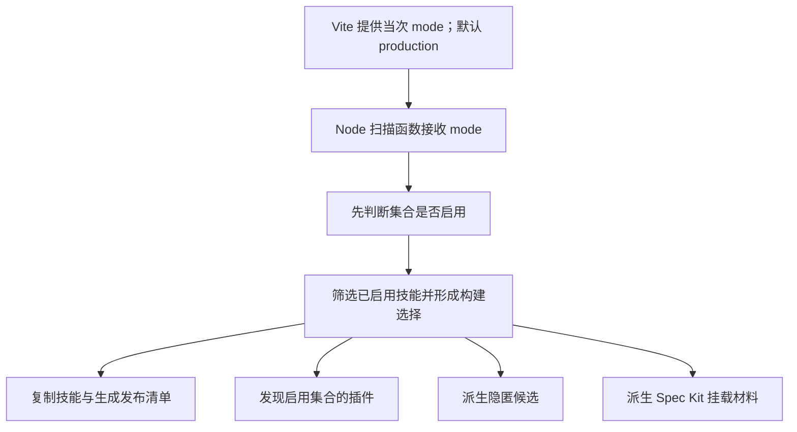
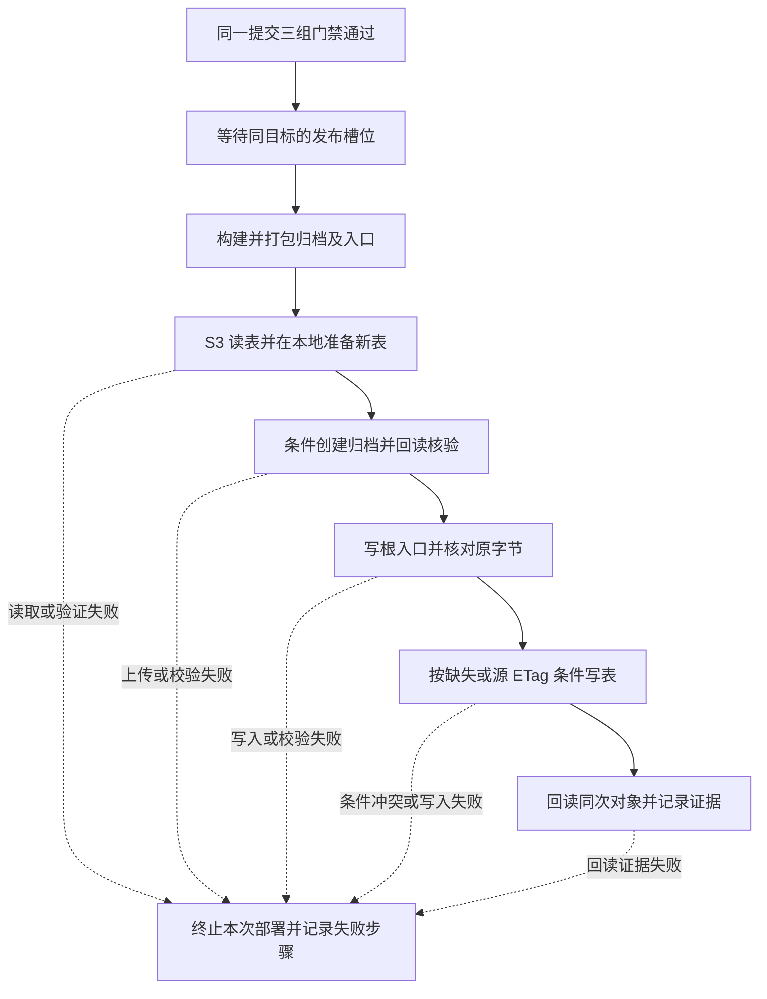
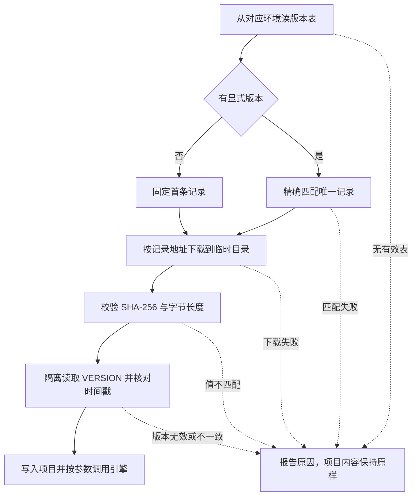

# 对话经过

会话 `01a21a76-8718-7f82-9ea7-2a40f8dbb35d` · 轮次 `01a21ad5-251b-75b3-aca1-471f24e45107`

<!-- foundry-detail 01a21a76-8718-7f82-9ea7-2a40f8dbb35d 01a21ad5-251b-75b3-aca1-471f24e45107 -->
<!-- foundry-event d2f97681ab1618d02c8495d4607b154d47f2ec448a7055759032dcffb2ff7863 -->
## 进度原话

- 来源定位：字节 5374517

~~~text
我按这个方案改。插件每次构建用 Moment.js 取一次 UTC 时间，写入 `VERSION`。我会删掉时间戳入参，同步候选读取约定，再用固定测试时钟复跑字节比对。
~~~

<!-- foundry-event a625444ef56b49db85d33a111300b4e82da803558a266fb0edf6ab42db64d0f4 -->
## 宿主命令执行

- 来源定位：字节 5377314

~~~text
{
  "command": "[已省略环境变量值] -lc 'rg -n '\"'\"'FOUNDRY_SKILLS_RELEASE_TIMESTAMP|冻结时间|固定时间|时间戳|同源构建'\"'\"' specs/skills/003-skills-release-pipeline/{spec,plan,tasks,mvu,data-model,research,diagrams,quickstart}.md specs/skills/003-skills-release-pipeline/contracts specs/skills/003-skills-release-pipeline/analysis/spec-analysis/README.md specs/skills/003-skills-release-pipeline/implementation/T009.md'",
  "workdir": "file:///home/ena/workspace/ena/agent-foundry/feature/init",
  "exitCode": 0,
  "status": "completed"
}
~~~

<!-- foundry-event 1ea9df5263f022b34c0238940eac1d822d4c867fc6ba8128f324064e0999dcab -->
## 工具结果 `exec-9f8f434c-d9bb-45f9-8d74-7ab100a06ccb`

- 来源定位：字节 5377314

~~~text
specs/skills/003-skills-release-pipeline/implementation/T009.md:1:# T009 构建版本文件与发布时间戳
specs/skills/003-skills-release-pipeline/implementation/T009.md:3:**关联任务** [T009](../tasks.md#临时版本管理) · **输入** [数据模型](../data-model.md#发布候选)、[同源构建验收](../quickstart.md#3-比较同源构建与交接候选)、[代码风格](../coding-style.md)
specs/skills/003-skills-release-pipeline/implementation/T009.md:5:2026-11-27，讨论确认在版本插件的 `generateBundle` 把源码包版本和本次构建固定的 UTC 毫秒时间戳写成 JSON。用户确认主改动文件后回复「开始吧」。现有部署会把整个 `VERSION` 用作归档文件名的一部分，格式切换时需要同步其字段读取。 [现有部署入口](../../../../.github/workflows/skills-deploy-common.yml)
specs/skills/003-skills-release-pipeline/implementation/T009.md:11:1. 先以真实 Vite 构建覆盖 `VERSION` 两字段和 LF、连续构建使用各自的固定时间戳、普通构建的默认时间以及拒绝显式空值和不存在的日期。运行 `node --test packages/skills/tests/distribution/vite-plugin-version.test.mjs` 复现当前产物缺口。
specs/skills/003-skills-release-pipeline/implementation/T009.md:12:2. 在 `vitePluginVersion()` 返回的 `configResolved` 中读取一次 `FOUNDRY_SKILLS_RELEASE_TIMESTAMP`。使用 Moment.js 在缺省时取当前 UTC 时间。有显式值时按 `YYYYMMDD[T]HHmmssSSS[Z]` 严格解析，并要求格式化后的值与原值相同。由 `generateBundle` 复用 `readPackageVersion`，输出含 `packageVersion` 与 `releaseTimestamp` 的 UTF-8 JSON 对象，以 LF 结尾。
specs/skills/003-skills-release-pipeline/implementation/T009.md:13:3. 现有部署构建步骤在技能包目录使用 Moment.js 生成一次 UTC 毫秒时间戳并传入。现有归档名从 `VERSION.packageVersion` 取值。T014 接入新对象键、候选交接和回读。
specs/skills/003-skills-release-pipeline/implementation/T009.md:14:4. 用同一输入、依赖、`release` 模式和 `20261125T120905123Z` 运行两次包的正常构建。比较路径和字节，并按当前发布打包方式检查包根 `VERSION`。用构建输入核对候选时间戳及推导的 `release/20261125T120905123Z/skills.tar.gz`，在隔离目录验证现行工作流的构建和读版本步骤。复跑相关 Node、Python 回归、技能包 lint 和类型检查。
specs/skills/003-skills-release-pipeline/implementation/T009.md:22:- **同源构建通过。** 两次 `release` 输出的 35 个文件逐字节一致。给默认构建和显式 `production` 相同冻结输入，32 个文件逐字节一致。各份 `VERSION` 均为 UTF-8 JSON，包含 `packageVersion = 0.1.0` 和 `releaseTimestamp = 20261125T120905123Z`，以 LF 结束。
specs/skills/003-skills-release-pipeline/implementation/T009.md:23:- **归档与候选标识通过。** 运行现有打包步骤，归档内 35 个文件与 `release` 输出逐一一致。包根 `VERSION` 的时间戳等于隔离候选标识和拟用对象键 `release/20261125T120905123Z/skills.tar.gz` 的时间戳。归档 62544 字节，SHA-256 为 `295811bd6dde16a61fb8e36b89d6e24033841339e6cc9df83dd94d6d8f146866`。
specs/skills/003-skills-release-pipeline/implementation/T009.md:24:- **现行工作流兼容通过。** 从 YAML 取构建、打包和上传的 Bash 命令，在隔离上下文中执行。固定时钟被调用一次，真实构建拿到固定值，旧归档名为 `skills-0.1.0.tar.gz`。注入空时间戳时构建失败，原 `VERSION` 完好。上传使用记录调用的本地 AWS 替身，删去 `packageVersion` 时命令失败且记录中无新增上传调用。 [通用部署](../../../../.github/workflows/skills-deploy-common.yml)
specs/skills/003-skills-release-pipeline/implementation/T009.md:31:技能包通过构建依赖目录安装 Moment.js `2.31.0`。隔离输入以 `85632536c6a2dbab495c3a7323d25e6a95f6dcee` 为基线，纳入工作区的版本插件、时间戳函数、依赖清单及通用部署 YAML，文件清单 SHA-256 为 `53651304990a9c0ddf5bbb340b089c9584b953671c505e43de972d4a5bd55c78`。用相同冻结输入复跑，两次 `release` 的 35 个文件逐字节一致，默认构建和显式 `production` 的 32 个文件逐字节一致。
specs/skills/003-skills-release-pipeline/implementation/T009.md:39:时间戳的生成和校验直接定义在 `vite-plugin-version/index.ts`，部署步骤从该文件导入。隔离输入以 `8563253` 为基线，文件清单 SHA-256 为 `9dd495332cba59e37ad35e4ba49bc3650231482498db02dedeac89cdc162ccea`。固定时间戳下，两次 `release` 的 35 个文件逐字节一致，默认构建和显式 `production` 的 32 个文件逐字节一致。 [版本插件](../../../../packages/skills/build/plugins/vite-plugin-version/index.ts) · [部署步骤](../../../../.github/workflows/skills-deploy-common.yml)
specs/skills/003-skills-release-pipeline/implementation/T009.md:45:按用户要求，将取时和校验展开在默认导出返回的 `configResolved` 中。现有部署步骤在技能包目录调用 Moment.js 取时一次，并把结果交给构建。隔离输入以 `8563253` 为基线，文件清单 SHA-256 为 `cefd85b3d7a6be5ae7b9379db4427c2fe8dfab4b9ef50cccc42b23be8c83c429`。固定输入下，两次 `release` 构建的 35 个文件逐字节一致，归档内的时间戳与隔离候选一致。归档长度为 62538 字节，SHA-256 为 `f2dcf3b074f9e30c4662140dfc7eb6b7e3eeaa65ad79ca94cf1b75423fed6e54`。
specs/skills/003-skills-release-pipeline/quickstart.md:35:| 安装器选包   | 生成两份标记不同的真实归档，用隔离 HTTPS 夹具提供倒序版本与根入口。分别默认选首条、显式选另一条，再分别让 SHA-256、长度和包内时间戳不一致。  | 请求的下载地址与实际安装文件都对应选中记录。三类失败各返回失败且无项目写入。默认挂载、--no-mount、--hidden 沿原接口复核。                              |
specs/skills/003-skills-release-pipeline/quickstart.md:68:## 3. 比较同源构建与交接候选
specs/skills/003-skills-release-pipeline/quickstart.md:70:用两个干净输出目录和同一已确认的源码 SHA、依赖、构建模式、下载根及固定时间戳。下例中的下载根是隔离测试夹具输入。实现后的构建以这两个变量接收冻结值和下载根。
specs/skills/003-skills-release-pipeline/quickstart.md:73:export FOUNDRY_SKILLS_RELEASE_TIMESTAMP=20261125T120905123Z
specs/skills/003-skills-release-pipeline/quickstart.md:85:获得对 release 测试桶的适用授权后，通过现行测试发布入口运行目标提交。记录触发 SHA、三组门禁、候选 SHA-256、入口制品、发布时间戳及实际对象键。以下命令在已有授权配置的 AWS CLI 环境中只读运行。使用实际 release 桶、R2 S3 endpoint 与发布版本。
specs/skills/003-skills-release-pipeline/quickstart.md:92:  : "${RELEASE_VERSION:?需要本次实际发布时间戳}"
specs/skills/003-skills-release-pipeline/diagrams.md:68:    version["隔离读取 VERSION 并核对时间戳"]
specs/skills/003-skills-release-pipeline/research.md:27:**决定** 每次新发布生成一个 UTC 毫秒时间戳，格式为 YYYYMMDDTHHmmssSSSZ，冻结后贯穿候选、VERSION、固定对象键和索引。VERSION 使用一份 UTF-8 JSON 对象，分别保存 packageVersion 与 releaseTimestamp。索引条目用 version、url、bytes、sha256。安装器先核对下载字节长度和 SHA-256，再在独立目录读取唯一常规 VERSION 成员，核对时间戳才进入项目写入。 [数据模型](data-model.md) · [安装契约](contracts/install.md)
specs/skills/003-skills-release-pipeline/research.md:29:**理由** 活动 VERSION 消费者是公共部署工作流，当前把整文件拼进归档名，本次同时改为读取明确字段。README 中的 SemVer 是示例，当前安装源的公网地址是占位。仓库未发现仍消费旧公网入口或 SemVer 索引的证据。现有隐藏脚本旧包布局兼容有测试，需要保留。两次清洁构建使用等同输入和固定时间戳比较解包文件全集及原字节，验收实际交接则校验同一原始归档的字节及 SHA-256。 [现行工作流](../../../.github/workflows/skills-deploy-common.yml) · [安装源](../../../packages/skills/build/plugins/vite-plugin-curl/install.source.sh) · [隐匿契约测试](../../../packages/skills/tests/distribution/hidden-contract.test.mjs) · [Node Hash API](https://nodejs.org/api/crypto.html#cryptocreatehashalgorithm-options)
specs/skills/003-skills-release-pipeline/data-model.md:15:每次独立发布冻结一份候选，关联目标、触发提交、发布模式、发布时间戳和同次制品。候选制品中的包内 curl/install.sh 与上传根 install.sh 字节一致。
specs/skills/003-skills-release-pipeline/data-model.md:22:| releaseTimestamp                          | UTC 毫秒时间戳，固定宽度 YYYYMMDDTHHmmssSSSZ。解析后须回格式化为同值。对同一目标属于唯一发布标识。 |
specs/skills/003-skills-release-pipeline/data-model.md:23:| archiveKey / archiveBytes / archiveSha256 | 固定键 release/<时间戳>/skills.tar.gz、正的安全整数字节数、小写 64 字符十六进制 SHA-256。          |
specs/skills/003-skills-release-pipeline/data-model.md:34:发布模式由流水线提供冻结时间戳。普通本地构建可生成独立时间戳，也可在比较同源产物时显式提供固定值。缺少有效发布输入时，发布候选在交接前失败。
specs/skills/003-skills-release-pipeline/mvu.md:43:**状态** 进行中。**依据** T009 已验收 `VERSION`、固定时间戳复建与隔离候选，T010 至 T012 接续验证版本表和安装校验。 [T009 验收](implementation/T009.md#2026-11-27-验收结果)
specs/skills/003-skills-release-pipeline/mvu.md:47:**节点与关键逻辑** 冻结候选的发布时间戳，关联 VERSION、固定归档键和索引记录。临时版本管理保存在独立目录，读表区分明确缺失与错误，工作区准备结果按成功顺序置顶。安装器核对 SHA-256、字节长度和包内时间戳，在隔离目录验证包结构，保留同包引擎和适用安装选项。先用真实 tar 夹具证明成员核查及无写入行为。正式版本工具接管与自动回退留待后续。 [版本模型](data-model.md) · [安装契约](contracts/install.md)
specs/skills/003-skills-release-pipeline/mvu.md:51:**验收信号** 同一候选的时间戳在包、键和发布记录中一致。明确无索引时初始化，后次准备保留旧条目及顺序。默认和显式安装各能得到实际正确文件，三个校验项的独立失败均产生零项目写入。
specs/skills/003-skills-release-pipeline/analysis/spec-analysis/README.md:19:一次独立发布产生一个时间戳，连接包内 VERSION、固定归档键和版本表条目。T009 已在隔离构建和归档中核对字段及标识。索引准备时只有明确缺失才可初始化，历史保留。安装者使用固定入口选择首条或指定条目，下载后核对 SHA-256、长度和包内时间戳再写项目。现行入口仍用示例根和 MD5，正式版本工具接管与故障回退已留待后续。 [T009 验收](../../implementation/T009.md#2026-11-27-验收结果) · [数据模型](../../data-model.md) · [安装技术流程](../../diagrams.md#安装器核对同一个选中版本) · [里程碑](../../mvu.md#临时版本管理) · [T009 至 T012](../../tasks.md#临时版本管理)
specs/skills/003-skills-release-pipeline/tasks.md:33:- [x] T009 [US2] 在 T001、T002 和 T008 后更新 packages/skills/build/plugins/vite-plugin-version/index.ts 及构建输入，冻结 UTC 毫秒发布标识。验证 VERSION 两字段、同源固定输入的构建字节一致及候选中标识对齐。 按 [数据模型](data-model.md) 核对以下约束。「源码包 package.json 的版本，进包后保持可独立读取。」 「UTC 毫秒时间戳，固定宽度 YYYYMMDDTHHmmssSSSZ。解析后须回格式化为同值。对同一目标属于唯一发布标识。」 [实施方案与验收](implementation/T009.md)
specs/skills/003-skills-release-pipeline/tasks.md:47:- [ ] T014 [US2] 在 T003 完成，且 T010、T012 和 T013 的适用前置通过后整理 .github/workflows/skills-deploy-common.yml 与 packages/skills/script/temporary-release，验证目标白名单、同次候选交接、读表至回读串行、固定归档后写入口再条件写表，以及失败终止和零重试。将测试目标构建接到 `build --mode release`，同步包内说明的构建和发布入口。按 [数据模型](data-model.md) 核对以下约束。「正式候选的目标与环境一致：release 对应测试桶，production 对应生产桶；先接 release，生产入口由 T019 接入。」 「固定键 release/<时间戳>/skills.tar.gz、正的安全整数字节数、小写 64 字符十六进制 SHA-256。」 「同候选的入口原字节摘要和长度，上传根入口前后核对。」 「由目标确定的 HTTPS 下载根。access 标明公网或需认证的 S3 验收，仅作为交接和运行证据。」 「工作流运行身份，供跨 job 核对和结果追溯。」
specs/skills/003-skills-release-pipeline/spec.md:19:- Q: 安装新发布的时间戳版本时，安装器必须通过哪些检查才能写入项目？ → A: 新版本对象记录归档的 SHA-256 和字节长度。安装器必须验证归档摘要、长度及包内 `VERSION` 时间戳，三项均通过后才能写入项目。
specs/skills/003-skills-release-pipeline/spec.md:73:3. 当版本表或选中记录无效、下载失败，或归档 SHA-256、字节长度、包内 `VERSION` 时间戳任一项不匹配时，入口应报告失败并保持项目内容不变。
specs/skills/003-skills-release-pipeline/spec.md:117:- **FR-006** 测试和生产必须使用各自的 R2 桶，沿用共用访问凭据配置。各桶的发布对象为根 `install.sh`、根 `release.json` 和 `release/<时间戳>/skills.tar.gz`。旧 SHA 目录由维护者手动处理。
specs/skills/003-skills-release-pipeline/spec.md:118:- **FR-007** 构建必须在 `VERSION` 保有源码包版本并新增本次发布的时间戳。归档目录、包内发布标识与版本表 `version` 取同一个值。源码包版本以 `package.json.version` 为准。本地构建可在无线上版本表和凭据的情况下完成。
specs/skills/003-skills-release-pipeline/spec.md:119:- **FR-008** 在候选构建和打包之后，版本表准备作业必须经目标桶的 S3 接口读取现有根版本表，在工作区生成更新版本表。只在确知对象缺失时初始化。新版本对象包含本次时间戳、固定归档下载信息、归档 SHA-256 摘要和实际字节长度，并置于有序数组首条，原记录与原顺序保留。补发旧提交遵循当次成功发布顺序。
specs/skills/003-skills-release-pipeline/spec.md:120:- **FR-009** 独立发布作业须在归档、安装脚本和更新后的版本表全部就绪后开始上传。先上传并校验归档，再写桶根入口，最后写桶根版本表。同目标串行边界覆盖读表至写回，后续请求排队，已开始的发布继续执行直至成功或失败。部署步骤失败时，本次运行标记失败并终止，不重试。若维护者另行发起发布，使用该次发布自己的时间戳，并读取当时的版本表。
specs/skills/003-skills-release-pipeline/spec.md:122:- **FR-011** 桶根安装入口运行时须从对应环境的下载根读取 `release.json`。默认使用数组首条，显式版本按 `version` 精确匹配一条记录，按记录的 `url` 获取归档。安装新发布的时间戳版本时，入口必须核对归档的 SHA-256 和字节长度，并确认包内 `VERSION` 时间戳等于记录的 `version`。三项均通过后才可写入项目，字段缺失或核对失败时须报告原因。项目级技能安装及适用的挂载和隐匿接口纳入兼容核对。面向公网的版本表须使用实际 HTTPS 归档地址。
specs/skills/003-skills-release-pipeline/spec.md:130:- **发布候选**。同次构建产生的归档和安装入口，关联源码提交、源码包版本、发布时间戳和核验摘要。
specs/skills/003-skills-release-pipeline/spec.md:140:- **SC-003** 两份可区分的归档各完成一次实际安装验证，分别覆盖默认首条和显式历史版本。下载和安装内容与选中归档的匹配率为 100%。归档 SHA-256、字节长度及包内 `VERSION` 时间戳各验证一次独立不匹配情形，产生的项目写入次数均为 0。
specs/skills/003-skills-release-pipeline/spec.md:151:- 新版根布局、时间戳发布标识和首版三个测试场景采用本次确认。旧 `curl/` 桶路径、SemVer 发布键及早期门禁假设沿原记录追溯。已有有效安装行为纳入回归核对。 [旧安装交付契约](../001-skills-distribution/contracts/curl-delivery.md) · [已确认的 R2 发布布局](../002-conversation-to-skill/requirements/raw/2026-11-24-r2-release-layout.md)
specs/skills/003-skills-release-pipeline/spec.md:163:- T009 已在 `VERSION` 写出源码包版本及 UTC 毫秒发布标识，并验证固定输入复建与隔离归档。现有部署流程在 `release` 构建前固定时间戳，读取 `packageVersion` 拼接当前归档名，按源码 SHA 和运行标识上传，并会取消同目标在途运行。测试放行是占位，生产文件是草稿。安装源使用示例下载根，已有首条与显式版本选择，以及下载校验后调用引擎的行为。 [T009 验收](implementation/T009.md#2026-11-27-验收结果) · [通用部署](../../../.github/workflows/skills-deploy-common.yml) · [测试放行](../../../.github/workflows/skills-test.yml) · [测试环境入口](../../../.github/workflows/skills-deploy-release.yml) · [生产草稿](../../../.github/workflows/skills-deploy-prod.yml.example) · [版本文件](../../../packages/skills/build/plugins/vite-plugin-version/index.ts) · [安装入口](../../../packages/skills/build/plugins/vite-plugin-curl/install.source.sh)
specs/skills/003-skills-release-pipeline/spec.md:172:- 确认 `VERSION` 字段格式、时间戳粒度，以及同一发布输入的重复构建比较口径。 [旧规格的同源构建验收](../001-skills-distribution/spec.md)
specs/skills/003-skills-release-pipeline/plan.md:8:在主线技能构建中由扫描器接收 Vite 当次 `mode` 并统一选择集合与技能，把同一份经核验的候选交给版本表准备、发布与回读。release 先通过三组测试门禁和实际测试桶对象回读，再接入面向选定提交的手动生产发布。公开下载根补齐后独立验收测试桶安装。安装新版本时先核对归档 SHA-256、字节长度与包内 VERSION 时间戳，再写入项目。 [构建与发布契约](contracts/build-and-publish.md) · [安装契约](contracts/install.md)
specs/skills/003-skills-release-pipeline/plan.md:27:| 边界       | 临时版本逻辑放入独立目录，源码版本与发布时间戳各自保存。本期不含回退机制、紧急版及 MCP 清单改造。                                             |
specs/skills/003-skills-release-pipeline/contracts/install.md:16:仓库中的旧地址为示例，目前可证实的 MD5 消费者是原入口及测试夹具。新时间戳版本强制执行本契约的三项检查。若发现实际旧公网消费者或旧根索引，保留其原数据和使用依据，由对应目标的维护者确定兼容处理，普通发布不替换已存在的旧入口路径。 [旧交付契约](../../001-skills-distribution/contracts/curl-delivery.md) · [现行入口](../../../../packages/skills/build/plugins/vite-plugin-curl/install.source.sh) · [验收指南](../quickstart.md)
specs/skills/003-skills-release-pipeline/contracts/build-and-publish.md:32:| 创建归档   | release/<时间戳>/skills.tar.gz | 用 If-None-Match: * 创建。成功后实际 S3 GET 回读，比对 SHA-256 和长度。冲突失败并保留现有对象。                                                  |

~~~

<!-- foundry-event 020a0b2cc314b6cab6550097a28264ea0fe1daf79178410aa8ba711bc7db8c21 -->
## 宿主命令执行

- 来源定位：字节 5399025

~~~text
{
  "command": "[已省略环境变量值] -lc 'cat packages/skills/build/plugins/vite-plugin-version/index.ts\nsed -n '\"'\"'47,90p'\"'\"' .github/workflows/skills-deploy-common.yml\ncat packages/skills/tests/distribution/vite-plugin-version.test.mjs'",
  "workdir": "file:///home/ena/workspace/ena/agent-foundry/feature/init",
  "exitCode": 0,
  "status": "completed"
}
~~~

<!-- foundry-event bc1887c4f976cfc19f260d3460d11eebd6bdfcf95c18f5f1d84a5a59a0d11c7b -->
## 工具结果 `exec-b5138d37-75ad-44c8-8a3a-af4b78f1861f`

- 来源定位：字节 5399025

~~~text
import type { Plugin } from 'vite'
import process from 'node:process'
import moment from 'moment'
import { readPackageVersion } from '#build/utils/read-package-version'

/**
 * 在构建时交付当前包版本和当次构建的发布时间戳。
 *
 * @returns 仅在构建时运行的版本插件。
 */
export default function vitePluginVersion(): Plugin {
  /**
   * 每次解析构建配置时确定，同次的各输出共用该值。
   */
  let releaseTimestamp: string
  return {
    name: 'vite-plugin-version',
    apply: 'build',
    /**
     * 在产物写入前校验输入并冻结当次时间戳。
     */
    configResolved() {
      /**
       * UTC 发布时间戳使用三位毫秒，T 和 Z 为字面字符。
       */
      const releaseTimestampFormat = 'YYYYMMDD[T]HHmmssSSS[Z]'
      /**
       * 发布构建传入已冻结的时间戳，普通构建缺省时取当前时间。
       */
      const timestamp = process.env.FOUNDRY_SKILLS_RELEASE_TIMESTAMP
      if (timestamp === undefined) {
        releaseTimestamp = moment.utc().locale('en').format(releaseTimestampFormat)
        return
      }

      /**
       * 严格解析 UTC 时间，重新格式化以识别日期进位。
       */
      const parsed = moment.utc(timestamp, releaseTimestampFormat, 'en', true)
      if (!parsed.isValid() || parsed.format(releaseTimestampFormat) !== timestamp)
        throw new Error('FOUNDRY_SKILLS_RELEASE_TIMESTAMP 必须是 YYYYMMDDTHHmmssSSSZ 格式的有效 UTC 时间')
      releaseTimestamp = timestamp
    },
    /**
     * 将两个版本字段作为 UTF-8 JSON 资产交付，使用 LF 结尾。
     */
    async generateBundle() {
      /**
       * 包版本来自实际参与构建的源码清单。
       */
      const packageVersion = await readPackageVersion()
      this.emitFile({ type: 'asset', fileName: 'VERSION', source: `${JSON.stringify({ packageVersion, releaseTimestamp })}\n` })
    },
  }
}
          pnpm_config_lockfile: 'false'
          pnpm_config_verify_deps_before_run: 'false'
        run: pnpm --filter '@foundry/skills^...' run build

      - name: 构建技能包
        working-directory: packages/skills
        env:
          pnpm_config_lockfile: 'false'
          pnpm_config_verify_deps_before_run: 'false'
        run: |
          release_timestamp="$(node --input-type=module --eval "
            import moment from 'moment'
            console.log(moment.utc().locale('en').format('YYYYMMDD[T]HHmmssSSS[Z]'))
          ")"
          FOUNDRY_SKILLS_RELEASE_TIMESTAMP="$release_timestamp" pnpm run build --mode release

      - name: 打包技能产物
        shell: bash
        working-directory: packages/skills/dist
        run: |
          find . -type f -printf '%P\0' | LC_ALL=C sort -z |
            tar -czf ../skills.tar.gz --null --files-from=-

      - name: 记录归档 SHA-256
        shell: bash
        run: sha256sum packages/skills/skills.tar.gz >> "$GITHUB_STEP_SUMMARY"

      - name: 上传到 R2
        shell: bash
        env:
          R2_ACCOUNT_ID: ${{ vars[format('{0}_ACCOUNT_ID', env.R2_CONFIG_PREFIX)] }}
          R2_BUCKET_NAME: ${{ vars[format('{0}_BUCKET_NAME', env.R2_CONFIG_PREFIX)] }}
          AWS_ACCESS_KEY_ID: ${{ secrets.SKILL_DEPLOY_R2_ACCESS_KEY_ID }}
          AWS_SECRET_ACCESS_KEY: ${{ secrets.SKILL_DEPLOY_R2_SECRET_ACCESS_KEY }}
          AWS_DEFAULT_REGION: auto
          AWS_EC2_METADATA_DISABLED: 'true'
        run: |
          : "${AWS_ACCESS_KEY_ID:?缺少 R2 Access Key ID}" "${AWS_SECRET_ACCESS_KEY:?缺少 R2 Secret Access Key}"
          export AWS_ENDPOINT_URL_S3="https://${R2_ACCOUNT_ID:?缺少 R2 账号 ID}.r2.cloudflarestorage.com"
          destination="s3://${R2_BUCKET_NAME:?缺少 R2 桶名}/$GITHUB_SHA/$GITHUB_RUN_ID-$GITHUB_RUN_ATTEMPT"
          version="$(jq -er '.packageVersion | strings | select(length > 0)' packages/skills/dist/VERSION)"

          aws s3 cp packages/skills/skills.tar.gz "$destination/skills-$version.tar.gz" --no-progress
          aws s3 cp packages/skills/dist/curl/install.sh "$destination/curl/install.sh" --no-progress
import assert from 'node:assert/strict'
import { mkdirSync, mkdtempSync, readFileSync, rmSync, writeFileSync } from 'node:fs'
import { tmpdir } from 'node:os'
import { join } from 'node:path'
import process from 'node:process'
import test from 'node:test'
import { build } from 'vite'
import vitePluginVersion from '../../build/plugins/vite-plugin-version/index.ts'

/**
 * 从包清单独立读取用于断言的源码版本。
 */
const packageVersion = JSON.parse(readFileSync(new URL('../../package.json', import.meta.url), 'utf8')).version

/**
 * 用同一个插件实例执行真实 Vite 构建，并在用例结束后恢复进程输入。
 * @param {import('node:test').TestContext} t 当前测试上下文。
 * @returns {import('vite').InlineConfig} 隔离构建配置。
 */
function createVersionBuild(t) {
  /**
   * 在用例之间恢复调用方原有的时间戳输入。
   */
  const previousTimestamp = process.env.FOUNDRY_SKILLS_RELEASE_TIMESTAMP
  t.after(() => {
    if (previousTimestamp === undefined)
      delete process.env.FOUNDRY_SKILLS_RELEASE_TIMESTAMP
    else
      process.env.FOUNDRY_SKILLS_RELEASE_TIMESTAMP = previousTimestamp
  })
  /**
   * 临时目录仅保存当前用例的入口和磁盘产物。
   */
  const root = mkdtempSync(join(tmpdir(), 'foundry-vite-version-'))
  t.after(() => rmSync(root, { recursive: true, force: true }))
  /**
   * 用真实入口触发完整的构建生命周期。
   */
  const entryPath = join(root, 'entry.js')
  writeFileSync(entryPath, 'export default 1\n')
  return {
    configFile: false,
    root,
    logLevel: 'silent',
    publicDir: false,
    plugins: [vitePluginVersion()],
    build: { write: false, rolldownOptions: { input: entryPath } },
  }
}

/**
 * 读取构建实际交付的 VERSION 文本。
 * @param {import('vite').InlineConfig} config 当前构建配置。
 * @returns {Promise<string>} 版本文件的原始文本。
 */
async function buildVersion(config) {
  /**
   * 单输出构建返回包含 VERSION 的资产集合。
   */
  const result = await build(config)
  assert.ok('output' in result)
  /**
   * 版本插件通过 Vite 交付的文件资产。
   */
  const asset = result.output.find(output => output.type === 'asset' && output.fileName === 'VERSION')
  assert.ok(asset && typeof asset.source === 'string')
  return asset.source
}

test('固定时间戳时 VERSION 字节一致，同进程下一次构建读取新的输入', async (t) => {
  /**
   * 多次构建复用配置与插件实例，捕获上一次构建输入的泄漏。
   */
  const config = createVersionBuild(t)
  process.env.FOUNDRY_SKILLS_RELEASE_TIMESTAMP = '20261125T120905123Z'
  /**
   * 首次产物提供固定输入下的字节基线。
   */
  const first = await buildVersion(config)
  assert.ok(first.endsWith('\n'))
  assert.deepEqual(JSON.parse(first), { packageVersion, releaseTimestamp: '20261125T120905123Z' })
  assert.equal(await buildVersion(config), first)

  process.env.FOUNDRY_SKILLS_RELEASE_TIMESTAMP = '20240229T235959999Z'
  assert.deepEqual(JSON.parse(await buildVersion(config)), { packageVersion, releaseTimestamp: '20240229T235959999Z' })
})

test('普通构建从实际 UTC 时钟生成本次时间戳', async (t) => {
  /**
   * 用与正式插件一致的 Vite 调用验证缺省输入。
   */
  const config = createVersionBuild(t)
  delete process.env.FOUNDRY_SKILLS_RELEASE_TIMESTAMP
  /**
   * 生成时间应在本次构建的实际执行区间内。
   */
  const started = Date.now()
  /**
   * 从生成文件读回当次时间戳。
   */
  const version = JSON.parse(await buildVersion(config))
  assert.equal(version.packageVersion, packageVersion)
  assert.match(version.releaseTimestamp, /^\d{8}T\d{9}Z$/u)
  /**
   * 转换为 ISO 时间后核对实际 UTC 毫秒值。
   */
  const milliseconds = Date.parse(version.releaseTimestamp.replace(/^(\d{4})(\d{2})(\d{2})T(\d{2})(\d{2})(\d{2})(\d{3})Z$/u, '$1-$2-$3T$4:$5:$6.$7Z'))
  assert.ok(milliseconds >= started && milliseconds <= Date.now())
})

test('显式空值、非法格式和不存在的日期拒绝构建并保留旧 VERSION', async (t) => {
  /**
   * 启用磁盘写出，核对失败时不会清空上一轮输出。
   */
  const config = createVersionBuild(t)
  /**
   * 上一轮构建产物位于 Vite 默认输出目录。
   */
  const dist = join(config.root, 'dist')
  /**
   * 旧格式文件用来观察失败前后的真实文件字节。
   */
  const previousVersion = join(dist, 'VERSION')
  mkdirSync(dist)
  writeFileSync(previousVersion, '0.1.0\n')
  config.build.write = true

  /**
   * 验证显式空值、ISO 拼写、不存在的日期、次日进位及额外换行。
   */
  for (const invalid of ['', '2026-11-25T12:09:05.123Z', '20260230T120905123Z', '20261125T240000000Z', '20261125T120905123Z\n']) {
    process.env.FOUNDRY_SKILLS_RELEASE_TIMESTAMP = invalid
    await assert.rejects(build(config), /FOUNDRY_SKILLS_RELEASE_TIMESTAMP/u)
    assert.equal(readFileSync(previousVersion, 'utf8'), '0.1.0\n')
  }
})

~~~

<!-- foundry-event e0fc6a1561eab6061cef89648bce203f37ef4920b8636748a6a0e06fb48ee7ee -->
## 宿主命令执行

- 来源定位：字节 5409799

~~~text
{
  "command": "[已省略环境变量值] -lc 'git status --short --branch\ngit log -3 --format='\"'\"'%h %s'\"'\"'\ndate '\"'\"'+%F %Z'\"'\"''",
  "workdir": "file:///home/ena/workspace/ena/agent-foundry/feature/init",
  "exitCode": 0,
  "status": "completed"
}
~~~

<!-- foundry-event ddac896c462ad30550f0a872fb33be3180437ea2df9525ad6eee1938862eddcb -->
## 工具结果 `exec-b7456fe8-52c5-425e-b846-b5be9da1bf43`

- 来源定位：字节 5409799

~~~text
## feature/init...origin/feature/init [ahead 1]
 M .codex/hooks.json
 M .github/workflows/skills-deploy-common.yml
 M .specify/memory/conversation-recording/records/2026-11-26/01a2174d-dd90-74b1-8444-b2b62149b17b.md
 M packages/skills/build/plugins/vite-plugin-version/index.ts
 M packages/skills/package.json
 M packages/skills/src/profile/conversation-recording/install.py
 M packages/skills/src/profile/conversation-recording/recording/events.py
 M packages/skills/src/profile/conversation-recording/recording/record.py
 M packages/skills/src/profile/conversation-recording/scripts/post_tool_use.py
 M packages/skills/src/profile/conversation-recording/scripts/stop.py
 M packages/skills/src/profile/conversation-recording/scripts/user_prompt_submit.py
 M packages/skills/tests/test_conversation_recording.py
 M packages/skills/tests/test_register_commands.py
 M pnpm-workspace.yaml
 M specs/docs/001-docs-site-framework/tasks.md
 M specs/skills/002-conversation-to-skill/analysis/spec-analysis/README.md
 M specs/skills/002-conversation-to-skill/diagrams.md
 M specs/skills/002-conversation-to-skill/mvu.md
 M specs/skills/002-conversation-to-skill/plan.md
 M specs/skills/002-conversation-to-skill/spec.md
 M specs/skills/002-conversation-to-skill/tasks.md
 M specs/skills/003-skills-release-pipeline/analysis/spec-analysis/README.md
 M specs/skills/003-skills-release-pipeline/implementation/T008.md
 M specs/skills/003-skills-release-pipeline/mvu.md
 M specs/skills/003-skills-release-pipeline/plan.md
 M specs/skills/003-skills-release-pipeline/spec.md
 M specs/skills/003-skills-release-pipeline/tasks.md
?? .specify/memory/conversation-recording/records/2026-11-27/
?? packages/skills/src/profile/conversation-recording/recording/subagents.py
?? packages/skills/src/profile/conversation-recording/recording/timeline.py
?? packages/skills/src/profile/conversation-recording/scripts/subagent_stop.py
?? packages/skills/tests/distribution/vite-plugin-version.test.mjs
?? specs/docs/001-docs-site-framework/analysis/figma-conversion.md
?? specs/docs/001-docs-site-framework/implementation/
?? specs/skills/002-conversation-to-skill/analysis/acceptance/subagent-recording-code-mode.json
?? specs/skills/002-conversation-to-skill/analysis/acceptance/subagent-recording-timeline.json
?? specs/skills/002-conversation-to-skill/analysis/subagent-recording-timeline.md
?? specs/skills/002-conversation-to-skill/implementation/T038.md
?? specs/skills/002-conversation-to-skill/requirements/raw/2026-11-27-recording-subagent-stop-hook.md
?? specs/skills/003-skills-release-pipeline/implementation/T009.md
8563253 test(skills): 补齐命令挂载测试的集合开关
cf8def3 fix(skills): 修复 Git 提交停写与自定义构建输出
1233ff9 123
2026-11-27 CST

~~~

<!-- foundry-event cfa13ef877df50991e7b6ed8664475498c225149e8a7605cf285421fc0570343 -->
## 宿主命令执行

- 来源定位：字节 5413393

~~~text
{
  "command": "[已省略环境变量值] -lc 'rg -n --hidden -g '\"'\"'!.git/**'\"'\"' -g '\"'\"'!**/node_modules/**'\"'\"' -g '\"'\"'!**/dist/**'\"'\"' -g '\"'\"'!**/.turbo/**'\"'\"' -g '\"'\"'!.specify/memory/conversation-recording/**'\"'\"' -g '\"'\"'!**/archive/**'\"'\"' -g '\"'\"'!specs/skills/003-skills-release-pipeline/**'\"'\"' '\"'\"'FOUNDRY_SKILLS_RELEASE_TIMESTAMP'\"'\"' .'",
  "workdir": "file:///home/ena/workspace/ena/agent-foundry/feature/init",
  "exitCode": 0,
  "status": "completed"
}
~~~

<!-- foundry-event 3f36e553b7a5ffc162b4ab1d9c41cebdd78d18da13f3dc50cd8711fd375fe74b -->
## 工具结果 `exec-fef3a42e-af6d-479b-a89c-8ef36dec00e2`

- 来源定位：字节 5413393

~~~text
./.github/workflows/skills-deploy-common.yml:61:          FOUNDRY_SKILLS_RELEASE_TIMESTAMP="$release_timestamp" pnpm run build --mode release
./packages/skills/tests/distribution/vite-plugin-version.test.mjs:24:  const previousTimestamp = process.env.FOUNDRY_SKILLS_RELEASE_TIMESTAMP
./packages/skills/tests/distribution/vite-plugin-version.test.mjs:27:      delete process.env.FOUNDRY_SKILLS_RELEASE_TIMESTAMP
./packages/skills/tests/distribution/vite-plugin-version.test.mjs:29:      process.env.FOUNDRY_SKILLS_RELEASE_TIMESTAMP = previousTimestamp
./packages/skills/tests/distribution/vite-plugin-version.test.mjs:75:  process.env.FOUNDRY_SKILLS_RELEASE_TIMESTAMP = '20261125T120905123Z'
./packages/skills/tests/distribution/vite-plugin-version.test.mjs:84:  process.env.FOUNDRY_SKILLS_RELEASE_TIMESTAMP = '20240229T235959999Z'
./packages/skills/tests/distribution/vite-plugin-version.test.mjs:93:  delete process.env.FOUNDRY_SKILLS_RELEASE_TIMESTAMP
./packages/skills/tests/distribution/vite-plugin-version.test.mjs:132:    process.env.FOUNDRY_SKILLS_RELEASE_TIMESTAMP = invalid
./packages/skills/tests/distribution/vite-plugin-version.test.mjs:133:    await assert.rejects(build(config), /FOUNDRY_SKILLS_RELEASE_TIMESTAMP/u)
./packages/skills/build/plugins/vite-plugin-version/index.ts:30:      const timestamp = process.env.FOUNDRY_SKILLS_RELEASE_TIMESTAMP
./packages/skills/build/plugins/vite-plugin-version/index.ts:41:        throw new Error('FOUNDRY_SKILLS_RELEASE_TIMESTAMP 必须是 YYYYMMDDTHHmmssSSSZ 格式的有效 UTC 时间')

~~~

<!-- foundry-event 742dbfaa166eb2c6e2707ed5f7c49d17014d84fe64068e987af12e82af722acd -->
## 工具调用 `Bash` · `exec-9f8f434c-d9bb-45f9-8d74-7ab100a06ccb`

- 来源定位：工具事件 exec-9f8f434c-d9bb-45f9-8d74-7ab100a06ccb

~~~text
工作目录：/home/ena/workspace/ena/agent-foundry/feature/init
{
  "command": "rg -n 'FOUNDRY_SKILLS_RELEASE_TIMESTAMP|冻结时间|固定时间|时间戳|同源构建' specs/skills/003-skills-release-pipeline/{spec,plan,tasks,mvu,data-model,research,diagrams,quickstart}.md specs/skills/003-skills-release-pipeline/contracts specs/skills/003-skills-release-pipeline/analysis/spec-analysis/README.md specs/skills/003-skills-release-pipeline/implementation/T009.md"
}
~~~

<!-- foundry-event 0e6ec7c925e43543bc54e4b9bce04aefe3e578ae886e3c5cfe89f5284f670e78 -->
## 工具调用 `Bash` · `exec-b5138d37-75ad-44c8-8a3a-af4b78f1861f`

- 来源定位：工具事件 exec-b5138d37-75ad-44c8-8a3a-af4b78f1861f

~~~text
工作目录：/home/ena/workspace/ena/agent-foundry/feature/init
{
  "command": "cat packages/skills/build/plugins/vite-plugin-version/index.ts\nsed -n '47,90p' .github/workflows/skills-deploy-common.yml\ncat packages/skills/tests/distribution/vite-plugin-version.test.mjs"
}
~~~

<!-- foundry-event ff26729b1f74b96fbe1e3e2aa4063ce01047fb0781c6c7fd6efbe88a123ed87b -->
## 工具调用 `Bash` · `exec-fef3a42e-af6d-479b-a89c-8ef36dec00e2`

- 来源定位：工具事件 exec-fef3a42e-af6d-479b-a89c-8ef36dec00e2

~~~text
工作目录：/home/ena/workspace/ena/agent-foundry/feature/init
{
  "command": "rg -n --hidden -g '!.git/**' -g '!**/node_modules/**' -g '!**/dist/**' -g '!**/.turbo/**' -g '!.specify/memory/conversation-recording/**' -g '!**/archive/**' -g '!specs/skills/003-skills-release-pipeline/**' 'FOUNDRY_SKILLS_RELEASE_TIMESTAMP' ."
}
~~~

<!-- foundry-event 8af8665407cd981327726d23d8fc472fceae47b4fb6ccc9f2b13f8a818679c66 -->
## 工具调用 `Bash` · `exec-b7456fe8-52c5-425e-b846-b5be9da1bf43`

- 来源定位：工具事件 exec-b7456fe8-52c5-425e-b846-b5be9da1bf43

~~~text
工作目录：/home/ena/workspace/ena/agent-foundry/feature/init
{
  "command": "git status --short --branch\ngit log -3 --format='%h %s'\ndate '+%F %Z'"
}
~~~

<!-- foundry-event 93f84fc30e97e69028e6770249996b8533ee2dc52a4633a75d5f589cf74e600c -->
## 工具调用 `exec` · `call_4abb476d0b524e75bf722076880a6a75`

- 来源定位：字节 5375568

~~~text
工作目录：/home/ena/workspace/ena/agent-foundry/feature/init
const b="specs/skills/003-skills-release-pipeline";
const cmds=[
  ["status","git status --short --branch\ngit log -3 --format='%h %s'\ndate '+%F %Z'"],
  ["active timestamp requirements and references",`rg -n 'FOUNDRY_SKILLS_RELEASE_TIMESTAMP|冻结时间|固定时间|时间戳|同源构建' ${b}/{spec,plan,tasks,mvu,data-model,research,diagrams,quickstart}.md ${b}/contracts ${b}/analysis/spec-analysis/README.md ${b}/implementation/T009.md`],
  ["plugin workflow and version tests","cat packages/skills/build/plugins/vite-plugin-version/index.ts\nsed -n '47,90p' .github/workflows/skills-deploy-common.yml\ncat packages/skills/tests/distribution/vite-plugin-version.test.mjs"],
  ["other live input readers","rg -n --hidden -g '!.git/**' -g '!**/node_modules/**' -g '!**/dist/**' -g '!**/.turbo/**' -g '!.specify/memory/conversation-recording/**' -g '!**/archive/**' -g '!specs/skills/003-skills-release-pipeline/**' 'FOUNDRY_SKILLS_RELEASE_TIMESTAMP' ."]
];
await Promise.allSettled(cmds.map(async ([key,cmd])=>({key,...await tools.exec_command({cmd,max_output_tokens:6600})}))).then(rs=>rs.forEach(r=>{store("clock-origin-"+(r.value?.key??"error"),r.value??r);text(r.value??r);}));

~~~

<!-- foundry-event 801a583415617a388a946b2a8d29ff23f6f2273e0750e96d08b56f56f40d570b -->
## 工具结果 `call_4abb476d0b524e75bf722076880a6a75`

- 来源定位：字节 5417034

~~~text
[
  {
    "type": "input_text",
    "text": "Script completed\nWall time 1.0 seconds\nOutput:\n"
  },
  {
    "type": "input_text",
    "text": "{\"key\":\"status\",\"chunk_id\":\"f4ee99\",\"wall_time_seconds\":0.000041607,\"exit_code\":0,\"original_token_count\":691,\"output\":\"## feature/init...origin/feature/init [ahead 1]\\n M .codex/hooks.json\\n M .github/workflows/skills-deploy-common.yml\\n M .specify/memory/conversation-recording/records/2026-11-26/01a2174d-dd90-74b1-8444-b2b62149b17b.md\\n M packages/skills/build/plugins/vite-plugin-version/index.ts\\n M packages/skills/package.json\\n M packages/skills/src/profile/conversation-recording/install.py\\n M packages/skills/src/profile/conversation-recording/recording/events.py\\n M packages/skills/src/profile/conversation-recording/recording/record.py\\n M packages/skills/src/profile/conversation-recording/scripts/post_tool_use.py\\n M packages/skills/src/profile/conversation-recording/scripts/stop.py\\n M packages/skills/src/profile/conversation-recording/scripts/user_prompt_submit.py\\n M packages/skills/tests/test_conversation_recording.py\\n M packages/skills/tests/test_register_commands.py\\n M pnpm-workspace.yaml\\n M specs/docs/001-docs-site-framework/tasks.md\\n M specs/skills/002-conversation-to-skill/analysis/spec-analysis/README.md\\n M specs/skills/002-conversation-to-skill/diagrams.md\\n M specs/skills/002-conversation-to-skill/mvu.md\\n M specs/skills/002-conversation-to-skill/plan.md\\n M specs/skills/002-conversation-to-skill/spec.md\\n M specs/skills/002-conversation-to-skill/tasks.md\\n M specs/skills/003-skills-release-pipeline/analysis/spec-analysis/README.md\\n M specs/skills/003-skills-release-pipeline/implementation/T008.md\\n M specs/skills/003-skills-release-pipeline/mvu.md\\n M specs/skills/003-skills-release-pipeline/plan.md\\n M specs/skills/003-skills-release-pipeline/spec.md\\n M specs/skills/003-skills-release-pipeline/tasks.md\\n?? .specify/memory/conversation-recording/records/2026-11-27/\\n?? packages/skills/src/profile/conversation-recording/recording/subagents.py\\n?? packages/skills/src/profile/conversation-recording/recording/timeline.py\\n?? packages/skills/src/profile/conversation-recording/scripts/subagent_stop.py\\n?? packages/skills/tests/distribution/vite-plugin-version.test.mjs\\n?? specs/docs/001-docs-site-framework/analysis/figma-conversion.md\\n?? specs/docs/001-docs-site-framework/implementation/\\n?? specs/skills/002-conversation-to-skill/analysis/acceptance/subagent-recording-code-mode.json\\n?? specs/skills/002-conversation-to-skill/analysis/acceptance/subagent-recording-timeline.json\\n?? specs/skills/002-conversation-to-skill/analysis/subagent-recording-timeline.md\\n?? specs/skills/002-conversation-to-skill/implementation/T038.md\\n?? specs/skills/002-conversation-to-skill/requirements/raw/2026-11-27-recording-subagent-stop-hook.md\\n?? specs/skills/003-skills-release-pipeline/implementation/T009.md\\n8563253 test(skills): 补齐命令挂载测试的集合开关\\ncf8def3 fix(skills): 修复 Git 提交停写与自定义构建输出\\n1233ff9 123\\n2026-11-27 CST\\n\"}"
  },
  {
    "type": "input_text",
    "text": "{\"key\":\"active timestamp requirements and references\",\"chunk_id\":\"46da03\",\"wall_time_seconds\":0.000024281,\"exit_code\":0,\"original_token_count\":5062,\"output\":\"specs/skills/003-skills-release-pipeline/implementation/T009.md:1:# T009 构建版本文件与发布时间戳\\nspecs/skills/003-skills-release-pipeline/implementation/T009.md:3:**关联任务** [T009](../tasks.md#临时版本管理) · **输入** [数据模型](../data-model.md#发布候选)、[同源构建验收](../quickstart.md#3-比较同源构建与交接候选)、[代码风格](../coding-style.md)\\nspecs/skills/003-skills-release-pipeline/implementation/T009.md:5:2026-11-27，讨论确认在版本插件的 `generateBundle` 把源码包版本和本次构建固定的 UTC 毫秒时间戳写成 JSON。用户确认主改动文件后回复「开始吧」。现有部署会把整个 `VERSION` 用作归档文件名的一部分，格式切换时需要同步其字段读取。 [现有部署入口](../../../../.github/workflows/skills-deploy-common.yml)\\nspecs/skills/003-skills-release-pipeline/implementation/T009.md:11:1. 先以真实 Vite 构建覆盖 `VERSION` 两字段和 LF、连续构建使用各自的固定时间戳、普通构建的默认时间以及拒绝显式空值和不存在的日期。运行 `node --test packages/skills/tests/distribution/vite-plugin-version.test.mjs` 复现当前产物缺口。\\nspecs/skills/003-skills-release-pipeline/implementation/T009.md:12:2. 在 `vitePluginVersion()` 返回的 `configResolved` 中读取一次 `FOUNDRY_SKILLS_RELEASE_TIMESTAMP`。使用 Moment.js 在缺省时取当前 UTC 时间。有显式值时按 `YYYYMMDD[T]HHmmssSSS[Z]` 严格解析，并要求格式化后的值与原值相同。由 `generateBundle` 复用 `readPackageVersion`，输出含 `packageVersion` 与 `releaseTimestamp` 的 UTF-8 JSON 对象，以 LF 结尾。\\nspecs/skills/003-skills-release-pipeline/implementation/T009.md:13:3. 现有部署构建步骤在技能包目录使用 Moment.js 生成一次 UTC 毫秒时间戳并传入。现有归档名从 `VERSION.packageVersion` 取值。T014 接入新对象键、候选交接和回读。\\nspecs/skills/003-skills-release-pipeline/implementation/T009.md:14:4. 用同一输入、依赖、`release` 模式和 `20261125T120905123Z` 运行两次包的正常构建。比较路径和字节，并按当前发布打包方式检查包根 `VERSION`。用构建输入核对候选时间戳及推导的 `release/20261125T120905123Z/skills.tar.gz`，在隔离目录验证现行工作流的构建和读版本步骤。复跑相关 Node、Python 回归、技能包 lint 和类型检查。\\nspecs/skills/003-skills-release-pipeline/implementation/T009.md:22:- **同源构建通过。** 两次 `release` 输出的 35 个文件逐字节一致。给默认构建和显式 `production` 相同冻结输入，32 个文件逐字节一致。各份 `VERSION` 均为 UTF-8 JSON，包含 `packageVersion = 0.1.0` 和 `releaseTimestamp = 20261125T120905123Z`，以 LF 结束。\\nspecs/skills/003-skills-release-pipeline/implementation/T009.md:23:- **归档与候选标识通过。** 运行现有打包步骤，归档内 35 个文件与 `release` 输出逐一一致。包根 `VERSION` 的时间戳等于隔离候选标识和拟用对象键 `release/20261125T120905123Z/skills.tar.gz` 的时间戳。归档 62544 字节，SHA-256 为 `295811bd6dde16a61fb8e36b89d6e24033841339e6cc9df83dd94d6d8f146866`。\\nspecs/skills/003-skills-release-pipeline/implementation/T009.md:24:- **现行工作流兼容通过。** 从 YAML 取构建、打包和上传的 Bash 命令，在隔离上下文中执行。固定时钟被调用一次，真实构建拿到固定值，旧归档名为 `skills-0.1.0.tar.gz`。注入空时间戳时构建失败，原 `VERSION` 完好。上传使用记录调用的本地 AWS 替身，删去 `packageVersion` 时命令失败且记录中无新增上传调用。 [通用部署](../../../../.github/workflows/skills-deploy-common.yml)\\nspecs/skills/003-skills-release-pipeline/implementation/T009.md:31:技能包通过构建依赖目录安装 Moment.js `2.31.0`。隔离输入以 `85632536c6a2dbab495c3a7323d25e6a95f6dcee` 为基线，纳入工作区的版本插件、时间戳函数、依赖清单及通用部署 YAML，文件清单 SHA-256 为 `53651304990a9c0ddf5bbb340b089c9584b953671c505e43de972d4a5bd55c78`。用相同冻结输入复跑，两次 `release` 的 35 个文件逐字节一致，默认构建和显式 `production` 的 32 个文件逐字节一致。\\nspecs/skills/003-skills-release-pipeline/implementation/T009.md:39:时间戳的生成和校验直接定义在 `vite-plugin-version/index.ts`，部署步骤从该文件导入。隔离输入以 `8563253` 为基线，文件清单 SHA-256 为 `9dd495332cba59e37ad35e4ba49bc3650231482498db02dedeac89cdc162ccea`。固定时间戳下，两次 `release` 的 35 个文件逐字节一致，默认构建和显式 `production` 的 32 个文件逐字节一致。 [版本插件](../../../../packages/skills/build/plugins/vite-plugin-version/index.ts) · [部署步骤](../../../../.github/workflows/skills-deploy-common.yml)\\nspecs/skills/003-skills-release-pipeline/implementation/T009.md:45:按用户要求，将取时和校验展开在默认导出返回的 `configResolved` 中。现有部署步骤在技能包目录调用 Moment.js 取时一次，并把结果交给构建。隔离输入以 `8563253` 为基线，文件清单 SHA-256 为 `cefd85b3d7a6be5ae7b9379db4427c2fe8dfab4b9ef50cccc42b23be8c83c429`。固定输入下，两次 `release` 构建的 35 个文件逐字节一致，归档内的时间戳与隔离候选一致。归档长度为 62538 字节，SHA-256 为 `f2dcf3b074f9e30c4662140dfc7eb6b7e3eeaa65ad79ca94cf1b75423fed6e54`。\\nspecs/skills/003-skills-release-pipeline/quickstart.md:35:| 安装器选包   | 生成两份标记不同的真实归档，用隔离 HTTPS 夹具提供倒序版本与根入口。分别默认选首条、显式选另一条，再分别让 SHA-256、长度和包内时间戳不一致。  | 请求的下载地址与实际安装文件都对应选中记录。三类失败各返回失败且无项目写入。默认挂载、--no-mount、--hidden 沿原接口复核。                              |\\nspecs/skills/003-skills-release-pipeline/quickstart.md:68:## 3. 比较同源构建与交接候选\\nspecs/skills/003-skills-release-pipeline/quickstart.md:70:用两个干净输出目录和同一已确认的源码 SHA、依赖、构建模式、下载根及固定时间戳。下例中的下载根是隔离测试夹具输入。实现后的构建以这两个变量接收冻结值和下载根。\\nspecs/skills/003-skills-release-pipeline/quickstart.md:73:export FOUNDRY_SKILLS_RELEASE_TIMESTAMP=20261125T120905123Z\\nspecs/skills/003-skills-release-pipeline/quickstart.md:85:获得对 release 测试桶的适用授权后，通过现行测试发布入口运行目标提交。记录触发 SHA、三组门禁、候选 SHA-256、入口制品、发布时间戳及实际对象键。以下命令在已有授权配置的 AWS CLI 环境中只读运行。使用实际 release 桶、R2 S3 endpoint 与发布版本。\\nspecs/skills/003-skills-release-pipeline/quickstart.md:92:  : \\\"${RELEASE_VERSION:?需要本次实际发布时间戳}\\\"\\nspecs/skills/003-skills-release-pipeline/diagrams.md:68:    version[\\\"隔离读取 VERSION 并核对时间戳\\\"]\\nspecs/skills/003-skills-release-pipeline/research.md:27:**决定** 每次新发布生成一个 UTC 毫秒时间戳，格式为 YYYYMMDDTHHmmssSSSZ，冻结后贯穿候选、VERSION、固定对象键和索引。VERSION 使用一份 UTF-8 JSON 对象，分别保存 packageVersion 与 releaseTimestamp。索引条目用 version、url、bytes、sha256。安装器先核对下载字节长度和 SHA-256，再在独立目录读取唯一常规 VERSION 成员，核对时间戳才进入项目写入。 [数据模型](data-model.md) · [安装契约](contracts/install.md)\\nspecs/skills/003-skills-release-pipeline/research.md:29:**理由** 活动 VERSION 消费者是公共部署工作流，当前把整文件拼进归档名，本次同时改为读取明确字段。README 中的 SemVer 是示例，当前安装源的公网地址是占位。仓库未发现仍消费旧公网入口或 SemVer 索引的证据。现有隐藏脚本旧包布局兼容有测试，需要保留。两次清洁构建使用等同输入和固定时间戳比较解包文件全集及原字节，验收实际交接则校验同一原始归档的字节及 SHA-256。 [现行工作流](../../../.github/workflows/skills-deploy-common.yml) · [安装源](../../../packages/skills/build/plugins/vite-plugin-curl/install.source.sh) · [隐匿契约测试](../../../packages/skills/tests/distribution/hidden-contract.test.mjs) · [Node Hash API](https://nodejs.org/api/crypto.html#cryptocreatehashalgorithm-options)\\nspecs/skills/003-skills-release-pipeline/data-model.md:15:每次独立发布冻结一份候选，关联目标、触发提交、发布模式、发布时间戳和同次制品。候选制品中的包内 curl/install.sh 与上传根 install.sh 字节一致。\\nspecs/skills/003-skills-release-pipeline/data-model.md:22:| releaseTimestamp                          | UTC 毫秒时间戳，固定宽度 YYYYMMDDTHHmmssSSSZ。解析后须回格式化为同值。对同一目标属于唯一发布标识。 |\\nspecs/skills/003-skills-release-pipeline/data-model.md:23:| archiveKey / archiveBytes / archiveSha256 | 固定键 release/<时间戳>/skills.tar.gz、正的安全整数字节数、小写 64 字符十六进制 SHA-256。          |\\nspecs/skills/003-skills-release-pipeline/data-model.md:34:发布模式由流水线提供冻结时间戳。普通本地构建可生成独立时间戳，也可在比较同源产物时显式提供固定值。缺少有效发布输入时，发布候选在交接前失败。\\nspecs/skills/003-skills-release-pipeline/mvu.md:43:**状态** 进行中。**依据** T009 已验收 `VERSION`、固定时间戳复建与隔离候选，T010 至 T012 接续验证版本表和安装校验。 [T009 验收](implementation/T009.md#2026-11-27-验收结果)\\nspecs/skills/003-skills-release-pipeline/mvu.md:47:**节点与关键逻辑** 冻结候选的发布时间戳，关联 VERSION、固定归档键和索引记录。临时版本管理保存在独立目录，读表区分明确缺失与错误，工作区准备结果按成功顺序置顶。安装器核对 SHA-256、字节长度和包内时间戳，在隔离目录验证包结构，保留同包引擎和适用安装选项。先用真实 tar 夹具证明成员核查及无写入行为。正式版本工具接管与自动回退留待后续。 [版本模型](data-model.md) · [安装契约](contracts/install.md)\\nspecs/skills/003-skills-release-pipeline/mvu.md:51:**验收信号** 同一候选的时间戳在包、键和发布记录中一致。明确无索引时初始化，后次准备保留旧条目及顺序。默认和显式安装各能得到实际正确文件，三个校验项的独立失败均产生零项目写入。\\nspecs/skills/003-skills-release-pipeline/analysis/spec-analysis/README.md:19:一次独立发布产生一个时间戳，连接包内 VERSION、固定归档键和版本表条目。T009 已在隔离构建和归档中核对字段及标识。索引准备时只有明确缺失才可初始化，历史保留。安装者使用固定入口选择首条或指定条目，下载后核对 SHA-256、长度和包内时间戳再写项目。现行入口仍用示例根和 MD5，正式版本工具接管与故障回退已留待后续。 [T009 验收](../../implementation/T009.md#2026-11-27-验收结果) · [数据模型](../../data-model.md) · [安装技术流程](../../diagrams.md#安装器核对同一个选中版本) · [里程碑](../../mvu.md#临时版本管理) · [T009 至 T012](../../tasks.md#临时版本管理)\\nspecs/skills/003-skills-release-pipeline/tasks.md:33:- [x] T009 [US2] 在 T001、T002 和 T008 后更新 packages/skills/build/plugins/vite-plugin-version/index.ts 及构建输入，冻结 UTC 毫秒发布标识。验证 VERSION 两字段、同源固定输入的构建字节一致及候选中标识对齐。 按 [数据模型](data-model.md) 核对以下约束。「源码包 package.json 的版本，进包后保持可独立读取。」 「UTC 毫秒时间戳，固定宽度 YYYYMMDDTHHmmssSSSZ。解析后须回格式化为同值。对同一目标属于唯一发布标识。」 [实施方案与验收](implementation/T009.md)\\nspecs/skills/003-skills-release-pipeline/tasks.md:47:- [ ] T014 [US2] 在 T003 完成，且 T010、T012 和 T013 的适用前置通过后整理 .github/workflows/skills-deploy-common.yml 与 packages/skills/script/temporary-release，验证目标白名单、同次候选交接、读表至回读串行、固定归档后写入口再条件写表，以及失败终止和零重试。将测试目标构建接到 `build --mode release`，同步包内说明的构建和发布入口。按 [数据模型](data-model.md) 核对以下约束。「正式候选的目标与环境一致：release 对应测试桶，production 对应生产桶；先接 release，生产入口由 T019 接入。」 「固定键 release/<时间戳>/skills.tar.gz、正的安全整数字节数、小写 64 字符十六进制 SHA-256。」 「同候选的入口原字节摘要和长度，上传根入口前后核对。」 「由目标确定的 HTTPS 下载根。access 标明公网或需认证的 S3 验收，仅作为交接和运行证据。」 「工作流运行身份，供跨 job 核对和结果追溯。」\\nspecs/skills/003-skills-release-pipeline/spec.md:19:- Q: 安装新发布的时间戳版本时，安装器必须通过哪些检查才能写入项目？ → A: 新版本对象记录归档的 SHA-256 和字节长度。安装器必须验证归档摘要、长度及包内 `VERSION` 时间戳，三项均通过后才能写入项目。\\nspecs/skills/003-skills-release-pipeline/spec.md:73:3. 当版本表或选中记录无效、下载失败，或归档 SHA-256、字节长度、包内 `VERSION` 时间戳任一项不匹配时，入口应报告失败并保持项目内容不变。\\nspecs/skills/003-skills-release-pipeline/spec.md:117:- **FR-006** 测试和生产必须使用各自的 R2 桶，沿用共用访问凭据配置。各桶的发布对象为根 `install.sh`、根 `release.json` 和 `release/<时间戳>/skills.tar.gz`。旧 SHA 目录由维护者手动处理。\\nspecs/skills/003-skills-release-pipeline/spec.md:118:- **FR-007** 构建必须在 `VERSION` 保有源码包版本并新增本次发布的时间戳。归档目录、包内发布标识与版本表 `version` 取同一个值。源码包版本以 `package.json.version` 为准。本地构建可在无线上版本表和凭据的情况下完成。\\nspecs/skills/003-skills-release-pipeline/spec.md:119:- **FR-008** 在候选构建和打包之后，版本表准备作业必须经目标桶的 S3 接口读取现有根版本表，在工作区生成更新版本表。只在确知对象缺失时初始化。新版本对象包含本次时间戳、固定归档下载信息、归档 SHA-256 摘要和实际字节长度，并置于有序数组首条，原记录与原顺序保留。补发旧提交遵循当次成功发布顺序。\\nspecs/skills/003-skills-release-pipeline/spec.md:120:- **FR-009** 独立发布作业须在归档、安装脚本和更新后的版本表全部就绪后开始上传。先上传并校验归档，再写桶根入口，最后写桶根版本表。同目标串行边界覆盖读表至写回，后续请求排队，已开始的发布继续执行直至成功或失败。部署步骤失败时，本次运行标记失败并终止，不重试。若维护者另行发起发布，使用该次发布自己的时间戳，并读取当时的版本表。\\nspecs/skills/003-skills-release-pipeline/spec.md:122:- **FR-011** 桶根安装入口运行时须从对应环境的下载根读取 `release.json`。默认使用数组首条，显式版本按 `version` 精确匹配一条记录，按记录的 `url` 获取归档。安装新发布的时间戳版本时，入口必须核对归档的 SHA-256 和字节长度，并确认包内 `VERSION` 时间戳等于记录的 `version`。三项均通过后才可写入项目，字段缺失或核对失败时须报告原因。项目级技能安装及适用的挂载和隐匿接口纳入兼容核对。面向公网的版本表须使用实际 HTTPS 归档地址。\\nspecs/skills/003-skills-release-pipeline/spec.md:130:- **发布候选**。同次构建产生的归档和安装入口，关联源码提交、源码包版本、发布时间戳和核验摘要。\\nspecs/skills/003-skills-release-pipeline/spec.md:140:- **SC-003** 两份可区分的归档各完成一次实际安装验证，分别覆盖默认首条和显式历史版本。下载和安装内容与选中归档的匹配率为 100%。归档 SHA-256、字节长度及包内 `VERSION` 时间戳各验证一次独立不匹配情形，产生的项目写入次数均为 0。\\nspecs/skills/003-skills-release-pipeline/spec.md:151:- 新版根布局、时间戳发布标识和首版三个测试场景采用本次确认。旧 `curl/` 桶路径、SemVer 发布键及早期门禁假设沿原记录追溯。已有有效安装行为纳入回归核对。 [旧安装交付契约](../001-skills-distribution/contracts/curl-delivery.md) · [已确认的 R2 发布布局](../002-conversation-to-skill/requirements/raw/2026-11-24-r2-release-layout.md)\\nspecs/skills/003-skills-release-pipeline/spec.md:163:- T009 已在 `VERSION` 写出源码包版本及 UTC 毫秒发布标识，并验证固定输入复建与隔离归档。现有部署流程在 `release` 构建前固定时间戳，读取 `packageVersion` 拼接当前归档名，按源码 SHA 和运行标识上传，并会取消同目标在途运行。测试放行是占位，生产文件是草稿。安装源使用示例下载根，已有首条与显式版本选择，以及下载校验后调用引擎的行为。 [T009 验收](implementation/T009.md#2026-11-27-验收结果) · [通用部署](../../../.github/workflows/skills-deploy-common.yml) · [测试放行](../../../.github/workflows/skills-test.yml) · [测试环境入口](../../../.github/workflows/skills-deploy-release.yml) · [生产草稿](../../../.github/workflows/skills-deploy-prod.yml.example) · [版本文件](../../../packages/skills/build/plugins/vite-plugin-version/index.ts) · [安装入口](../../../packages/skills/build/plugins/vite-plugin-curl/install.source.sh)\\nspecs/skills/003-skills-release-pipeline/spec.md:172:- 确认 `VERSION` 字段格式、时间戳粒度，以及同一发布输入的重复构建比较口径。 [旧规格的同源构建验收](../001-skills-distribution/spec.md)\\nspecs/skills/003-skills-release-pipeline/plan.md:8:在主线技能构建中由扫描器接收 Vite 当次 `mode` 并统一选择集合与技能，把同一份经核验的候选交给版本表准备、发布与回读。release 先通过三组测试门禁和实际测试桶对象回读，再接入面向选定提交的手动生产发布。公开下载根补齐后独立验收测试桶安装。安装新版本时先核对归档 SHA-256、字节长度与包内 VERSION 时间戳，再写入项目。 [构建与发布契约](contracts/build-and-publish.md) · [安装契约](contracts/install.md)\\nspecs/skills/003-skills-release-pipeline/plan.md:27:| 边界       | 临时版本逻辑放入独立目录，源码版本与发布时间戳各自保存。本期不含回退机制、紧急版及 MCP 清单改造。                                             |\\nspecs/skills/003-skills-release-pipeline/contracts/install.md:16:仓库中的旧地址为示例，目前可证实的 MD5 消费者是原入口及测试夹具。新时间戳版本强制执行本契约的三项检查。若发现实际旧公网消费者或旧根索引，保留其原数据和使用依据，由对应目标的维护者确定兼容处理，普通发布不替换已存在的旧入口路径。 [旧交付契约](../../001-skills-distribution/contracts/curl-delivery.md) · [现行入口](../../../../packages/skills/build/plugins/vite-plugin-curl/install.source.sh) · [验收指南](../quickstart.md)\\nspecs/skills/003-skills-release-pipeline/contracts/build-and-publish.md:32:| 创建归档   | release/<时间戳>/skills.tar.gz | 用 If-None-Match: * 创建。成功后实际 S3 GET 回读，比对 SHA-256 和长度。冲突失败并保留现有对象。                                                  |\\n\"}"
  },
  {
    "type": "input_text",
    "text": "{\"key\":\"plugin workflow and version tests\",\"chunk_id\":\"bc8455\",\"wall_time_seconds\":0.000020257,\"exit_code\":0,\"original_token_count\":2287,\"output\":\"import type { Plugin } from 'vite'\\nimport process from 'node:process'\\nimport moment from 'moment'\\nimport { readPackageVersion } from '#build/utils/read-package-version'\\n\\n/**\\n * 在构建时交付当前包版本和当次构建的发布时间戳。\\n *\\n * @returns 仅在构建时运行的版本插件。\\n */\\nexport default function vitePluginVersion(): Plugin {\\n  /**\\n   * 每次解析构建配置时确定，同次的各输出共用该值。\\n   */\\n  let releaseTimestamp: string\\n  return {\\n    name: 'vite-plugin-version',\\n    apply: 'build',\\n    /**\\n     * 在产物写入前校验输入并冻结当次时间戳。\\n     */\\n    configResolved() {\\n      /**\\n       * UTC 发布时间戳使用三位毫秒，T 和 Z 为字面字符。\\n       */\\n      const releaseTimestampFormat = 'YYYYMMDD[T]HHmmssSSS[Z]'\\n      /**\\n       * 发布构建传入已冻结的时间戳，普通构建缺省时取当前时间。\\n       */\\n      const timestamp = process.env.FOUNDRY_SKILLS_RELEASE_TIMESTAMP\\n      if (timestamp === undefined) {\\n        releaseTimestamp = moment.utc().locale('en').format(releaseTimestampFormat)\\n        return\\n      }\\n\\n      /**\\n       * 严格解析 UTC 时间，重新格式化以识别日期进位。\\n       */\\n      const parsed = moment.utc(timestamp, releaseTimestampFormat, 'en', true)\\n      if (!parsed.isValid() || parsed.format(releaseTimestampFormat) !== timestamp)\\n        throw new Error('FOUNDRY_SKILLS_RELEASE_TIMESTAMP 必须是 YYYYMMDDTHHmmssSSSZ 格式的有效 UTC 时间')\\n      releaseTimestamp = timestamp\\n    },\\n    /**\\n     * 将两个版本字段作为 UTF-8 JSON 资产交付，使用 LF 结尾。\\n     */\\n    async generateBundle() {\\n      /**\\n       * 包版本来自实际参与构建的源码清单。\\n       */\\n      const packageVersion = await readPackageVersion()\\n      this.emitFile({ type: 'asset', fileName: 'VERSION', source: `${JSON.stringify({ packageVersion, releaseTimestamp })}\\\\n` })\\n    },\\n  }\\n}\\n          pnpm_config_lockfile: 'false'\\n          pnpm_config_verify_deps_before_run: 'false'\\n        run: pnpm --filter '@foundry/skills^...' run build\\n\\n      - name: 构建技能包\\n        working-directory: packages/skills\\n        env:\\n          pnpm_config_lockfile: 'false'\\n          pnpm_config_verify_deps_before_run: 'false'\\n        run: |\\n          release_timestamp=\\\"$(node --input-type=module --eval \\\"\\n            import moment from 'moment'\\n            console.log(moment.utc().locale('en').format('YYYYMMDD[T]HHmmssSSS[Z]'))\\n          \\\")\\\"\\n          FOUNDRY_SKILLS_RELEASE_TIMESTAMP=\\\"$release_timestamp\\\" pnpm run build --mode release\\n\\n      - name: 打包技能产物\\n        shell: bash\\n        working-directory: packages/skills/dist\\n        run: |\\n          find . -type f -printf '%P\\\\0' | LC_ALL=C sort -z |\\n            tar -czf ../skills.tar.gz --null --files-from=-\\n\\n      - name: 记录归档 SHA-256\\n        shell: bash\\n        run: sha256sum packages/skills/skills.tar.gz >> \\\"$GITHUB_STEP_SUMMARY\\\"\\n\\n      - name: 上传到 R2\\n        shell: bash\\n        env:\\n          R2_ACCOUNT_ID: ${{ vars[format('{0}_ACCOUNT_ID', env.R2_CONFIG_PREFIX)] }}\\n          R2_BUCKET_NAME: ${{ vars[format('{0}_BUCKET_NAME', env.R2_CONFIG_PREFIX)] }}\\n          AWS_ACCESS_KEY_ID: ${{ secrets.SKILL_DEPLOY_R2_ACCESS_KEY_ID }}\\n          AWS_SECRET_ACCESS_KEY: ${{ secrets.SKILL_DEPLOY_R2_SECRET_ACCESS_KEY }}\\n          AWS_DEFAULT_REGION: auto\\n          AWS_EC2_METADATA_DISABLED: 'true'\\n        run: |\\n          : \\\"${AWS_ACCESS_KEY_ID:?缺少 R2 Access Key ID}\\\" \\\"${AWS_SECRET_ACCESS_KEY:?缺少 R2 Secret Access Key}\\\"\\n          export AWS_ENDPOINT_URL_S3=\\\"https://${R2_ACCOUNT_ID:?缺少 R2 账号 ID}.r2.cloudflarestorage.com\\\"\\n          destination=\\\"s3://${R2_BUCKET_NAME:?缺少 R2 桶名}/$GITHUB_SHA/$GITHUB_RUN_ID-$GITHUB_RUN_ATTEMPT\\\"\\n          version=\\\"$(jq -er '.packageVersion | strings | select(length > 0)' packages/skills/dist/VERSION)\\\"\\n\\n          aws s3 cp packages/skills/skills.tar.gz \\\"$destination/skills-$version.tar.gz\\\" --no-progress\\n          aws s3 cp packages/skills/dist/curl/install.sh \\\"$destination/curl/install.sh\\\" --no-progress\\nimport assert from 'node:assert/strict'\\nimport { mkdirSync, mkdtempSync, readFileSync, rmSync, writeFileSync } from 'node:fs'\\nimport { tmpdir } from 'node:os'\\nimport { join } from 'node:path'\\nimport process from 'node:process'\\nimport test from 'node:test'\\nimport { build } from 'vite'\\nimport vitePluginVersion from '../../build/plugins/vite-plugin-version/index.ts'\\n\\n/**\\n * 从包清单独立读取用于断言的源码版本。\\n */\\nconst packageVersion = JSON.parse(readFileSync(new URL('../../package.json', import.meta.url), 'utf8')).version\\n\\n/**\\n * 用同一个插件实例执行真实 Vite 构建，并在用例结束后恢复进程输入。\\n * @param {import('node:test').TestContext} t 当前测试上下文。\\n * @returns {import('vite').InlineConfig} 隔离构建配置。\\n */\\nfunction createVersionBuild(t) {\\n  /**\\n   * 在用例之间恢复调用方原有的时间戳输入。\\n   */\\n  const previousTimestamp = process.env.FOUNDRY_SKILLS_RELEASE_TIMESTAMP\\n  t.after(() => {\\n    if (previousTimestamp === undefined)\\n      delete process.env.FOUNDRY_SKILLS_RELEASE_TIMESTAMP\\n    else\\n      process.env.FOUNDRY_SKILLS_RELEASE_TIMESTAMP = previousTimestamp\\n  })\\n  /**\\n   * 临时目录仅保存当前用例的入口和磁盘产物。\\n   */\\n  const root = mkdtempSync(join(tmpdir(), 'foundry-vite-version-'))\\n  t.after(() => rmSync(root, { recursive: true, force: true }))\\n  /**\\n   * 用真实入口触发完整的构建生命周期。\\n   */\\n  const entryPath = join(root, 'entry.js')\\n  writeFileSync(entryPath, 'export default 1\\\\n')\\n  return {\\n    configFile: false,\\n    root,\\n    logLevel: 'silent',\\n    publicDir: false,\\n    plugins: [vitePluginVersion()],\\n    build: { write: false, rolldownOptions: { input: entryPath } },\\n  }\\n}\\n\\n/**\\n * 读取构建实际交付的 VERSION 文本。\\n * @param {import('vite').InlineConfig} config 当前构建配置。\\n * @returns {Promise<string>} 版本文件的原始文本。\\n */\\nasync function buildVersion(config) {\\n  /**\\n   * 单输出构建返回包含 VERSION 的资产集合。\\n   */\\n  const result = await build(config)\\n  assert.ok('output' in result)\\n  /**\\n   * 版本插件通过 Vite 交付的文件资产。\\n   */\\n  const asset = result.output.find(output => output.type === 'asset' && output.fileName === 'VERSION')\\n  assert.ok(asset && typeof asset.source === 'string')\\n  return asset.source\\n}\\n\\ntest('固定时间戳时 VERSION 字节一致，同进程下一次构建读取新的输入', async (t) => {\\n  /**\\n   * 多次构建复用配置与插件实例，捕获上一次构建输入的泄漏。\\n   */\\n  const config = createVersionBuild(t)\\n  process.env.FOUNDRY_SKILLS_RELEASE_TIMESTAMP = '20261125T120905123Z'\\n  /**\\n   * 首次产物提供固定输入下的字节基线。\\n   */\\n  const first = await buildVersion(config)\\n  assert.ok(first.endsWith('\\\\n'))\\n  assert.deepEqual(JSON.parse(first), { packageVersion, releaseTimestamp: '20261125T120905123Z' })\\n  assert.equal(await buildVersion(config), first)\\n\\n  process.env.FOUNDRY_SKILLS_RELEASE_TIMESTAMP = '20240229T235959999Z'\\n  assert.deepEqual(JSON.parse(await buildVersion(config)), { packageVersion, releaseTimestamp: '20240229T235959999Z' })\\n})\\n\\ntest('普通构建从实际 UTC 时钟生成本次时间戳', async (t) => {\\n  /**\\n   * 用与正式插件一致的 Vite 调用验证缺省输入。\\n   */\\n  const config = createVersionBuild(t)\\n  delete process.env.FOUNDRY_SKILLS_RELEASE_TIMESTAMP\\n  /**\\n   * 生成时间应在本次构建的实际执行区间内。\\n   */\\n  const started = Date.now()\\n  /**\\n   * 从生成文件读回当次时间戳。\\n   */\\n  const version = JSON.parse(await buildVersion(config))\\n  assert.equal(version.packageVersion, packageVersion)\\n  assert.match(version.releaseTimestamp, /^\\\\d{8}T\\\\d{9}Z$/u)\\n  /**\\n   * 转换为 ISO 时间后核对实际 UTC 毫秒值。\\n   */\\n  const milliseconds = Date.parse(version.releaseTimestamp.replace(/^(\\\\d{4})(\\\\d{2})(\\\\d{2})T(\\\\d{2})(\\\\d{2})(\\\\d{2})(\\\\d{3})Z$/u, '$1-$2-$3T$4:$5:$6.$7Z'))\\n  assert.ok(milliseconds >= started && milliseconds <= Date.now())\\n})\\n\\ntest('显式空值、非法格式和不存在的日期拒绝构建并保留旧 VERSION', async (t) => {\\n  /**\\n   * 启用磁盘写出，核对失败时不会清空上一轮输出。\\n   */\\n  const config = createVersionBuild(t)\\n  /**\\n   * 上一轮构建产物位于 Vite 默认输出目录。\\n   */\\n  const dist = join(config.root, 'dist')\\n  /**\\n   * 旧格式文件用来观察失败前后的真实文件字节。\\n   */\\n  const previousVersion = join(dist, 'VERSION')\\n  mkdirSync(dist)\\n  writeFileSync(previousVersion, '0.1.0\\\\n')\\n  config.build.write = true\\n\\n  /**\\n   * 验证显式空值、ISO 拼写、不存在的日期、次日进位及额外换行。\\n   */\\n  for (const invalid of ['', '2026-11-25T12:09:05.123Z', '20260230T120905123Z', '20261125T240000000Z', '20261125T120905123Z\\\\n']) {\\n    process.env.FOUNDRY_SKILLS_RELEASE_TIMESTAMP = invalid\\n    await assert.rejects(build(config), /FOUNDRY_SKILLS_RELEASE_TIMESTAMP/u)\\n    assert.equal(readFileSync(previousVersion, 'utf8'), '0.1.0\\\\n')\\n  }\\n})\\n\"}"
  },
  {
    "type": "input_text",
    "text": "{\"key\":\"other live input readers\",\"chunk_id\":\"0d995b\",\"wall_time_seconds\":0.000021349,\"exit_code\":0,\"original_token_count\":386,\"output\":\"./.github/workflows/skills-deploy-common.yml:61:          FOUNDRY_SKILLS_RELEASE_TIMESTAMP=\\\"$release_timestamp\\\" pnpm run build --mode release\\n./packages/skills/tests/distribution/vite-plugin-version.test.mjs:24:  const previousTimestamp = process.env.FOUNDRY_SKILLS_RELEASE_TIMESTAMP\\n./packages/skills/tests/distribution/vite-plugin-version.test.mjs:27:      delete process.env.FOUNDRY_SKILLS_RELEASE_TIMESTAMP\\n./packages/skills/tests/distribution/vite-plugin-version.test.mjs:29:      process.env.FOUNDRY_SKILLS_RELEASE_TIMESTAMP = previousTimestamp\\n./packages/skills/tests/distribution/vite-plugin-version.test.mjs:75:  process.env.FOUNDRY_SKILLS_RELEASE_TIMESTAMP = '20261125T120905123Z'\\n./packages/skills/tests/distribution/vite-plugin-version.test.mjs:84:  process.env.FOUNDRY_SKILLS_RELEASE_TIMESTAMP = '20240229T235959999Z'\\n./packages/skills/tests/distribution/vite-plugin-version.test.mjs:93:  delete process.env.FOUNDRY_SKILLS_RELEASE_TIMESTAMP\\n./packages/skills/tests/distribution/vite-plugin-version.test.mjs:132:    process.env.FOUNDRY_SKILLS_RELEASE_TIMESTAMP = invalid\\n./packages/skills/tests/distribution/vite-plugin-version.test.mjs:133:    await assert.rejects(build(config), /FOUNDRY_SKILLS_RELEASE_TIMESTAMP/u)\\n./packages/skills/build/plugins/vite-plugin-version/index.ts:30:      const timestamp = process.env.FOUNDRY_SKILLS_RELEASE_TIMESTAMP\\n./packages/skills/build/plugins/vite-plugin-version/index.ts:41:        throw new Error('FOUNDRY_SKILLS_RELEASE_TIMESTAMP 必须是 YYYYMMDDTHHmmssSSSZ 格式的有效 UTC 时间')\\n\"}"
  }
]
~~~

<!-- foundry-event 353c925f71328ec7712d312b8e1e4d440ee633976fbb5826debbcca027aca707 -->
## 宿主命令执行

- 来源定位：字节 5498877

~~~text
{
  "command": "[已省略环境变量值] -lc 'cat specs/skills/003-skills-release-pipeline/contracts/build-and-publish.md\nsed -n '\"'\"'12,37p'\"'\"' specs/skills/003-skills-release-pipeline/data-model.md\nsed -n '\"'\"'1,90p'\"'\"' specs/skills/003-skills-release-pipeline/diagrams.md'",
  "workdir": "file:///home/ena/workspace/ena/agent-foundry/feature/init",
  "exitCode": 0,
  "status": "completed"
}
~~~

<!-- foundry-event c6d7e7320f98e6b0e9007c9363dae08d1a5cd6826f141b68957e071744e41ba2 -->
## 工具结果 `exec-9e817307-eb57-447d-8034-76b1e0911292`

- 来源定位：字节 5498877

~~~text
# 构建与发布契约

## 构建入口

集合选择直接使用 Vite 当次 `mode`。技能包仅保留 `build`：不传 `--mode` 时使用默认 `production`，也可传入 `--mode development`、`--mode release` 或 `--mode production`。默认与显式 `production` 选择一致。扫描函数接收插件从 Vite 构建环境取得的 mode，`vite.config.ts` 不代传，不在 Node 扫描模块读取 `import.meta.env.MODE`，也不增加自定义环境变量。集合配置支持静态布尔值与按 mode 计算的 `enabled`。下表是 T008 已验证的当前集合配置，不是正式生产发布的候选清单。 [验收结果](../implementation/T008.md#实际结果)

| 集合     | development | release | production（含默认 build） |
| -------- | ----------- | ------- | -------------------------- |
| coding   | 启用        | 启用    | 启用                       |
| frontend | 启用        | 启用    | 启用                       |
| workflow | 启用        | 启用    | 启用                       |
| eval     | 沿当前本地开关 | 排除  | 排除                       |
| profile  | 启用        | 启用    | 启用                       |

扫描优先使用集合配置的有效 `enabled`（布尔值或按当前 mode 求值）。当前 `defineCollectionHandle` 默认填入 `enabled: true`；只有扫描实际收到的配置没有 `enabled` 时，才走旧规则：`development` 纳入集合，`release` 和 `production` 仅纳入 `publish: true` 的集合。随后才选择技能级 `enabled`。集合插件发现额外尊重已有 plugin 开关，可以运行没有启用技能但声明了适用插件的启用集合。继续保留已有的缺配置、导入错误、链接和安装名冲突处理，并确认消费者间原有差异的实际影响。

同次快照为技能复制、引擎插件发现、隐匿列表和 Spec Kit 挂载提供依据。真实写出使用当次解析的输出目录，安装映射与技能复制共用包内相对路径。T008 已用含空格的相对和绝对 `outDir` 验证映射与正文在同一输出目录。内存构建返回生成的挂载材料，保持磁盘输出不被改写。测试发布和正式生产归档都应包含同次 VERSION、curl/install.sh、适用的 engine 与 skill 内容、安装映射、说明、许可和实际必要的通知文件。正式生产候选的交付范围和材料由 T019 验收，默认 `build` 继续按上表选择集合。 [T008 分项验证](../implementation/T008.md#分项修复与剩余验收)

## 入口、配置与制品交接

- 测试入口沿用 feature/init 推送与复用调用，删除事件跳过。生产入口通过受信工作流的手动触发选择提交，于三组门禁及测试桶真实回读通过后接入。显式选中的提交在仅持内容读取权限的测试和构建作业检出，触发及制品证据一致。手动工作流可触发性按仓库默认分支的实际设置核验。 [GitHub 手动运行前置](https://docs.github.com/en/actions/how-tos/manage-workflow-runs/manually-run-a-workflow)
- 公共流程按阶段接入 `release` 和 `production`，核对目标、mode、环境绑定与各自 R2 桶。沿用 SKILL_DEPLOY_RELEASE_R2 / SKILL_DEPLOY_R2 的账户和桶变量以及共用凭据。计划给相应前缀提供 DOWNLOAD_BASE_URL 非秘密配置。R2 作业只执行受信工作流版本的脚本，候选字节作为输入读取。选中源码的构建与测试无 R2 凭据。
- 每次测试或手动生产发布，三组门禁须有该次所选 SHA 的实际通过记录。门禁失败、跳过、结果缺失或候选 SHA 与被测 SHA 不符时停止部署。构建使用与门禁一致的锁定依赖和工具配置，直接构建该包生成目标模式的候选。补发旧提交也须通过现行门禁和候选核验。候选核对获准集合和必要附件，排除项目个人材料、工作区凭据与环境文件。用同一工作流运行的制品传递归档、根入口字节及候选元数据，下载后逐项验证身份、长度和摘要。版本表准备作业另交接新表及源状态。 [数据模型](../data-model.md)
- 从调度进入到 S3 回读，整条公共发布流程按已验证目标分组，启用 queue: max 且不取消在途。多次触发以实际成功登记顺序置顶。队列满由平台取消，保留运行记录。旧工作流运行的重新尝试不进入部署，维护者另行触发时生成独立候选。 [GitHub 并发队列](https://docs.github.com/en/actions/how-tos/write-workflows/choose-when-workflows-run/control-workflow-concurrency)

## R2 写入与核验顺序

| 次序       | 对象或输入                     | 所需结果                                                                                                                                         |
| ---------- | ------------------------------ | ------------------------------------------------------------------------------------------------------------------------------------------------ |
| 准备版本表 | 目标桶根 release.json          | S3 GET 成功时，用实际 JSON 与同次响应的 ETag 生成新表。只有明确 NoSuchKey 才初始化。权限、桶不存在、连接错误、无效表与不兼容历史均结束该次准备。 |
| 校验交接   | 当次候选与新表                 | 文件齐备，入口与归档匹配候选，目标、源码提交、版本及索引首条对应。                                                                               |
| 创建归档   | release/<时间戳>/skills.tar.gz | 用 If-None-Match: * 创建。成功后实际 S3 GET 回读，比对 SHA-256 和长度。冲突失败并保留现有对象。                                                  |
| 写入入口   | 根 install.sh                  | 写入同次构建的 curl/install.sh 字节，再回读。入口须可消费该目标已有的适用版本表。                                                                |
| 登记版本   | 根 release.json                | 首发用 If-None-Match: *，后续使用基准 ETag 的 If-Match。保留历史顺序和内容。                                                                     |
| 验收回读   | 同次三个对象键                 | 回读固定归档、根入口和根表，比对原始归档摘要、入口原字节和首条记录，记录版本历史与候选身份。                                                     |

发生错误即终止本次部署。网络中断导致请求提交状态未明时，可进行独立只读核对并记录实际信号。无论诊断结果如何，本次运行保留失败状态。先前部署的归档和旧 SHA 路径交由维护者处理。 [R2 条件写入](https://developers.cloudflare.com/r2/api/s3/conditional-operations/) · [R2 一致性](https://developers.cloudflare.com/r2/reference/consistency/) · [完整验证步骤](../quickstart.md)

## 下载根与切换

生产发布需配置实际生产 HTTPS 下载根。测试桶未配置公网根时，使用实际桶的 R2 S3 HTTPS 根加固定对象键形成仅供认证回读的 URL，将公网安装记录为缺前置。公开版本表使用实际公网下载根。持久数据和运行证据中禁止存预签名 URL 或凭据。

测试桶切换公网下载时，核对根 install.sh 绑定的实际 HTTPS 下载根及现有索引是否含认证 S3 地址。有此类条目时，备份当前版本表，按实际归档键核对每条归档的摘要和字节长度，经维护者单独授权后迁移该条的 URL 到对应固定归档的公网地址。迁移后回读比对，保持版本、条目顺序、归档键、长度和 SHA-256。常规发布仍按原契约新增并保留历史条目。分别检查根入口与版本表缓存及固定归档，在隔离项目验收默认版本。存在迁移时，在另一个隔离项目显式安装至少一个已迁移的历史版本。 [R2 公网访问](https://developers.cloudflare.com/r2/buckets/public-buckets/) · [R2 缓存行为](https://developers.cloudflare.com/r2/reference/consistency/#caching)

## 发布候选

每次独立发布冻结一份候选，关联目标、触发提交、发布模式、发布时间戳和同次制品。候选制品中的包内 curl/install.sh 与上传根 install.sh 字节一致。

| 字段                                      | 含义与校验                                                                                         |
| ----------------------------------------- | -------------------------------------------------------------------------------------------------- |
| target / environment                      | 正式候选目标与环境必须一致：release 对应测试桶，production 对应生产桶。                             |
| sourceRevision                            | 实际检出的完整提交 SHA，三组门禁、构建及制品核验采用同值。                                         |
| packageVersion                            | 源码包 package.json 的版本，进包后保持可独立读取。                                                 |
| releaseTimestamp                          | UTC 毫秒时间戳，固定宽度 YYYYMMDDTHHmmssSSSZ。解析后须回格式化为同值。对同一目标属于唯一发布标识。 |
| archiveKey / archiveBytes / archiveSha256 | 固定键 release/<时间戳>/skills.tar.gz、正的安全整数字节数、小写 64 字符十六进制 SHA-256。          |
| entrySha256 / entryBytes                  | 同候选的入口原字节摘要和长度，上传根入口前后核对。                                                 |
| downloadBase / access                     | 由目标确定的 HTTPS 下载根。access 标明公网或需认证的 S3 验收，仅作为交接和运行证据。               |
| runId / runAttempt                        | 工作流运行身份，供跨 job 核对和结果追溯。                                                          |

包根 VERSION 是 UTF-8 JSON 对象，以 LF 结束。示例字段如下。

```json
{ "packageVersion": "0.1.0", "releaseTimestamp": "20261125T120905123Z" }
```

发布模式由流水线提供冻结时间戳。普通本地构建可生成独立时间戳，也可在比较同源产物时显式提供固定值。缺少有效发布输入时，发布候选在交接前失败。

## 版本表与准备快照

# 流程图：主线技能构建与发布

## 一次构建共享同一份技能选择

构建选择是本轮允许交付的集合和技能名单。副作用由各自插件负责。

**代码位置** [Vite 配置](../../../packages/skills/vite.config.ts) · [扫描](../../../packages/skills/build/utils/scan-skills.ts) · [技能插件](../../../packages/skills/build/plugins/vite-plugin-skill/index.ts) · [引擎插件](../../../packages/skills/build/plugins/vite-plugin-engine/index.ts) · [隐匿插件](../../../packages/skills/build/plugins/vite-plugin-engine/sub-plugins/vite-plugin-hidden-install/index.ts) · [挂载插件](../../../packages/skills/src/workflow/plugin/vite-plugin-speckit-mount/index.ts)



## 同目标串行准备与写入

版本表是安装器选包的依据。最后写表成功才登记新版本。ETag 是读取现有表时取得的对象标识，用它防止别人修改过的版本表被覆盖。

**代码位置** [测试入口](../../../.github/workflows/skills-deploy-release.yml) · [现行门禁](../../../.github/workflows/skills-test.yml) · [公共工作流](../../../.github/workflows/skills-deploy-common.yml) · [脚本目录](../../../packages/skills/script)下计划新增 temporary-release。



后续发布在上一次释放目标槽位后读取表。测试环境的门禁和实际 S3 回读满足生产接入条件。公网安装按单独前置验收。

## 安装器核对同一个选中版本

选择一条记录后，版本标识和下载地址固定到该次安装。完整性校验先于项目写入。

**代码位置** [根入口生成](../../../packages/skills/build/plugins/vite-plugin-curl/index.ts) · [安装器源](../../../packages/skills/build/plugins/vite-plugin-curl/install.source.sh) · [同包引擎](../../../packages/skills/build/plugins/vite-plugin-engine/install.source.sh)



~~~

<!-- foundry-event 7ad929bf1931bbb61f4f0641012bcee4b5e408b461c1e1cedf2ec0a656a9a170 -->
## 宿主命令执行

- 来源定位：字节 5514850

~~~text
{
  "command": "[已省略环境变量值] -lc 'rg -n '\"'\"'git rev-parse|git.*show|Path\\(__file__\\)|\\.specify|specs/|scripts/dev'\"'\"' packages/skills/tests/test_*.py -m 4\nrg -n -- '\"'\"'T008|T009|同源'\"'\"' specs/skills/003-skills-release-pipeline/{spec,plan}.md'",
  "workdir": "file:///home/ena/workspace/ena/agent-foundry/feature/init",
  "exitCode": 0,
  "status": "completed"
}
~~~

<!-- foundry-event e91efde5cdb1197c8e7dea9f46efc05f98e29c0454ab9c6f218b08db16c009de -->
## 工具结果 `exec-01815a4c-3204-4736-b9f1-6ea6ac8b6f3f`

- 来源定位：字节 5514850

~~~text
packages/skills/tests/test_shadow_runtime.py:17:SCRIPT = (Path(__file__).resolve().parents[3]
packages/skills/tests/test_shadow_runtime.py:18:          / "specs/skills/20261029-speckit-workflow-foundation/history"
packages/skills/tests/test_register_commands.py:10:PACKAGE = Path(__file__).resolve().parents[1]
packages/skills/tests/test_register_commands.py:90:        (self.project / '.specify').mkdir(parents=True)
packages/skills/tests/test_register_commands.py:173:        existing = self.project / '.specify/extensions/modes/commands/increment.md'
packages/skills/tests/test_full_remount.py:9:ROOT = Path(__file__).resolve().parent / 'fixtures/foundry-dev'
packages/skills/tests/test_full_remount.py:20:        (self.project / '.specify/extensions').mkdir(parents=True)
packages/skills/tests/test_full_remount.py:21:        (self.project / '.specify/init-options.json').write_text(json.dumps({'ai': 'codex', 'ai_skills': True, 'speckit_version': '1.2.6'}))
packages/skills/tests/test_full_remount.py:22:        self.config = self.project / '.specify/extensions.yml'
packages/skills/tests/test_mvu_documents.py:13:REPO_ROOT = Path(__file__).resolve().parents[3]
packages/skills/tests/test_mvu_documents.py:14:SPECIFY_ROOT = Path(__file__).resolve().parent / 'fixtures/specify/.specify'
packages/skills/tests/test_mvu_documents.py:25:        shutil.copytree(SPECIFY_ROOT / 'scripts', root / '.specify/scripts')
packages/skills/tests/test_mvu_documents.py:26:        templates = root / '.specify/templates'
packages/skills/tests/test_conversation_recording.py:17:SOURCE = Path(__file__).resolve().parents[1] / "src/profile/conversation-recording"
specs/skills/003-skills-release-pipeline/plan.md:67:T008 已完成环境产物验收。命令挂载测试配置修复后，模式矩阵、四类消费者、自定义输出、内存构建及现有回归均通过。默认容器构建从实际提交 `8563253` 导出，归档与导出目录逐文件核验通过。 [T008 复验证据](implementation/T008.md#2026-11-27-续接验收)
specs/skills/003-skills-release-pipeline/plan.md:69:T009 已验收双字段 `VERSION`、固定输入复建和包内标识。版本表准备接续使用候选中的 `releaseTimestamp`。 [T009 验收](implementation/T009.md#2026-11-27-验收结果)
specs/skills/003-skills-release-pipeline/spec.md:28:- [T008 验收口径确认](requirements/raw/2026-11-26-sync-build-acceptance.md)：技能包只保留 `build`，不传 `--mode` 即使用 Vite 默认 `production`，需要显式选择时传 `--mode <环境>`。当前 `profile` 在三个模式均启用，用独立夹具验收禁用集合。默认生产模式构建不等于正式生产发布；T019 的候选范围、完整发布材料及部署门禁不变。
specs/skills/003-skills-release-pipeline/spec.md:161:- T008 以含未提交改动的工作区快照核对隔离构建。默认和显式 `production` 的产物逐字节一致，各有 8 项技能。`development` 有 11 项技能，`release` 有 8 项技能并生成测试发布材料。集合过滤、派生产物及 `write: false` 均通过。 [T008 验收记录](implementation/T008.md#实际结果)
specs/skills/003-skills-release-pipeline/spec.md:162:- T008 用实际提交 `8563253` 复验环境构建。含空格的相对和绝对 `outDir` 各有 8 条有效安装映射，正文均在对应目录内。`write: false` 返回挂载资产，动态挂载插件纳入常规类型检查，命令挂载夹具修复后通过原有回归。默认容器导出有 8 项技能，其 32 个构建文件与宿主默认构建逐字节一致，归档内 30 个文件均与容器导出匹配。 [T008 构建和容器验收](implementation/T008.md#2026-11-27-续接验收)
specs/skills/003-skills-release-pipeline/spec.md:163:- T009 已在 `VERSION` 写出源码包版本及 UTC 毫秒发布标识，并验证固定输入复建与隔离归档。现有部署流程在 `release` 构建前固定时间戳，读取 `packageVersion` 拼接当前归档名，按源码 SHA 和运行标识上传，并会取消同目标在途运行。测试放行是占位，生产文件是草稿。安装源使用示例下载根，已有首条与显式版本选择，以及下载校验后调用引擎的行为。 [T009 验收](implementation/T009.md#2026-11-27-验收结果) · [通用部署](../../../.github/workflows/skills-deploy-common.yml) · [测试放行](../../../.github/workflows/skills-test.yml) · [测试环境入口](../../../.github/workflows/skills-deploy-release.yml) · [生产草稿](../../../.github/workflows/skills-deploy-prod.yml.example) · [版本文件](../../../packages/skills/build/plugins/vite-plugin-version/index.ts) · [安装入口](../../../packages/skills/build/plugins/vite-plugin-curl/install.source.sh)
specs/skills/003-skills-release-pipeline/spec.md:172:- 确认 `VERSION` 字段格式、时间戳粒度，以及同一发布输入的重复构建比较口径。 [旧规格的同源构建验收](../001-skills-distribution/spec.md)

~~~

<!-- foundry-event 345e2d1633d4b2e64528c0c5fe71e0cf0b72b6afda39fe2c2c492606b6f4b8d5 -->
## 工具调用 `Bash` · `exec-9e817307-eb57-447d-8034-76b1e0911292`

- 来源定位：工具事件 exec-9e817307-eb57-447d-8034-76b1e0911292

~~~text
工作目录：/home/ena/workspace/ena/agent-foundry/feature/init
{
  "command": "cat specs/skills/003-skills-release-pipeline/contracts/build-and-publish.md\nsed -n '12,37p' specs/skills/003-skills-release-pipeline/data-model.md\nsed -n '1,90p' specs/skills/003-skills-release-pipeline/diagrams.md"
}
~~~

<!-- foundry-event 635b39a3a017102efaa5b12aec38b980264513b2878118face6c3ff6a49a56e0 -->
## 工具调用 `Bash` · `exec-01815a4c-3204-4736-b9f1-6ea6ac8b6f3f`

- 来源定位：工具事件 exec-01815a4c-3204-4736-b9f1-6ea6ac8b6f3f

~~~text
工作目录：/home/ena/workspace/ena/agent-foundry/feature/init
{
  "command": "rg -n 'git rev-parse|git.*show|Path\\(__file__\\)|\\.specify|specs/|scripts/dev' packages/skills/tests/test_*.py -m 4\nrg -n -- 'T008|T009|同源' specs/skills/003-skills-release-pipeline/{spec,plan}.md"
}
~~~

<!-- foundry-event 345f00cdf9f2b6083d86f410c7d4c4fb31ea75e947d1b3104cc193ecfb3a53e0 -->
## 工具调用 `webrun` · `exec-6573d84b-9a29-458e-99f8-6ad1d7d23a2d`

- 来源定位：工具事件 exec-6573d84b-9a29-458e-99f8-6ad1d7d23a2d

~~~text
工作目录：/home/ena/workspace/ena/agent-foundry/feature/init
{
  "find": [
    {
      "ref_id": "https://momentjs.com/docs/",
      "pattern": "moment.now"
    }
  ],
  "response_length": "short"
}
~~~

<!-- foundry-pending effcf84e26345f2c49929045231b2e8f73158d79a8ecf1914cae2b3033f0560e -->
## 工具结果 `exec-6573d84b-9a29-458e-99f8-6ad1d7d23a2d`

- 来源定位：工具事件 exec-6573d84b-9a29-458e-99f8-6ad1d7d23a2d

~~~text
[
  {
    "type": "input_text",
    "text": "Moment.js | Docs (https://momentjs.com/docs/)\nciteturn4view0 [wordlim: 200] Crawled: today; Content type: text/html; Source: find({\"ref_id\":\"https://momentjs.com/docs/\",\"pattern\":\"moment.now\"}); Total lines: 4851\nL3675: `duration.humanize` has thresholds which define when a unit is considered a minute, an hour and so on. For example, by default more than 45 seconds is considered a minute, more than 22 hours is considered a day and so on. To change those cutoffs use `moment.relativeTimeThreshold(unit, limit)` where unit is one of `ss`, `s`, `m`, `h`, `d`, `w`, `M`.\nL3676: unit  | meaning  | usage\nL3677: --- | --- | ---\nL3678: ss  | a few seconds  | least number of seconds to be counted in seconds, minus 1. Must be set after setting the `s` unit or without setting the `s` unit.\nL3679: s  | seconds  | least number of seconds to be considered a minute.\nL3680: m  | minutes  | least number of minutes to be considered an hour.\nL3681: h  | hours  | least number of hours to be considered a day.\nL3682: d  | days  | least number of days to be considered a week.\nL3683: w  | weeks  | least number of weeks to be considered a month. Not used by default.\nL3684: M  | months  | least number of months to be considered a year.\nL3685: \nL3686:     `  // Retrieve existing thresholds\nL3687:       moment.relativeTimeThreshold('ss'); // 44\nL3688:       moment.relativeTimeThreshold('s');  // 45\nL3689:       moment.relativeTimeThreshold('m');  // 45\nL3690:       moment.relativeTimeThreshold('h');  // 22\nL3691:       moment.relativeTimeThreshold('d');  // 26\nL3692:       moment.relativeTimeThreshold('w');  // null (disabled)\nL3693:       moment.relativeTimeThreshold('M');  // 11\nL3694: \nL3695:       // Set new thresholds\nL3696:       moment.relativeTimeThreshold('s', 40);\nL3697:       moment.relativeTimeThreshold('ss', 3);\nL3698:       moment.relativeTimeThreshold('m', 40);\nL3699:       moment.relativeTimeThreshold('h', 20);\nL3700:       moment.relativeTimeThreshold('d', 25);\nL3701:       moment.relativeTimeThreshold('w', 4);  // enables weeks\nL3702:       moment.relativeTimeThreshold('M', 10);\nL3703:     `\nL3704: Note: Week unit was added in 2.25.0. By default it is not used (set to null), but you can set it to non-null value, and also (optionally) set `d` lower, so it transitions from days to weeks earlier.\nL3705: \nL3706: Note: Retrieving thresholds was added in 2.8.1.\nL3707: \nL3708: Note: Retrieving and setting `ss` threshold was added in 2.18.0.\nL3709: ### 【276†Relative Time Rounding】 2.14.0+\nL3710: \nL3711: 【277†edit†github.com】\nL3712: \nL3713:     `moment.relativeTimeRounding();  // getter\nL3714:     moment.relativeTimeRounding(fn);  // setter\nL3715:     `\nL3716: `duration.humanize` rounds a possibly double value before supplying it to the relativeTime format string specified in the locale. To control the rounding you can use `moment.relativeTimeRounding`.\nL3717: \nL3718:     `var roundingDefault = moment.relativeTimeRounding();\nL3719: \nL3720:     // Round relative time evaluation down\nL3721:     moment.relativeTimeRounding(Math.floor);\nL3722: \nL3723:     moment.relativeTimeThreshold('s', 60);\nL3724:     moment.relativeTimeThreshold('m', 60);\nL3725:     moment.relativeTimeThreshold('h', 24);\nL3726:     moment.relativeTimeThreshold('d', 7);\nL3727:     moment.relativeTimeThreshold('w', 4);\nL3728:     moment.relativeTimeThreshold('M', 12);\nL3729: \nL3730:     var a = moment();\nL3731:     a.subtract({hours: 23, minutes: 59, seconds: 59});\nL3732:     a.toNow();  // == 'in 23 hours'  'Round down towards the nearest hour'\nL3733: \nL3734:     // back to default\nL3735:     moment.relativeTimeRounding(roundingDefault);\nL3736:     `\nL3737: You can even choose to do no rounding at all:\nL3738: \nL3739:     `var retainValue = function (value) {\nL3740:         return value;\nL3741:     };\nL3742:     moment.relativeTimeRounding(retainValue);\nL3743: \nL3744:     var a = moment();\nL3745:     a.subtract({hours: 39});\nL3746:     a.toNow(); // == 'in 1.625 days', 'Round down towards the nearest year'\nL3747:     `\nL3748: ### 【278†Changing Time Source】 2.11.0+\nL3749: \nL3750: 【279†edit†github.com】\nL3751: \nL3752:     `moment.now = function () { return +new Date(); }\nL3753:     `\nL3754: \nL3755: If you want to change the time that Moment sees, you can specify a method that returns the number of milliseconds since the Unix epoch (January 1, 1970).\nL3756: \nL3757: The default is:\nL3758: \nL3759:     `moment.now = function () {\nL3760:         return +new Date();\nL3761:     }\nL3762:     `\nL3763: This will be used when calling `moment()`, and the current date used when tokens are omitted from `format()`. In general, any method that needs the current time uses this under the hood.\nL3764: ### 【248†First Day of Week and First Week of Year】 1.0.0+\nL3765: \nL3766: 【280†edit†github.com】\nL3767: \nL3768:     `// From 2.12.0 onward\nL3769:     moment.updateLocale('en', {\nL3770:         week : {\nL3771:             dow : Int,\nL3772:             doy : Int\nL3773:          }\nL3774:     });\nL3775: \nL3776:     // From 2.8.1 to 2.11.2\nL3777:     moment.locale('en', {\nL3778:         week : {\nL3779:             dow : Int,\nL3780:             doy : Int\nL3781:         }\nL3782:     });\nL3783: \nL3784:     // Deprecated in 2.8.1\nL3785:     moment.lang('en', {\nL3786:         week : {\nL3787:             dow : Int,\nL3788:             doy : Int\nL3789:         }\nL3790:     });\nL3791:     `\nL3792: `Locale#week.dow` should be an integer representing the first day of the week, 0 is Sunday, 1 is Monday, ..., 6 is Saturday.\nL3793: `Locale#week.doy` should be an integer. `doy` is used together with `dow` to determine the first week of the year. `doy` is calculated as `7 + dow - janX`, where `janX` is the first day of January that must belong to the first week of the year.\nL3794: \nL3795:     `// ISO-8601, Europe\nL3796:     moment.updateLocale(\"en\", { week: {\nL3797:       dow: 1, // First day of week is Monday\nL3798:       doy: 4  // First week of year must contain 4 January (7 + 1 - 4)\nL3799:     }});\nL3800: \nL3801:     // US, Canada\nL3802:     moment.updateLocale(\"en\", { week: {\nL3803:       dow: 0, // First day of week is Sunday\nL3804:       doy: 6  // First week of year must contain 1 January (7 + 0 - 1)\nL3805:     }});\nL3806: \nL3807:     // Many Arab countries\nL3808:     moment.updateLocale(\"en\", { week: {\nL3809:       dow: 6, // First day of week is Saturday\nL3810:       doy: 12 // First week of year must contain 1 January (7 + 6 - 1)\nL3811:     }});\nL3812: \nL3813:     // Also common\nL3814:     moment.updateLocale(\"en\", { week: {\nL3815:       dow: 1, // First day of week is Monday\nL3816:       doy: 7  // First week of year must contain 1 January (7 + 1 - 1)\nL3817:     }});\nL3818:     `\nL3819: ### 【281†Eras】 2.25.0+\nL3820: \nL3821: 【282†edit†github.com】\nL3822: \nL3823:     `moment.updateLocale('en', {\nL3824:         eras: [{\nL3825:             since:  '0001-01-01',\nL3826:             until:  +Infinity,\nL3827:             offset: 1,\nL3828:             name:   'Anno Domini',\nL3829:             narrow: 'AD',\nL3830:             abbr:   'AD'\nL3831:         }, {\nL3832:             until:   -Infinity,\nL3833:             since:  '0000-12-31',\nL3834:             offset: 1,\nL3835:             name:   'Before Christ',\nL3836:             narrow: 'BC',\nL3837:             abbr:   'BC'\nL3838:         }],\nL3839:     });\nL3840:     `\nL3841: Specify Eras for a particular locale. An era is a time interval with name and year numbering. Absolute year number (like 2020) can also be specified as 2020 AD: the 2020th year of the era AD. Similarly the absolute year number -0500 can be described as 501 BC, the 501st year from the BC era.\nL3842: \nL3843:     `eras: [{\nL3844:         since:  '0001-01-01', // the start of the era\nL3845:         until:  +Infinity,    // the end of the era, can be +/-Infinity\nL3846:         offset: 1,            // added to year to (mostly) avoid 0 era years\nL3847:         name:   'Anno Domini',// full name of era\nL3848:         narrow: 'AD',         // narrow name of era\nL3849:         abbr:   'AD'          // abbreviated name of era\nL3850:     }]\nL3851:     `\nL3852: `since` and `until` govern the direction of the era. As in the case of `BC` it grows toward `-Infinity`, thus `since` > `until`. For eras that increment toward +Infinity `since` < `until`.\nL3853: \nL3854: Parsing/formatting of eras is accomplished with `yo`, `y*` and `N*` tokens.\nL3855: \nL3856: Note: The era-related APIs are subject to change.\nL3857: ### 【283†Invalid Date】 2.3.0+\nL3858: \nL3859: 【284†edit†github.com】\nL3860: \nL3861:     `// From 2.12.0 onward\nL3862:     moment.updateLocale('en', {\nL3863:         invalidDate : String\nL3864:     });\nL3865: \nL3866:     // From 2.8.1 to 2.11.2\nL3867:     moment.locale('en', {\nL3868:         invalidDate : String\nL3869:     });\nL3870: \nL3871:     // Deprecated in 2.8.1\nL3872:     moment.lang('en', {\nL3873:         invalidDate : String\nL3874:     });\nL3875:     `\nL3876: \nL3877: `Locale#invalidDate` should be a string.\nL3878: \nL3879:     `moment.updateLocale(\"es\", {\nL3880:       invalidDate: \"Fecha invalida\"\nL3881:     });\nL3882:     `\nL3883: ### 【234†Creating a Custom Locale】 2.8.0+\nL3884: \nL3885: 【285†edit†github.com】\nL3886: \nL3887:     `moment.defineLocale(String, Object);\nL3888:     moment.defineLocale(String, null);\nL3889:     `\nL3890: \nL3891: To create a custom locale, pass the locale key and configuration to `moment.defineLocale`.\nL3892: More details on each part of the locale configuration can be found in the other customization sections.\nL3893: \nL3894:     `moment.defineLocale('fr-custom', {\nL3895:         months : 'janvier_février_mars_avril_mai_juin_juillet_août_septembre_octobre_novembre_décembre'.split('_'),\nL3896:         monthsShort : 'janv._févr._mars_avr._mai_juin_juil._août_sept._oct._nov._déc.'.split('_'),\nL3897:         monthsParseExact : true,\nL3898:         weekdays : 'dimanche_lundi_mardi_mercredi_jeudi_vendredi_samedi'.split('_'),\nL3899:         weekdaysShort : 'dim._lun._mar._mer._jeu._ven._sam.'.split('_'),\nL3900:         weekdaysMin : 'Di_Lu_Ma_Me_Je_Ve_Sa'.split('_'),\nL3901:         weekdaysParseExact : true,\nL3902:         longDateFormat : {\nL3903:             LT : 'HH:mm',\nL3904:             LTS : 'HH:mm:ss',\nL3905:             L : 'DD/MM/YYYY',\nL3906:             LL : 'D MMMM YYYY',\nL3907:             LLL : 'D MMMM YYYY HH:mm',\nL3908:             LLLL : 'dddd D MMMM YYYY HH:mm'\nL3909:         },\nL3910:         calendar : {\nL3911:             sameDay : '[Aujourd’hui à] LT',\nL3912:             nextDay : '[Demain à] LT',\nL3913:             nextWeek : 'dddd [à] LT',\nL3914:             lastDay : '[Hier à] LT',\nL3915:             lastWeek : 'dddd [dernier à] LT',\nL3916:             sameElse : 'L'\nL3917:         },\nL3918:         relativeTime : {\nL3919:             future : 'dans %s',\nL3920:             past : 'il y a %s',\nL3921:             s : 'quelques secondes',\nL3922:             ss : '%d secondes',\nL3923:             m : 'une minute',\nL3924:             mm : '%d minutes',\nL3925:             h : 'une heure',\nL3926:             hh : '%d heures',\nL3927:             d : 'un jour',\nL3928:             dd : '%d jours',\nL3929:             w : 'une semaine',\nL3930:             ww : '%d semaines',\nL3931:             M : 'un mois',\nL3932:             MM : '%d mois',\nL3933:             y : 'un an',\nL3934:             yy : '%d ans'\nL3935:         },\nL3936:         dayOfMonthOrdinalParse : /\\d{1,2}(er|e)/,\nL3937:         ordinal : function (number) {\nL3938:             return number + (number === 1 ? 'er' : 'e');\nL3939:         },\nL3940:         meridiemParse : /PD|MD/,\nL3941:         isPM : function (input) {\nL3942:             return input.charAt(0) === 'M';\nL3943:         },\nL3944:         // In case the meridiem units are not separated around 12, then implement\nL3945:         // this function (look at locale/id.js for an example).\nL3946:         // meridiemHour : function (hour, meridiem) {\nL3947:         //     return /* 0-23 hour, given meridiem token and hour 1-12 */ ;\nL3948:         // },\nL3949:         meridiem : function (hours, minutes, isLower) {\nL3950:             return hours < 12 ? 'PD' : 'MD';\nL3951:         },\nL3952:         week : {\nL3953:             dow : 1, // Monday is the first day of the week.\nL3954:             doy : 4  // Used to determine first week of the year.\nL3955:         }\nL3956:     });\nL3957:     `\n"
  }
]
~~~

<!-- foundry-event c58a15e19e44d7737be91618b45a7639424ec9fd8d1c08ab41b6d88d0dfa9556 -->
## 工具调用 `exec` · `call_70ecc561238b4fe4a9da49f3a72bfa7e`

- 来源定位：字节 5497431

~~~text
工作目录：/home/ena/workspace/ena/agent-foundry/feature/init
const b="specs/skills/003-skills-release-pipeline";
const checks=[
  ["workflow contract and flow",tools.exec_command({cmd:`cat ${b}/contracts/build-and-publish.md
sed -n '12,37p' ${b}/data-model.md
sed -n '1,90p' ${b}/diagrams.md`,max_output_tokens:6900})],
  ["existing exact test scope",tools.exec_command({cmd:"rg -n 'git rev-parse|git.*show|Path\\(__file__\\)|\\.specify|specs/|scripts/dev' packages/skills/tests/test_*.py -m 4\nrg -n -- 'T008|T009|同源' specs/skills/003-skills-release-pipeline/{spec,plan}.md",max_output_tokens:5600})],
  ["Moment clock documentation",tools.web__run({find:[{ref_id:"https://momentjs.com/docs/",pattern:"moment.now"}],response_length:"short"})]
];
await Promise.allSettled(checks.map(async ([key,call])=>({key,result:await call}))).then(rs=>rs.forEach(r=>{store("clock-origin-"+(r.value?.key??"error"),r.value?.result??r);text(r.value??r);}));

~~~

<!-- foundry-event 362281f1d5976e4884cbb22b20b3f82a926e43d1f411081eb71d7de3edbb54de -->
## 工具结果 `call_70ecc561238b4fe4a9da49f3a72bfa7e`

- 来源定位：字节 5522486

~~~text
[
  {
    "type": "input_text",
    "text": "Script completed\nWall time 3.5 seconds\nOutput:\n"
  },
  {
    "type": "input_text",
    "text": "{\"key\":\"workflow contract and flow\",\"result\":{\"chunk_id\":\"2d30a9\",\"wall_time_seconds\":0.000024199,\"exit_code\":0,\"original_token_count\":3590,\"output\":\"# 构建与发布契约\\n\\n## 构建入口\\n\\n集合选择直接使用 Vite 当次 `mode`。技能包仅保留 `build`：不传 `--mode` 时使用默认 `production`，也可传入 `--mode development`、`--mode release` 或 `--mode production`。默认与显式 `production` 选择一致。扫描函数接收插件从 Vite 构建环境取得的 mode，`vite.config.ts` 不代传，不在 Node 扫描模块读取 `import.meta.env.MODE`，也不增加自定义环境变量。集合配置支持静态布尔值与按 mode 计算的 `enabled`。下表是 T008 已验证的当前集合配置，不是正式生产发布的候选清单。 [验收结果](../implementation/T008.md#实际结果)\\n\\n| 集合     | development | release | production（含默认 build） |\\n| -------- | ----------- | ------- | -------------------------- |\\n| coding   | 启用        | 启用    | 启用                       |\\n| frontend | 启用        | 启用    | 启用                       |\\n| workflow | 启用        | 启用    | 启用                       |\\n| eval     | 沿当前本地开关 | 排除  | 排除                       |\\n| profile  | 启用        | 启用    | 启用                       |\\n\\n扫描优先使用集合配置的有效 `enabled`（布尔值或按当前 mode 求值）。当前 `defineCollectionHandle` 默认填入 `enabled: true`；只有扫描实际收到的配置没有 `enabled` 时，才走旧规则：`development` 纳入集合，`release` 和 `production` 仅纳入 `publish: true` 的集合。随后才选择技能级 `enabled`。集合插件发现额外尊重已有 plugin 开关，可以运行没有启用技能但声明了适用插件的启用集合。继续保留已有的缺配置、导入错误、链接和安装名冲突处理，并确认消费者间原有差异的实际影响。\\n\\n同次快照为技能复制、引擎插件发现、隐匿列表和 Spec Kit 挂载提供依据。真实写出使用当次解析的输出目录，安装映射与技能复制共用包内相对路径。T008 已用含空格的相对和绝对 `outDir` 验证映射与正文在同一输出目录。内存构建返回生成的挂载材料，保持磁盘输出不被改写。测试发布和正式生产归档都应包含同次 VERSION、curl/install.sh、适用的 engine 与 skill 内容、安装映射、说明、许可和实际必要的通知文件。正式生产候选的交付范围和材料由 T019 验收，默认 `build` 继续按上表选择集合。 [T008 分项验证](../implementation/T008.md#分项修复与剩余验收)\\n\\n## 入口、配置与制品交接\\n\\n- 测试入口沿用 feature/init 推送与复用调用，删除事件跳过。生产入口通过受信工作流的手动触发选择提交，于三组门禁及测试桶真实回读通过后接入。显式选中的提交在仅持内容读取权限的测试和构建作业检出，触发及制品证据一致。手动工作流可触发性按仓库默认分支的实际设置核验。 [GitHub 手动运行前置](https://docs.github.com/en/actions/how-tos/manage-workflow-runs/manually-run-a-workflow)\\n- 公共流程按阶段接入 `release` 和 `production`，核对目标、mode、环境绑定与各自 R2 桶。沿用 SKILL_DEPLOY_RELEASE_R2 / SKILL_DEPLOY_R2 的账户和桶变量以及共用凭据。计划给相应前缀提供 DOWNLOAD_BASE_URL 非秘密配置。R2 作业只执行受信工作流版本的脚本，候选字节作为输入读取。选中源码的构建与测试无 R2 凭据。\\n- 每次测试或手动生产发布，三组门禁须有该次所选 SHA 的实际通过记录。门禁失败、跳过、结果缺失或候选 SHA 与被测 SHA 不符时停止部署。构建使用与门禁一致的锁定依赖和工具配置，直接构建该包生成目标模式的候选。补发旧提交也须通过现行门禁和候选核验。候选核对获准集合和必要附件，排除项目个人材料、工作区凭据与环境文件。用同一工作流运行的制品传递归档、根入口字节及候选元数据，下载后逐项验证身份、长度和摘要。版本表准备作业另交接新表及源状态。 [数据模型](../data-model.md)\\n- 从调度进入到 S3 回读，整条公共发布流程按已验证目标分组，启用 queue: max 且不取消在途。多次触发以实际成功登记顺序置顶。队列满由平台取消，保留运行记录。旧工作流运行的重新尝试不进入部署，维护者另行触发时生成独立候选。 [GitHub 并发队列](https://docs.github.com/en/actions/how-tos/write-workflows/choose-when-workflows-run/control-workflow-concurrency)\\n\\n## R2 写入与核验顺序\\n\\n| 次序       | 对象或输入                     | 所需结果                                                                                                                                         |\\n| ---------- | ------------------------------ | ------------------------------------------------------------------------------------------------------------------------------------------------ |\\n| 准备版本表 | 目标桶根 release.json          | S3 GET 成功时，用实际 JSON 与同次响应的 ETag 生成新表。只有明确 NoSuchKey 才初始化。权限、桶不存在、连接错误、无效表与不兼容历史均结束该次准备。 |\\n| 校验交接   | 当次候选与新表                 | 文件齐备，入口与归档匹配候选，目标、源码提交、版本及索引首条对应。                                                                               |\\n| 创建归档   | release/<时间戳>/skills.tar.gz | 用 If-None-Match: * 创建。成功后实际 S3 GET 回读，比对 SHA-256 和长度。冲突失败并保留现有对象。                                                  |\\n| 写入入口   | 根 install.sh                  | 写入同次构建的 curl/install.sh 字节，再回读。入口须可消费该目标已有的适用版本表。                                                                |\\n| 登记版本   | 根 release.json                | 首发用 If-None-Match: *，后续使用基准 ETag 的 If-Match。保留历史顺序和内容。                                                                     |\\n| 验收回读   | 同次三个对象键                 | 回读固定归档、根入口和根表，比对原始归档摘要、入口原字节和首条记录，记录版本历史与候选身份。                                                     |\\n\\n发生错误即终止本次部署。网络中断导致请求提交状态未明时，可进行独立只读核对并记录实际信号。无论诊断结果如何，本次运行保留失败状态。先前部署的归档和旧 SHA 路径交由维护者处理。 [R2 条件写入](https://developers.cloudflare.com/r2/api/s3/conditional-operations/) · [R2 一致性](https://developers.cloudflare.com/r2/reference/consistency/) · [完整验证步骤](../quickstart.md)\\n\\n## 下载根与切换\\n\\n生产发布需配置实际生产 HTTPS 下载根。测试桶未配置公网根时，使用实际桶的 R2 S3 HTTPS 根加固定对象键形成仅供认证回读的 URL，将公网安装记录为缺前置。公开版本表使用实际公网下载根。持久数据和运行证据中禁止存预签名 URL 或凭据。\\n\\n测试桶切换公网下载时，核对根 install.sh 绑定的实际 HTTPS 下载根及现有索引是否含认证 S3 地址。有此类条目时，备份当前版本表，按实际归档键核对每条归档的摘要和字节长度，经维护者单独授权后迁移该条的 URL 到对应固定归档的公网地址。迁移后回读比对，保持版本、条目顺序、归档键、长度和 SHA-256。常规发布仍按原契约新增并保留历史条目。分别检查根入口与版本表缓存及固定归档，在隔离项目验收默认版本。存在迁移时，在另一个隔离项目显式安装至少一个已迁移的历史版本。 [R2 公网访问](https://developers.cloudflare.com/r2/buckets/public-buckets/) · [R2 缓存行为](https://developers.cloudflare.com/r2/reference/consistency/#caching)\\n\\n## 发布候选\\n\\n每次独立发布冻结一份候选，关联目标、触发提交、发布模式、发布时间戳和同次制品。候选制品中的包内 curl/install.sh 与上传根 install.sh 字节一致。\\n\\n| 字段                                      | 含义与校验                                                                                         |\\n| ----------------------------------------- | -------------------------------------------------------------------------------------------------- |\\n| target / environment                      | 正式候选目标与环境必须一致：release 对应测试桶，production 对应生产桶。                             |\\n| sourceRevision                            | 实际检出的完整提交 SHA，三组门禁、构建及制品核验采用同值。                                         |\\n| packageVersion                            | 源码包 package.json 的版本，进包后保持可独立读取。                                                 |\\n| releaseTimestamp                          | UTC 毫秒时间戳，固定宽度 YYYYMMDDTHHmmssSSSZ。解析后须回格式化为同值。对同一目标属于唯一发布标识。 |\\n| archiveKey / archiveBytes / archiveSha256 | 固定键 release/<时间戳>/skills.tar.gz、正的安全整数字节数、小写 64 字符十六进制 SHA-256。          |\\n| entrySha256 / entryBytes                  | 同候选的入口原字节摘要和长度，上传根入口前后核对。                                                 |\\n| downloadBase / access                     | 由目标确定的 HTTPS 下载根。access 标明公网或需认证的 S3 验收，仅作为交接和运行证据。               |\\n| runId / runAttempt                        | 工作流运行身份，供跨 job 核对和结果追溯。                                                          |\\n\\n包根 VERSION 是 UTF-8 JSON 对象，以 LF 结束。示例字段如下。\\n\\n```json\\n{ \\\"packageVersion\\\": \\\"0.1.0\\\", \\\"releaseTimestamp\\\": \\\"20261125T120905123Z\\\" }\\n```\\n\\n发布模式由流水线提供冻结时间戳。普通本地构建可生成独立时间戳，也可在比较同源产物时显式提供固定值。缺少有效发布输入时，发布候选在交接前失败。\\n\\n## 版本表与准备快照\\n\\n# 流程图：主线技能构建与发布\\n\\n## 一次构建共享同一份技能选择\\n\\n构建选择是本轮允许交付的集合和技能名单。副作用由各自插件负责。\\n\\n**代码位置** [Vite 配置](../../../packages/skills/vite.config.ts) · [扫描](../../../packages/skills/build/utils/scan-skills.ts) · [技能插件](../../../packages/skills/build/plugins/vite-plugin-skill/index.ts) · [引擎插件](../../../packages/skills/build/plugins/vite-plugin-engine/index.ts) · [隐匿插件](../../../packages/skills/build/plugins/vite-plugin-engine/sub-plugins/vite-plugin-hidden-install/index.ts) · [挂载插件](../../../packages/skills/src/workflow/plugin/vite-plugin-speckit-mount/index.ts)\\n\\n```mermaid\\nflowchart TD\\n    entry[\\\"Vite 提供当次 mode；默认 production\\\"]\\n    environment[\\\"Node 扫描函数接收 mode\\\"]\\n    collection[\\\"先判断集合是否启用\\\"]\\n    selection[\\\"筛选已启用技能并形成构建选择\\\"]\\n    skills[\\\"复制技能与生成发布清单\\\"]\\n    plugins[\\\"发现启用集合的插件\\\"]\\n    hidden[\\\"派生隐匿候选\\\"]\\n    mount[\\\"派生 Spec Kit 挂载材料\\\"]\\n    entry --> environment --> collection --> selection\\n    selection --> skills\\n    selection --> plugins\\n    selection --> hidden\\n    selection --> mount\\n```\\n\\n## 同目标串行准备与写入\\n\\n版本表是安装器选包的依据。最后写表成功才登记新版本。ETag 是读取现有表时取得的对象标识，用它防止别人修改过的版本表被覆盖。\\n\\n**代码位置** [测试入口](../../../.github/workflows/skills-deploy-release.yml) · [现行门禁](../../../.github/workflows/skills-test.yml) · [公共工作流](../../../.github/workflows/skills-deploy-common.yml) · [脚本目录](../../../packages/skills/script)下计划新增 temporary-release。\\n\\n```mermaid\\nflowchart TD\\n    tests[\\\"同一提交三组门禁通过\\\"]\\n    queue[\\\"等待同目标的发布槽位\\\"]\\n    build[\\\"构建并打包归档及入口\\\"]\\n    read[\\\"S3 读表并在本地准备新表\\\"]\\n    archive[\\\"条件创建归档并回读核验\\\"]\\n    entry[\\\"写根入口并核对原字节\\\"]\\n    register[\\\"按缺失或源 ETag 条件写表\\\"]\\n    proof[\\\"回读同次对象并记录证据\\\"]\\n    fail[\\\"终止本次部署并记录失败步骤\\\"]\\n    tests --> queue --> build --> read\\n    read --> archive --> entry --> register --> proof\\n    read -. 读取或验证失败 .-> fail\\n    archive -. 上传或校验失败 .-> fail\\n    entry -. 写入或校验失败 .-> fail\\n    register -. 条件冲突或写入失败 .-> fail\\n    proof -. 回读证据失败 .-> fail\\n```\\n\\n后续发布在上一次释放目标槽位后读取表。测试环境的门禁和实际 S3 回读满足生产接入条件。公网安装按单独前置验收。\\n\\n## 安装器核对同一个选中版本\\n\\n选择一条记录后，版本标识和下载地址固定到该次安装。完整性校验先于项目写入。\\n\\n**代码位置** [根入口生成](../../../packages/skills/build/plugins/vite-plugin-curl/index.ts) · [安装器源](../../../packages/skills/build/plugins/vite-plugin-curl/install.source.sh) · [同包引擎](../../../packages/skills/build/plugins/vite-plugin-engine/install.source.sh)\\n\\n```mermaid\\nflowchart TD\\n    index[\\\"从对应环境读版本表\\\"]\\n    choose{\\\"有显式版本\\\"}\\n    first[\\\"固定首条记录\\\"]\\n    exact[\\\"精确匹配唯一记录\\\"]\\n    archive[\\\"按记录地址下载到临时目录\\\"]\\n    verify[\\\"校验 SHA-256 与字节长度\\\"]\\n    version[\\\"隔离读取 VERSION 并核对时间戳\\\"]\\n    project[\\\"写入项目并按参数调用引擎\\\"]\\n    fail[\\\"报告原因，项目内容保持原样\\\"]\\n    index --> choose\\n    choose -->|否| first\\n    choose -->|是| exact\\n    first --> archive\\n    exact --> archive\\n    archive --> verify --> version --> project\\n    index -. 无有效表 .-> fail\\n    exact -. 匹配失败 .-> fail\\n    archive -. 下载失败 .-> fail\\n    verify -. 值不匹配 .-> fail\\n    version -. 版本无效或不一致 .-> fail\\n```\\n\"}}"
  },
  {
    "type": "input_text",
    "text": "{\"key\":\"existing exact test scope\",\"result\":{\"chunk_id\":\"b20f64\",\"wall_time_seconds\":0.000026684,\"exit_code\":0,\"original_token_count\":1245,\"output\":\"packages/skills/tests/test_shadow_runtime.py:17:SCRIPT = (Path(__file__).resolve().parents[3]\\npackages/skills/tests/test_shadow_runtime.py:18:          / \\\"specs/skills/20261029-speckit-workflow-foundation/history\\\"\\npackages/skills/tests/test_register_commands.py:10:PACKAGE = Path(__file__).resolve().parents[1]\\npackages/skills/tests/test_register_commands.py:90:        (self.project / '.specify').mkdir(parents=True)\\npackages/skills/tests/test_register_commands.py:173:        existing = self.project / '.specify/extensions/modes/commands/increment.md'\\npackages/skills/tests/test_full_remount.py:9:ROOT = Path(__file__).resolve().parent / 'fixtures/foundry-dev'\\npackages/skills/tests/test_full_remount.py:20:        (self.project / '.specify/extensions').mkdir(parents=True)\\npackages/skills/tests/test_full_remount.py:21:        (self.project / '.specify/init-options.json').write_text(json.dumps({'ai': 'codex', 'ai_skills': True, 'speckit_version': '1.2.6'}))\\npackages/skills/tests/test_full_remount.py:22:        self.config = self.project / '.specify/extensions.yml'\\npackages/skills/tests/test_mvu_documents.py:13:REPO_ROOT = Path(__file__).resolve().parents[3]\\npackages/skills/tests/test_mvu_documents.py:14:SPECIFY_ROOT = Path(__file__).resolve().parent / 'fixtures/specify/.specify'\\npackages/skills/tests/test_mvu_documents.py:25:        shutil.copytree(SPECIFY_ROOT / 'scripts', root / '.specify/scripts')\\npackages/skills/tests/test_mvu_documents.py:26:        templates = root / '.specify/templates'\\npackages/skills/tests/test_conversation_recording.py:17:SOURCE = Path(__file__).resolve().parents[1] / \\\"src/profile/conversation-recording\\\"\\nspecs/skills/003-skills-release-pipeline/plan.md:67:T008 已完成环境产物验收。命令挂载测试配置修复后，模式矩阵、四类消费者、自定义输出、内存构建及现有回归均通过。默认容器构建从实际提交 `8563253` 导出，归档与导出目录逐文件核验通过。 [T008 复验证据](implementation/T008.md#2026-11-27-续接验收)\\nspecs/skills/003-skills-release-pipeline/plan.md:69:T009 已验收双字段 `VERSION`、固定输入复建和包内标识。版本表准备接续使用候选中的 `releaseTimestamp`。 [T009 验收](implementation/T009.md#2026-11-27-验收结果)\\nspecs/skills/003-skills-release-pipeline/spec.md:28:- [T008 验收口径确认](requirements/raw/2026-11-26-sync-build-acceptance.md)：技能包只保留 `build`，不传 `--mode` 即使用 Vite 默认 `production`，需要显式选择时传 `--mode <环境>`。当前 `profile` 在三个模式均启用，用独立夹具验收禁用集合。默认生产模式构建不等于正式生产发布；T019 的候选范围、完整发布材料及部署门禁不变。\\nspecs/skills/003-skills-release-pipeline/spec.md:161:- T008 以含未提交改动的工作区快照核对隔离构建。默认和显式 `production` 的产物逐字节一致，各有 8 项技能。`development` 有 11 项技能，`release` 有 8 项技能并生成测试发布材料。集合过滤、派生产物及 `write: false` 均通过。 [T008 验收记录](implementation/T008.md#实际结果)\\nspecs/skills/003-skills-release-pipeline/spec.md:162:- T008 用实际提交 `8563253` 复验环境构建。含空格的相对和绝对 `outDir` 各有 8 条有效安装映射，正文均在对应目录内。`write: false` 返回挂载资产，动态挂载插件纳入常规类型检查，命令挂载夹具修复后通过原有回归。默认容器导出有 8 项技能，其 32 个构建文件与宿主默认构建逐字节一致，归档内 30 个文件均与容器导出匹配。 [T008 构建和容器验收](implementation/T008.md#2026-11-27-续接验收)\\nspecs/skills/003-skills-release-pipeline/spec.md:163:- T009 已在 `VERSION` 写出源码包版本及 UTC 毫秒发布标识，并验证固定输入复建与隔离归档。现有部署流程在 `release` 构建前固定时间戳，读取 `packageVersion` 拼接当前归档名，按源码 SHA 和运行标识上传，并会取消同目标在途运行。测试放行是占位，生产文件是草稿。安装源使用示例下载根，已有首条与显式版本选择，以及下载校验后调用引擎的行为。 [T009 验收](implementation/T009.md#2026-11-27-验收结果) · [通用部署](../../../.github/workflows/skills-deploy-common.yml) · [测试放行](../../../.github/workflows/skills-test.yml) · [测试环境入口](../../../.github/workflows/skills-deploy-release.yml) · [生产草稿](../../../.github/workflows/skills-deploy-prod.yml.example) · [版本文件](../../../packages/skills/build/plugins/vite-plugin-version/index.ts) · [安装入口](../../../packages/skills/build/plugins/vite-plugin-curl/install.source.sh)\\nspecs/skills/003-skills-release-pipeline/spec.md:172:- 确认 `VERSION` 字段格式、时间戳粒度，以及同一发布输入的重复构建比较口径。 [旧规格的同源构建验收](../001-skills-distribution/spec.md)\\n\"}}"
  },
  {
    "type": "input_text",
    "text": "{\"key\":\"Moment clock documentation\",\"result\":\"Moment.js | Docs (https://momentjs.com/docs/)\\nciteturn4view0 [wordlim: 200] Crawled: today; Content type: text/html; Source: find({\\\"ref_id\\\":\\\"https://momentjs.com/docs/\\\",\\\"pattern\\\":\\\"moment.now\\\"}); Total lines: 4851\\nL3675: `duration.humanize` has thresholds which define when a unit is considered a minute, an hour and so on. For example, by default more than 45 seconds is considered a minute, more than 22 hours is considered a day and so on. To change those cutoffs use `moment.relativeTimeThreshold(unit, limit)` where unit is one of `ss`, `s`, `m`, `h`, `d`, `w`, `M`.\\nL3676: unit  | meaning  | usage\\nL3677: --- | --- | ---\\nL3678: ss  | a few seconds  | least number of seconds to be counted in seconds, minus 1. Must be set after setting the `s` unit or without setting the `s` unit.\\nL3679: s  | seconds  | least number of seconds to be considered a minute.\\nL3680: m  | minutes  | least number of minutes to be considered an hour.\\nL3681: h  | hours  | least number of hours to be considered a day.\\nL3682: d  | days  | least number of days to be considered a week.\\nL3683: w  | weeks  | least number of weeks to be considered a month. Not used by default.\\nL3684: M  | months  | least number of months to be considered a year.\\nL3685: \\nL3686:     `  // Retrieve existing thresholds\\nL3687:       moment.relativeTimeThreshold('ss'); // 44\\nL3688:       moment.relativeTimeThreshold('s');  // 45\\nL3689:       moment.relativeTimeThreshold('m');  // 45\\nL3690:       moment.relativeTimeThreshold('h');  // 22\\nL3691:       moment.relativeTimeThreshold('d');  // 26\\nL3692:       moment.relativeTimeThreshold('w');  // null (disabled)\\nL3693:       moment.relativeTimeThreshold('M');  // 11\\nL3694: \\nL3695:       // Set new thresholds\\nL3696:       moment.relativeTimeThreshold('s', 40);\\nL3697:       moment.relativeTimeThreshold('ss', 3);\\nL3698:       moment.relativeTimeThreshold('m', 40);\\nL3699:       moment.relativeTimeThreshold('h', 20);\\nL3700:       moment.relativeTimeThreshold('d', 25);\\nL3701:       moment.relativeTimeThreshold('w', 4);  // enables weeks\\nL3702:       moment.relativeTimeThreshold('M', 10);\\nL3703:     `\\nL3704: Note: Week unit was added in 2.25.0. By default it is not used (set to null), but you can set it to non-null value, and also (optionally) set `d` lower, so it transitions from days to weeks earlier.\\nL3705: \\nL3706: Note: Retrieving thresholds was added in 2.8.1.\\nL3707: \\nL3708: Note: Retrieving and setting `ss` threshold was added in 2.18.0.\\nL3709: ### 【276†Relative Time Rounding】 2.14.0+\\nL3710: \\nL3711: 【277†edit†github.com】\\nL3712: \\nL3713:     `moment.relativeTimeRounding();  // getter\\nL3714:     moment.relativeTimeRounding(fn);  // setter\\nL3715:     `\\nL3716: `duration.humanize` rounds a possibly double value before supplying it to the relativeTime format string specified in the locale. To control the rounding you can use `moment.relativeTimeRounding`.\\nL3717: \\nL3718:     `var roundingDefault = moment.relativeTimeRounding();\\nL3719: \\nL3720:     // Round relative time evaluation down\\nL3721:     moment.relativeTimeRounding(Math.floor);\\nL3722: \\nL3723:     moment.relativeTimeThreshold('s', 60);\\nL3724:     moment.relativeTimeThreshold('m', 60);\\nL3725:     moment.relativeTimeThreshold('h', 24);\\nL3726:     moment.relativeTimeThreshold('d', 7);\\nL3727:     moment.relativeTimeThreshold('w', 4);\\nL3728:     moment.relativeTimeThreshold('M', 12);\\nL3729: \\nL3730:     var a = moment();\\nL3731:     a.subtract({hours: 23, minutes: 59, seconds: 59});\\nL3732:     a.toNow();  // == 'in 23 hours'  'Round down towards the nearest hour'\\nL3733: \\nL3734:     // back to default\\nL3735:     moment.relativeTimeRounding(roundingDefault);\\nL3736:     `\\nL3737: You can even choose to do no rounding at all:\\nL3738: \\nL3739:     `var retainValue = function (value) {\\nL3740:         return value;\\nL3741:     };\\nL3742:     moment.relativeTimeRounding(retainValue);\\nL3743: \\nL3744:     var a = moment();\\nL3745:     a.subtract({hours: 39});\\nL3746:     a.toNow(); // == 'in 1.625 days', 'Round down towards the nearest year'\\nL3747:     `\\nL3748: ### 【278†Changing Time Source】 2.11.0+\\nL3749: \\nL3750: 【279†edit†github.com】\\nL3751: \\nL3752:     `moment.now = function () { return +new Date(); }\\nL3753:     `\\nL3754: \\nL3755: If you want to change the time that Moment sees, you can specify a method that returns the number of milliseconds since the Unix epoch (January 1, 1970).\\nL3756: \\nL3757: The default is:\\nL3758: \\nL3759:     `moment.now = function () {\\nL3760:         return +new Date();\\nL3761:     }\\nL3762:     `\\nL3763: This will be used when calling `moment()`, and the current date used when tokens are omitted from `format()`. In general, any method that needs the current time uses this under the hood.\\nL3764: ### 【248†First Day of Week and First Week of Year】 1.0.0+\\nL3765: \\nL3766: 【280†edit†github.com】\\nL3767: \\nL3768:     `// From 2.12.0 onward\\nL3769:     moment.updateLocale('en', {\\nL3770:         week : {\\nL3771:             dow : Int,\\nL3772:             doy : Int\\nL3773:          }\\nL3774:     });\\nL3775: \\nL3776:     // From 2.8.1 to 2.11.2\\nL3777:     moment.locale('en', {\\nL3778:         week : {\\nL3779:             dow : Int,\\nL3780:             doy : Int\\nL3781:         }\\nL3782:     });\\nL3783: \\nL3784:     // Deprecated in 2.8.1\\nL3785:     moment.lang('en', {\\nL3786:         week : {\\nL3787:             dow : Int,\\nL3788:             doy : Int\\nL3789:         }\\nL3790:     });\\nL3791:     `\\nL3792: `Locale#week.dow` should be an integer representing the first day of the week, 0 is Sunday, 1 is Monday, ..., 6 is Saturday.\\nL3793: `Locale#week.doy` should be an integer. `doy` is used together with `dow` to determine the first week of the year. `doy` is calculated as `7 + dow - janX`, where `janX` is the first day of January that must belong to the first week of the year.\\nL3794: \\nL3795:     `// ISO-8601, Europe\\nL3796:     moment.updateLocale(\\\"en\\\", { week: {\\nL3797:       dow: 1, // First day of week is Monday\\nL3798:       doy: 4  // First week of year must contain 4 January (7 + 1 - 4)\\nL3799:     }});\\nL3800: \\nL3801:     // US, Canada\\nL3802:     moment.updateLocale(\\\"en\\\", { week: {\\nL3803:       dow: 0, // First day of week is Sunday\\nL3804:       doy: 6  // First week of year must contain 1 January (7 + 0 - 1)\\nL3805:     }});\\nL3806: \\nL3807:     // Many Arab countries\\nL3808:     moment.updateLocale(\\\"en\\\", { week: {\\nL3809:       dow: 6, // First day of week is Saturday\\nL3810:       doy: 12 // First week of year must contain 1 January (7 + 6 - 1)\\nL3811:     }});\\nL3812: \\nL3813:     // Also common\\nL3814:     moment.updateLocale(\\\"en\\\", { week: {\\nL3815:       dow: 1, // First day of week is Monday\\nL3816:       doy: 7  // First week of year must contain 1 January (7 + 1 - 1)\\nL3817:     }});\\nL3818:     `\\nL3819: ### 【281†Eras】 2.25.0+\\nL3820: \\nL3821: 【282†edit†github.com】\\nL3822: \\nL3823:     `moment.updateLocale('en', {\\nL3824:         eras: [{\\nL3825:             since:  '0001-01-01',\\nL3826:             until:  +Infinity,\\nL3827:             offset: 1,\\nL3828:             name:   'Anno Domini',\\nL3829:             narrow: 'AD',\\nL3830:             abbr:   'AD'\\nL3831:         }, {\\nL3832:             until:   -Infinity,\\nL3833:             since:  '0000-12-31',\\nL3834:             offset: 1,\\nL3835:             name:   'Before Christ',\\nL3836:             narrow: 'BC',\\nL3837:             abbr:   'BC'\\nL3838:         }],\\nL3839:     });\\nL3840:     `\\nL3841: Specify Eras for a particular locale. An era is a time interval with name and year numbering. Absolute year number (like 2020) can also be specified as 2020 AD: the 2020th year of the era AD. Similarly the absolute year number -0500 can be described as 501 BC, the 501st year from the BC era.\\nL3842: \\nL3843:     `eras: [{\\nL3844:         since:  '0001-01-01', // the start of the era\\nL3845:         until:  +Infinity,    // the end of the era, can be +/-Infinity\\nL3846:         offset: 1,            // added to year to (mostly) avoid 0 era years\\nL3847:         name:   'Anno Domini',// full name of era\\nL3848:         narrow: 'AD',         // narrow name of era\\nL3849:         abbr:   'AD'          // abbreviated name of era\\nL3850:     }]\\nL3851:     `\\nL3852: `since` and `until` govern the direction of the era. As in the case of `BC` it grows toward `-Infinity`, thus `since` > `until`. For eras that increment toward +Infinity `since` < `until`.\\nL3853: \\nL3854: Parsing/formatting of eras is accomplished with `yo`, `y*` and `N*` tokens.\\nL3855: \\nL3856: Note: The era-related APIs are subject to change.\\nL3857: ### 【283†Invalid Date】 2.3.0+\\nL3858: \\nL3859: 【284†edit†github.com】\\nL3860: \\nL3861:     `// From 2.12.0 onward\\nL3862:     moment.updateLocale('en', {\\nL3863:         invalidDate : String\\nL3864:     });\\nL3865: \\nL3866:     // From 2.8.1 to 2.11.2\\nL3867:     moment.locale('en', {\\nL3868:         invalidDate : String\\nL3869:     });\\nL3870: \\nL3871:     // Deprecated in 2.8.1\\nL3872:     moment.lang('en', {\\nL3873:         invalidDate : String\\nL3874:     });\\nL3875:     `\\nL3876: \\nL3877: `Locale#invalidDate` should be a string.\\nL3878: \\nL3879:     `moment.updateLocale(\\\"es\\\", {\\nL3880:       invalidDate: \\\"Fecha invalida\\\"\\nL3881:     });\\nL3882:     `\\nL3883: ### 【234†Creating a Custom Locale】 2.8.0+\\nL3884: \\nL3885: 【285†edit†github.com】\\nL3886: \\nL3887:     `moment.defineLocale(String, Object);\\nL3888:     moment.defineLocale(String, null);\\nL3889:     `\\nL3890: \\nL3891: To create a custom locale, pass the locale key and configuration to `moment.defineLocale`.\\nL3892: More details on each part of the locale configuration can be found in the other customization sections.\\nL3893: \\nL3894:     `moment.defineLocale('fr-custom', {\\nL3895:         months : 'janvier_février_mars_avril_mai_juin_juillet_août_septembre_octobre_novembre_décembre'.split('_'),\\nL3896:         monthsShort : 'janv._févr._mars_avr._mai_juin_juil._août_sept._oct._nov._déc.'.split('_'),\\nL3897:         monthsParseExact : true,\\nL3898:         weekdays : 'dimanche_lundi_mardi_mercredi_jeudi_vendredi_samedi'.split('_'),\\nL3899:         weekdaysShort : 'dim._lun._mar._mer._jeu._ven._sam.'.split('_'),\\nL3900:         weekdaysMin : 'Di_Lu_Ma_Me_Je_Ve_Sa'.split('_'),\\nL3901:         weekdaysParseExact : true,\\nL3902:         longDateFormat : {\\nL3903:             LT : 'HH:mm',\\nL3904:             LTS : 'HH:mm:ss',\\nL3905:             L : 'DD/MM/YYYY',\\nL3906:             LL : 'D MMMM YYYY',\\nL3907:             LLL : 'D MMMM YYYY HH:mm',\\nL3908:             LLLL : 'dddd D MMMM YYYY HH:mm'\\nL3909:         },\\nL3910:         calendar : {\\nL3911:             sameDay : '[Aujourd’hui à] LT',\\nL3912:             nextDay : '[Demain à] LT',\\nL3913:             nextWeek : 'dddd [à] LT',\\nL3914:             lastDay : '[Hier à] LT',\\nL3915:             lastWeek : 'dddd [dernier à] LT',\\nL3916:             sameElse : 'L'\\nL3917:         },\\nL3918:         relativeTime : {\\nL3919:             future : 'dans %s',\\nL3920:             past : 'il y a %s',\\nL3921:             s : 'quelques secondes',\\nL3922:             ss : '%d secondes',\\nL3923:             m : 'une minute',\\nL3924:             mm : '%d minutes',\\nL3925:             h : 'une heure',\\nL3926:             hh : '%d heures',\\nL3927:             d : 'un jour',\\nL3928:             dd : '%d jours',\\nL3929:             w : 'une semaine',\\nL3930:             ww : '%d semaines',\\nL3931:             M : 'un mois',\\nL3932:             MM : '%d mois',\\nL3933:             y : 'un an',\\nL3934:             yy : '%d ans'\\nL3935:         },\\nL3936:         dayOfMonthOrdinalParse : /\\\\d{1,2}(er|e)/,\\nL3937:         ordinal : function (number) {\\nL3938:             return number + (number === 1 ? 'er' : 'e');\\nL3939:         },\\nL3940:         meridiemParse : /PD|MD/,\\nL3941:         isPM : function (input) {\\nL3942:             return input.charAt(0) === 'M';\\nL3943:         },\\nL3944:         // In case the meridiem units are not separated around 12, then implement\\nL3945:         // this function (look at locale/id.js for an example).\\nL3946:         // meridiemHour : function (hour, meridiem) {\\nL3947:         //     return /* 0-23 hour, given meridiem token and hour 1-12 */ ;\\nL3948:         // },\\nL3949:         meridiem : function (hours, minutes, isLower) {\\nL3950:             return hours < 12 ? 'PD' : 'MD';\\nL3951:         },\\nL3952:         week : {\\nL3953:             dow : 1, // Monday is the first day of the week.\\nL3954:             doy : 4  // Used to determine first week of the year.\\nL3955:         }\\nL3956:     });\\nL3957:     `\\n\"}"
  }
]
~~~

<!-- foundry-event 091810ba9f1bb60e49778651d1469676b7bdc96f5d6bb4e08916f1bcff1c859f -->
## 宿主命令执行

- 来源定位：字节 5602519

~~~text
{
  "command": "[已省略环境变量值] -lc 'sed -n '\"'\"'23,40p'\"'\"' specs/skills/003-skills-release-pipeline/spec.md\nsed -n '\"'\"'68,84p'\"'\"' specs/skills/003-skills-release-pipeline/quickstart.md\nsed -n '\"'\"'25,34p'\"'\"' specs/skills/003-skills-release-pipeline/research.md\nsed -n '\"'\"'1,25p'\"'\"' specs/skills/003-skills-release-pipeline/requirements/raw/2026-11-26-sync-build-acceptance.md\nsed -n '\"'\"'1,15p'\"'\"' specs/skills/003-skills-release-pipeline/implementation/T009.md'",
  "workdir": "file:///home/ena/workspace/ena/agent-foundry/feature/init",
  "exitCode": 0,
  "status": "completed"
}
~~~

<!-- foundry-event c8fce2395774d2cafbe56afa901ef772e635bd6bf2682457ed33134325741fbf -->
## 工具结果 `exec-d5b9aa20-9782-42c7-840a-0f8d4145ed40`

- 来源定位：字节 5602519

~~~text
- Q: 本地直接执行 `pnpm build` 且未指定环境时，应该使用开发环境还是生产环境的集合配置？ → A: 使用默认配置。本地普通构建沿用入口现有默认值，生产发布显式使用 `prod`。（2026-11-26 后续确认修正了默认环境解释，见下节。）

### Session 2026-11-26

- [环境标识使用全拼](requirements/raw/2026-11-26-environment-naming.md)、[默认环境确认](requirements/raw/2026-11-26-default-production-environment.md)与[Vite mode 决策](requirements/raw/2026-11-26-vite-built-in-mode.md)：使用 Vite 当次 `mode` 作为集合环境，不新增自定义环境变量。支持 `development`、`release`、`production`。插件从 Vite 构建环境取得 mode，交给扫描函数；`vite.config.ts` 不代传 mode。先实现包内环境区分，暂不改工作流和直接调用 Vite 的脚本。
- [T008 验收口径确认](requirements/raw/2026-11-26-sync-build-acceptance.md)：技能包只保留 `build`，不传 `--mode` 即使用 Vite 默认 `production`，需要显式选择时传 `--mode <环境>`。当前 `profile` 在三个模式均启用，用独立夹具验收禁用集合。默认生产模式构建不等于正式生产发布；T019 的候选范围、完整发布材料及部署门禁不变。

- [临时脚本范围确认](requirements/raw/2026-11-26-temporary-mount-script-scope.md)：`scripts/dev/mount-speckit.sh` 是临时手动入口，不纳入本期开发或验收。技能包自身生成的挂载材料及其集合选择仍须验证。
- [构建评审输入确认](requirements/raw/2026-11-26-review-current-code.md)：评审以开始评审前的最新代码为准，纳入当时已有的相关手动修改；旧评审仅作为对应快照的历史证据。

## User Scenarios & Testing _(mandatory)_

### User Story 1 - 按环境确认交付内容 (P1)

集合作者希望在同一份集合配置中声明启用条件，并能从各环境的实际构建产物确认技能及其派生交付内容。

**优先理由** 发布产物与本地挂载都依赖正确的集合选择。

## 3. 比较同源构建与交接候选

用两个干净输出目录和同一已确认的源码 SHA、依赖、构建模式、下载根及固定时间戳。下例中的下载根是隔离测试夹具输入。实现后的构建以这两个变量接收冻结值和下载根。

```bash
export FOUNDRY_SKILLS_RELEASE_TIMESTAMP=20261125T120905123Z
export FOUNDRY_SKILLS_DOWNLOAD_BASE_URL=https://downloads.fixture.invalid
comparison_dir="$(mktemp -d)"
pnpm --filter @foundry/skills run build --mode release --outDir "$comparison_dir/first"
pnpm --filter @foundry/skills run build --mode release --outDir "$comparison_dir/second"
diff -qr "$comparison_dir/first" "$comparison_dir/second"
```

预期两份输出的文件相对路径和原字节一致。CI 实际发布另对冻结归档的 SHA-256 与字节长度核验，复核包内入口和从构建作业交接给发布作业的入口字节一致。归档可记录 tar/gzip 元数据差异，实际上传使用候选制品交接的原字节。

## 4. 从测试桶回读同次对象

## 候选身份、版本文件与安装校验

**决定** 每次新发布生成一个 UTC 毫秒时间戳，格式为 YYYYMMDDTHHmmssSSSZ，冻结后贯穿候选、VERSION、固定对象键和索引。VERSION 使用一份 UTF-8 JSON 对象，分别保存 packageVersion 与 releaseTimestamp。索引条目用 version、url、bytes、sha256。安装器先核对下载字节长度和 SHA-256，再在独立目录读取唯一常规 VERSION 成员，核对时间戳才进入项目写入。 [数据模型](data-model.md) · [安装契约](contracts/install.md)

**理由** 活动 VERSION 消费者是公共部署工作流，当前把整文件拼进归档名，本次同时改为读取明确字段。README 中的 SemVer 是示例，当前安装源的公网地址是占位。仓库未发现仍消费旧公网入口或 SemVer 索引的证据。现有隐藏脚本旧包布局兼容有测试，需要保留。两次清洁构建使用等同输入和固定时间戳比较解包文件全集及原字节，验收实际交接则校验同一原始归档的字节及 SHA-256。 [现行工作流](../../../.github/workflows/skills-deploy-common.yml) · [安装源](../../../packages/skills/build/plugins/vite-plugin-curl/install.source.sh) · [隐匿契约测试](../../../packages/skills/tests/distribution/hidden-contract.test.mjs) · [Node Hash API](https://nodejs.org/api/crypto.html#cryptocreatehashalgorithm-options)

**备选** 继续将源码版本当发布键会使同源码版本的不同构建覆盖。单用 MD5 排除了用户确认的三项检查。分行文本也可解析，但结构化 VERSION 可通过现有 Node 或 jq 明确区分两个字段并做严格解析。凭据或短期签名混入候选元数据会改变其交接范围。

**前置验证** 用真实 tar、两份可区分标记与倒序版本标识，覆盖默认、显式及三项独立失败。保留引擎接口和项目冲突保护。先实测归档安全核查的成员判定和隔离解包顺序，失败后需能查证项目与后置脚本均无写入。发现真实旧公网消费者或旧根表时，先确认实际字节和迁移路径，避免用猜测重写历史。 [历史交付契约](../001-skills-distribution/contracts/curl-delivery.md)

# 同步环境构建验收口径

来源：2026-11-26，用户在收到 [T008 验收口径](../../implementation/T008.md) 后回复：

> 开始验收

收到验收结果后，用户提出：

> 同步spec

本次同步范围为技能包单一 `build` 入口及其环境验收：无 `--mode` 时使用默认 `production`，显式模式通过 `--mode` 指定，当前 `profile` 配置保持启用，用单独的禁用用例验证过滤。本次不是生产发布验收，不变更 T019 的生产候选要求。
# T009 构建版本文件与发布时间戳

**关联任务** [T009](../tasks.md#临时版本管理) · **输入** [数据模型](../data-model.md#发布候选)、[同源构建验收](../quickstart.md#3-比较同源构建与交接候选)、[代码风格](../coding-style.md)

2026-11-27，讨论确认在版本插件的 `generateBundle` 把源码包版本和本次构建固定的 UTC 毫秒时间戳写成 JSON。用户确认主改动文件后回复「开始吧」。现有部署会把整个 `VERSION` 用作归档文件名的一部分，格式切换时需要同步其字段读取。 [现有部署入口](../../../../.github/workflows/skills-deploy-common.yml)

2026-11-27，用户明确时间处理采用 Moment.js，并要求把逻辑直接写在默认导出的 `vitePluginVersion()` 中。构建时从 `configResolved` 生成默认值或校验发布输入。 [版本插件](../../../../packages/skills/build/plugins/vite-plugin-version/index.ts)

## 实施方案

1. 先以真实 Vite 构建覆盖 `VERSION` 两字段和 LF、连续构建使用各自的固定时间戳、普通构建的默认时间以及拒绝显式空值和不存在的日期。运行 `node --test packages/skills/tests/distribution/vite-plugin-version.test.mjs` 复现当前产物缺口。
2. 在 `vitePluginVersion()` 返回的 `configResolved` 中读取一次 `FOUNDRY_SKILLS_RELEASE_TIMESTAMP`。使用 Moment.js 在缺省时取当前 UTC 时间。有显式值时按 `YYYYMMDD[T]HHmmssSSS[Z]` 严格解析，并要求格式化后的值与原值相同。由 `generateBundle` 复用 `readPackageVersion`，输出含 `packageVersion` 与 `releaseTimestamp` 的 UTF-8 JSON 对象，以 LF 结尾。
3. 现有部署构建步骤在技能包目录使用 Moment.js 生成一次 UTC 毫秒时间戳并传入。现有归档名从 `VERSION.packageVersion` 取值。T014 接入新对象键、候选交接和回读。
4. 用同一输入、依赖、`release` 模式和 `20261125T120905123Z` 运行两次包的正常构建。比较路径和字节，并按当前发布打包方式检查包根 `VERSION`。用构建输入核对候选时间戳及推导的 `release/20261125T120905123Z/skills.tar.gz`，在隔离目录验证现行工作流的构建和读版本步骤。复跑相关 Node、Python 回归、技能包 lint 和类型检查。


~~~

<!-- foundry-event e8702feeb0c420bd45a61e0689f37461badaca170c63826d34e31d3e9e27cfc3 -->
## 工具调用 `Bash` · `exec-d5b9aa20-9782-42c7-840a-0f8d4145ed40`

- 来源定位：工具事件 exec-d5b9aa20-9782-42c7-840a-0f8d4145ed40

~~~text
工作目录：/home/ena/workspace/ena/agent-foundry/feature/init
{
  "command": "sed -n '23,40p' specs/skills/003-skills-release-pipeline/spec.md\nsed -n '68,84p' specs/skills/003-skills-release-pipeline/quickstart.md\nsed -n '25,34p' specs/skills/003-skills-release-pipeline/research.md\nsed -n '1,25p' specs/skills/003-skills-release-pipeline/requirements/raw/2026-11-26-sync-build-acceptance.md\nsed -n '1,15p' specs/skills/003-skills-release-pipeline/implementation/T009.md"
}
~~~

<!-- foundry-event 6596db9274e7cd348eba59ff0358538fcd183b1f6ba76e481d1529cc3bed6c4a -->
## 工具调用 `exec` · `call_62e3565f794a4fbdace4ecc870e7eb8e`

- 来源定位：字节 5601638

~~~text
工作目录：/home/ena/workspace/ena/agent-foundry/feature/init
const b="specs/skills/003-skills-release-pipeline";
const r=await tools.exec_command({cmd:`sed -n '23,40p' ${b}/spec.md
sed -n '68,84p' ${b}/quickstart.md
sed -n '25,34p' ${b}/research.md
sed -n '1,25p' ${b}/requirements/raw/2026-11-26-sync-build-acceptance.md
sed -n '1,15p' ${b}/implementation/T009.md`,max_output_tokens:4200});
text(r.output);

~~~

<!-- foundry-event f92461e8391fdc21d6f832a418de3e6beed40b7c5cfd05d390784ee23efa4cb2 -->
## 工具结果 `call_62e3565f794a4fbdace4ecc870e7eb8e`

- 来源定位：字节 5613653

~~~text
[
  {
    "type": "input_text",
    "text": "Script completed\nWall time 0.7 seconds\nOutput:\n"
  },
  {
    "type": "input_text",
    "text": "- Q: 本地直接执行 `pnpm build` 且未指定环境时，应该使用开发环境还是生产环境的集合配置？ → A: 使用默认配置。本地普通构建沿用入口现有默认值，生产发布显式使用 `prod`。（2026-11-26 后续确认修正了默认环境解释，见下节。）\n\n### Session 2026-11-26\n\n- [环境标识使用全拼](requirements/raw/2026-11-26-environment-naming.md)、[默认环境确认](requirements/raw/2026-11-26-default-production-environment.md)与[Vite mode 决策](requirements/raw/2026-11-26-vite-built-in-mode.md)：使用 Vite 当次 `mode` 作为集合环境，不新增自定义环境变量。支持 `development`、`release`、`production`。插件从 Vite 构建环境取得 mode，交给扫描函数；`vite.config.ts` 不代传 mode。先实现包内环境区分，暂不改工作流和直接调用 Vite 的脚本。\n- [T008 验收口径确认](requirements/raw/2026-11-26-sync-build-acceptance.md)：技能包只保留 `build`，不传 `--mode` 即使用 Vite 默认 `production`，需要显式选择时传 `--mode <环境>`。当前 `profile` 在三个模式均启用，用独立夹具验收禁用集合。默认生产模式构建不等于正式生产发布；T019 的候选范围、完整发布材料及部署门禁不变。\n\n- [临时脚本范围确认](requirements/raw/2026-11-26-temporary-mount-script-scope.md)：`scripts/dev/mount-speckit.sh` 是临时手动入口，不纳入本期开发或验收。技能包自身生成的挂载材料及其集合选择仍须验证。\n- [构建评审输入确认](requirements/raw/2026-11-26-review-current-code.md)：评审以开始评审前的最新代码为准，纳入当时已有的相关手动修改；旧评审仅作为对应快照的历史证据。\n\n## User Scenarios & Testing _(mandatory)_\n\n### User Story 1 - 按环境确认交付内容 (P1)\n\n集合作者希望在同一份集合配置中声明启用条件，并能从各环境的实际构建产物确认技能及其派生交付内容。\n\n**优先理由** 发布产物与本地挂载都依赖正确的集合选择。\n\n## 3. 比较同源构建与交接候选\n\n用两个干净输出目录和同一已确认的源码 SHA、依赖、构建模式、下载根及固定时间戳。下例中的下载根是隔离测试夹具输入。实现后的构建以这两个变量接收冻结值和下载根。\n\n```bash\nexport FOUNDRY_SKILLS_RELEASE_TIMESTAMP=20261125T120905123Z\nexport FOUNDRY_SKILLS_DOWNLOAD_BASE_URL=https://downloads.fixture.invalid\ncomparison_dir=\"$(mktemp -d)\"\npnpm --filter @foundry/skills run build --mode release --outDir \"$comparison_dir/first\"\npnpm --filter @foundry/skills run build --mode release --outDir \"$comparison_dir/second\"\ndiff -qr \"$comparison_dir/first\" \"$comparison_dir/second\"\n```\n\n预期两份输出的文件相对路径和原字节一致。CI 实际发布另对冻结归档的 SHA-256 与字节长度核验，复核包内入口和从构建作业交接给发布作业的入口字节一致。归档可记录 tar/gzip 元数据差异，实际上传使用候选制品交接的原字节。\n\n## 4. 从测试桶回读同次对象\n\n## 候选身份、版本文件与安装校验\n\n**决定** 每次新发布生成一个 UTC 毫秒时间戳，格式为 YYYYMMDDTHHmmssSSSZ，冻结后贯穿候选、VERSION、固定对象键和索引。VERSION 使用一份 UTF-8 JSON 对象，分别保存 packageVersion 与 releaseTimestamp。索引条目用 version、url、bytes、sha256。安装器先核对下载字节长度和 SHA-256，再在独立目录读取唯一常规 VERSION 成员，核对时间戳才进入项目写入。 [数据模型](data-model.md) · [安装契约](contracts/install.md)\n\n**理由** 活动 VERSION 消费者是公共部署工作流，当前把整文件拼进归档名，本次同时改为读取明确字段。README 中的 SemVer 是示例，当前安装源的公网地址是占位。仓库未发现仍消费旧公网入口或 SemVer 索引的证据。现有隐藏脚本旧包布局兼容有测试，需要保留。两次清洁构建使用等同输入和固定时间戳比较解包文件全集及原字节，验收实际交接则校验同一原始归档的字节及 SHA-256。 [现行工作流](../../../.github/workflows/skills-deploy-common.yml) · [安装源](../../../packages/skills/build/plugins/vite-plugin-curl/install.source.sh) · [隐匿契约测试](../../../packages/skills/tests/distribution/hidden-contract.test.mjs) · [Node Hash API](https://nodejs.org/api/crypto.html#cryptocreatehashalgorithm-options)\n\n**备选** 继续将源码版本当发布键会使同源码版本的不同构建覆盖。单用 MD5 排除了用户确认的三项检查。分行文本也可解析，但结构化 VERSION 可通过现有 Node 或 jq 明确区分两个字段并做严格解析。凭据或短期签名混入候选元数据会改变其交接范围。\n\n**前置验证** 用真实 tar、两份可区分标记与倒序版本标识，覆盖默认、显式及三项独立失败。保留引擎接口和项目冲突保护。先实测归档安全核查的成员判定和隔离解包顺序，失败后需能查证项目与后置脚本均无写入。发现真实旧公网消费者或旧根表时，先确认实际字节和迁移路径，避免用猜测重写历史。 [历史交付契约](../001-skills-distribution/contracts/curl-delivery.md)\n\n# 同步环境构建验收口径\n\n来源：2026-11-26，用户在收到 [T008 验收口径](../../implementation/T008.md) 后回复：\n\n> 开始验收\n\n收到验收结果后，用户提出：\n\n> 同步spec\n\n本次同步范围为技能包单一 `build` 入口及其环境验收：无 `--mode` 时使用默认 `production`，显式模式通过 `--mode` 指定，当前 `profile` 配置保持启用，用单独的禁用用例验证过滤。本次不是生产发布验收，不变更 T019 的生产候选要求。\n# T009 构建版本文件与发布时间戳\n\n**关联任务** [T009](../tasks.md#临时版本管理) · **输入** [数据模型](../data-model.md#发布候选)、[同源构建验收](../quickstart.md#3-比较同源构建与交接候选)、[代码风格](../coding-style.md)\n\n2026-11-27，讨论确认在版本插件的 `generateBundle` 把源码包版本和本次构建固定的 UTC 毫秒时间戳写成 JSON。用户确认主改动文件后回复「开始吧」。现有部署会把整个 `VERSION` 用作归档文件名的一部分，格式切换时需要同步其字段读取。 [现有部署入口](../../../../.github/workflows/skills-deploy-common.yml)\n\n2026-11-27，用户明确时间处理采用 Moment.js，并要求把逻辑直接写在默认导出的 `vitePluginVersion()` 中。构建时从 `configResolved` 生成默认值或校验发布输入。 [版本插件](../../../../packages/skills/build/plugins/vite-plugin-version/index.ts)\n\n## 实施方案\n\n1. 先以真实 Vite 构建覆盖 `VERSION` 两字段和 LF、连续构建使用各自的固定时间戳、普通构建的默认时间以及拒绝显式空值和不存在的日期。运行 `node --test packages/skills/tests/distribution/vite-plugin-version.test.mjs` 复现当前产物缺口。\n2. 在 `vitePluginVersion()` 返回的 `configResolved` 中读取一次 `FOUNDRY_SKILLS_RELEASE_TIMESTAMP`。使用 Moment.js 在缺省时取当前 UTC 时间。有显式值时按 `YYYYMMDD[T]HHmmssSSS[Z]` 严格解析，并要求格式化后的值与原值相同。由 `generateBundle` 复用 `readPackageVersion`，输出含 `packageVersion` 与 `releaseTimestamp` 的 UTF-8 JSON 对象，以 LF 结尾。\n3. 现有部署构建步骤在技能包目录使用 Moment.js 生成一次 UTC 毫秒时间戳并传入。现有归档名从 `VERSION.packageVersion` 取值。T014 接入新对象键、候选交接和回读。\n4. 用同一输入、依赖、`release` 模式和 `20261125T120905123Z` 运行两次包的正常构建。比较路径和字节，并按当前发布打包方式检查包根 `VERSION`。用构建输入核对候选时间戳及推导的 `release/20261125T120905123Z/skills.tar.gz`，在隔离目录验证现行工作流的构建和读版本步骤。复跑相关 Node、Python 回归、技能包 lint 和类型检查。\n\n"
  }
]
~~~

<!-- foundry-event 5c6fafb18e1d38daf597b22a19380c41048c036f0b01ff1c88761ea9952df583 -->
## 工具调用 `apply_patch` · `exec-8931cf9f-1c9b-4ea6-809a-1157bc369596`

- 来源定位：工具事件 exec-8931cf9f-1c9b-4ea6-809a-1157bc369596

~~~text
工作目录：/home/ena/workspace/ena/agent-foundry/feature/init
{
  "command": "*** Begin Patch\n*** Add File: specs/skills/003-skills-release-pipeline/requirements/raw/2026-11-27-release-timestamp-source.md\n+# 发布时间戳由构建插件生成\n+\n+2026-11-27，讨论 T009 的时间戳来源时，用户提出：\n+\n+> 我们直接获取当前时间不行吗\n+\n+收到「插件每次构建用 Moment.js 取一次当前 UTC 时间，后续从包内 `VERSION` 读取，隔离验收固定测试时钟，并移除时间戳环境变量」的方案后，用户回复：\n+\n+> 可以\n+\n+该确认用于 [数据模型](../../data-model.md#发布候选) 和 [T009 实施方案](../../implementation/T009.md)。\n*** Update File: specs/skills/003-skills-release-pipeline/spec.md\n@@\n - [构建评审输入确认](requirements/raw/2026-11-26-review-current-code.md)：评审以开始评审前的最新代码为准，纳入当时已有的相关手动修改；旧评审仅作为对应快照的历史证据。\n+\n+### Session 2026-11-27\n+\n+- 版本插件在每次构建开始时读取一次当前 UTC 时间并写入 `VERSION`。候选发布标识取自归档中的该字段，同源字节比对使用隔离的固定测试时钟。 [时间戳来源确认](requirements/raw/2026-11-27-release-timestamp-source.md)\n@@\n-- **FR-007** 构建必须在 `VERSION` 保有源码包版本并新增本次发布的时间戳。归档目录、包内发布标识与版本表 `version` 取同一个值。源码包版本以 `package.json.version` 为准。本地构建可在无线上版本表和凭据的情况下完成。\n+- **FR-007** 技能包每次构建开始时必须取一次当前 UTC 毫秒时间，在 `VERSION` 写入该时间戳和源码包版本。准备发布候选时，从归档的 `VERSION` 读取并校验时间戳，候选发布标识、固定归档目录和版本表 `version` 均取该值。源码包版本以 `package.json.version` 为准。本地构建可在无线上版本表和凭据的情况下完成。\n@@\n-- 确认 `VERSION` 字段格式、时间戳粒度，以及同一发布输入的重复构建比较口径。 [旧规格的同源构建验收](../001-skills-distribution/spec.md)\n+- 用已确认的 `VERSION` 字段格式、UTC 毫秒粒度及固定测试时钟核对同源复建。 [数据模型](data-model.md#发布候选) · [字节比对](quickstart.md#3-比较同源构建与交接候选)\n*** Update File: specs/skills/003-skills-release-pipeline/data-model.md\n@@\n-发布模式由流水线提供冻结时间戳。普通本地构建可生成独立时间戳，也可在比较同源产物时显式提供固定值。缺少有效发布输入时，发布候选在交接前失败。\n+版本插件在每次构建开始时取一次当前 UTC 时间，同次输出共用写入 `VERSION` 的值。候选发布标识取自成品归档中的唯一普通 `VERSION`，固定对象键和版本表条目复用这个标识。文件缺失、字段无效或候选标识与包内值不一致时，交接失败。比较同源产物时只在隔离验收中固定测试时钟。 [时间戳来源确认](requirements/raw/2026-11-27-release-timestamp-source.md)\n*** Update File: specs/skills/003-skills-release-pipeline/contracts/build-and-publish.md\n@@\n - 每次测试或手动生产发布，三组门禁须有该次所选 SHA 的实际通过记录。门禁失败、跳过、结果缺失或候选 SHA 与被测 SHA 不符时停止部署。构建使用与门禁一致的锁定依赖和工具配置，直接构建该包生成目标模式的候选。补发旧提交也须通过现行门禁和候选核验。候选核对获准集合和必要附件，排除项目个人材料、工作区凭据与环境文件。用同一工作流运行的制品传递归档、根入口字节及候选元数据，下载后逐项验证身份、长度和摘要。版本表准备作业另交接新表及源状态。 [数据模型](../data-model.md)\n+- 版本插件在构建开始时向时钟取值一次并写入包内 `VERSION`。候选准备读取归档内的 `releaseTimestamp`，以校验后的值确定固定对象键和版本表 `version`。发布作业核对交接元数据、归档和版本表采用同一值。 [候选字段](../data-model.md#发布候选)\n*** Update File: specs/skills/003-skills-release-pipeline/quickstart.md\n@@\n-用两个干净输出目录和同一已确认的源码 SHA、依赖、构建模式、下载根及固定时间戳。下例中的下载根是隔离测试夹具输入。实现后的构建以这两个变量接收冻结值和下载根。\n+用两个干净输出目录，同一已确认的源码 SHA、依赖、构建模式及下载根。下例仅在隔离验收的 Node 进程中固定测试时钟，版本插件照常读取当次时间并写入 `VERSION`。\n \n ```bash\n-export FOUNDRY_SKILLS_RELEASE_TIMESTAMP=20261125T120905123Z\n-export FOUNDRY_SKILLS_DOWNLOAD_BASE_URL=https://downloads.fixture.invalid\n-comparison_dir=\"$(mktemp -d)\"\n-pnpm --filter @foundry/skills run build --mode release --outDir \"$comparison_dir/first\"\n-pnpm --filter @foundry/skills run build --mode release --outDir \"$comparison_dir/second\"\n-diff -qr \"$comparison_dir/first\" \"$comparison_dir/second\"\n+(\n+  set -euo pipefail\n+  comparison_dir=\"$(mktemp -d)\"\n+  cat > \"$comparison_dir/clock.cjs\" <<'JS'\n+Date.now = () => Date.parse('2026-11-25T12:09:05.123Z')\n+JS\n+  export NODE_OPTIONS=\"--require=\\\"$comparison_dir/clock.cjs\\\"\"\n+  export FOUNDRY_SKILLS_DOWNLOAD_BASE_URL=https://downloads.fixture.invalid\n+  pnpm --filter @foundry/skills run build --mode release --outDir \"$comparison_dir/first\"\n+  pnpm --filter @foundry/skills run build --mode release --outDir \"$comparison_dir/second\"\n+  diff -qr \"$comparison_dir/first\" \"$comparison_dir/second\"\n+  jq -e '.releaseTimestamp == \"20261125T120905123Z\"' \"$comparison_dir/first/VERSION\" >/dev/null\n+)\n ```\n@@\n-预期两份输出的文件相对路径和原字节一致。CI 实际发布另对冻结归档的 SHA-256 与字节长度核验，复核包内入口和从构建作业交接给发布作业的入口字节一致。归档可记录 tar/gzip 元数据差异，实际上传使用候选制品交接的原字节。\n+预期两份输出的文件相对路径和原字节一致。准备发布时从归档内的 `VERSION` 核对 `releaseTimestamp` 与候选对象键及版本表条目同值，再核对冻结归档的 SHA-256、字节长度及入口字节。归档可记录 tar/gzip 元数据差异，实际上传使用候选制品交接的原字节。\n*** Update File: specs/skills/003-skills-release-pipeline/implementation/T009.md\n@@\n-2026-11-27，用户明确时间处理采用 Moment.js，并要求把逻辑直接写在默认导出的 `vitePluginVersion()` 中。构建时从 `configResolved` 生成默认值或校验发布输入。 [版本插件](../../../../packages/skills/build/plugins/vite-plugin-version/index.ts)\n+2026-11-27，用户明确时间处理采用 Moment.js，要求逻辑直接写在默认导出的 `vitePluginVersion()` 中，并确认插件在每次构建开始时取一次当前 UTC 时间。发布候选读取归档里的 `VERSION` 取得标识，同源验收使用固定测试时钟。 [时间戳来源确认](../requirements/raw/2026-11-27-release-timestamp-source.md) · [版本插件](../../../../packages/skills/build/plugins/vite-plugin-version/index.ts)\n@@\n-1. 先以真实 Vite 构建覆盖 `VERSION` 两字段和 LF、连续构建使用各自的固定时间戳、普通构建的默认时间以及拒绝显式空值和不存在的日期。运行 `node --test packages/skills/tests/distribution/vite-plugin-version.test.mjs` 复现当前产物缺口。\n-2. 在 `vitePluginVersion()` 返回的 `configResolved` 中读取一次 `FOUNDRY_SKILLS_RELEASE_TIMESTAMP`。使用 Moment.js 在缺省时取当前 UTC 时间。有显式值时按 `YYYYMMDD[T]HHmmssSSS[Z]` 严格解析，并要求格式化后的值与原值相同。由 `generateBundle` 复用 `readPackageVersion`，输出含 `packageVersion` 与 `releaseTimestamp` 的 UTF-8 JSON 对象，以 LF 结尾。\n-3. 现有部署构建步骤在技能包目录使用 Moment.js 生成一次 UTC 毫秒时间戳并传入。现有归档名从 `VERSION.packageVersion` 取值。T014 接入新对象键、候选交接和回读。\n-4. 用同一输入、依赖、`release` 模式和 `20261125T120905123Z` 运行两次包的正常构建。比较路径和字节，并按当前发布打包方式检查包根 `VERSION`。用构建输入核对候选时间戳及推导的 `release/20261125T120905123Z/skills.tar.gz`，在隔离目录验证现行工作流的构建和读版本步骤。复跑相关 Node、Python 回归、技能包 lint 和类型检查。\n+1. 真实 Vite 回归覆盖 `VERSION` 两字段和 LF、固定时钟复建、同一进程连续构建、读取当前 UTC 及多输出共用一次取时。由候选准备和安装任务负责校验读回的包内时间戳。\n+2. 在 `vitePluginVersion()` 返回的 `configResolved` 中通过 Moment.js 取一次当前 UTC 时间，按 `YYYYMMDD[T]HHmmssSSS[Z]` 格式保存。由 `generateBundle` 复用 `readPackageVersion`，输出含 `packageVersion` 与 `releaseTimestamp` 的 UTF-8 JSON 对象，以 LF 结尾。\n+3. 现有部署步骤直接构建 `release`。现有归档名从 `VERSION.packageVersion` 取值。T014 从归档 `VERSION.releaseTimestamp` 取得候选标识，接入固定对象键、候选交接和回读。\n+4. 用同一源码、依赖、`release` 模式和固定测试时钟从正常入口构建两次。比较路径及字节。在隔离目录执行现行构建和打包步骤，从归档的 `VERSION` 读取时间戳并核对候选标识和对象键。复跑相关 Node、Python 回归、技能包 lint 和类型检查。\n*** End Patch"
}
~~~

<!-- foundry-event adc89d315b131cd01bfea666eda5ab02763eebc3040589bb56b790443bf25360 -->
## 工具结果 `exec-8931cf9f-1c9b-4ea6-809a-1157bc369596`

- 来源定位：工具事件 exec-8931cf9f-1c9b-4ea6-809a-1157bc369596

~~~text
[已省略环境变量值或认证内容]
~~~

<!-- foundry-event 273d50607940b1590142abdbd0b189983ad7e73d6208e312f1badf8deee84938 -->
## 工具调用 `exec` · `call_28324c2960184900803eceac287891ce`

- 来源定位：字节 5635050

~~~text
工作目录：/home/ena/workspace/ena/agent-foundry/feature/init
const b="specs/skills/003-skills-release-pipeline";
const patch=`*** Begin Patch
*** Add File: ${b}/requirements/raw/2026-11-27-release-timestamp-source.md
+# 发布时间戳由构建插件生成
+
+2026-11-27，讨论 T009 的时间戳来源时，用户提出：
+
+> 我们直接获取当前时间不行吗
+
+收到「插件每次构建用 Moment.js 取一次当前 UTC 时间，后续从包内 \`VERSION\` 读取，隔离验收固定测试时钟，并移除时间戳环境变量」的方案后，用户回复：
+
+> 可以
+
+该确认用于 [数据模型](../../data-model.md#发布候选) 和 [T009 实施方案](../../implementation/T009.md)。
*** Update File: ${b}/spec.md
@@
 - [构建评审输入确认](requirements/raw/2026-11-26-review-current-code.md)：评审以开始评审前的最新代码为准，纳入当时已有的相关手动修改；旧评审仅作为对应快照的历史证据。
+
+### Session 2026-11-27
+
+- 版本插件在每次构建开始时读取一次当前 UTC 时间并写入 \`VERSION\`。候选发布标识取自归档中的该字段，同源字节比对使用隔离的固定测试时钟。 [时间戳来源确认](requirements/raw/2026-11-27-release-timestamp-source.md)
@@
-- **FR-007** 构建必须在 \`VERSION\` 保有源码包版本并新增本次发布的时间戳。归档目录、包内发布标识与版本表 \`version\` 取同一个值。源码包版本以 \`package.json.version\` 为准。本地构建可在无线上版本表和凭据的情况下完成。
+- **FR-007** 技能包每次构建开始时必须取一次当前 UTC 毫秒时间，在 \`VERSION\` 写入该时间戳和源码包版本。准备发布候选时，从归档的 \`VERSION\` 读取并校验时间戳，候选发布标识、固定归档目录和版本表 \`version\` 均取该值。源码包版本以 \`package.json.version\` 为准。本地构建可在无线上版本表和凭据的情况下完成。
@@
-- 确认 \`VERSION\` 字段格式、时间戳粒度，以及同一发布输入的重复构建比较口径。 [旧规格的同源构建验收](../001-skills-distribution/spec.md)
+- 用已确认的 \`VERSION\` 字段格式、UTC 毫秒粒度及固定测试时钟核对同源复建。 [数据模型](data-model.md#发布候选) · [字节比对](quickstart.md#3-比较同源构建与交接候选)
*** Update File: ${b}/data-model.md
@@
-发布模式由流水线提供冻结时间戳。普通本地构建可生成独立时间戳，也可在比较同源产物时显式提供固定值。缺少有效发布输入时，发布候选在交接前失败。
+版本插件在每次构建开始时取一次当前 UTC 时间，同次输出共用写入 \`VERSION\` 的值。候选发布标识取自成品归档中的唯一普通 \`VERSION\`，固定对象键和版本表条目复用这个标识。文件缺失、字段无效或候选标识与包内值不一致时，交接失败。比较同源产物时只在隔离验收中固定测试时钟。 [时间戳来源确认](requirements/raw/2026-11-27-release-timestamp-source.md)
*** Update File: ${b}/contracts/build-and-publish.md
@@
 - 每次测试或手动生产发布，三组门禁须有该次所选 SHA 的实际通过记录。门禁失败、跳过、结果缺失或候选 SHA 与被测 SHA 不符时停止部署。构建使用与门禁一致的锁定依赖和工具配置，直接构建该包生成目标模式的候选。补发旧提交也须通过现行门禁和候选核验。候选核对获准集合和必要附件，排除项目个人材料、工作区凭据与环境文件。用同一工作流运行的制品传递归档、根入口字节及候选元数据，下载后逐项验证身份、长度和摘要。版本表准备作业另交接新表及源状态。 [数据模型](../data-model.md)
+- 版本插件在构建开始时向时钟取值一次并写入包内 \`VERSION\`。候选准备读取归档内的 \`releaseTimestamp\`，以校验后的值确定固定对象键和版本表 \`version\`。发布作业核对交接元数据、归档和版本表采用同一值。 [候选字段](../data-model.md#发布候选)
*** Update File: ${b}/quickstart.md
@@
-用两个干净输出目录和同一已确认的源码 SHA、依赖、构建模式、下载根及固定时间戳。下例中的下载根是隔离测试夹具输入。实现后的构建以这两个变量接收冻结值和下载根。
+用两个干净输出目录，同一已确认的源码 SHA、依赖、构建模式及下载根。下例仅在隔离验收的 Node 进程中固定测试时钟，版本插件照常读取当次时间并写入 \`VERSION\`。
 
 \`\`\`bash
-export FOUNDRY_SKILLS_RELEASE_TIMESTAMP=20261125T120905123Z
-export FOUNDRY_SKILLS_DOWNLOAD_BASE_URL=https://downloads.fixture.invalid
-comparison_dir="$(mktemp -d)"
-pnpm --filter @foundry/skills run build --mode release --outDir "$comparison_dir/first"
-pnpm --filter @foundry/skills run build --mode release --outDir "$comparison_dir/second"
-diff -qr "$comparison_dir/first" "$comparison_dir/second"
+(
+  set -euo pipefail
+  comparison_dir="$(mktemp -d)"
+  cat > "$comparison_dir/clock.cjs" <<'JS'
+Date.now = () => Date.parse('2026-11-25T12:09:05.123Z')
+JS
+  export NODE_OPTIONS="--require=\\"$comparison_dir/clock.cjs\\""
+  export FOUNDRY_SKILLS_DOWNLOAD_BASE_URL=https://downloads.fixture.invalid
+  pnpm --filter @foundry/skills run build --mode release --outDir "$comparison_dir/first"
+  pnpm --filter @foundry/skills run build --mode release --outDir "$comparison_dir/second"
+  diff -qr "$comparison_dir/first" "$comparison_dir/second"
+  jq -e '.releaseTimestamp == "20261125T120905123Z"' "$comparison_dir/first/VERSION" >/dev/null
+)
 \`\`\`
@@
-预期两份输出的文件相对路径和原字节一致。CI 实际发布另对冻结归档的 SHA-256 与字节长度核验，复核包内入口和从构建作业交接给发布作业的入口字节一致。归档可记录 tar/gzip 元数据差异，实际上传使用候选制品交接的原字节。
+预期两份输出的文件相对路径和原字节一致。准备发布时从归档内的 \`VERSION\` 核对 \`releaseTimestamp\` 与候选对象键及版本表条目同值，再核对冻结归档的 SHA-256、字节长度及入口字节。归档可记录 tar/gzip 元数据差异，实际上传使用候选制品交接的原字节。
*** Update File: ${b}/implementation/T009.md
@@
-2026-11-27，用户明确时间处理采用 Moment.js，并要求把逻辑直接写在默认导出的 \`vitePluginVersion()\` 中。构建时从 \`configResolved\` 生成默认值或校验发布输入。 [版本插件](../../../../packages/skills/build/plugins/vite-plugin-version/index.ts)
+2026-11-27，用户明确时间处理采用 Moment.js，要求逻辑直接写在默认导出的 \`vitePluginVersion()\` 中，并确认插件在每次构建开始时取一次当前 UTC 时间。发布候选读取归档里的 \`VERSION\` 取得标识，同源验收使用固定测试时钟。 [时间戳来源确认](../requirements/raw/2026-11-27-release-timestamp-source.md) · [版本插件](../../../../packages/skills/build/plugins/vite-plugin-version/index.ts)
@@
-1. 先以真实 Vite 构建覆盖 \`VERSION\` 两字段和 LF、连续构建使用各自的固定时间戳、普通构建的默认时间以及拒绝显式空值和不存在的日期。运行 \`node --test packages/skills/tests/distribution/vite-plugin-version.test.mjs\` 复现当前产物缺口。
-2. 在 \`vitePluginVersion()\` 返回的 \`configResolved\` 中读取一次 \`FOUNDRY_SKILLS_RELEASE_TIMESTAMP\`。使用 Moment.js 在缺省时取当前 UTC 时间。有显式值时按 \`YYYYMMDD[T]HHmmssSSS[Z]\` 严格解析，并要求格式化后的值与原值相同。由 \`generateBundle\` 复用 \`readPackageVersion\`，输出含 \`packageVersion\` 与 \`releaseTimestamp\` 的 UTF-8 JSON 对象，以 LF 结尾。
-3. 现有部署构建步骤在技能包目录使用 Moment.js 生成一次 UTC 毫秒时间戳并传入。现有归档名从 \`VERSION.packageVersion\` 取值。T014 接入新对象键、候选交接和回读。
-4. 用同一输入、依赖、\`release\` 模式和 \`20261125T120905123Z\` 运行两次包的正常构建。比较路径和字节，并按当前发布打包方式检查包根 \`VERSION\`。用构建输入核对候选时间戳及推导的 \`release/20261125T120905123Z/skills.tar.gz\`，在隔离目录验证现行工作流的构建和读版本步骤。复跑相关 Node、Python 回归、技能包 lint 和类型检查。
+1. 真实 Vite 回归覆盖 \`VERSION\` 两字段和 LF、固定时钟复建、同一进程连续构建、读取当前 UTC 及多输出共用一次取时。由候选准备和安装任务负责校验读回的包内时间戳。
+2. 在 \`vitePluginVersion()\` 返回的 \`configResolved\` 中通过 Moment.js 取一次当前 UTC 时间，按 \`YYYYMMDD[T]HHmmssSSS[Z]\` 格式保存。由 \`generateBundle\` 复用 \`readPackageVersion\`，输出含 \`packageVersion\` 与 \`releaseTimestamp\` 的 UTF-8 JSON 对象，以 LF 结尾。
+3. 现有部署步骤直接构建 \`release\`。现有归档名从 \`VERSION.packageVersion\` 取值。T014 从归档 \`VERSION.releaseTimestamp\` 取得候选标识，接入固定对象键、候选交接和回读。
+4. 用同一源码、依赖、\`release\` 模式和固定测试时钟从正常入口构建两次。比较路径及字节。在隔离目录执行现行构建和打包步骤，从归档的 \`VERSION\` 读取时间戳并核对候选标识和对象键。复跑相关 Node、Python 回归、技能包 lint 和类型检查。
*** End Patch`;
text(await tools.apply_patch(patch));

~~~

<!-- foundry-event 60b51caf40124370243bafcf0af0efea92ccf9b97c6b06958fe51b8147726b34 -->
## 工具结果 `call_28324c2960184900803eceac287891ce`

- 来源定位：字节 5658928

~~~text
[
  {
    "type": "input_text",
    "text": "Script completed\nWall time 0.4 seconds\nOutput:\n"
  },
  {
    "type": "input_text",
    "text": "{}"
  }
]
~~~

<!-- foundry-event 2927e182b206bb96c9d94661e3930c4d1b4861c4b238a3019f155c333216817c -->
## 工具调用 `apply_patch` · `exec-d8530a5c-e564-43f0-ba4d-d5f676874b82`

- 来源定位：工具事件 exec-d8530a5c-e564-43f0-ba4d-d5f676874b82

~~~text
工作目录：/home/ena/workspace/ena/agent-foundry/feature/init
{
  "command": "*** Begin Patch\n*** Update File: specs/skills/003-skills-release-pipeline/requirements/raw/2026-11-27-release-timestamp-source.md\n@@\n-2026-11-27，讨论 T009 的时间戳来源时，用户提出：\n+2026-11-27，用户就 T009 的时间戳来源提出问题。\n@@\n-收到「插件每次构建用 Moment.js 取一次当前 UTC 时间，后续从包内 `VERSION` 读取，隔离验收固定测试时钟，并移除时间戳环境变量」的方案后，用户回复：\n+讨论确认的方案是插件每次构建用 Moment.js 取一次当前 UTC 时间，后续从包内 `VERSION` 读取，隔离验收固定测试时钟，并移除时间戳环境变量。用户回复确认。\n*** Update File: packages/skills/tests/distribution/vite-plugin-version.test.mjs\n@@\n-import { mkdirSync, mkdtempSync, readFileSync, rmSync, writeFileSync } from 'node:fs'\n+import { mkdtempSync, readFileSync, rmSync, writeFileSync } from 'node:fs'\n import { tmpdir } from 'node:os'\n import { join } from 'node:path'\n-import process from 'node:process'\n import test from 'node:test'\n+import moment from 'moment'\n@@\n- * 用同一个插件实例执行真实 Vite 构建，并在用例结束后恢复进程输入。\n+ * 创建使用真实版本插件的隔离 Vite 构建配置。\n@@\n-  /**\n-   * 在用例之间恢复调用方原有的时间戳输入。\n-   */\n-  const previousTimestamp = process.env.FOUNDRY_SKILLS_RELEASE_TIMESTAMP\n-  t.after(() => {\n-    if (previousTimestamp === undefined)\n-      delete process.env.FOUNDRY_SKILLS_RELEASE_TIMESTAMP\n-    else\n-      process.env.FOUNDRY_SKILLS_RELEASE_TIMESTAMP = previousTimestamp\n-  })\n   /**\n@@\n- * 读取构建实际交付的 VERSION 文本。\n+ * 读取真实构建中每个输出交付的 VERSION。\n@@\n- * @returns {Promise<string>} 版本文件的原始文本。\n+ * @returns {Promise<string[]>} 各输出的版本文件原始文本。\n  */\n-async function buildVersion(config) {\n+async function buildVersions(config) {\n   /**\n-   * 单输出构建返回包含 VERSION 的资产集合。\n+   * Vite 按输出配置返回一个或多个包。\n    */\n   const result = await build(config)\n-  assert.ok('output' in result)\n-  /**\n-   * 版本插件通过 Vite 交付的文件资产。\n-   */\n-  const asset = result.output.find(output => output.type === 'asset' && output.fileName === 'VERSION')\n-  assert.ok(asset && typeof asset.source === 'string')\n-  return asset.source\n+  return [result].flat().map((bundle) => {\n+    assert.ok(bundle && 'output' in bundle)\n+    /**\n+     * 当前输出中版本插件交付的文件资产。\n+     */\n+    const asset = bundle.output.find(output => output.type === 'asset' && output.fileName === 'VERSION')\n+    assert.ok(asset && typeof asset.source === 'string')\n+    return asset.source\n+  })\n }\n \n-test('固定时间戳时 VERSION 字节一致，同进程下一次构建读取新的输入', async (t) => {\n+test('固定时钟下 VERSION 字节一致，同进程下一次构建读取当时的时间', async (t) => {\n   /**\n-   * 多次构建复用配置与插件实例，捕获上一次构建输入的泄漏。\n+   * 多次构建复用同一配置与插件实例。\n    */\n   const config = createVersionBuild(t)\n-  process.env.FOUNDRY_SKILLS_RELEASE_TIMESTAMP = '20261125T120905123Z'\n   /**\n-   * 首次产物提供固定输入下的字节基线。\n+   * 测试时钟在复建期间保持固定，随后拨到闰日验证再次取时。\n    */\n-  const first = await buildVersion(config)\n-  assert.ok(first.endsWith('\\n'))\n+  let now = Date.parse('2026-11-25T12:09:05.123Z')\n+  t.mock.method(moment, 'now', () => now)\n+  /**\n+   * 首次产物提供固定时钟下的字节基线。\n+   */\n+  const [first] = await buildVersions(config)\n+  assert.ok(first?.endsWith('\\n'))\n   assert.deepEqual(JSON.parse(first), { packageVersion, releaseTimestamp: '20261125T120905123Z' })\n-  assert.equal(await buildVersion(config), first)\n+  assert.deepEqual(await buildVersions(config), [first])\n \n-  process.env.FOUNDRY_SKILLS_RELEASE_TIMESTAMP = '20240229T235959999Z'\n-  assert.deepEqual(JSON.parse(await buildVersion(config)), { packageVersion, releaseTimestamp: '20240229T235959999Z' })\n+  now = Date.parse('2024-02-29T23:59:59.999Z')\n+  /**\n+   * 更改时钟后再次构建得到的版本文本。\n+   */\n+  const [next] = await buildVersions(config)\n+  assert.deepEqual(JSON.parse(next), { packageVersion, releaseTimestamp: '20240229T235959999Z' })\n@@\n-   * 用与正式插件一致的 Vite 调用验证缺省输入。\n+   * 通过真实 Vite 构建读取系统时钟。\n    */\n   const config = createVersionBuild(t)\n-  delete process.env.FOUNDRY_SKILLS_RELEASE_TIMESTAMP\n@@\n-   * 从生成文件读回当次时间戳。\n+   * 生成的版本文件文本。\n    */\n-  const version = JSON.parse(await buildVersion(config))\n+  const [text] = await buildVersions(config)\n+  /**\n+   * 从文件读回的源码版本与时间戳。\n+   */\n+  const version = JSON.parse(text)\n@@\n-test('显式空值、非法格式和不存在的日期拒绝构建并保留旧 VERSION', async (t) => {\n+test('一次构建只取一次时间，各输出使用相同的 VERSION', async (t) => {\n   /**\n-   * 启用磁盘写出，核对失败时不会清空上一轮输出。\n+   * 配置两个独立的 Rolldown 输出。\n    */\n   const config = createVersionBuild(t)\n+  config.build.rolldownOptions.output = [\n+    { entryFileNames: 'first.js' },\n+    { entryFileNames: 'second.js' },\n+  ]\n   /**\n-   * 上一轮构建产物位于 Vite 默认输出目录。\n+   * 记录 Moment.js 在本次构建中读取时钟的次数。\n    */\n-  const dist = join(config.root, 'dist')\n+  const clock = t.mock.method(moment, 'now', () => Date.parse('2026-11-25T12:09:05.123Z'))\n   /**\n-   * 旧格式文件用来观察失败前后的真实文件字节。\n+   * 两个真实输出各自产生的版本文件。\n    */\n-  const previousVersion = join(dist, 'VERSION')\n-  mkdirSync(dist)\n-  writeFileSync(previousVersion, '0.1.0\\n')\n-  config.build.write = true\n-\n-  /**\n-   * 验证显式空值、ISO 拼写、不存在的日期、次日进位及额外换行。\n-   */\n-  for (const invalid of ['', '2026-11-25T12:09:05.123Z', '20260230T120905123Z', '20261125T240000000Z', '20261125T120905123Z\\n']) {\n-    process.env.FOUNDRY_SKILLS_RELEASE_TIMESTAMP = invalid\n-    await assert.rejects(build(config), /FOUNDRY_SKILLS_RELEASE_TIMESTAMP/u)\n-    assert.equal(readFileSync(previousVersion, 'utf8'), '0.1.0\\n')\n-  }\n+  const versions = await buildVersions(config)\n+  assert.equal(clock.mock.callCount(), 1)\n+  assert.equal(versions.length, 2)\n+  assert.equal(versions[0], versions[1])\n+  assert.deepEqual(JSON.parse(versions[0]), { packageVersion, releaseTimestamp: '20261125T120905123Z' })\n })\n*** End Patch"
}
~~~

<!-- foundry-pending a429dd47e5da81daaee5a2d2131cd7d1aba0abc1bb44a7c5de98522ff9c947c9 -->
## 工具结果 `exec-d8530a5c-e564-43f0-ba4d-d5f676874b82`

- 来源定位：工具事件 exec-d8530a5c-e564-43f0-ba4d-d5f676874b82

~~~text
Exit code: 0
Wall time: 0 seconds
Output:
Success. Updated the following files:
M specs/skills/003-skills-release-pipeline/requirements/raw/2026-11-27-release-timestamp-source.md
M packages/skills/tests/distribution/vite-plugin-version.test.mjs

~~~

<!-- foundry-event 685030cc4840a530d19f6c83a5fa2e1ef70b2c32e423b574d4294991c5f148f8 -->
## 工具调用 `exec` · `call_b730778ed9984a5ba32404cbc3006bf2`

- 来源定位：字节 5679736

~~~text
工作目录：/home/ena/workspace/ena/agent-foundry/feature/init
const patch=String.raw`*** Begin Patch
*** Update File: specs/skills/003-skills-release-pipeline/requirements/raw/2026-11-27-release-timestamp-source.md
@@
-2026-11-27，讨论 T009 的时间戳来源时，用户提出：
+2026-11-27，用户就 T009 的时间戳来源提出问题。
@@
-收到「插件每次构建用 Moment.js 取一次当前 UTC 时间，后续从包内 ` + "`VERSION`" + String.raw` 读取，隔离验收固定测试时钟，并移除时间戳环境变量」的方案后，用户回复：
+讨论确认的方案是插件每次构建用 Moment.js 取一次当前 UTC 时间，后续从包内 ` + "`VERSION`" + String.raw` 读取，隔离验收固定测试时钟，并移除时间戳环境变量。用户回复确认。
*** Update File: packages/skills/tests/distribution/vite-plugin-version.test.mjs
@@
-import { mkdirSync, mkdtempSync, readFileSync, rmSync, writeFileSync } from 'node:fs'
+import { mkdtempSync, readFileSync, rmSync, writeFileSync } from 'node:fs'
 import { tmpdir } from 'node:os'
 import { join } from 'node:path'
-import process from 'node:process'
 import test from 'node:test'
+import moment from 'moment'
@@
- * 用同一个插件实例执行真实 Vite 构建，并在用例结束后恢复进程输入。
+ * 创建使用真实版本插件的隔离 Vite 构建配置。
@@
-  /**
-   * 在用例之间恢复调用方原有的时间戳输入。
-   */
-  const previousTimestamp = process.env.FOUNDRY_SKILLS_RELEASE_TIMESTAMP
-  t.after(() => {
-    if (previousTimestamp === undefined)
-      delete process.env.FOUNDRY_SKILLS_RELEASE_TIMESTAMP
-    else
-      process.env.FOUNDRY_SKILLS_RELEASE_TIMESTAMP = previousTimestamp
-  })
   /**
@@
- * 读取构建实际交付的 VERSION 文本。
+ * 读取真实构建中每个输出交付的 VERSION。
@@
- * @returns {Promise<string>} 版本文件的原始文本。
+ * @returns {Promise<string[]>} 各输出的版本文件原始文本。
  */
-async function buildVersion(config) {
+async function buildVersions(config) {
   /**
-   * 单输出构建返回包含 VERSION 的资产集合。
+   * Vite 按输出配置返回一个或多个包。
    */
   const result = await build(config)
-  assert.ok('output' in result)
-  /**
-   * 版本插件通过 Vite 交付的文件资产。
-   */
-  const asset = result.output.find(output => output.type === 'asset' && output.fileName === 'VERSION')
-  assert.ok(asset && typeof asset.source === 'string')
-  return asset.source
+  return [result].flat().map((bundle) => {
+    assert.ok(bundle && 'output' in bundle)
+    /**
+     * 当前输出中版本插件交付的文件资产。
+     */
+    const asset = bundle.output.find(output => output.type === 'asset' && output.fileName === 'VERSION')
+    assert.ok(asset && typeof asset.source === 'string')
+    return asset.source
+  })
 }
 
-test('固定时间戳时 VERSION 字节一致，同进程下一次构建读取新的输入', async (t) => {
+test('固定时钟下 VERSION 字节一致，同进程下一次构建读取当时的时间', async (t) => {
   /**
-   * 多次构建复用配置与插件实例，捕获上一次构建输入的泄漏。
+   * 多次构建复用同一配置与插件实例。
    */
   const config = createVersionBuild(t)
-  process.env.FOUNDRY_SKILLS_RELEASE_TIMESTAMP = '20261125T120905123Z'
   /**
-   * 首次产物提供固定输入下的字节基线。
+   * 测试时钟在复建期间保持固定，随后拨到闰日验证再次取时。
    */
-  const first = await buildVersion(config)
-  assert.ok(first.endsWith('\n'))
+  let now = Date.parse('2026-11-25T12:09:05.123Z')
+  t.mock.method(moment, 'now', () => now)
+  /**
+   * 首次产物提供固定时钟下的字节基线。
+   */
+  const [first] = await buildVersions(config)
+  assert.ok(first?.endsWith('\n'))
   assert.deepEqual(JSON.parse(first), { packageVersion, releaseTimestamp: '20261125T120905123Z' })
-  assert.equal(await buildVersion(config), first)
+  assert.deepEqual(await buildVersions(config), [first])
 
-  process.env.FOUNDRY_SKILLS_RELEASE_TIMESTAMP = '20240229T235959999Z'
-  assert.deepEqual(JSON.parse(await buildVersion(config)), { packageVersion, releaseTimestamp: '20240229T235959999Z' })
+  now = Date.parse('2024-02-29T23:59:59.999Z')
+  /**
+   * 更改时钟后再次构建得到的版本文本。
+   */
+  const [next] = await buildVersions(config)
+  assert.deepEqual(JSON.parse(next), { packageVersion, releaseTimestamp: '20240229T235959999Z' })
@@
-   * 用与正式插件一致的 Vite 调用验证缺省输入。
+   * 通过真实 Vite 构建读取系统时钟。
    */
   const config = createVersionBuild(t)
-  delete process.env.FOUNDRY_SKILLS_RELEASE_TIMESTAMP
@@
-   * 从生成文件读回当次时间戳。
+   * 生成的版本文件文本。
    */
-  const version = JSON.parse(await buildVersion(config))
+  const [text] = await buildVersions(config)
+  /**
+   * 从文件读回的源码版本与时间戳。
+   */
+  const version = JSON.parse(text)
@@
-test('显式空值、非法格式和不存在的日期拒绝构建并保留旧 VERSION', async (t) => {
+test('一次构建只取一次时间，各输出使用相同的 VERSION', async (t) => {
   /**
-   * 启用磁盘写出，核对失败时不会清空上一轮输出。
+   * 配置两个独立的 Rolldown 输出。
    */
   const config = createVersionBuild(t)
+  config.build.rolldownOptions.output = [
+    { entryFileNames: 'first.js' },
+    { entryFileNames: 'second.js' },
+  ]
   /**
-   * 上一轮构建产物位于 Vite 默认输出目录。
+   * 记录 Moment.js 在本次构建中读取时钟的次数。
    */
-  const dist = join(config.root, 'dist')
+  const clock = t.mock.method(moment, 'now', () => Date.parse('2026-11-25T12:09:05.123Z'))
   /**
-   * 旧格式文件用来观察失败前后的真实文件字节。
+   * 两个真实输出各自产生的版本文件。
    */
-  const previousVersion = join(dist, 'VERSION')
-  mkdirSync(dist)
-  writeFileSync(previousVersion, '0.1.0\n')
-  config.build.write = true
-
-  /**
-   * 验证显式空值、ISO 拼写、不存在的日期、次日进位及额外换行。
-   */
-  for (const invalid of ['', '2026-11-25T12:09:05.123Z', '20260230T120905123Z', '20261125T240000000Z', '20261125T120905123Z\n']) {
-    process.env.FOUNDRY_SKILLS_RELEASE_TIMESTAMP = invalid
-    await assert.rejects(build(config), /FOUNDRY_SKILLS_RELEASE_TIMESTAMP/u)
-    assert.equal(readFileSync(previousVersion, 'utf8'), '0.1.0\n')
-  }
+  const versions = await buildVersions(config)
+  assert.equal(clock.mock.callCount(), 1)
+  assert.equal(versions.length, 2)
+  assert.equal(versions[0], versions[1])
+  assert.deepEqual(JSON.parse(versions[0]), { packageVersion, releaseTimestamp: '20261125T120905123Z' })
 })
*** End Patch`;
text(await tools.apply_patch(patch));

~~~

<!-- foundry-event a65322da20c4fb6082683fd2dbd836a99a77ab109471aa42f5ee2173744645a2 -->
## 工具结果 `call_b730778ed9984a5ba32404cbc3006bf2`

- 来源定位：字节 5696323

~~~text
[
  {
    "type": "input_text",
    "text": "Script completed\nWall time 0.4 seconds\nOutput:\n"
  },
  {
    "type": "input_text",
    "text": "{}"
  }
]
~~~

<!-- foundry-event 952eb9098fcf298b17c05a46e40283fdca7f82dc376e50d68c0e1580ec69e0de -->
## 宿主命令执行

- 来源定位：字节 5715673

~~~text
{
  "command": "[已省略环境变量值] -lc 'env FOUNDRY_SKILLS_RELEASE_TIMESTAMP=20260101T000000000Z node --test packages/skills/tests/distribution/vite-plugin-version.test.mjs'",
  "workdir": "file:///home/ena/workspace/ena/agent-foundry/feature/init",
  "exitCode": 1,
  "status": "failed"
}
~~~

<!-- foundry-event a4fad3f5d361f1db3488fecfb1194596e20b1cbb815189bf1ecc8ad40b2a6223 -->
## 工具结果 `exec-7799dfa7-cf40-4e4a-bd0b-ab145053e4f8`

- 来源定位：字节 5715673

~~~text
✖ 固定时钟下 VERSION 字节一致，同进程下一次构建读取当时的时间 (117.050065ms)
✖ 普通构建从实际 UTC 时钟生成本次时间戳 (58.860958ms)
✖ 一次构建只取一次时间，各输出使用相同的 VERSION (64.053496ms)
ℹ tests 3
ℹ suites 0
ℹ pass 0
ℹ fail 3
ℹ cancelled 0
ℹ skipped 0
ℹ todo 0
ℹ duration_ms 621.226653

✖ failing tests:

test at packages/skills/tests/distribution/vite-plugin-version.test.mjs:62:1
✖ 固定时钟下 VERSION 字节一致，同进程下一次构建读取当时的时间 (117.050065ms)
  AssertionError [ERR_ASSERTION]: Expected values to be strictly deep-equal:
  + actual - expected
  
    {
      packageVersion: '0.1.0',
  +   releaseTimestamp: '20260101T000000000Z'
  -   releaseTimestamp: '20261125T120905123Z'
    }
  
      at TestContext.<anonymous> (file:///home/ena/workspace/ena/agent-foundry/feature/init/packages/skills/tests/distribution/vite-plugin-version.test.mjs:77:10)
      at async Test.run (node:internal/test_runner/test:1409:7)
      at async startSubtestAfterBootstrap (node:internal/test_runner/harness:387:3) {
    generatedMessage: true,
    code: 'ERR_ASSERTION',
    actual: { packageVersion: '0.1.0', releaseTimestamp: '20260101T000000000Z' },
    expected: { packageVersion: '0.1.0', releaseTimestamp: '20261125T120905123Z' },
    operator: 'deepStrictEqual',
    diff: 'simple'
  }

test at packages/skills/tests/distribution/vite-plugin-version.test.mjs:88:1
✖ 普通构建从实际 UTC 时钟生成本次时间戳 (58.860958ms)
  AssertionError [ERR_ASSERTION]: The expression evaluated to a falsy value:
  
    assert.ok(milliseconds >= started && milliseconds <= Date.now())
  
      at TestContext.<anonymous> (file:///home/ena/workspace/ena/agent-foundry/feature/init/packages/skills/tests/distribution/vite-plugin-version.test.mjs:111:10)
      at async Test.run (node:internal/test_runner/test:1409:7)
      at async Test.processPendingSubtests (node:internal/test_runner/test:974:7) {
    generatedMessage: true,
    code: 'ERR_ASSERTION',
    actual: false,
    expected: true,
    operator: '==',
    diff: 'simple'
  }

test at packages/skills/tests/distribution/vite-plugin-version.test.mjs:114:1
✖ 一次构建只取一次时间，各输出使用相同的 VERSION (64.053496ms)
  AssertionError [ERR_ASSERTION]: Expected values to be strictly equal:
  
  0 !== 1
  
      at TestContext.<anonymous> (file:///home/ena/workspace/ena/agent-foundry/feature/init/packages/skills/tests/distribution/vite-plugin-version.test.mjs:131:10)
      at async Test.run (node:internal/test_runner/test:1409:7)
      at async Test.processPendingSubtests (node:internal/test_runner/test:974:7) {
    generatedMessage: true,
    code: 'ERR_ASSERTION',
    actual: 0,
    expected: 1,
    operator: 'strictEqual',
    diff: 'simple'
  }

~~~

<!-- foundry-event 957ae4d46a2bb0657b7c16615caa472124aa8c5e18d4fb281556906c88a44d32 -->
## 工具调用 `Bash` · `exec-7799dfa7-cf40-4e4a-bd0b-ab145053e4f8`

- 来源定位：工具事件 exec-7799dfa7-cf40-4e4a-bd0b-ab145053e4f8

~~~text
工作目录：/home/ena/workspace/ena/agent-foundry/feature/init
{
  "command": "env FOUNDRY_SKILLS_RELEASE_TIMESTAMP=20260101T000000000Z node --test packages/skills/tests/distribution/vite-plugin-version.test.mjs"
}
~~~

<!-- foundry-event c26e9e8343a299490f0193f16fbff38edb38c882740db6a4005f31d831da4a73 -->
## 工具调用 `exec` · `call_41ba27f632ee41ba91eaba3aa9163ad4`

- 来源定位：字节 5714315

~~~text
工作目录：/home/ena/workspace/ena/agent-foundry/feature/init
const b="specs/skills/003-skills-release-pipeline";
const checks=[
  ["old input red check","env FOUNDRY_SKILLS_RELEASE_TIMESTAMP=20260101T000000000Z node --test packages/skills/tests/distribution/vite-plugin-version.test.mjs"],
  ["T009 requirement and plan lint",`pnpm exec eslint --fix --no-ignore --max-warnings 0 ${b}/requirements/raw/2026-11-27-release-timestamp-source.md ${b}/implementation/T009.md`],
  ["spec Markdown",`pnpm exec eslint --fix --no-warn-ignored --max-warnings 0 ${b}/{spec,data-model,quickstart}.md ${b}/contracts/build-and-publish.md`]
];
await Promise.allSettled(checks.map(async ([key,cmd])=>({key,...await tools.exec_command({cmd,max_output_tokens:3900,yield_time_ms:1000})}))).then(rs=>rs.forEach(r=>{store("clock-origin-"+(r.value?.key??"error"),r.value??r);text(r.value??r);}));

~~~

<!-- foundry-event b364fec18f5c40b9924d7ec4c103bd4cb635c5a45a60de69e0603ae52684027c -->
## 工具结果 `call_41ba27f632ee41ba91eaba3aa9163ad4`

- 来源定位：字节 5720415

~~~text
[
  {
    "type": "input_text",
    "text": "Script completed\nWall time 1.2 seconds\nOutput:\n"
  },
  {
    "type": "input_text",
    "text": "{\"key\":\"old input red check\",\"chunk_id\":\"e64740\",\"wall_time_seconds\":0.534942453,\"exit_code\":1,\"original_token_count\":715,\"output\":\"✖ 固定时钟下 VERSION 字节一致，同进程下一次构建读取当时的时间 (117.050065ms)\\n✖ 普通构建从实际 UTC 时钟生成本次时间戳 (58.860958ms)\\n✖ 一次构建只取一次时间，各输出使用相同的 VERSION (64.053496ms)\\nℹ tests 3\\nℹ suites 0\\nℹ pass 0\\nℹ fail 3\\nℹ cancelled 0\\nℹ skipped 0\\nℹ todo 0\\nℹ duration_ms 621.226653\\n\\n✖ failing tests:\\n\\ntest at packages/skills/tests/distribution/vite-plugin-version.test.mjs:62:1\\n✖ 固定时钟下 VERSION 字节一致，同进程下一次构建读取当时的时间 (117.050065ms)\\n  AssertionError [ERR_ASSERTION]: Expected values to be strictly deep-equal:\\n  + actual - expected\\n  \\n    {\\n      packageVersion: '0.1.0',\\n  +   releaseTimestamp: '20260101T000000000Z'\\n  -   releaseTimestamp: '20261125T120905123Z'\\n    }\\n  \\n      at TestContext.<anonymous> (file:///home/ena/workspace/ena/agent-foundry/feature/init/packages/skills/tests/distribution/vite-plugin-version.test.mjs:77:10)\\n      at async Test.run (node:internal/test_runner/test:1409:7)\\n      at async startSubtestAfterBootstrap (node:internal/test_runner/harness:387:3) {\\n    generatedMessage: true,\\n    code: 'ERR_ASSERTION',\\n    actual: { packageVersion: '0.1.0', releaseTimestamp: '20260101T000000000Z' },\\n    expected: { packageVersion: '0.1.0', releaseTimestamp: '20261125T120905123Z' },\\n    operator: 'deepStrictEqual',\\n    diff: 'simple'\\n  }\\n\\ntest at packages/skills/tests/distribution/vite-plugin-version.test.mjs:88:1\\n✖ 普通构建从实际 UTC 时钟生成本次时间戳 (58.860958ms)\\n  AssertionError [ERR_ASSERTION]: The expression evaluated to a falsy value:\\n  \\n    assert.ok(milliseconds >= started && milliseconds <= Date.now())\\n  \\n      at TestContext.<anonymous> (file:///home/ena/workspace/ena/agent-foundry/feature/init/packages/skills/tests/distribution/vite-plugin-version.test.mjs:111:10)\\n      at async Test.run (node:internal/test_runner/test:1409:7)\\n      at async Test.processPendingSubtests (node:internal/test_runner/test:974:7) {\\n    generatedMessage: true,\\n    code: 'ERR_ASSERTION',\\n    actual: false,\\n    expected: true,\\n    operator: '==',\\n    diff: 'simple'\\n  }\\n\\ntest at packages/skills/tests/distribution/vite-plugin-version.test.mjs:114:1\\n✖ 一次构建只取一次时间，各输出使用相同的 VERSION (64.053496ms)\\n  AssertionError [ERR_ASSERTION]: Expected values to be strictly equal:\\n  \\n  0 !== 1\\n  \\n      at TestContext.<anonymous> (file:///home/ena/workspace/ena/agent-foundry/feature/init/packages/skills/tests/distribution/vite-plugin-version.test.mjs:131:10)\\n      at async Test.run (node:internal/test_runner/test:1409:7)\\n      at async Test.processPendingSubtests (node:internal/test_runner/test:974:7) {\\n    generatedMessage: true,\\n    code: 'ERR_ASSERTION',\\n    actual: 0,\\n    expected: 1,\\n    operator: 'strictEqual',\\n    diff: 'simple'\\n  }\\n\"}"
  },
  {
    "type": "input_text",
    "text": "{\"key\":\"T009 requirement and plan lint\",\"chunk_id\":\"88d4a5\",\"wall_time_seconds\":1.001073663,\"session_id\":91328,\"original_token_count\":0,\"output\":\"\"}"
  },
  {
    "type": "input_text",
    "text": "{\"key\":\"spec Markdown\",\"chunk_id\":\"af912f\",\"wall_time_seconds\":1.000927676,\"session_id\":46971,\"original_token_count\":0,\"output\":\"\"}"
  }
]
~~~

<!-- foundry-event 90e833595858a72a1868746a48ca2939eb2dabd50f492b902e09e99ef69fa0e8 -->
## 工具调用 `apply_patch` · `exec-078e8333-8c60-4202-815f-4791ac49c7c9`

- 来源定位：工具事件 exec-078e8333-8c60-4202-815f-4791ac49c7c9

~~~text
工作目录：/home/ena/workspace/ena/agent-foundry/feature/init
{
  "command": "*** Begin Patch\n*** Update File: packages/skills/build/plugins/vite-plugin-version/index.ts\n@@\n import type { Plugin } from 'vite'\n-import process from 'node:process'\n import moment from 'moment'\n@@\n-     * 在产物写入前校验输入并冻结当次时间戳。\n+     * 在构建开始时取一次当前 UTC 时间并保留三位毫秒。\n      */\n     configResolved() {\n-      /**\n-       * UTC 发布时间戳使用三位毫秒，T 和 Z 为字面字符。\n-       */\n-      const releaseTimestampFormat = 'YYYYMMDD[T]HHmmssSSS[Z]'\n-      /**\n-       * 发布构建传入已冻结的时间戳，普通构建缺省时取当前时间。\n-       */\n-      const timestamp = process.env.FOUNDRY_SKILLS_RELEASE_TIMESTAMP\n-      if (timestamp === undefined) {\n-        releaseTimestamp = moment.utc().locale('en').format(releaseTimestampFormat)\n-        return\n-      }\n-\n-      /**\n-       * 严格解析 UTC 时间，重新格式化以识别日期进位。\n-       */\n-      const parsed = moment.utc(timestamp, releaseTimestampFormat, 'en', true)\n-      if (!parsed.isValid() || parsed.format(releaseTimestampFormat) !== timestamp)\n-        throw new Error('FOUNDRY_SKILLS_RELEASE_TIMESTAMP 必须是 YYYYMMDDTHHmmssSSSZ 格式的有效 UTC 时间')\n-      releaseTimestamp = timestamp\n+      releaseTimestamp = moment.utc().locale('en').format('YYYYMMDD[T]HHmmssSSS[Z]')\n     },\n*** Update File: .github/workflows/skills-deploy-common.yml\n@@\n       - name: 构建技能包\n-        working-directory: packages/skills\n         env:\n           pnpm_config_lockfile: 'false'\n           pnpm_config_verify_deps_before_run: 'false'\n-        run: |\n-          release_timestamp=\"$(node --input-type=module --eval \"\n-            import moment from 'moment'\n-            console.log(moment.utc().locale('en').format('YYYYMMDD[T]HHmmssSSS[Z]'))\n-          \")\"\n-          FOUNDRY_SKILLS_RELEASE_TIMESTAMP=\"$release_timestamp\" pnpm run build --mode release\n+        run: pnpm --filter @foundry/skills run build --mode release\n*** End Patch"
}
~~~

<!-- foundry-event 1a126048a4d267cd211f9ea0070b981bdce772688644f27e9b898f6ae9362022 -->
## 工具结果 `exec-078e8333-8c60-4202-815f-4791ac49c7c9`

- 来源定位：工具事件 exec-078e8333-8c60-4202-815f-4791ac49c7c9

~~~text
[已省略环境变量值或认证内容]
~~~

<!-- foundry-event f21f51f3e1fbe7fe5cda4a1c55c1567541a3e8eca62e5ca6a7ef75c20128206e -->
## 工具调用 `exec` · `call_27a3e179a4ac4cd3b5cbfa716e0aacbb`

- 来源定位：字节 5735249

~~~text
工作目录：/home/ena/workspace/ena/agent-foundry/feature/init
const patch=`*** Begin Patch
*** Update File: packages/skills/build/plugins/vite-plugin-version/index.ts
@@
 import type { Plugin } from 'vite'
-import process from 'node:process'
 import moment from 'moment'
@@
-     * 在产物写入前校验输入并冻结当次时间戳。
+     * 在构建开始时取一次当前 UTC 时间并保留三位毫秒。
      */
     configResolved() {
-      /**
-       * UTC 发布时间戳使用三位毫秒，T 和 Z 为字面字符。
-       */
-      const releaseTimestampFormat = 'YYYYMMDD[T]HHmmssSSS[Z]'
-      /**
-       * 发布构建传入已冻结的时间戳，普通构建缺省时取当前时间。
-       */
-      const timestamp = process.env.FOUNDRY_SKILLS_RELEASE_TIMESTAMP
-      if (timestamp === undefined) {
-        releaseTimestamp = moment.utc().locale('en').format(releaseTimestampFormat)
-        return
-      }
-
-      /**
-       * 严格解析 UTC 时间，重新格式化以识别日期进位。
-       */
-      const parsed = moment.utc(timestamp, releaseTimestampFormat, 'en', true)
-      if (!parsed.isValid() || parsed.format(releaseTimestampFormat) !== timestamp)
-        throw new Error('FOUNDRY_SKILLS_RELEASE_TIMESTAMP 必须是 YYYYMMDDTHHmmssSSSZ 格式的有效 UTC 时间')
-      releaseTimestamp = timestamp
+      releaseTimestamp = moment.utc().locale('en').format('YYYYMMDD[T]HHmmssSSS[Z]')
     },
*** Update File: .github/workflows/skills-deploy-common.yml
@@
       - name: 构建技能包
-        working-directory: packages/skills
         env:
           pnpm_config_lockfile: 'false'
           pnpm_config_verify_deps_before_run: 'false'
-        run: |
-          release_timestamp="$(node --input-type=module --eval "
-            import moment from 'moment'
-            console.log(moment.utc().locale('en').format('YYYYMMDD[T]HHmmssSSS[Z]'))
-          ")"
-          FOUNDRY_SKILLS_RELEASE_TIMESTAMP="$release_timestamp" pnpm run build --mode release
+        run: pnpm --filter @foundry/skills run build --mode release
*** End Patch`;
text(await tools.apply_patch(patch));

~~~

<!-- foundry-event 4e5c4cdbd5ed5baeab9b3611f3add16293c6b10158ceac79b8a54c05c11a2151 -->
## 工具结果 `call_27a3e179a4ac4cd3b5cbfa716e0aacbb`

- 来源定位：字节 5741638

~~~text
[
  {
    "type": "input_text",
    "text": "Script completed\nWall time 0.4 seconds\nOutput:\n"
  },
  {
    "type": "input_text",
    "text": "{}"
  }
]
~~~

<!-- foundry-event 8a157f01b3ab525b66d599680a12d624b5662d092320d0db4b7d4948ed084192 -->
## 进度原话

- 来源定位：字节 5774676

~~~text
插件已改为构建时取一次时间，工作流现在直接运行 `release` 构建。验收会用已提交基线叠加 T009 相关文件，确保本轮结果对应明确的源码输入。
~~~

<!-- foundry-event a1df4e0fc7eecc0793d070118fa53736d5986cc32c6406db1a6a3ee9f32ef6a2 -->
## 宿主命令执行

- 来源定位：字节 5777025

~~~text
{
  "command": "[已省略环境变量值] -lc 'git diff --check -- packages/skills/build/plugins/vite-plugin-version/index.ts .github/workflows/skills-deploy-common.yml\ngit diff --stat -- packages/skills/build/plugins/vite-plugin-version/index.ts .github/workflows/skills-deploy-common.yml'",
  "workdir": "file:///home/ena/workspace/ena/agent-foundry/feature/init",
  "exitCode": 0,
  "status": "completed"
}
~~~

<!-- foundry-event 48f0c7cd75434cec6b63a316f867e9dbf65723278b7cbb8b6d86c9c60e4e6366 -->
## 工具结果 `exec-acc3c1a1-371b-4ad4-813a-942b9a5a85ae`

- 来源定位：字节 5777025

~~~text
 .github/workflows/skills-deploy-common.yml         |  2 +-
 .../build/plugins/vite-plugin-version/index.ts     | 23 +++++++++++++++++++---
 2 files changed, 21 insertions(+), 4 deletions(-)

~~~

<!-- foundry-event 2796fe3f476c2d96836cf7e394057a6efe58564fb843becf2fb079e309aa011f -->
## 宿主命令执行

- 来源定位：字节 5778351

~~~text
{
  "command": "[已省略环境变量值] -lc 'mktemp -d -t foundry-t009-clock.XXXXXXXX'",
  "workdir": "file:///home/ena/workspace/ena/agent-foundry/feature/init",
  "exitCode": 0,
  "status": "completed"
}
~~~

<!-- foundry-event 1dc3df2b07b50ba37b261c9191de156470ab11d5e7ed502216f4ca313759a5f3 -->
## 工具结果 `exec-d38e0c00-c927-4cdd-98d6-be89dcede0a4`

- 来源定位：字节 5778351

~~~text
/tmp/foundry-t009-clock.gZXueolZ

~~~

<!-- foundry-event 004cb048c6f733008dc45bb4784e020024619bc8391edc812635f6b8b87246df -->
## 工具调用 `Bash` · `exec-acc3c1a1-371b-4ad4-813a-942b9a5a85ae`

- 来源定位：工具事件 exec-acc3c1a1-371b-4ad4-813a-942b9a5a85ae

~~~text
工作目录：/home/ena/workspace/ena/agent-foundry/feature/init
{
  "command": "git diff --check -- packages/skills/build/plugins/vite-plugin-version/index.ts .github/workflows/skills-deploy-common.yml\ngit diff --stat -- packages/skills/build/plugins/vite-plugin-version/index.ts .github/workflows/skills-deploy-common.yml"
}
~~~

<!-- foundry-event 3783be2e90be7d9188e2ca37ffb202bc412df5f979ef5fbb7be8c1f7e5a6f96c -->
## 工具调用 `Bash` · `exec-d38e0c00-c927-4cdd-98d6-be89dcede0a4`

- 来源定位：工具事件 exec-d38e0c00-c927-4cdd-98d6-be89dcede0a4

~~~text
工作目录：/home/ena/workspace/ena/agent-foundry/feature/init
{
  "command": "mktemp -d -t foundry-t009-clock.XXXXXXXX"
}
~~~

<!-- foundry-event 08ab332f1717855662929952a2c690c37cecc3ca792433d50708d218c8c2a24a -->
## 宿主命令执行

- 来源定位：字节 5780016

~~~text
{
  "command": "[已省略环境变量值] -lc 'env FOUNDRY_SKILLS_RELEASE_TIMESTAMP=20260101T000000000Z node --test packages/skills/tests/distribution/vite-plugin-version.test.mjs'",
  "workdir": "file:///home/ena/workspace/ena/agent-foundry/feature/init",
  "exitCode": 0,
  "status": "completed"
}
~~~

<!-- foundry-event f23bb6ec5856adcd6e54a24b97807b1118a438d041a8a3ae07632cf23794a90e -->
## 工具结果 `exec-ee6f5596-d3d9-42bc-a05b-74121363ae80`

- 来源定位：字节 5780016

~~~text
✔ 固定时钟下 VERSION 字节一致，同进程下一次构建读取当时的时间 (154.260673ms)
✔ 普通构建从实际 UTC 时钟生成本次时间戳 (25.573567ms)
✔ 一次构建只取一次时间，各输出使用相同的 VERSION (56.007971ms)
ℹ tests 3
ℹ suites 0
ℹ pass 3
ℹ fail 0
ℹ cancelled 0
ℹ skipped 0
ℹ todo 0
ℹ duration_ms 570.96351

~~~

<!-- foundry-event 82c9d260d8b6645f8532c8b9fc39e4ea0e379e768dcf484bbe66df2d36e4d72a -->
## 工具调用 `Bash` · `exec-ee6f5596-d3d9-42bc-a05b-74121363ae80`

- 来源定位：工具事件 exec-ee6f5596-d3d9-42bc-a05b-74121363ae80

~~~text
工作目录：/home/ena/workspace/ena/agent-foundry/feature/init
{
  "command": "env FOUNDRY_SKILLS_RELEASE_TIMESTAMP=20260101T000000000Z node --test packages/skills/tests/distribution/vite-plugin-version.test.mjs"
}
~~~

<!-- foundry-event 285ac22938238efc5f3d25d0748f898d52d743d13f3a36de6e4cc2a5028697ea -->
## 工具调用 `exec` · `call_6562dc8ad1f24555bfdd792cb361e37e`

- 来源定位：字节 5775719

~~~text
工作目录：/home/ena/workspace/ena/agent-foundry/feature/init
const checks=[
  ["old input green check","env FOUNDRY_SKILLS_RELEASE_TIMESTAMP=20260101T000000000Z node --test packages/skills/tests/distribution/vite-plugin-version.test.mjs"],
  ["isolated directory","mktemp -d -t foundry-t009-clock.XXXXXXXX"],
  ["code diff","git diff --check -- packages/skills/build/plugins/vite-plugin-version/index.ts .github/workflows/skills-deploy-common.yml\ngit diff --stat -- packages/skills/build/plugins/vite-plugin-version/index.ts .github/workflows/skills-deploy-common.yml"]
];
await Promise.allSettled(checks.map(async ([key,cmd])=>({key,...await tools.exec_command({cmd,max_output_tokens:2600,yield_time_ms:1000})}))).then(rs=>rs.forEach(r=>{store("clock-origin-"+(r.value?.key??"error"),r.value??r);text(r.value??r);}));

~~~

<!-- foundry-event 65026b53a6ad15710bd174500da9849a7efa9bbd4751c26afe01162f3d0dc978 -->
## 工具结果 `call_6562dc8ad1f24555bfdd792cb361e37e`

- 来源定位：字节 5781315

~~~text
[
  {
    "type": "input_text",
    "text": "Script completed\nWall time 1.0 seconds\nOutput:\n"
  },
  {
    "type": "input_text",
    "text": "{\"key\":\"old input green check\",\"chunk_id\":\"75dcf6\",\"wall_time_seconds\":0.489264687,\"exit_code\":0,\"original_token_count\":94,\"output\":\"✔ 固定时钟下 VERSION 字节一致，同进程下一次构建读取当时的时间 (154.260673ms)\\n✔ 普通构建从实际 UTC 时钟生成本次时间戳 (25.573567ms)\\n✔ 一次构建只取一次时间，各输出使用相同的 VERSION (56.007971ms)\\nℹ tests 3\\nℹ suites 0\\nℹ pass 3\\nℹ fail 0\\nℹ cancelled 0\\nℹ skipped 0\\nℹ todo 0\\nℹ duration_ms 570.96351\\n\"}"
  },
  {
    "type": "input_text",
    "text": "{\"key\":\"isolated directory\",\"chunk_id\":\"6dafa5\",\"wall_time_seconds\":0.00003533,\"exit_code\":0,\"original_token_count\":9,\"output\":\"/tmp/foundry-t009-clock.gZXueolZ\\n\"}"
  },
  {
    "type": "input_text",
    "text": "{\"key\":\"code diff\",\"chunk_id\":\"f6ade4\",\"wall_time_seconds\":0.000022933,\"exit_code\":0,\"original_token_count\":48,\"output\":\" .github/workflows/skills-deploy-common.yml         |  2 +-\\n .../build/plugins/vite-plugin-version/index.ts     | 23 +++++++++++++++++++---\\n 2 files changed, 21 insertions(+), 4 deletions(-)\\n\"}"
  }
]
~~~

<!-- foundry-event 61aad0abbf96160e3bf35743ed071dbf3944f765de164615a9f339d6dc87948e -->
## 宿主命令执行

- 来源定位：字节 5819334

~~~text
{
  "command": "[已省略环境变量值] -lc 'python -B - '\"'\"'/tmp/foundry-t009-clock.gZXueolZ'\"'\"' <<'\"'\"'PY'\"'\"'\n\nfrom hashlib import sha256\nimport json\nfrom pathlib import Path\nimport shutil\nimport subprocess\nimport sys\n\nwork = Path(sys.argv[1])\ncheckout = Path.cwd()\nsource = work / '\"'\"'source'\"'\"'\nsource.mkdir()\nrevision = subprocess.check_output(['\"'\"'git'\"'\"', '\"'\"'rev-parse'\"'\"', '\"'\"'HEAD'\"'\"'], text=True).strip()\nworkflow = '\"'\"'.github/workflows/skills-deploy-common.yml'\"'\"'\nsaved = work / '\"'\"'inputs.tar'\"'\"'\nwith saved.open('\"'\"'wb'\"'\"') as stream:\n    subprocess.run(\n        ['\"'\"'git'\"'\"', '\"'\"'archive'\"'\"', revision, '\"'\"'AGENTS.md'\"'\"', '\"'\"'LICENSE'\"'\"', '\"'\"'package.json'\"'\"', '\"'\"'pnpm-workspace.yaml'\"'\"', '\"'\"'packages/skills'\"'\"', workflow,\n         '\"'\"'specs/skills/20261029-speckit-workflow-foundation/history'\"'\"'],\n        stdout=stream, check=True,\n    )\nsubprocess.run(['\"'\"'tar'\"'\"', '\"'\"'-xf'\"'\"', str(saved), '\"'\"'-C'\"'\"', str(source)], check=True)\noverlays = (\n    workflow,\n    '\"'\"'pnpm-workspace.yaml'\"'\"',\n    '\"'\"'packages/skills/package.json'\"'\"',\n    '\"'\"'packages/skills/build/plugins/vite-plugin-version/index.ts'\"'\"',\n    '\"'\"'packages/skills/tests/distribution/vite-plugin-version.test.mjs'\"'\"',\n    '\"'\"'packages/skills/tests/test_register_commands.py'\"'\"',\n)\nfor name in overlays:\n    shutil.copyfile(checkout / name, source / name)\ninputs = {\n    item.relative_to(source).as_posix(): sha256(item.read_bytes()).hexdigest()\n    for item in sorted(source.rglob('\"'\"'*'\"'\"')) if item.is_file()\n}\nmanifest = sha256(json.dumps(inputs, sort_keys=True, ensure_ascii=False).encode()).hexdigest()\n(work / '\"'\"'origin.json'\"'\"').write_text(json.dumps({'\"'\"'baseline'\"'\"': revision, '\"'\"'inputManifestSha256'\"'\"': manifest, '\"'\"'overlays'\"'\"': overlays}, indent=2) + '\"'\"'\\n'\"'\"', encoding='\"'\"'utf-8'\"'\"')\nroot_modules = source / '\"'\"'node_modules'\"'\"'\nroot_modules.mkdir()\n(root_modules / '\"'\"'.bin'\"'\"').symlink_to(checkout / '\"'\"'node_modules/.bin'\"'\"', target_is_directory=True)\npackage_modules = source / '\"'\"'packages/skills/node_modules'\"'\"'\npackage_modules.mkdir()\nfor module in (checkout / '\"'\"'packages/skills/node_modules'\"'\"').iterdir():\n    if not module.name.startswith('\"'\"'.vite'\"'\"'):\n        (package_modules / module.name).symlink_to(module, target_is_directory=module.is_dir())\nprint(f'\"'\"'隔离源码基线 {revision}，文件清单 SHA-256 {manifest}'\"'\"')\n\nPY'",
  "workdir": "file:///home/ena/workspace/ena/agent-foundry/feature/init",
  "exitCode": 0,
  "status": "completed"
}
~~~

<!-- foundry-event 2ed2de56ecb8a0deb82dbbf39c8ae40eefc6e518a1b0a12941ddbe38c4c67665 -->
## 工具结果 `exec-03db2a83-9690-4fe8-aa29-8341e80a1b8c`

- 来源定位：字节 5819334

~~~text
隔离源码基线 85632536c6a2dbab495c3a7323d25e6a95f6dcee，文件清单 SHA-256 95f016a967a9884a0bfd275bd1a35defb04debe932a2b4c43644efa8ec0da816

~~~

<!-- foundry-event f6e7827fe8d21532f152739b195ab46124341e66cda0265f3acccc22faf233ec -->
## 工具调用 `Bash` · `exec-03db2a83-9690-4fe8-aa29-8341e80a1b8c`

- 来源定位：工具事件 exec-03db2a83-9690-4fe8-aa29-8341e80a1b8c

~~~text
工作目录：/home/ena/workspace/ena/agent-foundry/feature/init
{
  "command": "python -B - '/tmp/foundry-t009-clock.gZXueolZ' <<'PY'\n\nfrom hashlib import sha256\nimport json\nfrom pathlib import Path\nimport shutil\nimport subprocess\nimport sys\n\nwork = Path(sys.argv[1])\ncheckout = Path.cwd()\nsource = work / 'source'\nsource.mkdir()\nrevision = subprocess.check_output(['git', 'rev-parse', 'HEAD'], text=True).strip()\nworkflow = '.github/workflows/skills-deploy-common.yml'\nsaved = work / 'inputs.tar'\nwith saved.open('wb') as stream:\n    subprocess.run(\n        ['git', 'archive', revision, 'AGENTS.md', 'LICENSE', 'package.json', 'pnpm-workspace.yaml', 'packages/skills', workflow,\n         'specs/skills/20261029-speckit-workflow-foundation/history'],\n        stdout=stream, check=True,\n    )\nsubprocess.run(['tar', '-xf', str(saved), '-C', str(source)], check=True)\noverlays = (\n    workflow,\n    'pnpm-workspace.yaml',\n    'packages/skills/package.json',\n    'packages/skills/build/plugins/vite-plugin-version/index.ts',\n    'packages/skills/tests/distribution/vite-plugin-version.test.mjs',\n    'packages/skills/tests/test_register_commands.py',\n)\nfor name in overlays:\n    shutil.copyfile(checkout / name, source / name)\ninputs = {\n    item.relative_to(source).as_posix(): sha256(item.read_bytes()).hexdigest()\n    for item in sorted(source.rglob('*')) if item.is_file()\n}\nmanifest = sha256(json.dumps(inputs, sort_keys=True, ensure_ascii=False).encode()).hexdigest()\n(work / 'origin.json').write_text(json.dumps({'baseline': revision, 'inputManifestSha256': manifest, 'overlays': overlays}, indent=2) + '\\n', encoding='utf-8')\nroot_modules = source / 'node_modules'\nroot_modules.mkdir()\n(root_modules / '.bin').symlink_to(checkout / 'node_modules/.bin', target_is_directory=True)\npackage_modules = source / 'packages/skills/node_modules'\npackage_modules.mkdir()\nfor module in (checkout / 'packages/skills/node_modules').iterdir():\n    if not module.name.startswith('.vite'):\n        (package_modules / module.name).symlink_to(module, target_is_directory=module.is_dir())\nprint(f'隔离源码基线 {revision}，文件清单 SHA-256 {manifest}')\n\nPY"
}
~~~

<!-- foundry-event ee3bad1f30f2af17dd55d405b09be9b01b067b56ef911f3dc8537e739152460c -->
## 工具调用 `exec` · `call_6e0b08fe89424bd786f8e1f0850eb75e`

- 来源定位：字节 5816378

~~~text
工作目录：/home/ena/workspace/ena/agent-foundry/feature/init
const s=load("clock-origin-isolated directory").output.trim();
if(!/^\/tmp\/foundry-t009-clock\.[a-zA-Z0-9]+$/.test(s))throw Error("Unexpected temp path");
const script=String.raw`
from hashlib import sha256
import json
from pathlib import Path
import shutil
import subprocess
import sys

work = Path(sys.argv[1])
checkout = Path.cwd()
source = work / 'source'
source.mkdir()
revision = subprocess.check_output(['git', 'rev-parse', 'HEAD'], text=True).strip()
workflow = '.github/workflows/skills-deploy-common.yml'
saved = work / 'inputs.tar'
with saved.open('wb') as stream:
    subprocess.run(
        ['git', 'archive', revision, 'AGENTS.md', 'LICENSE', 'package.json', 'pnpm-workspace.yaml', 'packages/skills', workflow,
         'specs/skills/20261029-speckit-workflow-foundation/history'],
        stdout=stream, check=True,
    )
subprocess.run(['tar', '-xf', str(saved), '-C', str(source)], check=True)
overlays = (
    workflow,
    'pnpm-workspace.yaml',
    'packages/skills/package.json',
    'packages/skills/build/plugins/vite-plugin-version/index.ts',
    'packages/skills/tests/distribution/vite-plugin-version.test.mjs',
    'packages/skills/tests/test_register_commands.py',
)
for name in overlays:
    shutil.copyfile(checkout / name, source / name)
inputs = {
    item.relative_to(source).as_posix(): sha256(item.read_bytes()).hexdigest()
    for item in sorted(source.rglob('*')) if item.is_file()
}
manifest = sha256(json.dumps(inputs, sort_keys=True, ensure_ascii=False).encode()).hexdigest()
(work / 'origin.json').write_text(json.dumps({'baseline': revision, 'inputManifestSha256': manifest, 'overlays': overlays}, indent=2) + '\n', encoding='utf-8')
root_modules = source / 'node_modules'
root_modules.mkdir()
(root_modules / '.bin').symlink_to(checkout / 'node_modules/.bin', target_is_directory=True)
package_modules = source / 'packages/skills/node_modules'
package_modules.mkdir()
for module in (checkout / 'packages/skills/node_modules').iterdir():
    if not module.name.startswith('.vite'):
        (package_modules / module.name).symlink_to(module, target_is_directory=module.is_dir())
print(f'隔离源码基线 {revision}，文件清单 SHA-256 {manifest}')
`;
const r=await tools.exec_command({cmd:`python -B - '${s}' <<'PY'\n${script}\nPY`,max_output_tokens:2200,yield_time_ms:1000});
store("clock-origin-isolation",r);text(r);

~~~

<!-- foundry-event 01e26785fea630fd88b2e625e71f6c42ea98503d09a23fa604c46339dd1e93e4 -->
## 工具结果 `call_6e0b08fe89424bd786f8e1f0850eb75e`

- 来源定位：字节 5825278

~~~text
[
  {
    "type": "input_text",
    "text": "Script completed\nWall time 0.5 seconds\nOutput:\n"
  },
  {
    "type": "input_text",
    "text": "{\"chunk_id\":\"b2e9b2\",\"wall_time_seconds\":0.000026882,\"exit_code\":0,\"original_token_count\":37,\"output\":\"隔离源码基线 85632536c6a2dbab495c3a7323d25e6a95f6dcee，文件清单 SHA-256 95f016a967a9884a0bfd275bd1a35defb04debe932a2b4c43644efa8ec0da816\\n\"}"
  }
]
~~~

<!-- foundry-event bda451e6876e55553a424e4667a0406488832398b147a3c5fc9a87ca815559f3 -->
## 宿主命令执行

- 来源定位：字节 5836888

~~~text
{
  "command": "[已省略环境变量值] -lc 'pnpm --config.verifyDepsBeforeRun=false --filter @foundry/skills run lint'",
  "workdir": "file:///tmp/foundry-t009-clock.gZXueolZ/source",
  "exitCode": 1,
  "status": "failed"
}
~~~

<!-- foundry-event 1fdc053e5dae8711c19ab48b061a2fe5c2e37688f9c7bd64bf4716957db5096e -->
## 工具结果 `exec-f3932e29-eaa4-4fd1-a62c-1b453ca225e5`

- 来源定位：字节 5836888

~~~text
mise ERROR No version is set for shim: pnpm
Set a global default version with one of the following:
mise use -g pnpm@8.15.9
mise use -g pnpm@9.15.9
mise use -g pnpm@12.16.1
mise ERROR Version: 2026.10.25 linux-x64 (2026-10-31)
mise ERROR Run with --verbose or MISE_VERBOSE=1 for more information

~~~

<!-- foundry-event 52dc05d78fa76f9589abac2f9916d2d5c3a4c55d33e55848dde8cde43f2cf30b -->
## 宿主命令执行

- 来源定位：字节 5837973

~~~text
{
  "command": "[已省略环境变量值] -lc 'pnpm --config.verifyDepsBeforeRun=false --filter @foundry/skills run test'",
  "workdir": "file:///tmp/foundry-t009-clock.gZXueolZ/source",
  "exitCode": 1,
  "status": "failed"
}
~~~

<!-- foundry-event 0519c0eba536d1cf2984cbc5dbf821befd76ec9bb2967aa7e5c2f2434037e0b4 -->
## 工具结果 `exec-ad449ef8-4faa-47af-9f53-032c43587712`

- 来源定位：字节 5837973

~~~text
mise ERROR No version is set for shim: pnpm
Set a global default version with one of the following:
mise use -g pnpm@8.15.9
mise use -g pnpm@9.15.9
mise use -g pnpm@12.16.1
mise ERROR Version: 2026.10.25 linux-x64 (2026-10-31)
mise ERROR Run with --verbose or MISE_VERBOSE=1 for more information

~~~

<!-- foundry-event 98dff5c21e98676ae8091ede0e999702820e8e48528dee77a171aeb8d835de52 -->
## 宿主命令执行

- 来源定位：字节 5839058

~~~text
{
  "command": "[已省略环境变量值] -lc 'pnpm --config.verifyDepsBeforeRun=false --filter @foundry/skills run check-types'",
  "workdir": "file:///tmp/foundry-t009-clock.gZXueolZ/source",
  "exitCode": 1,
  "status": "failed"
}
~~~

<!-- foundry-event 1850ddb748c903c020f04f673d61752081eeadd4e394983ad67c5cd7c7dcdbc2 -->
## 工具结果 `exec-13b93967-ef61-4184-bcda-95bfe2007eff`

- 来源定位：字节 5839058

~~~text
mise ERROR No version is set for shim: pnpm
Set a global default version with one of the following:
mise use -g pnpm@8.15.9
mise use -g pnpm@9.15.9
mise use -g pnpm@12.16.1
mise ERROR Version: 2026.10.25 linux-x64 (2026-10-31)
mise ERROR Run with --verbose or MISE_VERBOSE=1 for more information

~~~

<!-- foundry-event b01b604ab4a693d4f3686f6f0a40cd32fa44f8a21ce94d44b8fe8a15db7ea27e -->
## 工具调用 `Bash` · `exec-f3932e29-eaa4-4fd1-a62c-1b453ca225e5`

- 来源定位：工具事件 exec-f3932e29-eaa4-4fd1-a62c-1b453ca225e5

~~~text
工作目录：/tmp/foundry-t009-clock.gZXueolZ/source
{
  "command": "pnpm --config.verifyDepsBeforeRun=false --filter @foundry/skills run lint"
}
~~~

<!-- foundry-event 0ae78dcfaa5b04595ee8db72a912af21ae38d83378d9afe09750187e8b7cd8aa -->
## 工具调用 `Bash` · `exec-ad449ef8-4faa-47af-9f53-032c43587712`

- 来源定位：工具事件 exec-ad449ef8-4faa-47af-9f53-032c43587712

~~~text
工作目录：/tmp/foundry-t009-clock.gZXueolZ/source
{
  "command": "pnpm --config.verifyDepsBeforeRun=false --filter @foundry/skills run test"
}
~~~

<!-- foundry-event 65652639fd1ff059cd7fc7d6ba4cd2869ae30772e6d9b27ff245eeaf708feaea -->
## 工具调用 `Bash` · `exec-13b93967-ef61-4184-bcda-95bfe2007eff`

- 来源定位：工具事件 exec-13b93967-ef61-4184-bcda-95bfe2007eff

~~~text
工作目录：/tmp/foundry-t009-clock.gZXueolZ/source
{
  "command": "pnpm --config.verifyDepsBeforeRun=false --filter @foundry/skills run check-types"
}
~~~

<!-- foundry-event f5c90525c34cea241979475c79435a7fed94a927a868f103d9940d6cacd0ccf0 -->
## 工具调用 `exec` · `call_0ef62ee44fe54007bfa9280a099f5cb3`

- 来源定位：字节 5834558

~~~text
工作目录：/home/ena/workspace/ena/agent-foundry/feature/init
const s=load("clock-origin-isolated directory").output.trim();
const root=s+"/source";
const cmds=[
  ["Node regression","node --test --test-reporter=spec packages/skills/tests/distribution/{vite-mode,collection-mode,vite-plugin-skill,vite-plugin-engine,vite-plugin-version,speckit-mount,hidden-contract}.test.mjs"],
  ["Python suite","pnpm --config.verifyDepsBeforeRun=false --filter @foundry/skills run test"],
  ["lint","pnpm --config.verifyDepsBeforeRun=false --filter @foundry/skills run lint"],
  ["types","pnpm --config.verifyDepsBeforeRun=false --filter @foundry/skills run check-types"]
];
const results=await Promise.allSettled(cmds.map(async ([key,cmd])=>({key,...await tools.exec_command({cmd,workdir:root,max_output_tokens:2400,yield_time_ms:1000})})));
for(const r of results){store("clock-origin-"+(r.value?.key??"error"),r.value??r);text(r.value??r);}

~~~

<!-- foundry-event 3134377815011dfc1a68e2d569c52862a938410d6190cae622c5edde96175473 -->
## 工具结果 `call_0ef62ee44fe54007bfa9280a099f5cb3`

- 来源定位：字节 5840157

~~~text
[
  {
    "type": "input_text",
    "text": "Script completed\nWall time 1.8 seconds\nOutput:\n"
  },
  {
    "type": "input_text",
    "text": "{\"key\":\"Node regression\",\"chunk_id\":\"ce7414\",\"wall_time_seconds\":1.001302003,\"session_id\":48503,\"original_token_count\":0,\"output\":\"\"}"
  },
  {
    "type": "input_text",
    "text": "{\"key\":\"Python suite\",\"chunk_id\":\"679dd0\",\"wall_time_seconds\":0.157791067,\"exit_code\":1,\"original_token_count\":74,\"output\":\"mise ERROR No version is set for shim: pnpm\\nSet a global default version with one of the following:\\nmise use -g pnpm@8.15.9\\nmise use -g pnpm@9.15.9\\nmise use -g pnpm@12.16.1\\nmise ERROR Version: 2026.10.25 linux-x64 (2026-10-31)\\nmise ERROR Run with --verbose or MISE_VERBOSE=1 for more information\\n\"}"
  },
  {
    "type": "input_text",
    "text": "{\"key\":\"lint\",\"chunk_id\":\"addf3f\",\"wall_time_seconds\":0.154858756,\"exit_code\":1,\"original_token_count\":74,\"output\":\"mise ERROR No version is set for shim: pnpm\\nSet a global default version with one of the following:\\nmise use -g pnpm@8.15.9\\nmise use -g pnpm@9.15.9\\nmise use -g pnpm@12.16.1\\nmise ERROR Version: 2026.10.25 linux-x64 (2026-10-31)\\nmise ERROR Run with --verbose or MISE_VERBOSE=1 for more information\\n\"}"
  },
  {
    "type": "input_text",
    "text": "{\"key\":\"types\",\"chunk_id\":\"120df6\",\"wall_time_seconds\":0.231228675,\"exit_code\":1,\"original_token_count\":74,\"output\":\"mise ERROR No version is set for shim: pnpm\\nSet a global default version with one of the following:\\nmise use -g pnpm@8.15.9\\nmise use -g pnpm@9.15.9\\nmise use -g pnpm@12.16.1\\nmise ERROR Version: 2026.10.25 linux-x64 (2026-10-31)\\nmise ERROR Run with --verbose or MISE_VERBOSE=1 for more information\\n\"}"
  }
]
~~~

<!-- foundry-event ea7af281d04e8c452fc97f31d9601ec9c7a5e6b10b866a9ab25fa9f910c78807 -->
## 宿主命令执行

- 来源定位：字节 5862294

~~~text
{
  "command": "[已省略环境变量值] -lc 'mise which node\nmise which pnpm\nmise which python\nmise which uv'",
  "workdir": "file:///home/ena/workspace/ena/agent-foundry/feature/init",
  "exitCode": 0,
  "status": "completed"
}
~~~

<!-- foundry-event 93868eb1198efff34baa26acbf32419abb55454f24bcf98ba149842fcd1f30c3 -->
## 工具结果 `exec-7a1d04f9-41cd-4677-9816-45c6c3c5ee20`

- 来源定位：字节 5862294

~~~text
/home/ena/.local/share/mise/installs/node/latest/bin/node
/home/ena/.local/share/mise/installs/pnpm/latest/pnpm
/home/ena/.local/share/mise/installs/python/latest/bin/python
/home/ena/.local/share/mise/installs/uv/latest/.mise-bins/uv

~~~

<!-- foundry-event c9f2afb3677a168bc7488b588f17b913446af8b1485c1515ecfe24a539881f94 -->
## 工具调用 `Bash` · `exec-25a8d78c-b09f-4307-b9df-a743af16f205`

- 来源定位：工具事件 exec-25a8d78c-b09f-4307-b9df-a743af16f205

~~~text
工作目录：/home/ena/workspace/ena/agent-foundry/feature/init
{
  "command": "pnpm exec eslint --fix --no-ignore --max-warnings 0 specs/skills/003-skills-release-pipeline/requirements/raw/2026-11-27-release-timestamp-source.md specs/skills/003-skills-release-pipeline/implementation/T009.md"
}
~~~

<!-- foundry-pending 604169108a11e66e175e62f8e0800ff1dd54d418fbb98dcb7caf5054e253453a -->
## 工具结果 `exec-25a8d78c-b09f-4307-b9df-a743af16f205`

- 来源定位：工具事件 exec-25a8d78c-b09f-4307-b9df-a743af16f205

~~~text

~~~

<!-- foundry-event 0f344e75703367da286876c55c7523eed4951d3139d786ad25358fdc4398ed53 -->
## 宿主命令执行

- 来源定位：字节 5863311

~~~text
{
  "command": "[已省略环境变量值] -lc 'node --test --test-reporter=spec packages/skills/tests/distribution/{vite-mode,collection-mode,vite-plugin-skill,vite-plugin-engine,vite-plugin-version,speckit-mount,hidden-contract}.test.mjs'",
  "workdir": "file:///tmp/foundry-t009-clock.gZXueolZ/source",
  "exitCode": 0,
  "status": "completed"
}
~~~

<!-- foundry-event be7d02b64ec1e7224cb35776bd2d8ca4b45eab6a994fe0271989846f7371679c -->
## 工具结果 `exec-5cdf7ec9-9486-42b5-bcb5-32a341ebfc0a`

- 来源定位：字节 5863311

~~~text
✔ 集合按当次 mode 筛选，显式启用优先于旧 publish 规则 (95.952433ms)
✔ 隐匿只处理本次成功的候选并保留历史、跟踪和未完成内容 (503.698107ms)
✔ 生成的隐匿脚本可在 Node 调用失败时写入规则 (112.928235ms)
✔ 排除规则去重时区分 CRLF 与未换行的末尾回车 (188.118965ms)
✔ Git 索引跟踪了技能目录名本身时跳过该技能 (81.878032ms)
✔ 子目录和 .git 文件跳过隐匿且保留父仓库规则 (137.937427ms)
✔ 技能根是外部链接时不写规则 (59.426103ms)
✔ 排除文件是外部链接时报告失败且保留外部原文件 (93.699772ms)
✔ 项目反向规则使隐匿失效时返回失败并保留实际技能 (98.896622ms)
✔ 安装入口仅在 --hidden 时隐匿本次复制的技能 (1982.819116ms)
✔ 引擎入口能从包根下的旧脚本路径执行显式隐匿 (399.648662ms)
✔ 第二次复制失败时只隐匿先前完整复制的技能 (543.979705ms)
✔ 同包隐匿协议未知时保留安装并继续默认挂载 (402.063915ms)
✔ 缺引擎入口时保留技能，隐匿和挂载均需经统一入口 (387.775915ms)
✔ 安装器直接透传引擎参数及退出码 (362.23093ms)
✔ 安装器经真实引擎入口执行其他子插件脚本 (356.311808ms)
✔ 安装器保留经引擎执行的子脚本失败码及已安装技能 (375.297394ms)
✔ 隐匿脚本退出 0 且缺少核验明细时保留安装并报告隐匿失败 (334.212923ms)
✔ 按配置交付多技能 hook，保留参数和提示词且不执行其中的 Shell (579.693321ms)
✔ 无有效 hook 或 command 时不交付空挂载脚本 (56.814905ms)
✔ 官方注册失败保留退出码、停止后续项并清理临时输入 (240.91097ms)
✔ 只有 Increment 声明也生成脚本，并保留命令元数据和参数字面量 (422.989657ms)
✔ 同一脚本保留 hook 并注册配置声明的 Increment 命令 (398.884323ms)
✔ 目标技能未安装时在任何注册前失败 (50.324076ms)
✔ 非法命令名在生成时失败 (53.823831ms)
✔ 缺失 description 在生成时失败 (45.958899ms)
✔ Vite 默认及显式 mode 在同进程配置和插件中保持一致 (540.992545ms)
✔ 加载全局子插件时跳过备份与禁用集合的入口 (225.718557ms)
✔ true 扫描单数 plugin 目录，独立于 script 和技能开关 (30.014037ms)
✔ 移除入口后重新加载配置不再发现该插件 (40.830927ms)
✔ 启用集合缺少插件目录或入口时正常返回空结果 (19.433771ms)
✔ 隐匿脚本模板缺失时保留旧构建产物 (1223.421492ms)
✔ 按稳定顺序加载异步嵌套插件，并将它们发出的文件写到 engine 下 (235.954585ms)
✔ 已匹配的坏插件报错并保留实际入口路径 (55.633959ms)
✔ 已匹配的全局子插件失败时保留入口路径和原错 (14.949373ms)
✔ 无参引擎由 Vite 环境选择集合插件，连续构建不串用 mode (144.922391ms)
✔ 统一入口调用后置子插件的脚本，保留路径字面量、顺序、参数和项目目录 (67.424462ms)
✔ 统一入口保留子脚本失败码并停止后续脚本 (65.158248ms)
✔ 统一入口拒绝 missing 且零子脚本执行 (82.693422ms)
✔ 统一入口拒绝 file-link 且零子脚本执行 (59.035373ms)
✔ 统一入口拒绝 directory-link 且零子脚本执行 (107.554103ms)
✔ 无子脚本的入口正常退出，移除插件后不保留旧调用 (108.562527ms)
✔ 子插件占用统一入口路径时构建报错 (43.142427ms)
✔ 非法集合目标直接报错并保留旧产物："../../outside" (1564.092192ms)
✔ 非法集合目标直接报错并保留旧产物："../other" (1148.535753ms)
✔ 非法集合目标直接报错并保留旧产物："nested/name" (778.637572ms)
✔ 非法集合目标直接报错并保留旧产物："/absolute" (962.659757ms)
✔ 非法集合目标直接报错并保留旧产物："nested\\name" (825.83271ms)
✔ 非法集合目标直接报错并保留旧产物："C:outside" (803.140473ms)
✔ 非法集合目标直接报错并保留旧产物："." (696.20516ms)
✔ 非法集合目标直接报错并保留旧产物：".." (644.106442ms)
✔ 非法集合目标直接报错并保留旧产物："" (735.232954ms)
✔ 非法集合目标直接报错并保留旧产物：null (706.584734ms)
✔ 非法集合目标直接报错并保留旧产物："bad\u0000name" (639.588052ms)
✔ 启用技能名包含父目录时直接报错 (592.079645ms)
✔ 技能软链接直接报错并保留旧产物：. (554.611162ms)
✔ 技能软链接直接报错并保留旧产物：SKILL.md (623.029836ms)
✔ 技能软链接直接报错并保留旧产物：references/资料.md (614.230371ms)
✔ 技能软链接直接报错并保留旧产物：references/assets (547.597722ms)
✔ 技能软链接直接报错并保留旧产物：references/missing.md (584.825425ms)
✔ 普通附件保持字节且禁用技能的链接不阻止构建 (908.454646ms)
✔ 自定义输出目录同时接收入口、技能正文和附件 (1814.699563ms)
✔ 真实构建交付压缩的 curl 入口及可选隐匿脚本 (986.283419ms)
✔ 缺集合配置时只警告一次并继续构建其他集合 (809.24342ms)
✔ 已有集合配置的依赖缺失时仍报错并保留旧产物 (625.771319ms)
✔ 仅大小写不同的技能安装名在清理输出前被拒绝 (588.410649ms)
✔ 脚本压缩保留引号和 heredoc 中的井号与换行 (8.466953ms)
✔ 重名技能使真实 Vite 构建在清理旧产物前失败 (642.512797ms)
✔ 固定时钟下 VERSION 字节一致，同进程下一次构建读取当时的时间 (342.741361ms)
✔ 普通构建从实际 UTC 时钟生成本次时间戳 (45.817263ms)
✔ 一次构建只取一次时间，各输出使用相同的 VERSION (74.770785ms)
ℹ tests 71
ℹ suites 0
ℹ pass 71
ℹ fail 0
ℹ cancelled 0
ℹ skipped 0
ℹ todo 0
ℹ duration_ms 20265.373618

~~~

<!-- foundry-event 1d87e4b68fc51e651e1dba3a03ee749d3fa420a2112d299c924857788682618f -->
## 工具调用 `Bash` · `exec-38b36256-6517-43f0-a792-feb1a1606149`

- 来源定位：工具事件 exec-38b36256-6517-43f0-a792-feb1a1606149

~~~text
工作目录：/home/ena/workspace/ena/agent-foundry/feature/init
{
  "command": "pnpm exec eslint --fix --no-warn-ignored --max-warnings 0 specs/skills/003-skills-release-pipeline/{spec,data-model,quickstart}.md specs/skills/003-skills-release-pipeline/contracts/build-and-publish.md"
}
~~~

<!-- foundry-pending 8fdb58183047365f37c08f508092d9aecd7670f9a85a9699f56357bbf7d7e0e4 -->
## 工具结果 `exec-38b36256-6517-43f0-a792-feb1a1606149`

- 来源定位：工具事件 exec-38b36256-6517-43f0-a792-feb1a1606149

~~~text

~~~

<!-- foundry-event 192bece6c64da108c00daa9b9cc918a57f9d744811e478e1e2220c4de0ce93ef -->
## 工具调用 `Bash` · `exec-7a1d04f9-41cd-4677-9816-45c6c3c5ee20`

- 来源定位：工具事件 exec-7a1d04f9-41cd-4677-9816-45c6c3c5ee20

~~~text
工作目录：/home/ena/workspace/ena/agent-foundry/feature/init
{
  "command": "mise which node\nmise which pnpm\nmise which python\nmise which uv"
}
~~~

<!-- foundry-event 7d6c66ce0c25edf5c15e67a8b7b16b02506302fd500a0111bd6053b448f84be0 -->
## 工具调用 `Bash` · `exec-5cdf7ec9-9486-42b5-bcb5-32a341ebfc0a`

- 来源定位：工具事件 exec-5cdf7ec9-9486-42b5-bcb5-32a341ebfc0a

~~~text
工作目录：/tmp/foundry-t009-clock.gZXueolZ/source
{
  "command": "node --test --test-reporter=spec packages/skills/tests/distribution/{vite-mode,collection-mode,vite-plugin-skill,vite-plugin-engine,vite-plugin-version,speckit-mount,hidden-contract}.test.mjs"
}
~~~

<!-- foundry-event ea665d91c8386fc0a59d5bc269382894ae7249400dc253a7daab21921449b003 -->
## 工具调用 `exec` · `call_17129bfd114a472bad0c287ee5cf8bf9`

- 来源定位：字节 5861193

~~~text
工作目录：/home/ena/workspace/ena/agent-foundry/feature/init
const infos=[
  ["tool paths",tools.exec_command({cmd:"mise which node\nmise which pnpm\nmise which python\nmise which uv",max_output_tokens:1700})],
  ...["Node regression","T009 requirement and plan lint","spec Markdown"].map(key=>[key,tools.write_stdin({session_id:load("clock-origin-"+key).session_id,chars:"",yield_time_ms:1000,max_output_tokens:2500})])
];
await Promise.allSettled(infos.map(async ([key,p])=>({key,result:await p}))).then(rs=>rs.forEach(r=>{const v=r.value;store("clock-origin-"+(v?.key??"error"),v?.result??r);text(v??r);}));

~~~

<!-- foundry-event 3bd9eb1d50993109385edf1880f99c1b1097a969705c570e0553c349fa523581 -->
## 工具结果 `call_17129bfd114a472bad0c287ee5cf8bf9`

- 来源定位：字节 5871215

~~~text
[
  {
    "type": "input_text",
    "text": "Script completed\nWall time 1.0 seconds\nOutput:\n"
  },
  {
    "type": "input_text",
    "text": "{\"key\":\"tool paths\",\"result\":{\"chunk_id\":\"9b0345\",\"wall_time_seconds\":0.000024828,\"exit_code\":0,\"original_token_count\":59,\"output\":\"/home/ena/.local/share/mise/installs/node/latest/bin/node\\n/home/ena/.local/share/mise/installs/pnpm/latest/pnpm\\n/home/ena/.local/share/mise/installs/python/latest/bin/python\\n/home/ena/.local/share/mise/installs/uv/latest/.mise-bins/uv\\n\"}}"
  },
  {
    "type": "input_text",
    "text": "{\"key\":\"Node regression\",\"result\":{\"chunk_id\":\"a5dd74\",\"wall_time_seconds\":0.279352725,\"exit_code\":0,\"original_token_count\":1470,\"output\":\"✔ 集合按当次 mode 筛选，显式启用优先于旧 publish 规则 (95.952433ms)\\n✔ 隐匿只处理本次成功的候选并保留历史、跟踪和未完成内容 (503.698107ms)\\n✔ 生成的隐匿脚本可在 Node 调用失败时写入规则 (112.928235ms)\\n✔ 排除规则去重时区分 CRLF 与未换行的末尾回车 (188.118965ms)\\n✔ Git 索引跟踪了技能目录名本身时跳过该技能 (81.878032ms)\\n✔ 子目录和 .git 文件跳过隐匿且保留父仓库规则 (137.937427ms)\\n✔ 技能根是外部链接时不写规则 (59.426103ms)\\n✔ 排除文件是外部链接时报告失败且保留外部原文件 (93.699772ms)\\n✔ 项目反向规则使隐匿失效时返回失败并保留实际技能 (98.896622ms)\\n✔ 安装入口仅在 --hidden 时隐匿本次复制的技能 (1982.819116ms)\\n✔ 引擎入口能从包根下的旧脚本路径执行显式隐匿 (399.648662ms)\\n✔ 第二次复制失败时只隐匿先前完整复制的技能 (543.979705ms)\\n✔ 同包隐匿协议未知时保留安装并继续默认挂载 (402.063915ms)\\n✔ 缺引擎入口时保留技能，隐匿和挂载均需经统一入口 (387.775915ms)\\n✔ 安装器直接透传引擎参数及退出码 (362.23093ms)\\n✔ 安装器经真实引擎入口执行其他子插件脚本 (356.311808ms)\\n✔ 安装器保留经引擎执行的子脚本失败码及已安装技能 (375.297394ms)\\n✔ 隐匿脚本退出 0 且缺少核验明细时保留安装并报告隐匿失败 (334.212923ms)\\n✔ 按配置交付多技能 hook，保留参数和提示词且不执行其中的 Shell (579.693321ms)\\n✔ 无有效 hook 或 command 时不交付空挂载脚本 (56.814905ms)\\n✔ 官方注册失败保留退出码、停止后续项并清理临时输入 (240.91097ms)\\n✔ 只有 Increment 声明也生成脚本，并保留命令元数据和参数字面量 (422.989657ms)\\n✔ 同一脚本保留 hook 并注册配置声明的 Increment 命令 (398.884323ms)\\n✔ 目标技能未安装时在任何注册前失败 (50.324076ms)\\n✔ 非法命令名在生成时失败 (53.823831ms)\\n✔ 缺失 description 在生成时失败 (45.958899ms)\\n✔ Vite 默认及显式 mode 在同进程配置和插件中保持一致 (540.992545ms)\\n✔ 加载全局子插件时跳过备份与禁用集合的入口 (225.718557ms)\\n✔ true 扫描单数 plugin 目录，独立于 script 和技能开关 (30.014037ms)\\n✔ 移除入口后重新加载配置不再发现该插件 (40.830927ms)\\n✔ 启用集合缺少插件目录或入口时正常返回空结果 (19.433771ms)\\n✔ 隐匿脚本模板缺失时保留旧构建产物 (1223.421492ms)\\n✔ 按稳定顺序加载异步嵌套插件，并将它们发出的文件写到 engine 下 (235.954585ms)\\n✔ 已匹配的坏插件报错并保留实际入口路径 (55.633959ms)\\n✔ 已匹配的全局子插件失败时保留入口路径和原错 (14.949373ms)\\n✔ 无参引擎由 Vite 环境选择集合插件，连续构建不串用 mode (144.922391ms)\\n✔ 统一入口调用后置子插件的脚本，保留路径字面量、顺序、参数和项目目录 (67.424462ms)\\n✔ 统一入口保留子脚本失败码并停止后续脚本 (65.158248ms)\\n✔ 统一入口拒绝 missing 且零子脚本执行 (82.693422ms)\\n✔ 统一入口拒绝 file-link 且零子脚本执行 (59.035373ms)\\n✔ 统一入口拒绝 directory-link 且零子脚本执行 (107.554103ms)\\n✔ 无子脚本的入口正常退出，移除插件后不保留旧调用 (108.562527ms)\\n✔ 子插件占用统一入口路径时构建报错 (43.142427ms)\\n✔ 非法集合目标直接报错并保留旧产物：\\\"../../outside\\\" (1564.092192ms)\\n✔ 非法集合目标直接报错并保留旧产物：\\\"../other\\\" (1148.535753ms)\\n✔ 非法集合目标直接报错并保留旧产物：\\\"nested/name\\\" (778.637572ms)\\n✔ 非法集合目标直接报错并保留旧产物：\\\"/absolute\\\" (962.659757ms)\\n✔ 非法集合目标直接报错并保留旧产物：\\\"nested\\\\\\\\name\\\" (825.83271ms)\\n✔ 非法集合目标直接报错并保留旧产物：\\\"C:outside\\\" (803.140473ms)\\n✔ 非法集合目标直接报错并保留旧产物：\\\".\\\" (696.20516ms)\\n✔ 非法集合目标直接报错并保留旧产物：\\\"..\\\" (644.106442ms)\\n✔ 非法集合目标直接报错并保留旧产物：\\\"\\\" (735.232954ms)\\n✔ 非法集合目标直接报错并保留旧产物：null (706.584734ms)\\n✔ 非法集合目标直接报错并保留旧产物：\\\"bad\\\\u0000name\\\" (639.588052ms)\\n✔ 启用技能名包含父目录时直接报错 (592.079645ms)\\n✔ 技能软链接直接报错并保留旧产物：. (554.611162ms)\\n✔ 技能软链接直接报错并保留旧产物：SKILL.md (623.029836ms)\\n✔ 技能软链接直接报错并保留旧产物：references/资料.md (614.230371ms)\\n✔ 技能软链接直接报错并保留旧产物：references/assets (547.597722ms)\\n✔ 技能软链接直接报错并保留旧产物：references/missing.md (584.825425ms)\\n✔ 普通附件保持字节且禁用技能的链接不阻止构建 (908.454646ms)\\n✔ 自定义输出目录同时接收入口、技能正文和附件 (1814.699563ms)\\n✔ 真实构建交付压缩的 curl 入口及可选隐匿脚本 (986.283419ms)\\n✔ 缺集合配置时只警告一次并继续构建其他集合 (809.24342ms)\\n✔ 已有集合配置的依赖缺失时仍报错并保留旧产物 (625.771319ms)\\n✔ 仅大小写不同的技能安装名在清理输出前被拒绝 (588.410649ms)\\n✔ 脚本压缩保留引号和 heredoc 中的井号与换行 (8.466953ms)\\n✔ 重名技能使真实 Vite 构建在清理旧产物前失败 (642.512797ms)\\n✔ 固定时钟下 VERSION 字节一致，同进程下一次构建读取当时的时间 (342.741361ms)\\n✔ 普通构建从实际 UTC 时钟生成本次时间戳 (45.817263ms)\\n✔ 一次构建只取一次时间，各输出使用相同的 VERSION (74.770785ms)\\nℹ tests 71\\nℹ suites 0\\nℹ pass 71\\nℹ fail 0\\nℹ cancelled 0\\nℹ skipped 0\\nℹ todo 0\\nℹ duration_ms 20265.373618\\n\"}}"
  },
  {
    "type": "input_text",
    "text": "{\"key\":\"T009 requirement and plan lint\",\"result\":{\"chunk_id\":\"2844f7\",\"wall_time_seconds\":0.000016123,\"exit_code\":0,\"original_token_count\":0,\"output\":\"\"}}"
  },
  {
    "type": "input_text",
    "text": "{\"key\":\"spec Markdown\",\"result\":{\"chunk_id\":\"7ae17e\",\"wall_time_seconds\":0.000013769,\"exit_code\":0,\"original_token_count\":0,\"output\":\"\"}}"
  }
]
~~~

<!-- foundry-event 46fa8cefb01b863950dd8bc145c4e81e07f775d562c258eb24b4b4d85904dfa8 -->
## 工具调用 `exec` · `call_2a9a1decab6e46d99aee9c3b6429a3fb`

- 来源定位：字节 5909121

~~~text
工作目录：/home/ena/workspace/ena/agent-foundry/feature/init
const s=load("clock-origin-isolated directory").output.trim();
const paths=load("clock-origin-tool paths").output.trim().split("\n");
if(!paths.every(p=>/^\/[A-Za-z0-9._/-]+$/.test(p)))throw Error("Unexpected executable path");
const binPrefix=paths.map(p=>p.slice(0,p.lastIndexOf("/"))).join(":");
store("clock-origin-bin prefix", binPrefix);
const checks=[
  ["Python suite","pnpm --config.verifyDepsBeforeRun=false --filter @foundry/skills run test"],
  ["lint","pnpm --config.verifyDepsBeforeRun=false --filter @foundry/skills run lint"],
  ["types","pnpm --config.verifyDepsBeforeRun=false --filter @foundry/skills run check-types"]
];
await Promise.allSettled(checks.map(async ([key,cmd])=>({key,...await tools.exec_command({cmd:`export PATH='${binPrefix}':"$PATH"\n${cmd}`,workdir:s+"/source",max_output_tokens:2500,yield_time_ms:1000})}))).then(rs=>rs.forEach(r=>{store("clock-origin-"+(r.value?.key??"error"),r.value??r);text(r.value??r);}));

~~~

<!-- foundry-event 8daa3bb460a842991ee3dd2f32ae2d81ddb1dac9b14e3a9cb568bca9d5412a8a -->
## 工具结果 `call_2a9a1decab6e46d99aee9c3b6429a3fb`

- 来源定位：字节 5911551

~~~text
[
  {
    "type": "input_text",
    "text": "Script completed\nWall time 1.2 seconds\nOutput:\n"
  },
  {
    "type": "input_text",
    "text": "{\"key\":\"Python suite\",\"chunk_id\":\"7911b9\",\"wall_time_seconds\":1.00169782,\"session_id\":10040,\"original_token_count\":15,\"output\":\"$ python -B -m unittest discover -s tests -p \\\"test_*.py\\\"\\n.\"}"
  },
  {
    "type": "input_text",
    "text": "{\"key\":\"lint\",\"chunk_id\":\"6232c5\",\"wall_time_seconds\":1.001276257,\"session_id\":87295,\"original_token_count\":3,\"output\":\"$ eslint .\\n\"}"
  },
  {
    "type": "input_text",
    "text": "{\"key\":\"types\",\"chunk_id\":\"2eb99c\",\"wall_time_seconds\":1.000711689,\"session_id\":65575,\"original_token_count\":4,\"output\":\"$ tsc --noEmit\\n\"}"
  }
]
~~~

<!-- foundry-event eccc8555541c45d38f9578f0b1b7226b2e6853fc2642c803966564226bcfb4a2 -->
## 工具调用 `exec` · `call_cc0da4559ed042c9b055720960857057`

- 来源定位：字节 5928180

~~~text
工作目录：/home/ena/workspace/ena/agent-foundry/feature/init
const s=load("clock-origin-isolated directory").output.trim();
const bins=load("clock-origin-bin prefix");
if(!/^\/tmp\/foundry-t009-clock\.[a-zA-Z0-9]+$/.test(s)||!/^[A-Za-z0-9._:/-]+$/.test(bins))throw Error("Unexpected verification input");
const script=String.raw`
from hashlib import sha256
import json
import os
from pathlib import Path
import subprocess
import sys
import tarfile

work = Path(sys.argv[1])
source = work / 'source'
package = source / 'packages/skills'
revision = json.loads((work / 'origin.json').read_text(encoding='utf-8'))['baseline']
stamp = '20261125T120905123Z'
expected = {
    'packageVersion': json.loads((package / 'package.json').read_text(encoding='utf-8'))['version'],
    'releaseTimestamp': stamp,
}
temp = work / 'temporary'
temp.mkdir()
base_env = dict(os.environ, TMPDIR=str(temp), pnpm_config_verify_deps_before_run='false')

def run(label, argv, *, cwd=source, env=base_env, succeeds=True):
    result = subprocess.run(argv, cwd=cwd, env=env, stdout=subprocess.PIPE, stderr=subprocess.STDOUT, text=True, timeout=60)
    (work / f'{label}.log').write_text(result.stdout, encoding='utf-8')
    assert (result.returncode == 0) is succeeds, result.stdout

def bash(label, snippet, **options):
    run(label, ['bash', '--noprofile', '--norc', '-e', '-o', 'pipefail', '-c', snippet], **options)

def tree(directory):
    return {item.relative_to(directory).as_posix(): item.read_bytes() for item in directory.rglob('*') if item.is_file()}

guide = Path('specs/skills/003-skills-release-pipeline/quickstart.md').read_text(encoding='utf-8')
guide_section = guide.split('## 3. 比较同源构建与交接候选', 1)[1]
mark = chr(96) * 3
snippet = guide_section.split(mark + 'bash\n', 1)[1].split(mark, 1)[0]
bash('quickstart', snippet)
comparison, = [item for item in temp.iterdir() if (item / 'first/VERSION').is_file() and (item / 'second/VERSION').is_file()]
release = tree(comparison / 'first')
assert release == tree(comparison / 'second')
assert json.loads(release['VERSION']) == expected and release['VERSION'].endswith(b'\n')
print(f'验收指南两次 release 构建的 {len(release)} 个文件逐字节一致', flush=True)
clock = comparison / 'clock.cjs'
frozen_env = dict(base_env, NODE_OPTIONS=f'--require="{clock}"', FOUNDRY_SKILLS_DOWNLOAD_BASE_URL='https://downloads.fixture.invalid')

def production(label, *arguments):
    output = work / label
    run(label, ['pnpm', '--config.verifyDepsBeforeRun=false', '--filter', '@foundry/skills', 'run',
        'build', *arguments, '--outDir', str(output)], env=frozen_env)
    return tree(output)

default = production('default')
assert default == production('production', '--mode', 'production')
print(f'固定时钟下默认构建和显式 production 的 {len(default)} 个文件逐字节一致', flush=True)

steps_reader = """import { readFileSync } from 'node:fs'
import process from 'node:process'
import { parse } from 'yaml'
console.log(JSON.stringify(parse(readFileSync(process.argv[1], 'utf8')).jobs.build.steps))
"""
workflow = source / '.github/workflows/skills-deploy-common.yml'
steps = {step.get('name'): step for step in json.loads(subprocess.check_output(
    ['node', '--input-type=module', '-e', steps_reader, str(workflow)],
    cwd=package, env=base_env, text=True,
))}
assert steps['构建技能包']['run'] == 'pnpm --filter @foundry/skills run build --mode release'
tools = work / 'bin'
tools.mkdir()
aws = tools / 'aws'
aws.write_text('#!/usr/bin/env bash\nset -eu\nprintf "%s\\t" "$@" >> "$T009_UPLOAD_CALLS"\nprintf "\\n" >> "$T009_UPLOAD_CALLS"\n', encoding='utf-8')
aws.chmod(0o755)
step_env = dict(frozen_env,
    PATH=f"{tools}:{base_env['PATH']}",
    T009_UPLOAD_CALLS=str(work / 'upload-calls'),
    AWS_ACCESS_KEY_ID='fixture-key',
    AWS_SECRET_ACCESS_KEY=[已省略环境变量值],
    R2_ACCOUNT_ID='fixture-account',
    R2_BUCKET_NAME='fixture-bucket',
    GITHUB_SHA=revision,
    GITHUB_RUN_ID='11',
    GITHUB_RUN_ATTEMPT='1',
    GITHUB_STEP_SUMMARY=str(work / 'step-summary'),
)

def run_step(name, label, *, succeeds=True):
    step = steps[name]
    step_variables = {key: value for key, value in step.get('env', {}).items() if (chr(36) + '{{') not in value}
    bash(label, step['run'], cwd=source / step.get('working-directory', '.'), env=dict(step_env, **step_variables), succeeds=succeeds)

run_step('构建技能包', 'workflow-build')
assert tree(package / 'dist') == release
run_step('打包技能产物', 'workflow-archive')
archive = package / 'skills.tar.gz'
with tarfile.open(archive, 'r:gz') as bundle:
    files = [item for item in bundle.getmembers() if item.isfile()]
    assert len(files) == len(release)
    contents = {item.name: bundle.extractfile(item).read() for item in files}
    assert contents == release
    version = json.loads(contents['VERSION'])
assert version == expected
candidate = {
    **version,
    'archiveKey': f"release/{version['releaseTimestamp']}/skills.tar.gz",
    'archiveBytes': archive.stat().st_size,
    'archiveSha256': sha256(archive.read_bytes()).hexdigest(),
}
index = {'version': candidate['releaseTimestamp']}
assert candidate['archiveKey'] == f'release/{stamp}/skills.tar.gz' and index['version'] == stamp
(work / 'candidate.json').write_text(json.dumps(candidate, ensure_ascii=False) + '\n', encoding='utf-8')
print(f"从包根 VERSION 读取 {version['releaseTimestamp']}，隔离候选对象键和版本表标识同值，归档 {len(contents)} 个文件", flush=True)
print(f"归档 {candidate['archiveBytes']} 字节，SHA-256 {candidate['archiveSha256']}", flush=True)

run_step('上传到 R2', 'workflow-legacy-reader')
calls = (work / 'upload-calls').read_text(encoding='utf-8')
dest = f's3://fixture-bucket/{revision}/11-1'
assert [row.rstrip('\t').split('\t') for row in calls.splitlines()] == [
    ['s3', 'cp', 'packages/skills/skills.tar.gz', f"{dest}/skills-{expected['packageVersion']}.tar.gz", '--no-progress'],
    ['s3', 'cp', 'packages/skills/dist/curl/install.sh', f'{dest}/curl/install.sh', '--no-progress'],
]
print('现有构建、归档和读取包版本的上传调用通过隔离复验', flush=True)
`;
store("clock-origin-integration script",script);
const r=await tools.exec_command({cmd:`export PATH='${bins}':"$PATH"
python -B - '${s}' <<'PY'\n${script}\nPY`,max_output_tokens:3100,yield_time_ms:1000});
store("clock-origin-integration",r);text(r);

~~~

<!-- foundry-event a59b0add4b0bafff5820d497e6a52da4e30e8bfcd8beae34f511e4fe213cfe09 -->
## 工具结果 `call_cc0da4559ed042c9b055720960857057`

- 来源定位：字节 5936166

~~~text
[
  {
    "type": "input_text",
    "text": "Script completed\nWall time 1.2 seconds\nOutput:\n"
  },
  {
    "type": "input_text",
    "text": "{\"chunk_id\":\"c92ca7\",\"wall_time_seconds\":1.001171271,\"session_id\":61094,\"original_token_count\":0,\"output\":\"\"}"
  }
]
~~~

<!-- foundry-event 5997169803e4e68961e7c0435a72c17a3f5893fa60f50971c1c7fe87799defea -->
## 工具调用 `Bash` · `exec-ff09139f-2d2f-4abc-8365-7ee629637a48`

- 来源定位：工具事件 exec-ff09139f-2d2f-4abc-8365-7ee629637a48

~~~text
工作目录：/tmp/foundry-t009-clock.gZXueolZ/source
{
  "command": "export PATH='/home/ena/.local/share/mise/installs/node/latest/bin:/home/ena/.local/share/mise/installs/pnpm/latest:/home/ena/.local/share/mise/installs/python/latest/bin:/home/ena/.local/share/mise/installs/uv/latest/.mise-bins':\"$PATH\"\npnpm --config.verifyDepsBeforeRun=false --filter @foundry/skills run check-types"
}
~~~

<!-- foundry-event 4acb86beb768a7106d58d6fa0a0a3afb0af67b2f01753a810266c68263f11cae -->
## 工具结果 `exec-ff09139f-2d2f-4abc-8365-7ee629637a48`

- 来源定位：工具事件 exec-ff09139f-2d2f-4abc-8365-7ee629637a48

~~~text
[已省略环境变量值或认证内容]
~~~

<!-- foundry-event 1883929d3d50290e56b8af5e6988df58d164067f9a0d7eab856d6d529ccbc8e8 -->
## 工具调用 `Bash` · `exec-001fc340-fbd2-4df3-a8f1-f083f34dcd0c`

- 来源定位：工具事件 exec-001fc340-fbd2-4df3-a8f1-f083f34dcd0c

~~~text
工作目录：/tmp/foundry-t009-clock.gZXueolZ/source
{
  "command": "export PATH='/home/ena/.local/share/mise/installs/node/latest/bin:/home/ena/.local/share/mise/installs/pnpm/latest:/home/ena/.local/share/mise/installs/python/latest/bin:/home/ena/.local/share/mise/installs/uv/latest/.mise-bins':\"$PATH\"\npnpm --config.verifyDepsBeforeRun=false --filter @foundry/skills run test"
}
~~~

<!-- foundry-event ab2deb778563b77bb90321e743b0efba70d0669c3b330ce285f1487c8189a421 -->
## 工具结果 `exec-001fc340-fbd2-4df3-a8f1-f083f34dcd0c`

- 来源定位：工具事件 exec-001fc340-fbd2-4df3-a8f1-f083f34dcd0c

~~~text
[已省略环境变量值或认证内容]
~~~

<!-- foundry-event 60c084f526faf34c34ab00619bf73515374e9debd881eb86677734b3a4737cfe -->
## 工具调用 `Bash` · `exec-ebb63112-0315-4532-803d-fefa1de3e78d`

- 来源定位：工具事件 exec-ebb63112-0315-4532-803d-fefa1de3e78d

~~~text
工作目录：/tmp/foundry-t009-clock.gZXueolZ/source
{
  "command": "export PATH='/home/ena/.local/share/mise/installs/node/latest/bin:/home/ena/.local/share/mise/installs/pnpm/latest:/home/ena/.local/share/mise/installs/python/latest/bin:/home/ena/.local/share/mise/installs/uv/latest/.mise-bins':\"$PATH\"\npnpm --config.verifyDepsBeforeRun=false --filter @foundry/skills run lint"
}
~~~

<!-- foundry-event a5d46ebe51d74847c0d37b5a5a3ae5df5bbc9da3ac5dd43257a13173cbf3b29f -->
## 工具结果 `exec-ebb63112-0315-4532-803d-fefa1de3e78d`

- 来源定位：工具事件 exec-ebb63112-0315-4532-803d-fefa1de3e78d

~~~text
[已省略环境变量值或认证内容]
~~~

<!-- foundry-event 97a863817f5b50ecca7d82ff35ad7d768431d2e5eee596d1ea26ae8940b4628a -->
## 工具调用 `Bash` · `exec-ff2c0f59-e280-4dc6-b134-c2e401d7f624`

- 来源定位：工具事件 exec-ff2c0f59-e280-4dc6-b134-c2e401d7f624

~~~text
工作目录：/home/ena/workspace/ena/agent-foundry/feature/init
{
  "command": "export PATH='/home/ena/.local/share/mise/installs/node/latest/bin:/home/ena/.local/share/mise/installs/pnpm/latest:/home/ena/.local/share/mise/installs/python/latest/bin:/home/ena/.local/share/mise/installs/uv/latest/.mise-bins':\"$PATH\"\npython -B - '/tmp/foundry-t009-clock.gZXueolZ' <<'PY'\n\nfrom hashlib import sha256\nimport json\nimport os\nfrom pathlib import Path\nimport subprocess\nimport sys\nimport tarfile\n\nwork = Path(sys.argv[1])\nsource = work / 'source'\npackage = source / 'packages/skills'\nrevision = json.loads((work / 'origin.json').read_text(encoding='utf-8'))['baseline']\nstamp = '20261125T120905123Z'\nexpected = {\n    'packageVersion': json.loads((package / 'package.json').read_text(encoding='utf-8'))['version'],\n    'releaseTimestamp': stamp,\n}\ntemp = work / 'temporary'\ntemp.mkdir()\nbase_env = dict(os.environ, TMPDIR=str(temp), pnpm_config_verify_deps_before_run='false')\n\ndef run(label, argv, *, cwd=source, env=base_env, succeeds=True):\n    result = subprocess.run(argv, cwd=cwd, env=env, stdout=subprocess.PIPE, stderr=subprocess.STDOUT, text=True, timeout=60)\n    (work / f'{label}.log').write_text(result.stdout, encoding='utf-8')\n    assert (result.returncode == 0) is succeeds, result.stdout\n\ndef bash(label, snippet, **options):\n    run(label, ['bash', '--noprofile', '--norc', '-e', '-o', 'pipefail', '-c', snippet], **options)\n\ndef tree(directory):\n    return {item.relative_to(directory).as_posix(): item.read_bytes() for item in directory.rglob('*') if item.is_file()}\n\nguide = Path('specs/skills/003-skills-release-pipeline/quickstart.md').read_text(encoding='utf-8')\nguide_section = guide.split('## 3. 比较同源构建与交接候选', 1)[1]\nmark = chr(96) * 3\nsnippet = guide_section.split(mark + 'bash\\n', 1)[1].split(mark, 1)[0]\nbash('quickstart', snippet)\ncomparison, = [item for item in temp.iterdir() if (item / 'first/VERSION').is_file() and (item / 'second/VERSION').is_file()]\nrelease = tree(comparison / 'first')\nassert release == tree(comparison / 'second')\nassert json.loads(release['VERSION']) == expected and release['VERSION'].endswith(b'\\n')\nprint(f'验收指南两次 release 构建的 {len(release)} 个文件逐字节一致', flush=True)\nclock = comparison / 'clock.cjs'\nfrozen_env = dict(base_env, NODE_OPTIONS=f'--require=\"{clock}\"', FOUNDRY_SKILLS_DOWNLOAD_BASE_URL='https://downloads.fixture.invalid')\n\ndef production(label, *arguments):\n    output = work / label\n    run(label, ['pnpm', '--config.verifyDepsBeforeRun=false', '--filter', '@foundry/skills', 'run',\n        'build', *arguments, '--outDir', str(output)], env=frozen_env)\n    return tree(output)\n\ndefault = production('default')\nassert default == production('production', '--mode', 'production')\nprint(f'固定时钟下默认构建和显式 production 的 {len(default)} 个文件逐字节一致', flush=True)\n\nsteps_reader = \"\"\"import { readFileSync } from 'node:fs'\nimport process from 'node:process'\nimport { parse } from 'yaml'\nconsole.log(JSON.stringify(parse(readFileSync(process.argv[1], 'utf8')).jobs.build.steps))\n\"\"\"\nworkflow = source / '.github/workflows/skills-deploy-common.yml'\nsteps = {step.get('name'): step for step in json.loads(subprocess.check_output(\n    ['node', '--input-type=module', '-e', steps_reader, str(workflow)],\n    cwd=package, env=base_env, text=True,\n))}\nassert steps['构建技能包']['run'] == 'pnpm --filter @foundry/skills run build --mode release'\ntools = work / 'bin'\ntools.mkdir()\naws = tools / 'aws'\naws.write_text('#!/usr/bin/env bash\\nset -eu\\nprintf \"%s\\\\t\" \"$@\" >> \"$T009_UPLOAD_CALLS\"\\nprintf \"\\\\n\" >> \"$T009_UPLOAD_CALLS\"\\n', encoding='utf-8')\naws.chmod(0o755)\nstep_env = dict(frozen_env,\n    PATH=f\"{tools}:{base_env['PATH']}\",\n    T009_UPLOAD_CALLS=str(work / 'upload-calls'),\n    AWS_ACCESS_KEY_ID='fixture-key',\n    AWS_SECRET_ACCESS_KEY=[已省略环境变量值],\n    R2_ACCOUNT_ID='fixture-account',\n    R2_BUCKET_NAME='fixture-bucket',\n    GITHUB_SHA=revision,\n    GITHUB_RUN_ID='11',\n    GITHUB_RUN_ATTEMPT='1',\n    GITHUB_STEP_SUMMARY=str(work / 'step-summary'),\n)\n\ndef run_step(name, label, *, succeeds=True):\n    step = steps[name]\n    step_variables = {key: value for key, value in step.get('env', {}).items() if (chr(36) + '{{') not in value}\n    bash(label, step['run'], cwd=source / step.get('working-directory', '.'), env=dict(step_env, **step_variables), succeeds=succeeds)\n\nrun_step('构建技能包', 'workflow-build')\nassert tree(package / 'dist') == release\nrun_step('打包技能产物', 'workflow-archive')\narchive = package / 'skills.tar.gz'\nwith tarfile.open(archive, 'r:gz') as bundle:\n    files = [item for item in bundle.getmembers() if item.isfile()]\n    assert len(files) == len(release)\n    contents = {item.name: bundle.extractfile(item).read() for item in files}\n    assert contents == release\n    version = json.loads(contents['VERSION'])\nassert version == expected\ncandidate = {\n    **version,\n    'archiveKey': f\"release/{version['releaseTimestamp']}/skills.tar.gz\",\n    'archiveBytes': archive.stat().st_size,\n    'archiveSha256': sha256(archive.read_bytes()).hexdigest(),\n}\nindex = {'version': candidate['releaseTimestamp']}\nassert candidate['archiveKey'] == f'release/{stamp}/skills.tar.gz' and index['version'] == stamp\n(work / 'candidate.json').write_text(json.dumps(candidate, ensure_ascii=False) + '\\n', encoding='utf-8')\nprint(f\"从包根 VERSION 读取 {version['releaseTimestamp']}，隔离候选对象键和版本表标识同值，归档 {len(contents)} 个文件\", flush=True)\nprint(f\"归档 {candidate['archiveBytes']} 字节，SHA-256 {candidate['archiveSha256']}\", flush=True)\n\nrun_step('上传到 R2', 'workflow-legacy-reader')\ncalls = (work / 'upload-calls').read_text(encoding='utf-8')\ndest = f's3://fixture-bucket/{revision}/11-1'\nassert [row.rstrip('\\t').split('\\t') for row in calls.splitlines()] == [\n    ['s3', 'cp', 'packages/skills/skills.tar.gz', f\"{dest}/skills-{expected['packageVersion']}.tar.gz\", '--no-progress'],\n    ['s3', 'cp', 'packages/skills/dist/curl/install.sh', f'{dest}/curl/install.sh', '--no-progress'],\n]\nprint('现有构建、归档和读取包版本的上传调用通过隔离复验', flush=True)\n\nPY"
}
~~~

<!-- foundry-event 33a04d9eafc5549b46c5bf059174465fa6b143a2d1374b2235df5cf00b8f9dcc -->
## 工具结果 `exec-ff2c0f59-e280-4dc6-b134-c2e401d7f624`

- 来源定位：工具事件 exec-ff2c0f59-e280-4dc6-b134-c2e401d7f624

~~~text
[已省略环境变量值或认证内容]
~~~

<!-- foundry-event 0c3efd8b40853f2c390f9c029b3e4a85fd4078146a3f99915546d48eb9e835e8 -->
## 工具调用 `exec` · `call_590bf1e1717c4df8a81176060470ebd2`

- 来源定位：字节 5982644

~~~text
工作目录：/home/ena/workspace/ena/agent-foundry/feature/init
const keys=["Python suite","lint","types","integration"];
await Promise.allSettled(keys.map(async key=>{
  const a=load("clock-origin-"+key);
  if(!a?.session_id)return {key,...a};
  const p=await tools.write_stdin({session_id:a.session_id,chars:"",yield_time_ms:1000,max_output_tokens:3400});
  store("clock-origin-"+key,{...a,...p,output:a.output+p.output,session_id:p.session_id});
  return {key,...p,output:p.output.trim().split("\n").slice(-22).join("\n")};
})).then(rs=>rs.forEach(r=>text(r.value??r)));

~~~

<!-- foundry-event b8b218f7beac68f6080e4d903edc3903777be250b61fb8b934ce7bdfd1076a0e -->
## 工具结果 `call_590bf1e1717c4df8a81176060470ebd2`

- 来源定位：字节 5984611

~~~text
[
  {
    "type": "input_text",
    "text": "Script completed\nWall time 1.0 seconds\nOutput:\n"
  },
  {
    "type": "input_text",
    "text": "{\"key\":\"Python suite\",\"chunk_id\":\"a566ce\",\"wall_time_seconds\":0.000011933,\"exit_code\":0,\"original_token_count\":41,\"output\":\"..............................................................\\n----------------------------------------------------------------------\\nRan 63 tests in 15.334s\\n\\nOK\"}"
  },
  {
    "type": "input_text",
    "text": "{\"key\":\"lint\",\"chunk_id\":\"3ec32b\",\"wall_time_seconds\":0.00001235,\"exit_code\":0,\"original_token_count\":0,\"output\":\"\"}"
  },
  {
    "type": "input_text",
    "text": "{\"key\":\"types\",\"chunk_id\":\"4ddd1b\",\"wall_time_seconds\":0.000009512,\"exit_code\":0,\"original_token_count\":0,\"output\":\"\"}"
  },
  {
    "type": "input_text",
    "text": "{\"key\":\"integration\",\"chunk_id\":\"70029d\",\"wall_time_seconds\":0.00000948,\"exit_code\":0,\"original_token_count\":107,\"output\":\"验收指南两次 release 构建的 35 个文件逐字节一致\\n固定时钟下默认构建和显式 production 的 32 个文件逐字节一致\\n从包根 VERSION 读取 20261125T120905123Z，隔离候选对象键和版本表标识同值，归档 35 个文件\\n归档 62535 字节，SHA-256 4b50a803c41bb990ba844168784b44101e30dd6f90988f55ad84720bb45b6e1e\\n现有构建、归档和读取包版本的上传调用通过隔离复验\"}"
  }
]
~~~

<!-- foundry-event 027057467f74d346e6d1144aca20102d470f952a75d80923d1c3d6132fbb9704 -->
## 进度原话

- 来源定位：字节 5999537

~~~text
复验确认了一次构建只读一次时钟，两个输出拿到相同的 `VERSION`。固定测试时钟下，两次 `release` 的 35 个文件逐字节一致，隔离候选的归档键和版本表标识都能从包内 `VERSION` 取得。
~~~

<!-- foundry-event aab7fa094141c1152fe3ca11cbbe9234bb665cd971595f447fa5141eeda1dc4f -->
## 工具调用 `apply_patch` · `exec-c79393f9-3e4a-4363-988c-0989fb70e5a9`

- 来源定位：工具事件 exec-c79393f9-3e4a-4363-988c-0989fb70e5a9

~~~text
工作目录：/home/ena/workspace/ena/agent-foundry/feature/init
{
  "command": "*** Begin Patch\n*** Update File: specs/skills/003-skills-release-pipeline/spec.md\n@@\n-- T009 已在 `VERSION` 写出源码包版本及 UTC 毫秒发布标识，并验证固定输入复建与隔离归档。现有部署流程在 `release` 构建前固定时间戳，读取 `packageVersion` 拼接当前归档名，按源码 SHA 和运行标识上传，并会取消同目标在途运行。测试放行是占位，生产文件是草稿。安装源使用示例下载根，已有首条与显式版本选择，以及下载校验后调用引擎的行为。 [T009 验收](implementation/T009.md#2026-11-27-验收结果) · [通用部署](../../../.github/workflows/skills-deploy-common.yml) · [测试放行](../../../.github/workflows/skills-test.yml) · [测试环境入口](../../../.github/workflows/skills-deploy-release.yml) · [生产草稿](../../../.github/workflows/skills-deploy-prod.yml.example) · [版本文件](../../../packages/skills/build/plugins/vite-plugin-version/index.ts) · [安装入口](../../../packages/skills/build/plugins/vite-plugin-curl/install.source.sh)\n+- T009 在构建开始时取一次当前 UTC 时间，并在 `VERSION` 输出源码包版本与发布标识。固定测试时钟复建和归档读回均通过。现有部署直接运行 `release` 构建，读取 `packageVersion` 拼接当前归档名，按源码 SHA 和运行标识上传，并会取消同目标在途运行。测试放行是占位，生产文件是草稿。安装源使用示例下载根，已有首条与显式版本选择，以及下载校验后调用引擎的行为。 [T009 验收](implementation/T009.md#构建时钟复验) · [通用部署](../../../.github/workflows/skills-deploy-common.yml) · [测试放行](../../../.github/workflows/skills-test.yml) · [测试环境入口](../../../.github/workflows/skills-deploy-release.yml) · [生产草稿](../../../.github/workflows/skills-deploy-prod.yml.example) · [版本文件](../../../packages/skills/build/plugins/vite-plugin-version/index.ts) · [安装入口](../../../packages/skills/build/plugins/vite-plugin-curl/install.source.sh)\n*** Update File: specs/skills/003-skills-release-pipeline/tasks.md\n@@\n-- [x] T009 [US2] 在 T001、T002 和 T008 后更新 packages/skills/build/plugins/vite-plugin-version/index.ts 及构建输入，冻结 UTC 毫秒发布标识。验证 VERSION 两字段、同源固定输入的构建字节一致及候选中标识对齐。 按 [数据模型](data-model.md) 核对以下约束。「源码包 package.json 的版本，进包后保持可独立读取。」 「UTC 毫秒时间戳，固定宽度 YYYYMMDDTHHmmssSSSZ。解析后须回格式化为同值。对同一目标属于唯一发布标识。」 [实施方案与验收](implementation/T009.md)\n+- [x] T009 [US2] 在 T001、T002 和 T008 后更新 packages/skills/build/plugins/vite-plugin-version/index.ts，每次构建开始时取一次当前 UTC 毫秒时间并写进 VERSION。验证两字段、固定测试时钟的同源构建字节一致，以及从隔离归档读取的时间戳与候选标识对齐。按 [数据模型](data-model.md) 核对包版本来自 package.json，UTC 毫秒时间戳采用固定宽度 YYYYMMDDTHHmmssSSSZ。 [实施方案与验收](implementation/T009.md)\n@@\n-- [ ] T014 [US2] 在 T003 完成，且 T010、T012 和 T013 的适用前置通过后整理 .github/workflows/skills-deploy-common.yml 与 packages/skills/script/temporary-release，验证目标白名单、同次候选交接、读表至回读串行、固定归档后写入口再条件写表，以及失败终止和零重试。将测试目标构建接到 `build --mode release`，同步包内说明的构建和发布入口。按 [数据模型](data-model.md) 核对以下约束。「正式候选的目标与环境一致：release 对应测试桶，production 对应生产桶；先接 release，生产入口由 T019 接入。」 「固定键 release/<时间戳>/skills.tar.gz、正的安全整数字节数、小写 64 字符十六进制 SHA-256。」 「同候选的入口原字节摘要和长度，上传根入口前后核对。」 「由目标确定的 HTTPS 下载根。access 标明公网或需认证的 S3 验收，仅作为交接和运行证据。」 「工作流运行身份，供跨 job 核对和结果追溯。」\n+- [ ] T014 [US2] 在 T003 完成，且 T010、T012 和 T013 的适用前置通过后整理 .github/workflows/skills-deploy-common.yml 与 packages/skills/script/temporary-release，验证目标白名单、从归档 VERSION 读取并校验发布标识、同次候选交接、读表至回读串行、固定归档后写入口再条件写表，以及失败终止和零重试。将测试目标构建接到 `build --mode release`，同步包内说明的构建和发布入口。按 [数据模型](data-model.md) 核对以下约束。「正式候选的目标与环境一致：release 对应测试桶，production 对应生产桶；先接 release，生产入口由 T019 接入。」 「固定键 release/<时间戳>/skills.tar.gz、正的安全整数字节数、小写 64 字符十六进制 SHA-256。」 「同候选的入口原字节摘要和长度，上传根入口前后核对。」 「由目标确定的 HTTPS 下载根。access 标明公网或需认证的 S3 验收，仅作为交接和运行证据。」 「工作流运行身份，供跨 job 核对和结果追溯。」\n*** Update File: specs/skills/003-skills-release-pipeline/plan.md\n@@\n-T009 已验收双字段 `VERSION`、固定输入复建和包内标识。版本表准备接续使用候选中的 `releaseTimestamp`。 [T009 验收](implementation/T009.md#2026-11-27-验收结果)\n+T009 已验收构建开始时生成的 `VERSION`、固定测试时钟复建和归档内标识。候选由归档中的 `releaseTimestamp` 取得标识，供固定对象键和版本表准备使用。 [T009 验收](implementation/T009.md#构建时钟复验)\n*** Update File: specs/skills/003-skills-release-pipeline/mvu.md\n@@\n-**状态** 进行中。**依据** T009 已验收 `VERSION`、固定时间戳复建与隔离候选，T010 至 T012 接续验证版本表和安装校验。 [T009 验收](implementation/T009.md#2026-11-27-验收结果)\n+**状态** 进行中。**依据** T009 已验收 `VERSION` 取时、固定时钟复建与隔离候选，T010 至 T012 接续验证版本表和安装校验。 [T009 验收](implementation/T009.md#构建时钟复验)\n@@\n-**节点与关键逻辑** 冻结候选的发布时间戳，关联 VERSION、固定归档键和索引记录。临时版本管理保存在独立目录，读表区分明确缺失与错误，工作区准备结果按成功顺序置顶。安装器核对 SHA-256、字节长度和包内时间戳，在隔离目录验证包结构，保留同包引擎和适用安装选项。先用真实 tar 夹具证明成员核查及无写入行为。正式版本工具接管与自动回退留待后续。 [版本模型](data-model.md) · [安装契约](contracts/install.md)\n+**节点与关键逻辑** 构建插件取时一次，候选从归档 VERSION 读取发布时间戳，固定归档键和索引记录使用同值。临时版本管理保存在独立目录，读表区分明确缺失与错误，工作区准备结果按成功顺序置顶。安装器核对 SHA-256、字节长度和包内时间戳，在隔离目录验证包结构，保留同包引擎和适用安装选项。先用真实 tar 夹具证明成员核查及无写入行为。正式版本工具接管与自动回退留待后续。 [版本模型](data-model.md) · [安装契约](contracts/install.md)\n*** Update File: specs/skills/003-skills-release-pipeline/research.md\n@@\n-**决定** 每次新发布生成一个 UTC 毫秒时间戳，格式为 YYYYMMDDTHHmmssSSSZ，冻结后贯穿候选、VERSION、固定对象键和索引。VERSION 使用一份 UTF-8 JSON 对象，分别保存 packageVersion 与 releaseTimestamp。索引条目用 version、url、bytes、sha256。安装器先核对下载字节长度和 SHA-256，再在独立目录读取唯一常规 VERSION 成员，核对时间戳才进入项目写入。 [数据模型](data-model.md) · [安装契约](contracts/install.md)\n+**决定** 版本插件每次构建开始时读取一次当前 UTC 毫秒时间，格式为 YYYYMMDDTHHmmssSSSZ。VERSION 使用一份 UTF-8 JSON 对象，保存 packageVersion 与 releaseTimestamp。候选读取归档中的 VERSION，固定对象键和索引沿用其中的 releaseTimestamp。索引条目用 version、url、bytes、sha256。安装器先核对下载字节长度和 SHA-256，再在独立目录读取唯一常规 VERSION 成员，核对时间戳才进入项目写入。 [数据模型](data-model.md) · [安装契约](contracts/install.md) · [时间戳来源确认](requirements/raw/2026-11-27-release-timestamp-source.md)\n*** Update File: specs/skills/003-skills-release-pipeline/diagrams.md\n@@\n-**代码位置** [测试入口](../../../.github/workflows/skills-deploy-release.yml) · [现行门禁](../../../.github/workflows/skills-test.yml) · [公共工作流](../../../.github/workflows/skills-deploy-common.yml) · [脚本目录](../../../packages/skills/script)下计划新增 temporary-release。\n+**代码位置** [测试入口](../../../.github/workflows/skills-deploy-release.yml) · [现行门禁](../../../.github/workflows/skills-test.yml) · [版本插件](../../../packages/skills/build/plugins/vite-plugin-version/index.ts) · [公共工作流](../../../.github/workflows/skills-deploy-common.yml) · [脚本目录](../../../packages/skills/script)下计划新增 temporary-release。\n@@\n-    build[\"构建并打包归档及入口\"]\n+    build[\"构建取时并打包归档及入口\"]\n+    version[\"从归档 VERSION 校验发布标识\"]\n@@\n-    tests --> queue --> build --> read\n+    tests --> queue --> build --> version --> read\n     read --> archive --> entry --> register --> proof\n+    version -. 包内标识无效 .-> fail\n*** Update File: specs/skills/003-skills-release-pipeline/analysis/spec-analysis/README.md\n@@\n-一次独立发布产生一个时间戳，连接包内 VERSION、固定归档键和版本表条目。T009 已在隔离构建和归档中核对字段及标识。索引准备时只有明确缺失才可初始化，历史保留。安装者使用固定入口选择首条或指定条目，下载后核对 SHA-256、长度和包内时间戳再写项目。现行入口仍用示例根和 MD5，正式版本工具接管与故障回退已留待后续。 [T009 验收](../../implementation/T009.md#2026-11-27-验收结果) · [数据模型](../../data-model.md) · [安装技术流程](../../diagrams.md#安装器核对同一个选中版本) · [里程碑](../../mvu.md#临时版本管理) · [T009 至 T012](../../tasks.md#临时版本管理)\n+每次构建取时一次并写进 VERSION，候选从归档读取该值用于固定归档键和版本表条目。T009 已在固定时钟的隔离构建和归档中核对字段及标识。索引准备时只有明确缺失才可初始化，历史保留。安装者使用固定入口选择首条或指定条目，下载后核对 SHA-256、长度和包内时间戳再写项目。现行入口仍用示例根和 MD5，正式版本工具接管与故障回退已留待后续。 [T009 验收](../../implementation/T009.md#构建时钟复验) · [数据模型](../../data-model.md) · [安装技术流程](../../diagrams.md#安装器核对同一个选中版本) · [里程碑](../../mvu.md#临时版本管理) · [T009 至 T012](../../tasks.md#临时版本管理)\n*** Update File: specs/skills/003-skills-release-pipeline/implementation/T009.md\n@@\n 71 项 Node 回归、63 项 Python 回归、lint 和类型检查均通过。\n+\n+### 构建时钟复验\n+\n+用旧的时间戳变量向进程提供一个不同的值作为回归探针。原实现的三项版本测试失败，插件直接取时后同样条件下三项通过。回归验证固定时钟下复建、同进程再次取时、当前 UTC 及一次构建的多个输出共用同一时间戳。 [版本回归](../../../../packages/skills/tests/distribution/vite-plugin-version.test.mjs)\n+\n+隔离源码以 `85632536c6a2dbab495c3a7323d25e6a95f6dcee` 为基线，叠加 T009 的版本插件、工作流、依赖清单及相关测试输入，与文件清单 SHA-256 `95f016a967a9884a0bfd275bd1a35defb04debe932a2b4c43644efa8ec0da816` 对应。隔离目录最初通过 mise shim 执行 pnpm 时缺少工具版本选择，随后在测试进程中使用本项目已解析的可执行文件。七组 Node 回归 71 项、Python 63 项、技能包 lint 和类型检查通过。\n+\n+实际执行验收指南中的固定时钟基线，两次 `release` 的 35 个文件逐字节一致，默认构建与显式 `production` 的 32 个文件逐字节一致。隔离执行现有工作流的构建和打包，从包根 `VERSION` 取到 `20261125T120905123Z`，隔离候选的对象键及版本表 `version` 均取该值。归档包含 35 个文件，长度为 62535 字节，SHA-256 为 `4b50a803c41bb990ba844168784b44101e30dd6f90988f55ad84720bb45b6e1e`。本地 AWS 替身记录的现有归档名来自 `packageVersion`。 [字节比对](../quickstart.md#3-比较同源构建与交接候选) · [现有构建和打包](../../../../.github/workflows/skills-deploy-common.yml)\n*** End Patch"
}
~~~

<!-- foundry-pending 3a6ff156e75a19a39eaa31312f3feb6742f4f24057cd652b81a22eedef094077 -->
## 工具结果 `exec-c79393f9-3e4a-4363-988c-0989fb70e5a9`

- 来源定位：工具事件 exec-c79393f9-3e4a-4363-988c-0989fb70e5a9

~~~text
Exit code: 0
Wall time: 0 seconds
Output:
Success. Updated the following files:
M specs/skills/003-skills-release-pipeline/spec.md
M specs/skills/003-skills-release-pipeline/tasks.md
M specs/skills/003-skills-release-pipeline/plan.md
M specs/skills/003-skills-release-pipeline/mvu.md
M specs/skills/003-skills-release-pipeline/research.md
M specs/skills/003-skills-release-pipeline/diagrams.md
M specs/skills/003-skills-release-pipeline/analysis/spec-analysis/README.md
M specs/skills/003-skills-release-pipeline/implementation/T009.md

~~~

<!-- foundry-event 460efa52236e6f47fb643fd79ce6d073655153a72c85b28b9ac749b32b50e742 -->
## 工具调用 `exec` · `call_87ceba493ca949658518499c817d8ebc`

- 来源定位：字节 6019663

~~~text
工作目录：/home/ena/workspace/ena/agent-foundry/feature/init
const b="specs/skills/003-skills-release-pipeline";
const artefact=load("clock-origin-integration").output.match(/归档 (\d+) 字节，SHA-256 ([a-f0-9]{64})/u);
const origin=load("clock-origin-isolation").output.match(/基线 ([a-f0-9]{40})，文件清单 SHA-256 ([a-f0-9]{64})/u);
if(!artefact||!origin)throw Error("Missing verification evidence");
const patch=`*** Begin Patch
*** Update File: ${b}/spec.md
@@
-- T009 已在 \`VERSION\` 写出源码包版本及 UTC 毫秒发布标识，并验证固定输入复建与隔离归档。现有部署流程在 \`release\` 构建前固定时间戳，读取 \`packageVersion\` 拼接当前归档名，按源码 SHA 和运行标识上传，并会取消同目标在途运行。测试放行是占位，生产文件是草稿。安装源使用示例下载根，已有首条与显式版本选择，以及下载校验后调用引擎的行为。 [T009 验收](implementation/T009.md#2026-11-27-验收结果) · [通用部署](../../../.github/workflows/skills-deploy-common.yml) · [测试放行](../../../.github/workflows/skills-test.yml) · [测试环境入口](../../../.github/workflows/skills-deploy-release.yml) · [生产草稿](../../../.github/workflows/skills-deploy-prod.yml.example) · [版本文件](../../../packages/skills/build/plugins/vite-plugin-version/index.ts) · [安装入口](../../../packages/skills/build/plugins/vite-plugin-curl/install.source.sh)
+- T009 在构建开始时取一次当前 UTC 时间，并在 \`VERSION\` 输出源码包版本与发布标识。固定测试时钟复建和归档读回均通过。现有部署直接运行 \`release\` 构建，读取 \`packageVersion\` 拼接当前归档名，按源码 SHA 和运行标识上传，并会取消同目标在途运行。测试放行是占位，生产文件是草稿。安装源使用示例下载根，已有首条与显式版本选择，以及下载校验后调用引擎的行为。 [T009 验收](implementation/T009.md#构建时钟复验) · [通用部署](../../../.github/workflows/skills-deploy-common.yml) · [测试放行](../../../.github/workflows/skills-test.yml) · [测试环境入口](../../../.github/workflows/skills-deploy-release.yml) · [生产草稿](../../../.github/workflows/skills-deploy-prod.yml.example) · [版本文件](../../../packages/skills/build/plugins/vite-plugin-version/index.ts) · [安装入口](../../../packages/skills/build/plugins/vite-plugin-curl/install.source.sh)
*** Update File: ${b}/tasks.md
@@
-- [x] T009 [US2] 在 T001、T002 和 T008 后更新 packages/skills/build/plugins/vite-plugin-version/index.ts 及构建输入，冻结 UTC 毫秒发布标识。验证 VERSION 两字段、同源固定输入的构建字节一致及候选中标识对齐。 按 [数据模型](data-model.md) 核对以下约束。「源码包 package.json 的版本，进包后保持可独立读取。」 「UTC 毫秒时间戳，固定宽度 YYYYMMDDTHHmmssSSSZ。解析后须回格式化为同值。对同一目标属于唯一发布标识。」 [实施方案与验收](implementation/T009.md)
+- [x] T009 [US2] 在 T001、T002 和 T008 后更新 packages/skills/build/plugins/vite-plugin-version/index.ts，每次构建开始时取一次当前 UTC 毫秒时间并写进 VERSION。验证两字段、固定测试时钟的同源构建字节一致，以及从隔离归档读取的时间戳与候选标识对齐。按 [数据模型](data-model.md) 核对包版本来自 package.json，UTC 毫秒时间戳采用固定宽度 YYYYMMDDTHHmmssSSSZ。 [实施方案与验收](implementation/T009.md)
@@
-- [ ] T014 [US2] 在 T003 完成，且 T010、T012 和 T013 的适用前置通过后整理 .github/workflows/skills-deploy-common.yml 与 packages/skills/script/temporary-release，验证目标白名单、同次候选交接、读表至回读串行、固定归档后写入口再条件写表，以及失败终止和零重试。将测试目标构建接到 \`build --mode release\`，同步包内说明的构建和发布入口。按 [数据模型](data-model.md) 核对以下约束。「正式候选的目标与环境一致：release 对应测试桶，production 对应生产桶；先接 release，生产入口由 T019 接入。」 「固定键 release/<时间戳>/skills.tar.gz、正的安全整数字节数、小写 64 字符十六进制 SHA-256。」 「同候选的入口原字节摘要和长度，上传根入口前后核对。」 「由目标确定的 HTTPS 下载根。access 标明公网或需认证的 S3 验收，仅作为交接和运行证据。」 「工作流运行身份，供跨 job 核对和结果追溯。」
+- [ ] T014 [US2] 在 T003 完成，且 T010、T012 和 T013 的适用前置通过后整理 .github/workflows/skills-deploy-common.yml 与 packages/skills/script/temporary-release，验证目标白名单、从归档 VERSION 读取并校验发布标识、同次候选交接、读表至回读串行、固定归档后写入口再条件写表，以及失败终止和零重试。将测试目标构建接到 \`build --mode release\`，同步包内说明的构建和发布入口。按 [数据模型](data-model.md) 核对以下约束。「正式候选的目标与环境一致：release 对应测试桶，production 对应生产桶；先接 release，生产入口由 T019 接入。」 「固定键 release/<时间戳>/skills.tar.gz、正的安全整数字节数、小写 64 字符十六进制 SHA-256。」 「同候选的入口原字节摘要和长度，上传根入口前后核对。」 「由目标确定的 HTTPS 下载根。access 标明公网或需认证的 S3 验收，仅作为交接和运行证据。」 「工作流运行身份，供跨 job 核对和结果追溯。」
*** Update File: ${b}/plan.md
@@
-T009 已验收双字段 \`VERSION\`、固定输入复建和包内标识。版本表准备接续使用候选中的 \`releaseTimestamp\`。 [T009 验收](implementation/T009.md#2026-11-27-验收结果)
+T009 已验收构建开始时生成的 \`VERSION\`、固定测试时钟复建和归档内标识。候选由归档中的 \`releaseTimestamp\` 取得标识，供固定对象键和版本表准备使用。 [T009 验收](implementation/T009.md#构建时钟复验)
*** Update File: ${b}/mvu.md
@@
-**状态** 进行中。**依据** T009 已验收 \`VERSION\`、固定时间戳复建与隔离候选，T010 至 T012 接续验证版本表和安装校验。 [T009 验收](implementation/T009.md#2026-11-27-验收结果)
+**状态** 进行中。**依据** T009 已验收 \`VERSION\` 取时、固定时钟复建与隔离候选，T010 至 T012 接续验证版本表和安装校验。 [T009 验收](implementation/T009.md#构建时钟复验)
@@
-**节点与关键逻辑** 冻结候选的发布时间戳，关联 VERSION、固定归档键和索引记录。临时版本管理保存在独立目录，读表区分明确缺失与错误，工作区准备结果按成功顺序置顶。安装器核对 SHA-256、字节长度和包内时间戳，在隔离目录验证包结构，保留同包引擎和适用安装选项。先用真实 tar 夹具证明成员核查及无写入行为。正式版本工具接管与自动回退留待后续。 [版本模型](data-model.md) · [安装契约](contracts/install.md)
+**节点与关键逻辑** 构建插件取时一次，候选从归档 VERSION 读取发布时间戳，固定归档键和索引记录使用同值。临时版本管理保存在独立目录，读表区分明确缺失与错误，工作区准备结果按成功顺序置顶。安装器核对 SHA-256、字节长度和包内时间戳，在隔离目录验证包结构，保留同包引擎和适用安装选项。先用真实 tar 夹具证明成员核查及无写入行为。正式版本工具接管与自动回退留待后续。 [版本模型](data-model.md) · [安装契约](contracts/install.md)
*** Update File: ${b}/research.md
@@
-**决定** 每次新发布生成一个 UTC 毫秒时间戳，格式为 YYYYMMDDTHHmmssSSSZ，冻结后贯穿候选、VERSION、固定对象键和索引。VERSION 使用一份 UTF-8 JSON 对象，分别保存 packageVersion 与 releaseTimestamp。索引条目用 version、url、bytes、sha256。安装器先核对下载字节长度和 SHA-256，再在独立目录读取唯一常规 VERSION 成员，核对时间戳才进入项目写入。 [数据模型](data-model.md) · [安装契约](contracts/install.md)
+**决定** 版本插件每次构建开始时读取一次当前 UTC 毫秒时间，格式为 YYYYMMDDTHHmmssSSSZ。VERSION 使用一份 UTF-8 JSON 对象，保存 packageVersion 与 releaseTimestamp。候选读取归档中的 VERSION，固定对象键和索引沿用其中的 releaseTimestamp。索引条目用 version、url、bytes、sha256。安装器先核对下载字节长度和 SHA-256，再在独立目录读取唯一常规 VERSION 成员，核对时间戳才进入项目写入。 [数据模型](data-model.md) · [安装契约](contracts/install.md) · [时间戳来源确认](requirements/raw/2026-11-27-release-timestamp-source.md)
*** Update File: ${b}/diagrams.md
@@
-**代码位置** [测试入口](../../../.github/workflows/skills-deploy-release.yml) · [现行门禁](../../../.github/workflows/skills-test.yml) · [公共工作流](../../../.github/workflows/skills-deploy-common.yml) · [脚本目录](../../../packages/skills/script)下计划新增 temporary-release。
+**代码位置** [测试入口](../../../.github/workflows/skills-deploy-release.yml) · [现行门禁](../../../.github/workflows/skills-test.yml) · [版本插件](../../../packages/skills/build/plugins/vite-plugin-version/index.ts) · [公共工作流](../../../.github/workflows/skills-deploy-common.yml) · [脚本目录](../../../packages/skills/script)下计划新增 temporary-release。
@@
-    build["构建并打包归档及入口"]
+    build["构建取时并打包归档及入口"]
+    version["从归档 VERSION 校验发布标识"]
@@
-    tests --> queue --> build --> read
+    tests --> queue --> build --> version --> read
     read --> archive --> entry --> register --> proof
+    version -. 包内标识无效 .-> fail
*** Update File: ${b}/analysis/spec-analysis/README.md
@@
-一次独立发布产生一个时间戳，连接包内 VERSION、固定归档键和版本表条目。T009 已在隔离构建和归档中核对字段及标识。索引准备时只有明确缺失才可初始化，历史保留。安装者使用固定入口选择首条或指定条目，下载后核对 SHA-256、长度和包内时间戳再写项目。现行入口仍用示例根和 MD5，正式版本工具接管与故障回退已留待后续。 [T009 验收](../../implementation/T009.md#2026-11-27-验收结果) · [数据模型](../../data-model.md) · [安装技术流程](../../diagrams.md#安装器核对同一个选中版本) · [里程碑](../../mvu.md#临时版本管理) · [T009 至 T012](../../tasks.md#临时版本管理)
+每次构建取时一次并写进 VERSION，候选从归档读取该值用于固定归档键和版本表条目。T009 已在固定时钟的隔离构建和归档中核对字段及标识。索引准备时只有明确缺失才可初始化，历史保留。安装者使用固定入口选择首条或指定条目，下载后核对 SHA-256、长度和包内时间戳再写项目。现行入口仍用示例根和 MD5，正式版本工具接管与故障回退已留待后续。 [T009 验收](../../implementation/T009.md#构建时钟复验) · [数据模型](../../data-model.md) · [安装技术流程](../../diagrams.md#安装器核对同一个选中版本) · [里程碑](../../mvu.md#临时版本管理) · [T009 至 T012](../../tasks.md#临时版本管理)
*** Update File: ${b}/implementation/T009.md
@@
 71 项 Node 回归、63 项 Python 回归、lint 和类型检查均通过。
+
+### 构建时钟复验
+
+用旧的时间戳变量向进程提供一个不同的值作为回归探针。原实现的三项版本测试失败，插件直接取时后同样条件下三项通过。回归验证固定时钟下复建、同进程再次取时、当前 UTC 及一次构建的多个输出共用同一时间戳。 [版本回归](../../../../packages/skills/tests/distribution/vite-plugin-version.test.mjs)
+
+隔离源码以 \`${origin[1]}\` 为基线，叠加 T009 的版本插件、工作流、依赖清单及相关测试输入，与文件清单 SHA-256 \`${origin[2]}\` 对应。隔离目录最初通过 mise shim 执行 pnpm 时缺少工具版本选择，随后在测试进程中使用本项目已解析的可执行文件。七组 Node 回归 71 项、Python 63 项、技能包 lint 和类型检查通过。
+
+实际执行验收指南中的固定时钟基线，两次 \`release\` 的 35 个文件逐字节一致，默认构建与显式 \`production\` 的 32 个文件逐字节一致。隔离执行现有工作流的构建和打包，从包根 \`VERSION\` 取到 \`20261125T120905123Z\`，隔离候选的对象键及版本表 \`version\` 均取该值。归档包含 35 个文件，长度为 ${artefact[1]} 字节，SHA-256 为 \`${artefact[2]}\`。本地 AWS 替身记录的现有归档名来自 \`packageVersion\`。 [字节比对](../quickstart.md#3-比较同源构建与交接候选) · [现有构建和打包](../../../../.github/workflows/skills-deploy-common.yml)
*** End Patch`;
text(await tools.apply_patch(patch));

~~~

<!-- foundry-event 6fb02b7bf86595962e2b537907c34d7842a76c52a7d59195443888eb22631a03 -->
## 工具结果 `call_87ceba493ca949658518499c817d8ebc`

- 来源定位：字节 6052105

~~~text
[
  {
    "type": "input_text",
    "text": "Script completed\nWall time 0.4 seconds\nOutput:\n"
  },
  {
    "type": "input_text",
    "text": "{}"
  }
]
~~~

<!-- foundry-event 2dfe4d9424cf7296c6a069ac200fb0ab50624d66990de0c4f133c6d868193a45 -->
## 工具调用 `apply_patch` · `exec-697a3713-ba85-4d41-af4f-b2b6b37788af`

- 来源定位：工具事件 exec-697a3713-ba85-4d41-af4f-b2b6b37788af

~~~text
工作目录：/home/ena/workspace/ena/agent-foundry/feature/init
{
  "command": "*** Begin Patch\n*** Update File: specs/skills/003-skills-release-pipeline/research.md\n@@\n-**理由** 活动 VERSION 消费者是公共部署工作流，当前把整文件拼进归档名，本次同时改为读取明确字段。README 中的 SemVer 是示例，当前安装源的公网地址是占位。仓库未发现仍消费旧公网入口或 SemVer 索引的证据。现有隐藏脚本旧包布局兼容有测试，需要保留。两次清洁构建使用等同输入和固定时间戳比较解包文件全集及原字节，验收实际交接则校验同一原始归档的字节及 SHA-256。 [现行工作流](../../../.github/workflows/skills-deploy-common.yml) · [安装源](../../../packages/skills/build/plugins/vite-plugin-curl/install.source.sh) · [隐匿契约测试](../../../packages/skills/tests/distribution/hidden-contract.test.mjs) · [Node Hash API](https://nodejs.org/api/crypto.html#cryptocreatehashalgorithm-options)\n+**理由** 公共部署工作流原先把整份 VERSION 拼进归档名，T009 接通 `packageVersion` 字段读取。README 中的 SemVer 是示例，当前安装源的公网地址是占位。仓库未发现仍消费旧公网入口或 SemVer 索引的证据。现有隐藏脚本旧包布局兼容有测试，需要保留。两次清洁构建使用相同源码、依赖与固定测试时钟，比较解包文件全集及原字节。实际交接校验同一原始归档的字节及 SHA-256。 [现行工作流](../../../.github/workflows/skills-deploy-common.yml) · [安装源](../../../packages/skills/build/plugins/vite-plugin-curl/install.source.sh) · [隐匿契约测试](../../../packages/skills/tests/distribution/hidden-contract.test.mjs) · [Node Hash API](https://nodejs.org/api/crypto.html#cryptocreatehashalgorithm-options)\n*** End Patch"
}
~~~

<!-- foundry-pending 2c71f4144f4e4739626cd3ebe86070dd38dbd7c69657cff79d39e46e7feb5d35 -->
## 工具结果 `exec-697a3713-ba85-4d41-af4f-b2b6b37788af`

- 来源定位：工具事件 exec-697a3713-ba85-4d41-af4f-b2b6b37788af

~~~text
Exit code: 0
Wall time: 0 seconds
Output:
Success. Updated the following files:
M specs/skills/003-skills-release-pipeline/research.md

~~~

<!-- foundry-event f60826170ca204c101e7f229c261236369192757ea48c46d713548ecb4935893 -->
## 工具调用 `exec` · `call_f42963f25d8c428ca603103a9b3944f5`

- 来源定位：字节 6083264

~~~text
工作目录：/home/ena/workspace/ena/agent-foundry/feature/init
const patch=`*** Begin Patch
*** Update File: specs/skills/003-skills-release-pipeline/research.md
@@
-**理由** 活动 VERSION 消费者是公共部署工作流，当前把整文件拼进归档名，本次同时改为读取明确字段。README 中的 SemVer 是示例，当前安装源的公网地址是占位。仓库未发现仍消费旧公网入口或 SemVer 索引的证据。现有隐藏脚本旧包布局兼容有测试，需要保留。两次清洁构建使用等同输入和固定时间戳比较解包文件全集及原字节，验收实际交接则校验同一原始归档的字节及 SHA-256。 [现行工作流](../../../.github/workflows/skills-deploy-common.yml) · [安装源](../../../packages/skills/build/plugins/vite-plugin-curl/install.source.sh) · [隐匿契约测试](../../../packages/skills/tests/distribution/hidden-contract.test.mjs) · [Node Hash API](https://nodejs.org/api/crypto.html#cryptocreatehashalgorithm-options)
+**理由** 公共部署工作流原先把整份 VERSION 拼进归档名，T009 接通 \`packageVersion\` 字段读取。README 中的 SemVer 是示例，当前安装源的公网地址是占位。仓库未发现仍消费旧公网入口或 SemVer 索引的证据。现有隐藏脚本旧包布局兼容有测试，需要保留。两次清洁构建使用相同源码、依赖与固定测试时钟，比较解包文件全集及原字节。实际交接校验同一原始归档的字节及 SHA-256。 [现行工作流](../../../.github/workflows/skills-deploy-common.yml) · [安装源](../../../packages/skills/build/plugins/vite-plugin-curl/install.source.sh) · [隐匿契约测试](../../../packages/skills/tests/distribution/hidden-contract.test.mjs) · [Node Hash API](https://nodejs.org/api/crypto.html#cryptocreatehashalgorithm-options)
*** End Patch`;
text(await tools.apply_patch(patch));

~~~

<!-- foundry-event c16e963ff39cd8dc38d06450ff1035888495384d3070a2bef85ced6a9ca7d7a2 -->
## 工具结果 `call_f42963f25d8c428ca603103a9b3944f5`

- 来源定位：字节 6088924

~~~text
[
  {
    "type": "input_text",
    "text": "Script completed\nWall time 0.3 seconds\nOutput:\n"
  },
  {
    "type": "input_text",
    "text": "{}"
  }
]
~~~

<!-- foundry-event 9cd1e6cbd07e92ef219683e4228e1f62b718bd1b37a8bc93d6e60bb87816f9cb -->
## 工具调用 `exec` · `call_122f0e070d4a433e9687c4aa28199103`

- 来源定位：字节 6101009

~~~text
工作目录：/home/ena/workspace/ena/agent-foundry/feature/init
const b="specs/skills/003-skills-release-pipeline";
const s=load("clock-origin-isolated directory").output.trim();
if(!/^\/tmp\/foundry-t009-clock\.[a-zA-Z0-9]+$/.test(s))throw Error("Unexpected temp path");
const docs=[
  `${b}/spec.md`,`${b}/data-model.md`,`${b}/plan.md`,`${b}/tasks.md`,`${b}/mvu.md`,`${b}/research.md`,
  `${b}/quickstart.md`,`${b}/diagrams.md`,`${b}/contracts/build-and-publish.md`,`${b}/analysis/spec-analysis/README.md`
].join(" ");
const newDocs=`${b}/implementation/T009.md ${b}/requirements/raw/2026-11-27-release-timestamp-source.md`;
const cmd=`set -e
pnpm exec eslint --fix --no-ignore --max-warnings 0 ${newDocs}
pnpm exec eslint --fix --no-warn-ignored --max-warnings 0 ${docs}
pnpm exec eslint --fix-dry-run --no-ignore --max-warnings 0 --format json ${docs} > '${s}/spec-lint.json'
git diff --check -- .github/workflows/skills-deploy-common.yml packages/skills/build/plugins/vite-plugin-version/index.ts ${b}
if rg -n 'FOUNDRY_SKILLS_RELEASE_TIMESTAMP' .github packages/skills ${b} -g '!**/node_modules/**' -g '!**/dist/**'; then
  exit 1
else
  test "$?" -eq 1
fi
python -B - '${s}' <<'PY'
from hashlib import sha256
import json
from pathlib import Path
import sys
import tarfile

work = Path(sys.argv[1])
base = Path('${b}')
reports = json.loads((work / 'spec-lint.json').read_text(encoding='utf-8'))
assert all(result['errorCount'] == 0 and result['warningCount'] == 0 for result in reports)
record = (base / 'implementation/T009.md').read_text(encoding='utf-8')
origin = json.loads((work / 'origin.json').read_text(encoding='utf-8'))
candidate = json.loads((work / 'candidate.json').read_text(encoding='utf-8'))
archive = work / 'source/packages/skills/skills.tar.gz'
with tarfile.open(archive, 'r:gz') as tar:
    version = json.load(tar.extractfile('VERSION'))
assert sha256(archive.read_bytes()).hexdigest() == candidate['archiveSha256']
assert archive.stat().st_size == candidate['archiveBytes']
assert version['releaseTimestamp'] == candidate['releaseTimestamp']
assert candidate['archiveKey'] == f"release/{version['releaseTimestamp']}/skills.tar.gz"
assert origin['inputManifestSha256'] in record and candidate['archiveSha256'] in record
assert '### 构建时钟复验' in record and '- [x] T009 ' in (base / 'tasks.md').read_text(encoding='utf-8')
assert (base / 'requirements/raw/2026-11-27-release-timestamp-source.md').is_file()
for path in ('spec.md', 'plan.md', 'mvu.md', 'analysis/spec-analysis/README.md'):
    assert 'T009.md#构建时钟复验' in (base / path).read_text(encoding='utf-8'), path
print('归档 VERSION、候选标识、规格引用与验收记录核对通过')
PY
rg -n 'configResolved\\(\\)|pnpm --filter @foundry/skills run build --mode release|版本插件在每次构建开始|^### 构建时钟复验' packages/skills/build/plugins/vite-plugin-version/index.ts .github/workflows/skills-deploy-common.yml ${b}/data-model.md ${b}/implementation/T009.md`;
const r=await tools.exec_command({cmd,max_output_tokens:2600,yield_time_ms:1000});
store("clock-origin-final verification",r);text(r);

~~~

<!-- foundry-event 3724982bdeaee8a8594cb99a622a0b78dd02751106a92de4c3534f9c6f91d8f2 -->
## 工具结果 `call_122f0e070d4a433e9687c4aa28199103`

- 来源定位：字节 6105569

~~~text
[
  {
    "type": "input_text",
    "text": "Script completed\nWall time 1.2 seconds\nOutput:\n"
  },
  {
    "type": "input_text",
    "text": "{\"chunk_id\":\"267df1\",\"wall_time_seconds\":1.000358398,\"session_id\":5535,\"original_token_count\":0,\"output\":\"\"}"
  }
]
~~~

<!-- foundry-event 5d226a5701f413a4fa089b265fa6c08dff9910c191d58afbc25ccb4cfe614e0a -->
## 工具调用 `Bash` · `exec-752e7b26-8ed4-4f89-a683-601ee5a81ac5`

- 来源定位：工具事件 exec-752e7b26-8ed4-4f89-a683-601ee5a81ac5

~~~text
工作目录：/home/ena/workspace/ena/agent-foundry/feature/init
{
  "command": "set -e\npnpm exec eslint --fix --no-ignore --max-warnings 0 specs/skills/003-skills-release-pipeline/implementation/T009.md specs/skills/003-skills-release-pipeline/requirements/raw/2026-11-27-release-timestamp-source.md\npnpm exec eslint --fix --no-warn-ignored --max-warnings 0 specs/skills/003-skills-release-pipeline/spec.md specs/skills/003-skills-release-pipeline/data-model.md specs/skills/003-skills-release-pipeline/plan.md specs/skills/003-skills-release-pipeline/tasks.md specs/skills/003-skills-release-pipeline/mvu.md specs/skills/003-skills-release-pipeline/research.md specs/skills/003-skills-release-pipeline/quickstart.md specs/skills/003-skills-release-pipeline/diagrams.md specs/skills/003-skills-release-pipeline/contracts/build-and-publish.md specs/skills/003-skills-release-pipeline/analysis/spec-analysis/README.md\npnpm exec eslint --fix-dry-run --no-ignore --max-warnings 0 --format json specs/skills/003-skills-release-pipeline/spec.md specs/skills/003-skills-release-pipeline/data-model.md specs/skills/003-skills-release-pipeline/plan.md specs/skills/003-skills-release-pipeline/tasks.md specs/skills/003-skills-release-pipeline/mvu.md specs/skills/003-skills-release-pipeline/research.md specs/skills/003-skills-release-pipeline/quickstart.md specs/skills/003-skills-release-pipeline/diagrams.md specs/skills/003-skills-release-pipeline/contracts/build-and-publish.md specs/skills/003-skills-release-pipeline/analysis/spec-analysis/README.md > '/tmp/foundry-t009-clock.gZXueolZ/spec-lint.json'\ngit diff --check -- .github/workflows/skills-deploy-common.yml packages/skills/build/plugins/vite-plugin-version/index.ts specs/skills/003-skills-release-pipeline\nif rg -n 'FOUNDRY_SKILLS_RELEASE_TIMESTAMP' .github packages/skills specs/skills/003-skills-release-pipeline -g '!**/node_modules/**' -g '!**/dist/**'; then\n  exit 1\nelse\n  test \"$?\" -eq 1\nfi\npython -B - '/tmp/foundry-t009-clock.gZXueolZ' <<'PY'\nfrom hashlib import sha256\nimport json\nfrom pathlib import Path\nimport sys\nimport tarfile\n\nwork = Path(sys.argv[1])\nbase = Path('specs/skills/003-skills-release-pipeline')\nreports = json.loads((work / 'spec-lint.json').read_text(encoding='utf-8'))\nassert all(result['errorCount'] == 0 and result['warningCount'] == 0 for result in reports)\nrecord = (base / 'implementation/T009.md').read_text(encoding='utf-8')\norigin = json.loads((work / 'origin.json').read_text(encoding='utf-8'))\ncandidate = json.loads((work / 'candidate.json').read_text(encoding='utf-8'))\narchive = work / 'source/packages/skills/skills.tar.gz'\nwith tarfile.open(archive, 'r:gz') as tar:\n    version = json.load(tar.extractfile('VERSION'))\nassert sha256(archive.read_bytes()).hexdigest() == candidate['archiveSha256']\nassert archive.stat().st_size == candidate['archiveBytes']\nassert version['releaseTimestamp'] == candidate['releaseTimestamp']\nassert candidate['archiveKey'] == f\"release/{version['releaseTimestamp']}/skills.tar.gz\"\nassert origin['inputManifestSha256'] in record and candidate['archiveSha256'] in record\nassert '### 构建时钟复验' in record and '- [x] T009 ' in (base / 'tasks.md').read_text(encoding='utf-8')\nassert (base / 'requirements/raw/2026-11-27-release-timestamp-source.md').is_file()\nfor path in ('spec.md', 'plan.md', 'mvu.md', 'analysis/spec-analysis/README.md'):\n    assert 'T009.md#构建时钟复验' in (base / path).read_text(encoding='utf-8'), path\nprint('归档 VERSION、候选标识、规格引用与验收记录核对通过')\nPY\nrg -n 'configResolved\\(\\)|pnpm --filter @foundry/skills run build --mode release|版本插件在每次构建开始|^### 构建时钟复验' packages/skills/build/plugins/vite-plugin-version/index.ts .github/workflows/skills-deploy-common.yml specs/skills/003-skills-release-pipeline/data-model.md specs/skills/003-skills-release-pipeline/implementation/T009.md"
}
~~~

<!-- foundry-event 7655a5056c036f67590e50b0d15d05d55fecad4c9e3ad9506ed8d9855c7746e2 -->
## 工具结果 `exec-752e7b26-8ed4-4f89-a683-601ee5a81ac5`

- 来源定位：工具事件 exec-752e7b26-8ed4-4f89-a683-601ee5a81ac5

~~~text
[已省略环境变量值或认证内容]
~~~

<!-- foundry-event 41b0c9e45ac8ef41218901bc303c63d45e4afcb0135e1d2ee986ce593bc78007 -->
## 工具调用 `exec` · `call_e9bee1cb59ff4716a2b4bb4cdabd5bab`

- 来源定位：字节 6127679

~~~text
工作目录：/home/ena/workspace/ena/agent-foundry/feature/init
const a=load("clock-origin-final verification");
const p=await tools.write_stdin({session_id:a.session_id,chars:"",yield_time_ms:1000,max_output_tokens:2600});
store("clock-origin-final verification",{...a,...p,output:a.output+p.output,session_id:p.session_id});text(p);

~~~

<!-- foundry-event d2aca0e755fdd1a065c0573221b8230284d9e45ab26d3aa0a7968f34e4c6f8f3 -->
## 工具结果 `call_e9bee1cb59ff4716a2b4bb4cdabd5bab`

- 来源定位：字节 6129387

~~~text
[
  {
    "type": "input_text",
    "text": "Script completed\nWall time 0.4 seconds\nOutput:\n"
  },
  {
    "type": "input_text",
    "text": "{\"chunk_id\":\"ee6d68\",\"wall_time_seconds\":0.000013544,\"exit_code\":0,\"original_token_count\":220,\"output\":\"归档 VERSION、候选标识、规格引用与验收记录核对通过\\nspecs/skills/003-skills-release-pipeline/implementation/T009.md:49:### 构建时钟复验\\nspecs/skills/003-skills-release-pipeline/data-model.md:34:版本插件在每次构建开始时取一次当前 UTC 时间，同次输出共用写入 `VERSION` 的值。候选发布标识取自成品归档中的唯一普通 `VERSION`，固定对象键和版本表条目复用这个标识。文件缺失、字段无效或候选标识与包内值不一致时，交接失败。比较同源产物时只在隔离验收中固定测试时钟。 [时间戳来源确认](requirements/raw/2026-11-27-release-timestamp-source.md)\\npackages/skills/build/plugins/vite-plugin-version/index.ts:21:    configResolved() {\\n.github/workflows/skills-deploy-common.yml:55:        run: pnpm --filter @foundry/skills run build --mode release\\n\"}"
  }
]
~~~

