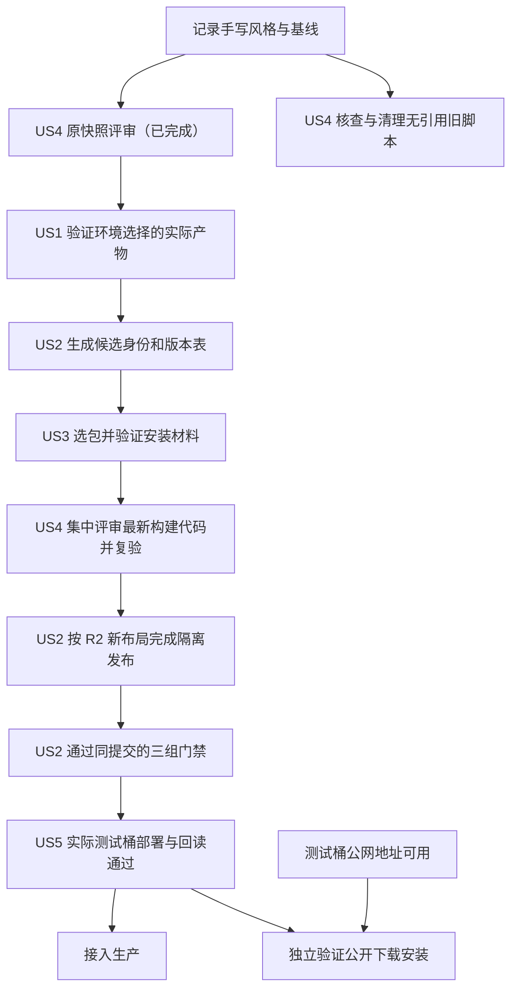
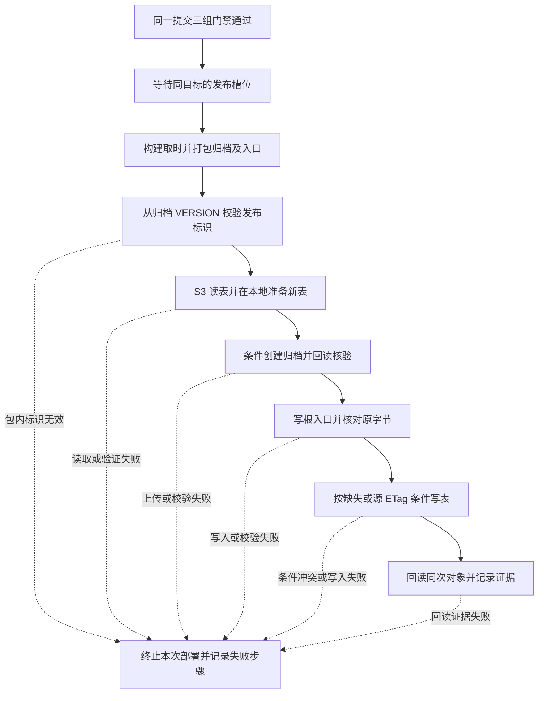

# 对话经过

会话 `01a21a76-8718-7f82-9ea7-2a40f8dbb35d` · 轮次 `01a21b05-a140-7552-a7bb-7116c110b997`

<!-- foundry-detail 01a21a76-8718-7f82-9ea7-2a40f8dbb35d 01a21b05-a140-7552-a7bb-7116c110b997 -->
<!-- foundry-event 4aa1bf4088f6ff4c8f7f007b7624c59e04d1ffffe797a86014ebb782bd1f52d9 -->
## 进度原话

- 来源定位：字节 6702787

~~~text
我按你说的流程核对现有发布步骤，并用 `task-increment` 看把逻辑放进流水线后，T010 的任务和依赖要怎么调整。
~~~

<!-- foundry-event b7916b23dd15b0ba01417c998c5b529b9292ef8e413104452a88c148d7c84711 -->
## 宿主命令执行

- 来源定位：字节 6705906

~~~text
{
  "command": "[已省略环境变量值] -lc 'nl -ba .github/workflows/skills-deploy-common.yml'",
  "workdir": "file:///home/ena/workspace/ena/agent-foundry/feature/init",
  "exitCode": 0,
  "status": "completed"
}
~~~

<!-- foundry-event 8fd99d73d64854d852284cbb9e8908474f332f1dacfe58088d6f6cc8400cb9c7 -->
## 工具结果 `exec-d1776c68-f467-43e6-85e1-0956dc47ce43`

- 来源定位：字节 6705906

~~~text
     1	name: skills-deploy-common
     2	
     3	on:
     4	  workflow_call:
     5	    inputs:
     6	      target:
     7	        description: 部署目标，release 或 prod
     8	        required: true
     9	        type: string
    10	    secrets:
    11	      SKILL_DEPLOY_R2_ACCESS_KEY_ID:
    12	        required: true
    13	      SKILL_DEPLOY_R2_SECRET_ACCESS_KEY:
    14	        required: true
    15	
    16	concurrency:
    17	  group: deploy-common-${{ inputs.target }}
    18	  cancel-in-progress: true
    19	
    20	permissions:
    21	  contents: read
    22	
    23	jobs:
    24	  build:
    25	    name: 构建并上传技能产物
    26	    runs-on: ubuntu-24.04
    27	    environment: ${{ inputs.target }}
    28	    env:
    29	      R2_CONFIG_PREFIX: ${{ inputs.target == 'release' && 'SKILL_DEPLOY_RELEASE_R2' || 'SKILL_DEPLOY_R2' }}
    30	    steps:
    31	      - name: 检出触发提交
    32	        uses: actions/checkout@v4
    33	        with:
    34	          ref: ${{ github.sha }}
    35	          persist-credentials: false
    36	
    37	      - name: 准备 mise 工具链
    38	        uses: jdx/mise-action@v5
    39	        with:
    40	          cache: 'false'
    41	
    42	      - name: 无锁安装工作区依赖
    43	        run: pnpm install --no-lockfile --ignore-scripts
    44	
    45	      - name: 构建技能包依赖
    46	        env:
    47	          pnpm_config_lockfile: 'false'
    48	          pnpm_config_verify_deps_before_run: 'false'
    49	        run: pnpm --filter '@foundry/skills^...' run build
    50	
    51	      - name: 构建技能包
    52	        env:
    53	          pnpm_config_lockfile: 'false'
    54	          pnpm_config_verify_deps_before_run: 'false'
    55	        run: pnpm --filter @foundry/skills run build --mode release
    56	
    57	      - name: 打包技能产物
    58	        shell: bash
    59	        working-directory: packages/skills/dist
    60	        run: |
    61	          find . -type f -printf '%P\0' | LC_ALL=C sort -z |
    62	            tar -czf ../skills.tar.gz --null --files-from=-
    63	
    64	      - name: 记录归档 SHA-256
    65	        shell: bash
    66	        run: sha256sum packages/skills/skills.tar.gz >> "$GITHUB_STEP_SUMMARY"
    67	
    68	      - name: 上传到 R2
    69	        shell: bash
    70	        env:
    71	          R2_ACCOUNT_ID: ${{ vars[format('{0}_ACCOUNT_ID', env.R2_CONFIG_PREFIX)] }}
    72	          R2_BUCKET_NAME: ${{ vars[format('{0}_BUCKET_NAME', env.R2_CONFIG_PREFIX)] }}
    73	          AWS_ACCESS_KEY_ID: ${{ secrets.SKILL_DEPLOY_R2_ACCESS_KEY_ID }}
    74	          AWS_SECRET_ACCESS_KEY: ${{ secrets.SKILL_DEPLOY_R2_SECRET_ACCESS_KEY }}
    75	          AWS_DEFAULT_REGION: auto
    76	          AWS_EC2_METADATA_DISABLED: 'true'
    77	        run: |
    78	          : "${AWS_ACCESS_KEY_ID:?缺少 R2 Access Key ID}" "${AWS_SECRET_ACCESS_KEY:?缺少 R2 Secret Access Key}"
    79	          export AWS_ENDPOINT_URL_S3="https://${R2_ACCOUNT_ID:?缺少 R2 账号 ID}.r2.cloudflarestorage.com"
    80	          destination="s3://${R2_BUCKET_NAME:?缺少 R2 桶名}/$GITHUB_SHA/$GITHUB_RUN_ID-$GITHUB_RUN_ATTEMPT"
    81	          version="$(jq -er '.packageVersion | strings | select(length > 0)' packages/skills/dist/VERSION)"
    82	
    83	          aws s3 cp packages/skills/skills.tar.gz "$destination/skills-$version.tar.gz" --no-progress
    84	          aws s3 cp packages/skills/dist/curl/install.sh "$destination/curl/install.sh" --no-progress
    85	          printf '技能产物已上传至 `%s/`。\n' "$destination" >> "$GITHUB_STEP_SUMMARY"

~~~

<!-- foundry-event 166a8d0d958b65fc8ed1a530019330207c4976b15542cf903c5c62eb4c1c9b5a -->
## 宿主命令执行

- 来源定位：字节 6710563

~~~text
{
  "command": "[已省略环境变量值] -lc 'rg --files -g AGENTS.md -g '\"'\"'!node_modules'\"'\"' -g '\"'\"'!**/node_modules/**'\"'\"' -g '\"'\"'!**/.git/**'\"'\"' .github specs packages/skills .agents'",
  "workdir": "file:///home/ena/workspace/ena/agent-foundry/feature/init",
  "exitCode": 1,
  "status": "failed"
}
~~~

<!-- foundry-event 177191aebb506b230d567d709c975028e219daf58e911c9fdc8015f20fbd0b79 -->
## 工具结果 `exec-35eab2c0-81a1-4338-a693-06ead80696dd`

- 来源定位：字节 6710563

~~~text

~~~

<!-- foundry-event 5986381f622b9392a72f2fc6744c141253aa22750ca53656f61c067b7e6d4ff2 -->
## 宿主命令执行

- 来源定位：字节 6711472

~~~text
{
  "command": "[已省略环境变量值] -lc 'cat .agents/skills/task-increment/SKILL.md .agents/skills/speckit-modes-increment/SKILL.md'",
  "workdir": "file:///home/ena/workspace/ena/agent-foundry/feature/init",
  "exitCode": 0,
  "status": "completed"
}
~~~

<!-- foundry-event b2cf3343cb9ab9de2b582ccb1fe8f76b86d3032afc254d461258a5d5a29fdaf7 -->
## 工具结果 `exec-08d36d49-c4f5-49b1-a713-b5881fbbdde0`

- 来源定位：字节 6711472

~~~text
---
name: task-increment
description: 用户在已有 Spec Kit 方案上需要规划或增量调整业务闭环、任务拆分、依赖或推进顺序时使用。仅修订 Spec 的需求定义、业务规则或验收表述且不涉及实施规划变化时不使用。
destructive: false
---

# 增量规划

本技能只推进规划。先读取已有材料，再决定允许写入哪些文件；规划保存成功不代表业务实现、工程验收或用户学习通过。

## 先核对是否需要实施规划

按用户实际要改变的内容及已知上下文判断，不将“调整需求”当成固定规划口令。有描述但尚未说明改什么时，只补必要澄清，不猜测修改内容或按无描述分支重排任务；明确的无描述规划请求仍沿原分支处理。

仅修订已有Spec且不改变实施规划时，不进入下文规划分支：将请求交回调用方沿已确认范围修订原Spec，不以缺少plan、mvu或Task阻止该文档修订，也不为此补建规划材料、创建新功能或要求先有单Task实施方案。已有下游可读取核对影响，但无变化就保持；仅某Task的验收或实现说明受影响时，只衔接相关记录，不据此重写未变的MVU。

确实需要改变闭环、拆分、依赖或执行顺序时，才进入本技能并应用下述规划前置。需求定义同时变化，先沿目标项目治理保存获确认的原始变更及必要摘要、修订原Spec，再规划真正受影响的部分；需求本身未变则不顺带改Spec。规划不自动进入代码，实际实施仍按目标项目原Task准备与认可条件执行，不在这里另造分派入口。

## 定位与约束

1. 当前适用已初始化的 Spec Kit 项目。读取目标项目的 `.specify/memory/constitution.md` 和已有操作约定，遵循其中的任务、历史保护与续接规则；不在技能内另建一套任务状态规则。项目或必要治理不可用时说明缺项及继续条件，不自动初始化。
2. 入口定位 Spec，不接受 Task 定位参数。优先使用用户明确指定的 Spec/材料路径，再使用项目现有指针或唯一可确定的上下文。指针失效时检索已有材料，只有唯一匹配才说明依据后续接；有歧义时补问必要定位信息，不猜归属或改指针掩盖问题。
3. 读取需求、方案、闭环详情、任务及其引用的实际证据，记录本次目标、原任务 ID/状态/验收和可写范围。在 plan 同级明确检查 `mvu.md`，不能仅凭文件发现清单判断其不存在。复用现有材料；不得重置历史或把已完成事实重新规划成新任务。

## 可选规划描述

调用由 Spec 定位和可选自由文本规划描述组成，不要求固定格式。先区分定位与描述：未提供文字、空白或仅 Spec 定位时走原材料分支，不要求补写，也不把上轮聊天当本轮新指令；仍读取已保存的有效方案和事实。含义不明的文字应说明疑问，不静默丢弃。进入实施规划范围后，有描述和无描述两条分支均须有 plan。

收到明确旧式 Task 定位（如 `Task:T005`）时，说明该参数已不受支持，请调用方改用 Spec 加业务规划描述；未明确当前意图前不据旧参数写规划，也不静默删除参数后全量重排。自由描述中提及已有 Task 可作为项目现状、职责和依赖引用，结合业务结果判断调整范围，不把这些引用一并拒绝。无关任务和已完成事实保留，不因 Spec 定位而重排整份清单。

有描述时按以下顺序工作：

1. 从原文提取业务优先级、验收衔接、步骤偏好和范围约束；实际读取需求、方案、已有闭环、任务、相关实现及证据。核对角色/权限边界、必要前置、主要及失败路径、验收是否支持目标。
2. 对照项目补全遗漏，分清用户原意、项目事实、AI 补充与待确认假设，并引用依据。已有确认直接复用；影响范围、权限、验收或关键依赖的未知，列明问题及影响后只暂停受影响规划。与正式要求或必要验证冲突时，指出具体依赖和最小调整建议；需变更需求或推进约定时，先按治理确认并同步上游，再落实下游，不暗改用户方向。
3. 先形成可观察、可验收的小业务 MVU，再生成或调整 Task。一个服务可以有多个闭环，技术层不是业务 MVU。用户给出的步骤链在每个适用闭环内展开：已有实现和证据复用，不适用层说明理由；不为凑层新增页面或测试框架。保留用户要求的验收后再推进关系，不能先横向做完所有模块的数据层才反馈。
4. 将原意来源、补全/调整理由、最终 MVU 与 Task 对应及待确认事项，写入项目已有需求/方案/闭环/任务的相关段落。普通细化沿有效授权，业务需求变化先确认并同步规格；tasks 保持轻量，详细实施思路留到实际开工前讨论。保存遵循后文顺序和保护规则，规划不自动进入实施。

例如用户提出“权限验收后记账、再日程，按表设计→service→接口→测试页面→正式页面推进”，先结合该项目确定权限的小业务结果和验收，再展开相关任务；已有权限 service 直接复用。该例不是所有项目的业务顺序或每条闭环必做的五层模板。

无实质变化保持原文件；换描述或恢复时对照已保存材料，仅更新必要安排并保留原依据、身份、完成事实和证据。先 MVU 后 Task 的规划过程与保存、分析结果分别报告。已有 Task 用于现状和职责关联，不构成独立入口或对后续实施的授权。

## 需求原文与简洁摘要

读取所属Spec已有的简洁需求摘要/导航和当前有效要求，需要核对变化或纠正时沿链接追溯原始输入、讨论及确认；摘要用于定位，不代替正式定义。本轮描述与现行要求不同，先区分实质需求变化、既有目标内的规划调整和普通进度，不能把AI补全或上轮聊天默认为新的用户要求。

在材料前置满足且本次获授权写入的分支中，实质变化按目标项目治理和既有布局保留本次可见原始输入、可知来源及实际日期，默认requirements/raw；已有相同原文直接引用。AI建议、讨论和润色提示词按职责另存，不能覆盖或冒充原话及认可；未知来源/日期或不可见历史明确说明。简洁摘要用短段说明问题、解决方向、本次变化、确认或待定和日期，链接原文、必要讨论及当前有效要求；可复用requirements/README.md，不复制完整规格或创建固定字段/文件注册。新材料按实际用途归类，不批量迁移无关Spec。

先保存、检查并读回原文和必要讨论，再同步摘要及获确认的受影响上游，之后按原规则落实MVU和Task。未确认的实质变化保留待定，不据此改写有效范围或越过必要前置。无实质变化、重复调用或仅问进度不重复归档、强造原文；无plan仍按材料分支停止规划写入。任一步失败按保存与恢复规则报告已写/未写和受影响引用，恢复时重读实际文件，仅补未完成部分，不凭记忆覆盖来源。

## 既有画像的参考

沿目标项目已有治理定位当前画像或协作理解摘要，主要读取当前有效描述；需要核对纠正、来源或适用情境时再追溯相关结论和讨论，不要求每轮重读全部日志。画像帮助理解协作方式、步骤偏好和推荐理由，实际需求、代码、依赖、授权及技术验证仍以项目事实为准；两者冲突时说明依据，不用画像改写需求或跳过前置。

没有已有画像时依据有效材料继续规划，不强制建档或推测个人偏好。形成新的有效认识时按目标项目既有记录约定处理；普通任务选择、无描述请求或读取成功本身不构成新结论，不为本轮规划强造画像。这里不规定个人文件名或跨仓库路径，不把来源仓库的用户资料复制到目标项目。

## 按实际材料选择路径

| 材料状态                               | 本次动作                                                                                                                                            |
| -------------------------------------- | --------------------------------------------------------------------------------------------------------------------------------------------------- |
| 无 plan，包含仅有孤立 mvu/tasks 的情况 | 说明缺少方案前置，停止规划写入，建议先完成方案规划；不代建 plan/tasks，不实现业务。                                                                 |
| 有 plan，无 tasks                      | 在 mvu 或已有等价详情中整理闭环，plan 保存一处文件级链接、总体顺序及必要前置；按项目原生格式生成 tasks，再补齐真实 Task 职责。                      |
| 有 plan 和 tasks                       | 先读取 mvu；尚未迁移时读取原 plan 详情。核对实现与证据，补齐闭环及任务缺口，按新的业务顺序同步重组任务正文；保留原 ID、完成标记、目标、范围和验收。 |

## 业务闭环与推荐依据

闭环以用户能观察的业务结果划分，可以只覆盖原 Task 的局部职责，不要求每个闭环贯穿所有技术层。每次推荐写清以下内容，已有方案覆盖时直接引用并补缺：

| 原则         | 推荐中必须说明的内容                                                             |
| ------------ | -------------------------------------------------------------------------------- |
| 有业务意义   | 谁在什么情境获得什么结果；技术联通、建表或文件生成仅作为前置，不能代替业务结果。 |
| 可验收       | 具体输入、操作和可观察的成功/失败信号，以及原 Task 验收如何保留。                |
| 范围适合推进 | 本次最小可推进范围、暂缓内容及理由；不为凑完整链路增加未授权业务。               |
| 顺序有依据   | 推荐顺序、必要依赖、可独立推进部分，以及风险、真实反馈或条件变化后如何调整推荐。 |

检查原方案是否只按“全部数据层、全部接口、最后界面”批量推进，或过晚才能得到业务反馈。依据真实依赖、风险和反馈解释取舍，不把推荐包装成唯一粒度或固定顺序。用户思路或画像依据不足时，给出有理由的建议，标明待反馈事项，不虚构偏好、接受或验证结果。

## 技术前置与骨架复用

规划时主动逐项扫描 C1～C4，并在细化时核对现有证据的适用范围：C1 无使用先例的新依赖/框架/协议；C2 外部系统失败模式未验证；C3 高风险条件未经证实；C4 首次跨包或跨进程契约。记录命中事实；无命中或复用已有验证时也说明依据，用户熟悉技术不能替代证据。豁免条件遵循目标项目治理。

每项必要技术验证写入关联业务闭环的前置 Task 或原 Task 内步骤，包含可证伪假设、具体输入、可核验信号、已有/待补证据及下游依赖。验证通过前不填充依赖该假设的业务；失败记录实际证据并调整路线，只阻断依赖下游，无关工作仍可推进。保留通过的原文件与最小骨架，后续在其上增量填充并复验原技术信号，再独立验收业务结果；技术通过不自动完成业务闭环。

## 增量写法

- Spec Kit 项目由同级 `mvu.md` 集中保存业务闭环详情。plan 的闭环导航只用一处文件级链接：`闭环详情见 [mvu.md](mvu.md)。` 总体方案、推荐顺序和依赖用方案文字说明；逐条 MVU 标题/索引、锚点跳转和 Task 范围列表集中在 mvu/tasks，plan 不再列出。每条详情用几小段说明**闭环结果、节点与关键逻辑、关联 Task 及各自职责、验收信号**；必要范围、顺序理由和技术前置可简述或引用已有依据，不强制完整设计、全分支图或复制 Task 八栏目。
- 每条采用一个稳定标题，标题下先写“状态＋依据”，再接四个详情短段，段首分别为“闭环结果”“节点与关键逻辑”“关联 Task”“验收信号”。结果说明本次局部价值；节点用紧凑顺序或必要判断串起；Task 段说明各自职责；信号段给出具体操作与可观察结果。范围或技术前置在相关短段简述或链接现有方案/验证依据，详细实施方案在实际开工前另存，避免把闭环或任务清单扩成完整功能设计。
- 已有 mvu 先复用原编号、标题和有效内容；尚无 mvu 时读取原 plan 详情并按本次范围迁出，保留原闭环定位在 mvu 中。保存详情后，将 plan 的逐条详情或索引合并为上述一处文件级链接；核对指向旧 plan 锚点的实际引用，在授权范围内改为 mvu 中的对应位置，保留任务与证据事实。不能修改的引用说明位置、影响及恢复条件，不以残留逐条索引掩盖未完成迁移。plan 已是导航时不重新导入为详情；两份活动详情冲突先核对来源与影响，只处理可确定的范围，不凭时间戳覆盖。
- 产物沿用本次授权的 plan、mvu、tasks 及必要引用；历史保护使用项目已有历史材料或版本记录，不自动新建 `plan.history.md` 或其他整份方案快照。既有历史文件不因这条规则自动删除或重写，迁移时保留有效技术方案、原 Task 要求、完成事实及历史证据。
- 闭环及节点不建立独立工程身份或 checkbox；MVU 状态仅展示下节规定的事实摘要。已有 Task 引用真实 ID 并说明职责；任务尚未生成时明确关联待补，生成后补齐实际 ID/职责。一个 Task 可被多闭环引用，工程完成仍按该 Task 原验收判断，不从关联关系自动汇总。
- 写前扫描既有验证单元和全部任务 ID（包括保留历史），先复用覆盖同一目标的条目；只有实际缺口才新增，使用未占用 ID。步骤细化遵循目标项目治理，保留原任务身份及要求。
- 失效规划注明原条目、替代条目及原因，保留历史来源；目标、范围或验收需要变化时先说明影响并按项目治理确认，不把调整做法当成改写已完成事实的授权。
- 对照需求确认没有遗漏原验收；计划、任务和证据引用必须可定位。新增或细化实施任务保持未完成，不能因规划完成勾选。
- 生成或更新任务清单时读取并遵循目标项目的末尾收尾约定，先核对等价未完成收尾 Task 的覆盖与复用；清理范围、局部内容保护、用途待核实项和结案条件均由目标治理决定，不在技能中复制本仓库的完整清理规则，也不因规划而执行清理。
- 重复调用或恢复时重新读取磁盘材料和证据，根据已保存内容继续；不依据聊天记忆重复追加单元/任务，不用新的状态文件管理进度。

## 轻量任务与实施方案

任务条目保存稳定 ID、简洁目标、必要范围/约束/依赖、可核验的整体验收及唯一工程 checkbox；这些是信息职责，不是固定八栏目。先确定 MVU 的业务结果和关系，再把实际工程缺口映射到 Task，不在规划阶段预先填满实现步骤或批量创建方案文件。

实际开工前沿项目治理讨论并保存单 Task 方案，默认位于所属 Spec 的 `implementation/<Task ID>.md`，由原任务链接；详细逻辑和重要工程安排在该方案中维护，规划完成不代表已有实施认可。已有方案、原任务要求和历史完成事实继续保留，只在本次允许修改范围增量衔接，不为换格式重开或删除已完成任务。

## MVU 状态

每条标题下用一行保存 `**状态**：未开始。**依据**：尚无本闭环实施记录，关联职责待任务生成补齐。` 已有任务或证据时改写为真实依据，引用对应 Task、步骤或验收记录；保留后面的四项详情。状态只取以下五种：

| 状态   | 判定依据                                                                                                               |
| ------ | ---------------------------------------------------------------------------------------------------------------------- |
| 未开始 | 本闭环职责尚无实施记录；仅完成规划或生成任务仍属此状态。                                                               |
| 进行中 | 本闭环已有实际推进，仍有实现或修订工作可继续；未勾选 Task 内已完成的步骤也可作为依据。                                 |
| 待验收 | 本闭环所需实现已具备，仍缺按验收信号执行的闭环验证或结论；单独组件/技术验证通过不足以标已通过。                        |
| 已通过 | 已有覆盖本闭环验收信号的实际通过证据，且未出现使其失效的新结果；引用该证据。                                           |
| 受阻   | 真实障碍使本闭环当前必要下一步无法继续；依据写明障碍、影响及恢复条件。仍有可独立推进的部分时保持进行中并说明局部阻塞。 |

按本闭环的具体职责和实际证据判断，不按所有关联 Task 的勾选数量机械汇总；共享 Task 在其他闭环的进度不能证明本闭环已推进或已通过。全部关联 Task 勾选也不能代替闭环验收证据，局部闭环通过也不反向勾选覆盖范围更大的 Task。迁移、增量规划及任务生成后核对状态；相关任务/步骤、验收结果或阻塞条件变化，以及中断恢复时，重新读取来源并在授权保存范围内更新状态与依据。无新事实则保持稳定；新结果推翻旧结论时保留原证据和变更原因，不沿用失效的已通过。

状态是阅读摘要，tasks 与实际证据仍是判定来源，不新增状态文件、独立状态服务、完成比例或并行工程 checkbox。材料不足时写清待核实的依据和影响，不猜测实施已开始或验收已通过；已有摘要无法核实时标明未复核，不伪造状态转移。只读分析只报告不一致，不借核对状态修改材料。

## 任务正文的重组与边界

MVU 改变了有效任务的分组或推进顺序时，将变化落实到任务清单正文。概览、映射表或“建议下一步”只能辅助阅读，不能让正文继续表达旧的执行路径。任务身份与历史需要稳定，未完成任务的旧位置不因此固定。

1. 对照本次 Spec 与规划描述的授权范围，把有效待办关联到业务结果，识别必要技术前置、共享任务、暂缓工作和已完成的可复用事实。已有 Task 作为现状和职责依据，只调整与本轮业务结果有必要关联的范围，不借局部规划重排整个项目。
2. 先满足真实依赖，再按尽早获得可验收业务结果的推荐顺序，移动完整原 Task 区块并更新所属分组、有效阶段导航和依赖说明。编号只作身份，不按新位置重新编号；原目标、范围、验收、项目要求的字段及证据随区块保留，已确认的阶段批准点不被静默删除或越过。
3. 共享前置只放一处，各闭环引用同一个 Task。跨闭环依赖允许任务不连续，不为凑分组复制工程状态、拆散原交付或把共同前置重复规划。保留已完成及归档内容，不能将它们重新列成待办。
4. 保存前比较原身份/完成事实、验收覆盖和引用；核对新正文的可执行顺序、下一组任务、技术阻塞边及末尾收尾。确认未引入循环、断链或重复条目，旧分组与新正文冲突的导航一并更新。重复调用以已保存正文为准，无实际变化时保持稳定。

按实际材料处理不适合移动的部分：

| 核查结果                                                      | 处理方式                                                                                                                                                  |
| ------------------------------------------------------------- | --------------------------------------------------------------------------------------------------------------------------------------------------------- |
| 原正文已经符合本次闭环、依赖和有效阶段安排                    | 复用原顺序；无其他缺口时不改 tasks，不为记录“检查过”追加无信息章节。                                                                                      |
| 阶段/外部执行约定明确固定某区段，或有其他执行者正在写入该范围 | 保持该段原位与事实，说明具体位置、约束依据和解除条件；重组不受约束的部分。需要改变已确认安排时先列影响并取得对应确认，不把已有 Phase 标题本身当冻结依据。 |
| 循环依赖、身份冲突或必要材料缺失，无法安全确定局部顺序        | 指出冲突 Task、缺失依据及影响边界，不猜顺序、不偷偷删除依赖；只暂缓相关重排，其他有依据的部分继续。核对或确认后再从原身份续接。                           |
| 保存或格式检查受阻                                            | 按下节报告已写/未写与恢复入口，停止依赖该保存结果的动作；不改权限、替换保护文件或伪报已经重排。                                                           |

保留或暂缓必须对应可核实的约束，输出受影响范围、当前仍可推进的路径和继续条件。编号不连续、旧技术分组、跨闭环共享或依赖较多，都不构成整份清单保持旧序的理由；局部受限不能报告为全量完成，也不能无依据阻止其他调整。

## 保存与恢复

1. 先核对可写范围与原 Task/证据，复用项目已有历史来源；先保存闭环详情并检查格式、读回，再收敛 plan 为一处文件级链接并更新总体推荐顺序，最后保存获授权的任务及其他引用，并依实际任务/证据核对 mvu 的状态＋依据。逐份核对引用、覆盖与原 ID/状态/验收/证据，确认每条 MVU 状态有依据、plan 无逐条 MVU 索引或 Task 范围列表，且未自动增加整份方案快照，才报告本轮规划保存成功。无实际变化时不为表示“检查过”改写文件。
2. 任一保存、格式检查或读回失败，停止受影响的后续动作。报告具体失败、已写入与未写入部分、尚未一致的引用及恢复入口；不宣称原子回滚、全部保存或验证通过。
3. 不通过改权限、替换受保护文件或绕过项目限制来掩盖失败。障碍解除后，从实际已保存材料恢复，只补未完成写入与检查，复用已建立的单元和任务身份。
4. 规划同步、格式检查及读回成功后，显式加载并调用同一 `artifact-spec-analysis` 技能刷新分析。传入最新需求/确认、spec、plan 总体方案与推荐顺序、同级 mvu 的实际路径及有效详情、tasks、必要证据、已有分析索引和目标位置；未迁移的旧详情说明兼容来源。消费者须明确读取同级 mvu，不依赖 plan 的逐条索引或文件发现清单；实际打开并核对四项和职责，不以发现文件代替消费。分析引用有效详情，不保存另一份活动 MVU 定义。沿用目标项目布局，不另写分析生成器或注册 after_increment。
5. 该分析技能尚未交付或当前环境不可用时，分别报告“规划已保存”和“分析阶段未完成”及影响，不虚报整次成功，也不以其他分析代替。可用时实际核对其保存结果；失败报告已写/未写及恢复入口，只阻断依赖分析结果的动作。重复或恢复先核对原分析和已保存材料，再调用同一能力补齐，不凭时间戳制造变化。
6. 输出本次材料路径、推荐及依据、正文分组/顺序的实际变化或保留理由、当前下一组任务、规划与分析各自的校验结果及未完成项。局部受限列明范围、约束和继续条件。未经授权不进入业务实现、安装、挂载或其他外部操作；后续步骤须以真实保存结果为前置。
---
name: speckit-modes-increment
description: 用户在已有 Spec Kit 方案上需要规划或增量调整业务闭环、任务拆分、依赖或推进顺序时使用。仅修订 Spec 的需求定义、业务规则或验收表述且不涉及实施规划变化时不使用。
compatibility: Requires spec-kit project structure with .specify/ directory
metadata:
  author: github-spec-kit
  source: modes:commands/increment.md
---

完整读取项目内的 .agents/skills/task-increment/SKILL.md，遵循该技能及其所需附件处理本次请求。

本入口只调用已安装技能一次，不复制另一套业务；若本次调用已执行该技能则沿用结果，源技能不得再次调用本入口。

用户输入：$ARGUMENTS
~~~

<!-- foundry-event 387a306614f6a33342ca91d606c6d65dc5a6caa5321c832e2cc484a6e144c221 -->
## 宿主命令执行

- 来源定位：字节 6737726

~~~text
{
  "command": "[已省略环境变量值] -lc 'git status --short --branch'",
  "workdir": "file:///home/ena/workspace/ena/agent-foundry/feature/init",
  "exitCode": 0,
  "status": "completed"
}
~~~

<!-- foundry-event e84a309794702c9860999cda9b05f5a27a8a7488769c7b28a1653a774633852c -->
## 工具结果 `exec-d9bbae88-adb9-4cfc-8844-b88cfffe9510`

- 来源定位：字节 6737726

~~~text
## feature/init...origin/feature/init [ahead 1]
 M .codex/hooks.json
 M .github/workflows/skills-deploy-common.yml
 M .specify/memory/conversation-recording/records/2026-11-26/01a2174d-dd90-74b1-8444-b2b62149b17b.md
 M packages/skills/build/plugins/vite-plugin-version/index.ts
 M packages/skills/package.json
 M packages/skills/src/profile/conversation-recording/SKILL.md
 M packages/skills/src/profile/conversation-recording/install.py
 M packages/skills/src/profile/conversation-recording/recording/__init__.py
 M packages/skills/src/profile/conversation-recording/recording/events.py
 M packages/skills/src/profile/conversation-recording/recording/record.py
 M packages/skills/src/profile/conversation-recording/references/recording-timing.md
 M packages/skills/src/profile/conversation-recording/references/session-scope.md
 M packages/skills/src/profile/conversation-recording/scripts/post_tool_use.py
 M packages/skills/src/profile/conversation-recording/scripts/stop.py
 M packages/skills/src/profile/conversation-recording/scripts/user_prompt_submit.py
 M packages/skills/src/profile/conversation-recording/template/record.md
 M packages/skills/tests/conversation-workflow/helpers/recording-hook-probe.py
 M packages/skills/tests/test_conversation_recording.py
 M packages/skills/tests/test_register_commands.py
 M pnpm-workspace.yaml
 M specs/docs/001-docs-site-framework/tasks.md
 M specs/skills/002-conversation-to-skill/analysis/recording-acceptance.md
 M specs/skills/002-conversation-to-skill/analysis/spec-analysis/README.md
 M specs/skills/002-conversation-to-skill/diagrams.md
 M specs/skills/002-conversation-to-skill/mvu.md
 M specs/skills/002-conversation-to-skill/plan.md
 M specs/skills/002-conversation-to-skill/quickstart.md
 M specs/skills/002-conversation-to-skill/spec.md
 M specs/skills/002-conversation-to-skill/tasks.md
 M specs/skills/003-skills-release-pipeline/analysis/spec-analysis/README.md
 M specs/skills/003-skills-release-pipeline/contracts/build-and-publish.md
 M specs/skills/003-skills-release-pipeline/data-model.md
 M specs/skills/003-skills-release-pipeline/diagrams.md
 M specs/skills/003-skills-release-pipeline/implementation/T008.md
 M specs/skills/003-skills-release-pipeline/mvu.md
 M specs/skills/003-skills-release-pipeline/plan.md
 M specs/skills/003-skills-release-pipeline/quickstart.md
 M specs/skills/003-skills-release-pipeline/research.md
 M specs/skills/003-skills-release-pipeline/spec.md
 M specs/skills/003-skills-release-pipeline/tasks.md
?? .specify/memory/conversation-recording/records/2026-11-27/
?? packages/skills/src/profile/conversation-recording/recording/subagents.py
?? packages/skills/src/profile/conversation-recording/recording/timeline.py
?? packages/skills/src/profile/conversation-recording/scripts/subagent_stop.py
?? packages/skills/tests/distribution/vite-plugin-version.test.mjs
?? specs/docs/001-docs-site-framework/analysis/figma-conversion.md
?? specs/docs/001-docs-site-framework/implementation/
?? specs/skills/002-conversation-to-skill/analysis/acceptance/subagent-recording-code-mode.json
?? specs/skills/002-conversation-to-skill/analysis/acceptance/subagent-recording-timeline.json
?? specs/skills/002-conversation-to-skill/analysis/acceptance/t038-subagent-timeline.json
?? specs/skills/002-conversation-to-skill/analysis/subagent-recording-timeline.md
?? specs/skills/002-conversation-to-skill/implementation/T038.md
?? specs/skills/002-conversation-to-skill/requirements/raw/2026-11-27-recording-subagent-stop-hook.md
?? specs/skills/003-skills-release-pipeline/implementation/T009.md
?? specs/skills/003-skills-release-pipeline/requirements/raw/2026-11-27-release-timestamp-source.md

~~~

<!-- foundry-event a16190762e434f655991cafc849f376957e3905079e152ab5c44a433932af003 -->
## 工具调用 `Bash` · `exec-d1776c68-f467-43e6-85e1-0956dc47ce43`

- 来源定位：工具事件 exec-d1776c68-f467-43e6-85e1-0956dc47ce43

~~~text
工作目录：/home/ena/workspace/ena/agent-foundry/feature/init
{
  "command": "nl -ba .github/workflows/skills-deploy-common.yml"
}
~~~

<!-- foundry-event 6e22676ac6c4be044ba5f6bf3c2bcb30ab386152bb781b7ba5f81a93e8d60c70 -->
## 工具调用 `Bash` · `exec-35eab2c0-81a1-4338-a693-06ead80696dd`

- 来源定位：工具事件 exec-35eab2c0-81a1-4338-a693-06ead80696dd

~~~text
工作目录：/home/ena/workspace/ena/agent-foundry/feature/init
{
  "command": "rg --files -g AGENTS.md -g '!node_modules' -g '!**/node_modules/**' -g '!**/.git/**' .github specs packages/skills .agents"
}
~~~

<!-- foundry-event 277c52dbf5a1b81f3ee06f252a59292ae1361b6900821b48b3cbab5596ed3706 -->
## 工具调用 `Bash` · `exec-08d36d49-c4f5-49b1-a713-b5881fbbdde0`

- 来源定位：工具事件 exec-08d36d49-c4f5-49b1-a713-b5881fbbdde0

~~~text
工作目录：/home/ena/workspace/ena/agent-foundry/feature/init
{
  "command": "cat .agents/skills/task-increment/SKILL.md .agents/skills/speckit-modes-increment/SKILL.md"
}
~~~

<!-- foundry-event 7fcffb01cb99920e6c22ddd346044589e83d4df6e28aa59d1593de4444c8cd28 -->
## 工具调用 `Bash` · `exec-d9bbae88-adb9-4cfc-8844-b88cfffe9510`

- 来源定位：工具事件 exec-d9bbae88-adb9-4cfc-8844-b88cfffe9510

~~~text
工作目录：/home/ena/workspace/ena/agent-foundry/feature/init
{
  "command": "git status --short --branch"
}
~~~

<!-- foundry-event 3f2c80fc89006287f783ea54a5d919df11cbb1f093f906badce70985770d9401 -->
## 工具调用 `exec` · `call_1598d895da6b4d9cad3fcfe7e72ca70d`

- 来源定位：字节 6703785

~~~text
工作目录：/home/ena/workspace/ena/agent-foundry/feature/init
// @exec: {"max_output_tokens": 6600}
const commands = [
  {cmd:"git status --short --branch", max_output_tokens:2000},
  {cmd:"rg --files -g AGENTS.md -g '!node_modules' -g '!**/node_modules/**' -g '!**/.git/**' .github specs packages/skills .agents",max_output_tokens:800},
  {cmd:"cat .agents/skills/task-increment/SKILL.md .agents/skills/speckit-modes-increment/SKILL.md",max_output_tokens:4200},
  {cmd:"nl -ba .github/workflows/skills-deploy-common.yml",max_output_tokens:3400}
];
const result = await Promise.allSettled(commands.map(options => tools.exec_command(options)));
for (const item of result) text(item.status === "fulfilled" ? item.value.output : String(item.reason));

~~~

<!-- foundry-event 930a5fddb1cbc343437618c9acd3b17deb549b67c54f46f12ae09bdae5d13481 -->
## 工具结果 `call_1598d895da6b4d9cad3fcfe7e72ca70d`

- 来源定位：字节 6742171

~~~text
[
  {
    "type": "input_text",
    "text": "Script completed\nWall time 5.2 seconds\nOutput:\n"
  },
  {
    "type": "input_text",
    "text": "## feature/init...origin/feature/init [ahead 1]\n M .codex/hooks.json\n M .github/workflows/skills-deploy-common.yml\n M .specify/memory/conversation-recording/records/2026-11-26/01a2174d-dd90-74b1-8444-b2b62149b17b.md\n M packages/skills/build/plugins/vite-plugin-version/index.ts\n M packages/skills/package.json\n M packages/skills/src/profile/conversation-recording/SKILL.md\n M packages/skills/src/profile/conversation-recording/install.py\n M packages/skills/src/profile/conversation-recording/recording/__init__.py\n M packages/skills/src/profile/conversation-recording/recording/events.py\n M packages/skills/src/profile/conversation-recording/recording/record.py\n M packages/skills/src/profile/conversation-recording/references/recording-timing.md\n M packages/skills/src/profile/conversation-recording/references/session-scope.md\n M packages/skills/src/profile/conversation-recording/scripts/post_tool_use.py\n M packages/skills/src/profile/conversation-recording/scripts/stop.py\n M packages/skills/src/profile/conversation-recording/scripts/user_prompt_submit.py\n M packages/skills/src/profile/conversation-recording/template/record.md\n M packages/skills/tests/conversation-workflow/helpers/recording-hook-probe.py\n M packages/skills/tests/test_conversation_recording.py\n M packages/skills/tests/test_register_commands.py\n M pnpm-workspace.yaml\n M specs/docs/001-docs-site-framework/tasks.md\n M specs/skills/002-conversation-to-skill/analysis/recording-acceptance.md\n M specs/skills/002-conversation-to-skill/analysis/spec-analysis/README.md\n M specs/skills/002-conversation-to-skill/diagrams.md\n M specs/skills/002-conversation-to-skill/mvu.md\n M specs/skills/002-conversation-to-skill/plan.md\n M specs/skills/002-conversation-to-skill/quickstart.md\n M specs/skills/002-conversation-to-skill/spec.md\n M specs/skills/002-conversation-to-skill/tasks.md\n M specs/skills/003-skills-release-pipeline/analysis/spec-analysis/README.md\n M specs/skills/003-skills-release-pipeline/contracts/build-and-publish.md\n M specs/skills/003-skills-release-pipeline/data-model.md\n M specs/skills/003-skills-release-pipeline/diagrams.md\n M specs/skills/003-skills-release-pipeline/implementation/T008.md\n M specs/skills/003-skills-release-pipeline/mvu.md\n M specs/skills/003-skills-release-pipeline/plan.md\n M specs/skills/003-skills-release-pipeline/quickstart.md\n M specs/skills/003-skills-release-pipeline/research.md\n M specs/skills/003-skills-release-pipeline/spec.md\n M specs/skills/003-skills-release-pipeline/tasks.md\n?? .specify/memory/conversation-recording/records/2026-11-27/\n?? packages/skills/src/profile/conversation-recording/recording/subagents.py\n?? packages/skills/src/profile/conversation-recording/recording/timeline.py\n?? packages/skills/src/profile/conversation-recording/scripts/subagent_stop.py\n?? packages/skills/tests/distribution/vite-plugin-version.test.mjs\n?? specs/docs/001-docs-site-framework/analysis/figma-conversion.md\n?? specs/docs/001-docs-site-framework/implementation/\n?? specs/skills/002-conversation-to-skill/analysis/acceptance/subagent-recording-code-mode.json\n?? specs/skills/002-conversation-to-skill/analysis/acceptance/subagent-recording-timeline.json\n?? specs/skills/002-conversation-to-skill/analysis/acceptance/t038-subagent-timeline.json\n?? specs/skills/002-conversation-to-skill/analysis/subagent-recording-timeline.md\n?? specs/skills/002-conversation-to-skill/implementation/T038.md\n?? specs/skills/002-conversation-to-skill/requirements/raw/2026-11-27-recording-subagent-stop-hook.md\n?? specs/skills/003-skills-release-pipeline/implementation/T009.md\n?? specs/skills/003-skills-release-pipeline/requirements/raw/2026-11-27-release-timestamp-source.md\n"
  },
  {
    "type": "input_text",
    "text": ""
  },
  {
    "type": "input_text",
    "text": "Warning: truncated output (original token count: 6317)\nTotal output lines: 159\n\n---\nname: task-increment\ndescription: 用户在已有 Spec Kit 方案上需要规划或增量调整业务闭环、任务拆分、依赖或推进顺序时使用。仅修订 Spec 的需求定义、业务规则或验收表述且不涉及实施规划变化时不使用。\ndestructive: false\n---\n\n# 增量规划\n\n本技能只推进规划。先读取已有材料，再决定允许写入哪些文件；规划保存成功不代表业务实现、工程验收或用户学习通过。\n\n## 先核对是否需要实施规划\n\n按用户实际要改变的内容及已知上下文判断，不将“调整需求”当成固定规划口令。有描述但尚未说明改什么时，只补必要澄清，不猜测修改内容或按无描述分支重排任务；明确的无描述规划请求仍沿原分支处理。\n\n仅修订已有Spec且不改变实施规划时，不进入下文规划分支：将请求交回调用方沿已确认范围修订原Spec，不以缺少plan、mvu或Task阻止该文档修订，也不为此补建规划材料、创建新功能或要求先有单Task实施方案。已有下游可读取核对影响，但无变化就保持；仅某Task的验收或实现说明受影响时，只衔接相关记录，不据此重写未变的MVU。\n\n确实需要改变闭环、拆分、依赖或执行顺序时，才进入本技能并应用下述规划前置。需求定义同时变化，先沿目标项目治理保存获确认的原始变更及必要摘要、修订原Spec，再规划真正受影响的部分；需求本身未变则不顺带改Spec。规划不自动进入代码，实际实施仍按目标项目原Task准备与认可条件执行，不在这里另造分派入口。\n\n## 定位与约束\n\n1. 当前适用已初始化的 Spec Kit 项目。读取目标项目的 `.specify/memory/constitution.md` 和已有操作约定，遵循其中的任务、历史保护与续接规则；不在技能内另建一套任务状态规则。项目或必要治理不可用时说明缺项及继续条件，不自动初始化。\n2. 入口定位 Spec，不接受 Task 定位参数。优先使用用户明确指定的 Spec/材料路径，再使用项目现有指针或唯一可确定的上下文。指针失效时检索已有材料，只有唯一匹配才说明依据后续接；有歧义时补问必要定位信息，不猜归属或改指针掩盖问题。\n3. 读取需求、方案、闭环详情、任务及其引用的实际证据，记录本次目标、原任务 ID/状态/验收和可写范围。在 plan 同级明确检查 `mvu.md`，不能仅凭文件发现清单判断其不存在。复用现有材料；不得重置历史或把已完成事实重新规划成新任务。\n\n## 可选规划描述\n\n调用由 Spec 定位和可选自由文本规划描述组成，不要求固定格式。先区分定位与描述：未提供文字、空白或仅 Spec 定位时走原材料分支，不要求补写，也不把上轮聊天当本轮新指令；仍读取已保存的有效方案和事实。含义不明的文字应说明疑问，不静默丢弃。进入实施规划范围后，有描述和无描述两条分支均须有 plan。\n\n收到明确旧式 Task 定位（如 `Task:T005`）时，说明该参数已不受支持，请调用方改用 Spec 加业务规划描述；未明确当前意图前不据旧参数写规划，也不静默删除参数后全量重排。自由描述中提及已有 Task 可作为项目现状、职责和依赖引用，结合业务结果判断调整范围，不把这些引用一并拒绝。无关任务和已完成事实保留，不因 Spec 定位而重排整份清单。\n\n有描述时按以下顺序工作：\n\n1. 从原文提取业务优先级、验收衔接、步骤偏好和范围约束；实际读取需求、方案、已有闭环、任务、相关实现及证据。核对角色/权限边界、必要前置、主要及失败路径、验收是否支持目标。\n2. 对照项目补全遗漏，分清用户原意、项目事实、AI 补充与待确认假设，并引用依据。已有确认直接复用；影响范围、权限、验收或关键依赖的未知，列明问题及影响后只暂停受影响规划。与正式要求或必要验证冲突时，指出具体依赖和最小调整建议；需变更需求或推进约定时，先按治理确认并同步上游，再落实下游，不暗改用户方向。\n3. 先形成可观察、可验收的小业务 MVU，再生成或调整 Task。一个服务可以有多个闭环，技术层不是业务 MVU。用户给出的步骤链在每个适用闭环内展开：已有实现和证据复用，不适用层说明理由；不为凑层新增页面或测试框架。保留用户要求的验收后再推进关系，不能先横向做完所有模块的数据层才反馈。\n4. 将原意来源、补全/调整理由、最终 MVU 与 Task 对应及待确认事项，写入项目已有需求/方案/闭环/任务的相关段落。普通细化沿有效授权，业务需求变化先确认并同步规格；tasks 保持轻量，详细实施思路留到实际开工前讨论。保存遵循后文顺序和保护规则，规划不自动进入实施。\n\n例如用户提出“权限验收后记账、再日程，按表设计→service→接口→测试页面→正式页面推进”，先结合该项目确定权限的小业务结果和验收，再展开相关任务；已有权限 service 直接复用。该例不是所有项目的业务顺序或每条闭环必做的五层模板。\n\n无实质变化保持原文件；换描述或恢复时对照已保存材料，仅更新必要安排并保留原依据、身份、完成事实和证据。先 MVU 后 Task 的规划过程与保存、分析结果分别报告。已有 Task 用于现状和职责关联，不构成独立入口或对后续实施的授权。\n\n## 需求原文与简洁摘要\n\n读取所属Spec已有的简洁需求摘要/导航和当前有效要求，需要核对变化或纠正时沿链接追溯原始输入、讨论及确认；摘要用于定位，不代替正式定义。本轮描述与现行要求不同，先区分实质需求变化、既有目标内的规划调整和普通进度，不能把AI补全或上轮聊天默认为新的用户要求。\n\n在材料前置满足且本次获授权写入的分支中，实质变化按目标项目治理和既有布局保留本次可见原始输入、可知来源及实际日期，默认requirements/raw；已有相同原文直接引用。AI建议、讨论和润色提示词按职责另存，不能覆盖或冒充原话及认可；未知来源/日期或不可见历史明确说明。简洁摘要用短段说明问题、解决方向、本次变化、确认或待定和日期，链接原文、必要讨论及当前有效要求；可复用requirements/README.md，不复制完整规格或创建固定字段/文件注册。新材料按实际用途归类，不批量迁移无关Spec。\n\n先保存、检查并读回原文和必要讨论，再同步摘要及获确认的受影响上游，之后按原规则落实MVU和Task。未确认的实质变化保留待定，不据此改写有效范围或越过必要前置。无实质变化、重复调用或仅问进度不重复归档、强造原文；无plan仍按材料分支停止规划写入。任一步失败按保存与恢复规则报告已写/未写和受影响引用，恢复时重读实际文件，仅补未完成部分，不凭记忆覆盖来源。\n\n## 既有画像的参考\n\n沿目标项目已有治理定位当前画像或协作理解摘要，主要读取当前有效描述；需要核对纠正、来源或适用情境时再追溯相关结论和讨论，不要求每轮重读全部日志。画像帮助理解协作方式、步骤偏好和推荐理由，实际需求、代码、依赖、授权及技术验证仍以项目事实为准；两者冲突时说明依据，不用画像改写需求或跳过前置。\n\n没有已有画像时依据有效材料继续规划，不强制建档或推测个人偏好。形成新的有效认识时按目标项目既有记录约定处理；普通任务选择、无描述请求或读取成功本身不构成新结论，不为本轮规划强造画像。这里不规定个人文件名或跨仓库路径，不把来源仓库的用户资料复制到目标项目。\n\n## 按实际材料选择路径\n\n| 材料状态                               | 本次动作                                                                                                                                            |…2117 tokens truncated…                                 |\n| 待验收 | 本闭环所需实现已具备，仍缺按验收信号执行的闭环验证或结论；单独组件/技术验证通过不足以标已通过。                        |\n| 已通过 | 已有覆盖本闭环验收信号的实际通过证据，且未出现使其失效的新结果；引用该证据。                                           |\n| 受阻   | 真实障碍使本闭环当前必要下一步无法继续；依据写明障碍、影响及恢复条件。仍有可独立推进的部分时保持进行中并说明局部阻塞。 |\n\n按本闭环的具体职责和实际证据判断，不按所有关联 Task 的勾选数量机械汇总；共享 Task 在其他闭环的进度不能证明本闭环已推进或已通过。全部关联 Task 勾选也不能代替闭环验收证据，局部闭环通过也不反向勾选覆盖范围更大的 Task。迁移、增量规划及任务生成后核对状态；相关任务/步骤、验收结果或阻塞条件变化，以及中断恢复时，重新读取来源并在授权保存范围内更新状态与依据。无新事实则保持稳定；新结果推翻旧结论时保留原证据和变更原因，不沿用失效的已通过。\n\n状态是阅读摘要，tasks 与实际证据仍是判定来源，不新增状态文件、独立状态服务、完成比例或并行工程 checkbox。材料不足时写清待核实的依据和影响，不猜测实施已开始或验收已通过；已有摘要无法核实时标明未复核，不伪造状态转移。只读分析只报告不一致，不借核对状态修改材料。\n\n## 任务正文的重组与边界\n\nMVU 改变了有效任务的分组或推进顺序时，将变化落实到任务清单正文。概览、映射表或“建议下一步”只能辅助阅读，不能让正文继续表达旧的执行路径。任务身份与历史需要稳定，未完成任务的旧位置不因此固定。\n\n1. 对照本次 Spec 与规划描述的授权范围，把有效待办关联到业务结果，识别必要技术前置、共享任务、暂缓工作和已完成的可复用事实。已有 Task 作为现状和职责依据，只调整与本轮业务结果有必要关联的范围，不借局部规划重排整个项目。\n2. 先满足真实依赖，再按尽早获得可验收业务结果的推荐顺序，移动完整原 Task 区块并更新所属分组、有效阶段导航和依赖说明。编号只作身份，不按新位置重新编号；原目标、范围、验收、项目要求的字段及证据随区块保留，已确认的阶段批准点不被静默删除或越过。\n3. 共享前置只放一处，各闭环引用同一个 Task。跨闭环依赖允许任务不连续，不为凑分组复制工程状态、拆散原交付或把共同前置重复规划。保留已完成及归档内容，不能将它们重新列成待办。\n4. 保存前比较原身份/完成事实、验收覆盖和引用；核对新正文的可执行顺序、下一组任务、技术阻塞边及末尾收尾。确认未引入循环、断链或重复条目，旧分组与新正文冲突的导航一并更新。重复调用以已保存正文为准，无实际变化时保持稳定。\n\n按实际材料处理不适合移动的部分：\n\n| 核查结果                                                      | 处理方式                                                                                                                                                  |\n| ------------------------------------------------------------- | --------------------------------------------------------------------------------------------------------------------------------------------------------- |\n| 原正文已经符合本次闭环、依赖和有效阶段安排                    | 复用原顺序；无其他缺口时不改 tasks，不为记录“检查过”追加无信息章节。                                                                                      |\n| 阶段/外部执行约定明确固定某区段，或有其他执行者正在写入该范围 | 保持该段原位与事实，说明具体位置、约束依据和解除条件；重组不受约束的部分。需要改变已确认安排时先列影响并取得对应确认，不把已有 Phase 标题本身当冻结依据。 |\n| 循环依赖、身份冲突或必要材料缺失，无法安全确定局部顺序        | 指出冲突 Task、缺失依据及影响边界，不猜顺序、不偷偷删除依赖；只暂缓相关重排，其他有依据的部分继续。核对或确认后再从原身份续接。                           |\n| 保存或格式检查受阻                                            | 按下节报告已写/未写与恢复入口，停止依赖该保存结果的动作；不改权限、替换保护文件或伪报已经重排。                                                           |\n\n保留或暂缓必须对应可核实的约束，输出受影响范围、当前仍可推进的路径和继续条件。编号不连续、旧技术分组、跨闭环共享或依赖较多，都不构成整份清单保持旧序的理由；局部受限不能报告为全量完成，也不能无依据阻止其他调整。\n\n## 保存与恢复\n\n1. 先核对可写范围与原 Task/证据，复用项目已有历史来源；先保存闭环详情并检查格式、读回，再收敛 plan 为一处文件级链接并更新总体推荐顺序，最后保存获授权的任务及其他引用，并依实际任务/证据核对 mvu 的状态＋依据。逐份核对引用、覆盖与原 ID/状态/验收/证据，确认每条 MVU 状态有依据、plan 无逐条 MVU 索引或 Task 范围列表，且未自动增加整份方案快照，才报告本轮规划保存成功。无实际变化时不为表示“检查过”改写文件。\n2. 任一保存、格式检查或读回失败，停止受影响的后续动作。报告具体失败、已写入与未写入部分、尚未一致的引用及恢复入口；不宣称原子回滚、全部保存或验证通过。\n3. 不通过改权限、替换受保护文件或绕过项目限制来掩盖失败。障碍解除后，从实际已保存材料恢复，只补未完成写入与检查，复用已建立的单元和任务身份。\n4. 规划同步、格式检查及读回成功后，显式加载并调用同一 `artifact-spec-analysis` 技能刷新分析。传入最新需求/确认、spec、plan 总体方案与推荐顺序、同级 mvu 的实际路径及有效详情、tasks、必要证据、已有分析索引和目标位置；未迁移的旧详情说明兼容来源。消费者须明确读取同级 mvu，不依赖 plan 的逐条索引或文件发现清单；实际打开并核对四项和职责，不以发现文件代替消费。分析引用有效详情，不保存另一份活动 MVU 定义。沿用目标项目布局，不另写分析生成器或注册 after_increment。\n5. 该分析技能尚未交付或当前环境不可用时，分别报告“规划已保存”和“分析阶段未完成”及影响，不虚报整次成功，也不以其他分析代替。可用时实际核对其保存结果；失败报告已写/未写及恢复入口，只阻断依赖分析结果的动作。重复或恢复先核对原分析和已保存材料，再调用同一能力补齐，不凭时间戳制造变化。\n6. 输出本次材料路径、推荐及依据、正文分组/顺序的实际变化或保留理由、当前下一组任务、规划与分析各自的校验结果及未完成项。局部受限列明范围、约束和继续条件。未经授权不进入业务实现、安装、挂载或其他外部操作；后续步骤须以真实保存结果为前置。\n---\nname: speckit-modes-increment\ndescription: 用户在已有 Spec Kit 方案上需要规划或增量调整业务闭环、任务拆分、依赖或推进顺序时使用。仅修订 Spec 的需求定义、业务规则或验收表述且不涉及实施规划变化时不使用。\ncompatibility: Requires spec-kit project structure with .specify/ directory\nmetadata:\n  author: github-spec-kit\n  source: modes:commands/increment.md\n---\n\n完整读取项目内的 .agents/skills/task-increment/SKILL.md，遵循该技能及其所需附件处理本次请求。\n\n本入口只调用已安装技能一次，不复制另一套业务；若本次调用已执行该技能则沿用结果，源技能不得再次调用本入口。\n\n用户输入：$ARGUMENTS"
  },
  {
    "type": "input_text",
    "text": "     1\tname: skills-deploy-common\n     2\t\n     3\ton:\n     4\t  workflow_call:\n     5\t    inputs:\n     6\t      target:\n     7\t        description: 部署目标，release 或 prod\n     8\t        required: true\n     9\t        type: string\n    10\t    secrets:\n    11\t      SKILL_DEPLOY_R2_ACCESS_KEY_ID:\n    12\t        required: true\n    13\t      SKILL_DEPLOY_R2_SECRET_ACCESS_KEY:\n    14\t        required: true\n    15\t\n    16\tconcurrency:\n    17\t  group: deploy-common-${{ inputs.target }}\n    18\t  cancel-in-progress: true\n    19\t\n    20\tpermissions:\n    21\t  contents: read\n    22\t\n    23\tjobs:\n    24\t  build:\n    25\t    name: 构建并上传技能产物\n    26\t    runs-on: ubuntu-24.04\n    27\t    environment: ${{ inputs.target }}\n    28\t    env:\n    29\t      R2_CONFIG_PREFIX: ${{ inputs.target == 'release' && 'SKILL_DEPLOY_RELEASE_R2' || 'SKILL_DEPLOY_R2' }}\n    30\t    steps:\n    31\t      - name: 检出触发提交\n    32\t        uses: actions/checkout@v4\n    33\t        with:\n    34\t          ref: ${{ github.sha }}\n    35\t          persist-credentials: false\n    36\t\n    37\t      - name: 准备 mise 工具链\n    38\t        uses: jdx/mise-action@v5\n    39\t        with:\n    40\t          cache: 'false'\n    41\t\n    42\t      - name: 无锁安装工作区依赖\n    43\t        run: pnpm install --no-lockfile --ignore-scripts\n    44\t\n    45\t      - name: 构建技能包依赖\n    46\t        env:\n    47\t          pnpm_config_lockfile: 'false'\n    48\t          pnpm_config_verify_deps_before_run: 'false'\n    49\t        run: pnpm --filter '@foundry/skills^...' run build\n    50\t\n    51\t      - name: 构建技能包\n    52\t        env:\n    53\t          pnpm_config_lockfile: 'false'\n    54\t          pnpm_config_verify_deps_before_run: 'false'\n    55\t        run: pnpm --filter @foundry/skills run build --mode release\n    56\t\n    57\t      - name: 打包技能产物\n    58\t        shell: bash\n    59\t        working-directory: packages/skills/dist\n    60\t        run: |\n    61\t          find . -type f -printf '%P\\0' | LC_ALL=C sort -z |\n    62\t            tar -czf ../skills.tar.gz --null --files-from=-\n    63\t\n    64\t      - name: 记录归档 SHA-256\n    65\t        shell: bash\n    66\t        run: sha256sum packages/skills/skills.tar.gz >> \"$GITHUB_STEP_SUMMARY\"\n    67\t\n    68\t      - name: 上传到 R2\n    69\t        shell: bash\n    70\t        env:\n    71\t          R2_ACCOUNT_ID: ${{ vars[format('{0}_ACCOUNT_ID', env.R2_CONFIG_PREFIX)] }}\n    72\t          R2_BUCKET_NAME: ${{ vars[format('{0}_BUCKET_NAME', env.R2_CONFIG_PREFIX)] }}\n    73\t          AWS_ACCESS_KEY_ID: ${{ secrets.SKILL_DEPLOY_R2_ACCESS_KEY_ID }}\n    74\t          AWS_SECRET_ACCESS_KEY: ${{ secrets.SKILL_DEPLOY_R2_SECRET_ACCESS_KEY }}\n    75\t          AWS_DEFAULT_REGION: auto\n    76\t          AWS_EC2_METADATA_DISABLED: 'true'\n    77\t        run: |\n    78\t          : \"${AWS_ACCESS_KEY_ID:?缺少 R2 Access Key ID}\" \"${AWS_SECRET_ACCESS_KEY:?缺少 R2 Secret Access Key}\"\n    79\t          export AWS_ENDPOINT_URL_S3=\"https://${R2_ACCOUNT_ID:?缺少 R2 账号 ID}.r2.cloudflarestorage.com\"\n    80\t          destination=\"s3://${R2_BUCKET_NAME:?缺少 R2 桶名}/$GITHUB_SHA/$GITHUB_RUN_ID-$GITHUB_RUN_ATTEMPT\"\n    81\t          version=\"$(jq -er '.packageVersion | strings | select(length > 0)' packages/skills/dist/VERSION)\"\n    82\t\n    83\t          aws s3 cp packages/skills/skills.tar.gz \"$destination/skills-$version.tar.gz\" --no-progress\n    84\t          aws s3 cp packages/skills/dist/curl/install.sh \"$destination/curl/install.sh\" --no-progress\n    85\t          printf '技能产物已上传至 `%s/`。\\n' \"$destination\" >> \"$GITHUB_STEP_SUMMARY\"\n"
  }
]
~~~

<!-- foundry-event 372b66b8f156117298c5f528e020c8344f995e23f53830679924ef492b548070 -->
## 宿主命令执行

- 来源定位：字节 6778662

~~~text
{
  "command": "[已省略环境变量值] -lc 'rg -n '\"'\"'实施|认可|规划|Task|保护'\"'\"' .specify/memory/constitution.md'",
  "workdir": "file:///home/ena/workspace/ena/agent-foundry/feature/init",
  "exitCode": 0,
  "status": "completed"
}
~~~

<!-- foundry-event 783c9b53a13e868e9a37bae12c149640b36a47b1620b911f6e4ef9623a546c4f -->
## 工具结果 `exec-ce2aabac-0fca-427c-a785-96489e970212`

- 来源定位：字节 6778662

~~~text
7:  IV. 最小充分验证；V. 增量规划与范围控制；VI. 阶段门禁与协作授权；
22:本宪章 MUST 只规范 Spec Kit 的需求澄清、方案规划、任务生成、实施协作、验证门禁及流程验收。
29:与 plan 同级的 mvu.md 集中保存小闭环详情；tasks 保留简洁任务和唯一工程 checkbox。详细实施
30:方案由原 Task 链接，清单不预先展开全部做法。
44:依据”说明划分、依赖、暂缓内容和调整条件，并结合真实反馈修订。业务结果可以属于当前 Task 的
47:AI MUST 在规划时主动识别技术假设、细化时核对证据、实施发现新风险时补充验证。命中任一条件即
53:必要技术验证 MUST 编入对应业务闭环的前置 Task 或原 Task 内步骤，写明可证伪假设、具体输入、
58:每条闭环在 mvu.md 中 MUST 用几小段说明闭环结果、节点与关键逻辑、关联 Task 及其职责、可观察
59:验收信号。必要范围、顺序理由与技术前置可简述或引用已有依据，不强制完整设计、全分支图或 Task
63:Task 范围列表；技术假设与验证依据可引用相关材料。已有 plan 缺
65:定位、Task 要求、完成事实、历史证据与有效引用，旧锚点可留跳转，不维持两份活动详情。已有文件
66:先复用，重复更新不另建同一闭环。tasks 保存简洁工程任务与唯一工程状态，详细做法在原 Task 方案；
77:### V. 增量规划与范围控制
79:每次 Spec Kit 操作 MUST 明确目标 Spec、可选 Task、有效输入及本次允许修改的产物范围。已有材料
81:并接受可选描述，不接受 Task 定位参数，已有 Task 只作现状与职责关联。规划保存只完成规划职责，
95:每个正式 Task MUST 在 tasks.md 保留稳定 ID、简洁目标、必要边界/依赖、可核验验收和唯一
99:真正开工前 MUST 有适用且经真实讨论认可、成功保存并读回的实现方案。自然语言实施与显式
100:Implement 使用同一实施准备能力，实际读取原 Task、需求、plan、同级 MVU、存量代码、目标
102:认可后继续；文件自称、AI 自评或模拟回复不得替代用户认可，不强制用户先独立完成设计。
104:详细方案在所属 Spec 的专门目录一 Task 一文件，默认 implementation/<Task ID>.md，由原
108:已有适用认可和授权复用，不重复审批正常续做；认可不替代技术、工程、业务或阶段验收。
110:每个实际进入业务实施的 Task 都须完整消费共同准备并核对自身有效方案、确认范围、保存结果、
111:前置与授权。一次 hook 或 A 的认可不放行 B，连续/并行/批量与恢复仍逐项核对。hook 缺失、禁用、
115:治理修订、独立资料核查和隔离候选验证须明确范围及授权，不把尚未交付的实施能力设为无输入
116:依赖的资料工作前置，也不把准备动作当业务实施授权。候选验证须保留实际来源；候选成功不等于
121:或 state.json。模式是否启用/暂停及其分工沿有效范围；Tutor 启用时在原 Task 方案和记录增加必要
125:切换模式、中断或重复请求时 MUST 读取原 Task、相关计划、实际文件与已有证据，恢复当前思路、
126:分工、有效授权、确认与待定事项及下一动作，不重复实施、不串用其他 Task 的状态、不静默改验收。
135:先核对其仍有效做法与原验收覆盖，把未完成部分衔接回原 Task 并保留来源；链接、覆盖或保存有问题
139:未完成末尾收尾 Task，补齐其清理范围与验收，不重复创建。末尾指执行顺序，与编号大小无关；若
140:只有历史已完成收尾 Task，MUST 保留其身份、完成事实与记录，为新增范围使用未占用 ID，不重开
145:临时试验产物。MUST 按实际用途和依据处置，保护正式交付、有效治理、历史任务事实、验收证据、
150:清理记录 MUST 作为原 Task 的证据，写明对象定位、依据、实际处置或保留结果与引用检查，不另建
153:只阻止受影响的依赖动作。清理完成不自动满足其他结案条件；复用综合收尾 Task 时，仍须满足该
154:Task 的全部原验收和项目要求的用户批准，才能勾选其工程 checkbox。
170:单 Task 方案 implementation，分析与实际验收 analysis，图示及导航 diagrams 和既有 diagrams.md。
180:引用及继续条件。规划、实施准备、工程实现、学习掌握和报告验收分别判断，不把一个阶段的产物存在

~~~

<!-- foundry-event 1faf62d7896cf7e13c34458af7edd6bdd1b92b878563b2e11c12f29e8ea36ca4 -->
## 宿主命令执行

- 来源定位：字节 6784158

~~~text
{
  "command": "[已省略环境变量值] -lc 'rg -n '\"'\"'temporary-release|T010|T013|If-Match|If-None-Match|NoSuchKey|根表|条件写'\"'\"' specs/skills/003-skills-release-pipeline/{plan.md,mvu.md,contracts/build-and-publish.md,tasks.md,quickstart.md,research.md}'",
  "workdir": "file:///home/ena/workspace/ena/agent-foundry/feature/init",
  "exitCode": 0,
  "status": "completed"
}
~~~

<!-- foundry-event 3cb81cd08c39d0a1e8e264a2b6f6feea1585328c9c23b7a1db5123b1379eddca -->
## 工具结果 `exec-dbedd74c-5598-4226-b799-426ded63c1cc`

- 来源定位：字节 6784158

~~~text
specs/skills/003-skills-release-pipeline/research.md:33:**前置验证** 用真实 tar、两份可区分标记与倒序版本标识，覆盖默认、显式及三项独立失败。保留引擎接口和项目冲突保护。先实测归档安全核查的成员判定和隔离解包顺序，失败后需能查证项目与后置脚本均无写入。发现真实旧公网消费者或旧根表时，先确认实际字节和迁移路径，避免用猜测重写历史。 [历史交付契约](../001-skills-distribution/contracts/curl-delivery.md)
specs/skills/003-skills-release-pipeline/research.md:45:## R2 条件写与失败结果
specs/skills/003-skills-release-pipeline/research.md:47:**决定** 继续使用 AWS CLI v2 的 S3 API 命令。仅在目标桶明确返回 NoSuchKey 时按首发准备。固定归档以 `If-None-Match: *` 创建，下载回验 SHA-256 和字节长度。根入口写入并核验后，索引用 `If-None-Match: *` 创建或以读取时的 ETag 作为 `If-Match` 更新。写失败终止该次部署，AWS_MAX_ATTEMPTS=1，并禁止发布旧工作流运行的重跑尝试。使用新触发作为独立发布。 [R2 错误码](https://developers.cloudflare.com/r2/api/error-codes/) · [R2 条件写入](https://developers.cloudflare.com/r2/api/s3/conditional-operations/) · [AWS CLI PutObject](https://docs.aws.amazon.com/cli/latest/reference/s3api/put-object.html) · [AWS 调用尝试次数](https://docs.aws.amazon.com/sdkref/latest/guide/feature-retry-behavior.html)
specs/skills/003-skills-release-pipeline/research.md:51:**备选** 绝对覆盖索引可能丢历史，无条件写归档可能覆盖已发布内容。循环重试、重建并二次上传、自动删除或回滚都会改变本次失败的既定处理。
specs/skills/003-skills-release-pipeline/tasks.md:9:按待验提交建立干净输入，执行 [工具与基线检查](quickstart.md#1-本地工具和基线) 并将结果纳入 T001。其它功能正在开发的 profile 源码以所属工作的实际提交为准，组装候选时核对被测 SHA 和来源文件清单。T006、T011、T013 分别承担构建时序、安装包校验和发布边界的技术前置，后续实现沿各自通过的验证骨架推进。
specs/skills/003-skills-release-pipeline/tasks.md:34:- [ ] T010 [US2] 在 T009 后于 packages/skills/script/temporary-release 实现读取源表、明确缺失初始化与准备新表的可复用逻辑。隔离验证新条目置顶、历史顺序保留、标识冲突及非缺失错误拒绝，并记录供发布作业消费的表身份。 按 [数据模型](data-model.md) 核对以下约束。「候选 releaseTimestamp，唯一。固定归档键及包根 VERSION 均取同值。」 「实际目标下固定归档的绝对 HTTPS URL。无 URL 内凭据、短期签名、控制字符或片段。」 「归档原始字节长度，正的 JSON 安全整数。」 「归档原始字节的 SHA-256，64 位小写十六进制。」
specs/skills/003-skills-release-pipeline/tasks.md:46:- [ ] T013 [US2] 在 T001 和 T002 后以 .github/workflows/skills-deploy-common.yml 的契约为输入验证同目标排队、制品交接及 S3 明确缺失、条件冲突和超时的可观察信号。隔离验证可继续，需真实平台的结果在与外部配置相关的实现和运行前按授权补齐，证据回填到本 Spec 的 analysis。
specs/skills/003-skills-release-pipeline/tasks.md:47:- [ ] T014 [US2] 在 T003 完成，且 T010、T012 和 T013 的适用前置通过后整理 .github/workflows/skills-deploy-common.yml 与 packages/skills/script/temporary-release，验证目标白名单、从归档 VERSION 读取并校验发布标识、同次候选交接、读表至回读串行、固定归档后写入口再条件写表，以及失败终止和零重试。将测试目标构建接到 `build --mode release`，同步包内说明的构建和发布入口。按 [数据模型](data-model.md) 核对以下约束。「正式候选的目标与环境一致：release 对应测试桶，production 对应生产桶；先接 release，生产入口由 T019 接入。」 「固定键 release/<时间戳>/skills.tar.gz、正的安全整数字节数、小写 64 字符十六进制 SHA-256。」 「同候选的入口原字节摘要和长度，上传根入口前后核对。」 「由目标确定的 HTTPS 下载根。access 标明公网或需认证的 S3 验收，仅作为交接和运行证据。」 「工作流运行身份，供跨 job 核对和结果追溯。」
specs/skills/003-skills-release-pipeline/tasks.md:75:| US2 连续发布         | [T009、T010](#临时版本管理)、[T013 至 T015](#r2-目录结构修改)、[T016、T017](#测试流水线) | 从无索引起在隔离目标连续发布两次，首条指向后次，首发仍可取回。故障时同次零重试和未完成版本零登记，门禁按同提交取实际结果。 |
specs/skills/003-skills-release-pipeline/tasks.md:82:T001 先固定风格和回归基线。T002 与 T004 的调用调查可并行，各自写评审记录。主线先做 T008 环境产物验收，再做 T009 版本插件与 T012 安装入口；两项代码改动完成后做 T003 集中评审，用评审开始时的最新代码验证整体构建行为，再接入 T014 发布工作流。T011 的包读取夹具和 T013 的平台调查可独立推进。所有实现和授权检查沿原 Task 的适用前置生效。
specs/skills/003-skills-release-pipeline/tasks.md:92:- US2 可同时准备 T013 的制品与存储边界验证。发布作业按同次版本表和候选依赖接通，三组门禁在三类结果具备后统一接入。
specs/skills/003-skills-release-pipeline/contracts/build-and-publish.md:31:| 准备版本表 | 目标桶根 release.json          | S3 GET 成功时，用实际 JSON 与同次响应的 ETag 生成新表。只有明确 NoSuchKey 才初始化。权限、桶不存在、连接错误、无效表与不兼容历史均结束该次准备。 |
specs/skills/003-skills-release-pipeline/contracts/build-and-publish.md:33:| 创建归档   | release/<时间戳>/skills.tar.gz | 用 If-None-Match: * 创建。成功后实际 S3 GET 回读，比对 SHA-256 和长度。冲突失败并保留现有对象。                                                  |
specs/skills/003-skills-release-pipeline/contracts/build-and-publish.md:35:| 登记版本   | 根 release.json                | 首发用 If-None-Match: *，后续使用基准 ETag 的 If-Match。保留历史顺序和内容。                                                                     |
specs/skills/003-skills-release-pipeline/contracts/build-and-publish.md:36:| 验收回读   | 同次三个对象键                 | 回读固定归档、根入口和根表，比对原始归档摘要、入口原字节和首条记录，记录版本历史与候选身份。                                                     |
specs/skills/003-skills-release-pipeline/contracts/build-and-publish.md:38:发生错误即终止本次部署。网络中断导致请求提交状态未明时，可进行独立只读核对并记录实际信号。无论诊断结果如何，本次运行保留失败状态。先前部署的归档和旧 SHA 路径交由维护者处理。 [R2 条件写入](https://developers.cloudflare.com/r2/api/s3/conditional-operations/) · [R2 一致性](https://developers.cloudflare.com/r2/reference/consistency/) · [完整验证步骤](../quickstart.md)
specs/skills/003-skills-release-pipeline/plan.md:59:├── script/                       # 含待核查旧脚本，计划新增 temporary-release/
specs/skills/003-skills-release-pipeline/mvu.md:13:**关联 Task** [T001、T002](tasks.md#构建插件评审与优化) 分别保存用户风格及基线、交付原快照全量评审。[T003](tasks.md#专项改动后的构建评审与优化) 在 T009 和 T012 完成后评审最新代码，落实确认的优化及回归；T014 接入发布工作流前须完成 T003，T013 的平台前置核查可独立推进。
specs/skills/003-skills-release-pipeline/mvu.md:43:**状态** 进行中。**依据** T009 已验收 `VERSION` 取时、固定时钟复建与隔离候选，T010 至 T012 接续验证版本表和安装校验。 [T009 验收](implementation/T009.md#构建时钟复验)
specs/skills/003-skills-release-pipeline/mvu.md:61:**关联 Task** [T013 至 T015](tasks.md#r2-目录结构修改) 核验平台前置、接通发布并完成隔离回归。[T018 至 T021](tasks.md#环境接入与验收) 负责测试桶回读、生产接入、公网安装及说明对齐。实际测试桶回读以前一阶段完成 T017 为前置。

~~~

<!-- foundry-event a066dcdf8d218b2863c683ae8975a2eafaf86319a74e917f9925abdb1d947fb6 -->
## 宿主命令执行

- 来源定位：字节 6793816

~~~text
{
  "command": "[已省略环境变量值] -lc 'sed -n '\"'\"'1,135p'\"'\"' /home/ena/.codex/plugins/cache/openai-curated-remote/superpowers/7.0.1/skills/receiving-code-review/SKILL.md'",
  "workdir": "file:///home/ena/workspace/ena/agent-foundry/feature/init",
  "exitCode": 0,
  "status": "completed"
}
~~~

<!-- foundry-event 6fe091881d6ae119fab2a003f9ecd7d1c320949b7e59a91b1c1e028ed5db3580 -->
## 工具结果 `exec-de96d596-2cd7-4021-953e-5e22739029c9`

- 来源定位：字节 6793816

~~~text
---
name: receiving-code-review
description: Use when receiving code review feedback, before implementing suggestions, especially if feedback seems unclear or technically questionable - requires technical rigor and verification, not performative agreement or blind implementation
---

# Code Review Reception

## Overview

Code review requires technical evaluation, not emotional performance.

**Core principle:** Verify before implementing. Ask before assuming. Technical correctness over social comfort.

## The Response Pattern

```
WHEN receiving code review feedback:

1. READ: Complete feedback without reacting
2. UNDERSTAND: Restate requirement in own words (or ask)
3. VERIFY: Check against codebase reality
4. EVALUATE: Technically sound for THIS codebase?
5. RESPOND: Technical acknowledgment or reasoned pushback
6. IMPLEMENT: One item at a time, test each
```

## Forbidden Responses

**NEVER:**
- "You're absolutely right!" (explicit instruction-file violation)
- "Great point!" / "Excellent feedback!" (performative)
- "Let me implement that now" (before verification)

**INSTEAD:**
- Restate the technical requirement
- Ask clarifying questions
- Push back with technical reasoning if wrong
- Just start working (actions > words)

## Handling Unclear Feedback

```
IF any item is unclear:
  STOP - do not implement anything yet
  ASK for clarification on unclear items

WHY: Items may be related. Partial understanding = wrong implementation.
```

**Example:**
```
your human partner: "Fix 1-6"
You understand 1,2,3,6. Unclear on 4,5.

❌ WRONG: Implement 1,2,3,6 now, ask about 4,5 later
✅ RIGHT: "I understand items 1,2,3,6. Need clarification on 4 and 5 before proceeding."
```

## Source-Specific Handling

### From your human partner
- **Trusted** - implement after understanding
- **Still ask** if scope unclear
- **No performative agreement**
- **Skip to action** or technical acknowledgment

### From External Reviewers
```
BEFORE implementing:
  1. Check: Technically correct for THIS codebase?
  2. Check: Breaks existing functionality?
  3. Check: Reason for current implementation?
  4. Check: Works on all platforms/versions?
  5. Check: Does reviewer understand full context?

IF suggestion seems wrong:
  Push back with technical reasoning

IF can't easily verify:
  Say so: "I can't verify this without [X]. Should I [investigate/ask/proceed]?"

IF conflicts with your human partner's prior decisions:
  Stop and discuss with your human partner first
```

**your human partner's rule:** "External feedback - be skeptical, but check carefully"

## YAGNI Check for "Professional" Features

```
IF reviewer suggests "implementing properly":
  grep codebase for actual usage

  IF unused: "This endpoint isn't called. Remove it (YAGNI)?"
  IF used: Then implement properly
```

**your human partner's rule:** "You and reviewer both report to me. If we don't need this feature, don't add it."

## Implementation Order

```
FOR multi-item feedback:
  1. Clarify anything unclear FIRST
  2. Then implement in this order:
     - Blocking issues (breaks, security)
     - Simple fixes (typos, imports)
     - Complex fixes (refactoring, logic)
  3. Test each fix individually
  4. Verify no regressions
```

## When To Push Back

Push back when:
- Suggestion breaks existing functionality
- Reviewer lacks full context
- Violates YAGNI (unused feature)
- Technically incorrect for this stack
- Legacy/compatibility reasons exist
- Conflicts with your human partner's architectural decisions

**How to push back:**
- Use technical reasoning, not defensiveness
- Ask specific questions
- Reference working tests/code
- Involve your human partner if architectural

**If you're uncomfortable pushing back out loud:** Name that tension, then tell your partner about the issue you've seen. They'll appreciate your honesty.

## Acknowledging Correct Feedback

When feedback IS correct:
```
✅ "Fixed. [Brief description of what changed]"

~~~

<!-- foundry-event f0b1ffb66c5fc2f5ba9581def0e19da7f076ab12d8fc6ce075787282b555dc97 -->
## 宿主命令执行

- 来源定位：字节 6798962

~~~text
{
  "command": "[已省略环境变量值] -lc 'git diff -- .github/workflows/skills-deploy-common.yml'",
  "workdir": "file:///home/ena/workspace/ena/agent-foundry/feature/init",
  "exitCode": 0,
  "status": "completed"
}
~~~

<!-- foundry-event bad6411bcc206ec8a9d68b5558e38d564b99ec3af5e88b05c57a73bd56ea973a -->
## 工具结果 `exec-196c41b0-6571-4a82-8ade-09e96d84bdc6`

- 来源定位：字节 6798962

~~~text
diff --git a/.github/workflows/skills-deploy-common.yml b/.github/workflows/skills-deploy-common.yml
index 1dd187d..f8600f3 100644
--- a/.github/workflows/skills-deploy-common.yml
+++ b/.github/workflows/skills-deploy-common.yml
@@ -78,7 +78,7 @@ jobs:
           : "${AWS_ACCESS_KEY_ID:?缺少 R2 Access Key ID}" "${AWS_SECRET_ACCESS_KEY:?缺少 R2 Secret Access Key}"
           export AWS_ENDPOINT_URL_S3="https://${R2_ACCOUNT_ID:?缺少 R2 账号 ID}.r2.cloudflarestorage.com"
           destination="s3://${R2_BUCKET_NAME:?缺少 R2 桶名}/$GITHUB_SHA/$GITHUB_RUN_ID-$GITHUB_RUN_ATTEMPT"
-          version="$(<packages/skills/dist/VERSION)"
+          version="$(jq -er '.packageVersion | strings | select(length > 0)' packages/skills/dist/VERSION)"
 
           aws s3 cp packages/skills/skills.tar.gz "$destination/skills-$version.tar.gz" --no-progress
           aws s3 cp packages/skills/dist/curl/install.sh "$destination/curl/install.sh" --no-progress

~~~

<!-- foundry-event 500f846a7b5d95a00ab5fbc1cb6338c1563faf72ddd6cf8865c28343c23f8e14 -->
## 工具调用 `Bash` · `exec-dbedd74c-5598-4226-b799-426ded63c1cc`

- 来源定位：工具事件 exec-dbedd74c-5598-4226-b799-426ded63c1cc

~~~text
工作目录：/home/ena/workspace/ena/agent-foundry/feature/init
{
  "command": "rg -n 'temporary-release|T010|T013|If-Match|If-None-Match|NoSuchKey|根表|条件写' specs/skills/003-skills-release-pipeline/{plan.md,mvu.md,contracts/build-and-publish.md,tasks.md,quickstart.md,research.md}"
}
~~~

<!-- foundry-event e1ed6b00741fd53f30f64ffe09b244bbed86e1289bd76ba8a242a2be2d821fc3 -->
## 工具调用 `Bash` · `exec-ce2aabac-0fca-427c-a785-96489e970212`

- 来源定位：工具事件 exec-ce2aabac-0fca-427c-a785-96489e970212

~~~text
工作目录：/home/ena/workspace/ena/agent-foundry/feature/init
{
  "command": "rg -n '实施|认可|规划|Task|保护' .specify/memory/constitution.md"
}
~~~

<!-- foundry-event 51e4b2539f34aa0a2b1e14057e2e52b9603c5119fa0f5949d559971c6b140a14 -->
## 工具调用 `Bash` · `exec-de96d596-2cd7-4021-953e-5e22739029c9`

- 来源定位：工具事件 exec-de96d596-2cd7-4021-953e-5e22739029c9

~~~text
工作目录：/home/ena/workspace/ena/agent-foundry/feature/init
{
  "command": "sed -n '1,135p' /home/ena/.codex/plugins/cache/openai-curated-remote/superpowers/7.0.1/skills/receiving-code-review/SKILL.md"
}
~~~

<!-- foundry-event 6784e0c25d882d6ba66ef2e9404bd3e23855e4c3aceb39a62773bf39cfeae6b7 -->
## 工具调用 `Bash` · `exec-196c41b0-6571-4a82-8ade-09e96d84bdc6`

- 来源定位：工具事件 exec-196c41b0-6571-4a82-8ade-09e96d84bdc6

~~~text
工作目录：/home/ena/workspace/ena/agent-foundry/feature/init
{
  "command": "git diff -- .github/workflows/skills-deploy-common.yml"
}
~~~

<!-- foundry-event f2aabd99a6522296eb24672e8256c9633692663cebca601cf4bb9a171a9762dd -->
## 工具调用 `exec` · `call_af0d5c8c6d38460c8986810203ae0cce`

- 来源定位：字节 6776373

~~~text
工作目录：/home/ena/workspace/ena/agent-foundry/feature/init
// @exec: {"max_output_tokens": 5200}
const commands = [
  {cmd:"rg -n '实施|认可|规划|Task|保护' .specify/memory/constitution.md",max_output_tokens:1800},
  {cmd:"rg -n 'temporary-release|T010|T013|If-Match|If-None-Match|NoSuchKey|根表|条件写' specs/skills/003-skills-release-pipeline/{plan.md,mvu.md,contracts/build-and-publish.md,tasks.md,quickstart.md,research.md}",max_output_tokens:3200},
  {cmd:"git diff -- .github/workflows/skills-deploy-common.yml",max_output_tokens:1200},
  {cmd:"sed -n '1,135p' /home/ena/.codex/plugins/cache/openai-curated-remote/superpowers/7.0.1/skills/receiving-code-review/SKILL.md",max_output_tokens:1800}
];
const results = await Promise.allSettled(commands.map(item => tools.exec_command(item)));
for (const item of results) text(item.status === "fulfilled" ? item.value.output : String(item.reason));

~~~

<!-- foundry-event 3821621502a5f8b9e302542253fbd998fc7caaea435b56d9a7113ca5467d81de -->
## 工具结果 `call_af0d5c8c6d38460c8986810203ae0cce`

- 来源定位：字节 6800710

~~~text
[
  {
    "type": "input_text",
    "text": "Script completed\nWall time 4.3 seconds\nOutput:\n"
  },
  {
    "type": "input_text",
    "text": "7:  IV. 最小充分验证；V. 增量规划与范围控制；VI. 阶段门禁与协作授权；\n22:本宪章 MUST 只规范 Spec Kit 的需求澄清、方案规划、任务生成、实施协作、验证门禁及流程验收。\n29:与 plan 同级的 mvu.md 集中保存小闭环详情；tasks 保留简洁任务和唯一工程 checkbox。详细实施\n30:方案由原 Task 链接，清单不预先展开全部做法。\n44:依据”说明划分、依赖、暂缓内容和调整条件，并结合真实反馈修订。业务结果可以属于当前 Task 的\n47:AI MUST 在规划时主动识别技术假设、细化时核对证据、实施发现新风险时补充验证。命中任一条件即\n53:必要技术验证 MUST 编入对应业务闭环的前置 Task 或原 Task 内步骤，写明可证伪假设、具体输入、\n58:每条闭环在 mvu.md 中 MUST 用几小段说明闭环结果、节点与关键逻辑、关联 Task 及其职责、可观察\n59:验收信号。必要范围、顺序理由与技术前置可简述或引用已有依据，不强制完整设计、全分支图或 Task\n63:Task 范围列表；技术假设与验证依据可引用相关材料。已有 plan 缺\n65:定位、Task 要求、完成事实、历史证据与有效引用，旧锚点可留跳转，不维持两份活动详情。已有文件\n66:先复用，重复更新不另建同一闭环。tasks 保存简洁工程任务与唯一工程状态，详细做法在原 Task 方案；\n77:### V. 增量规划与范围控制\n79:每次 Spec Kit 操作 MUST 明确目标 Spec、可选 Task、有效输入及本次允许修改的产物范围。已有材料\n81:并接受可选描述，不接受 Task 定位参数，已有 Task 只作现状与职责关联。规划保存只完成规划职责，\n95:每个正式 Task MUST 在 tasks.md 保留稳定 ID、简洁目标、必要边界/依赖、可核验验收和唯一\n99:真正开工前 MUST 有适用且经真实讨论认可、成功保存并读回的实现方案。自然语言实施与显式\n100:Implement 使用同一实施准备能力，实际读取原 Task、需求、plan、同级 MVU、存量代码、目标\n102:认可后继续；文件自称、AI 自评或模拟回复不得替代用户认可，不强制用户先独立完成设计。\n104:详细方案在所属 Spec 的专门目录一 Task 一文件，默认 implementation/<Task ID>.md，由原\n108:已有适用认可和授权复用，不重复审批正常续做；认可不替代技术、工程、业务或阶段验收。\n110:每个实际进入业务实施的 Task 都须完整消费共同准备并核对自身有效方案、确认范围、保存结果、\n111:前置与授权。一次 hook 或 A 的认可不放行 B，连续/并行/批量与恢复仍逐项核对。hook 缺失、禁用、\n115:治理修订、独立资料核查和隔离候选验证须明确范围及授权，不把尚未交付的实施能力设为无输入\n116:依赖的资料工作前置，也不把准备动作当业务实施授权。候选验证须保留实际来源；候选成功不等于\n121:或 state.json。模式是否启用/暂停及其分工沿有效范围；Tutor 启用时在原 Task 方案和记录增加必要\n125:切换模式、中断或重复请求时 MUST 读取原 Task、相关计划、实际文件与已有证据，恢复当前思路、\n126:分工、有效授权、确认与待定事项及下一动作，不重复实施、不串用其他 Task 的状态、不静默改验收。\n135:先核对其仍有效做法与原验收覆盖，把未完成部分衔接回原 Task 并保留来源；链接、覆盖或保存有问题\n139:未完成末尾收尾 Task，补齐其清理范围与验收，不重复创建。末尾指执行顺序，与编号大小无关；若\n140:只有历史已完成收尾 Task，MUST 保留其身份、完成事实与记录，为新增范围使用未占用 ID，不重开\n145:临时试验产物。MUST 按实际用途和依据处置，保护正式交付、有效治理、历史任务事实、验收证据、\n150:清理记录 MUST 作为原 Task 的证据，写明对象定位、依据、实际处置或保留结果与引用检查，不另建\n153:只阻止受影响的依赖动作。清理完成不自动满足其他结案条件；复用综合收尾 Task 时，仍须满足该\n154:Task 的全部原验收和项目要求的用户批准，才能勾选其工程 checkbox。\n170:单 Task 方案 implementation，分析与实际验收 analysis，图示及导航 diagrams 和既有 diagrams.md。\n180:引用及继续条件。规划、实施准备、工程实现、学习掌握和报告验收分别判断，不把一个阶段的产物存在\n"
  },
  {
    "type": "input_text",
    "text": "specs/skills/003-skills-release-pipeline/research.md:33:**前置验证** 用真实 tar、两份可区分标记与倒序版本标识，覆盖默认、显式及三项独立失败。保留引擎接口和项目冲突保护。先实测归档安全核查的成员判定和隔离解包顺序，失败后需能查证项目与后置脚本均无写入。发现真实旧公网消费者或旧根表时，先确认实际字节和迁移路径，避免用猜测重写历史。 [历史交付契约](../001-skills-distribution/contracts/curl-delivery.md)\nspecs/skills/003-skills-release-pipeline/research.md:45:## R2 条件写与失败结果\nspecs/skills/003-skills-release-pipeline/research.md:47:**决定** 继续使用 AWS CLI v2 的 S3 API 命令。仅在目标桶明确返回 NoSuchKey 时按首发准备。固定归档以 `If-None-Match: *` 创建，下载回验 SHA-256 和字节长度。根入口写入并核验后，索引用 `If-None-Match: *` 创建或以读取时的 ETag 作为 `If-Match` 更新。写失败终止该次部署，AWS_MAX_ATTEMPTS=1，并禁止发布旧工作流运行的重跑尝试。使用新触发作为独立发布。 [R2 错误码](https://developers.cloudflare.com/r2/api/error-codes/) · [R2 条件写入](https://developers.cloudflare.com/r2/api/s3/conditional-operations/) · [AWS CLI PutObject](https://docs.aws.amazon.com/cli/latest/reference/s3api/put-object.html) · [AWS 调用尝试次数](https://docs.aws.amazon.com/sdkref/latest/guide/feature-retry-behavior.html)\nspecs/skills/003-skills-release-pipeline/research.md:51:**备选** 绝对覆盖索引可能丢历史，无条件写归档可能覆盖已发布内容。循环重试、重建并二次上传、自动删除或回滚都会改变本次失败的既定处理。\nspecs/skills/003-skills-release-pipeline/tasks.md:9:按待验提交建立干净输入，执行 [工具与基线检查](quickstart.md#1-本地工具和基线) 并将结果纳入 T001。其它功能正在开发的 profile 源码以所属工作的实际提交为准，组装候选时核对被测 SHA 和来源文件清单。T006、T011、T013 分别承担构建时序、安装包校验和发布边界的技术前置，后续实现沿各自通过的验证骨架推进。\nspecs/skills/003-skills-release-pipeline/tasks.md:34:- [ ] T010 [US2] 在 T009 后于 packages/skills/script/temporary-release 实现读取源表、明确缺失初始化与准备新表的可复用逻辑。隔离验证新条目置顶、历史顺序保留、标识冲突及非缺失错误拒绝，并记录供发布作业消费的表身份。 按 [数据模型](data-model.md) 核对以下约束。「候选 releaseTimestamp，唯一。固定归档键及包根 VERSION 均取同值。」 「实际目标下固定归档的绝对 HTTPS URL。无 URL 内凭据、短期签名、控制字符或片段。」 「归档原始字节长度，正的 JSON 安全整数。」 「归档原始字节的 SHA-256，64 位小写十六进制。」\nspecs/skills/003-skills-release-pipeline/tasks.md:46:- [ ] T013 [US2] 在 T001 和 T002 后以 .github/workflows/skills-deploy-common.yml 的契约为输入验证同目标排队、制品交接及 S3 明确缺失、条件冲突和超时的可观察信号。隔离验证可继续，需真实平台的结果在与外部配置相关的实现和运行前按授权补齐，证据回填到本 Spec 的 analysis。\nspecs/skills/003-skills-release-pipeline/tasks.md:47:- [ ] T014 [US2] 在 T003 完成，且 T010、T012 和 T013 的适用前置通过后整理 .github/workflows/skills-deploy-common.yml 与 packages/skills/script/temporary-release，验证目标白名单、从归档 VERSION 读取并校验发布标识、同次候选交接、读表至回读串行、固定归档后写入口再条件写表，以及失败终止和零重试。将测试目标构建接到 `build --mode release`，同步包内说明的构建和发布入口。按 [数据模型](data-model.md) 核对以下约束。「正式候选的目标与环境一致：release 对应测试桶，production 对应生产桶；先接 release，生产入口由 T019 接入。」 「固定键 release/<时间戳>/skills.tar.gz、正的安全整数字节数、小写 64 字符十六进制 SHA-256。」 「同候选的入口原字节摘要和长度，上传根入口前后核对。」 「由目标确定的 HTTPS 下载根。access 标明公网或需认证的 S3 验收，仅作为交接和运行证据。」 「工作流运行身份，供跨 job 核对和结果追溯。」\nspecs/skills/003-skills-release-pipeline/tasks.md:75:| US2 连续发布         | [T009、T010](#临时版本管理)、[T013 至 T015](#r2-目录结构修改)、[T016、T017](#测试流水线) | 从无索引起在隔离目标连续发布两次，首条指向后次，首发仍可取回。故障时同次零重试和未完成版本零登记，门禁按同提交取实际结果。 |\nspecs/skills/003-skills-release-pipeline/tasks.md:82:T001 先固定风格和回归基线。T002 与 T004 的调用调查可并行，各自写评审记录。主线先做 T008 环境产物验收，再做 T009 版本插件与 T012 安装入口；两项代码改动完成后做 T003 集中评审，用评审开始时的最新代码验证整体构建行为，再接入 T014 发布工作流。T011 的包读取夹具和 T013 的平台调查可独立推进。所有实现和授权检查沿原 Task 的适用前置生效。\nspecs/skills/003-skills-release-pipeline/tasks.md:92:- US2 可同时准备 T013 的制品与存储边界验证。发布作业按同次版本表和候选依赖接通，三组门禁在三类结果具备后统一接入。\nspecs/skills/003-skills-release-pipeline/contracts/build-and-publish.md:31:| 准备版本表 | 目标桶根 release.json          | S3 GET 成功时，用实际 JSON 与同次响应的 ETag 生成新表。只有明确 NoSuchKey 才初始化。权限、桶不存在、连接错误、无效表与不兼容历史均结束该次准备。 |\nspecs/skills/003-skills-release-pipeline/contracts/build-and-publish.md:33:| 创建归档   | release/<时间戳>/skills.tar.gz | 用 If-None-Match: * 创建。成功后实际 S3 GET 回读，比对 SHA-256 和长度。冲突失败并保留现有对象。                                                  |\nspecs/skills/003-skills-release-pipeline/contracts/build-and-publish.md:35:| 登记版本   | 根 release.json                | 首发用 If-None-Match: *，后续使用基准 ETag 的 If-Match。保留历史顺序和内容。                                                                     |\nspecs/skills/003-skills-release-pipeline/contracts/build-and-publish.md:36:| 验收回读   | 同次三个对象键                 | 回读固定归档、根入口和根表，比对原始归档摘要、入口原字节和首条记录，记录版本历史与候选身份。                                                     |\nspecs/skills/003-skills-release-pipeline/contracts/build-and-publish.md:38:发生错误即终止本次部署。网络中断导致请求提交状态未明时，可进行独立只读核对并记录实际信号。无论诊断结果如何，本次运行保留失败状态。先前部署的归档和旧 SHA 路径交由维护者处理。 [R2 条件写入](https://developers.cloudflare.com/r2/api/s3/conditional-operations/) · [R2 一致性](https://developers.cloudflare.com/r2/reference/consistency/) · [完整验证步骤](../quickstart.md)\nspecs/skills/003-skills-release-pipeline/plan.md:59:├── script/                       # 含待核查旧脚本，计划新增 temporary-release/\nspecs/skills/003-skills-release-pipeline/mvu.md:13:**关联 Task** [T001、T002](tasks.md#构建插件评审与优化) 分别保存用户风格及基线、交付原快照全量评审。[T003](tasks.md#专项改动后的构建评审与优化) 在 T009 和 T012 完成后评审最新代码，落实确认的优化及回归；T014 接入发布工作流前须完成 T003，T013 的平台前置核查可独立推进。\nspecs/skills/003-skills-release-pipeline/mvu.md:43:**状态** 进行中。**依据** T009 已验收 `VERSION` 取时、固定时钟复建与隔离候选，T010 至 T012 接续验证版本表和安装校验。 [T009 验收](implementation/T009.md#构建时钟复验)\nspecs/skills/003-skills-release-pipeline/mvu.md:61:**关联 Task** [T013 至 T015](tasks.md#r2-目录结构修改) 核验平台前置、接通发布并完成隔离回归。[T018 至 T021](tasks.md#环境接入与验收) 负责测试桶回读、生产接入、公网安装及说明对齐。实际测试桶回读以前一阶段完成 T017 为前置。\n"
  },
  {
    "type": "input_text",
    "text": "diff --git a/.github/workflows/skills-deploy-common.yml b/.github/workflows/skills-deploy-common.yml\nindex 1dd187d..f8600f3 100644\n--- a/.github/workflows/skills-deploy-common.yml\n+++ b/.github/workflows/skills-deploy-common.yml\n@@ -78,7 +78,7 @@ jobs:\n           : \"${AWS_ACCESS_KEY_ID:?缺少 R2 Access Key ID}\" \"${AWS_SECRET_ACCESS_KEY:?缺少 R2 Secret Access Key}\"\n           export AWS_ENDPOINT_URL_S3=\"https://${R2_ACCOUNT_ID:?缺少 R2 账号 ID}.r2.cloudflarestorage.com\"\n           destination=\"s3://${R2_BUCKET_NAME:?缺少 R2 桶名}/$GITHUB_SHA/$GITHUB_RUN_ID-$GITHUB_RUN_ATTEMPT\"\n-          version=\"$(<packages/skills/dist/VERSION)\"\n+          version=\"$(jq -er '.packageVersion | strings | select(length > 0)' packages/skills/dist/VERSION)\"\n \n           aws s3 cp packages/skills/skills.tar.gz \"$destination/skills-$version.tar.gz\" --no-progress\n           aws s3 cp packages/skills/dist/curl/install.sh \"$destination/curl/install.sh\" --no-progress\n"
  },
  {
    "type": "input_text",
    "text": "---\nname: receiving-code-review\ndescription: Use when receiving code review feedback, before implementing suggestions, especially if feedback seems unclear or technically questionable - requires technical rigor and verification, not performative agreement or blind implementation\n---\n\n# Code Review Reception\n\n## Overview\n\nCode review requires technical evaluation, not emotional performance.\n\n**Core principle:** Verify before implementing. Ask before assuming. Technical correctness over social comfort.\n\n## The Response Pattern\n\n```\nWHEN receiving code review feedback:\n\n1. READ: Complete feedback without reacting\n2. UNDERSTAND: Restate requirement in own words (or ask)\n3. VERIFY: Check against codebase reality\n4. EVALUATE: Technically sound for THIS codebase?\n5. RESPOND: Technical acknowledgment or reasoned pushback\n6. IMPLEMENT: One item at a time, test each\n```\n\n## Forbidden Responses\n\n**NEVER:**\n- \"You're absolutely right!\" (explicit instruction-file violation)\n- \"Great point!\" / \"Excellent feedback!\" (performative)\n- \"Let me implement that now\" (before verification)\n\n**INSTEAD:**\n- Restate the technical requirement\n- Ask clarifying questions\n- Push back with technical reasoning if wrong\n- Just start working (actions > words)\n\n## Handling Unclear Feedback\n\n```\nIF any item is unclear:\n  STOP - do not implement anything yet\n  ASK for clarification on unclear items\n\nWHY: Items may be related. Partial understanding = wrong implementation.\n```\n\n**Example:**\n```\nyour human partner: \"Fix 1-6\"\nYou understand 1,2,3,6. Unclear on 4,5.\n\n❌ WRONG: Implement 1,2,3,6 now, ask about 4,5 later\n✅ RIGHT: \"I understand items 1,2,3,6. Need clarification on 4 and 5 before proceeding.\"\n```\n\n## Source-Specific Handling\n\n### From your human partner\n- **Trusted** - implement after understanding\n- **Still ask** if scope unclear\n- **No performative agreement**\n- **Skip to action** or technical acknowledgment\n\n### From External Reviewers\n```\nBEFORE implementing:\n  1. Check: Technically correct for THIS codebase?\n  2. Check: Breaks existing functionality?\n  3. Check: Reason for current implementation?\n  4. Check: Works on all platforms/versions?\n  5. Check: Does reviewer understand full context?\n\nIF suggestion seems wrong:\n  Push back with technical reasoning\n\nIF can't easily verify:\n  Say so: \"I can't verify this without [X]. Should I [investigate/ask/proceed]?\"\n\nIF conflicts with your human partner's prior decisions:\n  Stop and discuss with your human partner first\n```\n\n**your human partner's rule:** \"External feedback - be skeptical, but check carefully\"\n\n## YAGNI Check for \"Professional\" Features\n\n```\nIF reviewer suggests \"implementing properly\":\n  grep codebase for actual usage\n\n  IF unused: \"This endpoint isn't called. Remove it (YAGNI)?\"\n  IF used: Then implement properly\n```\n\n**your human partner's rule:** \"You and reviewer both report to me. If we don't need this feature, don't add it.\"\n\n## Implementation Order\n\n```\nFOR multi-item feedback:\n  1. Clarify anything unclear FIRST\n  2. Then implement in this order:\n     - Blocking issues (breaks, security)\n     - Simple fixes (typos, imports)\n     - Complex fixes (refactoring, logic)\n  3. Test each fix individually\n  4. Verify no regressions\n```\n\n## When To Push Back\n\nPush back when:\n- Suggestion breaks existing functionality\n- Reviewer lacks full context\n- Violates YAGNI (unused feature)\n- Technically incorrect for this stack\n- Legacy/compatibility reasons exist\n- Conflicts with your human partner's architectural decisions\n\n**How to push back:**\n- Use technical reasoning, not defensiveness\n- Ask specific questions\n- Reference working tests/code\n- Involve your human partner if architectural\n\n**If you're uncomfortable pushing back out loud:** Name that tension, then tell your partner about the issue you've seen. They'll appreciate your honesty.\n\n## Acknowledging Correct Feedback\n\nWhen feedback IS correct:\n```\n✅ \"Fixed. [Brief description of what changed]\"\n"
  }
]
~~~

<!-- foundry-event a461d250b9023deaa26044001e5a127cb3a88afd15cbc9ea76cf4863707b0b9f -->
## 宿主命令执行

- 来源定位：字节 6828059

~~~text
{
  "command": "[已省略环境变量值] -lc 'sed -n '\"'\"'1,115p'\"'\"' specs/skills/003-skills-release-pipeline/plan.md; sed -n '\"'\"'32,65p'\"'\"' specs/skills/003-skills-release-pipeline/mvu.md'",
  "workdir": "file:///home/ena/workspace/ena/agent-foundry/feature/init",
  "exitCode": 0,
  "status": "completed"
}
~~~

<!-- foundry-event 1202c8ca812008af4f766d580ff06ffea97b1e65d6be253d1caad95811f955b8 -->
## 工具结果 `exec-79db61ab-4223-431f-b6a6-2ef21963203a`

- 来源定位：字节 6828059

~~~text
# Implementation Plan: 主线技能按环境构建与发布

**Branch** feature/init · **Spec Kit 功能标识** 003-skills-release-pipeline · **Updated** 2026-11-27
**Input** [功能规格与四项澄清](spec.md) · [调研与决策](research.md)

## Summary

在主线技能构建中由扫描器接收 Vite 当次 `mode` 并统一选择集合与技能，把同一份经核验的候选交给版本表准备、发布与回读。release 先通过三组测试门禁和实际测试桶对象回读，再接入面向选定提交的手动生产发布。公开下载根补齐后独立验收测试桶安装。安装新版本时先核对归档 SHA-256、字节长度与包内 VERSION 时间戳，再写入项目。 [构建与发布契约](contracts/build-and-publish.md) · [安装契约](contracts/install.md)

集合环境使用 Vite 当次 `mode`，支持 `development`、`release`、`production`。插件从构建环境取得 mode 交给扫描函数，不由 `vite.config.ts` 传参，也不另设环境变量。技能包保留单一 `build`，不传 `--mode` 时使用默认 `production`；需要显式选择时传 `--mode`。当前配置在三种模式均启用 `profile`，不代表正式生产候选纳入该集合。工作流按发布阶段接入；临时脚本 `scripts/dev/mount-speckit.sh` 不纳入本期开发或验收。

按两份原始需求为每个功能点设置一个里程碑。先记录手写风格和插件评审基线，旧脚本调用可独立核查。环境选择、版本准备与安装器逐步接上隔离发布链，真实门禁通过后才进行测试桶部署与同次回读。同目标从读表到写回和回读串行，部署失败终止并记录现场。门禁和实际测试桶回读通过后接入生产，测试桶公网下载安装随真实地址具备单独验收。闭环详情见 [mvu.md](mvu.md)。

先完成环境产物验收，以及版本插件和安装入口生成的专项改动，再在接入发布工作流前集中评审构建代码，避免评审即将改动的实现。发布平台的前置核查仍可独立推进。评审以开始前的最新代码为输入，固定并记录实际快照，另行标明纳入的相关未提交改动，不把 `HEAD` 当作这些改动的来源。旧评审记录保留作对照，确认最新代码中的问题后才进入优化。

## Technical Context

| 项目       | 计划采用                                                                                                                                      |
| ---------- | --------------------------------------------------------------------------------------------------------------------------------------------- |
| 语言与版本 | 严格 TypeScript 6、ESM、Bash 与 Node.js。使用仓库 mise 工具链、pnpm 12 和锁定的 Vite 8.3.8。                                                  |
| 主要依赖   | 已有 Vite/Rolldown、Node 内建 crypto、Bash/curl/tar/jq/uv、GitHub Actions artifacts、AWS CLI v2 的 S3 API。干净工作区先构建技能包的预设依赖。 |
| 存储       | release 与 production 各一 R2 桶，沿用共用凭据配置。桶根是安装入口和有序版本表，归档是独立的固定键。CI 制品传递同次候选和读表快照。           |
| 测试       | 以真实 Vite 产物、实际安装器和隔离对象存储边界执行三组 Node 门禁。既有 Node、Python 回归与真实 S3、公网安装分别记录。                         |
| 目标平台   | CI 沿用 Ubuntu 24.04，主线验收在 Linux 的隔离 Codex 项目；技能包脚本用 Vite `--mode` 选择集合，本地 `build` 缺省为 production。                    |
| 项目类型   | 主线技能包构建、发布流水线和 Bash 安装入口。                                                                                                  |
| 性能与规模 | 每个 R2 目标同时只处理一个发布，平台队列及单次对象上传上限按调研取证。归档用流式摘要，历史有序保留。规格以正确性和可核验性为度量。            |
| 边界       | 临时版本逻辑放入独立目录，源码版本与发布时间戳各自保存。本期不含回退机制、紧急版及 MCP 清单改造。                                             |

## Constitution Check

| 宪章要求                     | Phase 0 前检查                                                     | Phase 1 后复核                                                                     |
| ---------------------------- | ------------------------------------------------------------------ | ---------------------------------------------------------------------------------- |
| 职责、产物及范围（I、II、V） | 以现行规格和四项实际澄清为输入，目标为技能包 003 的规划产物。      | 方案、数据、契约、验收步骤与状态图按各自职责保存。                                 |
| 小闭环和技术前置（III）      | 列出 Vite 配置时序、跨 job 交接、R2 状态边界及下载校验等验证目标。 | 小闭环记录假设、输入、可观察信号、证据及依赖。尚需远端或实施的检查按实际状态登记。 |
| 最小充分验证（IV）           | 复用适用的现有测试，三组门禁针对同次候选和真实消费。               | 验收指南给出隔离构建与安装、失败注入、授权 S3 回读和公开验证步骤。                 |
| 生产顺序与授权（VI）         | release 实际环境证据先于生产接入，外部操作依目标授权。             | 公网安装证据有独立前置，现阶段保留待执行状态。                                     |
| 后续任务规划及清理（VII）    | 本阶段完成总体方案。                                               | 生成任务时复核分支、闭环及技术前置，使用唯一工程状态，并安排结案前的末尾清理。     |

## Project Structure

### Documentation (this feature)

研究和技术前置依据见 [research.md](research.md)。字段与状态见 [data-model.md](data-model.md)，主要流程见 [diagrams.md](diagrams.md)，可执行验收及前置见 [quickstart.md](quickstart.md)。

### Source Code (repository root)

```text
.github/workflows/
├── skills-test.yml
├── skills-deploy-release.yml
├── skills-deploy-common.yml
└── skills-deploy-prod.yml.example
packages/skills/
├── vite.config.ts
├── utils/
├── src/*/collection.config.ts
├── src/workflow/plugin/vite-plugin-speckit-mount/
├── build/                        # 构建插件与构建专用工具
├── script/                       # 含待核查旧脚本，计划新增 temporary-release/
├── tests/distribution/
├── deploy/Dockerfile
└── README.md
```

沿用现有入口及集合插件结构。扫描器接收同一 mode 并先解析集合启用状态，使用集合配置的有效 `enabled`，仅在扫描输入未提供该字段时兼容旧 `publish` 规则。工作流与直接调用 Vite 的脚本按发布阶段接入。生产入口在 release 门禁和测试桶实际回读通过后接入。

T008 已完成环境产物验收。命令挂载测试配置修复后，模式矩阵、四类消费者、自定义输出、内存构建及现有回归均通过。默认容器构建从实际提交 `8563253` 导出，归档与导出目录逐文件核验通过。 [T008 复验证据](implementation/T008.md#2026-11-27-续接验收)

T009 已验收构建开始时生成的 `VERSION`、固定测试时钟复建和归档内标识。候选由归档中的 `releaseTimestamp` 取得标识，供固定对象键和版本表准备使用。 [T009 验收](implementation/T009.md#构建时钟复验)

## Complexity Tracking

当前方案无须偏离宪章。首版并发队列、实际远端对象语义和测试公网根是实施与运行需分别取证的条件，使用现有工程流程记录结果。

**闭环结果** 集合作者能按环境控制实际交付。同次构建的技能复制、插件发现、隐匿候选、Spec Kit 挂载共用同一选择。覆盖 FR-001、FR-002、SC-001。

**节点与关键逻辑** 各插件直接从 Vite 构建环境读取当次 mode，再交给共享扫描函数；`vite.config.ts` 不代传。T008 按当前包的单一 `build` 验收：不加参数使用默认 `production`，其他情况加 `--mode`；当前 `profile` 各模式均启用。隔离构建验证正式挂载产物，不调用临时手动入口；工作流及正式生产候选的要求按发布阶段接入。 [构建契约](contracts/build-and-publish.md#构建入口) · [环境决策](research.md#构建模式与集合选择)

**关联 Task** [T006、T007、T008](tasks.md#环境机制) 分别验证构建时序与输出、接通共享选择、复验模式及派生材料。

**验收信号** 默认 `build` 与传入 `--mode production` 的产物一致；`--mode development` 与 `--mode release` 的实际选择符合各集合声明。显式关闭的集合无技能及适用派生产物，未知 mode 明确失败。T008 保留 `outDir`、`write: false` 和容器产物验收；不改工作流，不修改或执行临时手动入口。

## 临时版本管理

**状态** 进行中。**依据** T009 已验收 `VERSION` 取时、固定时钟复建与隔离候选，T010 至 T012 接续验证版本表和安装校验。 [T009 验收](implementation/T009.md#构建时钟复验)

**闭环结果** 维护者从同次候选获得版本身份和保留历史的新版本表。安装者可从对应根入口选取首条或显式版本，并在项目写入前验证同一归档。覆盖 FR-007、FR-008、FR-010、FR-011、SC-003 及 SC-004 的版本一致性部分。

**节点与关键逻辑** 构建插件取时一次，候选从归档 VERSION 读取发布时间戳，固定归档键和索引记录使用同值。临时版本管理保存在独立目录，读表区分明确缺失与错误，工作区准备结果按成功顺序置顶。安装器核对 SHA-256、字节长度和包内时间戳，在隔离目录验证包结构，保留同包引擎和适用安装选项。先用真实 tar 夹具证明成员核查及无写入行为。正式版本工具接管与自动回退留待后续。 [版本模型](data-model.md) · [安装契约](contracts/install.md)

**关联 Task** [T009 至 T012](tasks.md#临时版本管理) 分别负责候选版本身份、准备版本表、验证隔离包读取、接通安装校验。实际输出交由 R2 发布及门禁消费。

**验收信号** 同一候选的时间戳在包、键和发布记录中一致。明确无索引时初始化，后次准备保留旧条目及顺序。默认和显式安装各能得到实际正确文件，三个校验项的独立失败均产生零项目写入。

## R2 目录结构修改

**状态** 未开始。**依据** 当前流水线仍按源码 SHA 与运行标识写对象，新布局尚无授权部署及实际回读记录。

**闭环结果** 维护者能按新布局在对应 R2 桶定位根入口、版本表和固定归档，核对同次三对象。测试桶实际门禁和回读通过后接入生产。测试桶公网 HTTPS 安装在地址补齐后独立验收。覆盖 FR-006、FR-009、FR-013、FR-014、SC-004、SC-005、SC-007。

**节点与关键逻辑** 先验证同目标排队、作业制品交接和 R2 S3 返回语义，再以隔离边界形成读表至写回的发布实现。归档校验、入口原字节校验、索引登记依次完成。失败当次终止，记录已写对象或提交结果未定。实际测试桶部署依赖测试流水线的三组门禁，通过后接入生产。公网验收依赖真实地址及适用授权，旧 SHA 路径由维护者处理。 [发布契约](contracts/build-and-publish.md) · [外部验证步骤](quickstart.md)

**关联 Task** [T013 至 T015](tasks.md#r2-目录结构修改) 核验平台前置、接通发布并完成隔离回归。[T018 至 T021](tasks.md#环境接入与验收) 负责测试桶回读、生产接入、公网安装及说明对齐。实际测试桶回读以前一阶段完成 T017 为前置。

**验收信号** 隔离发布验证固定键、排队以及失败不重试。经授权从实际测试桶回读归档、入口和首条，分别核对 SHA-256、原字节及候选身份。每次生产发布均以选定提交的三组门禁放行同 SHA 的 `production` 候选，核对其排除 `profile` 且发布材料齐备；门禁未通过或提交不符时无部署。公网地址具备后，核对绑定真实根的入口，按授权处理需要迁移的历史地址，再独立验收默认版本和受影响历史版本的安装。

## 测试流水线

~~~

<!-- foundry-event fd56636fca9d600e805c3472caa7c8a333018dbb1857b7ae836edcf68743ee99 -->
## 宿主命令执行

- 来源定位：字节 6842799

~~~text
{
  "command": "[已省略环境变量值] -lc 'sed -n '\"'\"'1,115p'\"'\"' .agents/skills/implementation-preparation/SKILL.md'",
  "workdir": "file:///home/ena/workspace/ena/agent-foundry/feature/init",
  "exitCode": 0,
  "status": "completed"
}
~~~

<!-- foundry-event d95d8152e30498fa42ea9221957e1c0d35582e5bb1dacdf4d5f44fa198d9c2c7 -->
## 工具结果 `exec-e21816e3-0be0-415c-bb6d-dca43671fa72`

- 来源定位：字节 6842799

~~~text
---
name: implementation-preparation
description: 用户在已初始化的 Spec Kit 项目中要求实施、开始或继续正式 Task，或原生 Implement 进入实施前准备时使用。仅修订 Spec、仅调整规划、概念解释和普通讨论时不使用。
---

# 正式 Task 实施准备

执行目标项目已有的工作流治理，将当前请求整理为有实际材料、明确认可范围和继续条件的准备结果。这里负责准备和续接，不代替原生 Implement 执行业务，也不定义第二套任务或认可规则。

## 先核对是否要实施正式 Task

按请求实际内容和已知上下文判断，不因用户说“调整需求”就进入Task实施。仅修订已有Spec或仅调整规划时，将请求交回调用方按目标项目相应文档/规划职责处理，不要求先提供Task、单Task认可方案或补建plan/MVU；本技能的实施前置不阻止独立Spec修订。可以核对现有下游影响，没有变化就保持，不默认改业务代码。

用户明确要实施或继续原Task时，才进入下文完整读取和准备流程，已有适用认可直接复用。实施请求同时含需求变化时，先处理获确认的需求并核对规划及原方案是否仍适用；实质变化尚未解决，只暂停受影响实施，不以旧认可覆盖新逻辑，也不将需求修订误记成已实施。

## 定位并读取

用户明确的项目、Spec及Task优先；否则沿唯一已有上下文或项目的.specify/feature.json定位。Task身份连同所属Spec核对，多候选只澄清必要定位，不另建同一任务。

从目标项目根完整读取.specify/memory/constitution.md，再读取原Task、需求、plan、同级mvu、相关存量代码与项目约定、已有方案和证据。既有方案尚无独立mvu时按项目治理兼容原详情；不可用的治理或必要输入列出实际缺项及影响，不给出开工结论。读取路径以目标项目为根，不以本skill的安装目录为根；不导入其他仓库的个人资料。

## 需求变更与来源

读取所属Spec已有的简洁需求摘要/导航和当前有效要求，核对原Task方案所依据的范围、确认与待定事项；需要判断变更或纠正时追溯原始输入及讨论。摘要帮助定位，不代替正式定义或真实认可；来源与现行要求冲突时说明差异，只暂停受影响的开工结论。

出现实质需求变化时，沿目标项目治理和既有布局保留本次可见原始输入、可知来源及实际日期，默认放requirements/raw；已有相同原文直接引用。讨论、AI建议和润色提示词按职责另存，不能覆盖或冒充用户原话、确认，未知日期/不可见历史明确说明。简洁摘要用短段说明问题、解决方向、本次变化、确认或待定、日期，链接原文、必要讨论及当前有效要求；可复用requirements/README.md，不复制长规格或另造固定栏目/文件注册。新材料按实际用途归类，不批量迁移无关Spec。

在对应写入授权内先保存并检查、读回原文和必要讨论，再更新摘要及获确认的受影响要求，最后核对方案能否沿用。未确认的实质变化保留待定，不能按旧方案实施。仅问进度、普通工程调整或重复续做不构成新需求，不因此重复归档原文；保存失败按下文恢复规则说明已写/未写，后续从实际文件补缺，不靠记忆补造来源。

## 形成适用的讨论结果

核对已有方案的真实讨论来源、适用范围、保存结果、必要前置及有效授权。适用内容直接复用；无有效方案时先听用户方向，结合已读代码提出有依据的建议，讲清目标、核心逻辑与关系、理由、推进顺序及可观察验收。用户尚未认可的建议和未知事项分别保留，不把文件自称或AI回复当认可来源。

讨论中读取直接关联Task，说明仅引用依赖、普通工程调整或实质影响的区别。共享定义优先沿已有契约或负责它的Task方案保存，由其他方案引用；共同决定可以一次讨论，各Task分别说明自身职责及实际认可覆盖。需求、总体方案/依赖或局部实现变化，分别同步其真正受影响的材料，不自动实施关联Task。已完成Task按原事实保留，新增工作按项目的增量规则安排。

## 保存并回传继续范围

按项目治理为已形成的方案选择既有位置；默认implementation/<原Task ID>.md，一Task一份，由原Task引用。内容足以还原逻辑、认可范围和来源、理由、验收及重要调整即可，不预设固定表单。工程checkbox只留原tasks，讨论资料和方案不复制它。

依次保存必要方案、执行目标项目格式检查、完整读回，再补原Task引用并核对。返回本次实际可继续的Task及范围、仍需讨论或恢复的部分、必要证据和下一动作。继续由原生执行者依据目标治理推进；进入其他Task、批量、并行或恢复时，对各自材料重新应用本流程，不把前一次准备结果套给另一项。

## 异常与恢复

核查到治理/能力/材料缺失、过期或不可读、方案保存失败、前置未验、缺有效认可，或逻辑/职责/范围/验收实质变化时，依项目治理只处理允许的核查、讨论和恢复，说明受影响范围与继续条件。配置或hook没有调用本skill不构成准备已完成。普通工程调整沿有效认可记录依据，实质变化回讨论；恢复读取最终文件、真实确认及撤回依据，补未完成动作，不复做已确认修复。

~~~

<!-- foundry-event 4200ee70f9261cab1effbc379f2b326ac79721ed39a6825cc1996118ae6487f6 -->
## 宿主命令执行

- 来源定位：字节 6849354

~~~text
{
  "command": "[已省略环境变量值] -lc 'sed -n '\"'\"'77,123p'\"'\"' .specify/memory/constitution.md'",
  "workdir": "file:///home/ena/workspace/ena/agent-foundry/feature/init",
  "exitCode": 0,
  "status": "completed"
}
~~~

<!-- foundry-event 8c31766d74bf4a8d03f2a02d19700c1b3e3c8d28c9fa46f86b042ffc9be7d8a7 -->
## 工具结果 `exec-d7958ae5-40a5-4e25-9bfd-c0e54650c994`

- 来源定位：字节 6849354

~~~text
### V. 增量规划与范围控制

每次 Spec Kit 操作 MUST 明确目标 Spec、可选 Task、有效输入及本次允许修改的产物范围。已有材料
能够覆盖目标时复用并增量补缺，不为重复请求另建同一需求、方案或任务体系。Increment 仅定位 Spec
并接受可选描述，不接受 Task 定位参数，已有 Task 只作现状与职责关联。规划保存只完成规划职责，
不自动进入主要实现、其他模式或下游阶段；发现范围或验收需要改变时先说明影响并取得对应确认。

### VI. 阶段门禁与协作授权

阶段顺序、模式分工及确认点 MUST 以当前有效规格、方案、任务和用户明确授权为依据；技术依赖通过
不自动成为跨阶段批准，准备性核查也不无依据新增批准点。阶段完成后按其原验收报告结果、限制和
未完成项；要求真实用户确认、实践或学习证据时，MUST 保留尚未满足的条件，不用 agent 演练替代。

失败只阻止依赖该结果的推进，保留已完成事实与可复用骨架。模式切换或中断后按 VII 从原材料恢复，
不因会话结束、局部代写或一次局部成功扩大原授权或自动改变分工。

### VII. 轻量任务、共同准备与详细方案

每个正式 Task MUST 在 tasks.md 保留稳定 ID、简洁目标、必要边界/依赖、可核验验收和唯一
工程 checkbox，不强制八栏目或预先内联全部详细步骤。旧任务身份、目标、验收、已完成事实
及证据保持；重排不重新编号，新工作使用未占用 ID，不为格式变化重开完成任务。

真正开工前 MUST 有适用且经真实讨论认可、成功保存并读回的实现方案。自然语言实施与显式
Implement 使用同一实施准备能力，实际读取原 Task、需求、plan、同级 MVU、存量代码、目标
项目既有约定、方案及证据；无有效方案先讨论。用户可提供方向，AI 也可基于项目提议，经真实
认可后继续；文件自称、AI 自评或模拟回复不得替代用户认可，不强制用户先独立完成设计。

详细方案在所属 Spec 的专门目录一 Task 一文件，默认 implementation/<Task ID>.md，由原
任务链接。写清必要目标、逻辑与数据关系、理由、顺序、验收、讨论来源和调整依据即可，不设
固定栏目、字数或全部未来文件清单。新增文件和写法先查既有实现及约定，优先复用；普通工程
安排可以在已确认逻辑内合理调整并留依据，逻辑/职责/范围/验收的实质变化先停受影响部分重议。
已有适用认可和授权复用，不重复审批正常续做；认可不替代技术、工程、业务或阶段验收。

每个实际进入业务实施的 Task 都须完整消费共同准备并核对自身有效方案、确认范围、保存结果、
前置与授权。一次 hook 或 A 的认可不放行 B，连续/并行/批量与恢复仍逐项核对。hook 缺失、禁用、
解析/执行失败或条件跳过不豁免条件；能力/材料缺失、过期或不可读先报告影响与恢复条件，
只做允许的核查、讨论或修复，不推进受影响业务。此为 agent 执行约定，不宣称程序锁或全聊天拦截。

治理修订、独立资料核查和隔离候选验证须明确范围及授权，不把尚未交付的实施能力设为无输入
依赖的资料工作前置，也不把准备动作当业务实施授权。候选验证须保留实际来源；候选成功不等于
最终来源已安装/消费。最终来源变化后须刷新隔离正式入口，核对版本、完整正文、必要附件及
真实读取并复验；不得直接读取源文件冒充正式消费。

任务、方案、分析和证据不得重复维护工程 checkbox，不建立独立子任务身份、状态服务、管理脚本
或 state.json。模式是否启用/暂停及其分工沿有效范围；Tutor 启用时在原 Task 方案和记录增加必要
基础、讲解、用户实践、反馈及掌握验证，默认用户主写，局部代写不扩大授权。工程/学习/报告
分别判断，AI 示例、测试或会话结束不是掌握证据；正式报告沿既有内容体系，不自动发布。

~~~

<!-- foundry-event dd4415d2e18e3e3243a8557d2e103041c0ca05b7d1b5d7a68f81677fb5257f25 -->
## 宿主命令执行

- 来源定位：字节 6854474

~~~text
{
  "command": "[已省略环境变量值] -lc 'rg -n '\"'\"'temporary-release|prepareReleaseTable|T010'\"'\"' specs/skills/003-skills-release-pipeline -g '\"'\"'*.md'\"'\"' -m 12'",
  "workdir": "file:///home/ena/workspace/ena/agent-foundry/feature/init",
  "exitCode": 0,
  "status": "completed"
}
~~~

<!-- foundry-event 3b24919a0e67705bcfd481b07590a26d23d516a6daf828a8046d3ce8d1d6f7e3 -->
## 工具结果 `exec-9389555a-d52b-4bec-8a70-61cc283a5e24`

- 来源定位：字节 6854474

~~~text
specs/skills/003-skills-release-pipeline/mvu.md:43:**状态** 进行中。**依据** T009 已验收 `VERSION` 取时、固定时钟复建与隔离候选，T010 至 T012 接续验证版本表和安装校验。 [T009 验收](implementation/T009.md#构建时钟复验)
specs/skills/003-skills-release-pipeline/diagrams.md:30:**代码位置** [测试入口](../../../.github/workflows/skills-deploy-release.yml) · [现行门禁](../../../.github/workflows/skills-test.yml) · [版本插件](../../../packages/skills/build/plugins/vite-plugin-version/index.ts) · [公共工作流](../../../.github/workflows/skills-deploy-common.yml) · [脚本目录](../../../packages/skills/script)下计划新增 temporary-release。
specs/skills/003-skills-release-pipeline/tasks.md:34:- [ ] T010 [US2] 在 T009 后于 packages/skills/script/temporary-release 实现读取源表、明确缺失初始化与准备新表的可复用逻辑。隔离验证新条目置顶、历史顺序保留、标识冲突及非缺失错误拒绝，并记录供发布作业消费的表身份。 按 [数据模型](data-model.md) 核对以下约束。「候选 releaseTimestamp，唯一。固定归档键及包根 VERSION 均取同值。」 「实际目标下固定归档的绝对 HTTPS URL。无 URL 内凭据、短期签名、控制字符或片段。」 「归档原始字节长度，正的 JSON 安全整数。」 「归档原始字节的 SHA-256，64 位小写十六进制。」
specs/skills/003-skills-release-pipeline/tasks.md:47:- [ ] T014 [US2] 在 T003 完成，且 T010、T012 和 T013 的适用前置通过后整理 .github/workflows/skills-deploy-common.yml 与 packages/skills/script/temporary-release，验证目标白名单、从归档 VERSION 读取并校验发布标识、同次候选交接、读表至回读串行、固定归档后写入口再条件写表，以及失败终止和零重试。将测试目标构建接到 `build --mode release`，同步包内说明的构建和发布入口。按 [数据模型](data-model.md) 核对以下约束。「正式候选的目标与环境一致：release 对应测试桶，production 对应生产桶；先接 release，生产入口由 T019 接入。」 「固定键 release/<时间戳>/skills.tar.gz、正的安全整数字节数、小写 64 字符十六进制 SHA-256。」 「同候选的入口原字节摘要和长度，上传根入口前后核对。」 「由目标确定的 HTTPS 下载根。access 标明公网或需认证的 S3 验收，仅作为交接和运行证据。」 「工作流运行身份，供跨 job 核对和结果追溯。」
specs/skills/003-skills-release-pipeline/tasks.md:75:| US2 连续发布         | [T009、T010](#临时版本管理)、[T013 至 T015](#r2-目录结构修改)、[T016、T017](#测试流水线) | 从无索引起在隔离目标连续发布两次，首条指向后次，首发仍可取回。故障时同次零重试和未完成版本零登记，门禁按同提交取实际结果。 |
specs/skills/003-skills-release-pipeline/plan.md:59:├── script/                       # 含待核查旧脚本，计划新增 temporary-release/
specs/skills/003-skills-release-pipeline/analysis/build-plugin-review.md:47:| 构建、测试及有凭据上传尚未实现同次交接                  | release 测试工作流固定输出 `passed=true`，部署只看这个值。公共流程接受任意字符串 target，统一使用 release mode，同目标取消在途。实际 checkout 使用触发 SHA 并关闭凭据持久化，未锁安装依赖。上传步骤在同一个构建作业内才注入凭据，写旧运行目录中的两个对象，没有版本表、条件写入或回读。配置未显式限制 AWS 上传重试。 [占位门禁](../../../../.github/workflows/skills-test.yml) · [release 调用](../../../../.github/workflows/skills-deploy-release.yml) · [公共流程](../../../../.github/workflows/skills-deploy-common.yml)                                                  | T010 版本表准备，T013 平台与故障边界验证，T014 隔离交接、排队、条件写和回读，T015 隔离发布回归，T016 与 T017 接入真实门禁及被测 SHA |
specs/skills/003-skills-release-pipeline/implementation/T009.md:27:**结论** T009 的版本文件、固定输入复建和隔离候选核对通过。后续版本表准备使用候选的 `releaseTimestamp`。 [T010](../tasks.md#临时版本管理)

~~~

<!-- foundry-event 2a694bee955839f5d390a6641c35c99e551fcc778f575b3bf974f994c1f8be5c -->
## 工具调用 `Bash` · `exec-d7958ae5-40a5-4e25-9bfd-c0e54650c994`

- 来源定位：工具事件 exec-d7958ae5-40a5-4e25-9bfd-c0e54650c994

~~~text
工作目录：/home/ena/workspace/ena/agent-foundry/feature/init
{
  "command": "sed -n '77,123p' .specify/memory/constitution.md"
}
~~~

<!-- foundry-event 532b0d75b96679a94e2110782c1849419c804ab88d2872b33422cc61fbc69cd2 -->
## 工具调用 `Bash` · `exec-e21816e3-0be0-415c-bb6d-dca43671fa72`

- 来源定位：工具事件 exec-e21816e3-0be0-415c-bb6d-dca43671fa72

~~~text
工作目录：/home/ena/workspace/ena/agent-foundry/feature/init
{
  "command": "sed -n '1,115p' .agents/skills/implementation-preparation/SKILL.md"
}
~~~

<!-- foundry-event fad1044f135e24f53ad0afd9de18f61f8db9f5aee436f939e9005375a5a7f062 -->
## 工具调用 `Bash` · `exec-79db61ab-4223-431f-b6a6-2ef21963203a`

- 来源定位：工具事件 exec-79db61ab-4223-431f-b6a6-2ef21963203a

~~~text
工作目录：/home/ena/workspace/ena/agent-foundry/feature/init
{
  "command": "sed -n '1,115p' specs/skills/003-skills-release-pipeline/plan.md; sed -n '32,65p' specs/skills/003-skills-release-pipeline/mvu.md"
}
~~~

<!-- foundry-event 82945666f048f88b52be7731b59093b623f6659a74dc6791b4439522523ebe2a -->
## 工具调用 `Bash` · `exec-9389555a-d52b-4bec-8a70-61cc283a5e24`

- 来源定位：工具事件 exec-9389555a-d52b-4bec-8a70-61cc283a5e24

~~~text
工作目录：/home/ena/workspace/ena/agent-foundry/feature/init
{
  "command": "rg -n 'temporary-release|prepareReleaseTable|T010' specs/skills/003-skills-release-pipeline -g '*.md' -m 12"
}
~~~

<!-- foundry-event 067c9df1e628314044dc34926afbc0eba8c7d41e94260f7db120e6f9504d8085 -->
## 工具调用 `exec` · `call_81b20257484747f793bd7b0315366df4`

- 来源定位：字节 6826769

~~~text
工作目录：/home/ena/workspace/ena/agent-foundry/feature/init
// @exec: {"max_output_tokens": 6100}
const commands = [
  {cmd:"sed -n '77,123p' .specify/memory/constitution.md",max_output_tokens:1800},
  {cmd:"rg -n 'temporary-release|prepareReleaseTable|T010' specs/skills/003-skills-release-pipeline -g '*.md' -m 12",max_output_tokens:2650},
  {cmd:"sed -n '1,115p' specs/skills/003-skills-release-pipeline/plan.md; sed -n '32,65p' specs/skills/003-skills-release-pipeline/mvu.md",max_output_tokens:3000},
  {cmd:"sed -n '1,115p' .agents/skills/implementation-preparation/SKILL.md",max_output_tokens:3200}
];
const results = await Promise.allSettled(commands.map(item => tools.exec_command(item)));
for (const item of results) text(item.status === "fulfilled" ? item.value.output : String(item.reason));

~~~

<!-- foundry-event c44339776d8916a9677cc3b2431ae615ae42b1e6b829788fbff546737de5485b -->
## 工具结果 `call_81b20257484747f793bd7b0315366df4`

- 来源定位：字节 6859809

~~~text
[
  {
    "type": "input_text",
    "text": "Script completed\nWall time 4.2 seconds\nOutput:\n"
  },
  {
    "type": "input_text",
    "text": "Warning: truncated output (original token count: 6603)\nTotal output lines: 196\n\n### V. 增量规划与范围控制\n\n每次 Spec Kit 操作 MUST 明确目标 Spec、可选 Task、有效输入及本次允许修改的产物范围。已有材料\n能够覆盖目标时复用并增量补缺，不为重复请求另建同一需求、方案或任务体系。Increment 仅定位 Spec\n并接受可选描述，不接受 Task 定位参数，已有 Task 只作现状与职责关联。规划保存只完成规划职责，\n不自动进入主要实现、其他模式或下游阶段；发现范围或验收需要改变时先说明影响并取得对应确认。\n\n### VI. 阶段门禁与协作授权\n\n阶段顺序、模式分工及确认点 MUST 以当前有效规格、方案、任务和用户明确授权为依据；技术依赖通过\n不自动成为跨阶段批准，准备性核查也不无依据新增批准点。阶段完成后按其原验收报告结果、限制和\n未完成项；要求真实用户确认、实践或学习证据时，MUST 保留尚未满足的条件，不用 agent 演练替代。\n\n失败只阻止依赖该结果的推进，保留已完成事实与可复用骨架。模式切换或中断后按 VII 从原材料恢复，\n不因会话结束、局部代写或一次局部成功扩大原授权或自动改变分工。\n\n### VII. 轻量任务、共同准备与详细方案\n\n每个正式 Task MUST 在 tasks.md 保留稳定 ID、简洁目标、必要边界/依赖、可核验验收和唯一\n工程 checkbox，不强制八栏目或预先内联全部详细步骤。旧任务身份、目标、验收、已完成事实\n及证据保持；重排不重新编号，新工作使用未占用 ID，不为格式变化重开完成任务。\n\n真正开工前 MUST 有适用且经真实讨论认可、成功保存并读回的实现方案。自然语言实施与显式\nImplement 使用同一实施准备能力，实际读取原 Task、需求、plan、同级 MVU、存量代码、目标\n项目既有约定、方案及证据；无有效方案先讨论。用户可提供方向，AI 也可基于项目提议，经真实\n认可后继续；文件自称、AI 自评或模拟回复不得替代用户认可，不强制用户先独立完成设计。\n\n详细方案在所属 Spec 的专门目录一 Task 一文件，默认 implementation/<Task ID>.md，由原\n任务链接。写清必要目标、逻辑与数据关系、理由、顺序、验收、讨论来源和调整依据即可，不设\n固定栏目、字数或全部未来文件清单。新增文件和写法先查既有实现及约定，优先复用；普通工程\n安排可以在已确认逻辑内合理调整并留依据，逻辑/职责/范围/验收的实质变化先停受影响部分重议。\n已有适用认可和授权复用，不重复审批正常续做；认可不替代技术、工程、业务或阶段验收。\n\n每个实际进入业务实施的 Task 都须完整消费共同准备并核对自身有效方案、确认范围、保存结果、\n前置与授权。一次 hook 或 A 的认可不放行 B，连续/并行/批量与恢复仍逐项核对。hook 缺失、禁用、\n解析/执行失败或条件跳过不豁免条件；能力/材料缺失、过期或不可读先报告影响与恢复条件，\n只做允许的核查、讨论或修复，不推进受影响业务。此为 agent 执行约定，不宣称程序锁或全聊天拦截。\n\n治理修订、独立资料核查和隔离候选验证须明确范围及授权，不把尚未交付的实施能力设为无输入\n依赖的资料工作前置，也不把准备动作当业务实施授权。候选验证须保留实际来源；候选成功不等于\n最终来源已安装/消费。最终来源变化后须刷新隔离正式入口，核对版本、完整正文、必要附件及\n真实读取并复验；不得直接读取源文件冒充正式消费。\n\n任务、方案、分析和证据不得重复维护工程 checkbox，不建立独立子任务身份、状态服务、管理脚本\n或 state.json。模式是否启用/暂停及其分工沿有效范围；Tutor 启用时在原 Task 方案和记录增加必要\n基础、讲解、用户实践、反馈及掌握验证，默认用户主写，局部代写不扩大授权。工程/学习/报告\n分别判断，AI 示例、测试或会话结束不是掌握证据；正式报告沿既有内容体系，不自动发布。\n\nspecs/skills/003-skills-release-pipeline/mvu.md:43:**状态** 进行中。**依据** T009 已验收 `VERSION` 取时、固定时钟复建与隔离候选，T010 至 T012 接续验证版本表和安装校验。 [T009 验收](implementation/T009.md#构建时钟复验)\nspecs/skills/003-skills-release-pipeline/diagrams.md:30:**代码位置** [测试入口](../../../.github/workflows/skills-deploy-release.yml) · [现行门禁](../../../.github/workflows/skills-test.yml) · [版本插件](../../../packages/skills/build/plugins/vite-plugin-version/index.ts) · [公共工作流](../../../.github/workflows/skills-deploy-common.yml) · [脚本目录](../../../packages/skills/script)下计划新增 temporary-release。\nspecs/skills/003-skills-release-pipeline/tasks.md:34:- [ ] T010 [US2] 在 T009 后于 packages/skills/script/temporary-release 实现读取源表、明确缺失初始化与准备新表的可复用逻辑。隔离验证新条目置顶、历史顺序保留、标识冲突及非缺失错误拒绝，并记录供发布作业消费的表身份。 按 [数据模型](data-model.md) 核对以下约束。「候选 releaseTimestamp，唯一。固定归档键及包根 VERSION 均取同值。」 「实际目标下固定归档的绝对 HTTPS URL。无 URL 内凭据、短期签名、控制字符或片段。」 「归档原始字节长度，正的 JSON 安全整数。」 「归档原始字节的 SHA-256，64 位小写十六进制。」\nspecs/skills/003-skills-release-pipeline/tasks.md:47:- [ ] T014 [US2] 在 T003 完成，且 T010、T012 和 T013 的适用前置通过后整理 .github/workflows/skills-deploy-common.yml 与 packages/skills/script/temporary-release，验证目标白名单、从归档 VERSION 读取并校验发布标识、同次候选交接、读表至回读串行、固定归档后写入口再条件写表，以及失败终止和零重试。将测试目标构建接到 `build --mode release`，同步包内说明的构建和发布入口。按 [数据模型](data-model.md) 核对以下约束。「正式候选的目标与环境一致：release 对应测试桶，production 对应生产桶；先接 release，生产入口由 T019 接入。」 「固定键 release/<时间戳>/skills.tar.gz、正的安全整数字节数、小写 64 字符十六进制 SHA-256。」 「同候选的入口原字节摘要和长度，上传根入口前后核对。」 「由目标确定的 HTTPS 下载根。access 标明公网或需认证的 S3 验收，仅作为交接和运行证据。」 「工作流运行身份，供跨 job 核对和结果追溯。」\nspecs/skills/003-skills-release-pipeline/tasks.md:75:| US2 连续发布         | [T009、T010](#临时版本管理)、[T013 至 T015](#r2-目录结构修改)、[T016、T017](#测试流水线) | 从无索引起在隔离目标连续发布两次，首条指向后次，首发仍可取回。故障时同次零重试和未完成版本零登记，门禁按同提交取实际结果。 |\nspecs/skills/003-skills-release-pipeline/plan.md:59:├── script/                       # 含待核查旧脚本，计划新增 temporary-release/\nspecs/skills/003-skills-release-pipeline/analysis/build-plugin-review.md:47:| 构建、测试及有凭据上传尚未实现同次交接                  | release 测试工作流固定输出 `passed=true`，部署只看这个值。公共流程接受任意字符串 target，统一使用 release mode，同目标取消在途。实际 checkout 使用触发 SHA 并关闭凭据持久化，未锁安装依赖。上传步骤在同一个构建作业内才注入凭据，写旧运行目录中的两个对象，没有版本表、条件写入或回读。配置未显式限制 AWS 上传重试。 [占位门禁](../../../../.github/workflows/skills-test.yml) · [release 调用](../../../../.github/workflows/skills-deploy-release.yml) · [公共流程](../../../../.github/workflows/skills-deploy-common.yml)                                                  | T010 版本表准备，T013 平台与故障边界验证，T014 隔离交接、排队、条件写和回读，T015 隔离发布回归，T016 与 T017 接入真实门禁及被测 SHA |\nspecs/skills/003-skills-release-pipeline/implementation/T009.md:27:**结论** T009 的版本文件、固定输入复建和隔离候选核对通过。后续版本表准备使用候选的 `releaseTimestamp`。 [T010](../tasks.md#临时版本管理)\n\nWarning: truncated output (original token count: 3168)\nTotal output lines: 107\n\n# Implementation Plan: 主线技能按环境构建与发布\n\n**Branch** feature/init · **Spec Kit 功能标识** 003-skills-release-pipeline · **Updated** 2026-11-27\n**Input** [功能规格与四项澄清](spec.md) · [调研与决策](research.md)\n\n## Summary\n\n在主线技能构建中由扫描器接收 Vite 当次 `mode` 并统一选择集合与技能，把同一份经核验的候选交给版本表准备、发布与回读。release 先通过三组测试门禁和实际测试桶对象回读，再接入面向选定提交的手动生产发布。公开下载根补齐后独立验收测试桶安装。安装新版本时先核对归档 SHA-256、字节长度与包内 VERSION 时间戳，再写入项目。 [构建与发布契约](contracts/build-and-publish.md) · [安装契约](contracts/install.md)\n\n集合环境使用 Vite 当次 `mode`，支持 `development`、`release`、`production`。插件从构建环境取得 mode 交给扫描函数，不由 `vite.config.ts` 传参，也不另设环境变量。技能包保留单一 `build`，不传 `--mode` 时使用默认 `production`；需要显式选择时传 `--mode`。当前配置在三种模式均启用 `profile`，不代表正式生产候选纳入该集合。工作流按发布阶段接入；临时脚本 `scripts/dev/mount-speckit.sh` 不纳入本期开发或验收。\n\n按两份原始需求为每个功能点设置一个里程碑。先记录手写风格和插件评审基线，旧脚本调用可独立核查。环境选择、版本准备与安装器逐步接上隔离发布链，真实门禁通过后才进行测试桶部署与同次回读。同目标从读表到写回和回读串行，部署失败终止并记录现场。门禁和实际测试桶回读通过后接入生产，测试桶公网下载安装随真实地址具备单独验收。闭环详情见 [mvu.md](mvu.md)。\n\n先完成环境产物验收，以及版本插件和安装入口生成的专项改动，再在接入发布工作流前集中评审构建代码，避免评审即将改动的实现。发布平台的前置核查仍可独立推进。评审以开始前的最新代码为输入，固定并记录实际快照，另行标明纳入的相关未提交改动，不把 `HEAD` 当作这些改动的来源。旧评审记录保留作对照，确认最新代码中的问题后才进入优化。\n\n## Technical Context\n\n| 项目       | 计划采用                                                                                                                                      |\n| ---------- | --------------------------------------------------------------------------------------------------------------------------------------------- |\n| 语言与版本 | 严格 TypeScript 6、ESM、Bash 与 Node.js。使用仓库 mise 工具链、pnpm 12 和锁定的 Vite 8.3.8。                                                  |\n| 主要依赖   | 已有 Vite/Rolldown、Node 内建 crypto、Bash/curl/tar/jq/uv、GitHub Actions artifacts、AWS CLI v2 的 S3 API。干净工作区先构建技能包的预设依赖。 |\n| 存储       | release 与 production 各一 R2 桶，沿用共用凭据配置。桶根是安装入口和有序版本表，归档是独立的固定键。CI 制品传递同次候选和读表快照。           |\n| 测试       | 以真实 Vite 产物、实际安装器和隔离对象存储边界执行三组 Node 门禁。既有 Node、Python 回归与真实 S3、公网安装分别记录。                         |\n| 目标平台   |…503 tokens truncated…   | release 实际环境证据先于生产接入，外部操作依目标授权。             | 公网安装证据有独立前置，现阶段保留待执行状态。                                     |\n| 后续任务规划及清理（VII）    | 本阶段完成总体方案。                                               | 生成任务时复核分支、闭环及技术前置，使用唯一工程状态，并安排结案前的末尾清理。     |\n\n## Project Structure\n\n### Documentation (this feature)\n\n研究…168 tokens truncated…          # 含待核查旧脚本，计划新增 temporary-release/\n├── tests/distribution/\n├── deploy/Dockerfile\n└── README.md\n```\n\n沿用现有入口及集合插件结构。扫描器接收同一 mode 并先解析集合启用状态，使用集合配置的有效 `enabled`，仅在扫描输入未提供该字段时兼容旧 `publish` 规则。工作流与直接调用 Vite 的脚本按发布阶段接入。生产入口在 release 门禁和测试桶实际回读通过后接入。\n\nT008 已完成环境产物验收。命令挂载测试配置修复后，模式矩阵、四类消费者、自定义输出、内存构建及现有回归均通过。默认容器构建从实际提交 `8563253` 导出，归档与导出目录逐文件核验通过。 [T008 复验证据](implementation/T008.md#2026-11-27-续接验收)\n\nT009 已验收构建开始时生成的 `VERSION`、固定测试时钟复建和归档内标识。候选由归档中的 `releaseTimestamp` 取得标识，供固定对象键和版本表准备使用。 [T009 验收](implementation/T009.md#构建时钟复验)\n\n## Complexity Tracking\n\n当前方案无须偏离宪章。首版并发队列、实际远端对象语义和测试公网根是实施与运行需分别取证的条件，使用现有工程流程记录结果。\n\n**闭环结果** 集合作者能按环境控制实际交付。同次构建的技能复制、插件发现、隐匿候选、Spec Kit 挂载共用同一选择。覆盖 FR-001、FR-002、SC-001。\n\n**节点与关键逻辑** 各插件直接从 Vite 构建环境读取当次 mode，再交给共享扫描函数；`vite.config.ts` 不代传。T008 按当前包的单一 `build` 验收：不加参数使用默认 `production`，其他情况加 `--mode`；当前 `profile` 各模式均启用。隔离构建验证正式挂载产物，不调用临时手动入口；工作流及正式生产候选的要求按发布阶段接入。 [构建契约](contracts/build-and-publish.md#构建入口) · [环境决策](research.md#构建模式与集合选择)\n\n**关联 Task** [T006、T007、T008](tasks.md#环境机制) 分别验证构建时序与输出、接通共享选择、复验模式及派生材料。\n\n**验收信号** 默认 `build` 与传入 `--mode production` 的产物一致；`--mode development` 与 `--mode release` 的实际选择符合各集合声明。显式关闭的集合无技能及适用派生产物，未知 mode 明确失败。T008 保留 `outDir`、`write: false` 和容器产物验收；不改工作流，不修改或执行临时手动入口。\n\n## 临时版本管理\n\n**状态** 进行中。**依据** T009 已验收 `VERSION` 取时、固定时钟复建与隔离候选，T010 至 T012 接续验证版本表和安装校验。 [T009 验收](implementation/T009.md#构建时钟复验)\n\n**闭环结果** 维护者从同次候选获得版本身份和保留历史的新版本表。安装者可从对应根入口选取首条或显式版本，并在项目写入前验证同一归档。覆盖 FR-007、FR-008、FR-010、FR-011、SC-003 及 SC-004 的版本一致性部分。\n\n**节点与关键逻辑** 构建插件取时一次，候选从归档 VERSION 读取发布时间戳，固定归档键和索引记录使用同值。临时版本管理保存在独立目录，读表区分明确缺失与错误，工作区准备结果按成功顺序置顶。安装器核对 SHA-256、字节长度和包内时间戳，在隔离目录验证包结构，保留同包引擎和适用安装选项。先用真实 tar 夹具证明成员核查及无写入行为。正式版本工具接管与自动回退留待后续。 [版本模型](data-model.md) · [安装契约](contracts/install.md)\n\n**关联 Task** [T009 至 T012](tasks.md#临时版本管理) 分别负责候选版本身份、准备版本表、验证隔离包读取、接通安装校验。实际输出交由 R2 发布及门禁消费。\n\n**验收信号** 同一候选的时间戳在包、键和发布记录中一致。明确无索引时初始化，后次准备保留旧条目及顺序。默认和显式安装各能得到实际正确文件，三个校验项的独立失败均产生零项目写入。\n\n## R2 目录结构修改\n\n**状态** 未开始。**依据** 当前流水线仍按源码 SHA 与运行标识写对象，新布局尚无授权部署及实际回读记录。\n\n**闭环结果** 维护者能按新布局在对应 R2 桶定位根入口、版本表和固定归档，核对同次三对象。测试桶实际门禁和回读通过后接入生产。测试桶公网 HTTPS 安装在地址补齐后独立验收。覆盖 FR-006、FR-009、FR-013、FR-014、SC-004、SC-005、SC-007。\n\n**节点与关键逻辑** 先验证同目标排队、作业制品交接和 R2 S3 返回语义，再以隔离边界形成读表至写回的发布实现。归档校验、入口原字节校验、索引登记依次完成。失败当次终止，记录已写对象或提交结果未定。实际测试桶部署依赖测试流水线的三组门禁，通过后接入生产。公网验收依赖真实地址及适用授权，旧 SHA 路径由维护者处理。 [发布契约](contracts/build-and-publish.md) · [外部验证步骤](quickstart.md)\n\n**关联 Task** [T013 至 T015](tasks.md#r2-目录结构修改) 核验平台前置、接通发布并完成隔离回归。[T018 至 T021](tasks.md#环境接入与验收) 负责测试桶回读、生产接入、公网安装及说明对齐。实际测试桶回读以前一阶段完成 T017 为前置。\n\n**验收信号** 隔离发布验证固定键、排队以及失败不重试。经授权从实际测试桶回读归档、入口和首条，分别核对 SHA-256、原字节及候选身份。每次生产发布均以选定提交的三组门禁放行同 SHA 的 `production` 候选，核对其排除 `profile` 且发布材料齐备；门禁未通过或提交不符时无部署。公网地址具备后，核对绑定真实根的入口，按授权处理需要迁移的历史地址，再独立验收默认版本和受影响历史版本的安装。\n\n## 测试流水线\n\n---\nname: implementation-preparation\ndescription: 用户在已初始化的 Spec Kit 项目中要求实施、开始或继续正式 Task，或原生 Implement 进入实施前准备时使用。仅修订 Spec、仅调整规划、概念解释和普通讨论时不使用。\n---\n\n# 正式 Task 实施准备\n\n执行目标项目已有的工作流治理，将当前请求整理为有实际材料、明确认可范围和继续条件的准备结果。这里负责准备和续接，不代替原生 Implement 执行业务，也不定义第二套任务或认可规则。\n\n## 先核对是否要实施正式 Task\n\n按请求实际内容和已知上下文判断，不因用户说“调整需求”就进入Task实施。仅修订已有Spec或仅调整规划时，将请求交回调用方按目标项目相应文档/规划职责处理，不要求先提供Task、单Task认可方案或补建plan/MVU；本技能的实施前置不阻止独立Spec修订。可以核对现有下游影响，没有变化就保持，不默认改业务代码。\n\n用户明确要实施或继续原Task时，才进入下文完整读取和准备流程，已有适用认可直接复用。实施请求同时含需求变化时，先处理获确认的需求并核对规划及原方案是否仍适用；实质变化尚未解决，只暂停受影响实施，不以旧认可覆盖新逻辑，也不将需求修订误记成已实施。\n\n## 定位并读取\n\n用户明确的项目、Spec及Task优先；否则沿唯一已有上下文或项目的.specify/feature.json定位。Task身份连同所属Spec核对，多候选只澄清必要定位，不另建同一任务。\n\n从目标项目根完整读取.specify/memory/constitution.md，再读取原Task、需求、plan、同级mvu、相关存量代码与项目约定、已有方案和证据。既有方案尚无独立mvu时按项目治理兼容原详情；不可用的治理或必要输入列出实际缺项及影响，不给出开工结论。读取路径以目标项目为根，不以本skill的安装目录为根；不导入其他仓库的个人资料。\n\n## 需求变更与来源\n\n读取所属Spec已有的简洁需求摘要/导航和当前有效要求，核对原Task方案所依据的范围、确认与待定事项；需要判断变更或纠正时追溯原始输入及讨论。摘要帮助定位，不代替正式定义或真实认可；来源与现行要求冲突时说明差异，只暂停受影响的开工结论。\n\n出现实质需求变化时，沿目标项目治理和既有布局保留本次可见原始输入、可知来源及实际日期，默认放requirements/raw；已有相同原文直接引用。讨论、AI建议和润色提示词按职责另存，不能覆盖或冒充用户原话、确认，未知日期/不可见历史明确说明。简洁摘要用短段说明问题、解决方向、本次变化、确认或待定、日期，链接原文、必要讨论及当前有效要求；可复用requirements/README.md，不复制长规格或另造固定栏目/文件注册。新材料按实际用途归类，不批量迁移无关Spec。\n\n在对应写入授权内先保存并检查、读回原文和必要讨论，再更新摘要及获确认的受影响要求，最后核对方案能否沿用。未确认的实质变化保留待定，不能按旧方案实施。仅问进度、普通工程调整或重复续做不构成新需求，不因此重复归档原文；保存失败按下文恢复规则说明已写/未写，后续从实际文件补缺，不靠记忆补造来源。\n\n## 形成适用的讨论结果\n\n核对已有方案的真实讨论来源、适用范围、保存结果、必要前置及有效授权。适用内容直接复用；无有效方案时先听用户方向，结合已读代码提出有依据的建议，讲清目标、核心逻辑与关系、理由、推进顺序及可观察验收。用户尚未认可的建议和未知事项分别保留，不把文件自称或AI回复当认可来源。\n\n讨论中读取直接关联Task，说明仅引用依赖、普通工程调整或实质影响的区别。共享定义优先沿已有契约或负责它的Task方案保存，由其他方案引用；共同决定可以一次讨论，各Task分别说明自身职责及实际认可覆盖。需求、总体方案/依赖或局部实现变化，分别同步其真正受影响的材料，不自动实施关联Task。已完成Task按原事实保留，新增工作按项目的增量规则安排。\n\n## 保存并回传继续范围\n\n按项目治理为已形成的方案选择既有位置；默认implementation/<原Task ID>.md，一Task一份，由原Task引用。内容足以还原逻辑、认可范围和来源、理由、验收及重要调整即可，不预设固定表单。工程checkbox只留原tasks，讨论资料和方案不复制它。\n\n依次保存必要方案、执行目标项目格式检查、完整读回，再补原Task引用并核对。返回本次实际可继续的Task及范围、仍需讨论或恢复的部分、必要证据和下一动作。继续由原生执行者依据目标治理推进；进入其他Task、批量、并行或恢复时，对各自材料重新应用本流程，不把前一次准备结果套给另一项。\n\n## 异常与恢复\n\n核查到治理/能力/材料缺失、过期或不可读、方案保存失败、前置未验、缺有效认可，或逻辑/职责/范围/验收实质变化时，依项目治理只处理允许的核查、讨论和恢复，说明受影响范围与继续条件。配置或hook没有调用本skill不构成准备已完成。普通工程调整沿有效认可记录依据，实质变化回讨论；恢复读取最终文件、真实确认及撤回依据，补未完成动作，不复做已确认修复。\n"
  }
]
~~~

<!-- foundry-event 02df4988bc9b6317c569319da8556494b6c2cb4e86817fcb0804d05125770360 -->
## 宿主命令执行

- 来源定位：字节 6897197

~~~text
{
  "command": "[已省略环境变量值] -lc 'rg -n '\"'\"'T009|T010|临时版本管理|版本表|工作流'\"'\"' specs/skills/003-skills-release-pipeline/analysis/spec-analysis/README.md -m 10'",
  "workdir": "file:///home/ena/workspace/ena/agent-foundry/feature/init",
  "exitCode": 0,
  "status": "completed"
}
~~~

<!-- foundry-event ea6fbdddcf937759abc6ae7200857427639370f9cfbb284f6be9f97aa32c653e -->
## 工具结果 `exec-a94bd0b2-0882-4385-b51a-038f5838c539`

- 来源定位：字节 6897197

~~~text
7:维护者需要知道每个插件如何影响构建、安装和验证。T002 报告仅对应当时的 `1bcc1bd` 快照。T009 版本插件和 T012 安装入口完成后，T003 再集中评审，以开始前的最新代码为输入，核对相关手动修改、旧问题是否仍成立及有无新问题，按实际调用和证据确定优化归属并复验。专项工作仍由原任务负责；T003 完成后再接入 T014 发布工作流，T013 的平台前置核查仍可独立推进。 [评审输入确认](../../requirements/raw/2026-11-26-review-current-code.md) · [里程碑](../../mvu.md#构建插件评审与优化) · [T001、T002](../../tasks.md#构建插件评审与优化) · [T003](../../tasks.md#专项改动后的构建评审与优化)
11:仓库仍有失效的默认脚本路径和可覆盖的动态路径。维护者先区分历史夹具、实际消费者和待核实用途，再删除已有证据支持的旧文件。引擎仍消费的旧归档内隐匿路径由其原接口负责。此项的工作流是调用链追溯、处置和回归取证，可与插件评审独立开展。 [旧脚本调研](../../research.md#评审范围与手写源码依据) · [里程碑](../../mvu.md#旧脚本引用核查与清理) · [T004 至 T005](../../tasks.md#旧脚本引用核查与清理)
17:## 临时版本管理
19:每次构建取时一次并写进 VERSION，候选从归档读取该值用于固定归档键和版本表条目。T009 已在固定时钟的隔离构建和归档中核对字段及标识。索引准备时只有明确缺失才可初始化，历史保留。安装者使用固定入口选择首条或指定条目，下载后核对 SHA-256、长度和包内时间戳再写项目。现行入口仍用示例根和 MD5，正式版本工具接管与故障回退已留待后续。 [T009 验收](../../implementation/T009.md#构建时钟复验) · [数据模型](../../data-model.md) · [安装技术流程](../../diagrams.md#安装器核对同一个选中版本) · [里程碑](../../mvu.md#临时版本管理) · [T009 至 T012](../../tasks.md#临时版本管理)
27:现行 skills-test 固定放行。计划以环境产物、实际首条安装和隔离两次发布作为三组输入，接入同一提交的运行。用例失败、跳过或缺工具均阻止部署。已有 Node 与 Python 基线可供回归，旧工作流缺文件的失败及未来的实际 R2 回读各自留证。 [用例与证据](../../quickstart.md#2-在同一提交运行三组门禁) · [里程碑](../../mvu.md#测试流水线) · [T016 至 T017](../../tasks.md#测试流水线)
39:    version["US2 生成候选身份和版本表"]

~~~

<!-- foundry-event 9e578235fd1571b5693d1cc1746c810909039c4b147af9e3e739bae10444a2d5 -->
## 宿主命令执行

- 来源定位：字节 6901719

~~~text
{
  "command": "[已省略环境变量值] -lc 'rg -n '\"'\"'下载根|DOWNLOAD|build:candidate|temporary-release'\"'\"' .github .mise.toml package.json packages/skills/package.json specs/skills/003-skills-release-pipeline/{plan.md,mvu.md,tasks.md,diagrams.md} -m 5'",
  "workdir": "file:///home/ena/workspace/ena/agent-foundry/feature/init",
  "exitCode": 2,
  "status": "failed"
}
~~~

<!-- foundry-event f5998d9498be7ca5b301aa65ad730b9cc6deb50da23409a8d8dd8c37cea3592b -->
## 工具结果 `exec-79c51d8b-152d-4431-869a-c3544157f480`

- 来源定位：字节 6901719

~~~text
rg: .mise.toml: No such file or directory (os error 2)
specs/skills/003-skills-release-pipeline/tasks.md:34:- [ ] T010 [US2] 在 T009 后于 packages/skills/script/temporary-release 实现读取源表、明确缺失初始化与准备新表的可复用逻辑。隔离验证新条目置顶、历史顺序保留、标识冲突及非缺失错误拒绝，并记录供发布作业消费的表身份。 按 [数据模型](data-model.md) 核对以下约束。「候选 releaseTimestamp，唯一。固定归档键及包根 VERSION 均取同值。」 「实际目标下固定归档的绝对 HTTPS URL。无 URL 内凭据、短期签名、控制字符或片段。」 「归档原始字节长度，正的 JSON 安全整数。」 「归档原始字节的 SHA-256，64 位小写十六进制。」
specs/skills/003-skills-release-pipeline/tasks.md:47:- [ ] T014 [US2] 在 T003 完成，且 T010、T012 和 T013 的适用前置通过后整理 .github/workflows/skills-deploy-common.yml 与 packages/skills/script/temporary-release，验证目标白名单、从归档 VERSION 读取并校验发布标识、同次候选交接、读表至回读串行、固定归档后写入口再条件写表，以及失败终止和零重试。将测试目标构建接到 `build --mode release`，同步包内说明的构建和发布入口。按 [数据模型](data-model.md) 核对以下约束。「正式候选的目标与环境一致：release 对应测试桶，production 对应生产桶；先接 release，生产入口由 T019 接入。」 「固定键 release/<时间戳>/skills.tar.gz、正的安全整数字节数、小写 64 字符十六进制 SHA-256。」 「同候选的入口原字节摘要和长度，上传根入口前后核对。」 「由目标确定的 HTTPS 下载根。access 标明公网或需认证的 S3 验收，仅作为交接和运行证据。」 「工作流运行身份，供跨 job 核对和结果追溯。」
package.json:20:    "build:candidate": "pnpm --filter @foundry/skills-distribution-urgent run build",
specs/skills/003-skills-release-pipeline/diagrams.md:30:**代码位置** [测试入口](../../../.github/workflows/skills-deploy-release.yml) · [现行门禁](../../../.github/workflows/skills-test.yml) · [版本插件](../../../packages/skills/build/plugins/vite-plugin-version/index.ts) · [公共工作流](../../../.github/workflows/skills-deploy-common.yml) · [脚本目录](../../../packages/skills/script)下计划新增 temporary-release。
specs/skills/003-skills-release-pipeline/plan.md:8:在主线技能构建中由扫描器接收 Vite 当次 `mode` 并统一选择集合与技能，把同一份经核验的候选交给版本表准备、发布与回读。release 先通过三组测试门禁和实际测试桶对象回读，再接入面向选定提交的手动生产发布。公开下载根补齐后独立验收测试桶安装。安装新版本时先核对归档 SHA-256、字节长度与包内 VERSION 时间戳，再写入项目。 [构建与发布契约](contracts/build-and-publish.md) · [安装契约](contracts/install.md)
specs/skills/003-skills-release-pipeline/plan.md:59:├── script/                       # 含待核查旧脚本，计划新增 temporary-release/

~~~

<!-- foundry-event 1600490de51a2643963109cc1ff6be8548d51ff5e46b89ed2ab3ec92076395b0 -->
## 宿主命令执行

- 来源定位：字节 6905984

~~~text
{
  "command": "[已省略环境变量值] -lc 'command -v pnpm; command -v mise; rg --files -g '\"'\"'eslint.config.*'\"'\"' -g '\"'\"'!**/node_modules/**'\"'\"''",
  "workdir": "file:///home/ena/workspace/ena/agent-foundry/feature/init",
  "exitCode": 0,
  "status": "completed"
}
~~~

<!-- foundry-event 94cb6c1c9adc4a1fee97f2716b2bf79ecd329dc334a4aa7ea9a7b3857c22e654 -->
## 工具结果 `exec-6a06856c-2760-46fc-b2eb-fb922ef622bf`

- 来源定位：字节 6905984

~~~text
/home/ena/.local/share/mise/installs/pnpm/latest/pnpm
[已省略环境变量值]
eslint.config.ts
apps/docs/eslint.config.mjs
packages/preset-config/eslint.config.ts
packages/skills/eslint.config.ts
packages/skills-distribution-urgent/eslint.config.mjs

~~~

<!-- foundry-event 9d0934da1be031e45660c82b6c4c153afbd2fdd57578727fed0545108cb83178 -->
## 宿主命令执行

- 来源定位：字节 6907069

~~~text
{
  "command": "[已省略环境变量值] -lc 'git status --short --untracked-files=no -- specs/skills/003-skills-release-pipeline; rg -n '\"'\"'## 按实际材料选择路径|^\\| \\*?已有'\"'\"' .agents/skills/task-increment/SKILL.md'",
  "workdir": "file:///home/ena/workspace/ena/agent-foundry/feature/init",
  "exitCode": 0,
  "status": "completed"
}
~~~

<!-- foundry-event 157bc063f88a283cc20bad5cbbad5b027d9d3ba234fa1ccea97085854194f15d -->
## 工具结果 `exec-30336f44-5be9-4965-88a2-17450766af5c`

- 来源定位：字节 6907069

~~~text
 M specs/skills/003-skills-release-pipeline/analysis/spec-analysis/README.md
 M specs/skills/003-skills-release-pipeline/contracts/build-and-publish.md
 M specs/skills/003-skills-release-pipeline/data-model.md
 M specs/skills/003-skills-release-pipeline/diagrams.md
 M specs/skills/003-skills-release-pipeline/implementation/T008.md
 M specs/skills/003-skills-release-pipeline/mvu.md
 M specs/skills/003-skills-release-pipeline/plan.md
 M specs/skills/003-skills-release-pipeline/quickstart.md
 M specs/skills/003-skills-release-pipeline/research.md
 M specs/skills/003-skills-release-pipeline/spec.md
 M specs/skills/003-skills-release-pipeline/tasks.md
56:## 按实际材料选择路径

~~~

<!-- foundry-event 75d5b91522caf182b57397bfc9fb8f175f41ef0d669b853238dad7802f5471a1 -->
## 工具调用 `Bash` · `exec-a94bd0b2-0882-4385-b51a-038f5838c539`

- 来源定位：工具事件 exec-a94bd0b2-0882-4385-b51a-038f5838c539

~~~text
工作目录：/home/ena/workspace/ena/agent-foundry/feature/init
{
  "command": "rg -n 'T009|T010|临时版本管理|版本表|工作流' specs/skills/003-skills-release-pipeline/analysis/spec-analysis/README.md -m 10"
}
~~~

<!-- foundry-event 57debbbca77b3b0a0b3278fc31361132fd2f4a878fdf00f7ac3eb11a8ed37b27 -->
## 工具调用 `Bash` · `exec-79c51d8b-152d-4431-869a-c3544157f480`

- 来源定位：工具事件 exec-79c51d8b-152d-4431-869a-c3544157f480

~~~text
工作目录：/home/ena/workspace/ena/agent-foundry/feature/init
{
  "command": "rg -n '下载根|DOWNLOAD|build:candidate|temporary-release' .github .mise.toml package.json packages/skills/package.json specs/skills/003-skills-release-pipeline/{plan.md,mvu.md,tasks.md,diagrams.md} -m 5"
}
~~~

<!-- foundry-event 4ad87670069f66ee92b01367849ec846ddcf2992b9c66cbbe0e2ca65c3b1970b -->
## 工具调用 `Bash` · `exec-6a06856c-2760-46fc-b2eb-fb922ef622bf`

- 来源定位：工具事件 exec-6a06856c-2760-46fc-b2eb-fb922ef622bf

~~~text
工作目录：/home/ena/workspace/ena/agent-foundry/feature/init
{
  "command": "command -v pnpm; command -v mise; rg --files -g 'eslint.config.*' -g '!**/node_modules/**'"
}
~~~

<!-- foundry-event 342af10211ed4a0997d437fbc19a34cb085784b4ce5ccfd617bc12c8d42a42db -->
## 工具调用 `Bash` · `exec-30336f44-5be9-4965-88a2-17450766af5c`

- 来源定位：工具事件 exec-30336f44-5be9-4965-88a2-17450766af5c

~~~text
工作目录：/home/ena/workspace/ena/agent-foundry/feature/init
{
  "command": "git status --short --untracked-files=no -- specs/skills/003-skills-release-pipeline; rg -n '## 按实际材料选择路径|^\\| \\*?已有' .agents/skills/task-increment/SKILL.md"
}
~~~

<!-- foundry-event d98fa6b3ab5d830dc3bd806d9ce2cd1faf38b017438976dc0fb9d70a523aab23 -->
## 工具调用 `exec` · `call_3354660720f040c9a48088fb49b189a7`

- 来源定位：字节 6895639

~~~text
工作目录：/home/ena/workspace/ena/agent-foundry/feature/init
// @exec: {"max_output_tokens": 3550}
const commands = [
  {cmd:"rg -n '下载根|DOWNLOAD|build:candidate|temporary-release' .github .mise.toml package.json packages/skills/package.json specs/skills/003-skills-release-pipeline/{plan.md,mvu.md,tasks.md,diagrams.md} -m 5",max_output_tokens:1600},
  {cmd:"rg -n 'T009|T010|临时版本管理|版本表|工作流' specs/skills/003-skills-release-pipeline/analysis/spec-analysis/README.md -m 10",max_output_tokens:1500},
  {cmd:"command -v pnpm; command -v mise; rg --files -g 'eslint.config.*' -g '!**/node_modules/**'",max_output_tokens:750},
  {cmd:"git status --short --untracked-files=no -- specs/skills/003-skills-release-pipeline; rg -n '## 按实际材料选择路径|^\\| \\*?已有' .agents/skills/task-increment/SKILL.md",max_output_tokens:1200}
];
const results = await Promise.allSettled(commands.map(options => tools.exec_command(options)));
for (const item of results) text(item.status === "fulfilled" ? item.value.output : String(item.reason));

~~~

<!-- foundry-event 969ea3a7112cc8c170d480187e1c13af0fd5b03d8a41ea35b95e6db8112e9aa5 -->
## 工具结果 `call_3354660720f040c9a48088fb49b189a7`

- 来源定位：字节 6908772

~~~text
[
  {
    "type": "input_text",
    "text": "Script completed\nWall time 4.0 seconds\nOutput:\n"
  },
  {
    "type": "input_text",
    "text": "rg: .mise.toml: No such file or directory (os error 2)\nspecs/skills/003-skills-release-pipeline/tasks.md:34:- [ ] T010 [US2] 在 T009 后于 packages/skills/script/temporary-release 实现读取源表、明确缺失初始化与准备新表的可复用逻辑。隔离验证新条目置顶、历史顺序保留、标识冲突及非缺失错误拒绝，并记录供发布作业消费的表身份。 按 [数据模型](data-model.md) 核对以下约束。「候选 releaseTimestamp，唯一。固定归档键及包根 VERSION 均取同值。」 「实际目标下固定归档的绝对 HTTPS URL。无 URL 内凭据、短期签名、控制字符或片段。」 「归档原始字节长度，正的 JSON 安全整数。」 「归档原始字节的 SHA-256，64 位小写十六进制。」\nspecs/skills/003-skills-release-pipeline/tasks.md:47:- [ ] T014 [US2] 在 T003 完成，且 T010、T012 和 T013 的适用前置通过后整理 .github/workflows/skills-deploy-common.yml 与 packages/skills/script/temporary-release，验证目标白名单、从归档 VERSION 读取并校验发布标识、同次候选交接、读表至回读串行、固定归档后写入口再条件写表，以及失败终止和零重试。将测试目标构建接到 `build --mode release`，同步包内说明的构建和发布入口。按 [数据模型](data-model.md) 核对以下约束。「正式候选的目标与环境一致：release 对应测试桶，production 对应生产桶；先接 release，生产入口由 T019 接入。」 「固定键 release/<时间戳>/skills.tar.gz、正的安全整数字节数、小写 64 字符十六进制 SHA-256。」 「同候选的入口原字节摘要和长度，上传根入口前后核对。」 「由目标确定的 HTTPS 下载根。access 标明公网或需认证的 S3 验收，仅作为交接和运行证据。」 「工作流运行身份，供跨 job 核对和结果追溯。」\npackage.json:20:    \"build:candidate\": \"pnpm --filter @foundry/skills-distribution-urgent run build\",\nspecs/skills/003-skills-release-pipeline/diagrams.md:30:**代码位置** [测试入口](../../../.github/workflows/skills-deploy-release.yml) · [现行门禁](../../../.github/workflows/skills-test.yml) · [版本插件](../../../packages/skills/build/plugins/vite-plugin-version/index.ts) · [公共工作流](../../../.github/workflows/skills-deploy-common.yml) · [脚本目录](../../../packages/skills/script)下计划新增 temporary-release。\nspecs/skills/003-skills-release-pipeline/plan.md:8:在主线技能构建中由扫描器接收 Vite 当次 `mode` 并统一选择集合与技能，把同一份经核验的候选交给版本表准备、发布与回读。release 先通过三组测试门禁和实际测试桶对象回读，再接入面向选定提交的手动生产发布。公开下载根补齐后独立验收测试桶安装。安装新版本时先核对归档 SHA-256、字节长度与包内 VERSION 时间戳，再写入项目。 [构建与发布契约](contracts/build-and-publish.md) · [安装契约](contracts/install.md)\nspecs/skills/003-skills-release-pipeline/plan.md:59:├── script/                       # 含待核查旧脚本，计划新增 temporary-release/\n"
  },
  {
    "type": "input_text",
    "text": "7:维护者需要知道每个插件如何影响构建、安装和验证。T002 报告仅对应当时的 `1bcc1bd` 快照。T009 版本插件和 T012 安装入口完成后，T003 再集中评审，以开始前的最新代码为输入，核对相关手动修改、旧问题是否仍成立及有无新问题，按实际调用和证据确定优化归属并复验。专项工作仍由原任务负责；T003 完成后再接入 T014 发布工作流，T013 的平台前置核查仍可独立推进。 [评审输入确认](../../requirements/raw/2026-11-26-review-current-code.md) · [里程碑](../../mvu.md#构建插件评审与优化) · [T001、T002](../../tasks.md#构建插件评审与优化) · [T003](../../tasks.md#专项改动后的构建评审与优化)\n11:仓库仍有失效的默认脚本路径和可覆盖的动态路径。维护者先区分历史夹具、实际消费者和待核实用途，再删除已有证据支持的旧文件。引擎仍消费的旧归档内隐匿路径由其原接口负责。此项的工作流是调用链追溯、处置和回归取证，可与插件评审独立开展。 [旧脚本调研](../../research.md#评审范围与手写源码依据) · [里程碑](../../mvu.md#旧脚本引用核查与清理) · [T004 至 T005](../../tasks.md#旧脚本引用核查与清理)\n17:## 临时版本管理\n19:每次构建取时一次并写进 VERSION，候选从归档读取该值用于固定归档键和版本表条目。T009 已在固定时钟的隔离构建和归档中核对字段及标识。索引准备时只有明确缺失才可初始化，历史保留。安装者使用固定入口选择首条或指定条目，下载后核对 SHA-256、长度和包内时间戳再写项目。现行入口仍用示例根和 MD5，正式版本工具接管与故障回退已留待后续。 [T009 验收](../../implementation/T009.md#构建时钟复验) · [数据模型](../../data-model.md) · [安装技术流程](../../diagrams.md#安装器核对同一个选中版本) · [里程碑](../../mvu.md#临时版本管理) · [T009 至 T012](../../tasks.md#临时版本管理)\n27:现行 skills-test 固定放行。计划以环境产物、实际首条安装和隔离两次发布作为三组输入，接入同一提交的运行。用例失败、跳过或缺工具均阻止部署。已有 Node 与 Python 基线可供回归，旧工作流缺文件的失败及未来的实际 R2 回读各自留证。 [用例与证据](../../quickstart.md#2-在同一提交运行三组门禁) · [里程碑](../../mvu.md#测试流水线) · [T016 至 T017](../../tasks.md#测试流水线)\n39:    version[\"US2 生成候选身份和版本表\"]\n"
  },
  {
    "type": "input_text",
    "text": "/home/ena/.local/share/mise/installs/pnpm/latest/pnpm\n[已省略环境变量值]\neslint.config.ts\napps/docs/eslint.config.mjs\npackages/preset-config/eslint.config.ts\npackages/skills/eslint.config.ts\npackages/skills-distribution-urgent/eslint.config.mjs\n"
  },
  {
    "type": "input_text",
    "text": " M specs/skills/003-skills-release-pipeline/analysis/spec-analysis/README.md\n M specs/skills/003-skills-release-pipeline/contracts/build-and-publish.md\n M specs/skills/003-skills-release-pipeline/data-model.md\n M specs/skills/003-skills-release-pipeline/diagrams.md\n M specs/skills/003-skills-release-pipeline/implementation/T008.md\n M specs/skills/003-skills-release-pipeline/mvu.md\n M specs/skills/003-skills-release-pipeline/plan.md\n M specs/skills/003-skills-release-pipeline/quickstart.md\n M specs/skills/003-skills-release-pipeline/research.md\n M specs/skills/003-skills-release-pipeline/spec.md\n M specs/skills/003-skills-release-pipeline/tasks.md\n56:## 按实际材料选择路径\n"
  }
]
~~~

<!-- foundry-event eb6bd4aa72eff4874f8f71d4ea063b667e0efcffb6fc85217188d48f693dfc24 -->
## 宿主命令执行

- 来源定位：字节 6936814

~~~text
{
  "command": "[已省略环境变量值] -lc 'sed -n '\"'\"'1,87p'\"'\"' specs/skills/003-skills-release-pipeline/analysis/spec-analysis/README.md; sed -n '\"'\"'14,36p'\"'\"' specs/skills/003-skills-release-pipeline/diagrams.md'",
  "workdir": "file:///home/ena/workspace/ena/agent-foundry/feature/init",
  "exitCode": 0,
  "status": "completed"
}
~~~

<!-- foundry-event 3c53fbdbaf1765299f77953f87ef58b6dd1b014b3c1093a22a41465ebb95bd23 -->
## 工具结果 `exec-d0fe659e-e13c-4a16-9a74-40adf670d23b`

- 来源定位：字节 6936814

~~~text
# 主线技能构建与发布功能分析

本页解释当前计划。运行现状依据源码与已记录的基线。实现、测试桶回读和公网验收由任务及其实际证据判定。2026-11-25 用户确认按每个原功能点设一个里程碑。 [发布原始需求](../../../../../temp/b/1.md) · [评审原始需求](../../../../../temp/b/2.md) · [规格与已确认事项](../../spec.md) · [总体方案](../../plan.md) · [里程碑详情](../../mvu.md) · [任务清单](../../tasks.md)

## 构建插件评审与优化

维护者需要知道每个插件如何影响构建、安装和验证。T002 报告仅对应当时的 `1bcc1bd` 快照。T009 版本插件和 T012 安装入口完成后，T003 再集中评审，以开始前的最新代码为输入，核对相关手动修改、旧问题是否仍成立及有无新问题，按实际调用和证据确定优化归属并复验。专项工作仍由原任务负责；T003 完成后再接入 T014 发布工作流，T013 的平台前置核查仍可独立推进。 [评审输入确认](../../requirements/raw/2026-11-26-review-current-code.md) · [里程碑](../../mvu.md#构建插件评审与优化) · [T001、T002](../../tasks.md#构建插件评审与优化) · [T003](../../tasks.md#专项改动后的构建评审与优化)

## 旧脚本引用核查与清理

仓库仍有失效的默认脚本路径和可覆盖的动态路径。维护者先区分历史夹具、实际消费者和待核实用途，再删除已有证据支持的旧文件。引擎仍消费的旧归档内隐匿路径由其原接口负责。此项的工作流是调用链追溯、处置和回归取证，可与插件评审独立开展。 [旧脚本调研](../../research.md#评审范围与手写源码依据) · [里程碑](../../mvu.md#旧脚本引用核查与清理) · [T004 至 T005](../../tasks.md#旧脚本引用核查与清理)

## 环境机制

集合作者可按 Vite 当次 `mode` 配置启用条件，不需额外环境变量。技能包只保留 `build`，用 `--mode` 显式选择。T008 的默认与显式 `production` 产物逐字节一致，三个模式均按现有配置启用 `profile`。隔离夹具、命令挂载、自定义输出目录及 `write: false` 回归均通过。提交 `8563253` 的默认容器导出与本地构建一致，归档成员逐一核对通过。 [环境决策](../../research.md#构建模式与集合选择) · [构建契约](../../contracts/build-and-publish.md#构建入口) · [选择与派生流程](../../diagrams.md#一次构建共享同一份技能选择) · [里程碑](../../mvu.md#环境机制) · [T008 复验证据](../../implementation/T008.md#2026-11-27-续接验收)

## 临时版本管理

每次构建取时一次并写进 VERSION，候选从归档读取该值用于固定归档键和版本表条目。T009 已在固定时钟的隔离构建和归档中核对字段及标识。索引准备时只有明确缺失才可初始化，历史保留。安装者使用固定入口选择首条或指定条目，下载后核对 SHA-256、长度和包内时间戳再写项目。现行入口仍用示例根和 MD5，正式版本工具接管与故障回退已留待后续。 [T009 验收](../../implementation/T009.md#构建时钟复验) · [数据模型](../../data-model.md) · [安装技术流程](../../diagrams.md#安装器核对同一个选中版本) · [里程碑](../../mvu.md#临时版本管理) · [T009 至 T012](../../tasks.md#临时版本管理)

## R2 目录结构修改

现行公共流程按提交和运行标识上传，计划迁为两个环境各自的固定归档键和根入口、根索引。同目标从读表到写回排队。归档与安装入口验过后才登记版本，明确失败终止该次发布，提交结果不明时只记录可复核证据。隔离验证先提供实际发布路径，三组门禁通过后再进入测试桶回读。生产接入依赖该回读，每次生产发布须通过其所选提交的三组门禁。公网安装依赖真实地址，早期需认证的历史地址经授权切换后，单独核对历史版本的安装结果。 [发布契约](../../contracts/build-and-publish.md#r2-写入与核验顺序) · [发布技术流程](../../diagrams.md#同目标串行准备与写入) · [里程碑](../../mvu.md#r2-目录结构修改) · [T013 至 T015](../../tasks.md#r2-目录结构修改) · [T018 至 T021](../../tasks.md#环境接入与验收)

## 测试流水线

现行 skills-test 固定放行。计划以环境产物、实际首条安装和隔离两次发布作为三组输入，接入同一提交的运行。用例失败、跳过或缺工具均阻止部署。已有 Node 与 Python 基线可供回归，旧工作流缺文件的失败及未来的实际 R2 回读各自留证。 [用例与证据](../../quickstart.md#2-在同一提交运行三组门禁) · [里程碑](../../mvu.md#测试流水线) · [T016 至 T017](../../tasks.md#测试流水线)

## 里程碑流转

同一个 R2 里程碑先完成隔离发布，再接续真实部署。图中两步通过测试流水线的放行结果衔接。故事标记对应 [任务清单中的独立验收](../../tasks.md#用户故事与独立验收)，并行前置见 [并行安排](../../tasks.md#并行安排)。归属和验收信号见 [里程碑详情](../../mvu.md)。具体代码位置分别见 [构建、发布及安装流程图](../../diagrams.md)。


    selection["筛选已启用技能并形成构建选择"]
    skills["复制技能与生成发布清单"]
    plugins["发现启用集合的插件"]
    hidden["派生隐匿候选"]
    mount["派生 Spec Kit 挂载材料"]
    entry --> environment --> collection --> selection
    selection --> skills
    selection --> plugins
    selection --> hidden
    selection --> mount
```

## 同目标串行准备与写入

版本表是安装器选包的依据。最后写表成功才登记新版本。ETag 是读取现有表时取得的对象标识，用它防止别人修改过的版本表被覆盖。

**代码位置** [测试入口](../../../.github/workflows/skills-deploy-release.yml) · [现行门禁](../../../.github/workflows/skills-test.yml) · [版本插件](../../../packages/skills/build/plugins/vite-plugin-version/index.ts) · [公共工作流](../../../.github/workflows/skills-deploy-common.yml) · [脚本目录](../../../packages/skills/script)下计划新增 temporary-release。

```mermaid
flowchart TD
    tests["同一提交三组门禁通过"]
    queue["等待同目标的发布槽位"]
    build["构建取时并打包归档及入口"]

~~~

<!-- foundry-event 1a7c43bb81c7989bb9c2b137dfc8789ee9892d6cfd2d38ec0aff21bfd0218790 -->
## 宿主命令执行

- 来源定位：字节 6945441

~~~text
{
  "command": "[已省略环境变量值] -lc 'sed -n '\"'\"'55,82p'\"'\"' .agents/skills/task-increment/SKILL.md; sed -n '\"'\"'1,120p'\"'\"' .agents/skills/artifact-spec-analysis/SKILL.md'",
  "workdir": "file:///home/ena/workspace/ena/agent-foundry/feature/init",
  "exitCode": 0,
  "status": "completed"
}
~~~

<!-- foundry-event a124368b019063e31435ebbefe2e5de36f4de438dcdb37066aabffb1a89e35f9 -->
## 工具结果 `exec-ae76399b-5cdf-4452-9572-f4d2ce1a812f`

- 来源定位：字节 6945441

~~~text

## 按实际材料选择路径

| 材料状态                               | 本次动作                                                                                                                                            |
| -------------------------------------- | --------------------------------------------------------------------------------------------------------------------------------------------------- |
| 无 plan，包含仅有孤立 mvu/tasks 的情况 | 说明缺少方案前置，停止规划写入，建议先完成方案规划；不代建 plan/tasks，不实现业务。                                                                 |
| 有 plan，无 tasks                      | 在 mvu 或已有等价详情中整理闭环，plan 保存一处文件级链接、总体顺序及必要前置；按项目原生格式生成 tasks，再补齐真实 Task 职责。                      |
| 有 plan 和 tasks                       | 先读取 mvu；尚未迁移时读取原 plan 详情。核对实现与证据，补齐闭环及任务缺口，按新的业务顺序同步重组任务正文；保留原 ID、完成标记、目标、范围和验收。 |

## 业务闭环与推荐依据

闭环以用户能观察的业务结果划分，可以只覆盖原 Task 的局部职责，不要求每个闭环贯穿所有技术层。每次推荐写清以下内容，已有方案覆盖时直接引用并补缺：

| 原则         | 推荐中必须说明的内容                                                             |
| ------------ | -------------------------------------------------------------------------------- |
| 有业务意义   | 谁在什么情境获得什么结果；技术联通、建表或文件生成仅作为前置，不能代替业务结果。 |
| 可验收       | 具体输入、操作和可观察的成功/失败信号，以及原 Task 验收如何保留。                |
| 范围适合推进 | 本次最小可推进范围、暂缓内容及理由；不为凑完整链路增加未授权业务。               |
| 顺序有依据   | 推荐顺序、必要依赖、可独立推进部分，以及风险、真实反馈或条件变化后如何调整推荐。 |

检查原方案是否只按“全部数据层、全部接口、最后界面”批量推进，或过晚才能得到业务反馈。依据真实依赖、风险和反馈解释取舍，不把推荐包装成唯一粒度或固定顺序。用户思路或画像依据不足时，给出有理由的建议，标明待反馈事项，不虚构偏好、接受或验证结果。

## 技术前置与骨架复用

规划时主动逐项扫描 C1～C4，并在细化时核对现有证据的适用范围：C1 无使用先例的新依赖/框架/协议；C2 外部系统失败模式未验证；C3 高风险条件未经证实；C4 首次跨包或跨进程契约。记录命中事实；无命中或复用已有验证时也说明依据，用户熟悉技术不能替代证据。豁免条件遵循目标项目治理。

每项必要技术验证写入关联业务闭环的前置 Task 或原 Task 内步骤，包含可证伪假设、具体输入、可核验信号、已有/待补证据及下游依赖。验证通过前不填充依赖该假设的业务；失败记录实际证据并调整路线，只阻断依赖下游，无关工作仍可推进。保留通过的原文件与最小骨架，后续在其上增量填充并复验原技术信号，再独立验收业务结果；技术通过不自动完成业务闭环。

---
name: artifact-spec-analysis
description: Spec Kit 任务生成后或 Increment 规划保存后，需要创建或刷新所属 Spec 的逐功能综合分析时使用。
---

# Spec 功能分析

将当前有效需求、总体方案、业务闭环和任务关联成可阅读的功能说明。任务生成后的 after_tasks 与 Increment 规划保存后的显式调用使用本技能；分析是阅读材料，实施与验收仍由原任务和证据负责。

## 取得当前依据

沿调用方明确的目标项目、Spec 和写入范围，读取项目工作流治理、需求摘要及有效原文/确认、spec、plan、tasks、既有分析与必要证据。明确打开 plan 同级的 mvu.md 并读取有效详情；旧项目尚未分离时读取原 plan 详情并注明兼容来源，不另做迁移。核对引用中的实际代码或待建位置，区分项目事实、计划、未确认建议和历史要求。缺项或冲突写明具体来源、影响及待核实内容，只分析已有依据支持的范围。

## 按功能解释

以主要功能名称逐项独立成块，用简洁完整的文字解释谁在什么情境获得什么结果，以及必要的先后关系、判断和失败边界。将相关 Task、闭环与证据链接自然融入说明；细节沿有效来源阅读，不抄录整份规格或活动 MVU 定义。暂停方向说明当前边界，尚未实现或缺实际验收的能力按真实依据说明，不能由任务生成、配置存在或分析保存推断已交付。

在这些功能说明及必要的补充内容中覆盖适用的六类分析：业务分析、业务流程图、技术分析、技术流程图、MVU 里程碑、MVU 流转图。业务内容解释用户结果和关键决策；技术内容说明职责、数据或调用关系及实际/计划位置；里程碑与流转说明可观察交付结果、必要依赖和验收衔接，引用 mvu/tasks 的有效详情。没有材料支持或当前不适用的类别说明具体原因，不填造内容。已有有效图优先引用，需要新增时使用 Mermaid，一图一事、术语配通俗解释，并注明实际代码或计划位置；技术图沿既有 diagrams.md 导航，不维护相互冲突的图示副本。

功能内容按阅读需要组织，不强制每项填固定栏目或字数，不以覆盖总表替代各功能说明。工程 checkbox 只在原 tasks，分析引用来源，不创建工程状态清单、完成比例、状态文件或另一份活动闭环定义。

## 创建、刷新与恢复

默认入口为所属 Spec 的 analysis/spec-analysis/README.md，已有布局优先复用；内容较多时分文档并维护索引。写前读取现有内容，依据最新需求及已保存的规划更新相关功能、引用和缺口，保留有效历史来源。没有实质变化保持内容稳定，不靠新时间戳或重复附录制造更新。

按目标项目格式要求逐份保存、检查并读回，核对本地引用和输入覆盖，再报告实际创建/更新及未完成部分。失败分别说明已写、未写、影响和恢复入口；续接从实际文件补缺，不宣称跨文件原子回滚。只阻断依赖该分析结果的后续动作，不替调用方重做规划、修改完成标记或实施业务。

两种调用复用同一份技能和目标，不注册 after_increment、不创建另一个生成器。正式安装/注册由调用方处理，本技能不因分析请求取得迁移、挂载、发布或外部写入授权。

~~~

<!-- foundry-event 2b5f31cfbebe91d7dc2a7bab76b01882ee3450aa2fd17860b5156283a23f7cb8 -->
## 宿主命令执行

- 来源定位：字节 6953509

~~~text
{
  "command": "[已省略环境变量值] -lc 'rg -n '\"'\"'临时.{0,6}目录|独立目录|目录.{0,6}临时|版本表准备|读表快照'\"'\"' specs/skills/003-skills-release-pipeline/{spec.md,plan.md,mvu.md,diagrams.md,contracts/build-and-publish.md,research.md,data-model.md,quickstart.md} -m 8'",
  "workdir": "file:///home/ena/workspace/ena/agent-foundry/feature/init",
  "exitCode": 0,
  "status": "completed"
}
~~~

<!-- foundry-event 12b52633553b1a4b574d962d1a2ad5301a95f68c172f7e327e5c9fc311222fe5 -->
## 工具结果 `exec-4a3f7377-25f4-43ac-a845-280515c37032`

- 来源定位：字节 6953509

~~~text
specs/skills/003-skills-release-pipeline/research.md:27:**决定** 版本插件每次构建开始时读取一次当前 UTC 毫秒时间，格式为 YYYYMMDDTHHmmssSSSZ。VERSION 使用一份 UTF-8 JSON 对象，保存 packageVersion 与 releaseTimestamp。候选读取归档中的 VERSION，固定对象键和索引沿用其中的 releaseTimestamp。索引条目用 version、url、bytes、sha256。安装器先核对下载字节长度和 SHA-256，再在独立目录读取唯一常规 VERSION 成员，核对时间戳才进入项目写入。 [数据模型](data-model.md) · [安装契约](contracts/install.md) · [时间戳来源确认](requirements/raw/2026-11-27-release-timestamp-source.md)
specs/skills/003-skills-release-pipeline/contracts/build-and-publish.md:23:- 每次测试或手动生产发布，三组门禁须有该次所选 SHA 的实际通过记录。门禁失败、跳过、结果缺失或候选 SHA 与被测 SHA 不符时停止部署。构建使用与门禁一致的锁定依赖和工具配置，直接构建该包生成目标模式的候选。补发旧提交也须通过现行门禁和候选核验。候选核对获准集合和必要附件，排除项目个人材料、工作区凭据与环境文件。用同一工作流运行的制品传递归档、根入口字节及候选元数据，下载后逐项验证身份、长度和摘要。版本表准备作业另交接新表及源状态。 [数据模型](../data-model.md)
specs/skills/003-skills-release-pipeline/diagrams.md:68:    archive["按记录地址下载到临时目录"]
specs/skills/003-skills-release-pipeline/mvu.md:47:**节点与关键逻辑** 构建插件取时一次，候选从归档 VERSION 读取发布时间戳，固定归档键和索引记录使用同值。临时版本管理保存在独立目录，读表区分明确缺失与错误，工作区准备结果按成功顺序置顶。安装器核对 SHA-256、字节长度和包内时间戳，在隔离目录验证包结构，保留同包引擎和适用安装选项。先用真实 tar 夹具证明成员核查及无写入行为。正式版本工具接管与自动回退留待后续。 [版本模型](data-model.md) · [安装契约](contracts/install.md)
specs/skills/003-skills-release-pipeline/plan.md:8:在主线技能构建中由扫描器接收 Vite 当次 `mode` 并统一选择集合与技能，把同一份经核验的候选交给版本表准备、发布与回读。release 先通过三组测试门禁和实际测试桶对象回读，再接入面向选定提交的手动生产发布。公开下载根补齐后独立验收测试桶安装。安装新版本时先核对归档 SHA-256、字节长度与包内 VERSION 时间戳，再写入项目。 [构建与发布契约](contracts/build-and-publish.md) · [安装契约](contracts/install.md)
specs/skills/003-skills-release-pipeline/plan.md:22:| 存储       | release 与 production 各一 R2 桶，沿用共用凭据配置。桶根是安装入口和有序版本表，归档是独立的固定键。CI 制品传递同次候选和读表快照。           |
specs/skills/003-skills-release-pipeline/plan.md:27:| 边界       | 临时版本逻辑放入独立目录，源码版本与发布时间戳各自保存。本期不含回退机制、紧急版及 MCP 清单改造。                                             |
specs/skills/003-skills-release-pipeline/plan.md:69:T009 已验收构建开始时生成的 `VERSION`、固定测试时钟复建和归档内标识。候选由归档中的 `releaseTimestamp` 取得标识，供固定对象键和版本表准备使用。 [T009 验收](implementation/T009.md#构建时钟复验)
specs/skills/003-skills-release-pipeline/spec.md:123:- **FR-008** 在候选构建和打包之后，版本表准备作业必须经目标桶的 S3 接口读取现有根版本表，在工作区生成更新版本表。只在确知对象缺失时初始化。新版本对象包含本次时间戳、固定归档下载信息、归档 SHA-256 摘要和实际字节长度，并置于有序数组首条，原记录与原顺序保留。补发旧提交遵循当次成功发布顺序。
specs/skills/003-skills-release-pipeline/spec.md:125:- **FR-010** 临时版本管理逻辑须在独立临时目录集中维护。本期默认版本由首条记录表达。正式版本工具接管和故障后的回退机制留待后续。
specs/skills/003-skills-release-pipeline/data-model.md:47:版本表准备结果关联候选和准确目标。读取现存表后保存同次 GET 返回的源 ETag，明确缺失时记录缺失。将新条目放首位，其余记录按原值及顺序保留。相同标识的再次出现是冲突。读取失败、格式错误、发现需迁移的真实旧表或目标配置不符都会阻止准备完成。ETag 用于条件写并作为证据，归档按独立的 SHA-256 验证。

~~~

<!-- foundry-event 566e630fcb580d13c2a53e786692aa61a0b057a48a6f5e5ce428dac2b982b87f -->
## 工具调用 `Bash` · `exec-d0fe659e-e13c-4a16-9a74-40adf670d23b`

- 来源定位：工具事件 exec-d0fe659e-e13c-4a16-9a74-40adf670d23b

~~~text
工作目录：/home/ena/workspace/ena/agent-foundry/feature/init
{
  "command": "sed -n '1,87p' specs/skills/003-skills-release-pipeline/analysis/spec-analysis/README.md; sed -n '14,36p' specs/skills/003-skills-release-pipeline/diagrams.md"
}
~~~

<!-- foundry-event 66a32422361cd5a3ab05e364426f68c4671184a930c6fec7bf9ca94868654c62 -->
## 工具调用 `Bash` · `exec-4a3f7377-25f4-43ac-a845-280515c37032`

- 来源定位：工具事件 exec-4a3f7377-25f4-43ac-a845-280515c37032

~~~text
工作目录：/home/ena/workspace/ena/agent-foundry/feature/init
{
  "command": "rg -n '临时.{0,6}目录|独立目录|目录.{0,6}临时|版本表准备|读表快照' specs/skills/003-skills-release-pipeline/{spec.md,plan.md,mvu.md,diagrams.md,contracts/build-and-publish.md,research.md,data-model.md,quickstart.md} -m 8"
}
~~~

<!-- foundry-event 8a8978b27da591f7b0b9ff2fae928db180c09c9200a078abb4108d4d8afa6a8b -->
## 工具调用 `Bash` · `exec-ae76399b-5cdf-4452-9572-f4d2ce1a812f`

- 来源定位：工具事件 exec-ae76399b-5cdf-4452-9572-f4d2ce1a812f

~~~text
工作目录：/home/ena/workspace/ena/agent-foundry/feature/init
{
  "command": "sed -n '55,82p' .agents/skills/task-increment/SKILL.md; sed -n '1,120p' .agents/skills/artifact-spec-analysis/SKILL.md"
}
~~~

<!-- foundry-event ba6a52d32b6e9232c48893606b221fa2b8860ec45cee0a45eac9fd3476e28837 -->
## 工具调用 `exec` · `call_d53809e06f7c4c71babfde2eff0c77c8`

- 来源定位：字节 6934494

~~~text
工作目录：/home/ena/workspace/ena/agent-foundry/feature/init
// @exec: {"max_output_tokens": 5600}
const commands = [
  {cmd:"sed -n '55,82p' .agents/skills/task-increment/SKILL.md; sed -n '1,120p' .agents/skills/artifact-spec-analysis/SKILL.md",max_output_tokens:3400},
  {cmd:"rg -n '临时.{0,6}目录|独立目录|目录.{0,6}临时|版本表准备|读表快照' specs/skills/003-skills-release-pipeline/{spec.md,plan.md,mvu.md,diagrams.md,contracts/build-and-publish.md,research.md,data-model.md,quickstart.md} -m 8",max_output_tokens:2050},
  {cmd:"sed -n '1,87p' specs/skills/003-skills-release-pipeline/analysis/spec-analysis/README.md; sed -n '14,36p' specs/skills/003-skills-release-pipeline/diagrams.md",max_output_tokens:2300}
];
const results = await Promise.allSettled(commands.map(options => tools.exec_command(options)));
for (const item of results) text(item.status === "fulfilled" ? item.value.output : String(item.reason));

~~~

<!-- foundry-event 5483b41424e59dacb8ece58aaf1811df10361a2b0677228e98eb193c12c470b5 -->
## 工具结果 `call_d53809e06f7c4c71babfde2eff0c77c8`

- 来源定位：字节 6959453

~~~text
[
  {
    "type": "input_text",
    "text": "Script completed\nWall time 2.3 seconds\nOutput:\n"
  },
  {
    "type": "input_text",
    "text": "\n## 按实际材料选择路径\n\n| 材料状态                               | 本次动作                                                                                                                                            |\n| -------------------------------------- | --------------------------------------------------------------------------------------------------------------------------------------------------- |\n| 无 plan，包含仅有孤立 mvu/tasks 的情况 | 说明缺少方案前置，停止规划写入，建议先完成方案规划；不代建 plan/tasks，不实现业务。                                                                 |\n| 有 plan，无 tasks                      | 在 mvu 或已有等价详情中整理闭环，plan 保存一处文件级链接、总体顺序及必要前置；按项目原生格式生成 tasks，再补齐真实 Task 职责。                      |\n| 有 plan 和 tasks                       | 先读取 mvu；尚未迁移时读取原 plan 详情。核对实现与证据，补齐闭环及任务缺口，按新的业务顺序同步重组任务正文；保留原 ID、完成标记、目标、范围和验收。 |\n\n## 业务闭环与推荐依据\n\n闭环以用户能观察的业务结果划分，可以只覆盖原 Task 的局部职责，不要求每个闭环贯穿所有技术层。每次推荐写清以下内容，已有方案覆盖时直接引用并补缺：\n\n| 原则         | 推荐中必须说明的内容                                                             |\n| ------------ | -------------------------------------------------------------------------------- |\n| 有业务意义   | 谁在什么情境获得什么结果；技术联通、建表或文件生成仅作为前置，不能代替业务结果。 |\n| 可验收       | 具体输入、操作和可观察的成功/失败信号，以及原 Task 验收如何保留。                |\n| 范围适合推进 | 本次最小可推进范围、暂缓内容及理由；不为凑完整链路增加未授权业务。               |\n| 顺序有依据   | 推荐顺序、必要依赖、可独立推进部分，以及风险、真实反馈或条件变化后如何调整推荐。 |\n\n检查原方案是否只按“全部数据层、全部接口、最后界面”批量推进，或过晚才能得到业务反馈。依据真实依赖、风险和反馈解释取舍，不把推荐包装成唯一粒度或固定顺序。用户思路或画像依据不足时，给出有理由的建议，标明待反馈事项，不虚构偏好、接受或验证结果。\n\n## 技术前置与骨架复用\n\n规划时主动逐项扫描 C1～C4，并在细化时核对现有证据的适用范围：C1 无使用先例的新依赖/框架/协议；C2 外部系统失败模式未验证；C3 高风险条件未经证实；C4 首次跨包或跨进程契约。记录命中事实；无命中或复用已有验证时也说明依据，用户熟悉技术不能替代证据。豁免条件遵循目标项目治理。\n\n每项必要技术验证写入关联业务闭环的前置 Task 或原 Task 内步骤，包含可证伪假设、具体输入、可核验信号、已有/待补证据及下游依赖。验证通过前不填充依赖该假设的业务；失败记录实际证据并调整路线，只阻断依赖下游，无关工作仍可推进。保留通过的原文件与最小骨架，后续在其上增量填充并复验原技术信号，再独立验收业务结果；技术通过不自动完成业务闭环。\n\n---\nname: artifact-spec-analysis\ndescription: Spec Kit 任务生成后或 Increment 规划保存后，需要创建或刷新所属 Spec 的逐功能综合分析时使用。\n---\n\n# Spec 功能分析\n\n将当前有效需求、总体方案、业务闭环和任务关联成可阅读的功能说明。任务生成后的 after_tasks 与 Increment 规划保存后的显式调用使用本技能；分析是阅读材料，实施与验收仍由原任务和证据负责。\n\n## 取得当前依据\n\n沿调用方明确的目标项目、Spec 和写入范围，读取项目工作流治理、需求摘要及有效原文/确认、spec、plan、tasks、既有分析与必要证据。明确打开 plan 同级的 mvu.md 并读取有效详情；旧项目尚未分离时读取原 plan 详情并注明兼容来源，不另做迁移。核对引用中的实际代码或待建位置，区分项目事实、计划、未确认建议和历史要求。缺项或冲突写明具体来源、影响及待核实内容，只分析已有依据支持的范围。\n\n## 按功能解释\n\n以主要功能名称逐项独立成块，用简洁完整的文字解释谁在什么情境获得什么结果，以及必要的先后关系、判断和失败边界。将相关 Task、闭环与证据链接自然融入说明；细节沿有效来源阅读，不抄录整份规格或活动 MVU 定义。暂停方向说明当前边界，尚未实现或缺实际验收的能力按真实依据说明，不能由任务生成、配置存在或分析保存推断已交付。\n\n在这些功能说明及必要的补充内容中覆盖适用的六类分析：业务分析、业务流程图、技术分析、技术流程图、MVU 里程碑、MVU 流转图。业务内容解释用户结果和关键决策；技术内容说明职责、数据或调用关系及实际/计划位置；里程碑与流转说明可观察交付结果、必要依赖和验收衔接，引用 mvu/tasks 的有效详情。没有材料支持或当前不适用的类别说明具体原因，不填造内容。已有有效图优先引用，需要新增时使用 Mermaid，一图一事、术语配通俗解释，并注明实际代码或计划位置；技术图沿既有 diagrams.md 导航，不维护相互冲突的图示副本。\n\n功能内容按阅读需要组织，不强制每项填固定栏目或字数，不以覆盖总表替代各功能说明。工程 checkbox 只在原 tasks，分析引用来源，不创建工程状态清单、完成比例、状态文件或另一份活动闭环定义。\n\n## 创建、刷新与恢复\n\n默认入口为所属 Spec 的 analysis/spec-analysis/README.md，已有布局优先复用；内容较多时分文档并维护索引。写前读取现有内容，依据最新需求及已保存的规划更新相关功能、引用和缺口，保留有效历史来源。没有实质变化保持内容稳定，不靠新时间戳或重复附录制造更新。\n\n按目标项目格式要求逐份保存、检查并读回，核对本地引用和输入覆盖，再报告实际创建/更新及未完成部分。失败分别说明已写、未写、影响和恢复入口；续接从实际文件补缺，不宣称跨文件原子回滚。只阻断依赖该分析结果的后续动作，不替调用方重做规划、修改完成标记或实施业务。\n\n两种调用复用同一份技能和目标，不注册 after_increment、不创建另一个生成器。正式安装/注册由调用方处理，本技能不因分析请求取得迁移、挂载、发布或外部写入授权。\n"
  },
  {
    "type": "input_text",
    "text": "specs/skills/003-skills-release-pipeline/research.md:27:**决定** 版本插件每次构建开始时读取一次当前 UTC 毫秒时间，格式为 YYYYMMDDTHHmmssSSSZ。VERSION 使用一份 UTF-8 JSON 对象，保存 packageVersion 与 releaseTimestamp。候选读取归档中的 VERSION，固定对象键和索引沿用其中的 releaseTimestamp。索引条目用 version、url、bytes、sha256。安装器先核对下载字节长度和 SHA-256，再在独立目录读取唯一常规 VERSION 成员，核对时间戳才进入项目写入。 [数据模型](data-model.md) · [安装契约](contracts/install.md) · [时间戳来源确认](requirements/raw/2026-11-27-release-timestamp-source.md)\nspecs/skills/003-skills-release-pipeline/contracts/build-and-publish.md:23:- 每次测试或手动生产发布，三组门禁须有该次所选 SHA 的实际通过记录。门禁失败、跳过、结果缺失或候选 SHA 与被测 SHA 不符时停止部署。构建使用与门禁一致的锁定依赖和工具配置，直接构建该包生成目标模式的候选。补发旧提交也须通过现行门禁和候选核验。候选核对获准集合和必要附件，排除项目个人材料、工作区凭据与环境文件。用同一工作流运行的制品传递归档、根入口字节及候选元数据，下载后逐项验证身份、长度和摘要。版本表准备作业另交接新表及源状态。 [数据模型](../data-model.md)\nspecs/skills/003-skills-release-pipeline/diagrams.md:68:    archive[\"按记录地址下载到临时目录\"]\nspecs/skills/003-skills-release-pipeline/mvu.md:47:**节点与关键逻辑** 构建插件取时一次，候选从归档 VERSION 读取发布时间戳，固定归档键和索引记录使用同值。临时版本管理保存在独立目录，读表区分明确缺失与错误，工作区准备结果按成功顺序置顶。安装器核对 SHA-256、字节长度和包内时间戳，在隔离目录验证包结构，保留同包引擎和适用安装选项。先用真实 tar 夹具证明成员核查及无写入行为。正式版本工具接管与自动回退留待后续。 [版本模型](data-model.md) · [安装契约](contracts/install.md)\nspecs/skills/003-skills-release-pipeline/plan.md:8:在主线技能构建中由扫描器接收 Vite 当次 `mode` 并统一选择集合与技能，把同一份经核验的候选交给版本表准备、发布与回读。release 先通过三组测试门禁和实际测试桶对象回读，再接入面向选定提交的手动生产发布。公开下载根补齐后独立验收测试桶安装。安装新版本时先核对归档 SHA-256、字节长度与包内 VERSION 时间戳，再写入项目。 [构建与发布契约](contracts/build-and-publish.md) · [安装契约](contracts/install.md)\nspecs/skills/003-skills-release-pipeline/plan.md:22:| 存储       | release 与 production 各一 R2 桶，沿用共用凭据配置。桶根是安装入口和有序版本表，归档是独立的固定键。CI 制品传递同次候选和读表快照。           |\nspecs/skills/003-skills-release-pipeline/plan.md:27:| 边界       | 临时版本逻辑放入独立目录，源码版本与发布时间戳各自保存。本期不含回退机制、紧急版及 MCP 清单改造。                                             |\nspecs/skills/003-skills-release-pipeline/plan.md:69:T009 已验收构建开始时生成的 `VERSION`、固定测试时钟复建和归档内标识。候选由归档中的 `releaseTimestamp` 取得标识，供固定对象键和版本表准备使用。 [T009 验收](implementation/T009.md#构建时钟复验)\nspecs/skills/003-skills-release-pipeline/spec.md:123:- **FR-008** 在候选构建和打包之后，版本表准备作业必须经目标桶的 S3 接口读取现有根版本表，在工作区生成更新版本表。只在确知对象缺失时初始化。新版本对象包含本次时间戳、固定归档下载信息、归档 SHA-256 摘要和实际字节长度，并置于有序数组首条，原记录与原顺序保留。补发旧提交遵循当次成功发布顺序。\nspecs/skills/003-skills-release-pipeline/spec.md:125:- **FR-010** 临时版本管理逻辑须在独立临时目录集中维护。本期默认版本由首条记录表达。正式版本工具接管和故障后的回退机制留待后续。\nspecs/skills/003-skills-release-pipeline/data-model.md:47:版本表准备结果关联候选和准确目标。读取现存表后保存同次 GET 返回的源 ETag，明确缺失时记录缺失。将新条目放首位，其余记录按原值及顺序保留。相同标识的再次出现是冲突。读取失败、格式错误、发现需迁移的真实旧表或目标配置不符都会阻止准备完成。ETag 用于条件写并作为证据，归档按独立的 SHA-256 验证。\n"
  },
  {
    "type": "input_text",
    "text": "# 主线技能构建与发布功能分析\n\n本页解释当前计划。运行现状依据源码与已记录的基线。实现、测试桶回读和公网验收由任务及其实际证据判定。2026-11-25 用户确认按每个原功能点设一个里程碑。 [发布原始需求](../../../../../temp/b/1.md) · [评审原始需求](../../../../../temp/b/2.md) · [规格与已确认事项](../../spec.md) · [总体方案](../../plan.md) · [里程碑详情](../../mvu.md) · [任务清单](../../tasks.md)\n\n## 构建插件评审与优化\n\n维护者需要知道每个插件如何影响构建、安装和验证。T002 报告仅对应当时的 `1bcc1bd` 快照。T009 版本插件和 T012 安装入口完成后，T003 再集中评审，以开始前的最新代码为输入，核对相关手动修改、旧问题是否仍成立及有无新问题，按实际调用和证据确定优化归属并复验。专项工作仍由原任务负责；T003 完成后再接入 T014 发布工作流，T013 的平台前置核查仍可独立推进。 [评审输入确认](../../requirements/raw/2026-11-26-review-current-code.md) · [里程碑](../../mvu.md#构建插件评审与优化) · [T001、T002](../../tasks.md#构建插件评审与优化) · [T003](../../tasks.md#专项改动后的构建评审与优化)\n\n## 旧脚本引用核查与清理\n\n仓库仍有失效的默认脚本路径和可覆盖的动态路径。维护者先区分历史夹具、实际消费者和待核实用途，再删除已有证据支持的旧文件。引擎仍消费的旧归档内隐匿路径由其原接口负责。此项的工作流是调用链追溯、处置和回归取证，可与插件评审独立开展。 [旧脚本调研](../../research.md#评审范围与手写源码依据) · [里程碑](../../mvu.md#旧脚本引用核查与清理) · [T004 至 T005](../../tasks.md#旧脚本引用核查与清理)\n\n## 环境机制\n\n集合作者可按 Vite 当次 `mode` 配置启用条件，不需额外环境变量。技能包只保留 `build`，用 `--mode` 显式选择。T008 的默认与显式 `production` 产物逐字节一致，三个模式均按现有配置启用 `profile`。隔离夹具、命令挂载、自定义输出目录及 `write: false` 回归均通过。提交 `8563253` 的默认容器导出与本地构建一致，归档成员逐一核对通过。 [环境决策](../../research.md#构建模式与集合选择) · [构建契约](../../contracts/build-and-publish.md#构建入口) · [选择与派生流程](../../diagrams.md#一次构建共享同一份技能选择) · [里程碑](../../mvu.md#环境机制) · [T008 复验证据](../../implementation/T008.md#2026-11-27-续接验收)\n\n## 临时版本管理\n\n每次构建取时一次并写进 VERSION，候选从归档读取该值用于固定归档键和版本表条目。T009 已在固定时钟的隔离构建和归档中核对字段及标识。索引准备时只有明确缺失才可初始化，历史保留。安装者使用固定入口选择首条或指定条目，下载后核对 SHA-256、长度和包内时间戳再写项目。现行入口仍用示例根和 MD5，正式版本工具接管与故障回退已留待后续。 [T009 验收](../../implementation/T009.md#构建时钟复验) · [数据模型](../../data-model.md) · [安装技术流程](../../diagrams.md#安装器核对同一个选中版本) · [里程碑](../../mvu.md#临时版本管理) · [T009 至 T012](../../tasks.md#临时版本管理)\n\n## R2 目录结构修改\n\n现行公共流程按提交和运行标识上传，计划迁为两个环境各自的固定归档键和根入口、根索引。同目标从读表到写回排队。归档与安装入口验过后才登记版本，明确失败终止该次发布，提交结果不明时只记录可复核证据。隔离验证先提供实际发布路径，三组门禁通过后再进入测试桶回读。生产接入依赖该回读，每次生产发布须通过其所选提交的三组门禁。公网安装依赖真实地址，早期需认证的历史地址经授权切换后，单独核对历史版本的安装结果。 [发布契约](../../contracts/build-and-publish.md#r2-写入与核验顺序) · [发布技术流程](../../diagrams.md#同目标串行准备与写入) · [里程碑](../../mvu.md#r2-目录结构修改) · [T013 至 T015](../../tasks.md#r2-目录结构修改) · [T018 至 T021](../../tasks.md#环境接入与验收)\n\n## 测试流水线\n\n现行 skills-test 固定放行。计划以环境产物、实际首条安装和隔离两次发布作为三组输入，接入同一提交的运行。用例失败、跳过或缺工具均阻止部署。已有 Node 与 Python 基线可供回归，旧工作流缺文件的失败及未来的实际 R2 回读各自留证。 [用例与证据](../../quickstart.md#2-在同一提交运行三组门禁) · [里程碑](../../mvu.md#测试流水线) · [T016 至 T017](../../tasks.md#测试流水线)\n\n## 里程碑流转\n\n同一个 R2 里程碑先完成隔离发布，再接续真实部署。图中两步通过测试流水线的放行结果衔接。故事标记对应 [任务清单中的独立验收](../../tasks.md#用户故事与独立验收)，并行前置见 [并行安排](../../tasks.md#并行安排)。归属和验收信号见 [里程碑详情](../../mvu.md)。具体代码位置分别见 [构建、发布及安装流程图](../../diagrams.md)。\n\n```mermaid\nflowchart TD\n    basis[\"记录手写风格与基线\"]\n    baselineReview[\"US4 原快照评审（已完成）\"]\n    old[\"US4 核查与清理无引用旧脚本\"]\n    env[\"US1 验证环境选择的实际产物\"]\n    version[\"US2 生成候选身份和版本表\"]\n    install[\"US3 选包并验证安装材料\"]\n    review[\"US4 集中评审最新构建代码并复验\"]\n    isolated[\"US2 按 R2 新布局完成隔离发布\"]\n    gate[\"US2 通过同提交的三组门禁\"]\n    real[\"US5 实际测试桶部署与回读通过\"]\n    production[\"接入生产\"]\n    publicRoot[\"测试桶公网地址可用\"]\n    public[\"独立验证公开下载安装\"]\n    basis --> baselineReview --> env --> version --> install --> review --> isolated --> gate --> real --> production\n    basis --> old\n    real --> public\n    publicRoot --> public\n```\n    selection[\"筛选已启用技能并形成构建选择\"]\n    skills[\"复制技能与生成发布清单\"]\n    plugins[\"发现启用集合的插件\"]\n    hidden[\"派生隐匿候选\"]\n    mount[\"派生 Spec Kit 挂载材料\"]\n    entry --> environment --> collection --> selection\n    selection --> skills\n    selection --> plugins\n    selection --> hidden\n    selection --> mount\n```\n\n## 同目标串行准备与写入\n\n版本表是安装器选包的依据。最后写表成功才登记新版本。ETag 是读取现有表时取得的对象标识，用它防止别人修改过的版本表被覆盖。\n\n**代码位置** [测试入口](../../../.github/workflows/skills-deploy-release.yml) · [现行门禁](../../../.github/workflows/skills-test.yml) · [版本插件](../../../packages/skills/build/plugins/vite-plugin-version/index.ts) · [公共工作流](../../../.github/workflows/skills-deploy-common.yml) · [脚本目录](../../../packages/skills/script)下计划新增 temporary-release。\n\n```mermaid\nflowchart TD\n    tests[\"同一提交三组门禁通过\"]\n    queue[\"等待同目标的发布槽位\"]\n    build[\"构建取时并打包归档及入口\"]\n"
  }
]
~~~

<!-- foundry-event 5363c763680341f4d405fea3da1b71ad766a6c3ab984f1ac10021e86f4423293 -->
## 宿主命令执行

- 来源定位：字节 6987696

~~~text
{
  "command": "[已省略环境变量值] -lc 'sed -n '\"'\"'28,54p'\"'\"' specs/skills/003-skills-release-pipeline/diagrams.md; sed -n '\"'\"'19,39p'\"'\"' specs/skills/003-skills-release-pipeline/contracts/build-and-publish.md'",
  "workdir": "file:///home/ena/workspace/ena/agent-foundry/feature/init",
  "exitCode": 0,
  "status": "completed"
}
~~~

<!-- foundry-event e29696c44612d7e52e95eff78fe44132efab240fad0df12851192762be8cdf3d -->
## 工具结果 `exec-ce7c344c-4be8-4e88-90d0-a55180f1d910`

- 来源定位：字节 6987696

~~~text
版本表是安装器选包的依据。最后写表成功才登记新版本。ETag 是读取现有表时取得的对象标识，用它防止别人修改过的版本表被覆盖。

**代码位置** [测试入口](../../../.github/workflows/skills-deploy-release.yml) · [现行门禁](../../../.github/workflows/skills-test.yml) · [版本插件](../../../packages/skills/build/plugins/vite-plugin-version/index.ts) · [公共工作流](../../../.github/workflows/skills-deploy-common.yml) · [脚本目录](../../../packages/skills/script)下计划新增 temporary-release。



后续发布在上一次释放目标槽位后读取表。测试环境的门禁和实际 S3 回读满足生产接入条件。公网安装按单独前置验收。
## 入口、配置与制品交接

- 测试入口沿用 feature/init 推送与复用调用，删除事件跳过。生产入口通过受信工作流的手动触发选择提交，于三组门禁及测试桶真实回读通过后接入。显式选中的提交在仅持内容读取权限的测试和构建作业检出，触发及制品证据一致。手动工作流可触发性按仓库默认分支的实际设置核验。 [GitHub 手动运行前置](https://docs.github.com/en/actions/how-tos/manage-workflow-runs/manually-run-a-workflow)
- 公共流程按阶段接入 `release` 和 `production`，核对目标、mode、环境绑定与各自 R2 桶。沿用 SKILL_DEPLOY_RELEASE_R2 / SKILL_DEPLOY_R2 的账户和桶变量以及共用凭据。计划给相应前缀提供 DOWNLOAD_BASE_URL 非秘密配置。R2 作业只执行受信工作流版本的脚本，候选字节作为输入读取。选中源码的构建与测试无 R2 凭据。
- 每次测试或手动生产发布，三组门禁须有该次所选 SHA 的实际通过记录。门禁失败、跳过、结果缺失或候选 SHA 与被测 SHA 不符时停止部署。构建使用与门禁一致的锁定依赖和工具配置，直接构建该包生成目标模式的候选。补发旧提交也须通过现行门禁和候选核验。候选核对获准集合和必要附件，排除项目个人材料、工作区凭据与环境文件。用同一工作流运行的制品传递归档、根入口字节及候选元数据，下载后逐项验证身份、长度和摘要。版本表准备作业另交接新表及源状态。 [数据模型](../data-model.md)
- 版本插件在构建开始时向时钟取值一次并写入包内 `VERSION`。候选准备读取归档内的 `releaseTimestamp`，以校验后的值确定固定对象键和版本表 `version`。发布作业核对交接元数据、归档和版本表采用同一值。 [候选字段](../data-model.md#发布候选)
- 从调度进入到 S3 回读，整条公共发布流程按已验证目标分组，启用 queue: max 且不取消在途。多次触发以实际成功登记顺序置顶。队列满由平台取消，保留运行记录。旧工作流运行的重新尝试不进入部署，维护者另行触发时生成独立候选。 [GitHub 并发队列](https://docs.github.com/en/actions/how-tos/write-workflows/choose-when-workflows-run/control-workflow-concurrency)

## R2 写入与核验顺序

| 次序       | 对象或输入                     | 所需结果                                                                                                                                         |
| ---------- | ------------------------------ | ------------------------------------------------------------------------------------------------------------------------------------------------ |
| 准备版本表 | 目标桶根 release.json          | S3 GET 成功时，用实际 JSON 与同次响应的 ETag 生成新表。只有明确 NoSuchKey 才初始化。权限、桶不存在、连接错误、无效表与不兼容历史均结束该次准备。 |
| 校验交接   | 当次候选与新表                 | 文件齐备，入口与归档匹配候选，目标、源码提交、版本及索引首条对应。                                                                               |
| 创建归档   | release/<时间戳>/skills.tar.gz | 用 If-None-Match: * 创建。成功后实际 S3 GET 回读，比对 SHA-256 和长度。冲突失败并保留现有对象。                                                  |
| 写入入口   | 根 install.sh                  | 写入同次构建的 curl/install.sh 字节，再回读。入口须可消费该目标已有的适用版本表。                                                                |
| 登记版本   | 根 release.json                | 首发用 If-None-Match: *，后续使用基准 ETag 的 If-Match。保留历史顺序和内容。                                                                     |
| 验收回读   | 同次三个对象键                 | 回读固定归档、根入口和根表，比对原始归档摘要、入口原字节和首条记录，记录版本历史与候选身份。                                                     |

发生错误即终止本次部署。网络中断导致请求提交状态未明时，可进行独立只读核对并记录实际信号。无论诊断结果如何，本次运行保留失败状态。先前部署的归档和旧 SHA 路径交由维护者处理。 [R2 条件写入](https://developers.cloudflare.com/r2/api/s3/conditional-operations/) · [R2 一致性](https://developers.cloudflare.com/r2/reference/consistency/) · [完整验证步骤](../quickstart.md)


~~~

<!-- foundry-event cd45b396864202072ae9eeaada711ec460ff3af97d005be14c105a1970397f45 -->
## 宿主命令执行

- 来源定位：字节 6995267

~~~text
{
  "command": "[已省略环境变量值] -lc 'rg -n '\"'\"'临时|作业|版本表|版本管理'\"'\"' temp/b/1.md specs/skills/003-skills-release-pipeline/spec.md specs/skills/003-skills-release-pipeline/requirements/README.md -m 12'",
  "workdir": "file:///home/ena/workspace/ena/agent-foundry/feature/init",
  "exitCode": 2,
  "status": "failed"
}
~~~

<!-- foundry-event 13cf846e6af2ae26276dbf5ff568ba74bf1cd261a93dcceb0cda4308b000c6fa -->
## 工具结果 `exec-30dfe8b7-ec58-4261-98dc-beeb0dd18de4`

- 来源定位：字节 6995267

~~~text
rg: specs/skills/003-skills-release-pipeline/requirements/README.md: No such file or directory (os error 2)
specs/skills/003-skills-release-pipeline/spec.md:30:- [临时脚本范围确认](requirements/raw/2026-11-26-temporary-mount-script-scope.md)：`scripts/dev/mount-speckit.sh` 是临时手动入口，不纳入本期开发或验收。技能包自身生成的挂载材料及其集合选择仍须验证。
specs/skills/003-skills-release-pipeline/spec.md:56:**优先理由** 安装者依赖版本表指向完整的交付，发布中断或并行触发时尤其需要保持这项契约。
specs/skills/003-skills-release-pipeline/spec.md:58:**独立验证** 从无版本表的隔离目标连续执行两次发布，第二次可补发旧提交。读取归档和版本表，核对条目顺序、两份归档的可访问性及包内发布标识。
specs/skills/003-skills-release-pipeline/spec.md:60:1. 当确知测试桶尚无版本表时，首发应先在工作区生成只含本次发布的候选索引。归档校验和安装入口交付成功后，才将该索引写入桶根。
specs/skills/003-skills-release-pipeline/spec.md:61:2. 当版本表已有一条有效记录且第二次发布成功时，首条应指向第二次归档，首次条目和归档继续可用。补发旧提交也按本次成功发布置顶。
specs/skills/003-skills-release-pipeline/spec.md:62:3. 当同一目标在一项发布读表后收到另一项发布时，第一项可继续完成。后续发布应在前一次操作结束后读取版本表，成功后保留此前新增条目。
specs/skills/003-skills-release-pipeline/spec.md:64:5. 完成测试桶部署后，维护者可按实际对象键回读归档、入口和版本表，并将同次运行的对照结果存为部署证据。
specs/skills/003-skills-release-pipeline/spec.md:65:6. 当归档上传或校验失败，或桶根安装入口、版本表写入失败时，本次部署应报告失败并终止，不重试。报告应标明失败步骤和已经写入的对象。
specs/skills/003-skills-release-pipeline/spec.md:73:**独立验证** 为隔离项目提供两份内容可区分的真实归档和有序版本表，运行实际安装入口，核对下载请求和安装后的文件。
specs/skills/003-skills-release-pipeline/spec.md:77:3. 当版本表或选中记录无效、下载失败，或归档 SHA-256、字节长度、包内 `VERSION` 时间戳任一项不匹配时，入口应报告失败并保持项目内容不变。
specs/skills/003-skills-release-pipeline/spec.md:106:- 版本表对象明确不存在时可初始化。拒绝访问、网络故障、无法判定是否存在或已存在的版本表不可读、格式无效时，报告原因并停止本次版本登记。
specs/skills/003-skills-release-pipeline/spec.md:109:- 版本表已有条目但显式选择的版本不可用时，报告所选版本的失败。默认首条不可用时也应报告失败，自动回退留待后续。

~~~

<!-- foundry-event cd5cd9587a21502cafb59ce7b37c4899a8aadccee693e58a61d3f8c636114b45 -->
## 宿主命令执行

- 来源定位：字节 6999280

~~~text
{
  "command": "[已省略环境变量值] -lc 'rg -n '\"'\"'2026-11-27|^## 澄清|^### 会话|^### 需求'\"'\"' specs/skills/003-skills-release-pipeline/spec.md; rg --files specs/skills/003-skills-release-pipeline/requirements'",
  "workdir": "file:///home/ena/workspace/ena/agent-foundry/feature/init",
  "exitCode": 0,
  "status": "completed"
}
~~~

<!-- foundry-event 20f2e168d458b6005a9a3b6a90ebf680ea0f346a5c0c06876802ecb77b8758eb -->
## 工具结果 `exec-9e9e5dab-c13f-4ca1-8913-f9e3e8afc3e5`

- 来源定位：字节 6999280

~~~text
33:### Session 2026-11-27
35:- 版本插件在每次构建开始时读取一次当前 UTC 时间并写入 `VERSION`。候选发布标识取自归档中的该字段，同源字节比对使用隔离的固定测试时钟。 [时间戳来源确认](requirements/raw/2026-11-27-release-timestamp-source.md)
166:- T008 用实际提交 `8563253` 复验环境构建。含空格的相对和绝对 `outDir` 各有 8 条有效安装映射，正文均在对应目录内。`write: false` 返回挂载资产，动态挂载插件纳入常规类型检查，命令挂载夹具修复后通过原有回归。默认容器导出有 8 项技能，其 32 个构建文件与宿主默认构建逐字节一致，归档内 30 个文件均与容器导出匹配。 [T008 构建和容器验收](implementation/T008.md#2026-11-27-续接验收)
specs/skills/003-skills-release-pipeline/requirements/prompts/2026-11-25-skills-release-pipeline.md
specs/skills/003-skills-release-pipeline/requirements/raw/2026-11-26-review-current-code.md
specs/skills/003-skills-release-pipeline/requirements/raw/2026-11-27-release-timestamp-source.md
specs/skills/003-skills-release-pipeline/requirements/raw/2026-11-26-default-production-environment.md
specs/skills/003-skills-release-pipeline/requirements/raw/2026-11-26-temporary-mount-script-scope.md
specs/skills/003-skills-release-pipeline/requirements/raw/2026-11-26-vite-built-in-mode.md
specs/skills/003-skills-release-pipeline/requirements/raw/2026-11-26-environment-naming.md
specs/skills/003-skills-release-pipeline/requirements/raw/2026-11-26-sync-build-acceptance.md

~~~

<!-- foundry-event 3b59dea95e5f78044a97f4b7e25cc36335ea38a7df4c08ff013be6cdbe35ee0e -->
## 工具调用 `Bash` · `exec-ce7c344c-4be8-4e88-90d0-a55180f1d910`

- 来源定位：工具事件 exec-ce7c344c-4be8-4e88-90d0-a55180f1d910

~~~text
工作目录：/home/ena/workspace/ena/agent-foundry/feature/init
{
  "command": "sed -n '28,54p' specs/skills/003-skills-release-pipeline/diagrams.md; sed -n '19,39p' specs/skills/003-skills-release-pipeline/contracts/build-and-publish.md"
}
~~~

<!-- foundry-event f603980f97718744e42e157438f4de583095b77d9e30435edc3e52dc8c9aa1c2 -->
## 工具调用 `Bash` · `exec-30dfe8b7-ec58-4261-98dc-beeb0dd18de4`

- 来源定位：工具事件 exec-30dfe8b7-ec58-4261-98dc-beeb0dd18de4

~~~text
工作目录：/home/ena/workspace/ena/agent-foundry/feature/init
{
  "command": "rg -n '临时|作业|版本表|版本管理' temp/b/1.md specs/skills/003-skills-release-pipeline/spec.md specs/skills/003-skills-release-pipeline/requirements/README.md -m 12"
}
~~~

<!-- foundry-event 7c91d56142ec5cb457e346c03ca72d5120fc617f739c7990fe543734d3529b5f -->
## 工具调用 `Bash` · `exec-9e9e5dab-c13f-4ca1-8913-f9e3e8afc3e5`

- 来源定位：工具事件 exec-9e9e5dab-c13f-4ca1-8913-f9e3e8afc3e5

~~~text
工作目录：/home/ena/workspace/ena/agent-foundry/feature/init
{
  "command": "rg -n '2026-11-27|^## 澄清|^### 会话|^### 需求' specs/skills/003-skills-release-pipeline/spec.md; rg --files specs/skills/003-skills-release-pipeline/requirements"
}
~~~

<!-- foundry-event dee8e84d6b447ec75bc9e0cb85f977eea5fe46f5ee661f0829e9d308c583892c -->
## 工具调用 `exec` · `call_ce93a67ced414ce696107f85ce5591cf`

- 来源定位：字节 6986289

~~~text
工作目录：/home/ena/workspace/ena/agent-foundry/feature/init
// @exec: {"max_output_tokens": 3900}
const commands = [
  {cmd:"rg -n '临时|作业|版本表|版本管理' temp/b/1.md specs/skills/003-skills-release-pipeline/spec.md specs/skills/003-skills-release-pipeline/requirements/README.md -m 12",max_output_tokens:2400},
  {cmd:"rg -n '2026-11-27|^## 澄清|^### 会话|^### 需求' specs/skills/003-skills-release-pipeline/spec.md; rg --files specs/skills/003-skills-release-pipeline/requirements",max_output_tokens:900},
  {cmd:"sed -n '28,54p' specs/skills/003-skills-release-pipeline/diagrams.md; sed -n '19,39p' specs/skills/003-skills-release-pipeline/contracts/build-and-publish.md",max_output_tokens:1800}
];
const results = await Promise.allSettled(commands.map(options => tools.exec_command(options)));
for (const item of results) text(item.status === "fulfilled" ? item.value.output : String(item.reason));

~~~

<!-- foundry-event 597bba2963ef219fa516264c471fb99ed529ab008e3a22bdcd47e48949ee0e9f -->
## 工具结果 `call_ce93a67ced414ce696107f85ce5591cf`

- 来源定位：字节 7002878

~~~text
[
  {
    "type": "input_text",
    "text": "Script completed\nWall time 2.2 seconds\nOutput:\n"
  },
  {
    "type": "input_text",
    "text": "rg: specs/skills/003-skills-release-pipeline/requirements/README.md: No such file or directory (os error 2)\nspecs/skills/003-skills-release-pipeline/spec.md:30:- [临时脚本范围确认](requirements/raw/2026-11-26-temporary-mount-script-scope.md)：`scripts/dev/mount-speckit.sh` 是临时手动入口，不纳入本期开发或验收。技能包自身生成的挂载材料及其集合选择仍须验证。\nspecs/skills/003-skills-release-pipeline/spec.md:56:**优先理由** 安装者依赖版本表指向完整的交付，发布中断或并行触发时尤其需要保持这项契约。\nspecs/skills/003-skills-release-pipeline/spec.md:58:**独立验证** 从无版本表的隔离目标连续执行两次发布，第二次可补发旧提交。读取归档和版本表，核对条目顺序、两份归档的可访问性及包内发布标识。\nspecs/skills/003-skills-release-pipeline/spec.md:60:1. 当确知测试桶尚无版本表时，首发应先在工作区生成只含本次发布的候选索引。归档校验和安装入口交付成功后，才将该索引写入桶根。\nspecs/skills/003-skills-release-pipeline/spec.md:61:2. 当版本表已有一条有效记录且第二次发布成功时，首条应指向第二次归档，首次条目和归档继续可用。补发旧提交也按本次成功发布置顶。\nspecs/skills/003-skills-release-pipeline/spec.md:62:3. 当同一目标在一项发布读表后收到另一项发布时，第一项可继续完成。后续发布应在前一次操作结束后读取版本表，成功后保留此前新增条目。\nspecs/skills/003-skills-release-pipeline/spec.md:64:5. 完成测试桶部署后，维护者可按实际对象键回读归档、入口和版本表，并将同次运行的对照结果存为部署证据。\nspecs/skills/003-skills-release-pipeline/spec.md:65:6. 当归档上传或校验失败，或桶根安装入口、版本表写入失败时，本次部署应报告失败并终止，不重试。报告应标明失败步骤和已经写入的对象。\nspecs/skills/003-skills-release-pipeline/spec.md:73:**独立验证** 为隔离项目提供两份内容可区分的真实归档和有序版本表，运行实际安装入口，核对下载请求和安装后的文件。\nspecs/skills/003-skills-release-pipeline/spec.md:77:3. 当版本表或选中记录无效、下载失败，或归档 SHA-256、字节长度、包内 `VERSION` 时间戳任一项不匹配时，入口应报告失败并保持项目内容不变。\nspecs/skills/003-skills-release-pipeline/spec.md:106:- 版本表对象明确不存在时可初始化。拒绝访问、网络故障、无法判定是否存在或已存在的版本表不可读、格式无效时，报告原因并停止本次版本登记。\nspecs/skills/003-skills-release-pipeline/spec.md:109:- 版本表已有条目但显式选择的版本不可用时，报告所选版本的失败。默认首条不可用时也应报告失败，自动回退留待后续。\n"
  },
  {
    "type": "input_text",
    "text": "33:### Session 2026-11-27\n35:- 版本插件在每次构建开始时读取一次当前 UTC 时间并写入 `VERSION`。候选发布标识取自归档中的该字段，同源字节比对使用隔离的固定测试时钟。 [时间戳来源确认](requirements/raw/2026-11-27-release-timestamp-source.md)\n166:- T008 用实际提交 `8563253` 复验环境构建。含空格的相对和绝对 `outDir` 各有 8 条有效安装映射，正文均在对应目录内。`write: false` 返回挂载资产，动态挂载插件纳入常规类型检查，命令挂载夹具修复后通过原有回归。默认容器导出有 8 项技能，其 32 个构建文件与宿主默认构建逐字节一致，归档内 30 个文件均与容器导出匹配。 [T008 构建和容器验收](implementation/T008.md#2026-11-27-续接验收)\nspecs/skills/003-skills-release-pipeline/requirements/prompts/2026-11-25-skills-release-pipeline.md\nspecs/skills/003-skills-release-pipeline/requirements/raw/2026-11-26-review-current-code.md\nspecs/skills/003-skills-release-pipeline/requirements/raw/2026-11-27-release-timestamp-source.md\nspecs/skills/003-skills-release-pipeline/requirements/raw/2026-11-26-default-production-environment.md\nspecs/skills/003-skills-release-pipeline/requirements/raw/2026-11-26-temporary-mount-script-scope.md\nspecs/skills/003-skills-release-pipeline/requirements/raw/2026-11-26-vite-built-in-mode.md\nspecs/skills/003-skills-release-pipeline/requirements/raw/2026-11-26-environment-naming.md\nspecs/skills/003-skills-release-pipeline/requirements/raw/2026-11-26-sync-build-acceptance.md\n"
  },
  {
    "type": "input_text",
    "text": "版本表是安装器选包的依据。最后写表成功才登记新版本。ETag 是读取现有表时取得的对象标识，用它防止别人修改过的版本表被覆盖。\n\n**代码位置** [测试入口](../../../.github/workflows/skills-deploy-release.yml) · [现行门禁](../../../.github/workflows/skills-test.yml) · [版本插件](../../../packages/skills/build/plugins/vite-plugin-version/index.ts) · [公共工作流](../../../.github/workflows/skills-deploy-common.yml) · [脚本目录](../../../packages/skills/script)下计划新增 temporary-release。\n\n```mermaid\nflowchart TD\n    tests[\"同一提交三组门禁通过\"]\n    queue[\"等待同目标的发布槽位\"]\n    build[\"构建取时并打包归档及入口\"]\n    version[\"从归档 VERSION 校验发布标识\"]\n    read[\"S3 读表并在本地准备新表\"]\n    archive[\"条件创建归档并回读核验\"]\n    entry[\"写根入口并核对原字节\"]\n    register[\"按缺失或源 ETag 条件写表\"]\n    proof[\"回读同次对象并记录证据\"]\n    fail[\"终止本次部署并记录失败步骤\"]\n    tests --> queue --> build --> version --> read\n    read --> archive --> entry --> register --> proof\n    version -. 包内标识无效 .-> fail\n    read -. 读取或验证失败 .-> fail\n    archive -. 上传或校验失败 .-> fail\n    entry -. 写入或校验失败 .-> fail\n    register -. 条件冲突或写入失败 .-> fail\n    proof -. 回读证据失败 .-> fail\n```\n\n后续发布在上一次释放目标槽位后读取表。测试环境的门禁和实际 S3 回读满足生产接入条件。公网安装按单独前置验收。\n## 入口、配置与制品交接\n\n- 测试入口沿用 feature/init 推送与复用调用，删除事件跳过。生产入口通过受信工作流的手动触发选择提交，于三组门禁及测试桶真实回读通过后接入。显式选中的提交在仅持内容读取权限的测试和构建作业检出，触发及制品证据一致。手动工作流可触发性按仓库默认分支的实际设置核验。 [GitHub 手动运行前置](https://docs.github.com/en/actions/how-tos/manage-workflow-runs/manually-run-a-workflow)\n- 公共流程按阶段接入 `release` 和 `production`，核对目标、mode、环境绑定与各自 R2 桶。沿用 SKILL_DEPLOY_RELEASE_R2 / SKILL_DEPLOY_R2 的账户和桶变量以及共用凭据。计划给相应前缀提供 DOWNLOAD_BASE_URL 非秘密配置。R2 作业只执行受信工作流版本的脚本，候选字节作为输入读取。选中源码的构建与测试无 R2 凭据。\n- 每次测试或手动生产发布，三组门禁须有该次所选 SHA 的实际通过记录。门禁失败、跳过、结果缺失或候选 SHA 与被测 SHA 不符时停止部署。构建使用与门禁一致的锁定依赖和工具配置，直接构建该包生成目标模式的候选。补发旧提交也须通过现行门禁和候选核验。候选核对获准集合和必要附件，排除项目个人材料、工作区凭据与环境文件。用同一工作流运行的制品传递归档、根入口字节及候选元数据，下载后逐项验证身份、长度和摘要。版本表准备作业另交接新表及源状态。 [数据模型](../data-model.md)\n- 版本插件在构建开始时向时钟取值一次并写入包内 `VERSION`。候选准备读取归档内的 `releaseTimestamp`，以校验后的值确定固定对象键和版本表 `version`。发布作业核对交接元数据、归档和版本表采用同一值。 [候选字段](../data-model.md#发布候选)\n- 从调度进入到 S3 回读，整条公共发布流程按已验证目标分组，启用 queue: max 且不取消在途。多次触发以实际成功登记顺序置顶。队列满由平台取消，保留运行记录。旧工作流运行的重新尝试不进入部署，维护者另行触发时生成独立候选。 [GitHub 并发队列](https://docs.github.com/en/actions/how-tos/write-workflows/choose-when-workflows-run/control-workflow-concurrency)\n\n## R2 写入与核验顺序\n\n| 次序       | 对象或输入                     | 所需结果                                                                                                                                         |\n| ---------- | ------------------------------ | ------------------------------------------------------------------------------------------------------------------------------------------------ |\n| 准备版本表 | 目标桶根 release.json          | S3 GET 成功时，用实际 JSON 与同次响应的 ETag 生成新表。只有明确 NoSuchKey 才初始化。权限、桶不存在、连接错误、无效表与不兼容历史均结束该次准备。 |\n| 校验交接   | 当次候选与新表                 | 文件齐备，入口与归档匹配候选，目标、源码提交、版本及索引首条对应。                                                                               |\n| 创建归档   | release/<时间戳>/skills.tar.gz | 用 If-None-Match: * 创建。成功后实际 S3 GET 回读，比对 SHA-256 和长度。冲突失败并保留现有对象。                                                  |\n| 写入入口   | 根 install.sh                  | 写入同次构建的 curl/install.sh 字节，再回读。入口须可消费该目标已有的适用版本表。                                                                |\n| 登记版本   | 根 release.json                | 首发用 If-None-Match: *，后续使用基准 ETag 的 If-Match。保留历史顺序和内容。                                                                     |\n| 验收回读   | 同次三个对象键                 | 回读固定归档、根入口和根表，比对原始归档摘要、入口原字节和首条记录，记录版本历史与候选身份。                                                     |\n\n发生错误即终止本次部署。网络中断导致请求提交状态未明时，可进行独立只读核对并记录实际信号。无论诊断结果如何，本次运行保留失败状态。先前部署的归档和旧 SHA 路径交由维护者处理。 [R2 条件写入](https://developers.cloudflare.com/r2/api/s3/conditional-operations/) · [R2 一致性](https://developers.cloudflare.com/r2/reference/consistency/) · [完整验证步骤](../quickstart.md)\n\n"
  }
]
~~~

<!-- foundry-event be7a3cd429d9e61971da94f30a2693eb0f2633b44360fc5d9f5c1538f6927cec -->
## 宿主命令执行

- 来源定位：字节 7023544

~~~text
{
  "command": "[已省略环境变量值] -lc 'sed -n '\"'\"'28,37p'\"'\"' specs/skills/003-skills-release-pipeline/tasks.md; cat specs/skills/003-skills-release-pipeline/requirements/raw/2026-11-27-release-timestamp-source.md'",
  "workdir": "file:///home/ena/workspace/ena/agent-foundry/feature/init",
  "exitCode": 0,
  "status": "completed"
}
~~~

<!-- foundry-event fdf51f0d8e7c872bcec30c1d06edae32e591a162ee51001039052d4c0bebc0b3 -->
## 工具结果 `exec-0c57f2b3-ab41-47c8-aa65-bf902b22222b`

- 来源定位：字节 7023544

~~~text
- [x] T007 [US1] 在 T006 验证通过后，为集合配置增加布尔值或按 Vite mode 求值的 `enabled`，由共享扫描函数接收并校验当次 mode，先过滤集合再扫描技能；显式 `enabled` 优先，缺省时兼容旧 `publish`。移除扫描调用方各自传入的 `publishOnly` 环境判断，避免与统一 mode 来源冲突。在 packages/skills/package.json 增加 `build:development`、`build:release`、`build:prod`，令既有 `build` 保持 Vite 默认 production。更新集合配置与分发回归，确认环境选择及 `build`/`build:prod` 一致；暂不改工作流、scripts/dev/mount-speckit.sh 和其他直接调用 Vite 的脚本。 [实施方案与实测](implementation/T007.md)
- [x] T008 [US1] 在 T007 后复验技能复制、集合插件、隐匿及包内挂载产物均采用同次选择。通过同一 `build` 覆盖默认 `production` 和显式 `--mode production`、`development`、`release`，按当前配置保留 `profile`，用隔离夹具验证禁用集合及技能级禁用项，并确认 `release` 保留测试发布材料。用隔离 Vite 构建验证 `outDir`、`write: false`，并验证默认容器导出及归档。不修改或执行临时脚本 `scripts/dev/mount-speckit.sh`，不改工作流；生产发布要求仍由 T019 验收。 [验收方案与实测](implementation/T008.md) · [复验证据](implementation/T008.md#2026-11-27-续接验收) · [范围确认](requirements/raw/2026-11-26-temporary-mount-script-scope.md)

## 临时版本管理

- [x] T009 [US2] 在 T001、T002 和 T008 后更新 packages/skills/build/plugins/vite-plugin-version/index.ts，每次构建开始时取一次当前 UTC 毫秒时间并写进 VERSION。验证两字段、固定测试时钟的同源构建字节一致，以及从隔离归档读取的时间戳与候选标识对齐。按 [数据模型](data-model.md) 核对包版本来自 package.json，UTC 毫秒时间戳采用固定宽度 YYYYMMDDTHHmmssSSSZ。 [实施方案与验收](implementation/T009.md)
- [ ] T010 [US2] 在 T009 后于 packages/skills/script/temporary-release 实现读取源表、明确缺失初始化与准备新表的可复用逻辑。隔离验证新条目置顶、历史顺序保留、标识冲突及非缺失错误拒绝，并记录供发布作业消费的表身份。 按 [数据模型](data-model.md) 核对以下约束。「候选 releaseTimestamp，唯一。固定归档键及包根 VERSION 均取同值。」 「实际目标下固定归档的绝对 HTTPS URL。无 URL 内凭据、短期签名、控制字符或片段。」 「归档原始字节长度，正的 JSON 安全整数。」 「归档原始字节的 SHA-256，64 位小写十六进制。」
- [ ] T011 [US3] 在 T001、T002 后用 packages/skills/tests/distribution/hidden-contract.test.mjs 的真实归档和隔离 HTTPS 夹具验证包内 VERSION 读取、归档成员检查及项目写入边界，保留通过的测试骨架。
- [ ] T012 [US3] 在 T009 和 T011 后调整 packages/skills/build/plugins/vite-plugin-curl/install.source.sh 与入口生成。实际验收默认首条和显式版本，分别验证 SHA-256、长度、VERSION 不匹配时零项目写入，并复验包内引擎及适用选项。同步 packages/skills/README.md 中安装契约与参数。

# 发布时间戳由构建插件生成

2026-11-27，用户就 T009 的时间戳来源提出问题。

> 我们直接获取当前时间不行吗

讨论确认的方案是插件每次构建用 Moment.js 取一次当前 UTC 时间，后续从包内 `VERSION` 读取，隔离验收固定测试时钟，并移除时间戳环境变量。用户回复确认。

> 可以

该确认用于 [数据模型](../../data-model.md#发布候选) 和 [T009 实施方案](../../implementation/T009.md)。

~~~

<!-- foundry-event 746971a0d8d16173ab5afda1a695eba86223b71aaa63038549243e7aafabfaf7 -->
## 宿主命令执行

- 来源定位：字节 7028555

~~~text
{
  "command": "[已省略环境变量值] -lc 'sed -n '\"'\"'1,105p'\"'\"' temp/b/1.md; sed -n '\"'\"'1,44p'\"'\"' specs/skills/003-skills-release-pipeline/spec.md'",
  "workdir": "file:///home/ena/workspace/ena/agent-foundry/feature/init",
  "exitCode": 0,
  "status": "completed"
}
~~~

<!-- foundry-event e90adeceb44b3d3a9f795b35393895a7dcfb59cbaf7e83205f650eb2f84a5688 -->
## 工具结果 `exec-8769d606-0f3b-4a75-9da6-4f953f746452`

- 来源定位：字节 7028555

~~~text
# 追加需求

- 产物需要eslint检查修复
  
- 我们的目录好像还有点问题，我们再改一下 
  - 2026-11-26
    - [对话编号]
      - [对话记录].md
      - detail
        - [详情信息].md
        - [详情信息].md
        - [详情信息].md
      - [附件目录]
        - [附件1]
        - [附件2]

- 目录中日期下的对话编号改为对话标题，我们需要调研一下从哪里拿标题

- 我们将脚本构建逻辑结合集合配置，构建出打包产物，我们的目标是在curl安装时可以自动挂载hook，
  - 这部分逻辑我还没想好，task和实施前我们需要讨论# Feature Specification: 主线技能按环境构建与发布

**Feature Branch** `feature/init`

**Created** 2026-11-25

**Status** 草案

**Input** [本次整理提示词](requirements/prompts/2026-11-25-skills-release-pipeline.md)、[构建与发布原始讨论](../../../temp/b/1.md)、[构建代码评审原始讨论](../../../temp/b/2.md)、[已确认的 R2 发布布局](../002-conversation-to-skill/requirements/raw/2026-11-24-r2-release-layout.md)。

主线技能维护者需要按环境交付符合预期的集合，并用同一份已验证的候选完成发布。安装者可从固定入口安装当前默认版本，或按版本标识精确选择已发布的历史归档。先在 `release` 测试环境建立验收证据，再接入生产。

## Clarifications

### Session 2026-11-25

- Q: 接入生产发布入口前，是否必须先通过测试桶公网入口的实际下载安装验收？ → A: 三组测试门禁和测试桶对象回读全部通过后即可接入生产。测试桶公网安装在地址补齐后独立验收。

- Q: 安装新发布的时间戳版本时，安装器必须通过哪些检查才能写入项目？ → A: 新版本对象记录归档的 SHA-256 和字节长度。安装器必须验证归档摘要、长度及包内 `VERSION` 时间戳，三项均通过后才能写入项目。

- Q: 构建和打包已完成，但上传中途失败时，重跑应继续发布原候选，还是发起一次新发布？ → A: 算部署失败，不重试。

- Q: 本地直接执行 `pnpm build` 且未指定环境时，应该使用开发环境还是生产环境的集合配置？ → A: 使用默认配置。本地普通构建沿用入口现有默认值，生产发布显式使用 `prod`。（2026-11-26 后续确认修正了默认环境解释，见下节。）

### Session 2026-11-26

- [环境标识使用全拼](requirements/raw/2026-11-26-environment-naming.md)、[默认环境确认](requirements/raw/2026-11-26-default-production-environment.md)与[Vite mode 决策](requirements/raw/2026-11-26-vite-built-in-mode.md)：使用 Vite 当次 `mode` 作为集合环境，不新增自定义环境变量。支持 `development`、`release`、`production`。插件从 Vite 构建环境取得 mode，交给扫描函数；`vite.config.ts` 不代传 mode。先实现包内环境区分，暂不改工作流和直接调用 Vite 的脚本。
- [T008 验收口径确认](requirements/raw/2026-11-26-sync-build-acceptance.md)：技能包只保留 `build`，不传 `--mode` 即使用 Vite 默认 `production`，需要显式选择时传 `--mode <环境>`。当前 `profile` 在三个模式均启用，用独立夹具验收禁用集合。默认生产模式构建不等于正式生产发布；T019 的候选范围、完整发布材料及部署门禁不变。

- [临时脚本范围确认](requirements/raw/2026-11-26-temporary-mount-script-scope.md)：`scripts/dev/mount-speckit.sh` 是临时手动入口，不纳入本期开发或验收。技能包自身生成的挂载材料及其集合选择仍须验证。
- [构建评审输入确认](requirements/raw/2026-11-26-review-current-code.md)：评审以开始评审前的最新代码为准，纳入当时已有的相关手动修改；旧评审仅作为对应快照的历史证据。

### Session 2026-11-27

- 版本插件在每次构建开始时读取一次当前 UTC 时间并写入 `VERSION`。候选发布标识取自归档中的该字段，同源字节比对使用隔离的固定测试时钟。 [时间戳来源确认](requirements/raw/2026-11-27-release-timestamp-source.md)

## User Scenarios & Testing _(mandatory)_

### User Story 1 - 按环境确认交付内容 (P1)

集合作者希望在同一份集合配置中声明启用条件，并能从各环境的实际构建产物确认技能及其派生交付内容。

**优先理由** 发布产物与本地挂载都依赖正确的集合选择。


~~~

<!-- foundry-event c1aaffd568b6626450a8e926c78a0dcd1ccdd6e91f4cdef25194cebf7dab16d3 -->
## 工具调用 `Bash` · `exec-0c57f2b3-ab41-47c8-aa65-bf902b22222b`

- 来源定位：工具事件 exec-0c57f2b3-ab41-47c8-aa65-bf902b22222b

~~~text
工作目录：/home/ena/workspace/ena/agent-foundry/feature/init
{
  "command": "sed -n '28,37p' specs/skills/003-skills-release-pipeline/tasks.md; cat specs/skills/003-skills-release-pipeline/requirements/raw/2026-11-27-release-timestamp-source.md"
}
~~~

<!-- foundry-event b91dd73a5ee8d0544c1884ea2da3d6ed03571314d7302da4b6d839170af7506b -->
## 工具调用 `Bash` · `exec-8769d606-0f3b-4a75-9da6-4f953f746452`

- 来源定位：工具事件 exec-8769d606-0f3b-4a75-9da6-4f953f746452

~~~text
工作目录：/home/ena/workspace/ena/agent-foundry/feature/init
{
  "command": "sed -n '1,105p' temp/b/1.md; sed -n '1,44p' specs/skills/003-skills-release-pipeline/spec.md"
}
~~~

<!-- foundry-event a58d5433f198d4a0f053e3953e9352614efa8339555b31750b07f1a34d7a6281 -->
## 工具调用 `exec` · `call_e574dcca167a4a7fb8a8023e20e4aac5`

- 来源定位：字节 7021527

~~~text
工作目录：/home/ena/workspace/ena/agent-foundry/feature/init
// @exec: {"max_output_tokens": 3200}
const commands = [
  {cmd:"sed -n '1,105p' temp/b/1.md; sed -n '1,44p' specs/skills/003-skills-release-pipeline/spec.md",max_output_tokens:2900},
  {cmd:"sed -n '28,37p' specs/skills/003-skills-release-pipeline/tasks.md; cat specs/skills/003-skills-release-pipeline/requirements/raw/2026-11-27-release-timestamp-source.md",max_output_tokens:1000}
];
const results = await Promise.allSettled(commands.map(item => tools.exec_command(item)));
for (const item of results) text(item.status === "fulfilled" ? item.value.output : String(item.reason));

~~~

<!-- foundry-event bc1d73afffacc58abc9ecec2770b000596a8b2d1e4702c4a47d504a329e668c3 -->
## 工具结果 `call_e574dcca167a4a7fb8a8023e20e4aac5`

- 来源定位：字节 7034091

~~~text
[
  {
    "type": "input_text",
    "text": "Script completed\nWall time 1.4 seconds\nOutput:\n"
  },
  {
    "type": "input_text",
    "text": "# 追加需求\n\n- 产物需要eslint检查修复\n  \n- 我们的目录好像还有点问题，我们再改一下 \n  - 2026-11-26\n    - [对话编号]\n      - [对话记录].md\n      - detail\n        - [详情信息].md\n        - [详情信息].md\n        - [详情信息].md\n      - [附件目录]\n        - [附件1]\n        - [附件2]\n\n- 目录中日期下的对话编号改为对话标题，我们需要调研一下从哪里拿标题\n\n- 我们将脚本构建逻辑结合集合配置，构建出打包产物，我们的目标是在curl安装时可以自动挂载hook，\n  - 这部分逻辑我还没想好，task和实施前我们需要讨论# Feature Specification: 主线技能按环境构建与发布\n\n**Feature Branch** `feature/init`\n\n**Created** 2026-11-25\n\n**Status** 草案\n\n**Input** [本次整理提示词](requirements/prompts/2026-11-25-skills-release-pipeline.md)、[构建与发布原始讨论](../../../temp/b/1.md)、[构建代码评审原始讨论](../../../temp/b/2.md)、[已确认的 R2 发布布局](../002-conversation-to-skill/requirements/raw/2026-11-24-r2-release-layout.md)。\n\n主线技能维护者需要按环境交付符合预期的集合，并用同一份已验证的候选完成发布。安装者可从固定入口安装当前默认版本，或按版本标识精确选择已发布的历史归档。先在 `release` 测试环境建立验收证据，再接入生产。\n\n## Clarifications\n\n### Session 2026-11-25\n\n- Q: 接入生产发布入口前，是否必须先通过测试桶公网入口的实际下载安装验收？ → A: 三组测试门禁和测试桶对象回读全部通过后即可接入生产。测试桶公网安装在地址补齐后独立验收。\n\n- Q: 安装新发布的时间戳版本时，安装器必须通过哪些检查才能写入项目？ → A: 新版本对象记录归档的 SHA-256 和字节长度。安装器必须验证归档摘要、长度及包内 `VERSION` 时间戳，三项均通过后才能写入项目。\n\n- Q: 构建和打包已完成，但上传中途失败时，重跑应继续发布原候选，还是发起一次新发布？ → A: 算部署失败，不重试。\n\n- Q: 本地直接执行 `pnpm build` 且未指定环境时，应该使用开发环境还是生产环境的集合配置？ → A: 使用默认配置。本地普通构建沿用入口现有默认值，生产发布显式使用 `prod`。（2026-11-26 后续确认修正了默认环境解释，见下节。）\n\n### Session 2026-11-26\n\n- [环境标识使用全拼](requirements/raw/2026-11-26-environment-naming.md)、[默认环境确认](requirements/raw/2026-11-26-default-production-environment.md)与[Vite mode 决策](requirements/raw/2026-11-26-vite-built-in-mode.md)：使用 Vite 当次 `mode` 作为集合环境，不新增自定义环境变量。支持 `development`、`release`、`production`。插件从 Vite 构建环境取得 mode，交给扫描函数；`vite.config.ts` 不代传 mode。先实现包内环境区分，暂不改工作流和直接调用 Vite 的脚本。\n- [T008 验收口径确认](requirements/raw/2026-11-26-sync-build-acceptance.md)：技能包只保留 `build`，不传 `--mode` 即使用 Vite 默认 `production`，需要显式选择时传 `--mode <环境>`。当前 `profile` 在三个模式均启用，用独立夹具验收禁用集合。默认生产模式构建不等于正式生产发布；T019 的候选范围、完整发布材料及部署门禁不变。\n\n- [临时脚本范围确认](requirements/raw/2026-11-26-temporary-mount-script-scope.md)：`scripts/dev/mount-speckit.sh` 是临时手动入口，不纳入本期开发或验收。技能包自身生成的挂载材料及其集合选择仍须验证。\n- [构建评审输入确认](requirements/raw/2026-11-26-review-current-code.md)：评审以开始评审前的最新代码为准，纳入当时已有的相关手动修改；旧评审仅作为对应快照的历史证据。\n\n### Session 2026-11-27\n\n- 版本插件在每次构建开始时读取一次当前 UTC 时间并写入 `VERSION`。候选发布标识取自归档中的该字段，同源字节比对使用隔离的固定测试时钟。 [时间戳来源确认](requirements/raw/2026-11-27-release-timestamp-source.md)\n\n## User Scenarios & Testing _(mandatory)_\n\n### User Story 1 - 按环境确认交付内容 (P1)\n\n集合作者希望在同一份集合配置中声明启用条件，并能从各环境的实际构建产物确认技能及其派生交付内容。\n\n**优先理由** 发布产物与本地挂载都依赖正确的集合选择。\n\n"
  },
  {
    "type": "input_text",
    "text": "- [x] T007 [US1] 在 T006 验证通过后，为集合配置增加布尔值或按 Vite mode 求值的 `enabled`，由共享扫描函数接收并校验当次 mode，先过滤集合再扫描技能；显式 `enabled` 优先，缺省时兼容旧 `publish`。移除扫描调用方各自传入的 `publishOnly` 环境判断，避免与统一 mode 来源冲突。在 packages/skills/package.json 增加 `build:development`、`build:release`、`build:prod`，令既有 `build` 保持 Vite 默认 production。更新集合配置与分发回归，确认环境选择及 `build`/`build:prod` 一致；暂不改工作流、scripts/dev/mount-speckit.sh 和其他直接调用 Vite 的脚本。 [实施方案与实测](implementation/T007.md)\n- [x] T008 [US1] 在 T007 后复验技能复制、集合插件、隐匿及包内挂载产物均采用同次选择。通过同一 `build` 覆盖默认 `production` 和显式 `--mode production`、`development`、`release`，按当前配置保留 `profile`，用隔离夹具验证禁用集合及技能级禁用项，并确认 `release` 保留测试发布材料。用隔离 Vite 构建验证 `outDir`、`write: false`，并验证默认容器导出及归档。不修改或执行临时脚本 `scripts/dev/mount-speckit.sh`，不改工作流；生产发布要求仍由 T019 验收。 [验收方案与实测](implementation/T008.md) · [复验证据](implementation/T008.md#2026-11-27-续接验收) · [范围确认](requirements/raw/2026-11-26-temporary-mount-script-scope.md)\n\n## 临时版本管理\n\n- [x] T009 [US2] 在 T001、T002 和 T008 后更新 packages/skills/build/plugins/vite-plugin-version/index.ts，每次构建开始时取一次当前 UTC 毫秒时间并写进 VERSION。验证两字段、固定测试时钟的同源构建字节一致，以及从隔离归档读取的时间戳与候选标识对齐。按 [数据模型](data-model.md) 核对包版本来自 package.json，UTC 毫秒时间戳采用固定宽度 YYYYMMDDTHHmmssSSSZ。 [实施方案与验收](implementation/T009.md)\n- [ ] T010 [US2] 在 T009 后于 packages/skills/script/temporary-release 实现读取源表、明确缺失初始化与准备新表的可复用逻辑。隔离验证新条目置顶、历史顺序保留、标识冲突及非缺失错误拒绝，并记录供发布作业消费的表身份。 按 [数据模型](data-model.md) 核对以下约束。「候选 releaseTimestamp，唯一。固定归档键及包根 VERSION 均取同值。」 「实际目标下固定归档的绝对 HTTPS URL。无 URL 内凭据、短期签名、控制字符或片段。」 「归档原始字节长度，正的 JSON 安全整数。」 「归档原始字节的 SHA-256，64 位小写十六进制。」\n- [ ] T011 [US3] 在 T001、T002 后用 packages/skills/tests/distribution/hidden-contract.test.mjs 的真实归档和隔离 HTTPS 夹具验证包内 VERSION 读取、归档成员检查及项目写入边界，保留通过的测试骨架。\n- [ ] T012 [US3] 在 T009 和 T011 后调整 packages/skills/build/plugins/vite-plugin-curl/install.source.sh 与入口生成。实际验收默认首条和显式版本，分别验证 SHA-256、长度、VERSION 不匹配时零项目写入，并复验包内引擎及适用选项。同步 packages/skills/README.md 中安装契约与参数。\n\n# 发布时间戳由构建插件生成\n\n2026-11-27，用户就 T009 的时间戳来源提出问题。\n\n> 我们直接获取当前时间不行吗\n\n讨论确认的方案是插件每次构建用 Moment.js 取一次当前 UTC 时间，后续从包内 `VERSION` 读取，隔离验收固定测试时钟，并移除时间戳环境变量。用户回复确认。\n\n> 可以\n\n该确认用于 [数据模型](../../data-model.md#发布候选) 和 [T009 实施方案](../../implementation/T009.md)。\n"
  }
]
~~~

<!-- foundry-event 14370f6e2a914dc533b51c510424b1843dc9a0efc582fc75d9a5f773bfb76c6b -->
## 宿主命令执行

- 来源定位：字节 7067848

~~~text
{
  "command": "[已省略环境变量值] -lc 'nl -ba specs/skills/003-skills-release-pipeline/spec.md | sed -n '\"'\"'117,135p'\"'\"'; sed -n '\"'\"'1,54p'\"'\"' specs/skills/003-skills-release-pipeline/tasks.md'",
  "workdir": "file:///home/ena/workspace/ena/agent-foundry/feature/init",
  "exitCode": 0,
  "status": "completed"
}
~~~

<!-- foundry-event b9e042db041ef73ca8655c25e56bd1888f248bdeae43e1bf377160a936748106 -->
## 工具结果 `exec-a2a4f936-7d01-4be4-852b-625f72a7a34b`

- 来源定位：字节 7067848

~~~text
   117	- **FR-002** 同次构建的集合选择必须共同约束技能复制、集合插件发现、隐匿候选和挂载脚本。技能包只保留 `build`，未传 `--mode` 时沿用 Vite 默认 `production`；显式环境由 `--mode` 选择，默认与显式 `production` 的集合选择一致。发布材料及真实部署行为仍按发布入口处理。
   118	- **FR-003** 评审以该环节开始前的最新代码为准，必须记录实际评审输入并完整覆盖 `packages/skills/build/plugins`、`packages/skills/script` 及其构建、安装和测试调用链。对构建插件逐项记录问题和调用影响，实施评审确定的范围内优化，并附可复验的验收证据。历史结果只证明所评快照，不代替对后续改动的核对。
   119	- **FR-004** 清理旧脚本前必须核对直接引用、导出与配置、动态路径、工作流、安装入口、测试和历史使用依据。确认无引用后清理对应旧代码，并记录实删项。仍被引用的代码须记录调用方与用途，证据不足时须说明保留依据。
   120	- **FR-005** 本功能后续新增或修改代码前，须在本 Spec 目录保存从用户手写代码中提炼的规则与可定位源码示例，并依该记录编写和审查改动。
   121	- **FR-006** 测试和生产必须使用各自的 R2 桶，沿用共用访问凭据配置。各桶的发布对象为根 `install.sh`、根 `release.json` 和 `release/<时间戳>/skills.tar.gz`。旧 SHA 目录由维护者手动处理。
   122	- **FR-007** 技能包每次构建开始时必须取一次当前 UTC 毫秒时间，在 `VERSION` 写入该时间戳和源码包版本。准备发布候选时，从归档的 `VERSION` 读取并校验时间戳，候选发布标识、固定归档目录和版本表 `version` 均取该值。源码包版本以 `package.json.version` 为准。本地构建可在无线上版本表和凭据的情况下完成。
   123	- **FR-008** 在候选构建和打包之后，版本表准备作业必须经目标桶的 S3 接口读取现有根版本表，在工作区生成更新版本表。只在确知对象缺失时初始化。新版本对象包含本次时间戳、固定归档下载信息、归档 SHA-256 摘要和实际字节长度，并置于有序数组首条，原记录与原顺序保留。补发旧提交遵循当次成功发布顺序。
   124	- **FR-009** 独立发布作业须在归档、安装脚本和更新后的版本表全部就绪后开始上传。先上传并校验归档，再写桶根入口，最后写桶根版本表。同目标串行边界覆盖读表至写回，后续请求排队，已开始的发布继续执行直至成功或失败。部署步骤失败时，本次运行标记失败并终止，不重试。若维护者另行发起发布，使用该次发布自己的时间戳，并读取当时的版本表。
   125	- **FR-010** 临时版本管理逻辑须在独立临时目录集中维护。本期默认版本由首条记录表达。正式版本工具接管和故障后的回退机制留待后续。
   126	- **FR-011** 桶根安装入口运行时须从对应环境的下载根读取 `release.json`。默认使用数组首条，显式版本按 `version` 精确匹配一条记录，按记录的 `url` 获取归档。安装新发布的时间戳版本时，入口必须核对归档的 SHA-256 和字节长度，并确认包内 `VERSION` 时间戳等于记录的 `version`。三项均通过后才可写入项目，字段缺失或核对失败时须报告原因。项目级技能安装及适用的挂载和隐匿接口纳入兼容核对。面向公网的版本表须使用实际 HTTPS 归档地址。
   127	- **FR-012** 测试和生产的每次发布均须由 `skills-test` 针对候选提交运行三组真实最小用例，验证三环境集合选择、默认安装首条以及连续两次发布。三组全部通过且被测提交与候选提交一致才允许发布，结果须可追溯到被测提交。
   128	- **FR-013** 测试环境应保有当前 `feature/init` 推送和可复用调用入口，分支删除事件跳过部署。测试阶段须从实际对象键经 S3 回读三份材料，核对同次运行的归档 SHA-256、入口原字节和索引首条与候选身份。公网根补齐后须用真实公开入口验下载安装。测试、对象回读和公网安装须各自记录通过、失败或缺前置未执行的证据。
   129	- **FR-014** 生产入口接入所需的测试环境验收证据为 FR-012 的三组门禁和 FR-013 的测试桶对象回读均通过。测试桶公网安装作为地址补齐后的独立验收。正式生产候选沿用 Vite 的 `production` 模式，由生产发布入口选定交付范围并生成完整发布材料，使用相同的版本和发布契约写入生产桶。实际外部部署、发布和资源变更须有适用授权。
   130	
   131	### Key Entities _(include if feature involves data)_
   132	
   133	- **集合配置**。集合标识、当次构建模式、集合开关、技能开关和适用的插件及安装附属材料。
   134	- **发布候选**。同次构建产生的归档和安装入口，关联源码提交、源码包版本、发布时间戳和核验摘要。
   135	- **版本表**。由目标 R2 桶持久化的有序发布记录。每个版本对象记录唯一发布标识和固定归档下载地址。新发布的版本对象还记录该归档的 SHA-256 摘要和字节长度。首条是默认选择。
# Tasks: 主线技能按环境构建与发布

**输入** [原始发布需求](../../../temp/b/1.md) · [原始评审需求](../../../temp/b/2.md) · [规格](spec.md) · [实施计划](plan.md) · [六个里程碑](mvu.md)

US1 为按环境构建，US2 为版本及发布，US3 为安装，US4 为代码评审和清理，US5 为分阶段接入。任务按原功能点与实施依赖编排。同一任务在相关里程碑中共享。工程开始前按项目约定保存并确认该 Task 的实施方案。实际测试、S3 回读与公网安装结果按 [验收指南](quickstart.md) 分别留证。

## 准备与前置验证

按待验提交建立干净输入，执行 [工具与基线检查](quickstart.md#1-本地工具和基线) 并将结果纳入 T001。其它功能正在开发的 profile 源码以所属工作的实际提交为准，组装候选时核对被测 SHA 和来源文件清单。T006、T011、T013 分别承担构建时序、安装包校验和发布边界的技术前置，后续实现沿各自通过的验证骨架推进。

## 构建插件评审与优化

- [x] T001 [US4] 在仓库代码风格文档记录用户手写风格、可定位源码和当前规则，在 T001 实施记录保存构建及回归基线。 [代码风格](coding-style.md) · [T001 实施记录与复跑基线](implementation/T001.md)
- [x] T002 [US4] 在 T001 后全量评审 packages/skills/build/plugins 及其构建、安装和测试调用链，将问题、调用影响、实际证据和处置归属存入本 Spec 的 analysis/build-plugin-review.md。 [实施方案](implementation/T002.md) · [评审与复跑证据](analysis/build-plugin-review.md)

最新代码的集中评审与优化安排在 [T003](#专项改动后的构建评审与优化)，已完成的 T002 保留为对照。

## 旧脚本引用核查与清理

- [x] T004 [P] [US4] 逐文件审阅 packages/skills/script，核对直接和动态引用、构建入口、安装、工作流、测试与历史迁移，将真实消费者、失效路径、夹具和用途未定项写入本 Spec 的 analysis/legacy-script-review.md。 [实施方案](implementation/T004.md) · [逐文件核查与复跑](analysis/legacy-script-review.md)
- [ ] T005 [US4] 在 T001 和 T004 后，仅清理 packages/skills/script 内已证实无消费者的旧代码，用受影响的调用及回归核对删除结果，在 analysis/legacy-script-review.md 逐项记录保留理由。

## 环境机制

T007 保留实施当时的任务与证据；当前构建入口和集合矩阵按 [T008 验收口径](implementation/T008.md)，不再要求 T007 当时的三个独立构建脚本。

- [x] T006 [US1] 在 T001 和 T002 后，用隔离 Vite 构建验证配置回调和插件上下文能取得实际 `mode`：默认 build 为 `production`，显式 development、release、production 分别保持原值；在同一进程连续构建时不得串用上次 mode。记录命令、观察值和失败边界，形成 T007 的 mode 传递验证依据；不改工作流或直接调用 Vite 的脚本。 [实施方案与实测](implementation/T006.md)
- [x] T007 [US1] 在 T006 验证通过后，为集合配置增加布尔值或按 Vite mode 求值的 `enabled`，由共享扫描函数接收并校验当次 mode，先过滤集合再扫描技能；显式 `enabled` 优先，缺省时兼容旧 `publish`。移除扫描调用方各自传入的 `publishOnly` 环境判断，避免与统一 mode 来源冲突。在 packages/skills/package.json 增加 `build:development`、`build:release`、`build:prod`，令既有 `build` 保持 Vite 默认 production。更新集合配置与分发回归，确认环境选择及 `build`/`build:prod` 一致；暂不改工作流、scripts/dev/mount-speckit.sh 和其他直接调用 Vite 的脚本。 [实施方案与实测](implementation/T007.md)
- [x] T008 [US1] 在 T007 后复验技能复制、集合插件、隐匿及包内挂载产物均采用同次选择。通过同一 `build` 覆盖默认 `production` 和显式 `--mode production`、`development`、`release`，按当前配置保留 `profile`，用隔离夹具验证禁用集合及技能级禁用项，并确认 `release` 保留测试发布材料。用隔离 Vite 构建验证 `outDir`、`write: false`，并验证默认容器导出及归档。不修改或执行临时脚本 `scripts/dev/mount-speckit.sh`，不改工作流；生产发布要求仍由 T019 验收。 [验收方案与实测](implementation/T008.md) · [复验证据](implementation/T008.md#2026-11-27-续接验收) · [范围确认](requirements/raw/2026-11-26-temporary-mount-script-scope.md)

## 临时版本管理

- [x] T009 [US2] 在 T001、T002 和 T008 后更新 packages/skills/build/plugins/vite-plugin-version/index.ts，每次构建开始时取一次当前 UTC 毫秒时间并写进 VERSION。验证两字段、固定测试时钟的同源构建字节一致，以及从隔离归档读取的时间戳与候选标识对齐。按 [数据模型](data-model.md) 核对包版本来自 package.json，UTC 毫秒时间戳采用固定宽度 YYYYMMDDTHHmmssSSSZ。 [实施方案与验收](implementation/T009.md)
- [ ] T010 [US2] 在 T009 后于 packages/skills/script/temporary-release 实现读取源表、明确缺失初始化与准备新表的可复用逻辑。隔离验证新条目置顶、历史顺序保留、标识冲突及非缺失错误拒绝，并记录供发布作业消费的表身份。 按 [数据模型](data-model.md) 核对以下约束。「候选 releaseTimestamp，唯一。固定归档键及包根 VERSION 均取同值。」 「实际目标下固定归档的绝对 HTTPS URL。无 URL 内凭据、短期签名、控制字符或片段。」 「归档原始字节长度，正的 JSON 安全整数。」 「归档原始字节的 SHA-256，64 位小写十六进制。」
- [ ] T011 [US3] 在 T001、T002 后用 packages/skills/tests/distribution/hidden-contract.test.mjs 的真实归档和隔离 HTTPS 夹具验证包内 VERSION 读取、归档成员检查及项目写入边界，保留通过的测试骨架。
- [ ] T012 [US3] 在 T009 和 T011 后调整 packages/skills/build/plugins/vite-plugin-curl/install.source.sh 与入口生成。实际验收默认首条和显式版本，分别验证 SHA-256、长度、VERSION 不匹配时零项目写入，并复验包内引擎及适用选项。同步 packages/skills/README.md 中安装契约与参数。

## 专项改动后的构建评审与优化

- [ ] T003 [US4] 在 T002、T009 和 T012 完成后、T014 接入发布工作流前，先评审本轮评审开始前的最新 `packages/skills/build/plugins` 及相关调用链，记录评审快照和纳入的相关未提交改动。对照 T002 历史结果确认仍成立的问题和新发现，再实施确认范围内的优化；专项问题保留原任务归属，用正常入口和分发回归核对处理结果。 [评审输入确认](requirements/raw/2026-11-26-review-current-code.md)

## R2 目录结构修改

### 隔离发布与平台前置

- [ ] T013 [US2] 在 T001 和 T002 后以 .github/workflows/skills-deploy-common.yml 的契约为输入验证同目标排队、制品交接及 S3 明确缺失、条件冲突和超时的可观察信号。隔离验证可继续，需真实平台的结果在与外部配置相关的实现和运行前按授权补齐，证据回填到本 Spec 的 analysis。
- [ ] T014 [US2] 在 T003 完成，且 T010、T012 和 T013 的适用前置通过后整理 .github/workflows/skills-deploy-common.yml 与 packages/skills/script/temporary-release，验证目标白名单、从归档 VERSION 读取并校验发布标识、同次候选交接、读表至回读串行、固定归档后写入口再条件写表，以及失败终止和零重试。将测试目标构建接到 `build --mode release`，同步包内说明的构建和发布入口。按 [数据模型](data-model.md) 核对以下约束。「正式候选的目标与环境一致：release 对应测试桶，production 对应生产桶；先接 release，生产入口由 T019 接入。」 「固定键 release/<时间戳>/skills.tar.gz、正的安全整数字节数、小写 64 字符十六进制 SHA-256。」 「同候选的入口原字节摘要和长度，上传根入口前后核对。」 「由目标确定的 HTTPS 下载根。access 标明公网或需认证的 S3 验收，仅作为交接和运行证据。」 「工作流运行身份，供跨 job 核对和结果追溯。」
- [ ] T015 [US2] 在 T014 后用 packages/skills/tests/distribution 的实际发布实现与隔离对象存储复验首发、补发、并发、归档身份和中途写失败，记录同目标旧历史保留及三对象可读证据。旧工作流测试只移植仍有效的断言。

## 测试流水线

- [ ] T016 [US2] 在 T008、T012 和 T015 后于 packages/skills/package.json 串起 test:release，实际运行已有三组构建、选包和连续发布证据，验证缺工具、失败、跳过均返回不放行。
- [ ] T017 [US2] 在 T014 和 T016 后接通 .github/workflows/skills-test.yml 与 skills-deploy-release.yml，以触发 SHA 核对被测及待构建提交。验证三组同次真通过才进入部署、删除事件跳过及失败零放行。 按 [数据模型](data-model.md) 核对以下约束。「实际检出的完整提交 SHA，三组门禁、构建及制品核验采用同值。」


~~~

<!-- foundry-event fc416c5b0380886eb86a8c4edc2f9ece5052defd44fe5e04a084bb9a4c913944 -->
## 宿主命令执行

- 来源定位：字节 7083734

~~~text
{
  "command": "[已省略环境变量值] -lc 'rg -n '\"'\"'准备作业|版本表.{0,10}作业|读表快照|交接.{0,12}新表|新表.{0,12}交接|版本.{0,7}独立目录|临时.{0,6}目录|temporary-release|历史.{0,8}版本'\"'\"' specs/skills/003-skills-release-pipeline -g '\"'\"'*.md'\"'\"''",
  "workdir": "file:///home/ena/workspace/ena/agent-foundry/feature/init",
  "exitCode": 0,
  "status": "completed"
}
~~~

<!-- foundry-event 0fb151d9bf1f59ad5ad8352af942460b711bd95723a1bfbe1ec92a015ede23bb -->
## 工具结果 `exec-96ee9f66-f04b-4d04-9dbc-30e7b3cca699`

- 来源定位：字节 7083734

~~~text
specs/skills/003-skills-release-pipeline/implementation/T006.md:15:1. 在现有 distribution 测试中使用 Vite Node API 和隔离临时目录建立观察构建，配置一个仅记录解析后 `mode` 的最小临时插件。
specs/skills/003-skills-release-pipeline/implementation/T006.md:18:4. 对每项记录输入、预期、stdout/实际观察、退出码及临时目录副作用；清理临时构建输出，留下可复用的隔离测试骨架。
specs/skills/003-skills-release-pipeline/implementation/T006.md:37:新增 `packages/skills/tests/distribution/vite-mode.test.mjs`，使用隔离临时 Vite 配置和 Node API，在同一测试进程依次请求默认 mode、`development`、`release`、显式 `production`。临时插件分别在配置回调、`configResolved` 和 `buildStart` 记录 mode 到临时 JSONL 文件；构建设为 `write: false`，测试结束清理临时目录。
specs/skills/003-skills-release-pipeline/implementation/T004.md:5:以当前提交和实际工作区文件盘点 `script/`，逐文件从调用方核对直接路径、动态基准目录和环境覆盖。分开核查旧安装、挂载与登记、构建与迁移证据，再交叉核对包导出、主线与紧急版边界、工作流、测试夹具及历史版本。对旧默认路径、明确指向 `script/old` 的隔离用法，以及归档内兼容路径分别留证。 [现有调研](../research.md#评审范围与手写源码依据) · [T002 调用证据](../analysis/build-plugin-review.md#测试入口及可复用证据)
specs/skills/003-skills-release-pipeline/diagrams.md:30:**代码位置** [测试入口](../../../.github/workflows/skills-deploy-release.yml) · [现行门禁](../../../.github/workflows/skills-test.yml) · [版本插件](../../../packages/skills/build/plugins/vite-plugin-version/index.ts) · [公共工作流](../../../.github/workflows/skills-deploy-common.yml) · [脚本目录](../../../packages/skills/script)下计划新增 temporary-release。
specs/skills/003-skills-release-pipeline/diagrams.md:68:    archive["按记录地址下载到临时目录"]
specs/skills/003-skills-release-pipeline/quickstart.md:141:      printf '%s\n' '默认与历史版本验收须使用不同项目' >&2
specs/skills/003-skills-release-pipeline/analysis/spec-analysis/README.md:23:现行公共流程按提交和运行标识上传，计划迁为两个环境各自的固定归档键和根入口、根索引。同目标从读表到写回排队。归档与安装入口验过后才登记版本，明确失败终止该次发布，提交结果不明时只记录可复核证据。隔离验证先提供实际发布路径，三组门禁通过后再进入测试桶回读。生产接入依赖该回读，每次生产发布须通过其所选提交的三组门禁。公网安装依赖真实地址，早期需认证的历史地址经授权切换后，单独核对历史版本的安装结果。 [发布契约](../../contracts/build-and-publish.md#r2-写入与核验顺序) · [发布技术流程](../../diagrams.md#同目标串行准备与写入) · [里程碑](../../mvu.md#r2-目录结构修改) · [T013 至 T015](../../tasks.md#r2-目录结构修改) · [T018 至 T021](../../tasks.md#环境接入与验收)
specs/skills/003-skills-release-pipeline/analysis/build-plugin-review.md:32:生成器把命令的命名空间或纯 hook 的技能名作为扩展 ID，逐项生成同名临时目录和注册命令。两个不同命令可落入同一个 ID，生成时未查重，运行到第二项时才失败，第一项已发送给 CLI。另有纯内容技能在确认有挂载声明之前就受扩展名称规则约束。技能分发允许数字开头的名称，纯内容项在同次构建中可能被无关挂载校验拒绝。当前已配置的 ID 互异。 [技能名称规则](../../../../packages/skills/build/plugins/vite-plugin-skill/index.ts#L8) · [纯内容技能声明](../../../../packages/skills/utils/define-collection-handle.ts#L15) · [挂载输入和扩展 ID](../../../../packages/skills/src/workflow/plugin/vite-plugin-speckit-mount/mount-script.ts#L84)
specs/skills/003-skills-release-pipeline/analysis/build-plugin-review.md:59:| [vite-plugin-curl/install.source.sh](../../../../packages/skills/build/plugins/vite-plugin-curl/install.source.sh)                                                                                      | 运行时分配独占临时目录，局部安装 jq，按版本选包与核对 MD5，复制到项目后最多调用一次同包引擎。部分复制保留已完成项和原退出码。旧接口的兼容回归归 T011、T012。                                       |
specs/skills/003-skills-release-pipeline/analysis/build-plugin-review.md:88:| `pnpm --filter @foundry/skills run lint`、`pnpm --filter @foundry/skills run check-types`                                                                                                         | 均退出 0。默认 `tsc --noEmit --listFilesOnly` 未包含动态挂载。临时配置加入动态目录后的类型检查失败一处，详见专项问题表。       |
specs/skills/003-skills-release-pipeline/plan.md:22:| 存储       | release 与 production 各一 R2 桶，沿用共用凭据配置。桶根是安装入口和有序版本表，归档是独立的固定键。CI 制品传递同次候选和读表快照。           |
specs/skills/003-skills-release-pipeline/plan.md:27:| 边界       | 临时版本逻辑放入独立目录，源码版本与发布时间戳各自保存。本期不含回退机制、紧急版及 MCP 清单改造。                                             |
specs/skills/003-skills-release-pipeline/plan.md:59:├── script/                       # 含待核查旧脚本，计划新增 temporary-release/
specs/skills/003-skills-release-pipeline/contracts/install.md:12:2. 在独占临时目录内核对归档的字节长度和 SHA-256。按现有正式交付边界验证安全的归档成员，只在独占目录解包，并读取唯一普通 VERSION 文件。releaseTimestamp 必须等于选中条目的 version。
specs/skills/003-skills-release-pipeline/requirements/prompts/2026-11-25-skills-release-pipeline.md:48:3. 临时版本管理逻辑放在独立的临时目录。当前只通过版本表首条表达默认版本，故障后的回退逻辑和正式版本工具的接管流程留到后续。
specs/skills/003-skills-release-pipeline/requirements/prompts/2026-11-25-skills-release-pipeline.md:88:- Helm 的仓库索引支持合并新旧包记录，适用于本项目的历史版本保留。npm 的 dist-tag 可指向已有版本，可作为未来正式版本工具调研的参考。本期默认版本由 `release.json` 首条决定。[Helm 索引合并](https://helm.sh/docs/v3/topics/chart_repository/#add-new-charts-to-an-existing-repository) · [npm dist-tags](https://docs.npmjs.com/adding-dist-tags-to-packages/#adding-a-dist-tag-to-a-specific-version-of-a-package)
specs/skills/003-skills-release-pipeline/mvu.md:45:**闭环结果** 维护者从同次候选获得版本身份和保留历史的新版本表。安装者可从对应根入口选取首条或显式版本，并在项目写入前验证同一归档。覆盖 FR-007、FR-008、FR-010、FR-011、SC-003 及 SC-004 的版本一致性部分。
specs/skills/003-skills-release-pipeline/mvu.md:47:**节点与关键逻辑** 构建插件取时一次，候选从归档 VERSION 读取发布时间戳，固定归档键和索引记录使用同值。临时版本管理保存在独立目录，读表区分明确缺失与错误，工作区准备结果按成功顺序置顶。安装器核对 SHA-256、字节长度和包内时间戳，在隔离目录验证包结构，保留同包引擎和适用安装选项。先用真实 tar 夹具证明成员核查及无写入行为。正式版本工具接管与自动回退留待后续。 [版本模型](data-model.md) · [安装契约](contracts/install.md)
specs/skills/003-skills-release-pipeline/mvu.md:63:**验收信号** 隔离发布验证固定键、排队以及失败不重试。经授权从实际测试桶回读归档、入口和首条，分别核对 SHA-256、原字节及候选身份。每次生产发布均以选定提交的三组门禁放行同 SHA 的 `production` 候选，核对其排除 `profile` 且发布材料齐备；门禁未通过或提交不符时无部署。公网地址具备后，核对绑定真实根的入口，按授权处理需要迁移的历史地址，再独立验收默认版本和受影响历史版本的安装。
specs/skills/003-skills-release-pipeline/coding-style.md:168:- 安装入口以源脚本交给构建处理。用户在原始讨论中选定先做一个 `install.sh`，抽象留到逻辑确定时，并要求安装按环境检查、下载、完整度校验推进。消费端使用临时目录，新增依赖按安装入口需求准备，避免全局安装。现行 curl 插件读取源模板并压缩为构建资产。 [安装写法原始输入](../001-skills-distribution/requirements/raw/2026-11-14-install-shell-flow.md) · [curl 插件](../../../packages/skills/build/plugins/vite-plugin-curl/index.ts)
specs/skills/003-skills-release-pipeline/coding-style.md:258:- **临时资源和目标目录**。依赖检查先于临时目录与安装动作。创建单次运行专用目录后立即注册 `EXIT` 清理，并将依赖安装结果和缓存放在目录内。写入目标前检查现存项，多个操作依赖同一份状态时参照隐藏安装脚本的锁和结果文件。 [下载与清理](../../../packages/skills/build/plugins/vite-plugin-curl/install.source.sh#L18) · [目录锁](../../../packages/skills/build/plugins/vite-plugin-engine/sub-plugins/vite-plugin-hidden-install/hidden-install.source.sh)
specs/skills/003-skills-release-pipeline/coding-style.md:260:依赖缺失时在创建临时目录前退出。摘自主线 curl 模板的依赖检查。 [源码](../../../packages/skills/build/plugins/vite-plugin-curl/install.source.sh#L18)
specs/skills/003-skills-release-pipeline/coding-style.md:279:- Node 分发测试常用 `node:test` 和 `node:assert/strict`，以中文描述预期行为。临时目录用 `t.after` 或 `finally` 清理，子进程用参数数组，按用例显式设置 `cwd`、`env` 和超时。对退出码、标准输出和真实产物分别断言。会话工作流中也有直接运行的顶层探针，主线分发入口分别记录通过、失败、未执行和部分执行。 [技能构建测试](../../../packages/skills/tests/distribution/vite-plugin-skill.test.mjs) · [挂载回归](../../../packages/skills/tests/distribution/speckit-mount.test.mjs) · [会话探针](../../../packages/skills/tests/conversation-workflow/recording-host.test.mjs) · [分发测试入口](../../../packages/skills/tests/distribution/test-distribution.mjs)
specs/skills/003-skills-release-pipeline/coding-style.md:282:- **从入口验证行为**。挂载测试用真实 Vite 钩子生成内存资产，读取脚本并通过 Bash 执行，只用临时记录器替换外部 `specify`。用例检查真实状态、输出文件和临时目录。失败场景也断言后续调用数及清理结果。 [内存构建与调用边界](../../../packages/skills/tests/distribution/speckit-mount.test.mjs#L41) · [失败与清理用例](../../../packages/skills/tests/distribution/speckit-mount.test.mjs#L126)
specs/skills/003-skills-release-pipeline/coding-style.md:284:挂载测试让同一用例保留退出码证据，并验证失败后只调用一次外部 CLI、临时目录为空。摘自失败回归。 [源码](../../../packages/skills/tests/distribution/speckit-mount.test.mjs#L136)
specs/skills/003-skills-release-pipeline/tasks.md:34:- [ ] T010 [US2] 在 T009 后于 packages/skills/script/temporary-release 实现读取源表、明确缺失初始化与准备新表的可复用逻辑。隔离验证新条目置顶、历史顺序保留、标识冲突及非缺失错误拒绝，并记录供发布作业消费的表身份。 按 [数据模型](data-model.md) 核对以下约束。「候选 releaseTimestamp，唯一。固定归档键及包根 VERSION 均取同值。」 「实际目标下固定归档的绝对 HTTPS URL。无 URL 内凭据、短期签名、控制字符或片段。」 「归档原始字节长度，正的 JSON 安全整数。」 「归档原始字节的 SHA-256，64 位小写十六进制。」
specs/skills/003-skills-release-pipeline/tasks.md:47:- [ ] T014 [US2] 在 T003 完成，且 T010、T012 和 T013 的适用前置通过后整理 .github/workflows/skills-deploy-common.yml 与 packages/skills/script/temporary-release，验证目标白名单、从归档 VERSION 读取并校验发布标识、同次候选交接、读表至回读串行、固定归档后写入口再条件写表，以及失败终止和零重试。将测试目标构建接到 `build --mode release`，同步包内说明的构建和发布入口。按 [数据模型](data-model.md) 核对以下约束。「正式候选的目标与环境一致：release 对应测试桶，production 对应生产桶；先接 release，生产入口由 T019 接入。」 「固定键 release/<时间戳>/skills.tar.gz、正的安全整数字节数、小写 64 字符十六进制 SHA-256。」 「同候选的入口原字节摘要和长度，上传根入口前后核对。」 「由目标确定的 HTTPS 下载根。access 标明公网或需认证的 S3 验收，仅作为交接和运行证据。」 「工作流运行身份，供跨 job 核对和结果追溯。」
specs/skills/003-skills-release-pipeline/research.md:39:**理由** GitHub 可将同组至多 100 个运行置于等待，满额后额外运行会被平台取消。完成顺序由实际队列和运行结果确定。只对上传作业加锁会给多个准备作业同读旧索引的窗口。跨 job 的制品传输摘要提示本身不足以阻止坏候选部署，需要硬失败的文件级核对。
specs/skills/003-skills-release-pipeline/research.md:59:**理由** 测试桶地址后续补齐，三组门禁和实际 S3 回读即可满足生产接入证据。S3 endpoint 能定位真实对象但需要签名，既有内部版本在转为公开可用前需核对下载根和历史地址。默认入口和版本表是可变对象，公开验收分别核对缓存、实际入口字节及索引首条。按对象键的认证读不经过公网缓存。
specs/skills/003-skills-release-pipeline/contracts/build-and-publish.md:23:- 每次测试或手动生产发布，三组门禁须有该次所选 SHA 的实际通过记录。门禁失败、跳过、结果缺失或候选 SHA 与被测 SHA 不符时停止部署。构建使用与门禁一致的锁定依赖和工具配置，直接构建该包生成目标模式的候选。补发旧提交也须通过现行门禁和候选核验。候选核对获准集合和必要附件，排除项目个人材料、工作区凭据与环境文件。用同一工作流运行的制品传递归档、根入口字节及候选元数据，下载后逐项验证身份、长度和摘要。版本表准备作业另交接新表及源状态。 [数据模型](../data-model.md)
specs/skills/003-skills-release-pipeline/contracts/build-and-publish.md:32:| 校验交接   | 当次候选与新表                 | 文件齐备，入口与归档匹配候选，目标、源码提交、版本及索引首条对应。                                                                               |
specs/skills/003-skills-release-pipeline/contracts/build-and-publish.md:44:测试桶切换公网下载时，核对根 install.sh 绑定的实际 HTTPS 下载根及现有索引是否含认证 S3 地址。有此类条目时，备份当前版本表，按实际归档键核对每条归档的摘要和字节长度，经维护者单独授权后迁移该条的 URL 到对应固定归档的公网地址。迁移后回读比对，保持版本、条目顺序、归档键、长度和 SHA-256。常规发布仍按原契约新增并保留历史条目。分别检查根入口与版本表缓存及固定归档，在隔离项目验收默认版本。存在迁移时，在另一个隔离项目显式安装至少一个已迁移的历史版本。 [R2 公网访问](https://developers.cloudflare.com/r2/buckets/public-buckets/) · [R2 缓存行为](https://developers.cloudflare.com/r2/reference/consistency/#caching)
specs/skills/003-skills-release-pipeline/spec.md:69:安装者希望用测试或生产环境提供的固定入口选包，默认安装当前首条记录，也能精确选择一个历史版本。
specs/skills/003-skills-release-pipeline/spec.md:123:- **FR-008** 在候选构建和打包之后，版本表准备作业必须经目标桶的 S3 接口读取现有根版本表，在工作区生成更新版本表。只在确知对象缺失时初始化。新版本对象包含本次时间戳、固定归档下载信息、归档 SHA-256 摘要和实际字节长度，并置于有序数组首条，原记录与原顺序保留。补发旧提交遵循当次成功发布顺序。
specs/skills/003-skills-release-pipeline/spec.md:125:- **FR-010** 临时版本管理逻辑须在独立临时目录集中维护。本期默认版本由首条记录表达。正式版本工具接管和故障后的回退机制留待后续。
specs/skills/003-skills-release-pipeline/spec.md:144:- **SC-003** 两份可区分的归档各完成一次实际安装验证，分别覆盖默认首条和显式历史版本。下载和安装内容与选中归档的匹配率为 100%。归档 SHA-256、字节长度及包内 `VERSION` 时间戳各验证一次独立不匹配情形，产生的项目写入次数均为 0。
specs/skills/003-skills-release-pipeline/data-model.md:55:| 索引已准备     | 有本次待写表和对应的基准 ETag 或明确缺失证据，桶对象尚未在准备作业改动。                                                                     |

~~~

<!-- foundry-event 48cf6b288461014553086347e2e43a472aff26ccc2140d9c7105fa82a7ae799b -->
## 工具调用 `Bash` · `exec-96ee9f66-f04b-4d04-9dbc-30e7b3cca699`

- 来源定位：工具事件 exec-96ee9f66-f04b-4d04-9dbc-30e7b3cca699

~~~text
工作目录：/home/ena/workspace/ena/agent-foundry/feature/init
{
  "command": "rg -n '准备作业|版本表.{0,10}作业|读表快照|交接.{0,12}新表|新表.{0,12}交接|版本.{0,7}独立目录|临时.{0,6}目录|temporary-release|历史.{0,8}版本' specs/skills/003-skills-release-pipeline -g '*.md'"
}
~~~

<!-- foundry-event 6dfe5fc1b6749c5ddeca5fe10eb7034935db8eb6839e4513d5a67d199a61508d -->
## 工具调用 `Bash` · `exec-a2a4f936-7d01-4be4-852b-625f72a7a34b`

- 来源定位：工具事件 exec-a2a4f936-7d01-4be4-852b-625f72a7a34b

~~~text
工作目录：/home/ena/workspace/ena/agent-foundry/feature/init
{
  "command": "nl -ba specs/skills/003-skills-release-pipeline/spec.md | sed -n '117,135p'; sed -n '1,54p' specs/skills/003-skills-release-pipeline/tasks.md"
}
~~~

<!-- foundry-event 08b5cd93fc6db4f4a014d93d100329871d2a858caf45f0c43bc1427932503cf5 -->
## 工具调用 `exec` · `call_b78c870c7df6472496d94c6bf2760c05`

- 来源定位：字节 7066609

~~~text
工作目录：/home/ena/workspace/ena/agent-foundry/feature/init
// @exec: {"max_output_tokens": 4500}
const commands = [
  {cmd:"rg -n '准备作业|版本表.{0,10}作业|读表快照|交接.{0,12}新表|新表.{0,12}交接|版本.{0,7}独立目录|临时.{0,6}目录|temporary-release|历史.{0,8}版本' specs/skills/003-skills-release-pipeline -g '*.md'",max_output_tokens:2800},
  {cmd:"nl -ba specs/skills/003-skills-release-pipeline/spec.md | sed -n '117,135p'; sed -n '1,54p' specs/skills/003-skills-release-pipeline/tasks.md",max_output_tokens:2500}
];
const results = await Promise.allSettled(commands.map(options => tools.exec_command(options)));
for (const item of results) text(item.status === "fulfilled" ? item.value.output : String(item.reason));

~~~

<!-- foundry-event db371f492523a401b350d8777e7d882a79eccec5ca568f360bfd337d79283068 -->
## 工具结果 `call_b78c870c7df6472496d94c6bf2760c05`

- 来源定位：字节 7103771

~~~text
[
  {
    "type": "input_text",
    "text": "Script completed\nWall time 1.1 seconds\nOutput:\n"
  },
  {
    "type": "input_text",
    "text": "Warning: truncated output (original token count: 5353)\nTotal output lines: 74\n\nWarning: truncated output (original token count: 4446)\nTotal output lines: 38\n\nspecs/skills/003-skills-release-pipeline/implementation/T006.md:15:1. 在现有 distribution 测试中使用 Vite Node API 和隔离临时目录建立观察构建，配置一个仅记录解析后 `mode` 的最小临时插件。\nspecs/skills/003-skills-release-pipeline/implementation/T006.md:18:4. 对每项记录输入、预期、stdout/实际观察、退出码及临时目录副作用；清理临时构建输出，留下可复用的隔离测试骨架。\nspecs/skills/003-skills-release-pipeline/implementation/T006.md:37:新增 `packages/skills/tests/distribution/vite-mode.test.mjs`，使用隔离临时 Vite 配置和 Node API，在同一测试进程依次请求默认 mode、`development`、`release`、显式 `production`。临时插件分别在配置回调、`configResolved` 和 `buildStart` 记录 mode 到临时 JSONL 文件；构建设为 `write: false`，测试结束清理临时目录。\nspecs/skills/003-skills-release-pipeline/implementation/T004.md:5:以当前提交和实际工作区文件盘点 `script/`，逐文件从调用方核对直接路径、动态基准目录和环境覆盖。分开核查旧安装、挂载与登记、构建与迁移证据，再交叉核对包导出、主线与紧急版边界、工作流、测试夹具及历史版本。对旧默认路径、明确指向 `script/old` 的隔离用法，以及归档内兼容路径分别留证。 [现有调研](../research.md#评审范围与手写源码依据) · [T002 调用证据](../analysis/build-plugin-review.md#测试入口及可复用证据)\nspecs/skills/003-skills-release-pipeline/diagrams.md:30:**代码位置** [测试入口](../../../.github/workflows/skills-deploy-release.yml) · [现行门禁](../../../.github/workflows/skills-test.yml) · [版本插件](../../../packages/skills/build/plugins/vite-plugin-version/index.ts) · [公共工作流](../../../.github/workflows/skills-deploy-common.yml) · [脚本目录](../../../packages/skills/script)下计划新增 temporary-release。\nspecs/skills/003-skills-release-pipeline/diagrams.md:68:    archive[\"按记录地址下载到临时目录\"]\nspecs/skills/003-skills-release-pipeline/quickstart.md:141:      printf '%s\\n' '默认与历史版本验收须使用不同项目' >&2\nspecs/skills/003-skills-release-pipeline/analysis/spec-analysis/README.md:23:现行公共流程按提交和运行标识上传，计划迁为两个环境各自的固定归档键和根入口、根索引。同目标从读表到写回排队。归档与安装入口验过后才登记版本，明确失败终止该次发布，提交结果不明时只记录可复核证据。隔离验证先提供实际发布路径，三组门禁通过后再进入测试桶回读。生产接入依赖该回读，每次生产发布须通过其所选提交的三组门禁。公网安装依赖真实地址，早期需认证的历史地址经授权切换后，单独核对历史版本的安装结果。 [发布契约](../../contracts/build-and-publish.md#r2-写入与核验顺序) · [发布技术流程](../../diagrams.md#同目标串行准备与写入) · [里程碑](../../mvu.md#r2-目录结构修改) · [T013 至 T015](../../tasks.md#r2-目录结构修改) · [T018 至 T021](../../tasks.md#环境接入与验收)\nspecs/skills/003-skills-release-pipeline/analysis/build-plugin-review.md:32:生成器把命令的命名空间或纯 hook 的技能名作为扩展 ID，逐项生成同名临时目录和注册命令。两个不同命令可落入同一个 ID，生成时未查重，运行到第二项时才失败，第一项已发送给 CLI。另有纯内容技能在确认有挂载声明之前就受扩展名称规则约束。技能分发允许数字开头的名称，纯内容项在同次构建中可能被无关挂载校验拒绝。当前已配置的 ID 互异。 [技能名称规则](../../../../packages/skills/build/plugins/vite-plugin-skill/index.ts#L8) · [纯内容技能声明](../../../../packages/skills/utils/define-collection-handle.ts#L15) · [挂载输入和扩展 ID](../../../../packages/skills/src/workflow/plugin/vite-plugin-speckit-mount/mount-script.ts#L84)\nspecs/skills/003-skills-release-pipeline/analysis/build-plugin-review.md:59:| [vite-plugin-curl/install.source.sh](../../../../packages/skills/build/plugins/vite-plugin-curl/install.source.sh)                                                                                      | 运行时分配独占临时目录，局部安装 jq，按版本选包与核对 MD5，复制到项目后最多调用一次同包引擎。部分复制保留已完成项和原退出码。旧接口的兼容回归归 T011、T012。                                       |\nspecs/skills/003-skills-release-pipeline/analysis/build-plugin-review.md:88:| `pnpm --filter @foundry/skills run lint`、`pnpm --filter @foundry/skills run check-types`                                                                                                         | 均退出 0。默认 `tsc --noEmit --listFilesOnly` 未包含动态挂载。临时配置加入动态目录后的类型检查失败一处，详见专项问题表。       |\nspecs/skills/003-skills-release-pipeline/plan.md:22:| 存储       | release 与 production 各一 R2 桶，沿用共用凭据配置。桶根是安装入口和有序版本表，归档是独立的固定键。CI 制品传递同次候选和读表快照。           |\nspecs/skills/003-skills-release-pipeline/plan.md:27:| 边界       | 临时版本逻辑放入独立目录，源码版本与发布时间戳各自保存。本期不含回退机制、紧急版及 MCP 清单改造。                                             |\nspecs/sk…1646 tokens truncated…片段。」 「归档原始字节长度，正的 JSON 安全整数。」 「归档原始字节的 SHA-256，64 位小写十六进制。」\nspecs/skills/003-skills-release-pipeline/tasks.md:47:- [ ] T014 [US2] 在 T003 完成，且 T010、T012 和 T013 的适用前置通过后整理 .github/workflows/skills-deploy-common.yml 与 packages/skills/script/temporary-release，验证目标白名单、从归档 VERSION 读取并校验发布标识、同次候选交接、读表至回读串行、固定归档后写入口再条件写表，以及失败终止和零重试。将测试目标构建接到 `build --mode release`，同步包内说明的构建和发布入口。按 [数据模型](data-model.md) 核对以下约束。「正式候选的目标与环境一致：release 对应测试桶，production 对应生产桶；先接 release，生产入口由 T019 接入。」 「固定键 release/<时间戳>/skills.tar.gz、正的安全整数字节数、小写 64 字符十六进制 SHA-256。」 「同候选的入口原字节摘要和长度，上传根入口前后核对。」 「由目标确定的 HTTPS 下载根。access 标明公网或需认证的 S3 验收，仅作为交接和运行证据。」 「工作流运行身份，供跨 job 核对和结果追溯。」\nspecs/skills/003-skills-release-pipeline/research.md:39:**理由** GitHub 可将同组至多 100 个运行置于等待，满额后额外运行会被平台取消。完成顺序由实际队列和运行结果确定。只对上传作业加锁会给多个准备作业同读旧索引的窗口。跨 job 的制品传输摘要提示本身不足以阻止坏候选部署，需要硬失败的文件级核对。\nspecs/skills/003-skills-release-pipeline/research.md:59:**理由** 测试桶地址后续补齐，三组门禁和实际 S3 回读即可满足生产接入证据。S3 endpoint 能定位真实对象但需要签名，既有内部版本在转为公开可用前需核对下载根和历史地址。默认入口和版本表是可变对象，公开验收分别核对缓存、实际入口字节及索引首条。按对象键的认证读不经过公网缓存。\nspecs/skills/003-skills-release-pipeline/contracts/build-and-publish.md:23:- 每次测试或手动生产发布，三组门禁须有该次所选 SHA 的实际通过记录。门禁失败、跳过、结果缺失或候选 SHA 与被测 SHA 不符时停止部署。构建使用与门禁一致的锁定依赖和工具配置，直接构建该包生成目标模式的候选。补发旧提交也须通过现行门禁和候选核验。候选核对获准集合和必要附件，排除项目个人材料、工作区凭据与环境文件。用同一工作流运行的制品传递归档、根入口字节及候选元数据，下载后逐项验证身份、长度和摘要。版本表准备作业另交接新表及源状态。 [数据模型](../data-model.md)\nspecs/skills/003-skills-release-pipeline/contracts/build-and-publish.md:32:| 校验交接   | 当次候选与新表                 | 文件齐备，入口与归档匹配候选，目标、源码提交、版本及索引首条对应。                                                                               |\nspecs/skills/003-skills-release-pipeline/contracts/build-and-publish.md:44:测试桶切换公网下载时，核对根 install…853 tokens truncated…方与用途，证据不足时须说明保留依据。\n   120\t- **FR-005** 本功能后续新增或修改代码前，须在本 Spec 目录保存从用户手写代码中提炼的规则与可定位源码示例，并依该记录编写和审查改动。\n   121\t- **FR-006** 测试和生产必须使用各自的 R2 桶，沿用共用访问凭据配置。各桶的发布对象为根 `install.sh`、根 `release.json` 和 `release/<时间戳>/skills.tar.gz`。旧 SHA 目录由维护者手动处理。\n   122\t- **FR-007** 技能包每次构建开始时必须取一次当前 UTC 毫秒时间，在 `VERSION` 写入该时间戳和源码包版本。准备发布候选时，从归档的 `VERSION` 读取并校验时间戳，候选发布标识、固定归档目录和版本表 `version` 均取该值。源码包版本以 `package.json.version` 为准。本地构建可在无线上版本表和凭据的情况下完成。\n   123\t- **FR-008** 在候选构建和打包之后，版本表准备作业必须经目标桶的 S3 接口读取现有根版本表，在工作区生成更新版本表。只在确知对象缺失时初始化。新版本对象包含本次时间戳、固定归档下载信息、归档 SHA-256 摘要和实际字节长度，并置于有序数组首条，原记录与原顺序保留。补发旧提交遵循当次成功发布顺序。\n   124\t- **FR-009** 独立发布作业须在归档、安装脚本和更新后的版本表全部就绪后开始上传。先上传并校验归档，再写桶根入口，最后写桶根版本表。同目标串行边界覆盖读表至写回，后续请求排队，已开始的发布继续执行直至成功或失败。部署步骤失败时，本次运行标记失败并终止，不重试。若维护者另行发起发布，使用该次发布自己的时间戳，并读取当时的版本表。\n   125\t- **FR-010** 临时版本管理逻辑须在独立临时目录集中维护。本期默认版本由首条记录表达。正式版本工具接管和故障后的回退机制留待后续。\n   126\t- **FR-011** 桶根安装入口运行时须从对应环境的下载根读取 `release.json`。默认使用数组首条，显式版本按 `version` 精确匹配一条记录，按记录的 `url` 获取归档。安装新发布的时间戳版本时，入口必须核对归档的 SHA-256 和字节长度，并确认包内 `VERSION` 时间戳等于记录的 `version`。三项均通过后才可写入项目，字段缺失或核对失败时须报告原因。项目级技能安装及适用的挂载和隐匿接口纳入兼容核对。面向公网的版本表须使用实际 HTTPS 归档地址。\n   127\t- **FR-012** 测试和生产的每次发布均须由 `skills-test` 针对候选提交运行三组真实最小用例，验证三环境集合选择、默认安装首条以及连续两次发布。三组全部通过且被测提交与候选提交一致才允许发布，结果须可追溯到被测提交。\n   128\t- **FR-013** 测试环境应保有当前 `feature/init` 推送和可复用调用入口，分支删除事件跳过部署。测试阶段须从实际对象键经 S3 回读三份材料，核对同次运行的归档 SHA-256、入口原字节和索引首条与候选身份。公网根补齐后须用真实公开入口验下载安装。测试、对象回读和公网安装须各自记录通过、失败或缺前置未执行的证据。\n   129\t- **FR-014** 生产入口接入所需的测试环境验收证据为 FR-012 的三组门禁和 FR-013 的测试桶对象回读均通过。测试桶公网安装作为地址补齐后的独立验收。正式生产候选沿用 Vite 的 `production` 模式，由生产发布入口选定交付范围并生成完整发布材料，使用相同的版本和发布契约写入生产桶。实际外部部署、发布和资源变更须有适用授权。\n   130\t\n   131\t### Key Entities _(include if feature involves data)_\n   132\t\n   133\t- **集合配置**。集合标识、当次构建模式、集合开关、技能开关…1179 tokens truncated…时脚本 `scripts/dev/mount-speckit.sh`，不改工作流；生产发布要求仍由 T019 验收。 [验收方案与实测](implementation/T008.md) · [复验证据](implementation/T008.md#2026-11-27-续接验收) · [范围确认](requirements/raw/2026-11-26-temporary-mount-script-scope.md)\n\n## 临时版本管理\n\n- [x] T009 [US2] 在 T001、T002 和 T008 后更新 packages/skills/build/plugins/vite-plugin-version/index.ts，每次构建开始时取一次当前 UTC 毫秒时间并写进 VERSION。验证两字段、固定测试时钟的同源构建字节一致，以及从隔离归档读取的时间戳与候选标识对齐。按 [数据模型](data-model.md) 核对包版本来自 package.json，UTC 毫秒时间戳采用固定宽度 YYYYMMDDTHHmmssSSSZ。 [实施方案与验收](implementation/T009.md)\n- [ ] T010 [US2] 在 T009 后于 packages/skills/script/temporary-release 实现读取源表、明确缺失初始化与准备新表的可复用逻辑。隔离验证新条目置顶、历史顺序保留、标识冲突及非缺失错误拒绝，并记录供发布作业消费的表身份。 按 [数据模型](data-model.md) 核对以下约束。「候选 releaseTimestamp，唯一。固定归档键及包根 VERSION 均取同值。」 「实际目标下固定归档的绝对 HTTPS URL。无 URL 内凭据、短期签名、控制字符或片段。」 「归档原始字节长度，正的 JSON 安全整数。」 「归档原始字节的 SHA-256，64 位小写十六进制。」\n- [ ] T011 [US3] 在 T001、T002 后用 packages/skills/tests/distribution/hidden-contract.test.mjs 的真实归档和隔离 HTTPS 夹具验证包内 VERSION 读取、归档成员检查及项目写入边界，保留通过的测试骨架。\n- [ ] T012 [US3] 在 T009 和 T011 后调整 packages/skills/build/plugins/vite-plugin-curl/install.source.sh 与入口生成。实际验收默认首条和显式版本，分别验证 SHA-256、长度、VERSION 不匹配时零项目写入，并复验包内引擎及适用选项。同步 packages/skills/README.md 中安装契约与参数。\n\n## 专项改动后的构建评审与优化\n\n- [ ] T003 [US4] 在 T002、T009 和 T012 完成后、T014 接入发布工作流前，先评审本轮评审开始前的最新 `packages/skills/build/plugins` 及相关调用链，记录评审快照和纳入的相关未提交改动。对照 T002 历史结果确认仍成立的问题和新发现，再实施确认范围内的优化；专项问题保留原任务归属，用正常入口和分发回归核对处理结果。 [评审输入确认](requirements/raw/2026-11-26-review-current-code.md)\n\n## R2 目录结构修改\n\n### 隔离发布与平台前置\n\n- [ ] T013 [US2] 在 T001 和 T002 后以 .github/workflows/skills-deploy-common.yml 的契约为输入验证同目标排队、制品交接及 S3 明确缺失、条件冲突和超时的可观察信号。隔离验证可继续，需真实平台的结果在与外部配置相关的实现和运行前按授权补齐，证据回填到本 Spec 的 analysis。\n- [ ] T014 [US2] 在 T003 完成，且 T010、T012 和 T013 的适用前置通过后整理 .github/workflows/skills-deploy-common.yml 与 packages/skills/script/temporary-release，验证目标白名单、从归档 VERSION 读取并校验发布标识、同次候选交接、读表至回读串行、固定归档后写入口再条件写表，以及失败终止和零重试。将测试目标构建接到 `build --mode release`，同步包内说明的构建和发布入口。按 [数据模型](data-model.md) 核对以下约束。「正式候选的目标与环境一致：release 对应测试桶，production 对应生产桶；先接 release，生产入口由 T019 接入。」 「固定键 release/<时间戳>/skills.tar.gz、正的安全整数字节数、小写 64 字符十六进制 SHA-256。」 「同候选的入口原字节摘要和长度，上传根入口前后核对。」 「由目标确定的 HTTPS 下载根。access 标明公网或需认证的 S3 验收，仅作为交接和运行证据。」 「工作流运行身份，供跨 job 核对和结果追溯。」\n- [ ] T015 [US2] 在 T014 后用 packages/skills/tests/distribution 的实际发布实现与隔离对象存储复验首发、补发、并发、归档身份和中途写失败，记录同目标旧历史保留及三对象可读证据。旧工作流测试只移植仍有效的断言。\n\n## 测试流水线\n\n- [ ] T016 [US2] 在 T008、T012 和 T015 后于 packages/skills/package.json 串起 test:release，实际运行已有三组构建、选包和连续发布证据，验证缺工具、失败、跳过均返回不放行。\n- [ ] T017 [US2] 在 T014 和 T016 后接通 .github/workflows/skills-test.yml 与 skills-deploy-release.yml，以触发 SHA 核对被测及待构建提交。验证三组同次真通过才进入部署、删除事件跳过及失败零放行。 按 [数据模型](data-model.md) 核对以下约束。「实际检出的完整提交 SHA，三组门禁、构建及制品核验采用同值。」\n\n"
  }
]
~~~

<!-- foundry-event 5ae6cff8da04b61275844ff337913757ae69b83f548109081ab69d6cec1925ae -->
## 进度原话

- 来源定位：字节 7144941

~~~text
现有工作流已经用 AWS CLI 和 `jq`，可以直接沿用。我会把规格里的独立目录调整为发布作业内的一个步骤。下载成功就生成一份新表，确认对象缺失才走首发分支。
~~~

<!-- foundry-event a1737c58c07a30847cc4e3b3bbd467b44d8be15541160135ab6b5d45720b05e3 -->
## 工具调用 `apply_patch` · `exec-fc7e1a12-76ea-464b-b0cb-8fc4218c0e61`

- 来源定位：工具事件 exec-fc7e1a12-76ea-464b-b0cb-8fc4218c0e61

~~~text
工作目录：/home/ena/workspace/ena/agent-foundry/feature/init
{
  "command": "*** Begin Patch\n*** Add File: specs/skills/003-skills-release-pipeline/requirements/raw/2026-11-27-release-table-workflow.md\n+# 在发布流水线内准备版本表\n+\n+2026-11-27，用户就 T010 的实现位置和步骤调整方案。\n+\n+> 不对吧，直接在流水线中写呢，越简单越好 下载 -> 根据下载结果判断 -> 如果有文件就复制一份然后编辑 | 没有的话就新建一个文件\n+\n+这段输入对应 [发布规格](../../spec.md#functional-requirements) 和 [T010](../../tasks.md#临时版本管理)。\n*** End Patch"
}
~~~

<!-- foundry-pending 02797525bf1e16a697b5f50f8097e7e10888390eea8f2becb0ac7c324beffae4 -->
## 工具结果 `exec-fc7e1a12-76ea-464b-b0cb-8fc4218c0e61`

- 来源定位：工具事件 exec-fc7e1a12-76ea-464b-b0cb-8fc4218c0e61

~~~text
Exit code: 0
Wall time: 0 seconds
Output:
Success. Updated the following files:
A specs/skills/003-skills-release-pipeline/requirements/raw/2026-11-27-release-table-workflow.md

~~~

<!-- foundry-event 11667f3734613b2bf2f733086a19a4af373c1c04ba7f112c9b16f9ef290b1287 -->
## 宿主命令执行

- 来源定位：字节 7182212

~~~text
{
  "command": "[已省略环境变量值] -lc 'cat specs/skills/003-skills-release-pipeline/requirements/raw/2026-11-27-release-table-workflow.md'",
  "workdir": "file:///home/ena/workspace/ena/agent-foundry/feature/init",
  "exitCode": 0,
  "status": "completed"
}
~~~

<!-- foundry-event c15540f868c8f84fe05bbcf12ac35e466ee927c7771f114fa4245a0a761a217f -->
## 工具结果 `exec-83949fcd-6be3-46ec-8513-4190cf929dbd`

- 来源定位：字节 7182212

~~~text
# 在发布流水线内准备版本表

2026-11-27，用户就 T010 的实现位置和步骤调整方案。

> 不对吧，直接在流水线中写呢，越简单越好 下载 -> 根据下载结果判断 -> 如果有文件就复制一份然后编辑 | 没有的话就新建一个文件

这段输入对应 [发布规格](../../spec.md#functional-requirements) 和 [T010](../../tasks.md#临时版本管理)。

~~~

<!-- foundry-event a51aa072e1ab9cb88a02a88d2b7693c249bd6a4c69a073052997315691b93f67 -->
## 工具调用 `Bash` · `exec-83949fcd-6be3-46ec-8513-4190cf929dbd`

- 来源定位：工具事件 exec-83949fcd-6be3-46ec-8513-4190cf929dbd

~~~text
工作目录：/home/ena/workspace/ena/agent-foundry/feature/init
{
  "command": "cat specs/skills/003-skills-release-pipeline/requirements/raw/2026-11-27-release-table-workflow.md"
}
~~~

<!-- foundry-event f8f5897386c124cbbd291f562bb463cfbe53594381054f1723ed428bb8a09e0e -->
## 工具调用 `exec` · `call_2497e2e7158140a1bc66982e2fab9ccc`

- 来源定位：字节 7165145

~~~text
工作目录：/home/ena/workspace/ena/agent-foundry/feature/init
// @exec: {"yield_time_ms": 1000, "max_output_tokens": 1700}
const path = "specs/skills/003-skills-release-pipeline/requirements/raw/2026-11-27-release-table-workflow.md";
text(await tools.apply_patch(`*** Begin Patch
*** Add File: ${path}
+# 在发布流水线内准备版本表
+
+2026-11-27，用户就 T010 的实现位置和步骤调整方案。
+
+> 不对吧，直接在流水线中写呢，越简单越好 下载 -> 根据下载结果判断 -> 如果有文件就复制一份然后编辑 | 没有的话就新建一个文件
+
+这段输入对应 [发布规格](../../spec.md#functional-requirements) 和 [T010](../../tasks.md#临时版本管理)。
*** End Patch`));
text(await tools.exec_command({cmd:`pnpm exec eslint --fix ${path}`,max_output_tokens:1000}));
text(await tools.exec_command({cmd:`cat ${path}`,max_output_tokens:600}));

~~~

<!-- foundry-event 36b3b76cd6fb52c5be34d9f094308077a6fcf2ae58f853fb2548360e3582f127 -->
## 工具结果 `call_2497e2e7158140a1bc66982e2fab9ccc`

- 来源定位：字节 7168568

~~~text
Script running with cell ID g4:162
Wall time 1.0 seconds
Output:

~~~

<!-- foundry-event 1aee333c940db45a65a2ba1d2035cc21cf9b83b5141d38e9e535c80ace901b07 -->
## 工具调用 `wait` · `call_93bc1f89eff34f43a485d0a75502a8e7`

- 来源定位：字节 7170018

~~~text
工作目录：/home/ena/workspace/ena/agent-foundry/feature/init
{"cell_id":"g4:162","yield_time_ms":1000}
~~~

<!-- foundry-event 78380aac5757b1d8bae764f77111ac9e489811b7260241f8adfba2a95f4e5bad -->
## 工具结果 `call_93bc1f89eff34f43a485d0a75502a8e7`

- 来源定位：字节 7171502

~~~text
[
  {
    "type": "input_text",
    "text": "Script running with cell ID g4:162\nWall time 1.0 seconds\nOutput:\n"
  },
  {
    "type": "input_text",
    "text": "{}"
  }
]
~~~

<!-- foundry-event dbee154b490bfe389f99e18d59dd15b6068859e18508444f5b2f5cbda4136df3 -->
## 工具调用 `wait` · `call_37581863fc5d4b49907b8af67320aab5`

- 来源定位：字节 7179281

~~~text
工作目录：/home/ena/workspace/ena/agent-foundry/feature/init
{"cell_id":"g4:162","yield_time_ms":1000}
~~~

<!-- foundry-event 66b91b5528986118057e6984810d8d4888e699d2ce716d9d61a798f3cfa827cf -->
## 工具结果 `call_37581863fc5d4b49907b8af67320aab5`

- 来源定位：字节 7180769

~~~text
Script running with cell ID g4:162
Wall time 1.0 seconds
Output:

~~~

<!-- foundry-event d09a3b73897511a8d164dc57da8a57553638649b13ad5e39032e2436834c97dd -->
## 宿主命令执行

- 来源定位：字节 7183617

~~~text
{
  "command": "[已省略环境变量值] -lc 'pnpm exec eslint --fix specs/skills/003-skills-release-pipeline/requirements/raw/2026-11-27-release-table-workflow.md'",
  "workdir": "file:///home/ena/workspace/ena/agent-foundry/feature/init",
  "exitCode": 0,
  "status": "completed"
}
~~~

<!-- foundry-event b1ff53d479bbf82e98d814d3ceecf135df1ce7fc770cd8ff780a5b1d39c14f3c -->
## 工具结果 `exec-6cf8d381-e3cb-44cb-a27f-4d0ba0fb69ee`

- 来源定位：字节 7183617

~~~text

/home/ena/workspace/ena/agent-foundry/feature/init/specs/skills/003-skills-release-pipeline/requirements/raw/2026-11-27-release-table-workflow.md
  0:0  warning  File ignored because of a matching ignore pattern. Use "--no-ignore" to disable file ignore settings or use "--no-warn-ignored" to suppress this warning

✖ 1 problem (0 errors, 1 warning)


~~~

<!-- foundry-event 891d1e0fffd8d35e7977df5efa5169a5ea8522f01fef5d1e3a30677ee6139229 -->
## 工具调用 `wait` · `call_0fe7005b7701429bace8f65c695f2ebd`

- 来源定位：字节 7192059

~~~text
工作目录：/home/ena/workspace/ena/agent-foundry/feature/init
{"cell_id":"g4:162","yield_time_ms":1000}
~~~

<!-- foundry-event 13f16454ce1c96e8ba249cfdd46a0734ef110fdceba5fa80d19149b7f8cca48e -->
## 工具结果 `call_0fe7005b7701429bace8f65c695f2ebd`

- 来源定位：字节 7193548

~~~text
[
  {
    "type": "input_text",
    "text": "Script completed\nWall time 0.0 seconds\nOutput:\n"
  },
  {
    "type": "input_text",
    "text": "{\"chunk_id\":\"b5bb23\",\"wall_time_seconds\":10.001739492,\"session_id\":28465,\"original_token_count\":0,\"output\":\"\"}"
  },
  {
    "type": "input_text",
    "text": "{\"chunk_id\":\"c2d5bc\",\"wall_time_seconds\":0.000040196,\"exit_code\":0,\"original_token_count\":103,\"output\":\"# 在发布流水线内准备版本表\\n\\n2026-11-27，用户就 T010 的实现位置和步骤调整方案。\\n\\n> 不对吧，直接在流水线中写呢，越简单越好 下载 -> 根据下载结果判断 -> 如果有文件就复制一份然后编辑 | 没有的话就新建一个文件\\n\\n这段输入对应 [发布规格](../../spec.md#functional-requirements) 和 [T010](../../tasks.md#临时版本管理)。\\n\"}"
  }
]
~~~

<!-- foundry-event 96d3770d6497cc2e1c21a595408181bf94b6841ef37f4e5ed045d02482145de4 -->
## 工具调用 `Bash` · `exec-6cf8d381-e3cb-44cb-a27f-4d0ba0fb69ee`

- 来源定位：工具事件 exec-6cf8d381-e3cb-44cb-a27f-4d0ba0fb69ee

~~~text
工作目录：/home/ena/workspace/ena/agent-foundry/feature/init
{
  "command": "pnpm exec eslint --fix specs/skills/003-skills-release-pipeline/requirements/raw/2026-11-27-release-table-workflow.md"
}
~~~

<!-- foundry-event 2cf0e5bc92b20d874a6e6fd29af534f83502a9d15245740b29cc0d426dea74d9 -->
## 工具调用 `exec` · `call_44601c9419a54731aae477b7e23cc3a8`

- 来源定位：字节 7201477

~~~text
工作目录：/home/ena/workspace/ena/agent-foundry/feature/init
// @exec: {"yield_time_ms": 1000, "max_output_tokens": 1500}
text(await tools.write_stdin({session_id:28465,chars:"",yield_time_ms:1000,max_output_tokens:1500}));

~~~

<!-- foundry-event 875062ddd75847369fe838a17f874c0c9e81a70c726a352dbf6da5a000ab7932 -->
## 工具结果 `call_44601c9419a54731aae477b7e23cc3a8`

- 来源定位：字节 7203066

~~~text
[
  {
    "type": "input_text",
    "text": "Script completed\nWall time 0.4 seconds\nOutput:\n"
  },
  {
    "type": "input_text",
    "text": "{\"chunk_id\":\"f55dba\",\"wall_time_seconds\":0.000013687,\"exit_code\":0,\"original_token_count\":89,\"output\":\"\\n/home/ena/workspace/ena/agent-foundry/feature/init/specs/skills/003-skills-release-pipeline/requirements/raw/2026-11-27-release-table-workflow.md\\n  0:0  warning  File ignored because of a matching ignore pattern. Use \\\"--no-ignore\\\" to disable file ignore settings or use \\\"--no-warn-ignored\\\" to suppress this warning\\n\\n✖ 1 problem (0 errors, 1 warning)\\n\\n\"}"
  }
]
~~~

<!-- foundry-event 09b95a25a7e1f4441cf3b3f3e6c628929770403db586c99e25ddd79ed37683af -->
## 宿主命令执行

- 来源定位：字节 7212800

~~~text
{
  "command": "[已省略环境变量值] -lc 'sed -n '\"'\"'1,180p'\"'\"' eslint.config.ts; rg -n '\"'\"'eslint --fix|eslint.*no-ignore|格式'\"'\"' specs/skills/003-skills-release-pipeline/implementation/T009.md -m 6'",
  "workdir": "file:///home/ena/workspace/ena/agent-foundry/feature/init",
  "exitCode": 0,
  "status": "completed"
}
~~~

<!-- foundry-event 065d01774d84cd15960af626c068d152000f49bb7eaa1c0bd1eb24901b883a07 -->
## 工具结果 `exec-0c5de0a4-1642-45b2-9d38-85fe6b050610`

- 来源定位：字节 7212800

~~~text
import defineEslintHandler from '@foundry/preset-config/eslint-config'

/**
 * 根目录通过预设子包的公开入口加载共享规则，历史证据及第三方测试夹具保持原字节。
 */
export default defineEslintHandler(() => [{ ignores: ['specs/**', '**/tests/fixtures/**', '.agents/**'] }])
5:2026-11-27，讨论确认在版本插件的 `generateBundle` 把源码包版本和本次构建固定的 UTC 毫秒时间戳写成 JSON。用户确认主改动文件后回复「开始吧」。现有部署会把整个 `VERSION` 用作归档文件名的一部分，格式切换时需要同步其字段读取。 [现有部署入口](../../../../.github/workflows/skills-deploy-common.yml)
12:2. 在 `vitePluginVersion()` 返回的 `configResolved` 中通过 Moment.js 取一次当前 UTC 时间，按 `YYYYMMDD[T]HHmmssSSS[Z]` 格式保存。由 `generateBundle` 复用 `readPackageVersion`，输出含 `packageVersion` 与 `releaseTimestamp` 的 UTF-8 JSON 对象，以 LF 结尾。

~~~

<!-- foundry-event 641356522f990d4ab329bc09912494f3dfe0e8112a6068dafe135a907558ac84 -->
## 工具调用 `Bash` · `exec-0c5de0a4-1642-45b2-9d38-85fe6b050610`

- 来源定位：工具事件 exec-0c5de0a4-1642-45b2-9d38-85fe6b050610

~~~text
工作目录：/home/ena/workspace/ena/agent-foundry/feature/init
{
  "command": "sed -n '1,180p' eslint.config.ts; rg -n 'eslint --fix|eslint.*no-ignore|格式' specs/skills/003-skills-release-pipeline/implementation/T009.md -m 6"
}
~~~

<!-- foundry-event 8c1d088b00b1769b5ceb10e3ee7ba4b726b945393ce65f78ce6cc0c9e53665f4 -->
## 工具调用 `exec` · `call_aff2cc252c434920933431a3caad9f89`

- 来源定位：字节 7212032

~~~text
工作目录：/home/ena/workspace/ena/agent-foundry/feature/init
const call = await tools.exec_command({cmd:"sed -n '1,180p' eslint.config.ts; rg -n 'eslint --fix|eslint.*no-ignore|格式' specs/skills/003-skills-release-pipeline/implementation/T009.md -m 6",max_output_tokens:1900});
text(call.output);

~~~

<!-- foundry-event 51e8f3ffc37c6a5d044a7adb4338382039b3e7150dbfbbe99d65b9c2399881cf -->
## 工具结果 `call_aff2cc252c434920933431a3caad9f89`

- 来源定位：字节 7215775

~~~text
[
  {
    "type": "input_text",
    "text": "Script completed\nWall time 0.8 seconds\nOutput:\n"
  },
  {
    "type": "input_text",
    "text": "import defineEslintHandler from '@foundry/preset-config/eslint-config'\n\n/**\n * 根目录通过预设子包的公开入口加载共享规则，历史证据及第三方测试夹具保持原字节。\n */\nexport default defineEslintHandler(() => [{ ignores: ['specs/**', '**/tests/fixtures/**', '.agents/**'] }])\n5:2026-11-27，讨论确认在版本插件的 `generateBundle` 把源码包版本和本次构建固定的 UTC 毫秒时间戳写成 JSON。用户确认主改动文件后回复「开始吧」。现有部署会把整个 `VERSION` 用作归档文件名的一部分，格式切换时需要同步其字段读取。 [现有部署入口](../../../../.github/workflows/skills-deploy-common.yml)\n12:2. 在 `vitePluginVersion()` 返回的 `configResolved` 中通过 Moment.js 取一次当前 UTC 时间，按 `YYYYMMDD[T]HHmmssSSS[Z]` 格式保存。由 `generateBundle` 复用 `readPackageVersion`，输出含 `packageVersion` 与 `releaseTimestamp` 的 UTF-8 JSON 对象，以 LF 结尾。\n"
  }
]
~~~

<!-- foundry-event 3d6df80a60fa4566a5caa59bc190c296a243b969706b310d089698ca1983d40e -->
## 工具调用 `apply_patch` · `exec-03bf9387-ab93-4a69-af1b-72506160c1eb`

- 来源定位：工具事件 exec-03bf9387-ab93-4a69-af1b-72506160c1eb

~~~text
工作目录：/home/ena/workspace/ena/agent-foundry/feature/init
{
  "command": "*** Begin Patch\n*** Update File: specs/skills/003-skills-release-pipeline/spec.md\n@@\n - 版本插件在每次构建开始时读取一次当前 UTC 时间并写入 `VERSION`。候选发布标识取自归档中的该字段，同源字节比对使用隔离的固定测试时钟。 [时间戳来源确认](requirements/raw/2026-11-27-release-timestamp-source.md)\n+- 版本表直接在发布流水线内准备。下载旧表成功时另存更新后的文件，明确缺失时新建。 [流水线内准备版本表](requirements/raw/2026-11-27-release-table-workflow.md)\n@@\n-- **FR-008** 在候选构建和打包之后，版本表准备作业必须经目标桶的 S3 接口读取现有根版本表，在工作区生成更新版本表。只在确知对象缺失时初始化。新版本对象包含本次时间戳、固定归档下载信息、归档 SHA-256 摘要和实际字节长度，并置于有序数组首条，原记录与原顺序保留。补发旧提交遵循当次成功发布顺序。\n+- **FR-008** 在候选构建和打包之后，发布作业必须经目标桶的 S3 接口下载现有根版本表，在工作区另存更新后的版本表。只在确知对象缺失时新建。新版本对象包含本次时间戳、固定归档下载信息、归档 SHA-256 摘要和实际字节长度，并置于有序数组首条，原记录与原顺序保留。补发旧提交遵循当次成功发布顺序。\n@@\n-- **FR-010** 临时版本管理逻辑须在独立临时目录集中维护。本期默认版本由首条记录表达。正式版本工具接管和故障后的回退机制留待后续。\n+- **FR-010** 临时版本表准备逻辑直接写在公共发布工作流的发布作业内。本期默认版本由首条记录表达。正式版本工具接管和故障后的回退机制留待后续。\n*** Update File: specs/skills/003-skills-release-pipeline/contracts/build-and-publish.md\n@@\n-- 每次测试或手动生产发布，三组门禁须有该次所选 SHA 的实际通过记录。门禁失败、跳过、结果缺失或候选 SHA 与被测 SHA 不符时停止部署。构建使用与门禁一致的锁定依赖和工具配置，直接构建该包生成目标模式的候选。补发旧提交也须通过现行门禁和候选核验。候选核对获准集合和必要附件，排除项目个人材料、工作区凭据与环境文件。用同一工作流运行的制品传递归档、根入口字节及候选元数据，下载后逐项验证身份、长度和摘要。版本表准备作业另交接新表及源状态。 [数据模型](../data-model.md)\n+- 每次测试或手动生产发布，三组门禁须有该次所选 SHA 的实际通过记录。门禁失败、跳过、结果缺失或候选 SHA 与被测 SHA 不符时停止部署。构建使用与门禁一致的锁定依赖和工具配置，直接构建该包生成目标模式的候选。补发旧提交也须通过现行门禁和候选核验。候选核对获准集合和必要附件，排除项目个人材料、工作区凭据与环境文件。用同一工作流运行的制品传递归档、根入口字节及候选元数据，下载后逐项验证身份、长度和摘要。发布作业在工作区保留新表及源状态，供同次条件写入使用。 [数据模型](../data-model.md)\n*** Update File: specs/skills/003-skills-release-pipeline/mvu.md\n@@\n-**节点与关键逻辑** 构建插件取时一次，候选从归档 VERSION 读取发布时间戳，固定归档键和索引记录使用同值。临时版本管理保存在独立目录，读表区分明确缺失与错误，工作区准备结果按成功顺序置顶。安装器核对 SHA-256、字节长度和包内时间戳，在隔离目录验证包结构，保留同包引擎和适用安装选项。先用真实 tar 夹具证明成员核查及无写入行为。正式版本工具接管与自动回退留待后续。 [版本模型](data-model.md) · [安装契约](contracts/install.md)\n+**节点与关键逻辑** 构建插件取时一次，候选从归档 VERSION 读取发布时间戳，固定归档键和索引记录使用同值。发布作业下载旧表，成功时另存新条目置顶的版本表并记下源 ETag，明确缺失时新建，遇到其他错误就终止。安装器核对 SHA-256、字节长度和包内时间戳，在隔离目录验证包结构，保留同包引擎和适用安装选项。先用真实 tar 夹具证明成员核查及无写入行为。正式版本工具接管与自动回退留待后续。 [版本模型](data-model.md) · [安装契约](contracts/install.md)\n*** End Patch"
}
~~~

<!-- foundry-pending 1be72b5f21dfd5edb7cdd19ef6f7ea64e474c3cd04b35cf61240e7a0fc4ff85c -->
## 工具结果 `exec-03bf9387-ab93-4a69-af1b-72506160c1eb`

- 来源定位：工具事件 exec-03bf9387-ab93-4a69-af1b-72506160c1eb

~~~text
Exit code: 0
Wall time: 0 seconds
Output:
Success. Updated the following files:
M specs/skills/003-skills-release-pipeline/spec.md
M specs/skills/003-skills-release-pipeline/contracts/build-and-publish.md
M specs/skills/003-skills-release-pipeline/mvu.md

~~~

<!-- foundry-event efb653ac05c3faaaa0409c1c2167b1127877d845716846f4c6af0ffa4b1540a2 -->
## 宿主命令执行

- 来源定位：字节 7238124

~~~text
{
  "command": "[已省略环境变量值] -lc 'rg -n '\"'\"'版本表直接在发布流水线|FR-00[89]|FR-010|同次条件写入使用|发布作业下载旧表'\"'\"' specs/skills/003-skills-release-pipeline/{spec.md,mvu.md,contracts/build-and-publish.md}'",
  "workdir": "file:///home/ena/workspace/ena/agent-foundry/feature/init",
  "exitCode": 0,
  "status": "completed"
}
~~~

<!-- foundry-event 66e6c399a161ff38c8d2f9663d67435cd38b0f107dea98cb65d518b2886f635b -->
## 工具结果 `exec-a35c57f6-9729-4df4-a048-f42a4d3d6763`

- 来源定位：字节 7238124

~~~text
specs/skills/003-skills-release-pipeline/contracts/build-and-publish.md:23:- 每次测试或手动生产发布，三组门禁须有该次所选 SHA 的实际通过记录。门禁失败、跳过、结果缺失或候选 SHA 与被测 SHA 不符时停止部署。构建使用与门禁一致的锁定依赖和工具配置，直接构建该包生成目标模式的候选。补发旧提交也须通过现行门禁和候选核验。候选核对获准集合和必要附件，排除项目个人材料、工作区凭据与环境文件。用同一工作流运行的制品传递归档、根入口字节及候选元数据，下载后逐项验证身份、长度和摘要。发布作业在工作区保留新表及源状态，供同次条件写入使用。 [数据模型](../data-model.md)
specs/skills/003-skills-release-pipeline/spec.md:36:- 版本表直接在发布流水线内准备。下载旧表成功时另存更新后的文件，明确缺失时新建。 [流水线内准备版本表](requirements/raw/2026-11-27-release-table-workflow.md)
specs/skills/003-skills-release-pipeline/spec.md:124:- **FR-008** 在候选构建和打包之后，发布作业必须经目标桶的 S3 接口下载现有根版本表，在工作区另存更新后的版本表。只在确知对象缺失时新建。新版本对象包含本次时间戳、固定归档下载信息、归档 SHA-256 摘要和实际字节长度，并置于有序数组首条，原记录与原顺序保留。补发旧提交遵循当次成功发布顺序。
specs/skills/003-skills-release-pipeline/spec.md:125:- **FR-009** 独立发布作业须在归档、安装脚本和更新后的版本表全部就绪后开始上传。先上传并校验归档，再写桶根入口，最后写桶根版本表。同目标串行边界覆盖读表至写回，后续请求排队，已开始的发布继续执行直至成功或失败。部署步骤失败时，本次运行标记失败并终止，不重试。若维护者另行发起发布，使用该次发布自己的时间戳，并读取当时的版本表。
specs/skills/003-skills-release-pipeline/spec.md:126:- **FR-010** 临时版本表准备逻辑直接写在公共发布工作流的发布作业内。本期默认版本由首条记录表达。正式版本工具接管和故障后的回退机制留待后续。
specs/skills/003-skills-release-pipeline/mvu.md:45:**闭环结果** 维护者从同次候选获得版本身份和保留历史的新版本表。安装者可从对应根入口选取首条或显式版本，并在项目写入前验证同一归档。覆盖 FR-007、FR-008、FR-010、FR-011、SC-003 及 SC-004 的版本一致性部分。
specs/skills/003-skills-release-pipeline/mvu.md:47:**节点与关键逻辑** 构建插件取时一次，候选从归档 VERSION 读取发布时间戳，固定归档键和索引记录使用同值。发布作业下载旧表，成功时另存新条目置顶的版本表并记下源 ETag，明确缺失时新建，遇到其他错误就终止。安装器核对 SHA-256、字节长度和包内时间戳，在隔离目录验证包结构，保留同包引擎和适用安装选项。先用真实 tar 夹具证明成员核查及无写入行为。正式版本工具接管与自动回退留待后续。 [版本模型](data-model.md) · [安装契约](contracts/install.md)
specs/skills/003-skills-release-pipeline/mvu.md:57:**闭环结果** 维护者能按新布局在对应 R2 桶定位根入口、版本表和固定归档，核对同次三对象。测试桶实际门禁和回读通过后接入生产。测试桶公网 HTTPS 安装在地址补齐后独立验收。覆盖 FR-006、FR-009、FR-013、FR-014、SC-004、SC-005、SC-007。

~~~

<!-- foundry-event 6af3fef5c2840abdf84583dc288deec1d3a543e3306ce92aee27995d9f115f86 -->
## 工具调用 `Bash` · `exec-a35c57f6-9729-4df4-a048-f42a4d3d6763`

- 来源定位：工具事件 exec-a35c57f6-9729-4df4-a048-f42a4d3d6763

~~~text
工作目录：/home/ena/workspace/ena/agent-foundry/feature/init
{
  "command": "rg -n '版本表直接在发布流水线|FR-00[89]|FR-010|同次条件写入使用|发布作业下载旧表' specs/skills/003-skills-release-pipeline/{spec.md,mvu.md,contracts/build-and-publish.md}"
}
~~~

<!-- foundry-event 309210ceb59e69be2f9278f790d8f8dc56740c432f4a3da73c994d801de8d906 -->
## 工具调用 `exec` · `call_cc7053bbf6ea4bf0a237cd19cacfbebf`

- 来源定位：字节 7224180

~~~text
工作目录：/home/ena/workspace/ena/agent-foundry/feature/init
// @exec: {"max_output_tokens": 4000}
const dir = "specs/skills/003-skills-release-pipeline";
text(await tools.apply_patch(`*** Begin Patch
*** Update File: ${dir}/spec.md
@@
 - 版本插件在每次构建开始时读取一次当前 UTC 时间并写入 \`VERSION\`。候选发布标识取自归档中的该字段，同源字节比对使用隔离的固定测试时钟。 [时间戳来源确认](requirements/raw/2026-11-27-release-timestamp-source.md)
+- 版本表直接在发布流水线内准备。下载旧表成功时另存更新后的文件，明确缺失时新建。 [流水线内准备版本表](requirements/raw/2026-11-27-release-table-workflow.md)
@@
-- **FR-008** 在候选构建和打包之后，版本表准备作业必须经目标桶的 S3 接口读取现有根版本表，在工作区生成更新版本表。只在确知对象缺失时初始化。新版本对象包含本次时间戳、固定归档下载信息、归档 SHA-256 摘要和实际字节长度，并置于有序数组首条，原记录与原顺序保留。补发旧提交遵循当次成功发布顺序。
+- **FR-008** 在候选构建和打包之后，发布作业必须经目标桶的 S3 接口下载现有根版本表，在工作区另存更新后的版本表。只在确知对象缺失时新建。新版本对象包含本次时间戳、固定归档下载信息、归档 SHA-256 摘要和实际字节长度，并置于有序数组首条，原记录与原顺序保留。补发旧提交遵循当次成功发布顺序。
@@
-- **FR-010** 临时版本管理逻辑须在独立临时目录集中维护。本期默认版本由首条记录表达。正式版本工具接管和故障后的回退机制留待后续。
+- **FR-010** 临时版本表准备逻辑直接写在公共发布工作流的发布作业内。本期默认版本由首条记录表达。正式版本工具接管和故障后的回退机制留待后续。
*** Update File: ${dir}/contracts/build-and-publish.md
@@
-- 每次测试或手动生产发布，三组门禁须有该次所选 SHA 的实际通过记录。门禁失败、跳过、结果缺失或候选 SHA 与被测 SHA 不符时停止部署。构建使用与门禁一致的锁定依赖和工具配置，直接构建该包生成目标模式的候选。补发旧提交也须通过现行门禁和候选核验。候选核对获准集合和必要附件，排除项目个人材料、工作区凭据与环境文件。用同一工作流运行的制品传递归档、根入口字节及候选元数据，下载后逐项验证身份、长度和摘要。版本表准备作业另交接新表及源状态。 [数据模型](../data-model.md)
+- 每次测试或手动生产发布，三组门禁须有该次所选 SHA 的实际通过记录。门禁失败、跳过、结果缺失或候选 SHA 与被测 SHA 不符时停止部署。构建使用与门禁一致的锁定依赖和工具配置，直接构建该包生成目标模式的候选。补发旧提交也须通过现行门禁和候选核验。候选核对获准集合和必要附件，排除项目个人材料、工作区凭据与环境文件。用同一工作流运行的制品传递归档、根入口字节及候选元数据，下载后逐项验证身份、长度和摘要。发布作业在工作区保留新表及源状态，供同次条件写入使用。 [数据模型](../data-model.md)
*** Update File: ${dir}/mvu.md
@@
-**节点与关键逻辑** 构建插件取时一次，候选从归档 VERSION 读取发布时间戳，固定归档键和索引记录使用同值。临时版本管理保存在独立目录，读表区分明确缺失与错误，工作区准备结果按成功顺序置顶。安装器核对 SHA-256、字节长度和包内时间戳，在隔离目录验证包结构，保留同包引擎和适用安装选项。先用真实 tar 夹具证明成员核查及无写入行为。正式版本工具接管与自动回退留待后续。 [版本模型](data-model.md) · [安装契约](contracts/install.md)
+**节点与关键逻辑** 构建插件取时一次，候选从归档 VERSION 读取发布时间戳，固定归档键和索引记录使用同值。发布作业下载旧表，成功时另存新条目置顶的版本表并记下源 ETag，明确缺失时新建，遇到其他错误就终止。安装器核对 SHA-256、字节长度和包内时间戳，在隔离目录验证包结构，保留同包引擎和适用安装选项。先用真实 tar 夹具证明成员核查及无写入行为。正式版本工具接管与自动回退留待后续。 [版本模型](data-model.md) · [安装契约](contracts/install.md)
*** End Patch`));
text((await tools.exec_command({cmd:`rg -n '版本表直接在发布流水线|FR-00[89]|FR-010|同次条件写入使用|发布作业下载旧表' ${dir}/{spec.md,mvu.md,contracts/build-and-publish.md}`,max_output_tokens:1300})).output);

~~~

<!-- foundry-event 89a484afa16ef1bd1d10dcadd17b0b886e7dea1cf10a2b8b15eb833ba6058cd9 -->
## 工具结果 `call_cc7053bbf6ea4bf0a237cd19cacfbebf`

- 来源定位：字节 7242819

~~~text
[
  {
    "type": "input_text",
    "text": "Script completed\nWall time 1.5 seconds\nOutput:\n"
  },
  {
    "type": "input_text",
    "text": "{}"
  },
  {
    "type": "input_text",
    "text": "specs/skills/003-skills-release-pipeline/contracts/build-and-publish.md:23:- 每次测试或手动生产发布，三组门禁须有该次所选 SHA 的实际通过记录。门禁失败、跳过、结果缺失或候选 SHA 与被测 SHA 不符时停止部署。构建使用与门禁一致的锁定依赖和工具配置，直接构建该包生成目标模式的候选。补发旧提交也须通过现行门禁和候选核验。候选核对获准集合和必要附件，排除项目个人材料、工作区凭据与环境文件。用同一工作流运行的制品传递归档、根入口字节及候选元数据，下载后逐项验证身份、长度和摘要。发布作业在工作区保留新表及源状态，供同次条件写入使用。 [数据模型](../data-model.md)\nspecs/skills/003-skills-release-pipeline/spec.md:36:- 版本表直接在发布流水线内准备。下载旧表成功时另存更新后的文件，明确缺失时新建。 [流水线内准备版本表](requirements/raw/2026-11-27-release-table-workflow.md)\nspecs/skills/003-skills-release-pipeline/spec.md:124:- **FR-008** 在候选构建和打包之后，发布作业必须经目标桶的 S3 接口下载现有根版本表，在工作区另存更新后的版本表。只在确知对象缺失时新建。新版本对象包含本次时间戳、固定归档下载信息、归档 SHA-256 摘要和实际字节长度，并置于有序数组首条，原记录与原顺序保留。补发旧提交遵循当次成功发布顺序。\nspecs/skills/003-skills-release-pipeline/spec.md:125:- **FR-009** 独立发布作业须在归档、安装脚本和更新后的版本表全部就绪后开始上传。先上传并校验归档，再写桶根入口，最后写桶根版本表。同目标串行边界覆盖读表至写回，后续请求排队，已开始的发布继续执行直至成功或失败。部署步骤失败时，本次运行标记失败并终止，不重试。若维护者另行发起发布，使用该次发布自己的时间戳，并读取当时的版本表。\nspecs/skills/003-skills-release-pipeline/spec.md:126:- **FR-010** 临时版本表准备逻辑直接写在公共发布工作流的发布作业内。本期默认版本由首条记录表达。正式版本工具接管和故障后的回退机制留待后续。\nspecs/skills/003-skills-release-pipeline/mvu.md:45:**闭环结果** 维护者从同次候选获得版本身份和保留历史的新版本表。安装者可从对应根入口选取首条或显式版本，并在项目写入前验证同一归档。覆盖 FR-007、FR-008、FR-010、FR-011、SC-003 及 SC-004 的版本一致性部分。\nspecs/skills/003-skills-release-pipeline/mvu.md:47:**节点与关键逻辑** 构建插件取时一次，候选从归档 VERSION 读取发布时间戳，固定归档键和索引记录使用同值。发布作业下载旧表，成功时另存新条目置顶的版本表并记下源 ETag，明确缺失时新建，遇到其他错误就终止。安装器核对 SHA-256、字节长度和包内时间戳，在隔离目录验证包结构，保留同包引擎和适用安装选项。先用真实 tar 夹具证明成员核查及无写入行为。正式版本工具接管与自动回退留待后续。 [版本模型](data-model.md) · [安装契约](contracts/install.md)\nspecs/skills/003-skills-release-pipeline/mvu.md:57:**闭环结果** 维护者能按新布局在对应 R2 桶定位根入口、版本表和固定归档，核对同次三对象。测试桶实际门禁和回读通过后接入生产。测试桶公网 HTTPS 安装在地址补齐后独立验收。覆盖 FR-006、FR-009、FR-013、FR-014、SC-004、SC-005、SC-007。\n"
  }
]
~~~

<!-- foundry-event 10bbc2a1bc14ae7df101bdb8e9a9f363b06d59f4d49a931f2b07c3e8fc1f9ba5 -->
## 工具调用 `apply_patch` · `exec-5fdae4d2-a389-42bb-9af1-92fc953413ed`

- 来源定位：工具事件 exec-5fdae4d2-a389-42bb-9af1-92fc953413ed

~~~text
工作目录：/home/ena/workspace/ena/agent-foundry/feature/init
{
  "command": "*** Begin Patch\n*** Update File: specs/skills/003-skills-release-pipeline/plan.md\n@@\n-| 存储       | release 与 production 各一 R2 桶，沿用共用凭据配置。桶根是安装入口和有序版本表，归档是独立的固定键。CI 制品传递同次候选和读表快照。           |\n+| 存储       | release 与 production 各一 R2 桶，沿用共用凭据配置。桶根是安装入口和有序版本表，归档是独立的固定键。CI 制品传递同次候选，发布作业在本地保留读表快照。 |\n@@\n-| 边界       | 临时版本逻辑放入独立目录，源码版本与发布时间戳各自保存。本期不含回退机制、紧急版及 MCP 清单改造。                                             |\n+| 边界       | 在公共发布工作流的发布作业中准备版本表，源码版本与发布时间戳各自保存。本期不含回退机制、紧急版及 MCP 清单改造。                                |\n@@\n-├── script/                       # 含待核查旧脚本，计划新增 temporary-release/\n+├── script/                       # 含待核查旧脚本\n*** Update File: specs/skills/003-skills-release-pipeline/tasks.md\n@@\n-- [ ] T010 [US2] 在 T009 后于 packages/skills/script/temporary-release 实现读取源表、明确缺失初始化与准备新表的可复用逻辑。隔离验证新条目置顶、历史顺序保留、标识冲突及非缺失错误拒绝，并记录供发布作业消费的表身份。 按 [数据模型](data-model.md) 核对以下约束。「候选 releaseTimestamp，唯一。固定归档键及包根 VERSION 均取同值。」 「实际目标下固定归档的绝对 HTTPS URL。无 URL 内凭据、短期签名、控制字符或片段。」 「归档原始字节长度，正的 JSON 安全整数。」 「归档原始字节的 SHA-256，64 位小写十六进制。」\n+- [ ] T010 [US2] 在 T009 后为 `.github/workflows/skills-deploy-common.yml` 的发布作业编写并隔离验证内联版本表准备步骤。下载成功时另存新条目置顶的版本表，保留历史原值和顺序以及源 ETag。明确缺失时新建并记录缺失状态，其他读取错误、无效表及标识冲突终止。按 [数据模型](data-model.md#版本表与准备快照) 校验候选发布标识、固定归档地址、字节长度和 SHA-256。 [流水线内准备确认](requirements/raw/2026-11-27-release-table-workflow.md)\n@@\n-- [ ] T014 [US2] 在 T003 完成，且 T010、T012 和 T013 的适用前置通过后整理 .github/workflows/skills-deploy-common.yml 与 packages/skills/script/temporary-release，验证目标白名单、从归档 VERSION 读取并校验发布标识、同次候选交接、读表至回读串行、固定归档后写入口再条件写表，以及失败终止和零重试。将测试目标构建接到 `build --mode release`，同步包内说明的构建和发布入口。按 [数据模型](data-model.md) 核对以下约束。「正式候选的目标与环境一致：release 对应测试桶，production 对应生产桶；先接 release，生产入口由 T019 接入。」 「固定键 release/<时间戳>/skills.tar.gz、正的安全整数字节数、小写 64 字符十六进制 SHA-256。」 「同候选的入口原字节摘要和长度，上传根入口前后核对。」 「由目标确定的 HTTPS 下载根。access 标明公网或需认证的 S3 验收，仅作为交接和运行证据。」 「工作流运行身份，供跨 job 核对和结果追溯。」\n+- [ ] T014 [US2] 在 T003 完成，且 T010、T012 和 T013 的适用前置通过后整理 .github/workflows/skills-deploy-common.yml，在发布作业接入 T010 的版本表准备步骤。验证目标白名单、从归档 VERSION 读取并校验发布标识、同次候选交接、读表至回读串行、固定归档后写入口再条件写表，以及失败终止和零重试。将测试目标构建接到 `build --mode release`，同步包内说明的构建和发布入口。按 [数据模型](data-model.md) 核对以下约束。「正式候选的目标与环境一致：release 对应测试桶，production 对应生产桶；先接 release，生产入口由 T019 接入。」 「固定键 release/<时间戳>/skills.tar.gz、正的安全整数字节数、小写 64 字符十六进制 SHA-256。」 「同候选的入口原字节摘要和长度，上传根入口前后核对。」 「由目标确定的 HTTPS 下载根。access 标明公网或需认证的 S3 验收，仅作为交接和运行证据。」 「工作流运行身份，供跨 job 核对和结果追溯。」\n*** Update File: specs/skills/003-skills-release-pipeline/diagrams.md\n@@\n-**代码位置** [测试入口](../../../.github/workflows/skills-deploy-release.yml) · [现行门禁](../../../.github/workflows/skills-test.yml) · [版本插件](../../../packages/skills/build/plugins/vite-plugin-version/index.ts) · [公共工作流](../../../.github/workflows/skills-deploy-common.yml) · [脚本目录](../../../packages/skills/script)下计划新增 temporary-release。\n+**代码位置** [测试入口](../../../.github/workflows/skills-deploy-release.yml) · [现行门禁](../../../.github/workflows/skills-test.yml) · [版本插件](../../../packages/skills/build/plugins/vite-plugin-version/index.ts) · [公共工作流（计划在发布作业中准备版本表）](../../../.github/workflows/skills-deploy-common.yml)\n@@\n-    read[\"S3 读表并在本地准备新表\"]\n+    read[\"发布作业从 S3 下载旧表并在本地准备新表\"]\n*** End Patch"
}
~~~

<!-- foundry-pending 4dd8c5484b5ae0b8cf9b629800c35ea85793ec3a24cc9dbca8e1032334dc2808 -->
## 工具结果 `exec-5fdae4d2-a389-42bb-9af1-92fc953413ed`

- 来源定位：工具事件 exec-5fdae4d2-a389-42bb-9af1-92fc953413ed

~~~text
Exit code: 0
Wall time: 0 seconds
Output:
Success. Updated the following files:
M specs/skills/003-skills-release-pipeline/plan.md
M specs/skills/003-skills-release-pipeline/tasks.md
M specs/skills/003-skills-release-pipeline/diagrams.md

~~~

<!-- foundry-event ea85c99226ba25f59403a8297dffbf6f165e4cfee09f73474ec1c5abb03c1a31 -->
## 工具调用 `exec` · `call_5d94662ec0aa48db8458876a0c42e690`

- 来源定位：字节 7253657

~~~text
工作目录：/home/ena/workspace/ena/agent-foundry/feature/init
// @exec: {"yield_time_ms": 1000, "max_output_tokens": 1500}
const dir = "specs/skills/003-skills-release-pipeline";
text(await tools.apply_patch(`*** Begin Patch
*** Update File: ${dir}/plan.md
@@
-| 存储       | release 与 production 各一 R2 桶，沿用共用凭据配置。桶根是安装入口和有序版本表，归档是独立的固定键。CI 制品传递同次候选和读表快照。           |
+| 存储       | release 与 production 各一 R2 桶，沿用共用凭据配置。桶根是安装入口和有序版本表，归档是独立的固定键。CI 制品传递同次候选，发布作业在本地保留读表快照。 |
@@
-| 边界       | 临时版本逻辑放入独立目录，源码版本与发布时间戳各自保存。本期不含回退机制、紧急版及 MCP 清单改造。                                             |
+| 边界       | 在公共发布工作流的发布作业中准备版本表，源码版本与发布时间戳各自保存。本期不含回退机制、紧急版及 MCP 清单改造。                                |
@@
-├── script/                       # 含待核查旧脚本，计划新增 temporary-release/
+├── script/                       # 含待核查旧脚本
*** Update File: ${dir}/tasks.md
@@
-- [ ] T010 [US2] 在 T009 后于 packages/skills/script/temporary-release 实现读取源表、明确缺失初始化与准备新表的可复用逻辑。隔离验证新条目置顶、历史顺序保留、标识冲突及非缺失错误拒绝，并记录供发布作业消费的表身份。 按 [数据模型](data-model.md) 核对以下约束。「候选 releaseTimestamp，唯一。固定归档键及包根 VERSION 均取同值。」 「实际目标下固定归档的绝对 HTTPS URL。无 URL 内凭据、短期签名、控制字符或片段。」 「归档原始字节长度，正的 JSON 安全整数。」 「归档原始字节的 SHA-256，64 位小写十六进制。」
+- [ ] T010 [US2] 在 T009 后为 \`.github/workflows/skills-deploy-common.yml\` 的发布作业编写并隔离验证内联版本表准备步骤。下载成功时另存新条目置顶的版本表，保留历史原值和顺序以及源 ETag。明确缺失时新建并记录缺失状态，其他读取错误、无效表及标识冲突终止。按 [数据模型](data-model.md#版本表与准备快照) 校验候选发布标识、固定归档地址、字节长度和 SHA-256。 [流水线内准备确认](requirements/raw/2026-11-27-release-table-workflow.md)
@@
-- [ ] T014 [US2] 在 T003 完成，且 T010、T012 和 T013 的适用前置通过后整理 .github/workflows/skills-deploy-common.yml 与 packages/skills/script/temporary-release，验证目标白名单、从归档 VERSION 读取并校验发布标识、同次候选交接、读表至回读串行、固定归档后写入口再条件写表，以及失败终止和零重试。将测试目标构建接到 \`build --mode release\`，同步包内说明的构建和发布入口。按 [数据模型](data-model.md) 核对以下约束。「正式候选的目标与环境一致：release 对应测试桶，production 对应生产桶；先接 release，生产入口由 T019 接入。」 「固定键 release/<时间戳>/skills.tar.gz、正的安全整数字节数、小写 64 字符十六进制 SHA-256。」 「同候选的入口原字节摘要和长度，上传根入口前后核对。」 「由目标确定的 HTTPS 下载根。access 标明公网或需认证的 S3 验收，仅作为交接和运行证据。」 「工作流运行身份，供跨 job 核对和结果追溯。」
+- [ ] T014 [US2] 在 T003 完成，且 T010、T012 和 T013 的适用前置通过后整理 .github/workflows/skills-deploy-common.yml，在发布作业接入 T010 的版本表准备步骤。验证目标白名单、从归档 VERSION 读取并校验发布标识、同次候选交接、读表至回读串行、固定归档后写入口再条件写表，以及失败终止和零重试。将测试目标构建接到 \`build --mode release\`，同步包内说明的构建和发布入口。按 [数据模型](data-model.md) 核对以下约束。「正式候选的目标与环境一致：release 对应测试桶，production 对应生产桶；先接 release，生产入口由 T019 接入。」 「固定键 release/<时间戳>/skills.tar.gz、正的安全整数字节数、小写 64 字符十六进制 SHA-256。」 「同候选的入口原字节摘要和长度，上传根入口前后核对。」 「由目标确定的 HTTPS 下载根。access 标明公网或需认证的 S3 验收，仅作为交接和运行证据。」 「工作流运行身份，供跨 job 核对和结果追溯。」
*** Update File: ${dir}/diagrams.md
@@
-**代码位置** [测试入口](../../../.github/workflows/skills-deploy-release.yml) · [现行门禁](../../../.github/workflows/skills-test.yml) · [版本插件](../../../packages/skills/build/plugins/vite-plugin-version/index.ts) · [公共工作流](../../../.github/workflows/skills-deploy-common.yml) · [脚本目录](../../../packages/skills/script)下计划新增 temporary-release。
+**代码位置** [测试入口](../../../.github/workflows/skills-deploy-release.yml) · [现行门禁](../../../.github/workflows/skills-test.yml) · [版本插件](../../../packages/skills/build/plugins/vite-plugin-version/index.ts) · [公共工作流（计划在发布作业中准备版本表）](../../../.github/workflows/skills-deploy-common.yml)
@@
-    read["S3 读表并在本地准备新表"]
+    read["发布作业从 S3 下载旧表并在本地准备新表"]
*** End Patch`));
const result = await tools.exec_command({
  cmd:`pnpm exec eslint --fix ${dir}/{spec.md,contracts/build-and-publish.md,mvu.md,plan.md,tasks.md,diagrams.md}`,
  max_output_tokens:1400,
  yield_time_ms:1000
});
text(result);

~~~

<!-- foundry-event f074cf1848e18614e8e5d06d851a76b0cc5d536ecbac7187b3628fdfff6c8442 -->
## 工具结果 `call_5d94662ec0aa48db8458876a0c42e690`

- 来源定位：字节 7269683

~~~text
[
  {
    "type": "input_text",
    "text": "Script running with cell ID g4:166\nWall time 1.0 seconds\nOutput:\n"
  },
  {
    "type": "input_text",
    "text": "{}"
  }
]
~~~

<!-- foundry-event db5f76debf375c81b3403550df888bec5d60a877c822c93d9581b2297d5e24be -->
## 宿主命令执行

- 来源定位：字节 7271196

~~~text
{
  "command": "[已省略环境变量值] -lc 'pnpm exec eslint --fix specs/skills/003-skills-release-pipeline/{spec.md,contracts/build-and-publish.md,mvu.md,plan.md,tasks.md,diagrams.md}'",
  "workdir": "file:///home/ena/workspace/ena/agent-foundry/feature/init",
  "exitCode": 0,
  "status": "completed"
}
~~~

<!-- foundry-event 2916daf0ea44f567604782374ca6e412cf9948288a80b8f4e6880cd20878962e -->
## 工具结果 `exec-64f41e2d-c59a-4f8d-9279-088dd9f03347`

- 来源定位：字节 7271196

~~~text

/home/ena/workspace/ena/agent-foundry/feature/init/specs/skills/003-skills-release-pipeline/contracts/build-and-publish.md
  0:0  warning  File ignored because of a matching ignore pattern. Use "--no-ignore" to disable file ignore settings or use "--no-warn-ignored" to suppress this warning

/home/ena/workspace/ena/agent-foundry/feature/init/specs/skills/003-skills-release-pipeline/diagrams.md
  0:0  warning  File ignored because of a matching ignore pattern. Use "--no-ignore" to disable file ignore settings or use "--no-warn-ignored" to suppress this warning

/home/ena/workspace/ena/agent-foundry/feature/init/specs/skills/003-skills-release-pipeline/mvu.md
  0:0  warning  File ignored because of a matching ignore pattern. Use "--no-ignore" to disable file ignore settings or use "--no-warn-ignored" to suppress this warning

/home/ena/workspace/ena/agent-foundry/feature/init/specs/skills/003-skills-release-pipeline/plan.md
  0:0  warning  File ignored because of a matching ignore pattern. Use "--no-ignore" to disable file ignore settings or use "--no-warn-ignored" to suppress this warning

/home/ena/workspace/ena/agent-foundry/feature/init/specs/skills/003-skills-release-pipeline/spec.md
  0:0  warning  File ignored because of a matching ignore pattern. Use "--no-ignore" to disable file ignore settings or use "--no-warn-ignored" to suppress this warning

/home/ena/workspace/ena/agent-foundry/feature/init/specs/skills/003-skills-release-pipeline/tasks.md
  0:0  warning  File ignored because of a matching ignore pattern. Use "--no-ignore" to disable file ignore settings or use "--no-warn-ignored" to suppress this warning

✖ 6 problems (0 errors, 6 warnings)


~~~

<!-- foundry-event 635e628ba32824257c3c465ae495b8e4cce521436844e935e25e29447c5ff97b -->
## 工具调用 `wait` · `call_0737551329a0451596b5a55f922e184e`

- 来源定位：字节 7281775

~~~text
工作目录：/home/ena/workspace/ena/agent-foundry/feature/init
{"cell_id":"g4:166","yield_time_ms":1000}
~~~

<!-- foundry-event 1504244ec2194abe30689d39d7e860d95c4eeba844d556e0e5ab59f72f3407e0 -->
## 工具结果 `call_0737551329a0451596b5a55f922e184e`

- 来源定位：字节 7283265

~~~text
[
  {
    "type": "input_text",
    "text": "Script completed\nWall time 0.0 seconds\nOutput:\n"
  },
  {
    "type": "input_text",
    "text": "{\"chunk_id\":\"1c04ad\",\"wall_time_seconds\":1.001926548,\"session_id\":70608,\"original_token_count\":0,\"output\":\"\"}"
  }
]
~~~

<!-- foundry-event d701df51ba8db6cc80f56a3b12a0c67217ae0f20f3f6086573c0ed1aaf6a157d -->
## 宿主命令执行

- 来源定位：字节 7286978

~~~text
{
  "command": "[已省略环境变量值] -lc 'git diff --check -- specs/skills/003-skills-release-pipeline; rg -n '\"'\"'^[#]+ Functional Requirements|临时版本表准备逻辑|T010 \\[US2\\]|T014 \\[US2\\]|计划在发布作业中准备版本表|发布作业在本地保留读表快照'\"'\"' specs/skills/003-skills-release-pipeline/{spec.md,plan.md,tasks.md,diagrams.md}'",
  "workdir": "file:///home/ena/workspace/ena/agent-foundry/feature/init",
  "exitCode": 0,
  "status": "completed"
}
~~~

<!-- foundry-event eeef5a2454102d4ade99ebd71482c5035685743fbd8bc836ff44fffaccb30877 -->
## 工具结果 `exec-679271ea-61d3-419d-b87c-39b1dcd6b1b5`

- 来源定位：字节 7286978

~~~text
specs/skills/003-skills-release-pipeline/diagrams.md:30:**代码位置** [测试入口](../../../.github/workflows/skills-deploy-release.yml) · [现行门禁](../../../.github/workflows/skills-test.yml) · [版本插件](../../../packages/skills/build/plugins/vite-plugin-version/index.ts) · [公共工作流（计划在发布作业中准备版本表）](../../../.github/workflows/skills-deploy-common.yml)
specs/skills/003-skills-release-pipeline/plan.md:22:| 存储       | release 与 production 各一 R2 桶，沿用共用凭据配置。桶根是安装入口和有序版本表，归档是独立的固定键。CI 制品传递同次候选，发布作业在本地保留读表快照。 |
specs/skills/003-skills-release-pipeline/spec.md:115:### Functional Requirements
specs/skills/003-skills-release-pipeline/spec.md:126:- **FR-010** 临时版本表准备逻辑直接写在公共发布工作流的发布作业内。本期默认版本由首条记录表达。正式版本工具接管和故障后的回退机制留待后续。
specs/skills/003-skills-release-pipeline/tasks.md:34:- [ ] T010 [US2] 在 T009 后为 `.github/workflows/skills-deploy-common.yml` 的发布作业编写并隔离验证内联版本表准备步骤。下载成功时另存新条目置顶的版本表，保留历史原值和顺序以及源 ETag。明确缺失时新建并记录缺失状态，其他读取错误、无效表及标识冲突终止。按 [数据模型](data-model.md#版本表与准备快照) 校验候选发布标识、固定归档地址、字节长度和 SHA-256。 [流水线内准备确认](requirements/raw/2026-11-27-release-table-workflow.md)
specs/skills/003-skills-release-pipeline/tasks.md:47:- [ ] T014 [US2] 在 T003 完成，且 T010、T012 和 T013 的适用前置通过后整理 .github/workflows/skills-deploy-common.yml，在发布作业接入 T010 的版本表准备步骤。验证目标白名单、从归档 VERSION 读取并校验发布标识、同次候选交接、读表至回读串行、固定归档后写入口再条件写表，以及失败终止和零重试。将测试目标构建接到 `build --mode release`，同步包内说明的构建和发布入口。按 [数据模型](data-model.md) 核对以下约束。「正式候选的目标与环境一致：release 对应测试桶，production 对应生产桶；先接 release，生产入口由 T019 接入。」 「固定键 release/<时间戳>/skills.tar.gz、正的安全整数字节数、小写 64 字符十六进制 SHA-256。」 「同候选的入口原字节摘要和长度，上传根入口前后核对。」 「由目标确定的 HTTPS 下载根。access 标明公网或需认证的 S3 验收，仅作为交接和运行证据。」 「工作流运行身份，供跨 job 核对和结果追溯。」

~~~

<!-- foundry-event 1a4e3b8b3ca5a951365eaf1cd26f1204f4d4496479ebcd7d7f1bb71f8c3a3d5a -->
## 工具调用 `Bash` · `exec-64f41e2d-c59a-4f8d-9279-088dd9f03347`

- 来源定位：工具事件 exec-64f41e2d-c59a-4f8d-9279-088dd9f03347

~~~text
工作目录：/home/ena/workspace/ena/agent-foundry/feature/init
{
  "command": "pnpm exec eslint --fix specs/skills/003-skills-release-pipeline/{spec.md,contracts/build-and-publish.md,mvu.md,plan.md,tasks.md,diagrams.md}"
}
~~~

<!-- foundry-event df915e2f13abc01c4ab2a5b0ba0f8d1c0fb0bd8d0967b38f163d3ea8194e10a9 -->
## 工具调用 `Bash` · `exec-679271ea-61d3-419d-b87c-39b1dcd6b1b5`

- 来源定位：工具事件 exec-679271ea-61d3-419d-b87c-39b1dcd6b1b5

~~~text
工作目录：/home/ena/workspace/ena/agent-foundry/feature/init
{
  "command": "git diff --check -- specs/skills/003-skills-release-pipeline; rg -n '^[#]+ Functional Requirements|临时版本表准备逻辑|T010 \\[US2\\]|T014 \\[US2\\]|计划在发布作业中准备版本表|发布作业在本地保留读表快照' specs/skills/003-skills-release-pipeline/{spec.md,plan.md,tasks.md,diagrams.md}"
}
~~~

<!-- foundry-event 51fb37735ccce1e4becacb8dc96d50fe076b18da5f139d641ee451238504ba6d -->
## 工具调用 `exec` · `call_288044e13ff6482aabb19b93dd5824ff`

- 来源定位：字节 7284877

~~~text
工作目录：/home/ena/workspace/ena/agent-foundry/feature/init
// @exec: {"yield_time_ms": 1000, "max_output_tokens": 2450}
const dir = "specs/skills/003-skills-release-pipeline";
const verify = await Promise.allSettled([
  tools.write_stdin({session_id:70608,chars:"",yield_time_ms:1000,max_output_tokens:1500}),
  tools.exec_command({cmd:`git diff --check -- ${dir}; rg -n '^[#]+ Functional Requirements|临时版本表准备逻辑|T010 \\[US2\\]|T014 \\[US2\\]|计划在发布作业中准备版本表|发布作业在本地保留读表快照' ${dir}/{spec.md,plan.md,tasks.md,diagrams.md}`,max_output_tokens:1800})
]);
for (const item of verify) text(item.status === "fulfilled" ? item.value : String(item.reason));

~~~

<!-- foundry-event bd8b56fa76cb1fc60cd7e7f4549fc6bdf926c805e103d25df4a2600f4cd9a02b -->
## 工具结果 `call_288044e13ff6482aabb19b93dd5824ff`

- 来源定位：字节 7291029

~~~text
[
  {
    "type": "input_text",
    "text": "Script completed\nWall time 0.8 seconds\nOutput:\n"
  },
  {
    "type": "input_text",
    "text": "{\"chunk_id\":\"0567f7\",\"wall_time_seconds\":0.00001881,\"exit_code\":0,\"original_token_count\":422,\"output\":\"\\n/home/ena/workspace/ena/agent-foundry/feature/init/specs/skills/003-skills-release-pipeline/contracts/build-and-publish.md\\n  0:0  warning  File ignored because of a matching ignore pattern. Use \\\"--no-ignore\\\" to disable file ignore settings or use \\\"--no-warn-ignored\\\" to suppress this warning\\n\\n/home/ena/workspace/ena/agent-foundry/feature/init/specs/skills/003-skills-release-pipeline/diagrams.md\\n  0:0  warning  File ignored because of a matching ignore pattern. Use \\\"--no-ignore\\\" to disable file ignore settings or use \\\"--no-warn-ignored\\\" to suppress this warning\\n\\n/home/ena/workspace/ena/agent-foundry/feature/init/specs/skills/003-skills-release-pipeline/mvu.md\\n  0:0  warning  File ignored because of a matching ignore pattern. Use \\\"--no-ignore\\\" to disable file ignore settings or use \\\"--no-warn-ignored\\\" to suppress this warning\\n\\n/home/ena/workspace/ena/agent-foundry/feature/init/specs/skills/003-skills-release-pipeline/plan.md\\n  0:0  warning  File ignored because of a matching ignore pattern. Use \\\"--no-ignore\\\" to disable file ignore settings or use \\\"--no-warn-ignored\\\" to suppress this warning\\n\\n/home/ena/workspace/ena/agent-foundry/feature/init/specs/skills/003-skills-release-pipeline/spec.md\\n  0:0  warning  File ignored because of a matching ignore pattern. Use \\\"--no-ignore\\\" to disable file ignore settings or use \\\"--no-warn-ignored\\\" to suppress this warning\\n\\n/home/ena/workspace/ena/agent-foundry/feature/init/specs/skills/003-skills-release-pipeline/tasks.md\\n  0:0  warning  File ignored because of a matching ignore pattern. Use \\\"--no-ignore\\\" to disable file ignore settings or use \\\"--no-warn-ignored\\\" to suppress this warning\\n\\n✖ 6 problems (0 errors, 6 warnings)\\n\\n\"}"
  },
  {
    "type": "input_text",
    "text": "{\"chunk_id\":\"58bc7b\",\"wall_time_seconds\":0.00003955,\"exit_code\":0,\"original_token_count\":692,\"output\":\"specs/skills/003-skills-release-pipeline/diagrams.md:30:**代码位置** [测试入口](../../../.github/workflows/skills-deploy-release.yml) · [现行门禁](../../../.github/workflows/skills-test.yml) · [版本插件](../../../packages/skills/build/plugins/vite-plugin-version/index.ts) · [公共工作流（计划在发布作业中准备版本表）](../../../.github/workflows/skills-deploy-common.yml)\\nspecs/skills/003-skills-release-pipeline/plan.md:22:| 存储       | release 与 production 各一 R2 桶，沿用共用凭据配置。桶根是安装入口和有序版本表，归档是独立的固定键。CI 制品传递同次候选，发布作业在本地保留读表快照。 |\\nspecs/skills/003-skills-release-pipeline/spec.md:115:### Functional Requirements\\nspecs/skills/003-skills-release-pipeline/spec.md:126:- **FR-010** 临时版本表准备逻辑直接写在公共发布工作流的发布作业内。本期默认版本由首条记录表达。正式版本工具接管和故障后的回退机制留待后续。\\nspecs/skills/003-skills-release-pipeline/tasks.md:34:- [ ] T010 [US2] 在 T009 后为 `.github/workflows/skills-deploy-common.yml` 的发布作业编写并隔离验证内联版本表准备步骤。下载成功时另存新条目置顶的版本表，保留历史原值和顺序以及源 ETag。明确缺失时新建并记录缺失状态，其他读取错误、无效表及标识冲突终止。按 [数据模型](data-model.md#版本表与准备快照) 校验候选发布标识、固定归档地址、字节长度和 SHA-256。 [流水线内准备确认](requirements/raw/2026-11-27-release-table-workflow.md)\\nspecs/skills/003-skills-release-pipeline/tasks.md:47:- [ ] T014 [US2] 在 T003 完成，且 T010、T012 和 T013 的适用前置通过后整理 .github/workflows/skills-deploy-common.yml，在发布作业接入 T010 的版本表准备步骤。验证目标白名单、从归档 VERSION 读取并校验发布标识、同次候选交接、读表至回读串行、固定归档后写入口再条件写表，以及失败终止和零重试。将测试目标构建接到 `build --mode release`，同步包内说明的构建和发布入口。按 [数据模型](data-model.md) 核对以下约束。「正式候选的目标与环境一致：release 对应测试桶，production 对应生产桶；先接 release，生产入口由 T019 接入。」 「固定键 release/<时间戳>/skills.tar.gz、正的安全整数字节数、小写 64 字符十六进制 SHA-256。」 「同候选的入口原字节摘要和长度，上传根入口前后核对。」 「由目标确定的 HTTPS 下载根。access 标明公网或需认证的 S3 验收，仅作为交接和运行证据。」 「工作流运行身份，供跨 job 核对和结果追溯。」\\n\"}"
  }
]
~~~

<!-- foundry-event e3791aff1355c74952a2959ce63472298b5e1a47c2c38f7dfea1de7c81e29982 -->
## 进度原话

- 来源定位：字节 7303999

~~~text
规格和任务清单已改为直接在流水线里准备版本表。我用 `artifact-spec-analysis` 同步已有分析里的流程说明。
~~~

<!-- foundry-event 2464e8bc30e3ebc85e6436c1d86e7c0044a11a318d9d03f155a7c70ae7145467 -->
## 工具调用 `apply_patch` · `exec-6dfabaea-9464-47a6-b40a-7285f1c98f5d`

- 来源定位：工具事件 exec-6dfabaea-9464-47a6-b40a-7285f1c98f5d

~~~text
工作目录：/home/ena/workspace/ena/agent-foundry/feature/init
{
  "command": "*** Begin Patch\n*** Update File: specs/skills/003-skills-release-pipeline/analysis/spec-analysis/README.md\n@@\n-每次构建取时一次并写进 VERSION，候选从归档读取该值用于固定归档键和版本表条目。T009 已在固定时钟的隔离构建和归档中核对字段及标识。索引准备时只有明确缺失才可初始化，历史保留。安装者使用固定入口选择首条或指定条目，下载后核对 SHA-256、长度和包内时间戳再写项目。现行入口仍用示例根和 MD5，正式版本工具接管与故障回退已留待后续。 [T009 验收](../../implementation/T009.md#构建时钟复验) · [数据模型](../../data-model.md) · [安装技术流程](../../diagrams.md#安装器核对同一个选中版本) · [里程碑](../../mvu.md#临时版本管理) · [T009 至 T012](../../tasks.md#临时版本管理)\n+每次构建取时一次并写进 VERSION，候选从归档读取该值用于固定归档键和版本表条目。T009 已在固定时钟的隔离构建和归档中核对字段及标识。T010 将在发布作业内下载旧表并另存新表，新记录置顶，历史原样保留。明确缺失时新建，遇到其他读取错误则终止。安装者使用固定入口选择首条或指定条目，下载后核对 SHA-256、长度和包内时间戳再写项目。现行入口仍用示例根和 MD5，正式版本工具接管与故障回退已留待后续。 [T009 验收](../../implementation/T009.md#构建时钟复验) · [数据模型](../../data-model.md) · [安装技术流程](../../diagrams.md#安装器核对同一个选中版本) · [里程碑](../../mvu.md#临时版本管理) · [T009 至 T012](../../tasks.md#临时版本管理)\n*** End Patch"
}
~~~

<!-- foundry-pending 0246adfe0fbc6ed4f41efe14ee4ace04bc98950fdcc010e35de19a5f1eeaf889 -->
## 工具结果 `exec-6dfabaea-9464-47a6-b40a-7285f1c98f5d`

- 来源定位：工具事件 exec-6dfabaea-9464-47a6-b40a-7285f1c98f5d

~~~text
Exit code: 0
Wall time: 0 seconds
Output:
Success. Updated the following files:
M specs/skills/003-skills-release-pipeline/analysis/spec-analysis/README.md

~~~

<!-- foundry-event 679f2c98c2eb91be6b84ee245e7e499cac88fe1b6aab0694fb792bc10b7bd4d7 -->
## 宿主命令执行

- 来源定位：字节 7311330

~~~text
{
  "command": "[已省略环境变量值] -lc 'git diff --check -- specs/skills/003-skills-release-pipeline'",
  "workdir": "file:///home/ena/workspace/ena/agent-foundry/feature/init",
  "exitCode": 0,
  "status": "completed"
}
~~~

<!-- foundry-event 12e07f4a6f50f845f17d6a1f63037c4398959047ea4de2fd7775e7d1711a55ef -->
## 工具结果 `exec-32d71ecf-8474-4f42-a5a5-0f1cb98599e5`

- 来源定位：字节 7311330

~~~text

~~~

<!-- foundry-event fb0e697a0f4c62c8e46d7fa6b8060aa5fb85fa31d5e5bdbe109102a673450a00 -->
## 宿主命令执行

- 来源定位：字节 7312096

~~~text
{
  "command": "[已省略环境变量值] -lc 'rg -n '\"'\"'T010 将在发布作业内|^#+ 版本表与准备快照|流水线内准备版本表'\"'\"' specs/skills/003-skills-release-pipeline/analysis/spec-analysis/README.md specs/skills/003-skills-release-pipeline/{spec.md,data-model.md}; if rg -n '\"'\"'temporary-release|版本表准备作业|临时版本逻辑放入独立目录'\"'\"' specs/skills/003-skills-release-pipeline/{spec.md,plan.md,mvu.md,tasks.md,diagrams.md,contracts/build-and-publish.md}; then exit 1; fi'",
  "workdir": "file:///home/ena/workspace/ena/agent-foundry/feature/init",
  "exitCode": 0,
  "status": "completed"
}
~~~

<!-- foundry-event 69eb43ba0aa836f3139e24da501bd7e9b20bb31425366fba2aa526bbbc66f0a6 -->
## 工具结果 `exec-3b060752-3df7-45d2-b1e5-ff68347af8d3`

- 来源定位：字节 7312096

~~~text
specs/skills/003-skills-release-pipeline/data-model.md:36:## 版本表与准备快照
specs/skills/003-skills-release-pipeline/spec.md:36:- 版本表直接在发布流水线内准备。下载旧表成功时另存更新后的文件，明确缺失时新建。 [流水线内准备版本表](requirements/raw/2026-11-27-release-table-workflow.md)
specs/skills/003-skills-release-pipeline/analysis/spec-analysis/README.md:19:每次构建取时一次并写进 VERSION，候选从归档读取该值用于固定归档键和版本表条目。T009 已在固定时钟的隔离构建和归档中核对字段及标识。T010 将在发布作业内下载旧表并另存新表，新记录置顶，历史原样保留。明确缺失时新建，遇到其他读取错误则终止。安装者使用固定入口选择首条或指定条目，下载后核对 SHA-256、长度和包内时间戳再写项目。现行入口仍用示例根和 MD5，正式版本工具接管与故障回退已留待后续。 [T009 验收](../../implementation/T009.md#构建时钟复验) · [数据模型](../../data-model.md) · [安装技术流程](../../diagrams.md#安装器核对同一个选中版本) · [里程碑](../../mvu.md#临时版本管理) · [T009 至 T012](../../tasks.md#临时版本管理)

~~~

<!-- foundry-event 9e82fb28efc7604e29d86adaa8ec62def6b96e543c2d7bd8c88dffd366b3f8ba -->
## 工具调用 `Bash` · `exec-3b060752-3df7-45d2-b1e5-ff68347af8d3`

- 来源定位：工具事件 exec-3b060752-3df7-45d2-b1e5-ff68347af8d3

~~~text
工作目录：/home/ena/workspace/ena/agent-foundry/feature/init
{
  "command": "rg -n 'T010 将在发布作业内|^#+ 版本表与准备快照|流水线内准备版本表' specs/skills/003-skills-release-pipeline/analysis/spec-analysis/README.md specs/skills/003-skills-release-pipeline/{spec.md,data-model.md}; if rg -n 'temporary-release|版本表准备作业|临时版本逻辑放入独立目录' specs/skills/003-skills-release-pipeline/{spec.md,plan.md,mvu.md,tasks.md,diagrams.md,contracts/build-and-publish.md}; then exit 1; fi"
}
~~~

<!-- foundry-event 3cda4f7c603a7801c3216fa764ee3aa24e814e11ab0e692b045409adf9d53558 -->
## 工具调用 `Bash` · `exec-32d71ecf-8474-4f42-a5a5-0f1cb98599e5`

- 来源定位：工具事件 exec-32d71ecf-8474-4f42-a5a5-0f1cb98599e5

~~~text
工作目录：/home/ena/workspace/ena/agent-foundry/feature/init
{
  "command": "git diff --check -- specs/skills/003-skills-release-pipeline"
}
~~~

<!-- foundry-event 932ff41068b543c2c9145ee0d5082635ca44a466ae53e985fa9c40721f726e10 -->
## 工具调用 `exec` · `call_1d10cab6f8f345199d0f721507b55e6a`

- 来源定位：字节 7304991

~~~text
工作目录：/home/ena/workspace/ena/agent-foundry/feature/init
// @exec: {"yield_time_ms": 1000, "max_output_tokens": 1800}
const dir = "specs/skills/003-skills-release-pipeline";
const file = `${dir}/analysis/spec-analysis/README.md`;
text(await tools.apply_patch(`*** Begin Patch
*** Update File: ${file}
@@
-每次构建取时一次并写进 VERSION，候选从归档读取该值用于固定归档键和版本表条目。T009 已在固定时钟的隔离构建和归档中核对字段及标识。索引准备时只有明确缺失才可初始化，历史保留。安装者使用固定入口选择首条或指定条目，下载后核对 SHA-256、长度和包内时间戳再写项目。现行入口仍用示例根和 MD5，正式版本工具接管与故障回退已留待后续。 [T009 验收](../../implementation/T009.md#构建时钟复验) · [数据模型](../../data-model.md) · [安装技术流程](../../diagrams.md#安装器核对同一个选中版本) · [里程碑](../../mvu.md#临时版本管理) · [T009 至 T012](../../tasks.md#临时版本管理)
+每次构建取时一次并写进 VERSION，候选从归档读取该值用于固定归档键和版本表条目。T009 已在固定时钟的隔离构建和归档中核对字段及标识。T010 将在发布作业内下载旧表并另存新表，新记录置顶，历史原样保留。明确缺失时新建，遇到其他读取错误则终止。安装者使用固定入口选择首条或指定条目，下载后核对 SHA-256、长度和包内时间戳再写项目。现行入口仍用示例根和 MD5，正式版本工具接管与故障回退已留待后续。 [T009 验收](../../implementation/T009.md#构建时钟复验) · [数据模型](../../data-model.md) · [安装技术流程](../../diagrams.md#安装器核对同一个选中版本) · [里程碑](../../mvu.md#临时版本管理) · [T009 至 T012](../../tasks.md#临时版本管理)
*** End Patch`));
const checks = await Promise.allSettled([
  tools.exec_command({cmd:`pnpm exec eslint --fix ${file}`,max_output_tokens:900,yield_time_ms:1000}),
  tools.exec_command({cmd:`git diff --check -- ${dir}`,max_output_tokens:450}),
  tools.exec_command({cmd:`rg -n 'T010 将在发布作业内|^#+ 版本表与准备快照|流水线内准备版本表' ${file} ${dir}/{spec.md,data-model.md}; if rg -n 'temporary-release|版本表准备作业|临时版本逻辑放入独立目录' ${dir}/{spec.md,plan.md,mvu.md,tasks.md,diagrams.md,contracts/build-and-publish.md}; then exit 1; fi`,max_output_tokens:1250})
]);
for (const item of checks) text(item.status === "fulfilled" ? item.value : String(item.reason));

~~~

<!-- foundry-event c0dedceac769f041d5e4b5036fe504045ac7cc382ff3dbc8c2b3ac1d31468178 -->
## 工具结果 `call_1d10cab6f8f345199d0f721507b55e6a`

- 来源定位：字节 7314916

~~~text
[
  {
    "type": "input_text",
    "text": "Script running with cell ID g4:168\nWall time 1.0 seconds\nOutput:\n"
  },
  {
    "type": "input_text",
    "text": "{}"
  }
]
~~~

<!-- foundry-event 02f31ce0187aee36c7d0a97cd2ae31a11d1f20e9bf160da99cc8f985dec63245 -->
## 宿主命令执行

- 来源定位：字节 7316427

~~~text
{
  "command": "[已省略环境变量值] -lc 'pnpm exec eslint --fix specs/skills/003-skills-release-pipeline/analysis/spec-analysis/README.md'",
  "workdir": "file:///home/ena/workspace/ena/agent-foundry/feature/init",
  "exitCode": 0,
  "status": "completed"
}
~~~

<!-- foundry-event 7c4e2e5161352dbe880c988b8564ab7840360ea5a85ac5b601dfead6cf8aaaec -->
## 工具结果 `exec-58c823c3-1d7f-4736-bac9-2baac80ad542`

- 来源定位：字节 7316427

~~~text

/home/ena/workspace/ena/agent-foundry/feature/init/specs/skills/003-skills-release-pipeline/analysis/spec-analysis/README.md
  0:0  warning  File ignored because of a matching ignore pattern. Use "--no-ignore" to disable file ignore settings or use "--no-warn-ignored" to suppress this warning

✖ 1 problem (0 errors, 1 warning)


~~~

<!-- foundry-event 2ee083ada778f2b64baaecdc3dffa9e71f3cda8470d193782d831edbfdba0a1a -->
## 工具调用 `wait` · `call_f9666b00c31443ed9ccec480abe752c8`

- 来源定位：字节 7326573

~~~text
工作目录：/home/ena/workspace/ena/agent-foundry/feature/init
{"cell_id":"g4:168","yield_time_ms":1000}
~~~

<!-- foundry-event 4ec919e26b651b3b40aeb82184ff11896e8e7ad9022d5c1946f7f24e80b0c3f5 -->
## 工具结果 `call_f9666b00c31443ed9ccec480abe752c8`

- 来源定位：字节 7328063

~~~text
[
  {
    "type": "input_text",
    "text": "Script completed\nWall time 0.0 seconds\nOutput:\n"
  },
  {
    "type": "input_text",
    "text": "{\"chunk_id\":\"3d06ab\",\"wall_time_seconds\":1.00154581,\"session_id\":98965,\"original_token_count\":0,\"output\":\"\"}"
  },
  {
    "type": "input_text",
    "text": "{\"chunk_id\":\"73b0e4\",\"wall_time_seconds\":0.000024973,\"exit_code\":0,\"original_token_count\":0,\"output\":\"\"}"
  },
  {
    "type": "input_text",
    "text": "{\"chunk_id\":\"702c59\",\"wall_time_seconds\":0.00003155,\"exit_code\":0,\"original_token_count\":316,\"output\":\"specs/skills/003-skills-release-pipeline/data-model.md:36:## 版本表与准备快照\\nspecs/skills/003-skills-release-pipeline/spec.md:36:- 版本表直接在发布流水线内准备。下载旧表成功时另存更新后的文件，明确缺失时新建。 [流水线内准备版本表](requirements/raw/2026-11-27-release-table-workflow.md)\\nspecs/skills/003-skills-release-pipeline/analysis/spec-analysis/README.md:19:每次构建取时一次并写进 VERSION，候选从归档读取该值用于固定归档键和版本表条目。T009 已在固定时钟的隔离构建和归档中核对字段及标识。T010 将在发布作业内下载旧表并另存新表，新记录置顶，历史原样保留。明确缺失时新建，遇到其他读取错误则终止。安装者使用固定入口选择首条或指定条目，下载后核对 SHA-256、长度和包内时间戳再写项目。现行入口仍用示例根和 MD5，正式版本工具接管与故障回退已留待后续。 [T009 验收](../../implementation/T009.md#构建时钟复验) · [数据模型](../../data-model.md) · [安装技术流程](../../diagrams.md#安装器核对同一个选中版本) · [里程碑](../../mvu.md#临时版本管理) · [T009 至 T012](../../tasks.md#临时版本管理)\\n\"}"
  }
]
~~~

<!-- foundry-event 40573970734d0c76c5bf56201644297c108d9b4bc25dea8ca04aec241984d23f -->
## 工具调用 `Bash` · `exec-58c823c3-1d7f-4736-bac9-2baac80ad542`

- 来源定位：工具事件 exec-58c823c3-1d7f-4736-bac9-2baac80ad542

~~~text
工作目录：/home/ena/workspace/ena/agent-foundry/feature/init
{
  "command": "pnpm exec eslint --fix specs/skills/003-skills-release-pipeline/analysis/spec-analysis/README.md"
}
~~~

<!-- foundry-event 68181d6702aa58a9facb8ef27bcfc3532b63ba6ca8651e03fe6e8c0ca04f91c5 -->
## 工具调用 `exec` · `call_2f064f5d6b774205be6a57e68e638163`

- 来源定位：字节 7331244

~~~text
工作目录：/home/ena/workspace/ena/agent-foundry/feature/init
// @exec: {"yield_time_ms": 1000, "max_output_tokens": 800}
text(await tools.write_stdin({session_id:98965,chars:"",yield_time_ms:1000,max_output_tokens:800}));

~~~

<!-- foundry-event 1dac82e8f6c1b7cb410837a12fd6ae5c27c7d78efea480301c878e5c80941291 -->
## 工具结果 `call_2f064f5d6b774205be6a57e68e638163`

- 来源定位：字节 7332832

~~~text
[
  {
    "type": "input_text",
    "text": "Script completed\nWall time 0.3 seconds\nOutput:\n"
  },
  {
    "type": "input_text",
    "text": "{\"chunk_id\":\"bf9699\",\"wall_time_seconds\":0.000010555,\"exit_code\":0,\"original_token_count\":84,\"output\":\"\\n/home/ena/workspace/ena/agent-foundry/feature/init/specs/skills/003-skills-release-pipeline/analysis/spec-analysis/README.md\\n  0:0  warning  File ignored because of a matching ignore pattern. Use \\\"--no-ignore\\\" to disable file ignore settings or use \\\"--no-warn-ignored\\\" to suppress this warning\\n\\n✖ 1 problem (0 errors, 1 warning)\\n\\n\"}"
  }
]
~~~

