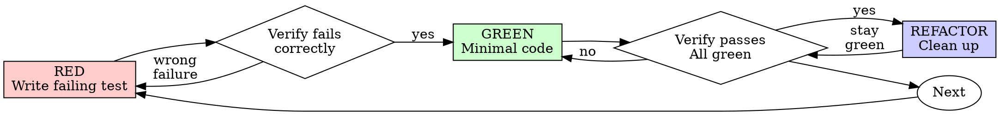

# 对话经过

会话 `01a21a76-8718-7f82-9ea7-2a40f8dbb35d` · 轮次 `01a21b12-a89a-70a2-8ec7-b6d023b8f8a1`

<!-- foundry-detail 01a21a76-8718-7f82-9ea7-2a40f8dbb35d 01a21b12-a89a-70a2-8ec7-b6d023b8f8a1 -->
<!-- foundry-event baa0da4c61a11692aaf105019b80dcf14e191de6ea2b51b9b3fde12842f54a89 -->
## 进度原话

- 来源定位：字节 7372813

~~~text
我按已确认的方案开始 T010，先保存实施记录，再把下载和生成新表写进公共发布工作流，用隔离用例验证首发、追加和下载失败。
~~~

<!-- foundry-event b0a778aac8d227a8fb17321de10847f544897fa0a5abcd998e53f80ba661cb5d -->
## 宿主命令执行

- 来源定位：字节 7375720

~~~text
{
  "command": "[已省略环境变量值] -lc 'cat .agents/skills/implementation-preparation/SKILL.md; cat /home/ena/.codex/plugins/cache/openai-curated-remote/superpowers/7.0.1/skills/test-driven-development/SKILL.md | sed -n '\"'\"'1,160p'\"'\"''",
  "workdir": "file:///home/ena/workspace/ena/agent-foundry/feature/init",
  "exitCode": 0,
  "status": "completed"
}
~~~

<!-- foundry-event a08e2152b51699261ef56ab95d5d8efc05a215f7c50aaab959fa27172674a6e1 -->
## 工具结果 `exec-e1ef6bcc-090b-4bde-9468-3c99bfb532ca`

- 来源定位：字节 7375720

~~~text
---
name: implementation-preparation
description: 用户在已初始化的 Spec Kit 项目中要求实施、开始或继续正式 Task，或原生 Implement 进入实施前准备时使用。仅修订 Spec、仅调整规划、概念解释和普通讨论时不使用。
---

# 正式 Task 实施准备

执行目标项目已有的工作流治理，将当前请求整理为有实际材料、明确认可范围和继续条件的准备结果。这里负责准备和续接，不代替原生 Implement 执行业务，也不定义第二套任务或认可规则。

## 先核对是否要实施正式 Task

按请求实际内容和已知上下文判断，不因用户说“调整需求”就进入Task实施。仅修订已有Spec或仅调整规划时，将请求交回调用方按目标项目相应文档/规划职责处理，不要求先提供Task、单Task认可方案或补建plan/MVU；本技能的实施前置不阻止独立Spec修订。可以核对现有下游影响，没有变化就保持，不默认改业务代码。

用户明确要实施或继续原Task时，才进入下文完整读取和准备流程，已有适用认可直接复用。实施请求同时含需求变化时，先处理获确认的需求并核对规划及原方案是否仍适用；实质变化尚未解决，只暂停受影响实施，不以旧认可覆盖新逻辑，也不将需求修订误记成已实施。

## 定位并读取

用户明确的项目、Spec及Task优先；否则沿唯一已有上下文或项目的.specify/feature.json定位。Task身份连同所属Spec核对，多候选只澄清必要定位，不另建同一任务。

从目标项目根完整读取.specify/memory/constitution.md，再读取原Task、需求、plan、同级mvu、相关存量代码与项目约定、已有方案和证据。既有方案尚无独立mvu时按项目治理兼容原详情；不可用的治理或必要输入列出实际缺项及影响，不给出开工结论。读取路径以目标项目为根，不以本skill的安装目录为根；不导入其他仓库的个人资料。

## 需求变更与来源

读取所属Spec已有的简洁需求摘要/导航和当前有效要求，核对原Task方案所依据的范围、确认与待定事项；需要判断变更或纠正时追溯原始输入及讨论。摘要帮助定位，不代替正式定义或真实认可；来源与现行要求冲突时说明差异，只暂停受影响的开工结论。

出现实质需求变化时，沿目标项目治理和既有布局保留本次可见原始输入、可知来源及实际日期，默认放requirements/raw；已有相同原文直接引用。讨论、AI建议和润色提示词按职责另存，不能覆盖或冒充用户原话、确认，未知日期/不可见历史明确说明。简洁摘要用短段说明问题、解决方向、本次变化、确认或待定、日期，链接原文、必要讨论及当前有效要求；可复用requirements/README.md，不复制长规格或另造固定栏目/文件注册。新材料按实际用途归类，不批量迁移无关Spec。

在对应写入授权内先保存并检查、读回原文和必要讨论，再更新摘要及获确认的受影响要求，最后核对方案能否沿用。未确认的实质变化保留待定，不能按旧方案实施。仅问进度、普通工程调整或重复续做不构成新需求，不因此重复归档原文；保存失败按下文恢复规则说明已写/未写，后续从实际文件补缺，不靠记忆补造来源。

## 形成适用的讨论结果

核对已有方案的真实讨论来源、适用范围、保存结果、必要前置及有效授权。适用内容直接复用；无有效方案时先听用户方向，结合已读代码提出有依据的建议，讲清目标、核心逻辑与关系、理由、推进顺序及可观察验收。用户尚未认可的建议和未知事项分别保留，不把文件自称或AI回复当认可来源。

讨论中读取直接关联Task，说明仅引用依赖、普通工程调整或实质影响的区别。共享定义优先沿已有契约或负责它的Task方案保存，由其他方案引用；共同决定可以一次讨论，各Task分别说明自身职责及实际认可覆盖。需求、总体方案/依赖或局部实现变化，分别同步其真正受影响的材料，不自动实施关联Task。已完成Task按原事实保留，新增工作按项目的增量规则安排。

## 保存并回传继续范围

按项目治理为已形成的方案选择既有位置；默认implementation/<原Task ID>.md，一Task一份，由原Task引用。内容足以还原逻辑、认可范围和来源、理由、验收及重要调整即可，不预设固定表单。工程checkbox只留原tasks，讨论资料和方案不复制它。

依次保存必要方案、执行目标项目格式检查、完整读回，再补原Task引用并核对。返回本次实际可继续的Task及范围、仍需讨论或恢复的部分、必要证据和下一动作。继续由原生执行者依据目标治理推进；进入其他Task、批量、并行或恢复时，对各自材料重新应用本流程，不把前一次准备结果套给另一项。

## 异常与恢复

核查到治理/能力/材料缺失、过期或不可读、方案保存失败、前置未验、缺有效认可，或逻辑/职责/范围/验收实质变化时，依项目治理只处理允许的核查、讨论和恢复，说明受影响范围与继续条件。配置或hook没有调用本skill不构成准备已完成。普通工程调整沿有效认可记录依据，实质变化回讨论；恢复读取最终文件、真实确认及撤回依据，补未完成动作，不复做已确认修复。
---
name: test-driven-development
description: Use when implementing any feature or bugfix, before writing implementation code
---

# Test-Driven Development (TDD)

## Overview

Write the test first. Watch it fail. Write minimal code to pass.

**Core principle:** If you didn't watch the test fail, you don't know if it tests the right thing.

**Violating the letter of the rules is violating the spirit of the rules.**

## When to Use

**Always:**
- New features
- Bug fixes
- Refactoring
- Behavior changes

**Exceptions (ask your human partner):**
- Throwaway prototypes
- Generated code
- Configuration files

Thinking "skip TDD just this once"? Stop. That's rationalization.

## The Iron Law

```
NO PRODUCTION CODE WITHOUT A FAILING TEST FIRST
```

Write code before the test? Delete it. Start over.

**No exceptions:**
- Don't keep it as "reference"
- Don't "adapt" it while writing tests
- Don't look at it
- Delete means delete

Implement fresh from tests. Period.

## Red-Green-Refactor



### RED - Write Failing Test

Write one minimal test showing what should happen.

<Good>
```typescript
test('retries failed operations 3 times', async () => {
  let attempts = 0;
  const operation = () => {
    attempts++;
    if (attempts < 3) throw new Error('fail');
    return 'success';
  };

  const result = await retryOperation(operation);

  expect(result).toBe('success');
  expect(attempts).toBe(3);
});
```
Clear name, tests real behavior, one thing
</Good>

<Bad>
```typescript
test('retry works', async () => {
  const mock = jest.fn()
    .mockRejectedValueOnce(new Error())
    .mockRejectedValueOnce(new Error())
    .mockResolvedValueOnce('success');
  await retryOperation(mock);
  expect(mock).toHaveBeenCalledTimes(3);
});
```
Vague name, tests mock not code
</Bad>

**Requirements:**
- One behavior
- Clear name
- Real code (no mocks unless unavoidable)

### Verify RED - Watch It Fail

**MANDATORY. Never skip.**

```bash
npm test path/to/test.test.ts
```

Confirm:
- Test fails (not errors)
- Failure message is expected
- Fails because feature missing (not typos)

**Test passes?** You're testing existing behavior. Fix test.

**Test errors?** Fix error, re-run until it fails correctly.

### GREEN - Minimal Code

Write simplest code to pass the test.

<Good>
```typescript
async function retryOperation<T>(fn: () => Promise<T>): Promise<T> {
  for (let i = 0; i < 3; i++) {
    try {
      return await fn();
    } catch (e) {
      if (i === 2) throw e;
    }
  }
  throw new Error('unreachable');
}
```
Just enough to pass
</Good>

<Bad>
```typescript
async function retryOperation<T>(
  fn: () => Promise<T>,
  options?: {
    maxRetries?: number;
    backoff?: 'linear' | 'exponential';
    onRetry?: (attempt: number) => void;
  }
): Promise<T> {
  // YAGNI

~~~

<!-- foundry-event 900e0c314b33a7a442c6863fdfa22fd707b0c5448f3fd4b8195624b33efeec21 -->
## 宿主命令执行

- 来源定位：字节 7386456

~~~text
{
  "command": "[已省略环境变量值] -lc 'git status --short --branch; git diff -- .github/workflows/skills-deploy-common.yml'",
  "workdir": "file:///home/ena/workspace/ena/agent-foundry/feature/init",
  "exitCode": 0,
  "status": "completed"
}
~~~

<!-- foundry-event e17bee13ba51ac24cb787e9329529035e52c3ce2b5c4db53d59d71981e59be2e -->
## 工具结果 `exec-240deaa4-bab2-4f36-9d83-aa140e1d5a8b`

- 来源定位：字节 7386456

~~~text
## feature/init...origin/feature/init [ahead 1]
 M .codex/hooks.json
 M .github/workflows/skills-deploy-common.yml
 M .specify/memory/conversation-recording/records/2026-11-26/01a2174d-dd90-74b1-8444-b2b62149b17b.md
 M packages/skills/build/plugins/vite-plugin-version/index.ts
 M packages/skills/package.json
 M packages/skills/src/profile/conversation-recording/SKILL.md
 M packages/skills/src/profile/conversation-recording/install.py
 M packages/skills/src/profile/conversation-recording/recording/__init__.py
 M packages/skills/src/profile/conversation-recording/recording/events.py
 M packages/skills/src/profile/conversation-recording/recording/record.py
 M packages/skills/src/profile/conversation-recording/references/recording-timing.md
 M packages/skills/src/profile/conversation-recording/references/session-scope.md
 M packages/skills/src/profile/conversation-recording/scripts/post_tool_use.py
 M packages/skills/src/profile/conversation-recording/scripts/stop.py
 M packages/skills/src/profile/conversation-recording/scripts/user_prompt_submit.py
 M packages/skills/src/profile/conversation-recording/template/record.md
 M packages/skills/tests/conversation-workflow/helpers/recording-hook-probe.py
 M packages/skills/tests/test_conversation_recording.py
 M packages/skills/tests/test_register_commands.py
 M pnpm-workspace.yaml
 M specs/docs/001-docs-site-framework/tasks.md
 M specs/skills/002-conversation-to-skill/analysis/recording-acceptance.md
 M specs/skills/002-conversation-to-skill/analysis/spec-analysis/README.md
 M specs/skills/002-conversation-to-skill/diagrams.md
 M specs/skills/002-conversation-to-skill/mvu.md
 M specs/skills/002-conversation-to-skill/plan.md
 M specs/skills/002-conversation-to-skill/quickstart.md
 M specs/skills/002-conversation-to-skill/spec.md
 M specs/skills/002-conversation-to-skill/tasks.md
 M specs/skills/003-skills-release-pipeline/analysis/spec-analysis/README.md
 M specs/skills/003-skills-release-pipeline/contracts/build-and-publish.md
 M specs/skills/003-skills-release-pipeline/data-model.md
 M specs/skills/003-skills-release-pipeline/diagrams.md
 M specs/skills/003-skills-release-pipeline/implementation/T008.md
 M specs/skills/003-skills-release-pipeline/mvu.md
 M specs/skills/003-skills-release-pipeline/plan.md
 M specs/skills/003-skills-release-pipeline/quickstart.md
 M specs/skills/003-skills-release-pipeline/research.md
 M specs/skills/003-skills-release-pipeline/spec.md
 M specs/skills/003-skills-release-pipeline/tasks.md
?? .specify/memory/conversation-recording/records/2026-11-27/
?? packages/skills/src/profile/conversation-recording/recording/subagents.py
?? packages/skills/src/profile/conversation-recording/recording/timeline.py
?? packages/skills/src/profile/conversation-recording/scripts/subagent_stop.py
?? packages/skills/tests/distribution/vite-plugin-version.test.mjs
?? specs/docs/001-docs-site-framework/analysis/figma-conversion.md
?? specs/docs/001-docs-site-framework/implementation/
?? specs/skills/002-conversation-to-skill/analysis/acceptance/subagent-recording-code-mode.json
?? specs/skills/002-conversation-to-skill/analysis/acceptance/subagent-recording-timeline.json
?? specs/skills/002-conversation-to-skill/analysis/acceptance/t038-subagent-timeline.json
?? specs/skills/002-conversation-to-skill/analysis/subagent-recording-timeline.md
?? specs/skills/002-conversation-to-skill/implementation/T038.md
?? specs/skills/002-conversation-to-skill/requirements/raw/2026-11-27-recording-subagent-stop-hook.md
?? specs/skills/003-skills-release-pipeline/implementation/T009.md
?? specs/skills/003-skills-release-pipeline/requirements/raw/2026-11-27-release-table-workflow.md
?? specs/skills/003-skills-release-pipeline/requirements/raw/2026-11-27-release-timestamp-source.md
diff --git a/.github/workflows/skills-deploy-common.yml b/.github/workflows/skills-deploy-common.yml
index 1dd187d..f8600f3 100644
--- a/.github/workflows/skills-deploy-common.yml
+++ b/.github/workflows/skills-deploy-common.yml
@@ -78,7 +78,7 @@ jobs:
           : "${AWS_ACCESS_KEY_ID:?缺少 R2 Access Key ID}" "${AWS_SECRET_ACCESS_KEY:?缺少 R2 Secret Access Key}"
           export AWS_ENDPOINT_URL_S3="https://${R2_ACCOUNT_ID:?缺少 R2 账号 ID}.r2.cloudflarestorage.com"
           destination="s3://${R2_BUCKET_NAME:?缺少 R2 桶名}/$GITHUB_SHA/$GITHUB_RUN_ID-$GITHUB_RUN_ATTEMPT"
-          version="$(<packages/skills/dist/VERSION)"
+          version="$(jq -er '.packageVersion | strings | select(length > 0)' packages/skills/dist/VERSION)"
 
           aws s3 cp packages/skills/skills.tar.gz "$destination/skills-$version.tar.gz" --no-progress
           aws s3 cp packages/skills/dist/curl/install.sh "$destination/curl/install.sh" --no-progress

~~~

<!-- foundry-event b1f3e336fb271dd09f697eeb0a3181e889549bf382e781a90fd0fe8ee2a4d0e1 -->
## 宿主命令执行

- 来源定位：字节 7392102

~~~text
{
  "command": "[已省略环境变量值] -lc 'nl -ba .github/workflows/skills-deploy-common.yml; nl -ba .github/workflows/skills-deploy-release.yml; nl -ba .github/workflows/skills-deploy-prod.yml.example'",
  "workdir": "file:///home/ena/workspace/ena/agent-foundry/feature/init",
  "exitCode": 0,
  "status": "completed"
}
~~~

<!-- foundry-event be158983d4aaeb0aa53fc4a03f3f1cb9a45fc7e1587a80b2f4da9785b65779ba -->
## 工具结果 `exec-67667908-1796-4b36-867e-24380e0caaa9`

- 来源定位：字节 7392102

~~~text
     1	name: skills-deploy-common
     2	
     3	on:
     4	  workflow_call:
     5	    inputs:
     6	      target:
     7	        description: 部署目标，release 或 prod
     8	        required: true
     9	        type: string
    10	    secrets:
    11	      SKILL_DEPLOY_R2_ACCESS_KEY_ID:
    12	        required: true
    13	      SKILL_DEPLOY_R2_SECRET_ACCESS_KEY:
    14	        required: true
    15	
    16	concurrency:
    17	  group: deploy-common-${{ inputs.target }}
    18	  cancel-in-progress: true
    19	
    20	permissions:
    21	  contents: read
    22	
    23	jobs:
    24	  build:
    25	    name: 构建并上传技能产物
    26	    runs-on: ubuntu-24.04
    27	    environment: ${{ inputs.target }}
    28	    env:
    29	      R2_CONFIG_PREFIX: ${{ inputs.target == 'release' && 'SKILL_DEPLOY_RELEASE_R2' || 'SKILL_DEPLOY_R2' }}
    30	    steps:
    31	      - name: 检出触发提交
    32	        uses: actions/checkout@v4
    33	        with:
    34	          ref: ${{ github.sha }}
    35	          persist-credentials: false
    36	
    37	      - name: 准备 mise 工具链
    38	        uses: jdx/mise-action@v5
    39	        with:
    40	          cache: 'false'
    41	
    42	      - name: 无锁安装工作区依赖
    43	        run: pnpm install --no-lockfile --ignore-scripts
    44	
    45	      - name: 构建技能包依赖
    46	        env:
    47	          pnpm_config_lockfile: 'false'
    48	          pnpm_config_verify_deps_before_run: 'false'
    49	        run: pnpm --filter '@foundry/skills^...' run build
    50	
    51	      - name: 构建技能包
    52	        env:
    53	          pnpm_config_lockfile: 'false'
    54	          pnpm_config_verify_deps_before_run: 'false'
    55	        run: pnpm --filter @foundry/skills run build --mode release
    56	
    57	      - name: 打包技能产物
    58	        shell: bash
    59	        working-directory: packages/skills/dist
    60	        run: |
    61	          find . -type f -printf '%P\0' | LC_ALL=C sort -z |
    62	            tar -czf ../skills.tar.gz --null --files-from=-
    63	
    64	      - name: 记录归档 SHA-256
    65	        shell: bash
    66	        run: sha256sum packages/skills/skills.tar.gz >> "$GITHUB_STEP_SUMMARY"
    67	
    68	      - name: 上传到 R2
    69	        shell: bash
    70	        env:
    71	          R2_ACCOUNT_ID: ${{ vars[format('{0}_ACCOUNT_ID', env.R2_CONFIG_PREFIX)] }}
    72	          R2_BUCKET_NAME: ${{ vars[format('{0}_BUCKET_NAME', env.R2_CONFIG_PREFIX)] }}
    73	          AWS_ACCESS_KEY_ID: ${{ secrets.SKILL_DEPLOY_R2_ACCESS_KEY_ID }}
    74	          AWS_SECRET_ACCESS_KEY: ${{ secrets.SKILL_DEPLOY_R2_SECRET_ACCESS_KEY }}
    75	          AWS_DEFAULT_REGION: auto
    76	          AWS_EC2_METADATA_DISABLED: 'true'
    77	        run: |
    78	          : "${AWS_ACCESS_KEY_ID:?缺少 R2 Access Key ID}" "${AWS_SECRET_ACCESS_KEY:?缺少 R2 Secret Access Key}"
    79	          export AWS_ENDPOINT_URL_S3="https://${R2_ACCOUNT_ID:?缺少 R2 账号 ID}.r2.cloudflarestorage.com"
    80	          destination="s3://${R2_BUCKET_NAME:?缺少 R2 桶名}/$GITHUB_SHA/$GITHUB_RUN_ID-$GITHUB_RUN_ATTEMPT"
    81	          version="$(jq -er '.packageVersion | strings | select(length > 0)' packages/skills/dist/VERSION)"
    82	
    83	          aws s3 cp packages/skills/skills.tar.gz "$destination/skills-$version.tar.gz" --no-progress
    84	          aws s3 cp packages/skills/dist/curl/install.sh "$destination/curl/install.sh" --no-progress
    85	          printf '技能产物已上传至 `%s/`。\n' "$destination" >> "$GITHUB_STEP_SUMMARY"
     1	name: skills-deploy-release
     2	
     3	on:
     4	  push:
     5	    branches:
     6	      - feature/init
     7	  workflow_call:
     8	    secrets:
     9	      SKILL_DEPLOY_R2_ACCESS_KEY_ID:
    10	        required: true
    11	      SKILL_DEPLOY_R2_SECRET_ACCESS_KEY:
    12	        required: true
    13	    outputs:
    14	      passed:
    15	        description: 测试工作流返回的放行结果
    16	        value: ${{ jobs.test.outputs.passed }}
    17	
    18	permissions: {}
    19	
    20	jobs:
    21	  test:
    22	    if: ${{ github.event_name != 'push' || !github.event.deleted }}
    23	    uses: ./.github/workflows/skills-test.yml
    24	
    25	  deploy:
    26	    needs: test
    27	    if: ${{ needs.test.outputs.passed == 'true' }}
    28	    permissions:
    29	      contents: read
    30	    uses: ./.github/workflows/skills-deploy-common.yml
    31	    with:
    32	      target: release
    33	    secrets:
    34	      SKILL_DEPLOY_R2_ACCESS_KEY_ID: ${{ secrets.SKILL_DEPLOY_R2_ACCESS_KEY_ID }}
    35	      SKILL_DEPLOY_R2_SECRET_ACCESS_KEY: ${{ secrets.SKILL_DEPLOY_R2_SECRET_ACCESS_KEY }}
     1	name: skills-deploy-prod

~~~

<!-- foundry-event 5afac2bf9d1c9b9f3e180f1f96a5e29d70895d71921e8a635be09bdf978f89ed -->
## 宿主命令执行

- 来源定位：字节 7398454

~~~text
{
  "command": "[已省略环境变量值] -lc 'rg --files --hidden -g AGENTS.md -g '\"'\"'!node_modules'\"'\"' -g '\"'\"'!.git'\"'\"' .github specs packages/skills .agents; rg --files packages/skills/tests/distribution specs/skills/003-skills-release-pipeline | rg '\"'\"'distribution|implementation/T0(01|09|10|13)'\"'\"''",
  "workdir": "file:///home/ena/workspace/ena/agent-foundry/feature/init",
  "exitCode": 0,
  "status": "completed"
}
~~~

<!-- foundry-event 7270b9ef775ab2db6b15758242072b3e297a451b4576291377db61e33d4a0d8b -->
## 工具结果 `exec-fe76f561-3065-4aee-bf96-12a06d7257c1`

- 来源定位：字节 7398454

~~~text
specs/skills/003-skills-release-pipeline/implementation/T009.md
specs/skills/003-skills-release-pipeline/implementation/T001.md
packages/skills/tests/distribution/speckit-mount.test.mjs
packages/skills/tests/distribution/mvu-c.mjs
packages/skills/tests/distribution/online-agents.test.mjs
packages/skills/tests/distribution/collection-mode.test.mjs
packages/skills/tests/distribution/test-distribution.mjs
packages/skills/tests/distribution/conversation-sandbox.test.mjs
packages/skills/tests/distribution/agent-paths.test.mjs
packages/skills/tests/distribution/vite-plugin-engine.test.mjs
packages/skills/tests/distribution/vite-mode.test.mjs
packages/skills/tests/distribution/collections.test.mjs
packages/skills/tests/distribution/mvu-b.mjs
packages/skills/tests/distribution/entry-discovery.test.mjs
packages/skills/tests/distribution/hidden-contract.test.mjs
packages/skills/tests/distribution/sandbox.mjs
packages/skills/tests/distribution/runner-archive.test.mjs
packages/skills/tests/distribution/create-directories.test.mjs
packages/skills/tests/distribution/vite-plugin-version.test.mjs
packages/skills/tests/distribution/helpers/registration-migration.mjs
packages/skills/tests/distribution/helpers/registration-bash-fixture.mjs
packages/skills/tests/distribution/helpers/entry-discovery.mjs
packages/skills/tests/distribution/helpers/https-source.mjs
packages/skills/tests/distribution/helpers/build-fixture.mjs
packages/skills/tests/distribution/helpers/registration-fixture.mjs
packages/skills/tests/distribution/helpers/online-provider.mjs
packages/skills/tests/distribution/build-pipeline.test.mjs
packages/skills/tests/distribution/pipeline-workflow.test.mjs
packages/skills/tests/distribution/vite-plugin-skill.test.mjs
packages/skills/tests/distribution/mvu-e.mjs
packages/skills/tests/distribution/test-entry.mjs
packages/skills/tests/distribution/fixtures/agents-1.7.4.json
packages/skills/tests/distribution/fixtures/legacy-registration-hooks.json

~~~

<!-- foundry-event 224a15892e48012df3c0df3a4dc3e90ae6b42689b334ad03b550d3fbc63f2478 -->
## 工具调用 `Bash` · `exec-e1ef6bcc-090b-4bde-9468-3c99bfb532ca`

- 来源定位：工具事件 exec-e1ef6bcc-090b-4bde-9468-3c99bfb532ca

~~~text
工作目录：/home/ena/workspace/ena/agent-foundry/feature/init
{
  "command": "cat .agents/skills/implementation-preparation/SKILL.md; cat /home/ena/.codex/plugins/cache/openai-curated-remote/superpowers/7.0.1/skills/test-driven-development/SKILL.md | sed -n '1,160p'"
}
~~~

<!-- foundry-event 5b9904fb8cf6a66ddb12e319704d1f4c03dffeb99fb8f86d3753fdad8058ce66 -->
## 宿主命令执行

- 来源定位：字节 7402633

~~~text
{
  "command": "[已省略环境变量值] -lc 'command -v jq; command -v aws; command -v actionlint; command -v shellcheck; command -v mise; command -v pnpm; command -v uv; rg -n '\"'\"'S(3|KILL)_|DOWNLOAD_BASE_URL|R2_ENDPOINT|release\\.json'\"'\"' .github packages/skills/tests/distribution -m 7'",
  "workdir": "file:///home/ena/workspace/ena/agent-foundry/feature/init",
  "exitCode": 0,
  "status": "completed"
}
~~~

<!-- foundry-event 7e3a24384d87b081904c4d0e50ced52dbf23a8436ee2d707a76cfbcf63482a02 -->
## 工具结果 `exec-09685986-235c-4657-8475-43de34602ee9`

- 来源定位：字节 7402633

~~~text
/usr/sbin/jq
[已省略环境变量值]
/home/ena/.local/share/mise/installs/pnpm/latest/pnpm
/home/ena/.local/share/mise/installs/uv/latest/.mise-bins/uv
.github/workflows/skills-deploy-common.yml:11:      SKILL_DEPLOY_R2_ACCESS_KEY_ID:
.github/workflows/skills-deploy-common.yml:13:      SKILL_DEPLOY_R2_SECRET_ACCESS_KEY:
.github/workflows/skills-deploy-common.yml:29:      R2_CONFIG_PREFIX: ${{ inputs.target == 'release' && 'SKILL_DEPLOY_RELEASE_R2' || 'SKILL_DEPLOY_R2' }}
.github/workflows/skills-deploy-common.yml:73:          AWS_ACCESS_KEY_ID: ${{ secrets.SKILL_DEPLOY_R2_ACCESS_KEY_ID }}
.github/workflows/skills-deploy-common.yml:74:          AWS_SECRET_ACCESS_KEY: ${{ secrets.SKILL_DEPLOY_R2_SECRET_ACCESS_KEY }}
.github/workflows/skills-deploy-release.yml:9:      SKILL_DEPLOY_R2_ACCESS_KEY_ID:
.github/workflows/skills-deploy-release.yml:11:      SKILL_DEPLOY_R2_SECRET_ACCESS_KEY:
.github/workflows/skills-deploy-release.yml:34:      SKILL_DEPLOY_R2_ACCESS_KEY_ID: ${{ secrets.SKILL_DEPLOY_R2_ACCESS_KEY_ID }}
.github/workflows/skills-deploy-release.yml:35:      SKILL_DEPLOY_R2_SECRET_ACCESS_KEY: ${{ secrets.SKILL_DEPLOY_R2_SECRET_ACCESS_KEY }}
packages/skills/tests/distribution/mvu-c.mjs:187:  fs.writeFileSync(path.join(releaseRoot, 'release.json'), `${JSON.stringify(release)}\n`)
packages/skills/tests/distribution/mvu-c.mjs:269:  assert.equal(result.report.resolvedRelease.catalogDigest, digest(fs.readFileSync(path.join(sandbox.root, 'release/release.json'))))
packages/skills/tests/distribution/mvu-c.mjs:383:  const manifest = path.join(sandbox.root, 'release/release.json')
packages/skills/tests/distribution/test-entry.mjs:276:    fs.writeFileSync(path.join(release, 'release.json'), JSON.stringify(manifest))
packages/skills/tests/distribution/mvu-b.mjs:133:    source.files.set(`${prefix}/release.json`, Buffer.from(JSON.stringify(release)))
packages/skills/tests/distribution/mvu-b.mjs:570:      fs.writeFileSync(path.join(local, 'release.json'), JSON.stringify(item.release))
packages/skills/tests/distribution/mvu-b.mjs:580:        fs.symlinkSync(path.join(local, 'release.json'), path.join(local, 'skills/coding/sample-skill/SKILL.md'))
packages/skills/tests/distribution/hidden-contract.test.mjs:350:  write(sandbox.root, 'release.json', JSON.stringify([
packages/skills/tests/distribution/hidden-contract.test.mjs:357:  */release.json) cp -- "$FOUNDRY_FIXTURE/release.json" "$2" ;;
packages/skills/tests/distribution/build-pipeline.test.mjs:17:    assert.deepEqual(fs.readdirSync(item.output).sort(), ['mcp', 'projections', 'release.json', 'script', 'skills'])
packages/skills/tests/distribution/build-pipeline.test.mjs:116:    const release = JSON.parse(fs.readFileSync(path.join(item.output, 'release.json'), 'utf8'))
packages/skills/tests/distribution/build-pipeline.test.mjs:121:    assert.equal(release.files.some(file => file.path === 'release.json'), false)
packages/skills/tests/distribution/build-pipeline.test.mjs:477:    writeFixtureFile(releaseRoot, 'release.json', JSON.stringify({ schemaVersion: 1, version: '0.1.0', sourceRevision: '1'.repeat(40), files, skills: [{ name: 'task-increment', category: 'workflow', directory: 'skills/workflow/task-increment', sourceFiles: ['skills/workflow/task-increment/SKILL.md'], requiresSkills: [] }] }))

~~~

<!-- foundry-event 5a1a4316cab8da4558f66cca8f79fe5a54bed443995d983e393d25e8b2a4e623 -->
## 工具调用 `Bash` · `exec-240deaa4-bab2-4f36-9d83-aa140e1d5a8b`

- 来源定位：工具事件 exec-240deaa4-bab2-4f36-9d83-aa140e1d5a8b

~~~text
工作目录：/home/ena/workspace/ena/agent-foundry/feature/init
{
  "command": "git status --short --branch; git diff -- .github/workflows/skills-deploy-common.yml"
}
~~~

<!-- foundry-event c4472b2b0c0373f31874f65f6d74d9ea6f925102b2219e959fe2a384bb3e2128 -->
## 工具调用 `Bash` · `exec-67667908-1796-4b36-867e-24380e0caaa9`

- 来源定位：工具事件 exec-67667908-1796-4b36-867e-24380e0caaa9

~~~text
工作目录：/home/ena/workspace/ena/agent-foundry/feature/init
{
  "command": "nl -ba .github/workflows/skills-deploy-common.yml; nl -ba .github/workflows/skills-deploy-release.yml; nl -ba .github/workflows/skills-deploy-prod.yml.example"
}
~~~

<!-- foundry-event 9bc4262c173c2e796ffd84a3853f958891d0346307b39fe7f78b88ccce8a8889 -->
## 工具调用 `Bash` · `exec-fe76f561-3065-4aee-bf96-12a06d7257c1`

- 来源定位：工具事件 exec-fe76f561-3065-4aee-bf96-12a06d7257c1

~~~text
工作目录：/home/ena/workspace/ena/agent-foundry/feature/init
{
  "command": "rg --files --hidden -g AGENTS.md -g '!node_modules' -g '!.git' .github specs packages/skills .agents; rg --files packages/skills/tests/distribution specs/skills/003-skills-release-pipeline | rg 'distribution|implementation/T0(01|09|10|13)'"
}
~~~

<!-- foundry-event 6f5f68186f02902b4b5ae2887442a992687d9adb955203f27fb7c1ebfb5485fe -->
## 工具调用 `Bash` · `exec-09685986-235c-4657-8475-43de34602ee9`

- 来源定位：工具事件 exec-09685986-235c-4657-8475-43de34602ee9

~~~text
工作目录：/home/ena/workspace/ena/agent-foundry/feature/init
{
  "command": "command -v jq; command -v aws; command -v actionlint; command -v shellcheck; command -v mise; command -v pnpm; command -v uv; rg -n 'S(3|KILL)_|DOWNLOAD_BASE_URL|R2_ENDPOINT|release\\.json' .github packages/skills/tests/distribution -m 7"
}
~~~

<!-- foundry-event d80704a342fe288dbde71228c105a65599516d7f9f186abaa3418f5dcbb758da -->
## 工具调用 `exec` · `call_432ee4a64ca74a4db48c59834e32409d`

- 来源定位：字节 7373838

~~~text
工作目录：/home/ena/workspace/ena/agent-foundry/feature/init
// @exec: {"max_output_tokens": 12500}
const cmds = [
  {cmd:"git status --short --branch; git diff -- .github/workflows/skills-deploy-common.yml",max_output_tokens:2600},
  {cmd:"nl -ba .github/workflows/skills-deploy-common.yml; nl -ba .github/workflows/skills-deploy-release.yml; nl -ba .github/workflows/skills-deploy-prod.yml.example",max_output_tokens:3400},
  {cmd:"rg --files --hidden -g AGENTS.md -g '!node_modules' -g '!.git' .github specs packages/skills .agents; rg --files packages/skills/tests/distribution specs/skills/003-skills-release-pipeline | rg 'distribution|implementation/T0(01|09|10|13)'",max_output_tokens:1600},
  {cmd:"cat .agents/skills/implementation-preparation/SKILL.md; cat /home/ena/.codex/plugins/cache/openai-curated-remote/superpowers/7.0.1/skills/test-driven-development/SKILL.md | sed -n '1,160p'",max_output_tokens:4500},
  {cmd:"command -v jq; command -v aws; command -v actionlint; command -v shellcheck; command -v mise; command -v pnpm; command -v uv; rg -n 'S(3|KILL)_|DOWNLOAD_BASE_URL|R2_ENDPOINT|release\\.json' .github packages/skills/tests/distribution -m 7",max_output_tokens:2100}
];
const result = await Promise.allSettled(cmds.map(options => tools.exec_command(options)));
for (const item of result) text(item.status === "fulfilled" ? item.value.output : String(item.reason));

~~~

<!-- foundry-event 32cba6c29739b7bc8a9ce5d7cfb63e66446bbee9be3498845baba8b39d778c83 -->
## 工具结果 `call_432ee4a64ca74a4db48c59834e32409d`

- 来源定位：字节 7407080

~~~text
[
  {
    "type": "input_text",
    "text": "Script completed\nWall time 1.3 seconds\nOutput:\n"
  },
  {
    "type": "input_text",
    "text": "## feature/init...origin/feature/init [ahead 1]\n M .codex/hooks.json\n M .github/workflows/skills-deploy-common.yml\n M .specify/memory/conversation-recording/records/2026-11-26/01a2174d-dd90-74b1-8444-b2b62149b17b.md\n M packages/skills/build/plugins/vite-plugin-version/index.ts\n M packages/skills/package.json\n M packages/skills/src/profile/conversation-recording/SKILL.md\n M packages/skills/src/profile/conversation-recording/install.py\n M packages/skills/src/profile/conversation-recording/recording/__init__.py\n M packages/skills/src/profile/conversation-recording/recording/events.py\n M packages/skills/src/profile/conversation-recording/recording/record.py\n M packages/skills/src/profile/conversation-recording/references/recording-timing.md\n M packages/skills/src/profile/conversation-recording/references/session-scope.md\n M packages/skills/src/profile/conversation-recording/scripts/post_tool_use.py\n M packages/skills/src/profile/conversation-recording/scripts/stop.py\n M packages/skills/src/profile/conversation-recording/scripts/user_prompt_submit.py\n M packages/skills/src/profile/conversation-recording/template/record.md\n M packages/skills/tests/conversation-workflow/helpers/recording-hook-probe.py\n M packages/skills/tests/test_conversation_recording.py\n M packages/skills/tests/test_register_commands.py\n M pnpm-workspace.yaml\n M specs/docs/001-docs-site-framework/tasks.md\n M specs/skills/002-conversation-to-skill/analysis/recording-acceptance.md\n M specs/skills/002-conversation-to-skill/analysis/spec-analysis/README.md\n M specs/skills/002-conversation-to-skill/diagrams.md\n M specs/skills/002-conversation-to-skill/mvu.md\n M specs/skills/002-conversation-to-skill/plan.md\n M specs/skills/002-conversation-to-skill/quickstart.md\n M specs/skills/002-conversation-to-skill/spec.md\n M specs/skills/002-conversation-to-skill/tasks.md\n M specs/skills/003-skills-release-pipeline/analysis/spec-analysis/README.md\n M specs/skills/003-skills-release-pipeline/contracts/build-and-publish.md\n M specs/skills/003-skills-release-pipeline/data-model.md\n M specs/skills/003-skills-release-pipeline/diagrams.md\n M specs/skills/003-skills-release-pipeline/implementation/T008.md\n M specs/skills/003-skills-release-pipeline/mvu.md\n M specs/skills/003-skills-release-pipeline/plan.md\n M specs/skills/003-skills-release-pipeline/quickstart.md\n M specs/skills/003-skills-release-pipeline/research.md\n M specs/skills/003-skills-release-pipeline/spec.md\n M specs/skills/003-skills-release-pipeline/tasks.md\n?? .specify/memory/conversation-recording/records/2026-11-27/\n?? packages/skills/src/profile/conversation-recording/recording/subagents.py\n?? packages/skills/src/profile/conversation-recording/recording/timeline.py\n?? packages/skills/src/profile/conversation-recording/scripts/subagent_stop.py\n?? packages/skills/tests/distribution/vite-plugin-version.test.mjs\n?? specs/docs/001-docs-site-framework/analysis/figma-conversion.md\n?? specs/docs/001-docs-site-framework/implementation/\n?? specs/skills/002-conversation-to-skill/analysis/acceptance/subagent-recording-code-mode.json\n?? specs/skills/002-conversation-to-skill/analysis/acceptance/subagent-recording-timeline.json\n?? specs/skills/002-conversation-to-skill/analysis/acceptance/t038-subagent-timeline.json\n?? specs/skills/002-conversation-to-skill/analysis/subagent-recording-timeline.md\n?? specs/skills/002-conversation-to-skill/implementation/T038.md\n?? specs/skills/002-conversation-to-skill/requirements/raw/2026-11-27-recording-subagent-stop-hook.md\n?? specs/skills/003-skills-release-pipeline/implementation/T009.md\n?? specs/skills/003-skills-release-pipeline/requirements/raw/2026-11-27-release-table-workflow.md\n?? specs/skills/003-skills-release-pipeline/requirements/raw/2026-11-27-release-timestamp-source.md\ndiff --git a/.github/workflows/skills-deploy-common.yml b/.github/workflows/skills-deploy-common.yml\nindex 1dd187d..f8600f3 100644\n--- a/.github/workflows/skills-deploy-common.yml\n+++ b/.github/workflows/skills-deploy-common.yml\n@@ -78,7 +78,7 @@ jobs:\n           : \"${AWS_ACCESS_KEY_ID:?缺少 R2 Access Key ID}\" \"${AWS_SECRET_ACCESS_KEY:?缺少 R2 Secret Access Key}\"\n           export AWS_ENDPOINT_URL_S3=\"https://${R2_ACCOUNT_ID:?缺少 R2 账号 ID}.r2.cloudflarestorage.com\"\n           destination=\"s3://${R2_BUCKET_NAME:?缺少 R2 桶名}/$GITHUB_SHA/$GITHUB_RUN_ID-$GITHUB_RUN_ATTEMPT\"\n-          version=\"$(<packages/skills/dist/VERSION)\"\n+          version=\"$(jq -er '.packageVersion | strings | select(length > 0)' packages/skills/dist/VERSION)\"\n \n           aws s3 cp packages/skills/skills.tar.gz \"$destination/skills-$version.tar.gz\" --no-progress\n           aws s3 cp packages/skills/dist/curl/install.sh \"$destination/curl/install.sh\" --no-progress\n"
  },
  {
    "type": "input_text",
    "text": "     1\tname: skills-deploy-common\n     2\t\n     3\ton:\n     4\t  workflow_call:\n     5\t    inputs:\n     6\t      target:\n     7\t        description: 部署目标，release 或 prod\n     8\t        required: true\n     9\t        type: string\n    10\t    secrets:\n    11\t      SKILL_DEPLOY_R2_ACCESS_KEY_ID:\n    12\t        required: true\n    13\t      SKILL_DEPLOY_R2_SECRET_ACCESS_KEY:\n    14\t        required: true\n    15\t\n    16\tconcurrency:\n    17\t  group: deploy-common-${{ inputs.target }}\n    18\t  cancel-in-progress: true\n    19\t\n    20\tpermissions:\n    21\t  contents: read\n    22\t\n    23\tjobs:\n    24\t  build:\n    25\t    name: 构建并上传技能产物\n    26\t    runs-on: ubuntu-24.04\n    27\t    environment: ${{ inputs.target }}\n    28\t    env:\n    29\t      R2_CONFIG_PREFIX: ${{ inputs.target == 'release' && 'SKILL_DEPLOY_RELEASE_R2' || 'SKILL_DEPLOY_R2' }}\n    30\t    steps:\n    31\t      - name: 检出触发提交\n    32\t        uses: actions/checkout@v4\n    33\t        with:\n    34\t          ref: ${{ github.sha }}\n    35\t          persist-credentials: false\n    36\t\n    37\t      - name: 准备 mise 工具链\n    38\t        uses: jdx/mise-action@v5\n    39\t        with:\n    40\t          cache: 'false'\n    41\t\n    42\t      - name: 无锁安装工作区依赖\n    43\t        run: pnpm install --no-lockfile --ignore-scripts\n    44\t\n    45\t      - name: 构建技能包依赖\n    46\t        env:\n    47\t          pnpm_config_lockfile: 'false'\n    48\t          pnpm_config_verify_deps_before_run: 'false'\n    49\t        run: pnpm --filter '@foundry/skills^...' run build\n    50\t\n    51\t      - name: 构建技能包\n    52\t        env:\n    53\t          pnpm_config_lockfile: 'false'\n    54\t          pnpm_config_verify_deps_before_run: 'false'\n    55\t        run: pnpm --filter @foundry/skills run build --mode release\n    56\t\n    57\t      - name: 打包技能产物\n    58\t        shell: bash\n    59\t        working-directory: packages/skills/dist\n    60\t        run: |\n    61\t          find . -type f -printf '%P\\0' | LC_ALL=C sort -z |\n    62\t            tar -czf ../skills.tar.gz --null --files-from=-\n    63\t\n    64\t      - name: 记录归档 SHA-256\n    65\t        shell: bash\n    66\t        run: sha256sum packages/skills/skills.tar.gz >> \"$GITHUB_STEP_SUMMARY\"\n    67\t\n    68\t      - name: 上传到 R2\n    69\t        shell: bash\n    70\t        env:\n    71\t          R2_ACCOUNT_ID: ${{ vars[format('{0}_ACCOUNT_ID', env.R2_CONFIG_PREFIX)] }}\n    72\t          R2_BUCKET_NAME: ${{ vars[format('{0}_BUCKET_NAME', env.R2_CONFIG_PREFIX)] }}\n    73\t          AWS_ACCESS_KEY_ID: ${{ secrets.SKILL_DEPLOY_R2_ACCESS_KEY_ID }}\n    74\t          AWS_SECRET_ACCESS_KEY: ${{ secrets.SKILL_DEPLOY_R2_SECRET_ACCESS_KEY }}\n    75\t          AWS_DEFAULT_REGION: auto\n    76\t          AWS_EC2_METADATA_DISABLED: 'true'\n    77\t        run: |\n    78\t          : \"${AWS_ACCESS_KEY_ID:?缺少 R2 Access Key ID}\" \"${AWS_SECRET_ACCESS_KEY:?缺少 R2 Secret Access Key}\"\n    79\t          export AWS_ENDPOINT_URL_S3=\"https://${R2_ACCOUNT_ID:?缺少 R2 账号 ID}.r2.cloudflarestorage.com\"\n    80\t          destination=\"s3://${R2_BUCKET_NAME:?缺少 R2 桶名}/$GITHUB_SHA/$GITHUB_RUN_ID-$GITHUB_RUN_ATTEMPT\"\n    81\t          version=\"$(jq -er '.packageVersion | strings | select(length > 0)' packages/skills/dist/VERSION)\"\n    82\t\n    83\t          aws s3 cp packages/skills/skills.tar.gz \"$destination/skills-$version.tar.gz\" --no-progress\n    84\t          aws s3 cp packages/skills/dist/curl/install.sh \"$destination/curl/install.sh\" --no-progress\n    85\t          printf '技能产物已上传至 `%s/`。\\n' \"$destination\" >> \"$GITHUB_STEP_SUMMARY\"\n     1\tname: skills-deploy-release\n     2\t\n     3\ton:\n     4\t  push:\n     5\t    branches:\n     6\t      - feature/init\n     7\t  workflow_call:\n     8\t    secrets:\n     9\t      SKILL_DEPLOY_R2_ACCESS_KEY_ID:\n    10\t        required: true\n    11\t      SKILL_DEPLOY_R2_SECRET_ACCESS_KEY:\n    12\t        required: true\n    13\t    outputs:\n    14\t      passed:\n    15\t        description: 测试工作流返回的放行结果\n    16\t        value: ${{ jobs.test.outputs.passed }}\n    17\t\n    18\tpermissions: {}\n    19\t\n    20\tjobs:\n    21\t  test:\n    22\t    if: ${{ github.event_name != 'push' || !github.event.deleted }}\n    23\t    uses: ./.github/workflows/skills-test.yml\n    24\t\n    25\t  deploy:\n    26\t    needs: test\n    27\t    if: ${{ needs.test.outputs.passed == 'true' }}\n    28\t    permissions:\n    29\t      contents: read\n    30\t    uses: ./.github/workflows/skills-deploy-common.yml\n    31\t    with:\n    32\t      target: release\n    33\t    secrets:\n    34\t      SKILL_DEPLOY_R2_ACCESS_KEY_ID: ${{ secrets.SKILL_DEPLOY_R2_ACCESS_KEY_ID }}\n    35\t      SKILL_DEPLOY_R2_SECRET_ACCESS_KEY: ${{ secrets.SKILL_DEPLOY_R2_SECRET_ACCESS_KEY }}\n     1\tname: skills-deploy-prod\n"
  },
  {
    "type": "input_text",
    "text": "specs/skills/003-skills-release-pipeline/implementation/T009.md\nspecs/skills/003-skills-release-pipeline/implementation/T001.md\npackages/skills/tests/distribution/speckit-mount.test.mjs\npackages/skills/tests/distribution/mvu-c.mjs\npackages/skills/tests/distribution/online-agents.test.mjs\npackages/skills/tests/distribution/collection-mode.test.mjs\npackages/skills/tests/distribution/test-distribution.mjs\npackages/skills/tests/distribution/conversation-sandbox.test.mjs\npackages/skills/tests/distribution/agent-paths.test.mjs\npackages/skills/tests/distribution/vite-plugin-engine.test.mjs\npackages/skills/tests/distribution/vite-mode.test.mjs\npackages/skills/tests/distribution/collections.test.mjs\npackages/skills/tests/distribution/mvu-b.mjs\npackages/skills/tests/distribution/entry-discovery.test.mjs\npackages/skills/tests/distribution/hidden-contract.test.mjs\npackages/skills/tests/distribution/sandbox.mjs\npackages/skills/tests/distribution/runner-archive.test.mjs\npackages/skills/tests/distribution/create-directories.test.mjs\npackages/skills/tests/distribution/vite-plugin-version.test.mjs\npackages/skills/tests/distribution/helpers/registration-migration.mjs\npackages/skills/tests/distribution/helpers/registration-bash-fixture.mjs\npackages/skills/tests/distribution/helpers/entry-discovery.mjs\npackages/skills/tests/distribution/helpers/https-source.mjs\npackages/skills/tests/distribution/helpers/build-fixture.mjs\npackages/skills/tests/distribution/helpers/registration-fixture.mjs\npackages/skills/tests/distribution/helpers/online-provider.mjs\npackages/skills/tests/distribution/build-pipeline.test.mjs\npackages/skills/tests/distribution/pipeline-workflow.test.mjs\npackages/skills/tests/distribution/vite-plugin-skill.test.mjs\npackages/skills/tests/distribution/mvu-e.mjs\npackages/skills/tests/distribution/test-entry.mjs\npackages/skills/tests/distribution/fixtures/agents-1.7.4.json\npackages/skills/tests/distribution/fixtures/legacy-registration-hooks.json\n"
  },
  {
    "type": "input_text",
    "text": "---\nname: implementation-preparation\ndescription: 用户在已初始化的 Spec Kit 项目中要求实施、开始或继续正式 Task，或原生 Implement 进入实施前准备时使用。仅修订 Spec、仅调整规划、概念解释和普通讨论时不使用。\n---\n\n# 正式 Task 实施准备\n\n执行目标项目已有的工作流治理，将当前请求整理为有实际材料、明确认可范围和继续条件的准备结果。这里负责准备和续接，不代替原生 Implement 执行业务，也不定义第二套任务或认可规则。\n\n## 先核对是否要实施正式 Task\n\n按请求实际内容和已知上下文判断，不因用户说“调整需求”就进入Task实施。仅修订已有Spec或仅调整规划时，将请求交回调用方按目标项目相应文档/规划职责处理，不要求先提供Task、单Task认可方案或补建plan/MVU；本技能的实施前置不阻止独立Spec修订。可以核对现有下游影响，没有变化就保持，不默认改业务代码。\n\n用户明确要实施或继续原Task时，才进入下文完整读取和准备流程，已有适用认可直接复用。实施请求同时含需求变化时，先处理获确认的需求并核对规划及原方案是否仍适用；实质变化尚未解决，只暂停受影响实施，不以旧认可覆盖新逻辑，也不将需求修订误记成已实施。\n\n## 定位并读取\n\n用户明确的项目、Spec及Task优先；否则沿唯一已有上下文或项目的.specify/feature.json定位。Task身份连同所属Spec核对，多候选只澄清必要定位，不另建同一任务。\n\n从目标项目根完整读取.specify/memory/constitution.md，再读取原Task、需求、plan、同级mvu、相关存量代码与项目约定、已有方案和证据。既有方案尚无独立mvu时按项目治理兼容原详情；不可用的治理或必要输入列出实际缺项及影响，不给出开工结论。读取路径以目标项目为根，不以本skill的安装目录为根；不导入其他仓库的个人资料。\n\n## 需求变更与来源\n\n读取所属Spec已有的简洁需求摘要/导航和当前有效要求，核对原Task方案所依据的范围、确认与待定事项；需要判断变更或纠正时追溯原始输入及讨论。摘要帮助定位，不代替正式定义或真实认可；来源与现行要求冲突时说明差异，只暂停受影响的开工结论。\n\n出现实质需求变化时，沿目标项目治理和既有布局保留本次可见原始输入、可知来源及实际日期，默认放requirements/raw；已有相同原文直接引用。讨论、AI建议和润色提示词按职责另存，不能覆盖或冒充用户原话、确认，未知日期/不可见历史明确说明。简洁摘要用短段说明问题、解决方向、本次变化、确认或待定、日期，链接原文、必要讨论及当前有效要求；可复用requirements/README.md，不复制长规格或另造固定栏目/文件注册。新材料按实际用途归类，不批量迁移无关Spec。\n\n在对应写入授权内先保存并检查、读回原文和必要讨论，再更新摘要及获确认的受影响要求，最后核对方案能否沿用。未确认的实质变化保留待定，不能按旧方案实施。仅问进度、普通工程调整或重复续做不构成新需求，不因此重复归档原文；保存失败按下文恢复规则说明已写/未写，后续从实际文件补缺，不靠记忆补造来源。\n\n## 形成适用的讨论结果\n\n核对已有方案的真实讨论来源、适用范围、保存结果、必要前置及有效授权。适用内容直接复用；无有效方案时先听用户方向，结合已读代码提出有依据的建议，讲清目标、核心逻辑与关系、理由、推进顺序及可观察验收。用户尚未认可的建议和未知事项分别保留，不把文件自称或AI回复当认可来源。\n\n讨论中读取直接关联Task，说明仅引用依赖、普通工程调整或实质影响的区别。共享定义优先沿已有契约或负责它的Task方案保存，由其他方案引用；共同决定可以一次讨论，各Task分别说明自身职责及实际认可覆盖。需求、总体方案/依赖或局部实现变化，分别同步其真正受影响的材料，不自动实施关联Task。已完成Task按原事实保留，新增工作按项目的增量规则安排。\n\n## 保存并回传继续范围\n\n按项目治理为已形成的方案选择既有位置；默认implementation/<原Task ID>.md，一Task一份，由原Task引用。内容足以还原逻辑、认可范围和来源、理由、验收及重要调整即可，不预设固定表单。工程checkbox只留原tasks，讨论资料和方案不复制它。\n\n依次保存必要方案、执行目标项目格式检查、完整读回，再补原Task引用并核对。返回本次实际可继续的Task及范围、仍需讨论或恢复的部分、必要证据和下一动作。继续由原生执行者依据目标治理推进；进入其他Task、批量、并行或恢复时，对各自材料重新应用本流程，不把前一次准备结果套给另一项。\n\n## 异常与恢复\n\n核查到治理/能力/材料缺失、过期或不可读、方案保存失败、前置未验、缺有效认可，或逻辑/职责/范围/验收实质变化时，依项目治理只处理允许的核查、讨论和恢复，说明受影响范围与继续条件。配置或hook没有调用本skill不构成准备已完成。普通工程调整沿有效认可记录依据，实质变化回讨论；恢复读取最终文件、真实确认及撤回依据，补未完成动作，不复做已确认修复。\n---\nname: test-driven-development\ndescription: Use when implementing any feature or bugfix, before writing implementation code\n---\n\n# Test-Driven Development (TDD)\n\n## Overview\n\nWrite the test first. Watch it fail. Write minimal code to pass.\n\n**Core principle:** If you didn't watch the test fail, you don't know if it tests the right thing.\n\n**Violating the letter of the rules is violating the spirit of the rules.**\n\n## When to Use\n\n**Always:**\n- New features\n- Bug fixes\n- Refactoring\n- Behavior changes\n\n**Exceptions (ask your human partner):**\n- Throwaway prototypes\n- Generated code\n- Configuration files\n\nThinking \"skip TDD just this once\"? Stop. That's rationalization.\n\n## The Iron Law\n\n```\nNO PRODUCTION CODE WITHOUT A FAILING TEST FIRST\n```\n\nWrite code before the test? Delete it. Start over.\n\n**No exceptions:**\n- Don't keep it as \"reference\"\n- Don't \"adapt\" it while writing tests\n- Don't look at it\n- Delete means delete\n\nImplement fresh from tests. Period.\n\n## Red-Green-Refactor\n\n```dot\ndigraph tdd_cycle {\n    rankdir=LR;\n    red [label=\"RED\\nWrite failing test\", shape=box, style=filled, fillcolor=\"#ffcccc\"];\n    verify_red [label=\"Verify fails\\ncorrectly\", shape=diamond];\n    green [label=\"GREEN\\nMinimal code\", shape=box, style=filled, fillcolor=\"#ccffcc\"];\n    verify_green [label=\"Verify passes\\nAll green\", shape=diamond];\n    refactor [label=\"REFACTOR\\nClean up\", shape=box, style=filled, fillcolor=\"#ccccff\"];\n    next [label=\"Next\", shape=ellipse];\n\n    red -> verify_red;\n    verify_red -> green [label=\"yes\"];\n    verify_red -> red [label=\"wrong\\nfailure\"];\n    green -> verify_green;\n    verify_green -> refactor [label=\"yes\"];\n    verify_green -> green [label=\"no\"];\n    refactor -> verify_green [label=\"stay\\ngreen\"];\n    verify_green -> next;\n    next -> red;\n}\n```\n\n### RED - Write Failing Test\n\nWrite one minimal test showing what should happen.\n\n<Good>\n```typescript\ntest('retries failed operations 3 times', async () => {\n  let attempts = 0;\n  const operation = () => {\n    attempts++;\n    if (attempts < 3) throw new Error('fail');\n    return 'success';\n  };\n\n  const result = await retryOperation(operation);\n\n  expect(result).toBe('success');\n  expect(attempts).toBe(3);\n});\n```\nClear name, tests real behavior, one thing\n</Good>\n\n<Bad>\n```typescript\ntest('retry works', async () => {\n  const mock = jest.fn()\n    .mockRejectedValueOnce(new Error())\n    .mockRejectedValueOnce(new Error())\n    .mockResolvedValueOnce('success');\n  await retryOperation(mock);\n  expect(mock).toHaveBeenCalledTimes(3);\n});\n```\nVague name, tests mock not code\n</Bad>\n\n**Requirements:**\n- One behavior\n- Clear name\n- Real code (no mocks unless unavoidable)\n\n### Verify RED - Watch It Fail\n\n**MANDATORY. Never skip.**\n\n```bash\nnpm test path/to/test.test.ts\n```\n\nConfirm:\n- Test fails (not errors)\n- Failure message is expected\n- Fails because feature missing (not typos)\n\n**Test passes?** You're testing existing behavior. Fix test.\n\n**Test errors?** Fix error, re-run until it fails correctly.\n\n### GREEN - Minimal Code\n\nWrite simplest code to pass the test.\n\n<Good>\n```typescript\nasync function retryOperation<T>(fn: () => Promise<T>): Promise<T> {\n  for (let i = 0; i < 3; i++) {\n    try {\n      return await fn();\n    } catch (e) {\n      if (i === 2) throw e;\n    }\n  }\n  throw new Error('unreachable');\n}\n```\nJust enough to pass\n</Good>\n\n<Bad>\n```typescript\nasync function retryOperation<T>(\n  fn: () => Promise<T>,\n  options?: {\n    maxRetries?: number;\n    backoff?: 'linear' | 'exponential';\n    onRetry?: (attempt: number) => void;\n  }\n): Promise<T> {\n  // YAGNI\n"
  },
  {
    "type": "input_text",
    "text": "/usr/sbin/jq\n[已省略环境变量值]\n/home/ena/.local/share/mise/installs/pnpm/latest/pnpm\n/home/ena/.local/share/mise/installs/uv/latest/.mise-bins/uv\n.github/workflows/skills-deploy-common.yml:11:      SKILL_DEPLOY_R2_ACCESS_KEY_ID:\n.github/workflows/skills-deploy-common.yml:13:      SKILL_DEPLOY_R2_SECRET_ACCESS_KEY:\n.github/workflows/skills-deploy-common.yml:29:      R2_CONFIG_PREFIX: ${{ inputs.target == 'release' && 'SKILL_DEPLOY_RELEASE_R2' || 'SKILL_DEPLOY_R2' }}\n.github/workflows/skills-deploy-common.yml:73:          AWS_ACCESS_KEY_ID: ${{ secrets.SKILL_DEPLOY_R2_ACCESS_KEY_ID }}\n.github/workflows/skills-deploy-common.yml:74:          AWS_SECRET_ACCESS_KEY: ${{ secrets.SKILL_DEPLOY_R2_SECRET_ACCESS_KEY }}\n.github/workflows/skills-deploy-release.yml:9:      SKILL_DEPLOY_R2_ACCESS_KEY_ID:\n.github/workflows/skills-deploy-release.yml:11:      SKILL_DEPLOY_R2_SECRET_ACCESS_KEY:\n.github/workflows/skills-deploy-release.yml:34:      SKILL_DEPLOY_R2_ACCESS_KEY_ID: ${{ secrets.SKILL_DEPLOY_R2_ACCESS_KEY_ID }}\n.github/workflows/skills-deploy-release.yml:35:      SKILL_DEPLOY_R2_SECRET_ACCESS_KEY: ${{ secrets.SKILL_DEPLOY_R2_SECRET_ACCESS_KEY }}\npackages/skills/tests/distribution/mvu-c.mjs:187:  fs.writeFileSync(path.join(releaseRoot, 'release.json'), `${JSON.stringify(release)}\\n`)\npackages/skills/tests/distribution/mvu-c.mjs:269:  assert.equal(result.report.resolvedRelease.catalogDigest, digest(fs.readFileSync(path.join(sandbox.root, 'release/release.json'))))\npackages/skills/tests/distribution/mvu-c.mjs:383:  const manifest = path.join(sandbox.root, 'release/release.json')\npackages/skills/tests/distribution/test-entry.mjs:276:    fs.writeFileSync(path.join(release, 'release.json'), JSON.stringify(manifest))\npackages/skills/tests/distribution/mvu-b.mjs:133:    source.files.set(`${prefix}/release.json`, Buffer.from(JSON.stringify(release)))\npackages/skills/tests/distribution/mvu-b.mjs:570:      fs.writeFileSync(path.join(local, 'release.json'), JSON.stringify(item.release))\npackages/skills/tests/distribution/mvu-b.mjs:580:        fs.symlinkSync(path.join(local, 'release.json'), path.join(local, 'skills/coding/sample-skill/SKILL.md'))\npackages/skills/tests/distribution/hidden-contract.test.mjs:350:  write(sandbox.root, 'release.json', JSON.stringify([\npackages/skills/tests/distribution/hidden-contract.test.mjs:357:  */release.json) cp -- \"$FOUNDRY_FIXTURE/release.json\" \"$2\" ;;\npackages/skills/tests/distribution/build-pipeline.test.mjs:17:    assert.deepEqual(fs.readdirSync(item.output).sort(), ['mcp', 'projections', 'release.json', 'script', 'skills'])\npackages/skills/tests/distribution/build-pipeline.test.mjs:116:    const release = JSON.parse(fs.readFileSync(path.join(item.output, 'release.json'), 'utf8'))\npackages/skills/tests/distribution/build-pipeline.test.mjs:121:    assert.equal(release.files.some(file => file.path === 'release.json'), false)\npackages/skills/tests/distribution/build-pipeline.test.mjs:477:    writeFixtureFile(releaseRoot, 'release.json', JSON.stringify({ schemaVersion: 1, version: '0.1.0', sourceRevision: '1'.repeat(40), files, skills: [{ name: 'task-increment', category: 'workflow', directory: 'skills/workflow/task-increment', sourceFiles: ['skills/workflow/task-increment/SKILL.md'], requiresSkills: [] }] }))\n"
  }
]
~~~

<!-- foundry-event 1024ab06690bd8ecbeb1f18d88feb4975125da8f1659a2359aee3425c5c33fb3 -->
## 宿主命令执行

- 来源定位：字节 7440606

~~~text
{
  "command": "[已省略环境变量值] -lc 'sed -n '\"'\"'18,50p'\"'\"' specs/skills/003-skills-release-pipeline/data-model.md; sed -n '\"'\"'19,42p'\"'\"' specs/skills/003-skills-release-pipeline/contracts/build-and-publish.md; sed -n '\"'\"'30,49p'\"'\"' specs/skills/003-skills-release-pipeline/tasks.md'",
  "workdir": "file:///home/ena/workspace/ena/agent-foundry/feature/init",
  "exitCode": 0,
  "status": "completed"
}
~~~

<!-- foundry-event 6fc184cac3a913a7094041f13bf2a2fb9851e588f93c0bee657b67d55ab856f7 -->
## 工具结果 `exec-6bf0aed3-6b17-4fd8-af3e-a0692d18c629`

- 来源定位：字节 7440606

~~~text
| ----------------------------------------- | -------------------------------------------------------------------------------------------------- |
| target / environment                      | 正式候选目标与环境必须一致：release 对应测试桶，production 对应生产桶。                             |
| sourceRevision                            | 实际检出的完整提交 SHA，三组门禁、构建及制品核验采用同值。                                         |
| packageVersion                            | 源码包 package.json 的版本，进包后保持可独立读取。                                                 |
| releaseTimestamp                          | UTC 毫秒时间戳，固定宽度 YYYYMMDDTHHmmssSSSZ。解析后须回格式化为同值。对同一目标属于唯一发布标识。 |
| archiveKey / archiveBytes / archiveSha256 | 固定键 release/<时间戳>/skills.tar.gz、正的安全整数字节数、小写 64 字符十六进制 SHA-256。          |
| entrySha256 / entryBytes                  | 同候选的入口原字节摘要和长度，上传根入口前后核对。                                                 |
| downloadBase / access                     | 由目标确定的 HTTPS 下载根。access 标明公网或需认证的 S3 验收，仅作为交接和运行证据。               |
| runId / runAttempt                        | 工作流运行身份，供跨 job 核对和结果追溯。                                                          |

包根 VERSION 是 UTF-8 JSON 对象，以 LF 结束。示例字段如下。

```json
{ "packageVersion": "0.1.0", "releaseTimestamp": "20261125T120905123Z" }
```

版本插件在每次构建开始时取一次当前 UTC 时间，同次输出共用写入 `VERSION` 的值。候选发布标识取自成品归档中的唯一普通 `VERSION`，固定对象键和版本表条目复用这个标识。文件缺失、字段无效或候选标识与包内值不一致时，交接失败。比较同源产物时只在隔离验收中固定测试时钟。 [时间戳来源确认](requirements/raw/2026-11-27-release-timestamp-source.md)

## 版本表与准备快照

根 release.json 是按已登记顺序排列的 JSON 数组，首条是安装默认项。新条目约定如下。

| 字段    | 校验                                                                          |
| ------- | ----------------------------------------------------------------------------- |
| version | 候选 releaseTimestamp，唯一。固定归档键及包根 VERSION 均取同值。              |
| url     | 实际目标下固定归档的绝对 HTTPS URL。无 URL 内凭据、短期签名、控制字符或片段。 |
| bytes   | 归档原始字节长度，正的 JSON 安全整数。                                        |
| sha256  | 归档原始字节的 SHA-256，64 位小写十六进制。                                   |

版本表准备结果关联候选和准确目标。读取现存表后保存同次 GET 返回的源 ETag，明确缺失时记录缺失。将新条目放首位，其余记录按原值及顺序保留。相同标识的再次出现是冲突。读取失败、格式错误、发现需迁移的真实旧表或目标配置不符都会阻止准备完成。ETag 用于条件写并作为证据，归档按独立的 SHA-256 验证。

## 运行状态与证据

## 入口、配置与制品交接

- 测试入口沿用 feature/init 推送与复用调用，删除事件跳过。生产入口通过受信工作流的手动触发选择提交，于三组门禁及测试桶真实回读通过后接入。显式选中的提交在仅持内容读取权限的测试和构建作业检出，触发及制品证据一致。手动工作流可触发性按仓库默认分支的实际设置核验。 [GitHub 手动运行前置](https://docs.github.com/en/actions/how-tos/manage-workflow-runs/manually-run-a-workflow)
- 公共流程按阶段接入 `release` 和 `production`，核对目标、mode、环境绑定与各自 R2 桶。沿用 SKILL_DEPLOY_RELEASE_R2 / SKILL_DEPLOY_R2 的账户和桶变量以及共用凭据。计划给相应前缀提供 DOWNLOAD_BASE_URL 非秘密配置。R2 作业只执行受信工作流版本的脚本，候选字节作为输入读取。选中源码的构建与测试无 R2 凭据。
- 每次测试或手动生产发布，三组门禁须有该次所选 SHA 的实际通过记录。门禁失败、跳过、结果缺失或候选 SHA 与被测 SHA 不符时停止部署。构建使用与门禁一致的锁定依赖和工具配置，直接构建该包生成目标模式的候选。补发旧提交也须通过现行门禁和候选核验。候选核对获准集合和必要附件，排除项目个人材料、工作区凭据与环境文件。用同一工作流运行的制品传递归档、根入口字节及候选元数据，下载后逐项验证身份、长度和摘要。发布作业在工作区保留新表及源状态，供同次条件写入使用。 [数据模型](../data-model.md)
- 版本插件在构建开始时向时钟取值一次并写入包内 `VERSION`。候选准备读取归档内的 `releaseTimestamp`，以校验后的值确定固定对象键和版本表 `version`。发布作业核对交接元数据、归档和版本表采用同一值。 [候选字段](../data-model.md#发布候选)
- 从调度进入到 S3 回读，整条公共发布流程按已验证目标分组，启用 queue: max 且不取消在途。多次触发以实际成功登记顺序置顶。队列满由平台取消，保留运行记录。旧工作流运行的重新尝试不进入部署，维护者另行触发时生成独立候选。 [GitHub 并发队列](https://docs.github.com/en/actions/how-tos/write-workflows/choose-when-workflows-run/control-workflow-concurrency)

## R2 写入与核验顺序

| 次序       | 对象或输入                     | 所需结果                                                                                                                                         |
| ---------- | ------------------------------ | ------------------------------------------------------------------------------------------------------------------------------------------------ |
| 准备版本表 | 目标桶根 release.json          | S3 GET 成功时，用实际 JSON 与同次响应的 ETag 生成新表。只有明确 NoSuchKey 才初始化。权限、桶不存在、连接错误、无效表与不兼容历史均结束该次准备。 |
| 校验交接   | 当次候选与新表                 | 文件齐备，入口与归档匹配候选，目标、源码提交、版本及索引首条对应。                                                                               |
| 创建归档   | release/<时间戳>/skills.tar.gz | 用 If-None-Match: * 创建。成功后实际 S3 GET 回读，比对 SHA-256 和长度。冲突失败并保留现有对象。                                                  |
| 写入入口   | 根 install.sh                  | 写入同次构建的 curl/install.sh 字节，再回读。入口须可消费该目标已有的适用版本表。                                                                |
| 登记版本   | 根 release.json                | 首发用 If-None-Match: *，后续使用基准 ETag 的 If-Match。保留历史顺序和内容。                                                                     |
| 验收回读   | 同次三个对象键                 | 回读固定归档、根入口和根表，比对原始归档摘要、入口原字节和首条记录，记录版本历史与候选身份。                                                     |

发生错误即终止本次部署。网络中断导致请求提交状态未明时，可进行独立只读核对并记录实际信号。无论诊断结果如何，本次运行保留失败状态。先前部署的归档和旧 SHA 路径交由维护者处理。 [R2 条件写入](https://developers.cloudflare.com/r2/api/s3/conditional-operations/) · [R2 一致性](https://developers.cloudflare.com/r2/reference/consistency/) · [完整验证步骤](../quickstart.md)

## 下载根与切换

生产发布需配置实际生产 HTTPS 下载根。测试桶未配置公网根时，使用实际桶的 R2 S3 HTTPS 根加固定对象键形成仅供认证回读的 URL，将公网安装记录为缺前置。公开版本表使用实际公网下载根。持久数据和运行证据中禁止存预签名 URL 或凭据。

## 临时版本管理

- [x] T009 [US2] 在 T001、T002 和 T008 后更新 packages/skills/build/plugins/vite-plugin-version/index.ts，每次构建开始时取一次当前 UTC 毫秒时间并写进 VERSION。验证两字段、固定测试时钟的同源构建字节一致，以及从隔离归档读取的时间戳与候选标识对齐。按 [数据模型](data-model.md) 核对包版本来自 package.json，UTC 毫秒时间戳采用固定宽度 YYYYMMDDTHHmmssSSSZ。 [实施方案与验收](implementation/T009.md)
- [ ] T010 [US2] 在 T009 后为 `.github/workflows/skills-deploy-common.yml` 的发布作业编写并隔离验证内联版本表准备步骤。下载成功时另存新条目置顶的版本表，保留历史原值和顺序以及源 ETag。明确缺失时新建并记录缺失状态，其他读取错误、无效表及标识冲突终止。按 [数据模型](data-model.md#版本表与准备快照) 校验候选发布标识、固定归档地址、字节长度和 SHA-256。 [流水线内准备确认](requirements/raw/2026-11-27-release-table-workflow.md)
- [ ] T011 [US3] 在 T001、T002 后用 packages/skills/tests/distribution/hidden-contract.test.mjs 的真实归档和隔离 HTTPS 夹具验证包内 VERSION 读取、归档成员检查及项目写入边界，保留通过的测试骨架。
- [ ] T012 [US3] 在 T009 和 T011 后调整 packages/skills/build/plugins/vite-plugin-curl/install.source.sh 与入口生成。实际验收默认首条和显式版本，分别验证 SHA-256、长度、VERSION 不匹配时零项目写入，并复验包内引擎及适用选项。同步 packages/skills/README.md 中安装契约与参数。

## 专项改动后的构建评审与优化

- [ ] T003 [US4] 在 T002、T009 和 T012 完成后、T014 接入发布工作流前，先评审本轮评审开始前的最新 `packages/skills/build/plugins` 及相关调用链，记录评审快照和纳入的相关未提交改动。对照 T002 历史结果确认仍成立的问题和新发现，再实施确认范围内的优化；专项问题保留原任务归属，用正常入口和分发回归核对处理结果。 [评审输入确认](requirements/raw/2026-11-26-review-current-code.md)

## R2 目录结构修改

### 隔离发布与平台前置

- [ ] T013 [US2] 在 T001 和 T002 后以 .github/workflows/skills-deploy-common.yml 的契约为输入验证同目标排队、制品交接及 S3 明确缺失、条件冲突和超时的可观察信号。隔离验证可继续，需真实平台的结果在与外部配置相关的实现和运行前按授权补齐，证据回填到本 Spec 的 analysis。
- [ ] T014 [US2] 在 T003 完成，且 T010、T012 和 T013 的适用前置通过后整理 .github/workflows/skills-deploy-common.yml，在发布作业接入 T010 的版本表准备步骤。验证目标白名单、从归档 VERSION 读取并校验发布标识、同次候选交接、读表至回读串行、固定归档后写入口再条件写表，以及失败终止和零重试。将测试目标构建接到 `build --mode release`，同步包内说明的构建和发布入口。按 [数据模型](data-model.md) 核对以下约束。「正式候选的目标与环境一致：release 对应测试桶，production 对应生产桶；先接 release，生产入口由 T019 接入。」 「固定键 release/<时间戳>/skills.tar.gz、正的安全整数字节数、小写 64 字符十六进制 SHA-256。」 「同候选的入口原字节摘要和长度，上传根入口前后核对。」 「由目标确定的 HTTPS 下载根。access 标明公网或需认证的 S3 验收，仅作为交接和运行证据。」 「工作流运行身份，供跨 job 核对和结果追溯。」
- [ ] T015 [US2] 在 T014 后用 packages/skills/tests/distribution 的实际发布实现与隔离对象存储复验首发、补发、并发、归档身份和中途写失败，记录同目标旧历史保留及三对象可读证据。旧工作流测试只移植仍有效的断言。


~~~

<!-- foundry-event ae6ac475dd2f7451d185e4b56ff073bc9b7c5526381312924632e8b862444998 -->
## 宿主命令执行

- 来源定位：字节 7454541

~~~text
{
  "command": "[已省略环境变量值] -lc 'sed -n '\"'\"'1,240p'\"'\"' packages/skills/tests/distribution/pipeline-workflow.test.mjs; cat packages/skills/package.json'",
  "workdir": "file:///home/ena/workspace/ena/agent-foundry/feature/init",
  "exitCode": 0,
  "status": "completed"
}
~~~

<!-- foundry-event 834ef21ea303e3685a2a09b68826538753ae2b09d4d9a2e99ba5184f88d316b9 -->
## 工具结果 `exec-f55a266e-a0ba-4bb3-94c9-1363b207091c`

- 来源定位：字节 7454541

~~~text
import assert from 'node:assert/strict'
import { execFileSync, spawnSync } from 'node:child_process'
import { readFileSync } from 'node:fs'
import { join } from 'node:path'
import test from 'node:test'
import { parse } from 'yaml'
import { createSandbox } from './sandbox.mjs'

/**
 * 读取 Actions 实际消费的 YAML，避免另建一份流程配置供测试使用。
 */
const workflow = parse(readFileSync(new URL('../../../../.github/workflows/skill-release.yml', import.meta.url), 'utf8'))

/**
 * 两套现有测试使用同一个推送事件及各自的矩阵结果。
 */
const testJob = workflow.jobs.test

/**
 * 推送提交的核验脚本须在准备环境和运行测试之前执行。
 */
const verifyPush = testJob.steps.find(step => step.id === 'verify-push')

/**
 * Git 以全零对象名表示删除后没有新的引用目标。
 */
const deletedRefSha = '0000000000000000000000000000000000000000'

/**
 * 表示 YAML 中的 Actions 表达式，保留外层插值标记。
 * @param {string} source 表达式正文。
 * @returns {string} 工作流使用的表达式。
 */
function actionsExpression(source) {
  return `\${{ ${source} }}`
}

/**
 * 仅在临时仓库执行 Git 并返回真实输出。
 * @param {ReturnType<typeof createSandbox>} sandbox 隔离项目。
 * @param {...string} args Git 参数。
 * @returns {string} Git 输出。
 */
function git(sandbox, ...args) {
  return execFileSync('git', args, {
    cwd: sandbox.project,
    env: sandbox.env,
    encoding: 'utf8',
    timeout: 5000,
  }).trim()
}

/**
 * 执行从工作流读取的 Bash 步骤，保留子进程的真实退出码。
 * @param {ReturnType<typeof createSandbox>} sandbox 隔离项目。
 * @param {{run: string}} step 工作流中的脚本步骤。
 * @param {Record<string, string>} env 当前推送提供的环境变量。
 * @returns {import('node:child_process').SpawnSyncReturns<string>} 步骤结果。
 */
function runStep(sandbox, step, env) {
  /**
   * Bash 的失败处理与 Actions 中显式使用 bash 的步骤一致。
   */
  const result = spawnSync('bash', ['-e', '-o', 'pipefail', '-c', step.run], {
    cwd: sandbox.project,
    env: { ...sandbox.env, ...env },
    encoding: 'utf8',
    timeout: 5000,
  })
  assert.ifError(result.error)
  return result
}

test('同分支连续推送各自保留 Python 和 Node 测试运行', () => {
  assert.deepEqual(workflow.on, { push: null })
  assert.equal(workflow.concurrency, undefined, '按分支分组会让较早的推送失去运行机会')
  assert.equal(testJob.concurrency, undefined)
  assert.deepEqual(workflow.permissions, { contents: 'read' })
  assert.equal(testJob.permissions, undefined)
  assert.equal(testJob.environment, undefined)
  assert.equal(testJob['continue-on-error'], undefined)
  assert.equal(testJob.strategy['fail-fast'], false)
  assert.deepEqual(testJob.strategy.matrix.suite, ['python', 'node'])

  /**
   * 矩阵各自执行既有入口，非零退出码由 Actions 直接报告。
   */
  const suiteCommands = [
    ['python', 'pnpm --filter @foundry/skills run test'],
    ['node', 'node --test packages/skills/tests/distribution/*.test.mjs'],
  ]
  for (const [suite, command] of suiteCommands) {
    /**
     * 查找实际执行该套用例的步骤，确认它属于对应矩阵成员。
     */
    const step = testJob.steps.find(item => item.run === command)
    assert.ok(step, command)
    assert.equal(step.if, `matrix.suite == '${suite}'`)
    assert.equal(step['continue-on-error'], undefined)
  }
})

test('测试在安装依赖前核对事件提交且检出凭据不保留', () => {
  /**
   * GitHub checkout 须直接使用事件提交，避免分支推进后取到较新的代码。
   */
  const checkoutIndex = testJob.steps.findIndex(step => step.uses?.startsWith('actions/checkout@'))
  assert.ok(checkoutIndex >= 0, '缺少检出步骤')
  assert.equal(testJob.steps[checkoutIndex].with?.ref, actionsExpression('github.event.after'))
  assert.equal(testJob.steps[checkoutIndex].with['persist-credentials'], false)
  assert.ok(verifyPush?.run, '缺少推送提交核验步骤')
  assert.equal(verifyPush.env.PUSH_AFTER, actionsExpression('github.event.after'))
  assert.equal(verifyPush.shell, 'bash')
  assert.equal(testJob.steps[checkoutIndex + 1], verifyPush)
})

test('删除或无新提交的推送只记录跳过原因', (t) => {
  /**
   * 删除事件分支有独立结果，测试矩阵仅处理有 after 的非删除事件。
   */
  const skipJob = workflow.jobs['skip-push']
  assert.ok(skipJob, '缺少无可检出提交的记录任务')
  assert.equal(skipJob.if, actionsExpression(`github.event.deleted || github.event.after == '' || github.event.after == '${deletedRefSha}'`))
  assert.equal(testJob.if, actionsExpression(`!github.event.deleted && github.event.after != '' && github.event.after != '${deletedRefSha}'`))
  assert.equal(skipJob.steps.length, 1)
  assert.equal(skipJob.steps[0].uses, undefined)
  assert.equal(skipJob.steps[0].env.PUSH_DELETED, actionsExpression('github.event.deleted'))
  assert.equal(skipJob.steps[0].shell, 'bash')

  /**
   * 跳过摘要写到 Actions 提供的文件位置，便于在运行页面核对原因。
   */
  const sandbox = createSandbox()
  t.after(sandbox.cleanup)
  /**
   * 临时文件模拟单个步骤的 GitHub 摘要。
   */
  const summary = join(sandbox.root, 'summary.md')
  /**
   * 删除事件可能带有平台回退的工作流 SHA，摘要须指明真实原因。
   */
  const deletion = runStep(sandbox, skipJob.steps[0], { GITHUB_STEP_SUMMARY: summary, PUSH_DELETED: 'true' })
  assert.equal(deletion.status, 0, deletion.stderr)
  assert.match(readFileSync(summary, 'utf8'), /删除.*无可检出/u)
  /**
   * 未带可检出提交的其他事件也保留不同的原因说明。
   */
  const missing = runStep(sandbox, skipJob.steps[0], { GITHUB_STEP_SUMMARY: summary, PUSH_DELETED: 'false' })
  assert.equal(missing.status, 0, missing.stderr)
  assert.match(missing.stdout, /未提供可检出的提交/u)
})

test('提交核验接受各自的推送提交和指向它的标签，拒绝错版 HEAD', (t) => {
  assert.ok(verifyPush?.run, '缺少推送提交核验步骤')
  /**
   * 构造同一分支的两个真实提交，验证较早运行可以在分支推进后继续。
   */
  const sandbox = createSandbox()
  t.after(sandbox.cleanup)
  git(sandbox, 'init', '--quiet')
  git(sandbox, 'config', 'user.name', 'CI fixture')
  git(sandbox, 'config', 'user.email', 'ci-fixture@example.invalid')
  git(sandbox, 'commit', '--quiet', '--allow-empty', '-m', 'first push')
  /**
   * 第一条推送的事件提交。
   */
  const first = git(sandbox, 'rev-parse', 'HEAD')
  git(sandbox, 'commit', '--quiet', '--allow-empty', '-m', 'second push')
  /**
   * 第二条推送使分支顶端改变。
   */
  const second = git(sandbox, 'rev-parse', 'HEAD')
  assert.notEqual(first, second)

  /**
   * 运行第二次推送的提交核验，日志须包含它自己的 SHA。
   */
  const latest = runStep(sandbox, verifyPush, { PUSH_AFTER: second })
  assert.equal(latest.status, 0, latest.stderr)
  assert.ok(latest.stdout.includes(second), latest.stdout)
  /**
   * 用最新 HEAD 核验早期事件必须失败，不能进入依赖安装和测试。
   */
  const mismatch = runStep(sandbox, verifyPush, { PUSH_AFTER: first })
  assert.equal(mismatch.status, 1, mismatch.stderr)
  assert.match(mismatch.stderr, /推送提交与实际 HEAD 不一致/u)
  assert.ok(mismatch.stderr.includes(first) && mismatch.stderr.includes(second), mismatch.stderr)

  git(sandbox, 'checkout', '--quiet', '--detach', first)
  /**
   * 按最初推送检出后，较早的运行仍应成功并记录其 SHA。
   */
  const earlier = runStep(sandbox, verifyPush, { PUSH_AFTER: first })
  assert.equal(earlier.status, 0, earlier.stderr)
  assert.ok(earlier.stdout.includes(first), earlier.stdout)

  git(sandbox, 'tag', '--annotate', 'push-tag', '-m', 'annotated push tag')
  /**
   * 附注标签对象标识与 HEAD 不同，核验时应取它指向的提交。
   */
  const tagSha = git(sandbox, 'rev-parse', 'refs/tags/push-tag')
  assert.notEqual(tagSha, first)
  /**
   * 标签触发的测试日志记录真正检出的提交。
   */
  const tag = runStep(sandbox, verifyPush, { PUSH_AFTER: tagSha })
  assert.equal(tag.status, 0, tag.stderr)
  assert.ok(tag.stdout.includes(first), tag.stdout)
})
{
  "name": "@foundry/skills",
  "type": "module",
  "version": "0.1.0",
  "private": false,
  "description": "ENA suite 自定义 agent skill 内容包（scripts/dev 软链挂载源，发布渠道推后到有真实消费者时启用）",
  "license": "ISC",
  "publishConfig": { "registry": "https://npm.pkg.github.com" },
  "imports": {
    "#package.json": "./package.json",
    "#install.source.sh": "./build/plugins/vite-plugin-curl/install.source.sh",
    "#src": "./src",
    "#src/*": "./src/*.ts",
    "#utils/*": "./utils/*.ts",
    "#build/*": "./build/*.ts"
  },
  "files": ["dist"],
  "scripts": {
    "build": "vite build",
    "lint": "eslint .",
    "check-types": "tsc --noEmit",
    "test": "python -B -m unittest discover -s tests -p \"test_*.py\"",
    "test:distribution": "node tests/distribution/test-distribution.mjs"
  },
  "devDependencies": {
    "@foundry/preset-config": "workspace:*",
    "@types/node": "catalog:types",
    "consola": "catalog:shared",
    "defu": "catalog:shared",
    "moment": "catalog:build",
    "sh-syntax": "catalog:",
    "vite": "catalog:build",
    "yaml": "catalog:shared"
  }
}

~~~

<!-- foundry-event b0154424cdf48b78bed306a973a3973d6c0132d096e5d9f61eddc1920b8b3659 -->
## 宿主命令执行

- 来源定位：字节 7465522

~~~text
{
  "command": "[已省略环境变量值] -lc 'sed -n '\"'\"'1,200p'\"'\"' specs/skills/003-skills-release-pipeline/implementation/T001.md; sed -n '\"'\"'1,115p'\"'\"' specs/skills/003-skills-release-pipeline/implementation/T009.md'",
  "workdir": "file:///home/ena/workspace/ena/agent-foundry/feature/init",
  "exitCode": 0,
  "status": "completed"
}
~~~

<!-- foundry-event a9d970d751969556f9e15076df09422a85c0e74289e5b744349420206570f324 -->
## 工具结果 `exec-49ae052c-a5f0-4153-bd79-566f5dfadae4`

- 来源定位：字节 7465522

~~~text
# T001 实施方案

**认可** 2026-11-25，用户在询问 T001 的任务含义后回复「开始吧」。认可范围为此前提出的手写风格提炼、基线复跑和证据记录。 [原任务](../tasks.md#构建插件评审与优化) · [功能规格](../spec.md#functional-requirements) · [里程碑](../mvu.md#构建插件评审与优化)

## 做法与范围

从用户手写分工的原始记录及对应迁移提交核实风格来源。使用 1a72446 中的集合工厂、coding 集合、Vite 配置和技能插件作为历史样本，并对照当前源码。代码样本要能按提交、路径和符号复核。把可观察的写法与当前中文多行 JSDoc、严格 TypeScript 和工作区导出约定一并记录，注明各自依据。 [手写分工原始记录](../../001-skills-distribution/requirements/raw/2026-11-12-track-ownership-and-repository.md) · [工程约定](../../../../AGENTS.md) · [调研依据](../research.md#评审范围与手写源码依据)

对提交 1bcc1bd35c0447e888c87180ccad149b0eb9f7fd 建立临时源码快照，隔离安装依赖、构建和测试。该提交未跟踪 pnpm-lock.yaml，作为本次验收输入另取当前工作区锁文件并记录 SHA-256。冻结安装先复用本机 pnpm 缓存，需要时拉取锁定依赖。把 jq 补齐到隔离工具路径并记录版本。快照和临时生成物在验收后清理。

顺序为先构建共享预设，再执行技能包的 lint、类型检查、默认及 release 构建、四组 Node 分发回归和包内 Python 回归。记录构建后的技能清单、VERSION 和代表性交付物。两个旧工作流入口另行复跑并记录其真实结果。当前动态挂载类型检查缺口和已退役工作流属基线差异，交由对应的后续 Task。 [基线命令](../quickstart.md#1-本地工具和基线) · [已有基线](../spec.md#当前分支依据)

## 验收与交付

将经核对的风格条目及示例归入仓库代码风格文档。本文保存源码 SHA、锁文件来源与摘要、工具版本、实际命令、构建信号和回归结果。证据区分通过、失败、缺前置和未执行。现存失败及工具限制按证据记录。T002 可用同一基线识别后续代码变化。T001 的交付范围为风格与基线记录，代码评审、修复、发布和远端操作分别沿后续原任务。 [仓库代码风格](../coding-style.md) · [复跑结果](#实际复跑结果)

写入后运行仓库 Markdown 格式检查，读回核对任务引用、来源和验证结果，再据实际证据更新 T001 和对应里程碑依据。

## 隔离输入

- 源码来自 `git archive` 导出的 `1bcc1bd35c0447e888c87180ccad149b0eb9f7fd`。取工作区依赖、构建入口和相关测试所需路径。复跑 Python 时补入同一提交的退役运行时脚本供合成夹具消费。 [Python 夹具入口](../../../../packages/skills/tests/test_shadow_runtime.py)
- 提交中未跟踪 `pnpm-lock.yaml`。本次以仓库本地锁文件作为独立依赖输入，安装前后 SHA-256 均为 `74b08c1ad4b87987d643d34282e13e1585ec728468d3b60139abbd0d686a07ea`。
- 环境为 Linux x64，Node.js 26.8.1、pnpm 12.8.1、Vite 8.3.8、TypeScript 6.0.3、ESLint 10.14.0、Python 3.14.7、uv 0.12.10、Git 2.53.0。jq 1.8.1 在临时路径用发行版软件包解包，供该次回归使用。

## 实际复跑结果

表中命令均从隔离快照根运行。`$pnpm_store_root` 为本次使用的 pnpm 内容存储根。Node 安装用例继承隔离 jq 的运行路径。

| 检查             | 实际命令与观察                                                                                                                                                                                                            | 结果                                                     |
| ---------------- | ------------------------------------------------------------------------------------------------------------------------------------------------------------------------------------------------------------------------- | -------------------------------------------------------- |
| 冻结安装         | `pnpm install --offline --frozen-lockfile --ignore-scripts`，缓存缺少依赖元数据，退出 1。随后 `pnpm install --frozen-lockfile --ignore-scripts --store-dir "$pnpm_store_root"` 通过锁文件策略检查，复用 1088 个已缓存包。 | 重跑通过，退出 0                                         |
| 共享预设         | `pnpm --filter @foundry/preset-config run build`，生成 ESLint 与 TSConfig 等导出。Vite 报告已有的配置导入缺扩展名提示。                                                                                                   | 通过，退出 0                                             |
| 技能包 lint      | `pnpm --filter @foundry/skills run lint`。                                                                                                                                                                                | 通过，退出 0                                             |
| 技能包类型检查   | `pnpm --filter @foundry/skills run check-types`。另以 `pnpm --filter @foundry/skills exec tsc --noEmit --listFilesOnly` 核对检查范围。                                                                                    | 通过，退出 0。动态挂载插件未列入默认检查，沿 T007 处理。 |
| 默认构建         | `pnpm --filter @foundry/skills run build`。共 11 项，来自 coding 1、eval 3、frontend 2、profile 1、workflow 4。                                                                                                           | 通过，退出 0                                             |
| release 构建     | `pnpm --filter @foundry/skills run build --mode release`。共 7 项，来自 coding 1、frontend 2、workflow 4。                                                                                                                | 通过，退出 0                                             |
| 四组 Node 回归   | `node --test --test-reporter=tap packages/skills/tests/distribution/{vite-plugin-skill,vite-plugin-engine,speckit-mount,hidden-contract}.test.mjs`。                                                                      | 64 通过，0 失败，0 跳过，退出 0                          |
| 包内 Python 回归 | `pnpm --filter @foundry/skills run test`。首轮快照漏了测试引用的退役运行时脚本，39 项中出现 24 个失败记录和 4 个错误记录。补入同提交的该脚本后重跑。                                                                      | 重跑 39 项通过，退出 0                                   |
| 两个旧工作流测试 | `node --test --test-reporter=tap packages/skills/tests/distribution/{pipeline-workflow,runner-archive}.test.mjs`。两个入口分别读取该提交中不存在的 `skill-release.yml` 和 `publish.yml`，均报 `ENOENT`。                  | 2 项失败，退出 1。沿 T015 筛选可复用断言。               |

两种构建的 `VERSION` 均为 `0.1.0` 加 LF，均生成 `curl/install.sh`、`engine/install.sh`、`engine/script/hidden-install.sh` 和 `engine/script/speckit-mount.sh`。实测 `curl/skills.tsv`、`README.md` 与 `LICENSE` 只在 release 构建生成。上述结果是旧实现的实际基线。环境选择、时间戳和候选身份的目标以现行规格及其后续任务验收。 [规格基线](../spec.md#当前分支依据) · [后续验证](../quickstart.md)

本轮执行本地基线。容器构建、真实发布、R2 回读与公网安装的工程验收分别由 T008、T018 至 T020 取证。
# T009 构建版本文件与发布时间戳

**关联任务** [T009](../tasks.md#临时版本管理) · **输入** [数据模型](../data-model.md#发布候选)、[同源构建验收](../quickstart.md#3-比较同源构建与交接候选)、[代码风格](../coding-style.md)

2026-11-27，讨论确认在版本插件的 `generateBundle` 把源码包版本和本次构建固定的 UTC 毫秒时间戳写成 JSON。用户确认主改动文件后回复「开始吧」。现有部署会把整个 `VERSION` 用作归档文件名的一部分，格式切换时需要同步其字段读取。 [现有部署入口](../../../../.github/workflows/skills-deploy-common.yml)

2026-11-27，用户明确时间处理采用 Moment.js，要求逻辑直接写在默认导出的 `vitePluginVersion()` 中，并确认插件在每次构建开始时取一次当前 UTC 时间。发布候选读取归档里的 `VERSION` 取得标识，同源验收使用固定测试时钟。 [时间戳来源确认](../requirements/raw/2026-11-27-release-timestamp-source.md) · [版本插件](../../../../packages/skills/build/plugins/vite-plugin-version/index.ts)

## 实施方案

1. 真实 Vite 回归覆盖 `VERSION` 两字段和 LF、固定时钟复建、同一进程连续构建、读取当前 UTC 及多输出共用一次取时。由候选准备和安装任务负责校验读回的包内时间戳。
2. 在 `vitePluginVersion()` 返回的 `configResolved` 中通过 Moment.js 取一次当前 UTC 时间，按 `YYYYMMDD[T]HHmmssSSS[Z]` 格式保存。由 `generateBundle` 复用 `readPackageVersion`，输出含 `packageVersion` 与 `releaseTimestamp` 的 UTF-8 JSON 对象，以 LF 结尾。
3. 现有部署步骤直接构建 `release`。现有归档名从 `VERSION.packageVersion` 取值。T014 从归档 `VERSION.releaseTimestamp` 取得候选标识，接入固定对象键、候选交接和回读。
4. 用同一源码、依赖、`release` 模式和固定测试时钟从正常入口构建两次。比较路径及字节。在隔离目录执行现行构建和打包步骤，从归档的 `VERSION` 读取时间戳并核对候选标识和对象键。复跑相关 Node、Python 回归、技能包 lint 和类型检查。

## 2026-11-27 验收结果

真实 Vite 版本测试在旧插件上 3 项失败。原产物无法解析为含两个字段的 JSON，并且显式空输入未被拒绝。改动后 3 项通过，覆盖固定输入字节一致、同一进程更换输入、UTC 默认时间、有效闰日及非法输入保留旧产物。七组 Node 构建和安装回归共 71 项通过，无跳过。技能包 Python 63 项、lint 和类型检查通过。 [版本回归](../../../../packages/skills/tests/distribution/vite-plugin-version.test.mjs)

以 `85632536c6a2dbab495c3a7323d25e6a95f6dcee` 为基线，从该提交提取构建输入，并纳入工作区的版本插件和通用部署 YAML 改动。隔离输入文件清单的 SHA-256 为 `4d63abb1035ca3f1fb51b7985d358226a77bf4dd119340cf6108dd93c760b7a5`。使用本机已安装的 Node.js `24.22.2`、pnpm `12.16.1` 和 Vite `8.3.8`。首轮把工作区根依赖目录设为符号链接，pnpm 拒绝创建任务运行状态。复跑改用独立根目录，复用技能包内已安装的依赖。

- **同源构建通过。** 两次 `release` 输出的 35 个文件逐字节一致。给默认构建和显式 `production` 相同冻结输入，32 个文件逐字节一致。各份 `VERSION` 均为 UTF-8 JSON，包含 `packageVersion = 0.1.0` 和 `releaseTimestamp = 20261125T120905123Z`，以 LF 结束。
- **归档与候选标识通过。** 运行现有打包步骤，归档内 35 个文件与 `release` 输出逐一一致。包根 `VERSION` 的时间戳等于隔离候选标识和拟用对象键 `release/20261125T120905123Z/skills.tar.gz` 的时间戳。归档 62544 字节，SHA-256 为 `295811bd6dde16a61fb8e36b89d6e24033841339e6cc9df83dd94d6d8f146866`。
- **现行工作流兼容通过。** 从 YAML 取构建、打包和上传的 Bash 命令，在隔离上下文中执行。固定时钟被调用一次，真实构建拿到固定值，旧归档名为 `skills-0.1.0.tar.gz`。注入空时间戳时构建失败，原 `VERSION` 完好。上传使用记录调用的本地 AWS 替身，删去 `packageVersion` 时命令失败且记录中无新增上传调用。 [通用部署](../../../../.github/workflows/skills-deploy-common.yml)
- **旧归档测试启动失败。** `node --test packages/skills/tests/distribution/runner-archive.test.mjs` 在载入时因读取已移除的 `.github/workflows/publish.yml` 报 `ENOENT`。该文件在基线提交中同样缺失。有效的旧工作流断言由 T015 复用。 [旧归档测试](../../../../packages/skills/tests/distribution/runner-archive.test.mjs#L21) · [T015](../tasks.md#r2-目录结构修改)

**结论** T009 的版本文件、固定输入复建和隔离候选核对通过。后续版本表准备使用候选的 `releaseTimestamp`。 [T010](../tasks.md#临时版本管理)

### Moment.js 复验

技能包通过构建依赖目录安装 Moment.js `2.31.0`。隔离输入以 `85632536c6a2dbab495c3a7323d25e6a95f6dcee` 为基线，纳入工作区的版本插件、时间戳函数、依赖清单及通用部署 YAML，文件清单 SHA-256 为 `53651304990a9c0ddf5bbb340b089c9584b953671c505e43de972d4a5bd55c78`。用相同冻结输入复跑，两次 `release` 的 35 个文件逐字节一致，默认构建和显式 `production` 的 32 个文件逐字节一致。

执行现有部署的构建、打包和读取步骤，实际 Moment.js 入口读取隔离时钟一次，生成 `20261125T120905123Z`。包根 `VERSION` 与隔离候选的标识一致，归档 35 个文件均与构建输出逐字节一致。归档 62539 字节，SHA-256 为 `7660b18bc3d0857bc5095da933ce43a0358349e21c8fb39049bbb51c845974f1`。用本地 AWS 替身核对归档名从包版本取得，缺少包版本时零上传调用。

71 项 Node 回归、63 项 Python 回归、技能包 lint 和类型检查均通过。版本回归覆盖有效闰日、非法历日与会进位到次日的 `24:00:00` 输入。命令挂载测试的隔离构建使用已声明的 Moment.js 依赖。 [版本回归](../../../../packages/skills/tests/distribution/vite-plugin-version.test.mjs) · [命令挂载测试](../../../../packages/skills/tests/test_register_commands.py)

### 插件内实现复验

时间戳的生成和校验直接定义在 `vite-plugin-version/index.ts`，部署步骤从该文件导入。隔离输入以 `8563253` 为基线，文件清单 SHA-256 为 `9dd495332cba59e37ad35e4ba49bc3650231482498db02dedeac89cdc162ccea`。固定时间戳下，两次 `release` 的 35 个文件逐字节一致，默认构建和显式 `production` 的 32 个文件逐字节一致。 [版本插件](../../../../packages/skills/build/plugins/vite-plugin-version/index.ts) · [部署步骤](../../../../.github/workflows/skills-deploy-common.yml)

隔离执行部署步骤时，插件入口取时一次，归档的 `VERSION` 与隔离候选标识一致。归档长度为 62542 字节，SHA-256 为 `cc5eeef0e643cb2ceb50efc09d937fca2bf12e9a35299f453816857ced13fa65`。71 项 Node 回归、63 项 Python 回归、lint 和类型检查均通过。

### 默认导出复验

按用户要求，将取时和校验展开在默认导出返回的 `configResolved` 中。现有部署步骤在技能包目录调用 Moment.js 取时一次，并把结果交给构建。隔离输入以 `8563253` 为基线，文件清单 SHA-256 为 `cefd85b3d7a6be5ae7b9379db4427c2fe8dfab4b9ef50cccc42b23be8c83c429`。固定输入下，两次 `release` 构建的 35 个文件逐字节一致，归档内的时间戳与隔离候选一致。归档长度为 62538 字节，SHA-256 为 `f2dcf3b074f9e30c4662140dfc7eb6b7e3eeaa65ad79ca94cf1b75423fed6e54`。

71 项 Node 回归、63 项 Python 回归、lint 和类型检查均通过。

### 构建时钟复验

用旧的时间戳变量向进程提供一个不同的值作为回归探针。原实现的三项版本测试失败，插件直接取时后同样条件下三项通过。回归验证固定时钟下复建、同进程再次取时、当前 UTC 及一次构建的多个输出共用同一时间戳。 [版本回归](../../../../packages/skills/tests/distribution/vite-plugin-version.test.mjs)

隔离源码以 `85632536c6a2dbab495c3a7323d25e6a95f6dcee` 为基线，叠加 T009 的版本插件、工作流、依赖清单及相关测试输入，与文件清单 SHA-256 `95f016a967a9884a0bfd275bd1a35defb04debe932a2b4c43644efa8ec0da816` 对应。隔离目录最初通过 mise shim 执行 pnpm 时缺少工具版本选择，随后在测试进程中使用本项目已解析的可执行文件。七组 Node 回归 71 项、Python 63 项、技能包 lint 和类型检查通过。

实际执行验收指南中的固定时钟基线，两次 `release` 的 35 个文件逐字节一致，默认构建与显式 `production` 的 32 个文件逐字节一致。隔离执行现有工作流的构建和打包，从包根 `VERSION` 取到 `20261125T120905123Z`，隔离候选的对象键及版本表 `version` 均取该值。归档包含 35 个文件，长度为 62535 字节，SHA-256 为 `4b50a803c41bb990ba844168784b44101e30dd6f90988f55ad84720bb45b6e1e`。本地 AWS 替身记录的现有归档名来自 `packageVersion`。 [字节比对](../quickstart.md#3-比较同源构建与交接候选) · [现有构建和打包](../../../../.github/workflows/skills-deploy-common.yml)

~~~

<!-- foundry-event f1cb9e327ef1aa640c8417ba53e07d296b444cfe00a7f2d5195ae8ac989905e4 -->
## 宿主命令执行

- 来源定位：字节 7483918

~~~text
{
  "command": "[已省略环境变量值] -lc 'rg -n '\"'\"'hook|implementation-preparation'\"'\"' .codex/hooks.json .specify scripts -g '\"'\"'!**/records/**'\"'\"' -g '\"'\"'!**/guides/**'\"'\"' -m 5; rg --files -g '\"'\"'*style*'\"'\"' specs/skills/003-skills-release-pipeline'",
  "workdir": "file:///home/ena/workspace/ena/agent-foundry/feature/init",
  "exitCode": 0,
  "status": "completed"
}
~~~

<!-- foundry-event 7097e298d8852ef8d8ea8d41218d7f0d097031b97fe3715631c0f598c651a2fb -->
## 工具结果 `exec-78e9d96f-2031-4ce3-a4ce-27c1d0c8f9f6`

- 来源定位：字节 7483918

~~~text
.codex/hooks.json:2:  "hooks": {
.codex/hooks.json:5:        "hooks": [
.codex/hooks.json:15:        "hooks": [
.codex/hooks.json:25:        "hooks": [
scripts/dev/mount-speckit.sh:15:        '复制四项主线工作流技能，注册三个 hooks 和 speckit-modes-increment。' \
scripts/dev/mount-speckit.sh:105:skills=(implementation-preparation artifact-spec-analysis artifact-project-description task-increment)
scripts/dev/mount-speckit.sh:133:stage='注册 hooks 和 Increment'
scripts/dev/mount-speckit.sh:199:printf '%s\n' '工作流技能、hooks 和 Increment 已挂载。'
.specify/extensions.yml:4:- implementation-preparation
.specify/extensions.yml:7:  auto_execute_hooks: true
.specify/extensions.yml:8:hooks:
.specify/extensions.yml:31:  - extension: implementation-preparation
.specify/extensions.yml:32:    command: implementation-preparation
.specify/memory/constitution.md:111:前置与授权。一次 hook 或 A 的认可不放行 B，连续/并行/批量与恢复仍逐项核对。hook 缺失、禁用、
scripts/dev/actions/link-skills/README.md:28:集合配置不作为技能复制，当前hooks由专用注册模块读取集合声明；本脚本只复制技能正文及其目录内附件，不产生逐技能配置。
scripts/dev/actions/register-hooks/register-hooks.ps1:4:& (Join-Path $repoRoot 'packages/skills/script/register-hooks/register-hooks.ps1') --project $repoRoot --skills-dir (Join-Path $repoRoot '.agents/skills') @args
.specify/extensions/artifact-spec-analysis/extension.yml:1:{"schema_version":"1.0","extension":{"id":"artifact-spec-analysis","name":"artifact-spec-analysis","version":"1.0.0","description":"工作流技能挂载"},"requires":{"speckit_version":">=1.2.6"},"provides":{},"hooks":{"after_tasks":{"prompt":"以当前任务生成操作的目标 Spec 为准，完整读取 artifact-spec-analysis 并传入所属 Spec 最新需求及确认、spec、plan、同级 mvu、tasks、必要证据、已有分析索引和目标位置，沿目标项目现行治理及格式要求创建或刷新分析、检查并读回；Increment 规划保存后显式复用同一能力，不注册 after_increment。","enabled":true,"optional":false,"priority":20,"condition":null,"command":"artifact-spec-analysis"}}}
scripts/dev/actions/register-hooks/test-register-hooks.mjs:1:import '../../../../packages/skills/tests/test-register-hooks.mjs'
scripts/dev/actions/register-hooks/register-hooks.sh:6:exec bash "$repo_root/packages/skills/script/register-hooks/register-hooks.sh" --project "$repo_root" --skills-dir "$repo_root/.agents/skills" "$@"
.specify/extensions/implementation-preparation/extension.yml:1:{"schema_version":"1.0","extension":{"id":"implementation-preparation","name":"implementation-preparation","version":"1.0.0","description":"工作流技能挂载"},"requires":{"speckit_version":">=1.2.6"},"provides":{},"hooks":{"before_implement":{"prompt":"以用户明确的目标项目和 Spec 为准，完整读取 implementation-preparation skill，依目标项目现行工作流治理核对拟实施的原 Task、相关材料、认可范围、保存结果、必要前置及授权；返回本次实际可继续范围、待讨论或恢复部分，不用一次准备放行其他 Task。","enabled":true,"optional":false,"priority":20,"condition":null,"command":"implementation-preparation"}}}
scripts/dev/actions/register-hooks/README.md:1:# 工作区 hooks 安装入口
scripts/dev/actions/register-hooks/README.md:3:本目录只补齐工作区 project 与 .agents/skills 路径，Bash / PowerShell 分别委托 packages/skills/script/register-hooks 下对应平台脚本。可传 --project、--skills-dir、--cli 覆盖默认参数；不再支持旧的目标 YAML 位置参数。
scripts/dev/actions/register-hooks/README.md:5:七项 hooks 每次使用官方 extension add --dev --force 按来源完整重装；受管字段不作保留式合并，无关扩展由官方 CLI 处理。来源定义、临时输入和失败清理见包内 register-hooks/README.md。须先刷新来源技能；hooks 失败时完整初始化不继续五指令挂载。
scripts/dev/actions/register-hooks/README.md:8:node scripts/dev/actions/register-hooks/test-register-hooks.mjs
scripts/dev/actions/register-hooks/README.md:11:测试委托包的 tests/test-register-hooks.mjs，仅在临时项目运行；可通过 FOUNDRY_SPECIFY_CLI 指向官方 CLI 做真实集成验证。当前只验证 Linux。
.specify/extensions/artifact-project-description/extension.yml:1:{"schema_version":"1.0","extension":{"id":"artifact-project-description","name":"artifact-project-description","version":"1.0.0","description":"工作流技能挂载"},"requires":{"speckit_version":">=1.2.6"},"provides":{},"hooks":{"after_converge":{"prompt":"当前功能目录经 .specify/feature.json 的 feature_directory 解析并校验为仓库内 FD；输入=FD/spec.md、plan.md、tasks.md、实际验收与交付；目标=FD/descriptions/project-description.md；旧候选=FD/project-description.md；仅真正结案后幂等更新；新路径优先、缺失兼容旧根候选，双路径内容不同报告冲突并停止写入，旧快照保留；调用方提供治理与授权，Markdown 保存后执行 pnpm exec eslint --fix <实际目标> 并读回核对。","optional":false,"priority":20,"command":"artifact-project-description"}}}
scripts/dev/actions/link-skills/test-link-skills.mjs:178:    for (const name of ['task-increment', 'implementation-preparation', 'artifact-spec-analysis', 'artifact-project-description', 'task-pair-helper']) {
scripts/dev/actions/link-skills/test-link-skills.mjs:212:      for (const name of ['task-increment', 'implementation-preparation', 'artifact-spec-analysis', 'artifact-project-description', 'task-pair-helper']) {
scripts/dev/actions/link-skills/test-link-skills.mjs:303: * 正式来源与集合均清退旧能力，同时继续交付 Increment 与三个当前 hooks。
scripts/dev/actions/link-skills/test-link-skills.mjs:314:  assert.deepEqual(Object.keys(config.skill).sort(), ['artifact-project-description', 'artifact-spec-analysis', 'bug-report', 'implementation-preparation', 'task-increment'])
.specify/extensions/modes/extension.yml:1:{"schema_version":"1.0","extension":{"id":"modes","name":"modes","version":"1.0.0","description":"工作流技能挂载"},"requires":{"speckit_version":">=1.2.6"},"provides":{"commands":[{"name":"speckit.modes.increment","file":"commands/increment.md","description":"用户在已有 Spec Kit 方案上需要规划或增量调整业务闭环、任务拆分、依赖或推进顺序时使用。仅修订 Spec 的需求定义、业务规则或验收表述且不涉及实施规划变化时不使用。"}]},"hooks":{}}
specs/skills/003-skills-release-pipeline/coding-style.md

~~~

<!-- foundry-event ccd4cccd10e0159c6208a28ed4d84055152f542f874cba86d08ce718e0a5227a -->
## 工具调用 `Bash` · `exec-6bf0aed3-6b17-4fd8-af3e-a0692d18c629`

- 来源定位：工具事件 exec-6bf0aed3-6b17-4fd8-af3e-a0692d18c629

~~~text
工作目录：/home/ena/workspace/ena/agent-foundry/feature/init
{
  "command": "sed -n '18,50p' specs/skills/003-skills-release-pipeline/data-model.md; sed -n '19,42p' specs/skills/003-skills-release-pipeline/contracts/build-and-publish.md; sed -n '30,49p' specs/skills/003-skills-release-pipeline/tasks.md"
}
~~~

<!-- foundry-event b03ddd90ec7ef038c925d208a6b28ef638fd0d135b010ea9b58ec4ee9868a3a0 -->
## 工具调用 `Bash` · `exec-49ae052c-a5f0-4153-bd79-566f5dfadae4`

- 来源定位：工具事件 exec-49ae052c-a5f0-4153-bd79-566f5dfadae4

~~~text
工作目录：/home/ena/workspace/ena/agent-foundry/feature/init
{
  "command": "sed -n '1,200p' specs/skills/003-skills-release-pipeline/implementation/T001.md; sed -n '1,115p' specs/skills/003-skills-release-pipeline/implementation/T009.md"
}
~~~

<!-- foundry-event f4e89ca9f84506dee4328db1c12165af3820490cd776fc9d4aea99ef835910e1 -->
## 工具调用 `Bash` · `exec-f55a266e-a0ba-4bb3-94c9-1363b207091c`

- 来源定位：工具事件 exec-f55a266e-a0ba-4bb3-94c9-1363b207091c

~~~text
工作目录：/home/ena/workspace/ena/agent-foundry/feature/init
{
  "command": "sed -n '1,240p' packages/skills/tests/distribution/pipeline-workflow.test.mjs; cat packages/skills/package.json"
}
~~~

<!-- foundry-event 804d8fd0e259623b0af425a31de53ba9dc9fcc82509022deb6602a9d1db8621d -->
## 工具调用 `Bash` · `exec-78e9d96f-2031-4ce3-a4ce-27c1d0c8f9f6`

- 来源定位：工具事件 exec-78e9d96f-2031-4ce3-a4ce-27c1d0c8f9f6

~~~text
工作目录：/home/ena/workspace/ena/agent-foundry/feature/init
{
  "command": "rg -n 'hook|implementation-preparation' .codex/hooks.json .specify scripts -g '!**/records/**' -g '!**/guides/**' -m 5; rg --files -g '*style*' specs/skills/003-skills-release-pipeline"
}
~~~

<!-- foundry-event 882fc29d555d3c6cd8cb6a478ea6940db17eb2d180b465ca629d90ee24487434 -->
## 工具调用 `exec` · `call_07050aa61da449eaa248345e73f5fcff`

- 来源定位：字节 7439003

~~~text
工作目录：/home/ena/workspace/ena/agent-foundry/feature/init
// @exec: {"max_output_tokens": 10600}
const cmds = [
  {cmd:"sed -n '1,240p' packages/skills/tests/distribution/pipeline-workflow.test.mjs; cat packages/skills/package.json",max_output_tokens:3700},
  {cmd:"sed -n '1,200p' specs/skills/003-skills-release-pipeline/implementation/T001.md; sed -n '1,115p' specs/skills/003-skills-release-pipeline/implementation/T009.md",max_output_tokens:4000},
  {cmd:"sed -n '18,50p' specs/skills/003-skills-release-pipeline/data-model.md; sed -n '19,42p' specs/skills/003-skills-release-pipeline/contracts/build-and-publish.md; sed -n '30,49p' specs/skills/003-skills-release-pipeline/tasks.md",max_output_tokens:3100},
  {cmd:"rg -n 'hook|implementation-preparation' .codex/hooks.json .specify scripts -g '!**/records/**' -g '!**/guides/**' -m 5; rg --files -g '*style*' specs/skills/003-skills-release-pipeline",max_output_tokens:1600}
];
const ret = await Promise.allSettled(cmds.map(options => tools.exec_command(options)));
for (const it of ret) text(it.status === "fulfilled" ? it.value.output : String(it.reason));

~~~

<!-- foundry-event ba7573550a6a4c58f296813c23624c5280ba1eb3374e1c2d2e3a5c1e49c6fd48 -->
## 工具结果 `call_07050aa61da449eaa248345e73f5fcff`

- 来源定位：字节 7492958

~~~text
[
  {
    "type": "input_text",
    "text": "Script completed\nWall time 1.0 seconds\nOutput:\n"
  },
  {
    "type": "input_text",
    "text": "Warning: truncated output (original token count: 11169)\nTotal output lines: 453\n\nimport assert from 'node:assert/strict'\nimport { execFileSync, spawnSync } from 'node:child_process'\nimport { readFileSync } from 'node:fs'\nimport { join } from 'node:path'\nimport test from 'node:test'\nimport { parse } from 'yaml'\nimport { createSandbox } from './sandbox.mjs'\n\n/**\n * 读取 Actions 实际消费的 YAML，避免另建一份流程配置供测试使用。\n */\nconst workflow = parse(readFileSync(new URL('../../../../.github/workflows/skill-release.yml', import.meta.url), 'utf8'))\n\n/**\n * 两套现有测试使用同一个推送事件及各自的矩阵结果。\n */\nconst testJob = workflow.jobs.test\n\n/**\n * 推送提交的核验脚本须在准备环境和运行测试之前执行。\n */\nconst verifyPush = testJob.steps.find(step => step.id === 'verify-push')\n\n/**\n * Git 以全零对象名表示删除后没有新的引用目标。\n */\nconst deletedRefSha = '0000000000000000000000000000000000000000'\n\n/**\n * 表示 YAML 中的 Actions 表达式，保留外层插值标记。\n * @param {string} source 表达式正文。\n * @returns {string} 工作流使用的表达式。\n */\nfunction actionsExpression(source) {\n  return `\\${{ ${source} }}`\n}\n\n/**\n * 仅在临时仓库执行 Git 并返回真实输出。\n * @param {ReturnType<typeof createSandbox>} sandbox 隔离项目。\n * @param {...string} args Git 参数。\n * @returns {string} Git 输出。\n */\nfunction git(sandbox, ...args) {\n  return execFileSync('git', args, {\n    cwd: sandbox.project,\n    env: sandbox.env,\n    encoding: 'utf8',\n    timeout: 5000,\n  }).trim()\n}\n\n/**\n * 执行从工作流读取的 Bash 步骤，保留子进程的真实退出码。\n * @param {ReturnType<typeof createSandbox>} sandbox 隔离项目。\n * @param {{run: string}} step 工作流中的脚本步骤。\n * @param {Record<string, string>} env 当前推送提供的环境变量。\n * @returns {import('node:child_process').SpawnSyncReturns<string>} 步骤结果。\n */\nfunction runStep(sandbox, step, env) {\n  /**\n   * Bash 的失败处理与 Actions 中显式使用 bash 的步骤一致。\n   */\n  const result = spawnSync('bash', ['-e', '-o', 'pipefail', '-c', step.run], {\n    cwd: sandbox.project,\n    env: { ...sandbox.env, ...env },\n    encoding: 'utf8',\n    timeout: 5000,\n  })\n  assert.ifError(result.error)\n  return result\n}\n\ntest('同分支连续推送各自保留 Python 和 Node 测试运行', () => {\n  assert.deepEqual(workflow.on, { push: null })\n  assert.equal(workflow.concurrency, undefined, '按分支分组会让较早的推送失去运行机会')\n  assert.equal(testJob.concurrency, undefined)\n  assert.deepEqual(workflow.permissions, { contents: 'read' })\n  assert.equal(testJob.permissions, undefined)\n  assert.equal(testJob.environment, undefined)\n  assert.equal(testJob['continue-on-error'], undefined)\n  assert.equal(testJob.strategy['fail-fast'], false)\n  assert.deepEqual(testJob.strategy.matrix.suite, ['python', 'node'])\n\n  /**\n   * 矩阵各自执行既有入口，非零退出码由 Actions 直接报告。\n   */\n  const suiteCommands = [\n    ['python', 'pnpm --filter @foundry/skills run test'],\n    ['node', 'node --test packages/skills/tests/distribution/*.test.mjs'],\n  ]\n  for (const [suite, command] of suiteCommands) {\n    /**\n     * 查找实际执行该套用例的步骤，确认它属于对应矩阵成员。\n     */\n    const step = testJob.steps.find(item => item.run === command)\n    assert.ok(step, command)\n    assert.equal(step.if, `matrix.suite == '${suite}'`)\n    assert.equal(step['continue-on-error'], undefined)\n  }\n})\n\ntest('测试在安装依赖前核对事件提交且检出凭据不保留', () => {\n  /**\n   * GitHub checkout 须直接使用事件提交，避免分支推进后取到较新的代码。\n   */\n  const checkoutIndex = testJob.steps.findIndex(step => step.uses?.startsWith('actions/checkout@'))\n  assert.ok(checkoutIndex >= 0, '缺少检出步骤')\n  assert.equal(testJob.steps[checkoutIndex].with?.ref, actionsExpression('github.event.after'))\n  assert.equal(testJob.steps[checkoutIndex].with['persist-credentials'], false)\n  assert.ok(verifyPush?.run, '缺少推送提交核验步骤')\n  assert.equal(verifyPush.env.PUSH_AFTER, actionsExpression('github.event.after'))\n  assert.equal(verifyPush.shell, 'bash')\n  assert.equal(testJob.steps[checkoutIndex + 1], verifyPush)\n})\n\ntest('删除或无新提交的推送只记录跳过原因', (t) => {\n  /**\n   * 删除事件分支有独立结果，测试矩阵仅处理有 after 的非删除事件。\n   */\n  const skipJob = workflow.jobs['skip-push']\n  assert.ok(skipJob, '缺少无可检出提交的记录任务')\n  assert.equal(skipJob.if, actionsExpression(`github.event.deleted || github.event.after == '' || github.event.after == '${deletedRefSha}'`))\n  assert.equal(testJob.if, actionsExpression(`!github.event.deleted && github.event.after != '' && github.event.after != '${deletedRefSha}'`))\n  assert.equal(skipJob.steps.length, 1)\n  assert.equal(skipJob.steps[0].uses, undefined)\n  assert.equal(skipJob.steps[0].env.PUSH_DELETED, actionsExpression('github.event.deleted'))\n  assert.equal(skipJob.steps[0].shell, 'bash')\n\n  /**\n   * 跳过摘要写到 Actions 提供的文件位置，便于在运行页面核对原因。\n   */\n  const sandbox = createSandbox()\n  t.after(sandbox.cleanup)\n  /**\n   * 临时文件模拟单个步骤的 GitHub 摘要。\n   */\n  const summary = join(sandbox.root, 'summary.md')\n  /**\n   * 删除事件可能带有平台回退的工作流 SHA，摘要须指明真实原因。\n   */\n  const deletion = runStep(sandbox, skipJob.steps[0], { GITHUB_STEP_SUMMARY: summary, PUSH_DELETED: 'true' })\n  assert.equal(deletion.status, 0, deletion.stderr)\n  assert.match(readFileSync(summary, 'utf8'), /删除.*无可检出/u)\n  /**\n   * 未带可检出提交的其他事件也保留不同的原因说明。\n   */\n  const missing = runStep(sandbox, skipJob.steps[0], { GITHUB_STEP_SUMMARY: summary, PUSH_DELETED: 'false' })\n  assert.equal(missing.status, 0, missing.stderr)\n  assert.match(missing.stdout, /未提供可检出的提交/u)\n})\n\ntest('提交核验接受各自的推送提交和指向它的标签，拒绝错版 HEAD', (t) => {\n  assert.ok(verifyPush?.run, '缺少推送提交核验步骤')\n  /**\n   * 构造同一分支的两个真实提交，验证较早运行可以在分支推进后继续。\n   */\n  const sandbox = createSandbox()\n  t.after(sandbox.cleanup)\n  git(sandbox, 'init', '--quiet')\n  git(sandbox, 'config', 'user.name', 'CI fixture')\n  git(sandbox, 'config', 'user.email', 'ci-fixture@example.invalid')\n  git(sandbox, 'commit', '--quiet', '--allow-empty', '-m', 'first push')\n  /**\n   * 第一条推送的事件提交。\n   */\n  const first = git(sandbox, 'rev-parse', 'HEAD')\n  git(sandbox, 'commit', '--quiet', '--allow-empty', '-m', 'second push')\n  /**\n   * 第二条推送使分支顶端改变。\n   */\n  const second = git(sandbox, 'rev-parse', 'HEAD')\n  assert.notEqual(first, second)\n\n  /**\n   * 运行第二次推送的提交核验，日志须包含它自己的 SHA。\n   */\n  const latest = runStep(sandbox, verifyPush, { PUSH_AFTER: second })\n  assert.equal(latest.status, 0, latest.stderr)\n  assert.ok(latest.stdout.includes(second), latest.stdout)\n  /**\n   * 用最新 HEAD 核验早期事件必须失败，不能进入依赖安装和测试。\n   */\n  const mismatch = runStep(sandbox, verifyPush, { PUSH_AFTER: first })\n  assert.equal(mismatch.status, 1, mismatch.stderr)\n  assert.match(mismatch.stderr, /推送提交与实际 HEAD 不一致/u)\n  assert.ok(mismatch.stderr.includes(first) && mismatch.stderr.includes(second), mismatch.stderr)\n\n  git(sandbox, 'checkout', '--quiet', '--detach', first)\n  /**\n   * 按最初推送检出后，较早的运行仍应成功并记录其 SHA。\n   */\n  const earlier = runStep(sandbox, verifyPush, { PUSH_AFTER: first })\n  assert.equal(earlier.status, 0, earlier.stderr)\n  assert.ok(earlier.stdout.includes(first), earlier.stdout)\n\n  git(sandbox, 'tag', '--annotate', 'push-tag', '-m', 'annotated push tag')\n  /**\n   * 附注标签对象标识与 HEAD 不同，核验时应取它指向的提交。\n   */\n  const tagSha = git(sandbox, 'rev-parse', 'refs/tags/push-tag')\n  assert.notEqual(tagSha, first)\n  /**\n   * 标签触发的测试日志记录真正检出的提交。\n   */\n  const tag = runStep(sandbox, verifyPush, { PUSH_AFTER: tagSha })\n  assert.equal(tag.status, 0, tag.stderr)\n  assert.ok(tag.stdout.includes(first), tag.stdout)\n})\n{\n  \"name\": \"@foundry/skills\",\n  \"type\": \"module\",\n  \"version\": \"0.1.0\",\n  \"private\": false,\n  \"description\": \"ENA suite 自定义 agent skill 内容包（scripts/dev 软链挂载源，发布渠道推后到有真实消费者时启用）\",\n  \"license\": \"ISC\",\n  \"publishConfig\": { \"registry\": \"https://npm.pkg.github.com\" },\n  \"imports\": {\n    \"#package.json\": \"./package.json\",\n    \"#install.source.sh\": \"./build/plugins/vite-plugin-curl/install.source.sh\",\n    \"#src\": \"./src\",\n    \"#src/*\": \"./src/*.ts\",\n    \"#utils/*\": \"./utils/*.ts\",\n    \"#build/*\": \"./build/*.ts\"\n  },\n  \"files\": [\"dist\"],\n  \"scripts\": {\n    \"build\": \"vite build\",\n    \"lint\": \"eslint .\",\n    \"check-types\": \"tsc --noEmit\",\n    \"test\": \"python -B -m unittest discover -s tests -p \\\"test_*.py\\\"\",\n    \"test:distribution\": \"node tests/distribution/test-distribution.mjs\"\n  },\n  \"devDependencies\": {\n    \"@foundry/preset-config\": \"workspace:*\",\n    \"@types/node\": \"catalog:types\",\n    \"consola\": \"catalog:shared\",\n    \"defu\": \"catalog:shared\",\n    \"moment\": \"catalog:build\",\n    \"sh-syntax\": \"catalog:\",\n    \"vite\": \"catalog:build\",\n    \"yaml\": \"catalog:shared\"\n  }\n}\n\nWarning: truncated output (original token count: 4283)\nTotal output lines: 98\n\n# T001 实施方案\n\n**认可** 2026-11-25，用户在询问 T001 的任务含义后回复「开始吧」。认可范围为此前提出的手写风格提炼、基线复跑和证据记录。 [原任务](../tasks.md#构建插件评审与优化) · [功能规格](../spec.md#functional-requirements) · [里程碑](../mvu.md#构建插件评审与优化)\n\n## 做法与范围\n\n从用户手写分工的原始记录及对应迁移提交核实风格来源。使用 1a72446 中的集合工厂、coding 集合、Vite 配置和技能插件作为历史样本，并对照当前源码。代码样本要能按提交、路径和符号复核。把可观察的写法与当前中文多行 JSDoc、严格 TypeScript 和工作区导出约定一并记录，注明各自依据。 [手写分工原始记录](../../001-skills-distribution/requirements/raw/2026-11-12-track-ownership-and-repository.md) · [工程约定](../../../../AGENTS.md) · [调研依据](../research.md#评审范围与手写源码依据)\n\n对提交 1bcc1bd35c0447e888c87180ccad149b0eb9f7fd 建立临时源码快照，隔离安装依赖、构建和测试。该提交未跟踪 pnpm-lock.yaml，作为本次验收输入另取当前工作区锁文件并记录 SHA-256。冻结安装先复用本机 pnpm 缓存，需要时拉取锁定依赖。把 jq 补齐到隔离工具路径并记录版本。快照和临时生成物在验收后清理。\n\n顺序为先构建共享预设，再执行技能包的 lint、类型检查、默认及 release 构建、四组 Node 分发回归和包内 Python 回归。记录构建后的技能清单、VERSION 和代表性交付物。两个旧工作流入口另行复跑并记录其真实结果。当前动态挂载类型检查缺口和已退役工作流属基线差异，交由对应的后续 Task。 [基线命令](../quickstart.md#1-本地工具和基线) · [已有基线](../spec.md#当前分支依据)\n\n## 验收与交付\n\n将经核对的风格条目及示例归入仓库代码风格文档。本文保存源码 SHA、锁文件来源与摘要、工具版本、实际命令、构建信号和回归结果。证据区分通过、失败、缺前置和未执行。现存失败及工具限制按证据记录。T002 可用同一基线识别后续代码变化。T001 的交付范围为风格与基线记录，代码评审、修复、发布和远端操作分别沿后续原任务。 [仓库代码风格](../coding-style.md) · [复跑结果](#实际复跑结果)\n\n写入后运行仓库 Markdown 格式检查，读回核对任务引用、来源和验证结果，再据实际证据更新 T001 和对应里程碑依据。\n\n## 隔离输入\n\n- 源码来自 `git archive` 导出的 `1bcc1bd35c0447e888c87180ccad149b0eb9f7fd`。取工作区依赖、构建入口和相关测试所需路径。复跑 Python 时补入同一提交的退役运行时脚本供合成夹具消费。 [Python 夹具入口](../../../../packages/skills/tests/test_shadow_runtime.py)\n- 提交中未跟踪 `pnpm-lock.yaml`。本次以仓库本地锁文件作为独立依赖输入，安装前后 SHA-256 均为 `74b08c1ad4b87987d643d34282e13e1585ec728468d3b60139abbd0d686a07ea`。\n- 环境为 Linux x64，Node.js 26.8.1、pnpm 12.8.1、Vite 8.3.8、TypeScript 6.0.3、ESLint 10.14.0、Python 3.14.7、uv 0.12.10、Git 2.53.0。jq 1.8.1 在临时路径用发行版软件包解包，供该次回归使用。\n\n## 实际复跑结果\n\n表中命令均从隔离快照根运行。`$pnpm_store_root` 为本次使用的 pnpm 内容存储根。Node 安装用例继承隔离 jq 的运行路径。\n\n| 检查             | 实际命令与观察                                                                                                                                                                                                            | 结果                                                     |\n| ---------------- | ------------------------------------------------------------------------------------------------------------------------------------------------------------------------------------------------------------------------- | -------------------------------------------------------- |\n| 冻结安装         | `pnpm install --offline --frozen-lockfile --ignore-scripts`，缓存缺少依赖元数据，退出 1。随后 `pnpm install --frozen-lockfile --ignore-scripts --store-dir \"$pnpm_store_root\"` 通过锁文件策略检查，复用 1088 个已缓存包。 | 重跑通过，退出 0                                         |\n| 共享预设         | `pnpm --filter @foundry/preset-config run build`，生成 ESLint 与 TSConfig 等导出。Vite 报告已有的配置导入缺扩展名提示。                                                                                                   | 通过，退出 0                                             |\n| 技能包 lint      | `pnpm --filter @foundry/skills run lint`。                                                                                                                                                                                | 通过，退出 0                                             |\n| 技能包类型检查   | `pnpm --filter @foundry/skills run check-types`。另以 `pnpm --filter @foundry/skills exec tsc --noEmit --listFilesOnly` 核对检查范围。                                                                                    | 通过，退出 0。动态挂载插件未列入默认检查，沿 T007 处理。 |\n| 默认构建         | `pnpm --filter @foundry/skills run build`。共 11 项，来自 coding 1、eval 3、frontend 2、profile 1、workflow 4。                                                                                                           | 通过，退出 0                                             |\n| release 构建     | `pnpm --filter @foundry/skills run build --mode release`。共 7 项，来自 coding 1、frontend 2、workflow 4。                                                                                                                | 通过，退出 0                                             |\n| 四组 Node 回归   | `node --test --test-reporter=tap packages/skills/tests/distribution/{vite-plugin-skill,vite-plugin-engine,speckit-mount,hidden-contract}.test.mjs`。                                                                      | 64 通过，0 失败，0 跳过，退出 0                          |\n| 包内 Python 回归 | `pnpm --filter @foundry/skills run test`。首轮快照漏了测试引用的退役运行时脚本，39 项中出现 24 个失败记录和 4 个错误记录。补入同提交的该脚本后重跑。                                                                      | 重跑 39 项通过，退出 0                                   |\n| 两个旧工作流测试 | `node --test --test-reporter=tap packages/skills/tests/distribution/{pipeline-workflow,runner-archive}.test.mjs`。两个入口分别读取该提交中不存在的 `skill-release.yml` 和 `publish.yml`，均报 `ENOENT`。                  | 2 项失败，退出 1。沿 T015 筛选可复用断言。               |\n\n两种构建的 `VERSION` 均为 `0.1.0` 加 LF，均生成 `curl/install.sh`、`engine/install.sh`、`engine/script/hidden-install.sh` 和 `engine/script/speckit-mount.sh`。实测 `curl/skills.tsv`、`README.md` 与 `LICENSE` 只在 release 构建生成。上述结果是旧实现的实际基线。环境选择、时间戳和候选身份的目标以现行规格及其后续任务验收。 [规格基线](../spec.md#当前分支依据) · [后续验证](../quickstart.md)\n\n本轮执行本地基线。容器构建、真实发布、R2 回读与公网安装的工程验收分别由 T008、T018 至 T020 取证。\n# T009 构建版本文件与发布时间戳\n\n**关联任务** [T009](../tasks.md#临时版本管理) · **输入** [数据模型](../data-model.md#发布候选)、[同源构建验收](../quickstart.md#3-比较同源构建与交接候选)、[代码风格](../coding-style.md)\n\n…283 tokens truncated…configResolved` 中通过 Moment.js 取一次当前 UTC 时间，按 `YYYYMMDD[T]HHmmssSSS[Z]` 格式保存。由 `generateBundle` 复用 `readPackageVersion`，输出含 `packageVersion` 与 `releaseTimestamp` 的 UTF-8 JSON 对象，以 LF 结尾。\n3. 现有部署步骤直接构建 `release`。现有归档名从 `VERSION.packageVersion` 取值。T014 从归档 `VERSION.releaseTimestamp` 取得候选标识，接入固定对象键、候选交接和回读。\n4. 用同一源码、依赖、`release` 模式和固定测试时钟从正常入口构建两次。比较路径及字节。在隔离目录执行现行构建和打包步骤，从归档的 `VERSION` 读取时间戳并核对候选标识和对象键。复跑相关 Node、Python 回归、技能包 lint 和类型检查。\n\n## 2026-11-27 验收结果\n\n真实 Vite 版本测试在旧插件上 3 项失败。原产物无法解析为含两个字段的 JSON，并且显式空输入未被拒绝。改动后 3 项通过，覆盖固定输入字节一致、同一进程更换输入、UTC 默认时间、有效闰日及非法输入保留旧产物。七组 Node 构建和安装回归共 71 项通过，无跳过。技能包 Python 63 项、lint 和类型检查通过。 [版本回归](../../../../packages/skills/tests/distribution/vite-plugin-version.test.mjs)\n\n以 `85632536c6a2dbab495c3a7323d25e6a95f6dcee` 为基线，从该提交提取构建输入，并纳入工作区的版本插件和通用部署 YAML 改动。隔离输入文件清单的 SHA-256 为 `4d63abb1035ca3f1fb51b7985d358226a77bf4dd119340cf6108dd93c760b7a5`。使用本机已安装的 Node.js `24.22.2`、pnpm `12.16.1` 和 Vite `8.3.8`。首轮把工作区根依赖目录设为符号链接，pnpm 拒绝创建任务运行状态。复跑改用独立根目录，复用技能包内已安装的依赖。\n\n- **同源构建通过。** 两次 `release` 输出的 35 个文件逐字节一致。给默认构建和显式 `production` 相同冻结输入，32 个文件逐字节一致。各份 `VERSION` 均为 UTF-8 JSON，包含 `packageVersion = 0.1.0` 和 `releaseTimestamp = 20261125T120905123Z`，以 LF 结束。\n- **归档与候选标识通过。** 运行现有打包步骤，归档内 35 个文件与 `release` 输出逐一一致。包根 `VERSION` 的时间戳等于隔离候选标识和拟用对象键 `release/20261125T120905123Z/skills.tar.gz` 的时间戳。归档 62544 字节，SHA-256 为 `295811bd6dde16a61fb8e36b89d6e24033841339e6cc9df83dd94d6d8f146866`。\n- **现行工作流兼容通过。** 从 YAML 取构建、打包和上传的 Bash 命令，在隔离上下文中执行。固定时钟被调用一次，真实构建拿到固定值，旧归档名为 `skills-0.1.0.tar.gz`。注入空时间戳时构建失败，原 `VERSION` 完好。上传使用记录调用的本地 AWS 替身，删去 `packageVersion` 时命令失败且记录中无新增上传调用。 [通用部署](../../../../.github/workflows/skills-deploy-common.yml)\n- **旧归档测试启动失败。** `node --test packages/skills/tests/distribution/runner-archive.test.mjs` 在载入时因读取已移除的 `.github/workflows/publish.yml` 报 `ENOENT`。该文件在基线提交中同样缺失。有效的旧工作流断言由 T015 复用。 [旧归档测试](../../../../packages/skills/tests/distribution/runner-archive.test.mjs#L21) · [T015](../tasks.md#r2-目录结构修改)\n\n**结论** T009 的版本文件、固定输入复建和隔离候选核对通过。后续版本表准备使用候选的 `releaseTimestamp`。 [T010](../tasks.md#…569 tokens truncated…求，将取时和校验展开在默认导出返回的 `configResolved` 中。现有部署步骤在技能包目录调用 Moment.js 取时一次，并把结果交给构建。隔离输入以 `8563253` 为基线，文件清单 SHA-256 为 `cefd85b3d7a6be5ae7b9379db4427c2fe8dfab4b9ef50cccc42b23be8c83c429`。固定输入下，两次 `release` 构建的 35 个文件逐字节一致，归档内的时间戳与隔离候选一致。归档长度为 62538 字节，SHA-256 为 `f2dcf3b074f9e30c4662140dfc7eb6b7e3eeaa65ad79ca94cf1b75423fed6e54`。\n\n71 项 Node 回归、63 项 Python 回归、lint 和类型检查均通过。\n\n### 构建时钟复验\n\n用旧的时间戳变量向进程提供一个不同的值作为回归探针。原实现的三项版本测试失败，插件直接取时后同样条件下三项通过。回归验证固定时钟下复建、同进程再次取时、当前 UTC 及一次构建的多个输出共用同一时间戳。 [版本回归](../../../../packages/skills/tests/distribution/vite-plugin-version.test.mjs)\n\n隔离源码以 `85632536c6a2dbab495c3a7323d25e6a95f6dcee` 为基线，叠加 T009 的版本插件、工作流、依赖清单及相关测试输入，与文件清单 SHA-256 `95f016a967a9884a0bfd275bd1a35defb04debe932a2b4c43644efa8ec0da816` 对应。隔离目录最初通过 mise shim 执行 pnpm 时缺少工具版本选择，随后在测试进程中使用本项目已解析的可执行文件。七组 Node 回归 71 项、Python 63 项、技能包 lint 和类型检查通过。\n\n实际执行验收指南中的固定时钟基线，两次 `release` 的 35 个文件逐字节一致，默认构建与显式 `production` 的 32 个文件逐字节一致。隔离执行现有工作流的构建和打包，从包根 `VERSION` 取到 `20261125T120905123Z`，隔离候选的对象键及版本表 `version` 均取该值。归档包含 35 个文件，长度为 62535 字节，SHA-256 为 `4b50a803c41bb990ba844168784b44101e30dd6f90988f55ad84720bb45b6e1e`。本地 AWS 替身记录的现有归档名来自 `packageVersion`。 [字节比对](../quickstart.md#3-比较同源构建与交接候选) · [现有构建和打包](../../../../.github/workflows/skills-deploy-common.yml)\n\nWarning: truncated output (original token count: 3109)\nTotal output lines: 77\n\n| ----------------------------------------- | -------------------------------------------------------------------------------------------------- |\n| target / environment                      | 正式候选目标与环境必须一致：release 对应测试桶，production 对应生产桶。                             |\n| sourceRevision                            | 实际检出的完整提交 SHA，三组门禁、构建及制品核验采用同值。                                         |\n| packageVersion                            | 源码包 package.json 的版本，进包后保持可独立读取。                                                 |\n| releaseTimestamp                          | UTC 毫秒时间戳，固定宽度 YYYYMMDDTHHmmssSSSZ。解析后须回格式化为同值。对同一目标属于唯一发布标识。 |\n| archiveKey / archiveBytes / archiveSha256 | 固定键 release/<时间戳>/skills.tar.gz、正的安全整数字节数、小写 64 字符十六进制 SHA-256。          |\n| entrySha256 / entryBytes                  | 同候选的入口原字节摘要和长度，上传根入口前后核对。                                                 |\n| downloadBase / access                     | 由目标确定的 HTTPS 下载根。access 标明公网或需认证的 S3 验收，仅作为交接和运行证据。               |\n| runId / runAttempt                        | 工作流运行身份，供跨 job 核对和结果追溯。                                                          |\n\n包根 VERSION 是 UTF-8 JSON 对象，以 LF 结束。示例字段如下。\n\n```json\n{ \"packageVersion\": \"0.1.0\", \"releaseTimestamp\": \"20261125T120905123Z\" }\n```\n\n版本插件在每次构建开始时取一次当前 UTC 时间，同次输出共用写入 `VERSION` 的值。候选发布标识取自成品归档中的唯一普通 `VERSION`，固定对象键和版本表条目复用这个标识。文件缺失、字段无效或候选标识与包内值不一致时，交接失败。比较同源产物时只在隔离验收中固定测试时钟。 [时间戳来源确认](requirements/raw/2026-11-27-release-timestamp-source.md)\n\n## 版本表与准备快照\n\n根 release.json 是按已登记顺序排列的 JSON 数组，首条是安装默认项。新条目约定如下。\n\n| 字段    | 校验                                                                          |\n| ------- | ----------------------------------------------------------------------------- |\n| version | 候选 releaseTimestamp，唯一。固定归档键及包根 VERSION 均取同值。              |\n| url     | 实际目标下固定归档的绝对 HTTPS URL。无 URL 内凭据、短期签名、控制字符或片段。 |\n| bytes   | 归档原始字节长度，正的 JSON 安全整数。                                        |\n| sha256  | 归档原始字节的 SHA-256，64 位小写十六进制。                                   |\n\n版本表准备结果关联候选和准确目标。读取现存表后保存同次 GET 返回的源 ETag，明确缺失时记录缺失。将新条目放首位，其余记录按原值及顺序保留。相同标识的再次出现是冲突。读取失败、格式错误、发现需迁移的真实旧表或目标配置不符都会阻止准备完成。ETag 用于条件写并作为证据，归档按独立的 SHA-256 验证。\n\n## 运行状态与证据\n\n## 入口、配置与制品交接\n\n- 测试入口沿用 feature/init 推送与复用调用，删除事件跳过。生产入口通过受信工作流的手动触发选择提交，于三组门禁及测试桶真实回读通过后接入。显式选中的提交在仅持内容读取权限的测试和构建作业检出，触发及制品证据一致。手动工作流可触发性按仓库默认分支的实际设置核验。 [GitHub 手动运行前置](https://docs.github.com/en/actions/how-tos/manage-workflow-runs/manually-run-a-workflow)\n- 公共流程按阶段接入 `release` 和 `production`，核对目标、mode、环境绑定与各自 R2 桶。沿用 SKILL_DEPLOY_RELEASE_R2 / SKILL_DEPLOY_R2 的账户和桶变量以及共用凭据。计划给相应前缀提供 DOWNLOAD_BASE_URL 非秘密配置。R2 作业只执行受信工作流版本的脚本，候选字节作为输入读取。选中源码的构建与测试无 R2 凭据。\n- 每次测试或手动生产发布，三组门禁须有该次所选 SHA 的实际通过记录。门禁失败、跳过、结果缺失或候选 SHA 与被测 SHA 不符时停止部署。构建使用与门禁一致的锁定依赖和工具配置，直接构建该包生成目标模式的候选。补发旧提交也须通过现行门禁和候选核验。候选核对获准集合和必要附件，排除项目个人材料、工作区凭据与环境文件。用同一工作流运行的制品传递归档、根入口字节及候选元数据，下载后逐项验证身份、长度和摘要。发布作业在工作区保留新表及源状态，供同次条件写入使用。 [数据模型](../data-model.md)\n- 版本插件在构建开始时向时钟取值一次并写入包内 `VERSION`。候选准备读取归档内的 `releaseTimestamp`，以校验后的值确定固定对象键和版本表 `version`。发布作业核对交接元数据、归档和版本表采用同一值。 [候选字段](../data-model.md#发布候选)\n- 从调度进入到 S3 回读，整条公共发布流程按已验证目标分组，启用 queue: max 且不取消在途。多次触发以实际成功登记顺序置顶。队列满由平台取消，保留运行记录。旧工作流运行的重新尝试不进入部署，维护者另行触发时生成独立候选。 [GitHub 并发队列](https://docs.github.com/en/actions/how-tos/write-workflows/choose-when-workflows-run/control-workflow-concurrency)\n\n## R2 写入与核验顺序\n\n| 次序       | 对象或输入                     | 所需结果                                                                                                                                         |\n| ---------- | ------------------------------ | -----------------------------------------------------------------------------------------------------------------------------…9 tokens truncated…表 | 目标桶根 release.json          | S3 GET 成功时，用实际 JSON 与同次响应的 ETag 生成新表。只有明确 NoSuchKey 才初始化。权限、桶不存在、连接错误、无效表与不兼容历史均结束该次准备。 |\n| 校验交接   | 当次候选与新表                 | 文件齐备，入口与归档匹配候选，目标、源码提交、版本及索引首条对应。                                                                               |\n| 创建归档   | release/<时间戳>/skills.tar.gz | 用 If-None-Match: * 创建。成功后实际 S3 GET 回读，比对 SHA-256 和长度。冲突失败并保留现有对象。                                                  |\n| 写入入口   | 根 install.sh                  | 写入同次构建的 curl/install.sh 字节，再回读。入口须可消费该目标已有的适用版本表。                                                                |\n| 登记版本   | 根 release.json                | 首发用 If-None-Match: *，后续使用基准 ETag 的 If-Match。保留历史顺序和内容。                                                                     |\n| 验收回读   | 同次三个对象键                 | 回读固定归档、根入口和根表，比对原始归档摘要、入口原字节和首条记录，记录版本历史与候选身份。                                                     |\n\n发生错误即终止本次部署。网络中断导致请求提交状态未明时，可进行独立只读核对并记录实际信号。无论诊断结果如何，本次运行保留失败状态。先前部署的归档和旧 SHA 路径交由维护者处理。 [R2 条件写入](https://developers.cloudflare.com/r2/api/s3/conditional-operations/) · [R2 一致性](https://developers.cloudflare.com/r2/reference/consistency/) · [完整验证步骤](../quickstart.md)\n\n## 下载根与切换\n\n生产发布需配置实际生产 HTTPS 下载根。测试桶未配置公网根时，使用实际桶的 R2 S3 HTTPS 根加固定对象键形成仅供认证回读的 URL，将公网安装记录为缺前置。公开版本表使用实际公网下载根。持久数据和运行证据中禁止存预签名 URL 或凭据。\n\n## 临时版本管理\n\n- [x] T009 [US2] 在 T001、T002 和 T008 后更新 packages/skills/build/plugins/vite-plugin-version/index.ts，每次构建开始时取一次当前 UTC 毫秒时间并写进 VERSION。验证两字段、固定测试时钟的同源构建字节一致，以及从隔离归档读取的时间戳与候选标识对齐。按 [数据模型](data-model.md) 核对包版本来自 package.json，UTC 毫秒时间戳采用固定宽度 YYYYMMDDTHHmmssSSSZ。 [实施方案与验收](implementation/T009.md)\n- [ ] T010 [US2] 在 T009 后为 `.github/workflows/skills-deploy-common.yml` 的发布作业编写并隔离验证内联版本表准备步骤。下载成功时另存新条目置顶的版本表，保留历史原值和顺序以及源 ETag。明确缺失时新建并记录缺失状态，其他读取错误、无效表及标识冲突终止。按 [数据模型](data-model.md#版本表与准备快照) 校验候选发布标识、固定归档地址、字节长度和 SHA-256。 [流水线内准备确认](requirements/raw/2026-11-27-release-table-workflow.md)\n- [ ] T011 [US3] 在 T001、T002 后用 packages/skills/tests/distribution/hidden-contract.test.mjs 的真实归档和隔离 HTTPS 夹具验证包内 VERSION 读取、归档成员检查及项目写入边界，保留通过的测试骨架。\n- [ ] T012 [US3] 在 T009 和 T011 后调整 packages/skills/build/plugins/vite-plugin-curl/install.source.sh 与入口生成。实际验收默认首条和显式版本，分别验证 SHA-256、长度、VERSION 不匹配时零项目写入，并复验包内引擎及适用选项。同步 packages/skills/README.md 中安装契约与参数。\n\n## 专项改动后的构建评审与优化\n\n- [ ] T003 [US4] 在 T002、T009 和 T012 完成后、T014 接入发布工作流前，先评审本轮评审开始前的最新 `packages/skills/build/plugins` 及相关调用链，记录评审快照和纳入的相关未提交改动。对照 T002 历史结果确认仍成立的问题和新发现，再实施确认范围内的优化；专项问题保留原任务归属，用正常入口和分发回归核对处理结果。 [评审输入确认](requirements/raw/2026-11-26-review-current-code.md)\n\n## R2 目录结构修改\n\n### 隔离发布与平台前置\n\n- [ ] T013 [US2] 在 T001 和 T002 后以 .github/workflows/skills-deploy-common.yml 的契约为输入验证同目标排队、制品交接及 S3 明确缺失、条件冲突和超时的可观察信号。隔离验证可继续，需真实平台的结果在与外部配置相关的实现和运行前按授权补齐，证据回填到本 Spec 的 analysis。\n- [ ] T014 [US2] 在 T003 完成，且 T010、T012 和 T013 的适用前置通过后整理 .github/workflows/skills-deploy-common.yml，在发布作业接入 T010 的版本表准备步骤。验证目标白名单、从归档 VERSION 读取并校验发布标识、同次候选交接、读表至回读串行、固定归档后写入口再条件写表，以及失败终止和零重试。将测试目标构建接到 `build --mode release`，同步包内说明的构建和发布入口。按 [数据模型](data-model.md) 核对以下约束。「正式候选的目标与环境一致：release 对应测试桶，production 对应生产桶；先接 release，生产入口由 T019 接入。」 「固定键 release/<时间戳>/skills.tar.gz、正的安全整数字节数、小写 64 字符十六进制 SHA-256。」 「同候选的入口原字节摘要和长度，上传根入口前后核对。」 「由目标确定的 HTTPS 下载根。access 标明公网或需认证的 S3 验收，仅作为交接和运行证据。」 「工作流运行身份，供跨 job 核对和结果追溯。」\n- [ ] T015 [US2] 在 T014 后用 packages/skills/tests/distribution 的实际发布实现与隔离对象存储复验首发、补发、并发、归档身份和中途写失败，记录同目标旧历史保留及三对象可读证据。旧工作流测试只移植仍有效的断言。\n\n\nWarning: truncated output (original token count: 1691)\nTotal output lines: 32\n\n.codex/hooks.json:2:  \"hooks\": {\n.codex/hooks.json:5:        \"hooks\": [\n.codex/hooks.json:15:        \"hooks\": [\n.codex/hooks.json:25:        \"hooks\": [\nscripts/dev/mount-speckit.sh:15:        '复制四项主线工作流技能，注册三个 hooks 和 speckit-modes-increment。' \\\nscripts/dev/mount-speckit.sh:105:skills=(implementation-preparation artifact-spec-analysis artifact-project-description task-increment)\nscripts/dev/mount-speckit.sh:133:stage='注册 hooks 和 Increment'\nscripts/dev/mount-speckit.sh:199:printf '%s\\n' '工作流技能、hooks 和 Increment 已挂载。'\n.specify/extensions.yml:4:- implementation-preparation\n.specify/extensions.yml:7:  auto_execute_hooks: true\n.specify/extensions.yml:8:hooks:\n.specify/extensions.yml:31:  - extension: implementation-preparation\n.specify/extensions.yml:32:    command: implementation-preparation\n.specify/memory/constitution.md:111:前置与授权。一次 hook 或 A 的认可不放行 B，连续/并行/批量与恢复仍逐项核对。hook 缺失、禁用、\nscripts/dev/actions/link-skills/README.md:28:集合配置不作为技能复制，当前hooks由专用注册模块读取集合声明；本脚本只复制技能正文及其目录内附件，不产生逐技能配置。\nscripts/dev/actions/register-hooks/register-hooks.ps1:4:& (Join-Path $repoRoot 'packages/skills/script/register-hooks/register-hooks.ps1') --project $repoRoot --skills-dir (Join-Path $repoRoot '.agents/skills') @args\n.specify/extensions/artifact-spec-analysis/extension.yml:1:{\"schema_version\":\"1.0\",\"extension\":{\"id\":\"artifact-spec-analysis\",\"name\":\"artifact-spec-analysis\",\"version\":\"1.0.0\",\"description\":\"工作流技能挂载\"},\"requires\":{\"speckit_version\":\">=1.2.6\"},\"provides\":{},\"hooks\":{\"after_tasks\":{\"prompt\":\"以当前任务生成操作的目标 Spec 为准，完整读取 artifact-spec-analysis 并传入所属 Spec 最新需求及确认、spec、plan、同级 mvu、tasks、必要证据、已有分析索引和目标位置，沿目标项目现行治理及格式要求创建或刷新分析、检查并读回；Increment 规划保存后显式复用同一能力，不注册 after_increment。\",\"enabled\":true,\"optional\":false,\"priority\":20,\"condition\":null,\"command\":\"artifact-spec-analysis\"}}}\nscripts/dev/actions/register-hooks/test-register-hooks.mjs:1:import '../../../../packages/skills/tests/test-register-hooks.mjs'\nscripts/dev/actions/register-hooks/register-hooks.sh:6:exec bash \"$repo_root/packages/skills/script/register-hooks/register-hooks.sh\" --project \"$repo_root\" --skills-dir \"$repo_root/.agents/skills\" \"$@\"\n.specify/extensions/implementation-preparation/extension.yml:1:{\"schema_version\":\"1.0\",\"extension\":{\"id\":\"implementation-preparation\",\"name\":\"implementation-preparation\",\"version\":\"1.0.0\",\"description\":\"工作流技能挂载\"},\"requires\":{\"speckit_version\":\">=1.2.6\"},\"provides\":{},\"hooks\":{\"before_implement\":{\"prompt\":\"以用户明确的目标项目和 Spec 为准，完整读取 implementation-preparation skill，依目标项目现行工作流治理核对拟实施的原 Task、相关材料、认可范围、保存结果、必要前置及授权；返回本次实际可继续范围、待讨论或恢复部分，不…91 tokens truncated…kages/skills/script/register-hooks 下对应平台脚本。可传 --project、--skills-dir、--cli 覆盖默认参数；不再支持旧的目标 YAML 位置参数。\nscripts/dev/actions/register-hooks/README.md:5:七项 hooks 每次使用官方 extension add --dev --force 按来源完整重装；受管字段不作保留式合并，无关扩展由官方 CLI 处理。来源定义、临时输入和失败清理见包内 register-hooks/README.md。须先刷新来源技能；hooks 失败时完整初始化不继续五指令挂载。\nscripts/dev/actions/register-hooks/README.md:8:node scripts/dev/actions/register-hooks/test-register-hooks.mjs\nscripts/dev/actions/register-hooks/README.md:11:测试委托包的 tests/test-register-hooks.mjs，仅在临时项目运行；可通过 FOUNDRY_SPECIFY_CLI 指向官方 CLI 做真实集成验证。当前只验证 Linux。\n.specify/extensions/artifact-project-description/extension.yml:1:{\"schema_version\":\"1.0\",\"extension\":{\"id\":\"artifact-project-description\",\"name\":\"artifact-project-description\",\"version\":\"1.0.0\",\"description\":\"工作流技能挂载\"},\"requires\":{\"speckit_version\":\">=1.2.6\"},\"provides\":{},\"hooks\":{\"after_converge\":{\"prompt\":\"当前功能目录经 .specify/feature.json 的 feature_directory 解析并校验为仓库内 FD；输入=FD/spec.md、plan.md、tasks.md、实际验收与交付；目标=FD/descriptions/project-description.md；旧候选=FD/project-description.md；仅真正结案后幂等更新；新路径优先、缺失兼容旧根候选，双路径内容不同报告冲突并停止写入，旧快照保留；调用方提供治理与授权，Markdown 保存后执行 pnpm exec eslint --fix <实际目标> 并读回核对。\",\"optional\":false,\"priority\":20,\"command\":\"artifact-project-description\"}}}\nscripts/dev/actions/link-skills/test-link-skills.mjs:178:    for (const name of ['task-increment', 'implementation-preparation', 'artifact-spec-analysis', 'artifact-project-description', 'task-pair-helper']) {\nscripts/dev/actions/link-skills/test-link-skills.mjs:212:      for (const name of ['task-increment', 'implementation-preparation', 'artifact-spec-analysis', 'artifact-project-description', 'task-pair-helper']) {\nscripts/dev/actions/link-skills/test-link-skills.mjs:303: * 正式来源与集合均清退旧能力，同时继续交付 Increment 与三个当前 hooks。\nscripts/dev/actions/link-skills/test-link-skills.mjs:314:  assert.deepEqual(Object.keys(config.skill).sort(), ['artifact-project-description', 'artifact-spec-analysis', 'bug-report', 'implementation-preparation', 'task-increment'])\n.specify/extensions/modes/extension.yml:1:{\"schema_version\":\"1.0\",\"extension\":{\"id\":\"modes\",\"name\":\"modes\",\"version\":\"1.0.0\",\"description\":\"工作流技能挂载\"},\"requires\":{\"speckit_version\":\">=1.2.6\"},\"provides\":{\"commands\":[{\"name\":\"speckit.modes.increment\",\"file\":\"commands/increment.md\",\"description\":\"用户在已有 Spec Kit 方案上需要规划或增量调整业务闭环、任务拆分、依赖或推进顺序时使用。仅修订 Spec 的需求定义、业务规则或验收表述且不涉及实施规划变化时不使用。\"}]},\"hooks\":{}}\nspecs/skills/003-skills-release-pipeline/coding-style.md\n"
  }
]
~~~

<!-- foundry-event 063b01926b85a089ab2ea352eefe0f274d76983ec91cbd7c0519753ca2672dd8 -->
## 宿主命令执行

- 来源定位：字节 7570893

~~~text
{
  "command": "[已省略环境变量值] -lc 'cat /home/ena/.codex/plugins/cache/openai-curated-remote/superpowers/7.0.1/skills/using-git-worktrees/SKILL.md'",
  "workdir": "file:///home/ena/workspace/ena/agent-foundry/feature/init",
  "exitCode": 0,
  "status": "completed"
}
~~~

<!-- foundry-event 96fe026ce4cd44b0420d63b1f0aabc9cd61e8bb7cc472512902877703cfef24d -->
## 工具结果 `exec-8518bc67-c946-42e4-a099-945840ae01a8`

- 来源定位：字节 7570893

~~~text
---
name: using-git-worktrees
description: Use when starting feature work that needs isolation from current workspace or before executing implementation plans - ensures an isolated workspace exists via native tools or git worktree fallback
---

# Using Git Worktrees

## Overview

Ensure work happens in an isolated workspace. Prefer your platform's native worktree tools. Fall back to manual git worktrees only when no native tool is available.

**Core principle:** Detect existing isolation first. Then use native tools. Then fall back to git. Never fight the harness.

**Announce at start:** "I'm using the using-git-worktrees skill to set up an isolated workspace."

## Step 0: Detect Existing Isolation

**Before creating anything, check if you are already in an isolated workspace.**

```bash
GIT_DIR=$(cd "$(git rev-parse --git-dir)" 2>/dev/null && pwd -P)
GIT_COMMON=$(cd "$(git rev-parse --git-common-dir)" 2>/dev/null && pwd -P)
BRANCH=$(git branch --show-current)
```

**Submodule guard:** `GIT_DIR != GIT_COMMON` is also true inside git submodules. Before concluding "already in a worktree," verify you are not in a submodule:

```bash
# If this returns a path, you're in a submodule, not a worktree — treat as normal repo
git rev-parse --show-superproject-working-tree 2>/dev/null
```

**If `GIT_DIR != GIT_COMMON` (and not a submodule):** You are already in a linked worktree. Skip to Step 2 (Project Setup). Do NOT create another worktree.

Report with branch state:
- On a branch: "Already in isolated workspace at `<path>` on branch `<name>`."
- Detached HEAD: "Already in isolated workspace at `<path>` (detached HEAD, externally managed). Branch creation needed at finish time."

**If `GIT_DIR == GIT_COMMON` (or in a submodule):** You are in a normal repo checkout.

Has the user already indicated their worktree preference in your instructions? If not, ask for consent before creating a worktree:

> "Would you like me to set up an isolated worktree? It protects your current branch from changes."

Honor any existing declared preference without asking. If the user declines consent, work in place and skip to Step 2.

## Step 1: Create Isolated Workspace

**You have two mechanisms. Try them in this order.**

### 1a. Native Worktree Tools (preferred)

The user has asked for an isolated workspace (Step 0 consent). Do you already have a way to create a worktree? It might be a tool with a name like `EnterWorktree`, `WorktreeCreate`, a `/worktree` command, or a `--worktree` flag. If you do, use it and skip to Step 2.

Native tools handle directory placement, branch creation, and cleanup automatically. Using `git worktree add` when you have a native tool creates phantom state your harness can't see or manage.

Only proceed to Step 1b if you have no native worktree tool available.

### 1b. Git Worktree Fallback

**Only use this if Step 1a does not apply** — you have no native worktree tool available. Create a worktree manually using git.

#### Directory Selection

Follow this priority order. Explicit user preference always beats observed filesystem state.

1. **Check your instructions for a declared worktree directory preference.** If the user has already specified one, use it without asking.

2. **Check for an existing project-local worktree directory:**
   ```bash
   ls -d .worktrees 2>/dev/null     # Preferred (hidden)
   ls -d worktrees 2>/dev/null      # Alternative
   ```
   If found, use it. If both exist, `.worktrees` wins.

3. **If there is no other guidance available**, default to `.worktrees/` at the project root.

#### Safety Verification (project-local directories only)

**MUST verify directory is ignored before creating worktree:**

```bash
git check-ignore -q .worktrees 2>/dev/null || git check-ignore -q worktrees 2>/dev/null
```

**If NOT ignored:** Add to .gitignore, commit the change, then proceed.

**Why critical:** Prevents accidentally committing worktree contents to repository.

#### Create the Worktree

```bash
# Determine path based on chosen location
path="$LOCATION/$BRANCH_NAME"

git worktree add "$path" -b "$BRANCH_NAME"
cd "$path"
```

**Sandbox fallback:** If `git worktree add` fails with a permission error (sandbox denial), tell the user the sandbox blocked worktree creation and you're working in the current directory instead. Then run setup and baseline tests in place.

## Step 2: Project Setup

Auto-detect and run appropriate setup:

```bash
# Node.js
if [ -f package.json ]; then npm install; fi

# Rust
if [ -f Cargo.toml ]; then cargo build; fi

# Python
if [ -f requirements.txt ]; then pip install -r requirements.txt; fi
if [ -f pyproject.toml ]; then poetry install; fi

# Go
if [ -f go.mod ]; then go mod download; fi
```

## Step 3: Verify Clean Baseline

Run tests to ensure workspace starts clean:

```bash
# Use project-appropriate command
npm test / cargo test / pytest / go test ./...
```

**If tests fail:** Report failures, ask whether to proceed or investigate.

**If tests pass:** Report ready.

### Report

```
Worktree ready at <full-path>
Tests passing (<N> tests, 0 failures)
Ready to implement <feature-name>
```

## Quick Reference

| Situation | Action |
|-----------|--------|
| Already in linked worktree | Skip creation (Step 0) |
| In a submodule | Treat as normal repo (Step 0 guard) |
| Native worktree tool available | Use it (Step 1a) |
| No native tool | Git worktree fallback (Step 1b) |
| `.worktrees/` exists | Use it (verify ignored) |
| `worktrees/` exists | Use it (verify ignored) |
| Both exist | Use `.worktrees/` |
| Neither exists | Check instruction file, then default `.worktrees/` |
| Directory not ignored | Add to .gitignore + commit |
| Permission error on create | Sandbox fallback, work in place |
| Tests fail during baseline | Report failures + ask |
| No package.json/Cargo.toml | Skip dependency install |

## Common Rationalizations

| Excuse | Reality |
|--------|---------|
| "I'm obviously not in a worktree — no need to check" | Run Step 0. Harness-created isolation and submodules both fool eyeballing; the detection commands settle it. |
| "`git worktree add` is quicker than hunting for a native tool" | A native tool (e.g. `EnterWorktree`) owns placement, branching, and cleanup. Bypassing it is the #1 mistake — it creates phantom state your harness can't see or manage. |
| "The worktree directory is surely ignored already" | Run `git check-ignore`. An unignored worktree directory commits the whole tree into the repo. |
| "Any directory name works" | Explicit instructions beat an existing project-local directory, which beats the `.worktrees/` default. |
| "The workspace is fresh — baseline tests can wait" | A dirty baseline makes every later failure ambiguous. Run the tests now; proceeding past failures is your human partner's call. |

~~~

<!-- foundry-event 29897b41a829f328b9c2f72e5564af6b3d8beeb17a3e2a8a13e5b70ca4c935e3 -->
## 宿主命令执行

- 来源定位：字节 7578902

~~~text
{
  "command": "[已省略环境变量值] -lc 'cat specs/skills/003-skills-release-pipeline/coding-style.md; rg -n '\"'\"'step.*if:.*false|if: \\$\\{\\{ false|待.*接入|runs-on:'\"'\"' .github/workflows -m 6'",
  "workdir": "file:///home/ena/workspace/ena/agent-foundry/feature/init",
  "exitCode": 0,
  "status": "completed"
}
~~~

<!-- foundry-event f3873f052cabe9647e651539cd5b90b6c4e03cc45c2a73568d376f593c4eefcd -->
## 工具结果 `exec-05a6bcf8-562a-4e93-b51c-f3d1787ac506`

- 来源定位：字节 7578902

~~~text
# 仓库代码风格

本文记录仓库各工作区的工程约定、源码惯例和可追溯的手写样本。发布功能的 T001 于 2026-11-25 核对主线技能样本，同日扩展为全仓代码风格扫描。 [全仓扫描](#仓库全量扫描) · [T001 实施记录](implementation/T001.md)

## 按改动位置查阅

| 改动位置                      | 优先查阅                                                                                                                    |
| ----------------------------- | --------------------------------------------------------------------------------------------------------------------------- |
| 主线技能、Vite 插件、共享配置 | [工程约定](#当前工程约定)、[TS 与模块边界](#typescriptjavascript-和共享配置)、[构建插件与脚本模板](#主线构建插件与脚本模板) |
| 文档站                        | [Nuxt、Vue 和样式](#nuxtvue-和样式)                                                                                         |
| MCP 服务或 Python 工具        | [Python](#python)                                                                                                           |
| 安装、开发脚本、CI            | [Bash 与 PowerShell](#bashpowershell-和文件副作用)、[工作流和容器构建](#工作流和容器构建)                                   |
| 构建和安装验证                | [测试和夹具](#测试和夹具)                                                                                                   |

## 手写风格样本

用户手写分工由原始记录和迁移清单确认。下列源码片段取自迁移提交 `1a72446`，可用 `git show 1a72446:<路径>` 回查。后面的工程约定来自当前仓库。 [手写分工原始记录](../001-skills-distribution/requirements/raw/2026-11-12-track-ownership-and-repository.md) · [迁移清单](../001-skills-distribution/implementation/repository-migration-files.md)

### 配置声明与类型推导

集合配置用一个默认导出描述包名、MCP 标记和技能开关。同一技能的开关留在对应技能对象中。像 `coding` 这样的集合可直接从配置看出哪些技能启用。

```ts
import { defineCollectionHandle } from '#utils/define-collection-handle'

export default defineCollectionHandle({
  packageName: 'coding',
  mcp: false,
  skill: {
    'business-node-delivery': {
      enabled: false,
    },
    'document-changed-symbols': {
      enabled: true,
    },
  },
})
```

样本为 `1a72446:packages/skills/src/coding/collection.config.ts` 第 1–14 行。 [现行 coding 集合](../../../packages/skills/src/coding/collection.config.ts)

配置工厂接受有明确形状约束的对象，使用 `const T` 保留调用方的字面量类型。配置需要默认值时集中在工厂合并，让各集合直接声明自己的差异。

```ts
export function defineCollectionHandle<const T extends CollectionOption>(options: T): T {
  return options
}
```

样本为 `1a72446:packages/skills/utils/define-collection-handle.ts` 第 3–5 行。现行 `defineCollectionHandle` 用 `defu` 合并 `plugin` 和 `script` 默认值。 [现行配置工厂](../../../packages/skills/utils/define-collection-handle.ts)

### 模块边界与导入

模块以 ESM 写法组织。纯类型依赖用 `import type`，运行时读取文件的依赖用普通导入。Node 内置模块使用 `node:` 前缀。包内路径使用在 `package.json` 的 `imports` 中声明的别名。

```ts
import type { Plugin } from 'vite'
import type { CollectionOption } from '#utils/define-collection-handle'
import { globSync, readdirSync } from 'node:fs'
import { cp } from 'node:fs/promises'
import { dirname, join } from 'node:path'
import process from 'node:process'
import { pathToFileURL } from 'node:url'
```

样本为 `1a72446:packages/skills/build/plugins/vite-plugin-skill.plugin.ts` 第 1–7 行。Vite 入口通过 `#build` 引入并组装插件。 [现行包内导入映射](../../../packages/skills/package.json) · [现行 Vite 入口](../../../packages/skills/vite.config.ts)

### 插件职责与生命周期

配置层负责组装具名插件。现行插件工厂示例用 `Plugin` 返回类型声明接口，通过 `name` 和 `apply` 声明生效场景。将需要参与产物生成的逻辑放在 `generateBundle`，磁盘复制放在 `writeBundle`。历史技能插件在 `generateBundle` 清理虚拟入口的占位产物，再于 `writeBundle` 处理技能复制。插件组织形式按用户已确认的约定和现有加载协议选择。 [现行技能插件](../../../packages/skills/build/plugins/vite-plugin-skill/index.ts) · [用户确认的写法](#用户已确认的写法)

下面是现行入口插件的单一职责示例。读取安装模板、压缩并交付一个已知路径的资产。

```ts
export default function vitePluginCurl(): Plugin {
  return {
    name: 'vite-plugin-curl',
    apply: 'build',

    async generateBundle() {
      const source = await readFile(new URL(import.meta.resolve('#install.source.sh')), 'utf8')
      this.emitFile({ type: 'asset', fileName: 'curl/install.sh', source: minifyShellScript(source) })
    },
  }
}
```

样本为 `1bcc1bd:packages/skills/build/plugins/vite-plugin-curl/index.ts` 第 5–15 行的 `vitePluginCurl`。中文 JSDoc 覆盖以现行工程约定为准。

### 文件扫描、筛选与写出

扫描时先识别目录，再转换成后续需要的名字和路径，并显式排序。`availableSkills` 表示具备正文的来源目录。`enabledSkills` 表示配置中打开的技能。最终 `selectedSkills` 将两者合并为交付清单，分别记录 `source` 和 `target`。

```ts
const sourceDir = join(process.cwd(), 'src')
const entity = readdirSync(sourceDir, { withFileTypes: true })
  .filter(entry => !entry.isSymbolicLink())
  .filter(entry => entry.isDirectory())
  .map(entry => ({ name: entry.name, path: join(sourceDir, entry.name) }))
  .sort((left, right) => left.name < right.name ? -1 : left.name > right.name ? 1 : 0)

const availableSkills = new Set(globSync('*/*/SKILL.md', { cwd: sourceDir })
  .map(file => dirname(join(sourceDir, file))),
)
```

样本为 `1a72446:packages/skills/build/plugins/vite-plugin-skill.plugin.ts` 第 24–33 行。同文件第 62–70 行在所有配置读取完成后筛选实际交付，再以 `Promise.all` 等待彼此独立的复制完成。保留这层先后关系，调用方更容易核对哪些输入会写到哪个目标。

### 命名、格式与短分支

中间值用业务含义命名，例如 `availableSkills`、`selectedSkills`、`source`、`target`，便于追踪数据从扫描到交付的变化。配置示例使用单引号、两空格缩进和对象尾逗号，语句省略行末分号。格式由目标 workspace 的 ESLint 核对。 [现行集合配置](../../../packages/skills/src/coding/collection.config.ts) · [技能包 ESLint 配置](../../../packages/skills/eslint.config.ts)

现行扫描器用早返回表达不参与后续扫描的分支。一个分支报告缺配置，另一个分支按当前参数跳过非普通文件。调用方可从这两个独立判断看清警告和跳过条件。

```text
const configuration = lstatSync(configurationPath, { throwIfNoEntry: false })
if (!configuration) {
  onMissingConfig?.(configurationPath)
  return
}
if (skipNonRegularConfig && !configuration.isFile())
  return
```

样本为 `1bcc1bd:packages/skills/utils/scan-skills.ts` 的 `scanCollections`。 [现行扫描器](../../../packages/skills/build/utils/scan-skills.ts)

## 当前工程约定

- **工程与依赖边界**。遵守各包的 ESM 和严格 TS 配置。跨包经 `exports` 和已声明的 workspace 依赖访问。主线和紧急版各自维护源码、脚本和构建输出。 [仓库约定](../../../AGENTS.md)
- **改动声明的文档**。修改 JS、TS 或 Vue 前加载 `document-changed-symbols`。新增声明，或修改行为、签名、类型、初始值、业务含义时，在声明正上方写简体中文多行 JSDoc。检查范围涵盖函数、方法、局部变量、解构别名、类型、类字段和配置声明。对象属性、接口成员和枚举成员的语义收拢到外层 JSDoc。按需说明参数、返回值、字段与异常。注释说明意图或约束，例如排序对下游的影响、缺省值何时生效、什么时候会抛错。 [JSDoc 规范](../../../packages/skills/src/coding/document-changed-symbols/SKILL.md) · [扫描声明及异常示例](../../../packages/skills/build/utils/scan-skills.ts)
- **Vue 响应式和样式**。默认用声明式数据流，新增 watcher 须符合技能列出的例外。根据组件类型选用 UnoCSS 属性化或 Nuxt UI 的 `ui` 属性。 [响应式约定](../../../packages/skills/src/frontend/vue-reactivity/SKILL.md) · [样式约定](../../../packages/skills/src/frontend/nuxt-ui-styling/SKILL.md)
- **按工作区验证**。代码 lint 和类型检查用目标包入口，按变更范围运行已有测试。Markdown 走 `pnpm exec eslint --fix`。区分验证失败、缺前置与未执行。 [仓库约定](../../../AGENTS.md) · [根任务编排](../../../turbo.json)

现行 `defineCollectionHandle` 的注释描述了参数、合并规则和返回值，可以直接对照。

```ts
/**
 * 使用 defu 合并传入配置与默认配置，传入值优先，插件扫描与脚本交付默认关闭。
 *
 * @param options 集合内容与交付选项。
 * @returns 带默认插件及脚本开关的集合配置。
 */
export function defineCollectionHandle<const T extends CollectionOption>(options: T) {
  return defu(options, { plugin: false, script: false })
}
```

样本为 `1bcc1bd:packages/skills/utils/define-collection-handle.ts` 第 41–49 行。 [现行 JSDoc 示例](../../../packages/skills/utils/define-collection-handle.ts)

评审改动时，按顺序核对入口和接口是否沿用现有约定、数据名称能否对应各阶段的值、写出前是否完成必要检查、改动声明的注释是否齐全，再运行目标包 lint 与类型检查。 [本次复跑基线](implementation/T001.md#实际复跑结果)

## 仓库全量扫描

2026-11-25，以 `1bcc1bd` 为 HEAD 盘点 Git 索引和非忽略的工作区文件，共 1,035 条路径。其中 1,011 条受 Git 跟踪，含一条工作区已删除的路径，另有 24 条未跟踪。按目录和文件类型检查范围，逐文件读取 241 个工程源码、构建和执行配置、依赖锁或测试夹具。对 Python 文件另做语法树检查，按语言和用途读源码复核代表性写法。扫描包括当时工作区内的 5 个未跟踪 Python 源码及测试文件。

| 范围                        | 读取文件数 | 用途                                                                                        |
| --------------------------- | ---------: | ------------------------------------------------------------------------------------------- |
| 现行工程目录、仓库配置和 CI |        168 | 主线技能 73、紧急版 42、共享预设 15、文档站 12、MCP 8、开发脚本 9、工作流及示例 4、根配置 5 |
| 保留的旧脚本与退役源码      |         40 | 核对历史写法和现行实现的差异                                                                |
| Spec Kit 工作流与入口       |         17 | 识别上游派生脚本和本仓库的扩展配置                                                          |
| 合成或第三方测试夹具        |         16 | 核对测试输入和夹具来源                                                                      |

路径盘点覆盖文档、历史和项目记录。私有记录、编辑器及本机配置只统计路径，忽略的依赖、缓存、安装副本和生成物在扫描范围之外。现行工程一栏按目录计数，也包含暂留包装器和引用退役对象的测试。风格以仓库约定、用户决策和对应入口源码为依据。 [仓库约定](../../../AGENTS.md) · [第三方夹具来源](../../../licenses/README.md)

### 用户已确认的写法

- 构建插件职责独立，在各自模块扫描所需来源，由 Vite 入口组装，避免用一个大函数容纳全部插件或自建共享上下文。用户已取消强制组合式函数或工厂封装，也取消声明必须置于工厂内部的要求。主线引擎当前会调用动态子插件的默认导出工厂。这是该入口的加载协议，普通模块的组织可按职责选择。 [原始决定](../001-skills-distribution/requirements/raw/2026-11-11-independent-plugins.md#后续移除写法约束) · [职责与范围](../001-skills-distribution/requirements/discussions/2026-11-11-independent-plugins.md#取消组合式函数写法) · [现行子插件加载](../../../packages/skills/build/plugins/vite-plugin-engine/index.ts)
- 安装入口以源脚本交给构建处理。用户在原始讨论中选定先做一个 `install.sh`，抽象留到逻辑确定时，并要求安装按环境检查、下载、完整度校验推进。消费端使用临时目录，新增依赖按安装入口需求准备，避免全局安装。现行 curl 插件读取源模板并压缩为构建资产。 [安装写法原始输入](../001-skills-distribution/requirements/raw/2026-11-14-install-shell-flow.md) · [curl 插件](../../../packages/skills/build/plugins/vite-plugin-curl/index.ts)

迁移记录确认主线保留了用户手写中间态。个人写法以能回查的历史样本和以上直接决定为依据。现行代码含不同阶段和来源的实现，下面记录可用于同包改动的惯例及例外。 [迁移执行记录](../001-skills-distribution/implementation/repository-migration-execution.md) · [手写样本](#手写风格样本)

## 分语言与场景的源码惯例

### TypeScript、JavaScript 和共享配置

- 主线和共享预设常用两空格、单引号、语句末省略分号、多行对象和数组尾逗号。类型依赖独立使用 `import type`，Node 内置模块使用 `node:`，短分支用卫语句。共享 ESLint 采用 Antfu 预设，实际校验按 workspace 配置。CSS 声明仍使用分号，TS 个别表达式有用于自动分号插入防护的前置分号。 [共享 ESLint](../../../packages/preset-config/src/eslint-config/index.ts) · [资产复制插件](../../../packages/preset-config/build/plugin/copyJsonAssets.plugin.ts) · [前置分号实例](../../../packages/preset-config/src/utils/defu-replace-array.ts) · [站点 CSS](../../../apps/docs/app/assets/css/main.css)
- 共享类型配置为严格 ESNext 和 Bundler 解析，启用 `noUncheckedIndexedAccess` 与 `verbatimModuleSyntax`。主线启用 `erasableSyntaxOnly`，遵循 `#build`、`#utils` 等包内 `imports` 和现有 `.ts` 相对导入惯例。紧急版单独采用 ES2023、NodeNext 和 `exactOptionalPropertyTypes`，使用 `.js` 相对导入，构建入口也有类插件。跨包从各包声明的 `exports` 和 workspace 依赖进入。 [共享 TSConfig](../../../packages/preset-config/src/tsconfig-json/tsconfig.json) · [预设公开入口](../../../packages/preset-config/package.json) · [主线 TSConfig](../../../packages/skills/tsconfig.json) · [主线包内导入](../../../packages/skills/package.json) · [紧急版 TSConfig](../../../packages/skills-distribution-urgent/tsconfig.json) · [紧急版类插件](../../../packages/skills-distribution-urgent/build/plugins/content.ts)
- 配置入口以 `const` 泛型保留调用方的字面量类型。目录扫描先验证文件和配置，再挑选与排序；紧急版外部数据边界可见 `unknown`、类型收窄和显式返回类型。按模块现有职责采用这些写法。新增和语义变化的声明遵守中文多行 JSDoc，旧代码中已有单行注释和未注释声明。 [主线配置工厂](../../../packages/skills/utils/define-collection-handle.ts) · [目录扫描器](../../../packages/skills/build/utils/scan-skills.ts) · [紧急版边界验证](../../../packages/skills-distribution-urgent/build/distribution/validate.ts) · [JSDoc 规范](../../../packages/skills/src/coding/document-changed-symbols/SKILL.md)
- **命名与职责**。函数和值用 `camelCase`，类型、接口和类用 `PascalCase`。用 `directory`、`packageName`、`source`、`target` 表示各阶段数据的含义。主线插件目录用 `vite-plugin-*`，入口一般为 `index.ts`，配套 Bash 用 `*.source.sh`。文档站 Vue 组件用 PascalCase 文件名，动态路由文件按 Nuxt 的目录约定。 [技能扫描器](../../../packages/skills/build/utils/scan-skills.ts) · [引擎插件](../../../packages/skills/build/plugins/vite-plugin-engine/index.ts) · [文档站导航组件](../../../apps/docs/app/components/DocsSidebar.vue)
- **默认值、可选值和解析结果**。配置默认值可集中在定义入口，布尔开关按实际含义判断。集合的 `publish === true` 表示明确参加发布，缺配置则按入口回调提示。外部字段先从 `unknown` 收窄再用，错误可带字段或路径。共享包清单里的 `catalog:*` 管工作区共享版本，Turbo 的 `^build` 声明上游产物依赖。 [配置工厂](../../../packages/skills/utils/define-collection-handle.ts) · [集合扫描](../../../packages/skills/build/utils/scan-skills.ts) · [字段校验](../../../packages/skills-distribution-urgent/build/distribution/validate.ts) · [依赖目录](../../../pnpm-workspace.yaml) · [任务编排](../../../turbo.json)

紧急版会先把解析值收窄为可读字段的对象，再处理具体字段。摘自 `validate.ts` 的 `record`。 [源码](../../../packages/skills-distribution-urgent/build/distribution/validate.ts#L19)

```ts
/**
 * 缩窄不可信 JSON 对象，数组、null 和原始值均拒绝。
 * @param value 待校验值。
 * @param field 当前字段路径。
 * @returns 只读使用的字段对象。
 */
function record(value: unknown, field: string): Record<string, unknown> {
  requireValue(value !== null && typeof value === 'object' && !Array.isArray(value), field)
  return value as Record<string, unknown>
}
```

### 主线构建插件与脚本模板

- **职责放到实际钩子**。技能复制插件在 `buildStart` 按配置选取技能、提示缺配置并检查安装名冲突，在 `generateBundle` 处理虚拟入口和发布资产，在 `writeBundle` 复制到磁盘。`selectedSkills` 在同次构建的校验阶段确定，后续钩子消费它。`Promise.all` 等待互不依赖的文件复制。 [技能插件](../../../packages/skills/build/plugins/vite-plugin-skill/index.ts)
- **保持路径含义和输出顺序**。本地磁盘路径用 `node:path` 的 `join`，模块文件用 `import.meta.url` 或文件 URL 定位。在交付索引里使用 POSIX 相对路径和明确排序。检查重名时可以保留归一化键与来源路径，报错同时显示冲突来源，输出保持原始目录名。 [路径与查重](../../../packages/skills/build/plugins/vite-plugin-skill/index.ts#L147) · [稳定映射](../../../packages/skills/build/plugins/vite-plugin-skill/index.ts#L115) · [脚本模板路径](../../../packages/skills/build/plugins/vite-plugin-engine/install-script.ts)
- **模板只注入构建数据**。引擎逻辑放在可直接阅读的 Bash 源文件。TS 读取模板时检查插入位置只出现一次，再对每条路径做 Bash 字面量转义，结果由插件交付。模板与生成逻辑分别维护，入口资产名从 `emitFile` 回查。 [模板注入函数](../../../packages/skills/build/plugins/vite-plugin-engine/install-script.ts) · [引擎插件](../../../packages/skills/build/plugins/vite-plugin-engine/index.ts)

已校验的来源和目标交给写出钩子。摘自 `vite-plugin-skill/index.ts` 的 `writeBundle`。 [源码](../../../packages/skills/build/plugins/vite-plugin-skill/index.ts#L223)

```text
/**
 * 将已选中的技能正文及附件复制到当次构建输出。
 */
async writeBundle() {
  await Promise.all(selectedSkills.map(({ source, target }) => cp(source, target, { recursive: true })))
},
```

### Nuxt、Vue 和样式

- 文档站 5 个 Vue 文件均用 `<script setup lang="ts">`。导航使用 Nuxt 的 `useAsyncData`、`useRoute` 与声明式模板绑定，移动端目录依赖路由 `key` 重置。站点当前未调用 watcher。响应式修改遵循仓库技能，派生值用 `computed`，交互通过状态、props、事件和模板绑定表达。 [导航组件](../../../apps/docs/app/components/DocsSidebar.vue) · [移动目录布局](../../../apps/docs/app/layouts/default.vue) · [响应式约定](../../../packages/skills/src/frontend/vue-reactivity/SKILL.md)
- 现行站点用 UnoCSS Wind3、Attributify 和 Typography。属性冲突时使用 `un-` 前缀，全局 CSS 处理基础样式。仓库另有 Nuxt UI 的 `ui` 和 `tw:` 样式约定，按组件实际使用的样式入口应用。 [UnoCSS 配置](../../../apps/docs/uno.config.ts) · [Nuxt 配置](../../../apps/docs/nuxt.config.ts) · [Nuxt UI 样式约定](../../../packages/skills/src/frontend/nuxt-ui-styling/SKILL.md)
- **路由与数据共用标识**。页面把规范路径用于请求键和内容查询，查无文档时生成实际 404。页面目录接收 `links`，在页面绑定处处理缺省数组。导航的选中状态同时反映到 `aria-current`，布局用原生 `details`、`summary` 和跳到正文链接实现交互。 [内容页](../../../apps/docs/app/pages/[...slug].vue) · [目录组件](../../../apps/docs/app/components/DocsTableOfContents.vue) · [导航组件](../../../apps/docs/app/components/DocsSidebar.vue) · [默认布局](../../../apps/docs/app/layouts/default.vue)
- **样式写法与生效验证**。原生和非 Nuxt UI 组件使用 `flex="~"`、`items="center"` 这样的取值式属性。与组件 prop 或 HTML 属性同名时核对前缀，例如 `NuxtLink` 的 `un-text`。Nuxt UI 组件改样式时先查实际 slot 和 variant，再写 `ui` 中的 `tw:` 类。构建后检查相应规则是否进入产物 CSS。 [导航组件](../../../apps/docs/app/components/DocsSidebar.vue) · [Nuxt UI 样式约定](../../../packages/skills/src/frontend/nuxt-ui-styling/SKILL.md)

移动目录用路由地址作组件键，页面切换时由 Vue 重建原生 `details`。摘自默认布局。 [源码](../../../apps/docs/app/layouts/default.vue#L27)

```text
<details :key="route.path" block="~" un-hidden="lg:~" my="5" border="~ slate-200" rounded="lg" bg="white">
  <summary p="4" cursor="pointer" text="sm" font="medium">
    浏览文档
  </summary>
  <div p="4" border="t slate-100">
    <DocsSidebar />
  </div>
</details>
```

### Python

- **注解与数据模型**。扫描时 20 个现行 `.py` 文件均有简体中文模块 docstring。MCP 中普遍给函数标注参数与返回值，使用 `list[T]` 和 `T | None`。校验后的清单条目用冻结 dataclass 表示，附件集合用 tuple。主线技能测试 helper 的函数注解密度和引号风格随模块而异。 [MCP 清单](../../../apps/mcp/src/foundry_skills_mcp/registry.py) · [主线测试 helper](../../../packages/skills/tests/conversation-workflow/helpers/recording-host.py)
- MCP 的 `pyproject.toml` 和 uv 锁属于该应用。现有工程配置里未发现全仓统一的 Python 格式化或类型检查规则。 [MCP 项目配置](../../../apps/mcp/pyproject.toml) · [主线 Python 测试](../../../packages/skills/tests/test_mvu_documents.py)
- **模块、模型与 I/O**。MCP 代码通常用四空格、模块顶部 docstring、`from __future__ import annotations` 及导入分组。数据路径用 `Path`，文本读写时明确 UTF-8。函数和变量用 `snake_case` 命名，类用 `PascalCase`，模块常量可见大写模式。清单读取、条目校验和 FastMCP 注册分别位于各自函数，注册入口接收已校验条目。 [清单读写与模型](../../../apps/mcp/src/foundry_skills_mcp/registry.py) · [服务注册与入口](../../../apps/mcp/src/foundry_skills_mcp/server.py)
- **CLI 与异常边界**。MCP 先区分清单路径缺失、读写或 JSON 失败、结构不符，再在条目层定位缺失字段。包装 I/O 和解析异常时保留异常链。`argparse` 接收可注入的 `argv`，模块入口通过 `sys.exit(main())` 传递退出码。主线测试 helper 也有直接消费 `sys.argv` 的入口。 [清单错误](../../../apps/mcp/src/foundry_skills_mcp/registry.py#L100) · [MCP 命令入口](../../../apps/mcp/src/foundry_skills_mcp/server.py#L81) · [测试 helper 入口](../../../packages/skills/tests/conversation-workflow/helpers/recording-host.py)

读取失败保留原异常，读出 JSON 后检查顶层结构。摘自 MCP 的 `load_manifest`。 [源码](../../../apps/mcp/src/foundry_skills_mcp/registry.py#L110)

```python
try:
    data = json.loads(path.read_text(encoding="utf-8"))
except (OSError, json.JSONDecodeError) as exc:
    raise ManifestError(f"清单 {path} 解析失败：{exc}") from exc
if not isinstance(data, dict) or not isinstance(data.get("skills"), list):
    raise ManifestError(f"清单 {path} 结构非法：缺少 `skills` 数组")
return data
```

### Bash、PowerShell 和文件副作用

- **脚本结构和输出**。主线 3 份 Bash 安装模板用 `#!/usr/bin/env bash` 和 `set -euo pipefail`，常见两空格缩进、`snake_case` 和 `printf ... >&2`。引擎完成子脚本和执行计划预检后再按序运行。隐藏安装的结果区分已处理、跳过和失败。 [curl 模板](../../../packages/skills/build/plugins/vite-plugin-curl/install.source.sh) · [引擎模板](../../../packages/skills/build/plugins/vite-plugin-engine/install.source.sh) · [隐藏安装模板](../../../packages/skills/build/plugins/vite-plugin-engine/sub-plugins/vite-plugin-hidden-install/hidden-install.source.sh)
- 开发挂载脚本为失败阶段和退出码留记录，从临时位置准备内容后提交；开发链接脚本仍可见大写路径变量和 `echo`。紧急版及主线 `script/old` 中的 4 对 PowerShell 脚本逐字节相同，可回查 `-LiteralPath`、动词名词函数和 `try/finally`。紧急版的正式验证范围为 Linux、Codex、项目级。Spec Kit 的 Bash 入口有上游派生来源。 [开发挂载](../../../scripts/dev/mount-speckit.sh) · [开发链接](../../../scripts/dev/actions/link-skills/link-skills.sh) · [PowerShell 样本](../../../packages/skills-distribution-urgent/script/mount-entry/mount-entry.ps1) · [紧急版验证范围](../../../packages/skills-distribution-urgent/README.md) · [夹具来源](../../../licenses/README.md)
- **参数、路径和进程退出**。用 `case` 区分开关与位置参数，用 Bash 数组保存及转发每个参数，用双引号保留路径边界。对可能带空格或换行的文件路径，现行安装器用 `find -print0` 和 `read -r -d ''`。脚本在调用点捕获退出码，分别报告安装、后置步骤和已完成项。 [curl 参数与复制](../../../packages/skills/build/plugins/vite-plugin-curl/install.source.sh) · [引擎子进程](../../../packages/skills/build/plugins/vite-plugin-engine/install.source.sh)
- **临时资源和目标目录**。依赖检查先于临时目录与安装动作。创建单次运行专用目录后立即注册 `EXIT` 清理，并将依赖安装结果和缓存放在目录内。写入目标前检查现存项，多个操作依赖同一份状态时参照隐藏安装脚本的锁和结果文件。 [下载与清理](../../../packages/skills/build/plugins/vite-plugin-curl/install.source.sh#L18) · [目录锁](../../../packages/skills/build/plugins/vite-plugin-engine/sub-plugins/vite-plugin-hidden-install/hidden-install.source.sh)

依赖缺失时在创建临时目录前退出。摘自主线 curl 模板的依赖检查。 [源码](../../../packages/skills/build/plugins/vite-plugin-curl/install.source.sh#L18)

```bash
for tool in curl node npm tar uv; do
  if ! command -v "$tool" >/dev/null 2>&1; then
    printf '缺少依赖：%s，请先安装。\n' "$tool" >&2
    exit 2
  fi
done
```

### 工作流和容器构建

- `.github/workflows` 中有 3 个实际工作流文件和 1 个生产示例。release 调用通用工作流，部署按目标管理并发，使用最小所需权限、触发提交的 SHA 和不持久化凭据的检出方式。构建、排序打包、摘要和上传各用独立具名步骤，普通配置从 `vars` 读取，凭据用 `secrets` 引用。目前测试入口的 `passed` 仍是占位输出。 [release 调用](../../../.github/workflows/skills-deploy-release.yml) · [通用工作流](../../../.github/workflows/skills-deploy-common.yml) · [测试占位](../../../.github/workflows/skills-test.yml) · [生产示例](../../../.github/workflows/skills-deploy-prod.yml.example)
- Dockerfile 使用指定镜像标签的 mise 构建阶段和 `scratch` 产物阶段，容器归档的目录为 `engine` 与 `skill`。通用工作流另行归档整个 `dist`。查看构建或归档惯例时，应按具体入口核对上下文、命令和产物范围。 [容器入口](../../../packages/skills/deploy/Dockerfile) · [通用工作流打包](../../../.github/workflows/skills-deploy-common.yml)
- **工作流接口与结果传递**。用稳定的英文标识供 YAML 和调用者引用，面向执行日志的步骤 `name` 用简洁中文。`workflow_call` 声明输入、输出和凭据，调用者用 `needs` 读取前置结果。机器读取的输出写到 `$GITHUB_OUTPUT`，供人查看的摘要写到 `$GITHUB_STEP_SUMMARY`。 [测试工作流](../../../.github/workflows/skills-test.yml) · [release 工作流](../../../.github/workflows/skills-deploy-release.yml) · [通用工作流](../../../.github/workflows/skills-deploy-common.yml)

### 测试和夹具

- Node 分发测试常用 `node:test` 和 `node:assert/strict`，以中文描述预期行为。临时目录用 `t.after` 或 `finally` 清理，子进程用参数数组，按用例显式设置 `cwd`、`env` 和超时。对退出码、标准输出和真实产物分别断言。会话工作流中也有直接运行的顶层探针，主线分发入口分别记录通过、失败、未执行和部分执行。 [技能构建测试](../../../packages/skills/tests/distribution/vite-plugin-skill.test.mjs) · [挂载回归](../../../packages/skills/tests/distribution/speckit-mount.test.mjs) · [会话探针](../../../packages/skills/tests/conversation-workflow/recording-host.test.mjs) · [分发测试入口](../../../packages/skills/tests/distribution/test-distribution.mjs)
- MCP 用 pytest 的 `tmp_path`、合成清单、`raises(match=...)` 和每例独立的 FastMCP 实例。主线 Python 从包脚本启动 `unittest discover`，常用 `TemporaryDirectory`、`addCleanup`、显式子进程参数和产物读回。 [MCP 清单测试](../../../apps/mcp/tests/test_registry.py) · [MCP 服务测试](../../../apps/mcp/tests/test_server.py) · [主线测试入口](../../../packages/skills/package.json) · [主线安装回归](../../../packages/skills/tests/test_register_commands.py)
- 退役脚本及夹具可作为历史对照。主线有两份旧 Node 工作流测试仍引用已移除的工作流文件，`test_shadow_runtime.py` 明确读取退役运行时。验收以当前入口和实际运行结果为准。 [旧工作流测试](../../../packages/skills/tests/distribution/pipeline-workflow.test.mjs) · [旧归档测试](../../../packages/skills/tests/distribution/runner-archive.test.mjs) · [退役运行时测试](../../../packages/skills/tests/test_shadow_runtime.py) · [原基线结果](implementation/T001.md#实际复跑结果)
- **从入口验证行为**。挂载测试用真实 Vite 钩子生成内存资产，读取脚本并通过 Bash 执行，只用临时记录器替换外部 `specify`。用例检查真实状态、输出文件和临时目录。失败场景也断言后续调用数及清理结果。 [内存构建与调用边界](../../../packages/skills/tests/distribution/speckit-mount.test.mjs#L41) · [失败与清理用例](../../../packages/skills/tests/distribution/speckit-mount.test.mjs#L126)

挂载测试让同一用例保留退出码证据，并验证失败后只调用一次外部 CLI、临时目录为空。摘自失败回归。 [源码](../../../packages/skills/tests/distribution/speckit-mount.test.mjs#L136)

```javascript
/**
 * 失败码必须由实际 Bash 的退出状态观察。
 */
const result = run(root, assets[0].source, 23)
assert.equal(result.status, 23, result.stderr)
assert.equal(readFileSync(join(root, 'project/calls.jsonl'), 'utf8').trim().split('\n').length, 1)
assert.deepEqual(readdirSync(join(root, 'temporary')), [])
```

本次全仓扫描为静态核查。T001 的隔离构建和测试另有复跑记录。 [T001 复跑结果](implementation/T001.md#实际复跑结果)
.github/workflows/skills-deploy-common.yml:26:    runs-on: ubuntu-24.04
.github/workflows/skills-test.yml:15:    runs-on: ubuntu-24.04

~~~

<!-- foundry-event 9b85d8aac5019818c722cd8fa7a0a7040699fd1aef2a6b88ca70baa15e3d1abe -->
## 宿主命令执行

- 来源定位：字节 7613348

~~~text
{
  "command": "[已省略环境变量值] -lc 'ls -ld packages/skills/node_modules/yaml; node --version; jq --version; bash --version | head -n 1; tar --version | head -n 1; git rev-parse --short HEAD; git rev-parse --show-toplevel; git worktree list'",
  "workdir": "file:///home/ena/workspace/ena/agent-foundry/feature/init",
  "exitCode": 0,
  "status": "completed"
}
~~~

<!-- foundry-event fbed041d101665e87ec9f427bc8b8c9163492c820df04ee3c40bd562f3bcb6d6 -->
## 工具结果 `exec-3109e062-6266-44f7-a2b1-e6f459b15253`

- 来源定位：字节 7613348

~~~text
lrwxrwxrwx 1 ena ena 56 Nov 24 17:21 packages/skills/node_modules/yaml -> ../../../node_modules/.pnpm/yaml@2.8.3/node_modules/yaml
v24.22.2
jq-1.8.1
GNU bash, version 5.3.9(1)-release (x86_64-redhat-linux-gnu)
tar (GNU tar) 1.35
8563253
/home/ena/workspace/ena/agent-foundry/feature/init
/home/ena/workspace/ena/agent-foundry/feature/init 8563253 [feature/init]

~~~

<!-- foundry-event 712321b94778862e1fb35fbfd1133b40d02249febbd6378d2dbfa1490d317065 -->
## 工具调用 `Bash` · `exec-05a6bcf8-562a-4e93-b51c-f3d1787ac506`

- 来源定位：工具事件 exec-05a6bcf8-562a-4e93-b51c-f3d1787ac506

~~~text
工作目录：/home/ena/workspace/ena/agent-foundry/feature/init
{
  "command": "cat specs/skills/003-skills-release-pipeline/coding-style.md; rg -n 'step.*if:.*false|if: \\$\\{\\{ false|待.*接入|runs-on:' .github/workflows -m 6"
}
~~~

<!-- foundry-event e9d0a1963dc5886f490ccdb167b6076b32f6af6fa3b6e71d0795dc9f08078246 -->
## 工具调用 `Bash` · `exec-8518bc67-c946-42e4-a099-945840ae01a8`

- 来源定位：工具事件 exec-8518bc67-c946-42e4-a099-945840ae01a8

~~~text
工作目录：/home/ena/workspace/ena/agent-foundry/feature/init
{
  "command": "cat /home/ena/.codex/plugins/cache/openai-curated-remote/superpowers/7.0.1/skills/using-git-worktrees/SKILL.md"
}
~~~

<!-- foundry-event 295b53f1b0a57ab31e9f4c8cbf8ab9af17bf1f117f35bd4b0bb5189b401ac886 -->
## 工具调用 `Bash` · `exec-3109e062-6266-44f7-a2b1-e6f459b15253`

- 来源定位：工具事件 exec-3109e062-6266-44f7-a2b1-e6f459b15253

~~~text
工作目录：/home/ena/workspace/ena/agent-foundry/feature/init
{
  "command": "ls -ld packages/skills/node_modules/yaml; node --version; jq --version; bash --version | head -n 1; tar --version | head -n 1; git rev-parse --short HEAD; git rev-parse --show-toplevel; git worktree list"
}
~~~

<!-- foundry-event 86aadd3ad4c30841b0e3c235ab466e7d886dd9bb14cdbfcf4dc0951065e15d55 -->
## 工具调用 `exec` · `call_83e82c7cefac4f0abf44df9f0199a57f`

- 来源定位：字节 7569516

~~~text
工作目录：/home/ena/workspace/ena/agent-foundry/feature/init
// @exec: {"max_output_tokens": 6900}
const commands = [
  {cmd:"cat /home/ena/.codex/plugins/cache/openai-curated-remote/superpowers/7.0.1/skills/using-git-worktrees/SKILL.md",max_output_tokens:4100},
  {cmd:"cat specs/skills/003-skills-release-pipeline/coding-style.md; rg -n 'step.*if:.*false|if: \\$\\{\\{ false|待.*接入|runs-on:' .github/workflows -m 6",max_output_tokens:1800},
  {cmd:"ls -ld packages/skills/node_modules/yaml; node --version; jq --version; bash --version | head -n 1; tar --version | head -n 1; git rev-parse --short HEAD; git rev-parse --show-toplevel; git worktree list",max_output_tokens:1600}
];
const results = await Promise.allSettled(commands.map(options => tools.exec_command(options)));
for (const item of results) text(item.status === "fulfilled" ? item.value.output : String(item.reason));

~~~

<!-- foundry-event 420f6cfac89b66c5acc0d2b1a6263950c9301485ee7bcee71eaea984a56a798c -->
## 工具结果 `call_83e82c7cefac4f0abf44df9f0199a57f`

- 来源定位：字节 7615667

~~~text
[
  {
    "type": "input_text",
    "text": "Script completed\nWall time 1.1 seconds\nOutput:\n"
  },
  {
    "type": "input_text",
    "text": "---\nname: using-git-worktrees\ndescription: Use when starting feature work that needs isolation from current workspace or before executing implementation plans - ensures an isolated workspace exists via native tools or git worktree fallback\n---\n\n# Using Git Worktrees\n\n## Overview\n\nEnsure work happens in an isolated workspace. Prefer your platform's native worktree tools. Fall back to manual git worktrees only when no native tool is available.\n\n**Core principle:** Detect existing isolation first. Then use native tools. Then fall back to git. Never fight the harness.\n\n**Announce at start:** \"I'm using the using-git-worktrees skill to set up an isolated workspace.\"\n\n## Step 0: Detect Existing Isolation\n\n**Before creating anything, check if you are already in an isolated workspace.**\n\n```bash\nGIT_DIR=$(cd \"$(git rev-parse --git-dir)\" 2>/dev/null && pwd -P)\nGIT_COMMON=$(cd \"$(git rev-parse --git-common-dir)\" 2>/dev/null && pwd -P)\nBRANCH=$(git branch --show-current)\n```\n\n**Submodule guard:** `GIT_DIR != GIT_COMMON` is also true inside git submodules. Before concluding \"already in a worktree,\" verify you are not in a submodule:\n\n```bash\n# If this returns a path, you're in a submodule, not a worktree — treat as normal repo\ngit rev-parse --show-superproject-working-tree 2>/dev/null\n```\n\n**If `GIT_DIR != GIT_COMMON` (and not a submodule):** You are already in a linked worktree. Skip to Step 2 (Project Setup). Do NOT create another worktree.\n\nReport with branch state:\n- On a branch: \"Already in isolated workspace at `<path>` on branch `<name>`.\"\n- Detached HEAD: \"Already in isolated workspace at `<path>` (detached HEAD, externally managed). Branch creation needed at finish time.\"\n\n**If `GIT_DIR == GIT_COMMON` (or in a submodule):** You are in a normal repo checkout.\n\nHas the user already indicated their worktree preference in your instructions? If not, ask for consent before creating a worktree:\n\n> \"Would you like me to set up an isolated worktree? It protects your current branch from changes.\"\n\nHonor any existing declared preference without asking. If the user declines consent, work in place and skip to Step 2.\n\n## Step 1: Create Isolated Workspace\n\n**You have two mechanisms. Try them in this order.**\n\n### 1a. Native Worktree Tools (preferred)\n\nThe user has asked for an isolated workspace (Step 0 consent). Do you already have a way to create a worktree? It might be a tool with a name like `EnterWorktree`, `WorktreeCreate`, a `/worktree` command, or a `--worktree` flag. If you do, use it and skip to Step 2.\n\nNative tools handle directory placement, branch creation, and cleanup automatically. Using `git worktree add` when you have a native tool creates phantom state your harness can't see or manage.\n\nOnly proceed to Step 1b if you have no native worktree tool available.\n\n### 1b. Git Worktree Fallback\n\n**Only use this if Step 1a does not apply** — you have no native worktree tool available. Create a worktree manually using git.\n\n#### Directory Selection\n\nFollow this priority order. Explicit user preference always beats observed filesystem state.\n\n1. **Check your instructions for a declared worktree directory preference.** If the user has already specified one, use it without asking.\n\n2. **Check for an existing project-local worktree directory:**\n   ```bash\n   ls -d .worktrees 2>/dev/null     # Preferred (hidden)\n   ls -d worktrees 2>/dev/null      # Alternative\n   ```\n   If found, use it. If both exist, `.worktrees` wins.\n\n3. **If there is no other guidance available**, default to `.worktrees/` at the project root.\n\n#### Safety Verification (project-local directories only)\n\n**MUST verify directory is ignored before creating worktree:**\n\n```bash\ngit check-ignore -q .worktrees 2>/dev/null || git check-ignore -q worktrees 2>/dev/null\n```\n\n**If NOT ignored:** Add to .gitignore, commit the change, then proceed.\n\n**Why critical:** Prevents accidentally committing worktree contents to repository.\n\n#### Create the Worktree\n\n```bash\n# Determine path based on chosen location\npath=\"$LOCATION/$BRANCH_NAME\"\n\ngit worktree add \"$path\" -b \"$BRANCH_NAME\"\ncd \"$path\"\n```\n\n**Sandbox fallback:** If `git worktree add` fails with a permission error (sandbox denial), tell the user the sandbox blocked worktree creation and you're working in the current directory instead. Then run setup and baseline tests in place.\n\n## Step 2: Project Setup\n\nAuto-detect and run appropriate setup:\n\n```bash\n# Node.js\nif [ -f package.json ]; then npm install; fi\n\n# Rust\nif [ -f Cargo.toml ]; then cargo build; fi\n\n# Python\nif [ -f requirements.txt ]; then pip install -r requirements.txt; fi\nif [ -f pyproject.toml ]; then poetry install; fi\n\n# Go\nif [ -f go.mod ]; then go mod download; fi\n```\n\n## Step 3: Verify Clean Baseline\n\nRun tests to ensure workspace starts clean:\n\n```bash\n# Use project-appropriate command\nnpm test / cargo test / pytest / go test ./...\n```\n\n**If tests fail:** Report failures, ask whether to proceed or investigate.\n\n**If tests pass:** Report ready.\n\n### Report\n\n```\nWorktree ready at <full-path>\nTests passing (<N> tests, 0 failures)\nReady to implement <feature-name>\n```\n\n## Quick Reference\n\n| Situation | Action |\n|-----------|--------|\n| Already in linked worktree | Skip creation (Step 0) |\n| In a submodule | Treat as normal repo (Step 0 guard) |\n| Native worktree tool available | Use it (Step 1a) |\n| No native tool | Git worktree fallback (Step 1b) |\n| `.worktrees/` exists | Use it (verify ignored) |\n| `worktrees/` exists | Use it (verify ignored) |\n| Both exist | Use `.worktrees/` |\n| Neither exists | Check instruction file, then default `.worktrees/` |\n| Directory not ignored | Add to .gitignore + commit |\n| Permission error on create | Sandbox fallback, work in place |\n| Tests fail during baseline | Report failures + ask |\n| No package.json/Cargo.toml | Skip dependency install |\n\n## Common Rationalizations\n\n| Excuse | Reality |\n|--------|---------|\n| \"I'm obviously not in a worktree — no need to check\" | Run Step 0. Harness-created isolation and submodules both fool eyeballing; the detection commands settle it. |\n| \"`git worktree add` is quicker than hunting for a native tool\" | A native tool (e.g. `EnterWorktree`) owns placement, branching, and cleanup. Bypassing it is the #1 mistake — it creates phantom state your harness can't see or manage. |\n| \"The worktree directory is surely ignored already\" | Run `git check-ignore`. An unignored worktree directory commits the whole tree into the repo. |\n| \"Any directory name works\" | Explicit instructions beat an existing project-local directory, which beats the `.worktrees/` default. |\n| \"The workspace is fresh — baseline tests can wait\" | A dirty baseline makes every later failure ambiguous. Run the tests now; proceeding past failures is your human partner's call. |\n"
  },
  {
    "type": "input_text",
    "text": "Warning: truncated output (original token count: 8236)\nTotal output lines: 298\n\n# 仓库代码风格\n\n本文记录仓库各工作区的工程约定、源码惯例和可追溯的手写样本。发布功能的 T001 于 2026-11-25 核对主线技能样本，同日扩展为全仓代码风格扫描。 [全仓扫描](#仓库全量扫描) · [T001 实施记录](implementation/T001.md)\n\n## 按改动位置查阅\n\n| 改动位置                      | 优先查阅                                                                                                                    |\n| ----------------------------- | --------------------------------------------------------------------------------------------------------------------------- |\n| 主线技能、Vite 插件、共享配置 | [工程约定](#当前工程约定)、[TS 与模块边界](#typescriptjavascript-和共享配置)、[构建插件与脚本模板](#主线构建插件与脚本模板) |\n| 文档站                        | [Nuxt、Vue 和样式](#nuxtvue-和样式)                                                                                         |\n| MCP 服务或 Python 工具        | [Python](#python)                                                                                                           |\n| 安装、开发脚本、CI            | [Bash 与 PowerShell](#bashpowershell-和文件副作用)、[工作流和容器构建](#工作流和容器构建)                                   |\n| 构建和安装验证                | [测试和夹具](#测试和夹具)                                                                                                   |\n\n## 手写风格样本\n\n用户手写分工由原始记录和迁移清单确认。下列源码片段取自迁移提交 `1a72446`，可用 `git show 1a72446:<路径>` 回查。后面的工程约定来自当前仓库。 [手写分工原始记录](../001-skills-distribution/requirements/raw/2026-11-12-track-ownership-and-repository.md) · [迁移清单](../001-skills-distribution/implementation/repository-migration-files.md)\n\n### 配置声明与类型推导\n\n集合配置用一个默认导出描述包名、MCP 标记和技能开关。同一技能的开关留在对应技能对象中。像 `coding` 这样的集合可直接从配置看出哪些技能启用。\n\n```ts\nimport { defineCollectionHandle } from '#utils/define-collection-handle'\n\nexport default defineCollectionHandle({\n  packageName: 'coding',\n  mcp: false,\n  skill: {\n    'business-node-delivery': {\n      enabled: false,\n    },\n    'document-changed-symbols': {\n      enabled: true,\n    },\n  },\n})\n```\n\n样本为 `1a72446:packages/skills/src/coding/collection.config.ts` 第 1–14 行。 [现行 coding 集合](../../../packages/skills/src/coding/collection.config.ts)\n\n配置工厂接受有明确形状约束的对象，使用 `const T` 保留调用方的字面量类型。配置需要默认值时集中在工厂合并，让各集合直接声明自己的差异。\n\n```ts\nexport function defineCollectionHandle<const T extends CollectionOption>(options: T): T {\n  return options\n}\n```\n\n样本为 `1a72446:packages/skills/utils/define-collection-handle.ts` 第 3–5 行。现行 `defineCollectionHandle` 用 `defu` 合并 `plugin` 和 `script` 默认值。 [现行配置工厂](../../../packages/skills/utils/define-collection-handle.ts)\n\n### 模块边界与导入\n\n模块以 ESM 写法组织。纯类型依赖用 `import type`，运行时读取文件的依赖用普通导入。Node 内置模块使用 `node:` 前缀。包内路径使用在 `package.json` 的 `imports` 中声明的别名。\n\n```ts\nimport type { Plugin } from 'vite'\nimport type { CollectionOpt…6436 tokens truncated…`workflow_call` 声明输入、输出和凭据，调用者用 `needs` 读取前置结果。机器读取的输出写到 `$GITHUB_OUTPUT`，供人查看的摘要写到 `$GITHUB_STEP_SUMMARY`。 [测试工作流](../../../.github/workflows/skills-test.yml) · [release 工作流](../../../.github/workflows/skills-deploy-release.yml) · [通用工作流](../../../.github/workflows/skills-deploy-common.yml)\n\n### 测试和夹具\n\n- Node 分发测试常用 `node:test` 和 `node:assert/strict`，以中文描述预期行为。临时目录用 `t.after` 或 `finally` 清理，子进程用参数数组，按用例显式设置 `cwd`、`env` 和超时。对退出码、标准输出和真实产物分别断言。会话工作流中也有直接运行的顶层探针，主线分发入口分别记录通过、失败、未执行和部分执行。 [技能构建测试](../../../packages/skills/tests/distribution/vite-plugin-skill.test.mjs) · [挂载回归](../../../packages/skills/tests/distribution/speckit-mount.test.mjs) · [会话探针](../../../packages/skills/tests/conversation-workflow/recording-host.test.mjs) · [分发测试入口](../../../packages/skills/tests/distribution/test-distribution.mjs)\n- MCP 用 pytest 的 `tmp_path`、合成清单、`raises(match=...)` 和每例独立的 FastMCP 实例。主线 Python 从包脚本启动 `unittest discover`，常用 `TemporaryDirectory`、`addCleanup`、显式子进程参数和产物读回。 [MCP 清单测试](../../../apps/mcp/tests/test_registry.py) · [MCP 服务测试](../../../apps/mcp/tests/test_server.py) · [主线测试入口](../../../packages/skills/package.json) · [主线安装回归](../../../packages/skills/tests/test_register_commands.py)\n- 退役脚本及夹具可作为历史对照。主线有两份旧 Node 工作流测试仍引用已移除的工作流文件，`test_shadow_runtime.py` 明确读取退役运行时。验收以当前入口和实际运行结果为准。 [旧工作流测试](../../../packages/skills/tests/distribution/pipeline-workflow.test.mjs) · [旧归档测试](../../../packages/skills/tests/distribution/runner-archive.test.mjs) · [退役运行时测试](../../../packages/skills/tests/test_shadow_runtime.py) · [原基线结果](implementation/T001.md#实际复跑结果)\n- **从入口验证行为**。挂载测试用真实 Vite 钩子生成内存资产，读取脚本并通过 Bash 执行，只用临时记录器替换外部 `specify`。用例检查真实状态、输出文件和临时目录。失败场景也断言后续调用数及清理结果。 [内存构建与调用边界](../../../packages/skills/tests/distribution/speckit-mount.test.mjs#L41) · [失败与清理用例](../../../packages/skills/tests/distribution/speckit-mount.test.mjs#L126)\n\n挂载测试让同一用例保留退出码证据，并验证失败后只调用一次外部 CLI、临时目录为空。摘自失败回归。 [源码](../../../packages/skills/tests/distribution/speckit-mount.test.mjs#L136)\n\n```javascript\n/**\n * 失败码必须由实际 Bash 的退出状态观察。\n */\nconst result = run(root, assets[0].source, 23)\nassert.equal(result.status, 23, result.stderr)\nassert.equal(readFileSync(join(root, 'project/calls.jsonl'), 'utf8').trim().split('\\n').length, 1)\nassert.deepEqual(readdirSync(join(root, 'temporary')), [])\n```\n\n本次全仓扫描为静态核查。T001 的隔离构建和测试另有复跑记录。 [T001 复跑结果](implementation/T001.md#实际复跑结果)\n.github/workflows/skills-deploy-common.yml:26:    runs-on: ubuntu-24.04\n.github/workflows/skills-test.yml:15:    runs-on: ubuntu-24.04\n"
  },
  {
    "type": "input_text",
    "text": "lrwxrwxrwx 1 ena ena 56 Nov 24 17:21 packages/skills/node_modules/yaml -> ../../../node_modules/.pnpm/yaml@2.8.3/node_modules/yaml\nv24.22.2\njq-1.8.1\nGNU bash, version 5.3.9(1)-release (x86_64-redhat-linux-gnu)\ntar (GNU tar) 1.35\n8563253\n/home/ena/workspace/ena/agent-foundry/feature/init\n/home/ena/workspace/ena/agent-foundry/feature/init 8563253 [feature/init]\n"
  }
]
~~~

<!-- foundry-event 82b3d461aed85d38d5f74e330ef752caa50983bad0da1b3dc16597379e53e443 -->
## 宿主命令执行

- 来源定位：字节 7685511

~~~text
{
  "command": "[已省略环境变量值] -lc 'rg -n '\"'\"'NoSuchKey|旧表|历史条目|旧索引|下载根|固定对象键'\"'\"' specs/skills/003-skills-release-pipeline/{mvu.md,spec.md,quickstart.md,research.md,contracts/install.md,data-model.md} -m 9'",
  "workdir": "file:///home/ena/workspace/ena/agent-foundry/feature/init",
  "exitCode": 0,
  "status": "completed"
}
~~~

<!-- foundry-event afa9998e4df6a4f9a089df969cbcbb201ddc50f40b0056586d1dc3fe9d145add -->
## 工具结果 `exec-bb5bb15a-8dd5-47bb-90c4-42ff19876740`

- 来源定位：字节 7685511

~~~text
specs/skills/003-skills-release-pipeline/data-model.md:25:| downloadBase / access                     | 由目标确定的 HTTPS 下载根。access 标明公网或需认证的 S3 验收，仅作为交接和运行证据。               |
specs/skills/003-skills-release-pipeline/data-model.md:34:版本插件在每次构建开始时取一次当前 UTC 时间，同次输出共用写入 `VERSION` 的值。候选发布标识取自成品归档中的唯一普通 `VERSION`，固定对象键和版本表条目复用这个标识。文件缺失、字段无效或候选标识与包内值不一致时，交接失败。比较同源产物时只在隔离验收中固定测试时钟。 [时间戳来源确认](requirements/raw/2026-11-27-release-timestamp-source.md)
specs/skills/003-skills-release-pipeline/data-model.md:47:版本表准备结果关联候选和准确目标。读取现存表后保存同次 GET 返回的源 ETag，明确缺失时记录缺失。将新条目放首位，其余记录按原值及顺序保留。相同标识的再次出现是冲突。读取失败、格式错误、发现需迁移的真实旧表或目标配置不符都会阻止准备完成。ETag 用于条件写并作为证据，归档按独立的 SHA-256 验证。
specs/skills/003-skills-release-pipeline/research.md:27:**决定** 版本插件每次构建开始时读取一次当前 UTC 毫秒时间，格式为 YYYYMMDDTHHmmssSSSZ。VERSION 使用一份 UTF-8 JSON 对象，保存 packageVersion 与 releaseTimestamp。候选读取归档中的 VERSION，固定对象键和索引沿用其中的 releaseTimestamp。索引条目用 version、url、bytes、sha256。安装器先核对下载字节长度和 SHA-256，再在独立目录读取唯一常规 VERSION 成员，核对时间戳才进入项目写入。 [数据模型](data-model.md) · [安装契约](contracts/install.md) · [时间戳来源确认](requirements/raw/2026-11-27-release-timestamp-source.md)
specs/skills/003-skills-release-pipeline/research.md:39:**理由** GitHub 可将同组至多 100 个运行置于等待，满额后额外运行会被平台取消。完成顺序由实际队列和运行结果确定。只对上传作业加锁会给多个准备作业同读旧索引的窗口。跨 job 的制品传输摘要提示本身不足以阻止坏候选部署，需要硬失败的文件级核对。
specs/skills/003-skills-release-pipeline/research.md:47:**决定** 继续使用 AWS CLI v2 的 S3 API 命令。仅在目标桶明确返回 NoSuchKey 时按首发准备。固定归档以 `If-None-Match: *` 创建，下载回验 SHA-256 和字节长度。根入口写入并核验后，索引用 `If-None-Match: *` 创建或以读取时的 ETag 作为 `If-Match` 更新。写失败终止该次部署，AWS_MAX_ATTEMPTS=1，并禁止发布旧工作流运行的重跑尝试。使用新触发作为独立发布。 [R2 错误码](https://developers.cloudflare.com/r2/api/error-codes/) · [R2 条件写入](https://developers.cloudflare.com/r2/api/s3/conditional-operations/) · [AWS CLI PutObject](https://docs.aws.amazon.com/cli/latest/reference/s3api/put-object.html) · [AWS 调用尝试次数](https://docs.aws.amazon.com/sdkref/latest/guide/feature-retry-behavior.html)
specs/skills/003-skills-release-pipeline/research.md:55:## 下载根与历史索引
specs/skills/003-skills-release-pipeline/research.md:57:**决定** 环境各有独立 HTTPS 下载根。配置真实公网下载根后，索引 URL 指向实际对应环境的固定对象。release 缺公网根时，服务端可用该桶真实 S3 endpoint 和对象键构成内部 HTTPS 定位，明确需要认证且只走 S3 回读验收。生产发布使用已确认的生产公开根。当前范围内发现既有、无法由新入口消费的旧根索引时，在写入口前终止该目标发布并保留对象，由维护者以实际记录确认后续兼容方案。 [R2 公共桶](https://developers.cloudflare.com/r2/buckets/public-buckets/) · [R2 预签名 URL](https://developers.cloudflare.com/r2/api/s3/presigned-urls/) · [R2 缓存一致性](https://developers.cloudflare.com/r2/reference/consistency/#caching)
specs/skills/003-skills-release-pipeline/research.md:59:**理由** 测试桶地址后续补齐，三组门禁和实际 S3 回读即可满足生产接入证据。S3 endpoint 能定位真实对象但需要签名，既有内部版本在转为公开可用前需核对下载根和历史地址。默认入口和版本表是可变对象，公开验收分别核对缓存、实际入口字节及索引首条。按对象键的认证读不经过公网缓存。
specs/skills/003-skills-release-pipeline/contracts/install.md:5:入口为目标环境下载根的 install.sh，也以相同字节放在候选的 curl/install.sh。执行形式为 bash install.sh [version] [--no-mount] [--hidden]。保留当前项目级安装和引擎选项，默认安装到当前隔离或实际 Codex 项目的 .agents/skills。
specs/skills/003-skills-release-pipeline/contracts/install.md:7:入口从自身绑定的环境下载根获取 release.json，使用 HTTPS。默认及 latest 取数组第一条，显式标识按 version 字符串精确匹配唯一条目。索引结构无效、空表或版本未唯一匹配时提前报错。默认选中首条但不可用时报告该版本及失败步骤。生产或公开发布候选的下载根来自验证后的实际目标配置。
specs/skills/003-skills-release-pipeline/spec.md:36:- 版本表直接在发布流水线内准备。下载旧表成功时另存更新后的文件，明确缺失时新建。 [流水线内准备版本表](requirements/raw/2026-11-27-release-table-workflow.md)
specs/skills/003-skills-release-pipeline/spec.md:79:4. 公网下载根可用后，在隔离项目运行真实环境的固定入口，应能获取有效索引，从实际 HTTPS 地址下载对应归档并完成安装。
specs/skills/003-skills-release-pipeline/spec.md:103:3. 测试桶公网下载根尚未补齐时，公网安装记为缺前置。地址补齐后须用实际公网入口完成独立验收。
specs/skills/003-skills-release-pipeline/spec.md:127:- **FR-011** 桶根安装入口运行时须从对应环境的下载根读取 `release.json`。默认使用数组首条，显式版本按 `version` 精确匹配一条记录，按记录的 `url` 获取归档。安装新发布的时间戳版本时，入口必须核对归档的 SHA-256 和字节长度，并确认包内 `VERSION` 时间戳等于记录的 `version`。三项均通过后才可写入项目，字段缺失或核对失败时须报告原因。项目级技能安装及适用的挂载和隐匿接口纳入兼容核对。面向公网的版本表须使用实际 HTTPS 归档地址。
specs/skills/003-skills-release-pipeline/spec.md:168:- T009 在构建开始时取一次当前 UTC 时间，并在 `VERSION` 输出源码包版本与发布标识。固定测试时钟复建和归档读回均通过。现有部署直接运行 `release` 构建，读取 `packageVersion` 拼接当前归档名，按源码 SHA 和运行标识上传，并会取消同目标在途运行。测试放行是占位，生产文件是草稿。安装源使用示例下载根，已有首条与显式版本选择，以及下载校验后调用引擎的行为。 [T009 验收](implementation/T009.md#构建时钟复验) · [通用部署](../../../.github/workflows/skills-deploy-common.yml) · [测试放行](../../../.github/workflows/skills-test.yml) · [测试环境入口](../../../.github/workflows/skills-deploy-release.yml) · [生产草稿](../../../.github/workflows/skills-deploy-prod.yml.example) · [版本文件](../../../packages/skills/build/plugins/vite-plugin-version/index.ts) · [安装入口](../../../packages/skills/build/plugins/vite-plugin-curl/install.source.sh)
specs/skills/003-skills-release-pipeline/spec.md:179:- 确认真实 HTTPS 下载根及缓存对公网安装验收的影响。缺少公网地址时，测试桶仍可按实际对象键完成回读验收，公网验证结果记为缺前置。
specs/skills/003-skills-release-pipeline/quickstart.md:70:用两个干净输出目录，同一已确认的源码 SHA、依赖、构建模式及下载根。下例仅在隔离验收的 Node 进程中固定测试时钟，版本插件照常读取当次时间并写入 `VERSION`。
specs/skills/003-skills-release-pipeline/quickstart.md:130:测试桶公网下载安装在实际 HTTPS 根和授权具备后独立执行。先核对该次候选入口绑定的真实下载根和实际版本表。历史条目若存认证 S3 地址，备份版本表并按对象键逐项核对归档长度和摘要。取得维护者授权后迁移必要 URL，确认回读只改变下载地址，版本、顺序和固定归档保持一致。记录迁移及缓存核对结果。 [下载根与切换](contracts/build-and-publish.md#下载根与切换)
specs/skills/003-skills-release-pipeline/quickstart.md:135:  : "${PUBLIC_DOWNLOAD_ROOT:?需要实际公网 HTTPS 下载根}"
specs/skills/003-skills-release-pipeline/mvu.md:47:**节点与关键逻辑** 构建插件取时一次，候选从归档 VERSION 读取发布时间戳，固定归档键和索引记录使用同值。发布作业下载旧表，成功时另存新条目置顶的版本表并记下源 ETag，明确缺失时新建，遇到其他错误就终止。安装器核对 SHA-256、字节长度和包内时间戳，在隔离目录验证包结构，保留同包引擎和适用安装选项。先用真实 tar 夹具证明成员核查及无写入行为。正式版本工具接管与自动回退留待后续。 [版本模型](data-model.md) · [安装契约](contracts/install.md)

~~~

<!-- foundry-event 4c5a96bd0e426ecf48da1497e03980426594f2f9a0cc440d5ce2e5d8820d81fb -->
## 宿主命令执行

- 来源定位：字节 7696156

~~~text
{
  "command": "[已省略环境变量值] -lc 'sed -n '\"'\"'1,188p'\"'\"' .specify/memory/constitution.md'",
  "workdir": "file:///home/ena/workspace/ena/agent-foundry/feature/init",
  "exitCode": 0,
  "status": "completed"
}
~~~

<!-- foundry-event ae75c82ae766f8a71ead5663f269b25af6818863ec6c58de591a9e247a7bbd7c -->
## 工具结果 `exec-7a71bdb9-4c9c-440d-975b-b5ca43386ab3`

- 来源定位：字节 7696156

~~~text
<!--
Sync Impact Report（审阅后于提交前移除）
- 版本变化：未制定（占位模板，无既有版本）→ 1.0.0。
- 版本依据：首次依据用户提供的完整原则输入制定 Spec Kit 工作流宪章。
- 原则变化：原模板五项未定义原则替换为以下七项正式原则：
  I. 工作流职责与边界；II. 产物契约与一致性；III. 业务闭环（MVU）与技术前置验证；
  IV. 最小充分验证；V. 增量规划与范围控制；VI. 阶段门禁与协作授权；
  VII. 轻量任务、共同准备与详细方案。
- 新增章节：产物目录与定位、开发工作流；填充 Governance。
- 移除章节：无既有有效治理章节；移除模板占位符及示例注释。
- 日期依据：本次首次制定，批准日期及最后修订日期均为 2026-11-14。
- 同步范围：仅更新本宪章；依赖模板与命令在运行时读取，不在本次修改。
- 待办：无占位符或延期治理项；本报告供审阅，审阅后须于提交前移除。
-->

# Agent Foundry Spec Kit 工作流宪章

## Core Principles

### I. 工作流职责与边界

本宪章 MUST 只规范 Spec Kit 的需求澄清、方案规划、任务生成、实施协作、验证门禁及流程验收。
条款 MUST 围绕工作流输入、产物、推进条件和记录职责制定，不定义项目技术栈、源码分层、编码样式、
工程检查命令、安全操作或日常仓库协作规则，不为其他规范设置读取入口或优先级关系。

### II. 产物契约与一致性

spec MUST 保存需求、范围和验收；plan 保存总体方案、顺序、依赖及一处 mvu.md 文件级链接；
与 plan 同级的 mvu.md 集中保存小闭环详情；tasks 保留简洁任务和唯一工程 checkbox。详细实施
方案由原 Task 链接，清单不预先展开全部做法。
分析与证据引用有效来源，不重复维护活动闭环详情或工程状态。生成或更新下游产物前
MUST 读取有效上游输入；缺少必要材料时报告缺项，不靠猜测补造已确认需求或已通过结果。

需求、范围或验收变化时 MUST 在受影响产物间核对覆盖、引用和依赖，记录变更依据及未同步部分。
不以更新某一文档自动完成工程任务，也不以历史材料覆盖后续已确认的要求。

需求实质变化时 MUST 在所属 Spec 保留原始输入、可知来源和实际日期，整理稿和后续确认不能
覆盖原文。相关工作流操作须提供简洁分段摘要，讲清问题、解决方向、本次变化、确认或待定与
日期，并关联原文及必要讨论；普通进度和 AI 建议不能被记录成用户原始要求。

### III. 业务闭环（MVU）与技术前置验证

MVU MUST 以可观察、可验收的业务结果为目标，按“有业务意义、能够验收、范围适合推进、顺序有
依据”说明划分、依赖、暂缓内容和调整条件，并结合真实反馈修订。业务结果可以属于当前 Task 的
局部职责，不强制贯穿全部页面、接口和存储层，不以建表或技术联通直接代替业务验收。

AI MUST 在规划时主动识别技术假设、细化时核对证据、实施发现新风险时补充验证。命中任一条件即
须安排必要的技术前置验证：① 引入仓库无使用先例的新依赖/框架/协议；② 外部交互失败模式未验证；
③ 计划依赖未经证实的高风险条件；④ 首次建立跨包或跨进程契约。同时满足“已有同类已验证实现、
无新依赖与外部交互、失败可被 lint/类型检查/现有测试兜底”三项时可豁免，MUST 记录依据。
已有证据可在核对适用范围后复用；用户熟悉技术或画像中的偏好不能代替项目验证证据。

必要技术验证 MUST 编入对应业务闭环的前置 Task 或原 Task 内步骤，写明可证伪假设、具体输入、
可核验信号、实际证据与下游依赖。验证未通过不得填充依赖该假设的业务逻辑；失败 MUST 报告证据并
回到方案调整路线，只阻止受影响下游，不无理由冻结无关工作。通过的验证实现 MUST 保留为后续增量
骨架，不推倒重写；技术验证通过后仍须按业务条件验收，不自动完成业务闭环。

每条闭环在 mvu.md 中 MUST 用几小段说明闭环结果、节点与关键逻辑、关联 Task 及其职责、可观察
验收信号。必要范围、顺序理由与技术前置可简述或引用已有依据，不强制完整设计、全分支图或 Task
八栏目副本。尚无任务时写明职责关联待补，任务生成后 MUST 补齐真实身份与职责。

plan 保留总体方案、推荐顺序、依赖和一处 mvu.md 文件级链接，不列逐条闭环索引、锚点跳转或
Task 范围列表；技术假设与验证依据可引用相关材料。已有 plan 缺
mvu.md 时 MUST 兼容原详情并按修改范围迁移；只有 mvu.md 不能绕过缺 plan 的前置。迁移保留原
定位、Task 要求、完成事实、历史证据与有效引用，旧锚点可留跳转，不维持两份活动详情。已有文件
先复用，重复更新不另建同一闭环。tasks 保存简洁工程任务与唯一工程状态，详细做法在原 Task 方案；
闭环和节点只作阅读定位，不建立独立工程身份、checkbox 或第二套状态系统。
非 Spec Kit 项目沿用目标项目已有等价方案布局。

### IV. 最小充分验证

工作流验收按复杂度和失败影响选择：小型验证单项规则或功能，中型验证一个完整用户流程，大型验证
跨模式、持久化恢复或端到端集成。不强制每个需求包含全部级别。计划与验收记录 MUST 写明选择依据、
具体命令或操作、输入、预期可观察结果和实际证据；未运行、失败与推测分别记录，不以设计说明代替
通过。实际实现所需的检查 MUST 在任务中明确，不用流程验收替代实现验收。

### V. 增量规划与范围控制

每次 Spec Kit 操作 MUST 明确目标 Spec、可选 Task、有效输入及本次允许修改的产物范围。已有材料
能够覆盖目标时复用并增量补缺，不为重复请求另建同一需求、方案或任务体系。Increment 仅定位 Spec
并接受可选描述，不接受 Task 定位参数，已有 Task 只作现状与职责关联。规划保存只完成规划职责，
不自动进入主要实现、其他模式或下游阶段；发现范围或验收需要改变时先说明影响并取得对应确认。

### VI. 阶段门禁与协作授权

阶段顺序、模式分工及确认点 MUST 以当前有效规格、方案、任务和用户明确授权为依据；技术依赖通过
不自动成为跨阶段批准，准备性核查也不无依据新增批准点。阶段完成后按其原验收报告结果、限制和
未完成项；要求真实用户确认、实践或学习证据时，MUST 保留尚未满足的条件，不用 agent 演练替代。

失败只阻止依赖该结果的推进，保留已完成事实与可复用骨架。模式切换或中断后按 VII 从原材料恢复，
不因会话结束、局部代写或一次局部成功扩大原授权或自动改变分工。

### VII. 轻量任务、共同准备与详细方案

每个正式 Task MUST 在 tasks.md 保留稳定 ID、简洁目标、必要边界/依赖、可核验验收和唯一
工程 checkbox，不强制八栏目或预先内联全部详细步骤。旧任务身份、目标、验收、已完成事实
及证据保持；重排不重新编号，新工作使用未占用 ID，不为格式变化重开完成任务。

真正开工前 MUST 有适用且经真实讨论认可、成功保存并读回的实现方案。自然语言实施与显式
Implement 使用同一实施准备能力，实际读取原 Task、需求、plan、同级 MVU、存量代码、目标
项目既有约定、方案及证据；无有效方案先讨论。用户可提供方向，AI 也可基于项目提议，经真实
认可后继续；文件自称、AI 自评或模拟回复不得替代用户认可，不强制用户先独立完成设计。

详细方案在所属 Spec 的专门目录一 Task 一文件，默认 implementation/<Task ID>.md，由原
任务链接。写清必要目标、逻辑与数据关系、理由、顺序、验收、讨论来源和调整依据即可，不设
固定栏目、字数或全部未来文件清单。新增文件和写法先查既有实现及约定，优先复用；普通工程
安排可以在已确认逻辑内合理调整并留依据，逻辑/职责/范围/验收的实质变化先停受影响部分重议。
已有适用认可和授权复用，不重复审批正常续做；认可不替代技术、工程、业务或阶段验收。

每个实际进入业务实施的 Task 都须完整消费共同准备并核对自身有效方案、确认范围、保存结果、
前置与授权。一次 hook 或 A 的认可不放行 B，连续/并行/批量与恢复仍逐项核对。hook 缺失、禁用、
解析/执行失败或条件跳过不豁免条件；能力/材料缺失、过期或不可读先报告影响与恢复条件，
只做允许的核查、讨论或修复，不推进受影响业务。此为 agent 执行约定，不宣称程序锁或全聊天拦截。

治理修订、独立资料核查和隔离候选验证须明确范围及授权，不把尚未交付的实施能力设为无输入
依赖的资料工作前置，也不把准备动作当业务实施授权。候选验证须保留实际来源；候选成功不等于
最终来源已安装/消费。最终来源变化后须刷新隔离正式入口，核对版本、完整正文、必要附件及
真实读取并复验；不得直接读取源文件冒充正式消费。

任务、方案、分析和证据不得重复维护工程 checkbox，不建立独立子任务身份、状态服务、管理脚本
或 state.json。模式是否启用/暂停及其分工沿有效范围；Tutor 启用时在原 Task 方案和记录增加必要
基础、讲解、用户实践、反馈及掌握验证，默认用户主写，局部代写不扩大授权。工程/学习/报告
分别判断，AI 示例、测试或会话结束不是掌握证据；正式报告沿既有内容体系，不自动发布。

切换模式、中断或重复请求时 MUST 读取原 Task、相关计划、实际文件与已有证据，恢复当前思路、
分工、有效授权、确认与待定事项及下一动作，不重复实施、不串用其他 Task 的状态、不静默改验收。

续接必须复用已确认结论：先核对用户已确认的修复、最终保留代码及已撤回方案。记录与代码不一致时
先报告差异，不得仅依据旧诊断或任务未勾选重复修复；检查未通过时如实记录。

每次必要写入 MUST 核对原要求覆盖、引用和保存结果，按项目格式检查并读回后才标记完成或推进
依赖步骤。失败报告已写、未写、影响及恢复办法，先修复受影响记录；不声称跨文件原子回滚。

历史独立子任务、编号、已完成结果与证据 MUST 保留，不追溯改写。遇到实际存在的历史未完成记录，
先核对其仍有效做法与原验收覆盖，把未完成部分衔接回原 Task 并保留来源；链接、覆盖或保存有问题
先处理，不删原依据、不复制当前状态。没有实际旧记录时不虚构迁移，也不自动批量重做既有任务。

生成或更新需求任务清单时 MUST 在有效执行序列末尾安排开发过程产物清理，先核对并复用等价的
未完成末尾收尾 Task，补齐其清理范围与验收，不重复创建。末尾指执行顺序，与编号大小无关；若
只有历史已完成收尾 Task，MUST 保留其身份、完成事实与记录，为新增范围使用未占用 ID，不重开
旧任务。清理在需求实现及必要验证完成后、整体结案前执行；任务 MUST 明确对象位置、处置依据和
验收结果，无须清理时也 MUST 记录核查范围、依据与结果。

清理对象包括文件、代码段、文档及局部段落、注释、失效代码、临时复核说明、失效迁移或进度描述、
临时试验产物。MUST 按实际用途和依据处置，保护正式交付、有效治理、历史任务事实、验收证据、
复用骨架及有效引用。代码用途须结合调用点、导出/配置、历史和适用测试核对，文档及注释须核对
当前语义与引用；单次文本搜索无命中不能作为可删除依据。用途无法确认的内容 MUST 保留，记录
文件路径及符号/标题/片段位置、保留原因和后续处理条件，不因用途不明而阻断其他可完成的清理。

清理记录 MUST 作为原 Task 的证据，写明对象定位、依据、实际处置或保留结果与引用检查，不另建
对象身份或状态系统。其余应清理内容处理完毕、必要验证及引用检查通过后，清理部分才可判完成；
存在未处理应清理项、保存失败、必要验证失败或引用受损时不得标记完成，按既有恢复规则处理，
只阻止受影响的依赖动作。清理完成不自动满足其他结案条件；复用综合收尾 Task 时，仍须满足该
Task 的全部原验收和项目要求的用户批准，才能勾选其工程 checkbox。

## 产物目录与定位

功能目录按包分层落盘为 `specs/<包>/NNN-功能名/`，禁止扁平
`specs/NNN-` 产出：`<包>` 为 `apps/*` 或 `packages/*` 下的目录名（如 `preset-config`），不带
`apps/`、`packages/` 前缀；用户未明确指定包时，按需求描述推断并向用户确认一次后再建目录。NNN
为 3 位编号，包内独立递增：创建前扫描 `specs/<包>/` 下既有 `NNN-` 目录，取该包下一编号；不同
包之间编号互不影响。speckit-specify 默认产出扁平目录，执行时必须显式传入
`SPECIFY_FEATURE_DIRECTORY=specs/<包>/NNN-功能名` 覆盖；speckit-plan、speckit-tasks 等下游命令经
`.specify/feature.json` 定位目录，无需重复传参。speckit.plan 凡涉及数据同步、状态机或异步回调的
核心逻辑，必须在特性目录新增 `diagrams.md` 用 Mermaid 图示（术语配大白话解释、每张图标注代码
位置、一图一事），plan.md 不塞流程图。

Spec 内资料按职责安排，原生主文件不搬移：原始输入默认 requirements/raw，讨论与确认
requirements/discussions，整理提示词 requirements/prompts，简洁需求导航可用 requirements/README.md；
单 Task 方案 implementation，分析与实际验收 analysis，图示及导航 diagrams 和既有 diagrams.md。
模式启用时的学习等过程资料沿其既有职责归档。

这是基础布局，不是穷尽文件清单。新增资料结合用途、已有约定及阅读需要选择位置/名称/粒度，
必要时扩充分类并更新有效导航，不预列全部未来文件、不新增文件注册或状态系统、不批量迁移
无关 Spec，也不以新布局覆盖原始输入、工程事实或历史证据。

## 开发工作流

Spec Kit 命令及协作模式 MUST 按自身职责读取有效输入、执行对应操作、保存产物和证据，再核对覆盖、
引用及继续条件。规划、实施准备、工程实现、学习掌握和报告验收分别判断，不把一个阶段的产物存在
当作另一个阶段已经通过。原有任务和真实证据始终可追溯，历史快照保留其发生时的适用范围。

## Governance

本宪章的修订与合规核查仅适用于 Spec Kit 工作流及其产物，不承担项目通用工程规则的维护或裁决。

修订程序：任何修订须以明确的工作流治理输入提出，经本文档更新并附带 Sync Impact Report（审阅后
于提交前移除）说明变更范围；版本号按语义化规则递增：MAJOR 为流程治理项移除或不兼容重定义，

~~~

<!-- foundry-event 20c563caf810650baf91e293d2f7bdd8c780add4cadc06895162f7d119258532 -->
## 宿主命令执行

- 来源定位：字节 7713088

~~~text
{
  "command": "[已省略环境变量值] -lc 'rg -n -A 9 '\"'\"'^### (Bash 与 PowerShell|工作流和容器构建)'\"'\"' specs/skills/003-skills-release-pipeline/coding-style.md; git rev-parse --git-dir --git-common-dir --show-superproject-working-tree; command -v docker; command -v podman; command -v python'",
  "workdir": "file:///home/ena/workspace/ena/agent-foundry/feature/init",
  "exitCode": 0,
  "status": "completed"
}
~~~

<!-- foundry-event 1aff2c038d6830fe790acd7cdb85211d316631006cc719af0096d11e826389fd -->
## 工具结果 `exec-440886c2-d715-4600-8102-f937d6ee5ede`

- 来源定位：字节 7713088

~~~text
271:### 工作流和容器构建
272-
273-- `.github/workflows` 中有 3 个实际工作流文件和 1 个生产示例。release 调用通用工作流，部署按目标管理并发，使用最小所需权限、触发提交的 SHA 和不持久化凭据的检出方式。构建、排序打包、摘要和上传各用独立具名步骤，普通配置从 `vars` 读取，凭据用 `secrets` 引用。目前测试入口的 `passed` 仍是占位输出。 [release 调用](../../../.github/workflows/skills-deploy-release.yml) · [通用工作流](../../../.github/workflows/skills-deploy-common.yml) · [测试占位](../../../.github/workflows/skills-test.yml) · [生产示例](../../../.github/workflows/skills-deploy-prod.yml.example)
274-- Dockerfile 使用指定镜像标签的 mise 构建阶段和 `scratch` 产物阶段，容器归档的目录为 `engine` 与 `skill`。通用工作流另行归档整个 `dist`。查看构建或归档惯例时，应按具体入口核对上下文、命令和产物范围。 [容器入口](../../../packages/skills/deploy/Dockerfile) · [通用工作流打包](../../../.github/workflows/skills-deploy-common.yml)
275-- **工作流接口与结果传递**。用稳定的英文标识供 YAML 和调用者引用，面向执行日志的步骤 `name` 用简洁中文。`workflow_call` 声明输入、输出和凭据，调用者用 `needs` 读取前置结果。机器读取的输出写到 `$GITHUB_OUTPUT`，供人查看的摘要写到 `$GITHUB_STEP_SUMMARY`。 [测试工作流](../../../.github/workflows/skills-test.yml) · [release 工作流](../../../.github/workflows/skills-deploy-release.yml) · [通用工作流](../../../.github/workflows/skills-deploy-common.yml)
276-
277-### 测试和夹具
278-
279-- Node 分发测试常用 `node:test` 和 `node:assert/strict`，以中文描述预期行为。临时目录用 `t.after` 或 `finally` 清理，子进程用参数数组，按用例显式设置 `cwd`、`env` 和超时。对退出码、标准输出和真实产物分别断言。会话工作流中也有直接运行的顶层探针，主线分发入口分别记录通过、失败、未执行和部分执行。 [技能构建测试](../../../packages/skills/tests/distribution/vite-plugin-skill.test.mjs) · [挂载回归](../../../packages/skills/tests/distribution/speckit-mount.test.mjs) · [会话探针](../../../packages/skills/tests/conversation-workflow/recording-host.test.mjs) · [分发测试入口](../../../packages/skills/tests/distribution/test-distribution.mjs)
280-- MCP 用 pytest 的 `tmp_path`、合成清单、`raises(match=...)` 和每例独立的 FastMCP 实例。主线 Python 从包脚本启动 `unittest discover`，常用 `TemporaryDirectory`、`addCleanup`、显式子进程参数和产物读回。 [MCP 清单测试](../../../apps/mcp/tests/test_registry.py) · [MCP 服务测试](../../../apps/mcp/tests/test_server.py) · [主线测试入口](../../../packages/skills/package.json) · [主线安装回归](../../../packages/skills/tests/test_register_commands.py)
.git
.git
/usr/sbin/docker
/home/ena/.local/share/mise/installs/python/latest/bin/python

~~~

<!-- foundry-event 31893666d9633dfd9179490a60d893f4cc27abb997ddfe7519b17e324a86a749 -->
## 工具调用 `Bash` · `exec-bb5bb15a-8dd5-47bb-90c4-42ff19876740`

- 来源定位：工具事件 exec-bb5bb15a-8dd5-47bb-90c4-42ff19876740

~~~text
工作目录：/home/ena/workspace/ena/agent-foundry/feature/init
{
  "command": "rg -n 'NoSuchKey|旧表|历史条目|旧索引|下载根|固定对象键' specs/skills/003-skills-release-pipeline/{mvu.md,spec.md,quickstart.md,research.md,contracts/install.md,data-model.md} -m 9"
}
~~~

<!-- foundry-event c843537e72a4293719760e4f3546c7d24d9a83eb13624eb4733ffb7903325701 -->
## 工具调用 `Bash` · `exec-7a71bdb9-4c9c-440d-975b-b5ca43386ab3`

- 来源定位：工具事件 exec-7a71bdb9-4c9c-440d-975b-b5ca43386ab3

~~~text
工作目录：/home/ena/workspace/ena/agent-foundry/feature/init
{
  "command": "sed -n '1,188p' .specify/memory/constitution.md"
}
~~~

<!-- foundry-event 563accce48995d37adcf11638264ae6b2af1e119e9747f0a03691380a36e11cf -->
## 工具调用 `Bash` · `exec-440886c2-d715-4600-8102-f937d6ee5ede`

- 来源定位：工具事件 exec-440886c2-d715-4600-8102-f937d6ee5ede

~~~text
工作目录：/home/ena/workspace/ena/agent-foundry/feature/init
{
  "command": "rg -n -A 9 '^### (Bash 与 PowerShell|工作流和容器构建)' specs/skills/003-skills-release-pipeline/coding-style.md; git rev-parse --git-dir --git-common-dir --show-superproject-working-tree; command -v docker; command -v podman; command -v python"
}
~~~

<!-- foundry-event cfd178ab99d8bce1cd11207c56c7bfda8f2797fc56858f7758e396e9b920c714 -->
## 工具调用 `exec` · `call_a929a5dc8d024c48be43b99e4ebac5e8`

- 来源定位：字节 7684107

~~~text
工作目录：/home/ena/workspace/ena/agent-foundry/feature/init
// @exec: {"max_output_tokens": 5600}
const commands = [
  {cmd:"sed -n '1,188p' .specify/memory/constitution.md",max_output_tokens:3200},
  {cmd:"rg -n 'NoSuchKey|旧表|历史条目|旧索引|下载根|固定对象键' specs/skills/003-skills-release-pipeline/{mvu.md,spec.md,quickstart.md,research.md,contracts/install.md,data-model.md} -m 9",max_output_tokens:2200},
  {cmd:"rg -n -A 9 '^### (Bash 与 PowerShell|工作流和容器构建)' specs/skills/003-skills-release-pipeline/coding-style.md; git rev-parse --git-dir --git-common-dir --show-superproject-working-tree; command -v docker; command -v podman; command -v python",max_output_tokens:1500}
];
const results = await Promise.allSettled(commands.map(options => tools.exec_command(options)));
for (const item of results) text(item.status === "fulfilled" ? item.value.output : String(item.reason));

~~~

<!-- foundry-event c8ac0aa554305207d5724cfe7cc50c91b4942bb7e17da9afa5e22d2fa7146290 -->
## 工具结果 `call_a929a5dc8d024c48be43b99e4ebac5e8`

- 来源定位：字节 7718272

~~~text
[
  {
    "type": "input_text",
    "text": "Script completed\nWall time 1.1 seconds\nOutput:\n"
  },
  {
    "type": "input_text",
    "text": "Warning: truncated output (original token count: 6233)\nTotal output lines: 194\n\nWarning: truncated output (original token count: 3986)\nTotal output lines: 188\n\n<!--\nSync Impact Report（审阅后于提交前移除）\n- 版本变化：未制定（占位模板，无既有版本）→ 1.0.0。\n- 版本依据：首次依据用户提供的完整原则输入制定 Spec Kit 工作流宪章。\n- 原则变化：原模板五项未定义原则替换为以下七项正式原则：\n  I. 工作流职责与边界；II. 产物契约与一致性；III. 业务闭环（MVU）与技术前置验证；\n  IV. 最小充分验证；V. 增量规划与范围控制；VI. 阶段门禁与协作授权；\n  VII. 轻量任务、共同准备与详细方案。\n- 新增章节：产物目录与定位、开发工作流；填充 Governance。\n- 移除章节：无既有有效治理章节；移除模板占位符及示例注释。\n- 日期依据：本次首次制定，批准日期及最后修订日期均为 2026-11-14。\n- 同步范围：仅更新本宪章；依赖模板与命令在运行时读取，不在本次修改。\n- 待办：无占位符或延期治理项；本报告供审阅，审阅后须于提交前移除。\n-->\n\n# Agent Foundry Spec Kit 工作流宪章\n\n## Core Principles\n\n### I. 工作流职责与边界\n\n本宪章 MUST 只规范 Spec Kit 的需求澄清、方案规划、任务生成、实施协作、验证门禁及流程验收。\n条款 MUST 围绕工作流输入、产物、推进条件和记录职责制定，不定义项目技术栈、源码分层、编码样式、\n工程检查命令、安全操作或日常仓库协作规则，不为其他规范设置读取入口或优先级关系。\n\n### II. 产物契约与一致性\n\nspec MUST 保存需求、范围和验收；plan 保存总体方案、顺序、依赖及一处 mvu.md 文件级链接；\n与 plan 同级的 mvu.md 集中保存小闭环详情；tasks 保留简洁任务和唯一工程 checkbox。详细实施\n方案由原 Task 链接，清单不预先展开全部做法。\n分析与证据引用有效来源，不重复维护活动闭环详情或工程状态。生成或更新下游产物前\nMUST 读取有效上游输入；缺少必要材料时报告缺项，不靠猜测补造已确认需求或已通过结果。\n\n需求、范围或验收变化时 MUST 在受影响产物间核对覆盖、引用和依赖，记录变更依据及未同步部分。\n不以更新某一文档自动完成工程任务，也不以历史材料覆盖后续已确认的要求。\n\n需求实质变化时 MUST 在所属 Spec 保留原始输入、可知来源和实际日期，整理稿和后续确认不能\n覆盖原文。相关工作流操作须提供简洁分段摘要，讲清问题、解决方向、本次变化、确认或待定与\n日期，并关联原文及必要讨论；普通进度和 AI 建议不能被记录成用户原始要求。\n\n### III. 业务闭环（MVU）与技术前置验证\n\nMVU MUST 以可观察、可验收的业务结果为目标，按“有业务意义、能够验收、范围适合推进、顺序有\n依据”说明划分、依赖、暂缓内容和调整条件，并结合真实反馈修订。业务结果可以属于当前 Task 的\n局部职责，不强制贯穿全部页面、接口和存储层，不以建表或技术联通直接代替业务验收。\n\nAI MUST 在规划时主动识别技术假设、细化时核对证据、实施发现新风险时补充验证。命中任一条件即\n须安排必要的技术前置验证：① 引入仓库无使用先例的新依赖/框架/协议；② 外部交互失败模式未验证；\n③ 计划依赖未经证实的高风险条件；④ 首次建立跨包或跨进程契约。同时满足“已有同类已验证实现、\n无新依赖与外部交互、失败可被 lint/类型检查/现有测试兜底”三项时可豁免，MUST 记录依据。\n已有证据可在核对适用范围后复用；用户熟悉技术或画像中的偏好不能代替项目验证证据。\n\n必要技术验证 MUST 编入对应业务闭环的前置 Task 或原 Task 内步骤，写明可证伪假设、具体输入、\n可核验信号、实际证据与下游依赖。验证未通过不得填充依赖该假设的业务逻辑；失败 MUST 报告证据并\n回到方案调整路线，只阻止受影响下游，不无理由冻结无关工作。通过的验证实现 MUST 保留为后续增量\n骨架，不推倒重写；技术验证通过后仍须按业务条件验收，不自动完成业务闭环。\n\n每条闭环在 mvu.md 中 MUST 用几小段说明闭环结果、节点与关键逻辑、关联 Task 及其职责、可观察\n验收信号。必要范围、顺序理由与技术前置可简述或引用已有依据，不强制完整设计、全分支图或 Task\n八栏目副本。尚无任务时写明职责关联待补，任务生成后 MUST 补齐真实身份与职责。\n\nplan 保留总体方案、推荐顺序、依赖和一处 mvu.md 文件级链接，不列逐条闭环索引、锚点跳转或\nTask 范围列表；技术假设与验证依据可引用相关材料。已有 plan 缺\nmvu.md 时 MUST 兼容原详情并按修改范围迁移；只有 mvu.md 不能绕过缺 plan 的前置。迁移保留原\n定位、Task 要求、完成事实、历史证据与有效引用，旧锚点可留跳转，不维持两份活动详情。已有文件\n先复用，重复更新不另建同一闭环。tasks 保存简洁工程任务与唯一工程状态，详细做法在原 Task 方案；\n闭环和节点只作阅读定位，不建立独立工程身份、checkbox 或第二套状态系统。\n非 Spec Kit 项目沿用目标项目已有等价方案布局。\n\n### IV. 最小充分验证\n\n工作流验收按复杂度和失败影响选择：小型验证单项规则或功能，中型验证一个完整用户流程，大型验证\n跨模式、持久化恢复或端到端集成。不强制每个需求包含全部级别。计划与验收记录 MUST 写明选择依据、\n具体命令或操作、输入、预期可观察结果和实际证据；未运行、失败与推测分别记录，不以设计说明代替\n通过。实际实现所需的检查 MUST 在任务中明确，不用流程验收替代实现验收。\n\n### V. 增量规划与范围控制\n\n每次 Spec Kit 操作 MUST 明确目标 Spec、可选 Task、有效输入及本次允许修改的产物范围。已有材料\n能够覆盖目标时复用并增量补缺，不为重复请求另建同一需求、方案或任务体系。Increment 仅定位 Spec\n并接受可选描述，不接受 Task 定位参数，已有 Task 只作现状与职责关联。规…786 tokens truncated…选成功不等于\n最终来源已安装/消费。最终来源变化后须刷新隔离正式入口，核对版本、完整正文、必要附件及\n真实读取并复验；不得直接读取源文件冒充正式消费。\n\n任务、方案、分析和证据不得重复维护工程 checkbox，不建立独立子任务身份、状态服务、管理脚本\n或 state.json。模式是否启用/暂停及其分工沿有效范围；Tutor 启用时在原 Task 方案和记录增加必要\n基础、讲解、用户实践、反馈及掌握验证，默认用户主写，局部代写不扩大授权。工程/学习/报告\n分别判断，AI 示例、测试或会话结束不是掌握证据；正式报告沿既有内容体系，不自动发布。\n\n切换模式、中断或重复请求时 MUST 读取原 Task、相关计划、实际文件与已有证据，恢复当前思路、\n分工、有效授权、确认与待定事项及下一动作，不重复实施、不串用其他 Task 的状态、不静默改验收。\n\n续接必须复用已确认结论：先核对用户已确认的修复、最终保留代码及已撤回方案。记录与代码不一致时\n先报告差异，不得仅依据旧诊断或任务未勾选重复修复；检查未通过时如实记录。\n\n每次必要写入 MUST 核对原要求覆盖、引用和保存结果，按项目格式检查并读回后才标记完成或推进\n依赖步骤。失败报告已写、未写、影响及恢复办法，先修复受影响记录；不声称跨文件原子回滚。\n\n历史独立子任务、编号、已完成结果与证据 MUST 保留，不追溯改写。遇到实际存在的历史未完成记录，\n先核对其仍有效做法与原验收覆盖，把未完成部分衔接回原 Task 并保留来源；链接、覆盖或保存有问题\n先处理，不删原依据、不复制当前状态。没有实际旧记录时不虚构迁移，也不自动批量重做既有任务。\n\n生成或更新需求任务清单时 MUST 在有效执行序列末尾安排开发过程产物清理，先核对并复用等价的\n未完成末尾收尾 Task，补齐其清理范围与验收，不重复创建。末尾指执行顺序，与编号大小无关；若\n只有历史已完成收尾 Task，MUST 保留其身份、完成事实与记录，为新增范围使用未占用 ID，不重开\n旧任务。清理在需求实现及必要验证完成后、整体结案前执行；任务 MUST 明确对象位置、处置依据和\n验收结果，无须清理时也 MUST 记录核查范围、依据与结果。\n\n清理对象包括文件、代码段、文档及局部段落、注释、失效代码、临时复核说明、失效迁移或进度描述、\n临时试验产物。MUST 按实际用途和依据处置，保护正式交付、有效治理、历史任务事实、验收证据、\n复用骨架及有效引用。代码用途须结合调用点、导出/配置、历史和适用测试核对，文档及注释须核对\n当前语义与引用；单次文本搜索无命中不能作为可删除依据。用途无法确认的内容 MUST 保留，记录\n文件路径及符号/标题/片段位置、保留原因和后续处理条件，不因用途不明而阻断其他可完成的清理。\n\n清理记录 MUST 作为原 Task 的证据，写明对象定位、依据、实际处置或保留结果与引用检查，不另建\n对象身份或状态系统。其余应清理内容处理完毕、必要验证及引用检查通过后，清理部分才可判完成；\n存在未处理应清理项、保存失败、必要验证失败或引用受损时不得标记完成，按既有恢复规则处理，\n只阻止受影响的依赖动作。清理完成不自动满足其他结案条件；复用综合收尾 Task 时，仍须满足该\nTask 的全部原验收和项目要求的用户批准，才能勾选其工程 checkbox。\n\n## 产物目录与定位\n\n功能目录按包分层落盘为 `specs/<包>/NNN-功能名/`，禁止扁平\n`specs/NNN-` 产出：`<包>` 为 `apps/*` 或 `packages/*` 下的目录名（如 `preset-config`），不带\n`apps/`、`packages/` 前缀；用户未明确指定包时，按需求描述推断并向用户确认一次后再建目录。NNN\n为 3 位编号，包内独立递增：创建前扫描 `specs/<包>/` 下既有 `NNN-` 目录，取该包下一编号；不同\n包之间编号互不影响。speckit-specify 默认产出扁平目录，执行时必须显式传入\n`SPECIFY_FEATURE_DIRECTORY=specs/<包>/NNN-功能名` 覆盖；speckit-plan、speckit-tasks 等下游命令经\n`.specify/feature.json` 定位目录，无需重复传参。speckit.plan 凡涉及数据同步、状态机或异步回调的\n核心逻辑，必须在特性目录新增 `diagrams.md` 用 Mermaid 图示（…633 tokens truncated…source.md)\nspecs/skills/003-skills-release-pipeline/data-model.md:47:版本表准备结果关联候选和准确目标。读取现存表后保存同次 GET 返回的源 ETag，明确缺失时记录缺失。将新条目放首位，其余记录按原值及顺序保留。相同标识的再次出现是冲突。读取失败、格式错误、发现需迁移的真实旧表或目标配置不符都会阻止准备完成。ETag 用于条件写并作为证据，归档按独立的 SHA-256 验证。\nspecs/skills/003-skills-release-pipeline/research.md:27:**决定** 版本插件每次构建开始时读取一次当前 UTC 毫秒时间，格式为 YYYYMMDDTHHmmssSSSZ。VERSION 使用一份 UTF-8 JSON 对象，保存 packageVersion 与 releaseTimestamp。候选读取归档中的 VERSION，固定对象键和索引沿用其中的 releaseTimestamp。索引条目用 version、url、bytes、sha256。安装器先核对下载字节长度和 SHA-256，再在独立目录读取唯一常规 VERSION 成员，核对时间戳才进入项目写入。 [数据模型](data-model.md) · [安装契约](contracts/install.md) · [时间戳来源确认](requirements/raw/2026-11-27-release-timestamp-source.md)\nspecs/skills/003-skills-release-pipeline/research.md:39:**理由** GitHub 可将同组至多 100 个运行置于等待，满额后额外运行会被平台取消。完成顺序由实际队列和运行结果确定。只对上传作业加锁会给多个准备作业同读旧索引的窗口。跨 job 的制品传输摘要提示本身不足以阻止坏候选部署，需要硬失败的文件级核对。\nspecs/skills/003-skills-release-pipeline/research.md:47:**决定** 继续使用 AWS CLI v2 的 S3 API 命令。仅在目标桶明确返回 NoSuchKey 时按首发准备。固定归档以 `If-None-Match: *` 创建，下载回验 SHA-256 和字节长度。根入口写入并核验后，索引用 `If-None-Match: *` 创建或以读取时的 ETag 作为 `If-Match` 更新。写失败终止该次部署，AWS_MAX_ATTEMPTS=1，并禁止发布旧工作流运行的重跑尝试。使用新触发作为独立发布。 [R2 错误码](https://developers.cloudflare.com/r2/api/error-codes/) · [R2 条件写入](https://developers.cloudflare.com/r2/api/s3/conditional-operations/) · [AWS CLI PutObject](https://docs.aws.amazon.com/cli/latest/reference/s3api/put-object.html) · [AWS 调用尝试次数](https://docs.aws.amazon.com/sdkref/latest/guide/feature-retry-behavior.html)\nspecs/skills/003-skills-release-pipeline/research.md:55:## 下载根与历史索引\nspecs/skills/003-skills-release-pipeline/research.md:57:**决定** 环境各有独立 HTTPS 下载根。配置真实公网下载根后，索引 URL 指向实际对应环境的固定对象。release 缺公网根时，服务端可用该桶真实 S3 endpoint 和对象键构成内部 HTTPS 定位，明确需要认证且只走 S3 回读验收。生产发布使用已确认的生产公开根。当前范围内发现既有、无法由新入口消费的旧根索引时，在写入口前终止该目标发布并保留对象，由维护者以实际记录确认后续兼容方案。 [R2 公共桶](https://developers.cloudflare.com/r2/buckets/public-buckets/) · [R2 预签名 URL](https://developers.cloudflare.com/r2/api/s3/presigned-urls/) · [R2 缓存一致性](https://developers.cloudflare.com/r2/reference/consistency/#caching)\nspecs/skills/003-skills-release-pipeline/research.md:59:**理由** 测试桶地址后续补齐，三组门禁和实际 S3 回读即可满足生产接入证据。S3 endpoint 能定位真实对象但需要签名，既有内部版本在转为公开可用前需核对下载根和历史地址。…196 tokens truncated…唯一匹配时提前报错。默认选中首条但不可用时报告该版本及失败步骤。生产或公开发布候选的下载根来自验证后的实际目标配置。\nspecs/skills/003-skills-release-pipeline/spec.md:36:- 版本表直接在发布流水线内准备。下载旧表成功时另存更新后的文件，明确缺失时新建。 [流水线内准备版本表](requirements/raw/2026-11-27-release-table-workflow.md)\nspecs/skills/003-skills-release-pipeline/spec.md:79:4. 公网下载根可用后，在隔离项目运行真实环境的固定入口，应能获取有效索引，从实际 HTTPS 地址下载对应归档并完成安装。\nspecs/skills/003-skills-release-pipeline/spec.md:103:3. 测试桶公网下载根尚未补齐时，公网安装记为缺前置。地址补齐后须用实际公网入口完成独立验收。\nspecs/skills/003-skills-release-pipeline/spec.md:127:- **FR-011** 桶根安装入口运行时须从对应环境的下载根读取 `release.json`。默认使用数组首条，显式版本按 `version` 精确匹配一条记录，按记录的 `url` 获取归档。安装新发布的时间戳版本时，入口必须核对归档的 SHA-256 和字节长度，并确认包内 `VERSION` 时间戳等于记录的 `version`。三项均通过后才可写入项目，字段缺失或核对失败时须报告原因。项目级技能安装及适用的挂载和隐匿接口纳入兼容核对。面向公网的版本表须使用实际 HTTPS 归档地址。\nspecs/skills/003-skills-release-pipeline/spec.md:168:- T009 在构建开始时取一次当前 UTC 时间，并在 `VERSION` 输出源码包版本与发布标识。固定测试时钟复建和归档读回均通过。现有部署直接运行 `release` 构建，读取 `packageVersion` 拼接当前归档名，按源码 SHA 和运行标识上传，并会取消同目标在途运行。测试放行是占位，生产文件是草稿。安装源使用示例下载根，已有首条与显式版本选择，以及下载校验后调用引擎的行为。 [T009 验收](implementation/T009.md#构建时钟复验) · [通用部署](../../../.github/workflows/skills-deploy-common.yml) · [测试放行](../../../.github/workflows/skills-test.yml) · [测试环境入口](../../../.github/workflows/skills-deploy-release.yml) · [生产草稿](../../../.github/workflows/skills-deploy-prod.yml.example) · [版本文件](../../../packages/skills/build/plugins/vite-plugin-version/index.ts) · [安装入口](../../../packages/skills/build/plugins/vite-plugin-curl/install.source.sh)\nspecs/skills/003-skills-release-pipeline/spec.md:179:- 确认真实 HTTPS 下载根及缓存对公网安装验收的影响。缺少公网地址时，测试桶仍可按实际对象键完成回读验收，公网验证结果记为缺前置。\nspecs/skills/003-skills-release-pipeline/quickstart.md:70:用两个干净输出目录，同一已确认的源码 SHA、依赖、构建模式及下载根。下例仅在隔离验收的 Node 进程中固定测试时钟，版本插件照常读取当次时间并写入 `VERSION`。\nspecs/skills/003-skills-release-pipeline/quickstart.md:130:测试桶公网下载安装在实际 HTTPS 根和授权具备后独立执行。先核对该次候选入口绑定的真实下载根和实际版本表。历史条目若存认证 S3 地址，备份版本表并按对象键逐项核对归档长度和摘要。取得维护者授权后迁移必要 URL，确认回读只改变下载地址，版本、顺序和固定归档保持一致。记录迁移及缓存核对结果。 [下载根与切换](contracts/build-and-publish.md#下载根与切换)\nspecs/skills/003-skills-release-pipeline/quickstart.md:135:  : \"${PUBLIC_DOWNLOAD_ROOT:?需要实际公网 HTTPS 下载根}\"\nspecs/skills/003-skills-release-pipeline/mvu.md:47:**节点与关键逻辑** 构建插件取时一次，候选从归档 VERSION 读取发布时间戳，固定归档键和索引记录使用同值。发布作业下载旧表，成功时另存新条目置顶的版本表并记下源 ETag，明确缺失时新建，遇到其他错误就终止。安装器核对 SHA-256、字节长度和包内时间戳，在隔离目录验证包结构，保留同包引擎和适用安装选项。先用真实 tar 夹具证明成员核查及无写入行为。正式版本工具接管与自动回退留待后续。 [版本模型](data-model.md) · [安装契约](contracts/install.md)\n\n271:### 工作流和容器构建\n272-\n273-- `.github/workflows` 中有 3 个实际工作流文件和 1 个生产示例。release 调用通用工作流，部署按目标管理并发，使用最小所需权限、触发提交的 SHA 和不持久化凭据的检出方式。构建、排序打包、摘要和上传各用独立具名步骤，普通配置从 `vars` 读取，凭据用 `secrets` 引用。目前测试入口的 `passed` 仍是占位输出。 [release 调用](../../../.github/workflows/skills-deploy-release.yml) · [通用工作流](../../../.github/workflows/skills-deploy-common.yml) · [测试占位](../../../.github/workflows/skills-test.yml) · [生产示例](../../../.github/workflows/skills-deploy-prod.yml.example)\n274-- Dockerfile 使用指定镜像标签的 mise 构建阶段和 `scratch` 产物阶段，容器归档的目录为 `engine` 与 `skill`。通用工作流另行归档整个 `dist`。查看构建或归档惯例时，应按具体入口核对上下文、命令和产物范围。 [容器入口](../../../packages/skills/deploy/Dockerfile) · [通用工作流打包](../../../.github/workflows/skills-deploy-common.yml)\n275-- **工作流接口与结果传递**。用稳定的英文标识供 YAML 和调用者引用，面向执行日志的步骤 `name` 用简洁中文。`workflow_call` 声明输入、输出和凭据，调用者用 `needs` 读取前置结果。机器读取的输出写到 `$GITHUB_OUTPUT`，供人查看的摘要写到 `$GITHUB_STEP_SUMMARY`。 [测试工作流](../../../.github/workflows/skills-test.yml) · [release 工作流](../../../.github/workflows/skills-deploy-release.yml) · [通用工作流](../../../.github/workflows/skills-deploy-common.yml)\n276-\n277-### 测试和夹具\n278-\n279-- Node 分发测试常用 `node:test` 和 `node:assert/strict`，以中文描述预期行为。临时目录用 `t.after` 或 `finally` 清理，子进程用参数数组，按用例显式设置 `cwd`、`env` 和超时。对退出码、标准输出和真实产物分别断言。会话工作流中也有直接运行的顶层探针，主线分发入口分别记录通过、失败、未执行和部分执行。 [技能构建测试](../../../packages/skills/tests/distribution/vite-plugin-skill.test.mjs) · [挂载回归](../../../packages/skills/tests/distribution/speckit-mount.test.mjs) · [会话探针](../../../packages/skills/tests/conversation-workflow/recording-host.test.mjs) · [分发测试入口](../../../packages/skills/tests/distribution/test-distribution.mjs)\n280-- MCP 用 pytest 的 `tmp_path`、合成清单、`raises(match=...)` 和每例独立的 FastMCP 实例。主线 Python 从包脚本启动 `unittest discover`，常用 `TemporaryDirectory`、`addCleanup`、显式子进程参数和产物读回。 [MCP 清单测试](../../../apps/mcp/tests/test_registry.py) · [MCP 服务测试](../../../apps/mcp/tests/test_server.py) · [主线测试入口](../../../packages/skills/package.json) · [主线安装回归](../../../packages/skills/tests/test_register_commands.py)\n.git\n.git\n/usr/sbin/docker\n/home/ena/.local/share/mise/installs/python/latest/bin/python\n"
  }
]
~~~

<!-- foundry-event 9092a97c498cdfce4b39fc81c76b4894899900c1d2c091256fdecc0bad545f33 -->
## 工具调用 `webrun` · `exec-781a12d3-ca9b-4c04-962b-847e0a2a491c`

- 来源定位：工具事件 exec-781a12d3-ca9b-4c04-962b-847e0a2a491c

~~~text
工作目录：/home/ena/workspace/ena/agent-foundry/feature/init
{
  "search_query": [
    {
      "q": "site:docs.aws.amazon.com cli v2 s3api get-object NoSuchKey \"An error occurred\" ETag"
    },
    {
      "q": "site:docs.aws.amazon.com aws CLI v2 cli-error-format JSON get-object output error code return code 254"
    },
    {
      "q": "site:developers.cloudflare.com r2 error codes NoSuchKey no such bucket S3 GetObject"
    }
  ],
  "response_length": "medium"
}
~~~

<!-- foundry-pending d59bd8f29439ed197e90cb89606102567e2b96a7e70dd56369de8287628c426a -->
## 工具结果 `exec-781a12d3-ca9b-4c04-962b-847e0a2a491c`

- 来源定位：工具事件 exec-781a12d3-ca9b-4c04-962b-847e0a2a491c

~~~text
[
  {
    "type": "input_text",
    "text": "Error codes · Cloudflare R2 docs (https://developers.cloudflare.com/r2/api/error-codes/)\nciteturn5search0 [wordlim: 200] Crawled: today; This page documents error codes returned by R2 when using the Workers API or the S3-compatible API, along with recommended fixes to help with troubleshooting. ...       <Code>NoSuchKey</Code> ... Error Code  | S3 Code  | HTTP Status  | Details  | Recommended Fix ... 10006  | NoSuchBucket  | 404  | The specified bucket does not exist.\n\n# Error codes\n\nLast updated Nov 10, 2026|Copy as Markdown|View as Markdown|Agent setup\n\n[Select]\n\nThis page documents error codes returned by R2 when using the Workers API or the S3-compatible API, along with recommended fixes to help with troubleshooting.\n\n## How errors are returned\n\nFor the Workers API, R2 operations throw exceptions that you can catch. The error code is included at the end of the `message` property:\n    \n    `try {\n      await env.MY_BUCKET.put(\"my-key\", data, { customMetadata: largeMetadata });\n    } catch (error) {\n      console.error(error.message);\n      // \"put: Your metadata headers exceed the maximum allowed metadata size. (10012)\"\n    }`\n\nFor the S3-compatible API, errors are returned as XML in the response body:\n    \n    `<?xml version=\"1.0\" encoding=\"UTF-8\"?>\n    <Error>\n      <Code>NoSuchKey</Code>\n      <Message>The specified key does not exist.</Message>\n    </Error>`\n\n## Error code reference\n\n### Authentication and authorization errors\n\nError Code  | S3 Code  | HTTP Status  | Details  | Recommended Fix\n--- | --- | --- | --- | ---\n10002  | Unauthorized  | 401  | Missing or invalid authentication credentials.  | Verify your API token or access key credentials are correct and have not expired.\n10003  | AccessDenied  | 403  | Insufficient permissions for the requested operation.  | Check that your API token has the required permissions for the bucket and operation.\n10018  | ExpiredRequest  | 403  | Presigned URL or request signature has expired.  | Regenerate the presigned URL or signature.\n10035  | SignatureDoesNotMatch  | 403  | Request signature does not match calculated signature.  | Verify your secret key and signing algorithm. Check for URL encoding issues.\n10042  | NotEntitled  | 403  | Account not entitled to this feature.  | Ensure your account has an R2 subscription.\n\n### Bucket errors\n\nError Code  | S3 Code  | HTTP Status  | Details  | Recommended Fix\n--- | --- | --- | --- | ---\n10005  | InvalidBucketName  | 400  | Bucket name does not meet naming requirements.  | Bucket names must be 3-63 chars, lowercase alphanumeric and hyphens, start/end with alphanumeric.\n10006  | NoSuchBucket  | 404  | The specified bucket does not exist.  | Verify the bucket name is correct and the bucket exists in your account.\n10008  | BucketNotEmpty  | 409  | Cannot delete bucket that contains objects.  | Delete all objects in the bucket before deleting the bucket.\n10009  | TooManyBuckets  | 400  | Account bucket limit exceeded (default: 1,000,000 buckets).  | Request a limit increase via the Limits Increase Request Form ↗︎.\n10073  | BucketConflict  | 409  | Bucket name already exists.  | Choose a different bucket name. Bucket names must be unique within your account.\n\n### Object errors\n\nError Code  | S3 Code  | HTTP Status  | Details  | Recommended Fix\n--- | --- | --- | --- | ---\n10007  | NoSuchKey  | 404  | The specified object key does not exist. For the Workers API, `get()` and `head()` return `null` instead of throwing.  | Verify the object key is correct and the object has not been deleted.\n| Wait for the retention period to expire. Refer to bucket locks.\n\n### Upload and request errors\n\nError Code  | S3 Code  | HTTP Status  | Details  | Recommended Fix\n--- | --- | --- | --- | ---\n10033  | MissingContentLength  | 411  | `Content-Length` header required but missing.  | Include the `Content-Length` header in PUT/POST requests.\n10013  | IncompleteBody  | 400  | Request body terminated before expected `Content-Length`.  | Ensure the full request body is sent. Check for network interruptions or client timeouts.\n10014  | InvalidDigest  | 400  | Checksum header format is malformed.  | Ensure checksums are properly encoded (base64 for SHA/CRC checksums).\n10037  | BadDigest  | 400  | Provided checksum does not match the uploaded content.  | Verify data integrity and retry the upload.\n10039  | InvalidRange  | 416  | Requested byte range is not satisfiable.  | Ensure the range start is less than object size. Check `Range` header format.\n10031  | PreconditionFailed  | 412  | Conditional headers (`If-Match`, `If-Unmodified-Since`, etc.) were not satisfied.  | Object's ETag or modification time does not match your condition. Refetch and retry. Refer to conditional operations.\n\n### Multipart upload errors\n\nError Code  | S3 Code  | HTTP Status  | Details  | Recommended Fix\n--- | --- | --- | --- | ---\n10011  | EntityTooSmall  | 400  | Multipart part is below minimum size (5 MiB), except for the last part.  | Ensure each part (except the last) is at least 5 MiB.\n10024  | NoSuchUpload  | 404  | Multipart upload does not exist or was aborted.  | Verify the `uploadId` is correct. By default, incomplete multipart uploads expire after 7 days. Refer to object lifecycles.\n10025  | InvalidPart  | 400  | One or more parts could not be found when completing the upload.  | Verify each part was uploaded successfully and use the exact ETag returned from `UploadPart`.\n10048  | InvalidPart  | 400  | All non-trailing parts must have the same size.  | Ensure all parts except the last have identical sizes. R2 requires uniform part sizes for multipart uploads.\n\n### Service errors\n\nError Code  | S3 Code  | HTTP Status  | Details  | Recommended Fix\n--- | --- | --- | --- | ---\n10001  | InternalError  | 500  | An internal error occurred.  | Retry the request. If persistent, check Cloudflare Status ↗︎ or contact support.\n10043  | ServiceUnavailable  | 503  | Service is temporarily unavailable.  | Retry with exponential backoff. Check Cloudflare Status ↗︎.\n10054  | ClientDisconnect  | 400  | Client disconnected before request completed.  | Check network connectivity and retry.\n10058  | TooManyRequests  | 429  | Rate limit exceeded. Often caused by multiple concurrent requests to the same object key (limit: 1 write/second per key).  | Check if multiple clients are accessing the same object key. See R2 limits.--------------------------------------------------------------------------------\nAWS CLI Return Codes — AWS CLI 2.42.4 Command Reference (https://docs.aws.amazon.com/cli/latest/topic/return-codes.html)\nciteturn5search1 [wordlim: 200] Crawled: today; # AWS CLI Return Codes¶ ...   * `2` – The meaning of this return code depends on the command being run. ...   * `254` – The command was successfully parsed and a request was made to the specified service but the service returned an error. ... Output (if successful):\n\n  * `130` – The process received a SIGINT (Ctrl-C).\n\n  * `252` – Command syntax was invalid, an unknown parameter was provided, or a parameter value was incorrect and prevented the command from running.\n\n  * `253` – The system environment or configuration was invalid. While the command provided may be syntactically valid, missing configuration or credentials prevented the command from running.\n\n  * `254` – The command was successfully parsed and a request was made to the specified service but the service returned an error. This will generally indicate incorrect API usage or other service specific issues.\n\n  * `255` – General catch-all error. The command may have parsed correctly but an unspecified runtime error occurred when running the command. Because this is a general error code, an error may change from 255 to a more specific return code. A return code of 255 should not be relied on to determine a specific error case.\n\nTo determine the return code of a command, run the following right after running a CLI command. Note that this will work only on POSIX systems:\n    \n    $ echo $?\n    \n\nOutput (if successful):\n    \n    0\n\nOn Windows PowerShell, the return code can be determined by running:\n    \n    > echo $lastexitcode\n    \n\nOutput (if successful):\n    \n    0\n\nOn Windows Command Prompt, the return code can be determined by running:\n    \n    > echo %errorlevel%\n    \n\nOutput (if successful):\n    \n    0--------------------------------------------------------------------------------\nStructured error output in the AWS CLI - AWS Command Line Interface (https://docs.aws.amazon.com/cli/latest/userguide/cli-usage-error-format.html)\nciteturn5search2 [wordlim: 200] Crawled: last month; Structured error output in the AWS CLI - AWS Command Line Interface ...     ``$ ``aws `<command>` --cli-error-format json`` ...     aws: [ERROR]: An error occurred (ResourceNotFoundException) when calling the GetFunction operation: Function not found: arn:aws:lambda:us-west-2:123456789012:function:nonexistent-function-12345\n\nStructured error output in the AWS CLI - AWS Command Line Interface\n\n# Structured error output in the AWS CLI\n\nThis topic describes the structured error output formats for the AWS Command Line Interface (AWS CLI). The CLI writes errors to stderr and supports the following formats:\n\n  * enhanced (default) – Error message with additional details displayed inline. Use for human-readable debugging.\n\n  * json – The output is formatted as a JSON string with all error fields. Use for automation and scripting.\n\n  * yaml – The output is formatted as a YAML string with all error fields. Use for automation and scripting.\n\n  * text – Formats errors using the text formatter. Use for quick visual scanning.\n\n  * table – Formats errors using the table formatter. Use for quick visual scanning.\n\n  * legacy – Original error format without structured details. Use for backward compatibility.\n\n## Configuring error format\n\nYou can configure the error format using any of the following methods:\n\nCommand-line flag\n    \n    \n    ``$ ``aws `<command>` --cli-error-format json``\n\nConfiguration file (`~/.aws/config`)\n    \n    \n    `[default]\n    cli_error_format = json`\n\nEnvironment variable\n    \n    \n    ``$ ``export AWS_CLI_ERROR_FORMAT=yaml``\n\n## Error output formats\n\nThe following sections describe each format:\n\n### Enhanced format (default)\n\nThe enhanced format displays error messages with additional details inline for simple values. For complex structures, the format provides a hint to use JSON or YAML.\n\nExample: Missing region configuration\n    \n    ``aws: [ERROR]: An error occurred (NoRegion): You must specify a region. You can also configure your region by running \"aws configure\".``\n\nExample: Nonexistent Lambda function with additional fields\n    \n    ``\n    aws: [ERROR]: An error occurred (ResourceNotFoundException) when calling the GetFunction operation: Function not found: arn:aws:lambda:us-west-2:123456789012:function:nonexistent-function-12345\n    \n    Additional error details:\n    Type: User``\n\nThe \"Additional error details\" section displays only fields that are defined in the service's error shape model. Unmodeled fields from the error response are not shown.\n\nExample: Complex error fields\n    \n    ``\n    An error occurred (TransactionCanceledException) when calling the TransactWriteItems operation: Transaction cancelled, please refer cancellation reasons for specific reasons [ConditionalCheckFailed, None]\n    \n    Additional error details:\n    CancellationReasons: <complex value>\n    Use \"--cli-error-format json\" or another error format to see the full details.``\n\n### JSON format\n\nThe JSON format provides a structured representation with all error fields.\n\nExample: Missing region configuration\n    \n    ``{\n        \"Code\": \"NoRegion\",\n        \"Message\": \"You must specify a region. You can also configure your region by running \\\"aws configure\\\".\"\n    }``\n\nExample: Nonexistent Lambda function\n    \n    ``{\n        \"Code\": \"ResourceNotFoundException\",\n--------------------------------------------------------------------------------\nError codes · Cloudflare R2 docs (https://81fab744.previews.developers.cloudflare.com/r2/api/error-codes/)\nciteturn5search3 [wordlim: 200] Crawled: 4 days ago; This page documents error codes returned by R2 when using the Workers API or the S3-compatible API, along with recommended fixes to help with troubleshooting. ...       <Code>NoSuchKey</Code> ... Error Code  | S3 Code  | HTTP Status  | Details  | Recommended Fix ... 10006  | NoSuchBucket  | 404  | The specified bucket does not exist.\n\n# Error codes\n\nLast updated Sep 17, 2026|Copy as Markdown|View as Markdown|Agent setup\n\n[Select]\n\nThis page documents error codes returned by R2 when using the Workers API or the S3-compatible API, along with recommended fixes to help with troubleshooting.\n\n## How errors are returned\n\nFor the Workers API, R2 operations throw exceptions that you can catch. The error code is included at the end of the `message` property:\n    \n    `try {\n      await env.MY_BUCKET.put(\"my-key\", data, { customMetadata: largeMetadata });\n    } catch (error) {\n      console.error(error.message);\n      // \"put: Your metadata headers exceed the maximum allowed metadata size. (10012)\"\n    }`\n\nFor the S3-compatible API, errors are returned as XML in the response body:\n    \n    `<?xml version=\"1.0\" encoding=\"UTF-8\"?>\n    <Error>\n      <Code>NoSuchKey</Code>\n      <Message>The specified key does not exist.</Message>\n    </Error>`\n\n## Error code reference\n\n### Authentication and authorization errors\n| Bucket names must be 3-63 chars, lowercase alphanumeric and hyphens, start/end with alphanumeric.\n10006  | NoSuchBucket  | 404  | The specified bucket does not exist.  | Verify the bucket name is correct and the bucket exists in your account.\n10008  | BucketNotEmpty  | 409  | Cannot delete bucket that contains objects.  | Delete all objects in the bucket before deleting the bucket.\n10009  | TooManyBuckets  | 400  | Account bucket limit exceeded (default: 1,000,000 buckets).  | Request a limit increase via the Limits Increase Request Form ↗.\n10073  | BucketConflict  | 409  | Bucket name already exists.  | Choose a different bucket name. Bucket names must be unique within your account.\n\n### Object errors\n\nError Code  | S3 Code  | HTTP Status  | Details  | Recommended Fix\n--- | --- | --- | --- | ---\n10007  | NoSuchKey  | 404  | The specified object key does not exist. For the Workers API, `get()` and `head()` return `null` instead of throwing.  | Verify the object key is correct and the object has not been deleted.\n10020  | InvalidObjectName  | 400  | Object key contains invalid characters or is too long.  | Use valid UTF-8 characters. Maximum key length is 1024 bytes.\n100100  | EntityTooLarge  | 400  | Object exceeds maximum size (5 GiB for single upload, 5 TiB for multipart).  | Use multipart upload for objects larger than 5 GiB. Maximum object size is 5 TiB.\n10012  | MetadataTooLarge  | 400  | Custom metadata exceeds the 8,192 byte limit.  | Reduce custom metadata size. Maximum is 8,192 bytes total for all custom metadata.\n10069  | ObjectLockedByBucketPolicy  | 403  | Object is protected by a bucket lock rule and cannot be modified or deleted.  | Wait for the retention period to expire. Refer to bucket locks.\n--------------------------------------------------------------------------------\nCommand line return codes in the AWS CLI - AWS Command Line Interface (https://docs.aws.amazon.com/cli/latest/userguide/cli-usage-returncodes.html)\nciteturn5search4 [wordlim: 200] Crawled: last month; You can use the `echo` command to display the code sent from the last AWS CLI command and use these codes to determine if a command was successful or if it failed, and why a command might have an error. ... 2  | The meaning of this return code depends on the command: ... 254  | The command successfully parsed and a request made to the specified service but the service returned an error.\n  * Limited to S3 commands – One or more files marked for transfer were skipped during the transfer process. However, all other files marked for transfer were successfully transferred. Files that are skipped during the transfer process include: files that don't exist; files that are character special devices, block special device, FIFO queues, or sockets; and files that the user doesn't have read permissions to.\n130  | The command was interrupted by a SIGINT. This is the signal sent by you to cancel a command with `Ctrl`+`C`.\n252  | Command syntax was invalid, an unknown parameter was provided, or a parameter value was incorrect and prevented the command from running.\n253  | The system environment or configuration was invalid. While the command provided might be syntactically valid, missing configuration or credentials prevented the command from running.\n254  | The command successfully parsed and a request made to the specified service but the service returned an error. This will generally indicate incorrect API usage or other service specific issues.\n255  | The command failed. There were errors generated by the AWS CLI or by the AWS service to which the request was sent.--------------------------------------------------------------------------------\nConsistency model · Cloudflare R2 docs (https://developers.cloudflare.com/r2/reference/consistency/)\nciteturn5search5 [wordlim: 200] Crawled: today; When two or more clients concurrently issue `PutObject` with `If-None-Match: *` for a previously absent key, at most one request succeeds while its object exists, and every other request that is evaluated while that object exists fails with a `412 PreconditionFailed` error. ... A strongly consistent read (`HeadObject` or `GetObject`) that returns `NoSuchKey` (404) tells you that the object did not exist at the moment the read was processed. ... If you upload an object to that same path, the cache may continue to return HTTP 404s until the cache TTL (Time to Live) expires and the new object is fetched from R2 or the cache is purged. ... The cache does not affect access via Worker API bindings or the S3 API, as these operations are made directly against the bucket and do not transit through the cache.\nA condition failure aborts the multipart upload. Conditional headers on `CreateMultipartUpload` are not re-evaluated at completion.\n\nFor S3 API usage, refer to Conditional operations.\n\n## Negative reads and in-flight writes\n\nA strongly consistent read (`HeadObject` or `GetObject`) that returns `NoSuchKey` (404) tells you that the object did not exist at the moment the read was processed. This absence is not final with respect to an earlier `PutObject` whose outcome is still unknown: a request that was still in flight — for example, a client that lost its connection before receiving the response — may still commit after the negative read has returned. Reads are never stale, but they do not wait for or cancel earlier writes.\n\nIf you need to treat a negative read as proof that a write failed, first make sure the original write has definitively completed (either succeeded or returned a definitive error) before trusting the read. Alternatively, retry the write with `If-None-Match: *`: it fails with `412 PreconditionFailed` if the ambiguous write did in fact commit. --------------------------------------------------------------------------------\nget-object — AWS CLI 2.42.4 Command Reference (https://docs.aws.amazon.com/cli/latest/reference/s3api/get-object.html)\nciteturn5search6 [wordlim: 200] Crawled: today; If you include the header in your `GetObject` requests for the object that uses these types of keys, you’ll get an HTTP `400 Bad Request` error. ...   * json ... The raw-in-base64-out format preserves compatibility with AWS CLI V1 behavior and binary values must be passed literally. ... The formatting style for error output. ...     aws s3api get-object my_images.tar.bz2 \\\n--------------------------------------------------------------------------------\nAWS CLI Configuration Variables — AWS CLI 2.42.3 Command Reference (https://docs.aws.amazon.com/cli/latest/topic/config-vars.html)\nciteturn5search7 [wordlim: 200] Crawled: yesterday; cli_error_format  | –cli-error- format  | cli_error_format  | AWS_CLI_ERROR_FORMAT  | Format for error output ...   * json - Errors are formatted as JSON, showing all available fields. ...   * legacy - Errors are written to stderr as unstructured text, displaying only the error code and message without additional fields.\n--------------------------------------------------------------------------------\nTroubleshooting errors for the AWS CLI - AWS Command Line Interface (https://docs.aws.amazon.com/cli/latest/userguide/cli-chap-troubleshooting.html)\nciteturn5search8 [wordlim: 200] Crawled: today; When the AWS CLI reports an error that you don't immediately understand, or produces results that you don't expect, you can get more detail about the error by running the command again with the `--debug` option. ...   * Return codes ... If you don't know which method you installed the AWS CLI, follow the instructions for each uninstall method for the AWS CLI version 1 and AWS CLI version 2 appropriate to your operating system until no version output is received. ... This is usually an error seen when you enter a command with an expected JSON format and the AWS CLI cannot read your JSON correctly.\n--------------------------------------------------------------------------------\nSetting the output format in the AWS CLI - AWS Command Line Interface (https://docs.aws.amazon.com/cli/latest/userguide/cli-usage-output-format.html)\nciteturn5search9 [wordlim: 200] Crawled: today; This is useful in automation scripts and CI/CD pipelines where you only need to check the command's exit code without processing the output. ... JSON is the default output format of the AWS CLI. ... This is because the text format alphabetically orders output columns by the key name of the underlying JSON object returned by the AWS service, and similar resources might not have the same key names. For example, the JSON representation of a Linux-based Amazon EC2 instance might have elements that are not present in the JSON representation of a Windows-based instance, or vice versa. ... Error messages are still displayed on stderr.\n--------------------------------------------------------------------------------\nNew features and changes in the AWS CLI version 2 - AWS Command Line Interface (https://docs.aws.amazon.com/cli/latest/userguide/cliv2-migration-changes.html)\nciteturn5search10 [wordlim: 200] Crawled: today; We also added exit codes 252, 253, and 254. ... If you have a dependency on how the AWS CLI version 1 uses return code values, we recommend checking the exit codes to make sure that you're getting the values you expect.\n\n### AWS CLI version 2 uses CRC64NVME checksums by default for high-level Amazon S3 uploads ... AWS CLI version 1 versions prior to `1.37.0` compute MD5 or SHA256 checksums for data integrity during uploads, but neither gets stored in the object metadata.\n--------------------------------------------------------------------------------\nTroubleshooting · Cloudflare R2 docs (https://developers.cloudflare.com/r2/platform/troubleshooting/)\nciteturn5search11 [wordlim: 200] Published: 5 months ago; Crawled: today; If you use an R2 API token created with the Object Read & Write or Object Read only permissions against the Cloudflare REST API (`api.cloudflare.com`), object requests fail to authenticate and return one of the following: ...   * When the token is scoped to specific buckets: `{\"code\":10000,\"message\":\"Authentication error\"}` (HTTP 403).\n\nObject-level tokens are only supported by the S3-compatible API, which authenticates with AWS Signature Version 4 (SigV4). ... When you encounter an HTTP 5XX error, it is usually a sign that your Cloudflare R2 bucket has been overwhelmed by too many concurrent requests.\n--------------------------------------------------------------------------------\nAmazon DCV Session Manager - CLI Guide (https://docs.aws.amazon.com/pdfs/dcv/latest/sm-cli/sm-cli.pdf)\nciteturn5search12 [wordlim: 200] Published: 2 weeks ago; Crawled: 2 weeks ago; Amazon DCV Session Manager — CLI Guide ... - **254** The command was successfully parsed and a request was made to the specified service but the service returned an error. ... Because this is a general error code, an error may change from 255 to a more specific return code.\n--------------------------------------------------------------------------------\nAWS CloudShell - User Guide (https://docs.aws.amazon.com/pdfs/cloudshell/latest/userguide/awscloudshell.pdf)\nciteturn5search13 [wordlim: 200] Published: 2 weeks ago; Crawled: 2 weeks ago; An error occurred (InvalidBucketName) when calling the CreateBucket operation: The specified bucket is not valid. ... aws s3api put-object --bucket insert-unique-bucket-name-here --key add_prog --body add_prog.py ... The ETag is the hash of the object that was stored. ... - Manage AWS services from CLI in CloudShell\n--------------------------------------------------------------------------------\nAWS Command Line Interface - User Guide for Version 2 (https://docs.aws.amazon.com/pdfs/cli/latest/userguide/aws-cli.pdf)\nciteturn5search14 [wordlim: 200] Published: 2 weeks ago; Crawled: 2 weeks ago; For more information on the `help` command, see the section called “Get Help”. ... By default, AWS CLI version 2 returns all output through your operating system’s default pager program. ... ## cli_timestamp_format\n--------------------------------------------------------------------------------\nAmazon Elastic Compute Cloud - デベロッパーガイド (https://docs.aws.amazon.com/ja_jp/ec2/latest/devguide/ec2-dg.pdf)\nciteturn5search15 [wordlim: 200] Published: last year; Crawled: last year; #       $1 - The error code returned by the AWS CLI. ...   elif [ \"$err_code\" == 2 ]; then ...   elif [ \"$err_code\" == 254 ]; then ...   return 0\n--------------------------------------------------------------------------------\nAWS Command Line Interface - User Guide for Version 1 (https://docs.aws.amazon.com/pdfs/cli/v1/userguide/aws-cli-v1.pdf)\nciteturn5search16 [wordlim: 200] Published: yesterday; Crawled: today; JSON is the default output format. ... - [AWS CLI Bash scripting code examples repository](https://github.com/awsdocs/aws-cli-developer-guide). ... - [AWS CLI version 2 Changelog](https://github.com/aws/aws-cli/blob/v2/CHANGELOG.rst)\n"
  }
]
~~~

<!-- foundry-event c73667fb0a90d5d6b012fafeb49701358f8282103019628ea946beb5336d9042 -->
## 工具调用 `exec` · `call_a4f40236aca24c4a9f3f3e4728271596`

- 来源定位：字节 7781984

~~~text
工作目录：/home/ena/workspace/ena/agent-foundry/feature/init
// @exec: {"max_output_tokens": 3700}
const r = await tools.web__run({search_query:[
  {q:"site:docs.aws.amazon.com cli v2 s3api get-object NoSuchKey \"An error occurred\" ETag"},
  {q:"site:docs.aws.amazon.com aws CLI v2 cli-error-format JSON get-object output error code return code 254"},
  {q:"site:developers.cloudflare.com r2 error codes NoSuchKey no such bucket S3 GetObject"}
],response_length:"medium"});
text(r);

~~~

<!-- foundry-event c1e85818a5b2b845ff125b9a5f19bfe350dbecab4be6973e5d9bcd2e90c63394 -->
## 工具结果 `call_a4f40236aca24c4a9f3f3e4728271596`

- 来源定位：字节 7791232

~~~text
[
  {
    "type": "input_text",
    "text": "Script completed\nWall time 3.0 seconds\nOutput:\n"
  },
  {
    "type": "input_text",
    "text": "Warning: truncated output (original token count: 6653)\nTotal output lines: 318\n\nError codes · Cloudflare R2 docs (https://developers.cloudflare.com/r2/api/error-codes/)\nciteturn5search0 [wordlim: 200] Crawled: today; This page documents error codes returned by R2 when using the Workers API or the S3-compatible API, along with recommended fixes to help with troubleshooting. ...       <Code>NoSuchKey</Code> ... Error Code  | S3 Code  | HTTP Status  | Details  | Recommended Fix ... 10006  | NoSuchBucket  | 404  | The specified bucket does not exist.\n\n# Error codes\n\nLast updated Nov 10, 2026|Copy as Markdown|View as Markdown|Agent setup\n\n[Select]\n\nThis page documents error codes returned by R2 when using the Workers API or the S3-compatible API, along with recommended fixes to help with troubleshooting.\n\n## How errors are returned\n\nFor the Workers API, R2 operations throw exceptions that you can catch. The error code is included at the end of the `message` property:\n    \n    `try {\n      await env.MY_BUCKET.put(\"my-key\", data, { customMetadata: largeMetadata });\n    } catch (error) {\n      console.error(error.message);\n      // \"put: Your metadata headers exceed the maximum allowed metadata size. (10012)\"\n    }`\n\nFor the S3-compatible API, errors are returned as XML in the response body:\n    \n    `<?xml version=\"1.0\" encoding=\"UTF-8\"?>\n    <Error>\n      <Code>NoSuchKey</Code>\n      <Message>The specified key does not exist.</Message>\n    </Error>`\n\n## Error code reference\n\n### Authentication and authorization errors\n\nError Code  | S3 Code  | HTTP Status  | Details  | Recommended Fix\n--- | --- | --- | --- | ---\n10002  | Unauthorized  | 401  | Missing or invalid authentication credentials.  | Verify your API token or access key credentials are correct and have not expired.\n10003  | AccessDenied  | 403  | Insufficient permissions for the requested operation.  | Check that your API token has the required permissions for the bucket and operation.\n10018  | ExpiredRequest  | 403  | Presigned URL or request signature has expired.  | Regenerate the presigned URL or signature.\n10035  | SignatureDoesNotMatch  | 403  | Request signature does not match calculated signature.  | Verify your secret key and signing algorithm. Check for URL encoding issues.\n10042  | NotEntitled  | 403  | Account not entitled to this feature.  | Ensure your account has an R2 subscription.\n\n### Bucket errors\n\nError Code  | S3 Code  | HTTP Status  | Details  | Recommended Fix\n--- | --- | --- | --- | ---\n10005  | InvalidBucketName  | 400  | Bucket name does not meet naming requirements.  | Bucket names must be 3-63 chars, lowercase alphanumeric and hyphens, start/end with alphanumeric.\n10006  | NoSuchBucket  | 404  | The specified bucket does not exist.  | Verify the bucket name is correct and the bucket exists in your account.\n10008  | BucketNotEmpty  | 409  | Cannot delete bucket that contains objects.  | Delete all objects in the bucket before deleting the bucket.\n10009  | TooManyBuckets  | 400  | Account bucket limit exceeded (default: 1,000,000 buckets).  | Request a limit increase via the Limits Increase Request Form ↗︎.\n10073  | BucketConflict  | 409  | Bucket name already exists.  | Choose a different bucket name. Bucket names must be unique within your account.\n\n### Object errors\n\nError Code  | S3 Code  | HTTP Status  | Details  | Recommended Fix\n--- | --- | --- | --- | ---\n10007  | NoSuchKey  | 404  | The specified object key does not exist. For the Workers API, `get()` and `head()` return `null` instead of throwing.  | Verify the object key is correct and the object has not been deleted.\n| Wait for the retention period to expire. Refer to bucket locks.\n\n### Upload and request errors\n\nError Code  | S3 Code  | HTTP Status  | Details  | Recommended Fix\n--- | --- | --- | --- | ---\n10033  | MissingContentLength  | 411  | `Content-Length` header required but missing.  | Include the `Content-Length` header in PUT/POST requests.\n10013  | IncompleteBody  | 400  | Request body terminated before expected `Content-Length`.  | Ensure the full request body is sent. Check for network interruptions or client timeouts.\n10014  | InvalidDigest  | 400  | Checksum header format is malformed.  | Ensure checksums are properly encoded (base64 for SHA/CRC checksums).\n10037  | BadDigest  | 400  | Provided checksum does not match the uploaded content.  | Verify data integrity and retry the upload.\n10039  | InvalidRange  | 416  | Requested byte range is not satisfiable.  | Ensure the range start is less than object size. Check `Range` header format.\n10031  | PreconditionFailed  | 412  | Conditional headers (`If-Match`, `If-Unmodified-Since`, etc.) were not satisfied.  | Object's ETag or modification time does not match your condition. Refetch and retry. Refer to conditional operations.\n\n### Multipart upload errors\n\nError Code  | S3 Code  | HTTP Status  | Details  | Recommended Fix\n--- | --- | --- | --- | ---\n10011  | EntityTooSmall  | 400  | Multipart part is below minimum size (5 MiB), except for the last part.  | Ensure each part (except the last) is at least 5 MiB.\n10024  | NoSuchUpload  | 404  | Multipart upload does not exist or was aborted.  | Verify the `uploadId` is correct. By default, incomplete multipart uploads expire after 7 days. Refer to object lifecycles.\n10025  | InvalidPart  | 400  | One or more parts could not be found when completing the upload.  | Verify each part was uploaded successfully and use the exact ETag returned from `UploadPart`.\n10048  | InvalidPart  | 400  | All non-trailing parts must have the same size.  | Ensure all parts except the last have identical sizes. R2 requires uniform part sizes for multipart uploads.\n\n### Service errors\n\nError Code  | S3 Code  | HTTP Status  | Details  | Recommended Fix\n--- | --- | --- | --- | ---\n10001  | InternalError  | 500  | An internal error occurred.  | Retry the request. If persistent, check Cloudflare Status ↗︎ or contact support.\n10043  | ServiceUnavailable  | 503  | Service is temporarily unavailable.  | Retry with exponential backoff. Check Cloudflare Status ↗︎.\n10054  | ClientDisconnect  | 400  | Client disconnected before request completed.  | Check network connectivity and retry.\n10058  | TooManyRequests  | 429  | Rate limit exceeded. Often caused by multiple concurrent requests to the same object key (limit: 1 write/second per key).  | Check if multiple clients are accessing the same object key. See R2 limits.--------------------------------------------------------------------------------\nAWS CLI Return Codes — AWS CLI 2.42.4 Command Reference (https://docs.aws.amazon.com/cli/latest/topic/return-codes.html)\nciteturn5search1 [wordlim: 200] Crawled: today; # AWS CLI Return Codes¶ ...   * `2` – The meaning of this return code depends on the command being run. ...   * `254` – The command was successfully parsed and a request was made to the specified service but the service returned an error. ... Output (if successful):\n\n  * `130` – The process received a SIGINT (Ctrl-C).\n\n  * `252` – Command syntax was invalid, an unknown parameter was provided, or a parameter value was incorrect and prevented the command from running.\n\n  * `253` – The system environment or configuration was invalid. While the command provided may be syntactically valid, missing configuration or credentials prevented the command from running.\n\n  * `254` – The command was successfully parsed and a request was …2953 tokens truncated… *`: it fails with `412 PreconditionFailed` if the ambiguous write did in fact commit. --------------------------------------------------------------------------------\nget-object — AWS CLI 2.42.4 Command Reference (https://docs.aws.amazon.com/cli/latest/reference/s3api/get-object.html)\nciteturn5search6 [wordlim: 200] Crawled: today; If you include the header in your `GetObject` requests for the object that uses these types of keys, you’ll get an HTTP `400 Bad Request` error. ...   * json ... The raw-in-base64-out format preserves compatibility with AWS CLI V1 behavior and binary values must be passed literally. ... The formatting style for error output. ...     aws s3api get-object my_images.tar.bz2 \\\n--------------------------------------------------------------------------------\nAWS CLI Configuration Variables — AWS CLI 2.42.3 Command Reference (https://docs.aws.amazon.com/cli/latest/topic/config-vars.html)\nciteturn5search7 [wordlim: 200] Crawled: yesterday; cli_error_format  | –cli-error- format  | cli_error_format  | AWS_CLI_ERROR_FORMAT  | Format for error output ...   * json - Errors are formatted as JSON, showing all available fields. ...   * legacy - Errors are written to stderr as unstructured text, displaying only the error code and message without additional fields.\n--------------------------------------------------------------------------------\nTroubleshooting errors for the AWS CLI - AWS Command Line Interface (https://docs.aws.amazon.com/cli/latest/userguide/cli-chap-troubleshooting.html)\nciteturn5search8 [wordlim: 200] Crawled: today; When the AWS CLI reports an error that you don't immediately understand, or produces results that you don't expect, you can get more detail about the error by running the command again with the `--debug` option. ...   * Return codes ... If you don't know which method you installed the AWS CLI, follow the instructions for each uninstall method for the AWS CLI version 1 and AWS CLI version 2 appropriate to your operating system until no version output is received. ... This is usually an error seen when you enter a command with an expected JSON format and the AWS CLI cannot read your JSON correctly.\n--------------------------------------------------------------------------------\nSetting the output format in the AWS CLI - AWS Command Line Interface (https://docs.aws.amazon.com/cli/latest/userguide/cli-usage-output-format.html)\nciteturn5search9 [wordlim: 200] Crawled: today; This is useful in automation scripts and CI/CD pipelines where you only need to check the command's exit code without processing the output. ... JSON is the default output format of the AWS CLI. ... This is because the text format alphabetically orders output columns by the key name of the underlying JSON object returned by the AWS service, and similar resources might not have the same key names. For example, the JSON representation of a Linux-based Amazon EC2 instance might have elements that are not present in the JSON representation of a Windows-based instance, or vice versa. ... Error messages are still displayed on stderr.\n--------------------------------------------------------------------------------\nNew features and changes in the AWS CLI version 2 - AWS Command Line Interface (https://docs.aws.amazon.com/cli/latest/userguide/cliv2-migration-changes.html)\nciteturn5search10 [wordlim: 200] Crawled: today; We also added exit codes 252, 253, and 254. ... If you have a dependency on how the AWS CLI version 1 uses return code values, we recommend checking the exit codes to make sure that you're getting the values you expect.\n\n### AWS CLI version 2 uses CRC64NVME checksums by default for high-level Amazon S3 uploads ... AWS CLI version 1 versions prior to `1.37.0` compute MD5 or SHA256 checksums for data integrity during uploads, but neither gets stored in the object metadata.\n--------------------------------------------------------------------------------\nTroubleshooting · Cloudflare R2 docs (https://developers.cloudflare.com/r2/platform/troubleshooting/)\nciteturn5search11 [wordlim: 200] Published: 5 months ago; Crawled: today; If you use an R2 API token created with the Object Read & Write or Object Read only permissions against the Cloudflare REST API (`api.cloudflare.com`), object requests fail to authenticate and return one of the following: ...   * When the token is scoped to specific buckets: `{\"code\":10000,\"message\":\"Authentication error\"}` (HTTP 403).\n\nObject-level tokens are only supported by the S3-compatible API, which authenticates with AWS Signature Version 4 (SigV4). ... When you encounter an HTTP 5XX error, it is usually a sign that your Cloudflare R2 bucket has been overwhelmed by too many concurrent requests.\n--------------------------------------------------------------------------------\nAmazon DCV Session Manager - CLI Guide (https://docs.aws.amazon.com/pdfs/dcv/latest/sm-cli/sm-cli.pdf)\nciteturn5search12 [wordlim: 200] Published: 2 weeks ago; Crawled: 2 weeks ago; Amazon DCV Session Manager — CLI Guide ... - **254** The command was successfully parsed and a request was made to the specified service but the service returned an error. ... Because this is a general error code, an error may change from 255 to a more specific return code.\n--------------------------------------------------------------------------------\nAWS CloudShell - User Guide (https://docs.aws.amazon.com/pdfs/cloudshell/latest/userguide/awscloudshell.pdf)\nciteturn5search13 [wordlim: 200] Published: 2 weeks ago; Crawled: 2 weeks ago; An error occurred (InvalidBucketName) when calling the CreateBucket operation: The specified bucket is not valid. ... aws s3api put-object --bucket insert-unique-bucket-name-here --key add_prog --body add_prog.py ... The ETag is the hash of the object that was stored. ... - Manage AWS services from CLI in CloudShell\n--------------------------------------------------------------------------------\nAWS Command Line Interface - User Guide for Version 2 (https://docs.aws.amazon.com/pdfs/cli/latest/userguide/aws-cli.pdf)\nciteturn5search14 [wordlim: 200] Published: 2 weeks ago; Crawled: 2 weeks ago; For more information on the `help` command, see the section called “Get Help”. ... By default, AWS CLI version 2 returns all output through your operating system’s default pager program. ... ## cli_timestamp_format\n--------------------------------------------------------------------------------\nAmazon Elastic Compute Cloud - デベロッパーガイド (https://docs.aws.amazon.com/ja_jp/ec2/latest/devguide/ec2-dg.pdf)\nciteturn5search15 [wordlim: 200] Published: last year; Crawled: last year; #       $1 - The error code returned by the AWS CLI. ...   elif [ \"$err_code\" == 2 ]; then ...   elif [ \"$err_code\" == 254 ]; then ...   return 0\n--------------------------------------------------------------------------------\nAWS Command Line Interface - User Guide for Version 1 (https://docs.aws.amazon.com/pdfs/cli/v1/userguide/aws-cli-v1.pdf)\nciteturn5search16 [wordlim: 200] Published: yesterday; Crawled: today; JSON is the default output format. ... - [AWS CLI Bash scripting code examples repository](https://github.com/awsdocs/aws-cli-developer-guide). ... - [AWS CLI version 2 Changelog](https://github.com/aws/aws-cli/blob/v2/CHANGELOG.rst)\n"
  }
]
~~~

<!-- foundry-event 0798c7842d6e22b2bc04228d5b6844ade5ad7a45d133e7f5ab2184f92faf20b7 -->
## 进度原话

- 来源定位：字节 7862760

~~~text
当前工作流还在上传旧布局的制品。我会把读表步骤写进同一个 YAML，并用真实归档和本地模拟的 S3 响应执行它。按任务安排，T014 再把这一步接入发布链路。
~~~

<!-- foundry-event 2f6240dfa3a65827f9c202ef9ac1142628c68cd1e9303fc06e546bb42e60b9e7 -->
## 工具调用 `apply_patch` · `exec-d1e8997b-63e2-4538-8de0-3aed52e41644`

- 来源定位：工具事件 exec-d1e8997b-63e2-4538-8de0-3aed52e41644

~~~text
工作目录：/home/ena/workspace/ena/agent-foundry/feature/init
{
  "command": "*** Begin Patch\n*** Add File: specs/skills/003-skills-release-pipeline/implementation/T010.md\n+# T010 在发布工作流内准备版本表\n+\n+2026-11-27，用户提出在流水线内按下载结果生成新表，并回复「开始」确认实施。 [用户原文](../requirements/raw/2026-11-27-release-table-workflow.md) · [原任务](../tasks.md#临时版本管理)\n+\n+在公共发布工作流里添加一个 Bash 步骤。用 AWS CLI 下载目标桶的根 `release.json`。成功时保留同次 GET 的 ETag，用 `jq` 将新条目放到首位并另存。明确返回 `NoSuchKey` 时从空数组开始。其他读取错误、无效历史或标识冲突终止步骤。新条目取同一归档内的 `releaseTimestamp`、目标下的固定归档 URL 以及归档实际长度和 SHA-256。\n+\n+输出新表路径、源 ETag 或缺失状态供后续条件写入。T010 在隔离环境执行 YAML 中的实际 Bash 步骤，T014 接入候选交接、从读表到写回的串行边界及条件写入。 [数据模型](../data-model.md#版本表与准备快照) · [发布契约](../contracts/build-and-publish.md#r2-写入与核验顺序)\n+\n+验收用真实 gzip tar 和本地模拟的 AWS CLI 响应。核对首发、追加时保留历史原值和顺序、重复标识与无效表拒绝、非缺失错误终止。成功时核对版本、URL、字节数、SHA-256 和源状态，失败时检查退出码及 GitHub 步骤输出。\n*** End Patch"
}
~~~

<!-- foundry-pending ac0ab3b8833a4bd9e8ee6e9602d4cb1b7632188fe3c1e4d15726b13ca1a9f3ec -->
## 工具结果 `exec-d1e8997b-63e2-4538-8de0-3aed52e41644`

- 来源定位：工具事件 exec-d1e8997b-63e2-4538-8de0-3aed52e41644

~~~text
Exit code: 0
Wall time: 0 seconds
Output:
Success. Updated the following files:
A specs/skills/003-skills-release-pipeline/implementation/T010.md

~~~

<!-- foundry-event a0f3475b387fd34919458e2df92550d1c5ad3114f6bb71d72b0a33665582099f -->
## 工具调用 `exec` · `call_7b3ddff9d20b4c7e90f6677a9e91e604`

- 来源定位：字节 7863821

~~~text
工作目录：/home/ena/workspace/ena/agent-foundry/feature/init
// @exec: {"yield_time_ms": 1000, "max_output_tokens": 1800}
const file = "specs/skills/003-skills-release-pipeline/implementation/T010.md";
text(await tools.apply_patch(`*** Begin Patch
*** Add File: ${file}
+# T010 在发布工作流内准备版本表
+
+2026-11-27，用户提出在流水线内按下载结果生成新表，并回复「开始」确认实施。 [用户原文](../requirements/raw/2026-11-27-release-table-workflow.md) · [原任务](../tasks.md#临时版本管理)
+
+在公共发布工作流里添加一个 Bash 步骤。用 AWS CLI 下载目标桶的根 \`release.json\`。成功时保留同次 GET 的 ETag，用 \`jq\` 将新条目放到首位并另存。明确返回 \`NoSuchKey\` 时从空数组开始。其他读取错误、无效历史或标识冲突终止步骤。新条目取同一归档内的 \`releaseTimestamp\`、目标下的固定归档 URL 以及归档实际长度和 SHA-256。
+
+输出新表路径、源 ETag 或缺失状态供后续条件写入。T010 在隔离环境执行 YAML 中的实际 Bash 步骤，T014 接入候选交接、从读表到写回的串行边界及条件写入。 [数据模型](../data-model.md#版本表与准备快照) · [发布契约](../contracts/build-and-publish.md#r2-写入与核验顺序)
+
+验收用真实 gzip tar 和本地模拟的 AWS CLI 响应。核对首发、追加时保留历史原值和顺序、重复标识与无效表拒绝、非缺失错误终止。成功时核对版本、URL、字节数、SHA-256 和源状态，失败时检查退出码及 GitHub 步骤输出。
*** End Patch`));
const r = await tools.exec_command({cmd:`pnpm exec eslint --fix ${file}`,yield_time_ms:1000,max_output_tokens:950});
text(r);

~~~

<!-- foundry-event 7ed171c19dd95d3f2d34bbbbe008db87230571cc7e75e273554f969de78b29bf -->
## 工具结果 `call_7b3ddff9d20b4c7e90f6677a9e91e604`

- 来源定位：字节 7868963

~~~text
[
  {
    "type": "input_text",
    "text": "Script running with cell ID g4:175\nWall time 1.0 seconds\nOutput:\n"
  },
  {
    "type": "input_text",
    "text": "{}"
  }
]
~~~

<!-- foundry-event 04ed7805dca378889a9dd91a34aec8ddf21f4005d7bdbca910b87b180b615c90 -->
## 宿主命令执行

- 来源定位：字节 7870481

~~~text
{
  "command": "[已省略环境变量值] -lc 'pnpm exec eslint --fix specs/skills/003-skills-release-pipeline/implementation/T010.md'",
  "workdir": "file:///home/ena/workspace/ena/agent-foundry/feature/init",
  "exitCode": 0,
  "status": "completed"
}
~~~

<!-- foundry-event c2da1e3d8d9f33fa5378ef0ed2ac0c78d15d06b4c571ab84161ce97f61c0ee51 -->
## 工具结果 `exec-f2c62809-d109-4673-896c-28457d069df7`

- 来源定位：字节 7870481

~~~text

/home/ena/workspace/ena/agent-foundry/feature/init/specs/skills/003-skills-release-pipeline/implementation/T010.md
  0:0  warning  File ignored because of a matching ignore pattern. Use "--no-ignore" to disable file ignore settings or use "--no-warn-ignored" to suppress this warning

✖ 1 problem (0 errors, 1 warning)


~~~

<!-- foundry-event 6bbed2c5a14347dc103f709ff4d4ad5dd11fb09d9fda431faf3ece49015f6efe -->
## 工具调用 `wait` · `call_3a346ecf02114aea98b07a536ad22dfe`

- 来源定位：字节 7915484

~~~text
工作目录：/home/ena/workspace/ena/agent-foundry/feature/init
{"cell_id":"g4:175","yield_time_ms":1000}
~~~

<!-- foundry-event 38b2d9bee2be1f63488c6defe11debecfc4c9e2c6c1f66a7b4336604a9ac5800 -->
## 工具结果 `call_3a346ecf02114aea98b07a536ad22dfe`

- 来源定位：字节 7916979

~~~text
[
  {
    "type": "input_text",
    "text": "Script completed\nWall time 0.0 seconds\nOutput:\n"
  },
  {
    "type": "input_text",
    "text": "{\"chunk_id\":\"eecb4c\",\"wall_time_seconds\":1.001292565,\"session_id\":16758,\"original_token_count\":0,\"output\":\"\"}"
  }
]
~~~

<!-- foundry-event 9d7d19ba0ca61949f660a2503ace871bde35458b7bf4a4ac4f8afc5fd0009c7d -->
## 宿主命令执行

- 来源定位：字节 7920526

~~~text
{
  "command": "[已省略环境变量值] -lc 'cat specs/skills/003-skills-release-pipeline/implementation/T010.md; node -e '\"'\"'console.log(typeof require(\"./packages/skills/node_modules/yaml\").parse)'\"'\"''",
  "workdir": "file:///home/ena/workspace/ena/agent-foundry/feature/init",
  "exitCode": 0,
  "status": "completed"
}
~~~

<!-- foundry-event e33b16204578b208f1d8b6966b5269162e395a3df9240e8f4c345b3aa7deda91 -->
## 工具结果 `exec-e36dd7a5-7fd5-4594-b10c-bd77c9c9fb9e`

- 来源定位：字节 7920526

~~~text
# T010 在发布工作流内准备版本表

2026-11-27，用户提出在流水线内按下载结果生成新表，并回复「开始」确认实施。 [用户原文](../requirements/raw/2026-11-27-release-table-workflow.md) · [原任务](../tasks.md#临时版本管理)

在公共发布工作流里添加一个 Bash 步骤。用 AWS CLI 下载目标桶的根 `release.json`。成功时保留同次 GET 的 ETag，用 `jq` 将新条目放到首位并另存。明确返回 `NoSuchKey` 时从空数组开始。其他读取错误、无效历史或标识冲突终止步骤。新条目取同一归档内的 `releaseTimestamp`、目标下的固定归档 URL 以及归档实际长度和 SHA-256。

输出新表路径、源 ETag 或缺失状态供后续条件写入。T010 在隔离环境执行 YAML 中的实际 Bash 步骤，T014 接入候选交接、从读表到写回的串行边界及条件写入。 [数据模型](../data-model.md#版本表与准备快照) · [发布契约](../contracts/build-and-publish.md#r2-写入与核验顺序)

验收用真实 gzip tar 和本地模拟的 AWS CLI 响应。核对首发、追加时保留历史原值和顺序、重复标识与无效表拒绝、非缺失错误终止。成功时核对版本、URL、字节数、SHA-256 和源状态，失败时检查退出码及 GitHub 步骤输出。
function

~~~

<!-- foundry-event 2bbb09953e52f5a6f5dad22dc6803d06304f029f82955ce164b0d7f27f5f04c8 -->
## 工具调用 `Bash` · `exec-f2c62809-d109-4673-896c-28457d069df7`

- 来源定位：工具事件 exec-f2c62809-d109-4673-896c-28457d069df7

~~~text
工作目录：/home/ena/workspace/ena/agent-foundry/feature/init
{
  "command": "pnpm exec eslint --fix specs/skills/003-skills-release-pipeline/implementation/T010.md"
}
~~~

<!-- foundry-event 23da65e1164f1132594cfa33d16acdd943e4c868bada83740113d140449c5980 -->
## 工具调用 `Bash` · `exec-e36dd7a5-7fd5-4594-b10c-bd77c9c9fb9e`

- 来源定位：工具事件 exec-e36dd7a5-7fd5-4594-b10c-bd77c9c9fb9e

~~~text
工作目录：/home/ena/workspace/ena/agent-foundry/feature/init
{
  "command": "cat specs/skills/003-skills-release-pipeline/implementation/T010.md; node -e 'console.log(typeof require(\"./packages/skills/node_modules/yaml\").parse)'"
}
~~~

<!-- foundry-event 06382c00a10406ce5db247f748f9a07ac93a2d68ae6a857f0ee91a81b3693b71 -->
## 工具调用 `exec` · `call_509df3713b1547a0936f9fca62bf043f`

- 来源定位：字节 7918596

~~~text
工作目录：/home/ena/workspace/ena/agent-foundry/feature/init
// @exec: {"max_output_tokens": 1800}
const file="specs/skills/003-skills-release-pipeline/implementation/T010.md";
const results=await Promise.allSettled([
  tools.write_stdin({session_id:16758,chars:"",yield_time_ms:1000,max_output_tokens:550}),
  tools.exec_command({cmd:`cat ${file}; node -e 'console.log(typeof require("./packages/skills/node_modules/yaml").parse)'`,max_output_tokens:1100})
]);
for(const it of results) text(it.status === "fulfilled" ? it.value : String(it.reason));

~~~

<!-- foundry-event 53c470873a64a8606d860fa799bf156bbcbf9098d60eb711f91cf542b9752c04 -->
## 工具结果 `call_509df3713b1547a0936f9fca62bf043f`

- 来源定位：字节 7922821

~~~text
[
  {
    "type": "input_text",
    "text": "Script completed\nWall time 0.6 seconds\nOutput:\n"
  },
  {
    "type": "input_text",
    "text": "{\"chunk_id\":\"d7175b\",\"wall_time_seconds\":0.000013138,\"exit_code\":0,\"original_token_count\":81,\"output\":\"\\n/home/ena/workspace/ena/agent-foundry/feature/init/specs/skills/003-skills-release-pipeline/implementation/T010.md\\n  0:0  warning  File ignored because of a matching ignore pattern. Use \\\"--no-ignore\\\" to disable file ignore settings or use \\\"--no-warn-ignored\\\" to suppress this warning\\n\\n✖ 1 problem (0 errors, 1 warning)\\n\\n\"}"
  },
  {
    "type": "input_text",
    "text": "{\"chunk_id\":\"55809c\",\"wall_time_seconds\":0.000024209,\"exit_code\":0,\"original_token_count\":334,\"output\":\"# T010 在发布工作流内准备版本表\\n\\n2026-11-27，用户提出在流水线内按下载结果生成新表，并回复「开始」确认实施。 [用户原文](../requirements/raw/2026-11-27-release-table-workflow.md) · [原任务](../tasks.md#临时版本管理)\\n\\n在公共发布工作流里添加一个 Bash 步骤。用 AWS CLI 下载目标桶的根 `release.json`。成功时保留同次 GET 的 ETag，用 `jq` 将新条目放到首位并另存。明确返回 `NoSuchKey` 时从空数组开始。其他读取错误、无效历史或标识冲突终止步骤。新条目取同一归档内的 `releaseTimestamp`、目标下的固定归档 URL 以及归档实际长度和 SHA-256。\\n\\n输出新表路径、源 ETag 或缺失状态供后续条件写入。T010 在隔离环境执行 YAML 中的实际 Bash 步骤，T014 接入候选交接、从读表到写回的串行边界及条件写入。 [数据模型](../data-model.md#版本表与准备快照) · [发布契约](../contracts/build-and-publish.md#r2-写入与核验顺序)\\n\\n验收用真实 gzip tar 和本地模拟的 AWS CLI 响应。核对首发、追加时保留历史原值和顺序、重复标识与无效表拒绝、非缺失错误终止。成功时核对版本、URL、字节数、SHA-256 和源状态，失败时检查退出码及 GitHub 步骤输出。\\nfunction\\n\"}"
  }
]
~~~

<!-- foundry-event 8a1ee49a26a3a91df89de747f429c49606736954b6e37990f9f142716306f95d -->
## 工具调用 `apply_patch` · `exec-ba2fbd15-78fb-4e41-b09c-bbeaffa5b75b`

- 来源定位：工具事件 exec-ba2fbd15-78fb-4e41-b09c-bbeaffa5b75b

~~~text
工作目录：/home/ena/workspace/ena/agent-foundry/feature/init
{
  "command": "*** Begin Patch\n*** Update File: specs/skills/003-skills-release-pipeline/tasks.md\n@@\n-- [ ] T010 [US2] 在 T009 后为 `.github/workflows/skills-deploy-common.yml` 的发布作业编写并隔离验证内联版本表准备步骤。下载成功时另存新条目置顶的版本表，保留历史原值和顺序以及源 ETag。明确缺失时新建并记录缺失状态，其他读取错误、无效表及标识冲突终止。按 [数据模型](data-model.md#版本表与准备快照) 校验候选发布标识、固定归档地址、字节长度和 SHA-256。 [流水线内准备确认](requirements/raw/2026-11-27-release-table-workflow.md)\n+- [ ] T010 [US2] 在 T009 后为 `.github/workflows/skills-deploy-common.yml` 的发布作业编写并隔离验证内联版本表准备步骤。下载成功时另存新条目置顶的版本表，保留历史原值和顺序以及源 ETag。明确缺失时新建并记录缺失状态，其他读取错误、无效表及标识冲突终止。按 [数据模型](data-model.md#版本表与准备快照) 校验候选发布标识、固定归档地址、字节长度和 SHA-256。 [实施方案](implementation/T010.md) · [流水线内准备确认](requirements/raw/2026-11-27-release-table-workflow.md)\n*** End Patch"
}
~~~

<!-- foundry-pending fb455ffbbb6f974d2d22e9a75f6f29c6333d763741c5582096617e26f7210106 -->
## 工具结果 `exec-ba2fbd15-78fb-4e41-b09c-bbeaffa5b75b`

- 来源定位：工具事件 exec-ba2fbd15-78fb-4e41-b09c-bbeaffa5b75b

~~~text
Exit code: 0
Wall time: 0 seconds
Output:
Success. Updated the following files:
M specs/skills/003-skills-release-pipeline/tasks.md

~~~

<!-- foundry-event 3a1cef1270806d8dc1f38b3460b16fddf7c6c442b0b630e81faacb96ea59b1d0 -->
## 宿主命令执行

- 来源定位：字节 7938879

~~~text
{
  "command": "[已省略环境变量值] -lc 'pnpm exec eslint --fix specs/skills/003-skills-release-pipeline/tasks.md'",
  "workdir": "file:///home/ena/workspace/ena/agent-foundry/feature/init",
  "exitCode": 0,
  "status": "completed"
}
~~~

<!-- foundry-event e97c0c13120874af483a93048bfefb9c11ac7e066a3e8257cbd199c0040d2bdb -->
## 工具结果 `exec-dd9313f7-47c2-41f3-94dc-6153160502aa`

- 来源定位：字节 7938879

~~~text

/home/ena/workspace/ena/agent-foundry/feature/init/specs/skills/003-skills-release-pipeline/tasks.md
  0:0  warning  File ignored because of a matching ignore pattern. Use "--no-ignore" to disable file ignore settings or use "--no-warn-ignored" to suppress this warning

✖ 1 problem (0 errors, 1 warning)


~~~

<!-- foundry-event cc6f4dbe4672e9780d491efd40981cac3353564e159ab829c80f69501803f3cf -->
## 宿主命令执行

- 来源定位：字节 7956107

~~~text
{
  "command": "[已省略环境变量值] -lc 'test_root=$(mktemp -d /tmp/foundry-t010.XXXXXXXX)\nprintf '\"'\"'%s\\n'\"'\"' \"$test_root\"\ncat > \"$test_root/verify.py\" <<'\"'\"'PY'\"'\"'\nimport copy\nimport hashlib\nimport io\nimport json\nimport os\nfrom pathlib import Path\nimport subprocess\nimport tarfile\nimport tempfile\n\nstep = json.loads(subprocess.check_output(\n    [\"node\", \"-e\",\n     '\"'\"'const {parse} = require(\"./packages/skills/node_modules/yaml\");'\"'\"'\n     '\"'\"'const {readFileSync} = require(\"node:fs\");'\"'\"'\n     '\"'\"'const steps = parse(readFileSync(\".github/workflows/skills-deploy-common.yml\", \"utf8\")).jobs.build.steps;'\"'\"'\n     '\"'\"'console.log(JSON.stringify(steps.find(step => step.id === \"prepare-release-table\") ?? null))'\"'\"'],\n    text=True,\n))\nassert step and step[\"shell\"] == \"bash\", \"公共发布工作流缺少准备版本表的 Bash 步骤\"\nsubprocess.run([\"bash\", \"-n\"], input=step[\"run\"], text=True, check=True)\nassert step[\"if\"] == '\"'\"'$'\"'\"' + '\"'\"'{{ false }}'\"'\"', \"在 T014 前发布步骤保持隔离\"\n\nversion = \"20261127T032010678Z\"\nbase = \"https://skills.example.test/tools\"\ns3_base = \"https://fixture-account.r2.cloudflarestorage.com/fixture-bucket\"\netag = '\"'\"'\"fixture-etag-77\"'\"'\"'\n\ndef entry(version_id, source=base):\n    return {\n        \"version\": version_id, \"url\": f\"{source}/release/{version_id}/skills.tar.gz\",\n        \"bytes\": 177, \"sha256\": \"2\" * 64,\n    }\n\nfirst = entry(\"20261125T212022222Z\")\nsecond = entry(\"20261126T212022222Z\", s3_base)\nsecond[\"metadata\"] = {\"说明\": [\"保留\", 1234, False]}\nhistory = [first, second]\n\ndef verify(name, *, body=None, code=0, message=\"\", metadata=etag, expected=None,\n           download_base=base + \"/\", target=\"release\", timestamp=version):\n    with tempfile.TemporaryDirectory(prefix=\"foundry t010 \") as dirname:\n        root = Path(dirname)\n        (root / \"bin\").mkdir()\n        (root / \"runner\").mkdir()\n        (root / \"packages\" / \"skills\").mkdir(parents=True)\n        archive = root / \"packages\" / \"skills\" / \"skills.tar.gz\"\n        with tarfile.open(archive, \"w:gz\") as tar:\n            contents = (json.dumps({\"packageVersion\": \"0.1.0\", \"releaseTimestamp\": timestamp}) + \"\\n\").encode()\n            member = tarfile.TarInfo(\"VERSION\")\n            member.size = len(contents)\n            tar.addfile(member, io.BytesIO(contents))\n\n        if body is not None:\n            (root / \"fixture.json\").write_text(body, encoding=\"utf-8\")\n        aws = root / \"bin\" / \"aws\"\n        aws.write_text(\"\"\"#!/usr/bin/env bash\nset -euo pipefail\nprintf '\"'\"'%s\\\\n'\"'\"' \"$*\" >> \"$FIXTURE_ROOT/calls\"\n[[ \"$AWS_ENDPOINT_URL_S3\" == https://fixture-account.r2.cloudflarestorage.com ]]\n[[ \"$AWS_MAX_ATTEMPTS\" == 1 && \"$AWS_CLI_ERROR_FORMAT\" == legacy ]]\n[[ \"$1\" == s3api && \"$2\" == get-object ]]\n[[ \" $* \" == *\" --bucket fixture-bucket \"* && \" $* \" == *\" --key release.json \"* ]]\nif [[ \"$FIXTURE_CODE\" != 0 ]]; then\n  printf '\"'\"'\\\\n%s\\\\n'\"'\"' \"$FIXTURE_MESSAGE\" >&2\n  exit \"$FIXTURE_CODE\"\nfi\ncp -- \"$FIXTURE_ROOT/fixture.json\" \"${@: -1}\"\nprintf '\"'\"'%s\\\\n'\"'\"' \"$FIXTURE_METADATA\"\n\"\"\", encoding=\"utf-8\")\n        aws.chmod(0o755)\n        env = {**os.environ, **{key: value for key, value in step[\"env\"].items() if \"$\" + \"{{\" not in value}}\n        env.update({\n            \"PATH\": f\"{root / '\"'\"'bin'\"'\"'}:{os.environ['\"'\"'PATH'\"'\"']}\",\n            \"FIXTURE_ROOT\": dirname, \"FIXTURE_CODE\": str(code), \"FIXTURE_MESSAGE\": message,\n            \"FIXTURE_METADATA\": json.dumps(metadata),\n            \"R2_ACCOUNT_ID\": \"fixture-account\", \"R2_BUCKET_NAME\": \"fixture-bucket\",\n            \"DEPLOY_TARGET\": target, \"R2_DOWNLOAD_BASE_URL\": download_base,\n            \"AWS_ACCESS_KEY_ID\": \"fixture-key-id\", \"AWS_SECRET_ACCESS_KEY\": \"fixture-key-secret\",\n            \"RUNNER_TEMP\": str(root / \"runner\"), \"GITHUB_OUTPUT\": str(root / \"outputs\"),\n        })\n        result = subprocess.run(\n            [\"bash\", \"--noprofile\", \"--norc\", \"-eo\", \"pipefail\", \"-c\", step[\"run\"]],\n            cwd=root, env=env, capture_output=True, text=True, timeout=10,\n        )\n        calls = root / \"calls\"\n        if expected is None:\n            assert result.returncode != 0, (name, result.stdout, result.stderr)\n            assert not (root / \"outputs\").exists(), name\n            assert not list((root / \"runner\").iterdir()), name\n            if code:\n                assert result.returncode == code and message in result.stderr, (name, result)\n        else:\n            assert result.returncode == 0, (name, result.stdout, result.stderr)\n            outputs = dict(row.split(\"=\", 1) for row in (root / \"outputs\").read_text().splitlines())\n            assert outputs[\"source_missing\"] == (\"true\" if code else \"false\"), (name, outputs)\n            assert outputs[\"source_etag\"] == (\"\" if code else etag), (name, outputs)\n            table = Path(outputs[\"release_table_path\"])\n            new_base = download_base.rstrip(\"/\") or s3_base\n            payload = archive.read_bytes()\n            new_entry = {\n                \"version\": timestamp, \"url\": f\"{new_base}/release/{timestamp}/skills.tar.gz\",\n                \"bytes\": len(payload), \"sha256\": hashlib.sha256(payload).hexdigest(),\n            }\n            assert json.loads(table.read_text()) == [new_entry, *expected], (name, table.read_text())\n            if body is not None:\n                assert (table.parent / \"release.previous.json\").read_text() == body, name\n            assert calls.exists(), name\n        if calls.exists():\n            assert len(calls.read_text().splitlines()) == 1, name\n        print(f\"PASS {name}\")\n\ndef error(code):\n    return f\"An error occurred ({code}) when calling the GetObject operation: fixture\"\n\nverify(\"首发保留缺失状态并使用测试桶 S3 根\", expected=[], code=254, message=error(\"NoSuchKey\"), download_base=\"\")\nverify(\"已有表另存并保留逆时间顺序、记录字段和同次 ETag\", body=json.dumps(history), expected=history)\nverify(\"已存在的空数组保留 ETag\", body=\"[]\", expected=[])\nverify(\"重复候选\", body=json.dumps([entry(version)]))\nverify(\"重复历史\", body=json.dumps([first, first]))\nverify(\"无效 JSON\", body=\"[\")\nverify(\"不是 JSON 数组\", body=\"{}\")\nverify(\"不是单一 JSON 文档\", body=\"[]\\n[]\")\nverify(\"空响应正文\", body=\"\")\nverify(\"MD5 旧表\", body=json.dumps([{\"version\": \"0.1.0\", \"url\": \"https://legacy.example.test/skills.tar.gz\", \"md5\": \"1\" * 32}]))\nfor code in (\"AccessDenied\", \"NoSuchBucket\", \"InternalError\"):\n    verify(code, code=254, message=error(code))\nverify(\"普通网络错误\", code=255, message=\"Read timeout on endpoint URL\")\nverify(\"非服务错误包含 NoSuchKey 字样\", code=255, message=error(\"NoSuchKey\"))\nverify(\"失败说明夹带缺失提示\", code=254, message=error(\"AccessDenied\") + \"\\n\" + error(\"NoSuchKey\"))\nverify(\"缺少源 ETag\", body=\"[]\", metadata=None)\nverify(\"多行源 ETag\", body=\"[]\", metadata='\"'\"'\"bad\\netag\"'\"'\"')\nverify(\"无效候选日期\", body=\"[]\", timestamp=\"20260230T032010678Z\")\nfor root in (\"http://skills.example.test\", \"[已省略凭据]skills.example.test\",\n             \"https://skills.example.test/a?signature=secret\", \"https://skills.example.test/a#frag\",\n             \"https://skills.example.test/\\nbase\"):\n    verify(f\"拒绝无效下载根 {root!r}\", body=\"[]\", download_base=root)\nverify(\"生产缺少 HTTPS 下载根\", body=\"[]\", download_base=\"\", target=\"production\")\nfor key, value in ((\"bytes\", 9007199254740992), (\"bytes\", 1.5), (\"bytes\", 0),\n                   (\"sha256\", \"B\" * 64), (\"url\", f\"{base}/release/{version}/skills.tar.gz\")):\n    invalid = copy.deepcopy(first)\n    invalid[key] = value\n    verify(f\"拒绝无效历史字段 {key}={value}\", body=json.dumps([invalid]))\nPY\npython \"$test_root/verify.py\"'",
  "workdir": "file:///home/ena/workspace/ena/agent-foundry/feature/init",
  "exitCode": 1,
  "status": "failed"
}
~~~

<!-- foundry-event 98b555d7069e4d4167b7800450aa803267588ee5bd4f5e93f2a0d0b75100cbf5 -->
## 工具结果 `exec-f79cdfcf-57a9-430e-b61a-f73835e2135c`

- 来源定位：字节 7956107

~~~text
[已省略环境变量值或认证内容]
~~~

<!-- foundry-event c8d5da37c2d277bed213ea366525975a01fb154268774c2b9f6570881d08c1b4 -->
## 工具调用 `Bash` · `exec-f79cdfcf-57a9-430e-b61a-f73835e2135c`

- 来源定位：工具事件 exec-f79cdfcf-57a9-430e-b61a-f73835e2135c

~~~text
工作目录：/home/ena/workspace/ena/agent-foundry/feature/init
{
  "command": "test_root=$(mktemp -d /tmp/foundry-t010.XXXXXXXX)\nprintf '%s\\n' \"$test_root\"\ncat > \"$test_root/verify.py\" <<'PY'\nimport copy\nimport hashlib\nimport io\nimport json\nimport os\nfrom pathlib import Path\nimport subprocess\nimport tarfile\nimport tempfile\n\nstep = json.loads(subprocess.check_output(\n    [\"node\", \"-e\",\n     'const {parse} = require(\"./packages/skills/node_modules/yaml\");'\n     'const {readFileSync} = require(\"node:fs\");'\n     'const steps = parse(readFileSync(\".github/workflows/skills-deploy-common.yml\", \"utf8\")).jobs.build.steps;'\n     'console.log(JSON.stringify(steps.find(step => step.id === \"prepare-release-table\") ?? null))'],\n    text=True,\n))\nassert step and step[\"shell\"] == \"bash\", \"公共发布工作流缺少准备版本表的 Bash 步骤\"\nsubprocess.run([\"bash\", \"-n\"], input=step[\"run\"], text=True, check=True)\nassert step[\"if\"] == '$' + '{{ false }}', \"在 T014 前发布步骤保持隔离\"\n\nversion = \"20261127T032010678Z\"\nbase = \"https://skills.example.test/tools\"\ns3_base = \"https://fixture-account.r2.cloudflarestorage.com/fixture-bucket\"\netag = '\"fixture-etag-77\"'\n\ndef entry(version_id, source=base):\n    return {\n        \"version\": version_id, \"url\": f\"{source}/release/{version_id}/skills.tar.gz\",\n        \"bytes\": 177, \"sha256\": \"2\" * 64,\n    }\n\nfirst = entry(\"20261125T212022222Z\")\nsecond = entry(\"20261126T212022222Z\", s3_base)\nsecond[\"metadata\"] = {\"说明\": [\"保留\", 1234, False]}\nhistory = [first, second]\n\ndef verify(name, *, body=None, code=0, message=\"\", metadata=etag, expected=None,\n           download_base=base + \"/\", target=\"release\", timestamp=version):\n    with tempfile.TemporaryDirectory(prefix=\"foundry t010 \") as dirname:\n        root = Path(dirname)\n        (root / \"bin\").mkdir()\n        (root / \"runner\").mkdir()\n        (root / \"packages\" / \"skills\").mkdir(parents=True)\n        archive = root / \"packages\" / \"skills\" / \"skills.tar.gz\"\n        with tarfile.open(archive, \"w:gz\") as tar:\n            contents = (json.dumps({\"packageVersion\": \"0.1.0\", \"releaseTimestamp\": timestamp}) + \"\\n\").encode()\n            member = tarfile.TarInfo(\"VERSION\")\n            member.size = len(contents)\n            tar.addfile(member, io.BytesIO(contents))\n\n        if body is not None:\n            (root / \"fixture.json\").write_text(body, encoding=\"utf-8\")\n        aws = root / \"bin\" / \"aws\"\n        aws.write_text(\"\"\"#!/usr/bin/env bash\nset -euo pipefail\nprintf '%s\\\\n' \"$*\" >> \"$FIXTURE_ROOT/calls\"\n[[ \"$AWS_ENDPOINT_URL_S3\" == https://fixture-account.r2.cloudflarestorage.com ]]\n[[ \"$AWS_MAX_ATTEMPTS\" == 1 && \"$AWS_CLI_ERROR_FORMAT\" == legacy ]]\n[[ \"$1\" == s3api && \"$2\" == get-object ]]\n[[ \" $* \" == *\" --bucket fixture-bucket \"* && \" $* \" == *\" --key release.json \"* ]]\nif [[ \"$FIXTURE_CODE\" != 0 ]]; then\n  printf '\\\\n%s\\\\n' \"$FIXTURE_MESSAGE\" >&2\n  exit \"$FIXTURE_CODE\"\nfi\ncp -- \"$FIXTURE_ROOT/fixture.json\" \"${@: -1}\"\nprintf '%s\\\\n' \"$FIXTURE_METADATA\"\n\"\"\", encoding=\"utf-8\")\n        aws.chmod(0o755)\n        env = {**os.environ, **{key: value for key, value in step[\"env\"].items() if \"$\" + \"{{\" not in value}}\n        env.update({\n            \"PATH\": f\"{root / 'bin'}:{os.environ['PATH']}\",\n            \"FIXTURE_ROOT\": dirname, \"FIXTURE_CODE\": str(code), \"FIXTURE_MESSAGE\": message,\n            \"FIXTURE_METADATA\": json.dumps(metadata),\n            \"R2_ACCOUNT_ID\": \"fixture-account\", \"R2_BUCKET_NAME\": \"fixture-bucket\",\n            \"DEPLOY_TARGET\": target, \"R2_DOWNLOAD_BASE_URL\": download_base,\n            \"AWS_ACCESS_KEY_ID\": \"fixture-key-id\", \"AWS_SECRET_ACCESS_KEY\": \"fixture-key-secret\",\n            \"RUNNER_TEMP\": str(root / \"runner\"), \"GITHUB_OUTPUT\": str(root / \"outputs\"),\n        })\n        result = subprocess.run(\n            [\"bash\", \"--noprofile\", \"--norc\", \"-eo\", \"pipefail\", \"-c\", step[\"run\"]],\n            cwd=root, env=env, capture_output=True, text=True, timeout=10,\n        )\n        calls = root / \"calls\"\n        if expected is None:\n            assert result.returncode != 0, (name, result.stdout, result.stderr)\n            assert not (root / \"outputs\").exists(), name\n            assert not list((root / \"runner\").iterdir()), name\n            if code:\n                assert result.returncode == code and message in result.stderr, (name, result)\n        else:\n            assert result.returncode == 0, (name, result.stdout, result.stderr)\n            outputs = dict(row.split(\"=\", 1) for row in (root / \"outputs\").read_text().splitlines())\n            assert outputs[\"source_missing\"] == (\"true\" if code else \"false\"), (name, outputs)\n            assert outputs[\"source_etag\"] == (\"\" if code else etag), (name, outputs)\n            table = Path(outputs[\"release_table_path\"])\n            new_base = download_base.rstrip(\"/\") or s3_base\n            payload = archive.read_bytes()\n            new_entry = {\n                \"version\": timestamp, \"url\": f\"{new_base}/release/{timestamp}/skills.tar.gz\",\n                \"bytes\": len(payload), \"sha256\": hashlib.sha256(payload).hexdigest(),\n            }\n            assert json.loads(table.read_text()) == [new_entry, *expected], (name, table.read_text())\n            if body is not None:\n                assert (table.parent / \"release.previous.json\").read_text() == body, name\n            assert calls.exists(), name\n        if calls.exists():\n            assert len(calls.read_text().splitlines()) == 1, name\n        print(f\"PASS {name}\")\n\ndef error(code):\n    return f\"An error occurred ({code}) when calling the GetObject operation: fixture\"\n\nverify(\"首发保留缺失状态并使用测试桶 S3 根\", expected=[], code=254, message=error(\"NoSuchKey\"), download_base=\"\")\nverify(\"已有表另存并保留逆时间顺序、记录字段和同次 ETag\", body=json.dumps(history), expected=history)\nverify(\"已存在的空数组保留 ETag\", body=\"[]\", expected=[])\nverify(\"重复候选\", body=json.dumps([entry(version)]))\nverify(\"重复历史\", body=json.dumps([first, first]))\nverify(\"无效 JSON\", body=\"[\")\nverify(\"不是 JSON 数组\", body=\"{}\")\nverify(\"不是单一 JSON 文档\", body=\"[]\\n[]\")\nverify(\"空响应正文\", body=\"\")\nverify(\"MD5 旧表\", body=json.dumps([{\"version\": \"0.1.0\", \"url\": \"https://legacy.example.test/skills.tar.gz\", \"md5\": \"1\" * 32}]))\nfor code in (\"AccessDenied\", \"NoSuchBucket\", \"InternalError\"):\n    verify(code, code=254, message=error(code))\nverify(\"普通网络错误\", code=255, message=\"Read timeout on endpoint URL\")\nverify(\"非服务错误包含 NoSuchKey 字样\", code=255, message=error(\"NoSuchKey\"))\nverify(\"失败说明夹带缺失提示\", code=254, message=error(\"AccessDenied\") + \"\\n\" + error(\"NoSuchKey\"))\nverify(\"缺少源 ETag\", body=\"[]\", metadata=None)\nverify(\"多行源 ETag\", body=\"[]\", metadata='\"bad\\netag\"')\nverify(\"无效候选日期\", body=\"[]\", timestamp=\"20260230T032010678Z\")\nfor root in (\"http://skills.example.test\", \"[已省略凭据]skills.example.test\",\n             \"https://skills.example.test/a?signature=secret\", \"https://skills.example.test/a#frag\",\n             \"https://skills.example.test/\\nbase\"):\n    verify(f\"拒绝无效下载根 {root!r}\", body=\"[]\", download_base=root)\nverify(\"生产缺少 HTTPS 下载根\", body=\"[]\", download_base=\"\", target=\"production\")\nfor key, value in ((\"bytes\", 9007199254740992), (\"bytes\", 1.5), (\"bytes\", 0),\n                   (\"sha256\", \"B\" * 64), (\"url\", f\"{base}/release/{version}/skills.tar.gz\")):\n    invalid = copy.deepcopy(first)\n    invalid[key] = value\n    verify(f\"拒绝无效历史字段 {key}={value}\", body=json.dumps([invalid]))\nPY\npython \"$test_root/verify.py\""
}
~~~

<!-- foundry-event cfee8593241a89114d2398ca87519e8d298c39d2b72b95c9278e3b08cd8202f8 -->
## 工具调用 `exec` · `call_496de94a43894a1d8d001f460c52235f`

- 来源定位：字节 7931855

~~~text
工作目录：/home/ena/workspace/ena/agent-foundry/feature/init
// @exec: {"yield_time_ms": 1000, "max_output_tokens": 1000}
const file="specs/skills/003-skills-release-pipeline/tasks.md";
text(await tools.apply_patch(`*** Begin Patch
*** Update File: ${file}
@@
-- [ ] T010 [US2] 在 T009 后为 \`.github/workflows/skills-deploy-common.yml\` 的发布作业编写并隔离验证内联版本表准备步骤。下载成功时另存新条目置顶的版本表，保留历史原值和顺序以及源 ETag。明确缺失时新建并记录缺失状态，其他读取错误、无效表及标识冲突终止。按 [数据模型](data-model.md#版本表与准备快照) 校验候选发布标识、固定归档地址、字节长度和 SHA-256。 [流水线内准备确认](requirements/raw/2026-11-27-release-table-workflow.md)
+- [ ] T010 [US2] 在 T009 后为 \`.github/workflows/skills-deploy-common.yml\` 的发布作业编写并隔离验证内联版本表准备步骤。下载成功时另存新条目置顶的版本表，保留历史原值和顺序以及源 ETag。明确缺失时新建并记录缺失状态，其他读取错误、无效表及标识冲突终止。按 [数据模型](data-model.md#版本表与准备快照) 校验候选发布标识、固定归档地址、字节长度和 SHA-256。 [实施方案](implementation/T010.md) · [流水线内准备确认](requirements/raw/2026-11-27-release-table-workflow.md)
*** End Patch`));
const r=await tools.exec_command({cmd:`pnpm exec eslint --fix ${file}`,yield_time_ms:1000,max_output_tokens:600});
text(r);

~~~

<!-- foundry-event 8188ed283224f6edcdd1bb1a0eb90045ee81ec2a7a8335ae600d59a596505d16 -->
## 工具结果 `call_496de94a43894a1d8d001f460c52235f`

- 来源定位：字节 7937364

~~~text
[
  {
    "type": "input_text",
    "text": "Script running with cell ID g4:177\nWall time 1.0 seconds\nOutput:\n"
  },
  {
    "type": "input_text",
    "text": "{}"
  }
]
~~~

<!-- foundry-event 3c6b0549431f6ef5d58f9393af4caf30767c0de697d08cefb0a2446c34a699dd -->
## 工具调用 `exec` · `call_d596c19ea15f419e8ef0644ab708020d`

- 来源定位：字节 7946373

~~~text
工作目录：/home/ena/workspace/ena/agent-foundry/feature/init
// @exec: {"max_output_tokens": 2350}
const run = await tools.exec_command({
  cmd:String.raw`test_root=$(mktemp -d /tmp/foundry-t010.XXXXXXXX)
printf '%s\n' "$test_root"
cat > "$test_root/verify.py" <<'PY'
import copy
import hashlib
import io
import json
import os
from pathlib import Path
import subprocess
import tarfile
import tempfile

step = json.loads(subprocess.check_output(
    ["node", "-e",
     'const {parse} = require("./packages/skills/node_modules/yaml");'
     'const {readFileSync} = require("node:fs");'
     'const steps = parse(readFileSync(".github/workflows/skills-deploy-common.yml", "utf8")).jobs.build.steps;'
     'console.log(JSON.stringify(steps.find(step => step.id === "prepare-release-table") ?? null))'],
    text=True,
))
assert step and step["shell"] == "bash", "公共发布工作流缺少准备版本表的 Bash 步骤"
subprocess.run(["bash", "-n"], input=step["run"], text=True, check=True)
assert step["if"] == '$' + '{{ false }}', "在 T014 前发布步骤保持隔离"

version = "20261127T032010678Z"
base = "https://skills.example.test/tools"
s3_base = "https://fixture-account.r2.cloudflarestorage.com/fixture-bucket"
etag = '"fixture-etag-77"'

def entry(version_id, source=base):
    return {
        "version": version_id, "url": f"{source}/release/{version_id}/skills.tar.gz",
        "bytes": 177, "sha256": "2" * 64,
    }

first = entry("20261125T212022222Z")
second = entry("20261126T212022222Z", s3_base)
second["metadata"] = {"说明": ["保留", 1234, False]}
history = [first, second]

def verify(name, *, body=None, code=0, message="", metadata=etag, expected=None,
           download_base=base + "/", target="release", timestamp=version):
    with tempfile.TemporaryDirectory(prefix="foundry t010 ") as dirname:
        root = Path(dirname)
        (root / "bin").mkdir()
        (root / "runner").mkdir()
        (root / "packages" / "skills").mkdir(parents=True)
        archive = root / "packages" / "skills" / "skills.tar.gz"
        with tarfile.open(archive, "w:gz") as tar:
            contents = (json.dumps({"packageVersion": "0.1.0", "releaseTimestamp": timestamp}) + "\n").encode()
            member = tarfile.TarInfo("VERSION")
            member.size = len(contents)
            tar.addfile(member, io.BytesIO(contents))

        if body is not None:
            (root / "fixture.json").write_text(body, encoding="utf-8")
        aws = root / "bin" / "aws"
        aws.write_text("""#!/usr/bin/env bash
set -euo pipefail
printf '%s\\n' "$*" >> "$FIXTURE_ROOT/calls"
[[ "$AWS_ENDPOINT_URL_S3" == https://fixture-account.r2.cloudflarestorage.com ]]
[[ "$AWS_MAX_ATTEMPTS" == 1 && "$AWS_CLI_ERROR_FORMAT" == legacy ]]
[[ "$1" == s3api && "$2" == get-object ]]
[[ " $* " == *" --bucket fixture-bucket "* && " $* " == *" --key release.json "* ]]
if [[ "$FIXTURE_CODE" != 0 ]]; then
  printf '\\n%s\\n' "$FIXTURE_MESSAGE" >&2
  exit "$FIXTURE_CODE"
fi
cp -- "$FIXTURE_ROOT/fixture.json" "\${@: -1}"
printf '%s\\n' "$FIXTURE_METADATA"
""", encoding="utf-8")
        aws.chmod(0o755)
        env = {**os.environ, **{key: value for key, value in step["env"].items() if "$" + "{{" not in value}}
        env.update({
            "PATH": f"{root / 'bin'}:{os.environ['PATH']}",
            "FIXTURE_ROOT": dirname, "FIXTURE_CODE": str(code), "FIXTURE_MESSAGE": message,
            "FIXTURE_METADATA": json.dumps(metadata),
            "R2_ACCOUNT_ID": "fixture-account", "R2_BUCKET_NAME": "fixture-bucket",
            "DEPLOY_TARGET": target, "R2_DOWNLOAD_BASE_URL": download_base,
            "AWS_ACCESS_KEY_ID": "fixture-key-id", "AWS_SECRET_ACCESS_KEY": "fixture-key-secret",
            "RUNNER_TEMP": str(root / "runner"), "GITHUB_OUTPUT": str(root / "outputs"),
        })
        result = subprocess.run(
            ["bash", "--noprofile", "--norc", "-eo", "pipefail", "-c", step["run"]],
            cwd=root, env=env, capture_output=True, text=True, timeout=10,
        )
        calls = root / "calls"
        if expected is None:
            assert result.returncode != 0, (name, result.stdout, result.stderr)
            assert not (root / "outputs").exists(), name
            assert not list((root / "runner").iterdir()), name
            if code:
                assert result.returncode == code and message in result.stderr, (name, result)
        else:
            assert result.returncode == 0, (name, result.stdout, result.stderr)
            outputs = dict(row.split("=", 1) for row in (root / "outputs").read_text().splitlines())
            assert outputs["source_missing"] == ("true" if code else "false"), (name, outputs)
            assert outputs["source_etag"] == ("" if code else etag), (name, outputs)
            table = Path(outputs["release_table_path"])
            new_base = download_base.rstrip("/") or s3_base
            payload = archive.read_bytes()
            new_entry = {
                "version": timestamp, "url": f"{new_base}/release/{timestamp}/skills.tar.gz",
                "bytes": len(payload), "sha256": hashlib.sha256(payload).hexdigest(),
            }
            assert json.loads(table.read_text()) == [new_entry, *expected], (name, table.read_text())
            if body is not None:
                assert (table.parent / "release.previous.json").read_text() == body, name
            assert calls.exists(), name
        if calls.exists():
            assert len(calls.read_text().splitlines()) == 1, name
        print(f"PASS {name}")

def error(code):
    return f"An error occurred ({code}) when calling the GetObject operation: fixture"

verify("首发保留缺失状态并使用测试桶 S3 根", expected=[], code=254, message=error("NoSuchKey"), download_base="")
verify("已有表另存并保留逆时间顺序、记录字段和同次 ETag", body=json.dumps(history), expected=history)
verify("已存在的空数组保留 ETag", body="[]", expected=[])
verify("重复候选", body=json.dumps([entry(version)]))
verify("重复历史", body=json.dumps([first, first]))
verify("无效 JSON", body="[")
verify("不是 JSON 数组", body="{}")
verify("不是单一 JSON 文档", body="[]\n[]")
verify("空响应正文", body="")
verify("MD5 旧表", body=json.dumps([{"version": "0.1.0", "url": "https://legacy.example.test/skills.tar.gz", "md5": "1" * 32}]))
for code in ("AccessDenied", "NoSuchBucket", "InternalError"):
    verify(code, code=254, message=error(code))
verify("普通网络错误", code=255, message="Read timeout on endpoint URL")
verify("非服务错误包含 NoSuchKey 字样", code=255, message=error("NoSuchKey"))
verify("失败说明夹带缺失提示", code=254, message=error("AccessDenied") + "\n" + error("NoSuchKey"))
verify("缺少源 ETag", body="[]", metadata=None)
verify("多行源 ETag", body="[]", metadata='"bad\netag"')
verify("无效候选日期", body="[]", timestamp="20260230T032010678Z")
for root in ("http://skills.example.test", "[已省略凭据]skills.example.test",
             "https://skills.example.test/a?signature=secret", "https://skills.example.test/a#frag",
             "https://skills.example.test/\nbase"):
    verify(f"拒绝无效下载根 {root!r}", body="[]", download_base=root)
verify("生产缺少 HTTPS 下载根", body="[]", download_base="", target="production")
for key, value in (("bytes", 9007199254740992), ("bytes", 1.5), ("bytes", 0),
                   ("sha256", "B" * 64), ("url", f"{base}/release/{version}/skills.tar.gz")):
    invalid = copy.deepcopy(first)
    invalid[key] = value
    verify(f"拒绝无效历史字段 {key}={value}", body=json.dumps([invalid]))
PY
python "$test_root/verify.py"`.replace("\\${@: -1}", "${@: -1}"),
  max_output_tokens:2300
});
const lines=run.output.split("\n");
store("t010TestDir",lines[0]);
text(run);

~~~

<!-- foundry-event a5e3de62775088aca60b6dbfda362424636c6a30d275138d8d82d4c7af1d61bf -->
## 工具结果 `call_d596c19ea15f419e8ef0644ab708020d`

- 来源定位：字节 7973205

~~~text
[
  {
    "type": "input_text",
    "text": "Script completed\nWall time 0.5 seconds\nOutput:\n"
  },
  {
    "type": "input_text",
    "text": "{\"chunk_id\":\"e8172a\",\"wall_time_seconds\":0.000020134,\"exit_code\":1,\"original_token_count\":89,\"output\":\"/tmp/foundry-t010.gnNBov9D\\nTraceback (most recent call last):\\n  File \\\"/tmp/foundry-t010.gnNBov9D/verify.py\\\", line 19, in <module>\\n    assert step and step[\\\"shell\\\"] == \\\"bash\\\", \\\"公共发布工作流缺少准备版本表的 Bash 步骤\\\"\\n           ^^^^^^^^^^^^^^^^^^^^^^^^^^^^^^^^\\nAssertionError: 公共发布工作流缺少准备版本表的 Bash 步骤\\n\"}"
  }
]
~~~

<!-- foundry-event 9baa555886afec269d896fb5bc65e0f2361cf3e15a24684bc5540a48bae21ed9 -->
## 工具调用 `wait` · `call_ab9ef0995c904c97ad312789ef6cb908`

- 来源定位：字节 7980374

~~~text
工作目录：/home/ena/workspace/ena/agent-foundry/feature/init
{"cell_id":"g4:177","yield_time_ms":1000}
~~~

<!-- foundry-event f73d9a54736579ccebe5275fa450d9b0dcf77600726d4476dd6f8644620de4fe -->
## 工具结果 `call_ab9ef0995c904c97ad312789ef6cb908`

- 来源定位：字节 7981869

~~~text
[
  {
    "type": "input_text",
    "text": "Script completed\nWall time 0.0 seconds\nOutput:\n"
  },
  {
    "type": "input_text",
    "text": "{\"chunk_id\":\"f15503\",\"wall_time_seconds\":1.001620157,\"session_id\":24177,\"original_token_count\":0,\"output\":\"\"}"
  }
]
~~~

<!-- foundry-event 61d588405ef99348deda8332462d2058e4de7e4c48960dceb93b9ab520c00497 -->
## 宿主命令执行

- 来源定位：字节 7984519

~~~text
{
  "command": "[已省略环境变量值] -lc 'git diff --check -- .github/workflows/skills-deploy-common.yml specs/skills/003-skills-release-pipeline; rg -n '\"'\"'T010 \\[US2\\]'\"'\"' specs/skills/003-skills-release-pipeline/tasks.md'",
  "workdir": "file:///home/ena/workspace/ena/agent-foundry/feature/init",
  "exitCode": 0,
  "status": "completed"
}
~~~

<!-- foundry-event 10b21e7ca746db21d6bbe53c69136fb9a23ddb0cde5faecac5012e9b14ae8a36 -->
## 工具结果 `exec-e2b8de7e-9dbc-4171-9934-7ff482af4e28`

- 来源定位：字节 7984519

~~~text
34:- [ ] T010 [US2] 在 T009 后为 `.github/workflows/skills-deploy-common.yml` 的发布作业编写并隔离验证内联版本表准备步骤。下载成功时另存新条目置顶的版本表，保留历史原值和顺序以及源 ETag。明确缺失时新建并记录缺失状态，其他读取错误、无效表及标识冲突终止。按 [数据模型](data-model.md#版本表与准备快照) 校验候选发布标识、固定归档地址、字节长度和 SHA-256。 [实施方案](implementation/T010.md) · [流水线内准备确认](requirements/raw/2026-11-27-release-table-workflow.md)

~~~

<!-- foundry-event 3089436225cc487c9ea58bc0d240f33bdbecb5d8729a5bcdd291e6c5c0d235b1 -->
## 工具调用 `Bash` · `exec-dd9313f7-47c2-41f3-94dc-6153160502aa`

- 来源定位：工具事件 exec-dd9313f7-47c2-41f3-94dc-6153160502aa

~~~text
工作目录：/home/ena/workspace/ena/agent-foundry/feature/init
{
  "command": "pnpm exec eslint --fix specs/skills/003-skills-release-pipeline/tasks.md"
}
~~~

<!-- foundry-event 7fbb5233368548126fa7912b6de79183156f88758bd3c5b11e8fe12486bbfd54 -->
## 工具调用 `Bash` · `exec-e2b8de7e-9dbc-4171-9934-7ff482af4e28`

- 来源定位：工具事件 exec-e2b8de7e-9dbc-4171-9934-7ff482af4e28

~~~text
工作目录：/home/ena/workspace/ena/agent-foundry/feature/init
{
  "command": "git diff --check -- .github/workflows/skills-deploy-common.yml specs/skills/003-skills-release-pipeline; rg -n 'T010 \\[US2\\]' specs/skills/003-skills-release-pipeline/tasks.md"
}
~~~

<!-- foundry-event 6ce42b6001f030a4b3735cc781c0900e9b235c7a8730ba4452f14d15186468bc -->
## 工具调用 `exec` · `call_12abaddd6ee646aa9d1dd308f9fb745f`

- 来源定位：字节 7983481

~~~text
工作目录：/home/ena/workspace/ena/agent-foundry/feature/init
// @exec: {"max_output_tokens": 1000}
const results=await Promise.allSettled([
  tools.write_stdin({session_id:24177,chars:"",yield_time_ms:1000,max_output_tokens:400}),
  tools.exec_command({cmd:"git diff --check -- .github/workflows/skills-deploy-common.yml specs/skills/003-skills-release-pipeline; rg -n 'T010 \\[US2\\]' specs/skills/003-skills-release-pipeline/tasks.md",max_output_tokens:600})
]);
for(const item of results) text(item.status==="fulfilled"?item.value:String(item.reason));

~~~

<!-- foundry-event 65da1528ba4a0d4247757630291d7da8db639f8064c44edb80322334792694f5 -->
## 工具结果 `call_12abaddd6ee646aa9d1dd308f9fb745f`

- 来源定位：字节 7987020

~~~text
[
  {
    "type": "input_text",
    "text": "Script completed\nWall time 0.6 seconds\nOutput:\n"
  },
  {
    "type": "input_text",
    "text": "{\"chunk_id\":\"2b42b7\",\"wall_time_seconds\":0.00001048,\"exit_code\":0,\"original_token_count\":78,\"output\":\"\\n/home/ena/workspace/ena/agent-foundry/feature/init/specs/skills/003-skills-release-pipeline/tasks.md\\n  0:0  warning  File ignored because of a matching ignore pattern. Use \\\"--no-ignore\\\" to disable file ignore settings or use \\\"--no-warn-ignored\\\" to suppress this warning\\n\\n✖ 1 problem (0 errors, 1 warning)\\n\\n\"}"
  },
  {
    "type": "input_text",
    "text": "{\"chunk_id\":\"1b76a6\",\"wall_time_seconds\":0.000017209,\"exit_code\":0,\"original_token_count\":150,\"output\":\"34:- [ ] T010 [US2] 在 T009 后为 `.github/workflows/skills-deploy-common.yml` 的发布作业编写并隔离验证内联版本表准备步骤。下载成功时另存新条目置顶的版本表，保留历史原值和顺序以及源 ETag。明确缺失时新建并记录缺失状态，其他读取错误、无效表及标识冲突终止。按 [数据模型](data-model.md#版本表与准备快照) 校验候选发布标识、固定归档地址、字节长度和 SHA-256。 [实施方案](implementation/T010.md) · [流水线内准备确认](requirements/raw/2026-11-27-release-table-workflow.md)\\n\"}"
  }
]
~~~

<!-- foundry-event 46a5bf7e77e33675c4ff795587719b379209d887ada95ce6945ad83584db4f79 -->
## 工具调用 `apply_patch` · `exec-22850c46-6dba-4406-8775-64e2364fa72d`

- 来源定位：工具事件 exec-22850c46-6dba-4406-8775-64e2364fa72d

~~~text
工作目录：/home/ena/workspace/ena/agent-foundry/feature/init
{
  "command": "*** Begin Patch\n*** Update File: .github/workflows/skills-deploy-common.yml\n@@\n       - name: 记录归档 SHA-256\n         shell: bash\n         run: sha256sum packages/skills/skills.tar.gz >> \"$GITHUB_STEP_SUMMARY\"\n \n+      - name: 准备版本表\n+        id: prepare-release-table\n+        # T014 接入候选交接和条件写入时启用。\n+        if: ${{ false }}\n+        shell: bash\n+        env:\n+          DEPLOY_TARGET: ${{ inputs.target }}\n+          R2_ACCOUNT_ID: ${{ vars[format('{0}_ACCOUNT_ID', env.R2_CONFIG_PREFIX)] }}\n+          R2_BUCKET_NAME: ${{ vars[format('{0}_BUCKET_NAME', env.R2_CONFIG_PREFIX)] }}\n+          R2_DOWNLOAD_BASE_URL: ${{ vars[format('{0}_DOWNLOAD_BASE_URL', env.R2_CONFIG_PREFIX)] }}\n+          AWS_ACCESS_KEY_ID: ${{ secrets.SKILL_DEPLOY_R2_ACCESS_KEY_ID }}\n+          AWS_SECRET_ACCESS_KEY: ${{ secrets.SKILL_DEPLOY_R2_SECRET_ACCESS_KEY }}\n+          AWS_DEFAULT_REGION: auto\n+          AWS_EC2_METADATA_DISABLED: 'true'\n+          AWS_CLI_ERROR_FORMAT: legacy\n+          AWS_MAX_ATTEMPTS: '1'\n+        run: |\n+          : \"${AWS_ACCESS_KEY_ID:?缺少 R2 Access Key ID}\" \"${AWS_SECRET_ACCESS_KEY:?缺少 R2 Secret Access Key}\"\n+          : \"${R2_BUCKET_NAME:?缺少 R2 桶名}\"\n+          export AWS_ENDPOINT_URL_S3=\"https://${R2_ACCOUNT_ID:?缺少 R2 账号 ID}.r2.cloudflarestorage.com\"\n+\n+          archive=packages/skills/skills.tar.gz\n+          if ! release_timestamp=\"$(tar -xOzf \"$archive\" VERSION | jq -ers '\n+            select(length == 1) | .[0].releaseTimestamp | strings | select(test(\"\\\\A[0-9]{8}T[0-9]{9}Z\\\\z\"))\n+          ')\"; then\n+            printf '%s\\n' '归档缺少有效的 VERSION.releaseTimestamp。' >&2\n+            exit 1\n+          fi\n+          release_date=\"${release_timestamp:0:4}-${release_timestamp:4:2}-${release_timestamp:6:2}T${release_timestamp:9:2}:${release_timestamp:11:2}:${release_timestamp:13:2}.${release_timestamp:15:3}Z\"\n+          if [[ \"$(date -u -d \"$release_date\" '+%Y%m%dT%H%M%S%3NZ')\" != \"$release_timestamp\" ]]; then\n+            printf '%s\\n' '归档发布时间戳无效。' >&2\n+            exit 1\n+          fi\n+\n+          table_dir=\"$(mktemp -d \"$RUNNER_TEMP/skills-release-table.XXXXXXXX\")\"\n+          trap 'rm -rf -- \"$table_dir\"' EXIT\n+          previous_table=\"$table_dir/release.previous.json\"\n+          next_table=\"$table_dir/release.json\"\n+          source_missing=false\n+          source_etag=\n+          if etag_json=\"$(aws s3api get-object --no-cli-pager --color off \\\n+            --bucket \"$R2_BUCKET_NAME\" --key release.json --query ETag --output json \\\n+            \"$previous_table\" 2>\"$table_dir/download.error\")\"; then\n+            source_etag=\"$(jq -er 'strings | select(test(\"\\\\A\\\"[^\\\"[:space:][:cntrl:]]+\\\"\\\\z\"))' <<< \"$etag_json\")\"\n+          else\n+            download_status=$?\n+            download_error=\"$(<\"$table_dir/download.error\")\"\n+            missing_key_error='^[[:space:]]*An error occurred \\(NoSuchKey\\) when calling the GetObject operation:'\n+            if [[ \"$download_status\" != 254 || ! \"$download_error\" =~ $missing_key_error ]]; then\n+              printf '%s\\n' \"$download_error\" >&2\n+              exit \"$download_status\"\n+            fi\n+            source_missing=true\n+            printf '[]\\n' > \"$previous_table\"\n+          fi\n+\n+          download_base=\"$R2_DOWNLOAD_BASE_URL\"\n+          if [[ -z \"$download_base\" && \"$DEPLOY_TARGET\" == release ]]; then\n+            download_base=\"$AWS_ENDPOINT_URL_S3/$R2_BUCKET_NAME\"\n+          fi\n+          archive_digest=\"$(sha256sum \"$archive\")\"\n+          jq -es --arg version \"$release_timestamp\" \\\n+            --arg url \"${download_base%/}/release/$release_timestamp/skills.tar.gz\" \\\n+            --argjson bytes \"$(stat -c '%s' \"$archive\")\" --arg sha256 \"${archive_digest%% *}\" '\n+              def valid_entry:\n+                type == \"object\"\n+                and (.version | type == \"string\" and test(\"\\\\A[0-9]{8}T[0-9]{9}Z\\\\z\"))\n+                and (.version as $id | .url\n+                  | type == \"string\"\n+                  and test(\"\\\\Ahttps://[A-Za-z0-9][A-Za-z0-9.-]*(?::[0-9]+)?/[^[:space:][:cntrl:]?#\\\\\\\\]+\\\\z\")\n+                  and endswith(\"/release/\" + $id + \"/skills.tar.gz\"))\n+                and (.bytes | type == \"number\" and . > 0 and . <= 9007199254740991 and floor == .)\n+                and (.sha256 | type == \"string\" and test(\"\\\\A[0-9a-f]{64}\\\\z\"));\n+\n+              if length != 1 or (.[0] | type != \"array\") then error(\"版本表必须是单个 JSON 数组\") else .[0] end\n+              | if any(.[]; valid_entry | not) then error(\"版本表含有不兼容的历史条目\") else . end\n+              | if (map(.version) + [$version] | length != (unique | length)) then error(\"版本标识重复\") else . end\n+              | { $version, $url, $bytes, $sha256 } as $entry\n+              | if ($entry | valid_entry) then [$entry] + . else error(\"新版本条目无效\") end\n+            ' \"$previous_table\" > \"$next_table\"\n+\n+          printf 'release_table_path=%s\\nsource_missing=%s\\nsource_etag=%s\\n' \\\n+            \"$next_table\" \"$source_missing\" \"$source_etag\" >> \"$GITHUB_OUTPUT\"\n+          trap - EXIT\n+\n       - name: 上传到 R2\n*** End Patch"
}
~~~

<!-- foundry-event 60a710df961ee6d5bf2bf10f43ba1a6628e61676039fd8f6f382db64bf88aecf -->
## 工具结果 `exec-22850c46-6dba-4406-8775-64e2364fa72d`

- 来源定位：工具事件 exec-22850c46-6dba-4406-8775-64e2364fa72d

~~~text
[已省略环境变量值或认证内容]
~~~

<!-- foundry-event ee6069f1bf977c3a3c1fee4f22f05f326384a1f63b27b9b62304f1a03090f9b7 -->
## 宿主命令执行

- 来源定位：字节 8021547

~~~text
{
  "command": "[已省略环境变量值] -lc 'python /tmp/foundry-t010.gnNBov9D/verify.py'",
  "workdir": "file:///home/ena/workspace/ena/agent-foundry/feature/init",
  "exitCode": 0,
  "status": "completed"
}
~~~

<!-- foundry-event 7fab37967007dae5d38e90f3fe84f66ccd914fd370751dc52c47e837e5e1e6f5 -->
## 工具结果 `exec-562d73b1-084f-4434-9a3d-f3e4f03b601b`

- 来源定位：字节 8021547

~~~text
PASS 首发保留缺失状态并使用测试桶 S3 根
PASS 已有表另存并保留逆时间顺序、记录字段和同次 ETag
PASS 已存在的空数组保留 ETag
PASS 重复候选
PASS 重复历史
PASS 无效 JSON
PASS 不是 JSON 数组
PASS 不是单一 JSON 文档
PASS 空响应正文
PASS MD5 旧表
PASS AccessDenied
PASS NoSuchBucket
PASS InternalError
PASS 普通网络错误
PASS 非服务错误包含 NoSuchKey 字样
PASS 失败说明夹带缺失提示
PASS 缺少源 ETag
PASS 多行源 ETag
PASS 无效候选日期
PASS 拒绝无效下载根 'http://skills.example.test'
PASS 拒绝无效下载根 '[已省略凭据]skills.example.test'
PASS 拒绝无效下载根 'https://skills.example.test/a?signature=secret'
PASS 拒绝无效下载根 'https://skills.example.test/a#frag'
PASS 拒绝无效下载根 'https://skills.example.test/\nbase'
PASS 生产缺少 HTTPS 下载根
PASS 拒绝无效历史字段 bytes=9007199254740992
PASS 拒绝无效历史字段 bytes=1.5
PASS 拒绝无效历史字段 bytes=0
PASS 拒绝无效历史字段 sha256=BBBBBBBBBBBBBBBBBBBBBBBBBBBBBBBBBBBBBBBBBBBBBBBBBBBBBBBBBBBBBBBB
PASS 拒绝无效历史字段 url=https://skills.example.test/tools/release/20261127T032010678Z/skills.tar.gz

~~~

<!-- foundry-event 1199badf22f21e1b27aa139e70327d63b3e15f7d23619ae0993d87cf29ce5b4a -->
## 工具调用 `Bash` · `exec-562d73b1-084f-4434-9a3d-f3e4f03b601b`

- 来源定位：工具事件 exec-562d73b1-084f-4434-9a3d-f3e4f03b601b

~~~text
工作目录：/home/ena/workspace/ena/agent-foundry/feature/init
{
  "command": "python /tmp/foundry-t010.gnNBov9D/verify.py"
}
~~~

<!-- foundry-event 3b58ab71676a2a4010db748a7886a24309b4135c5bfd20b6fc42658dbc2f2468 -->
## 工具调用 `exec` · `call_d38b79fac7cd4a9f991b01725f446cf9`

- 来源定位：字节 8008388

~~~text
工作目录：/home/ena/workspace/ena/agent-foundry/feature/init
// @exec: {"max_output_tokens": 2000}
const patch=String.raw`*** Begin Patch
*** Update File: .github/workflows/skills-deploy-common.yml
@@
       - name: 记录归档 SHA-256
         shell: bash
         run: sha256sum packages/skills/skills.tar.gz >> "$GITHUB_STEP_SUMMARY"
 
+      - name: 准备版本表
+        id: prepare-release-table
+        # T014 接入候选交接和条件写入时启用。
+        if: \${{ false }}
+        shell: bash
+        env:
+          DEPLOY_TARGET: \${{ inputs.target }}
+          R2_ACCOUNT_ID: \${{ vars[format('{0}_ACCOUNT_ID', env.R2_CONFIG_PREFIX)] }}
+          R2_BUCKET_NAME: \${{ vars[format('{0}_BUCKET_NAME', env.R2_CONFIG_PREFIX)] }}
+          R2_DOWNLOAD_BASE_URL: \${{ vars[format('{0}_DOWNLOAD_BASE_URL', env.R2_CONFIG_PREFIX)] }}
+          AWS_ACCESS_KEY_ID: \${{ secrets.SKILL_DEPLOY_R2_ACCESS_KEY_ID }}
+          AWS_SECRET_ACCESS_KEY: \${{ secrets.SKILL_DEPLOY_R2_SECRET_ACCESS_KEY }}
+          AWS_DEFAULT_REGION: auto
+          AWS_EC2_METADATA_DISABLED: 'true'
+          AWS_CLI_ERROR_FORMAT: legacy
+          AWS_MAX_ATTEMPTS: '1'
+        run: |
+          : "\${AWS_ACCESS_KEY_ID:?缺少 R2 Access Key ID}" "\${AWS_SECRET_ACCESS_KEY:?缺少 R2 Secret Access Key}"
+          : "\${R2_BUCKET_NAME:?缺少 R2 桶名}"
+          export AWS_ENDPOINT_URL_S3="https://\${R2_ACCOUNT_ID:?缺少 R2 账号 ID}.r2.cloudflarestorage.com"
+
+          archive=packages/skills/skills.tar.gz
+          if ! release_timestamp="$(tar -xOzf "$archive" VERSION | jq -ers '
+            select(length == 1) | .[0].releaseTimestamp | strings | select(test("\\A[0-9]{8}T[0-9]{9}Z\\z"))
+          ')"; then
+            printf '%s\n' '归档缺少有效的 VERSION.releaseTimestamp。' >&2
+            exit 1
+          fi
+          release_date="\${release_timestamp:0:4}-\${release_timestamp:4:2}-\${release_timestamp:6:2}T\${release_timestamp:9:2}:\${release_timestamp:11:2}:\${release_timestamp:13:2}.\${release_timestamp:15:3}Z"
+          if [[ "$(date -u -d "$release_date" '+%Y%m%dT%H%M%S%3NZ')" != "$release_timestamp" ]]; then
+            printf '%s\n' '归档发布时间戳无效。' >&2
+            exit 1
+          fi
+
+          table_dir="$(mktemp -d "$RUNNER_TEMP/skills-release-table.XXXXXXXX")"
+          trap 'rm -rf -- "$table_dir"' EXIT
+          previous_table="$table_dir/release.previous.json"
+          next_table="$table_dir/release.json"
+          source_missing=false
+          source_etag=
+          if etag_json="$(aws s3api get-object --no-cli-pager --color off \
+            --bucket "$R2_BUCKET_NAME" --key release.json --query ETag --output json \
+            "$previous_table" 2>"$table_dir/download.error")"; then
+            source_etag="$(jq -er 'strings | select(test("\\A\"[^\"[:space:][:cntrl:]]+\"\\z"))' <<< "$etag_json")"
+          else
+            download_status=$?
+            download_error="$(<"$table_dir/download.error")"
+            missing_key_error='^[[:space:]]*An error occurred \(NoSuchKey\) when calling the GetObject operation:'
+            if [[ "$download_status" != 254 || ! "$download_error" =~ $missing_key_error ]]; then
+              printf '%s\n' "$download_error" >&2
+              exit "$download_status"
+            fi
+            source_missing=true
+            printf '[]\n' > "$previous_table"
+          fi
+
+          download_base="$R2_DOWNLOAD_BASE_URL"
+          if [[ -z "$download_base" && "$DEPLOY_TARGET" == release ]]; then
+            download_base="$AWS_ENDPOINT_URL_S3/$R2_BUCKET_NAME"
+          fi
+          archive_digest="$(sha256sum "$archive")"
+          jq -es --arg version "$release_timestamp" \
+            --arg url "\${download_base%/}/release/$release_timestamp/skills.tar.gz" \
+            --argjson bytes "$(stat -c '%s' "$archive")" --arg sha256 "\${archive_digest%% *}" '
+              def valid_entry:
+                type == "object"
+                and (.version | type == "string" and test("\\A[0-9]{8}T[0-9]{9}Z\\z"))
+                and (.version as $id | .url
+                  | type == "string"
+                  and test("\\Ahttps://[A-Za-z0-9][A-Za-z0-9.-]*(?::[0-9]+)?/[^[:space:][:cntrl:]?#\\\\]+\\z")
+                  and endswith("/release/" + $id + "/skills.tar.gz"))
+                and (.bytes | type == "number" and . > 0 and . <= 9007199254740991 and floor == .)
+                and (.sha256 | type == "string" and test("\\A[0-9a-f]{64}\\z"));
+
+              if length != 1 or (.[0] | type != "array") then error("版本表必须是单个 JSON 数组") else .[0] end
+              | if any(.[]; valid_entry | not) then error("版本表含有不兼容的历史条目") else . end
+              | if (map(.version) + [$version] | length != (unique | length)) then error("版本标识重复") else . end
+              | { $version, $url, $bytes, $sha256 } as $entry
+              | if ($entry | valid_entry) then [$entry] + . else error("新版本条目无效") end
+            ' "$previous_table" > "$next_table"
+
+          printf 'release_table_path=%s\nsource_missing=%s\nsource_etag=%s\n' \
+            "$next_table" "$source_missing" "$source_etag" >> "$GITHUB_OUTPUT"
+          trap - EXIT
+
       - name: 上传到 R2
*** End Patch`.replaceAll("\\${","${");
text(await tools.apply_patch(patch));
const dir=load("t010TestDir");
if (!/^\/tmp\/foundry-t010\.[A-Za-z0-9]+$/.test(dir)) throw Error("测试目录无效");
text(await tools.exec_command({cmd:`python ${dir}/verify.py`,max_output_tokens:1900}));

~~~

<!-- foundry-event 81a7db511534c3e61052d267b0d2ff4a26d44a2c694a9f25478611232c84b3b1 -->
## 工具结果 `call_d38b79fac7cd4a9f991b01725f446cf9`

- 来源定位：字节 8023545

~~~text
[
  {
    "type": "input_text",
    "text": "Script completed\nWall time 2.3 seconds\nOutput:\n"
  },
  {
    "type": "input_text",
    "text": "{}"
  },
  {
    "type": "input_text",
    "text": "{\"chunk_id\":\"3b55ca\",\"wall_time_seconds\":1.064474504,\"exit_code\":0,\"original_token_count\":308,\"output\":\"PASS 首发保留缺失状态并使用测试桶 S3 根\\nPASS 已有表另存并保留逆时间顺序、记录字段和同次 ETag\\nPASS 已存在的空数组保留 ETag\\nPASS 重复候选\\nPASS 重复历史\\nPASS 无效 JSON\\nPASS 不是 JSON 数组\\nPASS 不是单一 JSON 文档\\nPASS 空响应正文\\nPASS MD5 旧表\\nPASS AccessDenied\\nPASS NoSuchBucket\\nPASS InternalError\\nPASS 普通网络错误\\nPASS 非服务错误包含 NoSuchKey 字样\\nPASS 失败说明夹带缺失提示\\nPASS 缺少源 ETag\\nPASS 多行源 ETag\\nPASS 无效候选日期\\nPASS 拒绝无效下载根 'http://skills.example.test'\\nPASS 拒绝无效下载根 '[已省略凭据]skills.example.test'\\nPASS 拒绝无效下载根 'https://skills.example.test/a?signature=secret'\\nPASS 拒绝无效下载根 'https://skills.example.test/a#frag'\\nPASS 拒绝无效下载根 'https://skills.example.test/\\\\nbase'\\nPASS 生产缺少 HTTPS 下载根\\nPASS 拒绝无效历史字段 bytes=9007199254740992\\nPASS 拒绝无效历史字段 bytes=1.5\\nPASS 拒绝无效历史字段 bytes=0\\nPASS 拒绝无效历史字段 sha256=BBBBBBBBBBBBBBBBBBBBBBBBBBBBBBBBBBBBBBBBBBBBBBBBBBBBBBBBBBBBBBBB\\nPASS 拒绝无效历史字段 url=https://skills.example.test/tools/release/20261127T032010678Z/skills.tar.gz\\n\"}"
  }
]
~~~

<!-- foundry-event 02d9542ef293e9fea2b096421215a985da568fa630956bf3d3ce85dcb198dbfe -->
## 工具调用 `webrun` · `exec-f562952a-53f5-4854-b25b-eeece78ee8dd`

- 来源定位：工具事件 exec-f562952a-53f5-4854-b25b-eeece78ee8dd

~~~text
工作目录：/home/ena/workspace/ena/agent-foundry/feature/init
{
  "search_query": [
    {
      "q": "site:github.com/aws/aws-cli \"reached max retries\" \"legacy\" errorhandler MaxAttemptsReached"
    },
    {
      "q": "site:github.com/boto/botocore \"MaxAttemptsReached\" retries standard.py is_retryable"
    },
    {
      "q": "site:docs.aws.amazon.com \"awscli-exe-linux-x86_64.zip\" AWS CLI install version zip"
    }
  ],
  "response_length": "short"
}
~~~

<!-- foundry-pending b7bf0ca2149c4c6e61cafc7e7537a655fa59c68c65e2ac1ea591a8116d85810d -->
## 工具结果 `exec-f562952a-53f5-4854-b25b-eeece78ee8dd`

- 来源定位：工具事件 exec-f562952a-53f5-4854-b25b-eeece78ee8dd

~~~text
[
  {
    "type": "input_text",
    "text": "Installing or updating to the latest version of the AWS CLI - AWS Command Line Interface (https://docs.aws.amazon.com/cli/latest/userguide/getting-started-install.html)\nciteturn6search0 [wordlim: 200] Crawled: today; Follow these steps from the command line to install the AWS CLI on Linux. ...        * Downloading from the URL – To download the installer with your browser, use the following URL: https://awscli.amazonaws.com/awscli-exe-linux-x86_64.zip\n\nCommand line installer - Linux x86 (64-bit)\n    \n\nFollow these steps from the command line to install the AWS CLI on Linux. To update an installation created this way, see AWS CLI update instructions instead of repeating these steps.\n\nThe following are quick installation steps in a single copy and paste group that provide a basic installation. For guided instructions, see the steps that follow.\n\nNote\n\n(Optional) The following command block downloads and installs the AWS CLI without first verifying the integrity of your download. To verify the integrity of your download, use the below step by step instructions.\n\nTo install the AWS CLI, run the following commands.\n    \n    ``$ ``curl \"https://awscli.amazonaws.com/awscli-exe-linux-x86_64.zip\" -o \"awscliv2.zip\"\n    unzip awscliv2.zip\n    sudo ./aws/install``\n\n###### Guided installation steps\n\n    1. Download the installation file in one of the following ways:\n\n       * Use the `curl` command – The `-o` option specifies the file name that the downloaded package is written to. The options on the following example command write the downloaded file to the current directory with the local name `awscliv2.zip`.\n            \n            ``$ ``curl \"https://awscli.amazonaws.com/awscli-exe-linux-x86_64.zip\" -o \"awscliv2.zip\"``\n\n       * Downloading from the URL – To download the installer with your browser, use the following URL: https://awscli.amazonaws.com/awscli-exe-linux-x86_64.zip\n\n    2. (Optional) Verifying the integrity of your downloaded zip file\n\nIf you chose to manually download the AWS CLI installer package `.zip` in the above steps, you can use the following steps to verify the signatures by using the `GnuPG` tool.\n\nThe AWS CLI installer package `.zip` files are cryptographically signed using PGP signatures. If there is any damage or alteration of the files, this verification fails and you should not proceed with installation.\n\n      1. Download and install the `gpg` command using your package manager. For more information about `GnuPG`, see the GnuPG website.\n--------------------------------------------------------------------------------\nbotocore/botocore/retries/standard.py at develop · boto/botocore · GitHub (https://github.com/boto/botocore/blob/develop/botocore/retries/standard.py)\nciteturn6search1 [wordlim: 200] Crawled: 6 days ago; from botocore.retries.base import BaseRetryableChecker, BaseRetryBackoff ... retry_checker=StandardRetryConditions(max_attempts=max_attempts), ... under_max_attempts = context.attempt_number < self._max_attempts ... context.add_retry_metadata(MaxAttemptsReached=True)\n\n\"\"\"Standard retry behavior.\n\nThis contains the default standard retry behavior.\n\nIt provides consistent behavior with other AWS SDKs.\n\nThe key base classes uses for retries:\n\n* ``BaseRetryableChecker`` - Use to check a specific condition that\n\nindicates a retry should happen. This can include things like\n\nmax attempts, HTTP status code checks, error code checks etc.\n\n* ``RetryBackoff`` - Use to determine how long we should backoff until\n\nwe retry a request. This is the class that will implement delay such\n\nas exponential backoff.\n\n* ``RetryPolicy`` - Main class that determines if a retry should\n\nhappen. It can combine data from a various BaseRetryableCheckers\n\nto make a final call as to whether or not a retry should happen.\n\nIt then uses a ``BaseRetryBackoff`` to determine how long to delay.\n\n* ``RetryHandler`` - The bridge between botocore's event system\n\nused by endpoint.py to manage retries and the interfaces defined\n\nin this module.\n\nThis allows us to define an API that has minimal coupling to the event\n\nbased API used by botocore.\n\n\"\"\"\n\nimport logging\n\nimport random\n\nimport time\n\nfrom botocore.configprovider import NEW_RETRIES_ENABLED # noqa: F401\n\nfrom botocore.exceptions import ConnectionError, HTTPClientError\n\nfrom botocore.retries import quota, special\n\nfrom botocore.retries.base import BaseRetryableChecker, BaseRetryBackoff\n\nDEFAULT_MAX_ATTEMPTS = 3\n\n_SERVICE_MAX_ATTEMPTS = {\n\n'dynamodb': 4,\n\n'dynamodb-streams': 4,\n\n}\n\nlogger = logging.getLogger(__name__)\n\ndef register_retry_handler(client, max_attempts=None):\n\nservice_id = client.meta.service_model.service_id\n\nservice_event_name = service_id.hyphenize()\n\nretry_event_adapter = RetryEventAdapter()\n\nif max_attempts is None and service_event_name in _SERVICE_MAX_ATTEMPTS:\n\nmax_attempts = _SERVICE_MAX_ATTEMPTS[service_event_name]\n\nelif max_attempts is None:\n\nmax_attempts = DEFAULT_MAX_ATTEMPTS\n\n# The ``max`` token of the ``amz-sdk-request`` header is otherwise\n\n# only populated once a retry is attempted, so it's missing from\n\n# the initial attempt. Seeding it here ensures that it's present\n\nclass MaxAttemptsChecker(BaseRetryableChecker):\n\ndef __init__(self, max_attempts):\n\nself._max_attempts = max_attempts\n\ndef is_retryable(self, context):\n\nunder_max_attempts = context.attempt_number < self._max_attempts\n\nretries_context = context.request_context.get('retries')\n\nif retries_context:\n\nretries_context['max'] = max(\n\nretries_context.get('max', 0), self._max_attempts\n\n)\n\nif not under_max_attempts:\n\nlogger.debug(\"Max attempts of %s reached.\", self._max_attempts)\n\ncontext.add_retry_metadata(MaxAttemptsReached=True)\n\nreturn under_max_attempts\n\nclass TransientRetryableChecker(BaseRetryableChecker):\n\n_TRANSIENT_ERROR_CODES = [\n\n'RequestTimeout',\n\n'RequestTimeoutException',\n\n'PriorRequestNotComplete',\n\n]\n\n_TRANSIENT_STATUS_CODES = [500, 502, 503, 504]\n\n_TRANSIENT_EXCEPTION_CLS = (\n\nConnectionError,\n\nHTTPClientError,\n\n)\n\ndef __init__(\n\nself,\n\ntransient_error_codes=None,\n\ntransient_status_codes=None,\n\ntransient_exception_cls=None,\n\n):\n\nif transient_error_codes is None:\n\ntransient_error_codes = self._TRANSIENT_ERROR_CODES[:]\n\nif transient_status_codes is None:\n\ntransient_status_codes = self._TRANSIENT_STATUS_CODES[:]\n\nif transient_exception_cls is None:\n\ntransient_exception_cls = self._TRANSIENT_EXCEPTION_CLS\n\nself._transient_error_codes = transient_error_codes\n\nself._transient_status_codes = transient_status_codes\n\nself._transient_exception_cls = transient_exception_cls\n\ndef is_retryable(self, context):\n\nif context.get_error_code() in self._transient_error_codes:\n\nreturn True\n\nif context.http_response is not None:\n\nif (\n\ncontext.http_response.status_code\n\nin self._transient_status_codes\n\n):\n\nreturn True\n\nif context.caught_exception is not None:\n\nreturn isinstance(\n\ncontext.caught_exception, self._transient_exception_cls\n\n)\n\nreturn False\n\nclass ThrottledRetryableChecker(BaseRetryableChecker):\n\n# This is the union of all error codes we've seen that represent\n\n# a throttled error.\n\n_THROTTLED_ERROR_CODES = [\n\n'Throttling',\n\n'ThrottlingException',\n\n'ThrottledException',\n\n'RequestThrottledException',\n\n'TooManyRequestsException',\n\n'ProvisionedThroughputExceededException',\n\n'TransactionInProgressException',\n\n'RequestLimitExceeded',\n\n'BandwidthLimitExceeded',\n\n'LimitExceededException',\n\n'RequestThrottled',\n\n'SlowDown',\n\n'PriorRequestNotComplete',\n\n'EC2ThrottledException',\n\n]\n\ndef __init__(self, throttled_error_codes=None):\n\nif throttled_error_codes is None:\n\nthrottled_error_codes = self._THROTTLED_ERROR_CODES[:]\n\nself._throttled_error_codes = throttled_error_codes\n\ndef is_retryable(self, context):\n\n# Only the error code from a parsed service response is used\n\n# to determine if the response is a throttled response.\n\nreturn context.get_error_code() in self._throttled_error_codes\n\nclass ThrottlingStatusCodeChecker(BaseRetryableChecker):\n\n\"\"\"Check if the HTTP status code indicates a throttled request.\n\nThis covers responses whose error code matches none of the\n\noperation's modeled errors, such as a 429 with an empty body or an\n\nunknown error code. If the error code matches a modeled error, the\n\nmodel decides whether or not the error is retryable, so this checker\n\ndoes not apply.\n\n\"\"\"\n\n_THROTTLING_STATUS_CODES = [429]\n\ndef __init__(self, throttling_status_codes=None):\n\nif throttling_status_codes is None:\n\nthrottling_status_codes = self._THROTTLING_STATUS_CODES[:]\n\nself._throttling_status_codes = throttling_status_codes\n\nself._modeled_error_detector = ModeledRetryErrorDetector()\n\ndef is_retryable(self, context):\n\nif context.http_response is None:\n\nreturn False\n\nif (\n\ncontext.http_response.status_code\n\nnot in self._throttling_status_codes\n\n):\n\nreturn False\n\nreturn not self._modeled_error_detector.is_modeled_error(context)\n\nclass ModeledRetryableChecker(BaseRetryableChecker):\n\n\"\"\"Check if an error has been modeled as retryable.\"\"\"\n\ndef __init__(self):\n\nself._error_detector = ModeledRetryErrorDetector()\n\ndef is_retryable(self, context):\n\nerror_code = context.get_error_code()\n\nif error_code is None:\n\nreturn False\n\nreturn self._error_detector.detect_error_type(context) is not None\n\nclass ModeledRetryErrorDetector:\n--------------------------------------------------------------------------------\nbotocore/botocore/retryhandler.py at develop · boto/botocore · GitHub (https://github.com/boto/botocore/blob/develop/botocore/retryhandler.py)\nciteturn6search2 [wordlim: 200] Crawled: 2 months ago; \"Reached the maximum number of retry attempts: %s\", ... if self._retryable_exceptions and attempt_number < self._max_attempts:\n--------------------------------------------------------------------------------\nAWS CloudShell compute environment: specifications and software - AWS CloudShell (https://docs.aws.amazon.com/cloudshell/latest/userguide/vm-specs.html)\nciteturn6search3 [wordlim: 200] Crawled: today; If you want to ensure that you have the most up-to-date version of AWS CLI, you can choose to manually install the tool in the shell's home directory. ...     `curl \"https://awscli.amazonaws.com/awscli-exe-linux-x86_64.zip\" -o \"awscliv2.zip\"` ...     `curl -sf -o AWS.Tools.zip \"https://sdk-for-net.amazonwebservices.com/ps/v5/latest/AWS.Tools.zip\" || echo \"Download failed\"`\n--------------------------------------------------------------------------------\nAWS Command Line Interface - User Guide for Version 2 (https://docs.aws.amazon.com/pdfs/cli/latest/userguide/aws-cli.pdf)\nciteturn6search12 [wordlim: 200] Published: 2 weeks ago; Crawled: 2 weeks ago; For this example the filename for version `2.0.30` would be `awscli-exe-linux-x86_64-2.0.30.zip` resulting in the following command: ... **To update your current installation** of the AWS CLI, add your existing symlink and installer information to construct the `install` command using the `--bin-dir`, `--install-dir`, and `--update` parameters.\n--------------------------------------------------------------------------------\nbotocore/botocore/exceptions.py at develop · boto/botocore · GitHub (https://github.com/boto/botocore/blob/develop/botocore/exceptions.py)\nciteturn6search4 [wordlim: 200] Crawled: yesterday; class HTTPClientError(BotoCoreError): ... class InvalidMaxRetryAttemptsError(InvalidRetryConfigurationError): ... Valid options are: \"legacy\", \"regional\"' ... \"An unspecified error happened when resolving AWS credentials or an \"\n--------------------------------------------------------------------------------\nStep 2: Configure your Amazon EC2 instance - Amazon Keyspaces (for Apache Cassandra) (https://docs.aws.amazon.com/keyspaces/latest/devguide/vpc-endpoints-tutorial.configure-ec2-instance.html)\nciteturn6search5 [wordlim: 200] Crawled: last month; Download and install the latest version of the AWS Command Line Interface. ...         `curl \"https://awscli.amazonaws.com/awscli-exe-linux-x86_64.zip\" -o \"awscliv2.zip\"` ... Confirm the version of the AWS CLI installation.\n--------------------------------------------------------------------------------\nAmazon Keyspaces (for Apache Cassandra) - Developer Guide (https://docs.aws.amazon.com/pdfs/keyspaces/latest/devguide/AmazonKeyspaces.pdf)\nciteturn6search13 [wordlim: 200] Published: 6 months ago; For more information about allowing connections to your Amazon EC2 instance and for AWS CLI instructions, see **Authorize inbound traffic for your Linux instances** in the *Amazon EC2 User Guide*. ... Download and install the latest version of the AWS Command Line Interface. ... Command example: `curl \"https://awscli.amazonaws.com/awscli-exe-linux-x86_64.zip\" -o \"awscliv2.zip\"`\n--------------------------------------------------------------------------------\nMigrate Db2 for LUW to Amazon EC2 by using log shipping to reduce outage time - AWS Prescriptive Guidance (https://docs.aws.amazon.com/prescriptive-guidance/latest/patterns/migrate-db2-for-luw-to-amazon-ec2-by-using-log-shipping-to-reduce-outage-time.html)\nciteturn6search6 [wordlim: 200] Crawled: 2 months ago; | To download and install the latest version of the AWS CLI, run the following commands:\n    \n    `$ curl \"https://awscli.amazonaws.com/awscli-exe-linux-x86_64.zip\" -o \"awscliv2.zip\"\n--------------------------------------------------------------------------------\nSet up a CI/CD pipeline for hybrid workloads on Amazon ECS Anywhere by using AWS CDK and GitLab - AWS Prescriptive Guidance (https://docs.aws.amazon.com/prescriptive-guidance/latest/patterns/set-up-a-ci-cd-pipeline-for-hybrid-workloads-on-amazon-ecs-anywhere-by-using-aws-cdk-and-gitlab.html)\nciteturn6search7 [wordlim: 200] Crawled: last month; Install AWS CLI on the VM by following AWS CLI installation instructions and entering the following commands. \n    \n    `$ curl \"https://awscli.amazonaws.com/awscli-exe-linux-x86_64.zip\" \\\n--------------------------------------------------------------------------------\nBuilding and installing the AWS CLI from source - AWS Command Line Interface (https://docs.aws.amazon.com/cli/latest/userguide/getting-started-source-install.html)\nciteturn6search8 [wordlim: 200] Crawled: today; Quicksteps Step 1: Setup all requirements Step 2: Configuring the AWS CLI source installation Step 3: Building the AWS CLI Step 4: Installing the AWS CLI Step 5: Verifying the AWS CLI installation Workflow examples Troubleshooting AWS CLI install and uninstall errors Next steps ... If you previously installed AWS CLI version 1, see Migration guide for the AWS CLI version 2. ... Then use the following `./configure` command example to set the build configuration for the AWS CLI using your local path to your Python executable, installing to C:\\Program Files\\AWSCLI, and downloading all dependencies. ...     ``PS C:\\> ```C:\\msys 64\\usr\\bin\\bash`  -lc \" PYTHON='`C:\\path\\to`\\python.exe' ./configure --prefix='C:\\Program Files\\AWSCLI' --with-download-deps \"``\n--------------------------------------------------------------------------------\nOperating System Requirements - SAP NetWeaver on AWS (https://docs.aws.amazon.com/zh_cn/sap/latest/sap-netweaver/sap-nw-pacemaker-sles-os-settings.html)\nciteturn6search9 [wordlim: 200] Crawled: last month; If the command is not found, install AWS CLI v2 using the following commands: ...     # curl \"https://awscli.amazonaws.com/awscli-exe-linux-x86_64.zip\" -o \"awscliv2.zip\" ... For more information, see Installing or updating to the latest version of the AWS CLI.\n--------------------------------------------------------------------------------\nSet up a remote Amazon EC2 machine to troubleshoot Proton - Amazon GameLift Streams (https://docs.aws.amazon.com/gameliftstreams/latest/developerguide/troubleshoot-compatibility-setup-remote.html)\nciteturn6search10 [wordlim: 200] Crawled: last month;     curl \"https://awscli.amazonaws.com/awscli-exe-linux-x86_64.zip\" -o \"awscliv2.zip\" ...   * Install the AWS CLI, which is required for NVIDIA drivers and for downloading your applications or games from Amazon S3.\n--------------------------------------------------------------------------------\nInstalar versões anteriores à AWS CLI versão 2 - AWS Command Line Interface (https://docs.aws.amazon.com/pt_br/cli/latest/userguide/getting-started-version.html)\nciteturn6search11 [wordlim: 200] Crawled: today; Para atualizar a instalação atual da AWS CLI, adicione as informações do symlink e instalador existentes para criar o comando `install` com os parâmetros `--bin-dir`, `--install-dir` e `--update`. ... Neste exemplo, o nome do arquivo para a versão `2.0.30` seria `awscli-exe-linux-x86_64-2.0.30.zip`, o que resultaria no seguinte comando:\n"
  }
]
~~~

<!-- foundry-event 2282681e05b950bb1f627c378f96bf7d411c1e764c1a26193819698c9dd4fc42 -->
## 工具调用 `exec` · `call_f18b8c2bf14f43f89c54e26c7f2c53c7`

- 来源定位：字节 8070555

~~~text
工作目录：/home/ena/workspace/ena/agent-foundry/feature/init
// @exec: {"max_output_tokens": 3300}
const r=await tools.web__run({search_query:[
  {q:"site:github.com/aws/aws-cli \"reached max retries\" \"legacy\" errorhandler MaxAttemptsReached"},
  {q:"site:github.com/boto/botocore \"MaxAttemptsReached\" retries standard.py is_retryable"},
  {q:"site:docs.aws.amazon.com \"awscli-exe-linux-x86_64.zip\" AWS CLI install version zip"}
],response_length:"short"});
text(r);

~~~

<!-- foundry-event a34356c388c07a1b1ea4767ba2071188427408fc7e42b62c0bbe93c3003989eb -->
## 工具结果 `call_f18b8c2bf14f43f89c54e26c7f2c53c7`

- 来源定位：字节 8079596

~~~text
[
  {
    "type": "input_text",
    "text": "Script completed\nWall time 3.1 seconds\nOutput:\n"
  },
  {
    "type": "input_text",
    "text": "Warning: truncated output (original token count: 4184)\nTotal output lines: 396\n\nInstalling or updating to the latest version of the AWS CLI - AWS Command Line Interface (https://docs.aws.amazon.com/cli/latest/userguide/getting-started-install.html)\nciteturn6search0 [wordlim: 200] Crawled: today; Follow these steps from the command line to install the AWS CLI on Linux. ...        * Downloading from the URL – To download the installer with your browser, use the following URL: https://awscli.amazonaws.com/awscli-exe-linux-x86_64.zip\n\nCommand line installer - Linux x86 (64-bit)\n    \n\nFollow these steps from the command line to install the AWS CLI on Linux. To update an installation created this way, see AWS CLI update instructions instead of repeating these steps.\n\nThe following are quick installation steps in a single copy and paste group that provide a basic installation. For guided instructions, see the steps that follow.\n\nNote\n\n(Optional) The following command block downloads and installs the AWS CLI without first verifying the integrity of your download. To verify the integrity of your download, use the below step by step instructions.\n\nTo install the AWS CLI, run the following commands.\n    \n    ``$ ``curl \"https://awscli.amazonaws.com/awscli-exe-linux-x86_64.zip\" -o \"awscliv2.zip\"\n    unzip awscliv2.zip\n    sudo ./aws/install``\n\n###### Guided installation steps\n\n    1. Download the installation file in one of the following ways:\n\n       * Use the `curl` command – The `-o` option specifies the file name that the downloaded package is written to. The options on the following example command write the downloaded file to the current directory with the local name `awscliv2.zip`.\n            \n            ``$ ``curl \"https://awscli.amazonaws.com/awscli-exe-linux-x86_64.zip\" -o \"awscliv2.zip\"``\n\n       * Downloading from the URL – To download the installer with your browser, use the following URL: https://awscli.amazonaws.com/awscli-exe-linux-x86_64.zip\n\n    2. (Optional) Verifying the integrity of your downloaded zip file\n\nIf you chose to manually download the AWS CLI installer package `.zip` in the above steps, you can use the following steps to verify the signatures by using the `GnuPG` tool.\n\nThe AWS CLI installer package `.zip` files are cryptographically signed using PGP signatures. If there is any damage or alteration of the files, this verification fails and you should not proceed with installation.\n\n      1. Download and install the `gpg` command using your package manager. For more information about `GnuPG`, see the GnuPG website.\n--------------------------------------------------------------------------------\nbotocore/botocore/retries/standard.py at develop · boto/botocore · GitHub (https://github.com/boto/botocore/blob/develop/botocore/retries/standard.py)\nciteturn6search1 [wordlim: 200] Crawled: 6 days ago; from botocore.retries.base import BaseRetryableChecker, BaseRetryBackoff ... retry_checker=StandardRetryConditions(max_attempts=max_attempts), ... under_max_attempts = context.attempt_number < self._max_attempts ... context.add_retry_metadata(MaxAttemptsReached=True)\n\n\"\"\"Standard retry behavior.\n\nThis contains the default standard retry behavior.\n\nIt provides consistent behavior with other AWS SDKs.\n\nThe key base classes uses for retries:\n\n* ``BaseRetryableChecker`` - Use to check a specific condition that\n\nindicates a retry should happen. This can include things like\n\nmax attempts, HTTP status code checks, error code checks etc.\n\n* ``RetryBackoff`` - Use to determine how long we should backoff until\n\nwe retry a request. This is the class that will implement delay such\n\nas exponential backoff.\n\n* ``RetryPolicy`` - Main class that determines if a retry should\n\nhappen. It can combine data from a various BaseRetryableCheckers\n\nto make a final call as to whether or not a retry should happen.\n\nIt then uses a ``BaseRetryBackoff`` to determine how long to delay.\n\n* ``RetryHandler`` - The bridge between botocore's event system\n\nused by endpoint.py to manage retries and the interfaces defined\n\nin this module.\n\nThis allows us to define an API that has minimal coupling to the event\n\nbased API used by botocore.\n\n\"\"\"\n\nimport logging\n\nimport random\n\nimport time\n\nfrom botocore.configprovider import NEW_RETRIES_ENABLED # noqa: F401\n\nfrom botocore.exceptions import ConnectionError, HTTPClientError\n\nfrom botocore.retries import quota, special\n\nfrom botocore.retries.base import BaseRetryableChecker, BaseRetryBackoff\n\nDEFAULT_MAX_ATTEMPTS = 3\n\n_SERVICE_MAX_ATTEMPTS = {\n\n'dynamodb': 4,\n\n'dynamodb-streams': 4,\n\n}\n\nlogger = logging.getLogger(__name__)\n\ndef register_retry_handler(client, max_attempts=None):\n\nservice_id = client.meta.service_model.service_id\n\nservice_event_name = service_id.hyphenize()\n\nretry_event_adapter = RetryEventAdapter()\n\nif max_attempts is None and service_event_name in _SERVICE_MAX_ATTEMPTS:\n\nmax_attempts = _SERVICE_MAX_ATTEMPTS[service_event_name]\n\nelif max_attempts is None:\n\nmax_attempts = DEFAULT_MAX_ATTEMPTS\n\n# The ``max`` token of the ``amz-sdk-request`` header is otherwise\n\n# only populated once a retry is attempted, so it's missing from\n\n# the initial attempt. Seeding it here ensures that it's present\n\nclass MaxAttemptsChecker(BaseRetryableChecker):\n\ndef __init__(self, max_attempts):\n\nself._max_attempts = max_attempts\n\ndef is_retryable(self, context):\n\nunder_max_attempts = context.attempt_number < self._max_attempts\n\nretries_context = context.request_context.get('retries')\n\nif retries_context:\n\nretries_context['max'] = max(\n\nretries_context.get('max', 0), self._max_attempts\n\n)\n\nif not under_max_attempts:\n\nlogger.debug(\"Max attempts of %s reached.\", self._max_attempts)\n\ncontext.add_retry_metadata(MaxAttemptsReached=True)\n\nreturn under_max_attempts\n\nclass TransientRetryableChecker(BaseRetryableChecker):\n\n_TRANSIENT_ERROR_CODES = [\n\n'RequestTimeout',\n\n'RequestTimeoutException',\n\n'PriorRequestNotComplete',\n\n]\n\n_TRANSIENT_STATUS_CODES = [500, 502, 503, 504]\n\n_TRANSIENT_EXCEPTION_CLS = (\n\nConnectionError,\n\nHTTPClientError,\n\n)\n\ndef __init__(\n\nself,\n\ntransient_error_codes=None,\n\ntransient_status_codes=None,\n\ntransient_exception_cls=None,\n\n):\n\nif transient_error_codes is None:\n\ntransient_error_codes = self._TRANSIENT_ERROR_CODES[:]\n\nif transient_status_codes is None:\n\ntransient_status_codes = self._TRANSIENT_STATUS_CODES[:]\n\nif transient_exception_cls is None:\n\ntransient_exception_cls = self._TRANSIENT_EXCEPTION_CLS\n\nself._transient_error_codes = transient_error_codes\n\nself._transient_status_codes = transient_status_codes\n\nself._transient_exception_cls = transient_exception_cls\n\ndef is_retryable(self, context):\n\nif con…884 tokens truncated…s.com/awscli-exe-linux-x86_64.zip\" -o \"awscliv2.zip\"` ...     `curl -sf -o AWS.Tools.zip \"https://sdk-for-net.amazonwebservices.com/ps/v5/latest/AWS.Tools.zip\" || echo \"Download failed\"`\n--------------------------------------------------------------------------------\nAWS Command Line Interface - User Guide for Version 2 (https://docs.aws.amazon.com/pdfs/cli/latest/userguide/aws-cli.pdf)\nciteturn6search12 [wordlim: 200] Published: 2 weeks ago; Crawled: 2 weeks ago; For this example the filename for version `2.0.30` would be `awscli-exe-linux-x86_64-2.0.30.zip` resulting in the following command: ... **To update your current installation** of the AWS CLI, add your existing symlink and installer information to construct the `install` command using the `--bin-dir`, `--install-dir`, and `--update` parameters.\n--------------------------------------------------------------------------------\nbotocore/botocore/exceptions.py at develop · boto/botocore · GitHub (https://github.com/boto/botocore/blob/develop/botocore/exceptions.py)\nciteturn6search4 [wordlim: 200] Crawled: yesterday; class HTTPClientError(BotoCoreError): ... class InvalidMaxRetryAttemptsError(InvalidRetryConfigurationError): ... Valid options are: \"legacy\", \"regional\"' ... \"An unspecified error happened when resolving AWS credentials or an \"\n--------------------------------------------------------------------------------\nStep 2: Configure your Amazon EC2 instance - Amazon Keyspaces (for Apache Cassandra) (https://docs.aws.amazon.com/keyspaces/latest/devguide/vpc-endpoints-tutorial.configure-ec2-instance.html)\nciteturn6search5 [wordlim: 200] Crawled: last month; Download and install the latest version of the AWS Command Line Interface. ...         `curl \"https://awscli.amazonaws.com/awscli-exe-linux-x86_64.zip\" -o \"awscliv2.zip\"` ... Confirm the version of the AWS CLI installation.\n--------------------------------------------------------------------------------\nAmazon Keyspaces (for Apache Cassandra) - Developer Guide (https://docs.aws.amazon.com/pdfs/keyspaces/latest/devguide/AmazonKeyspaces.pdf)\nciteturn6search13 [wordlim: 200] Published: 6 months ago; For more information about allowing connections to your Amazon EC2 instance and for AWS CLI instructions, see **Authorize inbound traffic for your Linux instances** in the *Amazon EC2 User Guide*. ... Download and install the latest version of the AWS Command Line Interface. ... Command example: `curl \"https://awscli.amazonaws.com/awscli-exe-linux-x86_64.zip\" -o \"awscliv2.zip\"`\n--------------------------------------------------------------------------------\nMigrate Db2 for LUW to Amazon EC2 by using log shipping to reduce outage time - AWS Prescriptive Guidance (https://docs.aws.amazon.com/prescriptive-guidance/latest/patterns/migrate-db2-for-luw-to-amazon-ec2-by-using-log-shipping-to-reduce-outage-time.html)\nciteturn6search6 [wordlim: 200] Crawled: 2 months ago; | To download and install the latest version of the AWS CLI, run the following commands:\n    \n    `$ curl \"https://awscli.amazonaws.com/awscli-exe-linux-x86_64.zip\" -o \"awscliv2.zip\"\n--------------------------------------------------------------------------------\nSet up a CI/CD pipeline for hybrid workloads on Amazon ECS Anywhere by using AWS CDK and GitLab - AWS Prescriptive Guidance (https://docs.aws.amazon.com/prescriptive-guidance/latest/patterns/set-up-a-ci-cd-pipeline-for-hybrid-workloads-on-amazon-ecs-anywhere-by-using-aws-cdk-and-gitlab.html)\nciteturn6search7 [wordlim: 200] Crawled: last month; Install AWS CLI on the VM by following AWS CLI installation instructions and entering the following commands. \n    \n    `$ curl \"https://awscli.amazonaws.com/awscli-exe-linux-x86_64.zip\" \\\n--------------------------------------------------------------------------------\nBuilding and installing the AWS CLI from source - AWS Command Line Interface (https://docs.aws.amazon.com/cli/latest/userguide/getting-started-source-install.html)\nciteturn6search8 [wordlim: 200] Crawled: today; Quicksteps Step 1: Setup all requirements Step 2: Configuring the AWS CLI source installation Step 3: Building the AWS CLI Step 4: Installing the AWS CLI Step 5: Verifying the AWS CLI installation Workflow examples Troubleshooting AWS CLI install and uninstall errors Next steps ... If you previously installed AWS CLI version 1, see Migration guide for the AWS CLI version 2. ... Then use the following `./configure` command example to set the build configuration for the AWS CLI using your local path to your Python executable, installing to C:\\Program Files\\AWSCLI, and downloading all dependencies. ...     ``PS C:\\> ```C:\\msys 64\\usr\\bin\\bash`  -lc \" PYTHON='`C:\\path\\to`\\python.exe' ./configure --prefix='C:\\Program Files\\AWSCLI' --with-download-deps \"``\n--------------------------------------------------------------------------------\nOperating System Requirements - SAP NetWeaver on AWS (https://docs.aws.amazon.com/zh_cn/sap/latest/sap-netweaver/sap-nw-pacemaker-sles-os-settings.html)\nciteturn6search9 [wordlim: 200] Crawled: last month; If the command is not found, install AWS CLI v2 using the following commands: ...     # curl \"https://awscli.amazonaws.com/awscli-exe-linux-x86_64.zip\" -o \"awscliv2.zip\" ... For more information, see Installing or updating to the latest version of the AWS CLI.\n--------------------------------------------------------------------------------\nSet up a remote Amazon EC2 machine to troubleshoot Proton - Amazon GameLift Streams (https://docs.aws.amazon.com/gameliftstreams/latest/developerguide/troubleshoot-compatibility-setup-remote.html)\nciteturn6search10 [wordlim: 200] Crawled: last month;     curl \"https://awscli.amazonaws.com/awscli-exe-linux-x86_64.zip\" -o \"awscliv2.zip\" ...   * Install the AWS CLI, which is required for NVIDIA drivers and for downloading your applications or games from Amazon S3.\n--------------------------------------------------------------------------------\nInstalar versões anteriores à AWS CLI versão 2 - AWS Command Line Interface (https://docs.aws.amazon.com/pt_br/cli/latest/userguide/getting-started-version.html)\nciteturn6search11 [wordlim: 200] Crawled: today; Para atualizar a instalação atual da AWS CLI, adicione as informações do symlink e instalador existentes para criar o comando `install` com os parâmetros `--bin-dir`, `--install-dir` e `--update`. ... Neste exemplo, o nome do arquivo para a versão `2.0.30` seria `awscli-exe-linux-x86_64-2.0.30.zip`, o que resultaria no seguinte comando:\n"
  }
]
~~~

<!-- foundry-event f4760d179c42d240a463d284ba9ffd730bdb7ed00f924be23e807cfed2ecc1e4 -->
## 工具调用 `exec` · `call_d853d50118894d5a9c4bf49d9c897db7`

- 来源定位：字节 8101372

~~~text
工作目录：/home/ena/workspace/ena/agent-foundry/feature/init
// @exec: {"yield_time_ms": 1000, "max_output_tokens": 1500}
const dir=load("t010TestDir");
if (!/^\/tmp\/foundry-t010\.[A-Za-z0-9]+$/.test(dir)) throw Error("测试目录无效");
const checks=await Promise.allSettled([
  tools.exec_command({cmd:`curl --fail --silent --show-error --location --max-time 35 'https://awscli.amazonaws.com/awscli-exe-linux-x86_64-2.42.4.zip' -o '${dir}/aws-cli.zip' && unzip -q '${dir}/aws-cli.zip' -d '${dir}/cli' && '${dir}/cli/aws/dist/aws' --version`,yield_time_ms:1000,max_output_tokens:600}),
  tools.exec_command({cmd:"git diff --check -- .github/workflows/skills-deploy-common.yml; pnpm exec eslint .github/workflows/skills-deploy-common.yml",yield_time_ms:1000,max_output_tokens:1200})
]);
for(const [i,r] of checks.entries()) text({check:i,result:r.status==="fulfilled"?r.value:String(r.reason)});

~~~

<!-- foundry-event b4ff6d0afb636c76c714d0d47f94ee3c99830f648c6dca19f546d305837a7947 -->
## 工具结果 `call_d853d50118894d5a9c4bf49d9c897db7`

- 来源定位：字节 8103662

~~~text
Script running with cell ID g4:182
Wall time 1.0 seconds
Output:

~~~

<!-- foundry-event d7e8cbc35a020ceb3c3fe6b82fdd144a991b2248d6edd9099b4e9d55d458b1f6 -->
## 宿主命令执行

- 来源定位：字节 8105113

~~~text
{
  "command": "[已省略环境变量值] -lc 'git diff --check -- .github/workflows/skills-deploy-common.yml; pnpm exec eslint .github/workflows/skills-deploy-common.yml'",
  "workdir": "file:///home/ena/workspace/ena/agent-foundry/feature/init",
  "exitCode": 0,
  "status": "completed"
}
~~~

<!-- foundry-event 5b59f75de78ce21418af463124a0f8870fa2160b22543a2e6314ed78cff320a9 -->
## 工具结果 `exec-66540059-b62e-4f8a-bbb1-86d6bddbf071`

- 来源定位：字节 8105113

~~~text

~~~

<!-- foundry-event 1028036ef9f98fed2868512e2dfc36e8bd7788c74b1903603c383f5f13e8c2ae -->
## 进度原话

- 来源定位：字节 8117208

~~~text
内联步骤已写好，首发、保留历史和各类失败场景的 30 项隔离检查已通过。我再用 AWS CLI v2 连本地模拟服务，核对实际的 `NoSuchKey` 报错格式。
~~~

<!-- foundry-event f126eef90ea5ef47091660b6229ef2680b9fd1d4b1b5d5b270e2ba81c1eca3f0 -->
## 工具调用 `wait` · `call_ef0ee2d0e96949c79dab6fdb28dcdc7c`

- 来源定位：字节 8118248

~~~text
工作目录：/home/ena/workspace/ena/agent-foundry/feature/init
{"cell_id":"g4:182","yield_time_ms":1000}
~~~

<!-- foundry-event da83a4a1b520357109ec25cb5a0011fa5f91a4ca8c9a47bebb8a7ad312a9336c -->
## 工具结果 `call_ef0ee2d0e96949c79dab6fdb28dcdc7c`

- 来源定位：字节 8119745

~~~text
[
  {
    "type": "input_text",
    "text": "Script completed\nWall time 0.0 seconds\nOutput:\n"
  },
  {
    "type": "input_text",
    "text": "{\"check\":0,\"result\":{\"chunk_id\":\"6898c5\",\"wall_time_seconds\":1.001020001,\"session_id\":79102,\"original_token_count\":0,\"output\":\"\"}}"
  },
  {
    "type": "input_text",
    "text": "{\"check\":1,\"result\":{\"chunk_id\":\"7cc094\",\"wall_time_seconds\":1.000578902,\"session_id\":33085,\"original_token_count\":0,\"output\":\"\"}}"
  }
]
~~~

<!-- foundry-event 553260e282f47ee67cb3d5fc194dbc552c60eec2a07a16fd743fcb19a537d177 -->
## 工具调用 `Bash` · `exec-66540059-b62e-4f8a-bbb1-86d6bddbf071`

- 来源定位：工具事件 exec-66540059-b62e-4f8a-bbb1-86d6bddbf071

~~~text
工作目录：/home/ena/workspace/ena/agent-foundry/feature/init
{
  "command": "git diff --check -- .github/workflows/skills-deploy-common.yml; pnpm exec eslint .github/workflows/skills-deploy-common.yml"
}
~~~

<!-- foundry-event ec389686a313db0b5aeacf6c0632d2aadd2c0c9233c8f9aff1df8e01a578196f -->
## 工具调用 `exec` · `call_17af30fc34be4639af362ce5f33e6535`

- 来源定位：字节 8121564

~~~text
工作目录：/home/ena/workspace/ena/agent-foundry/feature/init
// @exec: {"yield_time_ms": 1000, "max_output_tokens": 1450}
const results=await Promise.allSettled([
 tools.write_stdin({session_id:79102,chars:"",yield_time_ms:1000,max_output_tokens:700}),
 tools.write_stdin({session_id:33085,chars:"",yield_time_ms:1000,max_output_tokens:1000})
]);
for(const item of results) text(item.status==="fulfilled"?item.value:String(item.reason));

~~~

<!-- foundry-event d2e3d533f4c1eff008ae13f2d61af764dba82e41de04637e774b56697db76417 -->
## 工具结果 `call_17af30fc34be4639af362ce5f33e6535`

- 来源定位：字节 8123383

~~~text
Script running with cell ID g4:183
Wall time 1.0 seconds
Output:

~~~

<!-- foundry-event e7ab519abc38fbaf7e31d991b4d759e803faa2cd9d7ada687896a4ab24e5904f -->
## 工具调用 `wait` · `call_cd7d44b8e139465b941c55d590992928`

- 来源定位：字节 8131341

~~~text
工作目录：/home/ena/workspace/ena/agent-foundry/feature/init
{"cell_id":"g4:183","yield_time_ms":1000}
~~~

<!-- foundry-event 53a109133f1ac93cc932e47c1609ae565fb88a93e7521493ff6c7cb9f1f3d5e6 -->
## 工具结果 `call_cd7d44b8e139465b941c55d590992928`

- 来源定位：字节 8132838

~~~text
[
  {
    "type": "input_text",
    "text": "Script completed\nWall time 0.0 seconds\nOutput:\n"
  },
  {
    "type": "input_text",
    "text": "{\"chunk_id\":\"c4db23\",\"wall_time_seconds\":5.001324275,\"session_id\":79102,\"original_token_count\":0,\"output\":\"\"}"
  },
  {
    "type": "input_text",
    "text": "{\"chunk_id\":\"6d9238\",\"wall_time_seconds\":0.000019597,\"exit_code\":0,\"original_token_count\":0,\"output\":\"\"}"
  }
]
~~~

<!-- foundry-event 6458b93a3aeb7fecff22baf1ced75a115531d1260606fd1b6e7b39c510ed83e0 -->
## 宿主命令执行

- 来源定位：字节 8144996

~~~text
{
  "command": "[已省略环境变量值] -lc 'cat > '\"'\"'/tmp/foundry-t010.gnNBov9D/probe_cli.py'\"'\"' <<'\"'\"'PY'\"'\"'\nimport http.server\nimport os\nfrom pathlib import Path\nimport subprocess\nimport tempfile\nimport threading\n\ncli = Path(__file__).parent / \"cli\" / \"aws\" / \"dist\" / \"aws\"\nrequests = []\nclass Handler(http.server.BaseHTTPRequestHandler):\n    def do_GET(self):\n        requests.append(self.path)\n        if self.server.code == \"OK\":\n            body = b\"[]\\n\"\n            self.send_response(200)\n            self.send_header(\"ETag\", '\"'\"'\"fixture-etag-77\"'\"'\"')\n            self.send_header(\"Content-Type\", \"application/json\")\n        else:\n            body = f'\"'\"'<Error><Code>{self.server.code}</Code><Message>fixture</Message></Error>'\"'\"'.encode()\n            self.send_response({\"NoSuchKey\": 404, \"NoSuchBucket\": 404, \"AccessDenied\": 403, \"InternalError\": 500}[self.server.code])\n            self.send_header(\"Content-Type\", \"application/xml\")\n        self.send_header(\"Content-Length\", str(len(body)))\n        self.end_headers()\n        self.wfile.write(body)\n\n    def log_message(self, *args):\n        pass\n\nwith http.server.ThreadingHTTPServer((\"127.0.0.1\", 0), Handler) as server, tempfile.TemporaryDirectory() as path:\n    thread = threading.Thread(target=server.serve_forever, daemon=True)\n    thread.start()\n    endpoint = f\"http://127.0.0.1:{server.server_port}\"\n    env = {\n        \"PATH\": os.environ[\"PATH\"], \"AWS_CONFIG_FILE\": f\"{path}/aws-config\",\n        \"AWS_SHARED_CREDENTIALS_FILE\": f\"{path}/aws-credentials\", \"AWS_DEFAULT_REGION\": \"auto\",\n        \"AWS_ACCESS_KEY_ID\": \"fixture-key-id\", \"AWS_SECRET_ACCESS_KEY\": \"fixture-secret\",\n        \"AWS_EC2_METADATA_DISABLED\": \"true\", \"AWS_CLI_ERROR_FORMAT\": \"legacy\", \"AWS_MAX_ATTEMPTS\": \"1\",\n    }\n    for mode in (\"standard\", \"legacy\"):\n        env[\"AWS_RETRY_MODE\"] = mode\n        for code in (\"OK\", \"NoSuchKey\", \"NoSuchBucket\", \"AccessDenied\", \"InternalError\"):\n            server.code = code\n            before = len(requests)\n            result = subprocess.run(\n                [cli, \"s3api\", \"get-object\", \"--no-cli-pager\", \"--color\", \"off\",\n                 \"--endpoint-url\", endpoint, \"--bucket\", \"fixture-bucket\", \"--key\", \"release.json\",\n                 \"--query\", \"ETag\", \"--output\", \"json\", f\"{path}/release.json\"],\n                env=env, capture_output=True, text=True, timeout=5,\n            )\n            assert result.returncode == (0 if code == \"OK\" else 254), result\n            assert requests[before:] == [\"/fixture-bucket/release.json\"], requests[before:]\n            print(mode, code, result.returncode, repr(result.stdout.strip()), repr(result.stderr.strip()))\n    server.shutdown()\nPY\nls -lh '\"'\"'/tmp/foundry-t010.gnNBov9D/aws-cli.zip'\"'\"''",
  "workdir": "file:///home/ena/workspace/ena/agent-foundry/feature/init",
  "exitCode": 0,
  "status": "completed"
}
~~~

<!-- foundry-event 535d5c926c493b8b152e71f4fda863c80a960e71ff58d6a475d04a99a2abb96b -->
## 工具结果 `exec-074c3043-305b-4f7f-8673-76eb555fb36e`

- 来源定位：字节 8144996

~~~text
-rw-r--r-- 1 ena ena 25M Nov 27 11:43 /tmp/foundry-t010.gnNBov9D/aws-cli.zip

~~~

<!-- foundry-event 0c7ae00a57ac0dd7c95e8d5b7060fb21c61996059faea56a7d48bc22f47e02cb -->
## 工具调用 `Bash` · `exec-074c3043-305b-4f7f-8673-76eb555fb36e`

- 来源定位：工具事件 exec-074c3043-305b-4f7f-8673-76eb555fb36e

~~~text
工作目录：/home/ena/workspace/ena/agent-foundry/feature/init
{
  "command": "cat > '/tmp/foundry-t010.gnNBov9D/probe_cli.py' <<'PY'\nimport http.server\nimport os\nfrom pathlib import Path\nimport subprocess\nimport tempfile\nimport threading\n\ncli = Path(__file__).parent / \"cli\" / \"aws\" / \"dist\" / \"aws\"\nrequests = []\nclass Handler(http.server.BaseHTTPRequestHandler):\n    def do_GET(self):\n        requests.append(self.path)\n        if self.server.code == \"OK\":\n            body = b\"[]\\n\"\n            self.send_response(200)\n            self.send_header(\"ETag\", '\"fixture-etag-77\"')\n            self.send_header(\"Content-Type\", \"application/json\")\n        else:\n            body = f'<Error><Code>{self.server.code}</Code><Message>fixture</Message></Error>'.encode()\n            self.send_response({\"NoSuchKey\": 404, \"NoSuchBucket\": 404, \"AccessDenied\": 403, \"InternalError\": 500}[self.server.code])\n            self.send_header(\"Content-Type\", \"application/xml\")\n        self.send_header(\"Content-Length\", str(len(body)))\n        self.end_headers()\n        self.wfile.write(body)\n\n    def log_message(self, *args):\n        pass\n\nwith http.server.ThreadingHTTPServer((\"127.0.0.1\", 0), Handler) as server, tempfile.TemporaryDirectory() as path:\n    thread = threading.Thread(target=server.serve_forever, daemon=True)\n    thread.start()\n    endpoint = f\"http://127.0.0.1:{server.server_port}\"\n    env = {\n        \"PATH\": os.environ[\"PATH\"], \"AWS_CONFIG_FILE\": f\"{path}/aws-config\",\n        \"AWS_SHARED_CREDENTIALS_FILE\": f\"{path}/aws-credentials\", \"AWS_DEFAULT_REGION\": \"auto\",\n        \"AWS_ACCESS_KEY_ID\": \"fixture-key-id\", \"AWS_SECRET_ACCESS_KEY\": \"fixture-secret\",\n        \"AWS_EC2_METADATA_DISABLED\": \"true\", \"AWS_CLI_ERROR_FORMAT\": \"legacy\", \"AWS_MAX_ATTEMPTS\": \"1\",\n    }\n    for mode in (\"standard\", \"legacy\"):\n        env[\"AWS_RETRY_MODE\"] = mode\n        for code in (\"OK\", \"NoSuchKey\", \"NoSuchBucket\", \"AccessDenied\", \"InternalError\"):\n            server.code = code\n            before = len(requests)\n            result = subprocess.run(\n                [cli, \"s3api\", \"get-object\", \"--no-cli-pager\", \"--color\", \"off\",\n                 \"--endpoint-url\", endpoint, \"--bucket\", \"fixture-bucket\", \"--key\", \"release.json\",\n                 \"--query\", \"ETag\", \"--output\", \"json\", f\"{path}/release.json\"],\n                env=env, capture_output=True, text=True, timeout=5,\n            )\n            assert result.returncode == (0 if code == \"OK\" else 254), result\n            assert requests[before:] == [\"/fixture-bucket/release.json\"], requests[before:]\n            print(mode, code, result.returncode, repr(result.stdout.strip()), repr(result.stderr.strip()))\n    server.shutdown()\nPY\nls -lh '/tmp/foundry-t010.gnNBov9D/aws-cli.zip'"
}
~~~

<!-- foundry-event a695a035e987848b472bf6e6132c7574fe6e005aeeb6324726faef4bf9b5029c -->
## 工具调用 `exec` · `call_6c5ed649fa3a4164ba8492136d532f45`

- 来源定位：字节 8141407

~~~text
工作目录：/home/ena/workspace/ena/agent-foundry/feature/init
// @exec: {"max_output_tokens": 1700}
const dir=load("t010TestDir");
if(!/^\/tmp\/foundry-t010\.[A-Za-z0-9]+$/.test(dir)) throw Error("测试目录无效");
const res=await tools.exec_command({
 cmd:String.raw`cat > '${dir}/probe_cli.py' <<'PY'
import http.server
import os
from pathlib import Path
import subprocess
import tempfile
import threading

cli = Path(__file__).parent / "cli" / "aws" / "dist" / "aws"
requests = []
class Handler(http.server.BaseHTTPRequestHandler):
    def do_GET(self):
        requests.append(self.path)
        if self.server.code == "OK":
            body = b"[]\n"
            self.send_response(200)
            self.send_header("ETag", '"fixture-etag-77"')
            self.send_header("Content-Type", "application/json")
        else:
            body = f'<Error><Code>{self.server.code}</Code><Message>fixture</Message></Error>'.encode()
            self.send_response({"NoSuchKey": 404, "NoSuchBucket": 404, "AccessDenied": 403, "InternalError": 500}[self.server.code])
            self.send_header("Content-Type", "application/xml")
        self.send_header("Content-Length", str(len(body)))
        self.end_headers()
        self.wfile.write(body)

    def log_message(self, *args):
        pass

with http.server.ThreadingHTTPServer(("127.0.0.1", 0), Handler) as server, tempfile.TemporaryDirectory() as path:
    thread = threading.Thread(target=server.serve_forever, daemon=True)
    thread.start()
    endpoint = f"http://127.0.0.1:{server.server_port}"
    env = {
        "PATH": os.environ["PATH"], "AWS_CONFIG_FILE": f"{path}/aws-config",
        "AWS_SHARED_CREDENTIALS_FILE": f"{path}/aws-credentials", "AWS_DEFAULT_REGION": "auto",
        "AWS_ACCESS_KEY_ID": "fixture-key-id", "AWS_SECRET_ACCESS_KEY": "fixture-secret",
        "AWS_EC2_METADATA_DISABLED": "true", "AWS_CLI_ERROR_FORMAT": "legacy", "AWS_MAX_ATTEMPTS": "1",
    }
    for mode in ("standard", "legacy"):
        env["AWS_RETRY_MODE"] = mode
        for code in ("OK", "NoSuchKey", "NoSuchBucket", "AccessDenied", "InternalError"):
            server.code = code
            before = len(requests)
            result = subprocess.run(
                [cli, "s3api", "get-object", "--no-cli-pager", "--color", "off",
                 "--endpoint-url", endpoint, "--bucket", "fixture-bucket", "--key", "release.json",
                 "--query", "ETag", "--output", "json", f"{path}/release.json"],
                env=env, capture_output=True, text=True, timeout=5,
            )
            assert result.returncode == (0 if code == "OK" else 254), result
            assert requests[before:] == ["/fixture-bucket/release.json"], requests[before:]
            print(mode, code, result.returncode, repr(result.stdout.strip()), repr(result.stderr.strip()))
    server.shutdown()
PY
ls -lh '${dir}/aws-cli.zip'`,
 max_output_tokens:750
});
text(res);

~~~

<!-- foundry-event ae8ee1158657b48edb855e14c09b5ab7363d73d1bebeb62c3a9391bed8f19e0b -->
## 工具结果 `call_6c5ed649fa3a4164ba8492136d532f45`

- 来源定位：字节 8152294

~~~text
[
  {
    "type": "input_text",
    "text": "Script completed\nWall time 0.8 seconds\nOutput:\n"
  },
  {
    "type": "input_text",
    "text": "{\"chunk_id\":\"546112\",\"wall_time_seconds\":0.000040898,\"exit_code\":0,\"original_token_count\":20,\"output\":\"-rw-r--r-- 1 ena ena 25M Nov 27 11:43 /tmp/foundry-t010.gnNBov9D/aws-cli.zip\\n\"}"
  }
]
~~~

<!-- foundry-event 28e52f6bbd1186bd4fd47dcf29668c8e94f94b445e275e3b34c4ab56f7e11253 -->
## 工具调用 `Bash` · `exec-dc9f2dff-a0ba-418c-9b40-221be756049e`

- 来源定位：工具事件 exec-dc9f2dff-a0ba-418c-9b40-221be756049e

~~~text
工作目录：/home/ena/workspace/ena/agent-foundry/feature/init
{
  "command": "curl --fail --silent --show-error --location --max-time 35 'https://awscli.amazonaws.com/awscli-exe-linux-x86_64-2.42.4.zip' -o '/tmp/foundry-t010.gnNBov9D/aws-cli.zip' && unzip -q '/tmp/foundry-t010.gnNBov9D/aws-cli.zip' -d '/tmp/foundry-t010.gnNBov9D/cli' && '/tmp/foundry-t010.gnNBov9D/cli/aws/dist/aws' --version"
}
~~~

<!-- foundry-pending 2bf1b9455635b42c8e513bda220103017399383ed527e3906d95e8405f8ad67d -->
## 工具结果 `exec-dc9f2dff-a0ba-418c-9b40-221be756049e`

- 来源定位：工具事件 exec-dc9f2dff-a0ba-418c-9b40-221be756049e

~~~text
curl: (28) Operation timed out after 35000 milliseconds with 25297608 out of 76294473 bytes received

~~~

<!-- foundry-event d0fcd06a5b2f136e6ef3e561d29e562350f65a868fcee162f4def63b782cdbb3 -->
## 工具调用 `exec` · `call_4f773416db4444a2bf5227f5e43e02ec`

- 来源定位：字节 8159408

~~~text
工作目录：/home/ena/workspace/ena/agent-foundry/feature/init
// @exec: {"yield_time_ms": 1000, "max_output_tokens": 1000}
text(await tools.write_stdin({session_id:79102,chars:"",yield_time_ms:1000,max_output_tokens:1100}));

~~~

<!-- foundry-event c24120b7e98e471320913d37e91b99746d710bcf31633c15a577dca254f7e5cc -->
## 工具结果 `call_4f773416db4444a2bf5227f5e43e02ec`

- 来源定位：字节 8161006

~~~text
[
  {
    "type": "input_text",
    "text": "Script completed\nWall time 0.6 seconds\nOutput:\n"
  },
  {
    "type": "input_text",
    "text": "{\"chunk_id\":\"86d55c\",\"wall_time_seconds\":0.000021705,\"exit_code\":28,\"original_token_count\":26,\"output\":\"curl: (28) Operation timed out after 35000 milliseconds with 25297608 out of 76294473 bytes received\\n\"}"
  }
]
~~~

<!-- foundry-event 6075d58af5e15cec273f255c6897f10d9ef4aee01225a346efeb9875fb1ec318 -->
## 宿主命令执行

- 来源定位：字节 8172634

~~~text
{
  "command": "[已省略环境变量值] -lc 'curl --fail --silent --show-error --location --max-time 10 https://raw.githubusercontent.com/aws/aws-cli/2.42.4/awscli/errorhandler.py -o '\"'\"'/tmp/foundry-t010.gnNBov9D/errorhandler.py'\"'\"' && rg -n -A 10 -B 3 '\"'\"'reached max retries|An error occurred|MaxAttemptsReached'\"'\"' '\"'\"'/tmp/foundry-t010.gnNBov9D/errorhandler.py'\"'\"''",
  "workdir": "file:///home/ena/workspace/ena/agent-foundry/feature/init",
  "exitCode": 0,
  "status": "completed"
}
~~~

<!-- foundry-event 4ed1e54e14c6480e7ee63ecf194b4e6a41f663487ba9cce422fbb516d3d06196 -->
## 工具结果 `exec-0b152c32-5d3a-4b3f-a25b-163aac63ab43`

- 来源定位：字节 8172634

~~~text
179-    def _get_formatted_message(self, error_info, exception):
180-        code = error_info.get('Code', 'Unknown')
181-        message = error_info.get('Message', str(exception))
182:        return f"An error occurred ({code}): {message}"
183-
184-    def _resolve_error_format(self, parsed_globals):
185-        if parsed_globals:
186-            error_format = getattr(parsed_globals, 'cli_error_format', None)
187-            if error_format:
188-                return error_format.lower()
189-
190-        if self._session:
191-            try:
192-                error_format = self._session.get_config_variable(

~~~

<!-- foundry-event e2b1fcc85e50c3e52b60aa7c0bf08dd4908b54a29ee752170c90fd8398ba507f -->
## 工具调用 `Bash` · `exec-0b152c32-5d3a-4b3f-a25b-163aac63ab43`

- 来源定位：工具事件 exec-0b152c32-5d3a-4b3f-a25b-163aac63ab43

~~~text
工作目录：/home/ena/workspace/ena/agent-foundry/feature/init
{
  "command": "curl --fail --silent --show-error --location --max-time 10 https://raw.githubusercontent.com/aws/aws-cli/2.42.4/awscli/errorhandler.py -o '/tmp/foundry-t010.gnNBov9D/errorhandler.py' && rg -n -A 10 -B 3 'reached max retries|An error occurred|MaxAttemptsReached' '/tmp/foundry-t010.gnNBov9D/errorhandler.py'"
}
~~~

<!-- foundry-event a75bd7dbae75d968867de97a0a4d3ce0cbe85aaa1f995e1b76e46faaa1946e13 -->
## 工具调用 `exec` · `call_6b43e6346d274e13985b3b975152b92c`

- 来源定位：字节 8168701

~~~text
工作目录：/home/ena/workspace/ena/agent-foundry/feature/init
// @exec: {"yield_time_ms": 1000, "max_output_tokens": 1700}
const dir=load("t010TestDir");
if (!/^\/tmp\/foundry-t010\.[A-Za-z0-9]+$/.test(dir)) throw Error("测试目录无效");
const results = await Promise.allSettled([
  tools.exec_command({cmd:`curl --fail --silent --show-error --location -C - --max-time 100 'https://awscli.amazonaws.com/awscli-exe-linux-x86_64-2.42.4.zip' -o '${dir}/aws-cli.zip' && unzip -q '${dir}/aws-cli.zip' -d '${dir}/cli' && '${dir}/cli/aws/dist/aws' --version && python '${dir}/probe_cli.py'`,max_output_tokens:1250,yield_time_ms:1000}),
  tools.exec_command({cmd:`curl --fail --silent --show-error --location --max-time 10 https://raw.githubusercontent.com/aws/aws-cli/2.42.4/awscli/errorhandler.py -o '${dir}/errorhandler.py' && rg -n -A 10 -B 3 'reached max retries|An error occurred|MaxAttemptsReached' '${dir}/errorhandler.py'`,max_output_tokens:1100,yield_time_ms:1000})
]);
for (const [i,item] of results.entries()) text({id:i,result:item.status==="fulfilled"?item.value:String(item.reason)});

~~~

<!-- foundry-event 7b9f7aaa545291b3df2218002c8fbf330fe45cf24111f4e7a0dd9b057028d6da -->
## 工具结果 `call_6b43e6346d274e13985b3b975152b92c`

- 来源定位：字节 8171184

~~~text
Script running with cell ID g4:186
Wall time 1.0 seconds
Output:

~~~

<!-- foundry-event 6252339f737a9f6c3196520a415534a166a5e8978f868d86c5b476796110836e -->
## 工具调用 `wait` · `call_8c982b34deae4d358bf65fe495963012`

- 来源定位：字节 8192505

~~~text
工作目录：/home/ena/workspace/ena/agent-foundry/feature/init
{"cell_id":"g4:186","yield_time_ms":1000}
~~~

<!-- foundry-event 39a3d491d9224c6864a0ee2a3c1427f6527a98bf3610f6bc06209c9fb7f0ba24 -->
## 工具结果 `call_8c982b34deae4d358bf65fe495963012`

- 来源定位：字节 8194002

~~~text
[
  {
    "type": "input_text",
    "text": "Script completed\nWall time 0.0 seconds\nOutput:\n"
  },
  {
    "type": "input_text",
    "text": "{\"id\":0,\"result\":{\"chunk_id\":\"d08daa\",\"wall_time_seconds\":1.001464068,\"session_id\":48523,\"original_token_count\":0,\"output\":\"\"}}"
  },
  {
    "type": "input_text",
    "text": "{\"id\":1,\"result\":{\"chunk_id\":\"122983\",\"wall_time_seconds\":0.870585972,\"exit_code\":0,\"original_token_count\":156,\"output\":\"179-    def _get_formatted_message(self, error_info, exception):\\n180-        code = error_info.get('Code', 'Unknown')\\n181-        message = error_info.get('Message', str(exception))\\n182:        return f\\\"An error occurred ({code}): {message}\\\"\\n183-\\n184-    def _resolve_error_format(self, parsed_globals):\\n185-        if parsed_globals:\\n186-            error_format = getattr(parsed_globals, 'cli_error_format', None)\\n187-            if error_format:\\n188-                return error_format.lower()\\n189-\\n190-        if self._session:\\n191-            try:\\n192-                error_format = self._session.get_config_variable(\\n\"}}"
  }
]
~~~

<!-- foundry-event fd51958216f336031f6a3b5a92e988a2d7d2018aacf0b48616d37b2c9e7535d9 -->
## 宿主命令执行

- 来源定位：字节 8202637

~~~text
{
  "command": "[已省略环境变量值] -lc 'sed -n '\"'\"'15,180p'\"'\"' '\"'\"'/tmp/foundry-t010.gnNBov9D/errorhandler.py'\"'\"'; ls -lh '\"'\"'/tmp/foundry-t010.gnNBov9D/aws-cli.zip'\"'\"''",
  "workdir": "file:///home/ena/workspace/ena/agent-foundry/feature/init",
  "exitCode": 0,
  "status": "completed"
}
~~~

<!-- foundry-event fbd8785f50d4b20eb414c1ce3a4b39591c5281a78b8d17c4133896ba50a59ff9 -->
## 工具结果 `exec-8b6583ee-9c85-4395-9491-183215f89feb`

- 来源定位：字节 8202637

~~~text
import signal

from botocore.exceptions import (
    ClientError,
    NoCredentialsError,
    NoRegionError,
)
from botocore.exceptions import (
    ParamValidationError as BotocoreParamValidationError,
)

from awscli.argparser import USAGE, ArgParseException
from awscli.argprocess import ParamError, ParamSyntaxError
from awscli.arguments import UnknownArgumentError
from awscli.autoprompt.exceptions import PrompterKeyboardInterrupt
from awscli.constants import (
    CLIENT_ERROR_RC,
    CONFIGURATION_ERROR_RC,
    GENERAL_ERROR_RC,
    PARAM_VALIDATION_ERROR_RC,
)
from awscli.customizations.exceptions import (
    ConfigurationError,
    ParamValidationError,
)
from awscli.errorformat import write_error
from awscli.formatter import get_formatter
from awscli.utils import PagerInitializationException

LOG = logging.getLogger(__name__)

VALID_ERROR_FORMATS = ['legacy', 'json', 'yaml', 'text', 'table', 'enhanced']
# Maximum number of items to display inline for collections
MAX_INLINE_ITEMS = 5


class EnhancedErrorFormatter:
    def format_error(self, error_info, stream):
        additional_fields = self._get_additional_fields(error_info)

        if not additional_fields:
            return

        stream.write('\nAdditional error details:\n')
        has_complex_value = False
        for key, value in additional_fields.items():
            if self._is_simple_value(value):
                stream.write(f'{key}: {value}\n')
            elif self._is_small_collection(value):
                stream.write(f'{key}: {self._format_inline(value)}\n')
            else:
                stream.write(f'{key}: <complex value>\n')
                has_complex_value = True

        if has_complex_value:
            stream.write(
                'Use "--cli-error-format json" or another error format '
                'to see the full details.\n'
            )

    def _is_simple_value(self, value):
        return isinstance(value, (str, int, float, bool, type(None)))

    def _is_small_collection(self, value):
        if isinstance(value, list):
            return len(value) < MAX_INLINE_ITEMS and all(
                self._is_simple_value(item) for item in value
            )
        elif isinstance(value, dict):
            return len(value) < MAX_INLINE_ITEMS and all(
                self._is_simple_value(v) for v in value.values()
            )
        return False

    def _format_inline(self, value):
        if isinstance(value, list):
            return f"[{', '.join(str(item) for item in value)}]"
        elif isinstance(value, dict):
            items = ', '.join(f'{k}: {v}' for k, v in value.items())
            return f'{{{items}}}'
        return str(value)

    def _get_additional_fields(self, error_info):
        standard_keys = {'code', 'message'}
        return {
            k: v
            for k, v in error_info.items()
            if k.lower() not in standard_keys
        }


def construct_entry_point_handlers_chain():
    handlers = [
        ParamValidationErrorsHandler(),
        PrompterInterruptExceptionHandler(),
        InterruptExceptionHandler(),
        GeneralExceptionHandler(),
    ]
    return ChainedExceptionHandler(exception_handlers=handlers)


def construct_cli_error_handlers_chain(session=None):
    # UnknownArgumentErrorHandler and InterruptExceptionHandler are
    # intentionally excluded from structured formatting
    handlers = [
        ParamValidationErrorsHandler(session),
        UnknownArgumentErrorHandler(),
        ConfigurationErrorHandler(session),
        NoRegionErrorHandler(session),
        NoCredentialsErrorHandler(session),
        PagerErrorHandler(session),
        InterruptExceptionHandler(),
        ClientErrorHandler(session),
        GeneralExceptionHandler(session),
    ]
    return ChainedExceptionHandler(exception_handlers=handlers)


class BaseExceptionHandler:
    def handle_exception(self, exception, stdout, stderr, **kwargs):
        raise NotImplementedError('handle_exception')


class FilteredExceptionHandler(BaseExceptionHandler):
    EXCEPTIONS_TO_HANDLE = ()
    RC = None

    def __init__(self, session=None):
        self._session = session

    def handle_exception(self, exception, stdout, stderr, **kwargs):
        if isinstance(exception, self.EXCEPTIONS_TO_HANDLE):
            return_val = self._do_handle_exception(
                exception, stdout, stderr, **kwargs
            )
            if return_val is not None:
                return return_val

    def _do_handle_exception(self, exception, stdout, stderr, **kwargs):
        parsed_globals = kwargs.get('parsed_globals')
        error_info = self._extract_error_info(exception)

        if error_info:
            formatted_message = self._get_formatted_message(
                error_info, exception
            )
            displayed_structured = self._display_structured_error(
                error_info, formatted_message, stderr, parsed_globals
            )
            if displayed_structured:
                return self.RC

        message = (error_info or {}).get('Message', str(exception))
        write_error(stderr, message)
        return self.RC

    def _extract_error_info(self, exception):
        """Extract error information for structured formatting.

        Returns None by default. Subclasses should override to provide
        error information as a dict with 'Code' and 'Message' keys.
        """
        return None

    def _get_formatted_message(self, error_info, exception):
        code = error_info.get('Code', 'Unknown')
-rw-r--r-- 1 ena ena 39M Nov 27 11:44 /tmp/foundry-t010.gnNBov9D/aws-cli.zip

~~~

<!-- foundry-event 12eb72308d34e89b118901f4b3f3da9defcef13d4ab63da5626f4ecdf341c0a4 -->
## 工具调用 `Bash` · `exec-8b6583ee-9c85-4395-9491-183215f89feb`

- 来源定位：工具事件 exec-8b6583ee-9c85-4395-9491-183215f89feb

~~~text
工作目录：/home/ena/workspace/ena/agent-foundry/feature/init
{
  "command": "sed -n '15,180p' '/tmp/foundry-t010.gnNBov9D/errorhandler.py'; ls -lh '/tmp/foundry-t010.gnNBov9D/aws-cli.zip'"
}
~~~

<!-- foundry-event a7a680843ac59599638dfcec3447cb8c9300c69a3868a8c73eb5743c1d375888 -->
## 工具调用 `exec` · `call_c23c17864ced4165915d5f3175bec41c`

- 来源定位：字节 8201847

~~~text
工作目录：/home/ena/workspace/ena/agent-foundry/feature/init
const dir=load("t010TestDir");
if (!/^\/tmp\/foundry-t010\.[A-Za-z0-9]+$/.test(dir)) throw Error("测试目录无效");
text(await tools.exec_command({cmd:`sed -n '15,180p' '${dir}/errorhandler.py'; ls -lh '${dir}/aws-cli.zip'`,max_output_tokens:3300}));

~~~

<!-- foundry-event 3589e00f9f29134f6ab3ea76fa89d25ab3b767011191fa68b8a7bc0839a592b7 -->
## 工具结果 `call_c23c17864ced4165915d5f3175bec41c`

- 来源定位：字节 8210343

~~~text
[
  {
    "type": "input_text",
    "text": "Script completed\nWall time 0.5 seconds\nOutput:\n"
  },
  {
    "type": "input_text",
    "text": "{\"chunk_id\":\"1628d6\",\"wall_time_seconds\":0.00002571,\"exit_code\":0,\"original_token_count\":1409,\"output\":\"import signal\\n\\nfrom botocore.exceptions import (\\n    ClientError,\\n    NoCredentialsError,\\n    NoRegionError,\\n)\\nfrom botocore.exceptions import (\\n    ParamValidationError as BotocoreParamValidationError,\\n)\\n\\nfrom awscli.argparser import USAGE, ArgParseException\\nfrom awscli.argprocess import ParamError, ParamSyntaxError\\nfrom awscli.arguments import UnknownArgumentError\\nfrom awscli.autoprompt.exceptions import PrompterKeyboardInterrupt\\nfrom awscli.constants import (\\n    CLIENT_ERROR_RC,\\n    CONFIGURATION_ERROR_RC,\\n    GENERAL_ERROR_RC,\\n    PARAM_VALIDATION_ERROR_RC,\\n)\\nfrom awscli.customizations.exceptions import (\\n    ConfigurationError,\\n    ParamValidationError,\\n)\\nfrom awscli.errorformat import write_error\\nfrom awscli.formatter import get_formatter\\nfrom awscli.utils import PagerInitializationException\\n\\nLOG = logging.getLogger(__name__)\\n\\nVALID_ERROR_FORMATS = ['legacy', 'json', 'yaml', 'text', 'table', 'enhanced']\\n# Maximum number of items to display inline for collections\\nMAX_INLINE_ITEMS = 5\\n\\n\\nclass EnhancedErrorFormatter:\\n    def format_error(self, error_info, stream):\\n        additional_fields = self._get_additional_fields(error_info)\\n\\n        if not additional_fields:\\n            return\\n\\n        stream.write('\\\\nAdditional error details:\\\\n')\\n        has_complex_value = False\\n        for key, value in additional_fields.items():\\n            if self._is_simple_value(value):\\n                stream.write(f'{key}: {value}\\\\n')\\n            elif self._is_small_collection(value):\\n                stream.write(f'{key}: {self._format_inline(value)}\\\\n')\\n            else:\\n                stream.write(f'{key}: <complex value>\\\\n')\\n                has_complex_value = True\\n\\n        if has_complex_value:\\n            stream.write(\\n                'Use \\\"--cli-error-format json\\\" or another error format '\\n                'to see the full details.\\\\n'\\n            )\\n\\n    def _is_simple_value(self, value):\\n        return isinstance(value, (str, int, float, bool, type(None)))\\n\\n    def _is_small_collection(self, value):\\n        if isinstance(value, list):\\n            return len(value) < MAX_INLINE_ITEMS and all(\\n                self._is_simple_value(item) for item in value\\n            )\\n        elif isinstance(value, dict):\\n            return len(value) < MAX_INLINE_ITEMS and all(\\n                self._is_simple_value(v) for v in value.values()\\n            )\\n        return False\\n\\n    def _format_inline(self, value):\\n        if isinstance(value, list):\\n            return f\\\"[{', '.join(str(item) for item in value)}]\\\"\\n        elif isinstance(value, dict):\\n            items = ', '.join(f'{k}: {v}' for k, v in value.items())\\n            return f'{{{items}}}'\\n        return str(value)\\n\\n    def _get_additional_fields(self, error_info):\\n        standard_keys = {'code', 'message'}\\n        return {\\n            k: v\\n            for k, v in error_info.items()\\n            if k.lower() not in standard_keys\\n        }\\n\\n\\ndef construct_entry_point_handlers_chain():\\n    handlers = [\\n        ParamValidationErrorsHandler(),\\n        PrompterInterruptExceptionHandler(),\\n        InterruptExceptionHandler(),\\n        GeneralExceptionHandler(),\\n    ]\\n    return ChainedExceptionHandler(exception_handlers=handlers)\\n\\n\\ndef construct_cli_error_handlers_chain(session=None):\\n    # UnknownArgumentErrorHandler and InterruptExceptionHandler are\\n    # intentionally excluded from structured formatting\\n    handlers = [\\n        ParamValidationErrorsHandler(session),\\n        UnknownArgumentErrorHandler(),\\n        ConfigurationErrorHandler(session),\\n        NoRegionErrorHandler(session),\\n        NoCredentialsErrorHandler(session),\\n        PagerErrorHandler(session),\\n        InterruptExceptionHandler(),\\n        ClientErrorHandler(session),\\n        GeneralExceptionHandler(session),\\n    ]\\n    return ChainedExceptionHandler(exception_handlers=handlers)\\n\\n\\nclass BaseExceptionHandler:\\n    def handle_exception(self, exception, stdout, stderr, **kwargs):\\n        raise NotImplementedError('handle_exception')\\n\\n\\nclass FilteredExceptionHandler(BaseExceptionHandler):\\n    EXCEPTIONS_TO_HANDLE = ()\\n    RC = None\\n\\n    def __init__(self, session=None):\\n        self._session = session\\n\\n    def handle_exception(self, exception, stdout, stderr, **kwargs):\\n        if isinstance(exception, self.EXCEPTIONS_TO_HANDLE):\\n            return_val = self._do_handle_exception(\\n                exception, stdout, stderr, **kwargs\\n            )\\n            if return_val is not None:\\n                return return_val\\n\\n    def _do_handle_exception(self, exception, stdout, stderr, **kwargs):\\n        parsed_globals = kwargs.get('parsed_globals')\\n        error_info = self._extract_error_info(exception)\\n\\n        if error_info:\\n            formatted_message = self._get_formatted_message(\\n                error_info, exception\\n            )\\n            displayed_structured = self._display_structured_error(\\n                error_info, formatted_message, stderr, parsed_globals\\n            )\\n            if displayed_structured:\\n                return self.RC\\n\\n        message = (error_info or {}).get('Message', str(exception))\\n        write_error(stderr, message)\\n        return self.RC\\n\\n    def _extract_error_info(self, exception):\\n        \\\"\\\"\\\"Extract error information for structured formatting.\\n\\n        Returns None by default. Subclasses should override to provide\\n        error information as a dict with 'Code' and 'Message' keys.\\n        \\\"\\\"\\\"\\n        return None\\n\\n    def _get_formatted_message(self, error_info, exception):\\n        code = error_info.get('Code', 'Unknown')\\n-rw-r--r-- 1 ena ena 39M Nov 27 11:44 /tmp/foundry-t010.gnNBov9D/aws-cli.zip\\n\"}"
  }
]
~~~

<!-- foundry-event d2388f22445dcc59bfbb2d3d772f59da5656e1d5a794cae1e09e02207d698648 -->
## 宿主命令执行

- 来源定位：字节 8218852

~~~text
{
  "command": "[已省略环境变量值] -lc 'rg -n -A 51 '\"'\"'class ClientErrorHandler'\"'\"' '\"'\"'/tmp/foundry-t010.gnNBov9D/errorhandler.py'\"'\"'; rg -n '\"'\"'class ClientError|An error occurred'\"'\"' /usr/lib/python*/site-packages/botocore/exceptions.py'",
  "workdir": "file:///home/ena/workspace/ena/agent-foundry/feature/init",
  "exitCode": 2,
  "status": "failed"
}
~~~

<!-- foundry-event 52b7e0ba0c1dcbe500133305e030c819a5067edcde5235e7debb775acb5233ff -->
## 工具结果 `exec-0a14ac9d-64e0-467a-b75b-c00ed8006de1`

- 来源定位：字节 8218852

~~~text
255:class ClientErrorHandler(FilteredExceptionHandler):
256-    EXCEPTIONS_TO_HANDLE = ClientError
257-    RC = CLIENT_ERROR_RC
258-
259-    def _do_handle_exception(self, exception, stdout, stderr, **kwargs):
260-        parsed_globals = kwargs.get('parsed_globals')
261-        error_info = self._extract_error_info(exception)
262-
263-        if error_info:
264-            formatted_message = self._get_formatted_message(
265-                error_info, exception
266-            )
267-            displayed_structured = self._display_structured_error(
268-                error_info, formatted_message, stderr, parsed_globals
269-            )
270-            if displayed_structured:
271-                return self.RC
272-
273-        write_error(stderr, str(exception))
274-        return self.RC
275-
276-    def _get_formatted_message(self, error_info, exception):
277-        return str(exception)
278-
279-    def _extract_error_info(self, exception):
280-        error_response = self._extract_error_response(exception)
281-        if error_response and 'Error' in error_response:
282-            return error_response['Error']
283-        return None
284-
285-    @staticmethod
286-    def _extract_error_response(exception):
287-        if not isinstance(exception, ClientError):
288-            return None
289-
290-        if hasattr(exception, 'response') and 'Error' in exception.response:
291-            error_dict = dict(exception.response['Error'])
292-
293-            modeled_fields = exception.modeled_fields
294-            if modeled_fields is not None:
295-                modeled_lower = {f.lower() for f in modeled_fields}
296-            else:
297-                modeled_lower = {'code', 'message'}
298-
299-            # Only include fields present in the error shape model.
300-            excluded_keys = {'Error', 'ResponseMetadata', 'Code', 'Message'}
301-            for key, value in exception.response.items():
302-                if key not in excluded_keys and key not in error_dict:
303-                    if key.lower() in modeled_lower:
304-                        error_dict[key] = value
305-
306-            # Unmodeled fields can contain data that shouldn't be displayed.
rg: /usr/lib/python*/site-packages/botocore/exceptions.py: IO error for operation on /usr/lib/python*/site-packages/botocore/exceptions.py: No such file or directory (os error 2)

~~~

<!-- foundry-event b6b67e270c04c261564061dde470184d8af5646a3fb3f75a87b6be135d075593 -->
## 工具调用 `Bash` · `exec-0a14ac9d-64e0-467a-b75b-c00ed8006de1`

- 来源定位：工具事件 exec-0a14ac9d-64e0-467a-b75b-c00ed8006de1

~~~text
工作目录：/home/ena/workspace/ena/agent-foundry/feature/init
{
  "command": "rg -n -A 51 'class ClientErrorHandler' '/tmp/foundry-t010.gnNBov9D/errorhandler.py'; rg -n 'class ClientError|An error occurred' /usr/lib/python*/site-packages/botocore/exceptions.py"
}
~~~

<!-- foundry-event eee5def97c158d4046f33d5953ad7c0a3804a86cd14117782270d59e2978a681 -->
## 工具调用 `exec` · `call_8dd4f4060d6d401e94df10925e50a453`

- 来源定位：字节 8217975

~~~text
工作目录：/home/ena/workspace/ena/agent-foundry/feature/init
const dir=load("t010TestDir");
if (!/^\/tmp\/foundry-t010\.[A-Za-z0-9]+$/.test(dir)) throw Error("bad test path");
text(await tools.exec_command({cmd:`rg -n -A 51 'class ClientErrorHandler' '${dir}/errorhandler.py'; rg -n 'class ClientError|An error occurred' /usr/lib/python*/site-packages/botocore/exceptions.py`,max_output_tokens:1500}));

~~~

<!-- foundry-event 661baec075b55174ce8a32f60e5c5fdd93aa246a556d246ffafe27ffec8a3dee -->
## 工具结果 `call_8dd4f4060d6d401e94df10925e50a453`

- 来源定位：字节 8223214

~~~text
[
  {
    "type": "input_text",
    "text": "Script completed\nWall time 0.5 seconds\nOutput:\n"
  },
  {
    "type": "input_text",
    "text": "{\"chunk_id\":\"bed5d0\",\"wall_time_seconds\":0.000023463,\"exit_code\":2,\"original_token_count\":601,\"output\":\"255:class ClientErrorHandler(FilteredExceptionHandler):\\n256-    EXCEPTIONS_TO_HANDLE = ClientError\\n257-    RC = CLIENT_ERROR_RC\\n258-\\n259-    def _do_handle_exception(self, exception, stdout, stderr, **kwargs):\\n260-        parsed_globals = kwargs.get('parsed_globals')\\n261-        error_info = self._extract_error_info(exception)\\n262-\\n263-        if error_info:\\n264-            formatted_message = self._get_formatted_message(\\n265-                error_info, exception\\n266-            )\\n267-            displayed_structured = self._display_structured_error(\\n268-                error_info, formatted_message, stderr, parsed_globals\\n269-            )\\n270-            if displayed_structured:\\n271-                return self.RC\\n272-\\n273-        write_error(stderr, str(exception))\\n274-        return self.RC\\n275-\\n276-    def _get_formatted_message(self, error_info, exception):\\n277-        return str(exception)\\n278-\\n279-    def _extract_error_info(self, exception):\\n280-        error_response = self._extract_error_response(exception)\\n281-        if error_response and 'Error' in error_response:\\n282-            return error_response['Error']\\n283-        return None\\n284-\\n285-    @staticmethod\\n286-    def _extract_error_response(exception):\\n287-        if not isinstance(exception, ClientError):\\n288-            return None\\n289-\\n290-        if hasattr(exception, 'response') and 'Error' in exception.response:\\n291-            error_dict = dict(exception.response['Error'])\\n292-\\n293-            modeled_fields = exception.modeled_fields\\n294-            if modeled_fields is not None:\\n295-                modeled_lower = {f.lower() for f in modeled_fields}\\n296-            else:\\n297-                modeled_lower = {'code', 'message'}\\n298-\\n299-            # Only include fields present in the error shape model.\\n300-            excluded_keys = {'Error', 'ResponseMetadata', 'Code', 'Message'}\\n301-            for key, value in exception.response.items():\\n302-                if key not in excluded_keys and key not in error_dict:\\n303-                    if key.lower() in modeled_lower:\\n304-                        error_dict[key] = value\\n305-\\n306-            # Unmodeled fields can contain data that shouldn't be displayed.\\nrg: /usr/lib/python*/site-packages/botocore/exceptions.py: IO error for operation on /usr/lib/python*/site-packages/botocore/exceptions.py: No such file or directory (os error 2)\\n\"}"
  }
]
~~~

<!-- foundry-event 19aac8b796c6e57562157f9cf8d1caa84a3c7cc3a74daf8b26d0fb4a5ff12c39 -->
## 工具调用 `webrun` · `exec-9cb3f55e-78f2-4059-a74a-1d49f316710c`

- 来源定位：工具事件 exec-9cb3f55e-78f2-4059-a74a-1d49f316710c

~~~text
工作目录：/home/ena/workspace/ena/agent-foundry/feature/init
{
  "find": [
    {
      "ref_id": "https://github.com/boto/botocore/blob/develop/botocore/exceptions.py",
      "pattern": "reached max retries"
    },
    {
      "ref_id": "https://docs.aws.amazon.com/cli/latest/topic/config-vars.html",
      "pattern": "AWS_CLI_ERROR_FORMAT"
    }
  ],
  "response_length": "short"
}
~~~

<!-- foundry-pending 182c3a37f92ad479e727c6ecbfcee4442cc1b5f78de98379699eec30c1143d35 -->
## 工具结果 `exec-9cb3f55e-78f2-4059-a74a-1d49f316710c`

- 来源定位：工具事件 exec-9cb3f55e-78f2-4059-a74a-1d49f316710c

~~~text
[
  {
    "type": "input_text",
    "text": "botocore/botocore/exceptions.py at develop · boto/botocore · GitHub (https://github.com/boto/botocore/blob/develop/botocore/exceptions.py)\nciteturn7view0 [wordlim: 200] Crawled: today; Content type: text/html; Source: find({\"ref_id\":\"https://github.com/boto/botocore/blob/develop/botocore/exceptions.py\",\"pattern\":\"reached max retries\"}); Total lines: 2958\nL2479: \"\"\"Need to seek a stream, but stream does not support seeking.\"\"\"\nL2480: \nL2504: fmt = '{actual_bytes} read, but total bytes expected is {expected_bytes}.'\nL2505: \nL2506: class InvalidExpressionError(BotoCoreError):\nL2507: \nL2508: \"\"\"Expression is either invalid or too complex.\"\"\"\nL2509: \nL2510: fmt = 'Invalid expression {expression}: Only dotted lookups are supported.'\nL2511: \nL2512: class UnknownCredentialError(BotoCoreError):\nL2513: \nL2514: \"\"\"Tried to insert before/after an unregistered credential type.\"\"\"\nL2515: \nL2516: fmt = 'Credential named {name} not found.'\nL2517: \nL2518: class WaiterConfigError(BotoCoreError):\nL2519: \nL2520: \"\"\"Error when processing waiter configuration.\"\"\"\nL2521: fmt = 'Error processing waiter config: {error_msg}'\nL2522: \nL2523: class UnknownClientMethodError(BotoCoreError):\nL2524: \nL2525: \"\"\"Error when trying to access a method on a client that does not exist.\"\"\"\nL2526: \nL2527: fmt = 'Client does not have method: {method_name}'\nL2528: \nL2529: class UnsupportedSignatureVersionError(BotoCoreError):\nL2530: \nL2531: \"\"\"Error when trying to use an unsupported Signature Version.\"\"\"\nL2532: \nL2533: fmt = 'Signature version(s) are not supported: {signature_version}'\nL2534: \nL2535: class ClientError(Exception):\nL2536: \nL2537: MSG_TEMPLATE = (\nL2538: 'An error occurred ({error_code}) when calling the {operation_name} '\nL2539: \nL2540: 'operation{retry_info}: {error_message}'\nL2541: \nL2542: )\nL2543: \nL2544: def __init__(self, error_response, operation_name):\nL2545: \nL2546: retry_info = self._get_retry_info(error_response)\nL2547: \nL2548: error = error_response.get('Error', {})\nL2549: \nL2550: msg = self.MSG_TEMPLATE.format(\nL2551: \nL2552: error_code=error.get('Code', 'Unknown'),\nL2553: \nL2554: error_message=error.get('Message', 'Unknown'),\nL2555: \nL2556: operation_name=operation_name,\nL2557: \nL2558: retry_info=retry_info,\nL2559: \nL2560: )\nL2561: \nL2562: super().__init__(msg)\nL2563: \nL2564: self.response = error_response\nL2565: self.operation_name = operation_name\nL2566: \nL2567: def _get_retry_info(self, response):\nL2568: \nL2569: retry_info = ''\nL2570: \nL2571: if 'ResponseMetadata' in response:\nL2572: \nL2573: metadata = response['ResponseMetadata']\nL2574: \nL2575: if metadata.get('MaxAttemptsReached', False):\nL2576: \nL2577: if 'RetryAttempts' in metadata:\nL2578: \nL2579: retry_info = (\nL2580: \nL2581: f\" (reached max retries: {metadata['RetryAttempts']})\"\nL2582: \nL2583: )\nL2584: \nL2585: return retry_info\nL2586: \nL2587: def __reduce__(self):\nL2588: # Subclasses of ClientError's are dynamically generated and\nL2589: \nL2590: # cannot be pickled unless they are attributes of a\nL2591: # module. So at the very least return a ClientError back.\nL2592: \nL2593: return ClientError, (self.response, self.operation_name)\nL2594: \nL2595: class EventStreamError(ClientError):\nL2596: \nL2597: pass\nL2598: \nL2599: class UnsupportedTLSVersionWarning(Warning):\nL2600: \nL2601: \"\"\"Warn when an openssl version that uses TLS 1.2 is required\"\"\"\nL2602: \nL2603: pass\nL2604: \nL2605: class ImminentRemovalWarning(Warning):\nL2606: \nL2607: pass\nL2608: \nL2609: class InvalidDNSNameError(BotoCoreError):\nL2610: \nL2611: \"\"\"Error when virtual host path is forced on a non-DNS compatible bucket\"\"\"\nL2612: \nL2613: fmt = (\nL2614: 'Bucket named {bucket_name} is not DNS compatible. Virtual '\nL2615: \nL2616: 'hosted-style addressing cannot be used. The addressing style '\nL2617: \nL2618: 'can be configured by removing the addressing_style value '\nL2619: \nL2620: 'or setting that value to \\'path\\' or \\'auto\\' in the AWS Config '\nL2621: \nL2622: 'file or in the botocore.client.Config object.'\nL2623: \nL2624: )\nL2625: \nL2626: class InvalidS3AddressingStyleError(BotoCoreError):\nL2627: \nL2628: \"\"\"Error when an invalid path style is specified\"\"\"\nL2629: \nL2630: fmt = (\nL2631: \nL2632: 'S3 addressing style {s3_addressing_style} is invalid. Valid options '\nL2633: 'are: \\'auto\\', \\'virtual\\', and \\'path\\''\nL2634: \nL2635: )\nL2636: \nL2637: class UnsupportedS3ArnError(BotoCoreError):\nL2638: \nL2639: \"\"\"Error when S3 ARN provided to Bucket parameter is not supported\"\"\"\nL2640: \nL2641: fmt = (\nL2642: \nL2643: 'S3 ARN {arn} provided to \"Bucket\" parameter is invalid. Only '\nL2644: \nL2645: 'ARNs for S3 access-points are supported.'\nL2646: \nL2647: )\nL2648: \nL2649: class UnsupportedS3ControlArnError(BotoCoreError):\nL2650: \nL2651: \"\"\"Error when S3 ARN provided to S3 control parameter is not supported\"\"\"\nL2652: \nL2653: fmt = 'S3 ARN \"{arn}\" provided is invalid for this operation. {msg}'\nL2654: class InvalidHostLabelError(BotoCoreError):\nL2655: \nL2656: \"\"\"Error when an invalid host label would be bound to an endpoint\"\"\"\nL2657: \nL2658: fmt = (\nL2659: \nL2660: 'Invalid host label to be bound to the hostname of the endpoint: '\nL2661: \nL2662: '\"{label}\".'\nL2663: \nL2664: )\nL2665: \nL2666: class UnsupportedOutpostResourceError(BotoCoreError):\nL2667: \nL2668: \"\"\"Error when S3 Outpost ARN provided to Bucket parameter is incomplete\"\"\"\nL2669: \nL2670: fmt = (\nL2671: \nL2672: 'S3 Outpost ARN resource \"{resource_name}\" provided to \"Bucket\" '\nL2673: \nL2674: 'parameter is invalid. Only ARNs for S3 Outpost arns with an '\nL2675: 'access-point sub-resource are supported.'\nL2676: \nL2677: )\nL2678: \nL2679: class UnsupportedS3ConfigurationError(BotoCoreError):\nL2680: \nL2681: \"\"\"Error when an unsupported configuration is used with access-points\"\"\"\nL2682: \nL2683: fmt = 'Unsupported configuration when using S3: {msg}'\nL2684: \nL2685: class UnsupportedS3AccesspointConfigurationError(BotoCoreError):\nL2686: \nL2687: \"\"\"Error when an unsupported configuration is used with access-points\"\"\"\nL2688: \nL2689: fmt = 'Unsupported configuration when using S3 access-points: {msg}'\nL2690: \nL2691: class InvalidEndpointDiscoveryConfigurationError(BotoCoreError):\nL2692: \"\"\"Error when invalid value supplied for endpoint_discovery_enabled\"\"\"\nL2693: \nL2694: fmt = (\nL2695: \nL2696: 'Unsupported configuration value for endpoint_discovery_enabled. '\nL2697: \nL2698: 'Expected one of (\"true\", \"false\", \"auto\") but got {config_value}.'\nL2699: \nL2700: )\nL2701: \nL2702: class UnsupportedS3ControlConfigurationError(BotoCoreError):\nL2703: \nL2704: \"\"\"Error when an unsupported configuration is used with S3 Control\"\"\"\nL2705: \nL2706: fmt = 'Unsupported configuration when using S3 Control: {msg}'\nL2707: \nL2708: class InvalidRetryConfigurationError(BotoCoreError):\nL2709: \"\"\"Error when invalid retry configuration is specified\"\"\"\nL2710: \nL2711: fmt = (\nL2712: \nL2713: 'Cannot provide retry configuration for \"{retry_config_option}\". '\nL2714: \nL2715: 'Valid retry configuration options are: {valid_options}'\nL2716: \nL2717: )\nL2718: \nL2719: class InvalidMaxRetryAttemptsError(InvalidRetryConfigurationError):\nL2720: \nL2721: \"\"\"Error when invalid retry configuration is specified\"\"\"\nL2722: \nL2723: fmt = (\nL2724: \nL2725: 'Value provided to \"max_attempts\": {provided_max_attempts} must '\nL2726: \nL2727: 'be an integer greater than or equal to {min_value}.'\nL2728: \nL2729: )\n--------------------------------------------------------------------------------\nAWS CLI Configuration Variables — AWS CLI 2.40.2 Command Reference (https://docs.aws.amazon.com/cli/latest/topic/config-vars.html)\nciteturn7view1 [wordlim: 200] Crawled: last week; Content type: text/html; Source: find({\"ref_id\":\"https://docs.aws.amazon.com/cli/latest/topic/config-vars.html\",\"pattern\":\"AWS_CLI_ERROR_FORMAT\"}); Total lines: 287\nL12: ## Config File Format【3†¶】\nL13: \nL14: The AWS CLI config file, which defaults to `~/.aws/config` has the following format:\nL15: \nL16:     [default]\nL17:     aws_access_key_id=foo\nL18:     aws_secret_access_key=bar\nL19:     region=us-west-2\nL20: The `default` section refers to the configuration values for the default profile. You can create profiles, which represent logical groups of configuration. Profiles that aren’t the default profile are specified by creating a section titled “profile profilename”:\nL21: \nL22:     [profile testing]\nL23:     aws_access_key_id=foo\nL24:     aws_secret_access_key=bar\nL25:     region=us-west-2\nL26: ### Nested Values【4†¶】\nL27: \nL28: Some service specific configuration, discussed in more detail below, has a single top level key, with nested sub values. These sub values are denoted by indentation:\nL29: \nL30:     [profile testing]\nL31:     aws_access_key_id = foo\nL32:     aws_secret_access_key = bar\nL33:     region = us-west-2\nL34:     s3 =\nL35:       max_concurrent_requests=10\nL36:       max_queue_size=1000\nL37: ## General Options【5†¶】\nL38: \nL39: The AWS CLI has a few general options:\nL40: Variable  | Option  | Config Entry  | Environment Variable  | Description\nL41: --- | --- | --- | --- | ---\nL42: profile  | –profile  | N/A  | AWS_PROFILE  | Default profile name\nL43: region  | –region  | region  | AWS_DEFAULT_REGION  | Default AWS Region\nL44: output  | –output  | output  | AWS_DEFAULT_OUTPUT  | Default output style\nL45: cli_timestamp_format  | N/A  | cli_timestamp_format  | N/A  | Output format of timestamps\nL46: ca_bundle  | –ca-bundle  | ca_bundle  | AWS_CA_BUNDLE  | CA Certificate Bundle\nL47: parameter_validation  | N/A  | parameter_validation  | N/A  | Toggles parameter validation\nL48: tcp_keepalive  | N/A  | tcp_keepalive  | N/A  | Toggles TCP Keep-Alive\nL49: max_attempts  | N/A  | max_attempts  | AWS_MAX_ATTEMPTS  | Number of total requests\nL50: retry_mode  | N/A  | retry_mode  | AWS_RETRY_MODE  | Type of retries performed\nL51: cli_pager  | –no-cli-pager  | cli_pager  | AWS_PAGER  | Redirect/Disable output to pager\nL52: cli_error_format  | –cli-error- format  | cli_error_format  | AWS_CLI_ERROR_FORMAT  | Format for error output\nL53: The third column, Config Entry, is the value you would specify in the AWS CLI config file. By default, this location is `~/.aws/config`. If you need to change this value, you can set the `AWS_CONFIG_FILE` environment variable to change this location.\nL54: \nL55: The valid values of the `output` configuration variable are:\nL56: \nL57:   * json\nL58:   * table\nL59:   * text\nL60:   * yaml\nL61:   * yaml-stream\nL62:   * off\nL63: \nL64: The `off` value suppresses all stdout output while preserving stderr for errors and warnings.\nL65: `cli_error_format` controls how CLI errors are displayed. The valid values of the `cli_error_format` configuration variable are:\nL66:   * enhanced - Errors display additional fields in a human-readable format with inline display for simple values and small collections. This is the default behavior.\nL67:   * json - Errors are formatted as JSON, showing all available fields.\nL68:   * yaml - Errors are formatted as YAML, showing all available fields.\nL69:   * text - Errors are formatted as text with key-value pairs, showing all available fields.\nL70:   * table - Errors are formatted as a table, showing all available fields.\nL71:   * legacy - Errors are written to stderr as unstructured text, displaying only the error code and message without additional fields.\nL72: `cli_timestamp_format` controls the format of timestamps displayed by the AWS CLI. The valid values of the `cli_timestamp_format` configuration variable are:\nL73: \nL74:   * wire - Display the timestamp exactly as received from the HTTP response.\nL75:   * iso8601 - Reformat timestamp using iso8601 in the UTC timezone.\nL76: \nL77: `cli_binary_format` controls the format of binary values in input and output. The valid values of the `cli_binary_format` configuration variable are:\nL78:   * base64 - Binary values are provided as Base64 encoded strings. The default.\nL79:   * raw-in-base64-out - Binary values are provided are treated literally. Consistent with AWS CLI V1.\nL80: \nL81: When providing contents from a file that map to a binary blob `fileb://` will always be treated as binary and use the file contents directly regardless of the `cli_binary_format` setting. When using `file://` the file contents will need to properly formatted for the configured `cli_binary_format`.\nL82: The default value is `iso8601`.\nL83: \nL84: `parameter_validation` controls whether parameter validation should occur when serializing requests. The default is True. You can disable parameter validation for performance reasons. Otherwise, it’s recommended to leave parameter validation enabled.\nL85: \nL86: The `max_attempts` and `retry_mode` are explained in the “Retry Configuration” section below.\nL87: When you specify a profile, either using `--profile profile-name` or by setting a value for the `AWS_PROFILE` environment variable, profile name you provide is used to find the corresponding section in the AWS CLI config file. For example, specifying `--profile development` will instruct the AWS CLI to look for a section in the AWS CLI config file of `[profile development]`.\nL88: ### Precedence【6†¶】\nL89: \nL90: The above configuration values have the following precedence:\nL91: \nL92:   * Command line options\nL93:   * Environment variables\nL94:   * Configuration file\nL95: ## Credentials【7†¶】\nL96: \nL97: Credentials can be specified in several ways:\nL98:   * Environment variables\nL99:   * The AWS Shared Credential File\nL100:   * The AWS CLI config file\nL101: Variable  | Creds/Config Entry  | Environment Variable  | Description\nL102: --- | --- | --- | ---\nL103: access_key  | aws_access_key_id  | AWS_ACCESS_KEY_ID  | AWS Access Key\nL104: secret_key  | aws_secret_access_key  | AWS_SECRET_ACCESS_KEY  | AWS Secret Key\nL105: token  | aws_session_token  | AWS_SESSION_TOKEN  | AWS Token (temp credentials)\nL106: metadata_service_timeout  | metadata_service_timeout  | AWS_METADATA_SERVICE_TIMEOUT  | EC2 metadata creds timeout\nL107: metadata_service_num_attempts  | metadata_service_num_attempts  | AWS_METADATA_SERVICE_NUM_ATTEMPTS  | EC2 metadata creds retry count\n"
  }
]
~~~

<!-- foundry-event 15ceb7acec17ad9ace2067d1b001f082d6c61fd44c2812f8b20e87d2feca1a47 -->
## 工具调用 `exec` · `call_4755fca8197e40efa0e44a15091dda78`

- 来源定位：字节 8233247

~~~text
工作目录：/home/ena/workspace/ena/agent-foundry/feature/init
// @exec: {"max_output_tokens": 1550}
const r=await tools.web__run({find:[
 {ref_id:"https://github.com/boto/botocore/blob/develop/botocore/exceptions.py",pattern:"reached max retries"},
 {ref_id:"https://docs.aws.amazon.com/cli/latest/topic/config-vars.html",pattern:"AWS_CLI_ERROR_FORMAT"}
],response_length:"short"});
text(r);

~~~

<!-- foundry-event 7a04a5afb272747a7b4731b47756b00e4cfe7b3de595c6f704cd244c9dafd1a9 -->
## 工具结果 `call_4755fca8197e40efa0e44a15091dda78`

- 来源定位：字节 8236406

~~~text
[
  {
    "type": "input_text",
    "text": "Script completed\nWall time 3.1 seconds\nOutput:\n"
  },
  {
    "type": "input_text",
    "text": "Warning: truncated output (original token count: 3524)\nTotal output lines: 329\n\nbotocore/botocore/exceptions.py at develop · boto/botocore · GitHub (https://github.com/boto/botocore/blob/develop/botocore/exceptions.py)\nciteturn7view0 [wordlim: 200] Crawled: today; Content type: text/html; Source: find({\"ref_id\":\"https://github.com/boto/botocore/blob/develop/botocore/exceptions.py\",\"pattern\":\"reached max retries\"}); Total lines: 2958\nL2479: \"\"\"Need to seek a stream, but stream does not support seeking.\"\"\"\nL2480: \nL2504: fmt = '{actual_bytes} read, but total bytes expected is {expected_bytes}.'\nL2505: \nL2506: class InvalidExpressionError(BotoCoreError):\nL2507: \nL2508: \"\"\"Expression is either invalid or too complex.\"\"\"\nL2509: \nL2510: fmt = 'Invalid expression {expression}: Only dotted lookups are supported.'\nL2511: \nL2512: class UnknownCredentialError(BotoCoreError):\nL2513: \nL2514: \"\"\"Tried to insert before/after an unregistered credential type.\"\"\"\nL2515: \nL2516: fmt = 'Credential named {name} not found.'\nL2517: \nL2518: class WaiterConfigError(BotoCoreError):\nL2519: \nL2520: \"\"\"Error when processing waiter configuration.\"\"\"\nL2521: fmt = 'Error processing waiter config: {error_msg}'\nL2522: \nL2523: class UnknownClientMethodError(BotoCoreError):\nL2524: \nL2525: \"\"\"Error when trying to access a method on a client that does not exist.\"\"\"\nL2526: \nL2527: fmt = 'Client does not have method: {method_name}'\nL2528: \nL2529: class UnsupportedSignatureVersionError(BotoCoreError):\nL2530: \nL2531: \"\"\"Error when trying to use an unsupported Signature Version.\"\"\"\nL2532: \nL2533: fmt = 'Signature version(s) are not supported: {signature_version}'\nL2534: \nL2535: class ClientError(Exception):\nL2536: \nL2537: MSG_TEMPLATE = (\nL2538: 'An error occurred ({error_code}) when calling the {operation_name} '\nL2539: \nL2540: 'operation{retry_info}: {error_message}'\nL2541: \nL2542: )\nL2543: \nL2544: def __init__(self, error_response, operation_name):\nL2545: \nL2546: retry_info = self._get_retry_info(error_response)\nL2547: \nL2548: error = error_response.get('Error', {})\nL2549: \nL2550: msg = self.MSG_TEMPLATE.format(\nL2551: \nL2552: error_code=error.get('Code', 'Unknown'),\nL2553: \nL2554: error_message=error.get('Message', 'Unknown'),\nL2555: \nL2556: operation_name=operation_name,\nL2557: \nL2558: retry_info=retry_info,\nL2559: \nL2560: )\nL2561: \nL2562: super().__init__(msg)\nL2563: \nL2564: self.response = error_response\nL2565: self.operation_name = operation_name\nL2566: \nL2567: def _get_retry_info(self, response):\nL2568: \nL2569: retry_info = ''\nL2570: \nL2571: if 'ResponseMetadata' in response:\nL2572: \nL2573: metadata = response['ResponseMetadata']\nL2574: \nL2575: if metadata.get('MaxAttemptsReached', False):\nL2576: \nL2577: if 'RetryAttempts' in metadata:\nL2578: \nL2579: retry_info = (\nL2580: \nL2581: f\" (reached max retries: {metadata['RetryAttempts']})\"\nL2582: \nL2583: )\nL2584: \nL2585: return retry_info\nL2586: \nL2587: def __reduce__(self):\nL2588: # Subclasses of ClientError's are dynamically generated and\nL2589: \nL2590: # cannot be pickled unless they are attributes of a\nL2591: # module. So at the very least return a ClientError back.\nL2592: \nL2593: return ClientErr…1974 tokens truncated…:   * text - Errors are formatted as text with key-value pairs, showing all available fields.\nL70:   * table - Errors are formatted as a table, showing all available fields.\nL71:   * legacy - Errors are written to stderr as unstructured text, displaying only the error code and message without additional fields.\nL72: `cli_timestamp_format` controls the format of timestamps displayed by the AWS CLI. The valid values of the `cli_timestamp_format` configuration variable are:\nL73: \nL74:   * wire - Display the timestamp exactly as received from the HTTP response.\nL75:   * iso8601 - Reformat timestamp using iso8601 in the UTC timezone.\nL76: \nL77: `cli_binary_format` controls the format of binary values in input and output. The valid values of the `cli_binary_format` configuration variable are:\nL78:   * base64 - Binary values are provided as Base64 encoded strings. The default.\nL79:   * raw-in-base64-out - Binary values are provided are treated literally. Consistent with AWS CLI V1.\nL80: \nL81: When providing contents from a file that map to a binary blob `fileb://` will always be treated as binary and use the file contents directly regardless of the `cli_binary_format` setting. When using `file://` the file contents will need to properly formatted for the configured `cli_binary_format`.\nL82: The default value is `iso8601`.\nL83: \nL84: `parameter_validation` controls whether parameter validation should occur when serializing requests. The default is True. You can disable parameter validation for performance reasons. Otherwise, it’s recommended to leave parameter validation enabled.\nL85: \nL86: The `max_attempts` and `retry_mode` are explained in the “Retry Configuration” section below.\nL87: When you specify a profile, either using `--profile profile-name` or by setting a value for the `AWS_PROFILE` environment variable, profile name you provide is used to find the corresponding section in the AWS CLI config file. For example, specifying `--profile development` will instruct the AWS CLI to look for a section in the AWS CLI config file of `[profile development]`.\nL88: ### Precedence【6†¶】\nL89: \nL90: The above configuration values have the following precedence:\nL91: \nL92:   * Command line options\nL93:   * Environment variables\nL94:   * Configuration file\nL95: ## Credentials【7†¶】\nL96: \nL97: Credentials can be specified in several ways:\nL98:   * Environment variables\nL99:   * The AWS Shared Credential File\nL100:   * The AWS CLI config file\nL101: Variable  | Creds/Config Entry  | Environment Variable  | Description\nL102: --- | --- | --- | ---\nL103: access_key  | aws_access_key_id  | AWS_ACCESS_KEY_ID  | AWS Access Key\nL104: secret_key  | aws_secret_access_key  | AWS_SECRET_ACCESS_KEY  | AWS Secret Key\nL105: token  | aws_session_token  | AWS_SESSION_TOKEN  | AWS Token (temp credentials)\nL106: metadata_service_timeout  | metadata_service_timeout  | AWS_METADATA_SERVICE_TIMEOUT  | EC2 metadata creds timeout\nL107: metadata_service_num_attempts  | metadata_service_num_attempts  | AWS_METADATA_SERVICE_NUM_ATTEMPTS  | EC2 metadata creds retry count\n"
  }
]
~~~

<!-- foundry-event 4876c71062608ac59e0ae362358371593a01430f7306875639bdf63a97cf1b4e -->
## 宿主命令执行

- 来源定位：字节 8252939

~~~text
{
  "command": "[已省略环境变量值] -lc 'cat >> '\"'\"'/tmp/foundry-t010.gnNBov9D/verify.py'\"'\"' <<'\"'\"'PY'\"'\"'\nverify(\"CLI 附带零重试提示时仍识别 NoSuchKey\", expected=[], code=254,\n       message=\"An error occurred (NoSuchKey) when calling the GetObject operation (reached max retries: 0): fixture\")\nPY\npython '\"'\"'/tmp/foundry-t010.gnNBov9D/verify.py'\"'\"' | tail -n 6'",
  "workdir": "file:///home/ena/workspace/ena/agent-foundry/feature/init",
  "exitCode": 0,
  "status": "completed"
}
~~~

<!-- foundry-event 6a4752b43b7d5004ebb62c1e0f7ca261dd62ea3d60d7b0fa189e343fa72ccd6e -->
## 工具结果 `exec-32220b1f-edae-4802-9d04-71d11b85f6ad`

- 来源定位：字节 8252939

~~~~~~~text
Traceback (most recent call last):
  File "/tmp/foundry-t010.gnNBov9D/verify.py", line 143, in <module>
    verify("CLI 附带零重试提示时仍识别 NoSuchKey", expected=[], code=254,
    ~~~~~~^^^^^^^^^^^^^^^^^^^^^^^^^^^^^^^^^^^^^^^^^^^^^^^^^^^^^^^^^^^^^^^
           message="An error occurred (NoSuchKey) when calling the GetObject operation (reached max retries: 0): fixture")
           ^^^^^^^^^^^^^^^^^^^^^^^^^^^^^^^^^^^^^^^^^^^^^^^^^^^^^^^^^^^^^^^^^^^^^^^^^^^^^^^^^^^^^^^^^^^^^^^^^^^^^^^^^^^^^^^
  File "/tmp/foundry-t010.gnNBov9D/verify.py", line 93, in verify
    assert result.returncode == 0, (name, result.stdout, result.stderr)
           ^^^^^^^^^^^^^^^^^^^^^^
AssertionError: ('CLI 附带零重试提示时仍识别 NoSuchKey', '', '\nAn error occurred (NoSuchKey) when calling the GetObject operation (reached max retries: 0): fixture\n')
PASS 生产缺少 HTTPS 下载根
PASS 拒绝无效历史字段 bytes=9007199254740992
PASS 拒绝无效历史字段 bytes=1.5
PASS 拒绝无效历史字段 bytes=0
PASS 拒绝无效历史字段 sha256=BBBBBBBBBBBBBBBBBBBBBBBBBBBBBBBBBBBBBBBBBBBBBBBBBBBBBBBBBBBBBBBB
PASS 拒绝无效历史字段 url=https://skills.example.test/tools/release/20261127T032010678Z/skills.tar.gz

~~~~~~~

<!-- foundry-event bc9186017f19860cca36ded09d80e5da2fa0b78814a41488b14084ad8da25fc6 -->
## 工具调用 `Bash` · `exec-32220b1f-edae-4802-9d04-71d11b85f6ad`

- 来源定位：工具事件 exec-32220b1f-edae-4802-9d04-71d11b85f6ad

~~~text
工作目录：/home/ena/workspace/ena/agent-foundry/feature/init
{
  "command": "cat >> '/tmp/foundry-t010.gnNBov9D/verify.py' <<'PY'\nverify(\"CLI 附带零重试提示时仍识别 NoSuchKey\", expected=[], code=254,\n       message=\"An error occurred (NoSuchKey) when calling the GetObject operation (reached max retries: 0): fixture\")\nPY\npython '/tmp/foundry-t010.gnNBov9D/verify.py' | tail -n 6"
}
~~~

<!-- foundry-event ad6fb2a0918359f8707022b821fe4a678d4593336974bbaf644838163eae7f66 -->
## 工具调用 `exec` · `call_bdd357c7dc3c44d1989e88e4ad872117`

- 来源定位：字节 8250982

~~~text
工作目录：/home/ena/workspace/ena/agent-foundry/feature/init
// @exec: {"max_output_tokens": 1700}
const dir=load("t010TestDir");
if (!/^\/tmp\/foundry-t010\.[A-Za-z0-9]+$/.test(dir)) throw Error("测试目录无效");
text(await tools.exec_command({
cmd:String.raw`cat >> '${dir}/verify.py' <<'PY'
verify("CLI 附带零重试提示时仍识别 NoSuchKey", expected=[], code=254,
       message="An error occurred (NoSuchKey) when calling the GetObject operation (reached max retries: 0): fixture")
PY
python '${dir}/verify.py' | tail -n 6`,max_output_tokens:1500}));

~~~

<!-- foundry-event 6f18b9c427f37c4a86658ce44e366f52c833d90104d07a67e50b088e09610633 -->
## 工具结果 `call_bdd357c7dc3c44d1989e88e4ad872117`

- 来源定位：字节 8255495

~~~~~~~text
[
  {
    "type": "input_text",
    "text": "Script completed\nWall time 2.4 seconds\nOutput:\n"
  },
  {
    "type": "input_text",
    "text": "{\"chunk_id\":\"1e01ef\",\"wall_time_seconds\":1.373129249,\"exit_code\":0,\"original_token_count\":310,\"output\":\"Traceback (most recent call last):\\n  File \\\"/tmp/foundry-t010.gnNBov9D/verify.py\\\", line 143, in <module>\\n    verify(\\\"CLI 附带零重试提示时仍识别 NoSuchKey\\\", expected=[], code=254,\\n    ~~~~~~^^^^^^^^^^^^^^^^^^^^^^^^^^^^^^^^^^^^^^^^^^^^^^^^^^^^^^^^^^^^^^^\\n           message=\\\"An error occurred (NoSuchKey) when calling the GetObject operation (reached max retries: 0): fixture\\\")\\n           ^^^^^^^^^^^^^^^^^^^^^^^^^^^^^^^^^^^^^^^^^^^^^^^^^^^^^^^^^^^^^^^^^^^^^^^^^^^^^^^^^^^^^^^^^^^^^^^^^^^^^^^^^^^^^^^\\n  File \\\"/tmp/foundry-t010.gnNBov9D/verify.py\\\", line 93, in verify\\n    assert result.returncode == 0, (name, result.stdout, result.stderr)\\n           ^^^^^^^^^^^^^^^^^^^^^^\\nAssertionError: ('CLI 附带零重试提示时仍识别 NoSuchKey', '', '\\\\nAn error occurred (NoSuchKey) when calling the GetObject operation (reached max retries: 0): fixture\\\\n')\\nPASS 生产缺少 HTTPS 下载根\\nPASS 拒绝无效历史字段 bytes=9007199254740992\\nPASS 拒绝无效历史字段 bytes=1.5\\nPASS 拒绝无效历史字段 bytes=0\\nPASS 拒绝无效历史字段 sha256=BBBBBBBBBBBBBBBBBBBBBBBBBBBBBBBBBBBBBBBBBBBBBBBBBBBBBBBBBBBBBBBB\\nPASS 拒绝无效历史字段 url=https://skills.example.test/tools/release/20261127T032010678Z/skills.tar.gz\\n\"}"
  }
]
~~~~~~~

<!-- foundry-event 4c3d4a7a995ecf917d695c1516c3399bbe5ca2e18f4b08133a9c15da49dfcd53 -->
## 进度原话

- 来源定位：字节 8265454

~~~text
复核发现，AWS CLI 在单次请求失败时可能在 `NoSuchKey` 后附加零重试提示。新增用例重现了首发被误判的情况，我会按 `systematic-debugging` 核对这条错误的识别边界。
~~~

<!-- foundry-event cdd984c85b00f218881f147461b2a9df529db4a47e9d632530e4fcf291a3b2cc -->
## 宿主命令执行

- 来源定位：字节 8267613

~~~text
{
  "command": "[已省略环境变量值] -lc 'sed -n '\"'\"'1,180p'\"'\"' /home/ena/.codex/plugins/cache/openai-curated-remote/superpowers/7.0.1/skills/systematic-debugging/SKILL.md'",
  "workdir": "file:///home/ena/workspace/ena/agent-foundry/feature/init",
  "exitCode": 0,
  "status": "completed"
}
~~~

<!-- foundry-event 422d2a40c9e64a58129036a4c341437c145f87a9fbc7009da0a05f42ae87b683 -->
## 工具结果 `exec-e1330a17-2609-4720-8447-bfeb5e313701`

- 来源定位：字节 8267613

~~~text
---
name: systematic-debugging
description: Use when encountering any bug, test failure, or unexpected behavior, before proposing fixes
---

# Systematic Debugging

## Overview

**Core principle:** ALWAYS find root cause before attempting fixes. Symptom fixes are failure.

**Violating the letter of this process is violating the spirit of debugging.**

## The Iron Law

```
NO FIXES WITHOUT ROOT CAUSE INVESTIGATION FIRST
```

If you haven't completed Phase 1, you cannot propose fixes.

## When to Use

Use for ANY technical issue:
- Test failures
- Bugs in production
- Unexpected behavior
- Performance problems
- Build failures
- Integration issues

**Use this ESPECIALLY when:**
- Under time pressure (emergencies make guessing tempting)
- "Just one quick fix" seems obvious
- You've already tried multiple fixes
- Previous fix didn't work
- You don't fully understand the issue

**Don't skip when:**
- Issue seems simple (simple bugs have root causes too)
- You're in a hurry (rushing guarantees rework)
- Manager wants it fixed NOW (systematic is faster than thrashing)

## The Four Phases

You MUST complete each phase before proceeding to the next.

### Phase 1: Root Cause Investigation

**BEFORE attempting ANY fix:**

1. **Read Error Messages Carefully**
   - Don't skip past errors or warnings
   - They often contain the exact solution
   - Read stack traces completely
   - Note line numbers, file paths, error codes

2. **Reproduce Consistently**
   - Can you trigger it reliably?
   - What are the exact steps?
   - Does it happen every time?
   - If not reproducible → gather more data, don't guess

3. **Check Recent Changes**
   - What changed that could cause this?
   - Git diff, recent commits
   - New dependencies, config changes
   - Environmental differences

4. **Gather Evidence in Multi-Component Systems**

   **WHEN system has multiple components (CI → build → signing, API → service → database):**

   **BEFORE proposing fixes, add diagnostic instrumentation:**
   ```
   For EACH component boundary:
     - Log what data enters component
     - Log what data exits component
     - Verify environment/config propagation
     - Check state at each layer

   Run once to gather evidence showing WHERE it breaks
   THEN analyze evidence to identify failing component
   THEN investigate that specific component
   ```

   **Example (multi-layer system):**
   ```bash
   # Layer 1: Workflow
   echo "=== Secrets available in workflow: ==="
   echo "IDENTITY: $([ -n "${IDENTITY:-}" ] && echo SET || echo UNSET)"

   # Layer 2: Build script
   echo "=== Env vars in build script: ==="
   printenv IDENTITY >/dev/null 2>&1 && echo "IDENTITY in environment" || echo "IDENTITY not in environment"

   # Layer 3: Signing script
   echo "=== Keychain state: ==="
   security list-keychains
   security find-identity -v

   # Layer 4: Actual signing
   codesign --sign "$IDENTITY" --verbose=4 "$APP"
   ```

   **This reveals:** Which layer fails (secrets → workflow ✓, workflow → build ✗)

5. **Trace Data Flow**

   **WHEN error is deep in call stack:**

   See `root-cause-tracing.md` in this directory for the complete backward tracing technique.

   **Quick version:**
   - Where does bad value originate?
   - What called this with bad value?
   - Keep tracing up until you find the source
   - Fix at source, not at symptom

### Phase 2: Pattern Analysis

**Find the pattern before fixing:**

1. **Find Working Examples**
   - Locate similar working code in same codebase
   - What works that's similar to what's broken?

2. **Compare Against References**
   - If implementing pattern, read reference implementation COMPLETELY
   - Don't skim - read every line
   - Understand the pattern fully before applying

3. **Identify Differences**
   - What's different between working and broken?
   - List every difference, however small
   - Don't assume "that can't matter"

4. **Understand Dependencies**
   - What other components does this need?
   - What settings, config, environment?
   - What assumptions does it make?

### Phase 3: Hypothesis and Testing

**Scientific method:**

1. **Form Single Hypothesis**
   - State clearly: "I think X is the root cause because Y"
   - Write it down
   - Be specific, not vague

2. **Test Minimally**
   - Make the SMALLEST possible change to test hypothesis
   - One variable at a time
   - Don't fix multiple things at once

3. **Verify Before Continuing**
   - Did it work? Yes → Phase 4
   - Didn't work? Form NEW hypothesis
   - DON'T add more fixes on top

4. **When You Don't Know**
   - Say "I don't understand X"
   - Don't pretend to know
   - Ask for help
   - Research more

### Phase 4: Implementation

**Fix the root cause, not the symptom:**

1. **Create Failing Test Case**
   - Simplest possible reproduction
   - Automated test if possible
   - One-off test script if no framework
   - MUST have before fixing
   - Use the `superpowers:test-driven-development` skill for writing proper failing tests

2. **Implement Single Fix**
   - Address the root cause identified

~~~

<!-- foundry-event 61eeab828527b10ca2f65407e3ffb52665f982730af83389d9cf010d1cd94b97 -->
## 宿主命令执行

- 来源定位：字节 8273923

~~~text
{
  "command": "[已省略环境变量值] -lc 'ls -lh '\"'\"'/tmp/foundry-t010.gnNBov9D/aws-cli.zip'\"'\"''",
  "workdir": "file:///home/ena/workspace/ena/agent-foundry/feature/init",
  "exitCode": 0,
  "status": "completed"
}
~~~

<!-- foundry-event 0b1efe2db80b85feab3d678b13e53dd30f195c1269f05bf6e59d7552663cc05a -->
## 工具结果 `exec-4d42c0cf-23d1-4bdb-8bfa-0f7c8c7dd85b`

- 来源定位：字节 8273923

~~~text
-rw-r--r-- 1 ena ena 61M Nov 27 11:44 /tmp/foundry-t010.gnNBov9D/aws-cli.zip

~~~

<!-- foundry-event e54b49345a6d25be28bd0085fbc262259337e9353d875bfbe5ef4e1860815886 -->
## 工具调用 `Bash` · `exec-e1330a17-2609-4720-8447-bfeb5e313701`

- 来源定位：工具事件 exec-e1330a17-2609-4720-8447-bfeb5e313701

~~~text
工作目录：/home/ena/workspace/ena/agent-foundry/feature/init
{
  "command": "sed -n '1,180p' /home/ena/.codex/plugins/cache/openai-curated-remote/superpowers/7.0.1/skills/systematic-debugging/SKILL.md"
}
~~~

<!-- foundry-event f35fc667c8796c228505b1574652c71f85754f3d249d378223a986b412793284 -->
## 工具调用 `Bash` · `exec-4d42c0cf-23d1-4bdb-8bfa-0f7c8c7dd85b`

- 来源定位：工具事件 exec-4d42c0cf-23d1-4bdb-8bfa-0f7c8c7dd85b

~~~text
工作目录：/home/ena/workspace/ena/agent-foundry/feature/init
{
  "command": "ls -lh '/tmp/foundry-t010.gnNBov9D/aws-cli.zip'"
}
~~~

<!-- foundry-event 91d21ca193985a588279ebe35161e6f03f6125f77b0046166b6c30c5f8cd79f6 -->
## 工具调用 `exec` · `call_7e22768693994240a8d1b6cee7a29a16`

- 来源定位：字节 8266518

~~~text
工作目录：/home/ena/workspace/ena/agent-foundry/feature/init
// @exec: {"max_output_tokens": 5200}
const dir=load("t010TestDir");
const results=await Promise.allSettled([
 tools.exec_command({cmd:"sed -n '1,180p' /home/ena/.codex/plugins/cache/openai-curated-remote/superpowers/7.0.1/skills/systematic-debugging/SKILL.md",max_output_tokens:3800}),
 tools.write_stdin({session_id:48523,chars:"",yield_time_ms:1000,max_output_tokens:1500}),
 tools.exec_command({cmd:`ls -lh '${dir}/aws-cli.zip'`,max_output_tokens:350})
]);
for(const item of results) text(item.status==="fulfilled"?item.value:String(item.reason));

~~~

<!-- foundry-event b108fad70c37f26eacf9b93c2077ed58538e86a53a135b2137b55a41518ff4cc -->
## 工具结果 `call_7e22768693994240a8d1b6cee7a29a16`

- 来源定位：字节 8275666

~~~text
[
  {
    "type": "input_text",
    "text": "Script completed\nWall time 5.0 seconds\nOutput:\n"
  },
  {
    "type": "input_text",
    "text": "{\"chunk_id\":\"f044ec\",\"wall_time_seconds\":0.000040104,\"exit_code\":0,\"original_token_count\":1270,\"output\":\"---\\nname: systematic-debugging\\ndescription: Use when encountering any bug, test failure, or unexpected behavior, before proposing fixes\\n---\\n\\n# Systematic Debugging\\n\\n## Overview\\n\\n**Core principle:** ALWAYS find root cause before attempting fixes. Symptom fixes are failure.\\n\\n**Violating the letter of this process is violating the spirit of debugging.**\\n\\n## The Iron Law\\n\\n```\\nNO FIXES WITHOUT ROOT CAUSE INVESTIGATION FIRST\\n```\\n\\nIf you haven't completed Phase 1, you cannot propose fixes.\\n\\n## When to Use\\n\\nUse for ANY technical issue:\\n- Test failures\\n- Bugs in production\\n- Unexpected behavior\\n- Performance problems\\n- Build failures\\n- Integration issues\\n\\n**Use this ESPECIALLY when:**\\n- Under time pressure (emergencies make guessing tempting)\\n- \\\"Just one quick fix\\\" seems obvious\\n- You've already tried multiple fixes\\n- Previous fix didn't work\\n- You don't fully understand the issue\\n\\n**Don't skip when:**\\n- Issue seems simple (simple bugs have root causes too)\\n- You're in a hurry (rushing guarantees rework)\\n- Manager wants it fixed NOW (systematic is faster than thrashing)\\n\\n## The Four Phases\\n\\nYou MUST complete each phase before proceeding to the next.\\n\\n### Phase 1: Root Cause Investigation\\n\\n**BEFORE attempting ANY fix:**\\n\\n1. **Read Error Messages Carefully**\\n   - Don't skip past errors or warnings\\n   - They often contain the exact solution\\n   - Read stack traces completely\\n   - Note line numbers, file paths, error codes\\n\\n2. **Reproduce Consistently**\\n   - Can you trigger it reliably?\\n   - What are the exact steps?\\n   - Does it happen every time?\\n   - If not reproducible → gather more data, don't guess\\n\\n3. **Check Recent Changes**\\n   - What changed that could cause this?\\n   - Git diff, recent commits\\n   - New dependencies, config changes\\n   - Environmental differences\\n\\n4. **Gather Evidence in Multi-Component Systems**\\n\\n   **WHEN system has multiple components (CI → build → signing, API → service → database):**\\n\\n   **BEFORE proposing fixes, add diagnostic instrumentation:**\\n   ```\\n   For EACH component boundary:\\n     - Log what data enters component\\n     - Log what data exits component\\n     - Verify environment/config propagation\\n     - Check state at each layer\\n\\n   Run once to gather evidence showing WHERE it breaks\\n   THEN analyze evidence to identify failing component\\n   THEN investigate that specific component\\n   ```\\n\\n   **Example (multi-layer system):**\\n   ```bash\\n   # Layer 1: Workflow\\n   echo \\\"=== Secrets available in workflow: ===\\\"\\n   echo \\\"IDENTITY: $([ -n \\\"${IDENTITY:-}\\\" ] && echo SET || echo UNSET)\\\"\\n\\n   # Layer 2: Build script\\n   echo \\\"=== Env vars in build script: ===\\\"\\n   printenv IDENTITY >/dev/null 2>&1 && echo \\\"IDENTITY in environment\\\" || echo \\\"IDENTITY not in environment\\\"\\n\\n   # Layer 3: Signing script\\n   echo \\\"=== Keychain state: ===\\\"\\n   security list-keychains\\n   security find-identity -v\\n\\n   # Layer 4: Actual signing\\n   codesign --sign \\\"$IDENTITY\\\" --verbose=4 \\\"$APP\\\"\\n   ```\\n\\n   **This reveals:** Which layer fails (secrets → workflow ✓, workflow → build ✗)\\n\\n5. **Trace Data Flow**\\n\\n   **WHEN error is deep in call stack:**\\n\\n   See `root-cause-tracing.md` in this directory for the complete backward tracing technique.\\n\\n   **Quick version:**\\n   - Where does bad value originate?\\n   - What called this with bad value?\\n   - Keep tracing up until you find the source\\n   - Fix at source, not at symptom\\n\\n### Phase 2: Pattern Analysis\\n\\n**Find the pattern before fixing:**\\n\\n1. **Find Working Examples**\\n   - Locate similar working code in same codebase\\n   - What works that's similar to what's broken?\\n\\n2. **Compare Against References**\\n   - If implementing pattern, read reference implementation COMPLETELY\\n   - Don't skim - read every line\\n   - Understand the pattern fully before applying\\n\\n3. **Identify Differences**\\n   - What's different between working and broken?\\n   - List every difference, however small\\n   - Don't assume \\\"that can't matter\\\"\\n\\n4. **Understand Dependencies**\\n   - What other components does this need?\\n   - What settings, config, environment?\\n   - What assumptions does it make?\\n\\n### Phase 3: Hypothesis and Testing\\n\\n**Scientific method:**\\n\\n1. **Form Single Hypothesis**\\n   - State clearly: \\\"I think X is the root cause because Y\\\"\\n   - Write it down\\n   - Be specific, not vague\\n\\n2. **Test Minimally**\\n   - Make the SMALLEST possible change to test hypothesis\\n   - One variable at a time\\n   - Don't fix multiple things at once\\n\\n3. **Verify Before Continuing**\\n   - Did it work? Yes → Phase 4\\n   - Didn't work? Form NEW hypothesis\\n   - DON'T add more fixes on top\\n\\n4. **When You Don't Know**\\n   - Say \\\"I don't understand X\\\"\\n   - Don't pretend to know\\n   - Ask for help\\n   - Research more\\n\\n### Phase 4: Implementation\\n\\n**Fix the root cause, not the symptom:**\\n\\n1. **Create Failing Test Case**\\n   - Simplest possible reproduction\\n   - Automated test if possible\\n   - One-off test script if no framework\\n   - MUST have before fixing\\n   - Use the `superpowers:test-driven-development` skill for writing proper failing tests\\n\\n2. **Implement Single Fix**\\n   - Address the root cause identified\\n\"}"
  },
  {
    "type": "input_text",
    "text": "{\"chunk_id\":\"cf3692\",\"wall_time_seconds\":5.000767424,\"session_id\":48523,\"original_token_count\":0,\"output\":\"\"}"
  },
  {
    "type": "input_text",
    "text": "{\"chunk_id\":\"5b99e1\",\"wall_time_seconds\":0.000040089,\"exit_code\":0,\"original_token_count\":20,\"output\":\"-rw-r--r-- 1 ena ena 61M Nov 27 11:44 /tmp/foundry-t010.gnNBov9D/aws-cli.zip\\n\"}"
  }
]
~~~

<!-- foundry-event c595c1c4fcf9a79fdf049fb044ed6a0f64704110c0c1ef0b5edeba82b7f28d00 -->
## 工具调用 `apply_patch` · `exec-cf177723-a032-45a7-8bd8-e27a0b36e4f6`

- 来源定位：工具事件 exec-cf177723-a032-45a7-8bd8-e27a0b36e4f6

~~~text
工作目录：/home/ena/workspace/ena/agent-foundry/feature/init
{
  "command": "*** Begin Patch\n*** Update File: .github/workflows/skills-deploy-common.yml\n@@\n-            missing_key_error='^[[:space:]]*An error occurred \\(NoSuchKey\\) when calling the GetObject operation:'\n+            missing_key_error='^[[:space:]]*An error occurred \\(NoSuchKey\\) when calling the GetObject operation( \\(reached max retries: 0\\))?:'\n*** End Patch"
}
~~~

<!-- foundry-pending 603f1d6918038fb4df0c12e100a7baebaef031261a931b2ba8056bc2a9817c21 -->
## 工具结果 `exec-cf177723-a032-45a7-8bd8-e27a0b36e4f6`

- 来源定位：工具事件 exec-cf177723-a032-45a7-8bd8-e27a0b36e4f6

~~~text
Exit code: 0
Wall time: 0 seconds
Output:
Success. Updated the following files:
M .github/workflows/skills-deploy-common.yml

~~~

<!-- foundry-event c46427c8976df4db34575b24560480bcff290653988f90e74f8fc324a9a70277 -->
## 宿主命令执行

- 来源定位：字节 8291746

~~~text
{
  "command": "[已省略环境变量值] -lc 'set -o pipefail\npython '\"'\"'/tmp/foundry-t010.gnNBov9D/verify.py'\"'\"' | tail -n 4'",
  "workdir": "file:///home/ena/workspace/ena/agent-foundry/feature/init",
  "exitCode": 0,
  "status": "completed"
}
~~~

<!-- foundry-event 495cb96ae7ba6a50a45ecd588d8c3e64fe5bbd663ac221209a063593bd03b0a5 -->
## 工具结果 `exec-bfadfd82-8a03-42db-bfb0-c40579cd8230`

- 来源定位：字节 8291746

~~~text
PASS 拒绝无效历史字段 bytes=0
PASS 拒绝无效历史字段 sha256=BBBBBBBBBBBBBBBBBBBBBBBBBBBBBBBBBBBBBBBBBBBBBBBBBBBBBBBBBBBBBBBB
PASS 拒绝无效历史字段 url=https://skills.example.test/tools/release/20261127T032010678Z/skills.tar.gz
PASS CLI 附带零重试提示时仍识别 NoSuchKey

~~~

<!-- foundry-event 6865ae040f32fe19c701a08f176c4ed0e0192725733d3f604e69eaa0b8eec91f -->
## 工具调用 `Bash` · `exec-bfadfd82-8a03-42db-bfb0-c40579cd8230`

- 来源定位：工具事件 exec-bfadfd82-8a03-42db-bfb0-c40579cd8230

~~~text
工作目录：/home/ena/workspace/ena/agent-foundry/feature/init
{
  "command": "set -o pipefail\npython '/tmp/foundry-t010.gnNBov9D/verify.py' | tail -n 4"
}
~~~

<!-- foundry-event 3b28dac784c6d38f6fa0ad34c387a6d701220e7573c55a8594662adee3920d98 -->
## 工具调用 `exec` · `call_fd030fc138564bf78a840aafbb7b5db7`

- 来源定位：字节 8288497

~~~text
工作目录：/home/ena/workspace/ena/agent-foundry/feature/init
// @exec: {"max_output_tokens": 800}
text(await tools.apply_patch(String.raw`*** Begin Patch
*** Update File: .github/workflows/skills-deploy-common.yml
@@
-            missing_key_error='^[[:space:]]*An error occurred \(NoSuchKey\) when calling the GetObject operation:'
+            missing_key_error='^[[:space:]]*An error occurred \(NoSuchKey\) when calling the GetObject operation( \(reached max retries: 0\))?:'
*** End Patch`));
const dir=load("t010TestDir");
if(!/^\/tmp\/foundry-t010\.[A-Za-z0-9]+$/.test(dir)) throw Error("测试目录无效");
const check=await tools.exec_command({cmd:`set -o pipefail
python '${dir}/verify.py' | tail -n 4`,max_output_tokens:600});
text(check);

~~~

<!-- foundry-event fd5fc761175b0577a704ddd11d7dc05310d9563ebd7db39c58ed045670e8b8bb -->
## 工具结果 `call_fd030fc138564bf78a840aafbb7b5db7`

- 来源定位：字节 8292851

~~~text
[
  {
    "type": "input_text",
    "text": "Script completed\nWall time 1.7 seconds\nOutput:\n"
  },
  {
    "type": "input_text",
    "text": "{}"
  },
  {
    "type": "input_text",
    "text": "{\"chunk_id\":\"2d9511\",\"wall_time_seconds\":0.712381829,\"exit_code\":0,\"original_token_count\":76,\"output\":\"PASS 拒绝无效历史字段 bytes=0\\nPASS 拒绝无效历史字段 sha256=BBBBBBBBBBBBBBBBBBBBBBBBBBBBBBBBBBBBBBBBBBBBBBBBBBBBBBBBBBBBBBBB\\nPASS 拒绝无效历史字段 url=https://skills.example.test/tools/release/20261127T032010678Z/skills.tar.gz\\nPASS CLI 附带零重试提示时仍识别 NoSuchKey\\n\"}"
  }
]
~~~

<!-- foundry-event a96c166f71c6cc09b63b536770af89fb1763eee4bf1e2bac95cb773f48102009 -->
## 宿主命令执行

- 来源定位：字节 8301381

~~~text
{
  "command": "[已省略环境变量值] -lc 'nl -ba .github/workflows/skills-deploy-common.yml | sed -n '\"'\"'61,172p'\"'\"''",
  "workdir": "file:///home/ena/workspace/ena/agent-foundry/feature/init",
  "exitCode": 0,
  "status": "completed"
}
~~~

<!-- foundry-event ebd0fd4b858d01fed96c6dd0eec997c25711a3c5b081998d4029a703a931bbcb -->
## 工具结果 `exec-924e858f-4996-4aca-af57-c1dfdb3167fc`

- 来源定位：字节 8301381

~~~text
    61	          find . -type f -printf '%P\0' | LC_ALL=C sort -z |
    62	            tar -czf ../skills.tar.gz --null --files-from=-
    63	
    64	      - name: 记录归档 SHA-256
    65	        shell: bash
    66	        run: sha256sum packages/skills/skills.tar.gz >> "$GITHUB_STEP_SUMMARY"
    67	
    68	      - name: 准备版本表
    69	        id: prepare-release-table
    70	        # T014 接入候选交接和条件写入时启用。
    71	        if: ${{ false }}
    72	        shell: bash
    73	        env:
    74	          DEPLOY_TARGET: ${{ inputs.target }}
    75	          R2_ACCOUNT_ID: ${{ vars[format('{0}_ACCOUNT_ID', env.R2_CONFIG_PREFIX)] }}
    76	          R2_BUCKET_NAME: ${{ vars[format('{0}_BUCKET_NAME', env.R2_CONFIG_PREFIX)] }}
    77	          R2_DOWNLOAD_BASE_URL: ${{ vars[format('{0}_DOWNLOAD_BASE_URL', env.R2_CONFIG_PREFIX)] }}
    78	          AWS_ACCESS_KEY_ID: ${{ secrets.SKILL_DEPLOY_R2_ACCESS_KEY_ID }}
    79	          AWS_SECRET_ACCESS_KEY: ${{ secrets.SKILL_DEPLOY_R2_SECRET_ACCESS_KEY }}
    80	          AWS_DEFAULT_REGION: auto
    81	          AWS_EC2_METADATA_DISABLED: 'true'
    82	          AWS_CLI_ERROR_FORMAT: legacy
    83	          AWS_MAX_ATTEMPTS: '1'
    84	        run: |
    85	          : "${AWS_ACCESS_KEY_ID:?缺少 R2 Access Key ID}" "${AWS_SECRET_ACCESS_KEY:?缺少 R2 Secret Access Key}"
    86	          : "${R2_BUCKET_NAME:?缺少 R2 桶名}"
    87	          export AWS_ENDPOINT_URL_S3="https://${R2_ACCOUNT_ID:?缺少 R2 账号 ID}.r2.cloudflarestorage.com"
    88	
    89	          archive=packages/skills/skills.tar.gz
    90	          if ! release_timestamp="$(tar -xOzf "$archive" VERSION | jq -ers '
    91	            select(length == 1) | .[0].releaseTimestamp | strings | select(test("\\A[0-9]{8}T[0-9]{9}Z\\z"))
    92	          ')"; then
    93	            printf '%s\n' '归档缺少有效的 VERSION.releaseTimestamp。' >&2
    94	            exit 1
    95	          fi
    96	          release_date="${release_timestamp:0:4}-${release_timestamp:4:2}-${release_timestamp:6:2}T${release_timestamp:9:2}:${release_timestamp:11:2}:${release_timestamp:13:2}.${release_timestamp:15:3}Z"
    97	          if [[ "$(date -u -d "$release_date" '+%Y%m%dT%H%M%S%3NZ')" != "$release_timestamp" ]]; then
    98	            printf '%s\n' '归档发布时间戳无效。' >&2
    99	            exit 1
   100	          fi
   101	
   102	          table_dir="$(mktemp -d "$RUNNER_TEMP/skills-release-table.XXXXXXXX")"
   103	          trap 'rm -rf -- "$table_dir"' EXIT
   104	          previous_table="$table_dir/release.previous.json"
   105	          next_table="$table_dir/release.json"
   106	          source_missing=false
   107	          source_etag=
   108	          if etag_json="$(aws s3api get-object --no-cli-pager --color off \
   109	            --bucket "$R2_BUCKET_NAME" --key release.json --query ETag --output json \
   110	            "$previous_table" 2>"$table_dir/download.error")"; then
   111	            source_etag="$(jq -er 'strings | select(test("\\A\"[^\"[:space:][:cntrl:]]+\"\\z"))' <<< "$etag_json")"
   112	          else
   113	            download_status=$?
   114	            download_error="$(<"$table_dir/download.error")"
   115	            missing_key_error='^[[:space:]]*An error occurred \(NoSuchKey\) when calling the GetObject operation( \(reached max retries: 0\))?:'
   116	            if [[ "$download_status" != 254 || ! "$download_error" =~ $missing_key_error ]]; then
   117	              printf '%s\n' "$download_error" >&2
   118	              exit "$download_status"
   119	            fi
   120	            source_missing=true
   121	            printf '[]\n' > "$previous_table"
   122	          fi
   123	
   124	          download_base="$R2_DOWNLOAD_BASE_URL"
   125	          if [[ -z "$download_base" && "$DEPLOY_TARGET" == release ]]; then
   126	            download_base="$AWS_ENDPOINT_URL_S3/$R2_BUCKET_NAME"
   127	          fi
   128	          archive_digest="$(sha256sum "$archive")"
   129	          jq -es --arg version "$release_timestamp" \
   130	            --arg url "${download_base%/}/release/$release_timestamp/skills.tar.gz" \
   131	            --argjson bytes "$(stat -c '%s' "$archive")" --arg sha256 "${archive_digest%% *}" '
   132	              def valid_entry:
   133	                type == "object"
   134	                and (.version | type == "string" and test("\\A[0-9]{8}T[0-9]{9}Z\\z"))
   135	                and (.version as $id | .url
   136	                  | type == "string"
   137	                  and test("\\Ahttps://[A-Za-z0-9][A-Za-z0-9.-]*(?::[0-9]+)?/[^[:space:][:cntrl:]?#\\\\]+\\z")
   138	                  and endswith("/release/" + $id + "/skills.tar.gz"))
   139	                and (.bytes | type == "number" and . > 0 and . <= 9007199254740991 and floor == .)
   140	                and (.sha256 | type == "string" and test("\\A[0-9a-f]{64}\\z"));
   141	
   142	              if length != 1 or (.[0] | type != "array") then error("版本表必须是单个 JSON 数组") else .[0] end
   143	              | if any(.[]; valid_entry | not) then error("版本表含有不兼容的历史条目") else . end
   144	              | if (map(.version) + [$version] | length != (unique | length)) then error("版本标识重复") else . end
   145	              | { $version, $url, $bytes, $sha256 } as $entry
   146	              | if ($entry | valid_entry) then [$entry] + . else error("新版本条目无效") end
   147	            ' "$previous_table" > "$next_table"
   148	
   149	          printf 'release_table_path=%s\nsource_missing=%s\nsource_etag=%s\n' \
   150	            "$next_table" "$source_missing" "$source_etag" >> "$GITHUB_OUTPUT"
   151	          trap - EXIT
   152	
   153	      - name: 上传到 R2
   154	        shell: bash
   155	        env:
   156	          R2_ACCOUNT_ID: ${{ vars[format('{0}_ACCOUNT_ID', env.R2_CONFIG_PREFIX)] }}
   157	          R2_BUCKET_NAME: ${{ vars[format('{0}_BUCKET_NAME', env.R2_CONFIG_PREFIX)] }}
   158	          AWS_ACCESS_KEY_ID: ${{ secrets.SKILL_DEPLOY_R2_ACCESS_KEY_ID }}
   159	          AWS_SECRET_ACCESS_KEY: ${{ secrets.SKILL_DEPLOY_R2_SECRET_ACCESS_KEY }}
   160	          AWS_DEFAULT_REGION: auto
   161	          AWS_EC2_METADATA_DISABLED: 'true'
   162	        run: |
   163	          : "${AWS_ACCESS_KEY_ID:?缺少 R2 Access Key ID}" "${AWS_SECRET_ACCESS_KEY:?缺少 R2 Secret Access Key}"
   164	          export AWS_ENDPOINT_URL_S3="https://${R2_ACCOUNT_ID:?缺少 R2 账号 ID}.r2.cloudflarestorage.com"
   165	          destination="s3://${R2_BUCKET_NAME:?缺少 R2 桶名}/$GITHUB_SHA/$GITHUB_RUN_ID-$GITHUB_RUN_ATTEMPT"
   166	          version="$(jq -er '.packageVersion | strings | select(length > 0)' packages/skills/dist/VERSION)"
   167	
   168	          aws s3 cp packages/skills/skills.tar.gz "$destination/skills-$version.tar.gz" --no-progress
   169	          aws s3 cp packages/skills/dist/curl/install.sh "$destination/curl/install.sh" --no-progress
   170	          printf '技能产物已上传至 `%s/`。\n' "$destination" >> "$GITHUB_STEP_SUMMARY"

~~~

<!-- foundry-event 97ad81f5e1cd9bd16ffa7be17cd48aa0baf6313b56baeb22fb91242db77d1945 -->
## 宿主命令执行

- 来源定位：字节 8309792

~~~text
{
  "command": "[已省略环境变量值] -lc 'sed -n '\"'\"'1,105p'\"'\"' /home/ena/.codex/plugins/cache/openai-curated-remote/superpowers/7.0.1/skills/verification-before-completion/SKILL.md; sed -n '\"'\"'257,272p'\"'\"' specs/skills/003-skills-release-pipeline/coding-style.md'",
  "workdir": "file:///home/ena/workspace/ena/agent-foundry/feature/init",
  "exitCode": 0,
  "status": "completed"
}
~~~

<!-- foundry-event ee7555e3a7a8b45c03ec771ab970051d420a4d42bb9338cd5f7539a0386e4eca -->
## 工具结果 `exec-78bfcedb-0fe7-4f02-8ab7-34295a7ba785`

- 来源定位：字节 8309792

~~~text
---
name: verification-before-completion
description: Use when about to claim work is complete, fixed, or passing, before committing or creating PRs - requires running verification commands and confirming output before making any success claims; evidence before assertions always
---

# Verification Before Completion

## Overview

**Core principle:** Evidence before claims, always.

**Violating the letter of this rule is violating the spirit of this rule.**

## The Iron Law

```
NO COMPLETION CLAIMS WITHOUT FRESH VERIFICATION EVIDENCE
```

If you haven't run the verification command in this message, you cannot claim it passes.

## The Gate Function

```
BEFORE claiming any status or expressing satisfaction:

1. IDENTIFY: What command proves this claim?
2. RUN: Execute the FULL command (fresh, complete)
3. READ: Full output, check exit code, count failures
4. VERIFY: Does output confirm the claim?
   - If NO: State actual status with evidence
   - If YES: State claim WITH evidence
5. ONLY THEN: Make the claim

Skip any step = lying, not verifying
```

## Common Failures

| Claim | Requires | Not Sufficient |
|-------|----------|----------------|
| Tests pass | Test command output: 0 failures | Previous run, "should pass" |
| Linter clean | Linter output: 0 errors | Partial check, extrapolation |
| Build succeeds | Build command: exit 0 | Linter passing, logs look good |
| Bug fixed | Test original symptom: passes | Code changed, assumed fixed |
| Regression test works | Red-green cycle verified | Test passes once |
| Agent completed | VCS diff shows changes | Agent reports "success" |
| Requirements met | Line-by-line checklist | Tests passing |

## Red Flags - STOP

- Using "should", "probably", "seems to"
- Expressing satisfaction before verification ("Great!", "Perfect!", "Done!", etc.)
- About to commit/push/PR without verification
- Trusting agent success reports
- Relying on partial verification
- Thinking "just this once"
- Tired and wanting work over
- **ANY wording implying success without having run verification**

## Rationalization Prevention

| Excuse | Reality |
|--------|---------|
| "Should work now" | RUN the verification |
| "I'm confident" | Confidence ≠ evidence |
| "Just this once" | No exceptions |
| "Linter passed" | Linter ≠ compiler |
| "Agent said success" | Verify independently |
| "I'm tired" | Exhaustion ≠ excuse |
| "Partial check is enough" | Partial proves nothing |
| "Different words so rule doesn't apply" | Spirit over letter |

## Key Patterns

**Tests:**
```
✅ [Run test command] [See: 34/34 pass] "All tests pass"
❌ "Should pass now" / "Looks correct"
```

**Regression tests (TDD Red-Green):**
```
✅ Write → Run (pass) → Revert fix → Run (MUST FAIL) → Restore → Run (pass)
❌ "I've written a regression test" (without red-green verification)
```

**Build:**
```
✅ [Run build] [See: exit 0] "Build passes"
❌ "Linter passed" (linter doesn't check compilation)
```

**Requirements:**
```
✅ Re-read plan → Create checklist → Verify each → Report gaps or completion
❌ "Tests pass, phase complete"
```

**Agent delegation:**
```
✅ Agent reports success → Check VCS diff → Verify changes → Report actual state
❌ Trust agent report
```

- **参数、路径和进程退出**。用 `case` 区分开关与位置参数，用 Bash 数组保存及转发每个参数，用双引号保留路径边界。对可能带空格或换行的文件路径，现行安装器用 `find -print0` 和 `read -r -d ''`。脚本在调用点捕获退出码，分别报告安装、后置步骤和已完成项。 [curl 参数与复制](../../../packages/skills/build/plugins/vite-plugin-curl/install.source.sh) · [引擎子进程](../../../packages/skills/build/plugins/vite-plugin-engine/install.source.sh)
- **临时资源和目标目录**。依赖检查先于临时目录与安装动作。创建单次运行专用目录后立即注册 `EXIT` 清理，并将依赖安装结果和缓存放在目录内。写入目标前检查现存项，多个操作依赖同一份状态时参照隐藏安装脚本的锁和结果文件。 [下载与清理](../../../packages/skills/build/plugins/vite-plugin-curl/install.source.sh#L18) · [目录锁](../../../packages/skills/build/plugins/vite-plugin-engine/sub-plugins/vite-plugin-hidden-install/hidden-install.source.sh)

依赖缺失时在创建临时目录前退出。摘自主线 curl 模板的依赖检查。 [源码](../../../packages/skills/build/plugins/vite-plugin-curl/install.source.sh#L18)

```bash
for tool in curl node npm tar uv; do
  if ! command -v "$tool" >/dev/null 2>&1; then
    printf '缺少依赖：%s，请先安装。\n' "$tool" >&2
    exit 2
  fi
done
```

### 工作流和容器构建


~~~

<!-- foundry-event 3f6850105e23b016c14ab27a4e79268c6bde02fb97f9cb10239bc65fb4c92283 -->
## 工具调用 `Bash` · `exec-924e858f-4996-4aca-af57-c1dfdb3167fc`

- 来源定位：工具事件 exec-924e858f-4996-4aca-af57-c1dfdb3167fc

~~~text
工作目录：/home/ena/workspace/ena/agent-foundry/feature/init
{
  "command": "nl -ba .github/workflows/skills-deploy-common.yml | sed -n '61,172p'"
}
~~~

<!-- foundry-event d4a874ca27216e54376617f643c74ea191d7034fee7605c1c85bcfa380db692d -->
## 工具调用 `Bash` · `exec-78bfcedb-0fe7-4f02-8ab7-34295a7ba785`

- 来源定位：工具事件 exec-78bfcedb-0fe7-4f02-8ab7-34295a7ba785

~~~text
工作目录：/home/ena/workspace/ena/agent-foundry/feature/init
{
  "command": "sed -n '1,105p' /home/ena/.codex/plugins/cache/openai-curated-remote/superpowers/7.0.1/skills/verification-before-completion/SKILL.md; sed -n '257,272p' specs/skills/003-skills-release-pipeline/coding-style.md"
}
~~~

<!-- foundry-event f677a0905ead8b9ffc150ebecf70d3e8c64d9951daf7607beb13ceb0d6fa0d8b -->
## 工具调用 `exec` · `call_789ea28a08da40229b9a1e9fe37ac26b`

- 来源定位：字节 8300275

~~~text
工作目录：/home/ena/workspace/ena/agent-foundry/feature/init
// @exec: {"max_output_tokens": 5300}
const results=await Promise.allSettled([
 {cmd:"nl -ba .github/workflows/skills-deploy-common.yml | sed -n '61,172p'",max_output_tokens:2700},
 {cmd:"sed -n '1,105p' /home/ena/.codex/plugins/cache/openai-curated-remote/superpowers/7.0.1/skills/verification-before-completion/SKILL.md; sed -n '257,272p' specs/skills/003-skills-release-pipeline/coding-style.md",max_output_tokens:2400}
].map(options=>tools.exec_command(options)));
for(const item of results) text(item.status==="fulfilled"?item.value.output:String(item.reason));

~~~

<!-- foundry-event dcc56a3ed756e7eafd73cc857019340f9ad488f14b90085b8b8e87dcd29ca46e -->
## 工具结果 `call_789ea28a08da40229b9a1e9fe37ac26b`

- 来源定位：字节 8316930

~~~text
[
  {
    "type": "input_text",
    "text": "Script completed\nWall time 0.8 seconds\nOutput:\n"
  },
  {
    "type": "input_text",
    "text": "    61\t          find . -type f -printf '%P\\0' | LC_ALL=C sort -z |\n    62\t            tar -czf ../skills.tar.gz --null --files-from=-\n    63\t\n    64\t      - name: 记录归档 SHA-256\n    65\t        shell: bash\n    66\t        run: sha256sum packages/skills/skills.tar.gz >> \"$GITHUB_STEP_SUMMARY\"\n    67\t\n    68\t      - name: 准备版本表\n    69\t        id: prepare-release-table\n    70\t        # T014 接入候选交接和条件写入时启用。\n    71\t        if: ${{ false }}\n    72\t        shell: bash\n    73\t        env:\n    74\t          DEPLOY_TARGET: ${{ inputs.target }}\n    75\t          R2_ACCOUNT_ID: ${{ vars[format('{0}_ACCOUNT_ID', env.R2_CONFIG_PREFIX)] }}\n    76\t          R2_BUCKET_NAME: ${{ vars[format('{0}_BUCKET_NAME', env.R2_CONFIG_PREFIX)] }}\n    77\t          R2_DOWNLOAD_BASE_URL: ${{ vars[format('{0}_DOWNLOAD_BASE_URL', env.R2_CONFIG_PREFIX)] }}\n    78\t          AWS_ACCESS_KEY_ID: ${{ secrets.SKILL_DEPLOY_R2_ACCESS_KEY_ID }}\n    79\t          AWS_SECRET_ACCESS_KEY: ${{ secrets.SKILL_DEPLOY_R2_SECRET_ACCESS_KEY }}\n    80\t          AWS_DEFAULT_REGION: auto\n    81\t          AWS_EC2_METADATA_DISABLED: 'true'\n    82\t          AWS_CLI_ERROR_FORMAT: legacy\n    83\t          AWS_MAX_ATTEMPTS: '1'\n    84\t        run: |\n    85\t          : \"${AWS_ACCESS_KEY_ID:?缺少 R2 Access Key ID}\" \"${AWS_SECRET_ACCESS_KEY:?缺少 R2 Secret Access Key}\"\n    86\t          : \"${R2_BUCKET_NAME:?缺少 R2 桶名}\"\n    87\t          export AWS_ENDPOINT_URL_S3=\"https://${R2_ACCOUNT_ID:?缺少 R2 账号 ID}.r2.cloudflarestorage.com\"\n    88\t\n    89\t          archive=packages/skills/skills.tar.gz\n    90\t          if ! release_timestamp=\"$(tar -xOzf \"$archive\" VERSION | jq -ers '\n    91\t            select(length == 1) | .[0].releaseTimestamp | strings | select(test(\"\\\\A[0-9]{8}T[0-9]{9}Z\\\\z\"))\n    92\t          ')\"; then\n    93\t            printf '%s\\n' '归档缺少有效的 VERSION.releaseTimestamp。' >&2\n    94\t            exit 1\n    95\t          fi\n    96\t          release_date=\"${release_timestamp:0:4}-${release_timestamp:4:2}-${release_timestamp:6:2}T${release_timestamp:9:2}:${release_timestamp:11:2}:${release_timestamp:13:2}.${release_timestamp:15:3}Z\"\n    97\t          if [[ \"$(date -u -d \"$release_date\" '+%Y%m%dT%H%M%S%3NZ')\" != \"$release_timestamp\" ]]; then\n    98\t            printf '%s\\n' '归档发布时间戳无效。' >&2\n    99\t            exit 1\n   100\t          fi\n   101\t\n   102\t          table_dir=\"$(mktemp -d \"$RUNNER_TEMP/skills-release-table.XXXXXXXX\")\"\n   103\t          trap 'rm -rf -- \"$table_dir\"' EXIT\n   104\t          previous_table=\"$table_dir/release.previous.json\"\n   105\t          next_table=\"$table_dir/release.json\"\n   106\t          source_missing=false\n   107\t          source_etag=\n   108\t          if etag_json=\"$(aws s3api get-object --no-cli-pager --color off \\\n   109\t            --bucket \"$R2_BUCKET_NAME\" --key release.json --query ETag --output json \\\n   110\t            \"$previous_table\" 2>\"$table_dir/download.error\")\"; then\n   111\t            source_etag=\"$(jq -er 'strings | select(test(\"\\\\A\\\"[^\\\"[:space:][:cntrl:]]+\\\"\\\\z\"))' <<< \"$etag_json\")\"\n   112\t          else\n   113\t            download_status=$?\n   114\t            download_error=\"$(<\"$table_dir/download.error\")\"\n   115\t            missing_key_error='^[[:space:]]*An error occurred \\(NoSuchKey\\) when calling the GetObject operation( \\(reached max retries: 0\\))?:'\n   116\t            if [[ \"$download_status\" != 254 || ! \"$download_error\" =~ $missing_key_error ]]; then\n   117\t              printf '%s\\n' \"$download_error\" >&2\n   118\t              exit \"$download_status\"\n   119\t            fi\n   120\t            source_missing=true\n   121\t            printf '[]\\n' > \"$previous_table\"\n   122\t          fi\n   123\t\n   124\t          download_base=\"$R2_DOWNLOAD_BASE_URL\"\n   125\t          if [[ -z \"$download_base\" && \"$DEPLOY_TARGET\" == release ]]; then\n   126\t            download_base=\"$AWS_ENDPOINT_URL_S3/$R2_BUCKET_NAME\"\n   127\t          fi\n   128\t          archive_digest=\"$(sha256sum \"$archive\")\"\n   129\t          jq -es --arg version \"$release_timestamp\" \\\n   130\t            --arg url \"${download_base%/}/release/$release_timestamp/skills.tar.gz\" \\\n   131\t            --argjson bytes \"$(stat -c '%s' \"$archive\")\" --arg sha256 \"${archive_digest%% *}\" '\n   132\t              def valid_entry:\n   133\t                type == \"object\"\n   134\t                and (.version | type == \"string\" and test(\"\\\\A[0-9]{8}T[0-9]{9}Z\\\\z\"))\n   135\t                and (.version as $id | .url\n   136\t                  | type == \"string\"\n   137\t                  and test(\"\\\\Ahttps://[A-Za-z0-9][A-Za-z0-9.-]*(?::[0-9]+)?/[^[:space:][:cntrl:]?#\\\\\\\\]+\\\\z\")\n   138\t                  and endswith(\"/release/\" + $id + \"/skills.tar.gz\"))\n   139\t                and (.bytes | type == \"number\" and . > 0 and . <= 9007199254740991 and floor == .)\n   140\t                and (.sha256 | type == \"string\" and test(\"\\\\A[0-9a-f]{64}\\\\z\"));\n   141\t\n   142\t              if length != 1 or (.[0] | type != \"array\") then error(\"版本表必须是单个 JSON 数组\") else .[0] end\n   143\t              | if any(.[]; valid_entry | not) then error(\"版本表含有不兼容的历史条目\") else . end\n   144\t              | if (map(.version) + [$version] | length != (unique | length)) then error(\"版本标识重复\") else . end\n   145\t              | { $version, $url, $bytes, $sha256 } as $entry\n   146\t              | if ($entry | valid_entry) then [$entry] + . else error(\"新版本条目无效\") end\n   147\t            ' \"$previous_table\" > \"$next_table\"\n   148\t\n   149\t          printf 'release_table_path=%s\\nsource_missing=%s\\nsource_etag=%s\\n' \\\n   150\t            \"$next_table\" \"$source_missing\" \"$source_etag\" >> \"$GITHUB_OUTPUT\"\n   151\t          trap - EXIT\n   152\t\n   153\t      - name: 上传到 R2\n   154\t        shell: bash\n   155\t        env:\n   156\t          R2_ACCOUNT_ID: ${{ vars[format('{0}_ACCOUNT_ID', env.R2_CONFIG_PREFIX)] }}\n   157\t          R2_BUCKET_NAME: ${{ vars[format('{0}_BUCKET_NAME', env.R2_CONFIG_PREFIX)] }}\n   158\t          AWS_ACCESS_KEY_ID: ${{ secrets.SKILL_DEPLOY_R2_ACCESS_KEY_ID }}\n   159\t          AWS_SECRET_ACCESS_KEY: ${{ secrets.SKILL_DEPLOY_R2_SECRET_ACCESS_KEY }}\n   160\t          AWS_DEFAULT_REGION: auto\n   161\t          AWS_EC2_METADATA_DISABLED: 'true'\n   162\t        run: |\n   163\t          : \"${AWS_ACCESS_KEY_ID:?缺少 R2 Access Key ID}\" \"${AWS_SECRET_ACCESS_KEY:?缺少 R2 Secret Access Key}\"\n   164\t          export AWS_ENDPOINT_URL_S3=\"https://${R2_ACCOUNT_ID:?缺少 R2 账号 ID}.r2.cloudflarestorage.com\"\n   165\t          destination=\"s3://${R2_BUCKET_NAME:?缺少 R2 桶名}/$GITHUB_SHA/$GITHUB_RUN_ID-$GITHUB_RUN_ATTEMPT\"\n   166\t          version=\"$(jq -er '.packageVersion | strings | select(length > 0)' packages/skills/dist/VERSION)\"\n   167\t\n   168\t          aws s3 cp packages/skills/skills.tar.gz \"$destination/skills-$version.tar.gz\" --no-progress\n   169\t          aws s3 cp packages/skills/dist/curl/install.sh \"$destination/curl/install.sh\" --no-progress\n   170\t          printf '技能产物已上传至 `%s/`。\\n' \"$destination\" >> \"$GITHUB_STEP_SUMMARY\"\n"
  },
  {
    "type": "input_text",
    "text": "---\nname: verification-before-completion\ndescription: Use when about to claim work is complete, fixed, or passing, before committing or creating PRs - requires running verification commands and confirming output before making any success claims; evidence before assertions always\n---\n\n# Verification Before Completion\n\n## Overview\n\n**Core principle:** Evidence before claims, always.\n\n**Violating the letter of this rule is violating the spirit of this rule.**\n\n## The Iron Law\n\n```\nNO COMPLETION CLAIMS WITHOUT FRESH VERIFICATION EVIDENCE\n```\n\nIf you haven't run the verification command in this message, you cannot claim it passes.\n\n## The Gate Function\n\n```\nBEFORE claiming any status or expressing satisfaction:\n\n1. IDENTIFY: What command proves this claim?\n2. RUN: Execute the FULL command (fresh, complete)\n3. READ: Full output, check exit code, count failures\n4. VERIFY: Does output confirm the claim?\n   - If NO: State actual status with evidence\n   - If YES: State claim WITH evidence\n5. ONLY THEN: Make the claim\n\nSkip any step = lying, not verifying\n```\n\n## Common Failures\n\n| Claim | Requires | Not Sufficient |\n|-------|----------|----------------|\n| Tests pass | Test command output: 0 failures | Previous run, \"should pass\" |\n| Linter clean | Linter output: 0 errors | Partial check, extrapolation |\n| Build succeeds | Build command: exit 0 | Linter passing, logs look good |\n| Bug fixed | Test original symptom: passes | Code changed, assumed fixed |\n| Regression test works | Red-green cycle verified | Test passes once |\n| Agent completed | VCS diff shows changes | Agent reports \"success\" |\n| Requirements met | Line-by-line checklist | Tests passing |\n\n## Red Flags - STOP\n\n- Using \"should\", \"probably\", \"seems to\"\n- Expressing satisfaction before verification (\"Great!\", \"Perfect!\", \"Done!\", etc.)\n- About to commit/push/PR without verification\n- Trusting agent success reports\n- Relying on partial verification\n- Thinking \"just this once\"\n- Tired and wanting work over\n- **ANY wording implying success without having run verification**\n\n## Rationalization Prevention\n\n| Excuse | Reality |\n|--------|---------|\n| \"Should work now\" | RUN the verification |\n| \"I'm confident\" | Confidence ≠ evidence |\n| \"Just this once\" | No exceptions |\n| \"Linter passed\" | Linter ≠ compiler |\n| \"Agent said success\" | Verify independently |\n| \"I'm tired\" | Exhaustion ≠ excuse |\n| \"Partial check is enough\" | Partial proves nothing |\n| \"Different words so rule doesn't apply\" | Spirit over letter |\n\n## Key Patterns\n\n**Tests:**\n```\n✅ [Run test command] [See: 34/34 pass] \"All tests pass\"\n❌ \"Should pass now\" / \"Looks correct\"\n```\n\n**Regression tests (TDD Red-Green):**\n```\n✅ Write → Run (pass) → Revert fix → Run (MUST FAIL) → Restore → Run (pass)\n❌ \"I've written a regression test\" (without red-green verification)\n```\n\n**Build:**\n```\n✅ [Run build] [See: exit 0] \"Build passes\"\n❌ \"Linter passed\" (linter doesn't check compilation)\n```\n\n**Requirements:**\n```\n✅ Re-read plan → Create checklist → Verify each → Report gaps or completion\n❌ \"Tests pass, phase complete\"\n```\n\n**Agent delegation:**\n```\n✅ Agent reports success → Check VCS diff → Verify changes → Report actual state\n❌ Trust agent report\n```\n\n- **参数、路径和进程退出**。用 `case` 区分开关与位置参数，用 Bash 数组保存及转发每个参数，用双引号保留路径边界。对可能带空格或换行的文件路径，现行安装器用 `find -print0` 和 `read -r -d ''`。脚本在调用点捕获退出码，分别报告安装、后置步骤和已完成项。 [curl 参数与复制](../../../packages/skills/build/plugins/vite-plugin-curl/install.source.sh) · [引擎子进程](../../../packages/skills/build/plugins/vite-plugin-engine/install.source.sh)\n- **临时资源和目标目录**。依赖检查先于临时目录与安装动作。创建单次运行专用目录后立即注册 `EXIT` 清理，并将依赖安装结果和缓存放在目录内。写入目标前检查现存项，多个操作依赖同一份状态时参照隐藏安装脚本的锁和结果文件。 [下载与清理](../../../packages/skills/build/plugins/vite-plugin-curl/install.source.sh#L18) · [目录锁](../../../packages/skills/build/plugins/vite-plugin-engine/sub-plugins/vite-plugin-hidden-install/hidden-install.source.sh)\n\n依赖缺失时在创建临时目录前退出。摘自主线 curl 模板的依赖检查。 [源码](../../../packages/skills/build/plugins/vite-plugin-curl/install.source.sh#L18)\n\n```bash\nfor tool in curl node npm tar uv; do\n  if ! command -v \"$tool\" >/dev/null 2>&1; then\n    printf '缺少依赖：%s，请先安装。\\n' \"$tool\" >&2\n    exit 2\n  fi\ndone\n```\n\n### 工作流和容器构建\n\n"
  }
]
~~~

<!-- foundry-event 78d2dd2d867aed4a157d9a290cd2f0010a60a07a9afafb7d9dc6330fbf7b0d5b -->
## 宿主命令执行

- 来源定位：字节 8354392

~~~text
{
  "command": "[已省略环境变量值] -lc 'ls -lh '\"'\"'/tmp/foundry-t010.gnNBov9D/aws-cli.zip'\"'\"'; git diff --numstat -- .github/workflows/skills-deploy-common.yml'",
  "workdir": "file:///home/ena/workspace/ena/agent-foundry/feature/init",
  "exitCode": 0,
  "status": "completed"
}
~~~

<!-- foundry-event de4e5e43c99d8220803adb3707f99a4a0fd4b2763a7b6d2c0078a2d3a031f3f6 -->
## 工具结果 `exec-a2caebb9-91cc-4d40-976f-dc42d0a95364`

- 来源定位：字节 8354392

~~~text
-rw-r--r-- 1 ena ena 73M Nov 27 11:45 /tmp/foundry-t010.gnNBov9D/aws-cli.zip
86	1	.github/workflows/skills-deploy-common.yml

~~~

<!-- foundry-event aec5a130a6b72e9ebad181a569b92d654481488f5213e41d106797159197d433 -->
## 工具调用 `Bash` · `exec-622b1904-af77-4edc-80e3-923b570990cc`

- 来源定位：工具事件 exec-622b1904-af77-4edc-80e3-923b570990cc

~~~text
工作目录：/home/ena/workspace/ena/agent-foundry/feature/init
{
  "command": "curl --fail --silent --show-error --location -C - --max-time 100 'https://awscli.amazonaws.com/awscli-exe-linux-x86_64-2.42.4.zip' -o '/tmp/foundry-t010.gnNBov9D/aws-cli.zip' && unzip -q '/tmp/foundry-t010.gnNBov9D/aws-cli.zip' -d '/tmp/foundry-t010.gnNBov9D/cli' && '/tmp/foundry-t010.gnNBov9D/cli/aws/dist/aws' --version && python '/tmp/foundry-t010.gnNBov9D/probe_cli.py'"
}
~~~

<!-- foundry-pending 0d1a74fafc95dc3f1c09dc70cb8a11f046741f6de20215f66507b08b12a55c06 -->
## 工具结果 `exec-622b1904-af77-4edc-80e3-923b570990cc`

- 来源定位：工具事件 exec-622b1904-af77-4edc-80e3-923b570990cc

~~~text
aws-cli/2.42.4 Python/3.14.10 Linux/6.18.54.1-microsoft-standard-WSL2 exe/x86_64.fedora.44
standard OK 0 '"\\"fixture-etag-77\\""' ''
standard NoSuchKey 254 '' 'aws: [ERROR]: An error occurred (NoSuchKey) when calling the GetObject operation (reached max retries: 0): fixture'
standard NoSuchBucket 254 '' 'aws: [ERROR]: An error occurred (NoSuchBucket) when calling the GetObject operation (reached max retries: 0): fixture'
standard AccessDenied 254 '' 'aws: [ERROR]: An error occurred (AccessDenied) when calling the GetObject operation (reached max retries: 0): fixture'
standard InternalError 254 '' 'aws: [ERROR]: An error occurred (InternalError) when calling the GetObject operation (reached max retries: 0): fixture'
Traceback (most recent call last):
  File "/tmp/foundry-t010.gnNBov9D/probe_cli.py", line 50, in <module>
    assert result.returncode == (0 if code == "OK" else 254), result
           ^^^^^^^^^^^^^^^^^^^^^^^^^^^^^^^^^^^^^^^^^^^^^^^^^
AssertionError: CompletedProcess(args=[PosixPath('/tmp/foundry-t010.gnNBov9D/cli/aws/dist/aws'), 's3api', 'get-object', '--no-cli-pager', '--color', 'off', '--endpoint-url', 'http://127.0.0.1:40925', '--bucket', 'fixture-bucket', '--key', 'release.json', '--query', 'ETag', '--output', 'json', '/tmp/tmpbumlf_6n/release.json'], returncode=255, stdout='', stderr='\naws: [ERROR]: Invalid value provided to "mode": "legacy" must be one of: "standard" or "adaptive"\n')

~~~

<!-- foundry-event 809ed8cb655caca9e57e2f650eb997293856e99a96991395bd8bee70d919bbe5 -->
## 工具调用 `Bash` · `exec-a2caebb9-91cc-4d40-976f-dc42d0a95364`

- 来源定位：工具事件 exec-a2caebb9-91cc-4d40-976f-dc42d0a95364

~~~text
工作目录：/home/ena/workspace/ena/agent-foundry/feature/init
{
  "command": "ls -lh '/tmp/foundry-t010.gnNBov9D/aws-cli.zip'; git diff --numstat -- .github/workflows/skills-deploy-common.yml"
}
~~~

<!-- foundry-event 871b21ec0dd97f58193eb5739589fe7a67f441f798a8b24ef684b66acc179dfe -->
## 工具调用 `exec` · `call_7daeaa08ebe640c8998b3daf362a2a88`

- 来源定位：字节 8353303

~~~text
工作目录：/home/ena/workspace/ena/agent-foundry/feature/init
// @exec: {"yield_time_ms": 1000, "max_output_tokens": 1250}
const dir=load("t010TestDir");
if (!/^\/tmp\/foundry-t010\.[A-Za-z0-9]+$/.test(dir)) throw Error("测试目录无效");
const ret = await Promise.allSettled([
  tools.write_stdin({session_id:48523,chars:"",yield_time_ms:1000,max_output_tokens:1250}),
  tools.exec_command({cmd:`ls -lh '${dir}/aws-cli.zip'; git diff --numstat -- .github/workflows/skills-deploy-common.yml`,max_output_tokens:500})
]);
for(const it of ret) text(it.status==="fulfilled"?it.value:String(it.reason));

~~~

<!-- foundry-event 0d215c306ffe9f3e9baef4d0f2202c0650cf2b4c715ac3747c538404e72da778 -->
## 工具结果 `call_7daeaa08ebe640c8998b3daf362a2a88`

- 来源定位：字节 8356296

~~~text
[
  {
    "type": "input_text",
    "text": "Script completed\nWall time 0.7 seconds\nOutput:\n"
  },
  {
    "type": "input_text",
    "text": "{\"chunk_id\":\"be2d5b\",\"wall_time_seconds\":0.000012699,\"exit_code\":1,\"original_token_count\":358,\"output\":\"aws-cli/2.42.4 Python/3.14.10 Linux/6.18.54.1-microsoft-standard-WSL2 exe/x86_64.fedora.44\\nstandard OK 0 '\\\"\\\\\\\\\\\"fixture-etag-77\\\\\\\\\\\"\\\"' ''\\nstandard NoSuchKey 254 '' 'aws: [ERROR]: An error occurred (NoSuchKey) when calling the GetObject operation (reached max retries: 0): fixture'\\nstandard NoSuchBucket 254 '' 'aws: [ERROR]: An error occurred (NoSuchBucket) when calling the GetObject operation (reached max retries: 0): fixture'\\nstandard AccessDenied 254 '' 'aws: [ERROR]: An error occurred (AccessDenied) when calling the GetObject operation (reached max retries: 0): fixture'\\nstandard InternalError 254 '' 'aws: [ERROR]: An error occurred (InternalError) when calling the GetObject operation (reached max retries: 0): fixture'\\nTraceback (most recent call last):\\n  File \\\"/tmp/foundry-t010.gnNBov9D/probe_cli.py\\\", line 50, in <module>\\n    assert result.returncode == (0 if code == \\\"OK\\\" else 254), result\\n           ^^^^^^^^^^^^^^^^^^^^^^^^^^^^^^^^^^^^^^^^^^^^^^^^^\\nAssertionError: CompletedProcess(args=[PosixPath('/tmp/foundry-t010.gnNBov9D/cli/aws/dist/aws'), 's3api', 'get-object', '--no-cli-pager', '--color', 'off', '--endpoint-url', 'http://127.0.0.1:40925', '--bucket', 'fixture-bucket', '--key', 'release.json', '--query', 'ETag', '--output', 'json', '/tmp/tmpbumlf_6n/release.json'], returncode=255, stdout='', stderr='\\\\naws: [ERROR]: Invalid value provided to \\\"mode\\\": \\\"legacy\\\" must be one of: \\\"standard\\\" or \\\"adaptive\\\"\\\\n')\\n\"}"
  },
  {
    "type": "input_text",
    "text": "{\"chunk_id\":\"fab6dc\",\"wall_time_seconds\":0.00002114,\"exit_code\":0,\"original_token_count\":32,\"output\":\"-rw-r--r-- 1 ena ena 73M Nov 27 11:45 /tmp/foundry-t010.gnNBov9D/aws-cli.zip\\n86\\t1\\t.github/workflows/skills-deploy-common.yml\\n\"}"
  }
]
~~~

<!-- foundry-event 36ef0b2af0afb93420b4ce2f5bd4e171d6cc3010a89cce7753d97390e66056bb -->
## 宿主命令执行

- 来源定位：字节 8380692

~~~text
{
  "command": "[已省略环境变量值] -lc 'cat >> '\"'\"'/tmp/foundry-t010.gnNBov9D/verify.py'\"'\"' <<'\"'\"'PY'\"'\"'\nverify(\"新版 CLI 的错误前缀与零重试提示\", expected=[], code=254,\n       message=\"aws: [ERROR]: An error occurred (NoSuchKey) when calling the GetObject operation (reached max retries: 0): fixture\")\nverify(\"新版 CLI 的权限错误\", code=254,\n       message=\"aws: [ERROR]: An error occurred (AccessDenied) when calling the GetObject operation (reached max retries: 0): fixture\")\nPY\nset -o pipefail\npython '\"'\"'/tmp/foundry-t010.gnNBov9D/verify.py'\"'\"' | tail -n 3'",
  "workdir": "file:///home/ena/workspace/ena/agent-foundry/feature/init",
  "exitCode": 1,
  "status": "failed"
}
~~~

<!-- foundry-event db1a7409ed17144326f46f1bdf694e3ec11da3ff77e5425de656b670c4e9a884 -->
## 工具结果 `exec-ae1b9e3d-c5ee-41fd-a36e-b19d2e0571f5`

- 来源定位：字节 8380692

~~~~~~~text
Traceback (most recent call last):
  File "/tmp/foundry-t010.gnNBov9D/verify.py", line 145, in <module>
    verify("新版 CLI 的错误前缀与零重试提示", expected=[], code=254,
    ~~~~~~^^^^^^^^^^^^^^^^^^^^^^^^^^^^^^^^^^^^^^^^^^^^^^^^^^^^^^^^^^
           message="aws: [ERROR]: An error occurred (NoSuchKey) when calling the GetObject operation (reached max retries: 0): fixture")
           ^^^^^^^^^^^^^^^^^^^^^^^^^^^^^^^^^^^^^^^^^^^^^^^^^^^^^^^^^^^^^^^^^^^^^^^^^^^^^^^^^^^^^^^^^^^^^^^^^^^^^^^^^^^^^^^^^^^^^^^^^^^^^
  File "/tmp/foundry-t010.gnNBov9D/verify.py", line 93, in verify
    assert result.returncode == 0, (name, result.stdout, result.stderr)
           ^^^^^^^^^^^^^^^^^^^^^^
AssertionError: ('新版 CLI 的错误前缀与零重试提示', '', '\naws: [ERROR]: An error occurred (NoSuchKey) when calling the GetObject operation (reached max retries: 0): fixture\n')
PASS 拒绝无效历史字段 sha256=BBBBBBBBBBBBBBBBBBBBBBBBBBBBBBBBBBBBBBBBBBBBBBBBBBBBBBBBBBBBBBBB
PASS 拒绝无效历史字段 url=https://skills.example.test/tools/release/20261127T032010678Z/skills.tar.gz
PASS CLI 附带零重试提示时仍识别 NoSuchKey

~~~~~~~

<!-- foundry-event f5d0fabfbce5c59121d4f5e3c2b975a237e8b84d48b295f912d7c15e18366320 -->
## 工具调用 `Bash` · `exec-ae1b9e3d-c5ee-41fd-a36e-b19d2e0571f5`

- 来源定位：工具事件 exec-ae1b9e3d-c5ee-41fd-a36e-b19d2e0571f5

~~~text
工作目录：/home/ena/workspace/ena/agent-foundry/feature/init
{
  "command": "cat >> '/tmp/foundry-t010.gnNBov9D/verify.py' <<'PY'\nverify(\"新版 CLI 的错误前缀与零重试提示\", expected=[], code=254,\n       message=\"aws: [ERROR]: An error occurred (NoSuchKey) when calling the GetObject operation (reached max retries: 0): fixture\")\nverify(\"新版 CLI 的权限错误\", code=254,\n       message=\"aws: [ERROR]: An error occurred (AccessDenied) when calling the GetObject operation (reached max retries: 0): fixture\")\nPY\nset -o pipefail\npython '/tmp/foundry-t010.gnNBov9D/verify.py' | tail -n 3"
}
~~~

<!-- foundry-event 1dd5f196d4ec714c607841bf82bef41de5c53fdaf5bc84b115bfc2afbf1bce8e -->
## 工具调用 `exec` · `call_6d58b3a7cabc4f0c98499eb9a8678c99`

- 来源定位：字节 8378514

~~~text
工作目录：/home/ena/workspace/ena/agent-foundry/feature/init
// @exec: {"max_output_tokens": 1750}
const dir=load("t010TestDir");
if(!/^\/tmp\/foundry-t010\.[A-Za-z0-9]+$/.test(dir)) throw Error("测试目录无效");
text(await tools.exec_command({
  cmd:String.raw`cat >> '${dir}/verify.py' <<'PY'
verify("新版 CLI 的错误前缀与零重试提示", expected=[], code=254,
       message="aws: [ERROR]: An error occurred (NoSuchKey) when calling the GetObject operation (reached max retries: 0): fixture")
verify("新版 CLI 的权限错误", code=254,
       message="aws: [ERROR]: An error occurred (AccessDenied) when calling the GetObject operation (reached max retries: 0): fixture")
PY
set -o pipefail
python '${dir}/verify.py' | tail -n 3`,
 max_output_tokens:1300}));

~~~

<!-- foundry-event dc6c7f43a3180b9924fefb110ac12f21d2979b8562d71d73a62a7d18cfff7ae8 -->
## 工具结果 `call_6d58b3a7cabc4f0c98499eb9a8678c99`

- 来源定位：字节 8383595

~~~~~~~text
[
  {
    "type": "input_text",
    "text": "Script completed\nWall time 1.0 seconds\nOutput:\n"
  },
  {
    "type": "input_text",
    "text": "{\"chunk_id\":\"5d74d4\",\"wall_time_seconds\":0.526318128,\"exit_code\":1,\"original_token_count\":290,\"output\":\"Traceback (most recent call last):\\n  File \\\"/tmp/foundry-t010.gnNBov9D/verify.py\\\", line 145, in <module>\\n    verify(\\\"新版 CLI 的错误前缀与零重试提示\\\", expected=[], code=254,\\n    ~~~~~~^^^^^^^^^^^^^^^^^^^^^^^^^^^^^^^^^^^^^^^^^^^^^^^^^^^^^^^^^^\\n           message=\\\"aws: [ERROR]: An error occurred (NoSuchKey) when calling the GetObject operation (reached max retries: 0): fixture\\\")\\n           ^^^^^^^^^^^^^^^^^^^^^^^^^^^^^^^^^^^^^^^^^^^^^^^^^^^^^^^^^^^^^^^^^^^^^^^^^^^^^^^^^^^^^^^^^^^^^^^^^^^^^^^^^^^^^^^^^^^^^^^^^^^^^\\n  File \\\"/tmp/foundry-t010.gnNBov9D/verify.py\\\", line 93, in verify\\n    assert result.returncode == 0, (name, result.stdout, result.stderr)\\n           ^^^^^^^^^^^^^^^^^^^^^^\\nAssertionError: ('新版 CLI 的错误前缀与零重试提示', '', '\\\\naws: [ERROR]: An error occurred (NoSuchKey) when calling the GetObject operation (reached max retries: 0): fixture\\\\n')\\nPASS 拒绝无效历史字段 sha256=BBBBBBBBBBBBBBBBBBBBBBBBBBBBBBBBBBBBBBBBBBBBBBBBBBBBBBBBBBBBBBBB\\nPASS 拒绝无效历史字段 url=https://skills.example.test/tools/release/20261127T032010678Z/skills.tar.gz\\nPASS CLI 附带零重试提示时仍识别 NoSuchKey\\n\"}"
  }
]
~~~~~~~

<!-- foundry-event cd72e2238530a5820a522a7949f7c691c4ad8b25cb016089546aa342a5188c77 -->
## 工具调用 `apply_patch` · `exec-6f52fd87-1765-44e8-95ea-a95fd4394793`

- 来源定位：工具事件 exec-6f52fd87-1765-44e8-95ea-a95fd4394793

~~~text
工作目录：/home/ena/workspace/ena/agent-foundry/feature/init
{
  "command": "*** Begin Patch\n*** Update File: .github/workflows/skills-deploy-common.yml\n@@\n-            missing_key_error='^[[:space:]]*An error occurred \\(NoSuchKey\\) when calling the GetObject operation( \\(reached max retries: 0\\))?:'\n+            missing_key_error='^[[:space:]]*(aws: \\[ERROR\\]: )?An error occurred \\(NoSuchKey\\) when calling the GetObject operation( \\(reached max retries: 0\\))?:'\n*** End Patch"
}
~~~

<!-- foundry-pending 7e3f80f0e519bbbb74a783ae8e015e6c604b53b8cb25c714608cd29fe2fc8430 -->
## 工具结果 `exec-6f52fd87-1765-44e8-95ea-a95fd4394793`

- 来源定位：工具事件 exec-6f52fd87-1765-44e8-95ea-a95fd4394793

~~~text
Exit code: 0
Wall time: 0 seconds
Output:
Success. Updated the following files:
M .github/workflows/skills-deploy-common.yml

~~~

<!-- foundry-event c269b6f7b39df35628e0bb102eab126c7293d2bc2d0a9ffdb54586e284a806ad -->
## 工具调用 `exec` · `call_e8b6352ed68c4868985a490b723ba2e9`

- 来源定位：字节 8386424

~~~text
工作目录：/home/ena/workspace/ena/agent-foundry/feature/init
const patch=String.raw`*** Begin Patch
*** Update File: .github/workflows/skills-deploy-common.yml
@@
-            missing_key_error='^[[:space:]]*An error occurred \(NoSuchKey\) when calling the GetObject operation( \(reached max retries: 0\))?:'
+            missing_key_error='^[[:space:]]*(aws: \[ERROR\]: )?An error occurred \(NoSuchKey\) when calling the GetObject operation( \(reached max retries: 0\))?:'
*** End Patch`;
text(await tools.apply_patch(patch));

~~~

<!-- foundry-event 5711d0baf3d60948c8cc3844c5d733c276cb86e9e6ba5b1166b7810428fe8b8a -->
## 工具结果 `call_e8b6352ed68c4868985a490b723ba2e9`

- 来源定位：字节 8389489

~~~text
[
  {
    "type": "input_text",
    "text": "Script completed\nWall time 0.4 seconds\nOutput:\n"
  },
  {
    "type": "input_text",
    "text": "{}"
  }
]
~~~

<!-- foundry-event 0d46117aab652d674dff4e0bc77fb7ebc6f2e5a7caebc92b47b5bd7a04b45b17 -->
## 工具调用 `exec` · `call_3ac708ed9d5c4f30a486e369c7bb5bee`

- 来源定位：字节 8398434

~~~text
工作目录：/home/ena/workspace/ena/agent-foundry/feature/init
// @exec: {"yield_time_ms": 1000, "max_output_tokens": 2200}
const dir=load("t010TestDir");
if(!/^\/tmp\/foundry-t010\.[A-Za-z0-9]+$/.test(dir)) throw Error("测试目录无效");
const run=await tools.exec_command({
 cmd:String.raw`python - '${dir}' <<'PY'
from pathlib import Path
import sys

root = Path(sys.argv[1])
file = root / "verify.py"
code = file.read_text()
start = code.index('verify("首发')
code = code[:start] + 'if __name__ == "__main__":\n' + ''.join('    ' + line for line in code[start:].splitlines(keepends=True))
needle = 'if [[ "$FIXTURE_CODE" != 0 ]]; then\n'
code = code.replace(needle, 'if [[ -n "$FIXTURE_REAL_AWS" ]]; then\n  exec "$FIXTURE_REAL_AWS" "$@" --endpoint-url "$FIXTURE_ENDPOINT" --cli-read-timeout 1\nfi\n' + needle)
code = code.replace('env.update({\n', 'env.setdefault("FIXTURE_REAL_AWS", "")\n        env.update({\n', 1)
file.write_text(code)

file = root / "probe_cli.py"
code = file.read_text()
code = code[:code.index('    env = {')]
code = code.replace('import tempfile\n', 'import tempfile\nimport time\n\nfrom verify import base, history, verify\n')
code = code.replace('body = b"[]\\n"', 'body = self.server.body')
code = code.replace('        if self.server.code == "OK":', '        if self.server.code == "Timeout":\n            time.sleep(2)\n            return\n        if self.server.code == "OK":')
code += '''    os.environ.update({
        "FIXTURE_REAL_AWS": str(cli), "FIXTURE_ENDPOINT": endpoint,
        "AWS_CONFIG_FILE": f"{path}/aws-config", "AWS_SHARED_CREDENTIALS_FILE": f"{path}/aws-credentials",
        "AWS_RETRY_MODE": "standard", "NO_PROXY": "127.0.0.1",
    })
    import json
    for state in ("OK", "NoSuchKey", "NoSuchBucket", "AccessDenied", "InternalError", "Timeout"):
        server.code = state
        server.body = json.dumps(history).encode()
        before = len(requests)
        if state == "OK":
            verify("实际 CLI 下载后置顶并保留原 ETag", body=server.body.decode(), expected=history)
        elif state == "NoSuchKey":
            verify("实际 CLI 明确缺失时首发", code=254, expected=[], download_base="")
        elif state == "Timeout":
            verify("实际 CLI 超时终止", code=255, message="Read timeout on endpoint URL")
        else:
            verify(f"实际 CLI {state} 终止", code=254, message=f"({state})")
        assert requests[before:] == ["/fixture-bucket/release.json"], requests[before:]
    server.shutdown()
'''
file.write_text(code)
PY
python '${dir}/verify.py' > '${dir}/fixture-results.txt' &&
  wc -l '${dir}/fixture-results.txt' &&
  python '${dir}/probe_cli.py'`,
 yield_time_ms:1000,max_output_tokens:1800
});
text(run);

~~~

<!-- foundry-event a74f0283872f122e2a51ef77b4b5f06dc0cba5a7d26b04b28b800af7dc5ae188 -->
## 工具结果 `call_3ac708ed9d5c4f30a486e369c7bb5bee`

- 来源定位：字节 8402709

~~~text
Script running with cell ID g4:197
Wall time 1.0 seconds
Output:

~~~

<!-- foundry-event 6882cf7518e45e7f718a751ff904a0fe88be90ffc5cc6c0fa5be8876b6a9c5a6 -->
## 宿主命令执行

- 来源定位：字节 8404160

~~~text
{
  "command": "[已省略环境变量值] -lc 'python - '\"'\"'/tmp/foundry-t010.gnNBov9D'\"'\"' <<'\"'\"'PY'\"'\"'\nfrom pathlib import Path\nimport sys\n\nroot = Path(sys.argv[1])\nfile = root / \"verify.py\"\ncode = file.read_text()\nstart = code.index('\"'\"'verify(\"首发'\"'\"')\ncode = code[:start] + '\"'\"'if __name__ == \"__main__\":\\n'\"'\"' + '\"'\"''\"'\"'.join('\"'\"'    '\"'\"' + line for line in code[start:].splitlines(keepends=True))\nneedle = '\"'\"'if [[ \"$FIXTURE_CODE\" != 0 ]]; then\\n'\"'\"'\ncode = code.replace(needle, '\"'\"'if [[ -n \"$FIXTURE_REAL_AWS\" ]]; then\\n  exec \"$FIXTURE_REAL_AWS\" \"$@\" --endpoint-url \"$FIXTURE_ENDPOINT\" --cli-read-timeout 1\\nfi\\n'\"'\"' + needle)\ncode = code.replace('\"'\"'env.update({\\n'\"'\"', '\"'\"'env.setdefault(\"FIXTURE_REAL_AWS\", \"\")\\n        env.update({\\n'\"'\"', 1)\nfile.write_text(code)\n\nfile = root / \"probe_cli.py\"\ncode = file.read_text()\ncode = code[:code.index('\"'\"'    env = {'\"'\"')]\ncode = code.replace('\"'\"'import tempfile\\n'\"'\"', '\"'\"'import tempfile\\nimport time\\n\\nfrom verify import base, history, verify\\n'\"'\"')\ncode = code.replace('\"'\"'body = b\"[]\\\\n\"'\"'\"', '\"'\"'body = self.server.body'\"'\"')\ncode = code.replace('\"'\"'        if self.server.code == \"OK\":'\"'\"', '\"'\"'        if self.server.code == \"Timeout\":\\n            time.sleep(2)\\n            return\\n        if self.server.code == \"OK\":'\"'\"')\ncode += '\"'\"''\"'\"''\"'\"'    os.environ.update({\n        \"FIXTURE_REAL_AWS\": str(cli), \"FIXTURE_ENDPOINT\": endpoint,\n        \"AWS_CONFIG_FILE\": f\"{path}/aws-config\", \"AWS_SHARED_CREDENTIALS_FILE\": f\"{path}/aws-credentials\",\n        \"AWS_RETRY_MODE\": \"standard\", \"NO_PROXY\": \"127.0.0.1\",\n    })\n    import json\n    for state in (\"OK\", \"NoSuchKey\", \"NoSuchBucket\", \"AccessDenied\", \"InternalError\", \"Timeout\"):\n        server.code = state\n        server.body = json.dumps(history).encode()\n        before = len(requests)\n        if state == \"OK\":\n            verify(\"实际 CLI 下载后置顶并保留原 ETag\", body=server.body.decode(), expected=history)\n        elif state == \"NoSuchKey\":\n            verify(\"实际 CLI 明确缺失时首发\", code=254, expected=[], download_base=\"\")\n        elif state == \"Timeout\":\n            verify(\"实际 CLI 超时终止\", code=255, message=\"Read timeout on endpoint URL\")\n        else:\n            verify(f\"实际 CLI {state} 终止\", code=254, message=f\"({state})\")\n        assert requests[before:] == [\"/fixture-bucket/release.json\"], requests[before:]\n    server.shutdown()\n'\"'\"''\"'\"''\"'\"'\nfile.write_text(code)\nPY\npython '\"'\"'/tmp/foundry-t010.gnNBov9D/verify.py'\"'\"' > '\"'\"'/tmp/foundry-t010.gnNBov9D/fixture-results.txt'\"'\"' &&\n  wc -l '\"'\"'/tmp/foundry-t010.gnNBov9D/fixture-results.txt'\"'\"' &&\n  python '\"'\"'/tmp/foundry-t010.gnNBov9D/probe_cli.py'\"'\"''",
  "workdir": "file:///home/ena/workspace/ena/agent-foundry/feature/init",
  "exitCode": 0,
  "status": "completed"
}
~~~

<!-- foundry-event fd22773b1bddba62d39029cc1e7ee925bbf9ffbb070b5a67863dab85a3026440 -->
## 工具结果 `exec-a5a1300f-8b4f-4f1f-bfa0-d9f5dbcd47aa`

- 来源定位：字节 8404160

~~~text
[已省略环境变量值或认证内容]
~~~

<!-- foundry-event dd6894b9a37b4413fa7e0ffcd5a7526f8aac4f0c6aee65e3a41f7c3e2487e5f8 -->
## 工具调用 `wait` · `call_726f7c1353c64bfca304f5e5a106eda3`

- 来源定位：字节 8420881

~~~text
工作目录：/home/ena/workspace/ena/agent-foundry/feature/init
{"cell_id":"g4:197","yield_time_ms":1000}
~~~

<!-- foundry-event 845d84208afa394c86fa382ccf5a976a5028d8b4a7d547c99053ec7795b9480e -->
## 工具结果 `call_726f7c1353c64bfca304f5e5a106eda3`

- 来源定位：字节 8422378

~~~text
[
  {
    "type": "input_text",
    "text": "Script completed\nWall time 0.0 seconds\nOutput:\n"
  },
  {
    "type": "input_text",
    "text": "{\"chunk_id\":\"47ba00\",\"wall_time_seconds\":1.001459832,\"session_id\":27538,\"original_token_count\":13,\"output\":\"33 /tmp/foundry-t010.gnNBov9D/fixture-results.txt\\n\"}"
  }
]
~~~

<!-- foundry-event 648741e22518acaed60b425ffb8a43e06eb49e41eeae4294f7b13900c70a195c -->
## 宿主命令执行

- 来源定位：字节 8425157

~~~text
{
  "command": "[已省略环境变量值] -lc 'git diff --check -- .github/workflows/skills-deploy-common.yml specs/skills/003-skills-release-pipeline'",
  "workdir": "file:///home/ena/workspace/ena/agent-foundry/feature/init",
  "exitCode": 0,
  "status": "completed"
}
~~~

<!-- foundry-event bedea999c11fd50ac18569691aa9ec74628cbc9fd5464ca251a7cce542484047 -->
## 工具结果 `exec-7c8b94d6-f000-4105-a4c0-48b2fd0fdb0b`

- 来源定位：字节 8425157

~~~text

~~~

<!-- foundry-event ba5139c1eab6a42c2ef5fc3bba256787d2098810856f6af68864944a91dff23b -->
## 工具调用 `Bash` · `exec-a5a1300f-8b4f-4f1f-bfa0-d9f5dbcd47aa`

- 来源定位：工具事件 exec-a5a1300f-8b4f-4f1f-bfa0-d9f5dbcd47aa

~~~text
工作目录：/home/ena/workspace/ena/agent-foundry/feature/init
{
  "command": "python - '/tmp/foundry-t010.gnNBov9D' <<'PY'\nfrom pathlib import Path\nimport sys\n\nroot = Path(sys.argv[1])\nfile = root / \"verify.py\"\ncode = file.read_text()\nstart = code.index('verify(\"首发')\ncode = code[:start] + 'if __name__ == \"__main__\":\\n' + ''.join('    ' + line for line in code[start:].splitlines(keepends=True))\nneedle = 'if [[ \"$FIXTURE_CODE\" != 0 ]]; then\\n'\ncode = code.replace(needle, 'if [[ -n \"$FIXTURE_REAL_AWS\" ]]; then\\n  exec \"$FIXTURE_REAL_AWS\" \"$@\" --endpoint-url \"$FIXTURE_ENDPOINT\" --cli-read-timeout 1\\nfi\\n' + needle)\ncode = code.replace('env.update({\\n', 'env.setdefault(\"FIXTURE_REAL_AWS\", \"\")\\n        env.update({\\n', 1)\nfile.write_text(code)\n\nfile = root / \"probe_cli.py\"\ncode = file.read_text()\ncode = code[:code.index('    env = {')]\ncode = code.replace('import tempfile\\n', 'import tempfile\\nimport time\\n\\nfrom verify import base, history, verify\\n')\ncode = code.replace('body = b\"[]\\\\n\"', 'body = self.server.body')\ncode = code.replace('        if self.server.code == \"OK\":', '        if self.server.code == \"Timeout\":\\n            time.sleep(2)\\n            return\\n        if self.server.code == \"OK\":')\ncode += '''    os.environ.update({\n        \"FIXTURE_REAL_AWS\": str(cli), \"FIXTURE_ENDPOINT\": endpoint,\n        \"AWS_CONFIG_FILE\": f\"{path}/aws-config\", \"AWS_SHARED_CREDENTIALS_FILE\": f\"{path}/aws-credentials\",\n        \"AWS_RETRY_MODE\": \"standard\", \"NO_PROXY\": \"127.0.0.1\",\n    })\n    import json\n    for state in (\"OK\", \"NoSuchKey\", \"NoSuchBucket\", \"AccessDenied\", \"InternalError\", \"Timeout\"):\n        server.code = state\n        server.body = json.dumps(history).encode()\n        before = len(requests)\n        if state == \"OK\":\n            verify(\"实际 CLI 下载后置顶并保留原 ETag\", body=server.body.decode(), expected=history)\n        elif state == \"NoSuchKey\":\n            verify(\"实际 CLI 明确缺失时首发\", code=254, expected=[], download_base=\"\")\n        elif state == \"Timeout\":\n            verify(\"实际 CLI 超时终止\", code=255, message=\"Read timeout on endpoint URL\")\n        else:\n            verify(f\"实际 CLI {state} 终止\", code=254, message=f\"({state})\")\n        assert requests[before:] == [\"/fixture-bucket/release.json\"], requests[before:]\n    server.shutdown()\n'''\nfile.write_text(code)\nPY\npython '/tmp/foundry-t010.gnNBov9D/verify.py' > '/tmp/foundry-t010.gnNBov9D/fixture-results.txt' &&\n  wc -l '/tmp/foundry-t010.gnNBov9D/fixture-results.txt' &&\n  python '/tmp/foundry-t010.gnNBov9D/probe_cli.py'"
}
~~~

<!-- foundry-event d8554fd8f6df297ad7c335c4d9151ec9f4734e7cede09b65661c731383d6a339 -->
## 工具调用 `Bash` · `exec-7c8b94d6-f000-4105-a4c0-48b2fd0fdb0b`

- 来源定位：工具事件 exec-7c8b94d6-f000-4105-a4c0-48b2fd0fdb0b

~~~text
工作目录：/home/ena/workspace/ena/agent-foundry/feature/init
{
  "command": "git diff --check -- .github/workflows/skills-deploy-common.yml specs/skills/003-skills-release-pipeline"
}
~~~

<!-- foundry-event 7704f45f85cbd07b5b20de771410c3bcb6e8b9c5a153a3562112ecd03cc87c34 -->
## 工具调用 `exec` · `call_09422ce92a8e4af49d22a276888898a0`

- 来源定位：字节 8424046

~~~text
工作目录：/home/ena/workspace/ena/agent-foundry/feature/init
// @exec: {"yield_time_ms": 1000, "max_output_tokens": 2900}
const ok=await Promise.allSettled([
  tools.write_stdin({session_id:27538,chars:"",yield_time_ms:1000,max_output_tokens:1600}),
  tools.exec_command({cmd:"pnpm exec eslint .github/workflows/skills-deploy-common.yml",yield_time_ms:1000,max_output_tokens:600}),
  tools.exec_command({cmd:"git diff --check -- .github/workflows/skills-deploy-common.yml specs/skills/003-skills-release-pipeline",max_output_tokens:350})
]);
for(const item of ok) text(item.status==="fulfilled"?item.value:String(item.reason));

~~~

<!-- foundry-event becbaf0f6afcc86bc74455777f77d7431be4b5986ff0e8d48fe730bf5cb31d46 -->
## 工具结果 `call_09422ce92a8e4af49d22a276888898a0`

- 来源定位：字节 8426910

~~~text
Script running with cell ID g4:198
Wall time 1.0 seconds
Output:

~~~

<!-- foundry-event 6729c2f864aa217e12ca0f50f5474b02570b25e3c6041dcb811ba4373f414ba6 -->
## 宿主命令执行

- 来源定位：字节 8428357

~~~text
{
  "command": "[已省略环境变量值] -lc 'pnpm exec eslint .github/workflows/skills-deploy-common.yml'",
  "workdir": "file:///home/ena/workspace/ena/agent-foundry/feature/init",
  "exitCode": 0,
  "status": "completed"
}
~~~

<!-- foundry-event 486fc472180fd5367f8e6518c57e494ca847897f96a92d7a2e35ec79cc4fb48f -->
## 工具结果 `exec-62ff9cd7-74d5-4420-9c34-4b7837525560`

- 来源定位：字节 8428357

~~~text

~~~

<!-- foundry-event d773ed85583947616dcba19b35b56cb069b5ff2220e07a46b586704b95cc9ac1 -->
## 工具调用 `wait` · `call_be856ebd52be4e96b15affaa7b803098`

- 来源定位：字节 8434437

~~~text
工作目录：/home/ena/workspace/ena/agent-foundry/feature/init
{"cell_id":"g4:198","yield_time_ms":1000}
~~~

<!-- foundry-event 1c58dfe9e3612a28c04dbfbd44e1f4a3e12b2a84d6a80243a086121fa945eff0 -->
## 工具结果 `call_be856ebd52be4e96b15affaa7b803098`

- 来源定位：字节 8435932

~~~text
[
  {
    "type": "input_text",
    "text": "Script completed\nWall time 0.0 seconds\nOutput:\n"
  },
  {
    "type": "input_text",
    "text": "{\"chunk_id\":\"a4107e\",\"wall_time_seconds\":0.000010257,\"exit_code\":0,\"original_token_count\":57,\"output\":\"PASS 实际 CLI 下载后置顶并保留原 ETag\\nPASS 实际 CLI 明确缺失时首发\\nPASS 实际 CLI NoSuchBucket 终止\\nPASS 实际 CLI AccessDenied 终止\\nPASS 实际 CLI InternalError 终止\\nPASS 实际 CLI 超时终止\\n\"}"
  },
  {
    "type": "input_text",
    "text": "{\"chunk_id\":\"53f054\",\"wall_time_seconds\":1.001301635,\"session_id\":5972,\"original_token_count\":0,\"output\":\"\"}"
  },
  {
    "type": "input_text",
    "text": "{\"chunk_id\":\"2d46c8\",\"wall_time_seconds\":0.000017972,\"exit_code\":0,\"original_token_count\":0,\"output\":\"\"}"
  }
]
~~~

<!-- foundry-event 891a8cd1251ecee9304cc1873b1b0ddd7c3e068d17c8a7994c22a9d406fdfdef -->
## 进度原话

- 来源定位：字节 8459707

~~~text
AWS CLI v2 连本地模拟服务的 6 项检查已通过。`NoSuchKey` 走首发分支，桶缺失、权限错误、服务错误和超时都终止，且每次只发出一个请求。我把结果写入 T010 验收记录。
~~~

<!-- foundry-event a7618c715d4bc02f9b5408ad486a7c41832ea50c0f144f96ea0767e3b628bc9f -->
## 工具调用 `apply_patch` · `exec-974b2774-6ebf-4074-aa57-ab2b08886590`

- 来源定位：工具事件 exec-974b2774-6ebf-4074-aa57-ab2b08886590

~~~text
工作目录：/home/ena/workspace/ena/agent-foundry/feature/init
{
  "command": "*** Begin Patch\n*** Update File: specs/skills/003-skills-release-pipeline/implementation/T010.md\n@@\n 验收用真实 gzip tar 和本地模拟的 AWS CLI 响应。核对首发、追加时保留历史原值和顺序、重复标识与无效表拒绝、非缺失错误终止。成功时核对版本、URL、字节数、SHA-256 和源状态，失败时检查退出码及 GitHub 步骤输出。\n+\n+## 隔离验收\n+\n+从实际 YAML 解析 `prepare-release-table` 的 `run`，先执行 `bash -n`，再用 `bash --noprofile --norc -eo pipefail -c` 运行。隔离 gzip tar 的根 `VERSION` 含 `20261127T032010678Z`，用归档原始字节独立计算长度和 SHA-256。成功时读回新表和 `GITHUB_OUTPUT`，有旧表时逐字节核对下载副本。失败时检查非零退出、临时目录清理及无步骤输出。 [公共发布工作流](../../../../.github/workflows/skills-deploy-common.yml#L68)\n+\n+- **本地夹具 33 项通过。** 初次运行报告缺少步骤。实现后核对首发、已有空表、两条倒序历史及原 ETag。重复标识、损坏或不兼容的历史表、无效 URL 或归档元数据以及非缺失错误均终止。\n+- **AWS CLI v2.42.4 连本机模拟 S3 的 6 项通过。** 覆盖成功下载、对象缺失、桶缺失、拒绝访问、服务错误和读超时，逐项确认只发出一次 GET。复验发现新版 CLI 会在错误前加 `aws: [ERROR]:`，单次请求也可附带零重试说明。用例先复现误拒绝，调整后两种格式均按具体错误码判断。 [R2 错误码](https://developers.cloudflare.com/r2/api/error-codes/) · [AWS CLI 退出码](https://docs.aws.amazon.com/cli/latest/topic/return-codes.html)\n+- **真实平台验证未执行。** 公共工作流中的步骤由 T014 在候选交接和条件写入就绪时启用。实际 R2 响应和 GitHub Actions 发布运行沿 T013、T014 的前置与验收推进。 [T013 与 T014](../tasks.md#隔离发布与平台前置)\n*** End Patch"
}
~~~

<!-- foundry-pending de54dea1e1f14cd5e8c8ff0e6191818bf78223e81fb299bdad7bbeee59e2cbe9 -->
## 工具结果 `exec-974b2774-6ebf-4074-aa57-ab2b08886590`

- 来源定位：工具事件 exec-974b2774-6ebf-4074-aa57-ab2b08886590

~~~text
Exit code: 0
Wall time: 0 seconds
Output:
Success. Updated the following files:
M specs/skills/003-skills-release-pipeline/implementation/T010.md

~~~

<!-- foundry-event 6920beedbc48c891e39b57c4cfce2cd32a1fc05cf26ecb070e39750f86e5ce7f -->
## 工具调用 `exec` · `call_35f6baa3753f4ee29044783de60134b4`

- 来源定位：字节 8460778

~~~text
工作目录：/home/ena/workspace/ena/agent-foundry/feature/init
// @exec: {"yield_time_ms": 1000, "max_output_tokens": 1400}
const dir="specs/skills/003-skills-release-pipeline";
text(await tools.apply_patch(`*** Begin Patch
*** Update File: ${dir}/implementation/T010.md
@@
 验收用真实 gzip tar 和本地模拟的 AWS CLI 响应。核对首发、追加时保留历史原值和顺序、重复标识与无效表拒绝、非缺失错误终止。成功时核对版本、URL、字节数、SHA-256 和源状态，失败时检查退出码及 GitHub 步骤输出。
+
+## 隔离验收
+
+从实际 YAML 解析 \`prepare-release-table\` 的 \`run\`，先执行 \`bash -n\`，再用 \`bash --noprofile --norc -eo pipefail -c\` 运行。隔离 gzip tar 的根 \`VERSION\` 含 \`20261127T032010678Z\`，用归档原始字节独立计算长度和 SHA-256。成功时读回新表和 \`GITHUB_OUTPUT\`，有旧表时逐字节核对下载副本。失败时检查非零退出、临时目录清理及无步骤输出。 [公共发布工作流](../../../../.github/workflows/skills-deploy-common.yml#L68)
+
+- **本地夹具 33 项通过。** 初次运行报告缺少步骤。实现后核对首发、已有空表、两条倒序历史及原 ETag。重复标识、损坏或不兼容的历史表、无效 URL 或归档元数据以及非缺失错误均终止。
+- **AWS CLI v2.42.4 连本机模拟 S3 的 6 项通过。** 覆盖成功下载、对象缺失、桶缺失、拒绝访问、服务错误和读超时，逐项确认只发出一次 GET。复验发现新版 CLI 会在错误前加 \`aws: [ERROR]:\`，单次请求也可附带零重试说明。用例先复现误拒绝，调整后两种格式均按具体错误码判断。 [R2 错误码](https://developers.cloudflare.com/r2/api/error-codes/) · [AWS CLI 退出码](https://docs.aws.amazon.com/cli/latest/topic/return-codes.html)
+- **真实平台验证未执行。** 公共工作流中的步骤由 T014 在候选交接和条件写入就绪时启用。实际 R2 响应和 GitHub Actions 发布运行沿 T013、T014 的前置与验收推进。 [T013 与 T014](../tasks.md#隔离发布与平台前置)
*** End Patch`));
const r=await tools.exec_command({cmd:`pnpm exec eslint --fix ${dir}/implementation/T010.md`,yield_time_ms:1000,max_output_tokens:600});
text(r);

~~~

<!-- foundry-event 295fc1b363700cbcd51684a73f0293132a830bd3d1a4261d29c3600ea99dfed2 -->
## 工具结果 `call_35f6baa3753f4ee29044783de60134b4`

- 来源定位：字节 8467041

~~~text
[
  {
    "type": "input_text",
    "text": "Script running with cell ID g4:199\nWall time 1.0 seconds\nOutput:\n"
  },
  {
    "type": "input_text",
    "text": "{}"
  }
]
~~~

<!-- foundry-event 5a0f1c17f8a4b4362ce9fdd4763375a54c4f17660463daf2381f3f5f53b0e5ae -->
## 宿主命令执行

- 来源定位：字节 8468558

~~~text
{
  "command": "[已省略环境变量值] -lc 'pnpm exec eslint --fix specs/skills/003-skills-release-pipeline/implementation/T010.md'",
  "workdir": "file:///home/ena/workspace/ena/agent-foundry/feature/init",
  "exitCode": 0,
  "status": "completed"
}
~~~

<!-- foundry-event fa851a37c9598f6258a1d2678c5c976441e4c3e446f846bb008753bd0a424d60 -->
## 工具结果 `exec-82dc7a68-a55d-4e25-8b0f-ca4dc0913fa6`

- 来源定位：字节 8468558

~~~text

/home/ena/workspace/ena/agent-foundry/feature/init/specs/skills/003-skills-release-pipeline/implementation/T010.md
  0:0  warning  File ignored because of a matching ignore pattern. Use "--no-ignore" to disable file ignore settings or use "--no-warn-ignored" to suppress this warning

✖ 1 problem (0 errors, 1 warning)


~~~

<!-- foundry-event db4c5cd7580f3a73ba2c2cf2fe942f00cc8e4887bfda67f8101c94db938a149f -->
## 工具调用 `wait` · `call_6126fd4787674fbca51a7aaa0b2ff41c`

- 来源定位：字节 8475346

~~~text
工作目录：/home/ena/workspace/ena/agent-foundry/feature/init
{"cell_id":"g4:199","yield_time_ms":1000}
~~~

<!-- foundry-event 9c8c4582f5a97aa42b6b11ec83b7519f6ca5e76bf7c019ea129e894f0e1dba5b -->
## 工具结果 `call_6126fd4787674fbca51a7aaa0b2ff41c`

- 来源定位：字节 8476841

~~~text
[
  {
    "type": "input_text",
    "text": "Script completed\nWall time 0.0 seconds\nOutput:\n"
  },
  {
    "type": "input_text",
    "text": "{\"chunk_id\":\"9ff177\",\"wall_time_seconds\":1.001229747,\"session_id\":93425,\"original_token_count\":0,\"output\":\"\"}"
  }
]
~~~

<!-- foundry-event 9d87a4c821ee88983fb57fe5b2a48022059e7890873573d063ec50eb3bc66146 -->
## 宿主命令执行

- 来源定位：字节 8479571

~~~text
{
  "command": "[已省略环境变量值] -lc 'nl -ba specs/skills/003-skills-release-pipeline/implementation/T010.md; git diff --check -- .github/workflows/skills-deploy-common.yml specs/skills/003-skills-release-pipeline'",
  "workdir": "file:///home/ena/workspace/ena/agent-foundry/feature/init",
  "exitCode": 0,
  "status": "completed"
}
~~~

<!-- foundry-event b54b79c04a0e6eca8bfff8aa01cf3c10bb2caeea4f972837726a21180ba0a96b -->
## 工具结果 `exec-e9df6ba0-b27c-4091-b010-53988faf9418`

- 来源定位：字节 8479571

~~~text
     1	# T010 在发布工作流内准备版本表
     2	
     3	2026-11-27，用户提出在流水线内按下载结果生成新表，并回复「开始」确认实施。 [用户原文](../requirements/raw/2026-11-27-release-table-workflow.md) · [原任务](../tasks.md#临时版本管理)
     4	
     5	在公共发布工作流里添加一个 Bash 步骤。用 AWS CLI 下载目标桶的根 `release.json`。成功时保留同次 GET 的 ETag，用 `jq` 将新条目放到首位并另存。明确返回 `NoSuchKey` 时从空数组开始。其他读取错误、无效历史或标识冲突终止步骤。新条目取同一归档内的 `releaseTimestamp`、目标下的固定归档 URL 以及归档实际长度和 SHA-256。
     6	
     7	输出新表路径、源 ETag 或缺失状态供后续条件写入。T010 在隔离环境执行 YAML 中的实际 Bash 步骤，T014 接入候选交接、从读表到写回的串行边界及条件写入。 [数据模型](../data-model.md#版本表与准备快照) · [发布契约](../contracts/build-and-publish.md#r2-写入与核验顺序)
     8	
     9	验收用真实 gzip tar 和本地模拟的 AWS CLI 响应。核对首发、追加时保留历史原值和顺序、重复标识与无效表拒绝、非缺失错误终止。成功时核对版本、URL、字节数、SHA-256 和源状态，失败时检查退出码及 GitHub 步骤输出。
    10	
    11	## 隔离验收
    12	
    13	从实际 YAML 解析 `prepare-release-table` 的 `run`，先执行 `bash -n`，再用 `bash --noprofile --norc -eo pipefail -c` 运行。隔离 gzip tar 的根 `VERSION` 含 `20261127T032010678Z`，用归档原始字节独立计算长度和 SHA-256。成功时读回新表和 `GITHUB_OUTPUT`，有旧表时逐字节核对下载副本。失败时检查非零退出、临时目录清理及无步骤输出。 [公共发布工作流](../../../../.github/workflows/skills-deploy-common.yml#L68)
    14	
    15	- **本地夹具 33 项通过。** 初次运行报告缺少步骤。实现后核对首发、已有空表、两条倒序历史及原 ETag。重复标识、损坏或不兼容的历史表、无效 URL 或归档元数据以及非缺失错误均终止。
    16	- **AWS CLI v2.42.4 连本机模拟 S3 的 6 项通过。** 覆盖成功下载、对象缺失、桶缺失、拒绝访问、服务错误和读超时，逐项确认只发出一次 GET。复验发现新版 CLI 会在错误前加 `aws: [ERROR]:`，单次请求也可附带零重试说明。用例先复现误拒绝，调整后两种格式均按具体错误码判断。 [R2 错误码](https://developers.cloudflare.com/r2/api/error-codes/) · [AWS CLI 退出码](https://docs.aws.amazon.com/cli/latest/topic/return-codes.html)
    17	- **真实平台验证未执行。** 公共工作流中的步骤由 T014 在候选交接和条件写入就绪时启用。实际 R2 响应和 GitHub Actions 发布运行沿 T013、T014 的前置与验收推进。 [T013 与 T014](../tasks.md#隔离发布与平台前置)

~~~

<!-- foundry-event 21b93f27ec864f461f07e82c7f1da8fd1c5f450315d29d6dd2376116385baf4d -->
## 工具调用 `Bash` · `exec-62ff9cd7-74d5-4420-9c34-4b7837525560`

- 来源定位：工具事件 exec-62ff9cd7-74d5-4420-9c34-4b7837525560

~~~text
工作目录：/home/ena/workspace/ena/agent-foundry/feature/init
{
  "command": "pnpm exec eslint .github/workflows/skills-deploy-common.yml"
}
~~~

<!-- foundry-event 5bea90c58b81f88306118e1d116bea6a1bfc2f1b54c19cc0881618feeb479e12 -->
## 工具调用 `Bash` · `exec-82dc7a68-a55d-4e25-8b0f-ca4dc0913fa6`

- 来源定位：工具事件 exec-82dc7a68-a55d-4e25-8b0f-ca4dc0913fa6

~~~text
工作目录：/home/ena/workspace/ena/agent-foundry/feature/init
{
  "command": "pnpm exec eslint --fix specs/skills/003-skills-release-pipeline/implementation/T010.md"
}
~~~

<!-- foundry-event 73b2b2ea1b1bbe32d7f8fb1480c994699187d2404fe06ae05479a5529da4b3d2 -->
## 工具调用 `Bash` · `exec-e9df6ba0-b27c-4091-b010-53988faf9418`

- 来源定位：工具事件 exec-e9df6ba0-b27c-4091-b010-53988faf9418

~~~text
工作目录：/home/ena/workspace/ena/agent-foundry/feature/init
{
  "command": "nl -ba specs/skills/003-skills-release-pipeline/implementation/T010.md; git diff --check -- .github/workflows/skills-deploy-common.yml specs/skills/003-skills-release-pipeline"
}
~~~

<!-- foundry-event 56d5b5f8701f7b4998f5fb12efc7284268bd527b561e9a8811860f6f1948f5df -->
## 工具调用 `exec` · `call_9e2b35e59c5448dcb2838f595be0210c`

- 来源定位：字节 8478454

~~~text
工作目录：/home/ena/workspace/ena/agent-foundry/feature/init
// @exec: {"max_output_tokens": 2250}
const out=await Promise.allSettled([
  tools.write_stdin({session_id:5972,chars:"",yield_time_ms:1000,max_output_tokens:450}),
  tools.write_stdin({session_id:93425,chars:"",yield_time_ms:1000,max_output_tokens:700}),
  tools.exec_command({cmd:"nl -ba specs/skills/003-skills-release-pipeline/implementation/T010.md; git diff --check -- .github/workflows/skills-deploy-common.yml specs/skills/003-skills-release-pipeline",max_output_tokens:1650})
]);
for(const item of out) text(item.status==="fulfilled"?item.value:String(item.reason));

~~~

<!-- foundry-event 4daf01e7b1f7ac4b3666dceef40d3e924ca440c4496b9757237fa4de280672c8 -->
## 工具结果 `call_9e2b35e59c5448dcb2838f595be0210c`

- 来源定位：字节 8484496

~~~text
[
  {
    "type": "input_text",
    "text": "Script completed\nWall time 0.8 seconds\nOutput:\n"
  },
  {
    "type": "input_text",
    "text": "{\"chunk_id\":\"78a4dc\",\"wall_time_seconds\":0.00001365,\"exit_code\":0,\"original_token_count\":0,\"output\":\"\"}"
  },
  {
    "type": "input_text",
    "text": "{\"chunk_id\":\"31bac1\",\"wall_time_seconds\":0.00001019,\"exit_code\":0,\"original_token_count\":81,\"output\":\"\\n/home/ena/workspace/ena/agent-foundry/feature/init/specs/skills/003-skills-release-pipeline/implementation/T010.md\\n  0:0  warning  File ignored because of a matching ignore pattern. Use \\\"--no-ignore\\\" to disable file ignore settings or use \\\"--no-warn-ignored\\\" to suppress this warning\\n\\n✖ 1 problem (0 errors, 1 warning)\\n\\n\"}"
  },
  {
    "type": "input_text",
    "text": "{\"chunk_id\":\"14c354\",\"wall_time_seconds\":0.000018815,\"exit_code\":0,\"original_token_count\":749,\"output\":\"     1\\t# T010 在发布工作流内准备版本表\\n     2\\t\\n     3\\t2026-11-27，用户提出在流水线内按下载结果生成新表，并回复「开始」确认实施。 [用户原文](../requirements/raw/2026-11-27-release-table-workflow.md) · [原任务](../tasks.md#临时版本管理)\\n     4\\t\\n     5\\t在公共发布工作流里添加一个 Bash 步骤。用 AWS CLI 下载目标桶的根 `release.json`。成功时保留同次 GET 的 ETag，用 `jq` 将新条目放到首位并另存。明确返回 `NoSuchKey` 时从空数组开始。其他读取错误、无效历史或标识冲突终止步骤。新条目取同一归档内的 `releaseTimestamp`、目标下的固定归档 URL 以及归档实际长度和 SHA-256。\\n     6\\t\\n     7\\t输出新表路径、源 ETag 或缺失状态供后续条件写入。T010 在隔离环境执行 YAML 中的实际 Bash 步骤，T014 接入候选交接、从读表到写回的串行边界及条件写入。 [数据模型](../data-model.md#版本表与准备快照) · [发布契约](../contracts/build-and-publish.md#r2-写入与核验顺序)\\n     8\\t\\n     9\\t验收用真实 gzip tar 和本地模拟的 AWS CLI 响应。核对首发、追加时保留历史原值和顺序、重复标识与无效表拒绝、非缺失错误终止。成功时核对版本、URL、字节数、SHA-256 和源状态，失败时检查退出码及 GitHub 步骤输出。\\n    10\\t\\n    11\\t## 隔离验收\\n    12\\t\\n    13\\t从实际 YAML 解析 `prepare-release-table` 的 `run`，先执行 `bash -n`，再用 `bash --noprofile --norc -eo pipefail -c` 运行。隔离 gzip tar 的根 `VERSION` 含 `20261127T032010678Z`，用归档原始字节独立计算长度和 SHA-256。成功时读回新表和 `GITHUB_OUTPUT`，有旧表时逐字节核对下载副本。失败时检查非零退出、临时目录清理及无步骤输出。 [公共发布工作流](../../../../.github/workflows/skills-deploy-common.yml#L68)\\n    14\\t\\n    15\\t- **本地夹具 33 项通过。** 初次运行报告缺少步骤。实现后核对首发、已有空表、两条倒序历史及原 ETag。重复标识、损坏或不兼容的历史表、无效 URL 或归档元数据以及非缺失错误均终止。\\n    16\\t- **AWS CLI v2.42.4 连本机模拟 S3 的 6 项通过。** 覆盖成功下载、对象缺失、桶缺失、拒绝访问、服务错误和读超时，逐项确认只发出一次 GET。复验发现新版 CLI 会在错误前加 `aws: [ERROR]:`，单次请求也可附带零重试说明。用例先复现误拒绝，调整后两种格式均按具体错误码判断。 [R2 错误码](https://developers.cloudflare.com/r2/api/error-codes/) · [AWS CLI 退出码](https://docs.aws.amazon.com/cli/latest/topic/return-codes.html)\\n    17\\t- **真实平台验证未执行。** 公共工作流中的步骤由 T014 在候选交接和条件写入就绪时启用。实际 R2 响应和 GitHub Actions 发布运行沿 T013、T014 的前置与验收推进。 [T013 与 T014](../tasks.md#隔离发布与平台前置)\\n\"}"
  }
]
~~~

<!-- foundry-event 18cf380f00b0388c0622190593b2635b04f3e84886ed79c4509225b8393227d5 -->
## 工具调用 `apply_patch` · `exec-974042ed-53b3-4040-af3c-1c2e25fc4945`

- 来源定位：工具事件 exec-974042ed-53b3-4040-af3c-1c2e25fc4945

~~~text
工作目录：/home/ena/workspace/ena/agent-foundry/feature/init
{
  "command": "*** Begin Patch\n*** Update File: specs/skills/003-skills-release-pipeline/tasks.md\n@@\n-- [ ] T010 [US2] 在 T009 后为 `.github/workflows/skills-deploy-common.yml` 的发布作业编写并隔离验证内联版本表准备步骤。下载成功时另存新条目置顶的版本表，保留历史原值和顺序以及源 ETag。明确缺失时新建并记录缺失状态，其他读取错误、无效表及标识冲突终止。按 [数据模型](data-model.md#版本表与准备快照) 校验候选发布标识、固定归档地址、字节长度和 SHA-256。 [实施方案](implementation/T010.md) · [流水线内准备确认](requirements/raw/2026-11-27-release-table-workflow.md)\n+- [x] T010 [US2] 在 T009 后为 `.github/workflows/skills-deploy-common.yml` 的发布作业编写并隔离验证内联版本表准备步骤。下载成功时另存新条目置顶的版本表，保留历史原值和顺序以及源 ETag。明确缺失时新建并记录缺失状态，其他读取错误、无效表及标识冲突终止。按 [数据模型](data-model.md#版本表与准备快照) 校验候选发布标识、固定归档地址、字节长度和 SHA-256。 [实施方案与验收](implementation/T010.md) · [流水线内准备确认](requirements/raw/2026-11-27-release-table-workflow.md)\n*** Update File: specs/skills/003-skills-release-pipeline/mvu.md\n@@\n-**状态** 进行中。**依据** T009 已验收 `VERSION` 取时、固定时钟复建与隔离候选，T010 至 T012 接续验证版本表和安装校验。 [T009 验收](implementation/T009.md#构建时钟复验)\n+**状态** 进行中。**依据** T009 已验收 `VERSION` 取时、固定时钟复建与隔离候选。T010 的版本表准备步骤已通过隔离验收，T011 和 T012 待验证安装校验。 [T009 验收](implementation/T009.md#构建时钟复验) · [T010 验收](implementation/T010.md#隔离验收)\n*** End Patch"
}
~~~

<!-- foundry-pending d8136879c63b01128e555bdd6d5b199d2712ace1770d4c07f7517cd0a482d1b4 -->
## 工具结果 `exec-974042ed-53b3-4040-af3c-1c2e25fc4945`

- 来源定位：工具事件 exec-974042ed-53b3-4040-af3c-1c2e25fc4945

~~~text
Exit code: 0
Wall time: 0 seconds
Output:
Success. Updated the following files:
M specs/skills/003-skills-release-pipeline/tasks.md
M specs/skills/003-skills-release-pipeline/mvu.md

~~~

<!-- foundry-event 531f2ed38e9b3feb36497a467966e579fe490ed720b56401bd9bf8971914a2b2 -->
## 工具调用 `exec` · `call_ebb4587355f14fa58588775e65bbd186`

- 来源定位：字节 8498011

~~~text
工作目录：/home/ena/workspace/ena/agent-foundry/feature/init
// @exec: {"yield_time_ms": 1000, "max_output_tokens": 1600}
const dir="specs/skills/003-skills-release-pipeline";
const out=await tools.apply_patch(`*** Begin Patch
*** Update File: ${dir}/tasks.md
@@
-- [ ] T010 [US2] 在 T009 后为 \`.github/workflows/skills-deploy-common.yml\` 的发布作业编写并隔离验证内联版本表准备步骤。下载成功时另存新条目置顶的版本表，保留历史原值和顺序以及源 ETag。明确缺失时新建并记录缺失状态，其他读取错误、无效表及标识冲突终止。按 [数据模型](data-model.md#版本表与准备快照) 校验候选发布标识、固定归档地址、字节长度和 SHA-256。 [实施方案](implementation/T010.md) · [流水线内准备确认](requirements/raw/2026-11-27-release-table-workflow.md)
+- [x] T010 [US2] 在 T009 后为 \`.github/workflows/skills-deploy-common.yml\` 的发布作业编写并隔离验证内联版本表准备步骤。下载成功时另存新条目置顶的版本表，保留历史原值和顺序以及源 ETag。明确缺失时新建并记录缺失状态，其他读取错误、无效表及标识冲突终止。按 [数据模型](data-model.md#版本表与准备快照) 校验候选发布标识、固定归档地址、字节长度和 SHA-256。 [实施方案与验收](implementation/T010.md) · [流水线内准备确认](requirements/raw/2026-11-27-release-table-workflow.md)
*** Update File: ${dir}/mvu.md
@@
-**状态** 进行中。**依据** T009 已验收 \`VERSION\` 取时、固定时钟复建与隔离候选，T010 至 T012 接续验证版本表和安装校验。 [T009 验收](implementation/T009.md#构建时钟复验)
+**状态** 进行中。**依据** T009 已验收 \`VERSION\` 取时、固定时钟复建与隔离候选。T010 的版本表准备步骤已通过隔离验收，T011 和 T012 待验证安装校验。 [T009 验收](implementation/T009.md#构建时钟复验) · [T010 验收](implementation/T010.md#隔离验收)
*** End Patch`);
text(out);
const r=await tools.exec_command({cmd:`pnpm exec eslint --fix ${dir}/{tasks.md,mvu.md}`,yield_time_ms:1000,max_output_tokens:1000});
text(r);

~~~

<!-- foundry-event f16ff9fa968a148d5229b6452ed2565022a5adc53b8f7b8363469c9996be5f3a -->
## 工具结果 `call_ebb4587355f14fa58588775e65bbd186`

- 来源定位：字节 8504984

~~~text
[
  {
    "type": "input_text",
    "text": "Script running with cell ID g4:201\nWall time 1.0 seconds\nOutput:\n"
  },
  {
    "type": "input_text",
    "text": "{}"
  }
]
~~~

<!-- foundry-event a529b3e75399dd2a1414df34d6d73e523b9c8114c706d790db5e90a11c22e91d -->
## 宿主命令执行

- 来源定位：字节 8506499

~~~text
{
  "command": "[已省略环境变量值] -lc 'pnpm exec eslint --fix specs/skills/003-skills-release-pipeline/{tasks.md,mvu.md}'",
  "workdir": "file:///home/ena/workspace/ena/agent-foundry/feature/init",
  "exitCode": 0,
  "status": "completed"
}
~~~

<!-- foundry-event d19d0ca6e0f99a2a738d036acaa99bb324b183f64fa040721ca083c792d4d9bf -->
## 工具结果 `exec-c37cf856-75f0-4c57-9795-812e12458a5c`

- 来源定位：字节 8506499

~~~text

/home/ena/workspace/ena/agent-foundry/feature/init/specs/skills/003-skills-release-pipeline/mvu.md
  0:0  warning  File ignored because of a matching ignore pattern. Use "--no-ignore" to disable file ignore settings or use "--no-warn-ignored" to suppress this warning

/home/ena/workspace/ena/agent-foundry/feature/init/specs/skills/003-skills-release-pipeline/tasks.md
  0:0  warning  File ignored because of a matching ignore pattern. Use "--no-ignore" to disable file ignore settings or use "--no-warn-ignored" to suppress this warning

✖ 2 problems (0 errors, 2 warnings)


~~~

<!-- foundry-event 21c8635d16fca501857cbaf27a6d128a27cf0781563fb0e3bbda4e5b98304877 -->
## 工具调用 `wait` · `call_b44d9ed91df64d79b108c782ad5bf38b`

- 来源定位：字节 8527602

~~~text
工作目录：/home/ena/workspace/ena/agent-foundry/feature/init
{"cell_id":"g4:201","yield_time_ms":1000}
~~~

<!-- foundry-event b24e3d032a04989833a604216796acfd87b208f2875382ee70c7d8ae243e2a25 -->
## 工具结果 `call_b44d9ed91df64d79b108c782ad5bf38b`

- 来源定位：字节 8529097

~~~text
[
  {
    "type": "input_text",
    "text": "Script completed\nWall time 0.0 seconds\nOutput:\n"
  },
  {
    "type": "input_text",
    "text": "{\"chunk_id\":\"94e95f\",\"wall_time_seconds\":1.000342569,\"session_id\":63717,\"original_token_count\":0,\"output\":\"\"}"
  }
]
~~~

<!-- foundry-event 700c4ae2e56a92c4ab3e7d420036bf7f0484c8c050f2842047aef21633b18d7c -->
## 宿主命令执行

- 来源定位：字节 8534346

~~~text
{
  "command": "[已省略环境变量值] -lc 'set -euo pipefail\nnode <<'\"'\"'JS'\"'\"'\nconst { deepStrictEqual } = require(\"node:assert/strict\")\nconst { execFileSync } = require(\"node:child_process\")\nconst { readFileSync } = require(\"node:fs\")\nconst { parse } = require(\"./packages/skills/node_modules/yaml\")\nconst path = \".github/workflows/skills-deploy-common.yml\"\nconst current = parse(readFileSync(path, \"utf8\"))\nconst baseline = parse(execFileSync(\"git\", [\"show\", \"HEAD:\" + path], { encoding: \"utf8\" }))\ncurrent.jobs.build.steps = current.jobs.build.steps.filter(step => step.id !== \"prepare-release-table\")\nbaseline.jobs.build.steps.at(-1).run = baseline.jobs.build.steps.at(-1).run.replace(\n  '\"'\"'version=\"$(<packages/skills/dist/VERSION)\"'\"'\"',\n  '\"'\"'version=\"$(jq -er \\'\"'\"'.packageVersion | strings | select(length > 0)\\'\"'\"' packages/skills/dist/VERSION)\"'\"'\"',\n)\ndeepStrictEqual(current, baseline)\nconsole.log(\"旧工作流各步骤和 T009 的版本读取改动核对通过\")\nJS\ngit diff --check -- .github/workflows/skills-deploy-common.yml specs/skills/003-skills-release-pipeline\nrg -n '\"'\"'id: prepare-release-table|T010 \\[US2\\]|^## 隔离验收|T010 的版本表准备步骤已通过'\"'\"' .github/workflows/skills-deploy-common.yml specs/skills/003-skills-release-pipeline/{tasks.md,mvu.md,implementation/T010.md}\ngit status --short -- .github/workflows/skills-deploy-common.yml specs/skills/003-skills-release-pipeline/implementation/T010.md'",
  "workdir": "file:///home/ena/workspace/ena/agent-foundry/feature/init",
  "exitCode": 0,
  "status": "completed"
}
~~~

<!-- foundry-event d53a588a912036b14e33222da7669c4291de1fbd7bd9950f956b05de385f9580 -->
## 工具结果 `exec-433e5554-4d18-4249-a644-f1b6bb0e5749`

- 来源定位：字节 8534346

~~~text
旧工作流各步骤和 T009 的版本读取改动核对通过
specs/skills/003-skills-release-pipeline/implementation/T010.md:11:## 隔离验收
specs/skills/003-skills-release-pipeline/mvu.md:43:**状态** 进行中。**依据** T009 已验收 `VERSION` 取时、固定时钟复建与隔离候选。T010 的版本表准备步骤已通过隔离验收，T011 和 T012 待验证安装校验。 [T009 验收](implementation/T009.md#构建时钟复验) · [T010 验收](implementation/T010.md#隔离验收)
specs/skills/003-skills-release-pipeline/tasks.md:34:- [x] T010 [US2] 在 T009 后为 `.github/workflows/skills-deploy-common.yml` 的发布作业编写并隔离验证内联版本表准备步骤。下载成功时另存新条目置顶的版本表，保留历史原值和顺序以及源 ETag。明确缺失时新建并记录缺失状态，其他读取错误、无效表及标识冲突终止。按 [数据模型](data-model.md#版本表与准备快照) 校验候选发布标识、固定归档地址、字节长度和 SHA-256。 [实施方案与验收](implementation/T010.md) · [流水线内准备确认](requirements/raw/2026-11-27-release-table-workflow.md)
.github/workflows/skills-deploy-common.yml:69:        id: prepare-release-table
 M .github/workflows/skills-deploy-common.yml
?? specs/skills/003-skills-release-pipeline/implementation/T010.md

~~~

<!-- foundry-event fbb5614c13bbe2dfcea6728694ae40e018e37927aa79290b0d74d7a5b0407184 -->
## 工具调用 `Bash` · `exec-c37cf856-75f0-4c57-9795-812e12458a5c`

- 来源定位：工具事件 exec-c37cf856-75f0-4c57-9795-812e12458a5c

~~~text
工作目录：/home/ena/workspace/ena/agent-foundry/feature/init
{
  "command": "pnpm exec eslint --fix specs/skills/003-skills-release-pipeline/{tasks.md,mvu.md}"
}
~~~

<!-- foundry-event bced2c566eb16cf2972235a7f5047cf840ea4d6ee6280b00c841be5ab8664a6c -->
## 工具调用 `Bash` · `exec-433e5554-4d18-4249-a644-f1b6bb0e5749`

- 来源定位：工具事件 exec-433e5554-4d18-4249-a644-f1b6bb0e5749

~~~text
工作目录：/home/ena/workspace/ena/agent-foundry/feature/init
{
  "command": "set -euo pipefail\nnode <<'JS'\nconst { deepStrictEqual } = require(\"node:assert/strict\")\nconst { execFileSync } = require(\"node:child_process\")\nconst { readFileSync } = require(\"node:fs\")\nconst { parse } = require(\"./packages/skills/node_modules/yaml\")\nconst path = \".github/workflows/skills-deploy-common.yml\"\nconst current = parse(readFileSync(path, \"utf8\"))\nconst baseline = parse(execFileSync(\"git\", [\"show\", \"HEAD:\" + path], { encoding: \"utf8\" }))\ncurrent.jobs.build.steps = current.jobs.build.steps.filter(step => step.id !== \"prepare-release-table\")\nbaseline.jobs.build.steps.at(-1).run = baseline.jobs.build.steps.at(-1).run.replace(\n  'version=\"$(<packages/skills/dist/VERSION)\"',\n  'version=\"$(jq -er \\'.packageVersion | strings | select(length > 0)\\' packages/skills/dist/VERSION)\"',\n)\ndeepStrictEqual(current, baseline)\nconsole.log(\"旧工作流各步骤和 T009 的版本读取改动核对通过\")\nJS\ngit diff --check -- .github/workflows/skills-deploy-common.yml specs/skills/003-skills-release-pipeline\nrg -n 'id: prepare-release-table|T010 \\[US2\\]|^## 隔离验收|T010 的版本表准备步骤已通过' .github/workflows/skills-deploy-common.yml specs/skills/003-skills-release-pipeline/{tasks.md,mvu.md,implementation/T010.md}\ngit status --short -- .github/workflows/skills-deploy-common.yml specs/skills/003-skills-release-pipeline/implementation/T010.md"
}
~~~

<!-- foundry-event 0451e24c4df347bcd95706d2ceb2f71c0b96ec107fa5443c9f970816d8d54520 -->
## 工具调用 `exec` · `call_5be53e3d04e84c409a3f41d0633a5e9e`

- 来源定位：字节 8530712

~~~text
工作目录：/home/ena/workspace/ena/agent-foundry/feature/init
// @exec: {"yield_time_ms": 1000, "max_output_tokens": 3300}
const dir=load("t010TestDir");
if(!/^\/tmp\/foundry-t010\.[A-Za-z0-9]+$/.test(dir)) throw Error("测试目录无效");
const checks=await Promise.allSettled([
  tools.write_stdin({session_id:63717,chars:"",yield_time_ms:1000,max_output_tokens:900}),
  tools.exec_command({cmd:`set -euo pipefail
python '${dir}/verify.py' > '${dir}/fixture-results.txt'
printf '隔离用例通过数量 '
rg -c '^PASS ' '${dir}/fixture-results.txt'
python '${dir}/probe_cli.py'`,yield_time_ms:1000,max_output_tokens:1450}),
  tools.exec_command({cmd:String.raw`set -euo pipefail
node <<'JS'
const { deepStrictEqual } = require("node:assert/strict")
const { execFileSync } = require("node:child_process")
const { readFileSync } = require("node:fs")
const { parse } = require("./packages/skills/node_modules/yaml")
const path = ".github/workflows/skills-deploy-common.yml"
const current = parse(readFileSync(path, "utf8"))
const baseline = parse(execFileSync("git", ["show", "HEAD:" + path], { encoding: "utf8" }))
current.jobs.build.steps = current.jobs.build.steps.filter(step => step.id !== "prepare-release-table")
baseline.jobs.build.steps.at(-1).run = baseline.jobs.build.steps.at(-1).run.replace(
  'version="$(<packages/skills/dist/VERSION)"',
  'version="$(jq -er \'.packageVersion | strings | select(length > 0)\' packages/skills/dist/VERSION)"',
)
deepStrictEqual(current, baseline)
console.log("旧工作流各步骤和 T009 的版本读取改动核对通过")
JS
git diff --check -- .github/workflows/skills-deploy-common.yml specs/skills/003-skills-release-pipeline
rg -n 'id: prepare-release-table|T010 \[US2\]|^## 隔离验收|T010 的版本表准备步骤已通过' .github/workflows/skills-deploy-common.yml specs/skills/003-skills-release-pipeline/{tasks.md,mvu.md,implementation/T010.md}
git status --short -- .github/workflows/skills-deploy-common.yml specs/skills/003-skills-release-pipeline/implementation/T010.md`,max_output_tokens:1400})
]);
for(const [i,item] of checks.entries()) text({check:i,result:item.status==="fulfilled"?item.value:String(item.reason)});

~~~

<!-- foundry-event 27ea5970bd989e7693f5ca6b9aede54514a37ab962b38ec23929243a2440e6d6 -->
## 工具结果 `call_5be53e3d04e84c409a3f41d0633a5e9e`

- 来源定位：字节 8539203

~~~text
Script running with cell ID g4:202
Wall time 1.0 seconds
Output:

~~~

<!-- foundry-event a4362f6820c8468841e47b85be1ff0b48ad9ebef4b402e40f81e96ea30d6f6cb -->
## 工具调用 `wait` · `call_04c82d57312744cea9c5f94172e9105e`

- 来源定位：字节 8545835

~~~text
工作目录：/home/ena/workspace/ena/agent-foundry/feature/init
{"cell_id":"g4:202","yield_time_ms":1000}
~~~

<!-- foundry-event accacbac920537241ee0d41acf467f3823bc58753800ff1061ac95636cb11fdb -->
## 工具结果 `call_04c82d57312744cea9c5f94172e9105e`

- 来源定位：字节 8547329

~~~text
[
  {
    "type": "input_text",
    "text": "Script completed\nWall time 0.0 seconds\nOutput:\n"
  },
  {
    "type": "input_text",
    "text": "{\"check\":0,\"result\":{\"chunk_id\":\"7524bd\",\"wall_time_seconds\":0.000011829,\"exit_code\":0,\"original_token_count\":145,\"output\":\"\\n/home/ena/workspace/ena/agent-foundry/feature/init/specs/skills/003-skills-release-pipeline/mvu.md\\n  0:0  warning  File ignored because of a matching ignore pattern. Use \\\"--no-ignore\\\" to disable file ignore settings or use \\\"--no-warn-ignored\\\" to suppress this warning\\n\\n/home/ena/workspace/ena/agent-foundry/feature/init/specs/skills/003-skills-release-pipeline/tasks.md\\n  0:0  warning  File ignored because of a matching ignore pattern. Use \\\"--no-ignore\\\" to disable file ignore settings or use \\\"--no-warn-ignored\\\" to suppress this warning\\n\\n✖ 2 problems (0 errors, 2 warnings)\\n\\n\"}}"
  },
  {
    "type": "input_text",
    "text": "{\"check\":1,\"result\":{\"chunk_id\":\"207c2a\",\"wall_time_seconds\":1.001120774,\"session_id\":1358,\"original_token_count\":7,\"output\":\"隔离用例通过数量 33\\n\"}}"
  },
  {
    "type": "input_text",
    "text": "{\"check\":2,\"result\":{\"chunk_id\":\"e7f77d\",\"wall_time_seconds\":0.000020753,\"exit_code\":0,\"original_token_count\":339,\"output\":\"旧工作流各步骤和 T009 的版本读取改动核对通过\\nspecs/skills/003-skills-release-pipeline/implementation/T010.md:11:## 隔离验收\\nspecs/skills/003-skills-release-pipeline/mvu.md:43:**状态** 进行中。**依据** T009 已验收 `VERSION` 取时、固定时钟复建与隔离候选。T010 的版本表准备步骤已通过隔离验收，T011 和 T012 待验证安装校验。 [T009 验收](implementation/T009.md#构建时钟复验) · [T010 验收](implementation/T010.md#隔离验收)\\nspecs/skills/003-skills-release-pipeline/tasks.md:34:- [x] T010 [US2] 在 T009 后为 `.github/workflows/skills-deploy-common.yml` 的发布作业编写并隔离验证内联版本表准备步骤。下载成功时另存新条目置顶的版本表，保留历史原值和顺序以及源 ETag。明确缺失时新建并记录缺失状态，其他读取错误、无效表及标识冲突终止。按 [数据模型](data-model.md#版本表与准备快照) 校验候选发布标识、固定归档地址、字节长度和 SHA-256。 [实施方案与验收](implementation/T010.md) · [流水线内准备确认](requirements/raw/2026-11-27-release-table-workflow.md)\\n.github/workflows/skills-deploy-common.yml:69:        id: prepare-release-table\\n M .github/workflows/skills-deploy-common.yml\\n?? specs/skills/003-skills-release-pipeline/implementation/T010.md\\n\"}}"
  }
]
~~~

<!-- foundry-event ff68bcd2d43b876dd3eef23a093f4e565a7566872b9e58d16c4d9bb650332fdd -->
## 工具调用 `Bash` · `exec-8baeea57-0c7f-4494-9fa7-7f9141926b98`

- 来源定位：工具事件 exec-8baeea57-0c7f-4494-9fa7-7f9141926b98

~~~text
工作目录：/home/ena/workspace/ena/agent-foundry/feature/init
{
  "command": "set -euo pipefail\npython '/tmp/foundry-t010.gnNBov9D/verify.py' > '/tmp/foundry-t010.gnNBov9D/fixture-results.txt'\nprintf '隔离用例通过数量 '\nrg -c '^PASS ' '/tmp/foundry-t010.gnNBov9D/fixture-results.txt'\npython '/tmp/foundry-t010.gnNBov9D/probe_cli.py'"
}
~~~

<!-- foundry-event a4b18d60d732499df50cce8e1eb3330098c0a28422cdf9e0e5e679318daa22af -->
## 工具结果 `exec-8baeea57-0c7f-4494-9fa7-7f9141926b98`

- 来源定位：工具事件 exec-8baeea57-0c7f-4494-9fa7-7f9141926b98

~~~text
[已省略环境变量值或认证内容]
~~~

<!-- foundry-event b6f3c0a5fa313daa9852f3f1c8ed12ac3e941a3a6c5fb363265af7271fb0a416 -->
## 工具调用 `exec` · `call_d596bc7e33d14e47b29c9258611f68fd`

- 来源定位：字节 8558480

~~~text
工作目录：/home/ena/workspace/ena/agent-foundry/feature/init
// @exec: {"yield_time_ms": 1000, "max_output_tokens": 1200}
const run=await tools.write_stdin({session_id:1358,chars:"",yield_time_ms:1000,max_output_tokens:1100});
text(run);
if (run.exit_code === 0) {
  const dir=load("t010TestDir");
  if (!/^\/tmp\/foundry-t010\.[A-Za-z0-9]+$/.test(dir)) throw Error("测试目录无效");
  text(await tools.exec_command({cmd:`rm -rf -- '${dir}'
test ! -e '${dir}'`,max_output_tokens:350}));
}

~~~

<!-- foundry-event 4ac0fb89c8c48e25d771328d1bf77aaa013ab42c21868c63752ba2dc4831366f -->
## 工具结果 `call_d596bc7e33d14e47b29c9258611f68fd`

- 来源定位：字节 8560362

~~~text
[
  {
    "type": "input_text",
    "text": "Script failed\nWall time 0.3 seconds\nOutput:\n"
  },
  {
    "type": "input_text",
    "text": "{\"chunk_id\":\"2f213a\",\"wall_time_seconds\":0.000010125,\"exit_code\":0,\"original_token_count\":57,\"output\":\"PASS 实际 CLI 下载后置顶并保留原 ETag\\nPASS 实际 CLI 明确缺失时首发\\nPASS 实际 CLI NoSuchBucket 终止\\nPASS 实际 CLI AccessDenied 终止\\nPASS 实际 CLI InternalError 终止\\nPASS 实际 CLI 超时终止\\n\"}"
  },
  {
    "type": "input_text",
    "text": "Script error:\nexec_command failed: CreateProcess { message: \"Rejected(\\\"`[已省略环境变量值] -lc \\\\\\\"rm -rf -- '/tmp/foundry-t010.gnNBov9D'\\\\ntest \\\\\\\"'! -e '\\\\\\\"'/tmp/foundry-t010.gnNBov9D'\\\\\\\"` rejected: rm -f style commands are not permitted. Use a safer approach\\\")\" }"
  }
]
~~~

<!-- foundry-event 423de4aee0b83eeaf153fefaf12a1e5b8b98cb0fb84f504f0f7033f7b7ec65e0 -->
## 宿主命令执行

- 来源定位：字节 8571115

~~~text
{
  "command": "[已省略环境变量值] -lc 'test -f '\"'\"'/tmp/foundry-t010.gnNBov9D/verify.py'\"'\"' && test -f '\"'\"'/tmp/foundry-t010.gnNBov9D/probe_cli.py'\"'\"' && rm -r -- '\"'\"'/tmp/foundry-t010.gnNBov9D'\"'\"'\ntest ! -e '\"'\"'/tmp/foundry-t010.gnNBov9D'\"'\"''",
  "workdir": "file:///home/ena/workspace/ena/agent-foundry/feature/init",
  "exitCode": 0,
  "status": "completed"
}
~~~

<!-- foundry-event 3da0f86197e0edea907cbce38f6c38b22d2298a34b8312b1e1e2d944e7ce6789 -->
## 工具结果 `exec-0d700206-84a7-4b11-9100-85c6c194b539`

- 来源定位：字节 8571115

~~~text

~~~

<!-- foundry-event 6599a1f957e26834d9e032b9b34b91f493935fd854f1967987bf0a5465c7e3c3 -->
## 工具调用 `Bash` · `exec-0d700206-84a7-4b11-9100-85c6c194b539`

- 来源定位：工具事件 exec-0d700206-84a7-4b11-9100-85c6c194b539

~~~text
工作目录：/home/ena/workspace/ena/agent-foundry/feature/init
{
  "command": "test -f '/tmp/foundry-t010.gnNBov9D/verify.py' && test -f '/tmp/foundry-t010.gnNBov9D/probe_cli.py' && rm -r -- '/tmp/foundry-t010.gnNBov9D'\ntest ! -e '/tmp/foundry-t010.gnNBov9D'"
}
~~~

<!-- foundry-event fa3ae18063d181339f837271682f228226c88b24d97ef574ce70246482ea7ed7 -->
## 工具调用 `exec` · `call_dc6a6f15f108421e9d98cbb28ec5b141`

- 来源定位：字节 8570298

~~~text
工作目录：/home/ena/workspace/ena/agent-foundry/feature/init
const dir=load("t010TestDir");
if(!/^\/tmp\/foundry-t010\.[A-Za-z0-9]+$/.test(dir)) throw Error("测试目录无效");
text(await tools.exec_command({cmd:`test -f '${dir}/verify.py' && test -f '${dir}/probe_cli.py' && rm -r -- '${dir}'
test ! -e '${dir}'`,max_output_tokens:550}));

~~~

<!-- foundry-event 3905d4ce54221ce65adfa5d37543bb741265fc2c84ddbe12c74611ccbf54f912 -->
## 工具结果 `call_dc6a6f15f108421e9d98cbb28ec5b141`

- 来源定位：字节 8573024

~~~text
[
  {
    "type": "input_text",
    "text": "Script completed\nWall time 0.4 seconds\nOutput:\n"
  },
  {
    "type": "input_text",
    "text": "{\"chunk_id\":\"33b444\",\"wall_time_seconds\":0.000020051,\"exit_code\":0,\"original_token_count\":0,\"output\":\"\"}"
  }
]
~~~

