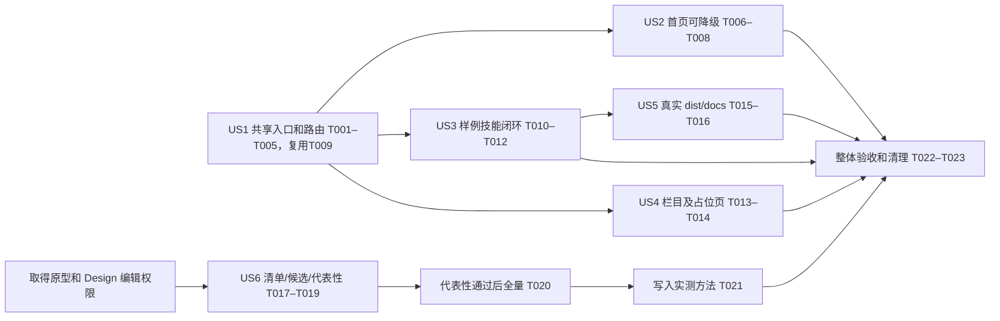

# 对话经过

会话 `01a21a86-57bc-71a0-ac8c-08cab671a1b3` · 轮次 `01a21a86-76d2-7200-9a64-90910914873e`

<!-- foundry-detail 01a21a86-57bc-71a0-ac8c-08cab671a1b3 01a21a86-76d2-7200-9a64-90910914873e -->
<!-- foundry-event 75acd64eea7258b921a95e3f63d32d4a2681a9590af6f60556929a60910aca93 -->
## 进度原话

- 来源定位：字节 158291

~~~text
我会先用 using-superpowers 和 conversation-recording 核对项目约定，再对照这份规格、任务清单和当前分支，确认下一步该做什么。
~~~

<!-- foundry-event 2e9eb3bd766d3f02e309435ffe10c8928e7e56d546bda00c540ea93113d3ae38 -->
## 宿主命令执行

- 来源定位：字节 161443

~~~text
{
  "command": "[已省略环境变量值] -lc 'cat /home/ena/.codex/plugins/cache/openai-curated-remote/superpowers/7.0.1/skills/using-superpowers/SKILL.md /home/ena/workspace/ena/agent-foundry/feature/init/.agents/skills/conversation-recording/SKILL.md'",
  "workdir": "file:///home/ena/workspace/ena/agent-foundry/feature/init",
  "exitCode": 0,
  "status": "completed"
}
~~~

<!-- foundry-event 6dd2ec6b99bbd88d98972e9c11aee89b29c91cb8160392be0f31ae38a5d2141e -->
## 工具结果 `exec-faf482f6-0739-4607-9e46-b2f003a2ab09`

- 来源定位：字节 161443

~~~text
---
name: using-superpowers
description: Use when starting any conversation - establishes how to find and use skills, requiring skill invocation before ANY response including clarifying questions
---

<SUBAGENT-STOP>
If you were dispatched as a subagent to execute a specific task, ignore this skill.
</SUBAGENT-STOP>

<EXTREMELY-IMPORTANT>
If you think there is even a 1% chance a skill might apply to what you are doing, you ABSOLUTELY MUST invoke the skill.

IF A SKILL APPLIES TO YOUR TASK, YOU DO NOT HAVE A CHOICE. YOU MUST USE IT.

This is not negotiable. You cannot rationalize your way out of this.
</EXTREMELY-IMPORTANT>

## The Rule

**Invoke relevant or requested skills BEFORE any response or action** — including clarifying questions, exploring the codebase, or checking files. If it turns out wrong for the situation, you don't have to use it.

**Before entering plan mode:** if you haven't already brainstormed, invoke the brainstorming skill first.

Then announce "Using [skill] to [purpose]" and follow the skill exactly. If it has a checklist, create a todo per item.

## Skill Priority

When multiple skills apply, process skills come first — they set the approach, then implementation skills (frontend-design, etc.) carry it out. Brainstorming and systematic-debugging are Superpowers' most common process skills, but the rule holds for any of them.

- "Let's build X" → superpowers:brainstorming first, then implementation skills.
- "Fix this bug" → superpowers:systematic-debugging first, then domain skills.

## Red Flags

These thoughts mean STOP—you're rationalizing:

| Thought | Reality |
|---------|---------|
| "This is just a simple question" | Questions are tasks. Check for skills. |
| "I need more context first" | Skill check comes BEFORE clarifying questions. |
| "Let me explore the codebase first" | Skills tell you HOW to explore. Check first. |
| "I can check git/files quickly" | Files lack conversation context. Check for skills. |
| "Let me gather information first" | Skills tell you HOW to gather information. |
| "This doesn't need a formal skill" | If a skill exists, use it. |
| "I remember this skill" | Skills evolve. Read current version. |
| "This doesn't count as a task" | Action = task. Check for skills. |
| "The skill is overkill" | Simple things become complex. Use it. |
| "I'll just do this one thing first" | Check BEFORE doing anything. |
| "This feels productive" | Undisciplined action wastes time. Skills prevent this. |
| "I know what that means" | Knowing the concept ≠ using the skill. Invoke it. |

## Platform Adaptation

If your harness appears here, read its reference file for special instructions:

- Claude Code: `references/claude-code-tools.md`
- Codex: `references/codex-tools.md`
- Pi: `references/pi-tools.md`
- Antigravity: `references/antigravity-tools.md`
- Hermes Agent: `references/hermes-tools.md`
- Muse: `references/muse-tools.md`

## User Instructions

User instructions (CLAUDE.md, AGENTS.md, GEMINI.md, etc, direct requests) take precedence over skills, which in turn override default behavior. Only skip skill workflows or instructions when your human partner has explicitly told you to.
---
name: conversation-recording
description: 核对 Codex CLI 项目级对话记录、资料位置和保存缺口，适用于首条消息、普通问答、业务请求、提交停写及会话恢复。
compatibility: 项目级自动入口适用于 Linux 上已启用分页会话的 Codex CLI 0.172.0，安装与回调需要 Python 3.10 或更高版本。
---

# 保存 Codex 会话记录

项目级安装交付本 Skill 和 Codex Hook。已从正式入口安装并在 Codex 完成信任时，首条用户原话、已完成的工具活动和实际最终回复由 Hook 保存。查阅记录或处理缺口时按[触发和保存时机](references/recording-timing.md)定位。把修复、实际 Git 提交和后续普通动作拆成独立调用，使每次提交及其结果可按发生顺序跳过记录。

项目安装位于 `.agents/skills/conversation-recording`，安装归属可从同目录的 `.foundry-recording-install.json` 核对。直接处理用户请求，由宿主 Hook 完成记录。用户要求查阅记录时，把查阅作为本轮业务。根据[资料契约](references/storage-contract.md)定位主记录和详情，根据[写入失败与重试](references/write-failures.md)说明仍缺失的范围。

~~~

<!-- foundry-event ce0ec7b02d47e76bd5075ebb0776310da37dbc10dc85f90cd325969e237a25ff -->
## 宿主命令执行

- 来源定位：字节 167021

~~~text
{
  "command": "[已省略环境变量值] -lc 'rg --files --hidden -g '\"'\"'AGENTS.md'\"'\"' -g '\"'\"'!**/.git/**'\"'\"' -g '\"'\"'!**/node_modules/**'\"'\"' -g '\"'\"'specs/docs/001-docs-site-framework/**'\"'\"' -g '\"'\"'!**/.turbo/**'\"'\"''",
  "workdir": "file:///home/ena/workspace/ena/agent-foundry/feature/init",
  "exitCode": 0,
  "status": "completed"
}
~~~

<!-- foundry-event 4320033ead76860b887c08de9a4dfa6bc39e3c12c65171d0947951566cf05103 -->
## 工具结果 `exec-101d0959-e1b9-4a0e-8a81-05fe63eb8ef1`

- 来源定位：字节 167021

~~~text
AGENTS.md
specs/docs/001-docs-site-framework/contracts/site-navigation.md
specs/docs/001-docs-site-framework/diagrams.md
specs/docs/001-docs-site-framework/quickstart.md
specs/docs/001-docs-site-framework/checklists/requirements.md
specs/docs/001-docs-site-framework/tasks.md
specs/docs/001-docs-site-framework/mvu.md
specs/docs/001-docs-site-framework/spec.md
specs/docs/001-docs-site-framework/research.md
specs/docs/001-docs-site-framework/data-model.md
specs/docs/001-docs-site-framework/plan.md
specs/docs/001-docs-site-framework/requirements/README.md
specs/docs/001-docs-site-framework/requirements/prompts/speckit-prompt.md
specs/docs/001-docs-site-framework/requirements/prompts/figma-make-prompt.md
specs/docs/001-docs-site-framework/requirements/raw/2026-11-26-original-request.md
specs/docs/001-docs-site-framework/requirements/raw/2026-11-20-a.md
specs/docs/001-docs-site-framework/analysis/spec-analysis/README.md

~~~

<!-- foundry-event 67b88748ef53402723911611c9e9fba0c0f54eb581aceeef1d8f53b763985e8a -->
## 宿主命令执行

- 来源定位：字节 168899

~~~text
{
  "command": "[已省略环境变量值] -lc 'git status --short --branch'",
  "workdir": "file:///home/ena/workspace/ena/agent-foundry/feature/init",
  "exitCode": 0,
  "status": "completed"
}
~~~

<!-- foundry-event a03b08718be16d43b9369e89cd96fe043dc2d48b0c824543ef36d54511e5b915 -->
## 工具结果 `exec-ec444b50-b263-4167-9b47-033416874040`

- 来源定位：字节 168899

~~~text
## feature/init...origin/feature/init
 M .codex/hooks.json
 M .specify/memory/conversation-recording/records/2026-11-26/01a2174d-dd90-74b1-8444-b2b62149b17b.md
 M packages/skills/tests/test_register_commands.py
?? .specify/memory/conversation-recording/records/2026-11-27/

~~~

<!-- foundry-event 42d76df6972cdd9c3e7dcf0d2ba159643181d3ca53b83270f941c22c36f871d2 -->
## 工具调用 `Bash` · `exec-faf482f6-0739-4607-9e46-b2f003a2ab09`

- 来源定位：工具事件 exec-faf482f6-0739-4607-9e46-b2f003a2ab09

~~~text
工作目录：/home/ena/workspace/ena/agent-foundry/feature/init
{
  "command": "cat /home/ena/.codex/plugins/cache/openai-curated-remote/superpowers/7.0.1/skills/using-superpowers/SKILL.md /home/ena/workspace/ena/agent-foundry/feature/init/.agents/skills/conversation-recording/SKILL.md"
}
~~~

<!-- foundry-event 2b6b73c520c3089cc0815ec504e102cbc2651149425b93a81261021e4b13cda3 -->
## 工具调用 `Bash` · `exec-ec444b50-b263-4167-9b47-033416874040`

- 来源定位：工具事件 exec-ec444b50-b263-4167-9b47-033416874040

~~~text
工作目录：/home/ena/workspace/ena/agent-foundry/feature/init
{
  "command": "git status --short --branch"
}
~~~

<!-- foundry-event 63a102bb3be2cb2b61eb1f339e4956cbfa5d2f207196a4abd8c424ffc2f99bcd -->
## 工具调用 `Bash` · `exec-101d0959-e1b9-4a0e-8a81-05fe63eb8ef1`

- 来源定位：工具事件 exec-101d0959-e1b9-4a0e-8a81-05fe63eb8ef1

~~~text
工作目录：/home/ena/workspace/ena/agent-foundry/feature/init
{
  "command": "rg --files --hidden -g 'AGENTS.md' -g '!**/.git/**' -g '!**/node_modules/**' -g 'specs/docs/001-docs-site-framework/**' -g '!**/.turbo/**'"
}
~~~

<!-- foundry-event 5a2bb7b0bb84e48f224dbdd2cd190ee536eebe13cb86d4e1eef104d01333c9cc -->
## 工具调用 `exec` · `call_cef3354974854649b9f6ad13c2b1bff3`

- 来源定位：字节 159299

~~~text
工作目录：/home/ena/workspace/ena/agent-foundry/feature/init
const results = await Promise.allSettled([
  tools.exec_command({cmd:"cat /home/ena/.codex/plugins/cache/openai-curated-remote/superpowers/7.0.1/skills/using-superpowers/SKILL.md /home/ena/workspace/ena/agent-foundry/feature/init/.agents/skills/conversation-recording/SKILL.md",workdir:"/home/ena/workspace/ena/agent-foundry/feature/init"}),
  tools.exec_command({cmd:"git status --short --branch",workdir:"/home/ena/workspace/ena/agent-foundry/feature/init"}),
  tools.exec_command({cmd:"rg --files --hidden -g 'AGENTS.md' -g '!**/.git/**' -g '!**/node_modules/**' -g 'specs/docs/001-docs-site-framework/**' -g '!**/.turbo/**'",workdir:"/home/ena/workspace/ena/agent-foundry/feature/init"})
]);
for (const result of results) text(result);

~~~

<!-- foundry-event 5dca627a4ee50705f416a087d45a33e025eba20cbdba750bc651fafa3f1babf7 -->
## 工具结果 `call_cef3354974854649b9f6ad13c2b1bff3`

- 来源定位：字节 169875

~~~text
[
  {
    "type": "input_text",
    "text": "Script completed\nWall time 0.8 seconds\nOutput:\n"
  },
  {
    "type": "input_text",
    "text": "{\"status\":\"fulfilled\",\"value\":{\"chunk_id\":\"a19c8b\",\"wall_time_seconds\":0.000033515,\"exit_code\":0,\"original_token_count\":1104,\"output\":\"---\\nname: using-superpowers\\ndescription: Use when starting any conversation - establishes how to find and use skills, requiring skill invocation before ANY response including clarifying questions\\n---\\n\\n<SUBAGENT-STOP>\\nIf you were dispatched as a subagent to execute a specific task, ignore this skill.\\n</SUBAGENT-STOP>\\n\\n<EXTREMELY-IMPORTANT>\\nIf you think there is even a 1% chance a skill might apply to what you are doing, you ABSOLUTELY MUST invoke the skill.\\n\\nIF A SKILL APPLIES TO YOUR TASK, YOU DO NOT HAVE A CHOICE. YOU MUST USE IT.\\n\\nThis is not negotiable. You cannot rationalize your way out of this.\\n</EXTREMELY-IMPORTANT>\\n\\n## The Rule\\n\\n**Invoke relevant or requested skills BEFORE any response or action** — including clarifying questions, exploring the codebase, or checking files. If it turns out wrong for the situation, you don't have to use it.\\n\\n**Before entering plan mode:** if you haven't already brainstormed, invoke the brainstorming skill first.\\n\\nThen announce \\\"Using [skill] to [purpose]\\\" and follow the skill exactly. If it has a checklist, create a todo per item.\\n\\n## Skill Priority\\n\\nWhen multiple skills apply, process skills come first — they set the approach, then implementation skills (frontend-design, etc.) carry it out. Brainstorming and systematic-debugging are Superpowers' most common process skills, but the rule holds for any of them.\\n\\n- \\\"Let's build X\\\" → superpowers:brainstorming first, then implementation skills.\\n- \\\"Fix this bug\\\" → superpowers:systematic-debugging first, then domain skills.\\n\\n## Red Flags\\n\\nThese thoughts mean STOP—you're rationalizing:\\n\\n| Thought | Reality |\\n|---------|---------|\\n| \\\"This is just a simple question\\\" | Questions are tasks. Check for skills. |\\n| \\\"I need more context first\\\" | Skill check comes BEFORE clarifying questions. |\\n| \\\"Let me explore the codebase first\\\" | Skills tell you HOW to explore. Check first. |\\n| \\\"I can check git/files quickly\\\" | Files lack conversation context. Check for skills. |\\n| \\\"Let me gather information first\\\" | Skills tell you HOW to gather information. |\\n| \\\"This doesn't need a formal skill\\\" | If a skill exists, use it. |\\n| \\\"I remember this skill\\\" | Skills evolve. Read current version. |\\n| \\\"This doesn't count as a task\\\" | Action = task. Check for skills. |\\n| \\\"The skill is overkill\\\" | Simple things become complex. Use it. |\\n| \\\"I'll just do this one thing first\\\" | Check BEFORE doing anything. |\\n| \\\"This feels productive\\\" | Undisciplined action wastes time. Skills prevent this. |\\n| \\\"I know what that means\\\" | Knowing the concept ≠ using the skill. Invoke it. |\\n\\n## Platform Adaptation\\n\\nIf your harness appears here, read its reference file for special instructions:\\n\\n- Claude Code: `references/claude-code-tools.md`\\n- Codex: `references/codex-tools.md`\\n- Pi: `references/pi-tools.md`\\n- Antigravity: `references/antigravity-tools.md`\\n- Hermes Agent: `references/hermes-tools.md`\\n- Muse: `references/muse-tools.md`\\n\\n## User Instructions\\n\\nUser instructions (CLAUDE.md, AGENTS.md, GEMINI.md, etc, direct requests) take precedence over skills, which in turn override default behavior. Only skip skill workflows or instructions when your human partner has explicitly told you to.\\n---\\nname: conversation-recording\\ndescription: 核对 Codex CLI 项目级对话记录、资料位置和保存缺口，适用于首条消息、普通问答、业务请求、提交停写及会话恢复。\\ncompatibility: 项目级自动入口适用于 Linux 上已启用分页会话的 Codex CLI 0.172.0，安装与回调需要 Python 3.10 或更高版本。\\n---\\n\\n# 保存 Codex 会话记录\\n\\n项目级安装交付本 Skill 和 Codex Hook。已从正式入口安装并在 Codex 完成信任时，首条用户原话、已完成的工具活动和实际最终回复由 Hook 保存。查阅记录或处理缺口时按[触发和保存时机](references/recording-timing.md)定位。把修复、实际 Git 提交和后续普通动作拆成独立调用，使每次提交及其结果可按发生顺序跳过记录。\\n\\n项目安装位于 `.agents/skills/conversation-recording`，安装归属可从同目录的 `.foundry-recording-install.json` 核对。直接处理用户请求，由宿主 Hook 完成记录。用户要求查阅记录时，把查阅作为本轮业务。根据[资料契约](references/storage-contract.md)定位主记录和详情，根据[写入失败与重试](references/write-failures.md)说明仍缺失的范围。\\n\"}}"
  },
  {
    "type": "input_text",
    "text": "{\"status\":\"fulfilled\",\"value\":{\"chunk_id\":\"43e4b9\",\"wall_time_seconds\":0.000052302,\"exit_code\":0,\"original_token_count\":69,\"output\":\"## feature/init...origin/feature/init\\n M .codex/hooks.json\\n M .specify/memory/conversation-recording/records/2026-11-26/01a2174d-dd90-74b1-8444-b2b62149b17b.md\\n M packages/skills/tests/test_register_commands.py\\n?? .specify/memory/conversation-recording/records/2026-11-27/\\n\"}}"
  },
  {
    "type": "input_text",
    "text": "{\"status\":\"fulfilled\",\"value\":{\"chunk_id\":\"6cee40\",\"wall_time_seconds\":0.000032297,\"exit_code\":0,\"original_token_count\":232,\"output\":\"AGENTS.md\\nspecs/docs/001-docs-site-framework/contracts/site-navigation.md\\nspecs/docs/001-docs-site-framework/diagrams.md\\nspecs/docs/001-docs-site-framework/quickstart.md\\nspecs/docs/001-docs-site-framework/checklists/requirements.md\\nspecs/docs/001-docs-site-framework/tasks.md\\nspecs/docs/001-docs-site-framework/mvu.md\\nspecs/docs/001-docs-site-framework/spec.md\\nspecs/docs/001-docs-site-framework/research.md\\nspecs/docs/001-docs-site-framework/data-model.md\\nspecs/docs/001-docs-site-framework/plan.md\\nspecs/docs/001-docs-site-framework/requirements/README.md\\nspecs/docs/001-docs-site-framework/requirements/prompts/speckit-prompt.md\\nspecs/docs/001-docs-site-framework/requirements/prompts/figma-make-prompt.md\\nspecs/docs/001-docs-site-framework/requirements/raw/2026-11-26-original-request.md\\nspecs/docs/001-docs-site-framework/requirements/raw/2026-11-20-a.md\\nspecs/docs/001-docs-site-framework/analysis/spec-analysis/README.md\\n\"}}"
  }
]
~~~

<!-- foundry-event de1b51b9562beffb157be01dd2333ad7b6b1f650d226add32d8a9cd8fa8bfefe -->
## 宿主命令执行

- 来源定位：字节 189594

~~~text
{
  "command": "[已省略环境变量值] -lc 'cat /home/ena/.codex/plugins/cache/openai-curated-remote/superpowers/7.0.1/skills/using-superpowers/references/codex-tools.md'",
  "workdir": "file:///home/ena/workspace/ena/agent-foundry/feature/init",
  "exitCode": 0,
  "status": "completed"
}
~~~

<!-- foundry-event 08a5e7ea82a575ae9e00a442f61e5d7ed7a8e860372ccb5dc866847309ee23a4 -->
## 工具结果 `exec-095df3ca-990e-4912-a48a-19ac354e5be4`

- 来源定位：字节 189594

~~~text
## Subagent dispatch requires multi-agent support

Add to your Codex config (`~/.codex/config.toml`):

```toml
[features]
multi_agent = true
```

This enables the multi-agent tools that skills like
`dispatching-parallel-agents` and `subagent-driven-development` use.
Which tools you get depends on the multi-agent version your model
preset selects (current presets run V2; older ones run V1). Trust your
actual tool list over any table — including this one — when they
disagree.

- **Spawning:** give children a clean context with
  `spawn_agent {fork_turns: "none"}`; the default `"all"` copies your
  entire transcript into the child. On Codex 0.145+, role files under
  `~/.codex/agents/` attach to isolated forks via `agent_type`.
  Full-history forks accept `model` and `reasoning_effort` overrides
  (only `agent_type` is refused there) — isolated forks are the SDD
  default for context hygiene, not because overrides require them.
- **Fix rounds:** resume the implementer with `followup_task` — it
  delivers your message, triggers a turn, and transparently reloads a
  child the harness evicted. Never dispatch a fresh implementer on the
  theory that a spawned agent cannot be messaged again; on V2 it
  always can.
- **Lifecycle:** V2 has no `close_agent`. Finished children are
  evicted automatically when slots are needed; leaving them unclosed
  costs nothing. Only V1 sessions have `close_agent` — there, close
  reviewers when their review returns, and close each implementer
  after its task's review passes.
- **Model names:** never copy a model name from a skill, table, or old
  session into `spawn_agent` without checking it against your current
  spawn allowlist — V2 accepts only V2-capable presets and hard-errors
  on the rest.

## Waiting on children

`wait_agent` is an event subscription, not a poll: a long wait wakes
the moment a child produces mailbox activity, with the same latency as
a short one. Short-timeout polling buys nothing and costs a tool call —
and a context rebill — per poll. In measured sessions, roughly
two-thirds of all wait calls were short polls that timed out.

- While you still have local work, do not wait at all. A completed
  child's final answer is pushed into your mailbox and arrives with
  your next turn.
- When you are genuinely idle with children outstanding, wait in
  bounded stretches: `wait_agent` with `timeout_ms` 300000-600000
  (5-10 minutes). After each stretch — wake or timeout — post one
  status line, run `list_agents`, and chase any child that finished
  without reporting. Never stack polls shorter than five minutes; the
  event subscription wakes a bounded stretch just as fast as a short
  one.
- Completion mail cannot wake an idle controller (it is delivered
  without triggering a turn); covering that idle window is
  `wait_agent`'s only job. A stretch that times out with no activity
  is your cue to reconcile, not to shorten the next stretch.

## Model routing on spawns

Every `spawn_agent` you issue — including when you are yourself a
spawned child running a fan-out — sets `model` AND `reasoning_effort`
explicitly, per the Model Selection rules of the skill you are
executing. Setting `model` alone is a trap: the child's effort
silently resets to that model's default, not to yours.

Ask your human partner to add a machine-level backstop to
`~/.codex/config.toml` so any spawn that slips through still routes to
a deliberate tier instead of silently inheriting the session's most
expensive model:

```toml
[agents]
default_subagent_model = "<a mid-tier model from your spawn allowlist>"
default_subagent_reasoning_effort = "medium"
```

## Environment Detection

Skills that create worktrees or finish branches should detect their
environment with read-only git commands before proceeding:

```bash
GIT_DIR=$(cd "$(git rev-parse --git-dir)" 2>/dev/null && pwd -P)
GIT_COMMON=$(cd "$(git rev-parse --git-common-dir)" 2>/dev/null && pwd -P)
BRANCH=$(git branch --show-current)
```

- `GIT_DIR != GIT_COMMON` → already in a linked worktree (skip creation)
- `BRANCH` empty → detached HEAD (cannot branch/push/PR from sandbox)

See `using-git-worktrees` Step 0 and `finishing-a-development-branch`
Step 1 for how each skill uses these signals.

## Codex App Finishing

When the sandbox blocks branch/push operations (detached HEAD in an
externally managed worktree), the agent commits all work and informs
the user to use the App's native controls:

- **"Create branch"** — names the branch, then commit/push/PR via App UI
- **"Hand off to local"** — transfers work to the user's local checkout

The agent can still run tests, stage files, and output suggested branch
names, commit messages, and PR descriptions for the user to copy.

~~~

<!-- foundry-event d25e513183709f9bf622bae99e7d470334a059e157c83cc46f15655e7510980f -->
## 宿主命令执行

- 来源定位：字节 195526

~~~text
{
  "command": "[已省略环境变量值] -lc 'cat specs/docs/001-docs-site-framework/analysis/spec-analysis/README.md specs/docs/001-docs-site-framework/checklists/requirements.md specs/docs/001-docs-site-framework/quickstart.md'",
  "workdir": "file:///home/ena/workspace/ena/agent-foundry/feature/init",
  "exitCode": 0,
  "status": "completed"
}
~~~

<!-- foundry-event 8d27ed3b30e00e30e939ab0476d543ec4a9d5431ec01a557ad00770c4c4628db -->
## 工具结果 `exec-80d0aa48-bedd-438a-8a84-d9b9b6d9fd8d`

- 来源定位：字节 195526

~~~text
# Agent Foundry 文档站框架：功能分析

**分析依据（2026-11-26）**：当前 [需求及澄清](../../spec.md)、[总体方案](../../plan.md)、[业务闭环](../../mvu.md)、[任务清单](../../tasks.md)、[数据模型](../../data-model.md)、[路由契约](../../contracts/site-navigation.md)、[技术研究](../../research.md)、[技术状态图](../../diagrams.md) 与 [验收指南](../../quickstart.md)。本分析用于阅读和追踪功能，不是实现证据、工程状态清单或业务验收报告。

## 当前源码基线与边界

仓库当前的 `apps/docs` 是使用 Nuxt Content 与 UnoCSS 的文档应用，现有动态内容路由查询 `docs` 集合，未查到页面时返回 404；应用目前仅有 `default` 布局、catch-all 文档页和文档侧栏/目录组件。相关源码位置为 `apps/docs/nuxt.config.ts`、`apps/docs/content.config.ts`、`apps/docs/app/pages/[...slug].vue`、`apps/docs/app/layouts/default.vue` 及 `apps/docs/app/components/`。这是本轮核对时的项目事实，并不代表新规格的模块、布局和交互已经交付。

文档框架仍处于 Spec/Plan/Tasks 规划阶段。Nuxt UI 与 Three.js 尚未成为 docs 应用依赖；技能真实 `dist/docs`、Figma 原型访问/可运行源码和可编辑目标文件权限目前均为外部前置。下文所述新页面和组件均为计划位置。任务状态只读取 [tasks.md](../../tasks.md)，不从本页有无说明推断完成。

## 全局入口、兼容地址与四套布局

**业务分析**：读者从首页或任一模块出发，可借共享品牌回首页、借四个一级入口切换模块。技能集合子菜单只在技能模块出现，未知文档给出 404。用户已保存的 `/`、`/skills`、`/mcp`、`/workflow`、`/getting-started/installation` 应继续直达并支持刷新；新增项目开发入口为 `/development`。此项支撑 US1、FR-001/002/008/009、SC-001/004。

**关键判断与技术关系**：布局为 `home`、`skill`、`work-with-speckit`、`empty`；MCP 和项目开发文档共用 `empty` 但入口、标题和说明保持独立。项目开发文档地址已定为 `/development`。T002 建立五模块和样例集合最小路由骨架，兼容当前 Nuxt Content catch-all；T009 提供共享技能样例数据，保证 US1 无需等待详情实现即可操作集合子菜单。共享导航组件消费经 Nuxt UI 集成验证后的组件能力。计划文件位置详见相关 Task。

**流程与验收**：T001 先验证 Nuxt UI/UnoCSS 集成；T002 建模块及样例集合最小路由骨架；T009 准备集合子菜单和目录共用的样例数据；T003–T005 实现并核对品牌、桌面/手机菜单、集合子菜单、兼容地址和 404。US1 独立验收依赖上述基础，但不等待 US2–US4 的正式内容；构建通过不代替可操作性结果。

## 首页章节与模型失败降级

**业务分析**：访客纵向阅读 Skills、MCP 两个全屏示例章节，了解包名和占位内容。3D 提供视觉内容但不是阅读前置；任一模型加载失败或设备不支持渲染时，该章节保留静态替代、文字和文档入口，另一章照常运行。此项支撑 US2、FR-003/004、SC-002。

**技术分析**：Plan 选择在当前 Nuxt SSR 页面内隔离浏览器专属 Three.js 运行部分，不把整页变为客户端专属。初始 HTML 仍应包含可读章节内容及回退；每个章节持有独立模型状态，失败路径只改变自己的模型区域并释放已初始化资源。Three.js 依赖和模型加载错误行为尚待 T006 真实技术验证；计划组件位置为 `apps/docs/app/components/ModelScene.client.vue`、`HomeSection.vue` 与 `apps/docs/app/pages/index.vue`。

**技术流程图**：[diagrams.md](../../diagrams.md#首页-3d-模型加载与独立回退) 描绘 SSR 正文与客户端模型分界、成功和失败状态。它是计划逻辑图，不是已验证的实现流程。

**Task 与验收**：T006 验证客户端隔离和异常/资源清理并更新状态图；T007 先交付不依赖模型的章节骨架；T008 接入独立模型。分别注入 Skills、MCP 模型失败，在桌面/手机确认只有对应模型回退、正文/导航仍可用。图上的实现路径须在实施后按实际代码核准。

## 技能集合、技能详情与目录

**业务分析**：技能包正式文档说明就绪前，读者打开 `/skills` 只能看到至少两个样例集合及每集合至少一个样例技能。读者从顶部集合入口或侧栏到达同一集合，能展开/收起集合、辨认当前项；技能详情显示技能名称、所属集合及「文档待补充」占位，集合页保留说明区域。手机目录可开关。此项支撑 US3、FR-005/008/009、SC-003/004。

**数据与技术关系**：T009 在共享前置阶段定义集合/技能样例数据，驱动全局子菜单和本地两级目录，避免路径分叉；集合标识和技能标识形成可直达层级。有效路径须存在对应数据，无效标识转为 404。计划数据位置 `apps/docs/app/data/skills.ts`，目录组件为 `apps/docs/app/components/SkillDirectory.vue`，集合/详情页面为 `apps/docs/app/pages/skills/[collection]/index.vue` 与 `[skill].vue`。不得复制现存九项紧急版说明。

**Task 与验收**：复用共享前置 T009；T010 实现左侧目录及桌面/移动操作，T011 交付集合/详情内容，T012 核验有效/无效直达与刷新。单一列表字符串相同不足以证明闭环；需实际点选两处入口并核对 URL、当前状态和详情内容。

## Spec Kit 栏目、MCP 与项目开发入口

**业务分析**：读者能在 Spec Kit 模块切换两个栏目，并看到与选中栏目匹配的占位标题/正文。MCP 和项目开发文档都有独立可直达页面，尽管共用简洁布局，内容不互相混淆。此项支撑 US4、FR-006/007/009、SC-004。

**技术与流程**：Spec Kit 栏目用可替换的栏目标识、名称、标题、正文驱动侧栏和内容；项目开发文档新地址定为 `/development`。计划文件为 `apps/docs/app/data/workflow.ts`、`apps/docs/app/pages/workflow/[section].vue`、`apps/docs/app/components/WorkflowNavigation.vue`、`apps/docs/app/pages/mcp.vue` 和 `apps/docs/app/pages/development.vue`。

**Task 与验收**：T013 实现栏目切换及选中/正文同步；T014 实现 MCP 与项目开发占位页。桌面、手机切换栏目，再对两类占位地址直接打开和刷新；同时确认共享品牌导航存在。

## 技能包集合说明的真实产物接入

**业务分析**：维护者在技能包正式产物可用后可为集合配置默认说明、指定说明或关闭说明。文件缺失时维护者能定位告警；读者看到该集合占位，其他有效集合仍正常展示。此项支撑 US5、FR-010、SC-005。

**技术分析**：源边界是技能包正式且已验收的 `dist/docs`，不是紧急版源码、临时复制文件或本地模拟成功。字段省略/`true` 选集合默认 README，字符串在本集合目录内选择指定文件，`false` 跳过读取；缺文件按集合隔离并继续处理其他集合。当前只有计划契约，没有可供真实联调的产物。可能涉及 `apps/docs/content.config.ts`、`apps/docs/nuxt.config.ts` 和消费组件，确切机制须等 T015 核对真实目录后确定。

**Task 与恢复**：T015 以发布验收过的真实产物记录来源和元数据，T016 据实际路径实施接入并逐类验收。恢复条件是技能包完成适用发布流程并交付真实 `dist/docs`。此前可验收 US3 样例目录，不得称正式跨包接入通过。

## Figma 原型到可编辑 Design 画板

**业务分析**：设计协作者希望一次启动覆盖实际原型清单，将页面、视图与会改变可见导航的展开状态转换到同一 Figma Design 文件，并继续编辑文字和布局。工具可行性必须先由小批实测，不根据工具宣传推断本项目支持。此项支撑 US6、FR-011–014、SC-006/007。

**清单与判定**：真实原型到手后按模块盘点可达页面/视图、适用桌面或手机视口、默认态及可见导航布局变化态；正文不同的 Spec Kit 栏目分别建项。比较 URL 批量导入、Figma MCP Code to canvas 和至少一种 AI 或脚本驱动的清单采集候选对真实页面/交互状态的覆盖。代表性批次至少首页加一个内页且桌面/手机适用版本一次产出至少四块画板；文字/布局可编辑、正文和导航状态相符，替代内容须逐项记录并获设计协作者确认；代表性通过后才能启动全量。每项状态区分通过、失败、缺前置、未执行。

**Task 与恢复**：T017 盘点真实清单；T018 比较覆盖；T019 代表性批次；T020 通过后全量批次；T021 全量通过后把可复现方法写入 Spec。产物及逐项证据保存在计划位置 `analysis/figma-conversion.md`。当前缺原型入口/可运行源码和目标文件编辑权限，因此这些 Task 受阻，不能冻结其余站点闭环，也不能填入猜测的方法。

## MVU 里程碑与流转

实际用户结果、闭环节点、依赖和验收以同级 [mvu.md](../../mvu.md) 为唯一详情来源；Task 身份及唯一工程 checkbox 以 [tasks.md](../../tasks.md) 为准。

| 里程碑         | 可观察结果                                                                  | 任务衔接                             |
| -------------- | --------------------------------------------------------------------------- | ------------------------------------ |
| 可浏览站点入口 | 桌面/手机可切换五个模块及样例集合、品牌可返回、有效旧地址直达、未知路径 404 | US1：T001–T005，复用 T009            |
| 首页可靠浏览   | 两章文字和静态替代不依赖 3D，独立模型失败不带走入口                         | US2：T006–T008                       |
| 样例技能导航   | 同源集合入口、详情直达、手机目录和错误地址符合契约                          | US3：T010–T012，复用 T009            |
| 其余模块可用   | Spec Kit 栏目状态同步，MCP 和开发文档内容独立                               | US4：T013–T014                       |
| 正式技能文档   | 真实产物五种规则通过，缺失只影响一个集合                                    | US5：T015–T016，依赖正式 `dist/docs` |
| 原型设计转换   | 代表性通过后全量画板 100% 映射并保留可复现方法                              | US6：T017–T021，依赖原型及编辑权限   |
| 收尾           | 已具备范围按指南留验收记录，过程产物清理及引用检查有依据                    | T022–T023                            |



上图是任务依赖的业务视图，不表示阻塞轨道已经执行。T022 只对已具备输入的交付范围验证；因缺外部前置而未执行的 US5/US6 项保留明确状态和恢复条件。T023 最后执行并保护正式交付、有效治理及验收证据。

## 不适用分析类别

- **后端/API 与持久化数据分析**：本规格是静态内容型 Nuxt 应用，没有业务服务、写入数据库或对外 HTTP API 要求；契约定义的是浏览器路由和可见行为，不新增 API。
- **部署/运行容量结论**：Spec 未要求部署方式、用户规模或量化性能目标；不基于现有开发配置推导生产部署验收。
- **Figma/真实产物实测结论**：属于计划内独立工作，不是当前证据。具体输入缺失时只保留任务、阻塞说明和恢复条件。
# Specification Quality Checklist: Agent Foundry 文档站框架

**用途** 核对规格的完整性、可验收性和规划就绪情况。

**创建日期** 2026-11-26

**功能** [规格正文](../spec.md)

## Content Quality

- [x] 需求与验收描述交付结果。指定技术和产物契约集中在 Plan 验证输入。
- [x] 以文档读者、维护者和设计协作者的使用价值为中心。
- [x] 用相关使用者可以理解的语言编写。
- [x] 已填写模板的全部必填章节。

## Requirement Completeness

- [x] 无需要澄清的标记。
- [x] 功能需求明确且可验证。
- [x] 成功标准可测量。
- [x] 成功标准可独立于实现技术验证。
- [x] 主要流程均有 Given/When/Then 验收场景。
- [x] 已标明重要边界和失败情形。
- [x] 本期交付范围明确。
- [x] 已记录前置依赖和合理假设。

## Feature Readiness

- [x] 每条功能需求均可对应验收情形或检查项。
- [x] 用户故事覆盖主要流程并可独立验证。
- [x] 成功标准能据以判断所声明的结果。
- [x] 技术实现与工具选型留在后续 Plan。

## Notes

2026-11-26 核对记录。规格包含 6 条可独立验证的用户故事、19 个 Given/When/Then 场景、14 条功能需求和 7 条成功标准。

| 用户故事                  | 功能需求                               | 成功标准               |
| ------------------------- | -------------------------------------- | ---------------------- |
| 1 全局菜单和兼容地址      | FR-002、FR-008、FR-009                 | SC-001、SC-004         |
| 2 首页章节与 3D 降级      | FR-001、FR-003、FR-004                 | SC-002                 |
| 3 技能目录和直达          | FR-001、FR-002、FR-005、FR-008、FR-009 | SC-001、SC-003、SC-004 |
| 4 Spec Kit 和两类占位文档 | FR-001、FR-006 至 FR-009               | SC-004                 |
| 5 集合说明接入            | FR-010                                 | SC-005                 |
| 6 Figma 批量转换          | FR-011 至 FR-014                       | SC-006、SC-007         |

- 已核对现有五个站内地址的源码、未知路径的 404 分支、新写文档的本地引用及 Spec Kit 规格定位。四份原始材料已逐字节核对。
- 根 ESLint 配置忽略 `specs/**`。规格、检查清单和需求依据使用 `pnpm exec eslint --fix --no-ignore` 检查。
- 站点和 3D 的运行验收在规格阶段未执行。真实集合说明接入缺前置，恢复条件是技能包提供 `dist/docs`。Figma 转换实测缺前置，恢复条件是提供可访问的原型或可运行的源码及目标文件编辑权限。
# 验收快速指南：Agent Foundry 文档站框架

本文是实现后的执行指南，不声称本 Plan 阶段已完成任何页面或浏览器验收。

## 前置

- 从仓库根目录安装依赖：`pnpm install`。
- 确保 Node 符合根 `package.json` 的 `>=22.20.0` 要求，pnpm 版本符合仓库约定（12）。
- 真实技能说明接入用例须等 `packages/skills` 提供正式 `dist/docs`；Figma 转换须另外取得真实原型入口/源码与目标文件编辑权限。

## 静态工程检查

在仓库根目录执行：

```bash
pnpm --filter @foundry/docs run lint
pnpm --filter @foundry/docs run check-types
pnpm --filter @foundry/docs run build
```

预期：命令成功；lint、类型检查及构建均无新增错误。失败项记录命令、输出、阻塞范围与恢复条件，不得通过删除验收断言或放宽规则消除。

## 运行站点

在仓库根目录启动：

```bash
pnpm --filter @foundry/docs run dev
```

预期：本地文档站启动。按实现输出的地址打开浏览器；当前应用默认配置端口为 7000，若配置调整则以实际运行输出为准。

## 桌面与手机浏览器验收

桌面与手机视口分别完整执行。逐项记录实际路径、视口、操作和观察结果：

1. 从每个模块检查品牌及四个一级入口；使用品牌返回首页。技能模块顶部集合子菜单与左侧目录对照名称和目标。
2. 在手机视口打开/关闭全局菜单，进入模块；在技能模块打开/关闭目录，选择集合和技能。
3. 直接地址栏访问并刷新 `/`、`/skills`、`/mcp`、`/workflow`、`/development`、`/getting-started/installation`，确认页面内容和导航状态；实现后的集合/技能地址也应逐一检查。
4. 打开未知模块、未知集合、未知技能地址，确认 404 状态和「文档不存在」提示。
5. 打开技能目录中至少两个样例集合，并各进入一项技能；对集合页和技能详情分别直接打开、刷新，核对集合/技能当前标记、技能名称标题和占位正文。
6. 切换至少两个 Spec Kit 栏目，确认选中项、标题和正文同步变化。
7. 首页纵向翻阅 Skills、MCP 两章，确认标题、包名、占位正文、各自模型和全局导航；分别让任一章模型加载失败/渲染不可用，确认静态替代与文字仍在，另一章及全局入口仍可用。

## 技能说明接入（前置满足后）

使用技能包实际构建并验收的 `dist/docs`，覆盖文档字段省略、`true`、指定文件、`false` 和指定文件缺失。保存实际产物来源及每种输入的展示/跳过结果；缺失警告须定位到集合，其他有效集合仍正常展示。未取得真实产物前标注「缺前置」，不得用临时模拟文件记作跨包通过。

## Figma 转换验收（前置满足后）

记录原型入口或源码版本、目标 Figma Design 文件/权限、候选方法及清单。按清单先转换首页和至少一个内页各自适用的桌面/手机画面，一次运行生成同一文件内至少四块画板；通过文字/布局编辑性、正文、导航状态、字体/图片差异及 3D/动画处理检查。代表性批次通过后再启动全量批次，并逐项核对清单与具名画板、保存链接、差异、结果和可复现步骤。缺输入/权限、未执行、失败均单独记录，不计入通过。

## 证据记录

对每个验收项保存实际输入、命令或操作、目标视口/地址、预期与实际观察、失败/差异以及恢复条件。工程检查通过不能代替浏览器交互或业务结果验收；Figma 和真实 docs 产物各自的证据不得互相替代。

~~~

<!-- foundry-event 62b5506c07c911f2f3f69e381c26ec4e50433c2b3f86561f80c010ef1e1848a1 -->
## 宿主命令执行

- 来源定位：字节 215367

~~~text
{
  "command": "[已省略环境变量值] -lc 'cat specs/docs/001-docs-site-framework/tasks.md specs/docs/001-docs-site-framework/mvu.md'",
  "workdir": "file:///home/ena/workspace/ena/agent-foundry/feature/init",
  "exitCode": 0,
  "status": "completed"
}
~~~

<!-- foundry-event eb0245cfec009a65cb1c3cecd935ca0fc56b27972d6ec932f7f23c8d86afed60 -->
## 工具结果 `exec-8bc4badf-f9cb-4af4-8cab-e528e02bebc4`

- 来源定位：字节 215367

~~~text
---
description: "Agent Foundry 文档站框架的实现任务"
---

# Tasks: Agent Foundry 文档站框架

**Input**: `specs/docs/001-docs-site-framework/` 中的 `spec.md`、`plan.md`、`mvu.md`、`research.md`、`data-model.md`、`contracts/site-navigation.md` 与 `quickstart.md`

**Organization**: 按 Spec 的六个用户故事分阶段。每个 checkbox 是唯一工程状态；详细实现方案由后续实现准备写入 `implementation/<Task ID>.md`。

## Phase 1: Setup（共享技术前置）

**Purpose**: 验证 Nuxt UI 与现有应用基础的集成，为模块页面和导航提供共享组件能力。

- [ ] T001 在 `apps/docs/package.json`、`apps/docs/nuxt.config.ts` 和根 `pnpm-lock.yaml` 接入 Nuxt UI；核对其 Nuxt 配置及与现有 UnoCSS `presetWind3`、属性化前缀 `un-` 的样式共存，运行 docs workspace lint、类型检查和构建。若发现冲突，记录可复现输入、影响与恢复方案，不静默替换 Nuxt UI。

## Phase 2: Foundational（共享路由、布局与技能样例数据）

**Purpose**: 建立足以独立验收全局导航的五模块最小页面骨架、四种布局和导航共用的样例数据。

- [ ] T002 在 `apps/docs/app/app.vue`、`apps/docs/app/layouts/home.vue`、`apps/docs/app/layouts/skill.vue`、`apps/docs/app/layouts/work-with-speckit.vue`、`apps/docs/app/layouts/empty.vue` 及 `apps/docs/app/pages/index.vue`、`apps/docs/app/pages/skills/index.vue`、`apps/docs/app/pages/skills/[collection]/index.vue`、`apps/docs/app/pages/mcp.vue`、`apps/docs/app/pages/workflow/index.vue`、`apps/docs/app/pages/development.vue` 建立五模块及样例集合最小可达页/四种布局骨架；确认五个既有有效路径可解析并刷新，未知模块/文档路径返回现有 404。
- [ ] T009 在 `apps/docs/app/data/skills.ts` 定义可替换的 frontend、workflow 两个样例集合且每集合至少一个技能，为集合标识、名称、说明占位、技能标识、技能名称及归属提供稳定字段；此共享数据供全局集合子菜单和后续 US3 目录共同消费，不导入紧急版技能内容。

## Phase 3: User Story 1 - 从全局菜单进入文档并返回首页（Priority: P1）

**Goal**: 所有模块共享品牌和四个一级入口；桌面、手机导航可用，历史有效地址可直达，未知地址明确 404。

**Independent Test**: 仅依赖共享路由骨架与样例数据，桌面和手机分别从五个模块最小页使用全局入口与品牌导航，并在技能模块打开集合子菜单选择样例集合；地址栏直达并刷新五个既有地址；访问未知文档确认 404 和提示。无需等待首页章节、技能详情正文或 Spec Kit 栏目实现。

### Implementation

- [ ] T003 [US1] 在 `apps/docs/app/components/GlobalNavigation.vue` 实现共享品牌、四个一级入口及仅在技能模块显示的集合子菜单；首页品牌指向 `/`，模块入口与集合子菜单分别使用契约确定的路径和 T009 单一样例数据。
- [ ] T004 [US1] 在 `apps/docs/app/components/MobileGlobalMenu.vue` 实现手机端可开关的全局菜单，包含四个一级入口及技能模块的集合子菜单；在开发服务逐项操作开关和导航，确认选择集合可到达其路由骨架，桌面导航仍可用。
- [ ] T005 [US1] 在现有 `apps/docs/app/pages/[...slug].vue` 保持未知文档 404 和「文档不存在」提示；直接访问并刷新 `/`、`/skills`、`/mcp`、`/workflow`、`/development`、`/getting-started/installation`，逐项核验入口可达。

## Phase 4: User Story 2 - 翻阅首页章节并在 3D 加载失败时继续浏览（Priority: P1）

**Goal**: 首页展示 Skills、MCP 两个全屏章节；两个模型相互独立，模型失败时章节文字、静态替代和全局导航仍可用。

**Independent Test**: 桌面和手机纵向翻阅两章；分别令每章的模型输入失败或 WebGL 不可用，确认只影响对应模型区域，文字与导航可用。

### Implementation

- [ ] T006 [US2] 在 `apps/docs/package.json`、`pnpm-lock.yaml` 和 `apps/docs/app/components/ModelScene.client.vue` 加入 Three.js 并验证客户端渲染隔离；使用最小场景核实浏览器不可用或资源失败时可捕获失败并释放渲染资源，将真实状态/失败转移更新到 `specs/docs/001-docs-site-framework/diagrams.md`，再运行 docs 类型检查和构建。
- [ ] T007 [US2] 在 `apps/docs/app/pages/index.vue` 和 `apps/docs/app/components/HomeSection.vue` 建立按顺序纵向翻阅的 Skills、MCP 全屏章节；每章均配置包名、可替换占位正文及不依赖模型加载的静态替代，并在桌面/手机检查内容可读。
- [ ] T008 [US2] 在 `apps/docs/app/components/ModelScene.client.vue` 为两章分别接入独立 Three.js 模型与失败回退；分别注入每章模型加载失败，确认本章替代可见、另一章不受影响且共享菜单入口可操作，并按实际实现复核 `specs/docs/001-docs-site-framework/diagrams.md`。

## Phase 5: User Story 3 - 按集合查找技能并直达技能详情（Priority: P1）

**Goal**: `/skills` 仅呈现样例目录；顶部集合菜单和左侧两级目录来自同一数据源，集合和技能可展开、选中、直达及刷新。

**Independent Test**: 使用 frontend、workflow 两个样例集合且各至少一项技能；比较两处集合入口目标，操作展开/收起，直达并刷新集合和技能页，核对标题、归属与占位正文，未知目标为 404。

### Implementation

- [ ] T010 [US3] 在 `apps/docs/app/components/SkillDirectory.vue` 实现由 `apps/docs/app/data/skills.ts` 唯一数据源生成的左侧两级目录；支持集合展开/收起、当前集合/技能标记及手机目录开关，并核对其集合目标与 `GlobalNavigation.vue` 一致。
- [ ] T011 [US3] 在 `apps/docs/app/pages/skills/[collection]/index.vue` 与 `apps/docs/app/pages/skills/[collection]/[skill].vue` 实现集合页和技能详情路由并使用 `skill` 布局；集合页显示可替换说明区域，详情标题等于技能名称、正文显示「文档待补充」且可辨识所属集合。
- [ ] T012 [US3] 在 `apps/docs/app/pages/skills/[collection]/index.vue` 与 `apps/docs/app/pages/skills/[collection]/[skill].vue` 为无效集合/技能返回 404 和文档不存在提示；确保 `/skills` 仅渲染 T009 样例而非紧急版九项说明，并逐项直达、刷新有效集合与技能地址。

## Phase 6: User Story 4 - 切换 Spec Kit 栏目并打开两类占位文档（Priority: P1）

**Goal**: Spec Kit 模块可在两个示例栏目间切换；MCP 与项目开发文档有各自可直达的占位入口。

**Independent Test**: 桌面和手机切换两个栏目并核对选中态、标题和正文；打开并刷新 `/mcp` 与项目开发文档地址，确认标题和说明各自正确。

### Implementation

- [ ] T013 [US4] 在 `apps/docs/app/data/workflow.ts` 定义至少两个可替换的 Spec Kit 栏目名称、标题与正文；在 `apps/docs/app/pages/workflow/[section].vue` 和 `apps/docs/app/components/WorkflowNavigation.vue` 实现一级侧栏，选择栏目时 URL、选中态及正文同步，桌面/手机均可切换。
- [ ] T014 [US4] 在 `apps/docs/app/pages/mcp.vue` 与 `apps/docs/app/pages/development.vue` 实现各自独立的占位标题和说明并使用 `empty` 布局；直接打开并刷新 `/mcp` 与 `/development`，确认全局导航可达且两页内容不混淆。

## Phase 7: User Story 5 - 在技能包产物就绪后接入集合说明（Priority: P2）

**Goal**: 从技能包实际 `dist/docs` 读取集合说明，遵守省略、`true`、文件名、`false` 和缺失文件规则；缺失隔离于单个集合。

**Independent Test**: 使用技能包真实构建并验收的 `dist/docs`，验证省略/`true` 读 README、字符串读取指定文件、`false` 不读取、缺文件告警并占位且其他集合继续显示。

### Implementation

- [ ] T015 [US5] 在实现 `apps/docs/` 接入前确认 `packages/skills` 已交付并通过其发布流程验收的真实 `dist/docs` 产物；将源产物路径、元数据字段及默认 README/指定文件布局记录在 `specs/docs/001-docs-site-framework/analysis/` 的实际验收材料中，前置缺失时记录缺项与恢复条件，不以临时模拟内容判定已接入。
- [ ] T016 [US5] 在 `apps/docs/content.config.ts`、`apps/docs/nuxt.config.ts` 及 `apps/docs/app/` 按真实产物接入各集合说明；省略或 `true` 读取默认 README、字符串读取集合目录指定文件、`false` 跳过说明；分别以真实五类输入验收，缺文件警告准确定位且仅影响该集合，其他有效说明仍展示。

## Phase 8: User Story 6 - 一次启动将原型页面和状态转换为可编辑画板（Priority: P2）

**Goal**: 基于实际原型清单先验收代表性批次，再运行一次全量转换并保存可复用方法和逐项证据。

**Independent Test**: 获得真实原型与可编辑目标 Design 文件后，先用首页和至少一个内页的桌面/手机版本一次生成至少四块可编辑画板；代表性验收通过后再一次全量运行并核对全部清单。

### Implementation

- [ ] T017 [P] [US6] 在 `specs/docs/001-docs-site-framework/analysis/figma-conversion.md` 建立真实原型盘点和输入记录；取得可访问的 Figma Make 原型或可运行源码、以及可编辑目标 Design 文件/工作区权限后，逐项记录五模块可达页面/视图、适用桌面/手机视口、默认画面、改变可见导航布局的展开态和不同正文的 Spec Kit 栏目。缺任何前置时记录阻塞原因与恢复条件。
- [ ] T018 [US6] 在 `specs/docs/001-docs-site-framework/analysis/figma-conversion.md` 对照真实清单比较批量 URL 导入、Figma MCP Code to canvas，以及至少一种 AI 或脚本驱动的清单采集方式对页面/交互状态的覆盖能力；记录各自限制、实际采用方式、运行输入及目标文件，不以公开文档能力替代本项目实测。
- [ ] T019 [US6] 在 `specs/docs/001-docs-site-framework/analysis/figma-conversion.md` 执行一次代表性转换：覆盖首页和至少一个内页各自适用的桌面、手机视图，一次启动在同一 Design 文件生成至少四块具名画板；逐项检查文字/布局可编辑性、正文/导航状态、字体/图片差异及 3D/动画处理，保存画板链接、结果和设计协作者对替代项的确认。
- [ ] T020 [US6] 仅在 T019 代表性批次验收通过后，于 `specs/docs/001-docs-site-framework/analysis/figma-conversion.md` 对真实全量清单执行一次转换；核对清单每项唯一对应同一 Design 文件内具名画板，满足 FR-012 条件的比例为 100%，保存全部链接、逐项结果、差异和失败/未执行恢复条件。
- [ ] T021 [US6] 仅在 T020 全量验收通过后，将实际可复用输入、权限、页面清单维护方式、批量运行步骤、画板组织/链接、动态内容处理和失败重跑方法写入 `specs/docs/001-docs-site-framework/spec.md` 的「转换方法复用」章节；未通过或前置缺失时如实记录结果，不填写推测的方法。

## Phase 9: Polish & Cross-Cutting Concerns

**Purpose**: 对已具备前置的交付范围完成工程和端到端核验，并清理开发过程产物。

- [ ] T022 在 `specs/docs/001-docs-site-framework/quickstart.md` 和 `specs/docs/001-docs-site-framework/analysis/` 记录实际执行的 docs lint、类型检查、build 及桌面/手机验收输入、预期和结果；失败、未执行、缺前置分别列明，不把构建成功代替用户流程验收。
- [ ] T023 在 `apps/docs/` 及 `specs/docs/001-docs-site-framework/` 按代码调用、配置、文档语义和引用核对开发期间产生的临时/失效产物；清理可确认无用项并在 `specs/docs/001-docs-site-framework/analysis/` 记录定位、依据、处置与引用检查，无需清理或用途未明的项也记录范围、保留理由和后续条件。

## 依赖与执行顺序

### 阶段依赖

- **Setup（Phase 1）**：Nuxt UI 安装及与 UnoCSS 的兼容核验先于依赖该组件库的模块实现；失败只阻止受影响组件工作，不能未经确认替换既定技术。
- **Foundational（Phase 2）**：T002 提供五个最小路由页，T009 提供全局集合子菜单和技能目录共用的样例数据；完成后 US1 可独立操作全站模块入口及集合子菜单。
- **P1 故事（Phase 3–6）**：US1 的完整全局菜单完成后，US2、US3、US4 可按文件隔离并行；它们各自仍须独立完成并按故事标准验收。
- **US5（Phase 7）**：依赖技能包真实且已验收的 `dist/docs`；前置缺失不阻塞站点样例故事。
- **US6（Phase 8）**：T017 依赖原型输入与目标文件权限；T018 依赖 T017 清单；T019 依赖 T017/T018 及同一编辑权限；T020 严格依赖 T019 通过；T021 严格依赖 T020 通过。整个 Figma 轨道可与站点实现并行。
- **Polish（Phase 9）**：T022 在已实现且前置具备的范围上执行；T023 是执行序列最后的收尾 Task，不得提前完成。

### 用户故事依赖

- **US1（P1）**：依赖 Setup 和 Foundational（含 T009 样例集合数据）；T002 的最小模块/集合路由骨架使其可以不等待 US2–US4 的正式内容而独立验收。
- **US2（P1）**：依赖共享全局导航；单独受 Three.js 客户端技术验证约束。
- **US3（P1）**：依赖共享导航/布局及技能路由契约；样例验收不依赖正式技能包产物。
- **US4（P1）**：依赖共享导航/布局；独立于首页模型和正式技能说明输入。
- **US5（P2）**：依赖 US3 样例集合页和真实 `dist/docs`。
- **US6（P2）**：独立于站点实现；代表性批次通过是全量转换的必要门槛。

### 可并行机会

- T007 的首页文字/章节骨架可与 US3 的目录组件及 US4 的栏目数据/页面分文件开发，但需待共同路由/布局基础完成；样例技能数据 T009 属共享前置，先完成再并行。
- US2、US3、US4 可在 US1 共享入口就绪后并行；避免并行改动同一个组件或 Nuxt 配置文件。
- T017 的原型盘点可与站点故事并行；T018–T021 依赖关系严格串行。
- US5 真实产物接入可在样例站点完成后独立续接，不阻塞 MVP。

## 并行示例：路由基础后的独立 P1 故事

```text
任务 A：T007 首页章节文字与静态替代（apps/docs/app/pages/index.vue、首页组件）
任务 B：T010 技能左侧目录（apps/docs/app/components/SkillDirectory.vue）
任务 C：T013 Spec Kit 栏目数据与页面（apps/docs/app/data/workflow.ts、apps/docs/app/pages/workflow/[section].vue）
```

开始并行前需完成 T001、T002、T009 和 T003–T005 中提供的导航/路由基础；合并时各故事分别执行自己的浏览器验收。

## 实施策略

### MVP（优先验证 US1）

1. 完成 Nuxt UI 前置、五个最小路由页/布局及技能样例数据（T001–T002、T009）。
2. 完成 US1 全局菜单、手机交互、兼容地址和 404（T003–T005），按独立测试停止并验收。
3. 继续 US2、US3、US4，形成可浏览的五模块与样例闭环。
4. US5、US6 有各自明确外部前置，满足后单独恢复，不作为 MVP 发布的虚假通过条件。

### 完整增量交付

按 US1 → US2/US3/US4 → US5 与 US6 的依赖推进；每个故事单独运行相应场景。所有工程检查及可执行浏览器验收完成后执行 T022，最后执行 T023。

## Notes

- `[P]` 只标记文件隔离且无未完成依赖的任务；任务 checkbox 是唯一工程状态。
- Phase 顺序表达实际依赖；T009 从原 US3 阶段移为共享 Foundational 后保留原 Task ID，不按阶段位置重编号。
- 本清单未另列测试框架/TDD任务；规格未要求特定测试框架，故事测试通过浏览器操作作为任务验收内容。
- 每个任务进入实施前须按项目实现准备流程读取其原始方案、实际源码与前置；未满足任务内写明的外部条件时，仅记录缺项与恢复条件，不伪报通过。
# 业务闭环：Agent Foundry 文档站框架

工程状态只由 `tasks.md` 的 checkbox 管理；本文件保存闭环结果、依赖及验收信号。

## MVU-001：读者可从全局入口到达模块和技能集合

**状态**：未开始。**依据**：当前只有规划材料和未勾选任务，没有实现或浏览器验收证据。

**闭环结果**：桌面和手机读者都能从五个模块的最小可达页面使用四个一级入口、品牌返回首页，并在技能模块访问集合子菜单。已保存的五个有效地址可直达和刷新，未知文档明确 404。

**节点与关键逻辑**：Nuxt UI 技术前置 → 五模块及样例集合路由/布局骨架和共享样例数据 → 桌面全局导航与技能集合子菜单 → 手机全局菜单 → 兼容地址及未知地址验收。T002 先提供足以独立验证入口的页面骨架；T009 的技能样例数据是全局集合子菜单与后续目录的共同数据源，因此 US1 不必等待 US2–US4 的完整内容。

**关联 Task**：T001 核验共享 Nuxt UI；T002 建立五模块和集合最小路由/布局；T009 建立共享技能样例数据；T003 实现品牌、一级入口和集合子菜单；T004 实现手机菜单；T005 核对直接访问、刷新和 404。

**验收信号**：桌面和手机分别从五模块最小页导航并回首页；在技能页操作集合子菜单并到达对应集合路由；地址栏直达并刷新 `/`、`/skills`、`/mcp`、`/workflow`、`/development`、`/getting-started/installation`；未知文档返回 404 并显示文档不存在。各操作有实际浏览器观察记录。

## MVU-002：首页章节在 3D 失败时仍可浏览

**状态**：未开始。**依据**：当前只有规划材料和未勾选任务，没有 Three.js 技术验证、模型实现或浏览器验收证据。

**闭环结果**：读者可纵向浏览 Skills 和 MCP 章节。任一模型加载/渲染失败时，该章仍显示静态替代、包名和正文，全局导航持续可用，另一章不受影响。

**节点与关键逻辑**：核验 Three.js 客户端运行、失败捕获和资源释放 → 建立不依赖模型的章节内容 → 各自接入模型 → 分别注入失败并检查隔离回退。模型是视觉增强，不是文字或导航的前置。

**关联 Task**：T006 验证依赖及状态/失败路径并更新技术图；T007 建立章节文字与静态替代；T008 接入独立模型并验证故障隔离和导航。

**验收信号**：在桌面/手机浏览两章；分别使 Skills、MCP 模型失败或 WebGL 不可用，观察只有对应模型区域显示静态替代，正文可读、另一章不受影响、全局入口可操作。

## MVU-003：设计协作者批量转换原型并沉淀方法

**状态**：未开始。**依据**：转换尚未执行；实际原型入口/可运行源码和可编辑 Design 目标权限仍是必要前置。

**闭环结果**：设计协作者先以代表性清单验证可编辑画板和候选方式，再一次运行全量转换；输入、权限、具名画板、差异和可复现方法均有真实记录。

**节点与关键逻辑**：取得可访问原型或源码及目标文件编辑权 → 盘点模块/页面/状态/视口 → 比较批量 URL 与 AI 或脚本驱动的清单采集方式（包含 Figma MCP Code to canvas 等适用候选）→ 首页和内页桌面/手机代表性批次 → 代表性通过后全量转换 → 将实测方法写回 Spec。代表性未通过时不得启动全量；缺少外部输入只阻止此闭环。

**关联 Task**：T017 记录输入并盘点真实清单；T018 比较候选方式及覆盖；T019 执行并验收代表性批次；T020 仅在代表性通过后执行全量；T021 仅在全量验收通过后沉淀可复现方法。

**验收信号**：代表性批次一次启动在同一 Design 文件生成至少四块具名可编辑画板，正文与导航状态一致，替代项逐一记录并获设计协作者确认，3D/动画有实测处理记录；通过后全量逐项 100% 映射到同一文件的具名画板并保留链接/检查结果/复现步骤。

## MVU-004：技能集合说明从正式产物接入

**状态**：未开始。**依据**：真实且通过技能包发布验收的 `dist/docs` 尚未交付，当前没有跨包联调证据。

**闭环结果**：维护者通过技能包正式构建产物为集合提供说明；缺失文件只影响对应集合，读者仍可看到占位，其他有效集合继续显示。

**节点与关键逻辑**：先完成站点样例目录 → 等待技能包正式 `dist/docs` 及其发布验收 → 核对集合元数据和实际文件布局 → 按五类配置接入及联调。省略或 `true` 使用默认 README，字符串使用集合内指定文件，`false` 不读取说明；缺文件告警并对该集合降级。

**关联 Task**：T015 核对正式产物来源、元数据及实际布局；T016 基于真实输入完成接入并核验五类规则。任务前置未具备时记录阻塞和恢复条件，不使用临时样例替代真实接入验收。

**验收信号**：以真实 `dist/docs` 覆盖字段省略、`true`、指定文件、`false` 和指定文件缺失；展示/跳过规则符合契约，告警能定位集合，缺文件集合使用占位且其他有效说明照常显示。

~~~

<!-- foundry-event 607cf5e330206b1b984f66f3ab5411828e763194abe3312e0e21516e1568810d -->
## 宿主命令执行

- 来源定位：字节 237971

~~~text
{
  "command": "[已省略环境变量值] -lc 'cat specs/docs/001-docs-site-framework/spec.md specs/docs/001-docs-site-framework/plan.md'",
  "workdir": "file:///home/ena/workspace/ena/agent-foundry/feature/init",
  "exitCode": 0,
  "status": "completed"
}
~~~

<!-- foundry-event 6ff446b86f3805122fea73b0828ca1ec9fbb13ad3187f36d1281aab86466bddd -->
## 工具结果 `exec-4c3711e3-2850-494c-8080-9797e2463552`

- 来源定位：字节 237971

~~~text
# Feature Specification: Agent Foundry 文档站框架

**Feature Branch** `feature/init`

**Created** 2026-11-26

**Status** Draft

**Input** 用户提供的文档站规格提示词和评审材料。 [需求依据](requirements/README.md)

本期为 Agent Foundry 的读者提供可浏览、可扩展的文档站框架。设计协作者可以把已完成的 Figma Make 原型批量转成后续可编辑的设计稿。技能集合说明在技能包的文档产物就绪后接入。

## Clarifications

### Session 2026-11-26

- Q: 把 Figma Make 原型批量转成设计稿时，除了各页面或视图的默认画面，哪些交互状态也必须各生成一块画板? → A: 各页面或视图的默认画面，以及会改变可见导航布局的展开态。每种状态在其适用的视口分别生成画板。

- Q: 在技能包的真实文档产物就绪前，读者打开新版 `/skills` 时，应看到什么内容? → A: `/skills` 仅展示示例目录。现有九项紧急版技能说明留在仓库历史中。

- Q: 批量转换后的 Figma 画板文字和布局都能编辑，但字体或图片与原型有差异时，怎样才算通过验收? → A: 正文和导航状态须与原型一致。字体或图片有替代时，须逐项记录并经设计协作者确认。

## User Scenarios & Testing _(mandatory)_

### User Story 1 - 从全局菜单进入文档并返回首页 (P1)

读者在任意模块都能找到其他文档和返回首页的入口，并继续使用已保存的站内链接。

**优先理由** 全局入口把五个模块连成可浏览的站点。

**独立验证** 使用五个模块的最小页面，在桌面和手机上分别操作菜单，再从外部直接打开兼容地址和未知地址。

**验收场景**

1. **Given** 读者打开任一模块，**When** 查看全局菜单，**Then** 能访问技能文档、MCP 文档、与 Spec Kit 协作和项目开发文档四个一级入口。只有技能文档提供集合子菜单，点击品牌返回首页。
2. **Given** 读者在手机上打开任一模块，**When** 展开菜单、选择一个模块，再返回并收起菜单，**Then** 四个一级入口和技能集合子菜单均可操作，面板可开可关，选择后到达对应页面。
3. **Given** 读者保存了 `/`、`/skills`、`/mcp`、`/workflow` 或 `/getting-started/installation`，**When** 从地址栏打开或刷新，**Then** 分别到达首页、技能入口、MCP 入口、工作流与 Spec Kit 入口或安装指南。
4. **Given** 任意不存在的页面地址，**When** 读者直接访问，**Then** 收到 404 并看到文档不存在的提示。

### User Story 2 - 翻阅首页章节并在 3D 加载失败时继续浏览 (P1)

读者纵向翻阅首页，了解项目中与 AI 相关的包，也能随时前往文档。

**优先理由** 首页承担项目介绍和向各文档模块导流的职责。

**独立验证** 在桌面和手机上翻阅 Skills、MCP 两章，再分别让每章的 3D 内容加载失败并访问文档入口。

**验收场景**

1. **Given** 首页配置了 Skills 和 MCP 两个示例，**When** 读者从首屏向下翻阅，**Then** 两章按全屏杂志式页面流依次出现，每章有包名、占位正文和独立的 3D 模型。
2. **Given** 任一章的模型加载失败或设备无法渲染 3D，**When** 读者浏览该章并使用菜单，**Then** 该章显示可辨识的静态替代，包名与正文仍可阅读，读者可通过全局菜单继续访问四个文档模块。

### User Story 3 - 按集合查找技能并直达技能详情 (P1)

读者通过集合定位技能，打开详情后能识别当前集合和技能名称，也可以分享该技能地址。

**优先理由** 集合和技能构成技能文档的主要浏览路径。

**独立验证** 装入一份含 frontend、workflow 两个集合及示例技能的数据，检查两个导航入口的一致性、目录操作及直达行为。

**验收场景**

1. **Given** 技能包文档产物尚未就绪，示例数据包含两个集合和各自的技能，**When** 读者打开 `/skills`，再从顶部集合子菜单和左侧目录分别点击同一集合，**Then** `/skills` 仅展示示例目录，两处集合列表与页面目标一致，集合页包含可替换的集合说明区域。
2. **Given** 技能文档使用两级文件夹目录，**When** 读者展开或收起一级集合，再打开二级技能，**Then** 目录能切换展开状态，选中技能有当前标记，详情标题为技能名称，正文显示「文档待补充」。
3. **Given** 一个有效的集合或技能地址，**When** 读者从地址栏直接打开或刷新，**Then** 页面保持对应内容，目录标识当前项，技能详情所在的集合可见。手机上也能打开与收起目录并选择集合或技能。
4. **Given** 不存在的集合或技能地址，**When** 读者直接访问，**Then** 收到 404 和文档不存在提示。

### User Story 4 - 切换 Spec Kit 栏目并打开两类占位文档 (P1)

读者可在与 Spec Kit 协作模块切换栏目，也可以访问 MCP 文档和项目开发文档各自的入口。

**优先理由** 三个模块提供独立可浏览的骨架，便于后续补充正式内容。

**独立验证** 在桌面和手机上切换两个 Spec Kit 示例栏目，再直接打开两个占位文档的地址。

**验收场景**

1. **Given** 与 Spec Kit 协作模块有「栏目 A」和「栏目 B」，**When** 读者在一级左侧导航选择其中一项，**Then** 该项显示为选中，主区显示对应的占位标题和正文。手机上也能访问同一组栏目并切换。
2. **Given** 两个共用简洁布局的模块各有页面地址，**When** 读者从菜单打开或直接刷新 `/mcp` 和项目开发文档地址，**Then** 分别显示 MCP 文档和项目开发文档自己的标题与占位说明。

### User Story 5 - 在技能包产物就绪后接入集合说明 (P2)

维护者可以为集合提供说明。读者仍能浏览未提供说明、主动关闭说明或说明文件缺失的集合。

**优先理由** 真实说明依赖技能包交付。站点框架可先用样例独立验收。

**独立验证** 在技能包正式提供文档产物后，用覆盖默认文件、自定义文件、停用和文件缺失的集合验证生成结果和站内呈现。

**验收场景**

1. **Given** 数个集合分别省略文档字段、设为 `true` 或指定文件名，并具有对应文件，**When** 技能包提供文档产物并由站点接入，**Then** 前两种集合使用各自默认 README，第三种使用所在集合目录中的指定文件，每份说明呈现在对应集合页。
2. **Given** 一个集合的文档字段为 `false`，**When** 处理该集合，**Then** 不读取说明文件，目录及技能详情仍可访问。
3. **Given** 一个集合所需的说明文件不存在且另一个集合有有效说明，**When** 处理这些集合，**Then** 维护者看到能定位缺失文件的告警，该集合使用占位说明，其他集合照常接入。

### User Story 6 - 一次启动将原型页面和状态转换为可编辑画板 (P2)

设计协作者希望在一个 Figma Design 文件内继续编辑整站设计，并用经过验证的同一流程转换后续迭代。

**优先理由** 批量转换节省逐页采集操作，项目可行性须先由小批实测确认。

**独立验证** 以实际 Figma Make 原型为输入完成代表性批次和全量批次，按清单核对画板及可编辑性。此故事可独立于正式站点开发验证。

**验收场景**

1. **Given** 可访问的实际原型或可运行的原型源码和可编辑的目标文件或工作区，**When** 维护者盘点实际原型并比较候选方式，**Then** 有覆盖五个模块及模块内可达页面或视图的清单，并逐项标明适用的桌面或手机视口、默认画面、须另生成画板的导航展开态，以及各候选方式的覆盖情况。
2. **Given** 代表性清单包含首页和至少一个内页的桌面与移动版本，**When** 维护者启动一次转换，**Then** 清单项在同一个 Figma Design 文件中生成可定位的具名画板，常规文字可修改，布局图层可独立选择和调整。画板正文和导航状态与原型一致。字体和图片与原型一致，或使用逐项记录并经设计协作者确认的替代。3D 和动画的保留效果、静态替代或待人工补齐部分均有记录。
3. **Given** 代表性批次已通过验收，**When** 维护者对实际清单启动一次全量转换，**Then** 每个清单项都能在同一文件内唯一定位到对应的具名画板，每块画板均符合代表性批次的可编辑性及与原型比对的验收条件。使用人只需启动批次，无需逐页打开、复制和粘贴。
4. **Given** 代表性批次或全量批次已尝试执行，或因缺前置无法启动，**When** 维护者保存验收记录，**Then** 记录包含输入、运行方式、画板链接、逐项检查结果和差异，受阻项有原因与恢复条件。全量验收通过后，在规格末尾补齐可复现的方法。

### Edge Cases

- 首页模型加载或渲染受限时，保留章节文字、静态替代和全局入口。原型转换中的 3D 与动画差异在画板验收时留证。
- 直接访问未知文档、集合或技能地址时，站点返回 404。有效的旧地址及有效的新页面直达继续可用。
- 缺少集合说明文件时，告警只关联缺文件的集合，其他集合的说明继续处理。
- 批次部分成功时，逐项记录已生成画板、失败或未执行项及恢复条件。全量结果待全部清单项满足验收后判定。

## Requirements _(mandatory)_

### Functional Requirements

- **FR-001** 站点须提供五个模块和四套布局。首页使用 `home`，技能集合与详情使用 `skill`，与 Spec Kit 协作使用 `work-with-speckit`，MCP 文档与项目开发文档共用 `empty`。
- **FR-002** 五个模块须共享顶部品牌和四个一级入口。品牌链接回首页。仅技能文档显示集合子菜单，子菜单中的集合及目标页须与技能左侧目录一致。
- **FR-003** 首页须呈现纵向翻阅的全屏杂志式章节。Skills 和 MCP 为可替换的示例，每章呈现包名、占位正文和自己的 3D 模型。
- **FR-004** 任一章 3D 加载或渲染失败时，该章须显示静态替代，保留可读文字和可操作的全局文档入口。
- **FR-005** 技能模块须提供两级可展开的文件夹目录，一级为集合，二级为技能，并标识当前项。集合页预留说明区域，详情页按技能名称显示标题和可替换的占位正文。导航使用同一份可替换的样例集合与技能数据验收。技能包文档产物就绪前，`/skills` 仅展示示例目录。原有九项紧急版技能说明留在仓库历史中。
- **FR-006** 与 Spec Kit 协作模块须提供一级左侧导航。选择栏目后须同步切换导航选中项和对应占位标题、正文。栏目名称与正文须可替换。
- **FR-007** MCP 文档与项目开发文档须提供各自可直达的占位页，分别显示自身标题和说明，MCP 使用 `/mcp`。
- **FR-008** 手机端须提供可开关的全局菜单和技能目录，并保留桌面端可访问的模块、集合、技能和 Spec Kit 栏目切换能力。
- **FR-009** 模块入口、技能集合和技能详情须支持从地址栏直接打开和刷新。现有有效地址须继续到达对应文档入口。无效的文档、集合及技能地址须返回 404 并提示文档不存在。
- **FR-010** 技能模块须能从独立的技能包文档产物接入集合说明，真实接入随产物就绪后验收。该产物的来源规则须覆盖字段省略或 `true` 读默认 README、字符串读集合目录中的指定文件、`false` 跳过。文件缺失须告警、跳过该说明并继续处理其他集合。
- **FR-011** 设计转换须按实际原型盘点五个模块的可达页面或视图。清单须包含各适用视口的默认画面，以及实际原型中会改变可见导航布局的展开态，例如手机全局菜单、技能集合子菜单和技能目录的展开态。正文不同的 Spec Kit 栏目各作为一个视图。维护者须比较批量导入工具与基于 AI 或脚本的清单采集方式，核对各自能覆盖的视图及状态。
- **FR-012** 后续 Plan 须安排代表性实测，以实际原型中的首页和至少一个内页覆盖桌面、移动版本。一次启动须在同一个 Figma Design 文件中生成对应画板。每块画板的常规文字和布局须可编辑，正文和导航状态须与原型一致。字体和图片须与原型一致，使用替代时须逐项记录并经设计协作者确认。3D 与动画须记录实测保留效果及替代或补齐方式。
- **FR-013** 代表性实测通过后须运行一次全量批次。同一个 Figma Design 文件须包含与实际清单逐项对应的具名画板，每块画板均须符合 FR-012 的画板验收条件。使用人只需启动一次批次，无需逐页执行打开、复制和粘贴。
- **FR-014** 转换验收须留存原型输入、页面状态清单、运行方式、画板链接、逐项检查结果和差异。记录须区分通过、失败、缺前置和未执行，受阻项须写明恢复条件。全量验收通过后，须在本规格末尾记录实际可复用的方法。

### Key Entities _(include if feature involves data)_

- **首页章节** 对应一个项目包，有包名、正文、模型与静态替代。
- **技能集合与技能** 一个集合包含多项可直达的技能，并可关联集合说明。站内两处集合导航使用同一组集合。
- **Spec Kit 栏目** 拥有可替换的名称、标题和正文，选中项决定当前呈现的栏目。
- **转换清单项** 标识一个原型模块、页面或视图、桌面或手机视口，以及默认画面或须转换的导航展开态，并关联对应画板及验收结果。

## Success Criteria _(mandatory)_

### Measurable Outcomes

- **SC-001** 在桌面和手机各验收一轮。每轮均可从全局菜单到达 4 个文档模块并从任一模块通过品牌回到首页，技能集合子菜单与左侧目录的名称或目标差异为 0。
- **SC-002** 在桌面和手机上均能翻阅 2 个全屏示例章节。单独模拟任一章 3D 失败后，受影响章节的文字和静态替代均可见，失效的全局文档入口为 0。
- **SC-003** 技能包文档产物就绪前，`/skills` 的目录与样例数据一致。至少 2 个样例集合、每集合至少 1 个技能可通过目录到达。所有样例的集合页和详情页均可直达并刷新，详情标题与技能名称的差异为 0，均有占位正文。
- **SC-004** 两个 Spec Kit 示例栏目的选中状态与正文均正确切换，2 个共用布局的模块均展示各自的占位信息。5 个已知现有地址均可打开对应文档入口，未知文档、集合、技能 3 类地址均返回 404。
- **SC-005** 技能包就绪后，覆盖省略、`true`、指定文件、`false` 和文件缺失 5 类输入，说明展示或跳过结果全部符合规则。缺文件告警可定位，其他有效说明导入受影响数为 0。
- **SC-006** 代表性批次中，首页和至少 1 个内页各覆盖桌面与手机，1 次启动产出至少 4 个可编辑画板。每块画板均符合 FR-012 的画板验收条件，3D 和动画的处理均有核对记录。
- **SC-007** 代表性验证通过后，1 次全量启动覆盖全部清单项，清单项到具名画板的核对覆盖率为 100%，符合 FR-012 画板验收条件的比例为 100%，用户逐页采集操作数为 0。全量通过时，每一项均可查到目标画板和检查结果，并可按记录的方法复现转换。

## Assumptions

### 本期范围和现有站点

- 正式首页章节和正文、技能详情正文、Spec Kit 正式栏目、MCP 和项目开发文档正文随各自后续交付补充。本期以 Skills、MCP、frontend、workflow 和「栏目 A」「栏目 B」等可替换示例验收。
- 现有兼容路径依据站点内容与路由源码核对。安装指南作为既有兼容内容独立可访问，新增地址由 Plan 明确。 [当前站点入口](../../../apps/docs/content/index.md) · [当前文档路由](../../../apps/docs/app/pages/%5B...slug%5D.vue)
- 技能包的发布按现行规格先完成测试环境约定的验收，再接入生产。测试范围与版本回退边界沿用该规格。站点样例验收可独立开展，真实跨包接入等待技能包文档产物。 [主线技能构建与发布规格](../../skills/003-skills-release-pipeline/spec.md)
- 进入开发后，独立且无需阻塞主代理的调研、核对和审查尽量并行交给子代理。主代理继续推进，子代理取得结论后主动汇报。 [本轮原始需求](requirements/raw/2026-11-26-original-request.md)

### 后续 Plan 的技术验证输入

- 按用户指定采用 Nuxt UI。验证其能支撑四套布局的导航交互，以及桌面和手机菜单、技能目录的可操作性。
- 按用户指定使用 Three.js 渲染首页章节。验证两个独立模型、手机端呈现及强制加载失败时的静态替代与导航可达性。
- 技能包产物契约以 `dist/core` 对应核心构建产物，新增 `dist/docs` 提供集合说明。Plan 须验证站点读取 `dist/docs` 及缺失说明的处理，真实输入待技能包交付。
- Figma 批量转换的代表性实测需实际原型的可访问入口或可运行源码，以及可编辑的目标 Figma Design 文件或具有编辑权限的工作区。本次规格依据公开文档和已保存的需求。实测状态为缺前置，取得上述材料和权限后可启动。 [转换方式的文档依据](requirements/README.md#figma-转换调研依据)

## 转换方法复用

全量转换验收通过后，在本节保存已实测的方法、采用的工具、输入和权限、页面清单的维护方式、批量运行步骤、设计稿组织及链接、动态内容处理和失败重跑方式。这些内容以实际运行记录为依据。
# Implementation Plan: Agent Foundry 文档站框架

**Branch**: `feature/init` | **Date**: 2026-11-26 | **Spec**: [spec.md](spec.md)

**Input**: Feature specification from `specs/docs/001-docs-site-framework/spec.md`

## Summary

在现有 `apps/docs` Nuxt Content 文档站上扩展五模块、四布局的可直达浏览框架，以一份显式样例数据驱动技能集合导航和页面。首页在保留 SSR 可读正文与全局入口的前提下，以客户端 Three.js 展示两个独立模型并提供静态降级。先交付不依赖外部权限的站点框架；技能真实文档接入等待 `packages/skills` 提供 `dist/docs`，Figma 转换以独立调研和实测轨道推进，缺少原型或目标文件权限时不阻塞站点。

## Technical Context

**Language/Version**: TypeScript / Vue 3，沿用仓库 Node.js `>=22.20.0`、pnpm 12 与 ESM。

**Primary Dependencies**: 复用 `apps/docs` 已有 Nuxt、Nuxt Content、UnoCSS；按规格要求规划引入 Nuxt UI 与 Three.js。二者当前未列入文档应用依赖，版本、与现有 UnoCSS 预设的集成及客户端渲染边界须在实现前核实。

**Storage**: 无业务数据库；页面与样例导航为仓库文件。技能说明未来由独立 `packages/skills` 构建产物 `dist/docs` 提供，不复制发布内容到文档应用。

**Testing**: 使用 `apps/docs` 的 `pnpm --filter @foundry/docs run lint`、`check-types`、`build`；仓库没有根测试脚本，文档应用当前也无专属测试脚本。补充桌面/手机浏览器验收，逐项验证导航、直接访问与刷新、404、目录切换及 3D 失败降级。测试自动化方式在任务拆分时依据仓库已有能力确定，不预设新增测试框架。

**Target Platform**: Nuxt 文档站支持的现代桌面与手机浏览器；Node 构建环境符合仓库引擎要求。

**Project Type**: 现有 monorepo 中的 Nuxt Web 应用，源码位于 `apps/docs/`。

**Performance Goals**: 沿用规格 SC-001 至 SC-007；首屏文本、品牌与导航不依赖 3D 成功加载，模型失败不阻断阅读和链接操作。

**Constraints**: SSR 路由和现有文档地址须保留；未知地址返回 404。Three.js/WebGL 仅在客户端运行，静态回退保留正文。技能 `dist/docs` 和真实 Figma 输入/编辑权限是延后轨道的外部前置。Figma 小批未通过前不得宣称或依赖全量转换成功。

**Scale/Scope**: 5 个模块、4 套布局、样例技能至少 2 个集合且每集合至少 1 项；Figma 清单须覆盖实际原型可达视图与适用导航展开态，实际总量待原型盘点。

## Constitution Check

_GATE: Must pass before Phase 0 research. Re-check after Phase 1 design._

- **职责与产物**：本 Plan 记录方案、顺序与依赖；详细闭环集中在同目录 [mvu.md](mvu.md)，实现任务由后续 `tasks.md` 唯一跟踪。通过。
- **闭环与技术前置**：Nuxt UI、Three.js 属于文档应用当前未使用的依赖；先核对兼容配置和客户端失败路径，再推进依赖这些选择的完整页面。真实技能产物与 Figma 权限作为独立外部前置，不误标为已具备。通过，前置工作须进入后续任务。
- **最小充分验证**：构建、lint、类型检查之外，规划浏览器流程验证桌面/手机操作、直达刷新、404 和强制模型失败；Figma 另按代表性批次、全量批次留证。通过。
- **范围控制与协作**：不改技能包未完成构建插件、不导入紧急版技能正文；不以 Figma 或 `dist/docs` 缺失冻结可独立交付的框架。通过。
- **结构复杂度**：沿用 `apps/docs` 单一 Nuxt 应用、Content 数据与现有工作区，不增服务、数据库或管理状态系统。通过，无例外。

## 推荐实施顺序与依赖

1. **复核现状及技术前置**：对照 `apps/docs` 当前内容路由、集合定义、共享布局及 Nuxt/UnoCSS 配置；核实 Nuxt UI 对现有样式模块的安装与兼容方式、Three.js 的客户端隔离和渲染失败处理。若依赖冲突或客户端模型不能安全降级，先调整方案，不直接堆叠实现。
2. **建立路由、布局与共享导航**：先提供五个模块及样例集合可到达的最小页面骨架和四套布局，再交付品牌、四个一级入口、技能集合入口，使 US1 能在不等待各模块正式内容时独立验收；保持 `/`、`/skills`、`/mcp`、`/workflow`、`/getting-started/installation`，项目开发文档地址定为 `/development`。集中核对旧地址、未知地址和刷新行为。
3. **以共享样例数据闭合技能浏览**：复用 Foundational 阶段建立的单一集合/技能数据源，供 US1 全局集合子菜单与本阶段左侧两级目录共同消费；完成选中状态、展开收起、集合说明占位、技能详情占位、移动目录。以页面直达和刷新验收集合与详情路由。样例阶段不读取或发布现存九项紧急版说明。
4. **交付其他模块的最小可浏览内容**：完成 Spec Kit 两个可替换栏目及各自选中/正文状态，MCP 与项目开发文档占位页。与路由框架一并验收各入口及 404。
5. **实现首页及 3D 降级**：先保证 Skills、MCP 两章的正文、包名、全局入口与静态替代可见，再分别加载各自 Three.js 模型。桌面/手机浏览并分别触发两个模型失败，确认降级互相隔离且导航仍可用。
6. **独立准备 Figma 代表性转换**：获得实际 Make 原型可访问入口或可运行源码，及可编辑 Figma Design 文件/工作区权限后，盘点五模块所有可达页面/视图、适用桌面/手机视口、默认态和会改变可见导航布局的展开态；比较批量 URL 导入、Figma MCP Code to canvas 与至少一种 AI 或脚本驱动的清单采集方式对真实页面/交互状态的覆盖。先对首页和至少一个内页各做桌面/手机代表性批次。检查文字和布局可编辑、正文/导航态一致，并逐项记录字体/图片替代、3D/动画差异。代表性验收通过后才启动全量批次，按 FR-014 留存输入、运行方式、画板链接、逐项差异及可复现方法。此轨道不阻塞前五步；缺前置时只记录阻塞原因和恢复条件。
7. **接入正式集合说明（延后）**：等技能包正式提供 `dist/docs` 后，按省略/`true`、文件名、`false` 和缺文件五类输入接入；用真实产物做联调，缺失仅告警并隔离该集合，其他集合继续显示。前置未就绪时仅完成样例说明区域和可替换的输入边界，不伪造已完成真实接入。
8. **整体验收及收尾**：按 [quickstart.md](quickstart.md) 执行目标 workspace 检查及浏览器用例，失败、未执行、缺前置分开记录；完成后核对文档站范围内临时产物与有效引用。Figma 全量结果和真实技能接入分别按各自前置与证据单独报告。

**依赖关系**：步骤 1 是站点实现的技术前置；步骤 2 含全局导航所需的样例数据和模块/集合最小路由，使 US1 可以先独立验收；步骤 3–5 在其上补齐技能、栏目及首页体验；步骤 6 可与站点开发并行，但代表性转换依赖真实原型与编辑权限，全量依赖代表性验收；步骤 7 依赖 `dist/docs` 真实产物，可在站点样例闭环后独立续接；步骤 8 对已具备前置的交付范围执行，不把受阻的可选轨道伪报为通过。

首页模型加载属于异步状态流：具体边界与低门槛说明见同目录 [diagrams.md](diagrams.md)。三维前置验证与实现任务须按实际代码位置同步该图。

## Project Structure

### Documentation (this feature)

```text
specs/docs/001-docs-site-framework/
├── spec.md
├── plan.md
├── mvu.md
├── research.md
├── data-model.md
├── diagrams.md
├── quickstart.md
├── contracts/
│   └── site-navigation.md
├── analysis/spec-analysis/README.md
└── tasks.md
```

### Source Code (repository root)

```text
apps/docs/
├── app/
│   ├── components/       # 全局导航、技能目录、首页章节/模型
│   ├── layouts/          # home、skill、work-with-speckit、empty
│   └── pages/            # 模块入口、集合/详情与兼容路径
├── content/              # 文档正文及可替换占位内容
├── content.config.ts     # 内容集合定义及未来 docs 产物输入
├── nuxt.config.ts        # Nuxt UI 配置与应用模块
└── package.json          # 经核实后声明新增依赖
```

**Structure Decision**: 保持现有单一 `apps/docs` Nuxt 应用和 `app/`、`content/` 目录组织。是否需要拆分新的数据文件或组件子目录由任务按现有源码实际结构决定；不另建后端、数据库或 monorepo 包。

## Complexity Tracking

无宪章例外。

~~~

<!-- foundry-event b9690fea9a56407e4a7fd67ef099d11707d7b7557388d6242a6acba5a7f6ce79 -->
## 宿主命令执行

- 来源定位：字节 266168

~~~text
{
  "command": "[已省略环境变量值] -lc 'git log -10 --format='\"'\"'%h %s'\"'\"' -- specs/docs/001-docs-site-framework apps/docs && rg --files --hidden -g '\"'\"'!**/node_modules/**'\"'\"' -g '\"'\"'!**/.nuxt/**'\"'\"' -g '\"'\"'!**/.output/**'\"'\"' apps'",
  "workdir": "file:///home/ena/workspace/ena/agent-foundry/feature/init",
  "exitCode": 0,
  "status": "completed"
}
~~~

<!-- foundry-event 1e9e3ea35a19cf6e7a545bd5c2503e6df592126359e3ef5ea9fc6b4547a2fbcd -->
## 工具结果 `exec-87064d8d-9d43-4157-aa1e-34d90fdcd77d`

- 来源定位：字节 266168

~~~text
ce0fab3 feat: 接通技能环境构建并同步会话记录与文档站规划
96b268a feat: 更新技能测试部署、对话记录与文档站配置
ea746e0 feat(skills): 完善 Spec Kit 挂载并收束工作流候选验证
1a72446 chore(init): 初始化 Agent Foundry 独立工作区并迁入技能与 MCP
apps/docs/tsconfig.json
apps/docs/uno.config.ts
apps/docs/content.config.ts
apps/docs/content/index.md
apps/docs/content/workflow/index.md
apps/docs/nuxt.config.ts
apps/docs/content/skills/index.md
apps/mcp/src/foundry_skills_mcp/registry.py
apps/docs/content/mcp/index.md
apps/docs/content/getting-started/installation.md
apps/docs/app/layouts/default.vue
apps/docs/package.json
apps/mcp/README.md
apps/mcp/uv.lock
apps/docs/app/app.vue
apps/mcp/pyproject.toml
apps/mcp/src/foundry_skills_mcp/server.py
apps/mcp/src/foundry_skills_mcp/__init__.py
apps/docs/eslint.config.mjs
apps/docs/README.md
apps/docs/app/components/DocsTableOfContents.vue
apps/docs/app/components/DocsSidebar.vue
apps/docs/app/pages/[...slug].vue
apps/mcp/tests/test_server.py
apps/mcp/tests/test_registry.py
apps/mcp/tests/__init__.py
apps/docs/app/assets/css/main.css

~~~

<!-- foundry-event a8aed4b27526a7864011872239b560bcbf0232d85f9dbc80d07e2cdbb33bcfe4 -->
## 工具调用 `Bash` · `exec-095df3ca-990e-4912-a48a-19ac354e5be4`

- 来源定位：工具事件 exec-095df3ca-990e-4912-a48a-19ac354e5be4

~~~text
工作目录：/home/ena/workspace/ena/agent-foundry/feature/init
{
  "command": "cat /home/ena/.codex/plugins/cache/openai-curated-remote/superpowers/7.0.1/skills/using-superpowers/references/codex-tools.md"
}
~~~

<!-- foundry-event da49ad8372b41877bd77d8ae42814875f99679d6b2188c8e8c3155e9a24d5615 -->
## 工具调用 `Bash` · `exec-8bc4badf-f9cb-4af4-8cab-e528e02bebc4`

- 来源定位：工具事件 exec-8bc4badf-f9cb-4af4-8cab-e528e02bebc4

~~~text
工作目录：/home/ena/workspace/ena/agent-foundry/feature/init
{
  "command": "cat specs/docs/001-docs-site-framework/tasks.md specs/docs/001-docs-site-framework/mvu.md"
}
~~~

<!-- foundry-event 9c2233c8c657fabcf64470523fb58cd5bb95120be027a99de5f82f472a4568c6 -->
## 工具调用 `Bash` · `exec-4c3711e3-2850-494c-8080-9797e2463552`

- 来源定位：工具事件 exec-4c3711e3-2850-494c-8080-9797e2463552

~~~text
工作目录：/home/ena/workspace/ena/agent-foundry/feature/init
{
  "command": "cat specs/docs/001-docs-site-framework/spec.md specs/docs/001-docs-site-framework/plan.md"
}
~~~

<!-- foundry-event e30cb5e34a581ee34c0b233ad9e7793f81a505d8a6272af5714eebc7a7b2dc17 -->
## 工具调用 `Bash` · `exec-80d0aa48-bedd-438a-8a84-d9b9b6d9fd8d`

- 来源定位：工具事件 exec-80d0aa48-bedd-438a-8a84-d9b9b6d9fd8d

~~~text
工作目录：/home/ena/workspace/ena/agent-foundry/feature/init
{
  "command": "cat specs/docs/001-docs-site-framework/analysis/spec-analysis/README.md specs/docs/001-docs-site-framework/checklists/requirements.md specs/docs/001-docs-site-framework/quickstart.md"
}
~~~

<!-- foundry-event c9cadab3a4d056a57e4532511fd87a817b139496dada95a2cacf9055b5433cfc -->
## 工具调用 `Bash` · `exec-87064d8d-9d43-4157-aa1e-34d90fdcd77d`

- 来源定位：工具事件 exec-87064d8d-9d43-4157-aa1e-34d90fdcd77d

~~~text
工作目录：/home/ena/workspace/ena/agent-foundry/feature/init
{
  "command": "git log -10 --format='%h %s' -- specs/docs/001-docs-site-framework apps/docs && rg --files --hidden -g '!**/node_modules/**' -g '!**/.nuxt/**' -g '!**/.output/**' apps"
}
~~~

<!-- foundry-event d30775c8a59ad608d5d2b7de8940dec26be334337a9779174b1040338f1e47ac -->
## 工具调用 `exec` · `call_787e76e069564610b3ae6b59ef7c6ae4`

- 来源定位：字节 187950

~~~text
工作目录：/home/ena/workspace/ena/agent-foundry/feature/init
const cwd = "/home/ena/workspace/ena/agent-foundry/feature/init";
const jobs = [
  ["Codex skill guidance", "cat /home/ena/.codex/plugins/cache/openai-curated-remote/superpowers/7.0.1/skills/using-superpowers/references/codex-tools.md"],
  ["Tasks and increment", "cat specs/docs/001-docs-site-framework/tasks.md specs/docs/001-docs-site-framework/mvu.md"],
  ["Analysis and prerequisites", "cat specs/docs/001-docs-site-framework/analysis/spec-analysis/README.md specs/docs/001-docs-site-framework/checklists/requirements.md specs/docs/001-docs-site-framework/quickstart.md"],
  ["Specification and plan", "cat specs/docs/001-docs-site-framework/spec.md specs/docs/001-docs-site-framework/plan.md"],
  ["History and app paths", "git log -10 --format='%h %s' -- specs/docs/001-docs-site-framework apps/docs && rg --files --hidden -g '!**/node_modules/**' -g '!**/.nuxt/**' -g '!**/.output/**' apps"]
];
for (const [index, result] of (await Promise.allSettled(jobs.map(([, cmd]) => tools.exec_command({cmd,workdir:cwd,max_output_tokens:7500})))).entries()) text({label:jobs[index][0],result});

~~~

<!-- foundry-event 926f8148441c23e5ed38fc5caaf0ef0a562030b7a11375d033302d2a6e60154a -->
## 工具结果 `call_787e76e069564610b3ae6b59ef7c6ae4`

- 来源定位：字节 269203

~~~text
[
  {
    "type": "input_text",
    "text": "Script completed\nWall time 2.3 seconds\nOutput:\n"
  },
  {
    "type": "input_text",
    "text": "Warning: truncated output (original token count: 18742)\nTotal output lines: 5\n\n{\"label\":\"Codex skill guidance\",\"result\":{\"status\":\"fulfilled\",\"value\":{\"chunk_id\":\"bec8c9\",\"wall_time_seconds\":0.00004636,\"exit_code\":0,\"original_token_count\":1191,\"output\":\"## Subagent dispatch requires multi-agent support\\n\\nAdd to your Codex config (`~/.codex/config.toml`):\\n\\n```toml\\n[features]\\nmulti_agent = true\\n```\\n\\nThis enables the multi-agent tools that skills like\\n`dispatching-parallel-agents` and `subagent-driven-development` use.\\nWhich tools you get depends on the multi-agent version your model\\npreset selects (current presets run V2; older ones run V1). Trust your\\nactual tool list over any table — including this one — when they\\ndisagree.\\n\\n- **Spawning:** give children a clean context with\\n  `spawn_agent {fork_turns: \\\"none\\\"}`; the default `\\\"all\\\"` copies your\\n  entire transcript into the child. On Codex 0.145+, role files under\\n  `~/.codex/agents/` attach to isolated forks via `agent_type`.\\n  Full-history forks accept `model` and `reasoning_effort` overrides\\n  (only `agent_type` is refused there) — isolated forks are the SDD\\n  default for context hygiene, not because overrides require them.\\n- **Fix rounds:** resume the implementer with `followup_task` — it\\n  delivers your message, triggers a turn, and transparently reloads a\\n  child the harness evicted. Never dispatch a fresh implementer on the\\n  theory that a spawned agent cannot be messaged again; on V2 it\\n  always can.\\n- **Lifecycle:** V2 has no `close_agent`. Finished children are\\n  evicted automatically when slots are needed; leaving them unclosed\\n  costs nothing. Only V1 sessions have `close_agent` — there, close\\n  reviewers when their review returns, and close each implementer\\n  after its task's review passes.\\n- **Model names:** never copy a model name from a skill, table, or old\\n  session into `spawn_agent` without checking it against your current\\n  spawn allowlist — V2 accepts only V2-capable presets and hard-errors\\n  on the rest.\\n\\n## Waiting on children\\n\\n`wait_agent` is an event subscription, not a poll: a long wait wakes\\nthe moment a child produces mailbox activity, with the same latency as\\na short one. Short-timeout polling buys nothing and costs a tool call —\\nand a context rebill — per poll. In measured sessions, roughly\\ntwo-thirds of all wait calls were short polls that timed out.\\n\\n- While you still have local work, do not wait at all. A completed\\n  child's final answer is pushed into your mailbox and arrives with\\n  your next turn.\\n- When you are genuinely idle with children outstanding, wait in\\n  bounded stretches: `wait_agent` with `timeout_ms` 300000-600000\\n  (5-10 minutes). After each stretch — wake or timeout — post one\\n  status line, run `list_agents`, and chase any child that finished\\n  without reporting. Never stack polls shorter than five minutes; the\\n  event subscription wakes a bounded stretch just as fast as a short\\n  one.\\n- Completion mail cannot wake an idle controller (it is delivered\\n  without triggering a turn); covering that idle window is\\n  `wait_agent`'s only job. A stretch that times out with no activity\\n  is your cue to reconcile, not to shorten the next stretch.\\n\\n## Model routing on spawns\\n\\nEvery `spawn_agent` you issue — including when you are yourself a\\nspawned child running a fan-out — sets `model` AND `reasoning_effort`\\nexplicitly, per the Model Selection rules of the skill you are\\nexecuting. Setting `model` alone is a trap: the child's effort\\nsilently resets to that model's default, not to yours.\\n\\nAsk your human partner to add a machine-level backstop to\\n`~/.codex/config.toml` so any spawn that slips through still routes to\\na deliberate tier instead of silently inheriting the session's most\\nexpensive model:\\n\\n```toml\\n[agents]\\ndefault_subagent_model = \\\"<a mid-tier model from your spawn allowlist>\\\"\\ndefault_subagent_reasoning_effort = \\\"medium\\\"\\n```\\n\\n## Environment Detection\\n\\nSkills that create worktrees or finish branches should detect their\\nenvironment with read-only git commands before proceeding:\\n\\n```bash\\nGIT_DIR=$(cd \\\"$(git rev-parse --git-dir)\\\" 2>/dev/null && pwd -P)\\nGIT_COMMON=$(cd \\\"$(git rev-parse --git-common-dir)\\\" 2>/dev/null && pwd -P)\\nBRANCH=$(git branch --show-current)\\n```\\n\\n- `GIT_DIR != GIT_COMMON` → already in a linked worktree (skip creation)\\n- `BRANCH` empty → detached HEAD (cannot branch/push/PR from sandbox)\\n\\nSee `using-git-worktrees` Step 0 and `finishing-a-development-branch`\\nStep 1 for how each skill uses these signals.\\n\\n## Codex App Finishing\\n\\nWhen the sandbox blocks branch/push operations (detached HEAD in an\\nexternally managed worktree), the agent commits all work and informs\\nthe user to use the App's native controls:\\n\\n- **\\\"Create branch\\\"** — names the branch, then commit/push/PR via App UI\\n- **\\\"Hand off to local\\\"** — transfers work to the user's local checkout\\n\\nThe agent can still run tests, stage files, and output suggested branch\\nnames, commit messages, and PR descriptions for the user to copy.\\n\"}}}\n{\"label\":\"Tasks and increment\",\"result\":{\"status\":\"fulfilled\",\"value\":{\"chunk_id\":\"c189ac\",\"wall_time_seconds\":0.0000433,\"exit_code\":0,\"original_token_count\":5393,\"output\":\"---\\ndescription: \\\"Agent Foundry 文档站框架的实现任务\\\"\\n---\\n\\n# Tasks: Agent Foundry 文档站框架\\n\\n**Input**: `specs/docs/001-docs-site-framework/` 中的 `spec.md`、`plan.md`、`mvu.md`、`research.md`、`data-model.md`、`contracts/site-navigation.md` 与 `quickstart.md`\\n\\n**Organization**: 按 Spec 的六个用户故事分阶段。每个 checkbox 是唯一工程状态；详细实现方案由后续实现准备写入 `implementation/<Task ID>.md`。\\n\\n## Phase 1: Setup（共享技术前置）\\n\\n**Purpose**: 验证 Nuxt UI 与现有应用基础的集成，为模块页面和导航提供共享组件能力。\\n\\n- [ ] T001 在 `apps/docs/package.json`、`apps/docs/nuxt.config.ts` 和根 `pnpm-lock.yaml` 接入 Nuxt UI；核对其 Nuxt 配置及与现有 UnoCSS `presetWind3`、属性化前缀 `un-` 的样式共存，运行 docs workspace lint、类型检查和构建。若发现冲突，记录可复现输入、影响与恢复方案，不静默替换 Nuxt UI。\\n\\n## Phase 2: Foundational（共享路由、布局与技能样例数据）\\n\\n**Purpose**: 建立足以独立验收全局导航的五模块最小页面骨架、四种布局和导航共用的样例数据。\\n\\n- [ ] T002 在 `apps/docs/app/app.vue`、`apps/docs/app/layouts/home.vue`、`apps/docs/app/layouts/skill.vue`、`apps/docs/app/layouts/work-with-speckit.vue`、`apps/docs/app/layouts/empty.vue` 及 `apps/docs/app/pages/index.vue`、`apps/docs/app/pages/skills/index.vue`、`apps/docs/app/pages/skills/[collection]/index.vue`、`apps/docs/app/pages/mcp.vue`、`apps/docs/app/pages/workflow/index.vue`、`apps/docs/app/pages/development.vue` 建立五模块及样例集合最小可达页/四种布局骨架；确认五个既有有效路径可解析并刷新，未知模块/文档路径返回现有 404。\\n- [ ] T009 在 `apps/docs/app/data/skills.ts` 定义可替换的 frontend、workflow 两个样例集合且每集合至少一个技能，为集合标识、名称、说明占位、技能标识、技能名称及归属提供稳定字段；此共享数据供全局集合子菜单和后续 US3 目录共同消费，不导入紧急版技能内容。\\n\\n## Phase 3: User Story 1 - 从全局菜单进入文档并返回首页（Priority: P1）\\n\\n**Goal**: 所有模块共享品牌和四个一级入口；桌面、手机导航可用，历史有效地址可直达，未知地址明确 404。\\n\\n**Independent Test**: 仅依赖共享路由骨架与样例数据，桌面和手机分别从五个模块最小页使用全局入口与品牌导航，并在技能模块打开集合子菜单选择样例集合；地址栏直达并刷新五个既有地址；访问未知文档确认 404 和提示。无需等待首页章节、技能详情正文或 Spec Kit 栏目实现。\\n\\n### Implementation\\n\\n- [ ] T003 [US1] 在 `apps/docs/app/components/GlobalNavigation.vue` 实现共享品牌、四个一级入口及仅在技能模块显示的集合子菜单；首页品牌指向 `/`，模块入口与集合子菜单分别使用契约确定的路径和 T009 单一样例数据。\\n- [ ] T004 [US1] 在 `apps/docs/app/components/MobileGlobalMenu.vue` 实现手机端可开关的全局菜单，包含四个一级入口及技能模块的集合子菜单；在开发服务逐项操作开关和导航，确认选择集合可到达其路由骨架，桌面导航仍可用。\\n- [ ] T005 [US1] 在现有 `apps/docs/app/pages/[...slug].vue` 保持未知文档 404 和「文档不存在」提示；直接访问并刷新 `/`、`/skills`、`/mcp`、`/workflow`、`/development`、`/getting-started/installation`，逐项核验入口可达。\\n\\n## Phase 4: User Story 2 - 翻阅首页章节并在 3D 加载失败时继续浏览（Priority: P1）\\n\\n**Goal**: 首页展示 Skills、MCP 两个全屏章节；两个模型相互独立，模型失败时章节文字、静态替代和全局导航仍可用。\\n\\n**Independent Test**: 桌面和手机纵向翻阅两章；分别令每章的模型输入失败或 WebGL 不可用，确认只影响对应模型区域，文字与导航可用。\\n\\n### Implementation\\n\\n- [ ] T006 [US2] 在 `apps/docs/package.json`、`pnpm-lock.yaml` 和 `apps/docs/app/components/ModelScene.client.vue` 加入 Three.js 并验证客户端渲染隔离；使用最小场景核实浏览器不可用或资源失败时可捕获失败并释放渲染资源，将真实状态/失败转移更新到 `specs/docs/001-docs-site-framework/diagrams.md`，再运行 docs 类型检查和构建。\\n- [ ] T007 [US2] 在 `apps/docs/app/pages/index.vue` 和 `apps/docs/app/components/HomeSection.vue` 建立按顺序纵向翻阅的 Skills、MCP 全屏章节；每章均配置包名、可替换占位正文及不依赖模型加载的静态替代，并在桌面/手机检查内容可读。\\n- [ ] T008 [US2] 在 `apps/docs/app/components/ModelScene.client.vue` 为两章分别接入独立 Three.js 模型与失败回退；分别注入每章模型加载失败，确认本章替代可见、另一章不受影响且共享菜单入口可操作，并按实际实现复核 `specs/docs/001-docs-site-framework/diagrams.md`。\\n\\n## Phase 5: User Story 3 - 按集合查找技能并直达技能详情（Priority: P1）\\n\\n**Goal**: `/skills` 仅呈现样例目录；顶部集合菜单和左侧两级目录来自同一数据源，集合和技能可展开、选中、直达及刷新。\\n\\n**Independent Test**: 使用 frontend、workflow 两个样例集合且各至少一项技能；比较两处集合入口目标，操作展开/收起，直达并刷新集合和技能页，核对标题、归属与占位正文，未知目标为 404。\\n\\n### Implementation\\n\\n- [ ] T010 [US3] 在 `apps/docs/app/components/SkillDirectory.vue` 实现由 `apps/docs/app/data/skills.ts` 唯一数据源生成的左侧两级目录；支持集合展开/收起、当前集合/技能标记及手机目录开关，并核对其集合目标与 `GlobalNavigation.vue` 一致。\\n- [ ] T011 [US3] 在 `apps/docs/app/pages/skills/[collection]/index.vue` 与 `apps/docs/app/pages/skills/[collection]/[skill].vue` 实现集合页和技能详情路由并使用 `skill` 布局；集合页显示可替换说明区域，详情标题等于技能名称、正文显示「文档待补充」且可辨识所属集合。\\n- [ ] T012 [US3] 在 `apps/docs/app/pages/skills/[collection]/index.vue` 与 `apps/docs/app/pages/skills/[collection]/[skill].vue` 为无效集合/技能返回 404 和文档不存在提示；确保 `/skills` 仅渲染 T009 样例而非紧急版九项说明，并逐项直达、刷新有效集合与技能地址。\\n\\n## Phase 6: User Story 4 - 切换 Spec Kit 栏目并打开两类占位文档（Priority: P1）\\n\\n**Goal**: Spec Kit 模块可在两个示例栏目间切换；MCP 与项目开发文档有各自可直达的占位入口。\\n\\n**Independent Test**: 桌面和手机切换两个栏目并核对选中态、标题和正文；打开并刷新 `/mcp` 与项目开发文档地址，确认标题和说明各自正确。\\n\\n### Implementation\\n\\n- [ ] T013 [US4] 在 `apps/docs/app/data/workflow.ts` 定义至少两个可替换的 Spec Kit 栏目名称、标题与正文；在 `apps/docs/app/pages/workflow/[section].vue` 和 `apps/docs/app/components/WorkflowNavigation.vue` 实现一级侧栏，选择栏目时 URL、选中态及正文同步，桌面/手机均可切换。\\n- [ ] T014 [US4] 在 `apps/docs/app/pages/mcp.vue` 与 `apps/docs/app/pages/development.vue` 实现各自独立的占位标题和说明并使用 `empty` 布局；直接打开并刷新 `/mcp` 与 `/development`，确认全局导航可达且两页内容不混淆。\\n\\n## Phase 7: User Story 5 - 在技能包产物就绪后接入集合说明（Priority: P2）\\n\\n**Goal**: 从技能包实际 `dist/docs` 读取集合说明，遵守省略、`true`、文件名、`false` 和缺失文件规则；缺失隔离于单个集合。\\n\\n**Independent Test**: 使用技能包真实构建并验收的 `dist/docs`，验证省略/`true` 读 README、字符串读取指定文件、`false` 不读取、缺文件告警并占位且其他集合继续显示。\\n\\n### Implementation\\n\\n- [ ] T015 [US5] 在实现 `apps/docs/` 接入前确认 `packages/skills` 已交付并通过其发布流程验收的真实 `dist/docs` 产物；将源产物路径、元数据字段及默认 README/指定文件布局记录在 `specs/docs/001-docs-site-framework/analysis/` 的实际验收材料中，前置缺失时记录缺项与恢复条件，不以临时模拟内容判定已接入。\\n- [ ] T016 [US5] 在 `apps/docs/content.config.ts`、`apps/docs/nuxt.config.ts` 及 `apps/docs/app/` 按真实产物接入各集合说明；省略或 `true` 读取默认 README、字符串读取集合目录指定文件、`false` 跳过说明；分别以真实五类输入验收，缺文件警告准确定位且仅影响该集合，其他有效说明仍展示。\\n\\n## Phase 8: User Story 6 - 一次启动将原型页面和状态转换为可编辑画板（Priority: P2）\\n\\n**Goal**: 基于实际原型清单先验收代表性批次，再运行一次全量转换并保存可复用方法和逐项证据。\\n\\n**Independent Test**: 获得真实原型与可编辑目标 Design 文件后，先用首页和至少一个内页的桌面/手机版本一次生成至少四块可编辑画板；代表性验收通过后再一次全量运行并核对全部清单。\\n\\n### Implementation\\n\\n- [ ] T017 [P] [US6] 在 `specs/docs/001-docs-site-framework/analysis/figma-conversion.md` 建立真实原型盘点和输入记录；取得可访问的 Figma Make 原型或可运行源码、以及可编辑目标 Design 文件/工作区权限后，逐项记录五模块可达页面/视图、适用桌面/手机视口、默认画面、改变可见导航布局的展开态和不同正文的 Spec Kit 栏目。缺任何前置时记录阻塞原因与恢复条件。\\n- [ ] T018 [US6] 在 `specs/docs/001-docs-site-framework/analysis/figma-conversion.md` 对照真实清单比较批量 URL 导入、Figma MCP Code to canvas，以及至少一种 AI 或脚本驱动的清单采集方式对页面/交互状态的覆盖能力；记录各自限制、实际采用方式、运行输入及目标文件，不以公开文档能力替代本项目实测。\\n- [ ] T019 [US6] 在 `specs/docs/001-docs-site-framework/analysis/figma-conversion.md` 执行一次代表性转换：覆盖首页和至少一个内页各自适用的桌面、手机视图，一次启动在同一 Design 文件生成至少四块具名画板；逐项检查文字/布局可编辑性、正文/导航状态、字体/图片差异及 3D/动画处理，保存画板链接、结果和设计协作者对替代项的确认。\\n- [ ] T020 [US6] 仅在 T019 代表性批次验收通过后，于 `specs/docs/001-docs-site-framework/analysis/figma-conversion.md` 对真实全量清单执行一次转换；核对清单每项唯一对应同一 Design 文件内具名画板，满足 FR-012 条件的比例为 100%，保存全部链接、逐项结果、差异和失败/未执行恢复条件。\\n- [ ] T021 [US6] 仅在 T020 全量验收通过后，将实际可复用输入、权限、页面清单维护方式、批量运行步骤、画板组织/链接、动态内容处理和失败重跑方法写入 `specs/docs/001-docs-site-framework/spec.md` 的「转换方法复用」章节；未通过或前置缺失时如实记录结果，不填写推测的方法。\\n\\n## Phase 9: Polish & Cross-Cutting Concerns\\n\\n**Purpose**: 对已具备前置的交付范围完成工程和端到端核验，并清理开发过程产物。\\n\\n- [ ] T022 在 `specs/docs/001-docs-site-framework/quickstart.md` 和 `specs/docs/001-docs-site-framework/analysis/` 记录实际执行的 docs lint、类型检查、build 及桌面/手机验收输入、预期和结果；失败、未执行、缺前置分别列明，不把构建成功代替用户流程验收。\\n- [ ] T023 在 `apps/docs/` 及 `specs/docs/001-docs-site-framework/` 按代码调用、配置、文档语义和引用核对开发期间产生的临时/失效产物；清理可确认无用项并在 `specs/docs/001-docs-site-framework/analysis/` 记录定位、依据、处置与引用检查，无需清理或用途未明的项也记录范围、保留理由和后续条件。\\n\\n## 依赖与执行顺序\\n\\n### 阶段依赖\\n\\n- **Setup（Phase 1）**：Nuxt UI 安装及与 UnoCSS 的兼容核验先于依赖该组件库的模块实现；失败只阻止受影响组件工作，不能未经确认替换既定技术。\\n- **Foundational（Phase 2）**：T002 提供五个最小路由页，T009 提供全局集合子菜单和技能目录共用的样例数据；完成后 US1 可独立操作全站模块入口及集合子菜单。\\n- **P1 故事（Phase 3–6）**：US1 的完整全局菜单完成后，US2、US3、US4 可按文件隔离并行；它们各自仍须独立完成并按故事标准验收。\\n- **US5（Phase 7）**：依赖技能包真实且已验收的 `dist/docs`；前置缺失不阻塞站点样例故事。\\n- **US6（Phase 8）**：T017 依赖原型输入与目标文件权限；T018 依赖 T017 清单；T019 依赖 T017/T018 及同一编辑权限；T020 严格依赖 T019 通过；T021 严格依赖 T020 通过。整个 Figma 轨道可与站点实现并行。\\n- **Polish（Phase 9）**：T022 在已实现且前置具备的范围上执行；T023 是执行序列最后的收尾 Task，不得提前完成。\\n\\n### 用户故事依赖\\n\\n- **US1（P1）**：依赖 Setup 和 Foundational（含 T009 样例集合数据）；T002 的最小模块/集合路由骨架使其可以不等待 US2–US4 的正式内容而独立验收。\\n- **US2（P1）**：依赖共享全局导航；单独受 Three.js 客户端技术验证约束。\\n- **US3（P1）**：依赖共享导航/布局及技能路由契约；样例验收不依赖正式技能包产物。\\n- **US4（P1）**：依赖共享导航/布局；独立于首页模型和正式技能说明输入。\\n- **US5（P2）**：依赖 US3 样例集合页和真实 `dist/docs`。\\n- **US6（P2）**：独立于站点实现；代表性批次通过是全量转换的必要门槛。\\n\\n### 可并行机会\\n\\n- T007 的首页文字/章节骨架可与 US3 的目录组件及 US4 的栏目数据/页面分文件开发，但需待共同路由/布局基础完成；样例技能数据 T009 属共享前置，先完成再并行。\\n- US2、US3、US4 可在 US1 共享入口就绪后并行；避免并行改动同一个组件或 Nuxt 配置文件。\\n- T017 的原型盘点可与站点故事并行；T018–T021 依赖关系严格串行。\\n- US5 真实产物接入可在样例站点完成后独立续接，不阻塞 MVP。\\n\\n## 并行示例：路由基础后的独立 P1 故事\\n\\n```text\\n任务 A：T007 首页章节文字与静态替代（apps/docs/app/pages/index.vue、首页组件）\\n任务 B：T0…8742 tokens truncated…名画板，每块画板均符合代表性批次的可编辑性及与原型比对的验收条件。使用人只需启动批次，无需逐页打开、复制和粘贴。\\n4. **Given** 代表性批次或全量批次已尝试执行，或因缺前置无法启动，**When** 维护者保存验收记录，**Then** 记录包含输入、运行方式、画板链接、逐项检查结果和差异，受阻项有原因与恢复条件。全量验收通过后，在规格末尾补齐可复现的方法。\\n\\n### Edge Cases\\n\\n- 首页模型加载或渲染受限时，保留章节文字、静态替代和全局入口。原型转换中的 3D 与动画差异在画板验收时留证。\\n- 直接访问未知文档、集合或技能地址时，站点返回 404。有效的旧地址及有效的新页面直达继续可用。\\n- 缺少集合说明文件时，告警只关联缺文件的集合，其他集合的说明继续处理。\\n- 批次部分成功时，逐项记录已生成画板、失败或未执行项及恢复条件。全量结果待全部清单项满足验收后判定。\\n\\n## Requirements _(mandatory)_\\n\\n### Functional Requirements\\n\\n- **FR-001** 站点须提供五个模块和四套布局。首页使用 `home`，技能集合与详情使用 `skill`，与 Spec Kit 协作使用 `work-with-speckit`，MCP 文档与项目开发文档共用 `empty`。\\n- **FR-002** 五个模块须共享顶部品牌和四个一级入口。品牌链接回首页。仅技能文档显示集合子菜单，子菜单中的集合及目标页须与技能左侧目录一致。\\n- **FR-003** 首页须呈现纵向翻阅的全屏杂志式章节。Skills 和 MCP 为可替换的示例，每章呈现包名、占位正文和自己的 3D 模型。\\n- **FR-004** 任一章 3D 加载或渲染失败时，该章须显示静态替代，保留可读文字和可操作的全局文档入口。\\n- **FR-005** 技能模块须提供两级可展开的文件夹目录，一级为集合，二级为技能，并标识当前项。集合页预留说明区域，详情页按技能名称显示标题和可替换的占位正文。导航使用同一份可替换的样例集合与技能数据验收。技能包文档产物就绪前，`/skills` 仅展示示例目录。原有九项紧急版技能说明留在仓库历史中。\\n- **FR-006** 与 Spec Kit 协作模块须提供一级左侧导航。选择栏目后须同步切换导航选中项和对应占位标题、正文。栏目名称与正文须可替换。\\n- **FR-007** MCP 文档与项目开发文档须提供各自可直达的占位页，分别显示自身标题和说明，MCP 使用 `/mcp`。\\n- **FR-008** 手机端须提供可开关的全局菜单和技能目录，并保留桌面端可访问的模块、集合、技能和 Spec Kit 栏目切换能力。\\n- **FR-009** 模块入口、技能集合和技能详情须支持从地址栏直接打开和刷新。现有有效地址须继续到达对应文档入口。无效的文档、集合及技能地址须返回 404 并提示文档不存在。\\n- **FR-010** 技能模块须能从独立的技能包文档产物接入集合说明，真实接入随产物就绪后验收。该产物的来源规则须覆盖字段省略或 `true` 读默认 README、字符串读集合目录中的指定文件、`false` 跳过。文件缺失须告警、跳过该说明并继续处理其他集合。\\n- **FR-011** 设计转换须按实际原型盘点五个模块的可达页面或视图。清单须包含各适用视口的默认画面，以及实际原型中会改变可见导航布局的展开态，例如手机全局菜单、技能集合子菜单和技能目录的展开态。正文不同的 Spec Kit 栏目各作为一个视图。维护者须比较批量导入工具与基于 AI 或脚本的清单采集方式，核对各自能覆盖的视图及状态。\\n- **FR-012** 后续 Plan 须安排代表性实测，以实际原型中的首页和至少一个内页覆盖桌面、移动版本。一次启动须在同一个 Figma Design 文件中生成对应画板。每块画板的常规文字和布局须可编辑，正文和导航状态须与原型一致。字体和图片须与原型一致，使用替代时须逐项记录并经设计协作者确认。3D 与动画须记录实测保留效果及替代或补齐方式。\\n- **FR-013** 代表性实测通过后须运行一次全量批次。同一个 Figma Design 文件须包含与实际清单逐项对应的具名画板，每块画板均须符合 FR-012 的画板验收条件。使用人只需启动一次批次，无需逐页执行打开、复制和粘贴。\\n- **FR-014** 转换验收须留存原型输入、页面状态清单、运行方式、画板链接、逐项检查结果和差异。记录须区分通过、失败、缺前置和未执行，受阻项须写明恢复条件。全量验收通过后，须在本规格末尾记录实际可复用的方法。\\n\\n### Key Entities _(include if feature involves data)_\\n\\n- **首页章节** 对应一个项目包，有包名、正文、模型与静态替代。\\n- **技能集合与技能** 一个集合包含多项可直达的技能，并可关联集合说明。站内两处集合导航使用同一组集合。\\n- **Spec Kit 栏目** 拥有可替换的名称、标题和正文，选中项决定当前呈现的栏目。\\n- **转换清单项** 标识一个原型模块、页面或视图、桌面或手机视口，以及默认画面或须转换的导航展开态，并关联对应画板及验收结果。\\n\\n## Success Criteria _(mandatory)_\\n\\n### Measurable Outcomes\\n\\n- **SC-001** 在桌面和手机各验收一轮。每轮均可从全局菜单到达 4 个文档模块并从任一模块通过品牌回到首页，技能集合子菜单与左侧目录的名称或目标差异为 0。\\n- **SC-002** 在桌面和手机上均能翻阅 2 个全屏示例章节。单独模拟任一章 3D 失败后，受影响章节的文字和静态替代均可见，失效的全局文档入口为 0。\\n- **SC-003** 技能包文档产物就绪前，`/skills` 的目录与样例数据一致。至少 2 个样例集合、每集合至少 1 个技能可通过目录到达。所有样例的集合页和详情页均可直达并刷新，详情标题与技能名称的差异为 0，均有占位正文。\\n- **SC-004** 两个 Spec Kit 示例栏目的选中状态与正文均正确切换，2 个共用布局的模块均展示各自的占位信息。5 个已知现有地址均可打开对应文档入口，未知文档、集合、技能 3 类地址均返回 404。\\n- **SC-005** 技能包就绪后，覆盖省略、`true`、指定文件、`false` 和文件缺失 5 类输入，说明展示或跳过结果全部符合规则。缺文件告警可定位，其他有效说明导入受影响数为 0。\\n- **SC-006** 代表性批次中，首页和至少 1 个内页各覆盖桌面与手机，1 次启动产出至少 4 个可编辑画板。每块画板均符合 FR-012 的画板验收条件，3D 和动画的处理均有核对记录。\\n- **SC-007** 代表性验证通过后，1 次全量启动覆盖全部清单项，清单项到具名画板的核对覆盖率为 100%，符合 FR-012 画板验收条件的比例为 100%，用户逐页采集操作数为 0。全量通过时，每一项均可查到目标画板和检查结果，并可按记录的方法复现转换。\\n\\n## Assumptions\\n\\n### 本期范围和现有站点\\n\\n- 正式首页章节和正文、技能详情正文、Spec Kit 正式栏目、MCP 和项目开发文档正文随各自后续交付补充。本期以 Skills、MCP、frontend、workflow 和「栏目 A」「栏目 B」等可替换示例验收。\\n- 现有兼容路径依据站点内容与路由源码核对。安装指南作为既有兼容内容独立可访问，新增地址由 Plan 明确。 [当前站点入口](../../../apps/docs/content/index.md) · [当前文档路由](../../../apps/docs/app/pages/%5B...slug%5D.vue)\\n- 技能包的发布按现行规格先完成测试环境约定的验收，再接入生产。测试范围与版本回退边界沿用该规格。站点样例验收可独立开展，真实跨包接入等待技能包文档产物。 [主线技能构建与发布规格](../../skills/003-skills-release-pipeline/spec.md)\\n- 进入开发后，独立且无需阻塞主代理的调研、核对和审查尽量并行交给子代理。主代理继续推进，子代理取得结论后主动汇报。 [本轮原始需求](requirements/raw/2026-11-26-original-request.md)\\n\\n### 后续 Plan 的技术验证输入\\n\\n- 按用户指定采用 Nuxt UI。验证其能支撑四套布局的导航交互，以及桌面和手机菜单、技能目录的可操作性。\\n- 按用户指定使用 Three.js 渲染首页章节。验证两个独立模型、手机端呈现及强制加载失败时的静态替代与导航可达性。\\n- 技能包产物契约以 `dist/core` 对应核心构建产物，新增 `dist/docs` 提供集合说明。Plan 须验证站点读取 `dist/docs` 及缺失说明的处理，真实输入待技能包交付。\\n- Figma 批量转换的代表性实测需实际原型的可访问入口或可运行源码，以及可编辑的目标 Figma Design 文件或具有编辑权限的工作区。本次规格依据公开文档和已保存的需求。实测状态为缺前置，取得上述材料和权限后可启动。 [转换方式的文档依据](requirements/README.md#figma-转换调研依据)\\n\\n## 转换方法复用\\n\\n全量转换验收通过后，在本节保存已实测的方法、采用的工具、输入和权限、页面清单的维护方式、批量运行步骤、设计稿组织及链接、动态内容处理和失败重跑方式。这些内容以实际运行记录为依据。\\n# Implementation Plan: Agent Foundry 文档站框架\\n\\n**Branch**: `feature/init` | **Date**: 2026-11-26 | **Spec**: [spec.md](spec.md)\\n\\n**Input**: Feature specification from `specs/docs/001-docs-site-framework/spec.md`\\n\\n## Summary\\n\\n在现有 `apps/docs` Nuxt Content 文档站上扩展五模块、四布局的可直达浏览框架，以一份显式样例数据驱动技能集合导航和页面。首页在保留 SSR 可读正文与全局入口的前提下，以客户端 Three.js 展示两个独立模型并提供静态降级。先交付不依赖外部权限的站点框架；技能真实文档接入等待 `packages/skills` 提供 `dist/docs`，Figma 转换以独立调研和实测轨道推进，缺少原型或目标文件权限时不阻塞站点。\\n\\n## Technical Context\\n\\n**Language/Version**: TypeScript / Vue 3，沿用仓库 Node.js `>=22.20.0`、pnpm 12 与 ESM。\\n\\n**Primary Dependencies**: 复用 `apps/docs` 已有 Nuxt、Nuxt Content、UnoCSS；按规格要求规划引入 Nuxt UI 与 Three.js。二者当前未列入文档应用依赖，版本、与现有 UnoCSS 预设的集成及客户端渲染边界须在实现前核实。\\n\\n**Storage**: 无业务数据库；页面与样例导航为仓库文件。技能说明未来由独立 `packages/skills` 构建产物 `dist/docs` 提供，不复制发布内容到文档应用。\\n\\n**Testing**: 使用 `apps/docs` 的 `pnpm --filter @foundry/docs run lint`、`check-types`、`build`；仓库没有根测试脚本，文档应用当前也无专属测试脚本。补充桌面/手机浏览器验收，逐项验证导航、直接访问与刷新、404、目录切换及 3D 失败降级。测试自动化方式在任务拆分时依据仓库已有能力确定，不预设新增测试框架。\\n\\n**Target Platform**: Nuxt 文档站支持的现代桌面与手机浏览器；Node 构建环境符合仓库引擎要求。\\n\\n**Project Type**: 现有 monorepo 中的 Nuxt Web 应用，源码位于 `apps/docs/`。\\n\\n**Performance Goals**: 沿用规格 SC-001 至 SC-007；首屏文本、品牌与导航不依赖 3D 成功加载，模型失败不阻断阅读和链接操作。\\n\\n**Constraints**: SSR 路由和现有文档地址须保留；未知地址返回 404。Three.js/WebGL 仅在客户端运行，静态回退保留正文。技能 `dist/docs` 和真实 Figma 输入/编辑权限是延后轨道的外部前置。Figma 小批未通过前不得宣称或依赖全量转换成功。\\n\\n**Scale/Scope**: 5 个模块、4 套布局、样例技能至少 2 个集合且每集合至少 1 项；Figma 清单须覆盖实际原型可达视图与适用导航展开态，实际总量待原型盘点。\\n\\n## Constitution Check\\n\\n_GATE: Must pass before Phase 0 research. Re-check after Phase 1 design._\\n\\n- **职责与产物**：本 Plan 记录方案、顺序与依赖；详细闭环集中在同目录 [mvu.md](mvu.md)，实现任务由后续 `tasks.md` 唯一跟踪。通过。\\n- **闭环与技术前置**：Nuxt UI、Three.js 属于文档应用当前未使用的依赖；先核对兼容配置和客户端失败路径，再推进依赖这些选择的完整页面。真实技能产物与 Figma 权限作为独立外部前置，不误标为已具备。通过，前置工作须进入后续任务。\\n- **最小充分验证**：构建、lint、类型检查之外，规划浏览器流程验证桌面/手机操作、直达刷新、404 和强制模型失败；Figma 另按代表性批次、全量批次留证。通过。\\n- **范围控制与协作**：不改技能包未完成构建插件、不导入紧急版技能正文；不以 Figma 或 `dist/docs` 缺失冻结可独立交付的框架。通过。\\n- **结构复杂度**：沿用 `apps/docs` 单一 Nuxt 应用、Content 数据与现有工作区，不增服务、数据库或管理状态系统。通过，无例外。\\n\\n## 推荐实施顺序与依赖\\n\\n1. **复核现状及技术前置**：对照 `apps/docs` 当前内容路由、集合定义、共享布局及 Nuxt/UnoCSS 配置；核实 Nuxt UI 对现有样式模块的安装与兼容方式、Three.js 的客户端隔离和渲染失败处理。若依赖冲突或客户端模型不能安全降级，先调整方案，不直接堆叠实现。\\n2. **建立路由、布局与共享导航**：先提供五个模块及样例集合可到达的最小页面骨架和四套布局，再交付品牌、四个一级入口、技能集合入口，使 US1 能在不等待各模块正式内容时独立验收；保持 `/`、`/skills`、`/mcp`、`/workflow`、`/getting-started/installation`，项目开发文档地址定为 `/development`。集中核对旧地址、未知地址和刷新行为。\\n3. **以共享样例数据闭合技能浏览**：复用 Foundational 阶段建立的单一集合/技能数据源，供 US1 全局集合子菜单与本阶段左侧两级目录共同消费；完成选中状态、展开收起、集合说明占位、技能详情占位、移动目录。以页面直达和刷新验收集合与详情路由。样例阶段不读取或发布现存九项紧急版说明。\\n4. **交付其他模块的最小可浏览内容**：完成 Spec Kit 两个可替换栏目及各自选中/正文状态，MCP 与项目开发文档占位页。与路由框架一并验收各入口及 404。\\n5. **实现首页及 3D 降级**：先保证 Skills、MCP 两章的正文、包名、全局入口与静态替代可见，再分别加载各自 Three.js 模型。桌面/手机浏览并分别触发两个模型失败，确认降级互相隔离且导航仍可用。\\n6. **独立准备 Figma 代表性转换**：获得实际 Make 原型可访问入口或可运行源码，及可编辑 Figma Design 文件/工作区权限后，盘点五模块所有可达页面/视图、适用桌面/手机视口、默认态和会改变可见导航布局的展开态；比较批量 URL 导入、Figma MCP Code to canvas 与至少一种 AI 或脚本驱动的清单采集方式对真实页面/交互状态的覆盖。先对首页和至少一个内页各做桌面/手机代表性批次。检查文字和布局可编辑、正文/导航态一致，并逐项记录字体/图片替代、3D/动画差异。代表性验收通过后才启动全量批次，按 FR-014 留存输入、运行方式、画板链接、逐项差异及可复现方法。此轨道不阻塞前五步；缺前置时只记录阻塞原因和恢复条件。\\n7. **接入正式集合说明（延后）**：等技能包正式提供 `dist/docs` 后，按省略/`true`、文件名、`false` 和缺文件五类输入接入；用真实产物做联调，缺失仅告警并隔离该集合，其他集合继续显示。前置未就绪时仅完成样例说明区域和可替换的输入边界，不伪造已完成真实接入。\\n8. **整体验收及收尾**：按 [quickstart.md](quickstart.md) 执行目标 workspace 检查及浏览器用例，失败、未执行、缺前置分开记录；完成后核对文档站范围内临时产物与有效引用。Figma 全量结果和真实技能接入分别按各自前置与证据单独报告。\\n\\n**依赖关系**：步骤 1 是站点实现的技术前置；步骤 2 含全局导航所需的样例数据和模块/集合最小路由，使 US1 可以先独立验收；步骤 3–5 在其上补齐技能、栏目及首页体验；步骤 6 可与站点开发并行，但代表性转换依赖真实原型与编辑权限，全量依赖代表性验收；步骤 7 依赖 `dist/docs` 真实产物，可在站点样例闭环后独立续接；步骤 8 对已具备前置的交付范围执行，不把受阻的可选轨道伪报为通过。\\n\\n首页模型加载属于异步状态流：具体边界与低门槛说明见同目录 [diagrams.md](diagrams.md)。三维前置验证与实现任务须按实际代码位置同步该图。\\n\\n## Project Structure\\n\\n### Documentation (this feature)\\n\\n```text\\nspecs/docs/001-docs-site-framework/\\n├── spec.md\\n├── plan.md\\n├── mvu.md\\n├── research.md\\n├── data-model.md\\n├── diagrams.md\\n├── quickstart.md\\n├── contracts/\\n│   └── site-navigation.md\\n├── analysis/spec-analysis/README.md\\n└── tasks.md\\n```\\n\\n### Source Code (repository root)\\n\\n```text\\napps/docs/\\n├── app/\\n│   ├── components/       # 全局导航、技能目录、首页章节/模型\\n│   ├── layouts/          # home、skill、work-with-speckit、empty\\n│   └── pages/            # 模块入口、集合/详情与兼容路径\\n├── content/              # 文档正文及可替换占位内容\\n├── content.config.ts     # 内容集合定义及未来 docs 产物输入\\n├── nuxt.config.ts        # Nuxt UI 配置与应用模块\\n└── package.json          # 经核实后声明新增依赖\\n```\\n\\n**Structure Decision**: 保持现有单一 `apps/docs` Nuxt 应用和 `app/`、`content/` 目录组织。是否需要拆分新的数据文件或组件子目录由任务按现有源码实际结构决定；不另建后端、数据库或 monorepo 包。\\n\\n## Complexity Tracking\\n\\n无宪章例外。\\n\"}}}\n{\"label\":\"History and app paths\",\"result\":{\"status\":\"fulfilled\",\"value\":{\"chunk_id\":\"199146\",\"wall_time_seconds\":0.000044562,\"exit_code\":0,\"original_token_count\":288,\"output\":\"ce0fab3 feat: 接通技能环境构建并同步会话记录与文档站规划\\n96b268a feat: 更新技能测试部署、对话记录与文档站配置\\nea746e0 feat(skills): 完善 Spec Kit 挂载并收束工作流候选验证\\n1a72446 chore(init): 初始化 Agent Foundry 独立工作区并迁入技能与 MCP\\napps/docs/tsconfig.json\\napps/docs/uno.config.ts\\napps/docs/content.config.ts\\napps/docs/content/index.md\\napps/docs/content/workflow/index.md\\napps/docs/nuxt.config.ts\\napps/docs/content/skills/index.md\\napps/mcp/src/foundry_skills_mcp/registry.py\\napps/docs/content/mcp/index.md\\napps/docs/content/getting-started/installation.md\\napps/docs/app/layouts/default.vue\\napps/docs/package.json\\napps/mcp/README.md\\napps/mcp/uv.lock\\napps/docs/app/app.vue\\napps/mcp/pyproject.toml\\napps/mcp/src/foundry_skills_mcp/server.py\\napps/mcp/src/foundry_skills_mcp/__init__.py\\napps/docs/eslint.config.mjs\\napps/docs/README.md\\napps/docs/app/components/DocsTableOfContents.vue\\napps/docs/app/components/DocsSidebar.vue\\napps/docs/app/pages/[...slug].vue\\napps/mcp/tests/test_server.py\\napps/mcp/tests/test_registry.py\\napps/mcp/tests/__init__.py\\napps/docs/app/assets/css/main.css\\n\"}}}"
  }
]
~~~

<!-- foundry-event 153cf356aa0d1bd2f14d810437b74db9e5301de67ca3410c198204f44712f99d -->
## 宿主命令执行

- 来源定位：字节 312878

~~~text
{
  "command": "[已省略环境变量值] -lc 'cat apps/docs/package.json apps/docs/nuxt.config.ts apps/docs/uno.config.ts && git status --short -- apps/docs pnpm-lock.yaml specs/docs/001-docs-site-framework'",
  "workdir": "file:///home/ena/workspace/ena/agent-foundry/feature/init",
  "exitCode": 0,
  "status": "completed"
}
~~~

<!-- foundry-event 6a5b5507dd46d0e66527196dcb62fed8f515d4a00f840fa2cd34d7f3d73ed236 -->
## 工具结果 `exec-304fc4a5-6597-477f-b859-ff0601256e85`

- 来源定位：字节 312878

~~~text
{
  "name": "docs",
  "type": "module",
  "private": true,
  "scripts": {
    "dev": "nuxt dev",
    "build": "nuxt build",
    "nuxt:prepare": "nuxt prepare",
    "lint": "eslint .",
    "check-types": "nuxt typecheck"
  },
  "devDependencies": {
    "@foundry/preset-config": "workspace:*",
    "@nuxt/content": "catalog:",
    "@nuxt/eslint": "catalog:nuxt",
    "@unocss/nuxt": "catalog:nuxt",
    "nuxt": "catalog:nuxt",
    "typescript": "catalog:dev",
    "unocss": "catalog:dev",
    "vue": "catalog:frontend",
    "vue-tsc": "catalog:dev"
  }
}
/**
 * 文档应用只启用内容、检查与属性化样式模块，使用Node原生SQLite。
 */
export default defineNuxtConfig({
  compatibilityDate: '2026-11-13',
  modules: ['@nuxt/content', '@nuxt/eslint', '@unocss/nuxt'],
  css: ['~/assets/css/main.css'],
  content: { experimental: { sqliteConnector: 'native' }, build: { markdown: { highlight: { theme: 'github-dark' } } } },
  eslint: { config: { standalone: false } },
  app: { head: { htmlAttrs: { lang: 'zh-CN' }, titleTemplate: '%s · Agent Foundry', meta: [{ name: 'theme-color', content: '#f8fafc' }] } },
  devServer: { host: '0.0.0.0', port: 7000, allowedHosts: true },
  devtools: { enabled: true },
})
import { defineConfig, presetAttributify, presetTypography, presetWind3 } from 'unocss'

/**
 * 原生组件使用属性化工具，Markdown正文由官方排版预设提供样式。
 */
export default defineConfig({
  presets: [presetWind3(), presetAttributify({ prefix: 'un-' }), presetTypography()],
  theme: { colors: { brand: '#1d4ed8' } },
})

~~~

<!-- foundry-event fe1e93bcef4442f385235c49137e12ce7611abf45297f63f7252adb277432801 -->
## 宿主命令执行

- 来源定位：字节 315533

~~~text
{
  "command": "[已省略环境变量值] -lc 'wc -l specs/docs/001-docs-site-framework/analysis/spec-analysis/README.md && nl -ba specs/docs/001-docs-site-framework/analysis/spec-analysis/README.md'",
  "workdir": "file:///home/ena/workspace/ena/agent-foundry/feature/init",
  "exitCode": 0,
  "status": "completed"
}
~~~

<!-- foundry-event 69af8c141ee2c474ac34dbad96ccd3eee9e1b614fc5ef7f505b01ffd7077f2a1 -->
## 工具结果 `exec-b3de0fe4-8214-4717-ab0b-af58ac683c95`

- 来源定位：字节 315533

~~~text
97 specs/docs/001-docs-site-framework/analysis/spec-analysis/README.md
     1	# Agent Foundry 文档站框架：功能分析
     2	
     3	**分析依据（2026-11-26）**：当前 [需求及澄清](../../spec.md)、[总体方案](../../plan.md)、[业务闭环](../../mvu.md)、[任务清单](../../tasks.md)、[数据模型](../../data-model.md)、[路由契约](../../contracts/site-navigation.md)、[技术研究](../../research.md)、[技术状态图](../../diagrams.md) 与 [验收指南](../../quickstart.md)。本分析用于阅读和追踪功能，不是实现证据、工程状态清单或业务验收报告。
     4	
     5	## 当前源码基线与边界
     6	
     7	仓库当前的 `apps/docs` 是使用 Nuxt Content 与 UnoCSS 的文档应用，现有动态内容路由查询 `docs` 集合，未查到页面时返回 404；应用目前仅有 `default` 布局、catch-all 文档页和文档侧栏/目录组件。相关源码位置为 `apps/docs/nuxt.config.ts`、`apps/docs/content.config.ts`、`apps/docs/app/pages/[...slug].vue`、`apps/docs/app/layouts/default.vue` 及 `apps/docs/app/components/`。这是本轮核对时的项目事实，并不代表新规格的模块、布局和交互已经交付。
     8	
     9	文档框架仍处于 Spec/Plan/Tasks 规划阶段。Nuxt UI 与 Three.js 尚未成为 docs 应用依赖；技能真实 `dist/docs`、Figma 原型访问/可运行源码和可编辑目标文件权限目前均为外部前置。下文所述新页面和组件均为计划位置。任务状态只读取 [tasks.md](../../tasks.md)，不从本页有无说明推断完成。
    10	
    11	## 全局入口、兼容地址与四套布局
    12	
    13	**业务分析**：读者从首页或任一模块出发，可借共享品牌回首页、借四个一级入口切换模块。技能集合子菜单只在技能模块出现，未知文档给出 404。用户已保存的 `/`、`/skills`、`/mcp`、`/workflow`、`/getting-started/installation` 应继续直达并支持刷新；新增项目开发入口为 `/development`。此项支撑 US1、FR-001/002/008/009、SC-001/004。
    14	
    15	**关键判断与技术关系**：布局为 `home`、`skill`、`work-with-speckit`、`empty`；MCP 和项目开发文档共用 `empty` 但入口、标题和说明保持独立。项目开发文档地址已定为 `/development`。T002 建立五模块和样例集合最小路由骨架，兼容当前 Nuxt Content catch-all；T009 提供共享技能样例数据，保证 US1 无需等待详情实现即可操作集合子菜单。共享导航组件消费经 Nuxt UI 集成验证后的组件能力。计划文件位置详见相关 Task。
    16	
    17	**流程与验收**：T001 先验证 Nuxt UI/UnoCSS 集成；T002 建模块及样例集合最小路由骨架；T009 准备集合子菜单和目录共用的样例数据；T003–T005 实现并核对品牌、桌面/手机菜单、集合子菜单、兼容地址和 404。US1 独立验收依赖上述基础，但不等待 US2–US4 的正式内容；构建通过不代替可操作性结果。
    18	
    19	## 首页章节与模型失败降级
    20	
    21	**业务分析**：访客纵向阅读 Skills、MCP 两个全屏示例章节，了解包名和占位内容。3D 提供视觉内容但不是阅读前置；任一模型加载失败或设备不支持渲染时，该章节保留静态替代、文字和文档入口，另一章照常运行。此项支撑 US2、FR-003/004、SC-002。
    22	
    23	**技术分析**：Plan 选择在当前 Nuxt SSR 页面内隔离浏览器专属 Three.js 运行部分，不把整页变为客户端专属。初始 HTML 仍应包含可读章节内容及回退；每个章节持有独立模型状态，失败路径只改变自己的模型区域并释放已初始化资源。Three.js 依赖和模型加载错误行为尚待 T006 真实技术验证；计划组件位置为 `apps/docs/app/components/ModelScene.client.vue`、`HomeSection.vue` 与 `apps/docs/app/pages/index.vue`。
    24	
    25	**技术流程图**：[diagrams.md](../../diagrams.md#首页-3d-模型加载与独立回退) 描绘 SSR 正文与客户端模型分界、成功和失败状态。它是计划逻辑图，不是已验证的实现流程。
    26	
    27	**Task 与验收**：T006 验证客户端隔离和异常/资源清理并更新状态图；T007 先交付不依赖模型的章节骨架；T008 接入独立模型。分别注入 Skills、MCP 模型失败，在桌面/手机确认只有对应模型回退、正文/导航仍可用。图上的实现路径须在实施后按实际代码核准。
    28	
    29	## 技能集合、技能详情与目录
    30	
    31	**业务分析**：技能包正式文档说明就绪前，读者打开 `/skills` 只能看到至少两个样例集合及每集合至少一个样例技能。读者从顶部集合入口或侧栏到达同一集合，能展开/收起集合、辨认当前项；技能详情显示技能名称、所属集合及「文档待补充」占位，集合页保留说明区域。手机目录可开关。此项支撑 US3、FR-005/008/009、SC-003/004。
    32	
    33	**数据与技术关系**：T009 在共享前置阶段定义集合/技能样例数据，驱动全局子菜单和本地两级目录，避免路径分叉；集合标识和技能标识形成可直达层级。有效路径须存在对应数据，无效标识转为 404。计划数据位置 `apps/docs/app/data/skills.ts`，目录组件为 `apps/docs/app/components/SkillDirectory.vue`，集合/详情页面为 `apps/docs/app/pages/skills/[collection]/index.vue` 与 `[skill].vue`。不得复制现存九项紧急版说明。
    34	
    35	**Task 与验收**：复用共享前置 T009；T010 实现左侧目录及桌面/移动操作，T011 交付集合/详情内容，T012 核验有效/无效直达与刷新。单一列表字符串相同不足以证明闭环；需实际点选两处入口并核对 URL、当前状态和详情内容。
    36	
    37	## Spec Kit 栏目、MCP 与项目开发入口
    38	
    39	**业务分析**：读者能在 Spec Kit 模块切换两个栏目，并看到与选中栏目匹配的占位标题/正文。MCP 和项目开发文档都有独立可直达页面，尽管共用简洁布局，内容不互相混淆。此项支撑 US4、FR-006/007/009、SC-004。
    40	
    41	**技术与流程**：Spec Kit 栏目用可替换的栏目标识、名称、标题、正文驱动侧栏和内容；项目开发文档新地址定为 `/development`。计划文件为 `apps/docs/app/data/workflow.ts`、`apps/docs/app/pages/workflow/[section].vue`、`apps/docs/app/components/WorkflowNavigation.vue`、`apps/docs/app/pages/mcp.vue` 和 `apps/docs/app/pages/development.vue`。
    42	
    43	**Task 与验收**：T013 实现栏目切换及选中/正文同步；T014 实现 MCP 与项目开发占位页。桌面、手机切换栏目，再对两类占位地址直接打开和刷新；同时确认共享品牌导航存在。
    44	
    45	## 技能包集合说明的真实产物接入
    46	
    47	**业务分析**：维护者在技能包正式产物可用后可为集合配置默认说明、指定说明或关闭说明。文件缺失时维护者能定位告警；读者看到该集合占位，其他有效集合仍正常展示。此项支撑 US5、FR-010、SC-005。
    48	
    49	**技术分析**：源边界是技能包正式且已验收的 `dist/docs`，不是紧急版源码、临时复制文件或本地模拟成功。字段省略/`true` 选集合默认 README，字符串在本集合目录内选择指定文件，`false` 跳过读取；缺文件按集合隔离并继续处理其他集合。当前只有计划契约，没有可供真实联调的产物。可能涉及 `apps/docs/content.config.ts`、`apps/docs/nuxt.config.ts` 和消费组件，确切机制须等 T015 核对真实目录后确定。
    50	
    51	**Task 与恢复**：T015 以发布验收过的真实产物记录来源和元数据，T016 据实际路径实施接入并逐类验收。恢复条件是技能包完成适用发布流程并交付真实 `dist/docs`。此前可验收 US3 样例目录，不得称正式跨包接入通过。
    52	
    53	## Figma 原型到可编辑 Design 画板
    54	
    55	**业务分析**：设计协作者希望一次启动覆盖实际原型清单，将页面、视图与会改变可见导航的展开状态转换到同一 Figma Design 文件，并继续编辑文字和布局。工具可行性必须先由小批实测，不根据工具宣传推断本项目支持。此项支撑 US6、FR-011–014、SC-006/007。
    56	
    57	**清单与判定**：真实原型到手后按模块盘点可达页面/视图、适用桌面或手机视口、默认态及可见导航布局变化态；正文不同的 Spec Kit 栏目分别建项。比较 URL 批量导入、Figma MCP Code to canvas 和至少一种 AI 或脚本驱动的清单采集候选对真实页面/交互状态的覆盖。代表性批次至少首页加一个内页且桌面/手机适用版本一次产出至少四块画板；文字/布局可编辑、正文和导航状态相符，替代内容须逐项记录并获设计协作者确认；代表性通过后才能启动全量。每项状态区分通过、失败、缺前置、未执行。
    58	
    59	**Task 与恢复**：T017 盘点真实清单；T018 比较覆盖；T019 代表性批次；T020 通过后全量批次；T021 全量通过后把可复现方法写入 Spec。产物及逐项证据保存在计划位置 `analysis/figma-conversion.md`。当前缺原型入口/可运行源码和目标文件编辑权限，因此这些 Task 受阻，不能冻结其余站点闭环，也不能填入猜测的方法。
    60	
    61	## MVU 里程碑与流转
    62	
    63	实际用户结果、闭环节点、依赖和验收以同级 [mvu.md](../../mvu.md) 为唯一详情来源；Task 身份及唯一工程 checkbox 以 [tasks.md](../../tasks.md) 为准。
    64	
    65	| 里程碑         | 可观察结果                                                                  | 任务衔接                             |
    66	| -------------- | --------------------------------------------------------------------------- | ------------------------------------ |
    67	| 可浏览站点入口 | 桌面/手机可切换五个模块及样例集合、品牌可返回、有效旧地址直达、未知路径 404 | US1：T001–T005，复用 T009            |
    68	| 首页可靠浏览   | 两章文字和静态替代不依赖 3D，独立模型失败不带走入口                         | US2：T006–T008                       |
    69	| 样例技能导航   | 同源集合入口、详情直达、手机目录和错误地址符合契约                          | US3：T010–T012，复用 T009            |
    70	| 其余模块可用   | Spec Kit 栏目状态同步，MCP 和开发文档内容独立                               | US4：T013–T014                       |
    71	| 正式技能文档   | 真实产物五种规则通过，缺失只影响一个集合                                    | US5：T015–T016，依赖正式 `dist/docs` |
    72	| 原型设计转换   | 代表性通过后全量画板 100% 映射并保留可复现方法                              | US6：T017–T021，依赖原型及编辑权限   |
    73	| 收尾           | 已具备范围按指南留验收记录，过程产物清理及引用检查有依据                    | T022–T023                            |
    74	
    75	```mermaid
    76	flowchart LR
    77	    A["US1 共享入口和路由 T001–T005，复用T009"] --> B["US2 首页可降级 T006–T008"]
    78	    A --> C["US3 样例技能闭环 T010–T012"]
    79	    A --> D["US4 栏目及占位页 T013–T014"]
    80	    C --> E["US5 真实 dist/docs T015–T016"]
    81	    F["取得原型和 Design 编辑权限"] --> G["US6 清单/候选/代表性 T017–T019"]
    82	    G --> H["代表性通过后全量 T020"]
    83	    H --> I["写入实测方法 T021"]
    84	    B --> J["整体验收和清理 T022–T023"]
    85	    C --> J
    86	    D --> J
    87	    E --> J
    88	    I --> J
    89	```
    90	
    91	上图是任务依赖的业务视图，不表示阻塞轨道已经执行。T022 只对已具备输入的交付范围验证；因缺外部前置而未执行的 US5/US6 项保留明确状态和恢复条件。T023 最后执行并保护正式交付、有效治理及验收证据。
    92	
    93	## 不适用分析类别
    94	
    95	- **后端/API 与持久化数据分析**：本规格是静态内容型 Nuxt 应用，没有业务服务、写入数据库或对外 HTTP API 要求；契约定义的是浏览器路由和可见行为，不新增 API。
    96	- **部署/运行容量结论**：Spec 未要求部署方式、用户规模或量化性能目标；不基于现有开发配置推导生产部署验收。
    97	- **Figma/真实产物实测结论**：属于计划内独立工作，不是当前证据。具体输入缺失时只保留任务、阻塞说明和恢复条件。

~~~

<!-- foundry-event d158fd1ce30d69edbfd145a1167d7568a959380de016e52c4045cdc15c942fdd -->
## 宿主命令执行

- 来源定位：字节 329678

~~~text
{
  "command": "[已省略环境变量值] -lc 'rg -n '\"'\"'^#{1,4} |结论|优先|下一步|阻塞|待|^[-] \\[[xX]\\]'\"'\"' specs/docs/001-docs-site-framework/mvu.md specs/docs/001-docs-site-framework/tasks.md specs/docs/001-docs-site-framework/checklists/requirements.md && git ls-files specs/docs/001-docs-site-framework'",
  "workdir": "file:///home/ena/workspace/ena/agent-foundry/feature/init",
  "exitCode": 0,
  "status": "completed"
}
~~~

<!-- foundry-event a14d835e44700ec263a0f629e7e3387e97e8ba6fd3f9d00006376175fe62155e -->
## 工具结果 `exec-9bff3e5f-018b-4a8b-99d2-a49d3a869ddd`

- 来源定位：字节 329678

~~~text
specs/docs/001-docs-site-framework/checklists/requirements.md:1:# Specification Quality Checklist: Agent Foundry 文档站框架
specs/docs/001-docs-site-framework/checklists/requirements.md:9:## Content Quality
specs/docs/001-docs-site-framework/checklists/requirements.md:11:- [x] 需求与验收描述交付结果。指定技术和产物契约集中在 Plan 验证输入。
specs/docs/001-docs-site-framework/checklists/requirements.md:12:- [x] 以文档读者、维护者和设计协作者的使用价值为中心。
specs/docs/001-docs-site-framework/checklists/requirements.md:13:- [x] 用相关使用者可以理解的语言编写。
specs/docs/001-docs-site-framework/checklists/requirements.md:14:- [x] 已填写模板的全部必填章节。
specs/docs/001-docs-site-framework/checklists/requirements.md:16:## Requirement Completeness
specs/docs/001-docs-site-framework/checklists/requirements.md:18:- [x] 无需要澄清的标记。
specs/docs/001-docs-site-framework/checklists/requirements.md:19:- [x] 功能需求明确且可验证。
specs/docs/001-docs-site-framework/checklists/requirements.md:20:- [x] 成功标准可测量。
specs/docs/001-docs-site-framework/checklists/requirements.md:21:- [x] 成功标准可独立于实现技术验证。
specs/docs/001-docs-site-framework/checklists/requirements.md:22:- [x] 主要流程均有 Given/When/Then 验收场景。
specs/docs/001-docs-site-framework/checklists/requirements.md:23:- [x] 已标明重要边界和失败情形。
specs/docs/001-docs-site-framework/checklists/requirements.md:24:- [x] 本期交付范围明确。
specs/docs/001-docs-site-framework/checklists/requirements.md:25:- [x] 已记录前置依赖和合理假设。
specs/docs/001-docs-site-framework/checklists/requirements.md:27:## Feature Readiness
specs/docs/001-docs-site-framework/checklists/requirements.md:29:- [x] 每条功能需求均可对应验收情形或检查项。
specs/docs/001-docs-site-framework/checklists/requirements.md:30:- [x] 用户故事覆盖主要流程并可独立验证。
specs/docs/001-docs-site-framework/checklists/requirements.md:31:- [x] 成功标准能据以判断所声明的结果。
specs/docs/001-docs-site-framework/checklists/requirements.md:32:- [x] 技术实现与工具选型留在后续 Plan。
specs/docs/001-docs-site-framework/checklists/requirements.md:34:## Notes
specs/docs/001-docs-site-framework/mvu.md:1:# 业务闭环：Agent Foundry 文档站框架
specs/docs/001-docs-site-framework/mvu.md:5:## MVU-001：读者可从全局入口到达模块和技能集合
specs/docs/001-docs-site-framework/mvu.md:11:**节点与关键逻辑**：Nuxt UI 技术前置 → 五模块及样例集合路由/布局骨架和共享样例数据 → 桌面全局导航与技能集合子菜单 → 手机全局菜单 → 兼容地址及未知地址验收。T002 先提供足以独立验证入口的页面骨架；T009 的技能样例数据是全局集合子菜单与后续目录的共同数据源，因此 US1 不必等待 US2–US4 的完整内容。
specs/docs/001-docs-site-framework/mvu.md:17:## MVU-002：首页章节在 3D 失败时仍可浏览
specs/docs/001-docs-site-framework/mvu.md:29:## MVU-003：设计协作者批量转换原型并沉淀方法
specs/docs/001-docs-site-framework/mvu.md:41:## MVU-004：技能集合说明从正式产物接入
specs/docs/001-docs-site-framework/mvu.md:47:**节点与关键逻辑**：先完成站点样例目录 → 等待技能包正式 `dist/docs` 及其发布验收 → 核对集合元数据和实际文件布局 → 按五类配置接入及联调。省略或 `true` 使用默认 README，字符串使用集合内指定文件，`false` 不读取说明；缺文件告警并对该集合降级。
specs/docs/001-docs-site-framework/mvu.md:49:**关联 Task**：T015 核对正式产物来源、元数据及实际布局；T016 基于真实输入完成接入并核验五类规则。任务前置未具备时记录阻塞和恢复条件，不使用临时样例替代真实接入验收。
specs/docs/001-docs-site-framework/tasks.md:5:# Tasks: Agent Foundry 文档站框架
specs/docs/001-docs-site-framework/tasks.md:11:## Phase 1: Setup（共享技术前置）
specs/docs/001-docs-site-framework/tasks.md:17:## Phase 2: Foundational（共享路由、布局与技能样例数据）
specs/docs/001-docs-site-framework/tasks.md:24:## Phase 3: User Story 1 - 从全局菜单进入文档并返回首页（Priority: P1）
specs/docs/001-docs-site-framework/tasks.md:28:**Independent Test**: 仅依赖共享路由骨架与样例数据，桌面和手机分别从五个模块最小页使用全局入口与品牌导航，并在技能模块打开集合子菜单选择样例集合；地址栏直达并刷新五个既有地址；访问未知文档确认 404 和提示。无需等待首页章节、技能详情正文或 Spec Kit 栏目实现。
specs/docs/001-docs-site-framework/tasks.md:30:### Implementation
specs/docs/001-docs-site-framework/tasks.md:36:## Phase 4: User Story 2 - 翻阅首页章节并在 3D 加载失败时继续浏览（Priority: P1）
specs/docs/001-docs-site-framework/tasks.md:42:### Implementation
specs/docs/001-docs-site-framework/tasks.md:48:## Phase 5: User Story 3 - 按集合查找技能并直达技能详情（Priority: P1）
specs/docs/001-docs-site-framework/tasks.md:54:### Implementation
specs/docs/001-docs-site-framework/tasks.md:57:- [ ] T011 [US3] 在 `apps/docs/app/pages/skills/[collection]/index.vue` 与 `apps/docs/app/pages/skills/[collection]/[skill].vue` 实现集合页和技能详情路由并使用 `skill` 布局；集合页显示可替换说明区域，详情标题等于技能名称、正文显示「文档待补充」且可辨识所属集合。
specs/docs/001-docs-site-framework/tasks.md:60:## Phase 6: User Story 4 - 切换 Spec Kit 栏目并打开两类占位文档（Priority: P1）
specs/docs/001-docs-site-framework/tasks.md:66:### Implementation
specs/docs/001-docs-site-framework/tasks.md:71:## Phase 7: User Story 5 - 在技能包产物就绪后接入集合说明（Priority: P2）
specs/docs/001-docs-site-framework/tasks.md:77:### Implementation
specs/docs/001-docs-site-framework/tasks.md:82:## Phase 8: User Story 6 - 一次启动将原型页面和状态转换为可编辑画板（Priority: P2）
specs/docs/001-docs-site-framework/tasks.md:88:### Implementation
specs/docs/001-docs-site-framework/tasks.md:90:- [ ] T017 [P] [US6] 在 `specs/docs/001-docs-site-framework/analysis/figma-conversion.md` 建立真实原型盘点和输入记录；取得可访问的 Figma Make 原型或可运行源码、以及可编辑目标 Design 文件/工作区权限后，逐项记录五模块可达页面/视图、适用桌面/手机视口、默认画面、改变可见导航布局的展开态和不同正文的 Spec Kit 栏目。缺任何前置时记录阻塞原因与恢复条件。
specs/docs/001-docs-site-framework/tasks.md:96:## Phase 9: Polish & Cross-Cutting Concerns
specs/docs/001-docs-site-framework/tasks.md:103:## 依赖与执行顺序
specs/docs/001-docs-site-framework/tasks.md:105:### 阶段依赖
specs/docs/001-docs-site-framework/tasks.md:110:- **US5（Phase 7）**：依赖技能包真实且已验收的 `dist/docs`；前置缺失不阻塞站点样例故事。
specs/docs/001-docs-site-framework/tasks.md:114:### 用户故事依赖
specs/docs/001-docs-site-framework/tasks.md:116:- **US1（P1）**：依赖 Setup 和 Foundational（含 T009 样例集合数据）；T002 的最小模块/集合路由骨架使其可以不等待 US2–US4 的正式内容而独立验收。
specs/docs/001-docs-site-framework/tasks.md:123:### 可并行机会
specs/docs/001-docs-site-framework/tasks.md:125:- T007 的首页文字/章节骨架可与 US3 的目录组件及 US4 的栏目数据/页面分文件开发，但需待共同路由/布局基础完成；样例技能数据 T009 属共享前置，先完成再并行。
specs/docs/001-docs-site-framework/tasks.md:128:- US5 真实产物接入可在样例站点完成后独立续接，不阻塞 MVP。
specs/docs/001-docs-site-framework/tasks.md:130:## 并行示例：路由基础后的独立 P1 故事
specs/docs/001-docs-site-framework/tasks.md:140:## 实施策略
specs/docs/001-docs-site-framework/tasks.md:142:### MVP（优先验证 US1）
specs/docs/001-docs-site-framework/tasks.md:149:### 完整增量交付
specs/docs/001-docs-site-framework/tasks.md:153:## Notes
specs/docs/001-docs-site-framework/analysis/spec-analysis/README.md
specs/docs/001-docs-site-framework/checklists/requirements.md
specs/docs/001-docs-site-framework/contracts/site-navigation.md
specs/docs/001-docs-site-framework/data-model.md
specs/docs/001-docs-site-framework/diagrams.md
specs/docs/001-docs-site-framework/mvu.md
specs/docs/001-docs-site-framework/plan.md
specs/docs/001-docs-site-framework/quickstart.md
specs/docs/001-docs-site-framework/requirements/README.md
specs/docs/001-docs-site-framework/requirements/prompts/figma-make-prompt.md
specs/docs/001-docs-site-framework/requirements/prompts/speckit-prompt.md
specs/docs/001-docs-site-framework/requirements/raw/2026-11-20-a.md
specs/docs/001-docs-site-framework/requirements/raw/2026-11-26-original-request.md
specs/docs/001-docs-site-framework/research.md
specs/docs/001-docs-site-framework/spec.md
specs/docs/001-docs-site-framework/tasks.md

~~~

<!-- foundry-event b7eab0f7c7fa1761e663ddec7a22fb7af99be1f62772b3872e947119516cc1e4 -->
## 宿主命令执行

- 来源定位：字节 340379

~~~text
{
  "command": "[已省略环境变量值] -lc 'rg -n --glob '\"'\"'*.md'\"'\"' '\"'\"'实现准备|implementation/T|准备实施'\"'\"' AGENTS.md .specify/memory .agents/skills README.md -g '\"'\"'!**/conversation-recording/**'\"'\"''",
  "workdir": "file:///home/ena/workspace/ena/agent-foundry/feature/init",
  "exitCode": 1,
  "status": "failed"
}
~~~

<!-- foundry-event 57b907f67c118f297274cdb9199e985d569b91933a39de5a18fce47c51b7588b -->
## 工具结果 `exec-5c32d91d-1e05-4d26-a267-a576c031c761`

- 来源定位：字节 340379

~~~text

~~~

<!-- foundry-event 2df3c3b1f356fcfe587883c509754f55ed79c990d3111fcae7eba7979f820328 -->
## 工具调用 `Bash` · `exec-304fc4a5-6597-477f-b859-ff0601256e85`

- 来源定位：工具事件 exec-304fc4a5-6597-477f-b859-ff0601256e85

~~~text
工作目录：/home/ena/workspace/ena/agent-foundry/feature/init
{
  "command": "cat apps/docs/package.json apps/docs/nuxt.config.ts apps/docs/uno.config.ts && git status --short -- apps/docs pnpm-lock.yaml specs/docs/001-docs-site-framework"
}
~~~

<!-- foundry-event 7b087cc531ba768b0df8979e331e1776f7ef90e3e0c756d8db295c25b335805a -->
## 工具调用 `Bash` · `exec-b3de0fe4-8214-4717-ab0b-af58ac683c95`

- 来源定位：工具事件 exec-b3de0fe4-8214-4717-ab0b-af58ac683c95

~~~text
工作目录：/home/ena/workspace/ena/agent-foundry/feature/init
{
  "command": "wc -l specs/docs/001-docs-site-framework/analysis/spec-analysis/README.md && nl -ba specs/docs/001-docs-site-framework/analysis/spec-analysis/README.md"
}
~~~

<!-- foundry-event 0bef34fcecd9289a32ae652899aa24d44f0988962c599ccf1d29ddc486c0d7b7 -->
## 工具调用 `Bash` · `exec-9bff3e5f-018b-4a8b-99d2-a49d3a869ddd`

- 来源定位：工具事件 exec-9bff3e5f-018b-4a8b-99d2-a49d3a869ddd

~~~text
工作目录：/home/ena/workspace/ena/agent-foundry/feature/init
{
  "command": "rg -n '^#{1,4} |结论|优先|下一步|阻塞|待|^[-] \\[[xX]\\]' specs/docs/001-docs-site-framework/mvu.md specs/docs/001-docs-site-framework/tasks.md specs/docs/001-docs-site-framework/checklists/requirements.md && git ls-files specs/docs/001-docs-site-framework"
}
~~~

<!-- foundry-event e3ac4992d47f4d93e2159b2ac8196f612cc8be3605ad4ee6956bfcd1098d2149 -->
## 工具调用 `Bash` · `exec-5c32d91d-1e05-4d26-a267-a576c031c761`

- 来源定位：工具事件 exec-5c32d91d-1e05-4d26-a267-a576c031c761

~~~text
工作目录：/home/ena/workspace/ena/agent-foundry/feature/init
{
  "command": "rg -n --glob '*.md' '实现准备|implementation/T|准备实施' AGENTS.md .specify/memory .agents/skills README.md -g '!**/conversation-recording/**'"
}
~~~

<!-- foundry-event 774b4ea900591659c8006a70a7a810bea996dd6c7cf9a7085712fdbfeb2577e2 -->
## 工具调用 `exec` · `call_f162fbc7656d4c148130665bf4cfda04`

- 来源定位：字节 311333

~~~text
工作目录：/home/ena/workspace/ena/agent-foundry/feature/init
const cwd = "/home/ena/workspace/ena/agent-foundry/feature/init";
const p = "specs/docs/001-docs-site-framework";
const jobs = [
  ["Analysis",`wc -l ${p}/analysis/spec-analysis/README.md && nl -ba ${p}/analysis/spec-analysis/README.md`],
  ["MVU and tasks status",`rg -n '^#{1,4} |结论|优先|下一步|阻塞|待|^[-] \\[[xX]\\]' ${p}/mvu.md ${p}/tasks.md ${p}/checklists/requirements.md && git ls-files ${p}`],
  ["App dependencies and routes","cat apps/docs/package.json apps/docs/nuxt.config.ts apps/docs/uno.config.ts && git status --short -- apps/docs pnpm-lock.yaml specs/docs/001-docs-site-framework"],
  ["Repository guidance", "rg -n --glob '*.md' '实现准备|implementation/T|准备实施' AGENTS.md .specify/memory .agents/skills README.md -g '!**/conversation-recording/**'"]
];
const results = await Promise.allSettled(jobs.map(([,cmd])=>tools.exec_command({cmd,workdir:cwd,max_output_tokens:2700})));
for (const [i,r] of results.entries()) text({label:jobs[i][0],result:r});

~~~

<!-- foundry-event 3c9c968d8da5e3f4157748d093e4996ea59d6c1121b225ecdcba6e83d569dbef -->
## 工具结果 `call_f162fbc7656d4c148130665bf4cfda04`

- 来源定位：字节 342264

~~~text
[
  {
    "type": "input_text",
    "text": "Script completed\nWall time 2.3 seconds\nOutput:\n"
  },
  {
    "type": "input_text",
    "text": "{\"label\":\"Analysis\",\"result\":{\"status\":\"fulfilled\",\"value\":{\"chunk_id\":\"542346\",\"wall_time_seconds\":0.000030383,\"exit_code\":0,\"original_token_count\":3242,\"output\":\"Warning: truncated output (original token count: 3242)\\nTotal output lines: 98\\n\\n97 specs/docs/001-docs-site-framework/analysis/spec-analysis/README.md\\n     1\\t# Agent Foundry 文档站框架：功能分析\\n     2\\t\\n     3\\t**分析依据（2026-11-26）**：当前 [需求及澄清](../../spec.md)、[总体方案](../../plan.md)、[业务闭环](../../mvu.md)、[任务清单](../../tasks.md)、[数据模型](../../data-model.md)、[路由契约](../../contracts/site-navigation.md)、[技术研究](../../research.md)、[技术状态图](../../diagrams.md) 与 [验收指南](../../quickstart.md)。本分析用于阅读和追踪功能，不是实现证据、工程状态清单或业务验收报告。\\n     4\\t\\n     5\\t## 当前源码基线与边界\\n     6\\t\\n     7\\t仓库当前的 `apps/docs` 是使用 Nuxt Content 与 UnoCSS 的文档应用，现有动态内容路由查询 `docs` 集合，未查到页面时返回 404；应用目前仅有 `default` 布局、catch-all 文档页和文档侧栏/目录组件。相关源码位置为 `apps/docs/nuxt.config.ts`、`apps/docs/content.config.ts`、`apps/docs/app/pages/[...slug].vue`、`apps/docs/app/layouts/default.vue` 及 `apps/docs/app/components/`。这是本轮核对时的项目事实，并不代表新规格的模块、布局和交互已经交付。\\n     8\\t\\n     9\\t文档框架仍处于 Spec/Plan/Tasks 规划阶段。Nuxt UI 与 Three.js 尚未成为 docs 应用依赖；技能真实 `dist/docs`、Figma 原型访问/可运行源码和可编辑目标文件权限目前均为外部前置。下文所述新页面和组件均为计划位置。任务状态只读取 [tasks.md](../../tasks.md)，不从本页有无说明推断完成。\\n    10\\t\\n    11\\t## 全局入口、兼容地址与四套布局\\n    12\\t\\n    13\\t**业务分析**：读者从首页或任一模块出发，可借共享品牌回首页、借四个一级入口切换模块。技能集合子菜单只在技能模块出现，未知文档给出 404。用户已保存的 `/`、`/skills`、`/mcp`、`/workflow`、`/getting-started/installation` 应继续直达并支持刷新；新增项目开发入口为 `/development`。此项支撑 US1、FR-001/002/008/009、SC-001/004。\\n    14\\t\\n    15\\t**关键判断与技术关系**：布局为 `home`、`skill`、`work-with-speckit`、`empty`；MCP 和项目开发文档共用 `empty` 但入口、标题和说明保持独立。项目开发文档地址已定为 `/development`。T002 建立五模块和样例集合最小路由骨架，兼容当前 Nuxt Content catch-all；T009 提供共享技能样例数据，保证 US1 无需等待详情实现即可操作集合子菜单。共享导航组件消费经 Nuxt UI 集成验证后的组件能力。计划文件位置详见相关 Task。\\n    16\\t\\n    17\\t**流程与验收**：T001 先验证 Nuxt UI/UnoCSS 集成；T002 建模块及样例集合最小路由骨架；T009 准备集合子菜单和目录共用的样例数据；T003–T005 实现并核对品牌、桌面/手机菜单、集合子菜单、兼容地址和 404。US1 独立验收依赖上述基础，但不等待 US2–US4 的正式内容；构建通过不代替可操作性结果。\\n    18\\t\\n    19\\t## 首页章节与模型失败降级\\n    20\\t\\n    21\\t**业务分析**：访客纵向阅读 Skills、MCP 两个全屏示例章节，了解包名和占位内容。3D 提供视觉内容但不是阅读前置；任一模型加载失败或设备不支持渲染时，该章节保留静态替代、文字和文档入口，另一章照常运行。此项支撑 US2、FR-003/004、SC-002。\\n    22\\t\\n    23\\t**技术分析**：Plan 选择在当前 Nuxt SSR 页面内隔离浏览器专属 Three.js 运行部分，不把整页变为客户端专属。初始 HTML 仍应包含可读章节内容及回退；每个章节持有独立模型状态，失败路径只改变自己的模型区域并释放已初始化资源。Three.js 依赖和模型加载错误行为尚待 T006 真实技术验证；计划组件位置为 `apps/docs/app/components/ModelScene.client.vue`、`HomeSection.vue` 与 `apps/docs/app/pages/index.vue`。\\n    24\\t\\n    25\\t**技术流程图**：[diagrams.md](../../diagrams.md#首页-3d-模型加载与独立回退) 描绘 SSR 正文与客户端模型分界、成功和失败状态。它是计划逻辑图，不是已验证的实现流程。\\n    26\\t\\n    27\\t**Task 与验收**：T006 验证客户端隔离和异常/资源清理并更新状态图；T007 先交付不依赖模型的章节骨架；T008 接入独立模型。分别注入 Skills、MCP 模型失败，在桌面/手机确认只有对应模型回退、正文/导航仍可用。图上的实现路径须在实施后按实际代码核准。\\n    28\\t\\n    29\\t## 技能集合、技能详情与目录\\n    30\\t\\n    31\\t**业务分析**：技能包正式文档说明就绪前，读者打开 `/skills` 只能看到至少两个样例集合及每集合至少一个样例技能。读者从顶部集合入口或侧栏到达同一集合，能展开/收起集合、辨认当前项；技能详情显示技能名称、所属集合及「文档待补充」占位，集合页保留说明区域。手机目录可开关。此项支撑 US3、FR-005/008/009、SC-003/004。\\n    32\\t\\n    33\\t**数据与技术关系**：T009 在共享前置阶段定义集合/技能样例数据，驱动全局子菜单和本地两级目录，避免路径分叉；集合标识和技能标识形成可直达层级。有效路径须存在对应数据，无效标识转为 404。计划数据位置 `apps/docs/app/data/skills.ts`…542 tokens truncated…续处理其他集合。当前只有计划契约，没有可供真实联调的产物。可能涉及 `apps/docs/content.config.ts`、`apps/docs/nuxt.config.ts` 和消费组件，确切机制须等 T015 核对真实目录后确定。\\n    50\\t\\n    51\\t**Task 与恢复**：T015 以发布验收过的真实产物记录来源和元数据，T016 据实际路径实施接入并逐类验收。恢复条件是技能包完成适用发布流程并交付真实 `dist/docs`。此前可验收 US3 样例目录，不得称正式跨包接入通过。\\n    52\\t\\n    53\\t## Figma 原型到可编辑 Design 画板\\n    54\\t\\n    55\\t**业务分析**：设计协作者希望一次启动覆盖实际原型清单，将页面、视图与会改变可见导航的展开状态转换到同一 Figma Design 文件，并继续编辑文字和布局。工具可行性必须先由小批实测，不根据工具宣传推断本项目支持。此项支撑 US6、FR-011–014、SC-006/007。\\n    56\\t\\n    57\\t**清单与判定**：真实原型到手后按模块盘点可达页面/视图、适用桌面或手机视口、默认态及可见导航布局变化态；正文不同的 Spec Kit 栏目分别建项。比较 URL 批量导入、Figma MCP Code to canvas 和至少一种 AI 或脚本驱动的清单采集候选对真实页面/交互状态的覆盖。代表性批次至少首页加一个内页且桌面/手机适用版本一次产出至少四块画板；文字/布局可编辑、正文和导航状态相符，替代内容须逐项记录并获设计协作者确认；代表性通过后才能启动全量。每项状态区分通过、失败、缺前置、未执行。\\n    58\\t\\n    59\\t**Task 与恢复**：T017 盘点真实清单；T018 比较覆盖；T019 代表性批次；T020 通过后全量批次；T021 全量通过后把可复现方法写入 Spec。产物及逐项证据保存在计划位置 `analysis/figma-conversion.md`。当前缺原型入口/可运行源码和目标文件编辑权限，因此这些 Task 受阻，不能冻结其余站点闭环，也不能填入猜测的方法。\\n    60\\t\\n    61\\t## MVU 里程碑与流转\\n    62\\t\\n    63\\t实际用户结果、闭环节点、依赖和验收以同级 [mvu.md](../../mvu.md) 为唯一详情来源；Task 身份及唯一工程 checkbox 以 [tasks.md](../../tasks.md) 为准。\\n    64\\t\\n    65\\t| 里程碑         | 可观察结果                                                                  | 任务衔接                             |\\n    66\\t| -------------- | --------------------------------------------------------------------------- | ------------------------------------ |\\n    67\\t| 可浏览站点入口 | 桌面/手机可切换五个模块及样例集合、品牌可返回、有效旧地址直达、未知路径 404 | US1：T001–T005，复用 T009            |\\n    68\\t| 首页可靠浏览   | 两章文字和静态替代不依赖 3D，独立模型失败不带走入口                         | US2：T006–T008                       |\\n    69\\t| 样例技能导航   | 同源集合入口、详情直达、手机目录和错误地址符合契约                          | US3：T010–T012，复用 T009            |\\n    70\\t| 其余模块可用   | Spec Kit 栏目状态同步，MCP 和开发文档内容独立                               | US4：T013–T014                       |\\n    71\\t| 正式技能文档   | 真实产物五种规则通过，缺失只影响一个集合                                    | US5：T015–T016，依赖正式 `dist/docs` |\\n    72\\t| 原型设计转换   | 代表性通过后全量画板 100% 映射并保留可复现方法                              | US6：T017–T021，依赖原型及编辑权限   |\\n    73\\t| 收尾           | 已具备范围按指南留验收记录，过程产物清理及引用检查有依据                    | T022–T023                            |\\n    74\\t\\n    75\\t```mermaid\\n    76\\tflowchart LR\\n    77\\t    A[\\\"US1 共享入口和路由 T001–T005，复用T009\\\"] --> B[\\\"US2 首页可降级 T006–T008\\\"]\\n    78\\t    A --> C[\\\"US3 样例技能闭环 T010–T012\\\"]\\n    79\\t    A --> D[\\\"US4 栏目及占位页 T013–T014\\\"]\\n    80\\t    C --> E[\\\"US5 真实 dist/docs T015–T016\\\"]\\n    81\\t    F[\\\"取得原型和 Design 编辑权限\\\"] --> G[\\\"US6 清单/候选/代表性 T017–T019\\\"]\\n    82\\t    G --> H[\\\"代表性通过后全量 T020\\\"]\\n    83\\t    H --> I[\\\"写入实测方法 T021\\\"]\\n    84\\t    B --> J[\\\"整体验收和清理 T022–T023\\\"]\\n    85\\t    C --> J\\n    86\\t    D --> J\\n    87\\t    E --> J\\n    88\\t    I --> J\\n    89\\t```\\n    90\\t\\n    91\\t上图是任务依赖的业务视图，不表示阻塞轨道已经执行。T022 只对已具备输入的交付范围验证；因缺外部前置而未执行的 US5/US6 项保留明确状态和恢复条件。T023 最后执行并保护正式交付、有效治理及验收证据。\\n    92\\t\\n    93\\t## 不适用分析类别\\n    94\\t\\n    95\\t- **后端/API 与持久化数据分析**：本规格是静态内容型 Nuxt 应用，没有业务服务、写入数据库或对外 HTTP API 要求；契约定义的是浏览器路由和可见行为，不新增 API。\\n    96\\t- **部署/运行容量结论**：Spec 未要求部署方式、用户规模或量化性能目标；不基于现有开发配置推导生产部署验收。\\n    97\\t- **Figma/真实产物实测结论**：属于计划内独立工作，不是当前证据。具体输入缺失时只保留任务、阻塞说明和恢复条件。\\n\"}}}"
  },
  {
    "type": "input_text",
    "text": "{\"label\":\"MVU and tasks status\",\"result\":{\"status\":\"fulfilled\",\"value\":{\"chunk_id\":\"3b11a8\",\"wall_time_seconds\":0.00004654,\"exit_code\":0,\"original_token_count\":2324,\"output\":\"specs/docs/001-docs-site-framework/checklists/requirements.md:1:# Specification Quality Checklist: Agent Foundry 文档站框架\\nspecs/docs/001-docs-site-framework/checklists/requirements.md:9:## Content Quality\\nspecs/docs/001-docs-site-framework/checklists/requirements.md:11:- [x] 需求与验收描述交付结果。指定技术和产物契约集中在 Plan 验证输入。\\nspecs/docs/001-docs-site-framework/checklists/requirements.md:12:- [x] 以文档读者、维护者和设计协作者的使用价值为中心。\\nspecs/docs/001-docs-site-framework/checklists/requirements.md:13:- [x] 用相关使用者可以理解的语言编写。\\nspecs/docs/001-docs-site-framework/checklists/requirements.md:14:- [x] 已填写模板的全部必填章节。\\nspecs/docs/001-docs-site-framework/checklists/requirements.md:16:## Requirement Completeness\\nspecs/docs/001-docs-site-framework/checklists/requirements.md:18:- [x] 无需要澄清的标记。\\nspecs/docs/001-docs-site-framework/checklists/requirements.md:19:- [x] 功能需求明确且可验证。\\nspecs/docs/001-docs-site-framework/checklists/requirements.md:20:- [x] 成功标准可测量。\\nspecs/docs/001-docs-site-framework/checklists/requirements.md:21:- [x] 成功标准可独立于实现技术验证。\\nspecs/docs/001-docs-site-framework/checklists/requirements.md:22:- [x] 主要流程均有 Given/When/Then 验收场景。\\nspecs/docs/001-docs-site-framework/checklists/requirements.md:23:- [x] 已标明重要边界和失败情形。\\nspecs/docs/001-docs-site-framework/checklists/requirements.md:24:- [x] 本期交付范围明确。\\nspecs/docs/001-docs-site-framework/checklists/requirements.md:25:- [x] 已记录前置依赖和合理假设。\\nspecs/docs/001-docs-site-framework/checklists/requirements.md:27:## Feature Readiness\\nspecs/docs/001-docs-site-framework/checklists/requirements.md:29:- [x] 每条功能需求均可对应验收情形或检查项。\\nspecs/docs/001-docs-site-framework/checklists/requirements.md:30:- [x] 用户故事覆盖主要流程并可独立验证。\\nspecs/docs/001-docs-site-framework/checklists/requirements.md:31:- [x] 成功标准能据以判断所声明的结果。\\nspecs/docs/001-docs-site-framework/checklists/requirements.md:32:- [x] 技术实现与工具选型留在后续 Plan。\\nspecs/docs/001-docs-site-framework/checklists/requirements.md:34:## Notes\\nspecs/docs/001-docs-site-framework/mvu.md:1:# 业务闭环：Agent Foundry 文档站框架\\nspecs/docs/001-docs-site-framework/mvu.md:5:## MVU-001：读者可从全局入口到达模块和技能集合\\nspecs/docs/001-docs-site-framework/mvu.md:11:**节点与关键逻辑**：Nuxt UI 技术前置 → 五模块及样例集合路由/布局骨架和共享样例数据 → 桌面全局导航与技能集合子菜单 → 手机全局菜单 → 兼容地址及未知地址验收。T002 先提供足以独立验证入口的页面骨架；T009 的技能样例数据是全局集合子菜单与后续目录的共同数据源，因此 US1 不必等待 US2–US4 的完整内容。\\nspecs/docs/001-docs-site-framework/mvu.md:17:## MVU-002：首页章节在 3D 失败时仍可浏览\\nspecs/docs/001-docs-site-framework/mvu.md:29:## MVU-003：设计协作者批量转换原型并沉淀方法\\nspecs/docs/001-docs-site-framework/mvu.md:41:## MVU-004：技能集合说明从正式产物接入\\nspecs/docs/001-docs-site-framework/mvu.md:47:**节点与关键逻辑**：先完成站点样例目录 → 等待技能包正式 `dist/docs` 及其发布验收 → 核对集合元数据和实际文件布局 → 按五类配置接入及联调。省略或 `true` 使用默认 README，字符串使用集合内指定文件，`false` 不读取说明；缺文件告警并对该集合降级。\\nspecs/docs/001-docs-site-framework/mvu.md:49:**关联 Task**：T015 核对正式产物来源、元数据及实际布局；T016 基于真实输入完成接入并核验五类规则。任务前置未具备时记录阻塞和恢复条件，不使用临时样例替代真实接入验收。\\nspecs/docs/001-docs-site-framework/tasks.md:5:# Tasks: Agent Foundry 文档站框架\\nspecs/docs/001-docs-site-framework/tasks.md:11:## Phase 1: Setup（共享技术前置）\\nspecs/docs/001-docs-site-framework/tasks.md:17:## Phase 2: Foundational（共享路由、布局与技能样例数据）\\nspecs/docs/001-docs-site-framework/tasks.md:24:## Phase 3: User Story 1 - 从全局菜单进入文档并返回首页（Priority: P1）\\nspecs/docs/001-docs-site-framework/tasks.md:28:**Independent Test**: 仅依赖共享路由骨架与样例数据，桌面和手机分别从五个模块最小页使用全局入口与品牌导航，并在技能模块打开集合子菜单选择样例集合；地址栏直达并刷新五个既有地址；访问未知文档确认 404 和提示。无需等待首页章节、技能详情正文或 Spec Kit 栏目实现。\\nspecs/docs/001-docs-site-framework/tasks.md:30:### Implementation\\nspecs/docs/001-docs-site-framework/tasks.md:36:## Phase 4: User Story 2 - 翻阅首页章节并在 3D 加载失败时继续浏览（Priority: P1）\\nspecs/docs/001-docs-site-framework/tasks.md:42:### Implementation\\nspecs/docs/001-docs-site-framework/tasks.md:48:## Phase 5: User Story 3 - 按集合查找技能并直达技能详情（Priority: P1）\\nspecs/docs/001-docs-site-framework/tasks.md:54:### Implementation\\nspecs/docs/001-docs-site-framework/tasks.md:57:- [ ] T011 [US3] 在 `apps/docs/app/pages/skills/[collection]/index.vue` 与 `apps/docs/app/pages/skills/[collection]/[skill].vue` 实现集合页和技能详情路由并使用 `skill` 布局；集合页显示可替换说明区域，详情标题等于技能名称、正文显示「文档待补充」且可辨识所属集合。\\nspecs/docs/001-docs-site-framework/tasks.md:60:## Phase 6: User Story 4 - 切换 Spec Kit 栏目并打开两类占位文档（Priority: P1）\\nspecs/docs/001-docs-site-framework/tasks.md:66:### Implementation\\nspecs/docs/001-docs-site-framework/tasks.md:71:## Phase 7: User Story 5 - 在技能包产物就绪后接入集合说明（Priority: P2）\\nspecs/docs/001-docs-site-framework/tasks.md:77:### Implementation\\nspecs/docs/001-docs-site-framework/tasks.md:82:## Phase 8: User Story 6 - 一次启动将原型页面和状态转换为可编辑画板（Priority: P2）\\nspecs/docs/001-docs-site-framework/tasks.md:88:### Implementation\\nspecs/docs/001-docs-site-framework/tasks.md:90:- [ ] T017 [P] [US6] 在 `specs/docs/001-docs-site-framework/analysis/figma-conversion.md` 建立真实原型盘点和输入记录；取得可访问的 Figma Make 原型或可运行源码、以及可编辑目标 Design 文件/工作区权限后，逐项记录五模块可达页面/视图、适用桌面/手机视口、默认画面、改变可见导航布局的展开态和不同正文的 Spec Kit 栏目。缺任何前置时记录阻塞原因与恢复条件。\\nspecs/docs/001-docs-site-framework/tasks.md:96:## Phase 9: Polish & Cross-Cutting Concerns\\nspecs/docs/001-docs-site-framework/tasks.md:103:## 依赖与执行顺序\\nspecs/docs/001-docs-site-framework/tasks.md:105:### 阶段依赖\\nspecs/docs/001-docs-site-framework/tasks.md:110:- **US5（Phase 7）**：依赖技能包真实且已验收的 `dist/docs`；前置缺失不阻塞站点样例故事。\\nspecs/docs/001-docs-site-framework/tasks.md:114:### 用户故事依赖\\nspecs/docs/001-docs-site-framework/tasks.md:116:- **US1（P1）**：依赖 Setup 和 Foundational（含 T009 样例集合数据）；T002 的最小模块/集合路由骨架使其可以不等待 US2–US4 的正式内容而独立验收。\\nspecs/docs/001-docs-site-framework/tasks.md:123:### 可并行机会\\nspecs/docs/001-docs-site-framework/tasks.md:125:- T007 的首页文字/章节骨架可与 US3 的目录组件及 US4 的栏目数据/页面分文件开发，但需待共同路由/布局基础完成；样例技能数据 T009 属共享前置，先完成再并行。\\nspecs/docs/001-docs-site-framework/tasks.md:128:- US5 真实产物接入可在样例站点完成后独立续接，不阻塞 MVP。\\nspecs/docs/001-docs-site-framework/tasks.md:130:## 并行示例：路由基础后的独立 P1 故事\\nspecs/docs/001-docs-site-framework/tasks.md:140:## 实施策略\\nspecs/docs/001-docs-site-framework/tasks.md:142:### MVP（优先验证 US1）\\nspecs/docs/001-docs-site-framework/tasks.md:149:### 完整增量交付\\nspecs/docs/001-docs-site-framework/tasks.md:153:## Notes\\nspecs/docs/001-docs-site-framework/analysis/spec-analysis/README.md\\nspecs/docs/001-docs-site-framework/checklists/requirements.md\\nspecs/docs/001-docs-site-framework/contracts/site-navigation.md\\nspecs/docs/001-docs-site-framework/data-model.md\\nspecs/docs/001-docs-site-framework/diagrams.md\\nspecs/docs/001-docs-site-framework/mvu.md\\nspecs/docs/001-docs-site-framework/plan.md\\nspecs/docs/001-docs-site-framework/quickstart.md\\nspecs/docs/001-docs-site-framework/requirements/README.md\\nspecs/docs/001-docs-site-framework/requirements/prompts/figma-make-prompt.md\\nspecs/docs/001-docs-site-framework/requirements/prompts/speckit-prompt.md\\nspecs/docs/001-docs-site-framework/requirements/raw/2026-11-20-a.md\\nspecs/docs/001-docs-site-framework/requirements/raw/2026-11-26-original-request.md\\nspecs/docs/001-docs-site-framework/research.md\\nspecs/docs/001-docs-site-framework/spec.md\\nspecs/docs/001-docs-site-framework/tasks.md\\n\"}}}"
  },
  {
    "type": "input_text",
    "text": "{\"label\":\"App dependencies and routes\",\"result\":{\"status\":\"fulfilled\",\"value\":{\"chunk_id\":\"f29763\",\"wall_time_seconds\":0.000038569,\"exit_code\":0,\"original_token_count\":395,\"output\":\"{\\n  \\\"name\\\": \\\"docs\\\",\\n  \\\"type\\\": \\\"module\\\",\\n  \\\"private\\\": true,\\n  \\\"scripts\\\": {\\n    \\\"dev\\\": \\\"nuxt dev\\\",\\n    \\\"build\\\": \\\"nuxt build\\\",\\n    \\\"nuxt:prepare\\\": \\\"nuxt prepare\\\",\\n    \\\"lint\\\": \\\"eslint .\\\",\\n    \\\"check-types\\\": \\\"nuxt typecheck\\\"\\n  },\\n  \\\"devDependencies\\\": {\\n    \\\"@foundry/preset-config\\\": \\\"workspace:*\\\",\\n    \\\"@nuxt/content\\\": \\\"catalog:\\\",\\n    \\\"@nuxt/eslint\\\": \\\"catalog:nuxt\\\",\\n    \\\"@unocss/nuxt\\\": \\\"catalog:nuxt\\\",\\n    \\\"nuxt\\\": \\\"catalog:nuxt\\\",\\n    \\\"typescript\\\": \\\"catalog:dev\\\",\\n    \\\"unocss\\\": \\\"catalog:dev\\\",\\n    \\\"vue\\\": \\\"catalog:frontend\\\",\\n    \\\"vue-tsc\\\": \\\"catalog:dev\\\"\\n  }\\n}\\n/**\\n * 文档应用只启用内容、检查与属性化样式模块，使用Node原生SQLite。\\n */\\nexport default defineNuxtConfig({\\n  compatibilityDate: '2026-11-13',\\n  modules: ['@nuxt/content', '@nuxt/eslint', '@unocss/nuxt'],\\n  css: ['~/assets/css/main.css'],\\n  content: { experimental: { sqliteConnector: 'native' }, build: { markdown: { highlight: { theme: 'github-dark' } } } },\\n  eslint: { config: { standalone: false } },\\n  app: { head: { htmlAttrs: { lang: 'zh-CN' }, titleTemplate: '%s · Agent Foundry', meta: [{ name: 'theme-color', content: '#f8fafc' }] } },\\n  devServer: { host: '0.0.0.0', port: 7000, allowedHosts: true },\\n  devtools: { enabled: true },\\n})\\nimport { defineConfig, presetAttributify, presetTypography, presetWind3 } from 'unocss'\\n\\n/**\\n * 原生组件使用属性化工具，Markdown正文由官方排版预设提供样式。\\n */\\nexport default defineConfig({\\n  presets: [presetWind3(), presetAttributify({ prefix: 'un-' }), presetTypography()],\\n  theme: { colors: { brand: '#1d4ed8' } },\\n})\\n\"}}}"
  },
  {
    "type": "input_text",
    "text": "{\"label\":\"Repository guidance\",\"result\":{\"status\":\"fulfilled\",\"value\":{\"chunk_id\":\"edff9a\",\"wall_time_seconds\":0.000041221,\"exit_code\":1,\"original_token_count\":0,\"output\":\"\"}}}"
  }
]
~~~

<!-- foundry-event cf9c4ef8d41399fb4ee82669bcb21d24b6d9786b4a50bca6d15f614e9e224a60 -->
## 进度原话

- 来源定位：字节 375274

~~~text
任务清单的第一项是 T001，当前应用也还没接入 Nuxt UI。我会用 implementation-preparation 核对开工要求，并确认验收命令对应实际的工作区包名。
~~~

<!-- foundry-event 2dc07834dc74b272d340e4a9749e2515a76003ec76bae4eccfe8fd03c4f90df3 -->
## 宿主命令执行

- 来源定位：字节 378125

~~~text
{
  "command": "[已省略环境变量值] -lc 'cat .agents/skills/implementation-preparation/SKILL.md'",
  "workdir": "file:///home/ena/workspace/ena/agent-foundry/feature/init",
  "exitCode": 0,
  "status": "completed"
}
~~~

<!-- foundry-event 3cf7715cc4252d2c78e092e9deb965a1c67d23811f60b8b3dc72a5f5ec74c490 -->
## 工具结果 `exec-8b8aed25-48f3-4aa5-b327-a10271f2b4d2`

- 来源定位：字节 378125

~~~text
---
name: implementation-preparation
description: 用户在已初始化的 Spec Kit 项目中要求实施、开始或继续正式 Task，或原生 Implement 进入实施前准备时使用。仅修订 Spec、仅调整规划、概念解释和普通讨论时不使用。
---

# 正式 Task 实施准备

执行目标项目已有的工作流治理，将当前请求整理为有实际材料、明确认可范围和继续条件的准备结果。这里负责准备和续接，不代替原生 Implement 执行业务，也不定义第二套任务或认可规则。

## 先核对是否要实施正式 Task

按请求实际内容和已知上下文判断，不因用户说“调整需求”就进入Task实施。仅修订已有Spec或仅调整规划时，将请求交回调用方按目标项目相应文档/规划职责处理，不要求先提供Task、单Task认可方案或补建plan/MVU；本技能的实施前置不阻止独立Spec修订。可以核对现有下游影响，没有变化就保持，不默认改业务代码。

用户明确要实施或继续原Task时，才进入下文完整读取和准备流程，已有适用认可直接复用。实施请求同时含需求变化时，先处理获确认的需求并核对规划及原方案是否仍适用；实质变化尚未解决，只暂停受影响实施，不以旧认可覆盖新逻辑，也不将需求修订误记成已实施。

## 定位并读取

用户明确的项目、Spec及Task优先；否则沿唯一已有上下文或项目的.specify/feature.json定位。Task身份连同所属Spec核对，多候选只澄清必要定位，不另建同一任务。

从目标项目根完整读取.specify/memory/constitution.md，再读取原Task、需求、plan、同级mvu、相关存量代码与项目约定、已有方案和证据。既有方案尚无独立mvu时按项目治理兼容原详情；不可用的治理或必要输入列出实际缺项及影响，不给出开工结论。读取路径以目标项目为根，不以本skill的安装目录为根；不导入其他仓库的个人资料。

## 需求变更与来源

读取所属Spec已有的简洁需求摘要/导航和当前有效要求，核对原Task方案所依据的范围、确认与待定事项；需要判断变更或纠正时追溯原始输入及讨论。摘要帮助定位，不代替正式定义或真实认可；来源与现行要求冲突时说明差异，只暂停受影响的开工结论。

出现实质需求变化时，沿目标项目治理和既有布局保留本次可见原始输入、可知来源及实际日期，默认放requirements/raw；已有相同原文直接引用。讨论、AI建议和润色提示词按职责另存，不能覆盖或冒充用户原话、确认，未知日期/不可见历史明确说明。简洁摘要用短段说明问题、解决方向、本次变化、确认或待定、日期，链接原文、必要讨论及当前有效要求；可复用requirements/README.md，不复制长规格或另造固定栏目/文件注册。新材料按实际用途归类，不批量迁移无关Spec。

在对应写入授权内先保存并检查、读回原文和必要讨论，再更新摘要及获确认的受影响要求，最后核对方案能否沿用。未确认的实质变化保留待定，不能按旧方案实施。仅问进度、普通工程调整或重复续做不构成新需求，不因此重复归档原文；保存失败按下文恢复规则说明已写/未写，后续从实际文件补缺，不靠记忆补造来源。

## 形成适用的讨论结果

核对已有方案的真实讨论来源、适用范围、保存结果、必要前置及有效授权。适用内容直接复用；无有效方案时先听用户方向，结合已读代码提出有依据的建议，讲清目标、核心逻辑与关系、理由、推进顺序及可观察验收。用户尚未认可的建议和未知事项分别保留，不把文件自称或AI回复当认可来源。

讨论中读取直接关联Task，说明仅引用依赖、普通工程调整或实质影响的区别。共享定义优先沿已有契约或负责它的Task方案保存，由其他方案引用；共同决定可以一次讨论，各Task分别说明自身职责及实际认可覆盖。需求、总体方案/依赖或局部实现变化，分别同步其真正受影响的材料，不自动实施关联Task。已完成Task按原事实保留，新增工作按项目的增量规则安排。

## 保存并回传继续范围

按项目治理为已形成的方案选择既有位置；默认implementation/<原Task ID>.md，一Task一份，由原Task引用。内容足以还原逻辑、认可范围和来源、理由、验收及重要调整即可，不预设固定表单。工程checkbox只留原tasks，讨论资料和方案不复制它。

依次保存必要方案、执行目标项目格式检查、完整读回，再补原Task引用并核对。返回本次实际可继续的Task及范围、仍需讨论或恢复的部分、必要证据和下一动作。继续由原生执行者依据目标治理推进；进入其他Task、批量、并行或恢复时，对各自材料重新应用本流程，不把前一次准备结果套给另一项。

## 异常与恢复

核查到治理/能力/材料缺失、过期或不可读、方案保存失败、前置未验、缺有效认可，或逻辑/职责/范围/验收实质变化时，依项目治理只处理允许的核查、讨论和恢复，说明受影响范围与继续条件。配置或hook没有调用本skill不构成准备已完成。普通工程调整沿有效认可记录依据，实质变化回讨论；恢复读取最终文件、真实确认及撤回依据，补未完成动作，不复做已确认修复。

~~~

<!-- foundry-event 5795a4db5eba28db5f79d7bd20796506b86e5d7bada128ec6a5830da3e8b7516 -->
## 宿主命令执行

- 来源定位：字节 384654

~~~text
{
  "command": "[已省略环境变量值] -lc 'rg -n '\"'\"'^[-] \\[[ xX]\\] T'\"'\"' specs/docs/001-docs-site-framework/tasks.md | cut -c1-110 && nl -ba specs/docs/001-docs-site-framework/tasks.md | sed -n '\"'\"'103,129p;140,170p'\"'\"' && rg --files --hidden -g '\"'\"'!**/node_modules/**'\"'\"' specs/docs/001-docs-site-framework/implementation specs/docs/001-docs-site-framework/analysis'",
  "workdir": "file:///home/ena/workspace/ena/agent-foundry/feature/init",
  "exitCode": 2,
  "status": "failed"
}
~~~

<!-- foundry-event 44d3c829f834b25c2951dc6799c8d62a2cd09bd3dcbee2782f93a5c90d7c1ba8 -->
## 工具结果 `exec-46d54d53-2bdd-4325-b5a6-513c9c7396d7`

- 来源定位：字节 384654

~~~text
15:- [ ] T001 在 `apps/docs/package.json`、`apps/docs/nuxt.config.ts` 和根 `pnpm-lock.yaml` 接入 Nuxt UI；核对其 Nuxt 配置
21:- [ ] T002 在 `apps/docs/app/app.vue`、`apps/docs/app/layouts/home.vue`、`apps/docs/app/layouts/skill.vue`、`ap
22:- [ ] T009 在 `apps/docs/app/data/skills.ts` 定义可替换的 frontend、workflow 两个样例集合且每集合至少一个技能，为集合标识、名称、说明占位、技能标识、技能
32:- [ ] T003 [US1] 在 `apps/docs/app/components/GlobalNavigation.vue` 实现共享品牌、四个一级入口及仅在技能模块显示的集合子菜单；首页品牌指向 `/`，
33:- [ ] T004 [US1] 在 `apps/docs/app/components/MobileGlobalMenu.vue` 实现手机端可开关的全局菜单，包含四个一级入口及技能模块的集合子菜单；在开发服务逐
34:- [ ] T005 [US1] 在现有 `apps/docs/app/pages/[...slug].vue` 保持未知文档 404 和「文档不存在」提示；直接访问并刷新 `/`、`/skills`、`/mcp`
44:- [ ] T006 [US2] 在 `apps/docs/package.json`、`pnpm-lock.yaml` 和 `apps/docs/app/components/ModelScene.client.
45:- [ ] T007 [US2] 在 `apps/docs/app/pages/index.vue` 和 `apps/docs/app/components/HomeSection.vue` 建立按顺序纵向翻阅的 
46:- [ ] T008 [US2] 在 `apps/docs/app/components/ModelScene.client.vue` 为两章分别接入独立 Three.js 模型与失败回退；分别注入每章模型加载失败
56:- [ ] T010 [US3] 在 `apps/docs/app/components/SkillDirectory.vue` 实现由 `apps/docs/app/data/skills.ts` 唯一数据源生成
57:- [ ] T011 [US3] 在 `apps/docs/app/pages/skills/[collection]/index.vue` 与 `apps/docs/app/pages/skills/[colle
58:- [ ] T012 [US3] 在 `apps/docs/app/pages/skills/[collection]/index.vue` 与 `apps/docs/app/pages/skills/[colle
68:- [ ] T013 [US4] 在 `apps/docs/app/data/workflow.ts` 定义至少两个可替换的 Spec Kit 栏目名称、标题与正文；在 `apps/docs/app/pages/w
69:- [ ] T014 [US4] 在 `apps/docs/app/pages/mcp.vue` 与 `apps/docs/app/pages/development.vue` 实现各自独立的占位标题和说明并使用 
79:- [ ] T015 [US5] 在实现 `apps/docs/` 接入前确认 `packages/skills` 已交付并通过其发布流程验收的真实 `dist/docs` 产物；将源产物路径、元数据字段及默认 R
80:- [ ] T016 [US5] 在 `apps/docs/content.config.ts`、`apps/docs/nuxt.config.ts` 及 `apps/docs/app/` 按真实产物接入各集合说明
90:- [ ] T017 [P] [US6] 在 `specs/docs/001-docs-site-framework/analysis/figma-conversion.md` 建立真实原型盘点和输入记录；取得可访
91:- [ ] T018 [US6] 在 `specs/docs/001-docs-site-framework/analysis/figma-conversion.md` 对照真实清单比较批量 URL 导入、Figm
92:- [ ] T019 [US6] 在 `specs/docs/001-docs-site-framework/analysis/figma-conversion.md` 执行一次代表性转换：覆盖首页和至少一个内页各
93:- [ ] T020 [US6] 仅在 T019 代表性批次验收通过后，于 `specs/docs/001-docs-site-framework/analysis/figma-conversion.md` 对真实
94:- [ ] T021 [US6] 仅在 T020 全量验收通过后，将实际可复用输入、权限、页面清单维护方式、批量运行步骤、画板组织/链接、动态内容处理和失败重跑方法写入 `specs/docs/001-docs-s
100:- [ ] T022 在 `specs/docs/001-docs-site-framework/quickstart.md` 和 `specs/docs/001-docs-site-framework/anal
101:- [ ] T023 在 `apps/docs/` 及 `specs/docs/001-docs-site-framework/` 按代码调用、配置、文档语义和引用核对开发期间产生的临时/失效产物；清理可确认无用
   103	## 依赖与执行顺序
   104	
   105	### 阶段依赖
   106	
   107	- **Setup（Phase 1）**：Nuxt UI 安装及与 UnoCSS 的兼容核验先于依赖该组件库的模块实现；失败只阻止受影响组件工作，不能未经确认替换既定技术。
   108	- **Foundational（Phase 2）**：T002 提供五个最小路由页，T009 提供全局集合子菜单和技能目录共用的样例数据；完成后 US1 可独立操作全站模块入口及集合子菜单。
   109	- **P1 故事（Phase 3–6）**：US1 的完整全局菜单完成后，US2、US3、US4 可按文件隔离并行；它们各自仍须独立完成并按故事标准验收。
   110	- **US5（Phase 7）**：依赖技能包真实且已验收的 `dist/docs`；前置缺失不阻塞站点样例故事。
   111	- **US6（Phase 8）**：T017 依赖原型输入与目标文件权限；T018 依赖 T017 清单；T019 依赖 T017/T018 及同一编辑权限；T020 严格依赖 T019 通过；T021 严格依赖 T020 通过。整个 Figma 轨道可与站点实现并行。
   112	- **Polish（Phase 9）**：T022 在已实现且前置具备的范围上执行；T023 是执行序列最后的收尾 Task，不得提前完成。
   113	
   114	### 用户故事依赖
   115	
   116	- **US1（P1）**：依赖 Setup 和 Foundational（含 T009 样例集合数据）；T002 的最小模块/集合路由骨架使其可以不等待 US2–US4 的正式内容而独立验收。
   117	- **US2（P1）**：依赖共享全局导航；单独受 Three.js 客户端技术验证约束。
   118	- **US3（P1）**：依赖共享导航/布局及技能路由契约；样例验收不依赖正式技能包产物。
   119	- **US4（P1）**：依赖共享导航/布局；独立于首页模型和正式技能说明输入。
   120	- **US5（P2）**：依赖 US3 样例集合页和真实 `dist/docs`。
   121	- **US6（P2）**：独立于站点实现；代表性批次通过是全量转换的必要门槛。
   122	
   123	### 可并行机会
   124	
   125	- T007 的首页文字/章节骨架可与 US3 的目录组件及 US4 的栏目数据/页面分文件开发，但需待共同路由/布局基础完成；样例技能数据 T009 属共享前置，先完成再并行。
   126	- US2、US3、US4 可在 US1 共享入口就绪后并行；避免并行改动同一个组件或 Nuxt 配置文件。
   127	- T017 的原型盘点可与站点故事并行；T018–T021 依赖关系严格串行。
   128	- US5 真实产物接入可在样例站点完成后独立续接，不阻塞 MVP。
   129	
   140	## 实施策略
   141	
   142	### MVP（优先验证 US1）
   143	
   144	1. 完成 Nuxt UI 前置、五个最小路由页/布局及技能样例数据（T001–T002、T009）。
   145	2. 完成 US1 全局菜单、手机交互、兼容地址和 404（T003–T005），按独立测试停止并验收。
   146	3. 继续 US2、US3、US4，形成可浏览的五模块与样例闭环。
   147	4. US5、US6 有各自明确外部前置，满足后单独恢复，不作为 MVP 发布的虚假通过条件。
   148	
   149	### 完整增量交付
   150	
   151	按 US1 → US2/US3/US4 → US5 与 US6 的依赖推进；每个故事单独运行相应场景。所有工程检查及可执行浏览器验收完成后执行 T022，最后执行 T023。
   152	
   153	## Notes
   154	
   155	- `[P]` 只标记文件隔离且无未完成依赖的任务；任务 checkbox 是唯一工程状态。
   156	- Phase 顺序表达实际依赖；T009 从原 US3 阶段移为共享 Foundational 后保留原 Task ID，不按阶段位置重编号。
   157	- 本清单未另列测试框架/TDD任务；规格未要求特定测试框架，故事测试通过浏览器操作作为任务验收内容。
   158	- 每个任务进入实施前须按项目实现准备流程读取其原始方案、实际源码与前置；未满足任务内写明的外部条件时，仅记录缺项与恢复条件，不伪报通过。
rg: specs/docs/001-docs-site-framework/implementation: No such file or directory (os error 2)
specs/docs/001-docs-site-framework/analysis/spec-analysis/README.md

~~~

<!-- foundry-event 18e59574edbb3352a5f26a7be162f6176c245d3cbfb7ff27ca40e6dda16ece94 -->
## 宿主命令执行

- 来源定位：字节 393854

~~~text
{
  "command": "[已省略环境变量值] -lc 'nl -ba specs/docs/001-docs-site-framework/quickstart.md | sed -n '\"'\"'1,100p'\"'\"' && nl -ba apps/docs/package.json | sed -n '\"'\"'1,35p'\"'\"' && rg -n '\"'\"'packageManager|\"node\"|docs|confirm|实施准备'\"'\"' package.json pnpm-workspace.yaml apps/docs/README.md specs/docs/001-docs-site-framework/plan.md'",
  "workdir": "file:///home/ena/workspace/ena/agent-foundry/feature/init",
  "exitCode": 0,
  "status": "completed"
}
~~~

<!-- foundry-event c108f9e36cd6c807e75e9139476c0fcf8eec6b0d4ed2816140fb7e582f530f60 -->
## 工具结果 `exec-4104bb79-ba71-445c-b6b9-74c8568821da`

- 来源定位：字节 393854

~~~text
     1	# 验收快速指南：Agent Foundry 文档站框架
     2	
     3	本文是实现后的执行指南，不声称本 Plan 阶段已完成任何页面或浏览器验收。
     4	
     5	## 前置
     6	
     7	- 从仓库根目录安装依赖：`pnpm install`。
     8	- 确保 Node 符合根 `package.json` 的 `>=22.20.0` 要求，pnpm 版本符合仓库约定（12）。
     9	- 真实技能说明接入用例须等 `packages/skills` 提供正式 `dist/docs`；Figma 转换须另外取得真实原型入口/源码与目标文件编辑权限。
    10	
    11	## 静态工程检查
    12	
    13	在仓库根目录执行：
    14	
    15	```bash
    16	pnpm --filter @foundry/docs run lint
    17	pnpm --filter @foundry/docs run check-types
    18	pnpm --filter @foundry/docs run build
    19	```
    20	
    21	预期：命令成功；lint、类型检查及构建均无新增错误。失败项记录命令、输出、阻塞范围与恢复条件，不得通过删除验收断言或放宽规则消除。
    22	
    23	## 运行站点
    24	
    25	在仓库根目录启动：
    26	
    27	```bash
    28	pnpm --filter @foundry/docs run dev
    29	```
    30	
    31	预期：本地文档站启动。按实现输出的地址打开浏览器；当前应用默认配置端口为 7000，若配置调整则以实际运行输出为准。
    32	
    33	## 桌面与手机浏览器验收
    34	
    35	桌面与手机视口分别完整执行。逐项记录实际路径、视口、操作和观察结果：
    36	
    37	1. 从每个模块检查品牌及四个一级入口；使用品牌返回首页。技能模块顶部集合子菜单与左侧目录对照名称和目标。
    38	2. 在手机视口打开/关闭全局菜单，进入模块；在技能模块打开/关闭目录，选择集合和技能。
    39	3. 直接地址栏访问并刷新 `/`、`/skills`、`/mcp`、`/workflow`、`/development`、`/getting-started/installation`，确认页面内容和导航状态；实现后的集合/技能地址也应逐一检查。
    40	4. 打开未知模块、未知集合、未知技能地址，确认 404 状态和「文档不存在」提示。
    41	5. 打开技能目录中至少两个样例集合，并各进入一项技能；对集合页和技能详情分别直接打开、刷新，核对集合/技能当前标记、技能名称标题和占位正文。
    42	6. 切换至少两个 Spec Kit 栏目，确认选中项、标题和正文同步变化。
    43	7. 首页纵向翻阅 Skills、MCP 两章，确认标题、包名、占位正文、各自模型和全局导航；分别让任一章模型加载失败/渲染不可用，确认静态替代与文字仍在，另一章及全局入口仍可用。
    44	
    45	## 技能说明接入（前置满足后）
    46	
    47	使用技能包实际构建并验收的 `dist/docs`，覆盖文档字段省略、`true`、指定文件、`false` 和指定文件缺失。保存实际产物来源及每种输入的展示/跳过结果；缺失警告须定位到集合，其他有效集合仍正常展示。未取得真实产物前标注「缺前置」，不得用临时模拟文件记作跨包通过。
    48	
    49	## Figma 转换验收（前置满足后）
    50	
    51	记录原型入口或源码版本、目标 Figma Design 文件/权限、候选方法及清单。按清单先转换首页和至少一个内页各自适用的桌面/手机画面，一次运行生成同一文件内至少四块画板；通过文字/布局编辑性、正文、导航状态、字体/图片差异及 3D/动画处理检查。代表性批次通过后再启动全量批次，并逐项核对清单与具名画板、保存链接、差异、结果和可复现步骤。缺输入/权限、未执行、失败均单独记录，不计入通过。
    52	
    53	## 证据记录
    54	
    55	对每个验收项保存实际输入、命令或操作、目标视口/地址、预期与实际观察、失败/差异以及恢复条件。工程检查通过不能代替浏览器交互或业务结果验收；Figma 和真实 docs 产物各自的证据不得互相替代。
     1	{
     2	  "name": "docs",
     3	  "type": "module",
     4	  "private": true,
     5	  "scripts": {
     6	    "dev": "nuxt dev",
     7	    "build": "nuxt build",
     8	    "nuxt:prepare": "nuxt prepare",
     9	    "lint": "eslint .",
    10	    "check-types": "nuxt typecheck"
    11	  },
    12	  "devDependencies": {
    13	    "@foundry/preset-config": "workspace:*",
    14	    "@nuxt/content": "catalog:",
    15	    "@nuxt/eslint": "catalog:nuxt",
    16	    "@unocss/nuxt": "catalog:nuxt",
    17	    "nuxt": "catalog:nuxt",
    18	    "typescript": "catalog:dev",
    19	    "unocss": "catalog:dev",
    20	    "vue": "catalog:frontend",
    21	    "vue-tsc": "catalog:dev"
    22	  }
    23	}
package.json:7:    "node": ">=22.20.0"
package.json:10:    "packageManager": {
package.json:17:    "dev": "pnpm --filter @foundry/docs run dev",
package.json:23:    "prepare:workspace": "pnpm --filter @foundry/preset-config run build && pnpm --filter @foundry/docs run nuxt:prepare",
specs/docs/001-docs-site-framework/plan.md:5:**Input**: Feature specification from `specs/docs/001-docs-site-framework/spec.md`
specs/docs/001-docs-site-framework/plan.md:9:在现有 `apps/docs` Nuxt Content 文档站上扩展五模块、四布局的可直达浏览框架，以一份显式样例数据驱动技能集合导航和页面。首页在保留 SSR 可读正文与全局入口的前提下，以客户端 Three.js 展示两个独立模型并提供静态降级。先交付不依赖外部权限的站点框架；技能真实文档接入等待 `packages/skills` 提供 `dist/docs`，Figma 转换以独立调研和实测轨道推进，缺少原型或目标文件权限时不阻塞站点。
specs/docs/001-docs-site-framework/plan.md:15:**Primary Dependencies**: 复用 `apps/docs` 已有 Nuxt、Nuxt Content、UnoCSS；按规格要求规划引入 Nuxt UI 与 Three.js。二者当前未列入文档应用依赖，版本、与现有 UnoCSS 预设的集成及客户端渲染边界须在实现前核实。
specs/docs/001-docs-site-framework/plan.md:17:**Storage**: 无业务数据库；页面与样例导航为仓库文件。技能说明未来由独立 `packages/skills` 构建产物 `dist/docs` 提供，不复制发布内容到文档应用。
specs/docs/001-docs-site-framework/plan.md:19:**Testing**: 使用 `apps/docs` 的 `pnpm --filter @foundry/docs run lint`、`check-types`、`build`；仓库没有根测试脚本，文档应用当前也无专属测试脚本。补充桌面/手机浏览器验收，逐项验证导航、直接访问与刷新、404、目录切换及 3D 失败降级。测试自动化方式在任务拆分时依据仓库已有能力确定，不预设新增测试框架。
specs/docs/001-docs-site-framework/plan.md:23:**Project Type**: 现有 monorepo 中的 Nuxt Web 应用，源码位于 `apps/docs/`。
specs/docs/001-docs-site-framework/plan.md:27:**Constraints**: SSR 路由和现有文档地址须保留；未知地址返回 404。Three.js/WebGL 仅在客户端运行，静态回退保留正文。技能 `dist/docs` 和真实 Figma 输入/编辑权限是延后轨道的外部前置。Figma 小批未通过前不得宣称或依赖全量转换成功。
specs/docs/001-docs-site-framework/plan.md:38:- **范围控制与协作**：不改技能包未完成构建插件、不导入紧急版技能正文；不以 Figma 或 `dist/docs` 缺失冻结可独立交付的框架。通过。
specs/docs/001-docs-site-framework/plan.md:39:- **结构复杂度**：沿用 `apps/docs` 单一 Nuxt 应用、Content 数据与现有工作区，不增服务、数据库或管理状态系统。通过，无例外。
specs/docs/001-docs-site-framework/plan.md:43:1. **复核现状及技术前置**：对照 `apps/docs` 当前内容路由、集合定义、共享布局及 Nuxt/UnoCSS 配置；核实 Nuxt UI 对现有样式模块的安装与兼容方式、Three.js 的客户端隔离和渲染失败处理。若依赖冲突或客户端模型不能安全降级，先调整方案，不直接堆叠实现。
specs/docs/001-docs-site-framework/plan.md:49:7. **接入正式集合说明（延后）**：等技能包正式提供 `dist/docs` 后，按省略/`true`、文件名、`false` 和缺文件五类输入接入；用真实产物做联调，缺失仅告警并隔离该集合，其他集合继续显示。前置未就绪时仅完成样例说明区域和可替换的输入边界，不伪造已完成真实接入。
specs/docs/001-docs-site-framework/plan.md:52:**依赖关系**：步骤 1 是站点实现的技术前置；步骤 2 含全局导航所需的样例数据和模块/集合最小路由，使 US1 可以先独立验收；步骤 3–5 在其上补齐技能、栏目及首页体验；步骤 6 可与站点开发并行，但代表性转换依赖真实原型与编辑权限，全量依赖代表性验收；步骤 7 依赖 `dist/docs` 真实产物，可在站点样例闭环后独立续接；步骤 8 对已具备前置的交付范围执行，不把受阻的可选轨道伪报为通过。
specs/docs/001-docs-site-framework/plan.md:61:specs/docs/001-docs-site-framework/
specs/docs/001-docs-site-framework/plan.md:78:apps/docs/
specs/docs/001-docs-site-framework/plan.md:84:├── content.config.ts     # 内容集合定义及未来 docs 产物输入
specs/docs/001-docs-site-framework/plan.md:89:**Structure Decision**: 保持现有单一 `apps/docs` Nuxt 应用和 `app/`、`content/` 目录组织。是否需要拆分新的数据文件或组件子目录由任务按现有源码实际结构决定；不另建后端、数据库或 monorepo 包。

~~~

<!-- foundry-event 300155122e866065d00c3d743240b9eb52e7e00b4719ed1915c20d4cbc2a7c1f -->
## 宿主命令执行

- 来源定位：字节 405177

~~~text
{
  "command": "[已省略环境变量值] -lc 'rg -n '\"'\"'开发|下一步|实施|Figma|优先|Confirm|确认|Speckit'\"'\"' specs/docs/001-docs-site-framework/requirements/raw/2026-11-26-original-request.md && rg -n '\"'\"'dist/docs|状态|当前'\"'\"' specs/skills/003-skills-release-pipeline/spec.md'",
  "workdir": "file:///home/ena/workspace/ena/agent-foundry/feature/init",
  "exitCode": 0,
  "status": "completed"
}
~~~

<!-- foundry-event 8a8e17f78a09b4c7aeffbb53e262049249f513be8b18779b9337faa752b48764 -->
## 工具结果 `exec-26497ba5-1bd8-4474-a1b5-5b3974143251`

- 来源定位：字节 405177

~~~text
7:   本轮是 Spec Kit 启动前的原始需求讨论。围绕 `packages/skills` 尚未完成的构建与发布工作，结合仓库现状，逐项确认需求范围、兼容边界和验收条件。版本回退机制与测试范围在本轮讨论中确定。
10:   讨论结束后，将已确认的需求、验收条件和相关调研结论整理成一份 Spec Kit 提示词，保存到项目临时目录。
15:4. **开发协作**  
16:   开发阶段，将彼此独立的调研、核对和审查工作尽量交给多个子代理并行处理。主代理继续推进手头工作，子代理得出结论后主动汇报。
17:   程中，在不影响主代理开发的情况，附属工作尽可能使用多个子代理同步进行，主代理不需要等待子代理，当子代理有结论后，汇报处理即可
11:主线技能维护者需要按环境交付符合预期的集合，并用同一份已验证的候选完成发布。安装者可从固定入口安装当前默认版本，或按版本标识精确选择已发布的历史归档。先在 `release` 测试环境建立验收证据，再接入生产。
28:- [T008 验收口径确认](requirements/raw/2026-11-26-sync-build-acceptance.md)：技能包只保留 `build`，不传 `--mode` 即使用 Vite 默认 `production`，需要显式选择时传 `--mode <环境>`。当前 `profile` 在三个模式均启用，用独立夹具验收禁用集合。默认生产模式构建不等于正式生产发布；T019 的候选范围、完整发布材料及部署门禁不变。
43:1. 各模式按集合配置交付技能及适用派生内容。当前配置在三种模式均交付 `profile` 中启用的技能；仅 `development` 交付 `eval` 中启用的技能。
50:发布维护者希望把经过真实测试的同一提交构建成果发布到指定环境，能够核对当前默认版本和历史归档。
65:安装者希望用测试或生产环境提供的固定入口选包，默认安装当前首条记录，也能精确选择一个历史版本。
124:- **FR-013** 测试环境应保有当前 `feature/init` 推送和可复用调用入口，分支删除事件跳过部署。测试阶段须从实际对象键经 S3 回读三份材料，核对同次运行的归档 SHA-256、入口原字节和索引首条与候选身份。公网根补齐后须用真实公开入口验下载安装。测试、对象回读和公网安装须各自记录通过、失败或缺前置未执行的证据。
150:- 本期范围为主线 `packages/skills`，包括用户明确提出的构建插件评审和优化。紧急版候选构建、源码挂载及独立固定 Git 来源另循原规格。MCP 和 `estimate-context` 仍使用旧 `dist/manifest.json`，其契约修复留待对应工作。 [主线迁移记录](../001-skills-distribution/implementation/repository-migration-files.md#六发现的差异不混入搬迁修改) · [MCP 当前前置](../../../apps/docs/content/mcp/index.md)
154:<a id="当前分支依据"></a>
156:### 历史基线与当前验收
163:- 当前 `VERSION` 仅有包版本。部署流程固定使用 `release` 构建、会取消同目标在途运行，并按源码 SHA 和运行标识上传。测试放行是占位，生产文件是草稿。安装源使用示例下载根，已有首条与显式版本选择，以及下载校验后调用引擎的行为。 [通用部署](../../../.github/workflows/skills-deploy-common.yml) · [测试放行](../../../.github/workflows/skills-test.yml) · [测试环境入口](../../../.github/workflows/skills-deploy-release.yml) · [生产草稿](../../../.github/workflows/skills-deploy-prod.yml.example) · [版本文件](../../../packages/skills/build/plugins/vite-plugin-version/index.ts) · [安装入口](../../../packages/skills/build/plugins/vite-plugin-curl/install.source.sh)
165:- T004 已核对 `packages/skills/script` 的 15 项文件。实际 release 构建和本地 `pnpm pack` 确认当前发布包不含旧脚本。旧默认路径已失效，显式指向 `script/old` 后，8 项定向 Node 调度测试通过。`script/old` 的 14 项有测试、内部依赖或历史用途未决等保留依据。空占位 `script/curl/.gitkeep` 是 T005 唯一清理候选，实际清理及回归待执行。归档内 `script/hidden-install.sh` 的回退由现行引擎及其回归覆盖。 [逐文件核查](analysis/legacy-script-review.md#逐文件处置依据) · [T004 实测](analysis/legacy-script-review.md#本轮验证)
171:- 环境选择使用 Vite 当前 `mode`；包内 mode 传递、扫描和实际构建产物按对应任务验收。工作流按发布阶段接入，临时手动挂载脚本不纳入本期。
175:- 后续调整任务清单时，依本规格、方案及调研记录复核当前分支、可复用入口和验证方式。若代码或证据范围发生变化，先补齐相关材料，保留测试环境验收先于生产接入的依赖关系。 [任务清单](tasks.md)

~~~

<!-- foundry-event 83faf76b7ca248d3ba62e5aa51e6acb2c85563ea566ac03c1a8ebd2fc4971676 -->
## 宿主命令执行

- 来源定位：字节 411385

~~~text
{
  "command": "[已省略环境变量值] -lc 'command -v node pnpm && node --version && pnpm --version'",
  "workdir": "file:///home/ena/workspace/ena/agent-foundry/feature/init",
  "exitCode": 0,
  "status": "completed"
}
~~~

<!-- foundry-event c9736c8fb05ef7eb5af735af1890677dbc8d736c290836bf8bc418149b74ef03 -->
## 工具结果 `exec-e062428c-9ec6-46a8-b6cb-452875899551`

- 来源定位：字节 411385

~~~text
/home/ena/.local/share/mise/installs/node/latest/bin/node
/home/ena/.local/share/mise/installs/pnpm/latest/pnpm
v24.22.2
12.16.1

~~~

<!-- foundry-event 141291854021ea7f25b99d6c13285958d344b9d910fb171b1da05274e4da84fa -->
## 工具调用 `Bash` · `exec-8b8aed25-48f3-4aa5-b327-a10271f2b4d2`

- 来源定位：工具事件 exec-8b8aed25-48f3-4aa5-b327-a10271f2b4d2

~~~text
工作目录：/home/ena/workspace/ena/agent-foundry/feature/init
{
  "command": "cat .agents/skills/implementation-preparation/SKILL.md"
}
~~~

<!-- foundry-event 23d5afe1ed3965268357af9fcfefa880672c7114c44fb70aaaaa1ffa39250081 -->
## 工具调用 `Bash` · `exec-46d54d53-2bdd-4325-b5a6-513c9c7396d7`

- 来源定位：工具事件 exec-46d54d53-2bdd-4325-b5a6-513c9c7396d7

~~~text
工作目录：/home/ena/workspace/ena/agent-foundry/feature/init
{
  "command": "rg -n '^[-] \\[[ xX]\\] T' specs/docs/001-docs-site-framework/tasks.md | cut -c1-110 && nl -ba specs/docs/001-docs-site-framework/tasks.md | sed -n '103,129p;140,170p' && rg --files --hidden -g '!**/node_modules/**' specs/docs/001-docs-site-framework/implementation specs/docs/001-docs-site-framework/analysis"
}
~~~

<!-- foundry-event 3d1b5af82b788df5c353ecc1328215bce35fec6d73cc65b4da5c537dbe63e09d -->
## 工具调用 `Bash` · `exec-4104bb79-ba71-445c-b6b9-74c8568821da`

- 来源定位：工具事件 exec-4104bb79-ba71-445c-b6b9-74c8568821da

~~~text
工作目录：/home/ena/workspace/ena/agent-foundry/feature/init
{
  "command": "nl -ba specs/docs/001-docs-site-framework/quickstart.md | sed -n '1,100p' && nl -ba apps/docs/package.json | sed -n '1,35p' && rg -n 'packageManager|\"node\"|docs|confirm|实施准备' package.json pnpm-workspace.yaml apps/docs/README.md specs/docs/001-docs-site-framework/plan.md"
}
~~~

<!-- foundry-event 821226920fe887da6501260530cac156ae4f736a9a804704a29a317c9da22c55 -->
## 工具调用 `Bash` · `exec-26497ba5-1bd8-4474-a1b5-5b3974143251`

- 来源定位：工具事件 exec-26497ba5-1bd8-4474-a1b5-5b3974143251

~~~text
工作目录：/home/ena/workspace/ena/agent-foundry/feature/init
{
  "command": "rg -n '开发|下一步|实施|Figma|优先|Confirm|确认|Speckit' specs/docs/001-docs-site-framework/requirements/raw/2026-11-26-original-request.md && rg -n 'dist/docs|状态|当前' specs/skills/003-skills-release-pipeline/spec.md"
}
~~~

<!-- foundry-event 3f9a22b5e9dde9b8b4b3dacb4c0ecb357e7a5a75c366e51d034563bf1b5e292e -->
## 工具调用 `Bash` · `exec-e062428c-9ec6-46a8-b6cb-452875899551`

- 来源定位：工具事件 exec-e062428c-9ec6-46a8-b6cb-452875899551

~~~text
工作目录：/home/ena/workspace/ena/agent-foundry/feature/init
{
  "command": "command -v node pnpm && node --version && pnpm --version"
}
~~~

<!-- foundry-event 2bcd928bf549b7589bbe30cc413d6a02dab919dac524fa38b50c4591ace8f753 -->
## 工具调用 `exec` · `call_c6a7503aacb04c189b5663294e017496`

- 来源定位：字节 376305

~~~text
工作目录：/home/ena/workspace/ena/agent-foundry/feature/init
const cwd = "/home/ena/workspace/ena/agent-foundry/feature/init";
const p = "specs/docs/001-docs-site-framework";
const jobs = [
  ["Implementation preparation", "cat .agents/skills/implementation-preparation/SKILL.md"],
  ["Quickstart and workspace configuration", `nl -ba ${p}/quickstart.md | sed -n '1,100p' && nl -ba apps/docs/package.json | sed -n '1,35p' && rg -n 'packageManager|\"node\"|docs|confirm|实施准备' package.json pnpm-workspace.yaml apps/docs/README.md ${p}/plan.md`],
  ["Scope and status",`rg -n '^[-] \\[[ xX]\\] T' ${p}/tasks.md | cut -c1-110 && nl -ba ${p}/tasks.md | sed -n '103,129p;140,170p' && rg --files --hidden -g '!**/node_modules/**' ${p}/implementation ${p}/analysis`],
  ["Original request relevant points",`rg -n '开发|下一步|实施|Figma|优先|Confirm|确认|Speckit' ${p}/requirements/raw/2026-11-26-original-request.md && rg -n 'dist/docs|状态|当前' specs/skills/003-skills-release-pipeline/spec.md`],
  ["Local runtime baseline","command -v node pnpm && node --version && pnpm --version"]
];
const results = await Promise.allSettled(jobs.map(([,cmd])=>tools.exec_command({cmd,workdir:cwd,max_output_tokens:3300,yield_time_ms:1500})));
for (const [i,r] of results.entries()) text({label:jobs[i][0],result:r});

~~~

<!-- foundry-event 3ace094ddae171d7eefab800025848d8ed885b76e627d7adc3978bed00e36568 -->
## 工具结果 `call_c6a7503aacb04c189b5663294e017496`

- 来源定位：字节 413153

~~~text
[
  {
    "type": "input_text",
    "text": "Script completed\nWall time 1.7 seconds\nOutput:\n"
  },
  {
    "type": "input_text",
    "text": "{\"label\":\"Implementation preparation\",\"result\":{\"status\":\"fulfilled\",\"value\":{\"chunk_id\":\"42c791\",\"wall_time_seconds\":0.000055897,\"exit_code\":0,\"original_token_count\":1415,\"output\":\"---\\nname: implementation-preparation\\ndescription: 用户在已初始化的 Spec Kit 项目中要求实施、开始或继续正式 Task，或原生 Implement 进入实施前准备时使用。仅修订 Spec、仅调整规划、概念解释和普通讨论时不使用。\\n---\\n\\n# 正式 Task 实施准备\\n\\n执行目标项目已有的工作流治理，将当前请求整理为有实际材料、明确认可范围和继续条件的准备结果。这里负责准备和续接，不代替原生 Implement 执行业务，也不定义第二套任务或认可规则。\\n\\n## 先核对是否要实施正式 Task\\n\\n按请求实际内容和已知上下文判断，不因用户说“调整需求”就进入Task实施。仅修订已有Spec或仅调整规划时，将请求交回调用方按目标项目相应文档/规划职责处理，不要求先提供Task、单Task认可方案或补建plan/MVU；本技能的实施前置不阻止独立Spec修订。可以核对现有下游影响，没有变化就保持，不默认改业务代码。\\n\\n用户明确要实施或继续原Task时，才进入下文完整读取和准备流程，已有适用认可直接复用。实施请求同时含需求变化时，先处理获确认的需求并核对规划及原方案是否仍适用；实质变化尚未解决，只暂停受影响实施，不以旧认可覆盖新逻辑，也不将需求修订误记成已实施。\\n\\n## 定位并读取\\n\\n用户明确的项目、Spec及Task优先；否则沿唯一已有上下文或项目的.specify/feature.json定位。Task身份连同所属Spec核对，多候选只澄清必要定位，不另建同一任务。\\n\\n从目标项目根完整读取.specify/memory/constitution.md，再读取原Task、需求、plan、同级mvu、相关存量代码与项目约定、已有方案和证据。既有方案尚无独立mvu时按项目治理兼容原详情；不可用的治理或必要输入列出实际缺项及影响，不给出开工结论。读取路径以目标项目为根，不以本skill的安装目录为根；不导入其他仓库的个人资料。\\n\\n## 需求变更与来源\\n\\n读取所属Spec已有的简洁需求摘要/导航和当前有效要求，核对原Task方案所依据的范围、确认与待定事项；需要判断变更或纠正时追溯原始输入及讨论。摘要帮助定位，不代替正式定义或真实认可；来源与现行要求冲突时说明差异，只暂停受影响的开工结论。\\n\\n出现实质需求变化时，沿目标项目治理和既有布局保留本次可见原始输入、可知来源及实际日期，默认放requirements/raw；已有相同原文直接引用。讨论、AI建议和润色提示词按职责另存，不能覆盖或冒充用户原话、确认，未知日期/不可见历史明确说明。简洁摘要用短段说明问题、解决方向、本次变化、确认或待定、日期，链接原文、必要讨论及当前有效要求；可复用requirements/README.md，不复制长规格或另造固定栏目/文件注册。新材料按实际用途归类，不批量迁移无关Spec。\\n\\n在对应写入授权内先保存并检查、读回原文和必要讨论，再更新摘要及获确认的受影响要求，最后核对方案能否沿用。未确认的实质变化保留待定，不能按旧方案实施。仅问进度、普通工程调整或重复续做不构成新需求，不因此重复归档原文；保存失败按下文恢复规则说明已写/未写，后续从实际文件补缺，不靠记忆补造来源。\\n\\n## 形成适用的讨论结果\\n\\n核对已有方案的真实讨论来源、适用范围、保存结果、必要前置及有效授权。适用内容直接复用；无有效方案时先听用户方向，结合已读代码提出有依据的建议，讲清目标、核心逻辑与关系、理由、推进顺序及可观察验收。用户尚未认可的建议和未知事项分别保留，不把文件自称或AI回复当认可来源。\\n\\n讨论中读取直接关联Task，说明仅引用依赖、普通工程调整或实质影响的区别。共享定义优先沿已有契约或负责它的Task方案保存，由其他方案引用；共同决定可以一次讨论，各Task分别说明自身职责及实际认可覆盖。需求、总体方案/依赖或局部实现变化，分别同步其真正受影响的材料，不自动实施关联Task。已完成Task按原事实保留，新增工作按项目的增量规则安排。\\n\\n## 保存并回传继续范围\\n\\n按项目治理为已形成的方案选择既有位置；默认implementation/<原Task ID>.md，一Task一份，由原Task引用。内容足以还原逻辑、认可范围和来源、理由、验收及重要调整即可，不预设固定表单。工程checkbox只留原tasks，讨论资料和方案不复制它。\\n\\n依次保存必要方案、执行目标项目格式检查、完整读回，再补原Task引用并核对。返回本次实际可继续的Task及范围、仍需讨论或恢复的部分、必要证据和下一动作。继续由原生执行者依据目标治理推进；进入其他Task、批量、并行或恢复时，对各自材料重新应用本流程，不把前一次准备结果套给另一项。\\n\\n## 异常与恢复\\n\\n核查到治理/能力/材料缺失、过期或不可读、方案保存失败、前置未验、缺有效认可，或逻辑/职责/范围/验收实质变化时，依项目治理只处理允许的核查、讨论和恢复，说明受影响范围与继续条件。配置或hook没有调用本skill不构成准备已完成。普通工程调整沿有效认可记录依据，实质变化回讨论；恢复读取最终文件、真实确认及撤回依据，补未完成动作，不复做已确认修复。\\n\"}}}"
  },
  {
    "type": "input_text",
    "text": "{\"label\":\"Quickstart and workspace configuration\",\"result\":{\"status\":\"fulfilled\",\"value\":{\"chunk_id\":\"ba3947\",\"wall_time_seconds\":0.000055772,\"exit_code\":0,\"original_token_count\":2409,\"output\":\"     1\\t# 验收快速指南：Agent Foundry 文档站框架\\n     2\\t\\n     3\\t本文是实现后的执行指南，不声称本 Plan 阶段已完成任何页面或浏览器验收。\\n     4\\t\\n     5\\t## 前置\\n     6\\t\\n     7\\t- 从仓库根目录安装依赖：`pnpm install`。\\n     8\\t- 确保 Node 符合根 `package.json` 的 `>=22.20.0` 要求，pnpm 版本符合仓库约定（12）。\\n     9\\t- 真实技能说明接入用例须等 `packages/skills` 提供正式 `dist/docs`；Figma 转换须另外取得真实原型入口/源码与目标文件编辑权限。\\n    10\\t\\n    11\\t## 静态工程检查\\n    12\\t\\n    13\\t在仓库根目录执行：\\n    14\\t\\n    15\\t```bash\\n    16\\tpnpm --filter @foundry/docs run lint\\n    17\\tpnpm --filter @foundry/docs run check-types\\n    18\\tpnpm --filter @foundry/docs run build\\n    19\\t```\\n    20\\t\\n    21\\t预期：命令成功；lint、类型检查及构建均无新增错误。失败项记录命令、输出、阻塞范围与恢复条件，不得通过删除验收断言或放宽规则消除。\\n    22\\t\\n    23\\t## 运行站点\\n    24\\t\\n    25\\t在仓库根目录启动：\\n    26\\t\\n    27\\t```bash\\n    28\\tpnpm --filter @foundry/docs run dev\\n    29\\t```\\n    30\\t\\n    31\\t预期：本地文档站启动。按实现输出的地址打开浏览器；当前应用默认配置端口为 7000，若配置调整则以实际运行输出为准。\\n    32\\t\\n    33\\t## 桌面与手机浏览器验收\\n    34\\t\\n    35\\t桌面与手机视口分别完整执行。逐项记录实际路径、视口、操作和观察结果：\\n    36\\t\\n    37\\t1. 从每个模块检查品牌及四个一级入口；使用品牌返回首页。技能模块顶部集合子菜单与左侧目录对照名称和目标。\\n    38\\t2. 在手机视口打开/关闭全局菜单，进入模块；在技能模块打开/关闭目录，选择集合和技能。\\n    39\\t3. 直接地址栏访问并刷新 `/`、`/skills`、`/mcp`、`/workflow`、`/development`、`/getting-started/installation`，确认页面内容和导航状态；实现后的集合/技能地址也应逐一检查。\\n    40\\t4. 打开未知模块、未知集合、未知技能地址，确认 404 状态和「文档不存在」提示。\\n    41\\t5. 打开技能目录中至少两个样例集合，并各进入一项技能；对集合页和技能详情分别直接打开、刷新，核对集合/技能当前标记、技能名称标题和占位正文。\\n    42\\t6. 切换至少两个 Spec Kit 栏目，确认选中项、标题和正文同步变化。\\n    43\\t7. 首页纵向翻阅 Skills、MCP 两章，确认标题、包名、占位正文、各自模型和全局导航；分别让任一章模型加载失败/渲染不可用，确认静态替代与文字仍在，另一章及全局入口仍可用。\\n    44\\t\\n    45\\t## 技能说明接入（前置满足后）\\n    46\\t\\n    47\\t使用技能包实际构建并验收的 `dist/docs`，覆盖文档字段省略、`true`、指定文件、`false` 和指定文件缺失。保存实际产物来源及每种输入的展示/跳过结果；缺失警告须定位到集合，其他有效集合仍正常展示。未取得真实产物前标注「缺前置」，不得用临时模拟文件记作跨包通过。\\n    48\\t\\n    49\\t## Figma 转换验收（前置满足后）\\n    50\\t\\n    51\\t记录原型入口或源码版本、目标 Figma Design 文件/权限、候选方法及清单。按清单先转换首页和至少一个内页各自适用的桌面/手机画面，一次运行生成同一文件内至少四块画板；通过文字/布局编辑性、正文、导航状态、字体/图片差异及 3D/动画处理检查。代表性批次通过后再启动全量批次，并逐项核对清单与具名画板、保存链接、差异、结果和可复现步骤。缺输入/权限、未执行、失败均单独记录，不计入通过。\\n    52\\t\\n    53\\t## 证据记录\\n    54\\t\\n    55\\t对每个验收项保存实际输入、命令或操作、目标视口/地址、预期与实际观察、失败/差异以及恢复条件。工程检查通过不能代替浏览器交互或业务结果验收；Figma 和真实 docs 产物各自的证据不得互相替代。\\n     1\\t{\\n     2\\t  \\\"name\\\": \\\"docs\\\",\\n     3\\t  \\\"type\\\": \\\"module\\\",\\n     4\\t  \\\"private\\\": true,\\n     5\\t  \\\"scripts\\\": {\\n     6\\t    \\\"dev\\\": \\\"nuxt dev\\\",\\n     7\\t    \\\"build\\\": \\\"nuxt build\\\",\\n     8\\t    \\\"nuxt:prepare\\\": \\\"nuxt prepare\\\",\\n     9\\t    \\\"lint\\\": \\\"eslint .\\\",\\n    10\\t    \\\"check-types\\\": \\\"nuxt typecheck\\\"\\n    11\\t  },\\n    12\\t  \\\"devDependencies\\\": {\\n    13\\t    \\\"@foundry/preset-config\\\": \\\"workspace:*\\\",\\n    14\\t    \\\"@nuxt/content\\\": \\\"catalog:\\\",\\n    15\\t    \\\"@nuxt/eslint\\\": \\\"catalog:nuxt\\\",\\n    16\\t    \\\"@unocss/nuxt\\\": \\\"catalog:nuxt\\\",\\n    17\\t    \\\"nuxt\\\": \\\"catalog:nuxt\\\",\\n    18\\t    \\\"typescript\\\": \\\"catalog:dev\\\",\\n    19\\t    \\\"unocss\\\": \\\"catalog:dev\\\",\\n    20\\t    \\\"vue\\\": \\\"catalog:frontend\\\",\\n    21\\t    \\\"vue-tsc\\\": \\\"catalog:dev\\\"\\n    22\\t  }\\n    23\\t}\\npackage.json:7:    \\\"node\\\": \\\">=22.20.0\\\"\\npackage.json:10:    \\\"packageManager\\\": {\\npackage.json:17:    \\\"dev\\\": \\\"pnpm --filter @foundry/docs run dev\\\",\\npackage.json:23:    \\\"prepare:workspace\\\": \\\"pnpm --filter @foundry/preset-config run build && pnpm --filter @foundry/docs run nuxt:prepare\\\",\\nspecs/docs/001-docs-site-framework/plan.md:5:**Input**: Feature specification from `specs/docs/001-docs-site-framework/spec.md`\\nspecs/docs/001-docs-site-framework/plan.md:9:在现有 `apps/docs` Nuxt Content 文档站上扩展五模块、四布局的可直达浏览框架，以一份显式样例数据驱动技能集合导航和页面。首页在保留 SSR 可读正文与全局入口的前提下，以客户端 Three.js 展示两个独立模型并提供静态降级。先交付不依赖外部权限的站点框架；技能真实文档接入等待 `packages/skills` 提供 `dist/docs`，Figma 转换以独立调研和实测轨道推进，缺少原型或目标文件权限时不阻塞站点。\\nspecs/docs/001-docs-site-framework/plan.md:15:**Primary Dependencies**: 复用 `apps/docs` 已有 Nuxt、Nuxt Content、UnoCSS；按规格要求规划引入 Nuxt UI 与 Three.js。二者当前未列入文档应用依赖，版本、与现有 UnoCSS 预设的集成及客户端渲染边界须在实现前核实。\\nspecs/docs/001-docs-site-framework/plan.md:17:**Storage**: 无业务数据库；页面与样例导航为仓库文件。技能说明未来由独立 `packages/skills` 构建产物 `dist/docs` 提供，不复制发布内容到文档应用。\\nspecs/docs/001-docs-site-framework/plan.md:19:**Testing**: 使用 `apps/docs` 的 `pnpm --filter @foundry/docs run lint`、`check-types`、`build`；仓库没有根测试脚本，文档应用当前也无专属测试脚本。补充桌面/手机浏览器验收，逐项验证导航、直接访问与刷新、404、目录切换及 3D 失败降级。测试自动化方式在任务拆分时依据仓库已有能力确定，不预设新增测试框架。\\nspecs/docs/001-docs-site-framework/plan.md:23:**Project Type**: 现有 monorepo 中的 Nuxt Web 应用，源码位于 `apps/docs/`。\\nspecs/docs/001-docs-site-framework/plan.md:27:**Constraints**: SSR 路由和现有文档地址须保留；未知地址返回 404。Three.js/WebGL 仅在客户端运行，静态回退保留正文。技能 `dist/docs` 和真实 Figma 输入/编辑权限是延后轨道的外部前置。Figma 小批未通过前不得宣称或依赖全量转换成功。\\nspecs/docs/001-docs-site-framework/plan.md:38:- **范围控制与协作**：不改技能包未完成构建插件、不导入紧急版技能正文；不以 Figma 或 `dist/docs` 缺失冻结可独立交付的框架。通过。\\nspecs/docs/001-docs-site-framework/plan.md:39:- **结构复杂度**：沿用 `apps/docs` 单一 Nuxt 应用、Content 数据与现有工作区，不增服务、数据库或管理状态系统。通过，无例外。\\nspecs/docs/001-docs-site-framework/plan.md:43:1. **复核现状及技术前置**：对照 `apps/docs` 当前内容路由、集合定义、共享布局及 Nuxt/UnoCSS 配置；核实 Nuxt UI 对现有样式模块的安装与兼容方式、Three.js 的客户端隔离和渲染失败处理。若依赖冲突或客户端模型不能安全降级，先调整方案，不直接堆叠实现。\\nspecs/docs/001-docs-site-framework/plan.md:49:7. **接入正式集合说明（延后）**：等技能包正式提供 `dist/docs` 后，按省略/`true`、文件名、`false` 和缺文件五类输入接入；用真实产物做联调，缺失仅告警并隔离该集合，其他集合继续显示。前置未就绪时仅完成样例说明区域和可替换的输入边界，不伪造已完成真实接入。\\nspecs/docs/001-docs-site-framework/plan.md:52:**依赖关系**：步骤 1 是站点实现的技术前置；步骤 2 含全局导航所需的样例数据和模块/集合最小路由，使 US1 可以先独立验收；步骤 3–5 在其上补齐技能、栏目及首页体验；步骤 6 可与站点开发并行，但代表性转换依赖真实原型与编辑权限，全量依赖代表性验收；步骤 7 依赖 `dist/docs` 真实产物，可在站点样例闭环后独立续接；步骤 8 对已具备前置的交付范围执行，不把受阻的可选轨道伪报为通过。\\nspecs/docs/001-docs-site-framework/plan.md:61:specs/docs/001-docs-site-framework/\\nspecs/docs/001-docs-site-framework/plan.md:78:apps/docs/\\nspecs/docs/001-docs-site-framework/plan.md:84:├── content.config.ts     # 内容集合定义及未来 docs 产物输入\\nspecs/docs/001-docs-site-framework/plan.md:89:**Structure Decision**: 保持现有单一 `apps/docs` Nuxt 应用和 `app/`、`content/` 目录组织。是否需要拆分新的数据文件或组件子目录由任务按现有源码实际结构决定；不另建后端、数据库或 monorepo 包。\\n\"}}}"
  },
  {
    "type": "input_text",
    "text": "{\"label\":\"Scope and status\",\"result\":{\"status\":\"fulfilled\",\"value\":{\"chunk_id\":\"7c3292\",\"wall_time_seconds\":0.000030859,\"exit_code\":2,\"original_token_count\":1918,\"output\":\"15:- [ ] T001 在 `apps/docs/package.json`、`apps/docs/nuxt.config.ts` 和根 `pnpm-lock.yaml` 接入 Nuxt UI；核对其 Nuxt 配置\\n21:- [ ] T002 在 `apps/docs/app/app.vue`、`apps/docs/app/layouts/home.vue`、`apps/docs/app/layouts/skill.vue`、`ap\\n22:- [ ] T009 在 `apps/docs/app/data/skills.ts` 定义可替换的 frontend、workflow 两个样例集合且每集合至少一个技能，为集合标识、名称、说明占位、技能标识、技能\\n32:- [ ] T003 [US1] 在 `apps/docs/app/components/GlobalNavigation.vue` 实现共享品牌、四个一级入口及仅在技能模块显示的集合子菜单；首页品牌指向 `/`，\\n33:- [ ] T004 [US1] 在 `apps/docs/app/components/MobileGlobalMenu.vue` 实现手机端可开关的全局菜单，包含四个一级入口及技能模块的集合子菜单；在开发服务逐\\n34:- [ ] T005 [US1] 在现有 `apps/docs/app/pages/[...slug].vue` 保持未知文档 404 和「文档不存在」提示；直接访问并刷新 `/`、`/skills`、`/mcp`\\n44:- [ ] T006 [US2] 在 `apps/docs/package.json`、`pnpm-lock.yaml` 和 `apps/docs/app/components/ModelScene.client.\\n45:- [ ] T007 [US2] 在 `apps/docs/app/pages/index.vue` 和 `apps/docs/app/components/HomeSection.vue` 建立按顺序纵向翻阅的 \\n46:- [ ] T008 [US2] 在 `apps/docs/app/components/ModelScene.client.vue` 为两章分别接入独立 Three.js 模型与失败回退；分别注入每章模型加载失败\\n56:- [ ] T010 [US3] 在 `apps/docs/app/components/SkillDirectory.vue` 实现由 `apps/docs/app/data/skills.ts` 唯一数据源生成\\n57:- [ ] T011 [US3] 在 `apps/docs/app/pages/skills/[collection]/index.vue` 与 `apps/docs/app/pages/skills/[colle\\n58:- [ ] T012 [US3] 在 `apps/docs/app/pages/skills/[collection]/index.vue` 与 `apps/docs/app/pages/skills/[colle\\n68:- [ ] T013 [US4] 在 `apps/docs/app/data/workflow.ts` 定义至少两个可替换的 Spec Kit 栏目名称、标题与正文；在 `apps/docs/app/pages/w\\n69:- [ ] T014 [US4] 在 `apps/docs/app/pages/mcp.vue` 与 `apps/docs/app/pages/development.vue` 实现各自独立的占位标题和说明并使用 \\n79:- [ ] T015 [US5] 在实现 `apps/docs/` 接入前确认 `packages/skills` 已交付并通过其发布流程验收的真实 `dist/docs` 产物；将源产物路径、元数据字段及默认 R\\n80:- [ ] T016 [US5] 在 `apps/docs/content.config.ts`、`apps/docs/nuxt.config.ts` 及 `apps/docs/app/` 按真实产物接入各集合说明\\n90:- [ ] T017 [P] [US6] 在 `specs/docs/001-docs-site-framework/analysis/figma-conversion.md` 建立真实原型盘点和输入记录；取得可访\\n91:- [ ] T018 [US6] 在 `specs/docs/001-docs-site-framework/analysis/figma-conversion.md` 对照真实清单比较批量 URL 导入、Figm\\n92:- [ ] T019 [US6] 在 `specs/docs/001-docs-site-framework/analysis/figma-conversion.md` 执行一次代表性转换：覆盖首页和至少一个内页各\\n93:- [ ] T020 [US6] 仅在 T019 代表性批次验收通过后，于 `specs/docs/001-docs-site-framework/analysis/figma-conversion.md` 对真实\\n94:- [ ] T021 [US6] 仅在 T020 全量验收通过后，将实际可复用输入、权限、页面清单维护方式、批量运行步骤、画板组织/链接、动态内容处理和失败重跑方法写入 `specs/docs/001-docs-s\\n100:- [ ] T022 在 `specs/docs/001-docs-site-framework/quickstart.md` 和 `specs/docs/001-docs-site-framework/anal\\n101:- [ ] T023 在 `apps/docs/` 及 `specs/docs/001-docs-site-framework/` 按代码调用、配置、文档语义和引用核对开发期间产生的临时/失效产物；清理可确认无用\\n   103\\t## 依赖与执行顺序\\n   104\\t\\n   105\\t### 阶段依赖\\n   106\\t\\n   107\\t- **Setup（Phase 1）**：Nuxt UI 安装及与 UnoCSS 的兼容核验先于依赖该组件库的模块实现；失败只阻止受影响组件工作，不能未经确认替换既定技术。\\n   108\\t- **Foundational（Phase 2）**：T002 提供五个最小路由页，T009 提供全局集合子菜单和技能目录共用的样例数据；完成后 US1 可独立操作全站模块入口及集合子菜单。\\n   109\\t- **P1 故事（Phase 3–6）**：US1 的完整全局菜单完成后，US2、US3、US4 可按文件隔离并行；它们各自仍须独立完成并按故事标准验收。\\n   110\\t- **US5（Phase 7）**：依赖技能包真实且已验收的 `dist/docs`；前置缺失不阻塞站点样例故事。\\n   111\\t- **US6（Phase 8）**：T017 依赖原型输入与目标文件权限；T018 依赖 T017 清单；T019 依赖 T017/T018 及同一编辑权限；T020 严格依赖 T019 通过；T021 严格依赖 T020 通过。整个 Figma 轨道可与站点实现并行。\\n   112\\t- **Polish（Phase 9）**：T022 在已实现且前置具备的范围上执行；T023 是执行序列最后的收尾 Task，不得提前完成。\\n   113\\t\\n   114\\t### 用户故事依赖\\n   115\\t\\n   116\\t- **US1（P1）**：依赖 Setup 和 Foundational（含 T009 样例集合数据）；T002 的最小模块/集合路由骨架使其可以不等待 US2–US4 的正式内容而独立验收。\\n   117\\t- **US2（P1）**：依赖共享全局导航；单独受 Three.js 客户端技术验证约束。\\n   118\\t- **US3（P1）**：依赖共享导航/布局及技能路由契约；样例验收不依赖正式技能包产物。\\n   119\\t- **US4（P1）**：依赖共享导航/布局；独立于首页模型和正式技能说明输入。\\n   120\\t- **US5（P2）**：依赖 US3 样例集合页和真实 `dist/docs`。\\n   121\\t- **US6（P2）**：独立于站点实现；代表性批次通过是全量转换的必要门槛。\\n   122\\t\\n   123\\t### 可并行机会\\n   124\\t\\n   125\\t- T007 的首页文字/章节骨架可与 US3 的目录组件及 US4 的栏目数据/页面分文件开发，但需待共同路由/布局基础完成；样例技能数据 T009 属共享前置，先完成再并行。\\n   126\\t- US2、US3、US4 可在 US1 共享入口就绪后并行；避免并行改动同一个组件或 Nuxt 配置文件。\\n   127\\t- T017 的原型盘点可与站点故事并行；T018–T021 依赖关系严格串行。\\n   128\\t- US5 真实产物接入可在样例站点完成后独立续接，不阻塞 MVP。\\n   129\\t\\n   140\\t## 实施策略\\n   141\\t\\n   142\\t### MVP（优先验证 US1）\\n   143\\t\\n   144\\t1. 完成 Nuxt UI 前置、五个最小路由页/布局及技能样例数据（T001–T002、T009）。\\n   145\\t2. 完成 US1 全局菜单、手机交互、兼容地址和 404（T003–T005），按独立测试停止并验收。\\n   146\\t3. 继续 US2、US3、US4，形成可浏览的五模块与样例闭环。\\n   147\\t4. US5、US6 有各自明确外部前置，满足后单独恢复，不作为 MVP 发布的虚假通过条件。\\n   148\\t\\n   149\\t### 完整增量交付\\n   150\\t\\n   151\\t按 US1 → US2/US3/US4 → US5 与 US6 的依赖推进；每个故事单独运行相应场景。所有工程检查及可执行浏览器验收完成后执行 T022，最后执行 T023。\\n   152\\t\\n   153\\t## Notes\\n   154\\t\\n   155\\t- `[P]` 只标记文件隔离且无未完成依赖的任务；任务 checkbox 是唯一工程状态。\\n   156\\t- Phase 顺序表达实际依赖；T009 从原 US3 阶段移为共享 Foundational 后保留原 Task ID，不按阶段位置重编号。\\n   157\\t- 本清单未另列测试框架/TDD任务；规格未要求特定测试框架，故事测试通过浏览器操作作为任务验收内容。\\n   158\\t- 每个任务进入实施前须按项目实现准备流程读取其原始方案、实际源码与前置；未满足任务内写明的外部条件时，仅记录缺项与恢复条件，不伪报通过。\\nrg: specs/docs/001-docs-site-framework/implementation: No such file or directory (os error 2)\\nspecs/docs/001-docs-site-framework/analysis/spec-analysis/README.md\\n\"}}}"
  },
  {
    "type": "input_text",
    "text": "{\"label\":\"Original request relevant points\",\"result\":{\"status\":\"fulfilled\",\"value\":{\"chunk_id\":\"01d2ef\",\"wall_time_seconds\":0.000035428,\"exit_code\":0,\"original_token_count\":1224,\"output\":\"7:   本轮是 Spec Kit 启动前的原始需求讨论。围绕 `packages/skills` 尚未完成的构建与发布工作，结合仓库现状，逐项确认需求范围、兼容边界和验收条件。版本回退机制与测试范围在本轮讨论中确定。\\n10:   讨论结束后，将已确认的需求、验收条件和相关调研结论整理成一份 Spec Kit 提示词，保存到项目临时目录。\\n15:4. **开发协作**  \\n16:   开发阶段，将彼此独立的调研、核对和审查工作尽量交给多个子代理并行处理。主代理继续推进手头工作，子代理得出结论后主动汇报。\\n17:   程中，在不影响主代理开发的情况，附属工作尽可能使用多个子代理同步进行，主代理不需要等待子代理，当子代理有结论后，汇报处理即可\\n11:主线技能维护者需要按环境交付符合预期的集合，并用同一份已验证的候选完成发布。安装者可从固定入口安装当前默认版本，或按版本标识精确选择已发布的历史归档。先在 `release` 测试环境建立验收证据，再接入生产。\\n28:- [T008 验收口径确认](requirements/raw/2026-11-26-sync-build-acceptance.md)：技能包只保留 `build`，不传 `--mode` 即使用 Vite 默认 `production`，需要显式选择时传 `--mode <环境>`。当前 `profile` 在三个模式均启用，用独立夹具验收禁用集合。默认生产模式构建不等于正式生产发布；T019 的候选范围、完整发布材料及部署门禁不变。\\n43:1. 各模式按集合配置交付技能及适用派生内容。当前配置在三种模式均交付 `profile` 中启用的技能；仅 `development` 交付 `eval` 中启用的技能。\\n50:发布维护者希望把经过真实测试的同一提交构建成果发布到指定环境，能够核对当前默认版本和历史归档。\\n65:安装者希望用测试或生产环境提供的固定入口选包，默认安装当前首条记录，也能精确选择一个历史版本。\\n124:- **FR-013** 测试环境应保有当前 `feature/init` 推送和可复用调用入口，分支删除事件跳过部署。测试阶段须从实际对象键经 S3 回读三份材料，核对同次运行的归档 SHA-256、入口原字节和索引首条与候选身份。公网根补齐后须用真实公开入口验下载安装。测试、对象回读和公网安装须各自记录通过、失败或缺前置未执行的证据。\\n150:- 本期范围为主线 `packages/skills`，包括用户明确提出的构建插件评审和优化。紧急版候选构建、源码挂载及独立固定 Git 来源另循原规格。MCP 和 `estimate-context` 仍使用旧 `dist/manifest.json`，其契约修复留待对应工作。 [主线迁移记录](../001-skills-distribution/implementation/repository-migration-files.md#六发现的差异不混入搬迁修改) · [MCP 当前前置](../../../apps/docs/content/mcp/index.md)\\n154:<a id=\\\"当前分支依据\\\"></a>\\n156:### 历史基线与当前验收\\n163:- 当前 `VERSION` 仅有包版本。部署流程固定使用 `release` 构建、会取消同目标在途运行，并按源码 SHA 和运行标识上传。测试放行是占位，生产文件是草稿。安装源使用示例下载根，已有首条与显式版本选择，以及下载校验后调用引擎的行为。 [通用部署](../../../.github/workflows/skills-deploy-common.yml) · [测试放行](../../../.github/workflows/skills-test.yml) · [测试环境入口](../../../.github/workflows/skills-deploy-release.yml) · [生产草稿](../../../.github/workflows/skills-deploy-prod.yml.example) · [版本文件](../../../packages/skills/build/plugins/vite-plugin-version/index.ts) · [安装入口](../../../packages/skills/build/plugins/vite-plugin-curl/install.source.sh)\\n165:- T004 已核对 `packages/skills/script` 的 15 项文件。实际 release 构建和本地 `pnpm pack` 确认当前发布包不含旧脚本。旧默认路径已失效，显式指向 `script/old` 后，8 项定向 Node 调度测试通过。`script/old` 的 14 项有测试、内部依赖或历史用途未决等保留依据。空占位 `script/curl/.gitkeep` 是 T005 唯一清理候选，实际清理及回归待执行。归档内 `script/hidden-install.sh` 的回退由现行引擎及其回归覆盖。 [逐文件核查](analysis/legacy-script-review.md#逐文件处置依据) · [T004 实测](analysis/legacy-script-review.md#本轮验证)\\n171:- 环境选择使用 Vite 当前 `mode`；包内 mode 传递、扫描和实际构建产物按对应任务验收。工作流按发布阶段接入，临时手动挂载脚本不纳入本期。\\n175:- 后续调整任务清单时，依本规格、方案及调研记录复核当前分支、可复用入口和验证方式。若代码或证据范围发生变化，先补齐相关材料，保留测试环境验收先于生产接入的依赖关系。 [任务清单](tasks.md)\\n\"}}}"
  },
  {
    "type": "input_text",
    "text": "{\"label\":\"Local runtime baseline\",\"result\":{\"status\":\"fulfilled\",\"value\":{\"chunk_id\":\"99888c\",\"wall_time_seconds\":0.000030432,\"exit_code\":0,\"original_token_count\":33,\"output\":\"/home/ena/.local/share/mise/installs/node/latest/bin/node\\n/home/ena/.local/share/mise/installs/pnpm/latest/pnpm\\nv24.22.2\\n12.16.1\\n\"}}}"
  }
]
~~~

<!-- foundry-event 571f21c16677bea39d463492bdf74b7dc359076e2d764b9cbe6aee23ad8e9933 -->
## 宿主命令执行

- 来源定位：字节 456296

~~~text
{
  "command": "[已省略环境变量值] -lc 'nl -ba specs/docs/001-docs-site-framework/tasks.md | sed -n '\"'\"'7,35p;71,94p'\"'\"' && if test -d packages/skills/dist/docs; then rg --files packages/skills/dist/docs | head -15; else printf '\"'\"'%s\\n'\"'\"' '\"'\"'packages/skills/dist/docs absent'\"'\"'; fi'",
  "workdir": "file:///home/ena/workspace/ena/agent-foundry/feature/init",
  "exitCode": 0,
  "status": "completed"
}
~~~

<!-- foundry-event e6da0ddeb1a37cea468bd6218ade3a5fa02e4a450f709e4847dae086d77ce753 -->
## 工具结果 `exec-76dc0a08-bc99-4ad3-b9d4-0975e7acff91`

- 来源定位：字节 456296

~~~text
     7	**Input**: `specs/docs/001-docs-site-framework/` 中的 `spec.md`、`plan.md`、`mvu.md`、`research.md`、`data-model.md`、`contracts/site-navigation.md` 与 `quickstart.md`
     8	
     9	**Organization**: 按 Spec 的六个用户故事分阶段。每个 checkbox 是唯一工程状态；详细实现方案由后续实现准备写入 `implementation/<Task ID>.md`。
    10	
    11	## Phase 1: Setup（共享技术前置）
    12	
    13	**Purpose**: 验证 Nuxt UI 与现有应用基础的集成，为模块页面和导航提供共享组件能力。
    14	
    15	- [ ] T001 在 `apps/docs/package.json`、`apps/docs/nuxt.config.ts` 和根 `pnpm-lock.yaml` 接入 Nuxt UI；核对其 Nuxt 配置及与现有 UnoCSS `presetWind3`、属性化前缀 `un-` 的样式共存，运行 docs workspace lint、类型检查和构建。若发现冲突，记录可复现输入、影响与恢复方案，不静默替换 Nuxt UI。
    16	
    17	## Phase 2: Foundational（共享路由、布局与技能样例数据）
    18	
    19	**Purpose**: 建立足以独立验收全局导航的五模块最小页面骨架、四种布局和导航共用的样例数据。
    20	
    21	- [ ] T002 在 `apps/docs/app/app.vue`、`apps/docs/app/layouts/home.vue`、`apps/docs/app/layouts/skill.vue`、`apps/docs/app/layouts/work-with-speckit.vue`、`apps/docs/app/layouts/empty.vue` 及 `apps/docs/app/pages/index.vue`、`apps/docs/app/pages/skills/index.vue`、`apps/docs/app/pages/skills/[collection]/index.vue`、`apps/docs/app/pages/mcp.vue`、`apps/docs/app/pages/workflow/index.vue`、`apps/docs/app/pages/development.vue` 建立五模块及样例集合最小可达页/四种布局骨架；确认五个既有有效路径可解析并刷新，未知模块/文档路径返回现有 404。
    22	- [ ] T009 在 `apps/docs/app/data/skills.ts` 定义可替换的 frontend、workflow 两个样例集合且每集合至少一个技能，为集合标识、名称、说明占位、技能标识、技能名称及归属提供稳定字段；此共享数据供全局集合子菜单和后续 US3 目录共同消费，不导入紧急版技能内容。
    23	
    24	## Phase 3: User Story 1 - 从全局菜单进入文档并返回首页（Priority: P1）
    25	
    26	**Goal**: 所有模块共享品牌和四个一级入口；桌面、手机导航可用，历史有效地址可直达，未知地址明确 404。
    27	
    28	**Independent Test**: 仅依赖共享路由骨架与样例数据，桌面和手机分别从五个模块最小页使用全局入口与品牌导航，并在技能模块打开集合子菜单选择样例集合；地址栏直达并刷新五个既有地址；访问未知文档确认 404 和提示。无需等待首页章节、技能详情正文或 Spec Kit 栏目实现。
    29	
    30	### Implementation
    31	
    32	- [ ] T003 [US1] 在 `apps/docs/app/components/GlobalNavigation.vue` 实现共享品牌、四个一级入口及仅在技能模块显示的集合子菜单；首页品牌指向 `/`，模块入口与集合子菜单分别使用契约确定的路径和 T009 单一样例数据。
    33	- [ ] T004 [US1] 在 `apps/docs/app/components/MobileGlobalMenu.vue` 实现手机端可开关的全局菜单，包含四个一级入口及技能模块的集合子菜单；在开发服务逐项操作开关和导航，确认选择集合可到达其路由骨架，桌面导航仍可用。
    34	- [ ] T005 [US1] 在现有 `apps/docs/app/pages/[...slug].vue` 保持未知文档 404 和「文档不存在」提示；直接访问并刷新 `/`、`/skills`、`/mcp`、`/workflow`、`/development`、`/getting-started/installation`，逐项核验入口可达。
    35	
    71	## Phase 7: User Story 5 - 在技能包产物就绪后接入集合说明（Priority: P2）
    72	
    73	**Goal**: 从技能包实际 `dist/docs` 读取集合说明，遵守省略、`true`、文件名、`false` 和缺失文件规则；缺失隔离于单个集合。
    74	
    75	**Independent Test**: 使用技能包真实构建并验收的 `dist/docs`，验证省略/`true` 读 README、字符串读取指定文件、`false` 不读取、缺文件告警并占位且其他集合继续显示。
    76	
    77	### Implementation
    78	
    79	- [ ] T015 [US5] 在实现 `apps/docs/` 接入前确认 `packages/skills` 已交付并通过其发布流程验收的真实 `dist/docs` 产物；将源产物路径、元数据字段及默认 README/指定文件布局记录在 `specs/docs/001-docs-site-framework/analysis/` 的实际验收材料中，前置缺失时记录缺项与恢复条件，不以临时模拟内容判定已接入。
    80	- [ ] T016 [US5] 在 `apps/docs/content.config.ts`、`apps/docs/nuxt.config.ts` 及 `apps/docs/app/` 按真实产物接入各集合说明；省略或 `true` 读取默认 README、字符串读取集合目录指定文件、`false` 跳过说明；分别以真实五类输入验收，缺文件警告准确定位且仅影响该集合，其他有效说明仍展示。
    81	
    82	## Phase 8: User Story 6 - 一次启动将原型页面和状态转换为可编辑画板（Priority: P2）
    83	
    84	**Goal**: 基于实际原型清单先验收代表性批次，再运行一次全量转换并保存可复用方法和逐项证据。
    85	
    86	**Independent Test**: 获得真实原型与可编辑目标 Design 文件后，先用首页和至少一个内页的桌面/手机版本一次生成至少四块可编辑画板；代表性验收通过后再一次全量运行并核对全部清单。
    87	
    88	### Implementation
    89	
    90	- [ ] T017 [P] [US6] 在 `specs/docs/001-docs-site-framework/analysis/figma-conversion.md` 建立真实原型盘点和输入记录；取得可访问的 Figma Make 原型或可运行源码、以及可编辑目标 Design 文件/工作区权限后，逐项记录五模块可达页面/视图、适用桌面/手机视口、默认画面、改变可见导航布局的展开态和不同正文的 Spec Kit 栏目。缺任何前置时记录阻塞原因与恢复条件。
    91	- [ ] T018 [US6] 在 `specs/docs/001-docs-site-framework/analysis/figma-conversion.md` 对照真实清单比较批量 URL 导入、Figma MCP Code to canvas，以及至少一种 AI 或脚本驱动的清单采集方式对页面/交互状态的覆盖能力；记录各自限制、实际采用方式、运行输入及目标文件，不以公开文档能力替代本项目实测。
    92	- [ ] T019 [US6] 在 `specs/docs/001-docs-site-framework/analysis/figma-conversion.md` 执行一次代表性转换：覆盖首页和至少一个内页各自适用的桌面、手机视图，一次启动在同一 Design 文件生成至少四块具名画板；逐项检查文字/布局可编辑性、正文/导航状态、字体/图片差异及 3D/动画处理，保存画板链接、结果和设计协作者对替代项的确认。
    93	- [ ] T020 [US6] 仅在 T019 代表性批次验收通过后，于 `specs/docs/001-docs-site-framework/analysis/figma-conversion.md` 对真实全量清单执行一次转换；核对清单每项唯一对应同一 Design 文件内具名画板，满足 FR-012 条件的比例为 100%，保存全部链接、逐项结果、差异和失败/未执行恢复条件。
    94	- [ ] T021 [US6] 仅在 T020 全量验收通过后，将实际可复用输入、权限、页面清单维护方式、批量运行步骤、画板组织/链接、动态内容处理和失败重跑方法写入 `specs/docs/001-docs-site-framework/spec.md` 的「转换方法复用」章节；未通过或前置缺失时如实记录结果，不填写推测的方法。
packages/skills/dist/docs absent

~~~

<!-- foundry-event 2d1ed54e278d245a5e4818119f1f9b8c2e1ae5ab06ba707500bef88dd09a9194 -->
## 宿主命令执行

- 来源定位：字节 465103

~~~text
{
  "command": "[已省略环境变量值] -lc 'wc -l .specify/memory/constitution.md && cat .specify/memory/constitution.md'",
  "workdir": "file:///home/ena/workspace/ena/agent-foundry/feature/init",
  "exitCode": 0,
  "status": "completed"
}
~~~

<!-- foundry-event b40ee2f0e43ea348ab26dca68f73c81b9707ef31b5638608173ed8d3ec663728 -->
## 工具结果 `exec-16726355-5b5a-4ccc-87f0-31666cd831ff`

- 来源定位：字节 465103

~~~text
192 .specify/memory/constitution.md
<!--
Sync Impact Report（审阅后于提交前移除）
- 版本变化：未制定（占位模板，无既有版本）→ 1.0.0。
- 版本依据：首次依据用户提供的完整原则输入制定 Spec Kit 工作流宪章。
- 原则变化：原模板五项未定义原则替换为以下七项正式原则：
  I. 工作流职责与边界；II. 产物契约与一致性；III. 业务闭环（MVU）与技术前置验证；
  IV. 最小充分验证；V. 增量规划与范围控制；VI. 阶段门禁与协作授权；
  VII. 轻量任务、共同准备与详细方案。
- 新增章节：产物目录与定位、开发工作流；填充 Governance。
- 移除章节：无既有有效治理章节；移除模板占位符及示例注释。
- 日期依据：本次首次制定，批准日期及最后修订日期均为 2026-11-14。
- 同步范围：仅更新本宪章；依赖模板与命令在运行时读取，不在本次修改。
- 待办：无占位符或延期治理项；本报告供审阅，审阅后须于提交前移除。
-->

# Agent Foundry Spec Kit 工作流宪章

## Core Principles

### I. 工作流职责与边界

本宪章 MUST 只规范 Spec Kit 的需求澄清、方案规划、任务生成、实施协作、验证门禁及流程验收。
条款 MUST 围绕工作流输入、产物、推进条件和记录职责制定，不定义项目技术栈、源码分层、编码样式、
工程检查命令、安全操作或日常仓库协作规则，不为其他规范设置读取入口或优先级关系。

### II. 产物契约与一致性

spec MUST 保存需求、范围和验收；plan 保存总体方案、顺序、依赖及一处 mvu.md 文件级链接；
与 plan 同级的 mvu.md 集中保存小闭环详情；tasks 保留简洁任务和唯一工程 checkbox。详细实施
方案由原 Task 链接，清单不预先展开全部做法。
分析与证据引用有效来源，不重复维护活动闭环详情或工程状态。生成或更新下游产物前
MUST 读取有效上游输入；缺少必要材料时报告缺项，不靠猜测补造已确认需求或已通过结果。

需求、范围或验收变化时 MUST 在受影响产物间核对覆盖、引用和依赖，记录变更依据及未同步部分。
不以更新某一文档自动完成工程任务，也不以历史材料覆盖后续已确认的要求。

需求实质变化时 MUST 在所属 Spec 保留原始输入、可知来源和实际日期，整理稿和后续确认不能
覆盖原文。相关工作流操作须提供简洁分段摘要，讲清问题、解决方向、本次变化、确认或待定与
日期，并关联原文及必要讨论；普通进度和 AI 建议不能被记录成用户原始要求。

### III. 业务闭环（MVU）与技术前置验证

MVU MUST 以可观察、可验收的业务结果为目标，按“有业务意义、能够验收、范围适合推进、顺序有
依据”说明划分、依赖、暂缓内容和调整条件，并结合真实反馈修订。业务结果可以属于当前 Task 的
局部职责，不强制贯穿全部页面、接口和存储层，不以建表或技术联通直接代替业务验收。

AI MUST 在规划时主动识别技术假设、细化时核对证据、实施发现新风险时补充验证。命中任一条件即
须安排必要的技术前置验证：① 引入仓库无使用先例的新依赖/框架/协议；② 外部交互失败模式未验证；
③ 计划依赖未经证实的高风险条件；④ 首次建立跨包或跨进程契约。同时满足“已有同类已验证实现、
无新依赖与外部交互、失败可被 lint/类型检查/现有测试兜底”三项时可豁免，MUST 记录依据。
已有证据可在核对适用范围后复用；用户熟悉技术或画像中的偏好不能代替项目验证证据。

必要技术验证 MUST 编入对应业务闭环的前置 Task 或原 Task 内步骤，写明可证伪假设、具体输入、
可核验信号、实际证据与下游依赖。验证未通过不得填充依赖该假设的业务逻辑；失败 MUST 报告证据并
回到方案调整路线，只阻止受影响下游，不无理由冻结无关工作。通过的验证实现 MUST 保留为后续增量
骨架，不推倒重写；技术验证通过后仍须按业务条件验收，不自动完成业务闭环。

每条闭环在 mvu.md 中 MUST 用几小段说明闭环结果、节点与关键逻辑、关联 Task 及其职责、可观察
验收信号。必要范围、顺序理由与技术前置可简述或引用已有依据，不强制完整设计、全分支图或 Task
八栏目副本。尚无任务时写明职责关联待补，任务生成后 MUST 补齐真实身份与职责。

plan 保留总体方案、推荐顺序、依赖和一处 mvu.md 文件级链接，不列逐条闭环索引、锚点跳转或
Task 范围列表；技术假设与验证依据可引用相关材料。已有 plan 缺
mvu.md 时 MUST 兼容原详情并按修改范围迁移；只有 mvu.md 不能绕过缺 plan 的前置。迁移保留原
定位、Task 要求、完成事实、历史证据与有效引用，旧锚点可留跳转，不维持两份活动详情。已有文件
先复用，重复更新不另建同一闭环。tasks 保存简洁工程任务与唯一工程状态，详细做法在原 Task 方案；
闭环和节点只作阅读定位，不建立独立工程身份、checkbox 或第二套状态系统。
非 Spec Kit 项目沿用目标项目已有等价方案布局。

### IV. 最小充分验证

工作流验收按复杂度和失败影响选择：小型验证单项规则或功能，中型验证一个完整用户流程，大型验证
跨模式、持久化恢复或端到端集成。不强制每个需求包含全部级别。计划与验收记录 MUST 写明选择依据、
具体命令或操作、输入、预期可观察结果和实际证据；未运行、失败与推测分别记录，不以设计说明代替
通过。实际实现所需的检查 MUST 在任务中明确，不用流程验收替代实现验收。

### V. 增量规划与范围控制

每次 Spec Kit 操作 MUST 明确目标 Spec、可选 Task、有效输入及本次允许修改的产物范围。已有材料
能够覆盖目标时复用并增量补缺，不为重复请求另建同一需求、方案或任务体系。Increment 仅定位 Spec
并接受可选描述，不接受 Task 定位参数，已有 Task 只作现状与职责关联。规划保存只完成规划职责，
不自动进入主要实现、其他模式或下游阶段；发现范围或验收需要改变时先说明影响并取得对应确认。

### VI. 阶段门禁与协作授权

阶段顺序、模式分工及确认点 MUST 以当前有效规格、方案、任务和用户明确授权为依据；技术依赖通过
不自动成为跨阶段批准，准备性核查也不无依据新增批准点。阶段完成后按其原验收报告结果、限制和
未完成项；要求真实用户确认、实践或学习证据时，MUST 保留尚未满足的条件，不用 agent 演练替代。

失败只阻止依赖该结果的推进，保留已完成事实与可复用骨架。模式切换或中断后按 VII 从原材料恢复，
不因会话结束、局部代写或一次局部成功扩大原授权或自动改变分工。

### VII. 轻量任务、共同准备与详细方案

每个正式 Task MUST 在 tasks.md 保留稳定 ID、简洁目标、必要边界/依赖、可核验验收和唯一
工程 checkbox，不强制八栏目或预先内联全部详细步骤。旧任务身份、目标、验收、已完成事实
及证据保持；重排不重新编号，新工作使用未占用 ID，不为格式变化重开完成任务。

真正开工前 MUST 有适用且经真实讨论认可、成功保存并读回的实现方案。自然语言实施与显式
Implement 使用同一实施准备能力，实际读取原 Task、需求、plan、同级 MVU、存量代码、目标
项目既有约定、方案及证据；无有效方案先讨论。用户可提供方向，AI 也可基于项目提议，经真实
认可后继续；文件自称、AI 自评或模拟回复不得替代用户认可，不强制用户先独立完成设计。

详细方案在所属 Spec 的专门目录一 Task 一文件，默认 implementation/<Task ID>.md，由原
任务链接。写清必要目标、逻辑与数据关系、理由、顺序、验收、讨论来源和调整依据即可，不设
固定栏目、字数或全部未来文件清单。新增文件和写法先查既有实现及约定，优先复用；普通工程
安排可以在已确认逻辑内合理调整并留依据，逻辑/职责/范围/验收的实质变化先停受影响部分重议。
已有适用认可和授权复用，不重复审批正常续做；认可不替代技术、工程、业务或阶段验收。

每个实际进入业务实施的 Task 都须完整消费共同准备并核对自身有效方案、确认范围、保存结果、
前置与授权。一次 hook 或 A 的认可不放行 B，连续/并行/批量与恢复仍逐项核对。hook 缺失、禁用、
解析/执行失败或条件跳过不豁免条件；能力/材料缺失、过期或不可读先报告影响与恢复条件，
只做允许的核查、讨论或修复，不推进受影响业务。此为 agent 执行约定，不宣称程序锁或全聊天拦截。

治理修订、独立资料核查和隔离候选验证须明确范围及授权，不把尚未交付的实施能力设为无输入
依赖的资料工作前置，也不把准备动作当业务实施授权。候选验证须保留实际来源；候选成功不等于
最终来源已安装/消费。最终来源变化后须刷新隔离正式入口，核对版本、完整正文、必要附件及
真实读取并复验；不得直接读取源文件冒充正式消费。

任务、方案、分析和证据不得重复维护工程 checkbox，不建立独立子任务身份、状态服务、管理脚本
或 state.json。模式是否启用/暂停及其分工沿有效范围；Tutor 启用时在原 Task 方案和记录增加必要
基础、讲解、用户实践、反馈及掌握验证，默认用户主写，局部代写不扩大授权。工程/学习/报告
分别判断，AI 示例、测试或会话结束不是掌握证据；正式报告沿既有内容体系，不自动发布。

切换模式、中断或重复请求时 MUST 读取原 Task、相关计划、实际文件与已有证据，恢复当前思路、
分工、有效授权、确认与待定事项及下一动作，不重复实施、不串用其他 Task 的状态、不静默改验收。

续接必须复用已确认结论：先核对用户已确认的修复、最终保留代码及已撤回方案。记录与代码不一致时
先报告差异，不得仅依据旧诊断或任务未勾选重复修复；检查未通过时如实记录。

每次必要写入 MUST 核对原要求覆盖、引用和保存结果，按项目格式检查并读回后才标记完成或推进
依赖步骤。失败报告已写、未写、影响及恢复办法，先修复受影响记录；不声称跨文件原子回滚。

历史独立子任务、编号、已完成结果与证据 MUST 保留，不追溯改写。遇到实际存在的历史未完成记录，
先核对其仍有效做法与原验收覆盖，把未完成部分衔接回原 Task 并保留来源；链接、覆盖或保存有问题
先处理，不删原依据、不复制当前状态。没有实际旧记录时不虚构迁移，也不自动批量重做既有任务。

生成或更新需求任务清单时 MUST 在有效执行序列末尾安排开发过程产物清理，先核对并复用等价的
未完成末尾收尾 Task，补齐其清理范围与验收，不重复创建。末尾指执行顺序，与编号大小无关；若
只有历史已完成收尾 Task，MUST 保留其身份、完成事实与记录，为新增范围使用未占用 ID，不重开
旧任务。清理在需求实现及必要验证完成后、整体结案前执行；任务 MUST 明确对象位置、处置依据和
验收结果，无须清理时也 MUST 记录核查范围、依据与结果。

清理对象包括文件、代码段、文档及局部段落、注释、失效代码、临时复核说明、失效迁移或进度描述、
临时试验产物。MUST 按实际用途和依据处置，保护正式交付、有效治理、历史任务事实、验收证据、
复用骨架及有效引用。代码用途须结合调用点、导出/配置、历史和适用测试核对，文档及注释须核对
当前语义与引用；单次文本搜索无命中不能作为可删除依据。用途无法确认的内容 MUST 保留，记录
文件路径及符号/标题/片段位置、保留原因和后续处理条件，不因用途不明而阻断其他可完成的清理。

清理记录 MUST 作为原 Task 的证据，写明对象定位、依据、实际处置或保留结果与引用检查，不另建
对象身份或状态系统。其余应清理内容处理完毕、必要验证及引用检查通过后，清理部分才可判完成；
存在未处理应清理项、保存失败、必要验证失败或引用受损时不得标记完成，按既有恢复规则处理，
只阻止受影响的依赖动作。清理完成不自动满足其他结案条件；复用综合收尾 Task 时，仍须满足该
Task 的全部原验收和项目要求的用户批准，才能勾选其工程 checkbox。

## 产物目录与定位

功能目录按包分层落盘为 `specs/<包>/NNN-功能名/`，禁止扁平
`specs/NNN-` 产出：`<包>` 为 `apps/*` 或 `packages/*` 下的目录名（如 `preset-config`），不带
`apps/`、`packages/` 前缀；用户未明确指定包时，按需求描述推断并向用户确认一次后再建目录。NNN
为 3 位编号，包内独立递增：创建前扫描 `specs/<包>/` 下既有 `NNN-` 目录，取该包下一编号；不同
包之间编号互不影响。speckit-specify 默认产出扁平目录，执行时必须显式传入
`SPECIFY_FEATURE_DIRECTORY=specs/<包>/NNN-功能名` 覆盖；speckit-plan、speckit-tasks 等下游命令经
`.specify/feature.json` 定位目录，无需重复传参。speckit.plan 凡涉及数据同步、状态机或异步回调的
核心逻辑，必须在特性目录新增 `diagrams.md` 用 Mermaid 图示（术语配大白话解释、每张图标注代码
位置、一图一事），plan.md 不塞流程图。

Spec 内资料按职责安排，原生主文件不搬移：原始输入默认 requirements/raw，讨论与确认
requirements/discussions，整理提示词 requirements/prompts，简洁需求导航可用 requirements/README.md；
单 Task 方案 implementation，分析与实际验收 analysis，图示及导航 diagrams 和既有 diagrams.md。
模式启用时的学习等过程资料沿其既有职责归档。

这是基础布局，不是穷尽文件清单。新增资料结合用途、已有约定及阅读需要选择位置/名称/粒度，
必要时扩充分类并更新有效导航，不预列全部未来文件、不新增文件注册或状态系统、不批量迁移
无关 Spec，也不以新布局覆盖原始输入、工程事实或历史证据。

## 开发工作流

Spec Kit 命令及协作模式 MUST 按自身职责读取有效输入、执行对应操作、保存产物和证据，再核对覆盖、
引用及继续条件。规划、实施准备、工程实现、学习掌握和报告验收分别判断，不把一个阶段的产物存在
当作另一个阶段已经通过。原有任务和真实证据始终可追溯，历史快照保留其发生时的适用范围。

## Governance

本宪章的修订与合规核查仅适用于 Spec Kit 工作流及其产物，不承担项目通用工程规则的维护或裁决。

修订程序：任何修订须以明确的工作流治理输入提出，经本文档更新并附带 Sync Impact Report（审阅后
于提交前移除）说明变更范围；版本号按语义化规则递增：MAJOR 为流程治理项移除或不兼容重定义，
MINOR 为新增原则或实质扩展，PATCH 为措辞澄清与非语义修订。Spec Kit 产物与流程验收 MUST 对照
本宪章核验，发现不符合项时明确报告；历史任务、已完成事实及旧版本实测不因新修订而追溯改写。

**Version**: 1.0.0 | **Ratified**: 2026-11-14 | **Last Amended**: 2026-11-14

~~~

<!-- foundry-event 86e28ee872ebadf81a27075a00399219fd9b57193c677dee6ec3783d1e913bd4 -->
## 宿主命令执行

- 来源定位：字节 482429

~~~text
{
  "command": "[已省略环境变量值] -lc 'git status --short -- apps/docs pnpm-lock.yaml specs/docs/001-docs-site-framework && rg --files --hidden .specify -g '\"'\"'!**/conversation-recording/**'\"'\"' -g '\"'\"'feature.json'\"'\"' -g '\"'\"'*prerequisites*'\"'\"' -g '\"'\"'*implement*'\"'\"' && sed -n '\"'\"'1,38p'\"'\"' package.json'",
  "workdir": "file:///home/ena/workspace/ena/agent-foundry/feature/init",
  "exitCode": 0,
  "status": "completed"
}
~~~

<!-- foundry-event ed2fbd3caa58d02733a9c516e3f775dc90d2b668848662bd401c70f53804eea4 -->
## 工具结果 `exec-d7b6b993-e929-4edd-a110-bd1c17827a66`

- 来源定位：字节 482429

~~~text
.specify/scripts/bash/check-prerequisites.sh
.specify/feature.json
{
  "name": "@ena/agent-foundry",
  "type": "module",
  "private": true,
  "license": "ISC",
  "engines": {
    "node": ">=22.20.0"
  },
  "devEngines": {
    "packageManager": {
      "name": "pnpm",
      "version": "12",
      "onFail": "download"
    }
  },
  "scripts": {
    "dev": "pnpm --filter @foundry/docs run dev",
    "build": "turbo run build --filter=!@foundry/skills-distribution-urgent",
    "build:packages": "turbo run build --filter=@foundry/preset-config --filter=@foundry/skills",
    "build:candidate": "pnpm --filter @foundry/skills-distribution-urgent run build",
    "lint": "turbo run lint",
    "check-types": "turbo run check-types",
    "prepare:workspace": "pnpm --filter @foundry/preset-config run build && pnpm --filter @foundry/docs run nuxt:prepare",
    "skills:link": "bash scripts/dev/actions/link-skills/link-skills.sh packages/skills-distribution-urgent/src .agents/skills",
    "mcp:test": "uv run --project apps/mcp --frozen --group dev pytest apps/mcp/tests",
    "postinstall": "pnpm prepare:workspace"
  },
  "devDependencies": {
    "@foundry/preset-config": "workspace:*",
    "eslint": "catalog:dev",
    "prettier": "catalog:dev",
    "turbo": "catalog:dev",
    "typescript": "catalog:dev"
  }
}

~~~

<!-- foundry-event 13ed899d188675beaeece3455bffcc5abcaf45924c31213855ae490d389a1e4c -->
## 工具调用 `Bash` · `exec-76dc0a08-bc99-4ad3-b9d4-0975e7acff91`

- 来源定位：工具事件 exec-76dc0a08-bc99-4ad3-b9d4-0975e7acff91

~~~text
工作目录：/home/ena/workspace/ena/agent-foundry/feature/init
{
  "command": "nl -ba specs/docs/001-docs-site-framework/tasks.md | sed -n '7,35p;71,94p' && if test -d packages/skills/dist/docs; then rg --files packages/skills/dist/docs | head -15; else printf '%s\\n' 'packages/skills/dist/docs absent'; fi"
}
~~~

<!-- foundry-event 5b061d5b6061f06822847e206d21d2be5608633d63416cc6ddf9a1194238e4c7 -->
## 宿主命令执行

- 来源定位：字节 485876

~~~text
{
  "command": "[已省略环境变量值] -lc 'pnpm --filter ./apps/docs list --depth -1 && pnpm --filter @foundry/docs list --depth -1'",
  "workdir": "file:///home/ena/workspace/ena/agent-foundry/feature/init",
  "exitCode": 0,
  "status": "completed"
}
~~~

<!-- foundry-event 3192a59159f2f74a1f4cf3cd7a974adaf41ac2f51710340b4263ec8843f3fb00 -->
## 工具结果 `exec-416b1afa-10f8-40ee-bd4c-00ea9b8aaa78`

- 来源定位：字节 485876

~~~text
docs /home/ena/workspace/ena/agent-foundry/feature/init/apps/docs (PRIVATE)

~~~

<!-- foundry-event b8753186711f327288c19a7cebe6b1c80ab1eac81b06a5e90b17969b5d35bfc9 -->
## 工具调用 `Bash` · `exec-d7b6b993-e929-4edd-a110-bd1c17827a66`

- 来源定位：工具事件 exec-d7b6b993-e929-4edd-a110-bd1c17827a66

~~~text
工作目录：/home/ena/workspace/ena/agent-foundry/feature/init
{
  "command": "git status --short -- apps/docs pnpm-lock.yaml specs/docs/001-docs-site-framework && rg --files --hidden .specify -g '!**/conversation-recording/**' -g 'feature.json' -g '*prerequisites*' -g '*implement*' && sed -n '1,38p' package.json"
}
~~~

<!-- foundry-event dbfc8e6bc1713176031a76dfc0aa03cee76785c4bf203832f7f0ab5cefb9dd57 -->
## 工具调用 `Bash` · `exec-16726355-5b5a-4ccc-87f0-31666cd831ff`

- 来源定位：工具事件 exec-16726355-5b5a-4ccc-87f0-31666cd831ff

~~~text
工作目录：/home/ena/workspace/ena/agent-foundry/feature/init
{
  "command": "wc -l .specify/memory/constitution.md && cat .specify/memory/constitution.md"
}
~~~

<!-- foundry-event ace199e7807bc790d9bdd8408e10be62e9b3acfe2a4db0ec67d106184323aacb -->
## 工具调用 `Bash` · `exec-416b1afa-10f8-40ee-bd4c-00ea9b8aaa78`

- 来源定位：工具事件 exec-416b1afa-10f8-40ee-bd4c-00ea9b8aaa78

~~~text
工作目录：/home/ena/workspace/ena/agent-foundry/feature/init
{
  "command": "pnpm --filter ./apps/docs list --depth -1 && pnpm --filter @foundry/docs list --depth -1"
}
~~~

<!-- foundry-event cdfa8f833392bca321cd5de25793a6ad563dbb2e2586955d501af1e512269ad4 -->
## 工具调用 `exec` · `call_1e4d3d3b9aa94c51bb88efcb5fbcf3d0`

- 来源定位：字节 454611

~~~text
工作目录：/home/ena/workspace/ena/agent-foundry/feature/init
const cwd = "/home/ena/workspace/ena/agent-foundry/feature/init";
const p = "specs/docs/001-docs-site-framework";
const jobs = [
  ["Project constitution","wc -l .specify/memory/constitution.md && cat .specify/memory/constitution.md",5800],
  ["Feature selection and root scripts","git status --short -- apps/docs pnpm-lock.yaml specs/docs/001-docs-site-framework && rg --files --hidden .specify -g '!**/conversation-recording/**' -g 'feature.json' -g '*prerequisites*' -g '*implement*' && sed -n '1,38p' package.json",1500],
  ["Workspace selection","pnpm --filter ./apps/docs list --depth -1 && pnpm --filter @foundry/docs list --depth -1",1000],
  ["External prerequisites and T001 anchors",`nl -ba ${p}/tasks.md | sed -n '7,35p;71,94p' && if test -d packages/skills/dist/docs; then rg --files packages/skills/dist/docs | head -15; else printf '%s\\n' 'packages/skills/dist/docs absent'; fi`,2600]
];
const results = await Promise.allSettled(jobs.map(([,cmd,max_output_tokens])=>tools.exec_command({cmd,workdir:cwd,max_output_tokens,yield_time_ms:1500})));
for (const [i,r] of results.entries()) text({label:jobs[i][0],result:r});

~~~

<!-- foundry-event 88c3049403845b050e1a90cb1afce8c92ed1322004d44bde1f860b53f4d9c86a -->
## 工具结果 `call_1e4d3d3b9aa94c51bb88efcb5fbcf3d0`

- 来源定位：字节 486777

~~~text
[
  {
    "type": "input_text",
    "text": "Script completed\nWall time 1.2 seconds\nOutput:\n"
  },
  {
    "type": "input_text",
    "text": "{\"label\":\"Project constitution\",\"result\":{\"status\":\"fulfilled\",\"value\":{\"chunk_id\":\"a18409\",\"wall_time_seconds\":0.000035396,\"exit_code\":0,\"original_token_count\":4079,\"output\":\"192 .specify/memory/constitution.md\\n<!--\\nSync Impact Report（审阅后于提交前移除）\\n- 版本变化：未制定（占位模板，无既有版本）→ 1.0.0。\\n- 版本依据：首次依据用户提供的完整原则输入制定 Spec Kit 工作流宪章。\\n- 原则变化：原模板五项未定义原则替换为以下七项正式原则：\\n  I. 工作流职责与边界；II. 产物契约与一致性；III. 业务闭环（MVU）与技术前置验证；\\n  IV. 最小充分验证；V. 增量规划与范围控制；VI. 阶段门禁与协作授权；\\n  VII. 轻量任务、共同准备与详细方案。\\n- 新增章节：产物目录与定位、开发工作流；填充 Governance。\\n- 移除章节：无既有有效治理章节；移除模板占位符及示例注释。\\n- 日期依据：本次首次制定，批准日期及最后修订日期均为 2026-11-14。\\n- 同步范围：仅更新本宪章；依赖模板与命令在运行时读取，不在本次修改。\\n- 待办：无占位符或延期治理项；本报告供审阅，审阅后须于提交前移除。\\n-->\\n\\n# Agent Foundry Spec Kit 工作流宪章\\n\\n## Core Principles\\n\\n### I. 工作流职责与边界\\n\\n本宪章 MUST 只规范 Spec Kit 的需求澄清、方案规划、任务生成、实施协作、验证门禁及流程验收。\\n条款 MUST 围绕工作流输入、产物、推进条件和记录职责制定，不定义项目技术栈、源码分层、编码样式、\\n工程检查命令、安全操作或日常仓库协作规则，不为其他规范设置读取入口或优先级关系。\\n\\n### II. 产物契约与一致性\\n\\nspec MUST 保存需求、范围和验收；plan 保存总体方案、顺序、依赖及一处 mvu.md 文件级链接；\\n与 plan 同级的 mvu.md 集中保存小闭环详情；tasks 保留简洁任务和唯一工程 checkbox。详细实施\\n方案由原 Task 链接，清单不预先展开全部做法。\\n分析与证据引用有效来源，不重复维护活动闭环详情或工程状态。生成或更新下游产物前\\nMUST 读取有效上游输入；缺少必要材料时报告缺项，不靠猜测补造已确认需求或已通过结果。\\n\\n需求、范围或验收变化时 MUST 在受影响产物间核对覆盖、引用和依赖，记录变更依据及未同步部分。\\n不以更新某一文档自动完成工程任务，也不以历史材料覆盖后续已确认的要求。\\n\\n需求实质变化时 MUST 在所属 Spec 保留原始输入、可知来源和实际日期，整理稿和后续确认不能\\n覆盖原文。相关工作流操作须提供简洁分段摘要，讲清问题、解决方向、本次变化、确认或待定与\\n日期，并关联原文及必要讨论；普通进度和 AI 建议不能被记录成用户原始要求。\\n\\n### III. 业务闭环（MVU）与技术前置验证\\n\\nMVU MUST 以可观察、可验收的业务结果为目标，按“有业务意义、能够验收、范围适合推进、顺序有\\n依据”说明划分、依赖、暂缓内容和调整条件，并结合真实反馈修订。业务结果可以属于当前 Task 的\\n局部职责，不强制贯穿全部页面、接口和存储层，不以建表或技术联通直接代替业务验收。\\n\\nAI MUST 在规划时主动识别技术假设、细化时核对证据、实施发现新风险时补充验证。命中任一条件即\\n须安排必要的技术前置验证：① 引入仓库无使用先例的新依赖/框架/协议；② 外部交互失败模式未验证；\\n③ 计划依赖未经证实的高风险条件；④ 首次建立跨包或跨进程契约。同时满足“已有同类已验证实现、\\n无新依赖与外部交互、失败可被 lint/类型检查/现有测试兜底”三项时可豁免，MUST 记录依据。\\n已有证据可在核对适用范围后复用；用户熟悉技术或画像中的偏好不能代替项目验证证据。\\n\\n必要技术验证 MUST 编入对应业务闭环的前置 Task 或原 Task 内步骤，写明可证伪假设、具体输入、\\n可核验信号、实际证据与下游依赖。验证未通过不得填充依赖该假设的业务逻辑；失败 MUST 报告证据并\\n回到方案调整路线，只阻止受影响下游，不无理由冻结无关工作。通过的验证实现 MUST 保留为后续增量\\n骨架，不推倒重写；技术验证通过后仍须按业务条件验收，不自动完成业务闭环。\\n\\n每条闭环在 mvu.md 中 MUST 用几小段说明闭环结果、节点与关键逻辑、关联 Task 及其职责、可观察\\n验收信号。必要范围、顺序理由与技术前置可简述或引用已有依据，不强制完整设计、全分支图或 Task\\n八栏目副本。尚无任务时写明职责关联待补，任务生成后 MUST 补齐真实身份与职责。\\n\\nplan 保留总体方案、推荐顺序、依赖和一处 mvu.md 文件级链接，不列逐条闭环索引、锚点跳转或\\nTask 范围列表；技术假设与验证依据可引用相关材料。已有 plan 缺\\nmvu.md 时 MUST 兼容原详情并按修改范围迁移；只有 mvu.md 不能绕过缺 plan 的前置。迁移保留原\\n定位、Task 要求、完成事实、历史证据与有效引用，旧锚点可留跳转，不维持两份活动详情。已有文件\\n先复用，重复更新不另建同一闭环。tasks 保存简洁工程任务与唯一工程状态，详细做法在原 Task 方案；\\n闭环和节点只作阅读定位，不建立独立工程身份、checkbox 或第二套状态系统。\\n非 Spec Kit 项目沿用目标项目已有等价方案布局。\\n\\n### IV. 最小充分验证\\n\\n工作流验收按复杂度和失败影响选择：小型验证单项规则或功能，中型验证一个完整用户流程，大型验证\\n跨模式、持久化恢复或端到端集成。不强制每个需求包含全部级别。计划与验收记录 MUST 写明选择依据、\\n具体命令或操作、输入、预期可观察结果和实际证据；未运行、失败与推测分别记录，不以设计说明代替\\n通过。实际实现所需的检查 MUST 在任务中明确，不用流程验收替代实现验收。\\n\\n### V. 增量规划与范围控制\\n\\n每次 Spec Kit 操作 MUST 明确目标 Spec、可选 Task、有效输入及本次允许修改的产物范围。已有材料\\n能够覆盖目标时复用并增量补缺，不为重复请求另建同一需求、方案或任务体系。Increment 仅定位 Spec\\n并接受可选描述，不接受 Task 定位参数，已有 Task 只作现状与职责关联。规划保存只完成规划职责，\\n不自动进入主要实现、其他模式或下游阶段；发现范围或验收需要改变时先说明影响并取得对应确认。\\n\\n### VI. 阶段门禁与协作授权\\n\\n阶段顺序、模式分工及确认点 MUST 以当前有效规格、方案、任务和用户明确授权为依据；技术依赖通过\\n不自动成为跨阶段批准，准备性核查也不无依据新增批准点。阶段完成后按其原验收报告结果、限制和\\n未完成项；要求真实用户确认、实践或学习证据时，MUST 保留尚未满足的条件，不用 agent 演练替代。\\n\\n失败只阻止依赖该结果的推进，保留已完成事实与可复用骨架。模式切换或中断后按 VII 从原材料恢复，\\n不因会话结束、局部代写或一次局部成功扩大原授权或自动改变分工。\\n\\n### VII. 轻量任务、共同准备与详细方案\\n\\n每个正式 Task MUST 在 tasks.md 保留稳定 ID、简洁目标、必要边界/依赖、可核验验收和唯一\\n工程 checkbox，不强制八栏目或预先内联全部详细步骤。旧任务身份、目标、验收、已完成事实\\n及证据保持；重排不重新编号，新工作使用未占用 ID，不为格式变化重开完成任务。\\n\\n真正开工前 MUST 有适用且经真实讨论认可、成功保存并读回的实现方案。自然语言实施与显式\\nImplement 使用同一实施准备能力，实际读取原 Task、需求、plan、同级 MVU、存量代码、目标\\n项目既有约定、方案及证据；无有效方案先讨论。用户可提供方向，AI 也可基于项目提议，经真实\\n认可后继续；文件自称、AI 自评或模拟回复不得替代用户认可，不强制用户先独立完成设计。\\n\\n详细方案在所属 Spec 的专门目录一 Task 一文件，默认 implementation/<Task ID>.md，由原\\n任务链接。写清必要目标、逻辑与数据关系、理由、顺序、验收、讨论来源和调整依据即可，不设\\n固定栏目、字数或全部未来文件清单。新增文件和写法先查既有实现及约定，优先复用；普通工程\\n安排可以在已确认逻辑内合理调整并留依据，逻辑/职责/范围/验收的实质变化先停受影响部分重议。\\n已有适用认可和授权复用，不重复审批正常续做；认可不替代技术、工程、业务或阶段验收。\\n\\n每个实际进入业务实施的 Task 都须完整消费共同准备并核对自身有效方案、确认范围、保存结果、\\n前置与授权。一次 hook 或 A 的认可不放行 B，连续/并行/批量与恢复仍逐项核对。hook 缺失、禁用、\\n解析/执行失败或条件跳过不豁免条件；能力/材料缺失、过期或不可读先报告影响与恢复条件，\\n只做允许的核查、讨论或修复，不推进受影响业务。此为 agent 执行约定，不宣称程序锁或全聊天拦截。\\n\\n治理修订、独立资料核查和隔离候选验证须明确范围及授权，不把尚未交付的实施能力设为无输入\\n依赖的资料工作前置，也不把准备动作当业务实施授权。候选验证须保留实际来源；候选成功不等于\\n最终来源已安装/消费。最终来源变化后须刷新隔离正式入口，核对版本、完整正文、必要附件及\\n真实读取并复验；不得直接读取源文件冒充正式消费。\\n\\n任务、方案、分析和证据不得重复维护工程 checkbox，不建立独立子任务身份、状态服务、管理脚本\\n或 state.json。模式是否启用/暂停及其分工沿有效范围；Tutor 启用时在原 Task 方案和记录增加必要\\n基础、讲解、用户实践、反馈及掌握验证，默认用户主写，局部代写不扩大授权。工程/学习/报告\\n分别判断，AI 示例、测试或会话结束不是掌握证据；正式报告沿既有内容体系，不自动发布。\\n\\n切换模式、中断或重复请求时 MUST 读取原 Task、相关计划、实际文件与已有证据，恢复当前思路、\\n分工、有效授权、确认与待定事项及下一动作，不重复实施、不串用其他 Task 的状态、不静默改验收。\\n\\n续接必须复用已确认结论：先核对用户已确认的修复、最终保留代码及已撤回方案。记录与代码不一致时\\n先报告差异，不得仅依据旧诊断或任务未勾选重复修复；检查未通过时如实记录。\\n\\n每次必要写入 MUST 核对原要求覆盖、引用和保存结果，按项目格式检查并读回后才标记完成或推进\\n依赖步骤。失败报告已写、未写、影响及恢复办法，先修复受影响记录；不声称跨文件原子回滚。\\n\\n历史独立子任务、编号、已完成结果与证据 MUST 保留，不追溯改写。遇到实际存在的历史未完成记录，\\n先核对其仍有效做法与原验收覆盖，把未完成部分衔接回原 Task 并保留来源；链接、覆盖或保存有问题\\n先处理，不删原依据、不复制当前状态。没有实际旧记录时不虚构迁移，也不自动批量重做既有任务。\\n\\n生成或更新需求任务清单时 MUST 在有效执行序列末尾安排开发过程产物清理，先核对并复用等价的\\n未完成末尾收尾 Task，补齐其清理范围与验收，不重复创建。末尾指执行顺序，与编号大小无关；若\\n只有历史已完成收尾 Task，MUST 保留其身份、完成事实与记录，为新增范围使用未占用 ID，不重开\\n旧任务。清理在需求实现及必要验证完成后、整体结案前执行；任务 MUST 明确对象位置、处置依据和\\n验收结果，无须清理时也 MUST 记录核查范围、依据与结果。\\n\\n清理对象包括文件、代码段、文档及局部段落、注释、失效代码、临时复核说明、失效迁移或进度描述、\\n临时试验产物。MUST 按实际用途和依据处置，保护正式交付、有效治理、历史任务事实、验收证据、\\n复用骨架及有效引用。代码用途须结合调用点、导出/配置、历史和适用测试核对，文档及注释须核对\\n当前语义与引用；单次文本搜索无命中不能作为可删除依据。用途无法确认的内容 MUST 保留，记录\\n文件路径及符号/标题/片段位置、保留原因和后续处理条件，不因用途不明而阻断其他可完成的清理。\\n\\n清理记录 MUST 作为原 Task 的证据，写明对象定位、依据、实际处置或保留结果与引用检查，不另建\\n对象身份或状态系统。其余应清理内容处理完毕、必要验证及引用检查通过后，清理部分才可判完成；\\n存在未处理应清理项、保存失败、必要验证失败或引用受损时不得标记完成，按既有恢复规则处理，\\n只阻止受影响的依赖动作。清理完成不自动满足其他结案条件；复用综合收尾 Task 时，仍须满足该\\nTask 的全部原验收和项目要求的用户批准，才能勾选其工程 checkbox。\\n\\n## 产物目录与定位\\n\\n功能目录按包分层落盘为 `specs/<包>/NNN-功能名/`，禁止扁平\\n`specs/NNN-` 产出：`<包>` 为 `apps/*` 或 `packages/*` 下的目录名（如 `preset-config`），不带\\n`apps/`、`packages/` 前缀；用户未明确指定包时，按需求描述推断并向用户确认一次后再建目录。NNN\\n为 3 位编号，包内独立递增：创建前扫描 `specs/<包>/` 下既有 `NNN-` 目录，取该包下一编号；不同\\n包之间编号互不影响。speckit-specify 默认产出扁平目录，执行时必须显式传入\\n`SPECIFY_FEATURE_DIRECTORY=specs/<包>/NNN-功能名` 覆盖；speckit-plan、speckit-tasks 等下游命令经\\n`.specify/feature.json` 定位目录，无需重复传参。speckit.plan 凡涉及数据同步、状态机或异步回调的\\n核心逻辑，必须在特性目录新增 `diagrams.md` 用 Mermaid 图示（术语配大白话解释、每张图标注代码\\n位置、一图一事），plan.md 不塞流程图。\\n\\nSpec 内资料按职责安排，原生主文件不搬移：原始输入默认 requirements/raw，讨论与确认\\nrequirements/discussions，整理提示词 requirements/prompts，简洁需求导航可用 requirements/README.md；\\n单 Task 方案 implementation，分析与实际验收 analysis，图示及导航 diagrams 和既有 diagrams.md。\\n模式启用时的学习等过程资料沿其既有职责归档。\\n\\n这是基础布局，不是穷尽文件清单。新增资料结合用途、已有约定及阅读需要选择位置/名称/粒度，\\n必要时扩充分类并更新有效导航，不预列全部未来文件、不新增文件注册或状态系统、不批量迁移\\n无关 Spec，也不以新布局覆盖原始输入、工程事实或历史证据。\\n\\n## 开发工作流\\n\\nSpec Kit 命令及协作模式 MUST 按自身职责读取有效输入、执行对应操作、保存产物和证据，再核对覆盖、\\n引用及继续条件。规划、实施准备、工程实现、学习掌握和报告验收分别判断，不把一个阶段的产物存在\\n当作另一个阶段已经通过。原有任务和真实证据始终可追溯，历史快照保留其发生时的适用范围。\\n\\n## Governance\\n\\n本宪章的修订与合规核查仅适用于 Spec Kit 工作流及其产物，不承担项目通用工程规则的维护或裁决。\\n\\n修订程序：任何修订须以明确的工作流治理输入提出，经本文档更新并附带 Sync Impact Report（审阅后\\n于提交前移除）说明变更范围；版本号按语义化规则递增：MAJOR 为流程治理项移除或不兼容重定义，\\nMINOR 为新增原则或实质扩展，PATCH 为措辞澄清与非语义修订。Spec Kit 产物与流程验收 MUST 对照\\n本宪章核验，发现不符合项时明确报告；历史任务、已完成事实及旧版本实测不因新修订而追溯改写。\\n\\n**Version**: 1.0.0 | **Ratified**: 2026-11-14 | **Last Amended**: 2026-11-14\\n\"}}}"
  },
  {
    "type": "input_text",
    "text": "{\"label\":\"Feature selection and root scripts\",\"result\":{\"status\":\"fulfilled\",\"value\":{\"chunk_id\":\"dc9867\",\"wall_time_seconds\":0.000054211,\"exit_code\":0,\"original_token_count\":329,\"output\":\".specify/scripts/bash/check-prerequisites.sh\\n.specify/feature.json\\n{\\n  \\\"name\\\": \\\"@ena/agent-foundry\\\",\\n  \\\"type\\\": \\\"module\\\",\\n  \\\"private\\\": true,\\n  \\\"license\\\": \\\"ISC\\\",\\n  \\\"engines\\\": {\\n    \\\"node\\\": \\\">=22.20.0\\\"\\n  },\\n  \\\"devEngines\\\": {\\n    \\\"packageManager\\\": {\\n      \\\"name\\\": \\\"pnpm\\\",\\n      \\\"version\\\": \\\"12\\\",\\n      \\\"onFail\\\": \\\"download\\\"\\n    }\\n  },\\n  \\\"scripts\\\": {\\n    \\\"dev\\\": \\\"pnpm --filter @foundry/docs run dev\\\",\\n    \\\"build\\\": \\\"turbo run build --filter=!@foundry/skills-distribution-urgent\\\",\\n    \\\"build:packages\\\": \\\"turbo run build --filter=@foundry/preset-config --filter=@foundry/skills\\\",\\n    \\\"build:candidate\\\": \\\"pnpm --filter @foundry/skills-distribution-urgent run build\\\",\\n    \\\"lint\\\": \\\"turbo run lint\\\",\\n    \\\"check-types\\\": \\\"turbo run check-types\\\",\\n    \\\"prepare:workspace\\\": \\\"pnpm --filter @foundry/preset-config run build && pnpm --filter @foundry/docs run nuxt:prepare\\\",\\n    \\\"skills:link\\\": \\\"bash scripts/dev/actions/link-skills/link-skills.sh packages/skills-distribution-urgent/src .agents/skills\\\",\\n    \\\"mcp:test\\\": \\\"uv run --project apps/mcp --frozen --group dev pytest apps/mcp/tests\\\",\\n    \\\"postinstall\\\": \\\"pnpm prepare:workspace\\\"\\n  },\\n  \\\"devDependencies\\\": {\\n    \\\"@foundry/preset-config\\\": \\\"workspace:*\\\",\\n    \\\"eslint\\\": \\\"catalog:dev\\\",\\n    \\\"prettier\\\": \\\"catalog:dev\\\",\\n    \\\"turbo\\\": \\\"catalog:dev\\\",\\n    \\\"typescript\\\": \\\"catalog:dev\\\"\\n  }\\n}\\n\"}}}"
  },
  {
    "type": "input_text",
    "text": "{\"label\":\"Workspace selection\",\"result\":{\"status\":\"fulfilled\",\"value\":{\"chunk_id\":\"7dfe1d\",\"wall_time_seconds\":0.240052493,\"exit_code\":0,\"original_token_count\":19,\"output\":\"docs /home/ena/workspace/ena/agent-foundry/feature/init/apps/docs (PRIVATE)\\n\"}}}"
  },
  {
    "type": "input_text",
    "text": "{\"label\":\"External prerequisites and T001 anchors\",\"result\":{\"status\":\"fulfilled\",\"value\":{\"chunk_id\":\"49bfa0\",\"wall_time_seconds\":0.000035765,\"exit_code\":0,\"original_token_count\":1901,\"output\":\"     7\\t**Input**: `specs/docs/001-docs-site-framework/` 中的 `spec.md`、`plan.md`、`mvu.md`、`research.md`、`data-model.md`、`contracts/site-navigation.md` 与 `quickstart.md`\\n     8\\t\\n     9\\t**Organization**: 按 Spec 的六个用户故事分阶段。每个 checkbox 是唯一工程状态；详细实现方案由后续实现准备写入 `implementation/<Task ID>.md`。\\n    10\\t\\n    11\\t## Phase 1: Setup（共享技术前置）\\n    12\\t\\n    13\\t**Purpose**: 验证 Nuxt UI 与现有应用基础的集成，为模块页面和导航提供共享组件能力。\\n    14\\t\\n    15\\t- [ ] T001 在 `apps/docs/package.json`、`apps/docs/nuxt.config.ts` 和根 `pnpm-lock.yaml` 接入 Nuxt UI；核对其 Nuxt 配置及与现有 UnoCSS `presetWind3`、属性化前缀 `un-` 的样式共存，运行 docs workspace lint、类型检查和构建。若发现冲突，记录可复现输入、影响与恢复方案，不静默替换 Nuxt UI。\\n    16\\t\\n    17\\t## Phase 2: Foundational（共享路由、布局与技能样例数据）\\n    18\\t\\n    19\\t**Purpose**: 建立足以独立验收全局导航的五模块最小页面骨架、四种布局和导航共用的样例数据。\\n    20\\t\\n    21\\t- [ ] T002 在 `apps/docs/app/app.vue`、`apps/docs/app/layouts/home.vue`、`apps/docs/app/layouts/skill.vue`、`apps/docs/app/layouts/work-with-speckit.vue`、`apps/docs/app/layouts/empty.vue` 及 `apps/docs/app/pages/index.vue`、`apps/docs/app/pages/skills/index.vue`、`apps/docs/app/pages/skills/[collection]/index.vue`、`apps/docs/app/pages/mcp.vue`、`apps/docs/app/pages/workflow/index.vue`、`apps/docs/app/pages/development.vue` 建立五模块及样例集合最小可达页/四种布局骨架；确认五个既有有效路径可解析并刷新，未知模块/文档路径返回现有 404。\\n    22\\t- [ ] T009 在 `apps/docs/app/data/skills.ts` 定义可替换的 frontend、workflow 两个样例集合且每集合至少一个技能，为集合标识、名称、说明占位、技能标识、技能名称及归属提供稳定字段；此共享数据供全局集合子菜单和后续 US3 目录共同消费，不导入紧急版技能内容。\\n    23\\t\\n    24\\t## Phase 3: User Story 1 - 从全局菜单进入文档并返回首页（Priority: P1）\\n    25\\t\\n    26\\t**Goal**: 所有模块共享品牌和四个一级入口；桌面、手机导航可用，历史有效地址可直达，未知地址明确 404。\\n    27\\t\\n    28\\t**Independent Test**: 仅依赖共享路由骨架与样例数据，桌面和手机分别从五个模块最小页使用全局入口与品牌导航，并在技能模块打开集合子菜单选择样例集合；地址栏直达并刷新五个既有地址；访问未知文档确认 404 和提示。无需等待首页章节、技能详情正文或 Spec Kit 栏目实现。\\n    29\\t\\n    30\\t### Implementation\\n    31\\t\\n    32\\t- [ ] T003 [US1] 在 `apps/docs/app/components/GlobalNavigation.vue` 实现共享品牌、四个一级入口及仅在技能模块显示的集合子菜单；首页品牌指向 `/`，模块入口与集合子菜单分别使用契约确定的路径和 T009 单一样例数据。\\n    33\\t- [ ] T004 [US1] 在 `apps/docs/app/components/MobileGlobalMenu.vue` 实现手机端可开关的全局菜单，包含四个一级入口及技能模块的集合子菜单；在开发服务逐项操作开关和导航，确认选择集合可到达其路由骨架，桌面导航仍可用。\\n    34\\t- [ ] T005 [US1] 在现有 `apps/docs/app/pages/[...slug].vue` 保持未知文档 404 和「文档不存在」提示；直接访问并刷新 `/`、`/skills`、`/mcp`、`/workflow`、`/development`、`/getting-started/installation`，逐项核验入口可达。\\n    35\\t\\n    71\\t## Phase 7: User Story 5 - 在技能包产物就绪后接入集合说明（Priority: P2）\\n    72\\t\\n    73\\t**Goal**: 从技能包实际 `dist/docs` 读取集合说明，遵守省略、`true`、文件名、`false` 和缺失文件规则；缺失隔离于单个集合。\\n    74\\t\\n    75\\t**Independent Test**: 使用技能包真实构建并验收的 `dist/docs`，验证省略/`true` 读 README、字符串读取指定文件、`false` 不读取、缺文件告警并占位且其他集合继续显示。\\n    76\\t\\n    77\\t### Implementation\\n    78\\t\\n    79\\t- [ ] T015 [US5] 在实现 `apps/docs/` 接入前确认 `packages/skills` 已交付并通过其发布流程验收的真实 `dist/docs` 产物；将源产物路径、元数据字段及默认 README/指定文件布局记录在 `specs/docs/001-docs-site-framework/analysis/` 的实际验收材料中，前置缺失时记录缺项与恢复条件，不以临时模拟内容判定已接入。\\n    80\\t- [ ] T016 [US5] 在 `apps/docs/content.config.ts`、`apps/docs/nuxt.config.ts` 及 `apps/docs/app/` 按真实产物接入各集合说明；省略或 `true` 读取默认 README、字符串读取集合目录指定文件、`false` 跳过说明；分别以真实五类输入验收，缺文件警告准确定位且仅影响该集合，其他有效说明仍展示。\\n    81\\t\\n    82\\t## Phase 8: User Story 6 - 一次启动将原型页面和状态转换为可编辑画板（Priority: P2）\\n    83\\t\\n    84\\t**Goal**: 基于实际原型清单先验收代表性批次，再运行一次全量转换并保存可复用方法和逐项证据。\\n    85\\t\\n    86\\t**Independent Test**: 获得真实原型与可编辑目标 Design 文件后，先用首页和至少一个内页的桌面/手机版本一次生成至少四块可编辑画板；代表性验收通过后再一次全量运行并核对全部清单。\\n    87\\t\\n    88\\t### Implementation\\n    89\\t\\n    90\\t- [ ] T017 [P] [US6] 在 `specs/docs/001-docs-site-framework/analysis/figma-conversion.md` 建立真实原型盘点和输入记录；取得可访问的 Figma Make 原型或可运行源码、以及可编辑目标 Design 文件/工作区权限后，逐项记录五模块可达页面/视图、适用桌面/手机视口、默认画面、改变可见导航布局的展开态和不同正文的 Spec Kit 栏目。缺任何前置时记录阻塞原因与恢复条件。\\n    91\\t- [ ] T018 [US6] 在 `specs/docs/001-docs-site-framework/analysis/figma-conversion.md` 对照真实清单比较批量 URL 导入、Figma MCP Code to canvas，以及至少一种 AI 或脚本驱动的清单采集方式对页面/交互状态的覆盖能力；记录各自限制、实际采用方式、运行输入及目标文件，不以公开文档能力替代本项目实测。\\n    92\\t- [ ] T019 [US6] 在 `specs/docs/001-docs-site-framework/analysis/figma-conversion.md` 执行一次代表性转换：覆盖首页和至少一个内页各自适用的桌面、手机视图，一次启动在同一 Design 文件生成至少四块具名画板；逐项检查文字/布局可编辑性、正文/导航状态、字体/图片差异及 3D/动画处理，保存画板链接、结果和设计协作者对替代项的确认。\\n    93\\t- [ ] T020 [US6] 仅在 T019 代表性批次验收通过后，于 `specs/docs/001-docs-site-framework/analysis/figma-conversion.md` 对真实全量清单执行一次转换；核对清单每项唯一对应同一 Design 文件内具名画板，满足 FR-012 条件的比例为 100%，保存全部链接、逐项结果、差异和失败/未执行恢复条件。\\n    94\\t- [ ] T021 [US6] 仅在 T020 全量验收通过后，将实际可复用输入、权限、页面清单维护方式、批量运行步骤、画板组织/链接、动态内容处理和失败重跑方法写入 `specs/docs/001-docs-site-framework/spec.md` 的「转换方法复用」章节；未通过或前置缺失时如实记录结果，不填写推测的方法。\\npackages/skills/dist/docs absent\\n\"}}}"
  }
]
~~~

<!-- foundry-event b1cc69ae1137899c06d9554f2608df5d41f9097378acf38c9fdee3201a85f14e -->
## 宿主命令执行

- 来源定位：字节 526236

~~~text
{
  "command": "[已省略环境变量值] -lc 'rg -n '\"'\"'确认|前置|Figma Make|设计稿|原型|实施|下一步'\"'\"' specs/docs/001-docs-site-framework/requirements/README.md'",
  "workdir": "file:///home/ena/workspace/ena/agent-foundry/feature/init",
  "exitCode": 0,
  "status": "completed"
}
~~~

<!-- foundry-event 36911511ba2389434b2a8c65521bb11d86a09a326e60b6f3079c16aef6924806 -->
## 工具结果 `exec-5282a69d-66a6-4a2a-960b-867810d0f889`

- 来源定位：字节 526236

~~~text
5:现有文档入口需要扩展为五个模块、四套布局的可浏览框架，技能导航先用样例验收。原型已在 Figma Make 中完成，设计协作者需要一次启动转换清单内的页面和状态，得到同一个文件内的可编辑画板。代表性实测是独立需求，通过后再运行全量并沉淀方法。技能包先验收测试环境，再按原发布规格接入生产。 [本轮规格提示词](prompts/speckit-prompt.md) · [本轮原始讨论输入](raw/2026-11-26-original-request.md) · [主线技能构建与发布规格](../../../skills/003-skills-release-pipeline/spec.md)
7:当前可用于规格的是需求文字、原型提示词、现有站点源码和公开的产品文档。正式章节与目录留待后续交付。真实原型入口或可运行的源码、Figma Design 的可编辑目标、技能包的文档产物均是后续实测的前置。 [站点范围与技术验证](../spec.md#assumptions)
12:- 本轮原始讨论来自 `temp/a/1.md`，涵盖发布顺序、开发协作和设计稿转换需求。 [原始需求](raw/2026-11-26-original-request.md)
13:- 原型生成输入来自 `temp/a/figma-make-prompt.md`，涵盖桌面和手机的布局、交互与占位示例。 [Figma Make 原型提示词](prompts/figma-make-prompt.md)
20:- Figma Make 的「复制设计」可把当前预览转换成可编辑图层，可用于代表性页面的对照。 [Figma Make 帮助](https://help.figma.com/hc/en-us/articles/35060759685015-Copy-a-Figma-Make-preview-as-design-layers)
21:- Figma MCP 的 Code to canvas 可把浏览器中的页面或状态采集为同一个 Design 文件中的可编辑图层。按清单驱动批量采集是待实测的候选，输入可来自可访问原型或运行从 Make 导出的源码。 [Code to canvas 文档](https://developers.figma.com/docs/figma-mcp-server/code-to-canvas/) · [Figma Make 源码下载说明](https://help.figma.com/hc/en-us/articles/33649966245783-Edit-the-code-of-a-functional-prototype-or-web-app)
24:上述依据来自公开文档。项目转换实测缺前置，待实际原型输入和目标文件编辑权限就绪后验证。

~~~

<!-- foundry-event 4f4a587e781ef0c5982c1f8489650c441be5c2d6be492f70c580cf97318c89d3 -->
## 宿主命令执行

- 来源定位：字节 529364

~~~text
{
  "command": "[已省略环境变量值] -lc 'cat .specify/feature.json && rg -n '\"'\"'^### VII|真正开工前'\"'\"' .specify/memory/constitution.md && rg -n '\"'\"'\"dev\"|prepare:workspace'\"'\"' package.json'",
  "workdir": "file:///home/ena/workspace/ena/agent-foundry/feature/init",
  "exitCode": 0,
  "status": "completed"
}
~~~

<!-- foundry-event 3adbebc629380f4b10b53bbb2843b8b19731197b64ad2644906ace850e0c3402 -->
## 工具结果 `exec-34c0d23a-a945-414d-9661-35cb1bb60366`

- 来源定位：字节 529364

~~~text
{
  "feature_directory": "specs/skills/002-conversation-to-skill"
}
93:### VII. 轻量任务、共同准备与详细方案
99:真正开工前 MUST 有适用且经真实讨论认可、成功保存并读回的实现方案。自然语言实施与显式
17:    "dev": "pnpm --filter @foundry/docs run dev",
23:    "prepare:workspace": "pnpm --filter @foundry/preset-config run build && pnpm --filter @foundry/docs run nuxt:prepare",
26:    "postinstall": "pnpm prepare:workspace"

~~~

<!-- foundry-event 19c04f62ead3e311b76709cffc20c00696b8e179c7b5da3935fafe42c8f80d26 -->
## 宿主命令执行

- 来源定位：字节 531008

~~~text
{
  "command": "[已省略环境变量值] -lc 'pnpm --filter @foundry/docs --fail-if-no-match list --depth -1'",
  "workdir": "file:///home/ena/workspace/ena/agent-foundry/feature/init",
  "exitCode": 1,
  "status": "failed"
}
~~~

<!-- foundry-event c973777e3f77b931d49863d3b153a0194cd107b1e854baff96aa38912c0bbce0 -->
## 工具结果 `exec-dd737516-5bc2-46a6-a030-c7f2b7843980`

- 来源定位：字节 531008

~~~text
No projects matched the filters in "/home/ena/workspace/ena/agent-foundry/feature/init"

~~~

<!-- foundry-event 8cfb4938b91e73bfc2a3d724fdf7955afabb8fa2886f2793a021ec30e0f57551 -->
## 宿主命令执行

- 来源定位：字节 532747

~~~text
{
  "command": "[已省略环境变量值] -lc 'pnpm --filter ./apps/docs --fail-if-no-match list --depth -1'",
  "workdir": "file:///home/ena/workspace/ena/agent-foundry/feature/init",
  "exitCode": 0,
  "status": "completed"
}
~~~

<!-- foundry-event aa9a560ea2868f2bedd15d6598f682dcee743f77134acc0af7f9dc730a64b469 -->
## 工具结果 `exec-8834c849-370f-41b4-90f2-ebe30c4b4554`

- 来源定位：字节 532747

~~~text
docs /home/ena/workspace/ena/agent-foundry/feature/init/apps/docs (PRIVATE)

~~~

<!-- foundry-event 04d74d1763145d485daaa66f5fe6ec68818e119a15a37e97c0859b6f6b5779b0 -->
## 工具调用 `Bash` · `exec-34c0d23a-a945-414d-9661-35cb1bb60366`

- 来源定位：工具事件 exec-34c0d23a-a945-414d-9661-35cb1bb60366

~~~text
工作目录：/home/ena/workspace/ena/agent-foundry/feature/init
{
  "command": "cat .specify/feature.json && rg -n '^### VII|真正开工前' .specify/memory/constitution.md && rg -n '\"dev\"|prepare:workspace' package.json"
}
~~~

<!-- foundry-event 15ecb7f50314fd1409030d651330ced8ef15ea610f8013cc4e1a4b407b79988d -->
## 工具调用 `Bash` · `exec-5282a69d-66a6-4a2a-960b-867810d0f889`

- 来源定位：工具事件 exec-5282a69d-66a6-4a2a-960b-867810d0f889

~~~text
工作目录：/home/ena/workspace/ena/agent-foundry/feature/init
{
  "command": "rg -n '确认|前置|Figma Make|设计稿|原型|实施|下一步' specs/docs/001-docs-site-framework/requirements/README.md"
}
~~~

<!-- foundry-event f1da49630143b0d7616478c1e62a0de472db81f2230c66724a980f130a03cd52 -->
## 工具调用 `Bash` · `exec-dd737516-5bc2-46a6-a030-c7f2b7843980`

- 来源定位：工具事件 exec-dd737516-5bc2-46a6-a030-c7f2b7843980

~~~text
工作目录：/home/ena/workspace/ena/agent-foundry/feature/init
{
  "command": "pnpm --filter @foundry/docs --fail-if-no-match list --depth -1"
}
~~~

<!-- foundry-event 62b8e31518fd737425cfb32e2c5f65eb32a4e070f61c5bf5741979c8159f3993 -->
## 工具调用 `Bash` · `exec-8834c849-370f-41b4-90f2-ebe30c4b4554`

- 来源定位：工具事件 exec-8834c849-370f-41b4-90f2-ebe30c4b4554

~~~text
工作目录：/home/ena/workspace/ena/agent-foundry/feature/init
{
  "command": "pnpm --filter ./apps/docs --fail-if-no-match list --depth -1"
}
~~~

<!-- foundry-event b1875ee5adbcfd4dbbfdbbc952d9e061b822784c5297499c7b759b9a0d5da919 -->
## 工具调用 `exec` · `call_8b616fc0ccb34e5ca1fe5c64c58703d0`

- 来源定位：字节 524887

~~~text
工作目录：/home/ena/workspace/ena/agent-foundry/feature/init
const cwd = "/home/ena/workspace/ena/agent-foundry/feature/init";
const jobs = [
  ["Spec Kit entry", "cat .specify/feature.json && rg -n '^### VII|真正开工前' .specify/memory/constitution.md && rg -n '\"dev\"|prepare:workspace' package.json"],
  ["Workspace state", "pnpm --filter @foundry/docs --fail-if-no-match list --depth -1"],
  ["Recognized docs workspace", "pnpm --filter ./apps/docs --fail-if-no-match list --depth -1"],
  ["Requirements input status", "rg -n '确认|前置|Figma Make|设计稿|原型|实施|下一步' specs/docs/001-docs-site-framework/requirements/README.md"]
];
const results = await Promise.allSettled(jobs.map(([,cmd])=>tools.exec_command({cmd,workdir:cwd,max_output_tokens:2200})));
for (const [i,r] of results.entries()) text({label:jobs[i][0],result:r});

~~~

<!-- foundry-event db1558049c2c02b388e90ec5514ed4275e5a6d16f6605f65b2e947ba25f4368d -->
## 工具结果 `call_8b616fc0ccb34e5ca1fe5c64c58703d0`

- 来源定位：字节 533591

~~~text
[
  {
    "type": "input_text",
    "text": "Script completed\nWall time 1.2 seconds\nOutput:\n"
  },
  {
    "type": "input_text",
    "text": "{\"label\":\"Spec Kit entry\",\"result\":{\"status\":\"fulfilled\",\"value\":{\"chunk_id\":\"b4c33d\",\"wall_time_seconds\":0.000024412,\"exit_code\":0,\"original_token_count\":119,\"output\":\"{\\n  \\\"feature_directory\\\": \\\"specs/skills/002-conversation-to-skill\\\"\\n}\\n93:### VII. 轻量任务、共同准备与详细方案\\n99:真正开工前 MUST 有适用且经真实讨论认可、成功保存并读回的实现方案。自然语言实施与显式\\n17:    \\\"dev\\\": \\\"pnpm --filter @foundry/docs run dev\\\",\\n23:    \\\"prepare:workspace\\\": \\\"pnpm --filter @foundry/preset-config run build && pnpm --filter @foundry/docs run nuxt:prepare\\\",\\n26:    \\\"postinstall\\\": \\\"pnpm prepare:workspace\\\"\\n\"}}}"
  },
  {
    "type": "input_text",
    "text": "{\"label\":\"Workspace state\",\"result\":{\"status\":\"fulfilled\",\"value\":{\"chunk_id\":\"37455c\",\"wall_time_seconds\":0.000031328,\"exit_code\":1,\"original_token_count\":22,\"output\":\"No projects matched the filters in \\\"/home/ena/workspace/ena/agent-foundry/feature/init\\\"\\n\"}}}"
  },
  {
    "type": "input_text",
    "text": "{\"label\":\"Recognized docs workspace\",\"result\":{\"status\":\"fulfilled\",\"value\":{\"chunk_id\":\"9b251e\",\"wall_time_seconds\":0.030701943,\"exit_code\":0,\"original_token_count\":19,\"output\":\"docs /home/ena/workspace/ena/agent-foundry/feature/init/apps/docs (PRIVATE)\\n\"}}}"
  },
  {
    "type": "input_text",
    "text": "{\"label\":\"Requirements input status\",\"result\":{\"status\":\"fulfilled\",\"value\":{\"chunk_id\":\"ad15fd\",\"wall_time_seconds\":0.000022221,\"exit_code\":0,\"original_token_count\":536,\"output\":\"5:现有文档入口需要扩展为五个模块、四套布局的可浏览框架，技能导航先用样例验收。原型已在 Figma Make 中完成，设计协作者需要一次启动转换清单内的页面和状态，得到同一个文件内的可编辑画板。代表性实测是独立需求，通过后再运行全量并沉淀方法。技能包先验收测试环境，再按原发布规格接入生产。 [本轮规格提示词](prompts/speckit-prompt.md) · [本轮原始讨论输入](raw/2026-11-26-original-request.md) · [主线技能构建与发布规格](../../../skills/003-skills-release-pipeline/spec.md)\\n7:当前可用于规格的是需求文字、原型提示词、现有站点源码和公开的产品文档。正式章节与目录留待后续交付。真实原型入口或可运行的源码、Figma Design 的可编辑目标、技能包的文档产物均是后续实测的前置。 [站点范围与技术验证](../spec.md#assumptions)\\n12:- 本轮原始讨论来自 `temp/a/1.md`，涵盖发布顺序、开发协作和设计稿转换需求。 [原始需求](raw/2026-11-26-original-request.md)\\n13:- 原型生成输入来自 `temp/a/figma-make-prompt.md`，涵盖桌面和手机的布局、交互与占位示例。 [Figma Make 原型提示词](prompts/figma-make-prompt.md)\\n20:- Figma Make 的「复制设计」可把当前预览转换成可编辑图层，可用于代表性页面的对照。 [Figma Make 帮助](https://help.figma.com/hc/en-us/articles/35060759685015-Copy-a-Figma-Make-preview-as-design-layers)\\n21:- Figma MCP 的 Code to canvas 可把浏览器中的页面或状态采集为同一个 Design 文件中的可编辑图层。按清单驱动批量采集是待实测的候选，输入可来自可访问原型或运行从 Make 导出的源码。 [Code to canvas 文档](https://developers.figma.com/docs/figma-mcp-server/code-to-canvas/) · [Figma Make 源码下载说明](https://help.figma.com/hc/en-us/articles/33649966245783-Edit-the-code-of-a-functional-prototype-or-web-app)\\n24:上述依据来自公开文档。项目转换实测缺前置，待实际原型输入和目标文件编辑权限就绪后验证。\\n\"}}}"
  }
]
~~~

