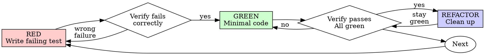

# 对话经过

会话 `01a21a86-57bc-71a0-ac8c-08cab671a1b3` · 轮次 `01a21c01-56b7-79b3-880f-1726acda0c33`

<!-- foundry-detail 01a21a86-57bc-71a0-ac8c-08cab671a1b3 01a21c01-56b7-79b3-880f-1726acda0c33 -->
<!-- foundry-event 2cba5e59a3c19e798f8744b577557bea7fb9382960071dc017c625be4bee4eb7 -->
## 进度原话

- 来源定位：字节 24395834

~~~text
我开始 T001。先用 Spec Kit 的实施准备流程核对 Nuxt 和 UnoCSS 的现有配置，再接入 Nuxt UI，验证两套样式在文档站里能一起生效。
~~~

<!-- foundry-event 8e945a123bb7b544f2f6b318fafe1f3ae0c34384ab6d256c761a90dca4356278 -->
## 宿主命令执行

- 来源定位：字节 24399608

~~~text
{
  "command": "[已省略环境变量值] -lc 'cat .agents/skills/document-changed-symbols/SKILL.md .agents/skills/nuxt-ui-styling/SKILL.md\ncat /home/ena/.codex/plugins/cache/openai-curated-remote/superpowers/7.0.1/skills/brainstorming/SKILL.md /home/ena/.codex/plugins/cache/openai-curated-remote/superpowers/7.0.1/skills/test-driven-development/SKILL.md'",
  "workdir": "file:///home/ena/workspace/ena/agent-foundry/feature/init",
  "exitCode": 0,
  "status": "completed"
}
~~~

<!-- foundry-event b373628853868aa252390fb476eb2245ee4d72b59b94a0ededc6e7f1136319e4 -->
## 工具结果 `exec-ce49851d-b0bf-4b70-abc2-5cbb0d649151`

- 来源定位：字节 24399608

~~~text
---
name: document-changed-symbols
description: 每次编码 agent 执行 TypeScript、JavaScript、Vue 或相关前端代码编辑时都必须使用。要求为本次新增或修改的每个函数、方法、变量、常量、ref、computed、类字段、类型别名、接口、枚举、导出符号和配置声明，在声明上方补充多行 JSDoc 注释。当用户要求补充 JSDoc 或改动符号注释时也必须使用。
destructive: false
---

# 改动符号 JSDoc 注释

## 核心规则

每次编辑 TypeScript、JavaScript、Vue 或相关前端代码时，凡是本次新增的声明，或本次修改了行为、签名、类型、初始值、业务含义的声明，都必须在声明正上方添加或保留准确的多行 JSDoc 注释。

需要覆盖的改动符号包括：

- 函数、方法、构造函数、赋值给标识符的回调函数、组合式函数、hook、事件处理函数和计算辅助函数。
- 变量、常量、ref、reactive 状态、类字段，以及新增或语义变化的解构别名。对象字面量属性、interface/type 属性、枚举成员等内部成员不单独挂注释，按下方执行流程第 5 条收拢到外层声明。
- 类型、接口、枚举、类型别名、类、模块、导出对象和 schema 定义。

不要为了满足规则去给无关的旧代码批量补注释，除非它们属于同一个被修改声明块且不补会造成风格或含义不一致。

## 执行流程

1. 编辑前，先识别这次可能会新增或修改的声明。
2. 编辑时，在每个改动声明的正上方放置多行 JSDoc 块，格式必须是：`/**` 开始，中间每行以 `*` 开头，` */` 结束。
3. JSDoc 块至少包含一句职责说明；函数、方法、回调、复杂类型或有约束的声明，应按需添加 `@param`、`@returns`、`@template`、`@property`、`@throws` 等标签。
4. 不要使用单行 `/** ... */`、普通 `//`、普通 `/* ... */`、Python docstring、Go 导出注释等格式替代 JSDoc。
5. **不在声明内部写注释**：对象字面量、interface/type 的属性、枚举成员、泛型参数等声明内部（如属性上方）不放 JSDoc；属性语义收拢到外层声明（接口、类型别名、常量、函数）的 JSDoc 块里统一描述。JSDoc 只挂在外层声明正上方。
6. 注释要简短、事实准确，说明符号的职责、含义或约束，不要写“这是新增/修改的函数”。
7. 完成编辑后检查 diff，确认每个改动声明上方都有准确的多行 JSDoc 注释。
8. 使用中文写注释

## 注释质量

优先描述意图、约束或业务含义。

推荐：

```ts
/**
 * 将承运商对账原始行转换为表格可渲染的数据。
 *
 * @returns 标准化后的对账行集合。
 */
const reconciliationRows = computed(() => normalizeRows(rawRows.value))

/**
 * 提交选中的订单发起仓库取消流程。
 *
 * @param orderIds 需要取消的订单 ID 列表。
 * @returns 取消流程提交完成后的 Promise。
 */
function submitWarehouseCancel(orderIds: string[]) {
  // ...
  return Promise.resolve()
}
```

避免：

```ts
/** submitWarehouseCancel 函数。 */
function submitWarehouseCancel() {}

// 提交选中的订单发起仓库取消流程。
function submitWarehouseCancel() {}

/** 新变量。 */
const value = 1
```

## 边界情况

- 如果匿名内联回调无法自然放置直接注释，且该回调有独立业务含义，优先提取为带多行 JSDoc 注释的命名常量。
- 如果声明已经有准确的多行 JSDoc 注释，只在本次改动导致注释过期时更新它。
- 即使项目平时不给简单局部变量写 JSDoc 注释，只要用户明确要求本次改动的变量要有注释，就按本技能执行。
- 不要用单行 JSDoc 或普通行注释凑数；格式不符合多行 JSDoc 时视为未完成。
- 对生成文件、压缩文件、lockfile、snapshot 或机器维护的产物，不主动添加手写 JSDoc 注释，除非用户明确要求修改这些文件并补注释。

## 验证清单

结束前检查最终 diff，并确认：

- 每个新增声明的正上方都有多行 JSDoc 注释。
- 每个修改了行为、签名、类型、初始值或业务含义的声明，都有或保留了准确的多行 JSDoc 注释。
- 注释简洁、有用，并符合附近代码的语言和风格。
- 改动声明的内部（对象字面量、interface/type 属性、枚举成员、泛型参数上方）没有新增 JSDoc 或行注释，属性语义已收拢到外层声明的 JSDoc 块。
- 没有对无关旧代码做大范围注释补充或格式扰动。

测试词和触发示例见 [test-prompts.md](references/test-prompts.md)。
---
name: nuxt-ui-styling
description: 编写或修改本仓库使用 Nuxt UI、Tailwind CSS、UnoCSS 的 Vue/Nuxt 前端代码样式时必须使用。规定 Nuxt UI 组件样式经 `ui` 属性使用 `tw:` 前缀的 Tailwind CSS，其余组件与原生标签一律使用 UnoCSS 属性化取值式写法，且不得臆造 slot、variant、shortcut 或 utility class。编写或修改 NuxtLink 等组件的属性化样式、属性名与组件 prop 或原生 HTML 属性同名（如 `text`）时必须使用：冲突属性加属性化前缀（以项目 `presetAttributify({ prefix })` 配置为准，缺省 `un-`，如 `un-text`）。新增或修改样式后需要确认规则是否真实生效时必须使用：写前查证 utility 存在、写后 grep 产物 CSS 核验生成。
destructive: false
---

# Nuxt UI 样式编码规则

## 适用范围

本规则适用于本仓库中使用 Nuxt UI、Tailwind CSS 和 UnoCSS 的前端 Vue/Nuxt 代码。

## 规则一：Nuxt UI 组件 —— ui 属性 + tw: 前缀

Nuxt UI 组件样式必须优先通过组件的 `ui` 属性配置。

编写前必须参考 Nuxt UI 官方组件文档、组件 props/slots，或生成的 `.nuxt/ui/<component>.ts`，确认可用的 slot 名、variant、prop 与 class 覆写入口。

Nuxt UI 组件中的 Tailwind CSS class 必须使用 `tw:` 前缀语法写入 `ui` 属性。不要把主要样式散落到外层 `class`，除非该组件没有对应 `ui` slot，或该 `class` 仅用于布局容器。

## 规则二：非 Nuxt UI 组件 —— UnoCSS 属性化取值式

非 Nuxt UI 组件（原生标签、业务组件、第三方组件）必须使用 UnoCSS 属性化（attributify）的**取值式写法**：`前缀="值"`，如 `flex="~"`、`items="center"`、`gap="2"`，并遵循项目既有 UnoCSS 约定。

不要在非 Nuxt UI 组件上使用 `class="flex ..."` 长串工具类、纯属性名写法（`flex items-center`）、`tw:` 前缀或 Nuxt UI 的 `ui` 属性。

## 规则三：属性冲突与属性化前缀

属性化写法的属性名与「组件自身 prop」或「原生 HTML 属性」同名时，直接书写会被当作 prop/属性处理、样式不生效。此时 MUST 加属性化前缀（如 `un-text="..."`）；无冲突属性原样书写。

**前缀以项目配置为准**：确认当前项目 `uno.config` 中 `presetAttributify({ prefix })` 的配置，缺省为 `un-`，不得硬编码假设。

**识别方法**：编写组件样式前先查该组件 props（Nuxt UI 文档 / `.nuxt/ui/<component>.ts` / 组件源码）或原生 HTML 属性清单，同名即冲突。冲突并非某个组件独有，任何组件都可能存在同名 prop。

## 规则四：规则查证与生效验证

仅通过语法检查不代表样式真实生效。凡新增或修改样式写法，都必须走完「查证 → 生成 → 核验」闭环：

1. **写前查证**：无论 `tw:` 前缀 Tailwind 还是 UnoCSS 写法，编写前都必须检查项目的 Tailwind CSS、Nuxt UI theme、UnoCSS presets/shortcuts 是否存在对应规则；不确定的 utility、shortcut、variant 先查 `uno.config`、presets/shortcuts 配置或官方文档。不存在对应规则时不要臆造 class，应先补充配置，或改用项目中已存在的语义 class。
2. **写后验证生成**：构建后 grep 产物 CSS，确认对应选择器规则真实生成；找不到即视为未生效，必须排查。
3. **必要时运行时验证**：dev 模式下检查元素计算样式，确认优先级未被覆盖。

## 正误对照示例

**Nuxt UI 组件**（规则一）：

```vue
<!-- ✅ 正确：tw: 前缀 Tailwind 写入 ui 属性 -->
<UButton :ui="{ root: 'tw:flex tw:items-center tw:gap-2' }"> 提交 </UButton>

<!-- ❌ 错误：主要样式散落到外层 class，且未使用 tw: 前缀 -->
<UButton class="flex items-center gap-2">提交</UButton>
```

**非 Nuxt UI 组件**（规则二）：

```vue
<!-- ✅ 正确：取值式属性化写法 -->
<div flex="~" items="center" gap="2" text="sm gray-500">
  <span class="i-carbon:checkmark" text="green-500" />
  完成
</div>

<!-- ❌ 错误：class 长串工具类 -->
<div class="flex items-center gap-2 text-sm text-gray-500">完成</div>

<!-- ❌ 错误：纯属性名写法（容易与原生属性/组件 prop 冲突） -->
<div flex items-center gap-2 text-sm>完成</div>
```

**属性冲突典型实例：NuxtLink**（规则三，按缺省前缀 `un-` 书写）：

```vue
<!-- ✅ 正确：text 冲突属性加前缀，其余属性原样取值式书写 -->
<NuxtLink to="/" flex="~" items="center" gap="2" un-text="sm gray-500">
  返回首页
</NuxtLink>

<!-- ❌ 错误：裸 text 属性与 NuxtLink prop 冲突，样式不生效 -->
<NuxtLink to="/" flex="~" items="center" gap="2" text="sm gray-500">
  返回首页
</NuxtLink>

<!-- ❌ 错误：class 长串工具类 -->
<NuxtLink to="/" class="flex items-center gap-2 text-sm text-gray-500">
  返回首页
</NuxtLink>
```

## 参考文件

- `references/attribute-conflicts.md`：属性冲突通则、前缀配置确认、识别方法与完整示例（规则三详则）
- `references/rule-verification.md`：查证路径、grep 核验命令、常见失效原因与运行时验证（规则四详则）
---
name: brainstorming
description: "You MUST use this before any creative work - creating features, building components, adding functionality, modifying behavior, or planning anything new, in software or out of it (a talk, a business, a renovation)."
---

# Brainstorming

You are very good at building. You build what you believe your human
partner wants, and that belief is usually thinner than it feels. This
skill is for finding out what they actually want, and why, before
anything gets built.

People often haven't finished working out what they want. Good questions
help them think it through. When you understand the why, you make the
hundred decisions they never mention the way they would have made them.

## First: What Do You Actually Know?

Before you reply, ask yourself: what do I know about what they want, and
why?

- **Everything that matters is in the request** ("make the icon cornflower
  blue"). This is a quick, clear task. Do it, and say what you did.
- **Something non-trivial is missing.** Start the conversation.

Before you start implementing, you must, in order:

1. Lay out the approaches in a message of their own, and have your
   human partner pick one (see Lay out the approaches).
2. Write the design doc, short or full (see Size the Work).
3. Get their approval of that doc.
4. Invoke the superpowers:writing-plans skill.

Two things aren't implementing: a spike they said yes to (see Spike to
feel things out), and doing what they asked once they've opted out of
the questions.

## Look Before You Ask

In an existing project, or when they've given you context (a spec, a plan,
a handoff, files they pointed at, earlier conversation), dig in before your
first message. Read what they referred to and the code or material it
connects to, and keep reading until you can explain how the relevant
parts work today and what this change would touch. Never ask what the
project or their context already answers.

## Your First Message

Move the work forward, with one of these:

- **They've already said what they want** (a spec, a plan, a detailed
  request): aim for about 200 words for the whole message. Echo their
  request back in your own words, so they can see whether you've got its
  shape: what they want, who it's for, and why, as far as they've said.
  Add what you found that bears on it: how the relevant parts work today
  and what the change would touch. If you found something they may not
  have considered that would change what they're asking for or how it
  has to be built, like a constraint, a conflict, or a cheaper path, say
  so plainly. How to build it comes later, once you understand what they
  want (see Lay out the approaches). End with one line inviting
  corrections, then one question about what they want: the thing their
  request leaves open whose answer would most change what gets built.
  Specs are often incomplete, so confirm before you build on one.
- **They haven't:** one open question, in their own terms, about the
  biggest thing their request leaves unsettled. Say why you're asking:
  what the answer would change about what you build. For "a website for
  my bakery": "If it's mostly for people deciding whether to stop by,
  I'd lead with hours and what's in the case today; taking orders is a
  different site. What do you want someone to do when they land on it?"

How the message ends depends on whether their message asked for
brainstorming:

- **They asked for it** (by name, by invoking it, or by asking for a
  design discussion): end with your question. They want this
  conversation.
- **They didn't:** they may not want a conversation at all. After your
  question, add a light, one-line offer to just get going instead, like
  "Or if you'd rather I just dive in, say so." If they take you up on
  it, this skill is done: state any significant how-it-gets-made choice
  (platform, language, medium) in one plain line, then do what they
  asked through the normal workflow.

That's the whole message.

## The Conversation

Each message ends with one question: a single sentence with no list of
example answers hanging off it. Use plain language, pitched just a little
above where your human partner is. Match their vocabulary; never use
process jargon. You never need to quote this skill to your human
partner.

Be clear and concise. Lead with what matters. Avoid jargon. When you
report what you found, give them the most important findings and offer
the rest.

**Get them describing.** Open questions come first. Their own words carry
intent that your options can't. Offer a short menu only when they're
stuck. When they say "just guess" or "what do you think?", propose
something concrete.

**How it gets made.** Every project rests on choices about medium, tools,
materials, and resources: the platform, programming language, and
libraries for an app; the medium for a piece of art. Find out early which
of those choices they want to make, which they're handing to you, and what
they already have to work with. Someone with strong views or skills will
want to talk it through. Someone counting on you needs sensible defaults,
said in plain words. When there's existing work, build on what it already
uses. Any choice you make goes in the design as your call, never as
something they agreed to.

**Ground to cover.** This is territory, not a script. Never read these
out as questions:

- what kind of thing this is, and what makes it special
- why now, and what success looks like to them
- goals, non-goals, and anti-goals (what would make this a failure even
  if it technically works)
- prior art: what they've seen elsewhere, loved or hated
- current state: what exists now, what they've tried
- the details they care about

**Make every question specific** to their project and what they've told
you. Ask Socratically, the way a sharp colleague would: build each
question on their last answer or on something you found, so it helps
them think through a consequence or a case they may have missed
("Voting closes before the meeting, and two members joined this month.
Does someone who joins mid-round get a vote?"). When the reason isn't
already plain, say what you're hoping to learn or what the answer would
change. A proposal they can correct, plus your reason for it, often
beats a question.

**Offer recon.** Once you have a bit of grounding and looking further
would help, offer to go look: deeper into their codebase or project,
their own files and data, or the web. Say what you'd look for. They
decide whether you go.

**Lay out the approaches.** Once you understand what they want, and
before you write anything up, put the ways of building it in a message
of its own. Come up with several real alternatives and drop the weak
ones, including any that work against why they want it and any the
existing work rules out. Present the two or three that remain, grounding
each in what the project actually does and saying what it trades off.
Recommend one and say why, then ask which way they want to go. When
there's genuinely one sensible way, say so and explain why the others
don't fit. This is for how it gets built; for what they want, get them
describing first.

**Show, don't tell.** Offer the visual companion (below) whenever seeing
would help more than reading:

- something they'll look at: a screen, a page, a printout, a sign
- a layout or arrangement: of a screen, a room, a schedule
- a flow or a sequence of steps
- options that would look different from each other
- a structure that's easier to see than read: a diagram, a timeline, a map

Once they've accepted, use it for mockups to react to, side-by-side
options, and throwaway prototypes they can click.

**Spike to feel things out.** Agentic work is waterfall, but very, very
fast. A quick throwaway build is often the cheapest way to learn what
they want or whether something works. Offer one when it would help.
When they just want to spike, get out of the way. Spikes get no tests
or minimal ones, aren't bulletproof, and skip the plan, implementation,
and review process. Bring what the spike taught you back into the
conversation.

## Play It Back

Play back as you go. As soon as you understand one part well enough to
describe it (what it's for and who it serves, say, or how one piece
behaves), describe that part back in about 200-300 words, then return to
questions about the next part. Playback and questions alternate through
the whole conversation; the last chunk covers whatever is left.

Only what they said goes in as theirs. Anything you filled in goes in
as your proposal, with your reason. End each chunk by asking what's wrong
or missing.

Before you send a chunk, check it: does it describe something they'll
look at, like a page, a screen, a schedule, or a printout? If so, and
they haven't seen the visual companion offer yet, send the offer instead
(its own message, below) and hold the chunk for the next message. Once
they've accepted, put a mockup next to the description.

## Size the Work

Once you understand what they want and they've picked an approach, say
how big the work is in plain words. They can override it.

| Size | The design doc |
|------|----------------|
| A small change | a short one: what you already covered together, written down |
| A project | the full written design (below) |

Short or full, the design doc has an **Approaches** part: the two or
three ways you considered building it, what each trades off, which one
they picked, and why. They pick in the conversation, before you write
the doc.

If it grows mid-task, stop, say so, and step up a size.

If this is really several independent projects, say so, agree on an
order, and brainstorm them one at a time.

## The Written Design

Write a plain document a talented builder in the domain could plan
from without going back to your human partner. Cover:

- intent and the why
- goals, non-goals, anti-goals
- constraints
- approaches (above)
- the parts of the how they decided, as they decided them
- what's left to the builder

For a small change, the short design covers the same points in a line
or two each and goes straight to your human partner, without the
builder check.

**Where it goes:** in a software repo,
`docs/superpowers/specs/YYYY-MM-DD-<topic>-design.md`, committed.
Otherwise, ask. Your human partner's preferences override both.

**Builder check** (for a project): dispatch a fresh subagent with
`builder-check-prompt.md` in this directory. When you tell your human
partner you're writing it up, say a reviewer will read it first and you
may come back once with a few questions. Don't hand over the document
until the check is back. Sort what the builder asks into three piles:

- **Answered already** by the conversation or the project: put the answer
  in the document.
- **Minor:** a sensible builder could settle it without changing what gets
  built. Settle it yourself and mark it in the document as your call.
- **Theirs:** only your human partner can answer it, and the answer changes
  what gets built.

Bring the "theirs" pile in one message, most important first. Update the
document with their answers, then hand it over with a short list of the
calls you made so they can check those while reading. That's the only
round of questions the check produces. Without a subagent tool, read the
document as that builder yourself.

<HARD-GATE>
Nothing gets built until your human partner approves the design doc:
the short one for a small change, the full one for a project.
Building includes writing product code, scaffolding, installing
dependencies, creating projects, and invoking an implementation skill.
Reading and exploring are fine.

Two exceptions. If they opted out of the questions, the skill is done
and the gate goes with it. A spike they said yes to may be built; it
stays labeled throwaway, and keeping what it produced is a new request
that comes back through this gate.

After the design doc is approved, the next step is the plan: invoke
superpowers:writing-plans and no other skill.
</HARD-GATE>

## Red Flags

| Thought | Reality |
|---------|---------|
| "I'll offer a menu of what they might want" | Options steer. Ask them to describe it first. |
| "I'll fill in sensible defaults" | Good. Say them out loud. A default they never heard is one they couldn't reject. |
| "I've answered their questions, so I'll write the doc" | Lay out the approaches first, in a message of their own. |
| "I should explain the process first" | Ask your question. The process shows itself. |
| "They said 'sounds good' to the idea" | Approval covers what you showed them. A design doc you haven't written isn't approved. |
| "The spike works, I'll keep building on it" | Keeping it is a new request. Back through the gate. |

## Visual Companion

A browser tab for showing mockups, diagrams, and prototypes. It's a
tool, not a mode: accepting it doesn't send every question to the
browser.

**Offer it just-in-time.** Offer it the first time one of the moments
above comes up, never upfront. The offer is its own message with nothing
else in it:

> "This might be easier if I show you. Want me to open a browser tab with some mockups?"

If they decline, stay in text and don't offer again unless they raise it.

**Per question, ask: would they understand this better by seeing it?**
Mockups, layouts, diagrams, and side-by-side designs go in the browser.
Requirements, scope, tradeoffs, and conceptual choices stay in text. A
question about a UI topic isn't automatically a visual question.

If they accept, read `visual-companion.md` in this directory before
starting the server.
---
name: test-driven-development
description: Use when implementing any feature or bugfix, before writing implementation code
---

# Test-Driven Development (TDD)

## Overview

Write the test first. Watch it fail. Write minimal code to pass.

**Core principle:** If you didn't watch the test fail, you don't know if it tests the right thing.

**Violating the letter of the rules is violating the spirit of the rules.**

## When to Use

**Always:**
- New features
- Bug fixes
- Refactoring
- Behavior changes

**Exceptions (ask your human partner):**
- Throwaway prototypes
- Generated code
- Configuration files

Thinking "skip TDD just this once"? Stop. That's rationalization.

## The Iron Law

```
NO PRODUCTION CODE WITHOUT A FAILING TEST FIRST
```

Write code before the test? Delete it. Start over.

**No exceptions:**
- Don't keep it as "reference"
- Don't "adapt" it while writing tests
- Don't look at it
- Delete means delete

Implement fresh from tests. Period.

## Red-Green-Refactor



### RED - Write Failing Test

Write one minimal test showing what should happen.

<Good>
```typescript
test('retries failed operations 3 times', async () => {
  let attempts = 0;
  const operation = () => {
    attempts++;
    if (attempts < 3) throw new Error('fail');
    return 'success';
  };

  const result = await retryOperation(operation);

  expect(result).toBe('success');
  expect(attempts).toBe(3);
});
```
Clear name, tests real behavior, one thing
</Good>

<Bad>
```typescript
test('retry works', async () => {
  const mock = jest.fn()
    .mockRejectedValueOnce(new Error())
    .mockRejectedValueOnce(new Error())
    .mockResolvedValueOnce('success');
  await retryOperation(mock);
  expect(mock).toHaveBeenCalledTimes(3);
});
```
Vague name, tests mock not code
</Bad>

**Requirements:**
- One behavior
- Clear name
- Real code (no mocks unless unavoidable)

### Verify RED - Watch It Fail

**MANDATORY. Never skip.**

```bash
npm test path/to/test.test.ts
```

Confirm:
- Test fails (not errors)
- Failure message is expected
- Fails because feature missing (not typos)

**Test passes?** You're testing existing behavior. Fix test.

**Test errors?** Fix error, re-run until it fails correctly.

### GREEN - Minimal Code

Write simplest code to pass the test.

<Good>
```typescript
async function retryOperation<T>(fn: () => Promise<T>): Promise<T> {
  for (let i = 0; i < 3; i++) {
    try {
      return await fn();
    } catch (e) {
      if (i === 2) throw e;
    }
  }
  throw new Error('unreachable');
}
```
Just enough to pass
</Good>

<Bad>
```typescript
async function retryOperation<T>(
  fn: () => Promise<T>,
  options?: {
    maxRetries?: number;
    backoff?: 'linear' | 'exponential';
    onRetry?: (attempt: number) => void;
  }
): Promise<T> {
  // YAGNI
}
```
Over-engineered
</Bad>

Don't add features, refactor other code, or "improve" beyond the test.

### Verify GREEN - Watch It Pass

**MANDATORY.**

```bash
npm test path/to/test.test.ts
```

Confirm:
- Test passes
- Other tests still pass
- Output pristine (no errors, warnings)

**Test fails?** Fix code, not test.

**Other tests fail?** Fix now.

**"Other tests" means the project's suite, not just your file.** A
green run of the test you wrote is not a green suite. Before you call
the change done, run the project's test command (bare `pytest`,
`npm test`, `cargo test` — whatever the repo uses) even when your task
named only one test file. A scope statement in your task bounds the
deliverable, not your verification. Any failure that run shows —
including one you didn't cause — goes in your report by name; a red
test you watched scroll past and didn't mention is a report falsified
by omission.

### REFACTOR - Clean Up

After green only:
- Remove duplication
- Improve names
- Extract helpers

Keep tests green. Don't add behavior.

### Repeat

Next failing test for next feature.

## Good Tests

| Quality | Good | Bad |
|---------|------|-----|
| **Minimal** | One thing. "and" in name? Split it. | `test('validates email and domain and whitespace')` |
| **Clear** | Name describes behavior | `test('test1')` |
| **Shows intent** | Demonstrates desired API | Obscures what code should do |

When writing or changing any test, read [writing-good-tests.md](writing-good-tests.md) for the rules that keep tests honest:
- Name the production change that would make the test fail — before writing it
- Assert on real behavior, never on mock behavior
- Keep test-only code in test utilities, out of production classes
- Understand a dependency's side effects before mocking it

## Common Rationalizations

| Excuse | Reality |
|--------|---------|
| "Too simple to test" | Simple code breaks. Test takes 30 seconds. |
| "I'll test after" | Tests written after pass immediately — which proves nothing. They may test the wrong thing, test the implementation instead of the behavior, or miss the edge case you forgot. You never watched it fail, so you never proved it can catch the bug. Test-first forces that failure. |
| "Tests after achieve same goals (spirit not ritual)" | Tests-after answer "what does this do?"; tests-first answer "what should this do?" Tests written after are biased by the code you already wrote — you verify the cases you remembered, not the ones you'd have discovered. Coverage without proof the tests work. |
| "Already manually tested" | Manual testing is ad-hoc: no record of what you covered, no way to re-run it when the code changes, easy to forget cases under pressure. "Worked when I tried it" ≠ comprehensive. Automated tests run the same way every time. |
| "Deleting X hours is wasteful" | Sunk cost fallacy — that time is already spent either way. The real choice: rewrite with TDD (high confidence) vs. keep it and bolt tests on after (low confidence, likely bugs). Keeping code you can't trust is the waste. |
| "Keep as reference, write tests first" | You'll adapt it. That's testing after. Delete means delete. |
| "Need to explore first" | Fine. Throw away exploration, start with TDD. |
| "Test hard = design unclear" | Listen to test. Hard to test = hard to use. |
| "TDD will slow me down" | TDD IS the pragmatic path: catches bugs before commit, prevents regressions, lets you refactor without fear. "Pragmatic" shortcuts mean debugging in production — slower, not faster. |
| "Manual test faster" | Manual doesn't prove edge cases. You'll re-test every change. |
| "Existing code has no tests" | You're improving it. Add tests for existing code. |

## Red Flags - STOP and Start Over

- Code before test
- Test after implementation
- Test passes immediately
- Can't explain why test failed
- Tests added "later"
- Rationalizing "just this once"
- "I already manually tested it"
- "Tests after achieve the same purpose"
- "It's about spirit not ritual"
- "Keep as reference" or "adapt existing code"
- "Already spent X hours, deleting is wasteful"
- "TDD is dogmatic, I'm being pragmatic"
- "This is different because..."

**All of these mean: Delete code. Start over with TDD.**

## Example: Bug Fix

**Bug:** Empty email accepted

**RED**
```typescript
test('rejects empty email', async () => {
  const result = await submitForm({ email: '' });
  expect(result.error).toBe('Email required');
});
```

**Verify RED**
```bash
$ npm test
FAIL: expected 'Email required', got undefined
```

**GREEN**
```typescript
function submitForm(data: FormData) {
  if (!data.email?.trim()) {
    return { error: 'Email required' };
  }
  // ...
}
```

**Verify GREEN**
```bash
$ npm test
PASS
```

**REFACTOR**
Extract validation for multiple fields if needed.

## Verification Checklist

Before marking work complete:

- [ ] Every new function/method has a test
- [ ] Watched each test fail before implementing
- [ ] Each test failed for expected reason (feature missing, not typo)
- [ ] Wrote minimal code to pass each test
- [ ] All tests pass
- [ ] Output pristine (no errors, warnings)
- [ ] Tests use real code (mocks only if unavoidable)
- [ ] Edge cases and errors covered

Can't check all boxes? You skipped TDD. Start over.

## When Stuck

| Problem | Solution |
|---------|----------|
| Don't know how to test | Write wished-for API. Write assertion first. Ask your human partner. |
| Test too complicated | Design too complicated. Simplify interface. |
| Must mock everything | Code too coupled. Use dependency injection. |
| Test setup huge | Extract helpers. Still complex? Simplify design. |

## Debugging Integration

Bug found? Write failing test reproducing it. Follow TDD cycle. Test proves fix and prevents regression.

Never fix bugs without a test.

## Final Rule

```
Production code → test exists and failed first
Otherwise → not TDD
```

No exceptions without your human partner's permission.

~~~

<!-- foundry-event ecd9676a1f140fc86b500253d86ff26188d1d8ef4d9e0d6904c2f01adc6208a0 -->
## 宿主命令执行

- 来源定位：字节 24434959

~~~text
{
  "command": "[已省略环境变量值] -lc 'cat apps/docs/package.json apps/docs/nuxt.config.ts apps/docs/uno.config.ts apps/docs/app/app.vue apps/docs/app/assets/css/main.css\ncat package.json pnpm-workspace.yaml\nrg -n '\"'\"'T001|Nuxt UI|UnoCSS'\"'\"' specs/docs/001-docs-site-framework/{tasks.md,plan.md,mvu.md,research.md,quickstart.md}\nrg -n '\"'\"'before_implement|after_implement'\"'\"' .specify/extensions.yml'",
  "workdir": "file:///home/ena/workspace/ena/agent-foundry/feature/init",
  "exitCode": 0,
  "status": "completed"
}
~~~

<!-- foundry-event 6016ac8703f30c2340c46815efcd82ac288b186ae45693335157f7703e1722b0 -->
## 工具结果 `exec-c0d5a6cd-242f-4b2a-99cd-93ae3fd737f6`

- 来源定位：字节 24434959

~~~text
{
  "name": "docs",
  "type": "module",
  "private": true,
  "scripts": {
    "dev": "nuxt dev",
    "build": "nuxt build",
    "nuxt:prepare": "nuxt prepare",
    "lint": "eslint .",
    "check-types": "nuxt typecheck"
  },
  "devDependencies": {
    "@foundry/preset-config": "workspace:*",
    "@nuxt/content": "catalog:",
    "@nuxt/eslint": "catalog:nuxt",
    "@unocss/nuxt": "catalog:nuxt",
    "nuxt": "catalog:nuxt",
    "typescript": "catalog:dev",
    "unocss": "catalog:dev",
    "vue": "catalog:frontend",
    "vue-tsc": "catalog:dev"
  }
}
/**
 * 文档应用只启用内容、检查与属性化样式模块，使用Node原生SQLite。
 */
export default defineNuxtConfig({
  compatibilityDate: '2026-11-13',
  modules: ['@nuxt/content', '@nuxt/eslint', '@unocss/nuxt'],
  css: ['~/assets/css/main.css'],
  content: { experimental: { sqliteConnector: 'native' }, build: { markdown: { highlight: { theme: 'github-dark' } } } },
  eslint: { config: { standalone: false } },
  app: { head: { htmlAttrs: { lang: 'zh-CN' }, titleTemplate: '%s · Agent Foundry', meta: [{ name: 'theme-color', content: '#f8fafc' }] } },
  devServer: { host: '0.0.0.0', port: 7000, allowedHosts: true },
  devtools: { enabled: true },
})
import { defineConfig, presetAttributify, presetTypography, presetWind3 } from 'unocss'

/**
 * 原生组件使用属性化工具，Markdown正文由官方排版预设提供样式。
 */
export default defineConfig({
  presets: [presetWind3(), presetAttributify({ prefix: 'un-' }), presetTypography()],
  theme: { colors: { brand: '#1d4ed8' } },
})
<script setup lang="ts">
/**
 * 使用NuxtPage提供的路由生成页面键，避免全局路由与Suspense渲染互相影响。
 * @param route 正在渲染的目标路由。
 * @returns 文档路径对应的稳定页面键。
 */
function docsPageKey(route: { path: string }): string {
  return route.path
}
</script>

<template>
  <NuxtLayout>
    <NuxtPage :page-key="docsPageKey" />
  </NuxtLayout>
</template>
:root {
  color-scheme: light;
  font-family:
    ui-sans-serif,
    system-ui,
    -apple-system,
    BlinkMacSystemFont,
    'Segoe UI',
    'PingFang SC',
    'Microsoft YaHei',
    sans-serif;
  font-synthesis: none;
  text-rendering: optimizeLegibility;
}

* {
  box-sizing: border-box;
}
body {
  margin: 0;
}
html {
  scroll-padding-top: 6rem;
}
a {
  color: inherit;
}
:focus-visible {
  outline: 2px solid #1d4ed8;
  outline-offset: 4px;
}
pre {
  overflow-x: auto;
  max-width: 100%;
}
summary {
  min-height: 44px;
}
{
  "name": "@ena/agent-foundry",
  "type": "module",
  "private": true,
  "license": "ISC",
  "engines": {
    "node": ">=22.20.0"
  },
  "devEngines": {
    "packageManager": {
      "name": "pnpm",
      "version": "12",
      "onFail": "download"
    }
  },
  "scripts": {
    "dev": "pnpm --filter @foundry/docs run dev",
    "build": "turbo run build --filter=!@foundry/skills-distribution-urgent",
    "build:packages": "turbo run build --filter=@foundry/preset-config --filter=@foundry/skills",
    "build:candidate": "pnpm --filter @foundry/skills-distribution-urgent run build",
    "lint": "turbo run lint",
    "check-types": "turbo run check-types",
    "prepare:workspace": "pnpm --filter @foundry/preset-config run build && pnpm --filter @foundry/docs run nuxt:prepare",
    "skills:link": "bash scripts/dev/actions/link-skills/link-skills.sh packages/skills-distribution-urgent/src .agents/skills",
    "mcp:test": "uv run --project apps/mcp --frozen --group dev pytest apps/mcp/tests",
    "postinstall": "pnpm prepare:workspace"
  },
  "devDependencies": {
    "@foundry/preset-config": "workspace:*",
    "eslint": "catalog:dev",
    "prettier": "catalog:dev",
    "turbo": "catalog:dev",
    "typescript": "catalog:dev"
  }
}
minimumReleaseAgeExcludePrune: true
trustPolicy: no-downgrade
autoInstallPeers: true
strictPeerDependencies: false
shellEmulator: true

packages:
  - apps/*
  - packages/*

overrides:
  encodeurl@^2.0.0: 2.0.0

allowBuilds:
  esbuild: true

catalog:
  '@nuxt/content': ^3.16.0
  eslint-plugin-slop: ^0.1.3
  sh-syntax: 0.8.7

catalogs:
  build:
    moment: ^2.31.0
    vite: ^8.0.10
  dev:
    '@antfu/eslint-config': ^9.5.1
    '@unocss/eslint-config': ^66.6.7
    '@unocss/eslint-plugin': ^66.6.7
    '@unocss/preset-web-fonts': ^66.6.7
    eslint: ^10.11.0
    eslint-plugin-cypress: ^7.0.4
    eslint-plugin-format: ^2.0.1
    eslint-plugin-sonarjs: ^4.2.2
    prettier: ^3.9.9
    turbo: ^2.11.5
    typescript: 6.0.3
    unocss: ^66.6.1
    vue-tsc: ^3.2.6
  frontend:
    vue: ^3.5.30
  nuxt:
    '@nuxt/eslint': ^1.15.2
    '@unocss/nuxt': ^66.6.7
    nuxt: ^4.4.2
  shared:
    consola: ^3.4.2
    defu: ^6.1.7
    semver: ^7.7.4
    yaml: 2.8.3
  types:
    '@types/node': ^25.5.0
    '@types/semver': ^7.8.0
specs/docs/001-docs-site-framework/mvu.md:11:**节点与关键逻辑**：Nuxt UI 技术前置 → 五模块及样例集合路由/布局骨架和共享样例数据 → 桌面全局导航与技能集合子菜单 → 手机全局菜单 → 兼容地址及未知地址验收。T002 先提供足以独立验证入口的页面骨架；T009 的技能样例数据是全局集合子菜单与后续目录的共同数据源，因此 US1 不必等待 US2–US4 的完整内容。
specs/docs/001-docs-site-framework/mvu.md:13:**关联 Task**：T001 核验共享 Nuxt UI；T002 建立五模块和集合最小路由/布局；T009 建立共享技能样例数据；T003 实现品牌、一级入口和集合子菜单；T004 实现手机菜单；T005 核对直接访问、刷新和 404。
specs/docs/001-docs-site-framework/research.md:8:- `apps/docs` 已使用 Nuxt、Nuxt Content、UnoCSS，配置为读取 `content/` 文档集合，并以 `app/pages/[...slug].vue` 按路径查询；不存在文档时抛出 404。
specs/docs/001-docs-site-framework/research.md:10:- 当前应用依赖未声明 Nuxt UI 或 Three.js；不能将其安装、集成或模型降级路径写成已在仓库验证。
specs/docs/001-docs-site-framework/research.md:23:### R-002：Nuxt UI 是规格要求，但兼容性须先实测
specs/docs/001-docs-site-framework/research.md:25:**Decision**：按需求采用 Nuxt UI，但把正式依赖加入、版本选定、模块配置，以及与现有 UnoCSS 属性化样式的共存作为开发前置核验，不预设集成无冲突。
specs/docs/001-docs-site-framework/research.md:27:**Rationale**：源码表明目前是 UnoCSS `presetWind3` 与 `presetAttributify({ prefix: 'un-' })`；Nuxt UI 不在 `apps/docs/package.json` 中。Nuxt UI 官方文档显示 NavigationMenu 支持水平/垂直列表及子项，Sidebar 在桌面可内联折叠、手机可切换为菜单，并提供响应式 open 状态；可作为四套布局所需交互的候选组件。文档存在不等同于当前项目安装或样式兼容证明。
specs/docs/001-docs-site-framework/research.md:29:**Alternatives considered**：只用现有原生/UnoCSS 组件。该方案可作为兼容失败后的回退讨论，但不满足已确认的 Nuxt UI 指定；不能未经确认静默替换。
specs/docs/001-docs-site-framework/research.md:31:**证据与限制**：已查阅 Nuxt UI 官方 NavigationMenu 与 Sidebar 组件文档的用法和 API。实现前仍需核实当前 Nuxt UI Nuxt 安装配置、所选组件 props/slots、主题配置和 UnoCSS 共存。Context7 查询在本轮因月度配额用尽未返回结果，因此不以其为依据。
specs/docs/001-docs-site-framework/research.md:72:- Nuxt UI：官方 NavigationMenu、Sidebar 组件文档确认可用的导航数据、orientation/children 与桌面/移动侧栏模式；尚未在当前应用安装或验证 UnoCSS 共存。
specs/docs/001-docs-site-framework/research.md:78:- Nuxt UI 与 UnoCSS 同时启用的依赖版本和 CSS/组件冲突检查。
specs/docs/001-docs-site-framework/plan.md:15:**Primary Dependencies**: 复用 `apps/docs` 已有 Nuxt、Nuxt Content、UnoCSS；按规格要求规划引入 Nuxt UI 与 Three.js。二者当前未列入文档应用依赖，版本、与现有 UnoCSS 预设的集成及客户端渲染边界须在实现前核实。
specs/docs/001-docs-site-framework/plan.md:36:- **闭环与技术前置**：Nuxt UI、Three.js 属于文档应用当前未使用的依赖；先核对兼容配置和客户端失败路径，再推进依赖这些选择的完整页面。真实技能产物与 Figma 权限作为独立外部前置，不误标为已具备。通过，前置工作须进入后续任务。
specs/docs/001-docs-site-framework/plan.md:43:1. **复核现状及技术前置**：对照 `apps/docs` 当前内容路由、集合定义、共享布局及 Nuxt/UnoCSS 配置；核实 Nuxt UI 对现有样式模块的安装与兼容方式、Three.js 的客户端隔离和渲染失败处理。若依赖冲突或客户端模型不能安全降级，先调整方案，不直接堆叠实现。
specs/docs/001-docs-site-framework/plan.md:85:├── nuxt.config.ts        # Nuxt UI 配置与应用模块
specs/docs/001-docs-site-framework/tasks.md:13:**Purpose**: 验证 Nuxt UI 与现有应用基础的集成，为模块页面和导航提供共享组件能力。
specs/docs/001-docs-site-framework/tasks.md:15:- [ ] T001 在 `apps/docs/package.json`、`apps/docs/nuxt.config.ts` 和根 `pnpm-lock.yaml` 接入 Nuxt UI；核对其 Nuxt 配置及与现有 UnoCSS `presetWind3`、属性化前缀 `un-` 的样式共存，运行 docs workspace lint、类型检查和构建。若发现冲突，记录可复现输入、影响与恢复方案，不静默替换 Nuxt UI。
specs/docs/001-docs-site-framework/tasks.md:107:- **Setup（Phase 1）**：Nuxt UI 安装及与 UnoCSS 的兼容核验先于依赖该组件库的模块实现；失败只阻止受影响组件工作，不能未经确认替换既定技术。
specs/docs/001-docs-site-framework/tasks.md:138:开始并行前需完成 T001、T002、T009 和 T003–T005 中提供的导航/路由基础；合并时各故事分别执行自己的浏览器验收。
specs/docs/001-docs-site-framework/tasks.md:144:1. 完成 Nuxt UI 前置、五个最小路由页/布局及技能样例数据（T001–T002、T009）。
30:  before_implement:

~~~

<!-- foundry-event 0a894a0d62b08175c516c54a57d09bfb28a1b520d06aad982712a1e8479ecdab -->
## 宿主命令执行

- 来源定位：字节 24446828

~~~text
{
  "command": "[已省略环境变量值] -lc 'git status --short\ngit status --short -- apps/docs pnpm-lock.yaml pnpm-workspace.yaml specs/docs/001-docs-site-framework\nrg --files --hidden -g AGENTS.md -g '\"'\"'*T001*'\"'\"' -g '\"'\"'mise.toml'\"'\"' -g '\"'\"'.mise.toml'\"'\"' -g '\"'\"'!**/node_modules/**'\"'\"' -g '\"'\"'!.git/**'\"'\"'\ngit worktree list\nnode --version\npnpm --version'",
  "workdir": "file:///home/ena/workspace/ena/agent-foundry/feature/init",
  "exitCode": 0,
  "status": "completed"
}
~~~

<!-- foundry-event 8edae3e18995f2cef6ff43313f57d5d7f796365dcd8009d2d1b9773949fbbc53 -->
## 工具结果 `exec-4e3c5797-0494-4d0d-9a8c-a9b62b817b1f`

- 来源定位：字节 24446828

~~~text
 M .codex/hooks.json
 M .github/workflows/skills-deploy-common.yml
 M .specify/memory/conversation-recording/records/2026-11-26/01a2174d-dd90-74b1-8444-b2b62149b17b.md
 M packages/skills/build/plugins/vite-plugin-version/index.ts
 M packages/skills/package.json
 M packages/skills/src/profile/conversation-recording/SKILL.md
 M packages/skills/src/profile/conversation-recording/install.py
 M packages/skills/src/profile/conversation-recording/recording/__init__.py
 M packages/skills/src/profile/conversation-recording/recording/events.py
 M packages/skills/src/profile/conversation-recording/recording/record.py
 M packages/skills/src/profile/conversation-recording/references/recording-timing.md
 M packages/skills/src/profile/conversation-recording/references/session-scope.md
 M packages/skills/src/profile/conversation-recording/scripts/post_tool_use.py
 M packages/skills/src/profile/conversation-recording/scripts/stop.py
 M packages/skills/src/profile/conversation-recording/scripts/user_prompt_submit.py
 M packages/skills/src/profile/conversation-recording/template/record.md
 M packages/skills/tests/conversation-workflow/helpers/recording-hook-probe.py
 M packages/skills/tests/test_conversation_recording.py
 M packages/skills/tests/test_register_commands.py
 M pnpm-workspace.yaml
 M specs/docs/001-docs-site-framework/spec.md
 M specs/docs/001-docs-site-framework/tasks.md
 M specs/skills/002-conversation-to-skill/analysis/recording-acceptance.md
 M specs/skills/002-conversation-to-skill/analysis/spec-analysis/README.md
 M specs/skills/002-conversation-to-skill/data-model.md
 M specs/skills/002-conversation-to-skill/diagrams.md
 M specs/skills/002-conversation-to-skill/mvu.md
 M specs/skills/002-conversation-to-skill/plan.md
 M specs/skills/002-conversation-to-skill/quickstart.md
 M specs/skills/002-conversation-to-skill/requirements/discussions/2026-11-26-recording-title-source-research.md
 M specs/skills/002-conversation-to-skill/spec.md
 M specs/skills/002-conversation-to-skill/tasks.md
 M specs/skills/003-skills-release-pipeline/analysis/spec-analysis/README.md
 M specs/skills/003-skills-release-pipeline/contracts/build-and-publish.md
 M specs/skills/003-skills-release-pipeline/data-model.md
 M specs/skills/003-skills-release-pipeline/diagrams.md
 M specs/skills/003-skills-release-pipeline/implementation/T008.md
 M specs/skills/003-skills-release-pipeline/mvu.md
 M specs/skills/003-skills-release-pipeline/plan.md
 M specs/skills/003-skills-release-pipeline/quickstart.md
 M specs/skills/003-skills-release-pipeline/research.md
 M specs/skills/003-skills-release-pipeline/spec.md
 M specs/skills/003-skills-release-pipeline/tasks.md
?? .specify/memory/conversation-recording/records/2026-11-27/
?? packages/skills/src/profile/conversation-recording/recording/subagents.py
?? packages/skills/src/profile/conversation-recording/recording/timeline.py
?? packages/skills/src/profile/conversation-recording/scripts/subagent_stop.py
?? packages/skills/tests/distribution/vite-plugin-version.test.mjs
?? specs/docs/001-docs-site-framework/analysis/figma-conversion.md
?? specs/docs/001-docs-site-framework/implementation/
?? specs/skills/002-conversation-to-skill/analysis/acceptance/recording-title-first-prompt.json
?? specs/skills/002-conversation-to-skill/analysis/acceptance/subagent-recording-code-mode.json
?? specs/skills/002-conversation-to-skill/analysis/acceptance/subagent-recording-timeline.json
?? specs/skills/002-conversation-to-skill/analysis/acceptance/t038-subagent-timeline.json
?? specs/skills/002-conversation-to-skill/analysis/acceptance/t039-title-candidate.json
?? specs/skills/002-conversation-to-skill/analysis/subagent-recording-timeline.md
?? specs/skills/002-conversation-to-skill/implementation/T038.md
?? specs/skills/002-conversation-to-skill/implementation/T039.md
?? specs/skills/002-conversation-to-skill/requirements/raw/2026-11-27-recording-subagent-stop-hook.md
?? specs/skills/002-conversation-to-skill/requirements/raw/2026-11-27-recording-title-trigger.md
?? specs/skills/003-skills-release-pipeline/implementation/T009.md
?? specs/skills/003-skills-release-pipeline/implementation/T010.md
?? specs/skills/003-skills-release-pipeline/requirements/raw/2026-11-27-release-table-workflow.md
?? specs/skills/003-skills-release-pipeline/requirements/raw/2026-11-27-release-timestamp-source.md
 M pnpm-workspace.yaml
 M specs/docs/001-docs-site-framework/spec.md
 M specs/docs/001-docs-site-framework/tasks.md
?? specs/docs/001-docs-site-framework/analysis/figma-conversion.md
?? specs/docs/001-docs-site-framework/implementation/
mise.toml
AGENTS.md
specs/skills/002-conversation-to-skill/implementation/T001.md
specs/skills/003-skills-release-pipeline/implementation/T001.md
specs/skills/20261029-speckit-workflow-foundation/analysis/acceptance/fixtures/tv-10/proposals/T001.md
specs/skills/20261029-speckit-workflow-foundation/analysis/acceptance/fixtures/tv-10/proposals/T001-approval.json
/home/ena/workspace/ena/agent-foundry/feature/init 8563253 [feature/init]
v24.22.2
12.16.1

~~~

<!-- foundry-event bba81a0cfe38d9ee8cb825c97de03fdff3e07a370b5a789a1d1e353db3ab38ab -->
## 工具调用 `Bash` · `exec-ce49851d-b0bf-4b70-abc2-5cbb0d649151`

- 来源定位：工具事件 exec-ce49851d-b0bf-4b70-abc2-5cbb0d649151

~~~text
工作目录：/home/ena/workspace/ena/agent-foundry/feature/init
{
  "command": "cat .agents/skills/document-changed-symbols/SKILL.md .agents/skills/nuxt-ui-styling/SKILL.md\ncat /home/ena/.codex/plugins/cache/openai-curated-remote/superpowers/7.0.1/skills/brainstorming/SKILL.md /home/ena/.codex/plugins/cache/openai-curated-remote/superpowers/7.0.1/skills/test-driven-development/SKILL.md"
}
~~~

<!-- foundry-event 4fbd4da21d0bee221fa0b4fbe6c30af7bed4ec4ad369781fa6be3e53409123ef -->
## 工具调用 `Bash` · `exec-c0d5a6cd-242f-4b2a-99cd-93ae3fd737f6`

- 来源定位：工具事件 exec-c0d5a6cd-242f-4b2a-99cd-93ae3fd737f6

~~~text
工作目录：/home/ena/workspace/ena/agent-foundry/feature/init
{
  "command": "cat apps/docs/package.json apps/docs/nuxt.config.ts apps/docs/uno.config.ts apps/docs/app/app.vue apps/docs/app/assets/css/main.css\ncat package.json pnpm-workspace.yaml\nrg -n 'T001|Nuxt UI|UnoCSS' specs/docs/001-docs-site-framework/{tasks.md,plan.md,mvu.md,research.md,quickstart.md}\nrg -n 'before_implement|after_implement' .specify/extensions.yml"
}
~~~

<!-- foundry-event d150d831b80f50f389620ff7cd50d43d085350332a50de2ab3b171158e4a9abe -->
## 工具调用 `Bash` · `exec-4e3c5797-0494-4d0d-9a8c-a9b62b817b1f`

- 来源定位：工具事件 exec-4e3c5797-0494-4d0d-9a8c-a9b62b817b1f

~~~text
工作目录：/home/ena/workspace/ena/agent-foundry/feature/init
{
  "command": "git status --short\ngit status --short -- apps/docs pnpm-lock.yaml pnpm-workspace.yaml specs/docs/001-docs-site-framework\nrg --files --hidden -g AGENTS.md -g '*T001*' -g 'mise.toml' -g '.mise.toml' -g '!**/node_modules/**' -g '!.git/**'\ngit worktree list\nnode --version\npnpm --version"
}
~~~

<!-- foundry-event 15f72b33be1105574d30e3d4cc69d48e1dfb302ae3cb81348659e6c754c5577a -->
## 工具调用 `exec` · `call_5fd2a5b3236c45cc980eaa11ee8605eb`

- 来源定位：字节 24396854

~~~text
工作目录：/home/ena/workspace/ena/agent-foundry/feature/init
// @exec: {"max_output_tokens":13500}
const checks=await Promise.allSettled([
 tools.exec_command({cmd:`git status --short
git status --short -- apps/docs pnpm-lock.yaml pnpm-workspace.yaml specs/docs/001-docs-site-framework
rg --files --hidden -g AGENTS.md -g '*T001*' -g 'mise.toml' -g '.mise.toml' -g '!**/node_modules/**' -g '!.git/**'
git worktree list
node --version
pnpm --version`,max_output_tokens:4900}),
 tools.exec_command({cmd:`cat .agents/skills/document-changed-symbols/SKILL.md .agents/skills/nuxt-ui-styling/SKILL.md
cat /home/ena/.codex/plugins/cache/openai-curated-remote/superpowers/7.0.1/skills/brainstorming/SKILL.md /home/ena/.codex/plugins/cache/openai-curated-remote/superpowers/7.0.1/skills/test-driven-development/SKILL.md`,max_output_tokens:10800}),
 tools.exec_command({cmd:`cat apps/docs/package.json apps/docs/nuxt.config.ts apps/docs/uno.config.ts apps/docs/app/app.vue apps/docs/app/assets/css/main.css
cat package.json pnpm-workspace.yaml
rg -n 'T001|Nuxt UI|UnoCSS' specs/docs/001-docs-site-framework/{tasks.md,plan.md,mvu.md,research.md,quickstart.md}
rg -n 'before_implement|after_implement' .specify/extensions.yml`,max_output_tokens:6600}),
]);for(let i=0;i<checks.length;i++){const r=checks[i];store("t001Initial"+i,r.value);text(r.value?.output??{error:r.reason?.message});}

~~~

<!-- foundry-event 551a7804d94498b0b3706f29a1b772a389068a43ba22eb63f5e205b327ed45b0 -->
## 工具结果 `call_5fd2a5b3236c45cc980eaa11ee8605eb`

- 来源定位：字节 24453182

~~~text
[
  {
    "type": "input_text",
    "text": "Script completed\nWall time 0.9 seconds\nOutput:\n"
  },
  {
    "type": "input_text",
    "text": " M .codex/hooks.json\n M .github/workflows/skills-deploy-common.yml\n M .specify/memory/conversation-recording/records/2026-11-26/01a2174d-dd90-74b1-8444-b2b62149b17b.md\n M packages/skills/build/plugins/vite-plugin-version/index.ts\n M packages/skills/package.json\n M packages/skills/src/profile/conversation-recording/SKILL.md\n M packages/skills/src/profile/conversation-recording/install.py\n M packages/skills/src/profile/conversation-recording/recording/__init__.py\n M packages/skills/src/profile/conversation-recording/recording/events.py\n M packages/skills/src/profile/conversation-recording/recording/record.py\n M packages/skills/src/profile/conversation-recording/references/recording-timing.md\n M packages/skills/src/profile/conversation-recording/references/session-scope.md\n M packages/skills/src/profile/conversation-recording/scripts/post_tool_use.py\n M packages/skills/src/profile/conversation-recording/scripts/stop.py\n M packages/skills/src/profile/conversation-recording/scripts/user_prompt_submit.py\n M packages/skills/src/profile/conversation-recording/template/record.md\n M packages/skills/tests/conversation-workflow/helpers/recording-hook-probe.py\n M packages/skills/tests/test_conversation_recording.py\n M packages/skills/tests/test_register_commands.py\n M pnpm-workspace.yaml\n M specs/docs/001-docs-site-framework/spec.md\n M specs/docs/001-docs-site-framework/tasks.md\n M specs/skills/002-conversation-to-skill/analysis/recording-acceptance.md\n M specs/skills/002-conversation-to-skill/analysis/spec-analysis/README.md\n M specs/skills/002-conversation-to-skill/data-model.md\n M specs/skills/002-conversation-to-skill/diagrams.md\n M specs/skills/002-conversation-to-skill/mvu.md\n M specs/skills/002-conversation-to-skill/plan.md\n M specs/skills/002-conversation-to-skill/quickstart.md\n M specs/skills/002-conversation-to-skill/requirements/discussions/2026-11-26-recording-title-source-research.md\n M specs/skills/002-conversation-to-skill/spec.md\n M specs/skills/002-conversation-to-skill/tasks.md\n M specs/skills/003-skills-release-pipeline/analysis/spec-analysis/README.md\n M specs/skills/003-skills-release-pipeline/contracts/build-and-publish.md\n M specs/skills/003-skills-release-pipeline/data-model.md\n M specs/skills/003-skills-release-pipeline/diagrams.md\n M specs/skills/003-skills-release-pipeline/implementation/T008.md\n M specs/skills/003-skills-release-pipeline/mvu.md\n M specs/skills/003-skills-release-pipeline/plan.md\n M specs/skills/003-skills-release-pipeline/quickstart.md\n M specs/skills/003-skills-release-pipeline/research.md\n M specs/skills/003-skills-release-pipeline/spec.md\n M specs/skills/003-skills-release-pipeline/tasks.md\n?? .specify/memory/conversation-recording/records/2026-11-27/\n?? packages/skills/src/profile/conversation-recording/recording/subagents.py\n?? packages/skills/src/profile/conversation-recording/recording/timeline.py\n?? packages/skills/src/profile/conversation-recording/scripts/subagent_stop.py\n?? packages/skills/tests/distribution/vite-plugin-version.test.mjs\n?? specs/docs/001-docs-site-framework/analysis/figma-conversion.md\n?? specs/docs/001-docs-site-framework/implementation/\n?? specs/skills/002-conversation-to-skill/analysis/acceptance/recording-title-first-prompt.json\n?? specs/skills/002-conversation-to-skill/analysis/acceptance/subagent-recording-code-mode.json\n?? specs/skills/002-conversation-to-skill/analysis/acceptance/subagent-recording-timeline.json\n?? specs/skills/002-conversation-to-skill/analysis/acceptance/t038-subagent-timeline.json\n?? specs/skills/002-conversation-to-skill/analysis/acceptance/t039-title-candidate.json\n?? specs/skills/002-conversation-to-skill/analysis/subagent-recording-timeline.md\n?? specs/skills/002-conversation-to-skill/implementation/T038.md\n?? specs/skills/002-conversation-to-skill/implementation/T039.md\n?? specs/skills/002-conversation-to-skill/requirements/raw/2026-11-27-recording-subagent-stop-hook.md\n?? specs/skills/002-conversation-to-skill/requirements/raw/2026-11-27-recording-title-trigger.md\n?? specs/skills/003-skills-release-pipeline/implementation/T009.md\n?? specs/skills/003-skills-release-pipeline/implementation/T010.md\n?? specs/skills/003-skills-release-pipeline/requirements/raw/2026-11-27-release-table-workflow.md\n?? specs/skills/003-skills-release-pipeline/requirements/raw/2026-11-27-release-timestamp-source.md\n M pnpm-workspace.yaml\n M specs/docs/001-docs-site-framework/spec.md\n M specs/docs/001-docs-site-framework/tasks.md\n?? specs/docs/001-docs-site-framework/analysis/figma-conversion.md\n?? specs/docs/001-docs-site-framework/implementation/\nmise.toml\nAGENTS.md\nspecs/skills/002-conversation-to-skill/implementation/T001.md\nspecs/skills/003-skills-release-pipeline/implementation/T001.md\nspecs/skills/20261029-speckit-workflow-foundation/analysis/acceptance/fixtures/tv-10/proposals/T001.md\nspecs/skills/20261029-speckit-workflow-foundation/analysis/acceptance/fixtures/tv-10/proposals/T001-approval.json\n/home/ena/workspace/ena/agent-foundry/feature/init 8563253 [feature/init]\nv24.22.2\n12.16.1\n"
  },
  {
    "type": "input_text",
    "text": "---\nname: document-changed-symbols\ndescription: 每次编码 agent 执行 TypeScript、JavaScript、Vue 或相关前端代码编辑时都必须使用。要求为本次新增或修改的每个函数、方法、变量、常量、ref、computed、类字段、类型别名、接口、枚举、导出符号和配置声明，在声明上方补充多行 JSDoc 注释。当用户要求补充 JSDoc 或改动符号注释时也必须使用。\ndestructive: false\n---\n\n# 改动符号 JSDoc 注释\n\n## 核心规则\n\n每次编辑 TypeScript、JavaScript、Vue 或相关前端代码时，凡是本次新增的声明，或本次修改了行为、签名、类型、初始值、业务含义的声明，都必须在声明正上方添加或保留准确的多行 JSDoc 注释。\n\n需要覆盖的改动符号包括：\n\n- 函数、方法、构造函数、赋值给标识符的回调函数、组合式函数、hook、事件处理函数和计算辅助函数。\n- 变量、常量、ref、reactive 状态、类字段，以及新增或语义变化的解构别名。对象字面量属性、interface/type 属性、枚举成员等内部成员不单独挂注释，按下方执行流程第 5 条收拢到外层声明。\n- 类型、接口、枚举、类型别名、类、模块、导出对象和 schema 定义。\n\n不要为了满足规则去给无关的旧代码批量补注释，除非它们属于同一个被修改声明块且不补会造成风格或含义不一致。\n\n## 执行流程\n\n1. 编辑前，先识别这次可能会新增或修改的声明。\n2. 编辑时，在每个改动声明的正上方放置多行 JSDoc 块，格式必须是：`/**` 开始，中间每行以 `*` 开头，` */` 结束。\n3. JSDoc 块至少包含一句职责说明；函数、方法、回调、复杂类型或有约束的声明，应按需添加 `@param`、`@returns`、`@template`、`@property`、`@throws` 等标签。\n4. 不要使用单行 `/** ... */`、普通 `//`、普通 `/* ... */`、Python docstring、Go 导出注释等格式替代 JSDoc。\n5. **不在声明内部写注释**：对象字面量、interface/type 的属性、枚举成员、泛型参数等声明内部（如属性上方）不放 JSDoc；属性语义收拢到外层声明（接口、类型别名、常量、函数）的 JSDoc 块里统一描述。JSDoc 只挂在外层声明正上方。\n6. 注释要简短、事实准确，说明符号的职责、含义或约束，不要写“这是新增/修改的函数”。\n7. 完成编辑后检查 diff，确认每个改动声明上方都有准确的多行 JSDoc 注释。\n8. 使用中文写注释\n\n## 注释质量\n\n优先描述意图、约束或业务含义。\n\n推荐：\n\n```ts\n/**\n * 将承运商对账原始行转换为表格可渲染的数据。\n *\n * @returns 标准化后的对账行集合。\n */\nconst reconciliationRows = computed(() => normalizeRows(rawRows.value))\n\n/**\n * 提交选中的订单发起仓库取消流程。\n *\n * @param orderIds 需要取消的订单 ID 列表。\n * @returns 取消流程提交完成后的 Promise。\n */\nfunction submitWarehouseCancel(orderIds: string[]) {\n  // ...\n  return Promise.resolve()\n}\n```\n\n避免：\n\n```ts\n/** submitWarehouseCancel 函数。 */\nfunction submitWarehouseCancel() {}\n\n// 提交选中的订单发起仓库取消流程。\nfunction submitWarehouseCancel() {}\n\n/** 新变量。 */\nconst value = 1\n```\n\n## 边界情况\n\n- 如果匿名内联回调无法自然放置直接注释，且该回调有独立业务含义，优先提取为带多行 JSDoc 注释的命名常量。\n- 如果声明已经有准确的多行 JSDoc 注释，只在本次改动导致注释过期时更新它。\n- 即使项目平时不给简单局部变量写 JSDoc 注释，只要用户明确要求本次改动的变量要有注释，就按本技能执行。\n- 不要用单行 JSDoc 或普通行注释凑数；格式不符合多行 JSDoc 时视为未完成。\n- 对生成文件、压缩文件、lockfile、snapshot 或机器维护的产物，不主动添加手写 JSDoc 注释，除非用户明确要求修改这些文件并补注释。\n\n## 验证清单\n\n结束前检查最终 diff，并确认：\n\n- 每个新增声明的正上方都有多行 JSDoc 注释。\n- 每个修改了行为、签名、类型、初始值或业务含义的声明，都有或保留了准确的多行 JSDoc 注释。\n- 注释简洁、有用，并符合附近代码的语言和风格。\n- 改动声明的内部（对象字面量、interface/type 属性、枚举成员、泛型参数上方）没有新增 JSDoc 或行注释，属性语义已收拢到外层声明的 JSDoc 块。\n- 没有对无关旧代码做大范围注释补充或格式扰动。\n\n测试词和触发示例见 [test-prompts.md](references/test-prompts.md)。\n---\nname: nuxt-ui-styling\ndescription: 编写或修改本仓库使用 Nuxt UI、Tailwind CSS、UnoCSS 的 Vue/Nuxt 前端代码样式时必须使用。规定 Nuxt UI 组件样式经 `ui` 属性使用 `tw:` 前缀的 Tailwind CSS，其余组件与原生标签一律使用 UnoCSS 属性化取值式写法，且不得臆造 slot、variant、shortcut 或 utility class。编写或修改 NuxtLink 等组件的属性化样式、属性名与组件 prop 或原生 HTML 属性同名（如 `text`）时必须使用：冲突属性加属性化前缀（以项目 `presetAttributify({ prefix })` 配置为准，缺省 `un-`，如 `un-text`）。新增或修改样式后需要确认规则是否真实生效时必须使用：写前查证 utility 存在、写后 grep 产物 CSS 核验生成。\ndestructive: false\n---\n\n# Nuxt UI 样式编码规则\n\n## 适用范围\n\n本规则适用于本仓库中使用 Nuxt UI、Tailwind CSS 和 UnoCSS 的前端 Vue/Nuxt 代码。\n\n## 规则一：Nuxt UI 组件 —— ui 属性 + tw: 前缀\n\nNuxt UI 组件样式必须优先通过组件的 `ui` 属性配置。\n\n编写前必须参考 Nuxt UI 官方组件文档、组件 props/slots，或生成的 `.nuxt/ui/<component>.ts`，确认可用的 slot 名、variant、prop 与 class 覆写入口。\n\nNuxt UI 组件中的 Tailwind CSS class 必须使用 `tw:` 前缀语法写入 `ui` 属性。不要把主要样式散落到外层 `class`，除非该组件没有对应 `ui` slot，或该 `class` 仅用于布局容器。\n\n## 规则二：非 Nuxt UI 组件 —— UnoCSS 属性化取值式\n\n非 Nuxt UI 组件（原生标签、业务组件、第三方组件）必须使用 UnoCSS 属性化（attributify）的**取值式写法**：`前缀=\"值\"`，如 `flex=\"~\"`、`items=\"center\"`、`gap=\"2\"`，并遵循项目既有 UnoCSS 约定。\n\n不要在非 Nuxt UI 组件上使用 `class=\"flex ...\"` 长串工具类、纯属性名写法（`flex items-center`）、`tw:` 前缀或 Nuxt UI 的 `ui` 属性。\n\n## 规则三：属性冲突与属性化前缀\n\n属性化写法的属性名与「组件自身 prop」或「原生 HTML 属性」同名时，直接书写会被当作 prop/属性处理、样式不生效。此时 MUST 加属性化前缀（如 `un-text=\"...\"`）；无冲突属性原样书写。\n\n**前缀以项目配置为准**：确认当前项目 `uno.config` 中 `presetAttributify({ prefix })` 的配置，缺省为 `un-`，不得硬编码假设。\n\n**识别方法**：编写组件样式前先查该组件 props（Nuxt UI 文档 / `.nuxt/ui/<component>.ts` / 组件源码）或原生 HTML 属性清单，同名即冲突。冲突并非某个组件独有，任何组件都可能存在同名 prop。\n\n## 规则四：规则查证与生效验证\n\n仅通过语法检查不代表样式真实生效。凡新增或修改样式写法，都必须走完「查证 → 生成 → 核验」闭环：\n\n1. **写前查证**：无论 `tw:` 前缀 Tailwind 还是 UnoCSS 写法，编写前都必须检查项目的 Tailwind CSS、Nuxt UI theme、UnoCSS presets/shortcuts 是否存在对应规则；不确定的 utility、shortcut、variant 先查 `uno.config`、presets/shortcuts 配置或官方文档。不存在对应规则时不要臆造 class，应先补充配置，或改用项目中已存在的语义 class。\n2. **写后验证生成**：构建后 grep 产物 CSS，确认对应选择器规则真实生成；找不到即视为未生效，必须排查。\n3. **必要时运行时验证**：dev 模式下检查元素计算样式，确认优先级未被覆盖。\n\n## 正误对照示例\n\n**Nuxt UI 组件**（规则一）：\n\n```vue\n<!-- ✅ 正确：tw: 前缀 Tailwind 写入 ui 属性 -->\n<UButton :ui=\"{ root: 'tw:flex tw:items-center tw:gap-2' }\"> 提交 </UButton>\n\n<!-- ❌ 错误：主要样式散落到外层 class，且未使用 tw: 前缀 -->\n<UButton class=\"flex items-center gap-2\">提交</UButton>\n```\n\n**非 Nuxt UI 组件**（规则二）：\n\n```vue\n<!-- ✅ 正确：取值式属性化写法 -->\n<div flex=\"~\" items=\"center\" gap=\"2\" text=\"sm gray-500\">\n  <span class=\"i-carbon:checkmark\" text=\"green-500\" />\n  完成\n</div>\n\n<!-- ❌ 错误：class 长串工具类 -->\n<div class=\"flex items-center gap-2 text-sm text-gray-500\">完成</div>\n\n<!-- ❌ 错误：纯属性名写法（容易与原生属性/组件 prop 冲突） -->\n<div flex items-center gap-2 text-sm>完成</div>\n```\n\n**属性冲突典型实例：NuxtLink**（规则三，按缺省前缀 `un-` 书写）：\n\n```vue\n<!-- ✅ 正确：text 冲突属性加前缀，其余属性原样取值式书写 -->\n<NuxtLink to=\"/\" flex=\"~\" items=\"center\" gap=\"2\" un-text=\"sm gray-500\">\n  返回首页\n</NuxtLink>\n\n<!-- ❌ 错误：裸 text 属性与 NuxtLink prop 冲突，样式不生效 -->\n<NuxtLink to=\"/\" flex=\"~\" items=\"center\" gap=\"2\" text=\"sm gray-500\">\n  返回首页\n</NuxtLink>\n\n<!-- ❌ 错误：class 长串工具类 -->\n<NuxtLink to=\"/\" class=\"flex items-center gap-2 text-sm text-gray-500\">\n  返回首页\n</NuxtLink>\n```\n\n## 参考文件\n\n- `references/attribute-conflicts.md`：属性冲突通则、前缀配置确认、识别方法与完整示例（规则三详则）\n- `references/rule-verification.md`：查证路径、grep 核验命令、常见失效原因与运行时验证（规则四详则）\n---\nname: brainstorming\ndescription: \"You MUST use this before any creative work - creating features, building components, adding functionality, modifying behavior, or planning anything new, in software or out of it (a talk, a business, a renovation).\"\n---\n\n# Brainstorming\n\nYou are very good at building. You build what you believe your human\npartner wants, and that belief is usually thinner than it feels. This\nskill is for finding out what they actually want, and why, before\nanything gets built.\n\nPeople often haven't finished working out what they want. Good questions\nhelp them think it through. When you understand the why, you make the\nhundred decisions they never mention the way they would have made them.\n\n## First: What Do You Actually Know?\n\nBefore you reply, ask yourself: what do I know about what they want, and\nwhy?\n\n- **Everything that matters is in the request** (\"make the icon cornflower\n  blue\"). This is a quick, clear task. Do it, and say what you did.\n- **Something non-trivial is missing.** Start the conversation.\n\nBefore you start implementing, you must, in order:\n\n1. Lay out the approaches in a message of their own, and have your\n   human partner pick one (see Lay out the approaches).\n2. Write the design doc, short or full (see Size the Work).\n3. Get their approval of that doc.\n4. Invoke the superpowers:writing-plans skill.\n\nTwo things aren't implementing: a spike they said yes to (see Spike to\nfeel things out), and doing what they asked once they've opted out of\nthe questions.\n\n## Look Before You Ask\n\nIn an existing project, or when they've given you context (a spec, a plan,\na handoff, files they pointed at, earlier conversation), dig in before your\nfirst message. Read what they referred to and the code or material it\nconnects to, and keep reading until you can explain how the relevant\nparts work today and what this change would touch. Never ask what the\nproject or their context already answers.\n\n## Your First Message\n\nMove the work forward, with one of these:\n\n- **They've already said what they want** (a spec, a plan, a detailed\n  request): aim for about 200 words for the whole message. Echo their\n  request back in your own words, so they can see whether you've got its\n  shape: what they want, who it's for, and why, as far as they've said.\n  Add what you found that bears on it: how the relevant parts work today\n  and what the change would touch. If you found something they may not\n  have considered that would change what they're asking for or how it\n  has to be built, like a constraint, a conflict, or a cheaper path, say\n  so plainly. How to build it comes later, once you understand what they\n  want (see Lay out the approaches). End with one line inviting\n  corrections, then one question about what they want: the thing their\n  request leaves open whose answer would most change what gets built.\n  Specs are often incomplete, so confirm before you build on one.\n- **They haven't:** one open question, in their own terms, about the\n  biggest thing their request leaves unsettled. Say why you're asking:\n  what the answer would change about what you build. For \"a website for\n  my bakery\": \"If it's mostly for people deciding whether to stop by,\n  I'd lead with hours and what's in the case today; taking orders is a\n  different site. What do you want someone to do when they land on it?\"\n\nHow the message ends depends on whether their message asked for\nbrainstorming:\n\n- **They asked for it** (by name, by invoking it, or by asking for a\n  design discussion): end with your question. They want this\n  conversation.\n- **They didn't:** they may not want a conversation at all. After your\n  question, add a light, one-line offer to just get going instead, like\n  \"Or if you'd rather I just dive in, say so.\" If they take you up on\n  it, this skill is done: state any significant how-it-gets-made choice\n  (platform, language, medium) in one plain line, then do what they\n  asked through the normal workflow.\n\nThat's the whole message.\n\n## The Conversation\n\nEach message ends with one question: a single sentence with no list of\nexample answers hanging off it. Use plain language, pitched just a little\nabove where your human partner is. Match their vocabulary; never use\nprocess jargon. You never need to quote this skill to your human\npartner.\n\nBe clear and concise. Lead with what matters. Avoid jargon. When you\nreport what you found, give them the most important findings and offer\nthe rest.\n\n**Get them describing.** Open questions come first. Their own words carry\nintent that your options can't. Offer a short menu only when they're\nstuck. When they say \"just guess\" or \"what do you think?\", propose\nsomething concrete.\n\n**How it gets made.** Every project rests on choices about medium, tools,\nmaterials, and resources: the platform, programming language, and\nlibraries for an app; the medium for a piece of art. Find out early which\nof those choices they want to make, which they're handing to you, and what\nthey already have to work with. Someone with strong views or skills will\nwant to talk it through. Someone counting on you needs sensible defaults,\nsaid in plain words. When there's existing work, build on what it already\nuses. Any choice you make goes in the design as your call, never as\nsomething they agreed to.\n\n**Ground to cover.** This is territory, not a script. Never read these\nout as questions:\n\n- what kind of thing this is, and what makes it special\n- why now, and what success looks like to them\n- goals, non-goals, and anti-goals (what would make this a failure even\n  if it technically works)\n- prior art: what they've seen elsewhere, loved or hated\n- current state: what exists now, what they've tried\n- the details they care about\n\n**Make every question specific** to their project and what they've told\nyou. Ask Socratically, the way a sharp colleague would: build each\nquestion on their last answer or on something you found, so it helps\nthem think through a consequence or a case they may have missed\n(\"Voting closes before the meeting, and two members joined this month.\nDoes someone who joins mid-round get a vote?\"). When the reason isn't\nalready plain, say what you're hoping to learn or what the answer would\nchange. A proposal they can correct, plus your reason for it, often\nbeats a question.\n\n**Offer recon.** Once you have a bit of grounding and looking further\nwould help, offer to go look: deeper into their codebase or project,\ntheir own files and data, or the web. Say what you'd look for. They\ndecide whether you go.\n\n**Lay out the approaches.** Once you understand what they want, and\nbefore you write anything up, put the ways of building it in a message\nof its own. Come up with several real alternatives and drop the weak\nones, including any that work against why they want it and any the\nexisting work rules out. Present the two or three that remain, grounding\neach in what the project actually does and saying what it trades off.\nRecommend one and say why, then ask which way they want to go. When\nthere's genuinely one sensible way, say so and explain why the others\ndon't fit. This is for how it gets built; for what they want, get them\ndescribing first.\n\n**Show, don't tell.** Offer the visual companion (below) whenever seeing\nwould help more than reading:\n\n- something they'll look at: a screen, a page, a printout, a sign\n- a layout or arrangement: of a screen, a room, a schedule\n- a flow or a sequence of steps\n- options that would look different from each other\n- a structure that's easier to see than read: a diagram, a timeline, a map\n\nOnce they've accepted, use it for mockups to react to, side-by-side\noptions, and throwaway prototypes they can click.\n\n**Spike to feel things out.** Agentic work is waterfall, but very, very\nfast. A quick throwaway build is often the cheapest way to learn what\nthey want or whether something works. Offer one when it would help.\nWhen they just want to spike, get out of the way. Spikes get no tests\nor minimal ones, aren't bulletproof, and skip the plan, implementation,\nand review process. Bring what the spike taught you back into the\nconversation.\n\n## Play It Back\n\nPlay back as you go. As soon as you understand one part well enough to\ndescribe it (what it's for and who it serves, say, or how one piece\nbehaves), describe that part back in about 200-300 words, then return to\nquestions about the next part. Playback and questions alternate through\nthe whole conversation; the last chunk covers whatever is left.\n\nOnly what they said goes in as theirs. Anything you filled in goes in\nas your proposal, with your reason. End each chunk by asking what's wrong\nor missing.\n\nBefore you send a chunk, check it: does it describe something they'll\nlook at, like a page, a screen, a schedule, or a printout? If so, and\nthey haven't seen the visual companion offer yet, send the offer instead\n(its own message, below) and hold the chunk for the next message. Once\nthey've accepted, put a mockup next to the description.\n\n## Size the Work\n\nOnce you understand what they want and they've picked an approach, say\nhow big the work is in plain words. They can override it.\n\n| Size | The design doc |\n|------|----------------|\n| A small change | a short one: what you already covered together, written down |\n| A project | the full written design (below) |\n\nShort or full, the design doc has an **Approaches** part: the two or\nthree ways you considered building it, what each trades off, which one\nthey picked, and why. They pick in the conversation, before you write\nthe doc.\n\nIf it grows mid-task, stop, say so, and step up a size.\n\nIf this is really several independent projects, say so, agree on an\norder, and brainstorm them one at a time.\n\n## The Written Design\n\nWrite a plain document a talented builder in the domain could plan\nfrom without going back to your human partner. Cover:\n\n- intent and the why\n- goals, non-goals, anti-goals\n- constraints\n- approaches (above)\n- the parts of the how they decided, as they decided them\n- what's left to the builder\n\nFor a small change, the short design covers the same points in a line\nor two each and goes straight to your human partner, without the\nbuilder check.\n\n**Where it goes:** in a software repo,\n`docs/superpowers/specs/YYYY-MM-DD-<topic>-design.md`, committed.\nOtherwise, ask. Your human partner's preferences override both.\n\n**Builder check** (for a project): dispatch a fresh subagent with\n`builder-check-prompt.md` in this directory. When you tell your human\npartner you're writing it up, say a reviewer will read it first and you\nmay come back once with a few questions. Don't hand over the document\nuntil the check is back. Sort what the builder asks into three piles:\n\n- **Answered already** by the conversation or the project: put the answer\n  in the document.\n- **Minor:** a sensible builder could settle it without changing what gets\n  built. Settle it yourself and mark it in the document as your call.\n- **Theirs:** only your human partner can answer it, and the answer changes\n  what gets built.\n\nBring the \"theirs\" pile in one message, most important first. Update the\ndocument with their answers, then hand it over with a short list of the\ncalls you made so they can check those while reading. That's the only\nround of questions the check produces. Without a subagent tool, read the\ndocument as that builder yourself.\n\n<HARD-GATE>\nNothing gets built until your human partner approves the design doc:\nthe short one for a small change, the full one for a project.\nBuilding includes writing product code, scaffolding, installing\ndependencies, creating projects, and invoking an implementation skill.\nReading and exploring are fine.\n\nTwo exceptions. If they opted out of the questions, the skill is done\nand the gate goes with it. A spike they said yes to may be built; it\nstays labeled throwaway, and keeping what it produced is a new request\nthat comes back through this gate.\n\nAfter the design doc is approved, the next step is the plan: invoke\nsuperpowers:writing-plans and no other skill.\n</HARD-GATE>\n\n## Red Flags\n\n| Thought | Reality |\n|---------|---------|\n| \"I'll offer a menu of what they might want\" | Options steer. Ask them to describe it first. |\n| \"I'll fill in sensible defaults\" | Good. Say them out loud. A default they never heard is one they couldn't reject. |\n| \"I've answered their questions, so I'll write the doc\" | Lay out the approaches first, in a message of their own. |\n| \"I should explain the process first\" | Ask your question. The process shows itself. |\n| \"They said 'sounds good' to the idea\" | Approval covers what you showed them. A design doc you haven't written isn't approved. |\n| \"The spike works, I'll keep building on it\" | Keeping it is a new request. Back through the gate. |\n\n## Visual Companion\n\nA browser tab for showing mockups, diagrams, and prototypes. It's a\ntool, not a mode: accepting it doesn't send every question to the\nbrowser.\n\n**Offer it just-in-time.** Offer it the first time one of the moments\nabove comes up, never upfront. The offer is its own message with nothing\nelse in it:\n\n> \"This might be easier if I show you. Want me to open a browser tab with some mockups?\"\n\nIf they decline, stay in text and don't offer again unless they raise it.\n\n**Per question, ask: would they understand this better by seeing it?**\nMockups, layouts, diagrams, and side-by-side designs go in the browser.\nRequirements, scope, tradeoffs, and conceptual choices stay in text. A\nquestion about a UI topic isn't automatically a visual question.\n\nIf they accept, read `visual-companion.md` in this directory before\nstarting the server.\n---\nname: test-driven-development\ndescription: Use when implementing any feature or bugfix, before writing implementation code\n---\n\n# Test-Driven Development (TDD)\n\n## Overview\n\nWrite the test first. Watch it fail. Write minimal code to pass.\n\n**Core principle:** If you didn't watch the test fail, you don't know if it tests the right thing.\n\n**Violating the letter of the rules is violating the spirit of the rules.**\n\n## When to Use\n\n**Always:**\n- New features\n- Bug fixes\n- Refactoring\n- Behavior changes\n\n**Exceptions (ask your human partner):**\n- Throwaway prototypes\n- Generated code\n- Configuration files\n\nThinking \"skip TDD just this once\"? Stop. That's rationalization.\n\n## The Iron Law\n\n```\nNO PRODUCTION CODE WITHOUT A FAILING TEST FIRST\n```\n\nWrite code before the test? Delete it. Start over.\n\n**No exceptions:**\n- Don't keep it as \"reference\"\n- Don't \"adapt\" it while writing tests\n- Don't look at it\n- Delete means delete\n\nImplement fresh from tests. Period.\n\n## Red-Green-Refactor\n\n```dot\ndigraph tdd_cycle {\n    rankdir=LR;\n    red [label=\"RED\\nWrite failing test\", shape=box, style=filled, fillcolor=\"#ffcccc\"];\n    verify_red [label=\"Verify fails\\ncorrectly\", shape=diamond];\n    green [label=\"GREEN\\nMinimal code\", shape=box, style=filled, fillcolor=\"#ccffcc\"];\n    verify_green [label=\"Verify passes\\nAll green\", shape=diamond];\n    refactor [label=\"REFACTOR\\nClean up\", shape=box, style=filled, fillcolor=\"#ccccff\"];\n    next [label=\"Next\", shape=ellipse];\n\n    red -> verify_red;\n    verify_red -> green [label=\"yes\"];\n    verify_red -> red [label=\"wrong\\nfailure\"];\n    green -> verify_green;\n    verify_green -> refactor [label=\"yes\"];\n    verify_green -> green [label=\"no\"];\n    refactor -> verify_green [label=\"stay\\ngreen\"];\n    verify_green -> next;\n    next -> red;\n}\n```\n\n### RED - Write Failing Test\n\nWrite one minimal test showing what should happen.\n\n<Good>\n```typescript\ntest('retries failed operations 3 times', async () => {\n  let attempts = 0;\n  const operation = () => {\n    attempts++;\n    if (attempts < 3) throw new Error('fail');\n    return 'success';\n  };\n\n  const result = await retryOperation(operation);\n\n  expect(result).toBe('success');\n  expect(attempts).toBe(3);\n});\n```\nClear name, tests real behavior, one thing\n</Good>\n\n<Bad>\n```typescript\ntest('retry works', async () => {\n  const mock = jest.fn()\n    .mockRejectedValueOnce(new Error())\n    .mockRejectedValueOnce(new Error())\n    .mockResolvedValueOnce('success');\n  await retryOperation(mock);\n  expect(mock).toHaveBeenCalledTimes(3);\n});\n```\nVague name, tests mock not code\n</Bad>\n\n**Requirements:**\n- One behavior\n- Clear name\n- Real code (no mocks unless unavoidable)\n\n### Verify RED - Watch It Fail\n\n**MANDATORY. Never skip.**\n\n```bash\nnpm test path/to/test.test.ts\n```\n\nConfirm:\n- Test fails (not errors)\n- Failure message is expected\n- Fails because feature missing (not typos)\n\n**Test passes?** You're testing existing behavior. Fix test.\n\n**Test errors?** Fix error, re-run until it fails correctly.\n\n### GREEN - Minimal Code\n\nWrite simplest code to pass the test.\n\n<Good>\n```typescript\nasync function retryOperation<T>(fn: () => Promise<T>): Promise<T> {\n  for (let i = 0; i < 3; i++) {\n    try {\n      return await fn();\n    } catch (e) {\n      if (i === 2) throw e;\n    }\n  }\n  throw new Error('unreachable');\n}\n```\nJust enough to pass\n</Good>\n\n<Bad>\n```typescript\nasync function retryOperation<T>(\n  fn: () => Promise<T>,\n  options?: {\n    maxRetries?: number;\n    backoff?: 'linear' | 'exponential';\n    onRetry?: (attempt: number) => void;\n  }\n): Promise<T> {\n  // YAGNI\n}\n```\nOver-engineered\n</Bad>\n\nDon't add features, refactor other code, or \"improve\" beyond the test.\n\n### Verify GREEN - Watch It Pass\n\n**MANDATORY.**\n\n```bash\nnpm test path/to/test.test.ts\n```\n\nConfirm:\n- Test passes\n- Other tests still pass\n- Output pristine (no errors, warnings)\n\n**Test fails?** Fix code, not test.\n\n**Other tests fail?** Fix now.\n\n**\"Other tests\" means the project's suite, not just your file.** A\ngreen run of the test you wrote is not a green suite. Before you call\nthe change done, run the project's test command (bare `pytest`,\n`npm test`, `cargo test` — whatever the repo uses) even when your task\nnamed only one test file. A scope statement in your task bounds the\ndeliverable, not your verification. Any failure that run shows —\nincluding one you didn't cause — goes in your report by name; a red\ntest you watched scroll past and didn't mention is a report falsified\nby omission.\n\n### REFACTOR - Clean Up\n\nAfter green only:\n- Remove duplication\n- Improve names\n- Extract helpers\n\nKeep tests green. Don't add behavior.\n\n### Repeat\n\nNext failing test for next feature.\n\n## Good Tests\n\n| Quality | Good | Bad |\n|---------|------|-----|\n| **Minimal** | One thing. \"and\" in name? Split it. | `test('validates email and domain and whitespace')` |\n| **Clear** | Name describes behavior | `test('test1')` |\n| **Shows intent** | Demonstrates desired API | Obscures what code should do |\n\nWhen writing or changing any test, read [writing-good-tests.md](writing-good-tests.md) for the rules that keep tests honest:\n- Name the production change that would make the test fail — before writing it\n- Assert on real behavior, never on mock behavior\n- Keep test-only code in test utilities, out of production classes\n- Understand a dependency's side effects before mocking it\n\n## Common Rationalizations\n\n| Excuse | Reality |\n|--------|---------|\n| \"Too simple to test\" | Simple code breaks. Test takes 30 seconds. |\n| \"I'll test after\" | Tests written after pass immediately — which proves nothing. They may test the wrong thing, test the implementation instead of the behavior, or miss the edge case you forgot. You never watched it fail, so you never proved it can catch the bug. Test-first forces that failure. |\n| \"Tests after achieve same goals (spirit not ritual)\" | Tests-after answer \"what does this do?\"; tests-first answer \"what should this do?\" Tests written after are biased by the code you already wrote — you verify the cases you remembered, not the ones you'd have discovered. Coverage without proof the tests work. |\n| \"Already manually tested\" | Manual testing is ad-hoc: no record of what you covered, no way to re-run it when the code changes, easy to forget cases under pressure. \"Worked when I tried it\" ≠ comprehensive. Automated tests run the same way every time. |\n| \"Deleting X hours is wasteful\" | Sunk cost fallacy — that time is already spent either way. The real choice: rewrite with TDD (high confidence) vs. keep it and bolt tests on after (low confidence, likely bugs). Keeping code you can't trust is the waste. |\n| \"Keep as reference, write tests first\" | You'll adapt it. That's testing after. Delete means delete. |\n| \"Need to explore first\" | Fine. Throw away exploration, start with TDD. |\n| \"Test hard = design unclear\" | Listen to test. Hard to test = hard to use. |\n| \"TDD will slow me down\" | TDD IS the pragmatic path: catches bugs before commit, prevents regressions, lets you refactor without fear. \"Pragmatic\" shortcuts mean debugging in production — slower, not faster. |\n| \"Manual test faster\" | Manual doesn't prove edge cases. You'll re-test every change. |\n| \"Existing code has no tests\" | You're improving it. Add tests for existing code. |\n\n## Red Flags - STOP and Start Over\n\n- Code before test\n- Test after implementation\n- Test passes immediately\n- Can't explain why test failed\n- Tests added \"later\"\n- Rationalizing \"just this once\"\n- \"I already manually tested it\"\n- \"Tests after achieve the same purpose\"\n- \"It's about spirit not ritual\"\n- \"Keep as reference\" or \"adapt existing code\"\n- \"Already spent X hours, deleting is wasteful\"\n- \"TDD is dogmatic, I'm being pragmatic\"\n- \"This is different because...\"\n\n**All of these mean: Delete code. Start over with TDD.**\n\n## Example: Bug Fix\n\n**Bug:** Empty email accepted\n\n**RED**\n```typescript\ntest('rejects empty email', async () => {\n  const result = await submitForm({ email: '' });\n  expect(result.error).toBe('Email required');\n});\n```\n\n**Verify RED**\n```bash\n$ npm test\nFAIL: expected 'Email required', got undefined\n```\n\n**GREEN**\n```typescript\nfunction submitForm(data: FormData) {\n  if (!data.email?.trim()) {\n    return { error: 'Email required' };\n  }\n  // ...\n}\n```\n\n**Verify GREEN**\n```bash\n$ npm test\nPASS\n```\n\n**REFACTOR**\nExtract validation for multiple fields if needed.\n\n## Verification Checklist\n\nBefore marking work complete:\n\n- [ ] Every new function/method has a test\n- [ ] Watched each test fail before implementing\n- [ ] Each test failed for expected reason (feature missing, not typo)\n- [ ] Wrote minimal code to pass each test\n- [ ] All tests pass\n- [ ] Output pristine (no errors, warnings)\n- [ ] Tests use real code (mocks only if unavoidable)\n- [ ] Edge cases and errors covered\n\nCan't check all boxes? You skipped TDD. Start over.\n\n## When Stuck\n\n| Problem | Solution |\n|---------|----------|\n| Don't know how to test | Write wished-for API. Write assertion first. Ask your human partner. |\n| Test too complicated | Design too complicated. Simplify interface. |\n| Must mock everything | Code too coupled. Use dependency injection. |\n| Test setup huge | Extract helpers. Still complex? Simplify design. |\n\n## Debugging Integration\n\nBug found? Write failing test reproducing it. Follow TDD cycle. Test proves fix and prevents regression.\n\nNever fix bugs without a test.\n\n## Final Rule\n\n```\nProduction code → test exists and failed first\nOtherwise → not TDD\n```\n\nNo exceptions without your human partner's permission.\n"
  },
  {
    "type": "input_text",
    "text": "{\n  \"name\": \"docs\",\n  \"type\": \"module\",\n  \"private\": true,\n  \"scripts\": {\n    \"dev\": \"nuxt dev\",\n    \"build\": \"nuxt build\",\n    \"nuxt:prepare\": \"nuxt prepare\",\n    \"lint\": \"eslint .\",\n    \"check-types\": \"nuxt typecheck\"\n  },\n  \"devDependencies\": {\n    \"@foundry/preset-config\": \"workspace:*\",\n    \"@nuxt/content\": \"catalog:\",\n    \"@nuxt/eslint\": \"catalog:nuxt\",\n    \"@unocss/nuxt\": \"catalog:nuxt\",\n    \"nuxt\": \"catalog:nuxt\",\n    \"typescript\": \"catalog:dev\",\n    \"unocss\": \"catalog:dev\",\n    \"vue\": \"catalog:frontend\",\n    \"vue-tsc\": \"catalog:dev\"\n  }\n}\n/**\n * 文档应用只启用内容、检查与属性化样式模块，使用Node原生SQLite。\n */\nexport default defineNuxtConfig({\n  compatibilityDate: '2026-11-13',\n  modules: ['@nuxt/content', '@nuxt/eslint', '@unocss/nuxt'],\n  css: ['~/assets/css/main.css'],\n  content: { experimental: { sqliteConnector: 'native' }, build: { markdown: { highlight: { theme: 'github-dark' } } } },\n  eslint: { config: { standalone: false } },\n  app: { head: { htmlAttrs: { lang: 'zh-CN' }, titleTemplate: '%s · Agent Foundry', meta: [{ name: 'theme-color', content: '#f8fafc' }] } },\n  devServer: { host: '0.0.0.0', port: 7000, allowedHosts: true },\n  devtools: { enabled: true },\n})\nimport { defineConfig, presetAttributify, presetTypography, presetWind3 } from 'unocss'\n\n/**\n * 原生组件使用属性化工具，Markdown正文由官方排版预设提供样式。\n */\nexport default defineConfig({\n  presets: [presetWind3(), presetAttributify({ prefix: 'un-' }), presetTypography()],\n  theme: { colors: { brand: '#1d4ed8' } },\n})\n<script setup lang=\"ts\">\n/**\n * 使用NuxtPage提供的路由生成页面键，避免全局路由与Suspense渲染互相影响。\n * @param route 正在渲染的目标路由。\n * @returns 文档路径对应的稳定页面键。\n */\nfunction docsPageKey(route: { path: string }): string {\n  return route.path\n}\n</script>\n\n<template>\n  <NuxtLayout>\n    <NuxtPage :page-key=\"docsPageKey\" />\n  </NuxtLayout>\n</template>\n:root {\n  color-scheme: light;\n  font-family:\n    ui-sans-serif,\n    system-ui,\n    -apple-system,\n    BlinkMacSystemFont,\n    'Segoe UI',\n    'PingFang SC',\n    'Microsoft YaHei',\n    sans-serif;\n  font-synthesis: none;\n  text-rendering: optimizeLegibility;\n}\n\n* {\n  box-sizing: border-box;\n}\nbody {\n  margin: 0;\n}\nhtml {\n  scroll-padding-top: 6rem;\n}\na {\n  color: inherit;\n}\n:focus-visible {\n  outline: 2px solid #1d4ed8;\n  outline-offset: 4px;\n}\npre {\n  overflow-x: auto;\n  max-width: 100%;\n}\nsummary {\n  min-height: 44px;\n}\n{\n  \"name\": \"@ena/agent-foundry\",\n  \"type\": \"module\",\n  \"private\": true,\n  \"license\": \"ISC\",\n  \"engines\": {\n    \"node\": \">=22.20.0\"\n  },\n  \"devEngines\": {\n    \"packageManager\": {\n      \"name\": \"pnpm\",\n      \"version\": \"12\",\n      \"onFail\": \"download\"\n    }\n  },\n  \"scripts\": {\n    \"dev\": \"pnpm --filter @foundry/docs run dev\",\n    \"build\": \"turbo run build --filter=!@foundry/skills-distribution-urgent\",\n    \"build:packages\": \"turbo run build --filter=@foundry/preset-config --filter=@foundry/skills\",\n    \"build:candidate\": \"pnpm --filter @foundry/skills-distribution-urgent run build\",\n    \"lint\": \"turbo run lint\",\n    \"check-types\": \"turbo run check-types\",\n    \"prepare:workspace\": \"pnpm --filter @foundry/preset-config run build && pnpm --filter @foundry/docs run nuxt:prepare\",\n    \"skills:link\": \"bash scripts/dev/actions/link-skills/link-skills.sh packages/skills-distribution-urgent/src .agents/skills\",\n    \"mcp:test\": \"uv run --project apps/mcp --frozen --group dev pytest apps/mcp/tests\",\n    \"postinstall\": \"pnpm prepare:workspace\"\n  },\n  \"devDependencies\": {\n    \"@foundry/preset-config\": \"workspace:*\",\n    \"eslint\": \"catalog:dev\",\n    \"prettier\": \"catalog:dev\",\n    \"turbo\": \"catalog:dev\",\n    \"typescript\": \"catalog:dev\"\n  }\n}\nminimumReleaseAgeExcludePrune: true\ntrustPolicy: no-downgrade\nautoInstallPeers: true\nstrictPeerDependencies: false\nshellEmulator: true\n\npackages:\n  - apps/*\n  - packages/*\n\noverrides:\n  encodeurl@^2.0.0: 2.0.0\n\nallowBuilds:\n  esbuild: true\n\ncatalog:\n  '@nuxt/content': ^3.16.0\n  eslint-plugin-slop: ^0.1.3\n  sh-syntax: 0.8.7\n\ncatalogs:\n  build:\n    moment: ^2.31.0\n    vite: ^8.0.10\n  dev:\n    '@antfu/eslint-config': ^9.5.1\n    '@unocss/eslint-config': ^66.6.7\n    '@unocss/eslint-plugin': ^66.6.7\n    '@unocss/preset-web-fonts': ^66.6.7\n    eslint: ^10.11.0\n    eslint-plugin-cypress: ^7.0.4\n    eslint-plugin-format: ^2.0.1\n    eslint-plugin-sonarjs: ^4.2.2\n    prettier: ^3.9.9\n    turbo: ^2.11.5\n    typescript: 6.0.3\n    unocss: ^66.6.1\n    vue-tsc: ^3.2.6\n  frontend:\n    vue: ^3.5.30\n  nuxt:\n    '@nuxt/eslint': ^1.15.2\n    '@unocss/nuxt': ^66.6.7\n    nuxt: ^4.4.2\n  shared:\n    consola: ^3.4.2\n    defu: ^6.1.7\n    semver: ^7.7.4\n    yaml: 2.8.3\n  types:\n    '@types/node': ^25.5.0\n    '@types/semver': ^7.8.0\nspecs/docs/001-docs-site-framework/mvu.md:11:**节点与关键逻辑**：Nuxt UI 技术前置 → 五模块及样例集合路由/布局骨架和共享样例数据 → 桌面全局导航与技能集合子菜单 → 手机全局菜单 → 兼容地址及未知地址验收。T002 先提供足以独立验证入口的页面骨架；T009 的技能样例数据是全局集合子菜单与后续目录的共同数据源，因此 US1 不必等待 US2–US4 的完整内容。\nspecs/docs/001-docs-site-framework/mvu.md:13:**关联 Task**：T001 核验共享 Nuxt UI；T002 建立五模块和集合最小路由/布局；T009 建立共享技能样例数据；T003 实现品牌、一级入口和集合子菜单；T004 实现手机菜单；T005 核对直接访问、刷新和 404。\nspecs/docs/001-docs-site-framework/research.md:8:- `apps/docs` 已使用 Nuxt、Nuxt Content、UnoCSS，配置为读取 `content/` 文档集合，并以 `app/pages/[...slug].vue` 按路径查询；不存在文档时抛出 404。\nspecs/docs/001-docs-site-framework/research.md:10:- 当前应用依赖未声明 Nuxt UI 或 Three.js；不能将其安装、集成或模型降级路径写成已在仓库验证。\nspecs/docs/001-docs-site-framework/research.md:23:### R-002：Nuxt UI 是规格要求，但兼容性须先实测\nspecs/docs/001-docs-site-framework/research.md:25:**Decision**：按需求采用 Nuxt UI，但把正式依赖加入、版本选定、模块配置，以及与现有 UnoCSS 属性化样式的共存作为开发前置核验，不预设集成无冲突。\nspecs/docs/001-docs-site-framework/research.md:27:**Rationale**：源码表明目前是 UnoCSS `presetWind3` 与 `presetAttributify({ prefix: 'un-' })`；Nuxt UI 不在 `apps/docs/package.json` 中。Nuxt UI 官方文档显示 NavigationMenu 支持水平/垂直列表及子项，Sidebar 在桌面可内联折叠、手机可切换为菜单，并提供响应式 open 状态；可作为四套布局所需交互的候选组件。文档存在不等同于当前项目安装或样式兼容证明。\nspecs/docs/001-docs-site-framework/research.md:29:**Alternatives considered**：只用现有原生/UnoCSS 组件。该方案可作为兼容失败后的回退讨论，但不满足已确认的 Nuxt UI 指定；不能未经确认静默替换。\nspecs/docs/001-docs-site-framework/research.md:31:**证据与限制**：已查阅 Nuxt UI 官方 NavigationMenu 与 Sidebar 组件文档的用法和 API。实现前仍需核实当前 Nuxt UI Nuxt 安装配置、所选组件 props/slots、主题配置和 UnoCSS 共存。Context7 查询在本轮因月度配额用尽未返回结果，因此不以其为依据。\nspecs/docs/001-docs-site-framework/research.md:72:- Nuxt UI：官方 NavigationMenu、Sidebar 组件文档确认可用的导航数据、orientation/children 与桌面/移动侧栏模式；尚未在当前应用安装或验证 UnoCSS 共存。\nspecs/docs/001-docs-site-framework/research.md:78:- Nuxt UI 与 UnoCSS 同时启用的依赖版本和 CSS/组件冲突检查。\nspecs/docs/001-docs-site-framework/plan.md:15:**Primary Dependencies**: 复用 `apps/docs` 已有 Nuxt、Nuxt Content、UnoCSS；按规格要求规划引入 Nuxt UI 与 Three.js。二者当前未列入文档应用依赖，版本、与现有 UnoCSS 预设的集成及客户端渲染边界须在实现前核实。\nspecs/docs/001-docs-site-framework/plan.md:36:- **闭环与技术前置**：Nuxt UI、Three.js 属于文档应用当前未使用的依赖；先核对兼容配置和客户端失败路径，再推进依赖这些选择的完整页面。真实技能产物与 Figma 权限作为独立外部前置，不误标为已具备。通过，前置工作须进入后续任务。\nspecs/docs/001-docs-site-framework/plan.md:43:1. **复核现状及技术前置**：对照 `apps/docs` 当前内容路由、集合定义、共享布局及 Nuxt/UnoCSS 配置；核实 Nuxt UI 对现有样式模块的安装与兼容方式、Three.js 的客户端隔离和渲染失败处理。若依赖冲突或客户端模型不能安全降级，先调整方案，不直接堆叠实现。\nspecs/docs/001-docs-site-framework/plan.md:85:├── nuxt.config.ts        # Nuxt UI 配置与应用模块\nspecs/docs/001-docs-site-framework/tasks.md:13:**Purpose**: 验证 Nuxt UI 与现有应用基础的集成，为模块页面和导航提供共享组件能力。\nspecs/docs/001-docs-site-framework/tasks.md:15:- [ ] T001 在 `apps/docs/package.json`、`apps/docs/nuxt.config.ts` 和根 `pnpm-lock.yaml` 接入 Nuxt UI；核对其 Nuxt 配置及与现有 UnoCSS `presetWind3`、属性化前缀 `un-` 的样式共存，运行 docs workspace lint、类型检查和构建。若发现冲突，记录可复现输入、影响与恢复方案，不静默替换 Nuxt UI。\nspecs/docs/001-docs-site-framework/tasks.md:107:- **Setup（Phase 1）**：Nuxt UI 安装及与 UnoCSS 的兼容核验先于依赖该组件库的模块实现；失败只阻止受影响组件工作，不能未经确认替换既定技术。\nspecs/docs/001-docs-site-framework/tasks.md:138:开始并行前需完成 T001、T002、T009 和 T003–T005 中提供的导航/路由基础；合并时各故事分别执行自己的浏览器验收。\nspecs/docs/001-docs-site-framework/tasks.md:144:1. 完成 Nuxt UI 前置、五个最小路由页/布局及技能样例数据（T001–T002、T009）。\n30:  before_implement:\n"
  }
]
~~~

<!-- foundry-event 6d48af4fb46c51553024b212affa4edf2a379aa4fc8d0d131a53846953fe861d -->
## 宿主命令执行

- 来源定位：字节 24558137

~~~text
{
  "command": "[已省略环境变量值] -lc 'cat /home/ena/.codex/plugins/cache/openai-curated-remote/superpowers/7.0.1/skills/{writing-plans,using-git-worktrees,systematic-debugging}/SKILL.md\ncat .agents/skills/nuxt-ui-styling/references/rule-verification.md\ncat .agents/skills/vue-reactivity/SKILL.md'",
  "workdir": "file:///home/ena/workspace/ena/agent-foundry/feature/init",
  "exitCode": 0,
  "status": "completed"
}
~~~

<!-- foundry-event bf0948f6d76eb91e11a0ee16516f761f4b508f794cae586fecd28d345841a957 -->
## 工具结果 `exec-b8963ad1-1474-484f-b5fd-2a5d2f5affef`

- 来源定位：字节 24558137

~~~text
---
name: writing-plans
description: Use when you have a spec or requirements for a multi-step task, before touching code
---

# Writing Plans

## Overview

Write implementation plans for an engineer who has not seen this codebase or this spec. Assume they write idiomatic code in the project's language once they know the exact interface and the exact test, and that they will make a reasonable choice wherever the plan leaves one open. What they cannot know is what you decided: which files, which names and signatures, which values from the spec, which tests prove each task. Document those. Give them the whole plan as bite-sized tasks. DRY. YAGNI. TDD. Frequent commits.

**Announce at start:** "I'm using the writing-plans skill to create the implementation plan."

**Context:** If working in an isolated worktree, it should have been created via the `superpowers:using-git-worktrees` skill at execution time.

**Save plans to:** `docs/superpowers/plans/YYYY-MM-DD-<feature-name>.md`
- (User preferences for plan location override this default)

## Scope Check

If the spec covers multiple independent subsystems, it should have been broken into sub-project specs during brainstorming. If it wasn't, suggest breaking this into separate plans — one per subsystem. Each plan should produce working, testable software on its own.

## File Structure

Before defining tasks, map out which files will be created or modified and what each one is responsible for. This is where decomposition decisions get locked in.

- Design units with clear boundaries and well-defined interfaces. Each file should have one clear responsibility.
- You reason best about code you can hold in context at once, and your edits are more reliable when files are focused. Prefer smaller, focused files over large ones that do too much.
- Files that change together should live together. Split by responsibility, not by technical layer.
- In existing codebases, follow established patterns. If the codebase uses large files, don't unilaterally restructure - but if a file you're modifying has grown unwieldy, including a split in the plan is reasonable.

This structure informs the task decomposition. Each task should produce self-contained changes that make sense independently.

## Task Right-Sizing

A task is the smallest unit that carries its own test cycle and is worth a
fresh reviewer's gate. When drawing task boundaries: fold setup,
configuration, scaffolding, and documentation steps into the task whose
deliverable needs them; split only where a reviewer could meaningfully
reject one task while approving its neighbor. Each task ends with an
independently testable deliverable.

## Step Granularity

**Each step is one action with a checkable result:**
- "Write the failing test" - step
- "Run it to make sure it fails" - step
- "Implement the minimal code to make the test pass" - step
- "Run the tests and make sure they pass" - step
- "Commit" - step

## Plan Document Header

**Every plan MUST start with this header:**

```markdown
# [Feature Name] Implementation Plan

> **For agentic workers:** REQUIRED SUB-SKILL: Use superpowers:subagent-driven-development (recommended) or superpowers:executing-plans to implement this plan task-by-task. Steps use checkbox (`- [ ]`) syntax for tracking.

**Goal:** [One sentence describing what this builds]

**Architecture:** [2-3 sentences about approach]

**Tech Stack:** [Key technologies/libraries]

**Spec:** [path to the spec/design doc this plan implements — the plan
argues from the spec, so the spec travels with it; executors read both]

## Global Constraints

[The spec's project-wide requirements — version floors, dependency limits,
naming and copy rules, platform requirements — one line each, with exact
values copied verbatim from the spec. Every task's requirements implicitly
include this section.]

## Review Focus

[The five input classes or failure modes the spec implies but no task's
tests exercise that are most likely to bite a person using this software
— one line each, naming the input or condition and the behavior a
reasonable person would expect, most likely first. The spec is a vision
document: it says what the software must do, not everything it will
meet, and its silence on an input is not permission for that input to
break the program. Write the list here, once, with the spec in front of
you. Then, for each line, add the test that pins it to the task that
owns the code, in that task's own step style.]

---
```

## Task Structure

````markdown
### Task N: [Component Name]

**Files:**
- Create: `exact/path/to/file.py`
- Modify: `exact/path/to/existing.py:123-145`
- Test: `tests/exact/path/to/test.py`

**Interfaces:**
- Consumes: [what this task uses from earlier tasks — exact signatures]
- Produces: [what later tasks rely on — exact function names, parameter
  and return types. A task's implementer sees only their own task; this
  block is how they learn the names and types neighboring tasks use.]

- [ ] **Step 1: Write the failing test**

```python
def test_specific_behavior():
    result = function(input)
    assert result == expected
```

- [ ] **Step 2: Run test to verify it fails**

Run: `pytest tests/path/test.py::test_name -v`
Expected: FAIL with "function not defined"

- [ ] **Step 3: Implement `function(input: InputType) -> ResultType` in `exact/path/to/file.py`**

One line on the approach when the signature and the test leave a choice
(which library call, which data structure); a code block only for an
algorithm they do not determine.

- [ ] **Step 4: Run test to verify it passes**

Run: `pytest tests/path/test.py::test_name -v`
Expected: PASS

- [ ] **Step 5: Commit**

```bash
git add tests/path/test.py src/path/file.py
git commit -m "feat: add specific feature"
```
````

## What a Step Contains

A step is done when the implementer can write exactly one reasonable thing
from it. That is the whole requirement: unambiguous, not complete. Each kind
of step carries what makes it unambiguous and nothing more:

- **A test step:** the test's name and its assertions, as code, with the
  spec's exact values in them.
- **A code step:** the exact signature (name, parameters, return type), the
  file it lives in, and the specific values the spec pins. The implementer
  writes the body. A body appears only for an algorithm the signature and
  tests do not determine, or for exact copy the spec fixes.
- **A verification step:** the command to run and the output that means it
  passed.
- **A reference to another task:** that task's Interfaces block says what
  to use; the plan does not repeat that task's code.

A plan is the set of decisions the implementer cannot make alone. A plan
longer than the code it describes has written the code instead. Lines that
decide nothing ("TBD", "handle edge cases", "add appropriate validation",
"write tests for the above", a type or function no task defines) are the
opposite failure, and the self-review catches both.

## Self-Review

After writing the complete plan, look at the spec with fresh eyes and check the plan against it. This is a checklist you run yourself — not a subagent dispatch.

**1. Spec coverage:** Skim each section/requirement in the spec. Can you point to a task that implements it? List any gaps.

**2. Step scan:** Every step must let the implementer write exactly one reasonable thing, and no step may carry more than that: a line that decides nothing is a gap, a function body the signature and tests already determine is a transcript. Fix both.

**3. Type consistency:** Do the types, method signatures, and property names you used in later tasks match what you defined in earlier tasks? A function called `clearLayers()` in Task 3 but `clearFullLayers()` in Task 7 is a bug.

**4. Review Focus:** For each input class or failure mode the spec implies, is there a task whose tests exercise it? The five uncovered ones most likely to bite a person go in the Review Focus section, and each line there gets its test added to the owning task. An empty section means you checked and found none, not that you skipped the check.

**5. Proportion:** Compare the plan's length to the spec's. A plan several times longer than the spec it implements is a transcript of the program, not a plan. If code blocks are most of the document, replace bodies with signatures, test names and assertions, and check that each step is still unambiguous.

If you find issues, fix them inline. No need to re-review — just fix and move on. If you find a spec requirement with no task, add the task.

## Execution Handoff

After saving and self-reviewing the plan, link it for your human partner
to read. If they have already explicitly supplied an execution method, ask
them to review the plan and confirm it captures what they want; wait for that
review before implementation, then use the preserved method. Otherwise, ask
them to review the plan and choose an execution method before implementation.

**When no execution method has already been supplied:**

**"Plan complete and saved to `docs/superpowers/plans/<filename>.md`. Please review the plan. Which execution approach would you prefer?**

- **Subagent-driven** - A fresh subagent implements each task and a fresh reviewer checks it before the next one starts, then a whole-branch review at the end. Most thorough; costs a fresh context per task and per review.
- **Native** - I implement every task myself in this session, the way this harness runs work, then one fresh reviewer on the most capable model checks the whole branch. Cheapest and fastest; no independent review until the end. Runs well with a mid-tier session model, since the plan carries the design.

**For this plan I recommend <one of the two>, because <one sentence from the plan: how much the tasks depend on each other's interfaces, how many there are, what a shipped mistake would cost>. Does the plan capture what you want, and which approach should we use?"**

**When an execution method has already been supplied:**

**"Plan complete and saved to `docs/superpowers/plans/<filename>.md`. Please review the plan. Does it capture what you want?"**

**If Subagent-driven chosen:**
- **REQUIRED SUB-SKILL:** Use superpowers:subagent-driven-development

**If Native chosen:**
- **REQUIRED SUB-SKILL:** Use superpowers:executing-plans
---
name: using-git-worktrees
description: Use when starting feature work that needs isolation from current workspace or before executing implementation plans - ensures an isolated workspace exists via native tools or git worktree fallback
---

# Using Git Worktrees

## Overview

Ensure work happens in an isolated workspace. Prefer your platform's native worktree tools. Fall back to manual git worktrees only when no native tool is available.

**Core principle:** Detect existing isolation first. Then use native tools. Then fall back to git. Never fight the harness.

**Announce at start:** "I'm using the using-git-worktrees skill to set up an isolated workspace."

## Step 0: Detect Existing Isolation

**Before creating anything, check if you are already in an isolated workspace.**

```bash
GIT_DIR=$(cd "$(git rev-parse --git-dir)" 2>/dev/null && pwd -P)
GIT_COMMON=$(cd "$(git rev-parse --git-common-dir)" 2>/dev/null && pwd -P)
BRANCH=$(git branch --show-current)
```

**Submodule guard:** `GIT_DIR != GIT_COMMON` is also true inside git submodules. Before concluding "already in a worktree," verify you are not in a submodule:

```bash
# If this returns a path, you're in a submodule, not a worktree — treat as normal repo
git rev-parse --show-superproject-working-tree 2>/dev/null
```

**If `GIT_DIR != GIT_COMMON` (and not a submodule):** You are already in a linked worktree. Skip to Step 2 (Project Setup). Do NOT create another worktree.

Report with branch state:
- On a branch: "Already in isolated workspace at `<path>` on branch `<name>`."
- Detached HEAD: "Already in isolated workspace at `<path>` (detached HEAD, externally managed). Branch creation needed at finish time."

**If `GIT_DIR == GIT_COMMON` (or in a submodule):** You are in a normal repo checkout.

Has the user already indicated their worktree preference in your instructions? If not, ask for consent before creating a worktree:

> "Would you like me to set up an isolated worktree? It protects your current branch from changes."

Honor any existing declared preference without asking. If the user declines consent, work in place and skip to Step 2.

## Step 1: Create Isolated Workspace

**You have two mechanisms. Try them in this order.**

### 1a. Native Worktree Tools (preferred)

The user has asked for an isolated workspace (Step 0 consent). Do you already have a way to create a worktree? It might be a tool with a name like `EnterWorktree`, `WorktreeCreate`, a `/worktree` command, or a `--worktree` flag. If you do, use it and skip to Step 2.

Native tools handle directory placement, branch creation, and cleanup automatically. Using `git worktree add` when you have a native tool creates phantom state your harness can't see or manage.

Only proceed to Step 1b if you have no native worktree tool available.

### 1b. Git Worktree Fallback

**Only use this if Step 1a does not apply** — you have no native worktree tool available. Create a worktree manually using git.

#### Directory Selection

Follow this priority order. Explicit user preference always beats observed filesystem state.

1. **Check your instructions for a declared worktree directory preference.** If the user has already specified one, use it without asking.

2. **Check for an existing project-local worktree directory:**
   ```bash
   ls -d .worktrees 2>/dev/null     # Preferred (hidden)
   ls -d worktrees 2>/dev/null      # Alternative
   ```
   If found, use it. If both exist, `.worktrees` wins.

3. **If there is no other guidance available**, default to `.worktrees/` at the project root.

#### Safety Verification (project-local directories only)

**MUST verify directory is ignored before creating worktree:**

```bash
git check-ignore -q .worktrees 2>/dev/null || git check-ignore -q worktrees 2>/dev/null
```

**If NOT ignored:** Add to .gitignore, commit the change, then proceed.

**Why critical:** Prevents accidentally committing worktree contents to repository.

#### Create the Worktree

```bash
# Determine path based on chosen location
path="$LOCATION/$BRANCH_NAME"

git worktree add "$path" -b "$BRANCH_NAME"
cd "$path"
```

**Sandbox fallback:** If `git worktree add` fails with a permission error (sandbox denial), tell the user the sandbox blocked worktree creation and you're working in the current directory instead. Then run setup and baseline tests in place.

## Step 2: Project Setup

Auto-detect and run appropriate setup:

```bash
# Node.js
if [ -f package.json ]; then npm install; fi

# Rust
if [ -f Cargo.toml ]; then cargo build; fi

# Python
if [ -f requirements.txt ]; then pip install -r requirements.txt; fi
if [ -f pyproject.toml ]; then poetry install; fi

# Go
if [ -f go.mod ]; then go mod download; fi
```

## Step 3: Verify Clean Baseline

Run tests to ensure workspace starts clean:

```bash
# Use project-appropriate command
npm test / cargo test / pytest / go test ./...
```

**If tests fail:** Report failures, ask whether to proceed or investigate.

**If tests pass:** Report ready.

### Report

```
Worktree ready at <full-path>
Tests passing (<N> tests, 0 failures)
Ready to implement <feature-name>
```

## Quick Reference

| Situation | Action |
|-----------|--------|
| Already in linked worktree | Skip creation (Step 0) |
| In a submodule | Treat as normal repo (Step 0 guard) |
| Native worktree tool available | Use it (Step 1a) |
| No native tool | Git worktree fallback (Step 1b) |
| `.worktrees/` exists | Use it (verify ignored) |
| `worktrees/` exists | Use it (verify ignored) |
| Both exist | Use `.worktrees/` |
| Neither exists | Check instruction file, then default `.worktrees/` |
| Directory not ignored | Add to .gitignore + commit |
| Permission error on create | Sandbox fallback, work in place |
| Tests fail during baseline | Report failures + ask |
| No package.json/Cargo.toml | Skip dependency install |

## Common Rationalizations

| Excuse | Reality |
|--------|---------|
| "I'm obviously not in a worktree — no need to check" | Run Step 0. Harness-created isolation and submodules both fool eyeballing; the detection commands settle it. |
| "`git worktree add` is quicker than hunting for a native tool" | A native tool (e.g. `EnterWorktree`) owns placement, branching, and cleanup. Bypassing it is the #1 mistake — it creates phantom state your harness can't see or manage. |
| "The worktree directory is surely ignored already" | Run `git check-ignore`. An unignored worktree directory commits the whole tree into the repo. |
| "Any directory name works" | Explicit instructions beat an existing project-local directory, which beats the `.worktrees/` default. |
| "The workspace is fresh — baseline tests can wait" | A dirty baseline makes every later failure ambiguous. Run the tests now; proceeding past failures is your human partner's call. |
---
name: systematic-debugging
description: Use when encountering any bug, test failure, or unexpected behavior, before proposing fixes
---

# Systematic Debugging

## Overview

**Core principle:** ALWAYS find root cause before attempting fixes. Symptom fixes are failure.

**Violating the letter of this process is violating the spirit of debugging.**

## The Iron Law

```
NO FIXES WITHOUT ROOT CAUSE INVESTIGATION FIRST
```

If you haven't completed Phase 1, you cannot propose fixes.

## When to Use

Use for ANY technical issue:
- Test failures
- Bugs in production
- Unexpected behavior
- Performance problems
- Build failures
- Integration issues

**Use this ESPECIALLY when:**
- Under time pressure (emergencies make guessing tempting)
- "Just one quick fix" seems obvious
- You've already tried multiple fixes
- Previous fix didn't work
- You don't fully understand the issue

**Don't skip when:**
- Issue seems simple (simple bugs have root causes too)
- You're in a hurry (rushing guarantees rework)
- Manager wants it fixed NOW (systematic is faster than thrashing)

## The Four Phases

You MUST complete each phase before proceeding to the next.

### Phase 1: Root Cause Investigation

**BEFORE attempting ANY fix:**

1. **Read Error Messages Carefully**
   - Don't skip past errors or warnings
   - They often contain the exact solution
   - Read stack traces completely
   - Note line numbers, file paths, error codes

2. **Reproduce Consistently**
   - Can you trigger it reliably?
   - What are the exact steps?
   - Does it happen every time?
   - If not reproducible → gather more data, don't guess

3. **Check Recent Changes**
   - What changed that could cause this?
   - Git diff, recent commits
   - New dependencies, config changes
   - Environmental differences

4. **Gather Evidence in Multi-Component Systems**

   **WHEN system has multiple components (CI → build → signing, API → service → database):**

   **BEFORE proposing fixes, add diagnostic instrumentation:**
   ```
   For EACH component boundary:
     - Log what data enters component
     - Log what data exits component
     - Verify environment/config propagation
     - Check state at each layer

   Run once to gather evidence showing WHERE it breaks
   THEN analyze evidence to identify failing component
   THEN investigate that specific component
   ```

   **Example (multi-layer system):**
   ```bash
   # Layer 1: Workflow
   echo "=== Secrets available in workflow: ==="
   echo "IDENTITY: $([ -n "${IDENTITY:-}" ] && echo SET || echo UNSET)"

   # Layer 2: Build script
   echo "=== Env vars in build script: ==="
   printenv IDENTITY >/dev/null 2>&1 && echo "IDENTITY in environment" || echo "IDENTITY not in environment"

   # Layer 3: Signing script
   echo "=== Keychain state: ==="
   security list-keychains
   security find-identity -v

   # Layer 4: Actual signing
   codesign --sign "$IDENTITY" --verbose=4 "$APP"
   ```

   **This reveals:** Which layer fails (secrets → workflow ✓, workflow → build ✗)

5. **Trace Data Flow**

   **WHEN error is deep in call stack:**

   See `root-cause-tracing.md` in this directory for the complete backward tracing technique.

   **Quick version:**
   - Where does bad value originate?
   - What called this with bad value?
   - Keep tracing up until you find the source
   - Fix at source, not at symptom

### Phase 2: Pattern Analysis

**Find the pattern before fixing:**

1. **Find Working Examples**
   - Locate similar working code in same codebase
   - What works that's similar to what's broken?

2. **Compare Against References**
   - If implementing pattern, read reference implementation COMPLETELY
   - Don't skim - read every line
   - Understand the pattern fully before applying

3. **Identify Differences**
   - What's different between working and broken?
   - List every difference, however small
   - Don't assume "that can't matter"

4. **Understand Dependencies**
   - What other components does this need?
   - What settings, config, environment?
   - What assumptions does it make?

### Phase 3: Hypothesis and Testing

**Scientific method:**

1. **Form Single Hypothesis**
   - State clearly: "I think X is the root cause because Y"
   - Write it down
   - Be specific, not vague

2. **Test Minimally**
   - Make the SMALLEST possible change to test hypothesis
   - One variable at a time
   - Don't fix multiple things at once

3. **Verify Before Continuing**
   - Did it work? Yes → Phase 4
   - Didn't work? Form NEW hypothesis
   - DON'T add more fixes on top

4. **When You Don't Know**
   - Say "I don't understand X"
   - Don't pretend to know
   - Ask for help
   - Research more

### Phase 4: Implementation

**Fix the root cause, not the symptom:**

1. **Create Failing Test Case**
   - Simplest possible reproduction
   - Automated test if possible
   - One-off test script if no framework
   - MUST have before fixing
   - Use the `superpowers:test-driven-development` skill for writing proper failing tests

2. **Implement Single Fix**
   - Address the root cause identified
   - ONE change at a time
   - No "while I'm here" improvements
   - No bundled refactoring

3. **Verify Fix**
   - Test passes now?
   - No other tests broken?
   - Issue actually resolved?
   - Use the `superpowers:verification-before-completion` skill before claiming success

4. **If Fix Doesn't Work**
   - STOP
   - Count: How many fixes have you tried?
   - If < 3: Return to Phase 1, re-analyze with new information
   - **If ≥ 3: STOP and question the architecture (step 5 below)**
   - DON'T attempt Fix #4 without architectural discussion

5. **If 3+ Fixes Failed: Question Architecture**

   **Pattern indicating architectural problem:**
   - Each fix reveals new shared state/coupling/problem in different place
   - Fixes require "massive refactoring" to implement
   - Each fix creates new symptoms elsewhere

   **STOP and question fundamentals:**
   - Is this pattern fundamentally sound?
   - Are we "sticking with it through sheer inertia"?
   - Should we refactor architecture vs. continue fixing symptoms?

   **Discuss with your human partner before attempting more fixes**

   This is NOT a failed hypothesis - this is a wrong architecture.

## Red Flags - STOP and Follow Process

If you catch yourself thinking:
- "Quick fix for now, investigate later"
- "Just try changing X and see if it works"
- "Add multiple changes, run tests"
- "Skip the test, I'll manually verify"
- "It's probably X, let me fix that"
- "I don't fully understand but this might work"
- "Pattern says X but I'll adapt it differently"
- "Here are the main problems: [lists fixes without investigation]"
- Proposing solutions before tracing data flow
- **"One more fix attempt" (when already tried 2+)**
- **Each fix reveals new problem in different place**

**ALL of these mean: STOP. Return to Phase 1.**

**If 3+ fixes failed:** Question the architecture (see Phase 4.5)

## your human partner's Signals You're Doing It Wrong

**Watch for these redirections:**
- "Is that not happening?" - You assumed without verifying
- "Will it show us...?" - You should have added evidence gathering
- "Stop guessing" - You're proposing fixes without understanding
- "Ultra-think this" - Question fundamentals, not just symptoms
- "We're stuck?" (frustrated) - Your approach isn't working

**When you see these:** STOP. Return to Phase 1.

## Common Rationalizations

| Excuse | Reality |
|--------|---------|
| "Issue is simple, don't need process" | Simple issues have root causes too. Process is fast for simple bugs. |
| "Emergency, no time for process" | Systematic debugging is FASTER than guess-and-check thrashing. |
| "Just try this first, then investigate" | First fix sets the pattern. Do it right from the start. |
| "I'll write test after confirming fix works" | Untested fixes don't stick. Test first proves it. |
| "Multiple fixes at once saves time" | Can't isolate what worked. Causes new bugs. |
| "Reference too long, I'll adapt the pattern" | Partial understanding guarantees bugs. Read it completely. |
| "I see the problem, let me fix it" | Seeing symptoms ≠ understanding root cause. |
| "One more fix attempt" (after 2+ failures) | 3+ failures = architectural problem. Question pattern, don't fix again. |

## Quick Reference

| Phase | Key Activities | Success Criteria |
|-------|---------------|------------------|
| **1. Root Cause** | Read errors, reproduce, check changes, gather evidence | Understand WHAT and WHY |
| **2. Pattern** | Find working examples, compare | Identify differences |
| **3. Hypothesis** | Form theory, test minimally | Confirmed or new hypothesis |
| **4. Implementation** | Create test, fix, verify | Bug resolved, tests pass |

## When Process Reveals "No Root Cause"

If systematic investigation reveals issue is truly environmental, timing-dependent, or external:

1. You've completed the process
2. Document what you investigated
3. Implement appropriate handling (retry, timeout, error message)
4. Add monitoring/logging for future investigation

**But:** 95% of "no root cause" cases are incomplete investigation.

## Supporting Techniques

These techniques are part of systematic debugging and available in this directory:

- **`root-cause-tracing.md`** - Trace bugs backward through call stack to find original trigger
- **`defense-in-depth.md`** - Add validation at multiple layers after finding root cause
- **`condition-based-waiting.md`** - Replace arbitrary timeouts with condition polling
# 规则生效验证

仅通过语法检查不代表样式真实生效。凡新增或修改样式写法，都必须验证规则被真实生成、真实作用于元素。写了不验视为未完成。

## 1. 写前查证

不确定某个 utility、shortcut、variant 是否存在时，先查 `uno.config`、项目 presets/shortcuts 配置或 UnoCSS 官方文档，确认后再书写。同时确认 `presetAttributify()` 的前缀配置（缺省 `un-`），见 `attribute-conflicts.md`。

## 2. 写后验证生成

构建后 grep 产物 CSS，确认对应选择器规则真实生成。以缺省前缀 `un-` 为例：

```sh
grep -ro '\[un-text~=' apps/playground/.output/public/_nuxt/*.css
```

项目配置了其它前缀时，将 `un-` 替换为实际前缀（如 `\[u-text~=`）。

找不到生成规则即视为样式未生效，必须排查写法。常见原因：

- 属性与组件 prop / 原生属性冲突但未加属性化前缀；
- utility / shortcut 不存在（臆造）；
- 源码未被 UnoCSS 扫描覆盖（content 配置遗漏）。

## 3. 必要时运行时验证

dev 模式下检查元素计算样式，确认规则优先级未被覆盖。
---
name: vue-reactivity
description: 编写或修改本仓库 Vue/Nuxt 响应式代码时必须使用。默认禁止新增 watch、watchEffect、watchPostEffect、watchSyncEffect 等 watcher，优先使用 computed、ref/reactive、模板绑定、props/emits 与 composables 的声明式数据流；例外使用 watcher 时必须说明理由并保持职责窄而局部。
destructive: false
---

# Vue 响应式编码规则

## 适用范围

本规则适用于本仓库中的前端 Vue/Nuxt 代码。

## 核心规则

默认不要新增基于 Vue watcher 的代码。

避免新增：

- `watch`
- `watchEffect`
- `watchPostEffect`
- `watchSyncEffect`

优先使用响应式、声明式的数据流：

- 使用 `computed` 表达派生状态
- 使用 `ref` 或 `reactive` 作为状态来源
- 使用模板绑定表达 UI 行为
- 使用 props 和 emits 进行父子组件通信
- 使用 composables 暴露状态和方法，避免通过 watcher 副作用同步状态
- 将数据转换逻辑放入 computed、事件处理函数或显式的提交/action 函数中

## 允许的例外

只有在用户明确要求，或确实不存在实用的响应式/声明式替代方案时，才可以使用 Vue watcher。

如果在例外情况下新增 watcher，agent 必须：

- 说明为什么 `computed`、props/emits、模板绑定或显式 action 不适用
- 将 watcher 的职责保持窄而局部
- 避免在 watcher 中修改无关状态
- 如果 watcher 注册了外部资源，必须确保清理逻辑完整

## 优先重构方向

修改已有 watcher 前端代码时，优先将 watcher 逻辑替换为：

- 使用 `computed` 表达同步派生值
- 使用显式函数处理用户触发的动作
- 使用 composables 复用响应式状态
- 使用表单/model 绑定传播 UI 状态

~~~

<!-- foundry-event 033da8a51e14a75d8d9285989f9cc48aa3bc25fa3237ffd2a1ce74721482b767 -->
## 宿主命令执行

- 来源定位：字节 24589801

~~~text
{
  "command": "[已省略环境变量值] -lc 'cat apps/docs/app/layouts/default.vue '\"'\"'apps/docs/app/pages/[...slug].vue'\"'\"' apps/docs/eslint.config.mjs .gitignore\nsed -n '\"'\"'1,69p'\"'\"' specs/docs/001-docs-site-framework/quickstart.md\nsed -n '\"'\"'1,60p'\"'\"' .specify/extensions.yml'",
  "workdir": "file:///home/ena/workspace/ena/agent-foundry/feature/init",
  "exitCode": 0,
  "status": "completed"
}
~~~

<!-- foundry-event b1c0b0843a287e357e8eee5f0a81b4fede173b212e7d1219b66db6fd58542eb4 -->
## 工具结果 `exec-503ed8cd-0c18-4813-bc32-b1fa8f1ce996`

- 来源定位：字节 24589801

~~~text
<script setup lang="ts">
/**
 * 页面切换重新收起移动目录，不通过watcher维护同步状态。
 */
const route = useRoute()
</script>

<template>
  <div min-h="screen" bg="slate-50" text="slate-900">
    <a href="#main-content" position="absolute" left="4" top="-20 focus:4" z="50" bg="white" p="3" text="brand">跳到正文</a>
    <header position="sticky" top="0" z="20" border="b slate-200" bg="white">
      <div max-w="360" mx="auto" px="5 sm:8" h="18" flex="~" items="center" justify="between" gap="4">
        <NuxtLink to="/" flex="~" items="center" gap="3" un-text="slate-950" decoration="none">
          <span bg="slate-950" text="white xs" font="mono" p="2" rounded="lg" aria-hidden="true">AF</span>
          <span font="semibold" text="lg" tracking="tight">Agent Foundry</span>
        </NuxtLink>
        <span text="xs slate-500" tracking="wide">使用文档 <span mx="2" aria-hidden="true">/</span> ISC</span>
      </div>
    </header>
    <div max-w="360" mx="auto" px="5 sm:8" grid="~ cols-1 lg:cols-[15rem_minmax(0,1fr)]" gap="10 lg:16">
      <aside un-hidden="~" lg:block="~" py="10">
        <div position="sticky" top="28">
          <DocsSidebar />
        </div>
      </aside>
      <div min-w="0">
        <details :key="route.path" block="~" un-hidden="lg:~" my="5" border="~ slate-200" rounded="lg" bg="white">
          <summary p="4" cursor="pointer" text="sm" font="medium">
            浏览文档
          </summary>
          <div p="4" border="t slate-100">
            <DocsSidebar />
          </div>
        </details>
        <main id="main-content" py="6 lg:12" tabindex="-1">
          <slot />
        </main>
        <footer py="8" border="t slate-200" text="xs slate-500" leading="7">
          Agent Foundry · 开源技能与协作工作流<br>
          以当前源码和实际验证为准，历史记录见仓库 specs。
        </footer>
      </div>
    </div>
  </div>
</template>
<script setup lang="ts">
/**
 * Nuxt页面按地址重新创建，文档请求与404使用同一规范路径。
 */
const route = useRoute()
/**
 * 去掉末尾斜线以匹配Content默认路径，首页保持根路径。
 */
const path = route.path.replace(/\/$/, '') || '/'
/**
 * 只查询当前用户文档；不存在时向服务器返回真实404。
 */
const { data: page } = await useAsyncData(`docs:${path}`, () => queryCollection('docs').path(path).first())
if (!page.value)
  throw createError({ statusCode: 404, statusMessage: 'Not Found', message: '文档不存在', fatal: true })
useSeoMeta({ title: page.value.title, description: page.value.description })
</script>

<template>
  <div v-if="page" grid="~ cols-1 xl:cols-[minmax(0,1fr)_12rem]" gap="12">
    <article min-w="0" max-w="190" w="full">
      <p text="xs brand" tracking="widest" font="semibold" mb="5">
        AGENT FOUNDRY / DOCS
      </p>
      <h1 text="3xl sm:4xl slate-950" tracking="tight" leading="tight" font="bold" m="0">
        {{ page.title }}
      </h1>
      <p v-if="page.description" text="lg slate-500" leading="8" mt="5" mb="10">
        {{ page.description }}
      </p>
      <div border="t slate-200" pt="8" prose="~ slate" max-w="none">
        <ContentRenderer :value="page" />
      </div>
    </article>
    <aside un-hidden="~" xl:block="~">
      <div position="sticky" top="28">
        <DocsTableOfContents :links="page.body.toc?.links || []" />
      </div>
    </aside>
  </div>
</template>
import defineEslintHandler from '@foundry/preset-config/eslint-config'
import withNuxt from './.nuxt/eslint.config.mjs'

/**
 * Nuxt生成规则在工作区统一检查基线上追加。
 */
export default withNuxt(defineEslintHandler())
node_modules/
dist/
.nuxt/
.output/
.turbo/
.data/
.cache/
.venv/
__pycache__/
*.pyc
.env
.env.*
!.env.example
pnpm-lock.yaml
.agents/skills/
skills-lock.json
# 验收快速指南：Agent Foundry 文档站框架

本文是实现后的执行指南，不声称本 Plan 阶段已完成任何页面或浏览器验收。

## 前置

- 从仓库根目录安装依赖：`pnpm install`。
- 确保 Node 符合根 `package.json` 的 `>=22.20.0` 要求，pnpm 版本符合仓库约定（12）。
- 真实技能说明接入用例须等 `packages/skills` 提供正式 `dist/docs`；Figma 转换须另外取得真实原型入口/源码与目标文件编辑权限。

## 静态工程检查

在仓库根目录执行：

```bash
pnpm --filter @foundry/docs run lint
pnpm --filter @foundry/docs run check-types
pnpm --filter @foundry/docs run build
```

预期：命令成功；lint、类型检查及构建均无新增错误。失败项记录命令、输出、阻塞范围与恢复条件，不得通过删除验收断言或放宽规则消除。

## 运行站点

在仓库根目录启动：

```bash
pnpm --filter @foundry/docs run dev
```

预期：本地文档站启动。按实现输出的地址打开浏览器；当前应用默认配置端口为 7000，若配置调整则以实际运行输出为准。

## 桌面与手机浏览器验收

桌面与手机视口分别完整执行。逐项记录实际路径、视口、操作和观察结果：

1. 从每个模块检查品牌及四个一级入口；使用品牌返回首页。技能模块顶部集合子菜单与左侧目录对照名称和目标。
2. 在手机视口打开/关闭全局菜单，进入模块；在技能模块打开/关闭目录，选择集合和技能。
3. 直接地址栏访问并刷新 `/`、`/skills`、`/mcp`、`/workflow`、`/development`、`/getting-started/installation`，确认页面内容和导航状态；实现后的集合/技能地址也应逐一检查。
4. 打开未知模块、未知集合、未知技能地址，确认 404 状态和「文档不存在」提示。
5. 打开技能目录中至少两个样例集合，并各进入一项技能；对集合页和技能详情分别直接打开、刷新，核对集合/技能当前标记、技能名称标题和占位正文。
6. 切换至少两个 Spec Kit 栏目，确认选中项、标题和正文同步变化。
7. 首页纵向翻阅 Skills、MCP 两章，确认标题、包名、占位正文、各自模型和全局导航；分别让任一章模型加载失败/渲染不可用，确认静态替代与文字仍在，另一章及全局入口仍可用。

## 技能说明接入（前置满足后）

使用技能包实际构建并验收的 `dist/docs`，覆盖文档字段省略、`true`、指定文件、`false` 和指定文件缺失。保存实际产物来源及每种输入的展示/跳过结果；缺失警告须定位到集合，其他有效集合仍正常展示。未取得真实产物前标注「缺前置」，不得用临时模拟文件记作跨包通过。

## Figma 转换验收（前置满足后）

记录原型入口或源码版本、目标 Figma Design 文件/权限、候选方法及清单。按清单先转换首页和至少一个内页各自适用的桌面/手机画面，一次运行生成同一文件内至少四块画板；通过文字/布局编辑性、正文、导航状态、字体/图片差异及 3D/动画处理检查。代表性批次通过后再启动全量批次，并逐项核对清单与具名画板、保存链接、差异、结果和可复现步骤。缺输入/权限、未执行、失败均单独记录，不计入通过。

## 证据记录

对每个验收项保存实际输入、命令或操作、目标视口/地址、预期与实际观察、失败/差异以及恢复条件。工程检查通过不能代替浏览器交互或业务结果验收；Figma 和真实 docs 产物各自的证据不得互相替代。
installed:
- artifact-project-description
- artifact-spec-analysis
- implementation-preparation
- modes
settings:
  auto_execute_hooks: true
hooks:
  after_converge:
  - extension: artifact-project-description
    command: artifact-project-description
    enabled: true
    optional: false
    priority: 20
    prompt: 当前功能目录经 .specify/feature.json 的 feature_directory 解析并校验为仓库内 FD；输入=FD/spec.md、plan.md、tasks.md、实际验收与交付；目标=FD/descriptions/project-description.md；旧候选=FD/project-description.md；仅真正结案后幂等更新；新路径优先、缺失兼容旧根候选，双路径内容不同报告冲突并停止写入，旧快照保留；调用方提供治理与授权，Markdown
      保存后执行 pnpm exec eslint --fix <实际目标> 并读回核对。
    description: ''
    condition: null
  after_tasks:
  - extension: artifact-spec-analysis
    command: artifact-spec-analysis
    enabled: true
    optional: false
    priority: 20
    prompt: 以当前任务生成操作的目标 Spec 为准，完整读取 artifact-spec-analysis 并传入所属 Spec 最新需求及确认、spec、plan、同级
      mvu、tasks、必要证据、已有分析索引和目标位置，沿目标项目现行治理及格式要求创建或刷新分析、检查并读回；Increment 规划保存后显式复用同一能力，不注册
      after_increment。
    description: ''
    condition: null
  before_implement:
  - extension: implementation-preparation
    command: implementation-preparation
    enabled: true
    optional: false
    priority: 20
    prompt: 以用户明确的目标项目和 Spec 为准，完整读取 implementation-preparation skill，依目标项目现行工作流治理核对拟实施的原
      Task、相关材料、认可范围、保存结果、必要前置及授权；返回本次实际可继续范围、待讨论或恢复部分，不用一次准备放行其他 Task。
    description: ''
    condition: null

~~~

<!-- foundry-event d2d33470873c30d0a00f9de0debd5ff7af6c7ab8a34a073a9c0e0c75f765d070 -->
## 宿主命令执行

- 来源定位：字节 24600867

~~~text
{
  "command": "[已省略环境变量值] -lc 'cat AGENTS.md\ngit rev-parse --show-toplevel --git-dir --git-common-dir\ngit diff -- pnpm-workspace.yaml packages/skills/package.json\ngit log -6 --oneline -- apps/docs/package.json package.json\nrg -n '\"'\"'@foundry/docs|\\./apps/docs|\"(docs|@foundry/docs)\"'\"'\"' package.json pnpm-workspace.yaml .github apps/docs README.md specs/docs/001-docs-site-framework/quickstart.md -g '\"'\"'!**/node_modules/**'\"'\"'\nrg -n '\"'\"'apps/docs:|nuxt:|vue:|tailwindcss|@nuxt/ui'\"'\"' pnpm-lock.yaml | head -n 35\nls -ld apps/docs/node_modules apps/docs/.nuxt node_modules packages/preset-config/dist'",
  "workdir": "file:///home/ena/workspace/ena/agent-foundry/feature/init",
  "exitCode": 0,
  "status": "completed"
}
~~~

<!-- foundry-event 43b4aa4fc11eea1c710eb99373e69bb419f5ce79e80e9099042acc09f809df7c -->
## 工具结果 `exec-4a6b326d-89ae-4d0b-8130-a66b7534f57a`

- 来源定位：字节 24600867

~~~text
# Agent Foundry 工程约定

本仓库采用 pnpm 12、Turborepo、ESM与严格TypeScript。apps维护文档站和Python MCP；packages维护两条技能工作线；tooling只提供必要共享配置。跨包引用通过声明的exports和workspace依赖。

注释和文档使用简体中文。编辑JS/TS/Vue时先加载document-changed-symbols并为新增或语义修改声明添加多行JSDoc；前端样式和响应式分别遵守nuxt-ui-styling与vue-reactivity，默认不新增watcher。这三项技能来源在packages的对应目录，已安装副本通过pnpm skills:link生成，不手改副本。

主线packages/skills保留用户手写分工；未经本轮明确请求不接管其未完成构建插件。紧急版保持自身源码、脚本与输出，Linux/Codex/项目级之外的组合不推定支持。eval源码保留不等于正式发布内容；当前主线配置与规格的差异见迁移记录。

初始化使用pnpm install；开发pnpm dev；一般构建pnpm build；严格候选单独pnpm build:candidate，要求相关输入已真实提交；lint和check-types按目标workspace执行。有原测试时按范围运行，不存在根pnpm test。Python依赖用uv及apps/mcp/uv.lock。

任何Markdown新增或修改后执行pnpm exec eslint --fix；历史规格、归档和第三方夹具保持发生时原文，公开派生以迁移清单说明。验证失败、缺前置和未执行分别记录，不通过改规则或删断言求绿。

不复制其他项目的私人画像、会话、凭据或机器配置。目标项目技能沿目标项目自身治理与记录布局；不在这里建立跨仓库个人画像。不得提交secrets、环境变量值或认证文件。

改动前查看git status，不覆盖用户未提交文件。生成物不手改。推送、发布、部署和外部资源变更须有适用明确授权。
/home/ena/workspace/ena/agent-foundry/feature/init
.git
.git
diff --git a/packages/skills/package.json b/packages/skills/package.json
index abb73b9..8b4a0a4 100644
--- a/packages/skills/package.json
+++ b/packages/skills/package.json
@@ -27,6 +27,7 @@
     "@types/node": "catalog:types",
     "consola": "catalog:shared",
     "defu": "catalog:shared",
+    "moment": "catalog:build",
     "sh-syntax": "catalog:",
     "vite": "catalog:build",
     "yaml": "catalog:shared"
diff --git a/pnpm-workspace.yaml b/pnpm-workspace.yaml
index 83b5b52..5c25bbe 100644
--- a/pnpm-workspace.yaml
+++ b/pnpm-workspace.yaml
@@ -21,6 +21,7 @@ catalog:
 
 catalogs:
   build:
+    moment: ^2.31.0
     vite: ^8.0.10
   dev:
     '@antfu/eslint-config': ^9.5.1
96b268a feat: 更新技能测试部署、对话记录与文档站配置
1a72446 chore(init): 初始化 Agent Foundry 独立工作区并迁入技能与 MCP
specs/docs/001-docs-site-framework/quickstart.md:16:pnpm --filter @foundry/docs run lint
specs/docs/001-docs-site-framework/quickstart.md:17:pnpm --filter @foundry/docs run check-types
specs/docs/001-docs-site-framework/quickstart.md:18:pnpm --filter @foundry/docs run build
specs/docs/001-docs-site-framework/quickstart.md:28:pnpm --filter @foundry/docs run dev
package.json:17:    "dev": "pnpm --filter @foundry/docs run dev",
package.json:23:    "prepare:workspace": "pnpm --filter @foundry/preset-config run build && pnpm --filter @foundry/docs run nuxt:prepare",
apps/docs/package.json:2:  "name": "docs",
224:    vue:
227:  nuxt:
234:    nuxt:
281:  apps/docs:
295:      nuxt:
304:      vue:
350:      nuxt:
1176:      nuxt: ^4.6.4
1202:      nuxt: 4.6.4
1205:      vue: ^3.3.4
1220:      nuxt: ^4.6.4
2200:      vue: '>=3.5.18'
2437:      vue: ^3.0.0
2444:      vue: ^3.2.25 || ^3.6.0-rc.15
2488:      vue: ^2.7.0 || ^3.2.25
2490:      vue:
2527:      vue: ^3.0.0
5931:      vue: ^3.5.0
6022:      vue: ^3.5.34 || ^4.0.0
6238:      eslint-plugin-vue: 10.12.1(@stylistic/eslint-plugin@5.10.0(eslint@10.15.0(jiti@2.7.0)(supports-color@10.2.2)))(@typescript-eslint/parser@8.73.0(eslint@10.15.0(jiti@2.7.0)(supports-color@10.2.2))(supports-color@10.2.2)(typescript@6.0.3))(eslint@10.15.0(jiti@2.7.0)(supports-color@10.2.2))(vue-eslint-parser@10.4.2(eslint@10.15.0(jiti@2.7.0)(supports-color@10.2.2))(supports-color@10.2.2))
7241:      eslint-plugin-vue: 10.12.1(@stylistic/eslint-plugin@5.10.0(eslint@10.15.0(jiti@2.7.0)(supports-color@10.2.2)))(@typescript-eslint/parser@8.73.0(eslint@10.15.0(jiti@2.7.0)(supports-color@10.2.2))(supports-color@10.2.2)(typescript@6.0.3))(eslint@10.15.0(jiti@2.7.0)(supports-color@10.2.2))(vue-eslint-parser@10.4.2(eslint@10.15.0(jiti@2.7.0)(supports-color@10.2.2))(supports-color@10.2.2))
7431:      nuxt: 4.6.4(@babel/plugin-syntax-jsx@7.29.7(@babel/core@7.29.13(supports-color@10.2.2)))(@babel/plugin-syntax-typescript@7.29.7(@babel/core@7.29.13(supports-color@10.2.2)))(@oxc-project/types@0.156.0)(@types/node@26.6.6)(@vue/compiler-sfc@3.5.46)(acorn@8.19.0)(bare-buffer@3.7.3)(confbox@0.3.2)(db0@0.3.4)(dotenv@17.4.2)(esbuild@0.28.2)(eslint@10.15.0(jiti@2.7.0)(supports-color@10.2.2))(giget@3.3.1)(ioredis@5.11.1(supports-color@10.2.2))(lightningcss@1.33.0)(mlly@1.8.2)(optionator@0.9.4)(oxc-parser@0.153.0)(rolldown@1.2.19)(rollup-plugin-visualizer@7.1.3(rolldown@1.2.19)(rollup@4.68.8))(rollup@4.68.8)(srvx@1.0.8)(supports-color@10.2.2)(terser@5.51.4)(typescript@6.0.3)(vite@8.3.8(@types/node@26.6.6)(esbuild@0.28.2)(jiti@2.7.0)(terser@5.51.4)(yaml@2.9.1))(vue-tsc@3.3.14(typescript@6.0.3))(webpack@5.113.0(cssnano@9.9.0(postcss@8.5.33))(esbuild@0.28.2)(lightningcss@1.33.0)(postcss@8.5.33))(yaml@2.9.1)
7441:      vue: 3.5.46(typescript@6.0.3)
7524:      nuxt: 4.6.4(@babel/plugin-syntax-jsx@7.29.7(@babel/core@7.29.13(supports-color@10.2.2)))(@babel/plugin-syntax-typescript@7.29.7(@babel/core@7.29.13(supports-color@10.2.2)))(@oxc-project/types@0.156.0)(@types/node@25.9.9)(@vue/compiler-sfc@3.5.46)(acorn@8.19.0)(bare-buffer@3.7.3)(confbox@0.3.2)(db0@0.4.2)(dotenv@17.4.2)(esbuild@0.28.2)(eslint@10.15.0(jiti@2.7.0)(supports-color@10.2.2))(giget@3.3.1)(ioredis@5.11.1(supports-color@10.2.2))(lightningcss@1.33.0)(mlly@1.8.2)(optionator@0.9.4)(oxc-parser@0.154.0)(rolldown@1.2.19)(rollup-plugin-visualizer@7.1.3(rolldown@1.2.19)(rollup@4.68.8))(rollup@4.68.8)(srvx@1.0.8)(supports-color@10.2.2)(terser@5.51.4)(typescript@6.0.3)(vite@8.3.8(@types/node@25.9.9)(esbuild@0.28.2)(jiti@2.7.0)(terser@5.51.4)(yaml@2.9.1))(webpack@5.113.0(cssnano@9.9.0(postcss@8.5.33))(esbuild@0.28.2)(lightningcss@1.33.0)(postcss@8.5.33))(yaml@2.9.1)
7534:      vue: 3.5.46(typescript@6.0.3)
7641:      nuxt: 4.6.4(@babel/plugin-syntax-jsx@7.29.7(@babel/core@7.29.13(supports-color@10.2.2)))(@babel/plugin-syntax-typescript@7.29.7(@babel/core@7.29.13(supports-color@10.2.2)))(@oxc-project/types@0.156.0)(@types/node@26.6.6)(@vue/compiler-sfc@3.5.46)(acorn@8.19.0)(bare-buffer@3.7.3)(confbox@0.3.2)(db0@0.3.4)(dotenv@17.4.2)(esbuild@0.28.2)(eslint@10.15.0(jiti@2.7.0)(supports-color@10.2.2))(giget@3.3.1)(ioredis@5.11.1(supports-color@10.2.2))(lightningcss@1.33.0)(mlly@1.8.2)(optionator@0.9.4)(oxc-parser@0.153.0)(rolldown@1.2.19)(rollup-plugin-visualizer@7.1.3(rolldown@1.2.19)(rollup@4.68.8))(rollup@4.68.8)(srvx@1.0.8)(supports-color@10.2.2)(terser@5.51.4)(typescript@6.0.3)(vite@8.3.8(@types/node@26.6.6)(esbuild@0.28.2)(jiti@2.7.0)(terser@5.51.4)(yaml@2.9.1))(vue-tsc@3.3.14(typescript@6.0.3))(webpack@5.113.0(cssnano@9.9.0(postcss@8.5.33))(esbuild@0.28.2)(lightningcss@1.33.0)(postcss@8.5.33))(yaml@2.9.1)
7654:      vue: 3.5.46(typescript@6.0.3)
7715:      nuxt: 4.6.4(@babel/plugin-syntax-jsx@7.29.7(@babel/core@7.29.13(supports-color@10.2.2)))(@babel/plugin-syntax-typescript@7.29.7(@babel/core@7.29.13(supports-color@10.2.2)))(@oxc-project/types@0.156.0)(@types/node@25.9.9)(@vue/compiler-sfc@3.5.46)(acorn@8.19.0)(bare-buffer@3.7.3)(confbox@0.3.2)(db0@0.4.2)(dotenv@17.4.2)(esbuild@0.28.2)(eslint@10.15.0(jiti@2.7.0)(supports-color@10.2.2))(giget@3.3.1)(ioredis@5.11.1(supports-color@10.2.2))(lightningcss@1.33.0)(mlly@1.8.2)(optionator@0.9.4)(oxc-parser@0.154.0)(rolldown@1.2.19)(rollup-plugin-visualizer@7.1.3(rolldown@1.2.19)(rollup@4.68.8))(rollup@4.68.8)(srvx@1.0.8)(supports-color@10.2.2)(terser@5.51.4)(typescript@6.0.3)(vite@8.3.8(@types/node@25.9.9)(esbuild@0.28.2)(jiti@2.7.0)(terser@5.51.4)(yaml@2.9.1))(webpack@5.113.0(cssnano@9.9.0(postcss@8.5.33))(esbuild@0.28.2)(lightningcss@1.33.0)(postcss@8.5.33))(yaml@2.9.1)
7728:      vue: 3.5.46(typescript@6.0.3)
7779:      nuxt: 4.6.4(@babel/plugin-syntax-jsx@7.29.7(@babel/core@7.29.13(supports-color@10.2.2)))(@babel/plugin-syntax-typescript@7.29.7(@babel/core@7.29.13(supports-color@10.2.2)))(@oxc-project/types@0.156.0)(@types/node@26.6.6)(@vue/compiler-sfc@3.5.46)(acorn@8.19.0)(bare-buffer@3.7.3)(confbox@0.3.2)(db0@0.3.4)(dotenv@17.4.2)(esbuild@0.28.2)(eslint@10.15.0(jiti@2.7.0)(supports-color@10.2.2))(giget@3.3.1)(ioredis@5.11.1(supports-color@10.2.2))(lightningcss@1.33.0)(mlly@1.8.2)(optionator@0.9.4)(oxc-parser@0.153.0)(rolldown@1.2.19)(rollup-plugin-visualizer@7.1.3(rolldown@1.2.19)(rollup@4.68.8))(rollup@4.68.8)(srvx@1.0.8)(supports-color@10.2.2)(terser@5.51.4)(typescript@6.0.3)(vite@8.3.8(@types/node@26.6.6)(esbuild@0.28.2)(jiti@2.7.0)(terser@5.51.4)(yaml@2.9.1))(vue-tsc@3.3.14(typescript@6.0.3))(webpack@5.113.0(cssnano@9.9.0(postcss@8.5.33))(esbuild@0.28.2)(lightningcss@1.33.0)(postcss@8.5.33))(yaml@2.9.1)
7806:      nuxt: 4.6.4(@babel/plugin-syntax-jsx@7.29.7(@babel/core@7.29.13(supports-color@10.2.2)))(@babel/plugin-syntax-typescript@7.29.7(@babel/core@7.29.13(supports-color@10.2.2)))(@oxc-project/types@0.156.0)(@types/node@25.9.9)(@vue/compiler-sfc@3.5.46)(acorn@8.19.0)(bare-buffer@3.7.3)(confbox@0.3.2)(db0@0.4.2)(dotenv@17.4.2)(esbuild@0.28.2)(eslint@10.15.0(jiti@2.7.0)(supports-color@10.2.2))(giget@3.3.1)(ioredis@5.11.1(supports-color@10.2.2))(lightningcss@1.33.0)(mlly@1.8.2)(optionator@0.9.4)(oxc-parser@0.154.0)(rolldown@1.2.19)(rollup-plugin-visualizer@7.1.3(rolldown@1.2.19)(rollup@4.68.8))(rollup@4.68.8)(srvx@1.0.8)(supports-color@10.2.2)(terser@5.51.4)(typescript@6.0.3)(vite@8.3.8(@types/node@25.9.9)(esbuild@0.28.2)(jiti@2.7.0)(terser@5.51.4)(yaml@2.9.1))(webpack@5.113.0(cssnano@9.9.0(postcss@8.5.33))(esbuild@0.28.2)(lightningcss@1.33.0)(postcss@8.5.33))(yaml@2.9.1)
8566:      vue: 3.5.46(typescript@6.0.3)
8591:      vue: 3.5.46(typescript@6.0.3)
9026:      vue: 3.5.46(typescript@6.0.3)
9038:      vue: 3.5.46(typescript@6.0.3)
drwxr-xr-x 8 ena ena 4096 Nov 24 18:08 apps/docs/.nuxt
drwxr-xr-x 7 ena ena 4096 Nov 24 17:28 apps/docs/node_modules
drwxr-xr-x 6 ena ena 4096 Nov 27 10:35 node_modules
drwxr-xr-x 6 ena ena 4096 Nov 24 17:21 packages/preset-config/dist

~~~

<!-- foundry-event ccc3db756061f37cb36ad5b7c7bd60e330dc3794ef744e0383b64625230b3af2 -->
## 工具调用 `Bash` · `exec-503ed8cd-0c18-4813-bc32-b1fa8f1ce996`

- 来源定位：工具事件 exec-503ed8cd-0c18-4813-bc32-b1fa8f1ce996

~~~text
工作目录：/home/ena/workspace/ena/agent-foundry/feature/init
{
  "command": "cat apps/docs/app/layouts/default.vue 'apps/docs/app/pages/[...slug].vue' apps/docs/eslint.config.mjs .gitignore\nsed -n '1,69p' specs/docs/001-docs-site-framework/quickstart.md\nsed -n '1,60p' .specify/extensions.yml"
}
~~~

<!-- foundry-event af0ece6a7f4e1e82057a501267ba38d00ab8e464eed24f041e5ef3af8b0de60b -->
## 工具调用 `Bash` · `exec-b8963ad1-1474-484f-b5fd-2a5d2f5affef`

- 来源定位：工具事件 exec-b8963ad1-1474-484f-b5fd-2a5d2f5affef

~~~text
工作目录：/home/ena/workspace/ena/agent-foundry/feature/init
{
  "command": "cat /home/ena/.codex/plugins/cache/openai-curated-remote/superpowers/7.0.1/skills/{writing-plans,using-git-worktrees,systematic-debugging}/SKILL.md\ncat .agents/skills/nuxt-ui-styling/references/rule-verification.md\ncat .agents/skills/vue-reactivity/SKILL.md"
}
~~~

<!-- foundry-event e2dfead8c725009296e59375ea580c7d49026cfe4e71fbccd9b598808a34e389 -->
## 工具调用 `Bash` · `exec-4a6b326d-89ae-4d0b-8130-a66b7534f57a`

- 来源定位：工具事件 exec-4a6b326d-89ae-4d0b-8130-a66b7534f57a

~~~text
工作目录：/home/ena/workspace/ena/agent-foundry/feature/init
{
  "command": "cat AGENTS.md\ngit rev-parse --show-toplevel --git-dir --git-common-dir\ngit diff -- pnpm-workspace.yaml packages/skills/package.json\ngit log -6 --oneline -- apps/docs/package.json package.json\nrg -n '@foundry/docs|\\./apps/docs|\"(docs|@foundry/docs)\"' package.json pnpm-workspace.yaml .github apps/docs README.md specs/docs/001-docs-site-framework/quickstart.md -g '!**/node_modules/**'\nrg -n 'apps/docs:|nuxt:|vue:|tailwindcss|@nuxt/ui' pnpm-lock.yaml | head -n 35\nls -ld apps/docs/node_modules apps/docs/.nuxt node_modules packages/preset-config/dist"
}
~~~

<!-- foundry-event 6d39a7fb697079b8de09f069e4f7654a866e4683fb88b65e0ae3fe5c7ea28b67 -->
## 工具调用 `exec` · `call_3630caf3b65d42279dd02900817925d6`

- 来源定位：字节 24556150

~~~text
工作目录：/home/ena/workspace/ena/agent-foundry/feature/init
const batch=await Promise.allSettled([
tools.exec_command({cmd:`cat AGENTS.md
git rev-parse --show-toplevel --git-dir --git-common-dir
git diff -- pnpm-workspace.yaml packages/skills/package.json
git log -6 --oneline -- apps/docs/package.json package.json
rg -n '@foundry/docs|\\./apps/docs|"(docs|@foundry/docs)"' package.json pnpm-workspace.yaml .github apps/docs README.md specs/docs/001-docs-site-framework/quickstart.md -g '!**/node_modules/**'
rg -n 'apps/docs:|nuxt:|vue:|tailwindcss|@nuxt/ui' pnpm-lock.yaml | head -n 35
ls -ld apps/docs/node_modules apps/docs/.nuxt node_modules packages/preset-config/dist`,max_output_tokens:5100}),
tools.exec_command({cmd:`cat /home/ena/.codex/plugins/cache/openai-curated-remote/superpowers/7.0.1/skills/{writing-plans,using-git-worktrees,systematic-debugging}/SKILL.md
cat .agents/skills/nuxt-ui-styling/references/rule-verification.md
cat .agents/skills/vue-reactivity/SKILL.md`,max_output_tokens:8100}),
tools.exec_command({cmd:`cat apps/docs/app/layouts/default.vue 'apps/docs/app/pages/[...slug].vue' apps/docs/eslint.config.mjs .gitignore
sed -n '1,69p' specs/docs/001-docs-site-framework/quickstart.md
sed -n '1,60p' .specify/extensions.yml`,max_output_tokens:5400})
]);
for(let i=0;i<batch.length;i++){const r=batch[i];store("t001Scan"+i,r.value);text(r.value?.output??{error:r.reason?.message});}
text(ALL_TOOLS.filter(t=>/mcp__nuxt_ui|mcp__context7/.test(t.name)).map(t=>t.name));

~~~

<!-- foundry-event dbd1d787127dbab808d4bfc37a684ac122a0a9a92f21ff53b7a781630f3f1776 -->
## 工具结果 `call_3630caf3b65d42279dd02900817925d6`

- 来源定位：字节 24614229

~~~text
[
  {
    "type": "input_text",
    "text": "Script completed\nWall time 1.1 seconds\nOutput:\n"
  },
  {
    "type": "input_text",
    "text": "Warning: truncated output (original token count: 12558)\nTotal output lines: 1029\n\n# Agent Foundry 工程约定\n\n本仓库采用 pnpm 12、Turborepo、ESM与严格TypeScript。apps维护文档站和Python MCP；packages维护两条技能工作线；tooling只提供必要共享配置。跨包引用通过声明的exports和workspace依赖。\n\n注释和文档使用简体中文。编辑JS/TS/Vue时先加载document-changed-symbols并为新增或语义修改声明添加多行JSDoc；前端样式和响应式分别遵守nuxt-ui-styling与vue-reactivity，默认不新增watcher。这三项技能来源在packages的对应目录，已安装副本通过pnpm skills:link生成，不手改副本。\n\n主线packages/skills保留用户手写分工；未经本轮明确请求不接管其未完成构建插件。紧急版保持自身源码、脚本与输出，Linux/Codex/项目级之外的组合不推定支持。eval源码保留不等于正式发布内容；当前主线配置与规格的差异见迁移记录。\n\n初始化使用pnpm install；开发pnpm dev；一般构建pnpm build；严格候选单独pnpm build:candidate，要求相关输入已真实提交；lint和check-types按目标workspace执行。有原测试时按范围运行，不存在根pnpm test。Python依赖用uv及apps/mcp/uv.lock。\n\n任何Markdown新增或修改后执行pnpm exec eslint --fix；历史规格、归档和第三方夹具保持发生时原文，公开派生以迁移清单说明。验证失败、缺前置和未执行分别记录，不通过改规则或删断言求绿。\n\n不复制其他项目的私人画像、会话、凭据或机器配置。目标项目技能沿目标项目自身治理与记录布局；不在这里建立跨仓库个人画像。不得提交secrets、环境变量值或认证文件。\n\n改动前查看git status，不覆盖用户未提交文件。生成物不手改。推送、发布、部署和外部资源变更须有适用明确授权。\n/home/ena/workspace/ena/agent-foundry/feature/init\n.git\n.git\ndiff --git a/packages/skills/package.json b/packages/skills/package.json\nindex abb73b9..8b4a0a4 100644\n--- a/packages/skills/package.json\n+++ b/packages/skills/package.json\n@@ -27,6 +27,7 @@\n     \"@types/node\": \"catalog:types\",\n     \"consola\": \"catalog:shared\",\n     \"defu\": \"catalog:shared\",\n+    \"moment\": \"catalog:build\",\n     \"sh-syntax\": \"catalog:\",\n     \"vite\": \"catalog:build\",\n     \"yaml\": \"catalog:shared\"\ndiff --git a/pnpm-workspace.yaml b/pnpm-workspace.yaml\nindex 83b5b52..5c25bbe 100644\n--- a/pnpm-workspace.yaml\n+++ b/pnpm-workspace.yaml\n@@ -21,6 +21,7 @@ catalog:\n \n catalogs:\n   build:\n+    moment: ^2.31.0\n     vite: ^8.0.10\n   dev:\n     '@antfu/eslint-config': ^9.5.1\n96b268a feat: 更新技能测试部署、对话记录与文档站配置\n1a72446 chore(init): 初始化 Agent Foundry 独立工作区并迁入技能与 MCP\nspecs/docs/001-docs-site-framework/quickstart.md:16:pnpm --filter @foundry/docs run lint\nspecs/docs/001-docs-site-framework/quickstart.md:17:pnpm --filter @foundry/docs run check-types\nspecs/docs/001-docs-site-framework/quickstart.md:18:pnpm --filter @foundry/docs run build\nspecs/docs/001-docs-site-framework/quickstart.md:28:pnpm --filter @foundry/docs run dev\npackage.json:17:    \"dev\": \"pnpm --filter @foundry/docs run dev\",\npackage.json:23:    \"prepare:workspace\": \"pnpm --filter @foundry/preset-config run build && pnpm --filter @foundry/docs run nuxt:prepare\",\napps/docs/package.json:2:  \"name\": \"docs\",\n224:    vue:\n227:  nuxt:\n234:    nuxt:\n281:  apps/docs:\n295:      nuxt:\n304:      vue:\n350:      nuxt:\n1176:      nuxt: ^4.6.4\n1202:      nuxt: 4.6.4\n1205:      vue: ^3.3.4\n1220:      nuxt: ^4.6.4\n2200:      vue: '>=3.5.18'\n2437:      vue: ^3.0.0\n2444:      vue: ^3.2.25 || ^3.6.0-rc.15\n2488:      vue: ^2.7.0 || ^3.2.25\n2490:      vue:\n2527:      vue: ^3.0.0\n5931:      vue: ^3.5.0\n6022:      vue: ^3.5.34 || ^4.0.0\n6238:      eslint-plugin-vue: 10.12.1(@stylistic/eslint-plugin@5.10.0(eslint@10.15.0(jiti@2.7.0)(supports-color@10.2.2)))(@typescript-eslint/parser@8.73.0(eslint@10.15.0(jiti@2.7.0)(supports-color@10.2.2))(supports-color@10.2.2)(typescript@6.0.3))(eslint@10.15.0(jiti@2.7.0)(supports-color@10.2.2))(vue-eslint-parser@10.4.2(eslint@10.15.0(jiti@2.7.0)(supports-color@10.2.2))(supports-color@10.2.2))\n7241:      eslint-plugin-vue: 10.12.1(@stylistic/eslint-plugin@5.10.0(eslint@10.15.0(jiti@2.7.0)(supports-color@10.2.2)))(@typescript-eslint/parser@8.73.0(eslint@10.15.0(jiti@2.7.0)(supports-color@10.2.2))(supports-color@10.2.2)(typescript@6.0.3))(eslint@10.15.0(jiti@2.7.0)(supports-color@10.2.2))(vue-eslint-parser@10.4.2(eslint@10.15.0(jiti@2.7.0)(supports-color@10.2.2))(supports-color@10.2.2))\n7431:      nuxt: 4.6.4(@babel/plugin-syntax-jsx@7.29.7(@babel/core@7.29.13(supports-color@10.2.2)))(@babel/plugin-syntax-typescript@7.29.7(@babel/core@7.29.13(supports-color@10.2.2)))(@oxc-project/types@0.156.0)(@types/node@26.6.6)(@vue/compiler-sfc@3.5.46)(acorn@8.19.0)(bare-buffer@3.7.3)(confbox@0.3.2)(db0@0.3.4)(dotenv@17.4.2)(esbuild@0.28.2)(eslint@10.15.0(jiti@2.7.0)(supports-color@10.2.2))(giget@3.3.1)(ioredis@5.11.1(supports-color@10.2.2))(lightningcss@1.33.0)(mlly@1.8.2)(optionator@0.9.4)(oxc-parser@0.153.0)(rolldown@1.2.19)(rollup-plugin-visualizer@7.1.3(rolldown@1.2.19)(rollup@4.68.8))(rollup@4.68.8)(srvx@1.0.8)(supports-color@10.2.2)(terser@5.51.4)(typescript@6.0.3)(vite@8.3.8(@types/node@26.6.6)(esbuild@0.28.2)(jiti@2.7.0)(terser@5.51.4)(yaml@2.9.1))(vue-tsc@3.3.14(typescript@6.0.3))(webpack@5.113.0(cssnano@9.9.0(postcss@8.5.33))(esbuild@0.28.2)(lightningcss@1.33.0)(postcss@8.5.33))(yaml@2.9.1)\n7441:      vue: 3.5.46(typescript@6.0.3)\n7524:      nuxt: 4.6.4(@babel/plugin-syntax-jsx@7.29.7(@babel/core@7.29.13(supports-color@10.2.2)))(@babel/plugin-syntax-typescript@7.29.7(@babel/core@7.29.13(supports-color@10.2.2)))(@oxc-project/types@0.156.0)(@types/node@25.9.9)(@vue/compiler-sfc@3.5.46)(acorn@8.19.0)(bare-buffer@3.7.3)(confbox@0.3.2)(db0@0.4.2)(dotenv@17.4.2)(esbuild@0.28.2)(eslint@10.15.0(jiti@2.7.0)(supports-color@10.2.2))(giget@3.3.1)(ioredis@5.11.1(supports-color@10.2.2))(lightningcss@1.33.0)(mlly@1.8.2)(optionator@0.9.4)(oxc-parser@0.154.0)(rolldown@1.2.19)(rollup-plugin-visualizer@7.1.3(rolldown@1.2.19)(rollup@4.68.8))(rollup@4.68.8)(srvx@1.0.8)(supports-color@10.2.2)(terser@5.51.4)(typescript@6.0.3)(vite@8.3.8(@types/node@25.9.9)(esbuild@0.28.2)(jiti@2.7.0)(terser@5.51.4)(yaml@2.9.1))(webpack@5.113.0(cssnano@9.9.0(postcss@8.5.33))(esbuild@0.28.2)(lightningcss@1.33.0)(postcss@8.5.33))(yaml@2.9.1)\n7534:      vue: 3.5.46(typescript@6.0.3)\n7641:      nuxt: 4.6.4(@babel/plugin-syntax-jsx@7.29.7(@babel/core@7.29.13(supports-color@10.2.2)))(@babel/plugin-syntax-typescript@7.29.7(@babel/core@7.29.13(supports-color@10.2.2)))(@oxc-project/types@0.156.0)(@types/node@26.6.6)(@vue/compiler-sfc@3.5.46)(acorn@8.19.0)(bare-buffer@3.7.3)(confbox@0.3.2)(db0@0.3.4)(dotenv@17.4.2)(esbuild@0.28.2)(eslint@10.15.0(jiti@2.7.0)(supports-color@10.2.2))(giget@3.3.1)(ioredis@5.11.1(supports-color@10.2.2))(lightningcss@1.33.0)(mlly@1.8.2)(optionator@0.9.4)(oxc-parser@0.153.0)(rolldown@1.2.19)(rollup-plugin-visualizer@7.1.3(rolldown@1.2.19)(rollup@4.68.8))(rollup@4.68.8)(srvx@1.0.8)(supports-color@10.2.2)(terser@5.51.4)(typescript@6.0.3)(vite@8.3.8(@types/node@26.6.6)(esbuild@0.28.2)(jiti@2.7.0)(terser@5.51.4)(yaml@2.9.1))(vue-tsc@3.3.14(typescript@6.0.3))(webpack@5.113.0(cssnano@9.9.0(postcss@8.5.33))(esbuild@0.28.2)(lightningcss@1.33.0)(postcss@8.5.33))(yaml@2.9.1)\n7654:      vue: 3.5.46(typescript@6.0.3)\n7715:      nuxt: 4.6.4(@babel/plugin-syntax-jsx@7.29.7(@babel/core@7.29.13(supports-color@10.2.2)))(@babel/plugin-syntax-typescript@7.29.7(@babel/core@7.29.13(supports-color@10.2.2)))(@oxc-project/types@0.156.0)(@types/node@25.9.9)(@vue/compiler-sfc@3.5.46)(acorn@8.19.0)(bare-buffer@3.7.3)(confbox@0.3.2)(db0@0.4.2)(dotenv@17.4.2)(esbuild@0.28.2)(eslint@10.15.0(jiti@2.7.0)(supports-color@10.2.2))(giget@3.3.1)(ioredis@5.11.1(supports-color@10.2.2))(lightningcss@1.33.0)(mlly@1.8.2)(optionator@0.9.4)(oxc-parser@0.154.0)(rolldown@1.2.19)(rollup-plugin-visualizer@7.1.3(rolldown@1.2.19)(rollup@4.68.8))(rollup@4.68.8)(srvx@1.0.8)(supports-color@10.2.2)(terser@5.51.4)(typescript@6.0.3)(vite@8.3.8(@types/node@25.9.9)(esbuild@0.28.2)(jiti@2.7.0)(terser@5.51.4)(yaml@2.9.1))(webpack@5.113.0(cssnano@9.9.0(postcss@8.5.33))(esbuild@0.28.2)(lightningcss@1.33.0)(postcss@8.5.33))(yaml@2.9.1)\n7728:      vue: 3.5.46(typescript@6.0.3)\n7779:      nuxt: 4.6.4(@babel/plugin-syntax-jsx@7.29.7(@babel/core@7.29.13(supports-color@10.2.2)))(@babel/plugin-syntax-typescript@7.29.7(@babel/core@7.29.13(supports-color@10.2.2)))(@oxc-project/types@0.156.0)(@types/node@26.6.6)(@vue/compiler-sfc@3.5.46)(acorn@8.19.0)(bare-buffer@3.7.3)(confbox@0.3.2)(db0@0.3.4)(dotenv@17.4.2)(esbuild@0.28.2)(eslint@10.15.0(jiti@2.7.0)(supports-color@10.2.2))(giget@3.3.1)(ioredis@5.11.1(supports-color@10.2.2))(lightningcss@1.33.0)(mlly@1.8.2)(optionator@0.9.4)(oxc-parser@0.153.0)(rolldown@1.2.19)(rollup-plugin-visualizer@7.1.3(rolldown@1.2.19)(rollup@4.68.8))(rollup@4.68.8)(srvx@1.0.8)(supports-color@10.2.2)(terser@5.51.4)(typescript@6.0.3)(vite@8.3.8(@types/node@26.6.6)(esbuild@0.28.2)(jiti@2.7.0)(terser@5.51.4)(yaml@2.9.1))(vue-tsc@3.3.14(typescript@6.0.3))(webpack@5.113.0(cssnano@9.9.0(postcss@8.5.33))(esbuild@0.28.2)(lightningcss@1.33.0)(postcss@8.5.33))(yaml@2.9.1)\n7806:      nuxt: 4.6.4(@babel/plugin-syntax-jsx@7.29.7(@babel/core@7.29.13(supports-color@10.2.2)))(@babel/plugin-syntax-typescript@7.29.7(@babel/core@7.29.13(supports-color@10.2.2)))(@oxc-project/types@0.156.0)(@types/node@25.9.9)(@vue/compiler-sfc@3.5.46)(acorn@8.19.0)(bare-buffer@3.7.3)(confbox@0.3.2)(db0@0.4.2)(dotenv@17.4.2)(esbuild@0.28.2)(eslint@10.15.0(jiti@2.7.0)(supports-color@10.2.2))(giget@3.3.1)(ioredis@5.11.1(supports-color@10.2.2))(lightningcss@1.33.0)(mlly@1.8.2)(optionator@0.9.4)(oxc-parser@0.154.0)(rolldown@1.2.19)(rollup-plugin-visualizer@7.1.3(rolldown@1.2.19)(rollup@4.68.8))(rollup@4.68.8)(srvx@1.0.8)(supports-color@10.2.2)(terser@5.51.4)(typescript@6.0.3)(vite@8.3.8(@types/node@25.9.9)(esbuild@0.28.2)(jiti@2.7.0)(terser@5.51.4)(yaml@2.9.1))(webpack@5.113.0(cssnano@9.9.0(postcss@8.5.33))(esbuild@0.28.2)(lightningcss@1.33.0)(postcss@8.5.33))(yaml@2.9.1)\n8566:      vue: 3.5.46(typescript@6.0.3)\n8591:      vue: 3.5.46(typescript@6.0.3)\n9026:      vue: 3.5.46(typescript@6.0.3)\n9038:      vue: 3.5.46(typescript@6.0.3)\ndrwxr-xr-x 8 ena ena 4096 Nov 24 18:08 apps/docs/.nuxt\ndrwxr-xr-x 7 ena ena 4096 Nov 24 17:28 apps/docs/node_modules\ndrwxr-xr-x 6 ena ena 4096 Nov 27 10:35 node_modules\ndrwxr-xr-x 6 ena ena 4096 Nov 24 17:21 packages/preset-config/dist\n\n---\nname: writing-plans\ndescription: Use when you have a spec or requirements for a multi-step task, before touching code\n---\n\n# Writing Plans\n\n## Overview\n\nWrite implementation plans for an engineer who has not seen this codebase or this spec. Assume they write idiomatic code in the project's language once they know the exact interface and the exact test, and that they will make a reasonable choice wherever the plan leaves one open. What they cannot know is what you decided: which files, which names and signatures, which values from the spec, which tests prove each task. Document those. Give them the whole plan as bite-sized tasks. DRY. YAGNI. TDD. Frequent commits.\n\n**Announce at start:** \"I'm using the writing-plans skill to create the implementation plan.\"\n\n**Context:** If working in an isolated worktree, it should have been created via the `superpowers:using-git-worktrees` skill at execution time.\n\n**Save plans to:** `docs/superpowers/plans/YYYY-MM-DD-<feature-name>.md`\n- (User preferences for plan location override this default)\n\n## Scope Check\n\nIf the spec covers multiple independent subsystems, it should have been broken into sub-project specs during brainstorming. If it wasn't, suggest breaking this into separate plans — one per subsystem. Each plan should produce working, testable software on its own.\n\n## File Structure\n\nBefore defining tasks, map out which files will be created or modified and what each one is responsible for. This is where decomposition decisions get locked in.\n\n- Design units with clear boundaries and well-defined interfaces. Each file should have one clear responsibility.\n- You reason best about code you can hold in context at once, and your edits are more reliable when files are focused. Prefer smaller, focused files over large ones that do too much.\n- Files that change together should live together. Split by responsibility, not by technical layer.\n- In existing codebases, follow established patterns. If the codebase uses large files, don't unilaterally restructure - but if a file you're modifying has grown unwieldy, including a split in the plan is reasonable.\n\nThis structure informs the task decomposition. Each task should produce self-contained changes that make sense independently.\n\n## Task Right-Sizing\n\nA task is the smallest unit that carries its own test cycle and is worth a\nfresh reviewer's gate. When drawing task boundaries: fold setup,\nconfiguration, scaffolding, and documentation steps into the task whose\ndeliverable needs them; split only where a reviewer could meaningfully\nreject one task while approving its neighbor. Each task ends with an\nindependently testable deliverable.\n\n## Step Granularity\n\n**Each step is one action with a checkable result:**\n- \"Write the failing test\" - step\n- \"Run it to make sure it fails\" - step\n- \"Implement the minimal code to make the test pass\" - step\n- \"Run the tests and make sure they pass\" - step\n- \"Commit\" - step\n\n## Plan Document Header\n\n**Every plan MUST start with this header:**\n\n```markdown\n# [Feature Name] Implementation Plan\n\n> **For agentic workers:** REQUIRED SUB-SKILL: Use superpowers:subagent-driven-development (recommended) or superpowers:executing-plans to implement this plan task-by-task. Steps use checkbox (`- [ ]`) syntax for tracking.\n\n**Goal:** [One sentence describing what this builds]\n\n**Architecture:** [2-3 sentences about approach]\n\n**Tech Stack:** [Key technologies/libraries]\n\n**Spec:** [path to the spec/design doc this plan implements — the plan\nargues from the spec, so the spec travels with it; executors read both]\n\n## Global Constraints\n\n[The spec's project-wide requirements — version floors, dependency limits,\nnaming and copy rules, platform requirements — one line each, with exact\nvalues copied verbatim from the spec. Every task's requirements implicitly\ninclude this section.]\n\n## Review Focus\n\n[The five input classes or failure modes the spec implies but no task's\ntests exercise that are most likely to bite a person using this software\n— one line each, naming the input or condition and the behavior a\nreasonable person would expect, most likely first. The spec is a vision\ndocument: it says what the software must do, not everything it will\nmeet, and its silence on an input is not permission for that input to\nbreak the program. Write the list here, once, with the spec in front of\nyou. Then, for each line, add the test that pins it to the task that\nowns the code, in that task's own step style.]\n\n---\n```\n\n## Task Structure\n\n````markdown\n### Task N: [Component Name]\n\n**Files:**\n- Create: `exact/path/to/file.py`\n- Modify: `exact/path/to/existing.py:123-145`\n- Test: `tests/exact/path/to/test.py`\n\n**Interfaces:**\n- Consumes: [what this task uses from earlier tasks — exact signatures]\n- Produces: [what later tasks rely on — exact function names, parameter\n  and return types. A task's implementer sees only their own task; this\n  block is how they learn the names and types neighboring tasks use.]\n\n- [ ] **Step 1: Write the failing test**\n\n```python\ndef test_specific_behavior():\n    result = function(input)\n    assert result == expected\n```\n\n- [ ] **Step 2: Run test to verify it fails**\n\nRun: `pytest tests/path/test.py::test_name -v`\nExpected: FAIL with \"function not defined\"\n\n- [ ] **Step 3: Implement `function(input: InputType) -> ResultType` in `exact/path/to/file.py`**\n\nOne line on the approach when the signature and the test leave a choice\n(which library call, which data structure); a code block only for an\nalgorithm they do not determine.\n\n- [ ] **Step 4: Run test to verify it passes**\n\nRun: `pytest tests/path/test.py::test_name -v`\nExpected: PASS\n\n- [ ] **Step 5: Commit**\n\n```bash\ngit add tests/path/test.py src/path/file.py\ngit commit -m \"feat: add specific feature\"\n```\n````\n\n## What a Step Contains\n\nA step is done when the implementer can write exactly one reasonable thing\nfrom it. That is the whole requirement: unambiguous, not complete. Each kind\nof step carries what makes it unambiguous and nothing more:\n\n- **A test step:** the test's name and its assertions, as code, with the\n  spec's exact values in them.\n- **A code step:** the exact signature (name, parameters, return type), the\n  file it lives in, and the specific values the spec pins. The implementer\n  writes the body. A body appears only for an algorithm the signature and\n  tests do not determine, or for exact copy the spec fixes.\n- **A verification step:** the command to run and the output that means it\n  passed.\n- **A reference to another task:** that task's Interfaces block says what\n  to use; the plan does not repeat that task's code.\n\nA plan is the set of decisions the implementer cannot make alone. A plan\nlonger than the code it describes has written the code instead. Lines that\ndecide nothing (\"TBD\", \"handle edge cases\", \"add appropriate validation\",\n\"write tests for the above\", a type or function no task defines) are the\nopposite failure, and the self-review catches both.\n\n## Self-Review\n\nAfter writing the complete plan, look at the spec with fresh eyes and check the plan against it. This is a checklist you run yourself — not a subagent dispatch.\n\n**1. Spec coverage:** Skim each section/requirement in the spec. Can you point to a task that implements it? List any gaps.\n\n**2. Step scan:** Every step must let the implementer write exactly one reasonable thing, and no step may carry more than that: a line that decides nothing is a gap, a function body the signature and tests already determine is a transcript. Fix both.\n\n**3. Type consistency:** Do the types, method signatures, and property names you used in later tasks match what you defined in earlier tasks? A function called `clearLayers()` in Task 3 but `clearFullLayers()` in Task 7 is a bug.\n\n**4. Review Focus:** For each input class or failure mode the spec implies, is there a task whose tests exercise it? The five uncovered ones most likely to bite a person go in the Review Focus section, and each line there gets its test added to the owning task. An empty section means you checked and found none, not that you skipped the check.\n\n**5. Proportion:** Compare the plan's length to the spec's. A plan several times longer than the spec it implements is a transcript of the program, not a plan. If code blocks are most of the document, replace bodies with signatures, test names and assertions, and check that each step is still unambiguous.\n\nIf you find issues, fix them inline. No need to re-review — just fix and move on. If you find a spec requirement with no task, add the task.\n\n## Execution Handoff\n\nAfter saving and self-reviewing the plan, link it for your human partner\nto read. If they have already explicitly supplied an execution method, ask\nthem to review the plan and confirm it captures what they want; wait for that\nreview before implementation, then use the preserved method. Otherwise, ask\nthem to review the plan and choose an execution method before implementation.\n\n**When no execution method has already been supplied:**\n\n**\"Plan complete and saved to `docs/superpowers/plans/<filename>.md`. Please review the plan. Which execution approach would you prefer?**\n\n- **Subagent-driven** - A fresh subagent implements each task and a fresh reviewer checks it before the next one starts, then a whole-branch review at the end. Most thorough; costs a fresh context per task and per review.\n- **Native** - I implement every tas…2558 tokens truncated…ENTITY:-}\" ] && echo SET || echo UNSET)\"\n\n   # Layer 2: Build script\n   echo \"=== Env vars in build script: ===\"\n   printenv IDENTITY >/dev/null 2>&1 && echo \"IDENTITY in environment\" || echo \"IDENTITY not in environment\"\n\n   # Layer 3: Signing script\n   echo \"=== Keychain state: ===\"\n   security list-keychains\n   security find-identity -v\n\n   # Layer 4: Actual signing\n   codesign --sign \"$IDENTITY\" --verbose=4 \"$APP\"\n   ```\n\n   **This reveals:** Which layer fails (secrets → workflow ✓, workflow → build ✗)\n\n5. **Trace Data Flow**\n\n   **WHEN error is deep in call stack:**\n\n   See `root-cause-tracing.md` in this directory for the complete backward tracing technique.\n\n   **Quick version:**\n   - Where does bad value originate?\n   - What called this with bad value?\n   - Keep tracing up until you find the source\n   - Fix at source, not at symptom\n\n### Phase 2: Pattern Analysis\n\n**Find the pattern before fixing:**\n\n1. **Find Working Examples**\n   - Locate similar working code in same codebase\n   - What works that's similar to what's broken?\n\n2. **Compare Against References**\n   - If implementing pattern, read reference implementation COMPLETELY\n   - Don't skim - read every line\n   - Understand the pattern fully before applying\n\n3. **Identify Differences**\n   - What's different between working and broken?\n   - List every difference, however small\n   - Don't assume \"that can't matter\"\n\n4. **Understand Dependencies**\n   - What other components does this need?\n   - What settings, config, environment?\n   - What assumptions does it make?\n\n### Phase 3: Hypothesis and Testing\n\n**Scientific method:**\n\n1. **Form Single Hypothesis**\n   - State clearly: \"I think X is the root cause because Y\"\n   - Write it down\n   - Be specific, not vague\n\n2. **Test Minimally**\n   - Make the SMALLEST possible change to test hypothesis\n   - One variable at a time\n   - Don't fix multiple things at once\n\n3. **Verify Before Continuing**\n   - Did it work? Yes → Phase 4\n   - Didn't work? Form NEW hypothesis\n   - DON'T add more fixes on top\n\n4. **When You Don't Know**\n   - Say \"I don't understand X\"\n   - Don't pretend to know\n   - Ask for help\n   - Research more\n\n### Phase 4: Implementation\n\n**Fix the root cause, not the symptom:**\n\n1. **Create Failing Test Case**\n   - Simplest possible reproduction\n   - Automated test if possible\n   - One-off test script if no framework\n   - MUST have before fixing\n   - Use the `superpowers:test-driven-development` skill for writing proper failing tests\n\n2. **Implement Single Fix**\n   - Address the root cause identified\n   - ONE change at a time\n   - No \"while I'm here\" improvements\n   - No bundled refactoring\n\n3. **Verify Fix**\n   - Test passes now?\n   - No other tests broken?\n   - Issue actually resolved?\n   - Use the `superpowers:verification-before-completion` skill before claiming success\n\n4. **If Fix Doesn't Work**\n   - STOP\n   - Count: How many fixes have you tried?\n   - If < 3: Return to Phase 1, re-analyze with new information\n   - **If ≥ 3: STOP and question the architecture (step 5 below)**\n   - DON'T attempt Fix #4 without architectural discussion\n\n5. **If 3+ Fixes Failed: Question Architecture**\n\n   **Pattern indicating architectural problem:**\n   - Each fix reveals new shared state/coupling/problem in different place\n   - Fixes require \"massive refactoring\" to implement\n   - Each fix creates new symptoms elsewhere\n\n   **STOP and question fundamentals:**\n   - Is this pattern fundamentally sound?\n   - Are we \"sticking with it through sheer inertia\"?\n   - Should we refactor architecture vs. continue fixing symptoms?\n\n   **Discuss with your human partner before attempting more fixes**\n\n   This is NOT a failed hypothesis - this is a wrong architecture.\n\n## Red Flags - STOP and Follow Process\n\nIf you catch yourself thinking:\n- \"Quick fix for now, investigate later\"\n- \"Just try changing X and see if it works\"\n- \"Add multiple changes, run tests\"\n- \"Skip the test, I'll manually verify\"\n- \"It's probably X, let me fix that\"\n- \"I don't fully understand but this might work\"\n- \"Pattern says X but I'll adapt it differently\"\n- \"Here are the main problems: [lists fixes without investigation]\"\n- Proposing solutions before tracing data flow\n- **\"One more fix attempt\" (when already tried 2+)**\n- **Each fix reveals new problem in different place**\n\n**ALL of these mean: STOP. Return to Phase 1.**\n\n**If 3+ fixes failed:** Question the architecture (see Phase 4.5)\n\n## your human partner's Signals You're Doing It Wrong\n\n**Watch for these redirections:**\n- \"Is that not happening?\" - You assumed without verifying\n- \"Will it show us...?\" - You should have added evidence gathering\n- \"Stop guessing\" - You're proposing fixes without understanding\n- \"Ultra-think this\" - Question fundamentals, not just symptoms\n- \"We're stuck?\" (frustrated) - Your approach isn't working\n\n**When you see these:** STOP. Return to Phase 1.\n\n## Common Rationalizations\n\n| Excuse | Reality |\n|--------|---------|\n| \"Issue is simple, don't need process\" | Simple issues have root causes too. Process is fast for simple bugs. |\n| \"Emergency, no time for process\" | Systematic debugging is FASTER than guess-and-check thrashing. |\n| \"Just try this first, then investigate\" | First fix sets the pattern. Do it right from the start. |\n| \"I'll write test after confirming fix works\" | Untested fixes don't stick. Test first proves it. |\n| \"Multiple fixes at once saves time\" | Can't isolate what worked. Causes new bugs. |\n| \"Reference too long, I'll adapt the pattern\" | Partial understanding guarantees bugs. Read it completely. |\n| \"I see the problem, let me fix it\" | Seeing symptoms ≠ understanding root cause. |\n| \"One more fix attempt\" (after 2+ failures) | 3+ failures = architectural problem. Question pattern, don't fix again. |\n\n## Quick Reference\n\n| Phase | Key Activities | Success Criteria |\n|-------|---------------|------------------|\n| **1. Root Cause** | Read errors, reproduce, check changes, gather evidence | Understand WHAT and WHY |\n| **2. Pattern** | Find working examples, compare | Identify differences |\n| **3. Hypothesis** | Form theory, test minimally | Confirmed or new hypothesis |\n| **4. Implementation** | Create test, fix, verify | Bug resolved, tests pass |\n\n## When Process Reveals \"No Root Cause\"\n\nIf systematic investigation reveals issue is truly environmental, timing-dependent, or external:\n\n1. You've completed the process\n2. Document what you investigated\n3. Implement appropriate handling (retry, timeout, error message)\n4. Add monitoring/logging for future investigation\n\n**But:** 95% of \"no root cause\" cases are incomplete investigation.\n\n## Supporting Techniques\n\nThese techniques are part of systematic debugging and available in this directory:\n\n- **`root-cause-tracing.md`** - Trace bugs backward through call stack to find original trigger\n- **`defense-in-depth.md`** - Add validation at multiple layers after finding root cause\n- **`condition-based-waiting.md`** - Replace arbitrary timeouts with condition polling\n# 规则生效验证\n\n仅通过语法检查不代表样式真实生效。凡新增或修改样式写法，都必须验证规则被真实生成、真实作用于元素。写了不验视为未完成。\n\n## 1. 写前查证\n\n不确定某个 utility、shortcut、variant 是否存在时，先查 `uno.config`、项目 presets/shortcuts 配置或 UnoCSS 官方文档，确认后再书写。同时确认 `presetAttributify()` 的前缀配置（缺省 `un-`），见 `attribute-conflicts.md`。\n\n## 2. 写后验证生成\n\n构建后 grep 产物 CSS，确认对应选择器规则真实生成。以缺省前缀 `un-` 为例：\n\n```sh\ngrep -ro '\\[un-text~=' apps/playground/.output/public/_nuxt/*.css\n```\n\n项目配置了其它前缀时，将 `un-` 替换为实际前缀（如 `\\[u-text~=`）。\n\n找不到生成规则即视为样式未生效，必须排查写法。常见原因：\n\n- 属性与组件 prop / 原生属性冲突但未加属性化前缀；\n- utility / shortcut 不存在（臆造）；\n- 源码未被 UnoCSS 扫描覆盖（content 配置遗漏）。\n\n## 3. 必要时运行时验证\n\ndev 模式下检查元素计算样式，确认规则优先级未被覆盖。\n---\nname: vue-reactivity\ndescription: 编写或修改本仓库 Vue/Nuxt 响应式代码时必须使用。默认禁止新增 watch、watchEffect、watchPostEffect、watchSyncEffect 等 watcher，优先使用 computed、ref/reactive、模板绑定、props/emits 与 composables 的声明式数据流；例外使用 watcher 时必须说明理由并保持职责窄而局部。\ndestructive: false\n---\n\n# Vue 响应式编码规则\n\n## 适用范围\n\n本规则适用于本仓库中的前端 Vue/Nuxt 代码。\n\n## 核心规则\n\n默认不要新增基于 Vue watcher 的代码。\n\n避免新增：\n\n- `watch`\n- `watchEffect`\n- `watchPostEffect`\n- `watchSyncEffect`\n\n优先使用响应式、声明式的数据流：\n\n- 使用 `computed` 表达派生状态\n- 使用 `ref` 或 `reactive` 作为状态来源\n- 使用模板绑定表达 UI 行为\n- 使用 props 和 emits 进行父子组件通信\n- 使用 composables 暴露状态和方法，避免通过 watcher 副作用同步状态\n- 将数据转换逻辑放入 computed、事件处理函数或显式的提交/action 函数中\n\n## 允许的例外\n\n只有在用户明确要求，或确实不存在实用的响应式/声明式替代方案时，才可以使用 Vue watcher。\n\n如果在例外情况下新增 watcher，agent 必须：\n\n- 说明为什么 `computed`、props/emits、模板绑定或显式 action 不适用\n- 将 watcher 的职责保持窄而局部\n- 避免在 watcher 中修改无关状态\n- 如果 watcher 注册了外部资源，必须确保清理逻辑完整\n\n## 优先重构方向\n\n修改已有 watcher 前端代码时，优先将 watcher 逻辑替换为：\n\n- 使用 `computed` 表达同步派生值\n- 使用显式函数处理用户触发的动作\n- 使用 composables 复用响应式状态\n- 使用表单/model 绑定传播 UI 状态\n\n<script setup lang=\"ts\">\n/**\n * 页面切换重新收起移动目录，不通过watcher维护同步状态。\n */\nconst route = useRoute()\n</script>\n\n<template>\n  <div min-h=\"screen\" bg=\"slate-50\" text=\"slate-900\">\n    <a href=\"#main-content\" position=\"absolute\" left=\"4\" top=\"-20 focus:4\" z=\"50\" bg=\"white\" p=\"3\" text=\"brand\">跳到正文</a>\n    <header position=\"sticky\" top=\"0\" z=\"20\" border=\"b slate-200\" bg=\"white\">\n      <div max-w=\"360\" mx=\"auto\" px=\"5 sm:8\" h=\"18\" flex=\"~\" items=\"center\" justify=\"between\" gap=\"4\">\n        <NuxtLink to=\"/\" flex=\"~\" items=\"center\" gap=\"3\" un-text=\"slate-950\" decoration=\"none\">\n          <span bg=\"slate-950\" text=\"white xs\" font=\"mono\" p=\"2\" rounded=\"lg\" aria-hidden=\"true\">AF</span>\n          <span font=\"semibold\" text=\"lg\" tracking=\"tight\">Agent Foundry</span>\n        </NuxtLink>\n        <span text=\"xs slate-500\" tracking=\"wide\">使用文档 <span mx=\"2\" aria-hidden=\"true\">/</span> ISC</span>\n      </div>\n    </header>\n    <div max-w=\"360\" mx=\"auto\" px=\"5 sm:8\" grid=\"~ cols-1 lg:cols-[15rem_minmax(0,1fr)]\" gap=\"10 lg:16\">\n      <aside un-hidden=\"~\" lg:block=\"~\" py=\"10\">\n        <div position=\"sticky\" top=\"28\">\n          <DocsSidebar />\n        </div>\n      </aside>\n      <div min-w=\"0\">\n        <details :key=\"route.path\" block=\"~\" un-hidden=\"lg:~\" my=\"5\" border=\"~ slate-200\" rounded=\"lg\" bg=\"white\">\n          <summary p=\"4\" cursor=\"pointer\" text=\"sm\" font=\"medium\">\n            浏览文档\n          </summary>\n          <div p=\"4\" border=\"t slate-100\">\n            <DocsSidebar />\n          </div>\n        </details>\n        <main id=\"main-content\" py=\"6 lg:12\" tabindex=\"-1\">\n          <slot />\n        </main>\n        <footer py=\"8\" border=\"t slate-200\" text=\"xs slate-500\" leading=\"7\">\n          Agent Foundry · 开源技能与协作工作流<br>\n          以当前源码和实际验证为准，历史记录见仓库 specs。\n        </footer>\n      </div>\n    </div>\n  </div>\n</template>\n<script setup lang=\"ts\">\n/**\n * Nuxt页面按地址重新创建，文档请求与404使用同一规范路径。\n */\nconst route = useRoute()\n/**\n * 去掉末尾斜线以匹配Content默认路径，首页保持根路径。\n */\nconst path = route.path.replace(/\\/$/, '') || '/'\n/**\n * 只查询当前用户文档；不存在时向服务器返回真实404。\n */\nconst { data: page } = await useAsyncData(`docs:${path}`, () => queryCollection('docs').path(path).first())\nif (!page.value)\n  throw createError({ statusCode: 404, statusMessage: 'Not Found', message: '文档不存在', fatal: true })\nuseSeoMeta({ title: page.value.title, description: page.value.description })\n</script>\n\n<template>\n  <div v-if=\"page\" grid=\"~ cols-1 xl:cols-[minmax(0,1fr)_12rem]\" gap=\"12\">\n    <article min-w=\"0\" max-w=\"190\" w=\"full\">\n      <p text=\"xs brand\" tracking=\"widest\" font=\"semibold\" mb=\"5\">\n        AGENT FOUNDRY / DOCS\n      </p>\n      <h1 text=\"3xl sm:4xl slate-950\" tracking=\"tight\" leading=\"tight\" font=\"bold\" m=\"0\">\n        {{ page.title }}\n      </h1>\n      <p v-if=\"page.description\" text=\"lg slate-500\" leading=\"8\" mt=\"5\" mb=\"10\">\n        {{ page.description }}\n      </p>\n      <div border=\"t slate-200\" pt=\"8\" prose=\"~ slate\" max-w=\"none\">\n        <ContentRenderer :value=\"page\" />\n      </div>\n    </article>\n    <aside un-hidden=\"~\" xl:block=\"~\">\n      <div position=\"sticky\" top=\"28\">\n        <DocsTableOfContents :links=\"page.body.toc?.links || []\" />\n      </div>\n    </aside>\n  </div>\n</template>\nimport defineEslintHandler from '@foundry/preset-config/eslint-config'\nimport withNuxt from './.nuxt/eslint.config.mjs'\n\n/**\n * Nuxt生成规则在工作区统一检查基线上追加。\n */\nexport default withNuxt(defineEslintHandler())\nnode_modules/\ndist/\n.nuxt/\n.output/\n.turbo/\n.data/\n.cache/\n.venv/\n__pycache__/\n*.pyc\n.env\n.env.*\n!.env.example\npnpm-lock.yaml\n.agents/skills/\nskills-lock.json\n# 验收快速指南：Agent Foundry 文档站框架\n\n本文是实现后的执行指南，不声称本 Plan 阶段已完成任何页面或浏览器验收。\n\n## 前置\n\n- 从仓库根目录安装依赖：`pnpm install`。\n- 确保 Node 符合根 `package.json` 的 `>=22.20.0` 要求，pnpm 版本符合仓库约定（12）。\n- 真实技能说明接入用例须等 `packages/skills` 提供正式 `dist/docs`；Figma 转换须另外取得真实原型入口/源码与目标文件编辑权限。\n\n## 静态工程检查\n\n在仓库根目录执行：\n\n```bash\npnpm --filter @foundry/docs run lint\npnpm --filter @foundry/docs run check-types\npnpm --filter @foundry/docs run build\n```\n\n预期：命令成功；lint、类型检查及构建均无新增错误。失败项记录命令、输出、阻塞范围与恢复条件，不得通过删除验收断言或放宽规则消除。\n\n## 运行站点\n\n在仓库根目录启动：\n\n```bash\npnpm --filter @foundry/docs run dev\n```\n\n预期：本地文档站启动。按实现输出的地址打开浏览器；当前应用默认配置端口为 7000，若配置调整则以实际运行输出为准。\n\n## 桌面与手机浏览器验收\n\n桌面与手机视口分别完整执行。逐项记录实际路径、视口、操作和观察结果：\n\n1. 从每个模块检查品牌及四个一级入口；使用品牌返回首页。技能模块顶部集合子菜单与左侧目录对照名称和目标。\n2. 在手机视口打开/关闭全局菜单，进入模块；在技能模块打开/关闭目录，选择集合和技能。\n3. 直接地址栏访问并刷新 `/`、`/skills`、`/mcp`、`/workflow`、`/development`、`/getting-started/installation`，确认页面内容和导航状态；实现后的集合/技能地址也应逐一检查。\n4. 打开未知模块、未知集合、未知技能地址，确认 404 状态和「文档不存在」提示。\n5. 打开技能目录中至少两个样例集合，并各进入一项技能；对集合页和技能详情分别直接打开、刷新，核对集合/技能当前标记、技能名称标题和占位正文。\n6. 切换至少两个 Spec Kit 栏目，确认选中项、标题和正文同步变化。\n7. 首页纵向翻阅 Skills、MCP 两章，确认标题、包名、占位正文、各自模型和全局导航；分别让任一章模型加载失败/渲染不可用，确认静态替代与文字仍在，另一章及全局入口仍可用。\n\n## 技能说明接入（前置满足后）\n\n使用技能包实际构建并验收的 `dist/docs`，覆盖文档字段省略、`true`、指定文件、`false` 和指定文件缺失。保存实际产物来源及每种输入的展示/跳过结果；缺失警告须定位到集合，其他有效集合仍正常展示。未取得真实产物前标注「缺前置」，不得用临时模拟文件记作跨包通过。\n\n## Figma 转换验收（前置满足后）\n\n记录原型入口或源码版本、目标 Figma Design 文件/权限、候选方法及清单。按清单先转换首页和至少一个内页各自适用的桌面/手机画面，一次运行生成同一文件内至少四块画板；通过文字/布局编辑性、正文、导航状态、字体/图片差异及 3D/动画处理检查。代表性批次通过后再启动全量批次，并逐项核对清单与具名画板、保存链接、差异、结果和可复现步骤。缺输入/权限、未执行、失败均单独记录，不计入通过。\n\n## 证据记录\n\n对每个验收项保存实际输入、命令或操作、目标视口/地址、预期与实际观察、失败/差异以及恢复条件。工程检查通过不能代替浏览器交互或业务结果验收；Figma 和真实 docs 产物各自的证据不得互相替代。\ninstalled:\n- artifact-project-description\n- artifact-spec-analysis\n- implementation-preparation\n- modes\nsettings:\n  auto_execute_hooks: true\nhooks:\n  after_converge:\n  - extension: artifact-project-description\n    command: artifact-project-description\n    enabled: true\n    optional: false\n    priority: 20\n    prompt: 当前功能目录经 .specify/feature.json 的 feature_directory 解析并校验为仓库内 FD；输入=FD/spec.md、plan.md、tasks.md、实际验收与交付；目标=FD/descriptions/project-description.md；旧候选=FD/project-description.md；仅真正结案后幂等更新；新路径优先、缺失兼容旧根候选，双路径内容不同报告冲突并停止写入，旧快照保留；调用方提供治理与授权，Markdown\n      保存后执行 pnpm exec eslint --fix <实际目标> 并读回核对。\n    description: ''\n    condition: null\n  after_tasks:\n  - extension: artifact-spec-analysis\n    command: artifact-spec-analysis\n    enabled: true\n    optional: false\n    priority: 20\n    prompt: 以当前任务生成操作的目标 Spec 为准，完整读取 artifact-spec-analysis 并传入所属 Spec 最新需求及确认、spec、plan、同级\n      mvu、tasks、必要证据、已有分析索引和目标位置，沿目标项目现行治理及格式要求创建或刷新分析、检查并读回；Increment 规划保存后显式复用同一能力，不注册\n      after_increment。\n    description: ''\n    condition: null\n  before_implement:\n  - extension: implementation-preparation\n    command: implementation-preparation\n    enabled: true\n    optional: false\n    priority: 20\n    prompt: 以用户明确的目标项目和 Spec 为准，完整读取 implementation-preparation skill，依目标项目现行工作流治理核对拟实施的原\n      Task、相关材料、认可范围、保存结果、必要前置及授权；返回本次实际可继续范围、待讨论或恢复部分，不用一次准备放行其他 Task。\n    description: ''\n    condition: null\n\n[\"mcp__context7__query_docs\",\"mcp__context7__resolve_library_id\",\"mcp__nuxt_ui__get_component\",\"mcp__nuxt_ui__get_component_metadata\",\"mcp__nuxt_ui__get_documentation_page\",\"mcp__nuxt_ui__get_example\",\"mcp__nuxt_ui__get_migration_guide\",\"mcp__nuxt_ui__get_template\",\"mcp__nuxt_ui__list_examples\",\"mcp__nuxt_ui__list_templates\",\"mcp__nuxt_ui__search_components\",\"mcp__nuxt_ui__search_composables\",\"mcp__nuxt_ui__search_documentation\",\"mcp__nuxt_ui__search_icons\"]"
  }
]
~~~

<!-- foundry-event d2182a091f1141c3d1560364c1bd2113d66a3d1a4d569a42dc78635f63b73c23 -->
## 进度原话

- 来源定位：字节 24685420

~~~text
我会按仓库的 Nuxt UI 样式和 JSDoc 约定处理。依赖解析和样式验证先放在隔离目录里，因为当前工作区还有技能包的依赖改动，需要把这次锁文件的变化限定在文档站。
~~~

<!-- foundry-event 164fb614d790ea0851f3d7931b469f0bdedec90a605f647d1c0465ccec47f9a4 -->
## 宿主命令执行

- 来源定位：字节 24688616

~~~text
{
  "command": "[已省略环境变量值] -lc 'cat /home/ena/.codex/plugins/cache/openai-curated-remote/superpowers/7.0.1/skills/using-git-worktrees/SKILL.md\nsed -n '\"'\"'1,95p'\"'\"' /home/ena/.codex/plugins/cache/openai-curated-remote/superpowers/7.0.1/skills/test-driven-development/writing-good-tests.md\nrg -n '\"'\"'FR-00[12]|nuxt|UnoCSS'\"'\"' specs/docs/001-docs-site-framework/spec.md'",
  "workdir": "file:///home/ena/workspace/ena/agent-foundry/feature/init",
  "exitCode": 0,
  "status": "completed"
}
~~~

<!-- foundry-event 54c17660df1b4178e1448003332c47d0c3cdeca02c4e624c657475895f5bbda0 -->
## 工具结果 `exec-ab17afb3-c749-4ee9-81a3-f4d9c6830209`

- 来源定位：字节 24688616

~~~text
---
name: using-git-worktrees
description: Use when starting feature work that needs isolation from current workspace or before executing implementation plans - ensures an isolated workspace exists via native tools or git worktree fallback
---

# Using Git Worktrees

## Overview

Ensure work happens in an isolated workspace. Prefer your platform's native worktree tools. Fall back to manual git worktrees only when no native tool is available.

**Core principle:** Detect existing isolation first. Then use native tools. Then fall back to git. Never fight the harness.

**Announce at start:** "I'm using the using-git-worktrees skill to set up an isolated workspace."

## Step 0: Detect Existing Isolation

**Before creating anything, check if you are already in an isolated workspace.**

```bash
GIT_DIR=$(cd "$(git rev-parse --git-dir)" 2>/dev/null && pwd -P)
GIT_COMMON=$(cd "$(git rev-parse --git-common-dir)" 2>/dev/null && pwd -P)
BRANCH=$(git branch --show-current)
```

**Submodule guard:** `GIT_DIR != GIT_COMMON` is also true inside git submodules. Before concluding "already in a worktree," verify you are not in a submodule:

```bash
# If this returns a path, you're in a submodule, not a worktree — treat as normal repo
git rev-parse --show-superproject-working-tree 2>/dev/null
```

**If `GIT_DIR != GIT_COMMON` (and not a submodule):** You are already in a linked worktree. Skip to Step 2 (Project Setup). Do NOT create another worktree.

Report with branch state:
- On a branch: "Already in isolated workspace at `<path>` on branch `<name>`."
- Detached HEAD: "Already in isolated workspace at `<path>` (detached HEAD, externally managed). Branch creation needed at finish time."

**If `GIT_DIR == GIT_COMMON` (or in a submodule):** You are in a normal repo checkout.

Has the user already indicated their worktree preference in your instructions? If not, ask for consent before creating a worktree:

> "Would you like me to set up an isolated worktree? It protects your current branch from changes."

Honor any existing declared preference without asking. If the user declines consent, work in place and skip to Step 2.

## Step 1: Create Isolated Workspace

**You have two mechanisms. Try them in this order.**

### 1a. Native Worktree Tools (preferred)

The user has asked for an isolated workspace (Step 0 consent). Do you already have a way to create a worktree? It might be a tool with a name like `EnterWorktree`, `WorktreeCreate`, a `/worktree` command, or a `--worktree` flag. If you do, use it and skip to Step 2.

Native tools handle directory placement, branch creation, and cleanup automatically. Using `git worktree add` when you have a native tool creates phantom state your harness can't see or manage.

Only proceed to Step 1b if you have no native worktree tool available.

### 1b. Git Worktree Fallback

**Only use this if Step 1a does not apply** — you have no native worktree tool available. Create a worktree manually using git.

#### Directory Selection

Follow this priority order. Explicit user preference always beats observed filesystem state.

1. **Check your instructions for a declared worktree directory preference.** If the user has already specified one, use it without asking.

2. **Check for an existing project-local worktree directory:**
   ```bash
   ls -d .worktrees 2>/dev/null     # Preferred (hidden)
   ls -d worktrees 2>/dev/null      # Alternative
   ```
   If found, use it. If both exist, `.worktrees` wins.

3. **If there is no other guidance available**, default to `.worktrees/` at the project root.

#### Safety Verification (project-local directories only)

**MUST verify directory is ignored before creating worktree:**

```bash
git check-ignore -q .worktrees 2>/dev/null || git check-ignore -q worktrees 2>/dev/null
```

**If NOT ignored:** Add to .gitignore, commit the change, then proceed.

**Why critical:** Prevents accidentally committing worktree contents to repository.

#### Create the Worktree

```bash
# Determine path based on chosen location
path="$LOCATION/$BRANCH_NAME"

git worktree add "$path" -b "$BRANCH_NAME"
cd "$path"
```

**Sandbox fallback:** If `git worktree add` fails with a permission error (sandbox denial), tell the user the sandbox blocked worktree creation and you're working in the current directory instead. Then run setup and baseline tests in place.

## Step 2: Project Setup

Auto-detect and run appropriate setup:

```bash
# Node.js
if [ -f package.json ]; then npm install; fi

# Rust
if [ -f Cargo.toml ]; then cargo build; fi

# Python
if [ -f requirements.txt ]; then pip install -r requirements.txt; fi
if [ -f pyproject.toml ]; then poetry install; fi

# Go
if [ -f go.mod ]; then go mod download; fi
```

## Step 3: Verify Clean Baseline

Run tests to ensure workspace starts clean:

```bash
# Use project-appropriate command
npm test / cargo test / pytest / go test ./...
```

**If tests fail:** Report failures, ask whether to proceed or investigate.

**If tests pass:** Report ready.

### Report

```
Worktree ready at <full-path>
Tests passing (<N> tests, 0 failures)
Ready to implement <feature-name>
```

## Quick Reference

| Situation | Action |
|-----------|--------|
| Already in linked worktree | Skip creation (Step 0) |
| In a submodule | Treat as normal repo (Step 0 guard) |
| Native worktree tool available | Use it (Step 1a) |
| No native tool | Git worktree fallback (Step 1b) |
| `.worktrees/` exists | Use it (verify ignored) |
| `worktrees/` exists | Use it (verify ignored) |
| Both exist | Use `.worktrees/` |
| Neither exists | Check instruction file, then default `.worktrees/` |
| Directory not ignored | Add to .gitignore + commit |
| Permission error on create | Sandbox fallback, work in place |
| Tests fail during baseline | Report failures + ask |
| No package.json/Cargo.toml | Skip dependency install |

## Common Rationalizations

| Excuse | Reality |
|--------|---------|
| "I'm obviously not in a worktree — no need to check" | Run Step 0. Harness-created isolation and submodules both fool eyeballing; the detection commands settle it. |
| "`git worktree add` is quicker than hunting for a native tool" | A native tool (e.g. `EnterWorktree`) owns placement, branching, and cleanup. Bypassing it is the #1 mistake — it creates phantom state your harness can't see or manage. |
| "The worktree directory is surely ignored already" | Run `git check-ignore`. An unignored worktree directory commits the whole tree into the repo. |
| "Any directory name works" | Explicit instructions beat an existing project-local directory, which beats the `.worktrees/` default. |
| "The workspace is fresh — baseline tests can wait" | A dirty baseline makes every later failure ambiguous. Run the tests now; proceeding past failures is your human partner's call. |
# Writing Good Tests

**Load this reference when:** writing or changing tests, adding mocks, or
adding cleanup/helper methods for tests.

## Overview

A test exists to catch a specific break. Two principles govern everything
here:

```
1. Every test names the break it catches
2. Every test exercises the real thing
```

Strict TDD produces both naturally: a test written first and watched
failing against real code has already proven it can fail, and only earns
a mock when the real dependency proves slow or external.

## Principle 1: Name the Break

Before writing the test body, answer: **what production change should
make this test fail — and is that change a bug or a decision?** A test
earns its place by catching a wrong branch, missing side effect, wrong
argument, boundary case, or broken contract.

**Derive expectations independently.** Use literals and hand-checked
fixtures; table-driven tests with literal `want` values are the preferred
shape. An expectation computed by the code under test — or its helpers —
passes no matter what that code does:

```typescript
// ❌ Mirror assertion: the same builder computes both sides — always true
const expected = buildSearchQuery({ tag: 'urgent' });
expect(buildSearchQuery({ tag: 'urgent' })).toBe(expected);

// ✅ Hand-derived literal
expect(buildSearchQuery({ tag: 'urgent' })).toBe('tag:"urgent"');
```

**No change detectors.** If only intentional decisions can fail a test —
a constant's value, exact message wording, private structure — it fires
on redesign and sleeps through bugs. Test the behavior that depends on
the decision: not `expect(MAX_RETRIES).toBe(5)` but "a failing call is
retried 5 times and the 6th attempt never happens."

**Behavior, not text.** Asserting that a script, skill, or config
contains an exact line proves only that the source is the source. Run
scripts against controlled inputs and assert outputs, side effects, or
exit codes. Documents that instruct agents are tested by the consuming
agent's behavior (superpowers:writing-skills); prose for humans earns no
test at all.

**Your code, not the framework.** Test the contract your code makes at
its boundaries — the route you register, the query you emit, the payload
you produce. Upstream mechanics are their maintainers' tests to write
(the classic: asserting your router invokes a registered handler — that
is the framework's test, not yours). When upstream behavior genuinely
surprised you, write one narrow characterization test naming the
assumption. The same boundary applies inside your code: constructors,
getters, constants, and trivial forwarding earn tests only when they
validate, normalize, default, derive, enforce, or cause side effects —
otherwise assert the first consumer-visible result that depends on them.

### Gate Function

```
BEFORE writing the test body:
  Name the production change that would make this test fail.

  Cannot name one            → redesign around an observable behavior
  "The source text changed"  → run the artifact and assert its effects
  Only intentional decisions → change detector; test the behavior
                               that depends on the decision

  Confirm the expected value is derived without the code under test.
  IF it reuses the code's logic or helpers:
    Replace it with a literal or hand-checked fixture
```

## Principle 2: Exercise the Real Thing

**The mock earns no assertions.** A mock assertion passes when the mock
is present and fails when it is absent — it says nothing about the
component. Assert the real component's behavior; if the mock is what you
are checking, unmock it or delete the assertion.

```typescript
// ✅ Real behavior
expect(screen.getByRole('navigation')).toBeInTheDocument();

// ❌ Mock existence
expect(screen.getByTestId('sidebar-mock')).toBeInTheDocument();
```

121:- **FR-001** 站点须提供五个模块和四套布局。首页使用 `home`，技能集合与详情使用 `skill`，与 Spec Kit 协作使用 `work-with-speckit`，MCP 文档与项目开发文档共用 `empty`。
122:- **FR-002** 五个模块须共享顶部品牌和四个一级入口。品牌链接回首页。仅技能文档显示集合子菜单，子菜单中的集合及目标页须与技能左侧目录一致。

~~~

<!-- foundry-event 5a2e6f96ad5cbd8261b2c94b91ab725b5f36e4b68c91212aa8d5a16f4d75b640 -->
## 宿主命令执行

- 来源定位：字节 24701691

~~~text
{
  "command": "[已省略环境变量值] -lc 'git log -1 -p -- apps/docs/package.json\ngit ls-files pnpm-lock.yaml\ngit check-ignore pnpm-lock.yaml\nls -l apps/docs/node_modules/{nuxt,vue,@nuxt/content,@nuxt/ui,tailwindcss} \nsed -n '\"'\"'266,314p'\"'\"' pnpm-lock.yaml\nsed -n '\"'\"'1,48p'\"'\"' .specify/feature.json\nSPECIFY_FEATURE_NO_PERSIST=1 SPECIFY_FEATURE_DIRECTORY=specs/docs/001-docs-site-framework .specify/scripts/bash/check-prerequisites.sh --json --require-tasks --include-tasks'",
  "workdir": "file:///home/ena/workspace/ena/agent-foundry/feature/init",
  "exitCode": 0,
  "status": "completed"
}
~~~

<!-- foundry-event 9d7ac5483cfc6ed61fad9b4c2e24877e796ad8884b36c513e8793474771e4e8a -->
## 工具结果 `exec-694a1c3a-9221-4a4e-a305-cb682d73d81e`

- 来源定位：字节 24701691

~~~text
commit 96b268aecc1cbd047ee2d36c779c4e851f213011
Author: Codex <codex@local.invalid>
Date:   Tue Nov 24 17:16:13 2026 +0800

    feat: 更新技能测试部署、对话记录与文档站配置
    
    - 重写技能部署工作流，将测试部署接到 feature/init 的推送和可复用调用。保留冻结期间的测试占位放行，过滤分支删除事件，并保留生产入口草稿。
    - 公共部署按环境检出触发提交、构建技能和打包。归档在上传前记录 SHA-256，归档与安装脚本按提交和运行次数写入对应 R2 桶。两个环境使用同名 R2 密钥，并分别读取各自的桶配置。
    - 同步 001 规格、流程图、构建与上传契约及测试桶首验指南。记录 release 环境配置已由维护者确认，首次真实运行和归档回读待验收。
    - 更新项目级会话记录技能的启用、会话归属、续写和成对保存规则。记录位置按项目实际证据选择，并检查 Git 可见性。纳入本项目的会话索引、详情及附件，移除旧 user-shadow 资料。
    - 补充 002 规格的 T014 安装来源验收、T029 新旧入口切换观测和 T033 当前工作区试用记录，同步用户确认的目录约定和验收证据。
    - 调整文档站包名、依赖声明、开发服务器和 DevTools 设置，清理旧 README 与安装说明，增加 GitHub Actions 编辑器扩展推荐。
    
    本地通过 5 项部署检查、14 项对话记录回归和文档站 lint、类型检查。两项既有流水线测试因引用已移除的工作流文件而失败。规格 Markdown 命中仓库 ESLint 忽略规则，原始会话记录保留原有空白。

diff --git a/apps/docs/package.json b/apps/docs/package.json
index 57a902f..95ed9fa 100644
--- a/apps/docs/package.json
+++ b/apps/docs/package.json
@@ -1,25 +1,23 @@
 {
-  "name": "@foundry/docs",
+  "name": "docs",
   "type": "module",
   "private": true,
   "scripts": {
-    "dev": "nuxt dev --port 3005",
+    "dev": "nuxt dev",
     "build": "nuxt build",
     "nuxt:prepare": "nuxt prepare",
     "lint": "eslint .",
     "check-types": "nuxt typecheck"
   },
-  "dependencies": {
-    "@nuxt/content": "catalog:",
-    "nuxt": "catalog:nuxt",
-    "vue": "catalog:frontend"
-  },
   "devDependencies": {
     "@foundry/preset-config": "workspace:*",
+    "@nuxt/content": "catalog:",
     "@nuxt/eslint": "catalog:nuxt",
     "@unocss/nuxt": "catalog:nuxt",
+    "nuxt": "catalog:nuxt",
     "typescript": "catalog:dev",
     "unocss": "catalog:dev",
+    "vue": "catalog:frontend",
     "vue-tsc": "catalog:dev"
   }
 }
pnpm-lock.yaml
ls: cannot access 'apps/docs/node_modules/@nuxt/ui': No such file or directory
ls: cannot access 'apps/docs/node_modules/tailwindcss': No such file or directory
lrwxrwxrwx 1 ena ena 178 Nov 24 17:21 apps/docs/node_modules/@nuxt/content -> ../../../../node_modules/.pnpm/@nuxt+content@3.17.0_@nuxt+schema@4.6.4_@oxc-project+types@0.156.0_confbox@0.3.2_dotenv_97ed73da1eb6ad10d2c3b7b96ab7de1c/node_modules/@nuxt/content
lrwxrwxrwx 1 ena ena 166 Nov 24 17:21 apps/docs/node_modules/nuxt -> ../../../node_modules/.pnpm/nuxt@4.6.4_@babel+plugin-syntax-jsx@7.29.7_@babel+core@7.29.13_supports-color@10.2.2____7857cff9dee880fd022ce7947716a484/node_modules/nuxt
lrwxrwxrwx 1 ena ena  72 Nov 24 17:21 apps/docs/node_modules/vue -> ../../../node_modules/.pnpm/vue@3.5.46_typescript@6.0.3/node_modules/vue
        specifier: workspace:*
        version: link:packages/preset-config
      eslint:
        specifier: catalog:dev
        version: 10.15.0(jiti@2.7.0)(supports-color@10.2.2)
      prettier:
        specifier: catalog:dev
        version: 3.10.1
      turbo:
        specifier: catalog:dev
        version: 2.11.13
      typescript:
        specifier: catalog:dev
        version: 6.0.3

  apps/docs:
    devDependencies:
      '@foundry/preset-config':
        specifier: workspace:*
        version: link:../../packages/preset-config
      '@nuxt/content':
        specifier: 'catalog:'
        version: 3.17.0(@nuxt/schema@4.6.4)(@oxc-project/types@0.156.0)(confbox@0.3.2)(dotenv@17.4.2)(esbuild@0.28.2)(giget@3.3.1)(magic-string@1.4.5)(magicast@0.5.5)(mlly@1.8.2)(oxc-parser@0.153.0)(rolldown@1.2.19)(rollup@4.68.8)(supports-color@10.2.2)(vite@8.3.8(@types/node@26.6.6)(esbuild@0.28.2)(jiti@2.7.0)(terser@5.51.4)(yaml@2.9.1))(webpack@5.113.0(cssnano@9.9.0(postcss@8.5.33))(esbuild@0.28.2)(lightningcss@1.33.0)(postcss@8.5.33))
      '@nuxt/eslint':
        specifier: catalog:nuxt
        version: 1.17.0(@nuxt/schema@4.6.4)(@typescript-eslint/utils@8.73.0(eslint@10.15.0(jiti@2.7.0)(supports-color@10.2.2))(supports-color@10.2.2)(typescript@6.0.3))(@vue/compiler-sfc@3.5.46)(confbox@0.3.2)(crossws@0.4.17(srvx@1.0.8))(dotenv@17.4.2)(esbuild@0.28.2)(eslint-plugin-format@2.0.1(eslint@10.15.0(jiti@2.7.0)(supports-color@10.2.2)))(eslint@10.15.0(jiti@2.7.0)(supports-color@10.2.2))(giget@3.3.1)(jiti@2.7.0)(magic-string@1.4.5)(oxc-parser@0.153.0)(rolldown@1.2.19)(rollup@4.68.8)(srvx@1.0.8)(supports-color@10.2.2)(typescript@6.0.3)(unplugin@3.7.0(esbuild@0.28.2)(rolldown@1.2.19)(rollup@4.68.8)(vite@8.3.8(@types/node@26.6.6)(esbuild@0.28.2)(jiti@2.7.0)(terser@5.51.4)(yaml@2.9.1))(webpack@5.113.0(cssnano@9.9.0(postcss@8.5.33))(esbuild@0.28.2)(lightningcss@1.33.0)(postcss@8.5.33)))(vite@8.3.8(@types/node@26.6.6)(esbuild@0.28.2)(jiti@2.7.0)(terser@5.51.4)(yaml@2.9.1))(webpack@5.113.0(cssnano@9.9.0(postcss@8.5.33))(esbuild@0.28.2)(lightningcss@1.33.0)(postcss@8.5.33))
      '@unocss/nuxt':
        specifier: catalog:nuxt
        version: 66.13.0(@devframes/agentic@1.4.0)(@nuxt/schema@4.6.4)(cac@7.1.1)(confbox@0.3.2)(dotenv@17.4.2)(esbuild@0.28.2)(giget@3.3.1)(jiti@2.7.0)(magic-string@1.4.5)(mlly@1.8.2)(oxc-parser@0.153.0)(rolldown@1.2.19)(rollup@4.68.8)(srvx@1.0.8)(unplugin@3.7.0(esbuild@0.28.2)(rolldown@1.2.19)(rollup@4.68.8)(vite@8.3.8(@types/node@26.6.6)(esbuild@0.28.2)(jiti@2.7.0)(terser@5.51.4)(yaml@2.9.1))(webpack@5.113.0(cssnano@9.9.0(postcss@8.5.33))(esbuild@0.28.2)(lightningcss@1.33.0)(postcss@8.5.33)))(vite@8.3.8(@types/node@26.6.6)(esbuild@0.28.2)(jiti@2.7.0)(terser@5.51.4)(yaml@2.9.1))(webpack@5.113.0(cssnano@9.9.0(postcss@8.5.33))(esbuild@0.28.2)(lightningcss@1.33.0)(postcss@8.5.33))
      nuxt:
        specifier: catalog:nuxt
        version: 4.6.4(@babel/plugin-syntax-jsx@7.29.7(@babel/core@7.29.13(supports-color@10.2.2)))(@babel/plugin-syntax-typescript@7.29.7(@babel/core@7.29.13(supports-color@10.2.2)))(@oxc-project/types@0.156.0)(@types/node@26.6.6)(@vue/compiler-sfc@3.5.46)(acorn@8.19.0)(bare-buffer@3.7.3)(confbox@0.3.2)(db0@0.3.4)(dotenv@17.4.2)(esbuild@0.28.2)(eslint@10.15.0(jiti@2.7.0)(supports-color@10.2.2))(giget@3.3.1)(ioredis@5.11.1(supports-color@10.2.2))(lightningcss@1.33.0)(mlly@1.8.2)(optionator@0.9.4)(oxc-parser@0.153.0)(rolldown@1.2.19)(rollup-plugin-visualizer@7.1.3(rolldown@1.2.19)(rollup@4.68.8))(rollup@4.68.8)(srvx@1.0.8)(supports-color@10.2.2)(terser@5.51.4)(typescript@6.0.3)(vite@8.3.8(@types/node@26.6.6)(esbuild@0.28.2)(jiti@2.7.0)(terser@5.51.4)(yaml@2.9.1))(vue-tsc@3.3.14(typescript@6.0.3))(webpack@5.113.0(cssnano@9.9.0(postcss@8.5.33))(esbuild@0.28.2)(lightningcss@1.33.0)(postcss@8.5.33))(yaml@2.9.1)
      typescript:
        specifier: catalog:dev
        version: 6.0.3
      unocss:
        specifier: catalog:dev
        version: 66.13.0(@devframes/agentic@1.4.0)(@oxc-project/types@0.156.0)(@unocss/webpack@66.13.0(esbuild@0.28.2)(rolldown@1.2.19)(rollup@4.68.8)(vite@8.3.8(@types/node@26.6.6)(esbuild@0.28.2)(jiti@2.7.0)(terser@5.51.4)(yaml@2.9.1))(webpack@5.113.0(cssnano@9.9.0(postcss@8.5.33))(esbuild@0.28.2)(lightningcss@1.33.0)(postcss@8.5.33)))(cac@7.1.1)(rolldown@1.2.19)(rollup@4.68.8)(srvx@1.0.8)(vite@8.3.8(@types/node@26.6.6)(esbuild@0.28.2)(jiti@2.7.0)(terser@5.51.4)(yaml@2.9.1))
      vue:
        specifier: catalog:frontend
        version: 3.5.46(typescript@6.0.3)
      vue-tsc:
        specifier: catalog:dev
        version: 3.3.14(typescript@6.0.3)

  packages/preset-config:
    dependencies:
      '@antfu/eslint-config':
        specifier: catalog:dev
{"feature_directory":"specs/docs/001-docs-site-framework"}
{"FEATURE_DIR":"/home/ena/workspace/ena/agent-foundry/feature/init/specs/docs/001-docs-site-framework","AVAILABLE_DOCS":["research.md","data-model.md","contracts/","quickstart.md","tasks.md"]}

~~~

<!-- foundry-event 2afe7bbcbd55f6affc3285298697cac5885f21c4ab37683c4be1a9f64258cc08 -->
## 工具调用 `Bash` · `exec-ab17afb3-c749-4ee9-81a3-f4d9c6830209`

- 来源定位：工具事件 exec-ab17afb3-c749-4ee9-81a3-f4d9c6830209

~~~text
工作目录：/home/ena/workspace/ena/agent-foundry/feature/init
{
  "command": "cat /home/ena/.codex/plugins/cache/openai-curated-remote/superpowers/7.0.1/skills/using-git-worktrees/SKILL.md\nsed -n '1,95p' /home/ena/.codex/plugins/cache/openai-curated-remote/superpowers/7.0.1/skills/test-driven-development/writing-good-tests.md\nrg -n 'FR-00[12]|nuxt|UnoCSS' specs/docs/001-docs-site-framework/spec.md"
}
~~~

<!-- foundry-event 57f05e5136a288ae1d7a802d2dbcea0236ef11e71f44c0807e33b733f750a809 -->
## 工具调用 `Bash` · `exec-694a1c3a-9221-4a4e-a305-cb682d73d81e`

- 来源定位：工具事件 exec-694a1c3a-9221-4a4e-a305-cb682d73d81e

~~~text
工作目录：/home/ena/workspace/ena/agent-foundry/feature/init
{
  "command": "git log -1 -p -- apps/docs/package.json\ngit ls-files pnpm-lock.yaml\ngit check-ignore pnpm-lock.yaml\nls -l apps/docs/node_modules/{nuxt,vue,@nuxt/content,@nuxt/ui,tailwindcss} \nsed -n '266,314p' pnpm-lock.yaml\nsed -n '1,48p' .specify/feature.json\nSPECIFY_FEATURE_NO_PERSIST=1 SPECIFY_FEATURE_DIRECTORY=specs/docs/001-docs-site-framework .specify/scripts/bash/check-prerequisites.sh --json --require-tasks --include-tasks"
}
~~~

<!-- foundry-event 26e9ccc83dfb66296f732aa803d253eb4c6fe2c89afba707170fdaef9fdaef6b -->
## 宿主命令执行

- 来源定位：字节 24712647

~~~text
{
  "command": "[已省略环境变量值] -lc 'pnpm view @nuxt/ui version peerDependencies dependencies.tailwindcss engines\npnpm view tailwindcss version\ndu -sh node_modules/.pnpm apps/docs/.output\nrg -n '\"'\"'nuxt@|vue@'\"'\"' apps/docs/node_modules/.bin/nuxt | head -n 2\ngit status --short -- apps/docs pnpm-lock.yaml'",
  "workdir": "file:///home/ena/workspace/ena/agent-foundry/feature/init",
  "exitCode": 0,
  "status": "completed"
}
~~~

<!-- foundry-event 202060c73d1aa59c30cce57102d3b41158c77628ea3e104b9d9b53d0f6b725e8 -->
## 工具结果 `exec-e1e63506-524e-43d6-a463-901475a62125`

- 来源定位：字节 24712647

~~~text
version = '4.13.1'
peerDependencies = {"ai":"^6 || ^7","joi":"^18","yup":"^1.7.0","zod":"^3.24.0 || ^4","valibot":"^1","@tiptap/pm":"^3","typescript":"^5.6.3 || ^6 || ^7","vue-router":"^4.5.0 || ^5","superstruct":"^2","tailwindcss":"^4","@tiptap/core":"^3","@nuxt/content":"^3","@tiptap/vue-3":"^3","@inertiajs/vue3":"^2.0.7 || ^3","@tanstack/charts":"^1","@tiptap/markdown":"^3","@tiptap/suggestion":"^3","@tiptap/starter-kit":"^3","@tiptap/extension-code":"^3","@internationalized/date":"^3","@tiptap/extension-image":"^3","@internationalized/number":"^3","@tiptap/extension-mention":"^3","@tiptap/extension-node-range":"^3","@tiptap/extension-bubble-menu":"^3","@tiptap/extension-drag-handle":"^3","@tiptap/extension-placeholder":"^3","@tiptap/extension-collaboration":"^3","@tiptap/extension-floating-menu":"^3","eslint-plugin-better-tailwindcss":"^4.10","@tiptap/extension-horizontal-rule":"^3","@tiptap/extension-drag-handle-vue-3":"^3"}
dependencies.tailwindcss = '^4.3.5'
engines = {"node":"^20.19.0 || >=22.12.0"}
4.3.5
du: cannot access 'apps/docs/.output': No such file or directory
562M	node_modules/.pnpm
83:  export NODE_PATH="$basedir_abs/../../../../node_modules/.pnpm/nuxt@4.6.4_@babel+plugin-syntax-jsx@7.29.7_@babel+core@7.29.13_supports-color@10.2.2____7857cff9dee880fd022ce7947716a484/node_modules/nuxt/node_modules:$basedir_abs/../../../../node_modules/.pnpm/nuxt@4.6.4_@babel+plugin-syntax-jsx@7.29.7_@babel+core@7.29.13_supports-color@10.2.2____7857cff9dee880fd022ce7947716a484/node_modules:$basedir_abs/../../../../node_modules/.pnpm/node_modules"
85:  export NODE_PATH="$basedir_abs/../../../../node_modules/.pnpm/nuxt@4.6.4_@babel+plugin-syntax-jsx@7.29.7_@babel+core@7.29.13_supports-color@10.2.2____7857cff9dee880fd022ce7947716a484/node_modules/nuxt/node_modules:$basedir_abs/../../../../node_modules/.pnpm/nuxt@4.6.4_@babel+plugin-syntax-jsx@7.29.7_@babel+core@7.29.13_supports-color@10.2.2____7857cff9dee880fd022ce7947716a484/node_modules:$basedir_abs/../../../../node_modules/.pnpm/node_modules:$NODE_PATH"

~~~

<!-- foundry-event 684c2f726da2d09647082e2b9f3c6a7c560a96c9ff252475984f417038e81dc3 -->
## 工具调用 `Bash` · `exec-e1e63506-524e-43d6-a463-901475a62125`

- 来源定位：工具事件 exec-e1e63506-524e-43d6-a463-901475a62125

~~~text
工作目录：/home/ena/workspace/ena/agent-foundry/feature/init
{
  "command": "pnpm view @nuxt/ui version peerDependencies dependencies.tailwindcss engines\npnpm view tailwindcss version\ndu -sh node_modules/.pnpm apps/docs/.output\nrg -n 'nuxt@|vue@' apps/docs/node_modules/.bin/nuxt | head -n 2\ngit status --short -- apps/docs pnpm-lock.yaml"
}
~~~

<!-- foundry-event b9b97a1ac3774b85d3dad377b4403c9effd8188fd6c3e79ef39581e23e733395 -->
## 工具调用 `exec` · `call_541c4e66d6154ff982c344a2412494da`

- 来源定位：字节 24686494

~~~text
工作目录：/home/ena/workspace/ena/agent-foundry/feature/init
const sel=["mcp__nuxt_ui__get_documentation_page","mcp__nuxt_ui__get_component_metadata","mcp__context7__resolve_library_id","mcp__context7__query_docs"];
for(const t of ALL_TOOLS.filter(t=>sel.includes(t.name)))text(t.description.slice(-7500));
const r=await Promise.allSettled([
tools.exec_command({cmd:`git log -1 -p -- apps/docs/package.json
git ls-files pnpm-lock.yaml
git check-ignore pnpm-lock.yaml
ls -l apps/docs/node_modules/{nuxt,vue,@nuxt/content,@nuxt/ui,tailwindcss} 
sed -n '266,314p' pnpm-lock.yaml
sed -n '1,48p' .specify/feature.json
SPECIFY_FEATURE_NO_PERSIST=1 SPECIFY_FEATURE_DIRECTORY=specs/docs/001-docs-site-framework .specify/scripts/bash/check-prerequisites.sh --json --require-tasks --include-tasks`,max_output_tokens:2700}),
tools.exec_command({cmd:`cat /home/ena/.codex/plugins/cache/openai-curated-remote/superpowers/7.0.1/skills/using-git-worktrees/SKILL.md
sed -n '1,95p' /home/ena/.codex/plugins/cache/openai-curated-remote/superpowers/7.0.1/skills/test-driven-development/writing-good-tests.md
rg -n 'FR-00[12]|nuxt|UnoCSS' specs/docs/001-docs-site-framework/spec.md`,max_output_tokens:4600}),
tools.exec_command({cmd:`pnpm view @nuxt/ui version peerDependencies dependencies.tailwindcss engines
pnpm view tailwindcss version
du -sh node_modules/.pnpm apps/docs/.output
rg -n 'nuxt@|vue@' apps/docs/node_modules/.bin/nuxt | head -n 2
git status --short -- apps/docs pnpm-lock.yaml`,max_output_tokens:1200})
]);for(let i=0;i<r.length;i++){store("t001BaselineRead"+i,r[i].value);text(r[i].value?.output??{error:r[i].reason?.message});}

~~~

<!-- foundry-event daf0ce0664761ccb51de7e29016b57ef730cca8bb3db15dc8d9551ecb9303534 -->
## 工具结果 `call_541c4e66d6154ff982c344a2412494da`

- 来源定位：字节 24716012

~~~text
[
  {
    "type": "input_text",
    "text": "Script completed\nWall time 4.1 seconds\nOutput:\n"
  },
  {
    "type": "input_text",
    "text": "Retrieves and queries up-to-date documentation and code examples from Context7 for any programming library or framework.\n\nYou must call 'Resolve Context7 Library ID' tool first to obtain the exact Context7-compatible library ID required to use this tool, UNLESS the user explicitly provides a library ID in the format '/org/project' or '/org/project/version' in their query.\n\nDo not call this tool more than 3 times per question.\n\nIf you know the programming language the user is working in, pass it as `language` so the results match their setup.\n\nIf the user's project or question names a version of the library (package.json, a lockfile, \"Next.js 14\"), pass it as `version`. Context7 serves that version's documentation, or the closest version it has, and says which one it served.\n\nUse this server to fetch current documentation whenever the user asks about a library, framework, SDK, API, CLI tool, or cloud service — even well-known ones like React, Next.js, Prisma, Express, Tailwind, Django, or Spring Boot. This includes API syntax, configuration, version migration, porting code between libraries, platforms, or SQL dialects, library-specific debugging, setup instructions, and CLI tool usage. Use even when you think you know the answer — your training data may not reflect recent changes. Prefer this over web search for library docs.\n\nDo not use for: refactoring, debugging, or reviewing code that does not depend on a library or platform API, or general programming concepts.\n\nexec tool declaration:\n```ts\ndeclare const tools: { mcp__context7__query_docs(args: {\n  // Programming language the user is writing code in, such as 'Python', 'TypeScript', 'Go', or 'C#'. Ranks code examples in that language first. Leave it out when the language is unknown or does not apply.\n  language?: string;\n  // Exact Context7-compatible library ID (e.g., '/mongodb/docs', '/vercel/next.js', '/supabase/supabase') retrieved from 'resolve-library-id' or directly from user query in the format '/org/project' or '/org/project/version'.\n  libraryId: string;\n  // What to look up in the library's documentation, scoped to a single concept. Be specific and include relevant details, but keep each query to one topic — if the user's question spans multiple distinct concepts, make a separate call per concept instead of combining them, unless the question is about how the concepts interact. Good: 'How to set up authentication with JWT in Express.js' or 'React useEffect cleanup function examples'. Bad (too vague): 'auth' or 'hooks'. Bad (too broad): 'routing and auth and caching in Next.js'. The query is sent to the Context7 API for processing. Do not include any sensitive or confidential information such as API keys, passwords, credentials, personal data, or proprietary code in your query.\n  query: string;\n  // Version of the library the user's project uses or the question names, as written there, such as '15.4.3', '^15.4.3' or '14'. Pass it here, not as a suffix of libraryId. Leave it out for the latest documentation.\n  version?: string;\n}): Promise<CallToolResult>; };\n```"
  },
  {
    "type": "input_text",
    "text": "Resolves a package/product name to a Context7-compatible library ID and returns matching libraries.\n\nYou MUST call this function before 'Query Documentation' tool to obtain a valid Context7-compatible library ID UNLESS the user explicitly provides a library ID in the format '/org/project' or '/org/project/version' in their query.\n\nEach result includes:\n- Library ID: Context7-compatible identifier (format: /org/project)\n- Name: Library or package name\n- Description: Short summary\n- Code Snippets: Number of available code examples\n- Source Reputation: Authority indicator (High, Medium, Low, or Unknown)\n- Benchmark Score: Quality indicator (100 is the highest score)\n\nFor best results, select libraries based on name match, source reputation, snippet coverage, benchmark score, and relevance to your use case.\n\nSelection Process:\n1. Analyze the query to understand what library/package the user is looking for\n2. Return the most relevant match based on:\n- Name similarity to the query (exact matches prioritized)\n- Description relevance to the query's intent\n- Documentation coverage (prioritize libraries with higher Code Snippet counts)\n- Source reputation (consider libraries with High or Medium reputation more authoritative)\n- Benchmark Score: Quality indicator (100 is the highest score)\n\nResponse Format:\n- Return the selected library ID in a clearly marked section\n- Provide a brief explanation for why this library was chosen\n- If multiple good matches exist, acknowledge this but proceed with the most relevant one\n- If no good matches exist, clearly state this and suggest query refinements\n\nFor ambiguous queries, request clarification before proceeding with a best-guess match.\n\nIMPORTANT: Do not call this tool more than 3 times per question. If you cannot find what you need after 3 calls, use the best result you have.\n\nUse this server to fetch current documentation whenever the user asks about a library, framework, SDK, API, CLI tool, or cloud service — even well-known ones like React, Next.js, Prisma, Express, Tailwind, Django, or Spring Boot. This includes API syntax, configuration, version migration, porting code between libraries, platforms, or SQL dialects, library-specific debugging, setup instructions, and CLI tool usage. Use even when you think you know the answer — your training data may not reflect recent changes. Prefer this over web search for library docs.\n\nDo not use for: refactoring, debugging, or reviewing code that does not depend on a library or platform API, or general programming concepts.\n\nexec tool declaration:\n```ts\ndeclare const tools: { mcp__context7__resolve_library_id(args: {\n  // Library name to search for and retrieve a Context7-compatible library ID. Use the official library name with proper punctuation — e.g., 'Next.js' instead of 'nextjs', 'Customer.io' instead of 'customerio', 'Three.js' instead of 'threejs'.\n  libraryName: string;\n  // What to look up in the library's documentation. This is used to rank library results by relevance to what the user is trying to accomplish. The query is sent to the Context7 API for processing. Do not include any sensitive or confidential information such as API keys, passwords, credentials, personal data, or proprietary code in your query.\n  query: string;\n}): Promise<CallToolResult>; };\n```"
  },
  {
    "type": "input_text",
    "text": "Retrieves metadata for a Nuxt UI component including props, slots, and events. Props are compact by default, pass `full: true` to get the raw recursive prop schemas (very large). Use this over `get-component` when you need structured props, slots and events rather than prose documentation.\n\nexec tool declaration:\n```ts\ndeclare const tools: { mcp__nuxt_ui__get_component_metadata(args: {\n  // Component name. Accepts `Button`, `UButton`, `button` or `u-button`.\n  componentName: string;\n  // Return raw metadata with recursive prop schemas (very large). Defaults to false (compact props)\n  full?: boolean;\n}): Promise<CallToolResult>; };\n```"
  },
  {
    "type": "input_text",
    "text": "Returns the Markdown content of one documentation page by its URL path, as found in the `path` field of `search-documentation`. Pass `headings` to return only the named h2 sections and reduce response size. The result is the Markdown string only, with no metadata. A path that names a section resolves to its first page. For a component, `get-component` returns the same content with metadata. Fails when no page exists at the path.\n\nexec tool declaration:\n```ts\ndeclare const tools: { mcp__nuxt_ui__get_documentation_page(args: {\n  // Specific h2 heading titles to extract (e.g., [\"Usage\", \"API\"]). If omitted, returns full page.\n  headings?: Array<string>;\n  // The path to the content page (e.g., /docs/components/button)\n  path: string;\n}): Promise<CallToolResult>; };\n```"
  },
  {
    "type": "input_text",
    "text": "commit 96b268aecc1cbd047ee2d36c779c4e851f213011\nAuthor: Codex <codex@local.invalid>\nDate:   Tue Nov 24 17:16:13 2026 +0800\n\n    feat: 更新技能测试部署、对话记录与文档站配置\n    \n    - 重写技能部署工作流，将测试部署接到 feature/init 的推送和可复用调用。保留冻结期间的测试占位放行，过滤分支删除事件，并保留生产入口草稿。\n    - 公共部署按环境检出触发提交、构建技能和打包。归档在上传前记录 SHA-256，归档与安装脚本按提交和运行次数写入对应 R2 桶。两个环境使用同名 R2 密钥，并分别读取各自的桶配置。\n    - 同步 001 规格、流程图、构建与上传契约及测试桶首验指南。记录 release 环境配置已由维护者确认，首次真实运行和归档回读待验收。\n    - 更新项目级会话记录技能的启用、会话归属、续写和成对保存规则。记录位置按项目实际证据选择，并检查 Git 可见性。纳入本项目的会话索引、详情及附件，移除旧 user-shadow 资料。\n    - 补充 002 规格的 T014 安装来源验收、T029 新旧入口切换观测和 T033 当前工作区试用记录，同步用户确认的目录约定和验收证据。\n    - 调整文档站包名、依赖声明、开发服务器和 DevTools 设置，清理旧 README 与安装说明，增加 GitHub Actions 编辑器扩展推荐。\n    \n    本地通过 5 项部署检查、14 项对话记录回归和文档站 lint、类型检查。两项既有流水线测试因引用已移除的工作流文件而失败。规格 Markdown 命中仓库 ESLint 忽略规则，原始会话记录保留原有空白。\n\ndiff --git a/apps/docs/package.json b/apps/docs/package.json\nindex 57a902f..95ed9fa 100644\n--- a/apps/docs/package.json\n+++ b/apps/docs/package.json\n@@ -1,25 +1,23 @@\n {\n-  \"name\": \"@foundry/docs\",\n+  \"name\": \"docs\",\n   \"type\": \"module\",\n   \"private\": true,\n   \"scripts\": {\n-    \"dev\": \"nuxt dev --port 3005\",\n+    \"dev\": \"nuxt dev\",\n     \"build\": \"nuxt build\",\n     \"nuxt:prepare\": \"nuxt prepare\",\n     \"lint\": \"eslint .\",\n     \"check-types\": \"nuxt typecheck\"\n   },\n-  \"dependencies\": {\n-    \"@nuxt/content\": \"catalog:\",\n-    \"nuxt\": \"catalog:nuxt\",\n-    \"vue\": \"catalog:frontend\"\n-  },\n   \"devDependencies\": {\n     \"@foundry/preset-config\": \"workspace:*\",\n+    \"@nuxt/content\": \"catalog:\",\n     \"@nuxt/eslint\": \"catalog:nuxt\",\n     \"@unocss/nuxt\": \"catalog:nuxt\",\n+    \"nuxt\": \"catalog:nuxt\",\n     \"typescript\": \"catalog:dev\",\n     \"unocss\": \"catalog:dev\",\n+    \"vue\": \"catalog:frontend\",\n     \"vue-tsc\": \"catalog:dev\"\n   }\n }\npnpm-lock.yaml\nls: cannot access 'apps/docs/node_modules/@nuxt/ui': No such file or directory\nls: cannot access 'apps/docs/node_modules/tailwindcss': No such file or directory\nlrwxrwxrwx 1 ena ena 178 Nov 24 17:21 apps/docs/node_modules/@nuxt/content -> ../../../../node_modules/.pnpm/@nuxt+content@3.17.0_@nuxt+schema@4.6.4_@oxc-project+types@0.156.0_confbox@0.3.2_dotenv_97ed73da1eb6ad10d2c3b7b96ab7de1c/node_modules/@nuxt/content\nlrwxrwxrwx 1 ena ena 166 Nov 24 17:21 apps/docs/node_modules/nuxt -> ../../../node_modules/.pnpm/nuxt@4.6.4_@babel+plugin-syntax-jsx@7.29.7_@babel+core@7.29.13_supports-color@10.2.2____7857cff9dee880fd022ce7947716a484/node_modules/nuxt\nlrwxrwxrwx 1 ena ena  72 Nov 24 17:21 apps/docs/node_modules/vue -> ../../../node_modules/.pnpm/vue@3.5.46_typescript@6.0.3/node_modules/vue\n        specifier: workspace:*\n        version: link:packages/preset-config\n      eslint:\n        specifier: catalog:dev\n        version: 10.15.0(jiti@2.7.0)(supports-color@10.2.2)\n      prettier:\n        specifier: catalog:dev\n        version: 3.10.1\n      turbo:\n        specifier: catalog:dev\n        version: 2.11.13\n      typescript:\n        specifier: catalog:dev\n        version: 6.0.3\n\n  apps/docs:\n    devDependencies:\n      '@foundry/preset-config':\n        specifier: workspace:*\n        version: link:../../packages/preset-config\n      '@nuxt/content':\n        specifier: 'catalog:'\n        version: 3.17.0(@nuxt/schema@4.6.4)(@oxc-project/types@0.156.0)(confbox@0.3.2)(dotenv@17.4.2)(esbuild@0.28.2)(giget@3.3.1)(magic-string@1.4.5)(magicast@0.5.5)(mlly@1.8.2)(oxc-parser@0.153.0)(rolldown@1.2.19)(rollup@4.68.8)(supports-color@10.2.2)(vite@8.3.8(@types/node@26.6.6)(esbuild@0.28.2)(jiti@2.7.0)(terser@5.51.4)(yaml@2.9.1))(webpack@5.113.0(cssnano@9.9.0(postcss@8.5.33))(esbuild@0.28.2)(lightningcss@1.33.0)(postcss@8.5.33))\n      '@nuxt/eslint':\n        specifier: catalog:nuxt\n        version: 1.17.0(@nuxt/schema@4.6.4)(@typescript-eslint/utils@8.73.0(eslint@10.15.0(jiti@2.7.0)(supports-color@10.2.2))(supports-color@10.2.2)(typescript@6.0.3))(@vue/compiler-sfc@3.5.46)(confbox@0.3.2)(crossws@0.4.17(srvx@1.0.8))(dotenv@17.4.2)(esbuild@0.28.2)(eslint-plugin-format@2.0.1(eslint@10.15.0(jiti@2.7.0)(supports-color@10.2.2)))(eslint@10.15.0(jiti@2.7.0)(supports-color@10.2.2))(giget@3.3.1)(jiti@2.7.0)(magic-string@1.4.5)(oxc-parser@0.153.0)(rolldown@1.2.19)(rollup@4.68.8)(srvx@1.0.8)(supports-color@10.2.2)(typescript@6.0.3)(unplugin@3.7.0(esbuild@0.28.2)(rolldown@1.2.19)(rollup@4.68.8)(vite@8.3.8(@types/node@26.6.6)(esbuild@0.28.2)(jiti@2.7.0)(terser@5.51.4)(yaml@2.9.1))(webpack@5.113.0(cssnano@9.9.0(postcss@8.5.33))(esbuild@0.28.2)(lightningcss@1.33.0)(postcss@8.5.33)))(vite@8.3.8(@types/node@26.6.6)(esbuild@0.28.2)(jiti@2.7.0)(terser@5.51.4)(yaml@2.9.1))(webpack@5.113.0(cssnano@9.9.0(postcss@8.5.33))(esbuild@0.28.2)(lightningcss@1.33.0)(postcss@8.5.33))\n      '@unocss/nuxt':\n        specifier: catalog:nuxt\n        version: 66.13.0(@devframes/agentic@1.4.0)(@nuxt/schema@4.6.4)(cac@7.1.1)(confbox@0.3.2)(dotenv@17.4.2)(esbuild@0.28.2)(giget@3.3.1)(jiti@2.7.0)(magic-string@1.4.5)(mlly@1.8.2)(oxc-parser@0.153.0)(rolldown@1.2.19)(rollup@4.68.8)(srvx@1.0.8)(unplugin@3.7.0(esbuild@0.28.2)(rolldown@1.2.19)(rollup@4.68.8)(vite@8.3.8(@types/node@26.6.6)(esbuild@0.28.2)(jiti@2.7.0)(terser@5.51.4)(yaml@2.9.1))(webpack@5.113.0(cssnano@9.9.0(postcss@8.5.33))(esbuild@0.28.2)(lightningcss@1.33.0)(postcss@8.5.33)))(vite@8.3.8(@types/node@26.6.6)(esbuild@0.28.2)(jiti@2.7.0)(terser@5.51.4)(yaml@2.9.1))(webpack@5.113.0(cssnano@9.9.0(postcss@8.5.33))(esbuild@0.28.2)(lightningcss@1.33.0)(postcss@8.5.33))\n      nuxt:\n        specifier: catalog:nuxt\n        version: 4.6.4(@babel/plugin-syntax-jsx@7.29.7(@babel/core@7.29.13(supports-color@10.2.2)))(@babel/plugin-syntax-typescript@7.29.7(@babel/core@7.29.13(supports-color@10.2.2)))(@oxc-project/types@0.156.0)(@types/node@26.6.6)(@vue/compiler-sfc@3.5.46)(acorn@8.19.0)(bare-buffer@3.7.3)(confbox@0.3.2)(db0@0.3.4)(dotenv@17.4.2)(esbuild@0.28.2)(eslint@10.15.0(jiti@2.7.0)(supports-color@10.2.2))(giget@3.3.1)(ioredis@5.11.1(supports-color@10.2.2))(lightningcss@1.33.0)(mlly@1.8.2)(optionator@0.9.4)(oxc-parser@0.153.0)(rolldown@1.2.19)(rollup-plugin-visualizer@7.1.3(rolldown@1.2.19)(rollup@4.68.8))(rollup@4.68.8)(srvx@1.0.8)(supports-color@10.2.2)(terser@5.51.4)(typescript@6.0.3)(vite@8.3.8(@types/node@26.6.6)(esbuild@0.28.2)(jiti@2.7.0)(terser@5.51.4)(yaml@2.9.1))(vue-tsc@3.3.14(typescript@6.0.3))(webpack@5.113.0(cssnano@9.9.0(postcss@8.5.33))(esbuild@0.28.2)(lightningcss@1.33.0)(postcss@8.5.33))(yaml@2.9.1)\n      typescript:\n        specifier: catalog:dev\n        version: 6.0.3\n      unocss:\n        specifier: catalog:dev\n        version: 66.13.0(@devframes/agentic@1.4.0)(@oxc-project/types@0.156.0)(@unocss/webpack@66.13.0(esbuild@0.28.2)(rolldown@1.2.19)(rollup@4.68.8)(vite@8.3.8(@types/node@26.6.6)(esbuild@0.28.2)(jiti@2.7.0)(terser@5.51.4)(yaml@2.9.1))(webpack@5.113.0(cssnano@9.9.0(postcss@8.5.33))(esbuild@0.28.2)(lightningcss@1.33.0)(postcss@8.5.33)))(cac@7.1.1)(rolldown@1.2.19)(rollup@4.68.8)(srvx@1.0.8)(vite@8.3.8(@types/node@26.6.6)(esbuild@0.28.2)(jiti@2.7.0)(terser@5.51.4)(yaml@2.9.1))\n      vue:\n        specifier: catalog:frontend\n        version: 3.5.46(typescript@6.0.3)\n      vue-tsc:\n        specifier: catalog:dev\n        version: 3.3.14(typescript@6.0.3)\n\n  packages/preset-config:\n    dependencies:\n      '@antfu/eslint-config':\n        specifier: catalog:dev\n{\"feature_directory\":\"specs/docs/001-docs-site-framework\"}\n{\"FEATURE_DIR\":\"/home/ena/workspace/ena/agent-foundry/feature/init/specs/docs/001-docs-site-framework\",\"AVAILABLE_DOCS\":[\"research.md\",\"data-model.md\",\"contracts/\",\"quickstart.md\",\"tasks.md\"]}\n"
  },
  {
    "type": "input_text",
    "text": "---\nname: using-git-worktrees\ndescription: Use when starting feature work that needs isolation from current workspace or before executing implementation plans - ensures an isolated workspace exists via native tools or git worktree fallback\n---\n\n# Using Git Worktrees\n\n## Overview\n\nEnsure work happens in an isolated workspace. Prefer your platform's native worktree tools. Fall back to manual git worktrees only when no native tool is available.\n\n**Core principle:** Detect existing isolation first. Then use native tools. Then fall back to git. Never fight the harness.\n\n**Announce at start:** \"I'm using the using-git-worktrees skill to set up an isolated workspace.\"\n\n## Step 0: Detect Existing Isolation\n\n**Before creating anything, check if you are already in an isolated workspace.**\n\n```bash\nGIT_DIR=$(cd \"$(git rev-parse --git-dir)\" 2>/dev/null && pwd -P)\nGIT_COMMON=$(cd \"$(git rev-parse --git-common-dir)\" 2>/dev/null && pwd -P)\nBRANCH=$(git branch --show-current)\n```\n\n**Submodule guard:** `GIT_DIR != GIT_COMMON` is also true inside git submodules. Before concluding \"already in a worktree,\" verify you are not in a submodule:\n\n```bash\n# If this returns a path, you're in a submodule, not a worktree — treat as normal repo\ngit rev-parse --show-superproject-working-tree 2>/dev/null\n```\n\n**If `GIT_DIR != GIT_COMMON` (and not a submodule):** You are already in a linked worktree. Skip to Step 2 (Project Setup). Do NOT create another worktree.\n\nReport with branch state:\n- On a branch: \"Already in isolated workspace at `<path>` on branch `<name>`.\"\n- Detached HEAD: \"Already in isolated workspace at `<path>` (detached HEAD, externally managed). Branch creation needed at finish time.\"\n\n**If `GIT_DIR == GIT_COMMON` (or in a submodule):** You are in a normal repo checkout.\n\nHas the user already indicated their worktree preference in your instructions? If not, ask for consent before creating a worktree:\n\n> \"Would you like me to set up an isolated worktree? It protects your current branch from changes.\"\n\nHonor any existing declared preference without asking. If the user declines consent, work in place and skip to Step 2.\n\n## Step 1: Create Isolated Workspace\n\n**You have two mechanisms. Try them in this order.**\n\n### 1a. Native Worktree Tools (preferred)\n\nThe user has asked for an isolated workspace (Step 0 consent). Do you already have a way to create a worktree? It might be a tool with a name like `EnterWorktree`, `WorktreeCreate`, a `/worktree` command, or a `--worktree` flag. If you do, use it and skip to Step 2.\n\nNative tools handle directory placement, branch creation, and cleanup automatically. Using `git worktree add` when you have a native tool creates phantom state your harness can't see or manage.\n\nOnly proceed to Step 1b if you have no native worktree tool available.\n\n### 1b. Git Worktree Fallback\n\n**Only use this if Step 1a does not apply** — you have no native worktree tool available. Create a worktree manually using git.\n\n#### Directory Selection\n\nFollow this priority order. Explicit user preference always beats observed filesystem state.\n\n1. **Check your instructions for a declared worktree directory preference.** If the user has already specified one, use it without asking.\n\n2. **Check for an existing project-local worktree directory:**\n   ```bash\n   ls -d .worktrees 2>/dev/null     # Preferred (hidden)\n   ls -d worktrees 2>/dev/null      # Alternative\n   ```\n   If found, use it. If both exist, `.worktrees` wins.\n\n3. **If there is no other guidance available**, default to `.worktrees/` at the project root.\n\n#### Safety Verification (project-local directories only)\n\n**MUST verify directory is ignored before creating worktree:**\n\n```bash\ngit check-ignore -q .worktrees 2>/dev/null || git check-ignore -q worktrees 2>/dev/null\n```\n\n**If NOT ignored:** Add to .gitignore, commit the change, then proceed.\n\n**Why critical:** Prevents accidentally committing worktree contents to repository.\n\n#### Create the Worktree\n\n```bash\n# Determine path based on chosen location\npath=\"$LOCATION/$BRANCH_NAME\"\n\ngit worktree add \"$path\" -b \"$BRANCH_NAME\"\ncd \"$path\"\n```\n\n**Sandbox fallback:** If `git worktree add` fails with a permission error (sandbox denial), tell the user the sandbox blocked worktree creation and you're working in the current directory instead. Then run setup and baseline tests in place.\n\n## Step 2: Project Setup\n\nAuto-detect and run appropriate setup:\n\n```bash\n# Node.js\nif [ -f package.json ]; then npm install; fi\n\n# Rust\nif [ -f Cargo.toml ]; then cargo build; fi\n\n# Python\nif [ -f requirements.txt ]; then pip install -r requirements.txt; fi\nif [ -f pyproject.toml ]; then poetry install; fi\n\n# Go\nif [ -f go.mod ]; then go mod download; fi\n```\n\n## Step 3: Verify Clean Baseline\n\nRun tests to ensure workspace starts clean:\n\n```bash\n# Use project-appropriate command\nnpm test / cargo test / pytest / go test ./...\n```\n\n**If tests fail:** Report failures, ask whether to proceed or investigate.\n\n**If tests pass:** Report ready.\n\n### Report\n\n```\nWorktree ready at <full-path>\nTests passing (<N> tests, 0 failures)\nReady to implement <feature-name>\n```\n\n## Quick Reference\n\n| Situation | Action |\n|-----------|--------|\n| Already in linked worktree | Skip creation (Step 0) |\n| In a submodule | Treat as normal repo (Step 0 guard) |\n| Native worktree tool available | Use it (Step 1a) |\n| No native tool | Git worktree fallback (Step 1b) |\n| `.worktrees/` exists | Use it (verify ignored) |\n| `worktrees/` exists | Use it (verify ignored) |\n| Both exist | Use `.worktrees/` |\n| Neither exists | Check instruction file, then default `.worktrees/` |\n| Directory not ignored | Add to .gitignore + commit |\n| Permission error on create | Sandbox fallback, work in place |\n| Tests fail during baseline | Report failures + ask |\n| No package.json/Cargo.toml | Skip dependency install |\n\n## Common Rationalizations\n\n| Excuse | Reality |\n|--------|---------|\n| \"I'm obviously not in a worktree — no need to check\" | Run Step 0. Harness-created isolation and submodules both fool eyeballing; the detection commands settle it. |\n| \"`git worktree add` is quicker than hunting for a native tool\" | A native tool (e.g. `EnterWorktree`) owns placement, branching, and cleanup. Bypassing it is the #1 mistake — it creates phantom state your harness can't see or manage. |\n| \"The worktree directory is surely ignored already\" | Run `git check-ignore`. An unignored worktree directory commits the whole tree into the repo. |\n| \"Any directory name works\" | Explicit instructions beat an existing project-local directory, which beats the `.worktrees/` default. |\n| \"The workspace is fresh — baseline tests can wait\" | A dirty baseline makes every later failure ambiguous. Run the tests now; proceeding past failures is your human partner's call. |\n# Writing Good Tests\n\n**Load this reference when:** writing or changing tests, adding mocks, or\nadding cleanup/helper methods for tests.\n\n## Overview\n\nA test exists to catch a specific break. Two principles govern everything\nhere:\n\n```\n1. Every test names the break it catches\n2. Every test exercises the real thing\n```\n\nStrict TDD produces both naturally: a test written first and watched\nfailing against real code has already proven it can fail, and only earns\na mock when the real dependency proves slow or external.\n\n## Principle 1: Name the Break\n\nBefore writing the test body, answer: **what production change should\nmake this test fail — and is that change a bug or a decision?** A test\nearns its place by catching a wrong branch, missing side effect, wrong\nargument, boundary case, or broken contract.\n\n**Derive expectations independently.** Use literals and hand-checked\nfixtures; table-driven tests with literal `want` values are the preferred\nshape. An expectation computed by the code under test — or its helpers —\npasses no matter what that code does:\n\n```typescript\n// ❌ Mirror assertion: the same builder computes both sides — always true\nconst expected = buildSearchQuery({ tag: 'urgent' });\nexpect(buildSearchQuery({ tag: 'urgent' })).toBe(expected);\n\n// ✅ Hand-derived literal\nexpect(buildSearchQuery({ tag: 'urgent' })).toBe('tag:\"urgent\"');\n```\n\n**No change detectors.** If only intentional decisions can fail a test —\na constant's value, exact message wording, private structure — it fires\non redesign and sleeps through bugs. Test the behavior that depends on\nthe decision: not `expect(MAX_RETRIES).toBe(5)` but \"a failing call is\nretried 5 times and the 6th attempt never happens.\"\n\n**Behavior, not text.** Asserting that a script, skill, or config\ncontains an exact line proves only that the source is the source. Run\nscripts against controlled inputs and assert outputs, side effects, or\nexit codes. Documents that instruct agents are tested by the consuming\nagent's behavior (superpowers:writing-skills); prose for humans earns no\ntest at all.\n\n**Your code, not the framework.** Test the contract your code makes at\nits boundaries — the route you register, the query you emit, the payload\nyou produce. Upstream mechanics are their maintainers' tests to write\n(the classic: asserting your router invokes a registered handler — that\nis the framework's test, not yours). When upstream behavior genuinely\nsurprised you, write one narrow characterization test naming the\nassumption. The same boundary applies inside your code: constructors,\ngetters, constants, and trivial forwarding earn tests only when they\nvalidate, normalize, default, derive, enforce, or cause side effects —\notherwise assert the first consumer-visible result that depends on them.\n\n### Gate Function\n\n```\nBEFORE writing the test body:\n  Name the production change that would make this test fail.\n\n  Cannot name one            → redesign around an observable behavior\n  \"The source text changed\"  → run the artifact and assert its effects\n  Only intentional decisions → change detector; test the behavior\n                               that depends on the decision\n\n  Confirm the expected value is derived without the code under test.\n  IF it reuses the code's logic or helpers:\n    Replace it with a literal or hand-checked fixture\n```\n\n## Principle 2: Exercise the Real Thing\n\n**The mock earns no assertions.** A mock assertion passes when the mock\nis present and fails when it is absent — it says nothing about the\ncomponent. Assert the real component's behavior; if the mock is what you\nare checking, unmock it or delete the assertion.\n\n```typescript\n// ✅ Real behavior\nexpect(screen.getByRole('navigation')).toBeInTheDocument();\n\n// ❌ Mock existence\nexpect(screen.getByTestId('sidebar-mock')).toBeInTheDocument();\n```\n\n121:- **FR-001** 站点须提供五个模块和四套布局。首页使用 `home`，技能集合与详情使用 `skill`，与 Spec Kit 协作使用 `work-with-speckit`，MCP 文档与项目开发文档共用 `empty`。\n122:- **FR-002** 五个模块须共享顶部品牌和四个一级入口。品牌链接回首页。仅技能文档显示集合子菜单，子菜单中的集合及目标页须与技能左侧目录一致。\n"
  },
  {
    "type": "input_text",
    "text": "version = '4.13.1'\npeerDependencies = {\"ai\":\"^6 || ^7\",\"joi\":\"^18\",\"yup\":\"^1.7.0\",\"zod\":\"^3.24.0 || ^4\",\"valibot\":\"^1\",\"@tiptap/pm\":\"^3\",\"typescript\":\"^5.6.3 || ^6 || ^7\",\"vue-router\":\"^4.5.0 || ^5\",\"superstruct\":\"^2\",\"tailwindcss\":\"^4\",\"@tiptap/core\":\"^3\",\"@nuxt/content\":\"^3\",\"@tiptap/vue-3\":\"^3\",\"@inertiajs/vue3\":\"^2.0.7 || ^3\",\"@tanstack/charts\":\"^1\",\"@tiptap/markdown\":\"^3\",\"@tiptap/suggestion\":\"^3\",\"@tiptap/starter-kit\":\"^3\",\"@tiptap/extension-code\":\"^3\",\"@internationalized/date\":\"^3\",\"@tiptap/extension-image\":\"^3\",\"@internationalized/number\":\"^3\",\"@tiptap/extension-mention\":\"^3\",\"@tiptap/extension-node-range\":\"^3\",\"@tiptap/extension-bubble-menu\":\"^3\",\"@tiptap/extension-drag-handle\":\"^3\",\"@tiptap/extension-placeholder\":\"^3\",\"@tiptap/extension-collaboration\":\"^3\",\"@tiptap/extension-floating-menu\":\"^3\",\"eslint-plugin-better-tailwindcss\":\"^4.10\",\"@tiptap/extension-horizontal-rule\":\"^3\",\"@tiptap/extension-drag-handle-vue-3\":\"^3\"}\ndependencies.tailwindcss = '^4.3.5'\nengines = {\"node\":\"^20.19.0 || >=22.12.0\"}\n4.3.5\ndu: cannot access 'apps/docs/.output': No such file or directory\n562M\tnode_modules/.pnpm\n83:  export NODE_PATH=\"$basedir_abs/../../../../node_modules/.pnpm/nuxt@4.6.4_@babel+plugin-syntax-jsx@7.29.7_@babel+core@7.29.13_supports-color@10.2.2____7857cff9dee880fd022ce7947716a484/node_modules/nuxt/node_modules:$basedir_abs/../../../../node_modules/.pnpm/nuxt@4.6.4_@babel+plugin-syntax-jsx@7.29.7_@babel+core@7.29.13_supports-color@10.2.2____7857cff9dee880fd022ce7947716a484/node_modules:$basedir_abs/../../../../node_modules/.pnpm/node_modules\"\n85:  export NODE_PATH=\"$basedir_abs/../../../../node_modules/.pnpm/nuxt@4.6.4_@babel+plugin-syntax-jsx@7.29.7_@babel+core@7.29.13_supports-color@10.2.2____7857cff9dee880fd022ce7947716a484/node_modules/nuxt/node_modules:$basedir_abs/../../../../node_modules/.pnpm/nuxt@4.6.4_@babel+plugin-syntax-jsx@7.29.7_@babel+core@7.29.13_supports-color@10.2.2____7857cff9dee880fd022ce7947716a484/node_modules:$basedir_abs/../../../../node_modules/.pnpm/node_modules:$NODE_PATH\"\n"
  }
]
~~~

<!-- foundry-event 8270688a97363afc7264ac84683e09678b7861b1d30b5be9961dd60f84adb7da -->
## 宿主命令执行

- 来源定位：字节 24793649

~~~text
{
  "command": "[已省略环境变量值] -lc 'rg --files --hidden -g package.json -g '\"'\"'!**/node_modules/**'\"'\"' -g '\"'\"'!**/.git/**'\"'\"' -g '\"'\"'!**/dist/**'\"'\"' -g '\"'\"'!.specify/memory/**'\"'\"' apps packages\ngit ls-files '\"'\"'*eslint*config*'\"'\"' '\"'\"'*tsconfig*'\"'\"' '\"'\"'*npmrc'\"'\"' mise.toml\ncat packages/preset-config/package.json\nrg -n '\"'\"'minimumReleaseAge|@nuxt/ui|tailwindcss|prepare:workspace'\"'\"' pnpm-workspace.yaml\nls -l /tmp/foundry-figma-t017.ZRjS76/browser/node_modules/playwright-core/index.mjs'",
  "workdir": "file:///home/ena/workspace/ena/agent-foundry/feature/init",
  "exitCode": 0,
  "status": "completed"
}
~~~

<!-- foundry-event d018716e94729fd7edbe9acf220a9d97474219fa1bdb9175fe2259b8cce2700f -->
## 工具结果 `exec-02485b2c-fd53-4ef5-9716-f19ea221108c`

- 来源定位：字节 24793649

~~~text
packages/preset-config/package.json
packages/skills-distribution-urgent/package.json
apps/docs/package.json
packages/skills/package.json
apps/docs/eslint.config.mjs
apps/docs/tsconfig.json
eslint.config.ts
mise.toml
packages/preset-config/eslint.config.ts
packages/preset-config/src/eslint-config/README.md
packages/preset-config/src/eslint-config/index.ts
packages/preset-config/src/tsconfig-json/README.md
packages/preset-config/src/tsconfig-json/tsconfig.json
packages/preset-config/tsconfig.json
packages/skills-distribution-urgent/eslint.config.mjs
packages/skills-distribution-urgent/tsconfig.json
packages/skills/eslint.config.ts
packages/skills/tsconfig.json
{
  "name": "@foundry/preset-config",
  "type": "module",
  "version": "1.0.0",
  "private": true,
  "description": "ENA Foundry 工作区共享预设配置库（ESLint / TSConfig / UnoCSS / Nuxt）",
  "author": "ENA Foundry",
  "license": "ISC",
  "keywords": [
    "eslint-config",
    "tsconfig",
    "unocss",
    "nuxt",
    "preset",
    "shared-config"
  ],
  "sideEffects": false,
  "exports": {
    "./*.json": "./dist/*.json",
    "./*": {
      "import": "./dist/*/index.js"
    }
  },
  "files": [
    "dist"
  ],
  "scripts": {
    "build": "vite build",
    "lint": "eslint .",
    "check-types": "tsc --noEmit"
  },
  "peerDependencies": {
    "nuxt": "catalog:nuxt"
  },
  "dependencies": {
    "@antfu/eslint-config": "catalog:dev",
    "@unocss/eslint-config": "catalog:dev",
    "@unocss/eslint-plugin": "catalog:dev",
    "@unocss/preset-web-fonts": "catalog:dev",
    "defu": "catalog:shared",
    "eslint-plugin-cypress": "catalog:dev",
    "eslint-plugin-format": "catalog:dev",
    "eslint-plugin-slop": "catalog:",
    "eslint-plugin-sonarjs": "catalog:dev",
    "unocss": "catalog:dev"
  },
  "devDependencies": {
    "@types/node": "catalog:types",
    "eslint": "catalog:dev",
    "nuxt": "catalog:nuxt",
    "typescript": "catalog:dev",
    "vite": "catalog:build"
  }
}
1:minimumReleaseAgeExcludePrune: true
-rw-r--r-- 2 ena ena 1063 Nov 27 10:06 /tmp/foundry-figma-t017.ZRjS76/browser/node_modules/playwright-core/index.mjs

~~~

<!-- foundry-event 7c8cc8cdea9a8845bcaa175f752f10216d0d891d6aba98dde4f9fb563e7534ad -->
## 工具调用 `Bash` · `exec-02485b2c-fd53-4ef5-9716-f19ea221108c`

- 来源定位：工具事件 exec-02485b2c-fd53-4ef5-9716-f19ea221108c

~~~text
工作目录：/home/ena/workspace/ena/agent-foundry/feature/init
{
  "command": "rg --files --hidden -g package.json -g '!**/node_modules/**' -g '!**/.git/**' -g '!**/dist/**' -g '!.specify/memory/**' apps packages\ngit ls-files '*eslint*config*' '*tsconfig*' '*npmrc' mise.toml\ncat packages/preset-config/package.json\nrg -n 'minimumReleaseAge|@nuxt/ui|tailwindcss|prepare:workspace' pnpm-workspace.yaml\nls -l /tmp/foundry-figma-t017.ZRjS76/browser/node_modules/playwright-core/index.mjs"
}
~~~

<!-- foundry-event 9f092003dadceb513cafe0fc8b90943f7e88fd6fc439bb01374db827a5e33920 -->
## 工具调用 `mcp__nuxt_ui__get_documentation_page` · `exec-989dfe5e-bc75-4e96-99e8-113a11627d6f`

- 来源定位：工具事件 exec-989dfe5e-bc75-4e96-99e8-113a11627d6f

~~~text
工作目录：/home/ena/workspace/ena/agent-foundry/feature/init
{
  "path": "/docs/getting-started/installation/nuxt"
}
~~~

<!-- foundry-pending eb544540ab8cb88e4473be6cb40b3b66d16f28bff18b6f6aae41ba3347ebb964 -->
## 工具结果 `exec-989dfe5e-bc75-4e96-99e8-113a11627d6f`

- 来源定位：工具事件 exec-989dfe5e-bc75-4e96-99e8-113a11627d6f

~~~text
{
  "content": [
    {
      "type": "text",
      "text": "---\ntitle: \"Installation\"\ndescription: \"Learn how to install and configure Nuxt UI in your Nuxt application.\"\ncanonical_url: \"https://ui.nuxt.com/docs/getting-started/installation/nuxt\"\n---\n# Installation\n\n> Learn how to install and configure Nuxt UI in your Nuxt application.\n\n> [!NOTE]\n> See: /docs/getting-started/installation/vue\n> \n> Looking for the **Vue** version?\n\n## Setup\n\n### Add to a Nuxt project\n\n#### Install the Nuxt UI package\n\n```bash [pnpm]\npnpm add @nuxt/ui tailwindcss\n```\n\n```bash [yarn]\nyarn add @nuxt/ui tailwindcss\n```\n\n```bash [npm]\nnpm install @nuxt/ui tailwindcss\n```\n\n```bash [bun]\nbun add @nuxt/ui tailwindcss\n```\n\n#### Add the Nuxt UI module in your `nuxt.config.ts`{lang=\"ts-type\"}\n\n```ts [nuxt.config.ts]\nexport default defineNuxtConfig({\n  modules: ['@nuxt/ui']\n})\n```\n\n> [!NOTE]\n> \n> There is no need to add `@nuxt/icon`, `@nuxt/fonts` or `@nuxtjs/color-mode` to your `modules` array as Nuxt UI registers them automatically. You can still configure these modules in your `nuxt.config.ts` using the `icon`, `fonts` and `colorMode` keys.\n\n#### Import Tailwind CSS and Nuxt UI in your CSS\n\n```css [app/assets/css/main.css]\n@import \"tailwindcss\";\n@import \"@nuxt/ui\";\n```\n\n```ts [nuxt.config.ts] {3}\nexport default defineNuxtConfig({\n  modules: ['@nuxt/ui'],\n  css: ['~/assets/css/main.css']\n})\n```\n\n> [!TIP]\n> See: https://nuxt.com/docs/getting-started/layers\n> \n> When using [Nuxt Layers](https://nuxt.com/docs/getting-started/layers), the module automatically generates [`@source`](https://tailwindcss.com/docs/functions-and-directives#source-directive) directives for each layer directory, ensuring Tailwind CSS scans all your layer source files for utility classes.\n\n> [!NOTE]\n> \n> It's recommended to install the [Tailwind CSS IntelliSense](https://marketplace.visualstudio.com/items?itemName=bradlc.vscode-tailwindcss) extension for VSCode and add the following settings:\n> \n> ```json [.vscode/settings.json]\n> {\n>   \"files.associations\": {\n>     \"*.css\": \"tailwindcss\"\n>   },\n>   \"editor.quickSuggestions\": {\n>     \"strings\": \"on\"\n>   },\n>   \"tailwindCSS.classAttributes\": [\"class\", \"ui\"],\n>   \"tailwindCSS.classFunctions\": [\"defineAppConfig\"]\n> }\n> ```\n\n#### Wrap your app with App component\n\n```vue [app.vue]\n<template>\n  <UApp>\n    <NuxtPage />\n  </UApp>\n</template>\n```\n\n> [!NOTE]\n> See: /docs/components/app\n> \n> The `App` component sets up global config and is required for **Toast**, **Tooltip** and **programmatic overlays**.\n\n### Use a Nuxt template\n\nGet started with one of our [official templates](https://ui.nuxt.com/templates) by using the `Use this template` button on GitHub or the CLI:\n\n```bash [Starter]\nnpm create nuxt@latest -- -t ui\n```\n\n```bash [Landing]\nnpm create nuxt@latest -- -t ui/landing\n```\n\n```bash [Docs]\nnpm create nuxt@latest -- -t ui/docs\n```\n\n```bash [SaaS]\nnpm create nuxt@latest -- -t ui/saas\n```\n\n```bash [Dashboard]\nnpm create nuxt@latest -- -t ui/dashboard\n```\n\n```bash [Chat]\nnpm create nuxt@latest -- -t ui/chat\n```\n\n```bash [Portfolio]\nnpm create nuxt@latest -- -t ui/portfolio\n```\n\n```bash [Changelog]\nnpm create nuxt@latest -- -t ui/changelog\n```\n\n```bash [Editor]\nnpm create nuxt@latest -- -t ui/editor\n```\n\n```bash [Calendar]\nnpm create nuxt@latest -- -t ui/calendar\n```\n\n[**Starter**](https://github.com/nuxt-ui-templates/starter)\n\nA minimal template to get started with Nuxt UI.\n\n[**Landing**](https://github.com/nuxt-ui-templates/landing)\n\nA modern landing page template powered by Nuxt Content.\n\n[**Docs**](https://github.com/nuxt-ui-templates/docs)\n\nA documentation template powered by Nuxt Content.\n\n[**SaaS**](https://github.com/nuxt-ui-templates/saas)\n\nA SaaS template with landing, pricing, docs and blog powered by Nuxt Content.\n\n[**Dashboard**](https://github.com/nuxt-ui-templates/dashboard)\n\nA dashboard template with multi-column layout for building sophisticated admin interfaces.\n\n[**Chat**](https://github.com/nuxt-ui-templates/chat)\n\nAn AI chatbot template to build your own chatbot powered by Vercel AI SDK.\n\n[**Portfolio**](https://github.com/nuxt-ui-templates/portfolio)\n\nA sleek portfolio template to showcase your work, skills and blog powered by Nuxt Content.\n\n[**Changelog**](https://github.com/nuxt-ui-templates/changelog)\n\nA changelog template to display your repository releases notes from GitHub powered by Comark.\n\n[**Editor**](https://github.com/nuxt-ui-templates/editor)\n\nA rich text editor template powered by TipTap with support for markdown, HTML, and JSON content types.\n\n[**Calendar**](https://github.com/nuxt-ui-templates/calendar)\n\nAn Apple Calendar-inspired template with day, week and month views, drag and drop and optimistic updates.\n\n## Options\n\nYou can customize Nuxt UI by providing options in your `nuxt.config.ts`.\n\n### `prefix`\n\nUse the `prefix` option to change the prefix of the components.\n\n- Default: `U`{lang=\"ts-type\"}\n\n```ts [nuxt.config.ts] {4,5,6}\nexport default defineNuxtConfig({\n  modules: ['@nuxt/ui'],\n  css: ['~/assets/css/main.css'],\n  ui: {\n    prefix: 'Nuxt'\n  }\n})\n```\n\n### `fonts`\n\nUse the `fonts` option to enable or disable the [`@nuxt/fonts`](https://github.com/nuxt/fonts) module.\n\n- Default: `true`{lang=\"ts-type\"}\n\n```ts [nuxt.config.ts] {4,5,6}\nexport default defineNuxtConfig({\n  modules: ['@nuxt/ui'],\n  css: ['~/assets/css/main.css'],\n  ui: {\n    fonts: false\n  }\n})\n```\n\n### `colorMode`\n\nUse the `colorMode` option to enable or disable the [`@nuxt/color-mode`](https://github.com/nuxt-modules/color-mode) module.\n\n- Default: `true`{lang=\"ts-type\"}\n\n```ts [nuxt.config.ts] {4,5,6}\nexport default defineNuxtConfig({\n  modules: ['@nuxt/ui'],\n  css: ['~/assets/css/main.css'],\n  ui: {\n    colorMode: false\n  }\n})\n```\n\n### `theme.colors`\n\nUse the `theme.colors` option to define the dynamic color aliases used to generate components theme.\n\n- Default: `['primary', 'secondary', 'success', 'info', 'warning', 'error']`{lang=\"ts-type\"}\n\n```ts [nuxt.config.ts] {4,5,6,7,8}\nexport default defineNuxtConfig({\n  modules: ['@nuxt/ui'],\n  css: ['~/assets/css/main.css'],\n  ui: {\n    theme: {\n      colors: ['primary', 'error']\n    }\n  }\n})\n```\n\n> [!NOTE]\n> \n> Each alias generates a full set of `--ui-color-*` shades and variants in the component themes that have color variants, whether your app uses it or not. Trim the list to the aliases you actually use, and keep `error` if you use forms since validation styles rely on it.\n\n> [!TIP]\n> See: /docs/getting-started/theme/design-system#color-system\n> \n> Learn more about color customization and theming in the Theme section.\n\n### `theme.transitions`\n\nUse the `theme.transitions` option to enable or disable transitions on components.\n\n- Default: `true`{lang=\"ts-type\"}\n\n```ts [nuxt.config.ts] {4,5,6,7,8}\nexport default defineNuxtConfig({\n  modules: ['@nuxt/ui'],\n  css: ['~/assets/css/main.css'],\n  ui: {\n    theme: {\n      transitions: false\n    }\n  }\n})\n```\n\n> [!NOTE]\n> \n> This option adds the `transition-colors` class on components with hover or active states.\n\n### `theme.unstyled` `4.9+`\n\nUse the `theme.unstyled` option to remove all default theme classes from components, keeping only their structure and the classes you provide through `class`, `ui` or `app.config.ui`.\n\n- Default: `false`{lang=\"ts-type\"}\n\n```ts [nuxt.config.ts] {4,5,6,7,8}\nexport default defineNuxtConfig({\n  modules: ['@nuxt/ui'],\n  css: ['~/assets/css/main.css'],\n  ui: {\n    theme: {\n      unstyled: true\n    }\n  }\n})\n```\n\n> [!WARNING]\n> \n> This strips **structural** classes too (positioning, transitions, flex/grid), not just cosmetic ones. Layout-heavy components like `Modal`, `Drawer` or `Calendar` will need you to re-supply their layout, similar to PrimeVue's unstyled mode.\n\n### `theme.defaultVariants`\n\nUse the `theme.defaultVariants` option to override the default `color` and `size` variants for components.\n\nOnly defaults that are exactly `primary` or `md` are replaced, so Avatar keeps `color: 'neutral'` and Separator keeps `size: 'xs'`.\n\n- Default: `{ color: 'primary', size: 'md' }`{lang=\"ts-type\"}\n\n```ts [nuxt.config.ts] {4,5,6,7,8,9,10,11}\nexport default defineNuxtConfig({\n  modules: ['@nuxt/ui'],\n  css: ['~/assets/css/main.css'],\n  ui: {\n    theme: {\n      defaultVariants: {\n        color: 'neutral',\n        size: 'sm'\n      }\n    }\n  }\n})\n```\n\n### `theme.prefix` `4.2+`\n\nUse the `theme.prefix` option to configure the same prefix you set on your Tailwind CSS import. This ensures Nuxt UI components use the correct prefixed utility classes and CSS variables.\n\n```ts [nuxt.config.ts] {4,5,6,7,8}\nexport default defineNuxtConfig({\n  modules: ['@nuxt/ui'],\n  css: ['~/assets/css/main.css'],\n  ui: {\n    theme: {\n      prefix: 'tw'\n    }\n  }\n})\n```\n\n```css [app/assets/css/main.css] {1}\n@import \"tailwindcss\" prefix(tw);\n@import \"@nuxt/ui\";\n```\n\n> [!WARNING]\n> See: https://fonts.nuxt.com/get-started/configuration#processcssvariables\n> \n> You might need to enable `fonts.processCSSVariables` to use the prefix option with the `@nuxt/fonts` module:\n> \n> ```ts [nuxt.config.ts] {9,10,11}\n> export default defineNuxtConfig({\n>   modules: ['@nuxt/ui'],\n>   css: ['~/assets/css/main.css'],\n>   ui: {\n>     theme: {\n>       prefix: 'tw'\n>     }\n>   },\n>   fonts: {\n>     processCSSVariables: true\n>   }\n> })\n> ```\n\nThis will automatically prefix all Tailwind utility classes and CSS variables in Nuxt UI component themes:\n\n```html\n<!-- Without prefix -->\n<button class=\"px-2 py-1 text-xs hover:bg-primary/75\">Button</button>\n\n<!-- With prefix: tw -->\n<button class=\"tw:px-2 tw:py-1 tw:text-xs tw:hover:bg-primary/75\">Button</button>\n```\n\n> [!NOTE]\n> See: https://tailwindcss.com/docs/styling-with-utility-classes#using-the-prefix-option\n> \n> Learn more about using a prefix in the Tailwind CSS documentation.\n\n### `prose`\n\nUse the `prose` option to force the import of Nuxt UI [`Prose` components](https://ui.nuxt.com/docs/typography) even if `@nuxtjs/mdc`, `@nuxt/content` or `@comark/nuxt` is not installed. Set it to `false` to skip them even when one of these modules is installed.\n\n- Default: `undefined`{lang=\"ts-type\"}\n\n```ts [nuxt.config.ts] {4,5,6}\nexport default defineNuxtConfig({\n  modules: ['@nuxt/ui'],\n  css: ['~/assets/css/main.css'],\n  ui: {\n    prose: true\n  }\n})\n```\n\n> [!NOTE]\n> \n> Set `prose: false` in the `ui` key of your `nuxt.config.ts` rather than in inline module options, as the `@nuxtjs/mdc` components mapping is only read from there.\n\n### `mdc` `Deprecated`\n\nUse the [`prose`](#prose) option instead.\n\n### `content`\n\nUse the `content` option to force the import of the Nuxt UI prose (unless [`prose`](#prose) is `false`) and content components even if `@nuxt/content` is not installed.\n\n- Default: `false`{lang=\"ts-type\"}\n\n```ts [nuxt.config.ts] {4,5,6}\nexport default defineNuxtConfig({\n  modules: ['@nuxt/ui'],\n  css: ['~/assets/css/main.css'],\n  ui: {\n    content: true\n  }\n})\n```\n\n### `eslint` `4.13+`\n\nUse the `eslint` option to add the Nuxt UI [ESLint config](https://ui.nuxt.com/docs/getting-started/integrations/eslint/nuxt) to the one [`@nuxt/eslint`](https://eslint.nuxt.com) generates. It needs both `@nuxt/eslint` and `eslint-plugin-better-tailwindcss` installed.\n\n- Default: `false`{lang=\"ts-type\"}\n\n```ts [nuxt.config.ts] {4,5,6}\nexport default defineNuxtConfig({\n  modules: ['@nuxt/eslint', '@nuxt/ui'],\n  css: ['~/assets/css/main.css'],\n  ui: {\n    eslint: true\n  }\n})\n```\n\n### `experimental.componentDetection` `4.1+`\n\nUse the `experimental.componentDetection` option to enable automatic component detection for tree-shaking. This feature scans your source code to detect which components are actually used and only generates the necessary CSS for those components (including their dependencies).\n\n- Default: `false`{lang=\"ts-type\"}\n- Type: `boolean | string[]`{lang=\"ts-type\"}\n\n**Enable automatic detection:**\n\n```ts [nuxt.config.ts] {4,5,6,7,8}\nexport default defineNuxtConfig({\n  modules: ['@nuxt/ui'],\n  css: ['~/assets/css/main.css'],\n  ui: {\n    experimental: {\n      componentDetection: true\n    }\n  }\n})\n```\n\n**Include additional components for dynamic usage:**\n\n```ts [nuxt.config.ts] {4,5,6,7,8}\nexport default defineNuxtConfig({\n  modules: ['@nuxt/ui'],\n  css: ['~/assets/css/main.css'],\n  ui: {\n    experimental: {\n      componentDetection: ['Modal', 'DropdownMenu', 'Popover']\n    }\n  }\n})\n```\n\n> [!NOTE]\n> \n> When providing an array of component names, automatic detection is enabled and these components (along with their dependencies) are guaranteed to be included. This is useful for dynamic components like `<component :is=\"...\" />` that can't be statically analyzed.\n\n## Continuous releases\n\nNuxt UI uses [pkg.pr.new](https://github.com/stackblitz-labs/pkg.pr.new) for continuous preview releases, providing developers with instant access to the latest features and bug fixes without waiting for official releases.\n\nAutomatic preview releases are created for all commits and PRs to the `v4` branch. Use them by replacing your package version with the specific commit hash or PR number.\n\n```diff [package.json]\n{\n  \"dependencies\": {\n-   \"@nuxt/ui\": \"^4.0.0\",\n+   \"@nuxt/ui\": \"https://pkg.pr.new/@nuxt/ui@4c96909\",\n  }\n}\n```\n\n> [!NOTE]\n> \n> **pkg.pr.new** will automatically comment on PRs with the installation URL, making it easy to test changes.\n\n---\n\n- [Template](https://codesandbox.io/p/devbox/nuxt-ui-xgrzw5)\n\n\n## Sitemap\n\nSee the full [sitemap](https://ui.nuxt.com/sitemap.md) for all pages.\n"
    }
  ]
}
~~~

<!-- foundry-event 73c4ce72d1c27bc41def543c208c7e4881ccb795f623f4dba8fad0d25a9b8ee0 -->
## 工具调用 `webrun` · `exec-67ffd924-39c2-4f73-9900-43af02b8f8f1`

- 来源定位：工具事件 exec-67ffd924-39c2-4f73-9900-43af02b8f8f1

~~~text
工作目录：/home/ena/workspace/ena/agent-foundry/feature/init
{
  "search_query": [
    {
      "q": "site:ui.nuxt.com \"prefix\" tailwindcss Nuxt UI prefix(tw) CSS Tailwind v4 nuxt"
    },
    {
      "q": "site:github.com/nuxt/ui Tailwind prefix(tw) Nuxt UI v4 prefix css source variants module"
    }
  ],
  "open": [
    {
      "ref_id": "https://ui.nuxt.com/docs/getting-started/installation/nuxt"
    },
    {
      "ref_id": "https://tailwindcss.com/docs/preflight"
    }
  ],
  "response_length": "medium"
}
~~~

<!-- foundry-pending e5250f46e150d97d61dd7bf708c35ad1cd9ac469b1adb491e828f640ba4bfdd0 -->
## 工具结果 `exec-67ffd924-39c2-4f73-9900-43af02b8f8f1`

- 来源定位：工具事件 exec-67ffd924-39c2-4f73-9900-43af02b8f8f1

~~~text
[
  {
    "type": "input_text",
    "text": "ui/skills/nuxt-ui/references/guidelines/design-system.md at v4 · nuxt/ui · GitHub (https://github.com/nuxt/ui/blob/v4/skills/nuxt-ui/references/guidelines/design-system.md)\nciteturn4search0 [wordlim: 200] Crawled: 3 weeks ago; When using Tailwind CSS with a prefix, configure the same prefix in Nuxt UI so component classes match: ...     @import \"tailwindcss\" prefix(tw);\n\n### Global config\n\nOverride `slots`, `variants`, `compoundVariants`, and `defaultVariants` globally in `app.config.ts` (Nuxt) or `vite.config.ts` (Vue):\n    \n    // Nuxt — app.config.ts\n    export default defineAppConfig({\n      ui: {\n        button: {\n          slots: {\n            base: 'font-bold'\n          },\n          compoundVariants: [{\n            color: 'neutral',\n            variant: 'outline',\n            class: 'ring-default hover:bg-accented'\n          }],\n          defaultVariants: {\n            color: 'neutral',\n            variant: 'outline'\n          }\n        }\n      }\n    })\n\nTailwind Variants uses `tailwind-merge` under the hood — conflicting classes are resolved automatically.\n\n### Replace instead of merge\n\nClasses from the `ui` prop, the `class` prop, and global config are merged onto the component defaults. To replace them instead, set the slot to a function, which receives the default classes as its argument so you can reuse part of them.\n\nIn global config it replaces the slot's own classes, so `variants` and `compoundVariants` still apply on top. ### `theme.transitions`\n\nControls whether interactive components get `transition-colors`. Enabled by default.\n    \n    // nuxt.config.ts — disable transitions\n    export default defineNuxtConfig({\n      ui: {\n        theme: {\n          transitions: false\n        }\n      }\n    })\n\n### `theme.prefix`\n\nWhen using Tailwind CSS with a prefix, configure the same prefix in Nuxt UI so component classes match:\n    \n    // nuxt.config.ts\n    export default defineNuxtConfig({\n      ui: {\n        theme: {\n          prefix: 'tw'\n        }\n      }\n    })\n    \n    /* app/assets/css/main.css */\n    @import \"tailwindcss\" prefix(tw);\n    @import \"@nuxt/ui\";\n\n### Tree-shaking with `experimental.componentDetection`\n\nEnable automatic component detection to only generate CSS for components you actually use:\n    \n    // nuxt.config.ts\n    export default defineNuxtConfig({\n      ui: {\n        experimental: {\n          componentDetection: true\n        }\n      }\n    })\n\nFor dynamic components (e.g., `<component :is=\"...\">`), pass an array of component names to guarantee they're included:\n    \n    componentDetection: ['Modal', 'DropdownMenu', 'Popover']\n--------------------------------------------------------------------------------\nui/src/templates.ts at v4 · nuxt/ui · GitHub (https://github.com/nuxt/ui/blob/v4/src/templates.ts)\nciteturn4search1 [wordlim: 200] Crawled: last month; v4 ... export function getTemplates(options: ModuleOptions, uiConfig: Record<string, any>, nuxt?: Nuxt, resolve?: Resolver['resolve'], vue?: { detectedComponents?: Set<string> }) { ... // (like `theme.unstyled`), so the `@source \"./ui\";` scan yields no CSS ... // Apply Tailwind prefix if configured ... import type { TVConfig, DeepRequired } from '@nuxt/ui'\n\nnuxt / ui Public\n\n  * Notifications You must be signed in to change notification settings\n  * Fork 1.1k\n  * Star\n\n  * Code\n  * Issues 193\n  * Pull requests 52\n  * Discussions\n  * Actions\n  * Security and quality 2\n  * Insights\n\nAdditional navigation options\n\n## Files Expand file tree\n\nv4\n\n## Breadcrumbs\n\n  1. ui\n  2. /src\n\n/\n\n# templates.ts\n\nv4\n\n## Breadcrumbs\n\n  1. ui\n  2. /src\n\n/\n\n# templates.ts\n\nCopy path\n\nTop\n\n## File metadata and controls\n\n  * Code\n\n  * Blame\n\n410 lines (352 loc) · 16.5 KB\n\nRaw\n\nimport { fileURLToPath } from 'node:url'\n\nimport { camelCase, kebabCase } from 'scule'\n\nimport { genExport } from 'knitwork'\n\nimport colors from 'tailwindcss/colors'\n\nimport { addTemplate, addTypeTemplate, hasNuxtModule, logger, updateTemplates, getLayerDirectories } from '@nuxt/kit'\n\nimport type { Nuxt, NuxtTemplate, NuxtTypeTemplate } from '@nuxt/schema'\n\nimport type { Resolver } from '@nuxt/kit'\n\nimport type { ModuleOptions } from './module'\n\nimport { applyDefaultVariants, applyPrefixToObject, applyUnstyled } from './utils/theme'\n\nimport { detectUsedComponents } from './utils/components'\n\nimport * as theme from './theme'\n\nimport * as themeProse from './theme/prose'\n\nimport * as themeContent from './theme/content'\n\n// The classes components pass to `usePrefix`, which only adds the prefix at\n\n// runtime, so Tailwind never sees them prefixed\n\nexport const prefixedClasses = ['absolute', 'dark:block', 'dark:hidden', 'dark:inline-block', 'focus:outline-none', 'hidden', 'inset-0', 'lg:block', 'lg:flex', 'lg:hidden', 'peer', 'sm:block']\n\nexport function getTemplates(options: ModuleOptions, uiConfig: Record<string, any>, nuxt?: Nuxt, resolve?: Resolver['resolve'], vue?: { detectedComponents?: Set<string> }) {\n\n\n// Override default variants from nuxt.config.ts\n\nresult = applyDefaultVariants(result, options.theme?.defaultVariants)\n\n// Strip default theme classes if `unstyled` is enabled\n\nresult = applyUnstyled(result, options.theme?.unstyled || unused)\n\n// Apply Tailwind prefix if configured\n\nresult = applyPrefixToObject(result, options.theme?.prefix)\n\nconst variants = Object.entries(result.variants || {})\n\n.filter(([_, values]) => {\n\nconst keys = Object.keys(values as Record<string, unknown>)\n\nreturn keys.some(key => key !== 'true' && key !== 'false')\n\n})\n\n.map(([key]) => key)\n\nlet json = JSON.stringify(result, null, 2)\n\nfor (const variant of variants) {\n\njson = json.replace(new RegExp(`(\"${variant}\": \"[^\"]+\")`, 'g'), `$1 as typeof ${variant}[number]`)\n\njson = json.replace(new RegExp(`(\"${variant}\": \\\\[\\\\s*)((?:\"[^\"]+\",?\\\\s*)+)(\\\\])`, 'g'), (_, before, match, after) => {\n\nconst replaced = match.replace(/(\"[^\"]+\")/g, `$1 as typeof ${variant}[number]`)\n\nreturn `${before}${replaced}${after}`\n\n})\n\n}\n\nfunction generateVariantDeclarations(variants: string[]) {\n\nasync function generateSources() {\n\nconst sources: string[] = []\n\n// Layer + inline sources are Nuxt-only; the Vue integration relies on the\n\n// user's own Vite/Tailwind setup to scan their source.\n\nconst layers = nuxt ? getLayerDirectories(nuxt).map(layer => layer.app) : []\n\nif (nuxt) {\n\n// Add layer sources\n\nfor (const layer of layers) {\n\nsources.push(`@source \"${layer}**/*\";`)\n\n}\n\n// Add inline sources from Nuxt config (classes defined in config)\n\nconst inlineConfigs = [\n\nnuxt.options.app?.rootAttrs?.class,\n\nnuxt.options.app?.head?.htmlAttrs?.class,\n\nnuxt.options.app?.head?.bodyAttrs?.class\n\n]\n\nfor (const value of inlineConfigs) {\n\nif (value && typeof value === 'string') {\n\nsources.push(`@source inline(${JSON.stringify(value)});`)\n\n}\n\n}\n\n}\n\nconst prefix = options.theme?.prefix\n\nif (prefix) {\n\nsources.push(`@source inline(${JSON.stringify(prefixedClasses.map(cls => `${prefix}:${cls}`).join(' '))});`)\n\n}\n\n// Add theme sources. With `experimental.componentDetection`, Nuxt narrows\n\n// these to the detected components' files. }\n\n`\n\ntemplates.push({\n\nfilename: 'ui.css',\n\nwrite: true,\n\ngetContents: async () => {\n\nconst sources = await generateSources()\n\nconst prefix = options.theme?.prefix ? `${options.theme.prefix}:` : ''\n\nreturn `${sources}\n\n@layer base {\n\nbody {\n\n@apply ${prefix}antialiased ${prefix}text-default ${prefix}bg-default ${prefix}scheme-light ${prefix}dark:scheme-dark;\n\n}\n\n}\n\n${themeBlocks}`\n\n}\n\n})\n\n// Static fallback shipped in the published npm package and exposed via\n\n// `package.json` `imports` so tooling that resolves `#build/ui.css` through\n\n// Node module resolution (Prettier, Tailwind IntelliSense) has something to\n\n// read. Strips `@source` directives (paths don't exist on consumer machines)\n\n// and the body rule (runtime template handles it with the user's prefix).\n\ntemplates.push({\n\nfilename: 'ui.static.css',\n\nwrite: true,\n\ngetContents: () => themeBlocks\n\n})\n\ntemplates.push({\n\nfilename: 'ui/index.ts',\n\nwrite: true,\n\ngetContents: () => [\n\n...Object.keys(theme).map(component => `export { default as ${component} } from './${kebabCase(component)}'`),\n\n...(hasContent ? Object.keys(themeContent).map(component => `export { default as ${component} } from './content/${kebabCase(component)}'`) : []),\n\n...(hasProse ? [`export * as prose from './prose'`] : [])\n\n].join('\\n')\n\n})\n\n// FIXME: `typeof colors[number]` should include all colors from the theme\n\ntemplates.push({\n\nfilename: 'types/ui.d.ts',\n\ngetContents: () => {\n\nconst iconKeys = Object.keys(uiConfig?.icons || {})\n\nconst iconUnion = iconKeys.length ? iconKeys.map(i => JSON.stringify(i)).join(' | ') : 'string'\n\nreturn `import * as ui from '#build/ui'\n\nimport type { TVConfig, DeepRequired } from '@nuxt/ui'\n\nimport type { defaultConfig } from 'tailwind-variants'\n\nimport colors from 'tailwindcss/colors'\n\ntype IconsConfig = Record<${iconUnion} | (string & {}), string>\n\ntype NeutralColor = 'slate' | 'gray' | 'zinc' | 'neutral' | 'stone' | 'taupe' | 'mauve' | 'mist' | 'olive'\n\ntype Color = Exclude<keyof typeof colors, 'inherit' | 'current' | 'transparent' | 'black' | 'white' | NeutralColor> | (string & {})\n\n--------------------------------------------------------------------------------\nv4.2.0 - Releases - Nuxt UI (https://ui.nuxt.com/docs/releases/v4.2.0)\nciteturn4search2 [wordlim: 200] Published: last year; Crawled: today; # v4.2.0 ... You can now use Tailwind CSS's `prefix` option (#5341) to prefix all utilities generated by Nuxt UI and avoid conflicts with your own styles or other libraries. ...     `@import \"tailwindcss\" prefix(tw);\n\n# v4.2.0\n\nView on GitHub\n\nReleased on November 18, 2025\n\n## ✨ Highlights\n\n### 📅 New InputDate & InputTime components\n\nTwo new components are now available to handle date and time inputs: InputDate (#5387) and InputTime (#5302).\n    \n    `<script setup lang=\"ts\">\n    const date = ref(new CalendarDate(2022, 2, 3))\n    const time = ref(new Time(12, 30, 0))\n    </script>\n    \n    <template>\n      <UInputDate v-model=\"date\" />\n    \n      <UInputTime v-model=\"time\" />\n    </template>`\n\n### 🎨 Tailwind CSS prefix\n\nYou can now use Tailwind CSS's `prefix` option (#5341) to prefix all utilities generated by Nuxt UI and avoid conflicts with your own styles or other libraries.\n    \n    `export default defineNuxtConfig({\n      modules: ['@nuxt/ui'],\n      css: ['~/assets/css/main.css'],\n      ui: {\n        theme: {\n          prefix: 'tw'\n        }\n--------------------------------------------------------------------------------\nui/README.md at v4 · nuxt/ui · GitHub (https://github.com/nuxt/ui/blob/v4/README.md)\nciteturn4search3 [wordlim: 200] Crawled: 3 weeks ago; Nuxt UI is a library of accessible, typed Vue components built on Reka UI, Tailwind CSS and Tailwind Variants. ... You are on the `v4` branch. ...   * Changelog: A changelog template to display your repository release notes from GitHub powered by Nuxt MDC.\n\n# Nuxt UI\n\nNuxt UI is a library of accessible, typed Vue components built on Reka UI, Tailwind CSS and Tailwind Variants. It works as a module in Nuxt and as a Vite plugin in plain Vue apps.\n\nNote\n\nYou are on the `v4` branch. Check out the v3 branch for Nuxt UI v3 or the v2 branch for Nuxt UI v2.\n\n## Documentation\n\nVisit https://ui.nuxt.com to explore the documentation.\n\n## Templates\n\nStart your project from one of the Nuxt UI templates below, or browse them all on the templates page.\n\n  * Starter: A minimal template to get started with Nuxt UI.\n  * Landing: A landing page template powered by Nuxt Content.\n  * Docs: A documentation template powered by Nuxt Content.\n  * SaaS: A SaaS template with landing, pricing, docs and blog powered by Nuxt Content.\n  * Dashboard: A dashboard template with multi-column layout.\n  * Chat: An AI chatbot template with GitHub authentication and persistent chat history powered by Vercel AI SDK.\n  * Portfolio: A portfolio template to showcase your work, skills and blog powered by Nuxt Content.\n  * Changelog: A changelog template to display your repository release notes from GitHub powered by Nuxt MDC.\n  * Editor: A rich text editor template powered by TipTap with support for markdown, HTML, and JSON content types.\n  * Calendar: An Apple Calendar inspired template with day, week and month views, drag and drop and optimistic updates.\n\n## Installation\n    \n    pnpm add @nuxt/ui tailwindcss\n    \n    yarn add @nuxt/ui tailwindcss\n    \n    npm install @nuxt/ui tailwindcss\n    \n    bun add @nuxt/ui tailwindcss\n\n### Nuxt\n\n  1. Add the Nuxt UI module in your `nuxt.config.ts`:\n    \n    export default defineNuxtConfig({\n      modules: ['@nuxt/ui'],\n      css: ['~/assets/css/main.css']\n    })\n\n  2. Import Tailwind CSS and Nuxt UI in your CSS:\n    \n    @import \"tailwindcss\";\n    @import \"@nuxt/ui\";\n\nLearn more in the installation guide.\n\n### Vue\n\n  1. Add the Nuxt UI Vite plugin in your `vite.config.ts`:\n    \n    import { defineConfig } from 'vite'\n    import vue from '@vitejs/plugin-vue'\n    import ui from '@nuxt/ui/vite'\n    \n    export default defineConfig({\n      plugins: [\n        vue(),\n        ui()\n      ]\n    })\n\n  2. Use the Nuxt UI Vue plugin in your `main.ts`:\n    \n    import './assets/css/main.css'\n    \n    import { createApp } from 'vue'\n    import { createRouter, createWebHistory } from 'vue-router'\n    import ui from '@nuxt/ui/vue-plugin'\n    import App from './App.vue'\n    \n    const app = createApp(App)\n    \n    const router = createRouter({\n      routes: [],\n      history: createWebHistory()\n    })\n    \n    app.use(router)\n    app.use(ui)\n    \n    app.mount('#app')\n\n  3. Import Tailwind CSS and Nuxt UI in your CSS:\n    \n    @import \"tailwindcss\";\n    @import \"@nuxt/ui\";\n\nLearn more in the installation guide.\n--------------------------------------------------------------------------------\nGitHub - nuxt/ui: The Intuitive Vue UI Library powered by Reka UI & Tailwind CSS. · GitHub (https://github.com/nuxt/ui)\nciteturn4search4 [wordlim: 200] Crawled: last week; components nuxt nuxt-module reka-ui tailwindcss ui vue ... v4 ... .github  | .github  |    |\npackage.json  | package.json  |    |  \npnpm-lock.yaml  | pnpm-lock.yaml  |    |  \npnpm-workspace.yaml  | pnpm-workspace.yaml  |    |  \nrenovate.json  | renovate.json  |    |  \ntsconfig.json  | tsconfig.json  |    |  \nvitest.config.ts  | vitest.config.ts  |    |  \nvue-plugin.d.ts  | vue-plugin.d.ts  |    |  \n[Button: View all files]\n\nImage: Nuxt UI\n\n# Nuxt UI\n\nNuxt UI is a library of accessible, typed Vue components built on Reka UI, Tailwind CSS and Tailwind Variants. It works as a module in Nuxt and as a Vite plugin in plain Vue apps.\n\nNote\n\nYou are on the `v4` branch. Check out the v3 branch for Nuxt UI v3 or the v2 branch for Nuxt UI v2.\n\n## Documentation\n--------------------------------------------------------------------------------\nui/.github/contributing/theme-structure.md at v4 · nuxt/ui · GitHub (https://github.com/nuxt/ui/blob/v4/.github/contributing/theme-structure.md)\nciteturn4search5 [wordlim: 200] Crawled: last month; Theme files define component styling using Tailwind Variants. ...     import type { ModuleOptions } from '../module' ...           sm: { base: 'text-xs px-2.5 py-1.5', leadingIcon: 'size-4' }, ...     import { fieldGroupVariant } from './field-group' ... Reka's `dir` is already wired through `UApp`, so the theme only needs to stay direction-agnostic: always use CSS logical properties, never physical ones.\n\n# Theme Structure\n\nTheme files define component styling using Tailwind Variants.\n\n## File Location\n\nThemes live in `src/theme/` with kebab-case naming (e.g., `button.ts`, `input-menu.ts`).\n\n## Static Theme (Simple Components)\n\nFor components without dynamic colors:\n    \n    export default {\n      slots: {\n        root: 'w-full',\n        item: 'border-b border-default last:border-b-0',\n        trigger: 'flex items-center gap-1.5 font-medium text-sm py-3.5',\n        content: 'overflow-hidden',\n        body: 'text-sm pb-3.5'\n      },\n      variants: {\n        disabled: {\n          true: {\n            trigger: 'cursor-not-allowed opacity-75'\n          }\n        }\n      }\n    }\n\n## Dynamic Theme (With Module Options)\n\nFor components using theme colors:\n    \n    import type { ModuleOptions } from '../module'\n    \n    export default (options: Required<ModuleOptions>) => ({\n      slots: {\n        base: ['font-medium inline-flex items-center', options.theme.transitions && 'transition-colors'],\n        label: 'truncate',\n--------------------------------------------------------------------------------\nnuxt-skills/skills/nuxt-ui/references/guidelines/design-system.md at main · onmax/nuxt-skills · GitHub (https://github.com/onmax/nuxt-skills/blob/main/skills/nuxt-ui/references/guidelines/design-system.md)\nciteturn4search6 [wordlim: 200] Crawled: yesterday; When using Tailwind CSS with a prefix, configure the same prefix in Nuxt UI so component classes match: ...     @import \"tailwindcss\" prefix(tw);\n\n### `theme.transitions`\n\nControls whether interactive components get `transition-colors`. Enabled by default.\n    \n    // nuxt.config.ts — disable transitions\n    export default defineNuxtConfig({\n      ui: {\n        theme: {\n          transitions: false\n        }\n      }\n    })\n\n### `theme.prefix`\n\nWhen using Tailwind CSS with a prefix, configure the same prefix in Nuxt UI so component classes match:\n    \n    // nuxt.config.ts\n    export default defineNuxtConfig({\n      ui: {\n        theme: {\n          prefix: 'tw'\n        }\n      }\n    })\n    \n    /* app/assets/css/main.css */\n    @import \"tailwindcss\" prefix(tw);\n    @import \"@nuxt/ui\";\n\n### Tree-shaking with `experimental.componentDetection`\n\nEnable automatic component detection to only generate CSS for components you actually use:\n    \n    // nuxt.config.ts\n    export default defineNuxtConfig({\n      ui: {\n        experimental: {\n          componentDetection: true\n        }\n      }\n    })\n\nFor dynamic components (e.g., `<component :is=\"...\">`), pass an array of component names to guarantee they're included:\n--------------------------------------------------------------------------------\nNuxt UI v5 Roadmap · nuxt ui · Discussion #6610 · GitHub (https://github.com/nuxt/ui/discussions/6610)\nciteturn4search7 [wordlim: 200] Published: last year; Crawled: 2 months ago; Prefix regressions to re-verify on the new path (all closed; Tailwind Prefix break intellisense #6070 was closed stale while still reproducing): Theme prefix error #5504 (ESLint on the unprefixed `@apply antialiased`) goes with the plain-CSS body rule, and Tailwind Prefix break intellisense #6070 (IntelliSense) should go because the user's CSS only imports the static `@nuxt/ui` while the prefixed class list is injected by the module, never `@import`ed (verify in the prototype). ... The only generated parts left are `componentDetection` sources and the prefixed class list, each only when enabled, in one injected sources file, the split feat(theme): allow importing `@nuxt/ui` into a cascade layer #6602 proposes, rebuilt as static files on `v5` (feat(theme): allow importing `@nuxt/ui` into a cascade layer #6602 itself is not merged into `v4`: it adds `ui.sources.css` / `ui.sources.static.css` templates and a `#build/ui.sources.css` mapping that v5 deletes) (`@nuxt/ui/sources` for `@source` / `@variant` / `@theme` at top level, `@nuxt/ui/base` for the layerable rest, `@nuxt/ui` importing both).\n--------------------------------------------------------------------------------\n[Attempt] Exploring the Coexistence of Nuxt UI v3 and UnoCSS · Issue #3011 · nuxt/ui · GitHub (https://github.com/nuxt/ui/issues/3011)\nciteturn4search8 [wordlim: 200] Published: 1.9 years ago; Crawled: 3 months ago; # [Attempt] Exploring the Coexistence of Nuxt UI v3 and UnoCSS #3011 ... tw  | tailwindcss  | v4.0.0-beta.8 ... However, ui internally (v3.0.0-alpha.10) doesn't yet support passing tw prefix configuration, so let's first make ui support tw prefixes.\n--------------------------------------------------------------------------------\nui/docs/nuxt.config.ts at v4 · nuxt/ui · GitHub (https://github.com/nuxt/ui/blob/v4/docs/nuxt.config.ts)\nciteturn4search9 [wordlim: 200] Crawled: last month; '/raw/docs/getting-started/migration/v3.md': { redirect: { to: 'https://ui3.nuxt.com/getting-started/migration', statusCode: 301 }, prerender: false }, ... // v4 redirects - default shadow pages ... 'tailwindcss/colors', ... // Vue pages built from the GitHub API, none has a Markdown twin to list or serve\n--------------------------------------------------------------------------------\nui/docs/content/docs/2.components/page-card.md at v4 · nuxt/ui · GitHub (https://github.com/nuxt/ui/blob/v4/docs/content/docs/2.components/page-card.md)\nciteturn4search10 [wordlim: 200] Crawled: last month; GitHub i-simple-icons-github https://github.com/nuxt/ui/blob/v4/src/runtime/components/PageCard.vue ...   * target props: title: 'Tailwind CSS' description: 'Nuxt UI integrates with latest Tailwind CSS, bringing significant improvements.' icon: 'i-simple-icons-tailwindcss' to: 'https://tailwindcss.com/blog/tailwindcss-v4' target: _blank variant: soft class: 'w-96'\n--------------------------------------------------------------------------------\n[Feature] Ability to set a tailwind prefix · Issue #220 · nuxt/ui · GitHub (https://github.com/nuxt/ui/issues/220)\nciteturn4search11 [wordlim: 200] Published: 3.5 years ago; Crawled: 3 months ago; To give the final Nuxt application complete freedom in choose their own way to style, I have included a css prefix in my tailwind config for the module specific UI. ... https://github.com/components-web-app/cwa-nuxt-module/tree/nuxt3\n--------------------------------------------------------------------------------\n (https://ui.nuxt.com/docs/getting-started/installation/nuxt)\nciteturn4view0 [wordlim: 200] Crawled: today; Content type: text/markdown; Source: open({\"ref_id\":\"https://ui.nuxt.com/docs/getting-started/installation/nuxt\",\"lineno\":null}); Total lines: 472\nL0: ---\nL1: title: \"Installation\"\nL2: description: \"Learn how to install and configure Nuxt UI in your Nuxt application.\"\nL3: canonical_url: \"https://ui.nuxt.com/docs/getting-started/installation/nuxt\"\nL4: ---\nL5: # Installation\nL6: \nL7: > Learn how to install and configure Nuxt UI in your Nuxt application.\nL8: \nL9: > [!NOTE]\nL10: > See: /docs/getting-started/installation/vue\nL11: >\nL12: > Looking for the **Vue** version?\nL13: \nL14: ## Setup\nL15: \nL16: ### Add to a Nuxt project\n--------------------------------------------------------------------------------\nPreflight - Base styles - Tailwind CSS (https://tailwindcss.com/docs/preflight)\nciteturn4view1 [wordlim: 200] Crawled: today; Content type: text/html; Source: open({\"ref_id\":\"https://tailwindcss.com/docs/preflight\",\"lineno\":null}); Total lines: 452\nL0: v4.3\nL1: \nL2: 【0†Docs】【1†Play†play.tailwindcss.com】【2†Blog】【3†Showcase】【4†Partners】【5†Plus】\nL3: \nL4:   1. Base styles\nL5:   2. Preflight\nL6: \nL7: ### Getting started\nL8: \nL9:   * 【6†Installation】\nL10:   * 【7†Editor setup】\nL11:   * 【8†Compatibility】\nL12:   * 【9†Upgrade guide】\n"
  }
]
~~~

<!-- foundry-event 37393f588d8641d5961ef246609496f5859e20ded7c55a0bc8e30b556f3c9a7c -->
## 工具调用 `exec` · `call_d920deec23e345dea91261fc1ce1cf0d`

- 来源定位：字节 24790141

~~~text
工作目录：/home/ena/workspace/ena/agent-foundry/feature/init
// @exec: {"yield_time_ms": 1000, "max_output_tokens":4300}
const results=await Promise.allSettled([
 tools.mcp__nuxt_ui__get_documentation_page({path:"/docs/getting-started/installation/nuxt"}).then(r=>{store("t001NuxtInstallDocs",r);return r.content?.map(c=>c.text).join("\n").slice(0,4100);}),
 tools.mcp__context7__resolve_library_id({libraryName:"Nuxt UI",query:"Nuxt UI v4 installation for Nuxt 4, tailoring the Tailwind CSS prefix via CSS import prefix(tw) and preserving generated theme and tw: class utilities"}).then(r=>{store("t001Context7NuxtUI",r);return r.content?.map(c=>c.text).join("\n").slice(0,1100);}),
 tools.web__run({search_query:[{q:"site:ui.nuxt.com \"prefix\" tailwindcss Nuxt UI prefix(tw) CSS Tailwind v4 nuxt"},{"q":"site:github.com/nuxt/ui Tailwind prefix(tw) Nuxt UI v4 prefix css source variants module"}],open:[{ref_id:"https://ui.nuxt.com/docs/getting-started/installation/nuxt"},{ref_id:"https://tailwindcss.com/docs/preflight"}],response_length:"medium"}).then(r=>{store("t001OfficialSources",r);return String(r).split("\n").filter(l=>/prefix|layer|CSS|title|result/i.test(l)).slice(0,34).join("\n").slice(0,5700);}),
 tools.exec_command({cmd:`pnpm --filter @foundry/docs list --depth -1
pnpm --filter ./apps/docs list --depth -1
pnpm --filter ./apps/docs run lint`,max_output_tokens:2300,yield_time_ms:1000}).then(r=>{store("t001BaselineLint",r);return r;}),
 tools.exec_command({cmd:`rg --files --hidden -g package.json -g '!**/node_modules/**' -g '!**/.git/**' -g '!**/dist/**' -g '!.specify/memory/**' apps packages
git ls-files '*eslint*config*' '*tsconfig*' '*npmrc' mise.toml
cat packages/preset-config/package.json
rg -n 'minimumReleaseAge|@nuxt/ui|tailwindcss|prepare:workspace' pnpm-workspace.yaml
ls -l /tmp/foundry-figma-t017.ZRjS76/browser/node_modules/playwright-core/index.mjs`,max_output_tokens:2600}).then(r=>{store("t001WorkspaceInventory",r);return r.output;})
]);for(let i=0;i<results.length;i++)text(results[i].value??{task:i,error:results[i].reason?.message});

~~~

<!-- foundry-event 053116ac956f69e244a7711bb0c1c1481e48c136b086af66a007f4323506ed88 -->
## 工具结果 `call_d920deec23e345dea91261fc1ce1cf0d`

- 来源定位：字节 24797782

~~~text
Script running with cell ID g8:172
Wall time 1.0 seconds
Output:

~~~

<!-- foundry-event fdf1ffd13f4d300e41d1cfb14c16a09e49a9fd796a2fe22e1239a89a78c364e9 -->
## 宿主命令执行

- 来源定位：字节 24820456

~~~text
{
  "command": "[已省略环境变量值] -lc 'pnpm --filter @foundry/docs list --depth -1\npnpm --filter ./apps/docs list --depth -1\npnpm --filter ./apps/docs run lint'",
  "workdir": "file:///home/ena/workspace/ena/agent-foundry/feature/init",
  "exitCode": 0,
  "status": "completed"
}
~~~

<!-- foundry-event a96735fc544a1bdd141829784a596eeb5327596fde0a5a66122ca4f6fc415622 -->
## 工具结果 `exec-6fac9476-f045-4178-bd5d-5af7079e10ae`

- 来源定位：字节 24820456

~~~text
docs /home/ena/workspace/ena/agent-foundry/feature/init/apps/docs (PRIVATE)
$ eslint .

~~~

<!-- foundry-event 2ba07741b2e717bb690685ac5d470026e688810a27e020f5ffe935ac3ecdf0ac -->
## 工具调用 `wait` · `call_5e71f135f9024bcc80c4a7bda42548d2`

- 来源定位：字节 24841942

~~~text
工作目录：/home/ena/workspace/ena/agent-foundry/feature/init
{"cell_id":"g8:172","yield_time_ms":10000,"max_tokens":6500}
~~~

<!-- foundry-event db3cf2db945eb6b7174ed1d889b56984a9f12e71d1d3df529f5264a170fe8046 -->
## 工具结果 `call_5e71f135f9024bcc80c4a7bda42548d2`

- 来源定位：字节 24843461

~~~text
[
  {
    "type": "input_text",
    "text": "Script completed\nWall time 0.0 seconds\nOutput:\n"
  },
  {
    "type": "input_text",
    "text": "---\ntitle: \"Installation\"\ndescription: \"Learn how to install and configure Nuxt UI in your Nuxt application.\"\ncanonical_url: \"https://ui.nuxt.com/docs/getting-started/installation/nuxt\"\n---\n# Installation\n\n> Learn how to install and configure Nuxt UI in your Nuxt application.\n\n> [!NOTE]\n> See: /docs/getting-started/installation/vue\n> \n> Looking for the **Vue** version?\n\n## Setup\n\n### Add to a Nuxt project\n\n#### Install the Nuxt UI package\n\n```bash [pnpm]\npnpm add @nuxt/ui tailwindcss\n```\n\n```bash [yarn]\nyarn add @nuxt/ui tailwindcss\n```\n\n```bash [npm]\nnpm install @nuxt/ui tailwindcss\n```\n\n```bash [bun]\nbun add @nuxt/ui tailwindcss\n```\n\n#### Add the Nuxt UI module in your `nuxt.config.ts`{lang=\"ts-type\"}\n\n```ts [nuxt.config.ts]\nexport default defineNuxtConfig({\n  modules: ['@nuxt/ui']\n})\n```\n\n> [!NOTE]\n> \n> There is no need to add `@nuxt/icon`, `@nuxt/fonts` or `@nuxtjs/color-mode` to your `modules` array as Nuxt UI registers them automatically. You can still configure these modules in your `nuxt.config.ts` using the `icon`, `fonts` and `colorMode` keys.\n\n#### Import Tailwind CSS and Nuxt UI in your CSS\n\n```css [app/assets/css/main.css]\n@import \"tailwindcss\";\n@import \"@nuxt/ui\";\n```\n\n```ts [nuxt.config.ts] {3}\nexport default defineNuxtConfig({\n  modules: ['@nuxt/ui'],\n  css: ['~/assets/css/main.css']\n})\n```\n\n> [!TIP]\n> See: https://nuxt.com/docs/getting-started/layers\n> \n> When using [Nuxt Layers](https://nuxt.com/docs/getting-started/layers), the module automatically generates [`@source`](https://tailwindcss.com/docs/functions-and-directives#source-directive) directives for each layer directory, ensuring Tailwind CSS scans all your layer source files for utility classes.\n\n> [!NOTE]\n> \n> It's recommended to install the [Tailwind CSS IntelliSense](https://marketplace.visualstudio.com/items?itemName=bradlc.vscode-tailwindcss) extension for VSCode and add the following settings:\n> \n> ```json [.vscode/settings.json]\n> {\n>   \"files.associations\": {\n>     \"*.css\": \"tailwindcss\"\n>   },\n>   \"editor.quickSuggestions\": {\n>     \"strings\": \"on\"\n>   },\n>   \"tailwindCSS.classAttributes\": [\"class\", \"ui\"],\n>   \"tailwindCSS.classFunctions\": [\"defineAppConfig\"]\n> }\n> ```\n\n#### Wrap your app with App component\n\n```vue [app.vue]\n<template>\n  <UApp>\n    <NuxtPage />\n  </UApp>\n</template>\n```\n\n> [!NOTE]\n> See: /docs/components/app\n> \n> The `App` component sets up global config and is required for **Toast**, **Tooltip** and **programmatic overlays**.\n\n### Use a Nuxt template\n\nGet started with one of our [official templates](https://ui.nuxt.com/templates) by using the `Use this template` button on GitHub or the CLI:\n\n```bash [Starter]\nnpm create nuxt@latest -- -t ui\n```\n\n```bash [Landing]\nnpm create nuxt@latest -- -t ui/landing\n```\n\n```bash [Docs]\nnpm create nuxt@latest -- -t ui/docs\n```\n\n```bash [SaaS]\nnpm create nuxt@latest -- -t ui/saas\n```\n\n```bash [Dashboard]\nnpm create nuxt@latest -- -t ui/dashboard\n```\n\n```bash [Chat]\nnpm create nuxt@latest -- -t ui/chat\n```\n\n```bash [Portfolio]\nnpm create nuxt@latest -- -t ui/portfolio\n```\n\n```bash [Changelog]\nnpm create nuxt@latest -- -t ui/changelog\n```\n\n```bash [Editor]\nnpm create nuxt@latest -- -t ui/editor\n```\n\n```bash [Calendar]\nnpm create nuxt@latest -- -t ui/calendar\n```\n\n[**Starter**](https://github.com/nuxt-ui-templates/starter)\n\nA minimal template to get started with Nuxt UI.\n\n[**Landing**](https://github.com/nuxt-ui-templates/landing)\n\nA modern landing page template powered by Nuxt Content.\n\n[**Docs**](https://github.com/nuxt-ui-templates/docs)\n\nA documentation template powered by Nuxt Content.\n\n[**SaaS**](https://github.com/nuxt-ui-templates/saas)\n\nA SaaS template with landing, pricing, docs and blog powered by Nuxt Content.\n\n[**Dashboard**](https://github.com/nuxt-ui-templates/dashboard)\n\nA dashboard template with multi-column layout for building sophisticated admin interfaces.\n\n[**Chat**](https://github.com/nuxt-ui-templates/chat)\n\nAn AI chatbot template to build your own chatbot powered by Vercel AI SDK.\n\n[**Portfolio**](https://github.com/nuxt-ui-templates/portfolio)\n\nA sleek portfolio templ"
  },
  {
    "type": "input_text",
    "text": "Monthly quota exceeded. Create a free API key at https://context7.com/dashboard for more requests."
  },
  {
    "type": "input_text",
    "text": "citeturn4search0 [wordlim: 200] Crawled: 3 weeks ago; When using Tailwind CSS with a prefix, configure the same prefix in Nuxt UI so component classes match: ...     @import \"tailwindcss\" prefix(tw);\n### `theme.prefix`\nWhen using Tailwind CSS with a prefix, configure the same prefix in Nuxt UI so component classes match:\n          prefix: 'tw'\n    /* app/assets/css/main.css */\n    @import \"tailwindcss\" prefix(tw);\nEnable automatic component detection to only generate CSS for components you actually use:\nciteturn4search1 [wordlim: 200] Crawled: last month; v4 ... export function getTemplates(options: ModuleOptions, uiConfig: Record<string, any>, nuxt?: Nuxt, resolve?: Resolver['resolve'], vue?: { detectedComponents?: Set<string> }) { ... // (like `theme.unstyled`), so the `@source \"./ui\";` scan yields no CSS ... // Apply Tailwind prefix if configured ... import type { TVConfig, DeepRequired } from '@nuxt/ui'\nimport colors from 'tailwindcss/colors'\nimport { addTemplate, addTypeTemplate, hasNuxtModule, logger, updateTemplates, getLayerDirectories } from '@nuxt/kit'\nimport { applyDefaultVariants, applyPrefixToObject, applyUnstyled } from './utils/theme'\n// The classes components pass to `usePrefix`, which only adds the prefix at\n// runtime, so Tailwind never sees them prefixed\nexport const prefixedClasses = ['absolute', 'dark:block', 'dark:hidden', 'dark:inline-block', 'focus:outline-none', 'hidden', 'inset-0', 'lg:block', 'lg:flex', 'lg:hidden', 'peer', 'sm:block']\nresult = applyDefaultVariants(result, options.theme?.defaultVariants)\nresult = applyUnstyled(result, options.theme?.unstyled || unused)\n// Apply Tailwind prefix if configured\nresult = applyPrefixToObject(result, options.theme?.prefix)\nconst variants = Object.entries(result.variants || {})\nlet json = JSON.stringify(result, null, 2)\n// Layer + inline sources are Nuxt-only; the Vue integration relies on the\nconst layers = nuxt ? getLayerDirectories(nuxt).map(layer => layer.app) : []\n// Add layer sources\nfor (const layer of layers) {\nsources.push(`@source \"${layer}**/*\";`)\nconst prefix = options.theme?.prefix\nif (prefix) {\nsources.push(`@source inline(${JSON.stringify(prefixedClasses.map(cls => `${prefix}:${cls}`).join(' '))});`)\nfilename: 'ui.css',\nconst prefix = options.theme?.prefix ? `${options.theme.prefix}:` : ''\n@layer base {\n@apply ${prefix}antialiased ${prefix}text-default ${prefix}bg-default ${prefix}scheme-light ${prefix}dark:scheme-dark;\n// `package.json` `imports` so tooling that resolves `#build/ui.css` through\n// and the body rule (runtime template handles it with the user's prefix)."
  },
  {
    "type": "input_text",
    "text": "{\"chunk_id\":\"a56981\",\"wall_time_seconds\":1.000694797,\"session_id\":88868,\"original_token_count\":22,\"output\":\"docs /home/ena/workspace/ena/agent-foundry/feature/init/apps/docs (PRIVATE)\\n$ eslint .\\n\"}"
  },
  {
    "type": "input_text",
    "text": "packages/preset-config/package.json\npackages/skills-distribution-urgent/package.json\napps/docs/package.json\npackages/skills/package.json\napps/docs/eslint.config.mjs\napps/docs/tsconfig.json\neslint.config.ts\nmise.toml\npackages/preset-config/eslint.config.ts\npackages/preset-config/src/eslint-config/README.md\npackages/preset-config/src/eslint-config/index.ts\npackages/preset-config/src/tsconfig-json/README.md\npackages/preset-config/src/tsconfig-json/tsconfig.json\npackages/preset-config/tsconfig.json\npackages/skills-distribution-urgent/eslint.config.mjs\npackages/skills-distribution-urgent/tsconfig.json\npackages/skills/eslint.config.ts\npackages/skills/tsconfig.json\n{\n  \"name\": \"@foundry/preset-config\",\n  \"type\": \"module\",\n  \"version\": \"1.0.0\",\n  \"private\": true,\n  \"description\": \"ENA Foundry 工作区共享预设配置库（ESLint / TSConfig / UnoCSS / Nuxt）\",\n  \"author\": \"ENA Foundry\",\n  \"license\": \"ISC\",\n  \"keywords\": [\n    \"eslint-config\",\n    \"tsconfig\",\n    \"unocss\",\n    \"nuxt\",\n    \"preset\",\n    \"shared-config\"\n  ],\n  \"sideEffects\": false,\n  \"exports\": {\n    \"./*.json\": \"./dist/*.json\",\n    \"./*\": {\n      \"import\": \"./dist/*/index.js\"\n    }\n  },\n  \"files\": [\n    \"dist\"\n  ],\n  \"scripts\": {\n    \"build\": \"vite build\",\n    \"lint\": \"eslint .\",\n    \"check-types\": \"tsc --noEmit\"\n  },\n  \"peerDependencies\": {\n    \"nuxt\": \"catalog:nuxt\"\n  },\n  \"dependencies\": {\n    \"@antfu/eslint-config\": \"catalog:dev\",\n    \"@unocss/eslint-config\": \"catalog:dev\",\n    \"@unocss/eslint-plugin\": \"catalog:dev\",\n    \"@unocss/preset-web-fonts\": \"catalog:dev\",\n    \"defu\": \"catalog:shared\",\n    \"eslint-plugin-cypress\": \"catalog:dev\",\n    \"eslint-plugin-format\": \"catalog:dev\",\n    \"eslint-plugin-slop\": \"catalog:\",\n    \"eslint-plugin-sonarjs\": \"catalog:dev\",\n    \"unocss\": \"catalog:dev\"\n  },\n  \"devDependencies\": {\n    \"@types/node\": \"catalog:types\",\n    \"eslint\": \"catalog:dev\",\n    \"nuxt\": \"catalog:nuxt\",\n    \"typescript\": \"catalog:dev\",\n    \"vite\": \"catalog:build\"\n  }\n}\n1:minimumReleaseAgeExcludePrune: true\n-rw-r--r-- 2 ena ena 1063 Nov 27 10:06 /tmp/foundry-figma-t017.ZRjS76/browser/node_modules/playwright-core/index.mjs\n"
  }
]
~~~

<!-- foundry-event 984e25e363d1390085e66d2756b010351768f38aad76970d3bca9bf69f85e29a -->
## 进度原话

- 来源定位：字节 24895438

~~~text
Nuxt UI 支持给组件主题类统一加 `tw:` 前缀。我也发现根目录的开发命令仍按旧包名筛选，启动时会跳过文档站。这次会按 `apps/docs` 路径定位，并用实际组件验证样式是否生效。
~~~

<!-- foundry-event b7f72298e8869629a469fca2a6fde58f5b1bd8dcd6bb8285e2792fef3e15081f -->
## 工具调用 `Bash` · `exec-6fac9476-f045-4178-bd5d-5af7079e10ae`

- 来源定位：工具事件 exec-6fac9476-f045-4178-bd5d-5af7079e10ae

~~~text
工作目录：/home/ena/workspace/ena/agent-foundry/feature/init
{
  "command": "pnpm --filter @foundry/docs list --depth -1\npnpm --filter ./apps/docs list --depth -1\npnpm --filter ./apps/docs run lint"
}
~~~

<!-- foundry-event ab66f466f11489ce4146d7d6ca967ff021000ac992911ff99bdbabdff81f1ec8 -->
## 宿主命令执行

- 来源定位：字节 24911781

~~~text
{
  "command": "[已省略环境变量值] -lc 'df -h /tmp\ngit rev-parse HEAD\ngit status --short -- apps/docs package.json packages/preset-config\nrg -n '\"'\"'^  moment:|^      moment:'\"'\"' pnpm-lock.yaml\npnpm exec eslint --version\nls -l /home/ena/.cache/ms-playwright/chromium_headless_shell-1248/chrome-headless-shell-linux64/chrome-headless-shell\nrg -n '\"'\"'^\\s*- \\[[ xX]\\]'\"'\"' specs/docs/001-docs-site-framework/checklists/requirements.md | wc -l'",
  "workdir": "file:///home/ena/workspace/ena/agent-foundry/feature/init",
  "exitCode": 0,
  "status": "completed"
}
~~~

<!-- foundry-event 28baa03bb92575cbda04eb95ecce6b603381d3c5a86e5055bae80da0c7192fe9 -->
## 工具结果 `exec-17d76c64-89be-4fb0-a8b9-6d72cd422530`

- 来源定位：字节 24911781

~~~text
Filesystem      Size  Used Avail Use% Mounted on
tmpfs            15G   15G  124M 100% /tmp
85632536c6a2dbab495c3a7323d25e6a95f6dcee
374:      moment:
v10.15.0
-rwxr-xr-x 1 ena ena 207474000 Nov  4 14:33 /home/ena/.cache/ms-playwright/chromium_headless_shell-1248/chrome-headless-shell-linux64/chrome-headless-shell
16

~~~

<!-- foundry-event 2f3844ca3e630f48f4d604f249451f81b9768439fb7b8409a1499b60ee6f2944 -->
## 工具调用 `mcp__nuxt_ui__get_component_metadata` · `exec-38be9c5a-92b6-449f-a259-5e1bfb39d200`

- 来源定位：工具事件 exec-38be9c5a-92b6-449f-a259-5e1bfb39d200

~~~text
工作目录：/home/ena/workspace/ena/agent-foundry/feature/init
{
  "componentName": "UButton"
}
~~~

<!-- foundry-pending a87e7c517061b4828ef9abb307ffc18806985ab798ada3433048b06f84c4bfa8 -->
## 工具结果 `exec-38be9c5a-92b6-449f-a259-5e1bfb39d200`

- 来源定位：工具事件 exec-38be9c5a-92b6-449f-a259-5e1bfb39d200

~~~text
{
  "content": [
    {
      "type": "text",
      "text": "{\n  \"name\": \"Button\",\n  \"title\": \"Button\",\n  \"description\": \"A button element that can act as a link or trigger an action.\",\n  \"category\": \"element\",\n  \"documentation_url\": \"https://ui.nuxt.com/docs/components/button\",\n  \"metadata\": {\n    \"pascalName\": \"UButton\",\n    \"kebabName\": \"u-button\",\n    \"props\": [\n      {\n        \"name\": \"label\",\n        \"type\": \"string | undefined\"\n      },\n      {\n        \"name\": \"color\",\n        \"type\": \"\\\"error\\\" | \\\"primary\\\" | \\\"secondary\\\" | \\\"success\\\" | \\\"info\\\" | \\\"warning\\\" | \\\"neutral\\\" | undefined\",\n        \"default\": \"'primary'\"\n      },\n      {\n        \"name\": \"activeColor\",\n        \"type\": \"\\\"error\\\" | \\\"primary\\\" | \\\"secondary\\\" | \\\"success\\\" | \\\"info\\\" | \\\"warning\\\" | \\\"neutral\\\" | undefined\"\n      },\n      {\n        \"name\": \"variant\",\n        \"type\": \"\\\"solid\\\" | \\\"outline\\\" | \\\"soft\\\" | \\\"subtle\\\" | \\\"ghost\\\" | \\\"link\\\" | undefined\",\n        \"default\": \"'solid'\"\n      },\n      {\n        \"name\": \"activeVariant\",\n        \"type\": \"\\\"solid\\\" | \\\"outline\\\" | \\\"soft\\\" | \\\"subtle\\\" | \\\"ghost\\\" | \\\"link\\\" | undefined\"\n      },\n      {\n        \"name\": \"size\",\n        \"type\": \"\\\"xs\\\" | \\\"sm\\\" | \\\"md\\\" | \\\"lg\\\" | \\\"xl\\\" | undefined\",\n        \"default\": \"'md'\"\n      },\n      {\n        \"name\": \"square\",\n        \"type\": \"boolean | undefined\",\n        \"description\": \"Render the button with equal padding on all sides.\"\n      },\n      {\n        \"name\": \"block\",\n        \"type\": \"boolean | undefined\",\n        \"description\": \"Render the button full width.\"\n      },\n      {\n        \"name\": \"loadingAuto\",\n        \"type\": \"boolean | undefined\",\n        \"description\": \"Set loading state automatically based on the `@click` promise state\"\n      },\n      {\n        \"name\": \"onClick\",\n        \"type\": \"(event: MouseEvent): void | ((event: MouseEvent) => void)[] | undefined\"\n      },\n      {\n        \"name\": \"ui\",\n        \"type\": \"{ base?: SlotClass; label?: SlotClass; leadingIcon?: SlotClass; leadingAvatar?: SlotClass; leadingAvatarSize?: SlotClass; trailingIcon?: SlotClass; } | undefined\"\n      },\n      {\n        \"name\": \"icon\",\n        \"type\": \"any\",\n        \"description\": \"Display an icon based on the `leading` and `trailing` props.\",\n        \"tags\": [\n          {\n            \"name\": \"IconifyIcon\"\n          }\n        ]\n      },\n      {\n        \"name\": \"avatar\",\n        \"type\": \"AvatarProps | undefined\",\n        \"description\": \"Display an avatar on the left side.\"\n      },\n      {\n        \"name\": \"leading\",\n        \"type\": \"boolean | undefined\",\n        \"description\": \"When `true`, the icon will be displayed on the left side.\"\n      },\n      {\n        \"name\": \"leadingIcon\",\n        \"type\": \"any\",\n        \"description\": \"Display an icon on the left side.\",\n        \"tags\": [\n          {\n            \"name\": \"IconifyIcon\"\n          }\n        ]\n      },\n      {\n        \"name\": \"trailing\",\n        \"type\": \"boolean | undefined\",\n        \"description\": \"When `true`, the icon will be displayed on the right side.\"\n      },\n      {\n        \"name\": \"trailingIcon\",\n        \"type\": \"any\",\n        \"description\": \"Display an icon on the right side.\",\n        \"tags\": [\n          {\n            \"name\": \"IconifyIcon\"\n          }\n        ]\n      },\n      {\n        \"name\": \"loading\",\n        \"type\": \"boolean | undefined\",\n        \"description\": \"When `true`, the loading icon will be displayed.\"\n      },\n      {\n        \"name\": \"loadingIcon\",\n        \"type\": \"any\",\n        \"description\": \"The icon when the `loading` prop is `true`.\",\n        \"default\": \"appConfig.ui.icons.loading\",\n        \"tags\": [\n          {\n            \"name\": \"IconifyIcon\"\n          }\n        ]\n      },\n      {\n        \"name\": \"to\",\n        \"type\": \"string | J | W | undefined\",\n        \"description\": \"Route Location the link should navigate to when clicked on.\"\n      },\n      {\n        \"name\": \"activeClass\",\n        \"type\": \"string | undefined\",\n        \"description\": \"Class to apply when the link is active\"\n      },\n      {\n        \"name\": \"exactActiveClass\",\n        \"type\": \"string | undefined\",\n        \"description\": \"Class to apply when the link is exact active\"\n      },\n      {\n        \"name\": \"ariaCurrentValue\",\n        \"type\": \"\\\"page\\\" | \\\"step\\\" | \\\"location\\\" | \\\"date\\\" | \\\"time\\\" | \\\"true\\\" | \\\"false\\\" | undefined\",\n        \"description\": \"Value passed to the attribute `aria-current` when the link is exact active.\",\n        \"default\": \"`'page'`\"\n      },\n      {\n        \"name\": \"viewTransition\",\n        \"type\": \"boolean | undefined\",\n        \"description\": \"Pass the returned promise of `router.push()` to `document.startViewTransition()` if supported.\"\n      },\n      {\n        \"name\": \"replace\",\n        \"type\": \"boolean | undefined\",\n        \"description\": \"Calls `router.replace` instead of `router.push`.\"\n      },\n      {\n        \"name\": \"autofocus\",\n        \"type\": \"false | true | \\\"true\\\" | \\\"false\\\" | undefined\"\n      },\n      {\n        \"name\": \"disabled\",\n        \"type\": \"boolean | undefined\"\n      },\n      {\n        \"name\": \"form\",\n        \"type\": \"string | undefined\"\n      },\n      {\n        \"name\": \"formaction\",\n        \"type\": \"string | undefined\"\n      },\n      {\n        \"name\": \"formenctype\",\n        \"type\": \"string | undefined\"\n      },\n      {\n        \"name\": \"formmethod\",\n        \"type\": \"string | undefined\"\n      },\n      {\n        \"name\": \"formnovalidate\",\n        \"type\": \"false | true | \\\"true\\\" | \\\"false\\\" | undefined\"\n      },\n      {\n        \"name\": \"formtarget\",\n        \"type\": \"string | undefined\"\n      },\n      {\n        \"name\": \"name\",\n        \"type\": \"string | undefined\"\n      },\n      {\n        \"name\": \"type\",\n        \"type\": \"\\\"reset\\\" | \\\"submit\\\" | \\\"button\\\" | undefined\",\n        \"description\": \"The type of the button when not a link.\",\n        \"default\": \"'button'\"\n      },\n      {\n        \"name\": \"download\",\n        \"type\": \"any\"\n      },\n      {\n        \"name\": \"href\",\n        \"type\": \"string | J | W | undefined\",\n        \"description\": \"An alias for `to`. If used with `to`, `href` will be ignored\"\n      },\n      {\n        \"name\": \"hreflang\",\n        \"type\": \"string | undefined\"\n      },\n      {\n        \"name\": \"media\",\n        \"type\": \"string | undefined\"\n      },\n      {\n        \"name\": \"ping\",\n        \"type\": \"string | undefined\"\n      },\n      {\n        \"name\": \"rel\",\n        \"type\": \"null | \\\"noopener\\\" | \\\"noreferrer\\\" | \\\"nofollow\\\" | \\\"sponsored\\\" | \\\"ugc\\\" | string & {} | undefined\",\n        \"description\": \"A rel attribute value to apply on the link. Defaults to \\\"noopener noreferrer\\\" for external links.\"\n      },\n      {\n        \"name\": \"target\",\n        \"type\": \"null | string & {} | \\\"_blank\\\" | \\\"_parent\\\" | \\\"_self\\\" | \\\"_top\\\" | undefined\",\n        \"description\": \"Where to display the linked URL, as the name for a browsing context.\"\n      },\n      {\n        \"name\": \"referrerpolicy\",\n        \"type\": \"\\\"\\\" | \\\"no-referrer\\\" | \\\"no-referrer-when-downgrade\\\" | \\\"origin\\\" | \\\"origin-when-cross-origin\\\" | \\\"same-origin\\\" | \\\"strict-origin\\\" | \\\"strict-origin-when-cross-origin\\\" | \\\"unsafe-url\\\" | undefined\"\n      },\n      {\n        \"name\": \"as\",\n        \"type\": \"any\",\n        \"description\": \"The element or component this component should render as when not a link.\",\n        \"default\": \"'button'\"\n      },\n      {\n        \"name\": \"active\",\n        \"type\": \"boolean | undefined\",\n        \"description\": \"Force the link to be active independent of the current route.\"\n      },\n      {\n        \"name\": \"exact\",\n        \"type\": \"boolean | undefined\",\n        \"description\": \"Will only be active if the current route is an exact match.\"\n      },\n      {\n        \"name\": \"exactQuery\",\n        \"type\": \"boolean | \\\"partial\\\" | undefined\",\n        \"description\": \"Allows controlling how the current route query sets the link as active.\"\n      },\n      {\n        \"name\": \"exactHash\",\n        \"type\": \"boolean | undefined\",\n        \"description\": \"Will only be active if the current route hash is an exact match.\"\n      },\n      {\n        \"name\": \"inactiveClass\",\n        \"type\": \"string | undefined\",\n        \"description\": \"The class to apply when the link is inactive.\"\n      },\n      {\n        \"name\": \"locale\",\n        \"type\": \"string | false | true | undefined\",\n        \"description\": \"Control i18n auto-localization when `@nuxtjs/i18n` is installed.\\n- `undefined` / `true` (default): auto-localizes to the current locale using `$localePath`.\\n  Paths already carrying a locale prefix (from e.g. `switchLocalePath()`) are detected\\n  and left untouched to prevent double-prefixing.\\n- `false`: explicitly disables auto-localization.\\n- `string`: localizes to a specific locale (e.g. `'fr'`).\"\n      },\n      {\n        \"name\": \"external\",\n        \"type\": \"boolean | undefined\",\n        \"description\": \"Forces the link to be considered as external (true) or internal (false). This is helpful to handle edge-cases\"\n      },\n      {\n        \"name\": \"noRel\",\n        \"type\": \"boolean | undefined\",\n        \"description\": \"If set to true, no rel attribute will be added to the link\"\n      },\n      {\n        \"name\": \"prefetchedClass\",\n        \"type\": \"string | undefined\",\n        \"description\": \"A class to apply to links that have been prefetched.\"\n      },\n      {\n        \"name\": \"prefetch\",\n        \"type\": \"boolean | undefined\",\n        \"description\": \"When enabled will prefetch middleware, layouts and payloads of links in the viewport.\"\n      },\n      {\n        \"name\": \"prefetchOn\",\n        \"type\": \"\\\"visibility\\\" | \\\"interaction\\\" | Partial<{ visibility: boolean; interaction: boolean; }> | undefined\",\n        \"description\": \"Allows controlling when to prefetch links. By default, prefetch is triggered only on visibility.\"\n      },\n      {\n        \"name\": \"noPrefetch\",\n        \"type\": \"boolean | undefined\",\n        \"description\": \"Escape hatch to disable `prefetch` attribute.\"\n      },\n      {\n        \"name\": \"trailingSlash\",\n        \"type\": \"\\\"remove\\\" | \\\"append\\\" | undefined\",\n        \"description\": \"An option to either add or remove trailing slashes in the `href` for this specific link.\\nOverrides the global `trailingSlash` option if provided.\"\n      }\n    ],\n    \"slots\": [\n      {\n        \"name\": \"leading\",\n        \"type\": \"{ ui: object; }\",\n        \"description\": \"\",\n        \"tags\": []\n      },\n      {\n        \"name\": \"default\",\n        \"type\": \"{ ui: object; }\",\n        \"description\": \"\",\n        \"tags\": []\n      },\n      {\n        \"name\": \"trailing\",\n        \"type\": \"{ ui: object; }\",\n        \"description\": \"\",\n        \"tags\": []\n      }\n    ],\n    \"emits\": []\n  }\n}"
    }
  ]
}
~~~

<!-- foundry-event de35e00edf695bdc1e81525dc7afe0c6e5fe9664242afa4db6d0674903ded8ba -->
## 工具调用 `Bash` · `exec-17d76c64-89be-4fb0-a8b9-6d72cd422530`

- 来源定位：工具事件 exec-17d76c64-89be-4fb0-a8b9-6d72cd422530

~~~text
工作目录：/home/ena/workspace/ena/agent-foundry/feature/init
{
  "command": "df -h /tmp\ngit rev-parse HEAD\ngit status --short -- apps/docs package.json packages/preset-config\nrg -n '^  moment:|^      moment:' pnpm-lock.yaml\npnpm exec eslint --version\nls -l /home/ena/.cache/ms-playwright/chromium_headless_shell-1248/chrome-headless-shell-linux64/chrome-headless-shell\nrg -n '^\\s*- \\[[ xX]\\]' specs/docs/001-docs-site-framework/checklists/requirements.md | wc -l"
}
~~~

<!-- foundry-event 3614edb798208f06e0d99fda38419f71de8be7501f3175cdb25633297455d11c -->
## 工具调用 `exec` · `call_b328165c5830492082487546973b8975`

- 来源定位：字节 24896525

~~~text
工作目录：/home/ena/workspace/ena/agent-foundry/feature/init
const results=await Promise.allSettled([
 tools.write_stdin({session_id:88868,chars:"",yield_time_ms:5000,max_output_tokens:2100}).then(r=>{store("t001BaselineLintResult",r);return r;}),
 tools.mcp__nuxt_ui__get_component_metadata({componentName:"UButton"}).then(r=>{store("t001ButtonMetadata",r);const s=r.content?.map(c=>c.text).join("\n");return s?.split("\n").filter(l=>/ui|root|slots|label|color|prefix/.test(l)).slice(0,22).join("\n").slice(0,3000);}),
 Promise.resolve(load("t001NuxtInstallDocs")).then(r=>{const s=r?.content?.map(x=>x.text).join("\n")??"";const lines=s.split("\n");const picked=[];for(let i=0;i<lines.length;i++)if(/^#{2,6}\s+.*(theme\.prefix|`fonts`|`colorMode`)/.test(lines[i]))picked.push(lines.slice(i,i+25).join("\n"));return picked.join("\n").slice(0,4400);}),
 tools.exec_command({cmd:`df -h /tmp
git rev-parse HEAD
git status --short -- apps/docs package.json packages/preset-config
rg -n '^  moment:|^      moment:' pnpm-lock.yaml
pnpm exec eslint --version
ls -l /home/ena/.cache/ms-playwright/chromium_headless_shell-1248/chrome-headless-shell-linux64/chrome-headless-shell
rg -n '^\\s*- \\[[ xX]\\]' specs/docs/001-docs-site-framework/checklists/requirements.md | wc -l`,max_output_tokens:1150})
]);
for(const r of results)text(r.value?.output??r.value??{error:r.reason?.message});

~~~

<!-- foundry-event a686ef243f7259c574c79924a8da284660c4ad4a8e6b56165884a20766dec8ca -->
## 工具结果 `call_b328165c5830492082487546973b8975`

- 来源定位：字节 24913545

~~~text
[
  {
    "type": "input_text",
    "text": "Script completed\nWall time 1.0 seconds\nOutput:\n"
  },
  {
    "type": "input_text",
    "text": ""
  },
  {
    "type": "input_text",
    "text": "  \"documentation_url\": \"https://ui.nuxt.com/docs/components/button\",\n        \"name\": \"label\",\n        \"name\": \"color\",\n        \"name\": \"ui\",\n        \"type\": \"{ base?: SlotClass; label?: SlotClass; leadingIcon?: SlotClass; leadingAvatar?: SlotClass; leadingAvatarSize?: SlotClass; trailingIcon?: SlotClass; } | undefined\"\n        \"default\": \"appConfig.ui.icons.loading\",\n        \"description\": \"Control i18n auto-localization when `@nuxtjs/i18n` is installed.\\n- `undefined` / `true` (default): auto-localizes to the current locale using `$localePath`.\\n  Paths already carrying a locale prefix (from e.g. `switchLocalePath()`) are detected\\n  and left untouched to prevent double-prefixing.\\n- `false`: explicitly disables auto-localization.\\n- `string`: localizes to a specific locale (e.g. `'fr'`).\"\n    \"slots\": [\n        \"type\": \"{ ui: object; }\",\n        \"type\": \"{ ui: object; }\",\n        \"type\": \"{ ui: object; }\","
  },
  {
    "type": "input_text",
    "text": "### `fonts`\n\nUse the `fonts` option to enable or disable the [`@nuxt/fonts`](https://github.com/nuxt/fonts) module.\n\n- Default: `true`{lang=\"ts-type\"}\n\n```ts [nuxt.config.ts] {4,5,6}\nexport default defineNuxtConfig({\n  modules: ['@nuxt/ui'],\n  css: ['~/assets/css/main.css'],\n  ui: {\n    fonts: false\n  }\n})\n```\n\n### `colorMode`\n\nUse the `colorMode` option to enable or disable the [`@nuxt/color-mode`](https://github.com/nuxt-modules/color-mode) module.\n\n- Default: `true`{lang=\"ts-type\"}\n\n```ts [nuxt.config.ts] {4,5,6}\nexport default defineNuxtConfig({\n  modules: ['@nuxt/ui'],\n### `colorMode`\n\nUse the `colorMode` option to enable or disable the [`@nuxt/color-mode`](https://github.com/nuxt-modules/color-mode) module.\n\n- Default: `true`{lang=\"ts-type\"}\n\n```ts [nuxt.config.ts] {4,5,6}\nexport default defineNuxtConfig({\n  modules: ['@nuxt/ui'],\n  css: ['~/assets/css/main.css'],\n  ui: {\n    colorMode: false\n  }\n})\n```\n\n### `theme.colors`\n\nUse the `theme.colors` option to define the dynamic color aliases used to generate components theme.\n\n- Default: `['primary', 'secondary', 'success', 'info', 'warning', 'error']`{lang=\"ts-type\"}\n\n```ts [nuxt.config.ts] {4,5,6,7,8}\nexport default defineNuxtConfig({\n  modules: ['@nuxt/ui'],\n### `theme.prefix` `4.2+`\n\nUse the `theme.prefix` option to configure the same prefix you set on your Tailwind CSS import. This ensures Nuxt UI components use the correct prefixed utility classes and CSS variables.\n\n```ts [nuxt.config.ts] {4,5,6,7,8}\nexport default defineNuxtConfig({\n  modules: ['@nuxt/ui'],\n  css: ['~/assets/css/main.css'],\n  ui: {\n    theme: {\n      prefix: 'tw'\n    }\n  }\n})\n```\n\n```css [app/assets/css/main.css] {1}\n@import \"tailwindcss\" prefix(tw);\n@import \"@nuxt/ui\";\n```\n\n> [!WARNING]\n> See: https://fonts.nuxt.com/get-started/configuration#processcssvariables\n> \n> You might need to enable `fonts.processCSSVariables` to use the prefix option with the `@nuxt/fonts` module:"
  },
  {
    "type": "input_text",
    "text": "Filesystem      Size  Used Avail Use% Mounted on\ntmpfs            15G   15G  124M 100% /tmp\n85632536c6a2dbab495c3a7323d25e6a95f6dcee\n374:      moment:\nv10.15.0\n-rwxr-xr-x 1 ena ena 207474000 Nov  4 14:33 /home/ena/.cache/ms-playwright/chromium_headless_shell-1248/chrome-headless-shell-linux64/chrome-headless-shell\n16\n"
  }
]
~~~

<!-- foundry-event 9b01f6e8e81459c36a11a6ffa33d6f1ade64870f75660fb2b2e11b373f7102f1 -->
## 工具调用 `apply_patch` · `exec-01f9fb11-8336-48a2-b98e-41b4d60ab681`

- 来源定位：工具事件 exec-01f9fb11-8336-48a2-b98e-41b4d60ab681

~~~text
工作目录：/home/ena/workspace/ena/agent-foundry/feature/init
{
  "command": "*** Begin Patch\n*** Add File: specs/docs/001-docs-site-framework/implementation/T001.md\n+# T001 实施方案\n+\n+2026-11-27，用户在收到「把 Nuxt UI 接入 `apps/docs`，核验现有 UnoCSS 共存以及 lint、类型检查、构建」后回复「开始吧」，确认执行技术前置 T001。采用规格指定的 Nuxt UI，保留 `presetWind3` 和 `un-` 属性化。 [原任务](../tasks.md#phase-1-setup共享技术前置) · [技术决策](../research.md#r-002nuxt-ui-是规格要求但兼容性须先实测)\n+\n+1. 在隔离的文档站副本用真实 Nuxt UI 按钮和 UnoCSS 属性化元素检查两套样式。基线应能渲染既有文档和属性化样式。接入后额外核对按钮语义、`tw:` 主题与覆写样式能生成并实际生效。\n+2. 在 `apps/docs/package.json` 中声明仅由文档站使用的 Nuxt UI 和 Tailwind CSS 直接依赖，以 pnpm 更新本地锁文件并核对其他 workspace 的已有依赖解析。在 Nuxt 配置和 CSS 入口将 Tailwind 和 Nuxt UI 主题前缀同步为 `tw`，在应用根挂载 `UApp`。沿用现有字体和明亮模式设置，后续页面使用仓库约定处理字体。 [Nuxt UI 安装与配置](https://ui.nuxt.com/docs/getting-started/installation/nuxt)\n+3. 当前文档站包名为 `docs`。修正根目录开发、安装预备脚本和验收指南的筛选路径，使其运行实际 `apps/docs`。按 workspace 运行 lint、类型检查和构建，核对产物 CSS 选择器与浏览器计算样式，并用既有文档路径回归入口和 404。 [工程检查](../quickstart.md#静态工程检查)\n+\n+隔离验证样例用于技术核验。完成后记录依赖版本、样式和工程检查的实际结果，原任务状态以验收为准。\n*** End Patch"
}
~~~

<!-- foundry-pending be02a01cce1d35a85278d469a677d1412e805890757749991d84779c6113fc63 -->
## 工具结果 `exec-01f9fb11-8336-48a2-b98e-41b4d60ab681`

- 来源定位：工具事件 exec-01f9fb11-8336-48a2-b98e-41b4d60ab681

~~~text
Exit code: 0
Wall time: 0 seconds
Output:
Success. Updated the following files:
A specs/docs/001-docs-site-framework/implementation/T001.md

~~~

<!-- foundry-event 40bee31ea6941d9899d6790170b0bb5f40ab6ad28e45bc531da6c7dad1323fe4 -->
## 宿主命令执行

- 来源定位：字节 24958515

~~~text
{
  "command": "[已省略环境变量值] -lc 'df -h . /home/ena/.cache /tmp\npnpm store path\nsed -n '\"'\"'358,382p'\"'\"' pnpm-lock.yaml\ncat mise.toml\ngit ls-files '\"'\"'.npmrc'\"'\"' '\"'\"'**/.npmrc'\"'\"''",
  "workdir": "file:///home/ena/workspace/ena/agent-foundry/feature/init",
  "exitCode": 0,
  "status": "completed"
}
~~~

<!-- foundry-event c0946f65dd5c1d681bc97f24e883b2293cc4a96d834b7c38e3c0b615aa705807 -->
## 工具结果 `exec-30d9bbfd-24fd-4719-915c-2755b1b80fbb`

- 来源定位：字节 24958515

~~~text
Filesystem      Size  Used Avail Use% Mounted on
/dev/sdd       1007G   76G  881G   8% /
/dev/sdd       1007G   76G  881G   8% /
tmpfs            15G   15G  124M 100% /tmp
/home/ena/.local/share/pnpm/store/v11
        version: 8.3.8(@types/node@25.9.9)(esbuild@0.28.2)(jiti@2.7.0)(terser@5.51.4)(yaml@2.9.1)

  packages/skills:
    devDependencies:
      '@foundry/preset-config':
        specifier: workspace:*
        version: link:../preset-config
      '@types/node':
        specifier: catalog:types
        version: 25.9.9
      consola:
        specifier: catalog:shared
        version: 3.4.2
      defu:
        specifier: catalog:shared
        version: 6.1.7
      moment:
        specifier: catalog:build
        version: 2.31.0
      sh-syntax:
        specifier: 'catalog:'
        version: 0.8.7
      vite:
        specifier: catalog:build
        version: 8.3.8(@types/node@25.9.9)(esbuild@0.28.2)(jiti@2.7.0)(terser@5.51.4)(yaml@2.8.3)
[tools]
node = "latest"
pnpm = "latest"
python = "latest"
uv = "latest"

~~~

<!-- foundry-event db38ad593ea26f6fb65458e4c96dbec2591f567efb3429dc4baf778b368fd752 -->
## 工具调用 `Bash` · `exec-30d9bbfd-24fd-4719-915c-2755b1b80fbb`

- 来源定位：工具事件 exec-30d9bbfd-24fd-4719-915c-2755b1b80fbb

~~~text
工作目录：/home/ena/workspace/ena/agent-foundry/feature/init
{
  "command": "df -h . /home/ena/.cache /tmp\npnpm store path\nsed -n '358,382p' pnpm-lock.yaml\ncat mise.toml\ngit ls-files '.npmrc' '**/.npmrc'"
}
~~~

<!-- foundry-event 98d04a104d85fc3a24cc7a665a4724142771df9581fd8b2f10f0571285778a22 -->
## 工具调用 `exec` · `call_739c265fa5874724a7b799e2dea40d86`

- 来源定位：字节 24952274

~~~text
工作目录：/home/ena/workspace/ena/agent-foundry/feature/init
const target="specs/docs/001-docs-site-framework/implementation/T001.md";
const plan=[
 "# T001 实施方案",
 "",
 "2026-11-27，用户在收到「把 Nuxt UI 接入 `apps/docs`，核验现有 UnoCSS 共存以及 lint、类型检查、构建」后回复「开始吧」，确认执行技术前置 T001。采用规格指定的 Nuxt UI，保留 `presetWind3` 和 `un-` 属性化。 [原任务](../tasks.md#phase-1-setup共享技术前置) · [技术决策](../research.md#r-002nuxt-ui-是规格要求但兼容性须先实测)",
 "",
 "1. 在隔离的文档站副本用真实 Nuxt UI 按钮和 UnoCSS 属性化元素检查两套样式。基线应能渲染既有文档和属性化样式。接入后额外核对按钮语义、`tw:` 主题与覆写样式能生成并实际生效。",
 "2. 在 `apps/docs/package.json` 中声明仅由文档站使用的 Nuxt UI 和 Tailwind CSS 直接依赖，以 pnpm 更新本地锁文件并核对其他 workspace 的已有依赖解析。在 Nuxt 配置和 CSS 入口将 Tailwind 和 Nuxt UI 主题前缀同步为 `tw`，在应用根挂载 `UApp`。沿用现有字体和明亮模式设置，后续页面使用仓库约定处理字体。 [Nuxt UI 安装与配置](https://ui.nuxt.com/docs/getting-started/installation/nuxt)",
 "3. 当前文档站包名为 `docs`。修正根目录开发、安装预备脚本和验收指南的筛选路径，使其运行实际 `apps/docs`。按 workspace 运行 lint、类型检查和构建，核对产物 CSS 选择器与浏览器计算样式，并用既有文档路径回归入口和 404。 [工程检查](../quickstart.md#静态工程检查)",
 "",
 "隔离验证样例用于技术核验。完成后记录依赖版本、样式和工程检查的实际结果，原任务状态以验收为准。",
].join("\n");
const patch="*** Begin Patch\n*** Add File: "+target+"\n"+plan.split("\n").map(line=>"+"+line).join("\n")+"\n*** End Patch";
await tools.apply_patch(patch);
const r=await Promise.allSettled([
 tools.exec_command({cmd:`pnpm exec eslint --fix --no-ignore --max-warnings 0 ${target}`,max_output_tokens:1100,yield_time_ms:1000}),
 tools.exec_command({cmd:`df -h . /home/ena/.cache /tmp
pnpm store path
sed -n '358,382p' pnpm-lock.yaml
cat mise.toml
git ls-files '.npmrc' '**/.npmrc'`,max_output_tokens:1350}),
 Promise.resolve(load("t001BaselineLintResult"))
]);
for(let i=0;i<r.length;i++){const v=r[i].value;if(i===0)store("t001PlanLint",v);text(v??{error:r[i].reason?.message});}

~~~

<!-- foundry-event 765838267ae976d06acbe69d996db8a1355494d5a5cf7c9a7daf57182bc9106f -->
## 工具结果 `call_739c265fa5874724a7b799e2dea40d86`

- 来源定位：字节 24960490

~~~text
[
  {
    "type": "input_text",
    "text": "Script completed\nWall time 1.5 seconds\nOutput:\n"
  },
  {
    "type": "input_text",
    "text": "{\"chunk_id\":\"cfb985\",\"wall_time_seconds\":1.00107326,\"session_id\":76660,\"original_token_count\":0,\"output\":\"\"}"
  },
  {
    "type": "input_text",
    "text": "{\"chunk_id\":\"54bb62\",\"wall_time_seconds\":0.000029325,\"exit_code\":0,\"original_token_count\":257,\"output\":\"Filesystem      Size  Used Avail Use% Mounted on\\n/dev/sdd       1007G   76G  881G   8% /\\n/dev/sdd       1007G   76G  881G   8% /\\ntmpfs            15G   15G  124M 100% /tmp\\n/home/ena/.local/share/pnpm/store/v11\\n        version: 8.3.8(@types/node@25.9.9)(esbuild@0.28.2)(jiti@2.7.0)(terser@5.51.4)(yaml@2.9.1)\\n\\n  packages/skills:\\n    devDependencies:\\n      '@foundry/preset-config':\\n        specifier: workspace:*\\n        version: link:../preset-config\\n      '@types/node':\\n        specifier: catalog:types\\n        version: 25.9.9\\n      consola:\\n        specifier: catalog:shared\\n        version: 3.4.2\\n      defu:\\n        specifier: catalog:shared\\n        version: 6.1.7\\n      moment:\\n        specifier: catalog:build\\n        version: 2.31.0\\n      sh-syntax:\\n        specifier: 'catalog:'\\n        version: 0.8.7\\n      vite:\\n        specifier: catalog:build\\n        version: 8.3.8(@types/node@25.9.9)(esbuild@0.28.2)(jiti@2.7.0)(terser@5.51.4)(yaml@2.8.3)\\n[tools]\\nnode = \\\"latest\\\"\\npnpm = \\\"latest\\\"\\npython = \\\"latest\\\"\\nuv = \\\"latest\\\"\\n\"}"
  },
  {
    "type": "input_text",
    "text": "{\"chunk_id\":\"34687d\",\"wall_time_seconds\":0.000013641,\"exit_code\":0,\"original_token_count\":0,\"output\":\"\"}"
  }
]
~~~

<!-- foundry-event c5698e72092610ec032a113f23552707f2e930464b05ba44d5394fcec6d4517f -->
## 工具调用 `Bash` · `exec-6dfdd3e3-25eb-41da-be84-4686687930b3`

- 来源定位：工具事件 exec-6dfdd3e3-25eb-41da-be84-4686687930b3

~~~text
工作目录：/home/ena/workspace/ena/agent-foundry/feature/init
{
  "command": "pnpm exec eslint --fix --no-ignore --max-warnings 0 specs/docs/001-docs-site-framework/implementation/T001.md"
}
~~~

<!-- foundry-pending 0282f835edb3292741fdd577fd71d994d0f70e0442ab3af99ac82feb18a0e9bd -->
## 工具结果 `exec-6dfdd3e3-25eb-41da-be84-4686687930b3`

- 来源定位：工具事件 exec-6dfdd3e3-25eb-41da-be84-4686687930b3

~~~text

~~~

<!-- foundry-event 66e8733991628444c86676ddf66e4e612a5d1eac0dd87f9bf0e2d37c6e0c41ec -->
## 宿主命令执行

- 来源定位：字节 24998744

~~~text
{
  "command": "[已省略环境变量值] -lc 'set -euo pipefail\nt001_stage=$(mktemp -d /home/ena/.cache/agent-foundry-t001.XXXXXX)\ngit archive --format=tar HEAD -- AGENTS.md package.json pnpm-workspace.yaml mise.toml eslint.config.ts .gitignore apps/docs packages/preset-config packages/skills/package.json packages/skills-distribution-urgent/package.json | tar -xf - -C \"$t001_stage\"\ncp pnpm-workspace.yaml \"$t001_stage/pnpm-workspace.yaml\"\ncp packages/skills/package.json \"$t001_stage/packages/skills/package.json\"\ncp pnpm-lock.yaml \"$t001_stage/pnpm-lock.yaml\"\ncp pnpm-lock.yaml \"$t001_stage/lock-before.yaml\"\nmkdir \"$t001_stage/.tmp\"\nprintf '\"'\"'%s\\n'\"'\"' \"$t001_stage\"'",
  "workdir": "file:///home/ena/workspace/ena/agent-foundry/feature/init",
  "exitCode": 0,
  "status": "completed"
}
~~~

<!-- foundry-event c8bd59cee6b3d0baf8aae0bbe1282bd8752e93b3320e54a146df75c2c37a6355 -->
## 工具结果 `exec-c135d414-b2b9-421d-876c-990941802964`

- 来源定位：字节 24998744

~~~text
[已省略环境变量值或认证内容]
~~~

<!-- foundry-event bfebba17a1f630807de0e699eb63d5ce8d3decc603b0caaf4e64553c85bcd928 -->
## 工具调用 `Bash` · `exec-c135d414-b2b9-421d-876c-990941802964`

- 来源定位：工具事件 exec-c135d414-b2b9-421d-876c-990941802964

~~~text
工作目录：/home/ena/workspace/ena/agent-foundry/feature/init
{
  "command": "set -euo pipefail\nt001_stage=$(mktemp -d /home/ena/.cache/agent-foundry-t001.XXXXXX)\ngit archive --format=tar HEAD -- AGENTS.md package.json pnpm-workspace.yaml mise.toml eslint.config.ts .gitignore apps/docs packages/preset-config packages/skills/package.json packages/skills-distribution-urgent/package.json | tar -xf - -C \"$t001_stage\"\ncp pnpm-workspace.yaml \"$t001_stage/pnpm-workspace.yaml\"\ncp packages/skills/package.json \"$t001_stage/packages/skills/package.json\"\ncp pnpm-lock.yaml \"$t001_stage/pnpm-lock.yaml\"\ncp pnpm-lock.yaml \"$t001_stage/lock-before.yaml\"\nmkdir \"$t001_stage/.tmp\"\nprintf '%s\\n' \"$t001_stage\""
}
~~~

<!-- foundry-event a915aef71106f35bd2cfd3605b9df95df7448d558173fe2f6c7d70b8f27e55ae -->
## 宿主命令执行

- 来源定位：字节 25002174

~~~text
{
  "command": "[已省略环境变量值] -lc 'cat specs/docs/001-docs-site-framework/implementation/T001.md\nsed -n '\"'\"'13,16p'\"'\"' specs/docs/001-docs-site-framework/tasks.md'",
  "workdir": "file:///home/ena/workspace/ena/agent-foundry/feature/init",
  "exitCode": 0,
  "status": "completed"
}
~~~

<!-- foundry-event 45a564db85ace436e6e2e632b483746dc6e4ee194e33b328de78845586c6d780 -->
## 工具结果 `exec-c805f71c-cdaa-4513-be4f-9e99988ad08e`

- 来源定位：字节 25002174

~~~text
# T001 实施方案

2026-11-27，用户在收到「把 Nuxt UI 接入 `apps/docs`，核验现有 UnoCSS 共存以及 lint、类型检查、构建」后回复「开始吧」，确认执行技术前置 T001。采用规格指定的 Nuxt UI，保留 `presetWind3` 和 `un-` 属性化。 [原任务](../tasks.md#phase-1-setup共享技术前置) · [技术决策](../research.md#r-002nuxt-ui-是规格要求但兼容性须先实测)

1. 在隔离的文档站副本用真实 Nuxt UI 按钮和 UnoCSS 属性化元素检查两套样式。基线应能渲染既有文档和属性化样式。接入后额外核对按钮语义、`tw:` 主题与覆写样式能生成并实际生效。
2. 在 `apps/docs/package.json` 中声明仅由文档站使用的 Nuxt UI 和 Tailwind CSS 直接依赖，以 pnpm 更新本地锁文件并核对其他 workspace 的已有依赖解析。在 Nuxt 配置和 CSS 入口将 Tailwind 和 Nuxt UI 主题前缀同步为 `tw`，在应用根挂载 `UApp`。沿用现有字体和明亮模式设置，后续页面使用仓库约定处理字体。 [Nuxt UI 安装与配置](https://ui.nuxt.com/docs/getting-started/installation/nuxt)
3. 当前文档站包名为 `docs`。修正根目录开发、安装预备脚本和验收指南的筛选路径，使其运行实际 `apps/docs`。按 workspace 运行 lint、类型检查和构建，核对产物 CSS 选择器与浏览器计算样式，并用既有文档路径回归入口和 404。 [工程检查](../quickstart.md#静态工程检查)

隔离验证样例用于技术核验。完成后记录依赖版本、样式和工程检查的实际结果，原任务状态以验收为准。
**Purpose**: 验证 Nuxt UI 与现有应用基础的集成，为模块页面和导航提供共享组件能力。

- [ ] T001 在 `apps/docs/package.json`、`apps/docs/nuxt.config.ts` 和根 `pnpm-lock.yaml` 接入 Nuxt UI；核对其 Nuxt 配置及与现有 UnoCSS `presetWind3`、属性化前缀 `un-` 的样式共存，运行 docs workspace lint、类型检查和构建。若发现冲突，记录可复现输入、影响与恢复方案，不静默替换 Nuxt UI。


~~~

<!-- foundry-event 95b09bd94ebfc67b820fe0f18812502ba50d4bb501bde2ec367106cd07c44d42 -->
## 工具调用 `Bash` · `exec-c805f71c-cdaa-4513-be4f-9e99988ad08e`

- 来源定位：工具事件 exec-c805f71c-cdaa-4513-be4f-9e99988ad08e

~~~text
工作目录：/home/ena/workspace/ena/agent-foundry/feature/init
{
  "command": "cat specs/docs/001-docs-site-framework/implementation/T001.md\nsed -n '13,16p' specs/docs/001-docs-site-framework/tasks.md"
}
~~~

<!-- foundry-event 3f98b3acc3b1ef87943dfde8665e20730c6f29179f98e5c7f7914b26a5dc48fd -->
## 工具调用 `apply_patch` · `exec-79e132ad-3402-4c16-b471-bbd688aac9d1`

- 来源定位：工具事件 exec-79e132ad-3402-4c16-b471-bbd688aac9d1

~~~text
工作目录：/home/ena/workspace/ena/agent-foundry/feature/init
{
  "command": "*** Begin Patch\n*** Update File: specs/docs/001-docs-site-framework/tasks.md\n@@\n-- [ ] T001 在 `apps/docs/package.json`、`apps/docs/nuxt.config.ts` 和根 `pnpm-lock.yaml` 接入 Nuxt UI；核对其 Nuxt 配置及与现有 UnoCSS `presetWind3`、属性化前缀 `un-` 的样式共存，运行 docs workspace lint、类型检查和构建。若发现冲突，记录可复现输入、影响与恢复方案，不静默替换 Nuxt UI。\n+- [ ] T001 在 `apps/docs/package.json`、`apps/docs/nuxt.config.ts` 和根 `pnpm-lock.yaml` 接入 Nuxt UI；核对其 Nuxt 配置及与现有 UnoCSS `presetWind3`、属性化前缀 `un-` 的样式共存，运行 docs workspace lint、类型检查和构建。若发现冲突，记录可复现输入、影响与恢复方案，不静默替换 Nuxt UI。 [实施方案](implementation/T001.md)\n*** End Patch"
}
~~~

<!-- foundry-pending aea470b45514e2ef9a95d5fd5e402dcd4bd49d8a0e26635d63e9d45326a3119f -->
## 工具结果 `exec-79e132ad-3402-4c16-b471-bbd688aac9d1`

- 来源定位：工具事件 exec-79e132ad-3402-4c16-b471-bbd688aac9d1

~~~text
Exit code: 0
Wall time: 0 seconds
Output:
Success. Updated the following files:
M specs/docs/001-docs-site-framework/tasks.md

~~~

<!-- foundry-event 034d5d959d7fd286afd50696feba1746a1a7769804825b4db569df59d62542ed -->
## 工具调用 `exec` · `call_b08829bdbe2e474f8348f3c4f126f760`

- 来源定位：字节 24994692

~~~text
工作目录：/home/ena/workspace/ena/agent-foundry/feature/init
// @exec: {"yield_time_ms": 1000}
const job=load("t001PlanLint");
const lint=job?.session_id?await tools.write_stdin({session_id:job.session_id,chars:"",yield_time_ms:5000,max_output_tokens:1300}):job;
if(lint?.exit_code!==0)throw new Error(lint?.output??"T001 plan not validated");
const dir=await tools.exec_command({cmd:`set -euo pipefail
t001_stage=$(mktemp -d /home/ena/.cache/agent-foundry-t001.XXXXXX)
git archive --format=tar HEAD -- AGENTS.md package.json pnpm-workspace.yaml mise.toml eslint.config.ts .gitignore apps/docs packages/preset-config packages/skills/package.json packages/skills-distribution-urgent/package.json | tar -xf - -C "$t001_stage"
cp pnpm-workspace.yaml "$t001_stage/pnpm-workspace.yaml"
cp packages/skills/package.json "$t001_stage/packages/skills/package.json"
cp pnpm-lock.yaml "$t001_stage/pnpm-lock.yaml"
cp pnpm-lock.yaml "$t001_stage/lock-before.yaml"
mkdir "$t001_stage/.tmp"
printf '%s\\n' "$t001_stage"`,max_output_tokens:400});
if(dir.exit_code!==0)throw new Error(dir.output);
const stage=dir.output.trim();
if(!/^\/home\/ena\/\.cache\/agent-foundry-t001\.[A-Z0-9a-z]+$/.test(stage))throw new Error("Unexpected environment for isolated checks");
store("t001Stage",stage);
const plan=await tools.exec_command({cmd:"cat specs/docs/001-docs-site-framework/implementation/T001.md\nsed -n '13,16p' specs/docs/001-docs-site-framework/tasks.md",max_output_tokens:1700});
if(plan.exit_code!==0||!plan.output.includes("# T001 实施方案"))throw new Error("Could not read implementation plan");
const taskPath="specs/docs/001-docs-site-framework/tasks.md";
const oldLine=plan.output.split("\n").find(line=>line.startsWith("- [ ] T001 "));
if(!oldLine||oldLine.includes("implementation/T001.md"))throw new Error("Task activation does not match original scope");
await tools.apply_patch(`*** Begin Patch
*** Update File: ${taskPath}
@@
-${oldLine}
+${oldLine} [实施方案](implementation/T001.md)
*** End Patch`);
const r=await Promise.allSettled([
 tools.exec_command({workdir:stage,cmd:`set -e
export TMPDIR=${stage}/.tmp
pnpm --filter ./apps/docs... --filter @ena/agent-foundry install --offline --frozen-lockfile --ignore-scripts
pnpm --filter @foundry/preset-config run build`,max_output_tokens:3300,yield_time_ms:1000}),
 tools.exec_command({cmd:`pnpm exec eslint --fix --no-ignore --max-warnings 0 ${taskPath}`,max_output_tokens:1000,yield_time_ms:1000})
]);
for(let i=0;i<r.length;i++){store("t001StartPhase"+i,r[i].value);text(r[i].value??{error:r[i].reason?.message});}
text(stage);

~~~

<!-- foundry-event 0de0d88fd0fe18e5079789fdc4ed26459ce6cec49193f6d835726d1c90f235ad -->
## 工具结果 `call_b08829bdbe2e474f8348f3c4f126f760`

- 来源定位：字节 25000718

~~~text
[已省略环境变量值或认证内容]
~~~

<!-- foundry-event e961aee10241aec9eba1e85d25d9e9977de1410407d2ed1e2848f004e0630cb8 -->
## 宿主命令执行

- 来源定位：字节 25006773

~~~text
{
  "command": "[已省略环境变量值] -lc 'set -e\nexport TMPDIR=/home/ena/.cache/agent-foundry-t001.S9rp1z/.tmp\npnpm --filter ./apps/docs... --filter @ena/agent-foundry install --offline --frozen-lockfile --ignore-scripts\npnpm --filter @foundry/preset-config run build'",
  "workdir": "file:///home/ena/.cache/agent-foundry-t001.S9rp1z",
  "exitCode": 0,
  "status": "completed"
}
~~~

<!-- foundry-event ffbe8dc4bc3b8d71bb6523c970c0a67a27064888bfea29896232ed3b09a274d1 -->
## 工具结果 `exec-d48f765f-e05f-4a11-9383-4ac18ed5a6ab`

- 来源定位：字节 25006773

~~~text
Scope: 2 of 5 workspace projects
✓ Lockfile passes supply-chain policies (verified 5h ago)
Lockfile is up to date, resolution step is skipped
Packages are hard linked from the content-addressable store to the virtual store.
  Content-addressable store is at: /home/ena/.local/share/pnpm/store/v11
  Virtual store is at:             node_modules/.pnpm
Progress: resolved 894, reused 894, downloaded 0, added 878
Packages: +1007
++++++++++++++++++++++++++++++++++++++++++++++++++++++++++++++++++++++++++++++++
Progress: resolved 1007, reused 1007, downloaded 0, added 1007, done

devDependencies:
+ @foundry/preset-config <- packages/preset-config
+ eslint 10.15.0
+ prettier 3.10.1
+ turbo 2.11.13
+ typescript 6.0.3

Done in 2.4s using pnpm v12.16.1
✓ Lockfile passes supply-chain policies (verified 5h ago)
Lockfile is up to date, resolution step is skipped
Packages: +103
++++++++++++++++++++++++++++++++++++++++++++++++++++++++++++++++++++++++++++++++
Progress: resolved 103, reused 103, downloaded 0, added 103, done
. postinstall$ pnpm prepare:workspace
Update available! 12.16.1 → 12.23.0.
Changelog: https://pnpm.io/v/12.23.0
To update, run: curl -fsSL https://get.pnpm.io/install.sh | sh -
. postinstall: $ pnpm --filter @foundry/preset-config run build && pnpm --filter @foundry/docs run nuxt:prepare
. postinstall: $ vite build
. postinstall: (!) Your Vite config uses features that are unsupported by `configLoader: 'native'`, which is planned to become the default in a future major version of Vite:
. postinstall:   - import "./build/handle/readDependencies.handle" without a file extension (vite.config.ts:2:34). Add the file extension
. postinstall:   - import "./build/handle/resolveEntries.handle" without a file extension (vite.config.ts:3:32). Add the file extension
. postinstall:   - import "./build/plugin/copyJsonAssets.plugin" without a file extension (vite.config.ts:4:32). Add the file extension
. postinstall: Set `VITE_CONFIG_NATIVE_IGNORE_WARNING=true` to suppress this warning.
. postinstall: vite v8.3.8 building client environment for production...
. postinstall: transforming...
. postinstall: ✓ 8 modules transformed.
. postinstall: rendering chunks...
. postinstall: computing gzip size...
. postinstall: dist/eslint-config/index.js  0.30 kB │ gzip: 0.18 kB
. postinstall: dist/nuxt-config/index.js    0.38 kB │ gzip: 0.27 kB
. postinstall: dist/uno-config/index.js     3.51 kB │ gzip: 1.55 kB
. postinstall: 
. postinstall: ✓ built in 147ms
. postinstall: Scope: 0 of 5 workspace projects
. postinstall: No projects matched the filters in "/home/ena/.cache/agent-foundry-t001.S9rp1z"
. postinstall: Done
Done in 1.9s using pnpm v12.16.1
$ vite build
(!) Your Vite config uses features that are unsupported by `configLoader: 'native'`, which is planned to become the default in a future major version of Vite:
  - import "./build/handle/readDependencies.handle" without a file extension (vite.config.ts:2:34). Add the file extension
  - import "./build/handle/resolveEntries.handle" without a file extension (vite.config.ts:3:32). Add the file extension
  - import "./build/plugin/copyJsonAssets.plugin" without a file extension (vite.config.ts:4:32). Add the file extension
Set `VITE_CONFIG_NATIVE_IGNORE_WARNING=true` to suppress this warning.
vite v8.3.8 building client environment for production...
transforming...
✓ 8 modules transformed.
rendering chunks...
computing gzip size...
dist/eslint-config/index.js  0.30 kB │ gzip: 0.18 kB
dist/nuxt-config/index.js    0.38 kB │ gzip: 0.27 kB
dist/uno-config/index.js     3.51 kB │ gzip: 1.55 kB

✓ built in 62ms

~~~

<!-- foundry-event f676bcc4e01cecbefd6bf4ed671a2cf7dd983c32a447d912c316b902dd8f5d64 -->
## 宿主命令执行

- 来源定位：字节 25011574

~~~text
{
  "command": "[已省略环境变量值] -lc 'pnpm exec eslint --fix --no-ignore --max-warnings 0 specs/docs/001-docs-site-framework/tasks.md'",
  "workdir": "file:///home/ena/workspace/ena/agent-foundry/feature/init",
  "exitCode": 0,
  "status": "completed"
}
~~~

<!-- foundry-event 5fd112dd1bda86cbbbf4057313526a4838cf14960bf7def73d634a5219cccfa8 -->
## 工具结果 `exec-44f6fb49-d04a-4c6d-8829-e26a6419ddd9`

- 来源定位：字节 25011574

~~~text

~~~

<!-- foundry-event 3dc505b753d0d54a78b4871a0f10bc55ee3100e583926f3fce0d87a16d60884e -->
## 工具调用 `wait` · `call_d70bc411c0394aceaf5a093d63400415`

- 来源定位：字节 25032520

~~~text
工作目录：/home/ena/workspace/ena/agent-foundry/feature/init
{"cell_id":"g8:175","yield_time_ms":10000,"max_tokens":3000}
~~~

<!-- foundry-event ae36667b19226d77e8e62afacd0bf7b257a2a0159e3ae9a1ffdbfcbe22d80ac2 -->
## 工具结果 `call_d70bc411c0394aceaf5a093d63400415`

- 来源定位：字节 25034041

~~~text
[
  {
    "type": "input_text",
    "text": "Script completed\nWall time 0.0 seconds\nOutput:\n"
  },
  {
    "type": "input_text",
    "text": "{\"chunk_id\":\"d2385b\",\"wall_time_seconds\":1.000617541,\"session_id\":38371,\"original_token_count\":89,\"output\":\"Scope: 2 of 5 workspace projects\\n✓ Lockfile passes supply-chain policies (verified 5h ago)\\nLockfile is up to date, resolution step is skipped\\nPackages are hard linked from the content-addressable store to the virtual store.\\n  Content-addressable store is at: /home/ena/.local/share/pnpm/store/v11\\n  Virtual store is at:             node_modules/.pnpm\\n\"}"
  },
  {
    "type": "input_text",
    "text": "{\"chunk_id\":\"7531a1\",\"wall_time_seconds\":1.000785358,\"session_id\":35750,\"original_token_count\":0,\"output\":\"\"}"
  },
  {
    "type": "input_text",
    "text": "/home/ena/.cache/agent-foundry-t001.S9rp1z"
  }
]
~~~

<!-- foundry-event bca89b62036b38c0abc387b394aceab6c8db01c4b8db2c8e87265ba58106c3ef -->
## 工具调用 `Bash` · `exec-d48f765f-e05f-4a11-9383-4ac18ed5a6ab`

- 来源定位：工具事件 exec-d48f765f-e05f-4a11-9383-4ac18ed5a6ab

~~~text
工作目录：/home/ena/.cache/agent-foundry-t001.S9rp1z
{
  "command": "set -e\nexport TMPDIR=/home/ena/.cache/agent-foundry-t001.S9rp1z/.tmp\npnpm --filter ./apps/docs... --filter @ena/agent-foundry install --offline --frozen-lockfile --ignore-scripts\npnpm --filter @foundry/preset-config run build"
}
~~~

<!-- foundry-event 718daba36deb73ed4fdddcc23207b4303beaeb59480df750ac27b70baa57826a -->
## 工具调用 `Bash` · `exec-44f6fb49-d04a-4c6d-8829-e26a6419ddd9`

- 来源定位：工具事件 exec-44f6fb49-d04a-4c6d-8829-e26a6419ddd9

~~~text
工作目录：/home/ena/workspace/ena/agent-foundry/feature/init
{
  "command": "pnpm exec eslint --fix --no-ignore --max-warnings 0 specs/docs/001-docs-site-framework/tasks.md"
}
~~~

<!-- foundry-event 4ae33954416268a341796a98910e18de0cf654c0ba8faedc21d0e5c967f5f77e -->
## 宿主命令执行

- 来源定位：字节 25067666

~~~text
{
  "command": "[已省略环境变量值] -lc 'test -x apps/docs/node_modules/.bin/nuxt\npnpm --filter ./apps/docs list --depth -1\npnpm --filter @foundry/preset-config list --depth -1'",
  "workdir": "file:///home/ena/.cache/agent-foundry-t001.S9rp1z",
  "exitCode": 0,
  "status": "completed"
}
~~~

<!-- foundry-event 43e651b0600fa7649ca1388dc4aff853403d177d8112bc23ad8fab47e7529ff3 -->
## 工具结果 `exec-6cf28763-934d-461d-90a5-6908ef57285a`

- 来源定位：字节 25067666

~~~text
docs /home/ena/.cache/agent-foundry-t001.S9rp1z/apps/docs (PRIVATE)
@foundry/preset-config@1.0.0 /home/ena/.cache/agent-foundry-t001.S9rp1z/packages/preset-config (PRIVATE)

~~~

<!-- foundry-event f6ae74f6a874f16a51117f842392cfe767278ded907160572c3db92ba54e83ca -->
## 工具调用 `Bash` · `exec-6cf28763-934d-461d-90a5-6908ef57285a`

- 来源定位：工具事件 exec-6cf28763-934d-461d-90a5-6908ef57285a

~~~text
工作目录：/home/ena/.cache/agent-foundry-t001.S9rp1z
{
  "command": "test -x apps/docs/node_modules/.bin/nuxt\npnpm --filter ./apps/docs list --depth -1\npnpm --filter @foundry/preset-config list --depth -1"
}
~~~

<!-- foundry-event 99fc1170298425715c4fd6a2cb80d987b26f031b202f18ec4ba004eee24438cb -->
## 工具调用 `exec` · `call_12723b875b07495faed1505fdcc43fdd`

- 来源定位：字节 25065514

~~~text
工作目录：/home/ena/workspace/ena/agent-foundry/feature/init
// @exec: {"yield_time_ms": 1000}
const stage=load("t001Stage");
const outcome=await Promise.allSettled([
 tools.write_stdin({session_id:load("t001StartPhase0").session_id,chars:"",yield_time_ms:5000,max_output_tokens:2900}),
 tools.write_stdin({session_id:load("t001StartPhase1").session_id,chars:"",yield_time_ms:5000,max_output_tokens:900}),
 tools.exec_command({workdir:stage,cmd:"test -x apps/docs/node_modules/.bin/nuxt\npnpm --filter ./apps/docs list --depth -1\npnpm --filter @foundry/preset-config list --depth -1",max_output_tokens:600})
]);for(let i=0;i<outcome.length;i++){const result=outcome[i].value;store("t001Prereq"+i,result);text(result??{error:outcome[i].reason?.message});}

~~~

<!-- foundry-event 25b21015d49f68069d5da556f825442c455e5eb233dcac6a87942c500ab515d3 -->
## 工具结果 `call_12723b875b07495faed1505fdcc43fdd`

- 来源定位：字节 25068757

~~~text
Script running with cell ID g8:176
Wall time 1.0 seconds
Output:

~~~

<!-- foundry-event 9f2aa886a897b1ca6468bfa2708d7bb249ec4d87f4e70cf5facbf8ff86b877f0 -->
## 工具调用 `wait` · `call_9d85c069e7dd44f89d7f1a5e6212067e`

- 来源定位：字节 25076340

~~~text
工作目录：/home/ena/workspace/ena/agent-foundry/feature/init
{"cell_id":"g8:176","yield_time_ms":10000,"max_tokens":3200}
~~~

<!-- foundry-event fdd9aeb31483530219b7c78086b3682405b98dfadca68641d4cbc0d0777ca1d9 -->
## 工具结果 `call_9d85c069e7dd44f89d7f1a5e6212067e`

- 来源定位：字节 25077860

~~~text
[
  {
    "type": "input_text",
    "text": "Script completed\nWall time 0.0 seconds\nOutput:\n"
  },
  {
    "type": "input_text",
    "text": "{\"chunk_id\":\"b26952\",\"wall_time_seconds\":0.000015987,\"exit_code\":0,\"original_token_count\":818,\"output\":\"Progress: resolved 894, reused 894, downloaded 0, added 878\\nPackages: +1007\\n++++++++++++++++++++++++++++++++++++++++++++++++++++++++++++++++++++++++++++++++\\nProgress: resolved 1007, reused 1007, downloaded 0, added 1007, done\\n\\ndevDependencies:\\n+ @foundry/preset-config <- packages/preset-config\\n+ eslint 10.15.0\\n+ prettier 3.10.1\\n+ turbo 2.11.13\\n+ typescript 6.0.3\\n\\nDone in 2.4s using pnpm v12.16.1\\n✓ Lockfile passes supply-chain policies (verified 5h ago)\\nLockfile is up to date, resolution step is skipped\\nPackages: +103\\n++++++++++++++++++++++++++++++++++++++++++++++++++++++++++++++++++++++++++++++++\\nProgress: resolved 103, reused 103, downloaded 0, added 103, done\\n. postinstall$ pnpm prepare:workspace\\nUpdate available! 12.16.1 → 12.23.0.\\nChangelog: https://pnpm.io/v/12.23.0\\nTo update, run: curl -fsSL https://get.pnpm.io/install.sh | sh -\\n. postinstall: $ pnpm --filter @foundry/preset-config run build && pnpm --filter @foundry/docs run nuxt:prepare\\n. postinstall: $ vite build\\n. postinstall: (!) Your Vite config uses features that are unsupported by `configLoader: 'native'`, which is planned to become the default in a future major version of Vite:\\n. postinstall:   - import \\\"./build/handle/readDependencies.handle\\\" without a file extension (vite.config.ts:2:34). Add the file extension\\n. postinstall:   - import \\\"./build/handle/resolveEntries.handle\\\" without a file extension (vite.config.ts:3:32). Add the file extension\\n. postinstall:   - import \\\"./build/plugin/copyJsonAssets.plugin\\\" without a file extension (vite.config.ts:4:32). Add the file extension\\n. postinstall: Set `VITE_CONFIG_NATIVE_IGNORE_WARNING=true` to suppress this warning.\\n. postinstall: vite v8.3.8 building client environment for production...\\n. postinstall: transforming...\\n. postinstall: ✓ 8 modules transformed.\\n. postinstall: rendering chunks...\\n. postinstall: computing gzip size...\\n. postinstall: dist/eslint-config/index.js  0.30 kB │ gzip: 0.18 kB\\n. postinstall: dist/nuxt-config/index.js    0.38 kB │ gzip: 0.27 kB\\n. postinstall: dist/uno-config/index.js     3.51 kB │ gzip: 1.55 kB\\n. postinstall: \\n. postinstall: ✓ built in 147ms\\n. postinstall: Scope: 0 of 5 workspace projects\\n. postinstall: No projects matched the filters in \\\"/home/ena/.cache/agent-foundry-t001.S9rp1z\\\"\\n. postinstall: Done\\nDone in 1.9s using pnpm v12.16.1\\n$ vite build\\n(!) Your Vite config uses features that are unsupported by `configLoader: 'native'`, which is planned to become the default in a future major version of Vite:\\n  - import \\\"./build/handle/readDependencies.handle\\\" without a file extension (vite.config.ts:2:34). Add the file extension\\n  - import \\\"./build/handle/resolveEntries.handle\\\" without a file extension (vite.config.ts:3:32). Add the file extension\\n  - import \\\"./build/plugin/copyJsonAssets.plugin\\\" without a file extension (vite.config.ts:4:32). Add the file extension\\nSet `VITE_CONFIG_NATIVE_IGNORE_WARNING=true` to suppress this warning.\\nvite v8.3.8 building client environment for production...\\ntransforming...\\n✓ 8 modules transformed.\\nrendering chunks...\\ncomputing gzip size...\\ndist/eslint-config/index.js  0.30 kB │ gzip: 0.18 kB\\ndist/nuxt-config/index.js    0.38 kB │ gzip: 0.27 kB\\ndist/uno-config/index.js     3.51 kB │ gzip: 1.55 kB\\n\\n✓ built in 62ms\\n\"}"
  },
  {
    "type": "input_text",
    "text": "{\"chunk_id\":\"0c2f20\",\"wall_time_seconds\":0.000021138,\"exit_code\":0,\"original_token_count\":0,\"output\":\"\"}"
  },
  {
    "type": "input_text",
    "text": "{\"chunk_id\":\"4c2e2f\",\"wall_time_seconds\":0.567643869,\"exit_code\":0,\"original_token_count\":44,\"output\":\"docs /home/ena/.cache/agent-foundry-t001.S9rp1z/apps/docs (PRIVATE)\\n@foundry/preset-config@1.0.0 /home/ena/.cache/agent-foundry-t001.S9rp1z/packages/preset-config (PRIVATE)\\n\"}"
  }
]
~~~

<!-- foundry-event aec35137ba5418afd1c860c4d9af807d3f77cf77171b2ecc20cd32816c657c84 -->
## 工具调用 `exec` · `call_831edba64be5419ea2bd03c6dc9006f9`

- 来源定位：字节 25092435

~~~text
工作目录：/home/ena/workspace/ena/agent-foundry/feature/init
const stage=load("t001Stage");
if(load("t001Prereq0")?.exit_code!==0||load("t001Prereq1")?.exit_code!==0)throw new Error("T001 preparation checks failed");
const source=String.raw`set -euo pipefail
export TMPDIR="$PWD/.tmp"
cat > apps/docs/app/pages/t001-style-probe.vue <<'T001_PROBE'
<template>
  <section data-testid="uno-style" flex="~" items="center" gap="4" un-text="brand">
    <UButton data-testid="nuxt-ui-style" label="样式验证" :ui="{ base: 'tw:px-7 tw:rounded-full' }" />
  </section>
</template>
T001_PROBE

cat > browser-check.mjs <<'T001_BROWSER'
import assert from 'node:assert/strict'
import { chromium } from '/tmp/foundry-figma-t017.ZRjS76/browser/node_modules/playwright-core/index.mjs'

/**
 * 以真实浏览器检查既有文档、样式验证页以及 Nuxt UI 按钮呈现。
 */
const browser = await chromium.launch({
  executablePath: '/home/ena/.cache/ms-playwright/chromium_headless_shell-1248/chrome-headless-shell-linux64/chrome-headless-shell',
  headless: true,
})

/**
 * 当前被核验的本地 Nuxt 服务。
 */
const origin = process.argv[2]

/**
 * 为每个视口保存实际样式，帮助定位规则生效层级。
 */
const observations = []

try {
  for (const [width, height] of [[1440, 900], [390, 844]]) {
    const page = await browser.newPage({ viewport: { width, height } })
    const home = await page.goto(origin, { waitUntil: 'load' })
    assert.equal(home?.status(), 200, '现有首页能正常读取')
    const documentTitle = await page.locator('main h1').innerText()
    const documentStyles = await page.locator('main h1').evaluate((element) => {
      const style = getComputedStyle(element)
      return { fontSize: style.fontSize, fontFamily: style.fontFamily, fontWeight: style.fontWeight, color: style.color }
    })

    const response = await page.goto(origin + '/t001-style-probe', { waitUntil: 'load' })
    assert.equal(response?.status(), 200, '样式验收页能正常读取')
    const uno = await page.getByTestId('uno-style').evaluate((element) => {
      const style = getComputedStyle(element)
      return { display: style.display, gap: style.columnGap, color: style.color }
    })
    assert.deepEqual(uno, { display: 'flex', gap: '16px', color: 'rgb(29, 78, 216)' }, 'UnoCSS 属性规则生效')

    const button = await page.getByTestId('nuxt-ui-style').evaluate((element) => {
      const style = getComputedStyle(element)
      return {
        tag: element.tagName,
        display: style.display,
        paddingInline: style.paddingInlineStart,
        radius: style.borderTopLeftRadius,
        background: style.backgroundColor,
        classNames: [...element.classList],
      }
    })
    observations.push({ width, height, documentTitle, documentStyles, uno, button })
    await page.close()
  }
  console.log(JSON.stringify(observations))
  for (const { button } of observations) {
    assert.equal(button.tag, 'BUTTON', 'Nuxt UI 应将组件渲染为可操作的原生按钮')
    assert.equal(button.display, 'inline-flex', '默认 tw: 组件样式生效')
    assert.equal(button.paddingInline, '28px', 'tw:px-7 覆写已计算为 28px')
    assert.ok(Number.parseFloat(button.radius) > 1000, 'tw:rounded-full 覆写已生效')
    assert.notEqual(button.background, 'rgba(0, 0, 0, 0)', '按钮的主题色生效')
    assert.ok(button.classNames.includes('tw:inline-flex'), '组件默认类使用 tw: 前缀')
  }
} finally {
  await browser.close()
}
T001_BROWSER

pnpm --filter ./apps/docs run dev --host 127.0.0.1 --port 47319`;
const run=await tools.exec_command({cmd:source,workdir:stage,max_output_tokens:2300,yield_time_ms:1000,tty:true});
store("t001RedServer",run);
text(run);

~~~

<!-- foundry-event 96e88ba32805597d68251d1c4070a87b79a1850a6794b46323dae34d7e0ea313 -->
## 工具结果 `call_831edba64be5419ea2bd03c6dc9006f9`

- 来源定位：字节 25097668

~~~text
[
  {
    "type": "input_text",
    "text": "Script completed\nWall time 1.2 seconds\nOutput:\n"
  },
  {
    "type": "input_text",
    "text": "{\"chunk_id\":\"b3c5b3\",\"wall_time_seconds\":1.001030932,\"session_id\":47489,\"original_token_count\":40,\"output\":\"\\r\\r\\n\\u001b[K\\u001b[0J$ nuxt dev --host 127.0.0.1 --port 47319\\r\\n│                                                                             \\r\\n●  Starting Nuxt...\\r\\n\"}"
  }
]
~~~

<!-- foundry-event de80f5bd6a78a3a36c9f5e442ab2fbcbf0a34a6e2a26a41eb884771749a235b8 -->
## 工具调用 `exec` · `call_a3a1cfb4d27c45f09b11cdfcdba92ce0`

- 来源定位：字节 25116768

~~~text
工作目录：/home/ena/workspace/ena/agent-foundry/feature/init
// @exec: {"yield_time_ms": 1000}
const stage=load("t001Stage");
const cmd=String.raw`set -e
export TMPDIR="$PWD/.tmp"
t001_ready=0
for t001_attempt in $(seq 1 30); do
  if curl --silent --fail --max-time 2 --output /dev/null http://127.0.0.1:47319/; then
    t001_ready=1
    break
  fi
  sleep 1
done
test "$t001_ready" = 1
node browser-check.mjs http://127.0.0.1:47319`;
const out=await tools.exec_command({cmd,workdir:stage,max_output_tokens:2500,yield_time_ms:1000});
store("t001RedProbe",out);
text(out);

~~~

<!-- foundry-event 844c899627408796b38b177a898945696a37e22bd063d3eba567a96ad12ab4da -->
## 工具结果 `call_a3a1cfb4d27c45f09b11cdfcdba92ce0`

- 来源定位：字节 25118736

~~~text
Script running with cell ID g8:178
Wall time 1.0 seconds
Output:

~~~

<!-- foundry-event 0bcd20ec1783db44ccd9edfe433cb18ea2b339b2ce6536835ba656242f0d52fd -->
## 宿主命令执行

- 来源定位：字节 25120190

~~~text
{
  "command": "[已省略环境变量值] -lc 'set -e\nexport TMPDIR=\"$PWD/.tmp\"\nt001_ready=0\nfor t001_attempt in $(seq 1 30); do\n  if curl --silent --fail --max-time 2 --output /dev/null http://127.0.0.1:47319/; then\n    t001_ready=1\n    break\n  fi\n  sleep 1\ndone\ntest \"$t001_ready\" = 1\nnode browser-check.mjs http://127.0.0.1:47319'",
  "workdir": "file:///home/ena/.cache/agent-foundry-t001.S9rp1z",
  "exitCode": 1,
  "status": "failed"
}
~~~

<!-- foundry-event a7dbbe27dc36912e017f56fd3e26ab2fcbd8fdad9618c445ddada90e00910225 -->
## 工具结果 `exec-21623b45-b456-4fd7-af61-b81a9e5b8169`

- 来源定位：字节 25120190

~~~text
[已省略环境变量值或认证内容]
~~~

<!-- foundry-event af2c96dfbbbed3de099a97e1fb78673d618e80787b8ba5b21254582cdc7555df -->
## 工具调用 `wait` · `call_aa86f97337a44b58ad4a5989609bdaa6`

- 来源定位：字节 25134078

~~~text
工作目录：/home/ena/workspace/ena/agent-foundry/feature/init
{"cell_id":"g8:178","yield_time_ms":10000,"max_tokens":2900}
~~~

<!-- foundry-event 63d4b9248f62aa26face1b986e91aa32f8d80fc5fa52cfa188c99000fa14ba67 -->
## 工具结果 `call_aa86f97337a44b58ad4a5989609bdaa6`

- 来源定位：字节 25135599

~~~text
[
  {
    "type": "input_text",
    "text": "Script completed\nWall time 0.0 seconds\nOutput:\n"
  },
  {
    "type": "input_text",
    "text": "{\"chunk_id\":\"9c5abf\",\"wall_time_seconds\":1.001179969,\"session_id\":62867,\"original_token_count\":0,\"output\":\"\"}"
  }
]
~~~

<!-- foundry-event dd17cd76642887f6b46b3a9efc55b6bce2f7df1f8acc59880fbbd013e264028b -->
## 进度原话

- 来源定位：字节 25143642

~~~text
现有文档站的 lint 已通过，隔离环境也已启动。我会先记录接入前的浏览器结果，再用同一项检查验证接入后的按钮样式和 UnoCSS 属性化样式。
~~~

<!-- foundry-event 08ff55ffeae64443cf0ff2219526cb03d8935836cc74d0f39ec01097cab87093 -->
## 工具调用 `Bash` · `exec-21623b45-b456-4fd7-af61-b81a9e5b8169`

- 来源定位：工具事件 exec-21623b45-b456-4fd7-af61-b81a9e5b8169

~~~text
工作目录：/home/ena/.cache/agent-foundry-t001.S9rp1z
{
  "command": "set -e\nexport TMPDIR=\"$PWD/.tmp\"\nt001_ready=0\nfor t001_attempt in $(seq 1 30); do\n  if curl --silent --fail --max-time 2 --output /dev/null http://127.0.0.1:47319/; then\n    t001_ready=1\n    break\n  fi\n  sleep 1\ndone\ntest \"$t001_ready\" = 1\nnode browser-check.mjs http://127.0.0.1:47319"
}
~~~

<!-- foundry-event 5683b77148dbe14a415ca42a4e46de9beb96db5cbba426586a2d140e39dfb321 -->
## 工具调用 `exec` · `call_da65243eb1434055ae1fe067d9eba985`

- 来源定位：字节 25144685

~~~text
工作目录：/home/ena/workspace/ena/agent-foundry/feature/init
// @exec: {"yield_time_ms": 1000}
const r=await Promise.allSettled([
 tools.write_stdin({session_id:load("t001RedProbe").session_id,chars:"",yield_time_ms:5000,max_output_tokens:2500}),
 tools.write_stdin({session_id:load("t001RedServer").session_id,chars:"",yield_time_ms:5000,max_output_tokens:1800})
]);
for(let i=0;i<r.length;i++){store("t001RedRead"+i,r[i].value);text(r[i].value??{error:r[i].reason?.message});}

~~~

<!-- foundry-event 6db671284193e572511bdc0e7dd38f65d8d863d71d98411a9b91a168ae1a06e2 -->
## 工具结果 `call_da65243eb1434055ae1fe067d9eba985`

- 来源定位：字节 25146550

~~~text
Script running with cell ID g8:179
Wall time 1.0 seconds
Output:

~~~

<!-- foundry-event 848724e2fff566f423bc3adaf0441a69764b3cf2292ad6485ce9a83a895a01d7 -->
## 工具调用 `wait` · `call_ad46803e85e24fc585fd7c9082892803`

- 来源定位：字节 25158737

~~~text
工作目录：/home/ena/workspace/ena/agent-foundry/feature/init
{"cell_id":"g8:179","yield_time_ms":10000,"max_tokens":4700}
~~~

<!-- foundry-event 799619c31e22682d1cb17b4d052d08102abfa1af8582ba10c39f6c1effe234ac -->
## 工具结果 `call_ad46803e85e24fc585fd7c9082892803`

- 来源定位：字节 25160258

~~~text
[
  {
    "type": "input_text",
    "text": "Script completed\nWall time 0.0 seconds\nOutput:\n"
  },
  {
    "type": "input_text",
    "text": "{\"chunk_id\":\"8a2a6a\",\"wall_time_seconds\":0.000019306,\"exit_code\":1,\"original_token_count\":356,\"output\":\"[{\\\"width\\\":1440,\\\"height\\\":900,\\\"documentTitle\\\":\\\"让技能进入实际工作\\\",\\\"documentStyles\\\":{\\\"fontSize\\\":\\\"36px\\\",\\\"fontFamily\\\":\\\"ui-sans-serif, system-ui, -apple-system, BlinkMacSystemFont, \\\\\\\"Segoe UI\\\\\\\", \\\\\\\"PingFang SC\\\\\\\", \\\\\\\"Microsoft YaHei\\\\\\\", sans-serif\\\",\\\"fontWeight\\\":\\\"700\\\",\\\"color\\\":\\\"rgb(2, 6, 23)\\\"},\\\"uno\\\":{\\\"display\\\":\\\"flex\\\",\\\"gap\\\":\\\"16px\\\",\\\"color\\\":\\\"rgb(29, 78, 216)\\\"},\\\"button\\\":{\\\"tag\\\":\\\"UBUTTON\\\",\\\"display\\\":\\\"block\\\",\\\"paddingInline\\\":\\\"0px\\\",\\\"radius\\\":\\\"0px\\\",\\\"background\\\":\\\"rgba(0, 0, 0, 0)\\\",\\\"classNames\\\":[]}},{\\\"width\\\":390,\\\"height\\\":844,\\\"documentTitle\\\":\\\"让技能进入实际工作\\\",\\\"documentStyles\\\":{\\\"fontSize\\\":\\\"30px\\\",\\\"fontFamily\\\":\\\"ui-sans-serif, system-ui, -apple-system, BlinkMacSystemFont, \\\\\\\"Segoe UI\\\\\\\", \\\\\\\"PingFang SC\\\\\\\", \\\\\\\"Microsoft YaHei\\\\\\\", sans-serif\\\",\\\"fontWeight\\\":\\\"700\\\",\\\"color\\\":\\\"rgb(2, 6, 23)\\\"},\\\"uno\\\":{\\\"display\\\":\\\"flex\\\",\\\"gap\\\":\\\"16px\\\",\\\"color\\\":\\\"rgb(29, 78, 216)\\\"},\\\"button\\\":{\\\"tag\\\":\\\"UBUTTON\\\",\\\"display\\\":\\\"block\\\",\\\"paddingInline\\\":\\\"0px\\\",\\\"radius\\\":\\\"0px\\\",\\\"background\\\":\\\"rgba(0, 0, 0, 0)\\\",\\\"classNames\\\":[]}}]\\nnode:internal/modules/run_main:107\\n    triggerUncaughtException(\\n    ^\\n\\nAssertionError [ERR_ASSERTION]: Nuxt UI 应将组件渲染为可操作的原生按钮\\n+ actual - expected\\n\\n+ 'UBUTTON'\\n- 'BUTTON'\\n\\n    at file:///home/ena/.cache/agent-foundry-t001.S9rp1z/browser-check.mjs:57:12 {\\n  generatedMessage: false,\\n  code: 'ERR_ASSERTION',\\n  actual: 'UBUTTON',\\n  expected: 'BUTTON',\\n  operator: 'strictEqual',\\n  diff: 'simple'\\n}\\n\\nNode.js v24.22.2\\n\"}"
  },
  {
    "type": "input_text",
    "text": "{\"chunk_id\":\"211a70\",\"wall_time_seconds\":5.000825452,\"session_id\":47489,\"original_token_count\":10099,\"output\":\"Warning: truncated output (original token count: 10099)\\nTotal output lines: 151\\n\\n│                                                                             \\r\\n●  Nuxt 4.6.4 (with Nitro 2.13.6, Vite 8.3.8 and Vue 3.5.46)\\r\\n                                                                              \\r\\n  ➜ Local:    http://127.0.0.1:47319/\\r\\n  ➜ Network:  use --host to reach this server from outside WSL\\r\\n\\r\\n│                                                                             \\r\\n●  Setting up modules\\r\\n  ➜ DevTools: press Shift + Alt + D in the browser (v3.4.4)                   \\r\\n\\r\\n[@nuxt/content] ✔ Processed 2 collections and 5 files in 343.72ms (0 cached, 5 parsed)\\r\\n│                                                                             \\r\\n●  Preparing app\\r\\n│                                                                             \\r\\n●  Generating types\\r\\n│                                                                             \\r\\n●  Bundling app\\r\\n✔ Vite client built in 131ms                                                 \\r\\n✔ Vite server built in 135ms                                                 \\r\\n│                                                                             \\r\\n●  Building server\\r\\n│                                                                             \\r\\n●  Building server (2.53s · total 7.56s)\\r\\n✔ Nuxt Nitro server built in 2169ms                                     nitro\\r\\n│                                                                             \\r\\n◆  Ready in 7.59s  → http://127.0.0.1:47319/\\r\\n│  config 630ms · modules 2.43s · app 631ms · types 613ms · bundle 726ms · server 2.56s\\r\\n                                                                              \\r\\n  press h + enter to see available shortcuts\\r\\n\\r\\n\\r\\n WARN  [NUXT_B7002] Some vite.optimizeDeps.include entries could not be resolved: @nuxtjs/mdc > remark-gfm (from a Nuxt module), @nuxtjs/mdc > remark-emoji (from a Nuxt module), @nuxtjs/mdc > remark-mdc (from a Nuxt module), @nuxtjs/mdc > remark-rehype (from a Nuxt module), @nuxtjs/mdc > rehype-raw (from a Nuxt module), @nuxtjs/mdc > parse5 (from a Nuxt module), @nuxtjs/mdc > unist-util-visit (from a Nuxt module), @nuxtjs/mdc > unified (from a Nuxt module), @nuxtjs/mdc > debug (from a Nuxt module), @nuxtjs/mdc > extend (from a Nuxt module).\\r\\n╰▶ fix: Remove or correct these entries in the vite.optimizeDeps.include array of your nuxt.config.ts. Report entries added by a Nuxt module to the module author.\\r\\n\\r\\n✔ Vite server hmr 5 files in 2.409ms                                         \\r\\nWARN  [Vue warn]: Failed to resolve component: UButton                        \\r\\nIf this is a native custom element, make sure to exclude it from component resolution via compilerOptions.isCustomElement. at <T001StyleProbe>\\r\\nat <RouteProvider>\\r\\nat <RouterView>\\r\\nat <NuxtPage>\\r\\nat <Default>\\r\\nat <AsyncComponentWrapper>\\r\\nat <LayoutLoader>\\r\\nat <NuxtLayoutProvider>\\r\\nat <NuxtLayout>\\r\\nat <App>\\r\\nat <NuxtRoot>\\r\\nWARN  [Vue warn]: Component <Anonymous> is missing template or render function. at <Anonymous>\\r\\nat <T001StyleProbe>\\r\\nat <RouteProvider>\\r\\nat <RouterView>\\r\\nat <NuxtPage>\\r\\nat <Default>\\r\\nat <AsyncComponentWrapper>\\r\\nat <LayoutLoader>\\r\\nat <NuxtLayoutProvider>\\r\\nat <NuxtLayout>\\r\\nat <App>\\r\\nat <NuxtRoot>\\r\\n\\r\\n WARN  [console.warn] [Vue warn]: Failed to resolve component: UButton        \\r\\nIf this is a native custom element, make sure to exclude it from component resolution via compilerOptions.isCustomElement. \\r\\n  at <T001StyleProbe onVnodeUnmounted=fn<onVnodeUnmounted> onVnodeMounted=fn<onVnodeSettled> onVnodeUpdated=fn<onVnodeSettled>  ... > \\r\\n …8299 tokens truncated…r: null, staticCount: 0, shapeFlag: 160, patchFlag: 0, dynamicProps: null, dynamicChildren: null, appContext: null, ctx: [Circular] }, effect: { fn: [Function: componentUpdateFn], deps: [Object], depsTail: [Object], flags: 39, next: undefined, cleanup: undefined, scheduler: [Function], onTrack: undefined, onTrigger: undefined }, update: [Function: bound run], job: [Function: bound runIfDirty], scope: { detached: true, _active: true, _on: 0, effects: [Array], cleanups: [Array], _isPaused: false, _warnOnRun: true, __v_skip: true, prevScope: undefined }, render: [Function], proxy: { name: \\\"default\\\", route: undefined }, exposed: null, exposeProxy: null, withProxy: null, provides: {}, ids: [ \\\"0-\\\", 0, 2 ], accessCache: { name: 3, route: 3 }, renderCache: [], components: null, directives: null, propsOptions: [ [Object], [Array] ], emitsOptions: null, emit: [Function: bound emit], emitted: null, propsDefaults: {}, inheritAttrs: false, ctx: { name: \\\"default\\\", route: undefined }, data: {}, props: { route: undefined, name: \\\"default\\\" }, attrs: {}, slots: { default: [Function: wrapped] }, refs: {}, setupState: {}, setupContext: { attrs: [Object], slots: [Object], emit: [Function], expose: [Function: expose] }, suspense: { vnode: [Object], parent: [Object], parentComponent: [Object], namespace: undefined, container: [Object], hiddenContainer: [Object], deps: 4, pendingId: 1, timeout: -1, timeoutTimer: undefined, activeBranch: null, isFallbackMountPending: false, pendingBranch: [Object], isInFallback: false, isHydrating: true, isUnmounted: false, effects: [Array], resolve: [Function: resolve], fallback: [Function: fallback], move: [Function: move], next: [Function: next], registerDep: [Function: registerDep], unmount: [Function: unmount] }, suspenseId: 1, asyncDep: null, asyncResolved: false, isMounted: false, isUnmounted: false, isDeactivated: false, bc: null, c: null, bm: null, m: null, bu: null, u: null, um: null, bum: null, da: null, a: null, rtg: null, rtc: null, ec: null, sp: null, __vrv_devtools: { depth: 0, name: \\\"t001-style-probe\\\", path: \\\"/t001-style-probe\\\", meta: [Object] } } } route= { fullPath: \\\"/t001-style-probe\\\", hash: \\\"\\\", query: {}, name: \\\"t001-style-probe\\\", path: \\\"/t001-style-probe\\\", params: {}, matched: [ { path: \\\"/t001-style-probe\\\", redirect: undefined, name: \\\"t001-style-probe\\\", meta: [Object], aliasOf: undefined, beforeEnter: undefined, props: [Object], children: [Array], instances: [Object], leaveGuards: [Object], updateGuards: [Object], enterCallbacks: [Object], components: [Object], _initial: true } ], meta: {}, redirectedFrom: undefined, href: \\\"/t001-style-probe\\\" }  ... > \\r\\n  at <RouterView name=undefined route=undefined > \\r\\n  at <NuxtPage page-key=fn<docsPageKey> > \\r\\n  at <Default ref=Ref< undefined > > \\r\\n  at <AsyncComponentWrapper ref=Ref< undefined > > \\r\\n  at <LayoutLoader key=\\\"default\\\" layoutProps= { ref: { dep: { computed: undefined, version: 0, activeLink: undefined, subs: undefined, map: undefined, key: undefined, sc: 0, __v_skip: true, subsHead: undefined }, __v_isRef: true, __v_isShallow: true, _rawValue: undefined, _value: undefined } } name=\\\"default\\\" > \\r\\n  at <NuxtLayoutProvider layoutProps= { ref: { dep: { computed: undefined, version: 0, activeLink: undefined, subs: undefined, map: undefined, key: undefined, sc: 0, __v_skip: true, subsHead: undefined }, __v_isRef: true, __v_isShallow: true, _rawValue: undefined, _value: undefined } } key=\\\"default\\\" name=\\\"default\\\"  ... > \\r\\n  at <NuxtLayout > \\r\\n  at <App key=4 > \\r\\n  at <NuxtRoot>\\r\\n\\r\\n\\r\\n ERROR  [console.error] Hydration completed but contains mismatches.          \\r\\n\\r\\n\"}"
  }
]
~~~

<!-- foundry-event f7a1946707394ca568e917117dd623f5c6ffe05a2519478eb712157134a2b4c3 -->
## 宿主命令执行

- 来源定位：字节 25192714

~~~text
{
  "command": "[已省略环境变量值] -lc 'set -euo pipefail\nexport TMPDIR=\"$PWD/.tmp\"\ncat > apps/docs/app/pages/t001-style-probe.vue <<'\"'\"'T001_PROBE'\"'\"'\n<template>\n  <section data-testid=\"uno-style\" flex=\"~\" items=\"center\" gap=\"4\" un-text=\"brand\">\n    <UButton data-testid=\"nuxt-ui-style\" label=\"样式验证\" :ui=\"{ base: '\"'\"'tw:px-7 tw:rounded-full'\"'\"' }\" />\n  </section>\n</template>\nT001_PROBE\n\ncat > browser-check.mjs <<'\"'\"'T001_BROWSER'\"'\"'\nimport assert from '\"'\"'node:assert/strict'\"'\"'\nimport { chromium } from '\"'\"'/tmp/foundry-figma-t017.ZRjS76/browser/node_modules/playwright-core/index.mjs'\"'\"'\n\n/**\n * 以真实浏览器检查既有文档、样式验证页以及 Nuxt UI 按钮呈现。\n */\nconst browser = await chromium.launch({\n  executablePath: '\"'\"'/home/ena/.cache/ms-playwright/chromium_headless_shell-1248/chrome-headless-shell-linux64/chrome-headless-shell'\"'\"',\n  headless: true,\n})\n\n/**\n * 当前被核验的本地 Nuxt 服务。\n */\nconst origin = process.argv[2]\n\n/**\n * 为每个视口保存实际样式，帮助定位规则生效层级。\n */\nconst observations = []\n\ntry {\n  for (const [width, height] of [[1440, 900], [390, 844]]) {\n    const page = await browser.newPage({ viewport: { width, height } })\n    const home = await page.goto(origin, { waitUntil: '\"'\"'load'\"'\"' })\n    assert.equal(home?.status(), 200, '\"'\"'现有首页能正常读取'\"'\"')\n    const documentTitle = await page.locator('\"'\"'main h1'\"'\"').innerText()\n    const documentStyles = await page.locator('\"'\"'main h1'\"'\"').evaluate((element) => {\n      const style = getComputedStyle(element)\n      return { fontSize: style.fontSize, fontFamily: style.fontFamily, fontWeight: style.fontWeight, color: style.color }\n    })\n\n    const response = await page.goto(origin + '\"'\"'/t001-style-probe'\"'\"', { waitUntil: '\"'\"'load'\"'\"' })\n    assert.equal(response?.status(), 200, '\"'\"'样式验收页能正常读取'\"'\"')\n    const uno = await page.getByTestId('\"'\"'uno-style'\"'\"').evaluate((element) => {\n      const style = getComputedStyle(element)\n      return { display: style.display, gap: style.columnGap, color: style.color }\n    })\n    assert.deepEqual(uno, { display: '\"'\"'flex'\"'\"', gap: '\"'\"'16px'\"'\"', color: '\"'\"'rgb(29, 78, 216)'\"'\"' }, '\"'\"'UnoCSS 属性规则生效'\"'\"')\n\n    const button = await page.getByTestId('\"'\"'nuxt-ui-style'\"'\"').evaluate((element) => {\n      const style = getComputedStyle(element)\n      return {\n        tag: element.tagName,\n        display: style.display,\n        paddingInline: style.paddingInlineStart,\n        radius: style.borderTopLeftRadius,\n        background: style.backgroundColor,\n        classNames: [...element.classList],\n      }\n    })\n    observations.push({ width, height, documentTitle, documentStyles, uno, button })\n    await page.close()\n  }\n  console.log(JSON.stringify(observations))\n  for (const { button } of observations) {\n    assert.equal(button.tag, '\"'\"'BUTTON'\"'\"', '\"'\"'Nuxt UI 应将组件渲染为可操作的原生按钮'\"'\"')\n    assert.equal(button.display, '\"'\"'inline-flex'\"'\"', '\"'\"'默认 tw: 组件样式生效'\"'\"')\n    assert.equal(button.paddingInline, '\"'\"'28px'\"'\"', '\"'\"'tw:px-7 覆写已计算为 28px'\"'\"')\n    assert.ok(Number.parseFloat(button.radius) > 1000, '\"'\"'tw:rounded-full 覆写已生效'\"'\"')\n    assert.notEqual(button.background, '\"'\"'rgba(0, 0, 0, 0)'\"'\"', '\"'\"'按钮的主题色生效'\"'\"')\n    assert.ok(button.classNames.includes('\"'\"'tw:inline-flex'\"'\"'), '\"'\"'组件默认类使用 tw: 前缀'\"'\"')\n  }\n} finally {\n  await browser.close()\n}\nT001_BROWSER\n\npnpm --filter ./apps/docs run dev --host 127.0.0.1 --port 47319'",
  "workdir": "file:///home/ena/.cache/agent-foundry-t001.S9rp1z",
  "exitCode": 1,
  "status": "failed"
}
~~~

<!-- foundry-event b45a6b98548f1a8a00a17e297c94c81b51d455746eaed37579794c4723cf4d94 -->
## 工具结果 `exec-384682f2-16ca-4787-ae4e-4946cca41951`

- 来源定位：字节 25192714

~~~text
[已省略环境变量值或认证内容]
~~~

<!-- foundry-event 87d54dd3c50282fe21cf53fab0ef18a1f1d257627c3023bdf1995220ec8f1858 -->
## 工具调用 `Bash` · `exec-384682f2-16ca-4787-ae4e-4946cca41951`

- 来源定位：工具事件 exec-384682f2-16ca-4787-ae4e-4946cca41951

~~~text
工作目录：/home/ena/.cache/agent-foundry-t001.S9rp1z
{
  "command": "set -euo pipefail\nexport TMPDIR=\"$PWD/.tmp\"\ncat > apps/docs/app/pages/t001-style-probe.vue <<'T001_PROBE'\n<template>\n  <section data-testid=\"uno-style\" flex=\"~\" items=\"center\" gap=\"4\" un-text=\"brand\">\n    <UButton data-testid=\"nuxt-ui-style\" label=\"样式验证\" :ui=\"{ base: 'tw:px-7 tw:rounded-full' }\" />\n  </section>\n</template>\nT001_PROBE\n\ncat > browser-check.mjs <<'T001_BROWSER'\nimport assert from 'node:assert/strict'\nimport { chromium } from '/tmp/foundry-figma-t017.ZRjS76/browser/node_modules/playwright-core/index.mjs'\n\n/**\n * 以真实浏览器检查既有文档、样式验证页以及 Nuxt UI 按钮呈现。\n */\nconst browser = await chromium.launch({\n  executablePath: '/home/ena/.cache/ms-playwright/chromium_headless_shell-1248/chrome-headless-shell-linux64/chrome-headless-shell',\n  headless: true,\n})\n\n/**\n * 当前被核验的本地 Nuxt 服务。\n */\nconst origin = process.argv[2]\n\n/**\n * 为每个视口保存实际样式，帮助定位规则生效层级。\n */\nconst observations = []\n\ntry {\n  for (const [width, height] of [[1440, 900], [390, 844]]) {\n    const page = await browser.newPage({ viewport: { width, height } })\n    const home = await page.goto(origin, { waitUntil: 'load' })\n    assert.equal(home?.status(), 200, '现有首页能正常读取')\n    const documentTitle = await page.locator('main h1').innerText()\n    const documentStyles = await page.locator('main h1').evaluate((element) => {\n      const style = getComputedStyle(element)\n      return { fontSize: style.fontSize, fontFamily: style.fontFamily, fontWeight: style.fontWeight, color: style.color }\n    })\n\n    const response = await page.goto(origin + '/t001-style-probe', { waitUntil: 'load' })\n    assert.equal(response?.status(), 200, '样式验收页能正常读取')\n    const uno = await page.getByTestId('uno-style').evaluate((element) => {\n      const style = getComputedStyle(element)\n      return { display: style.display, gap: style.columnGap, color: style.color }\n    })\n    assert.deepEqual(uno, { display: 'flex', gap: '16px', color: 'rgb(29, 78, 216)' }, 'UnoCSS 属性规则生效')\n\n    const button = await page.getByTestId('nuxt-ui-style').evaluate((element) => {\n      const style = getComputedStyle(element)\n      return {\n        tag: element.tagName,\n        display: style.display,\n        paddingInline: style.paddingInlineStart,\n        radius: style.borderTopLeftRadius,\n        background: style.backgroundColor,\n        classNames: [...element.classList],\n      }\n    })\n    observations.push({ width, height, documentTitle, documentStyles, uno, button })\n    await page.close()\n  }\n  console.log(JSON.stringify(observations))\n  for (const { button } of observations) {\n    assert.equal(button.tag, 'BUTTON', 'Nuxt UI 应将组件渲染为可操作的原生按钮')\n    assert.equal(button.display, 'inline-flex', '默认 tw: 组件样式生效')\n    assert.equal(button.paddingInline, '28px', 'tw:px-7 覆写已计算为 28px')\n    assert.ok(Number.parseFloat(button.radius) > 1000, 'tw:rounded-full 覆写已生效')\n    assert.notEqual(button.background, 'rgba(0, 0, 0, 0)', '按钮的主题色生效')\n    assert.ok(button.classNames.includes('tw:inline-flex'), '组件默认类使用 tw: 前缀')\n  }\n} finally {\n  await browser.close()\n}\nT001_BROWSER\n\npnpm --filter ./apps/docs run dev --host 127.0.0.1 --port 47319"
}
~~~

<!-- foundry-event 35f94a57217d5703a434c850f1e190a1ba7161d9998a78a2b4886b61cd533887 -->
## 工具调用 `exec` · `call_def5db0e5d014df18711eca00a9cf3ce`

- 来源定位：字节 25188834

~~~text
工作目录：/home/ena/workspace/ena/agent-foundry/feature/init
// @exec: {"yield_time_ms": 1000}
const stage=load("t001Stage");
const red=load("t001RedRead0");
if(red?.exit_code!==1||!red.output.includes("Nuxt UI 应将组件渲染为可操作的原生按钮")||!red.output.includes("'UBUTTON'"))throw new Error("The integration probe must fail for the absent Nuxt UI button on the baseline");
const baseline=JSON.parse(red.output.split("\n").find(line=>line.startsWith('[{"width"')));
store("t001BaselineBrowser",baseline);
const stopped=await tools.write_stdin({session_id:load("t001RedServer").session_id,chars:"\u0003",yield_time_ms:1000,max_output_tokens:160});
text({baselineStopped:stopped.exit_code!==undefined});
const cmd=String.raw`set -e
export TMPDIR="$PWD/.tmp"
python3 - <<'PY'
from pathlib import Path

def substitute(name, old, new):
 path = Path(name)
 value = path.read_text()
 assert value.count(old) == 1, name
 path.write_text(value.replace(old, new))

substitute(
 'apps/docs/nuxt.config.ts',
 '文档应用只启用内容、检查与属性化样式模块，使用Node原生SQLite。',
 '文档应用使用原生 SQLite 读取内容，Nuxt UI 和 Tailwind 通过 tw 前缀与 UnoCSS 共存。',
)
substitute(
 'apps/docs/nuxt.config.ts',
 "  modules: ['@nuxt/content', '@nuxt/eslint', '@unocss/nuxt'],\n  css: ['~/assets/css/main.css'],",
 """  modules: ['@nuxt/content', '@nuxt/eslint', '@nuxt/ui', '@unocss/nuxt'],
  css: ['~/assets/css/main.css'],
  ui: {
    colorMode: false,
    fonts: false,
    theme: { prefix: 'tw' },
  },""",
)
substitute(
 'apps/docs/app/assets/css/main.css',
 ':root {',
 '@import "tailwindcss" prefix(tw);\n@import "@nuxt/ui";\n\n:root {',
)
substitute(
 'apps/docs/app/app.vue',
 """  <NuxtLayout>
    <NuxtPage :page-key="docsPageKey" />
  </NuxtLayout>""",
 """  <UApp>
    <NuxtLayout>
      <NuxtPage :page-key="docsPageKey" />
    </NuxtLayout>
  </UApp>""",
)
substitute('package.json', 'pnpm --filter @foundry/docs run dev', 'pnpm --filter ./apps/docs run dev')
substitute('package.json', 'pnpm --filter @foundry/docs run nuxt:prepare', 'pnpm --filter ./apps/docs run nuxt:prepare')
PY
pnpm --filter ./apps/docs add --save-dev --save-exact --prefer-offline @nuxt/ui@4.13.1 tailwindcss@4.3.5`;
const added=await tools.exec_command({cmd,workdir:stage,max_output_tokens:3300,yield_time_ms:1000});
store("t001Added",added);
text(added);

~~~

<!-- foundry-event 2aad8ccbe0730dc14c2cd2e605ef977c1e973bda994ca9c8e1dcc06a757a4593 -->
## 工具结果 `call_def5db0e5d014df18711eca00a9cf3ce`

- 来源定位：字节 25241305

~~~text
[
  {
    "type": "input_text",
    "text": "Script running with cell ID g8:180\nWall time 1.0 seconds\nOutput:\n"
  },
  {
    "type": "input_text",
    "text": "{\"baselineStopped\":true}"
  }
]
~~~

<!-- foundry-event 671634c19f016358ecc76034b1fd798ebeed69ac05fdb03dd311b587bbb81ce1 -->
## 宿主命令执行

- 来源定位：字节 25242848

~~~text
{
  "command": "[已省略环境变量值] -lc 'set -e\nexport TMPDIR=\"$PWD/.tmp\"\npython3 - <<'\"'\"'PY'\"'\"'\nfrom pathlib import Path\n\ndef substitute(name, old, new):\n path = Path(name)\n value = path.read_text()\n assert value.count(old) == 1, name\n path.write_text(value.replace(old, new))\n\nsubstitute(\n '\"'\"'apps/docs/nuxt.config.ts'\"'\"',\n '\"'\"'文档应用只启用内容、检查与属性化样式模块，使用Node原生SQLite。'\"'\"',\n '\"'\"'文档应用使用原生 SQLite 读取内容，Nuxt UI 和 Tailwind 通过 tw 前缀与 UnoCSS 共存。'\"'\"',\n)\nsubstitute(\n '\"'\"'apps/docs/nuxt.config.ts'\"'\"',\n \"  modules: ['\"'\"'@nuxt/content'\"'\"', '\"'\"'@nuxt/eslint'\"'\"', '\"'\"'@unocss/nuxt'\"'\"'],\\n  css: ['\"'\"'~/assets/css/main.css'\"'\"'],\",\n \"\"\"  modules: ['\"'\"'@nuxt/content'\"'\"', '\"'\"'@nuxt/eslint'\"'\"', '\"'\"'@nuxt/ui'\"'\"', '\"'\"'@unocss/nuxt'\"'\"'],\n  css: ['\"'\"'~/assets/css/main.css'\"'\"'],\n  ui: {\n    colorMode: false,\n    fonts: false,\n    theme: { prefix: '\"'\"'tw'\"'\"' },\n  },\"\"\",\n)\nsubstitute(\n '\"'\"'apps/docs/app/assets/css/main.css'\"'\"',\n '\"'\"':root {'\"'\"',\n '\"'\"'@import \"tailwindcss\" prefix(tw);\\n@import \"@nuxt/ui\";\\n\\n:root {'\"'\"',\n)\nsubstitute(\n '\"'\"'apps/docs/app/app.vue'\"'\"',\n \"\"\"  <NuxtLayout>\n    <NuxtPage :page-key=\"docsPageKey\" />\n  </NuxtLayout>\"\"\",\n \"\"\"  <UApp>\n    <NuxtLayout>\n      <NuxtPage :page-key=\"docsPageKey\" />\n    </NuxtLayout>\n  </UApp>\"\"\",\n)\nsubstitute('\"'\"'package.json'\"'\"', '\"'\"'pnpm --filter @foundry/docs run dev'\"'\"', '\"'\"'pnpm --filter ./apps/docs run dev'\"'\"')\nsubstitute('\"'\"'package.json'\"'\"', '\"'\"'pnpm --filter @foundry/docs run nuxt:prepare'\"'\"', '\"'\"'pnpm --filter ./apps/docs run nuxt:prepare'\"'\"')\nPY\npnpm --filter ./apps/docs add --save-dev --save-exact --prefer-offline @nuxt/ui@4.13.1 tailwindcss@4.3.5'",
  "workdir": "file:///home/ena/.cache/agent-foundry-t001.S9rp1z",
  "exitCode": 1,
  "status": "failed"
}
~~~

<!-- foundry-event b155e01c009c2600db62ab8cfc787b1ae06b7b73e06a1600e11ecd0d094a7b33 -->
## 工具结果 `exec-ddbdcfae-428e-4377-bfd7-a450ac564152`

- 来源定位：字节 25242848

~~~text
[已省略环境变量值或认证内容]
~~~

<!-- foundry-event 4868d8c4b8aadec42c815e17e1685edc57ef99ac6ea9cc9a4c3eca5efeb356ac -->
## 工具调用 `wait` · `call_37846dcf150242879203d3e1a03d349a`

- 来源定位：字节 25279952

~~~text
工作目录：/home/ena/workspace/ena/agent-foundry/feature/init
{"cell_id":"g8:180","yield_time_ms":10000,"max_tokens":3400}
~~~

<!-- foundry-event 5d2082f1b57a8a9d6b553d9076047261a5e0872b10c75dc3d96c6c1f2d6f12aa -->
## 工具结果 `call_37846dcf150242879203d3e1a03d349a`

- 来源定位：字节 25281475

~~~text
[
  {
    "type": "input_text",
    "text": "Script completed\nWall time 0.0 seconds\nOutput:\n"
  },
  {
    "type": "input_text",
    "text": "{\"chunk_id\":\"7fcfc6\",\"wall_time_seconds\":1.000949206,\"session_id\":89355,\"original_token_count\":15,\"output\":\"✓ Lockfile passes supply-chain policies (verified 5h ago)\\n\"}"
  }
]
~~~

<!-- foundry-event 4dc67325f451c6faa6d8d5d7a2e0f4e373d89053af73374c40759e3fb57cf084 -->
## 工具调用 `Bash` · `exec-ddbdcfae-428e-4377-bfd7-a450ac564152`

- 来源定位：工具事件 exec-ddbdcfae-428e-4377-bfd7-a450ac564152

~~~text
工作目录：/home/ena/.cache/agent-foundry-t001.S9rp1z
{
  "command": "set -e\nexport TMPDIR=\"$PWD/.tmp\"\npython3 - <<'PY'\nfrom pathlib import Path\n\ndef substitute(name, old, new):\n path = Path(name)\n value = path.read_text()\n assert value.count(old) == 1, name\n path.write_text(value.replace(old, new))\n\nsubstitute(\n 'apps/docs/nuxt.config.ts',\n '文档应用只启用内容、检查与属性化样式模块，使用Node原生SQLite。',\n '文档应用使用原生 SQLite 读取内容，Nuxt UI 和 Tailwind 通过 tw 前缀与 UnoCSS 共存。',\n)\nsubstitute(\n 'apps/docs/nuxt.config.ts',\n \"  modules: ['@nuxt/content', '@nuxt/eslint', '@unocss/nuxt'],\\n  css: ['~/assets/css/main.css'],\",\n \"\"\"  modules: ['@nuxt/content', '@nuxt/eslint', '@nuxt/ui', '@unocss/nuxt'],\n  css: ['~/assets/css/main.css'],\n  ui: {\n    colorMode: false,\n    fonts: false,\n    theme: { prefix: 'tw' },\n  },\"\"\",\n)\nsubstitute(\n 'apps/docs/app/assets/css/main.css',\n ':root {',\n '@import \"tailwindcss\" prefix(tw);\\n@import \"@nuxt/ui\";\\n\\n:root {',\n)\nsubstitute(\n 'apps/docs/app/app.vue',\n \"\"\"  <NuxtLayout>\n    <NuxtPage :page-key=\"docsPageKey\" />\n  </NuxtLayout>\"\"\",\n \"\"\"  <UApp>\n    <NuxtLayout>\n      <NuxtPage :page-key=\"docsPageKey\" />\n    </NuxtLayout>\n  </UApp>\"\"\",\n)\nsubstitute('package.json', 'pnpm --filter @foundry/docs run dev', 'pnpm --filter ./apps/docs run dev')\nsubstitute('package.json', 'pnpm --filter @foundry/docs run nuxt:prepare', 'pnpm --filter ./apps/docs run nuxt:prepare')\nPY\npnpm --filter ./apps/docs add --save-dev --save-exact --prefer-offline @nuxt/ui@4.13.1 tailwindcss@4.3.5"
}
~~~

<!-- foundry-event ffed2becc58489d80bda0f02c3764e721c15c46eff9199ce4317b7a2289a1b52 -->
## 工具调用 `exec` · `call_52a74d0aed5b4c92b2c1ad9893ee0e27`

- 来源定位：字节 25291633

~~~text
工作目录：/home/ena/workspace/ena/agent-foundry/feature/init
// @exec: {"yield_time_ms": 1000}
const pending=load("t001Added");
const r=pending.session_id?await tools.write_stdin({session_id:pending.session_id,chars:"",yield_time_ms:5000,max_output_tokens:3600}):pending;
store("t001AddedResult",r);
text(r);

~~~

<!-- foundry-event 2bcb71baa63ac88faea5a445eafb0446343579c9e3a7cfb416dcaa73f04c5855 -->
## 工具结果 `call_52a74d0aed5b4c92b2c1ad9893ee0e27`

- 来源定位：字节 25293324

~~~text
[
  {
    "type": "input_text",
    "text": "Script completed\nWall time 0.4 seconds\nOutput:\n"
  },
  {
    "type": "input_text",
    "text": "{\"chunk_id\":\"b3f96d\",\"wall_time_seconds\":0.000022593,\"exit_code\":1,\"original_token_count\":595,\"output\":\"Progress: resolved 1, reused 0, downloaded 0, added 0\\nProgress: resolved 130, reused 128, downloaded 2, added 129\\nPackages: +130\\n++++++++++++++++++++++++++++++++++++++++++++++++++++++++++++++++++++++++++++++++\\nProgress: resolved 130, reused 128, downloaded 2, added 130, done\\n.../esbuild@0.28.2/node_modules/esbuild postinstall$ node install.js\\n.../esbuild@0.28.2/node_modules/esbuild postinstall: Done\\n. postinstall$ pnpm prepare:workspace\\n. postinstall: $ pnpm --filter @foundry/preset-config run build && pnpm --filter ./apps/docs run nuxt:prepare\\n. postinstall: $ vite build\\n. postinstall: (!) Your Vite config uses features that are unsupported by `configLoader: 'native'`, which is planned to become the default in a future major version of Vite:\\n. postinstall:   - import \\\"./build/handle/readDependencies.handle\\\" without a file extension (vite.config.ts:2:34). Add the file extension\\n. postinstall:   - import \\\"./build/handle/resolveEntries.handle\\\" without a file extension (vite.config.ts:3:32). Add the file extension\\n. postinstall:   - import \\\"./build/plugin/copyJsonAssets.plugin\\\" without a file extension (vite.config.ts:4:32). Add the file extension\\n. postinstall: Set `VITE_CONFIG_NATIVE_IGNORE_WARNING=true` to suppress this warning.\\n. postinstall: vite v8.3.8 building client environment for production...\\n. postinstall: transforming...\\n. postinstall: ✓ 8 modules transformed.\\n. postinstall: rendering chunks...\\n. postinstall: computing gzip size...\\n. postinstall: dist/eslint-config/index.js  0.30 kB │ gzip: 0.18 kB\\n. postinstall: dist/nuxt-config/index.js    0.38 kB │ gzip: 0.27 kB\\n. postinstall: dist/uno-config/index.js     3.51 kB │ gzip: 1.55 kB\\n. postinstall: \\n. postinstall: ✓ built in 149ms\\n. postinstall: $ nuxt prepare\\n. postinstall: \\n. postinstall:  WARN  [NDT_DEP_0005] addCustomTab is deprecated.\\n. postinstall: ├▶ fix: Use onDevtoolsReady((ctx) => ctx.docks.register(...)) instead.\\n. postinstall: ╰▶ see: https://nuxt.com/modules/devtools/module-migration#ndt_dep_0005\\n. postinstall: \\n. postinstall: ℹ Nuxt Icon server bundle mode is set to local\\n. postinstall: ◆ Types generated in .nuxt.\\n. postinstall: Done\\nError: ERR_PNPM_IGNORED_BUILDS\\n\\n  × adding a new package\\n  ╰─▶ Ignored build scripts: vue-demi@0.14.10\\n  help: Run \\\"pnpm approve-builds\\\" to pick which dependencies should be allowed\\n        to run scripts.\\n\\n\"}"
  }
]
~~~

<!-- foundry-event 9ec64a3405c6a1cdd80f7a8a916131519b22ad427a6a421082ed9bdf369417cc -->
## 进度原话

- 来源定位：字节 25330669

~~~text
Nuxt UI 的依赖已经解析，pnpm 在 `vue-demi` 的安装脚本策略处停下了。我会先核对它发布的 Vue 3 入口，确认是否需要运行脚本，再继续验证。
~~~

<!-- foundry-event b2035b772ace077568d9ddff37e1ca859f096e5685acf2f34a6a7b2bf2438ad1 -->
## 宿主命令执行

- 来源定位：字节 25334446

~~~text
{
  "command": "[已省略环境变量值] -lc 'pnpm --filter ./apps/docs why vue-demi\nrg -n '\"'\"'^\\s+(vue-demi|@nuxt/ui|tailwindcss):'\"'\"' apps/docs/package.json pnpm-lock.yaml | head -n 12\nfor t001_vue_demi in node_modules/.pnpm/vue-demi@*/node_modules/vue-demi; do\n  sed -n '\"'\"'1,96p'\"'\"' \"$t001_vue_demi/package.json\"\n  sed -n '\"'\"'1,110p'\"'\"' \"$t001_vue_demi/scripts/postinstall.js\"\n  sed -n '\"'\"'1,75p'\"'\"' \"$t001_vue_demi/lib/index.mjs\"\ndone\nls -l apps/docs/node_modules/@nuxt/ui apps/docs/node_modules/tailwindcss'",
  "workdir": "file:///home/ena/.cache/agent-foundry-t001.S9rp1z",
  "exitCode": 0,
  "status": "completed"
}
~~~

<!-- foundry-event 77f67a239a52422b15eae8dc273aa22af48a78fde402fa86c4ad7dc78517f35c -->
## 工具结果 `exec-0963305a-9dd4-4919-b21d-ca0ed81e157b`

- 来源定位：字节 25334446

~~~text
[已省略环境变量值或认证内容]
~~~

<!-- foundry-event 72fc8ceed4fbc276978a0adaea383e3bc8d70dd19e5e0b9912c48001e30d8805 -->
## 工具调用 `Bash` · `exec-0963305a-9dd4-4919-b21d-ca0ed81e157b`

- 来源定位：工具事件 exec-0963305a-9dd4-4919-b21d-ca0ed81e157b

~~~text
工作目录：/home/ena/.cache/agent-foundry-t001.S9rp1z
{
  "command": "pnpm --filter ./apps/docs why vue-demi\nrg -n '^\\s+(vue-demi|@nuxt/ui|tailwindcss):' apps/docs/package.json pnpm-lock.yaml | head -n 12\nfor t001_vue_demi in node_modules/.pnpm/vue-demi@*/node_modules/vue-demi; do\n  sed -n '1,96p' \"$t001_vue_demi/package.json\"\n  sed -n '1,110p' \"$t001_vue_demi/scripts/postinstall.js\"\n  sed -n '1,75p' \"$t001_vue_demi/lib/index.mjs\"\ndone\nls -l apps/docs/node_modules/@nuxt/ui apps/docs/node_modules/tailwindcss"
}
~~~

<!-- foundry-event 3bb3d443eadb38ec14ed099c76c6b0ab1874cd45b90a2a98f01813f99d693219 -->
## 工具调用 `webrun` · `exec-b34fdcfd-b969-4094-8302-faf2ab5bda06`

- 来源定位：工具事件 exec-b34fdcfd-b969-4094-8302-faf2ab5bda06

~~~text
工作目录：/home/ena/workspace/ena/agent-foundry/feature/init
{
  "open": [
    {
      "ref_id": "https://pnpm.io/settings#allowbuilds"
    },
    {
      "ref_id": "https://pnpm.io/cli/approve-builds"
    },
    {
      "ref_id": "https://github.com/vueuse/vue-demi"
    }
  ],
  "find": [
    {
      "ref_id": "https://pnpm.io/settings",
      "pattern": "allowBuilds"
    }
  ],
  "response_length": "short"
}
~~~

<!-- foundry-pending 33438cbf84e12edbdc9f254e9f58421dfa0ef7177e81b164101f97b4e908b14f -->
## 工具结果 `exec-b34fdcfd-b969-4094-8302-faf2ab5bda06`

- 来源定位：工具事件 exec-b34fdcfd-b969-4094-8302-faf2ab5bda06

~~~text
[
  {
    "type": "input_text",
    "text": "Settings (pnpm-workspace.yaml) | pnpm (https://pnpm.io/settings)\nciteturn5view0 [wordlim: 200] Crawled: today; Content type: text/html; Source: open({\"ref_id\":\"https://pnpm.io/settings#allowbuilds\",\"lineno\":null}); Total lines: 360\nL0: # Settings (pnpm-workspace.yaml)\nL1: \nL2: pnpm gets its configuration from the command line, environment variables, and `pnpm-workspace.yaml`.\nL3: Only auth, registry, TLS, proxy, and `local-address` settings are read from `.npmrc` files. All other settings are configured in `pnpm-workspace.yaml` or the 【0†global `config.yaml`】.\nL4: Some settings are limited to one of them: settings that define the structure of `node_modules` (like `hoistPattern`, `publicHoistPattern`, `nodeLinker`, or `shamefullyHoist`) can only be set in `pnpm-workspace.yaml`, while settings that name machine-level state (like `stateDir` or `pnpmHomeDir`) are not read from `pnpm-workspace.yaml`.\nL5: The `pnpm config` command can be used to read and edit the contents of the project and global configuration files.\nL6: \nL7: The relevant configuration files are:\nL8: \nL9:   * Per-project configuration file: `/path/to/my/project/pnpm-workspace.yaml`\nL10:   * 【0†Global configuration file】\nL11: \nL12: Note\nL13: \nL14: Authorization-related settings are handled via 【1†`.npmrc`】.\nL15: Values in the configuration files may contain env variables using the `${NAME}` syntax. The env variables may also be specified with default values. Using `${NAME-fallback}` will return `fallback` if `NAME` isn't set. `${NAME:-fallback}` will return `fallback` if `NAME` isn't set, or is an empty string. Since v12.7.0, `${NAME?}` expands to an empty string without a warning when `NAME` isn't set, as in npm.\nL16: Since v12.23.0, a reference to an unset or empty variable without a fallback fails with 【2†`ERR_PNPM_CONFIG_UNRESOLVED_ENV_VAR`】.\nL17: Warning\nL18: Env variables are not expanded in settings of `pnpm-workspace.yaml` that define registry URLs: `registry` and the URL values of 【3†`registries`】 and 【4†`namedRegistries`】. A `${...}` placeholder in these settings fails the command, because ignoring the URL would resolve packages from another registry. In the 【5†registry declaration shape】 of `registries`, the URL is the key rather than the value, and the same rule applies to the keys.\nL19: Because `pnpm-workspace.yaml` is committed to the repository, expanding env variables in registry URLs could be exploited by a malicious repository to leak secrets from the environment to an attacker-controlled registry. Configure dynamic registry URLs in a trusted location instead: the global configuration file or CLI options.\n--------------------------------------------------------------------------------\npnpm approve-builds | pnpm (https://pnpm.io/cli/approve-builds)\nciteturn5view1 [wordlim: 200] Crawled: today; Content type: text/html; Source: open({\"ref_id\":\"https://pnpm.io/cli/approve-builds\",\"lineno\":null}); Total lines: 31\nL0: # pnpm approve-builds\nL1: \nL2: Approve dependencies for running scripts during installation.\nL3: \nL4: The approved dependencies are added to the 【0†`allowBuilds`】 map in `pnpm-workspace.yaml` with a value of `true`, while unapproved ones are saved with a value of `false`. You can also update these settings manually if you prefer.\nL5: Since v12.11.0, when `pnpm-workspace.yaml` already has a 【1†`permissions`】 setting, the decisions are written there as the `build` capability instead. To review agent skills as well, use 【2†`pnpm approve`】.\nL6: ## Usage【3†#】\nL7: \nL8: You can run `pnpm approve-builds` without arguments to get an interactive prompt, or pass package names as positional arguments:\nL9: \nL10:     `pnpm approve-builds esbuild fsevents !core-js\nL11:     `\nL12: \nL13: A bare name only approves default-registry dependencies. To approve a `file:`, git, or tarball dependency, use the full selector shown by `pnpm ignored-builds`. For example, run `pnpm approve-builds 'example@file:../example'`.\nL14: Running `pnpm approve-builds` without package arguments or `--all` when packages are awaiting approval requires an interactive terminal outside CI (`ERR_PNPM_APPROVE_BUILDS_NON_INTERACTIVE`).\nL15: \nL16: Prefix a package name with `!` to deny it. Only mentioned packages are affected; the rest are left untouched. Approved packages that are awaiting approval are rebuilt right away. Naming a package both approved and denied fails with `ERR_PNPM_APPROVE_BUILDS_CONTRADICTING_ARGS`.\nL17: Since v12.4.0, a decision is saved even when nothing is awaiting approval, so a policy can be written before the package is installed. A named package that is not awaiting approval is reported with a warning rather than an error, and is not rebuilt: it may not be installed yet, and rebuilding it would need a lockfile the project may not have. An argument that names no package at all is rejected before anything is written.\nL18: During install, packages with ignored builds that are not yet listed in `allowBuilds` are automatically added to `pnpm-workspace.yaml` with the placeholder value `set this to true or false`, so you can manually set them to `true` or `false`.\nL19: \nL20: Writing `allowBuilds` also removes the ignored legacy settings `onlyBuiltDependencies`, `onlyBuiltDependenciesFile`, `neverBuiltDependencies`, and `ignoredBuiltDependencies` from `pnpm-workspace.yaml`.\nL21: ## Options【4†#】\nL22: \nL23: ### --all【5†#】\nL24: \n--------------------------------------------------------------------------------\nGitHub - vueuse/vue-demi: 🎩 Creates Universal Library for Vue 2 & 3 · GitHub (https://github.com/vueuse/vue-demi)\nciteturn5view2 [wordlim: 200] Crawled: today; Content type: text/html; Source: open({\"ref_id\":\"https://github.com/vueuse/vue-demi\",\"lineno\":null}); Total lines: 415\nL0: 【0†Skip to content】\nL1: ## Navigation Menu\nL2: \nL3:   * Products\nL4: \nL5:     *       * 【1†GitHub Repository hosting, code review, and collaboration】\nL6:       * 【2†Copilot AI coding agent for tasks, projects, and automated work】\nL7: \nL8:     * Build & Ship\nL9:       * 【3†Actions CI/CD and automation】\nL10:       * 【4†Code Quality Quality analysis, fixes, and enforcement】\nL11:       * 【5†Codespaces Cloud development environments】\nL12:     * Secure\nL13:       * 【6†Code Security Vulnerability detection and remediation】\nL14:       * 【7†Secret Protection Secret scanning and leak prevention】\nL15: \nL16: 【8†All Features】\nL17: \nL18:   * Developers\nL19: \nL20:     * Learn\nL21:       * 【9†Documentation†docs.github.com】\nL22:       * 【10†Training†learn.github.com】\nL23:       * 【11†Certifications†learn.github.com】\nL24: \nL25:     * Build\nL26:       * 【12†Build with Copilot】\nL27:       * 【13†Customize Copilot†docs.github.com】\nL28:       * 【14†Integrations】\nL29:     * Explore\nL30:       * 【15†Trending repos】\nL31:       * 【16†GitHub Sponsors】\nL32:       * 【17†Developer articles】\nL33: \nL34:     *       * 【18†Changelog Your source for the latest features, improvements, and fixes across GitHub products, all in one place.†github.blog】\nL35: \nL36:   * Businesses\nL37: \nL38:     * By Stage\nL39:       * 【19†Enterprises】\nL40:       * 【20†Team】\nL41:       * 【21†Startups】\nL42:       * 【22†Nonprofits】\nL43:     * By Industry\nL44:       * 【23†Healthcare】\nL45:       * 【24†Financial services】\nL46:       * 【25†Manufacturing】\nL47:       * 【26†Government】\nL48:       * 【27†See all industries】\nL49: \nL50:     * Evaluate GitHub\nL51:       * 【28†Why GitHub】\nL52:       * 【29†Customer Stories】\nL53:       * 【30†Business insights】\nL54:       * 【31†Trust Center】\nL55: \nL56:     * Add-ons\nL57:       * 【32†GitHub Advanced Security Enterprise-grade code security】\nL58:       * 【33†Copilot for business Enterprise-grade AI features】\nL59:       * 【34†Premium Support Enterprise-grade 24/7 support】\nL60:   * Resources\nL61: \nL62:     * Learn & Connect\nL63:       * 【9†Documentation†docs.github.com】\nL64:       * 【35†Resource center】\nL65:       * 【36†Blog†github.blog】\nL66:       * 【37†Events & webinars】\nL67:       * 【38†Community Forum】\nL68:       * 【29†Customer Stories】\nL69:       * 【14†Integrations】\nL70: \nL71:     * Support\nL72:       * 【39†Customer support†help.github.com】\nL73:       * 【10†Training†learn.github.com】\nL74:       * 【40†GitHub Status†www.githubstatus.com】\nL75: \nL76:     * Company\nL77:       * 【41†About】\nL78:       * 【42†Partners】\nL79:       * 【18†Changelog†github.blog】\nL80:     *       * 【43†GitHub Universe The event for developers, by developers — talks, workshops, and what’s next for GitHub.†githubuniverse.com】\nL81: \nL82:   * 【44†Pricing】\nL83: \nL84: Search`/`\nL85: \nL86: 【45†Sign in】\nL87: \nL88: 【46†Sign up】\nL89: \nL90: Appearance settings\nL91: \nL92: You signed in with another tab or window. Reload to refresh your session. You signed out in another tab or window. Reload to refresh your session. You switched accounts on another tab or window. Reload to refresh your session. Dismiss alert\nL93: \nL94:   1. 【47†vueuse】\nL95:   2. 【48†vue-demi】\n--------------------------------------------------------------------------------\nSettings (pnpm-workspace.yaml) | pnpm (https://pnpm.io/settings)\nciteturn5view3 [wordlim: 200] Crawled: today; Content type: text/html; Source: find({\"ref_id\":\"https://pnpm.io/settings\",\"pattern\":\"allowBuilds\"}); Total lines: 360\nL221:   * 【121†autoInstallPeers】\nL222:     * 【122†Optional peer dependencies】\nL223:     * 【123†Version Conflicts】\nL224:     * 【124†Conflict Resolution】\nL225:   * 【125†autoInstallPeersFromHighestMatch】\nL226:   * 【126†dedupePeerDependents】\nL227:   * 【127†projectScopedOptionalPeers】\nL228:   * 【128†dedupePeers】\nL229:   * 【129†addMissingPeerTypes】\nL230:   * 【130†strictPeerDependencies】\nL231:   * 【131†resolvePeersFromWorkspaceRoot】\nL232:   * 【132†peerDependencyRules】\nL233:     * 【133†peerDependencyRules.ignoreMissing】\nL234:     * 【134†peerDependencyRules.allowedVersions】\nL235:     * 【135†peerDependencyRules.allowAny】\nL236: ### CLI Settings【136†#】\nL237: \nL238: 【137†Full reference →】\nL239: \nL240:   * 【138†[no-]color】\nL241:   * 【139†progress】\nL242:   * 【140†loglevel】\nL243:   * 【141†reporter】\nL244:   * 【142†useBetaCli】\nL245:   * 【143†recursiveInstall】\nL246:   * 【144†engineStrict】\nL247:   * 【145†npmPath】\nL248:   * 【146†pmOnFail】\nL249: \nL250: ### Node.js settings【147†#】\nL251: \nL252: 【148†Full reference →】\nL253: \nL254:   * 【149†nodeVersion】\nL255:   * 【150†runtime】\nL256:   * 【151†runtimeOnFail】\nL257:   * 【152†nodeDownloadMirrors】\nL258:   * 【10†tools】\nL259: ### Build settings【153†#】\nL260: \nL261: 【154†Full reference →】\nL262: \nL263:   * 【155†ignoreScripts】\nL264:   * 【156†childConcurrency】\nL265:   * 【157†sideEffectsCache】\nL266:   * 【158†sideEffectsCacheReadonly】\nL267:   * 【159†sideEffectsCache.remote】\nL268:   * 【160†sideEffectsCache.exclude】\nL269:   * 【161†remoteCache】\nL270:   * 【162†unsafePerm】\nL271:   * 【163†nodeOptions】\nL272:   * 【164†verifyDepsBeforeRun】\nL273:   * 【165†strictDepBuilds】\nL274:   * 【166†allowBuilds】\nL275:   * 【167†permissions.unused】\nL276:   * 【168†permissions】\nL277:   * 【169†skills.dirs】\nL278:   * 【170†dangerouslyAllowAllBuilds】\nL279: ### Versioning settings【171†#】\nL280: \nL281: 【172†Full reference →】\nL282: \nL283:   * 【173†versioning.fixed】\nL284:   * 【174†versioning.ignore】\nL285:   * 【175†versioning.includePrivatePackages】\nL286:   * 【176†versioning.maxBump】\nL287:   * 【177†versioning.lanes】\nL288:   * 【178†versioning.epics】\nL289:   * 【179†versioning.changelog.storage】\nL290: ### Other settings【180†#】\nL291: \nL292: 【181†Full reference →】\nL293:   * 【182†savePrefix】\nL294:   * 【183†saveExact】\nL295:   * 【184†saveTypes】\nL296:   * 【185†tag】\nL297:   * 【186†globalDir】\nL298:   * 【187†globalBinDir】\nL299:   * 【8†globalShims】\nL300:   * 【188†npmrcAuthFile】\nL301:   * 【189†stateDir】\nL302:   * 【190†cacheDir】\nL303:   * 【191†useStderr】\nL304:   * 【192†updateNotifier】\nL305:   * 【193†preferSymlinkedExecutables】\nL306:   * 【194†ignoreCompatibilityDb】\nL307:   * 【195†resolutionMode】\nL308:   * 【196†registrySupportsTimeField】\nL309:   * 【197†extendNodePath】\nL310:     * 【198†Why this is needed】\nL311:     * 【199†When to disable】\nL312:   * 【200†deployAllFiles】\nL313:   * 【201†embedReadme】\nL314:   * 【202†dedupeDirectDeps】\nL315:   * 【203†optimisticRepeatInstall】\nL316:   * 【204†requiredScripts】\nL317:   * 【205†enablePrePostScripts】\nL318:   * 【206†scriptShell】\nL319:   * 【207†shellEmulator】\nL320:   * 【208†catalog.mode】\nL321:   * 【209†catalog.defaultSaveTarget】\nL322:   * 【208†catalogMode】\nL323:   * 【7†ci】\nL324:   * 【210†catalog.unused】\nL325:   * 【211†catalogPrune】\nL326:   * 【212†macosBackup.excludeModulesDir】\nL327:   * 【213†macosBackup.excludeStoreDir】\nL328: ### Workspace settings【214†#】\nL329: \nL330: These settings are configured in `pnpm-workspace.yaml` as well, but are documented together with the workspace feature they belong to.\nL331: \nL332: 【215†Full reference →】\nL333:   * 【216†linkWorkspacePackages】\nL334:   * 【217†injectWorkspacePackages】\nL335:   * 【218†dedupeInjectedDeps】\nL336:   * 【219†syncInjectedDepsAfterScripts】\nL337:   * 【220†preferWorkspacePackages】\nL338:   * 【15†sharedWorkspaceLockfile】\nL339:   * 【221†saveWorkspaceProtocol】\nL340:   * 【222†includeWorkspaceRoot】\nL341:   * 【223†ignoreWorkspaceCycles】\nL342:   * 【224†disallowWorkspaceCycles】\nL343:   * 【225†workspaceConcurrency】\nL344:   * 【226†ignoreWorkspaceRootCheck】\nL345:   * 【227†failIfNoMatch】\n"
  }
]
~~~

<!-- foundry-event 0daae181f38c67b4b7dfa80073400db594704bfb1c255a964833efebb25707e5 -->
## 工具调用 `exec` · `call_62753ecb6d4145ad8eda5e18b52c40a1`

- 来源定位：字节 25331706

~~~text
工作目录：/home/ena/workspace/ena/agent-foundry/feature/init
// @exec: {"max_output_tokens":5300, "yield_time_ms":1000}
const stage=load("t001Stage");
const checks=await Promise.allSettled([
 tools.exec_command({workdir:stage,cmd:`pnpm --filter ./apps/docs why vue-demi
rg -n '^\\s+(vue-demi|@nuxt/ui|tailwindcss):' apps/docs/package.json pnpm-lock.yaml | head -n 12
for t001_vue_demi in node_modules/.pnpm/vue-demi@*/node_modules/vue-demi; do
  sed -n '1,96p' "$t001_vue_demi/package.json"
  sed -n '1,110p' "$t001_vue_demi/scripts/postinstall.js"
  sed -n '1,75p' "$t001_vue_demi/lib/index.mjs"
done
ls -l apps/docs/node_modules/@nuxt/ui apps/docs/node_modules/tailwindcss`,max_output_tokens:3600}),
 tools.web__run({open:[{ref_id:"https://pnpm.io/settings#allowbuilds"},{ref_id:"https://pnpm.io/cli/approve-builds"},{ref_id:"https://github.com/vueuse/vue-demi"}],find:[{ref_id:"https://pnpm.io/settings","pattern":"allowBuilds"}],response_length:"short"}).then(r=>{store("t001PnpmPolicySources",r);return String(r).split("\n").filter(x=>/https:|allowBuilds|ignored|scripts|vue-demi|version or range/i.test(x)).slice(0,35).join("\n").slice(0,3900);})
]);
for(let i=0;i<checks.length;i++){store("t001BuildPolicy"+i,checks[i].value);text(checks[i].value?.output??checks[i].value??{error:checks[i].reason?.message});}

~~~

<!-- foundry-event f598229cc140890ea17204c547cd944cfeb3c9a1d22e2091162bddb5ad6d7640 -->
## 工具结果 `call_62753ecb6d4145ad8eda5e18b52c40a1`

- 来源定位：字节 25339487

~~~text
[已省略环境变量值或认证内容]
~~~

<!-- foundry-event ff0ec08e915316eb2eb488eac544a938cd61d7737cbf1a903af8db08a1d8419f -->
## 工具调用 `wait` · `call_c8b4fcf000854be59d1d37c105dc6c34`

- 来源定位：字节 25360335

~~~text
工作目录：/home/ena/workspace/ena/agent-foundry/feature/init
{"cell_id":"g8:182","yield_time_ms":10000,"max_tokens":6200}
~~~

<!-- foundry-event 6d8de7a4e1a9751138c2638382c26491e6186a164069859810c9706bde2aac6a -->
## 工具结果 `call_c8b4fcf000854be59d1d37c105dc6c34`

- 来源定位：字节 25361856

~~~text
[
  {
    "type": "input_text",
    "text": "Script completed\nWall time 0.0 seconds\nOutput:\n"
  },
  {
    "type": "input_text",
    "text": "vue-demi@0.14.10\n├─┬ @vueuse/core@10.11.1\n│ └─┬ vaul-vue@0.4.1\n│   └─┬ @nuxt/ui@4.13.1\n│     └── docs (devDependencies)\n└─┬ @vueuse/shared@10.11.1\n  └── @vueuse/core@10.11.1 [deduped]\n\nFound 1 version of vue-demi\npnpm-lock.yaml:301:      tailwindcss:\npnpm-lock.yaml:1295:      tailwindcss: ^4\npnpm-lock.yaml:6185:      tailwindcss: '*'\npnpm-lock.yaml:8640:      tailwindcss: 4.3.5\npnpm-lock.yaml:9480:      tailwindcss: 4.3.5\npnpm-lock.yaml:9539:      tailwindcss: 4.3.5\npnpm-lock.yaml:9545:      tailwindcss: 4.3.5\npnpm-lock.yaml:10673:      vue-demi: 0.14.10(vue@3.5.46(typescript@6.0.3))\npnpm-lock.yaml:10700:      vue-demi: 0.14.10(vue@3.5.46(typescript@6.0.3))\npnpm-lock.yaml:14795:      tailwindcss: 4.3.5\n{\n  \"name\": \"vue-demi\",\n  \"version\": \"0.14.10\",\n  \"engines\": {\n    \"node\": \">=12\"\n  },\n  \"repository\": \"https://github.com/antfu/vue-demi.git\",\n  \"funding\": \"https://github.com/sponsors/antfu\",\n  \"license\": \"MIT\",\n  \"author\": \"Anthony Fu <anthonyfu117@hotmail.com>\",\n  \"main\": \"lib/index.cjs\",\n  \"jsdelivr\": \"lib/index.iife.js\",\n  \"unpkg\": \"lib/index.iife.js\",\n  \"module\": \"lib/index.mjs\",\n  \"types\": \"lib/index.d.ts\",\n  \"exports\": {\n    \".\": {\n      \"types\": \"./lib/index.d.ts\",\n      \"require\": \"./lib/index.cjs\",\n      \"import\": \"./lib/index.mjs\",\n      \"browser\": \"./lib/index.mjs\"\n    },\n    \"./*\": \"./*\"\n  },\n  \"bin\": {\n    \"vue-demi-fix\": \"bin/vue-demi-fix.js\",\n    \"vue-demi-switch\": \"bin/vue-demi-switch.js\"\n  },\n  \"files\": [\n    \"lib\",\n    \"bin\",\n    \"scripts\"\n  ],\n  \"scripts\": {\n    \"postinstall\": \"node -e \\\"try{require('./scripts/postinstall.js')}catch(e){}\\\"\",\n    \"release\": \"npx bumpp --tag --commit --push && npm publish\"\n  },\n  \"peerDependencies\": {\n    \"@vue/composition-api\": \"^1.0.0-rc.1\",\n    \"vue\": \"^3.0.0-0 || ^2.6.0\"\n  },\n  \"peerDependenciesMeta\": {\n    \"@vue/composition-api\": {\n      \"optional\": true\n    }\n  }\n}\nconst { switchVersion, loadModule } = require('./utils')\n\nconst Vue = loadModule('vue')\n\nif (!Vue || typeof Vue.version !== 'string') {\n  console.warn('[vue-demi] Vue is not found. Please run \"npm install vue\" to install.')\n}\nelse if (Vue.version.startsWith('2.7.')) {\n  switchVersion(2.7)\n}\nelse if (Vue.version.startsWith('2.')) {\n  switchVersion(2)\n}\nelse if (Vue.version.startsWith('3.')) {\n  switchVersion(3)\n}\nelse {\n  console.warn(`[vue-demi] Vue version v${Vue.version} is not supported.`)\n}\nimport * as Vue from 'vue'\n\nvar isVue2 = false\nvar isVue3 = true\nvar Vue2 = undefined\n\nfunction install() {}\n\nexport function set(target, key, val) {\n  if (Array.isArray(target)) {\n    target.length = Math.max(target.length, key)\n    target.splice(key, 1, val)\n    return val\n  }\n  target[key] = val\n  return val\n}\n\nexport function del(target, key) {\n  if (Array.isArray(target)) {\n    target.splice(key, 1)\n    return\n  }\n  delete target[key]\n}\n\nexport * from 'vue'\nexport {\n  Vue,\n  Vue2,\n  isVue2,\n  isVue3,\n  install,\n}\nlrwxrwxrwx 1 ena ena 101 Nov 27 16:04 apps/docs/node_modules/@nuxt/ui -> ../../../../node_modules/.pnpm/@nuxt+ui@4.13.1_dab6f1e3513d4d0922d91680ea93c3ab/node_modules/@nuxt/ui\nlrwxrwxrwx 1 ena ena  70 Nov 27 16:04 apps/docs/node_modules/tailwindcss -> ../../../node_modules/.pnpm/tailwindcss@4.3.5/node_modules/tailwindcss\n"
  },
  {
    "type": "input_text",
    "text": "Settings (pnpm-workspace.yaml) | pnpm (https://pnpm.io/settings)\nciteturn5view0 [wordlim: 200] Crawled: today; Content type: text/html; Source: open({\"ref_id\":\"https://pnpm.io/settings#allowbuilds\",\"lineno\":null}); Total lines: 360\npnpm approve-builds | pnpm (https://pnpm.io/cli/approve-builds)\nciteturn5view1 [wordlim: 200] Crawled: today; Content type: text/html; Source: open({\"ref_id\":\"https://pnpm.io/cli/approve-builds\",\"lineno\":null}); Total lines: 31\nL2: Approve dependencies for running scripts during installation.\nL4: The approved dependencies are added to the 【0†`allowBuilds`】 map in `pnpm-workspace.yaml` with a value of `true`, while unapproved ones are saved with a value of `false`. You can also update these settings manually if you prefer.\nL13: A bare name only approves default-registry dependencies. To approve a `file:`, git, or tarball dependency, use the full selector shown by `pnpm ignored-builds`. For example, run `pnpm approve-builds 'example@file:../example'`.\nL18: During install, packages with ignored builds that are not yet listed in `allowBuilds` are automatically added to `pnpm-workspace.yaml` with the placeholder value `set this to true or false`, so you can manually set them to `true` or `false`.\nL20: Writing `allowBuilds` also removes the ignored legacy settings `onlyBuiltDependencies`, `onlyBuiltDependenciesFile`, `neverBuiltDependencies`, and `ignoredBuiltDependencies` from `pnpm-workspace.yaml`.\nGitHub - vueuse/vue-demi: 🎩 Creates Universal Library for Vue 2 & 3 · GitHub (https://github.com/vueuse/vue-demi)\nciteturn5view2 [wordlim: 200] Crawled: today; Content type: text/html; Source: open({\"ref_id\":\"https://github.com/vueuse/vue-demi\",\"lineno\":null}); Total lines: 415\nL95:   2. 【48†vue-demi】\nSettings (pnpm-workspace.yaml) | pnpm (https://pnpm.io/settings)\nciteturn5view3 [wordlim: 200] Crawled: today; Content type: text/html; Source: find({\"ref_id\":\"https://pnpm.io/settings\",\"pattern\":\"allowBuilds\"}); Total lines: 360\nL263:   * 【155†ignoreScripts】\nL274:   * 【166†allowBuilds】\nL316:   * 【204†requiredScripts】\nL317:   * 【205†enablePrePostScripts】\nL318:   * 【206†scriptShell】\nL336:   * 【219†syncInjectedDepsAfterScripts】"
  }
]
~~~

<!-- foundry-event e523db39e22e4f1520a20ac341ca4da08a4132544b28fac1447ae98e65e6d5d9 -->
## 工具调用 `exec` · `call_0cb634700a06499a93969392e36f8eaf`

- 来源定位：字节 25385723

~~~text
工作目录：/home/ena/workspace/ena/agent-foundry/feature/init
const stage=load("t001Stage");
const cmd=String.raw`set -e
export TMPDIR="$PWD/.tmp"
rg -n -A 5 '^allowBuilds:' pnpm-workspace.yaml
node --input-type=module - <<'T001_DEMI'
import assert from 'node:assert/strict'
import { createRequire } from 'node:module'
import { glob } from 'node:fs/promises'
import { pathToFileURL } from 'node:url'

/** Vue 3 依赖候选的实际安装目录。 */
const packages = []
for await (const path of glob('node_modules/.pnpm/vue-demi@*/node_modules/vue-demi')) packages.push(path)
assert.equal(packages.length, 1)
/** ESM 与 CommonJS 都使用发行包中已经存在的 Vue 3 入口。 */
const entry = pathToFileURL(process.cwd() + '/' + packages[0] + '/lib/index.mjs')
const esm = await import(entry)
const cjs = createRequire(entry)('./index.cjs')
for (const module of [esm, cjs]) {
  assert.equal(module.isVue3, true)
  assert.match(module.Vue.version, /^3\./)
}
console.log('vue-demi ESM/CJS:', esm.Vue.version, cjs.Vue.version)
T001_DEMI
python3 - <<'PY'
from pathlib import Path
import re

path=Path('pnpm-workspace.yaml')
source=path.read_text()
policy=r'''(?m)^  ['"]?vue-demi(?:@0\.14\.10)?['"]?: (?:set this to true or false|false)\s*$'''
entry='  vue-demi@0.14.10: false'
current=list(re.finditer(policy,source))
assert len(current)<2
if current:
 line=current[0].group(0).rstrip('\n')
 source=source.replace(line,entry,1)
else:
 assert source.count('allowBuilds:\n  esbuild: true\n')==1
 source=source.replace('allowBuilds:\n  esbuild: true\n','allowBuilds:\n  esbuild: true\n'+entry+'\n')
path.write_text(source)
PY
pnpm --filter ./apps/docs --filter @foundry/preset-config --filter @ena/agent-foundry install --frozen-lockfile`;
const r=await tools.exec_command({cmd,workdir:stage,max_output_tokens:3400,yield_time_ms:1000});
store("t001StageInstall",r);
text(r);

~~~

<!-- foundry-event a214fcdc12a86ac4ee23ade90755c9399d60d08c0e4859b45c2aac2d7c78a217 -->
## 工具结果 `call_0cb634700a06499a93969392e36f8eaf`

- 来源定位：字节 25389035

~~~text
[
  {
    "type": "input_text",
    "text": "Script completed\nWall time 1.2 seconds\nOutput:\n"
  },
  {
    "type": "input_text",
    "text": "{\"chunk_id\":\"ac1416\",\"wall_time_seconds\":1.001367385,\"session_id\":83437,\"original_token_count\":121,\"output\":\"14:allowBuilds:\\n15-  esbuild: true\\n16-\\n17-catalog:\\n18-  '@nuxt/content': ^3.16.0\\n19-  eslint-plugin-slop: ^0.1.3\\nvue-demi ESM/CJS: 3.5.46 3.5.46\\nScope: 3 of 5 workspace projects\\n✓ Lockfile passes supply-chain policies (verified 2m ago)\\nLockfile is up to date, resolution step is skipped\\nAlready up to date\\n. postinstall$ pnpm prepare:workspace\\n. postinstall: $ pnpm --filter @foundry/preset-config run build && pnpm --filter ./apps/docs run nuxt:prepare\\n. postinstall: $ vite build\\n\"}"
  }
]
~~~

<!-- foundry-event c37a83d7e42ad88a968a29ae9e2178656d6c1c8fb68b25a320909b3683b77843 -->
## 工具调用 `Bash` · `exec-fe658062-c179-4deb-99e8-236684ab5839`

- 来源定位：工具事件 exec-fe658062-c179-4deb-99e8-236684ab5839

~~~text
工作目录：/home/ena/.cache/agent-foundry-t001.S9rp1z
{
  "command": "set -e\nexport TMPDIR=\"$PWD/.tmp\"\nrg -n -A 5 '^allowBuilds:' pnpm-workspace.yaml\nnode --input-type=module - <<'T001_DEMI'\nimport assert from 'node:assert/strict'\nimport { createRequire } from 'node:module'\nimport { glob } from 'node:fs/promises'\nimport { pathToFileURL } from 'node:url'\n\n/** Vue 3 依赖候选的实际安装目录。 */\nconst packages = []\nfor await (const path of glob('node_modules/.pnpm/vue-demi@*/node_modules/vue-demi')) packages.push(path)\nassert.equal(packages.length, 1)\n/** ESM 与 CommonJS 都使用发行包中已经存在的 Vue 3 入口。 */\nconst entry = pathToFileURL(process.cwd() + '/' + packages[0] + '/lib/index.mjs')\nconst esm = await import(entry)\nconst cjs = createRequire(entry)('./index.cjs')\nfor (const module of [esm, cjs]) {\n  assert.equal(module.isVue3, true)\n  assert.match(module.Vue.version, /^3\\./)\n}\nconsole.log('vue-demi ESM/CJS:', esm.Vue.version, cjs.Vue.version)\nT001_DEMI\npython3 - <<'PY'\nfrom pathlib import Path\nimport re\n\npath=Path('pnpm-workspace.yaml')\nsource=path.read_text()\npolicy=r'''(?m)^  ['\"]?vue-demi(?:@0\\.14\\.10)?['\"]?: (?:set this to true or false|false)\\s*$'''\nentry='  vue-demi@0.14.10: false'\ncurrent=list(re.finditer(policy,source))\nassert len(current)<2\nif current:\n line=current[0].group(0).rstrip('\\n')\n source=source.replace(line,entry,1)\nelse:\n assert source.count('allowBuilds:\\n  esbuild: true\\n')==1\n source=source.replace('allowBuilds:\\n  esbuild: true\\n','allowBuilds:\\n  esbuild: true\\n'+entry+'\\n')\npath.write_text(source)\nPY\npnpm --filter ./apps/docs --filter @foundry/preset-config --filter @ena/agent-foundry install --frozen-lockfile"
}
~~~

<!-- foundry-event b0b7b2ecd3a53e69dafa0a8e15504a3fb196e33682bfd0165fbf9078f7f34cbc -->
## 工具结果 `exec-fe658062-c179-4deb-99e8-236684ab5839`

- 来源定位：工具事件 exec-fe658062-c179-4deb-99e8-236684ab5839

~~~text
[已省略环境变量值或认证内容]
~~~

<!-- foundry-event f7eac153fd832c64d247c83e648e5ee204fde192f64d12585291470296f74bcd -->
## 宿主命令执行

- 来源定位：字节 25410699

~~~text
{
  "command": "[已省略环境变量值] -lc 'python3 - <<'\"'\"'PY'\"'\"'\nfrom pathlib import Path\nimport re\n\ndef importers(file):\n text=Path(file).read_text().split('\"'\"'\\nimporters:\\n'\"'\"',1)[1].split('\"'\"'\\npackages:'\"'\"',1)[0]\n return {match[1]:match[2].strip() for match in re.finditer(r'\"'\"'^  ([^\\n]+):\\n((?:^    [^\\n]*\\n|^\\n)*)'\"'\"',text,re.M)}\nbefore=importers('\"'\"'lock-before.yaml'\"'\"')\nafter=importers('\"'\"'pnpm-lock.yaml'\"'\"')\nassert before.keys()==after.keys(),(before.keys(),after.keys())\nupdated=[name for name in before if before[name]!=after[name]]\nassert updated==['\"'\"'apps/docs'\"'\"'],updated\nassert '\"'\"'moment:'\"'\"' in after['\"'\"'packages/skills'\"'\"']\nprint('\"'\"'5 个 workspace 导入项中，只有 apps/docs 发生变化'\"'\"')\nPY\nrg -n '\"'\"'4\\.13\\.1|4\\.3\\.5'\"'\"' apps/docs/package.json\nrg -n '\"'\"'tw:inline-flex|tw:items-center'\"'\"' apps/docs/.nuxt/ui/button.ts | head -n 2'",
  "workdir": "file:///home/ena/.cache/agent-foundry-t001.S9rp1z",
  "exitCode": 0,
  "status": "completed"
}
~~~

<!-- foundry-event 85bf515a664495bdd15f51e0c31dffbd5730bc2836c6602efa4660ca05150f10 -->
## 工具结果 `exec-e7011613-3818-410c-8614-36c9f8d5828d`

- 来源定位：字节 25410699

~~~text
Traceback (most recent call last):
  File "<stdin>", line 11, in <module>
AssertionError: []
16:    "@nuxt/ui": "4.13.1",
19:    "tailwindcss": "4.3.5",
31:      "tw:rounded-md tw:font-medium tw:inline-flex tw:items-center tw:disabled:cursor-not-allowed tw:aria-disabled:cursor-not-allowed tw:disabled:opacity-75 tw:aria-disabled:opacity-75",

~~~

<!-- foundry-event 98ebd2dfe5d90db4cab0affde6a62c858a0300b482f28239bf58854d8e0cad6c -->
## 工具调用 `Bash` · `exec-e7011613-3818-410c-8614-36c9f8d5828d`

- 来源定位：工具事件 exec-e7011613-3818-410c-8614-36c9f8d5828d

~~~text
工作目录：/home/ena/.cache/agent-foundry-t001.S9rp1z
{
  "command": "python3 - <<'PY'\nfrom pathlib import Path\nimport re\n\ndef importers(file):\n text=Path(file).read_text().split('\\nimporters:\\n',1)[1].split('\\npackages:',1)[0]\n return {match[1]:match[2].strip() for match in re.finditer(r'^  ([^\\n]+):\\n((?:^    [^\\n]*\\n|^\\n)*)',text,re.M)}\nbefore=importers('lock-before.yaml')\nafter=importers('pnpm-lock.yaml')\nassert before.keys()==after.keys(),(before.keys(),after.keys())\nupdated=[name for name in before if before[name]!=after[name]]\nassert updated==['apps/docs'],updated\nassert 'moment:' in after['packages/skills']\nprint('5 个 workspace 导入项中，只有 apps/docs 发生变化')\nPY\nrg -n '4\\.13\\.1|4\\.3\\.5' apps/docs/package.json\nrg -n 'tw:inline-flex|tw:items-center' apps/docs/.nuxt/ui/button.ts | head -n 2"
}
~~~

<!-- foundry-event f3649d60457d1434c5382d34b0b639bdd8ca4a4a8e5c5a27dfcd1461144cc4e1 -->
## 工具调用 `exec` · `call_25b29761a4634201b650d9e3d34c1f37`

- 来源定位：字节 25407696

~~~text
工作目录：/home/ena/workspace/ena/agent-foundry/feature/init
// @exec: {"yield_time_ms": 1000}
const stage=load("t001Stage");
const build=load("t001StageInstall");
const outcome=await Promise.allSettled([
 tools.write_stdin({session_id:build.session_id,chars:"",yield_time_ms:5000,max_output_tokens:2500}),
 tools.exec_command({workdir:stage,cmd:`python3 - <<'PY'
from pathlib import Path
import re

def importers(file):
 text=Path(file).read_text().split('\\nimporters:\\n',1)[1].split('\\npackages:',1)[0]
 return {match[1]:match[2].strip() for match in re.finditer(r'^  ([^\\n]+):\\n((?:^    [^\\n]*\\n|^\\n)*)',text,re.M)}
before=importers('lock-before.yaml')
after=importers('pnpm-lock.yaml')
assert before.keys()==after.keys(),(before.keys(),after.keys())
updated=[name for name in before if before[name]!=after[name]]
assert updated==['apps/docs'],updated
assert 'moment:' in after['packages/skills']
print('5 个 workspace 导入项中，只有 apps/docs 发生变化')
PY
rg -n '4\\.13\\.1|4\\.3\\.5' apps/docs/package.json
rg -n 'tw:inline-flex|tw:items-center' apps/docs/.nuxt/ui/button.ts | head -n 2`,max_output_tokens:1000})
]);
for(let i=0;i<outcome.length;i++){store("t001StageGate"+i,outcome[i].value);text(outcome[i].value??{error:outcome[i].reason?.message});}
const installed=outcome[0].value;
if(installed?.exit_code===0){
 const s=await tools.exec_command({workdir:stage,cmd:"export TMPDIR=\"$PWD/.tmp\"\npnpm dev --host 127.0.0.1 --port 47321",max_output_tokens:1300,yield_time_ms:1000,tty:true});
 store("t001GreenServer",s);
 text(s);
}

~~~

<!-- foundry-event 22d21653f4af4abff8ebc4ed3b5072d135319d05af75a542d949d22e41393beb -->
## 工具结果 `call_25b29761a4634201b650d9e3d34c1f37`

- 来源定位：字节 25413264

~~~text
[已省略环境变量值或认证内容]
~~~

<!-- foundry-event 44ba58020825441ed21f5f66ad37da1686fe636b14742697e1bfc0f7a4e6c621 -->
## 工具调用 `wait` · `call_1d6b6f18a960426ca6f8653bc7218615`

- 来源定位：字节 25426028

~~~text
工作目录：/home/ena/workspace/ena/agent-foundry/feature/init
{"cell_id":"g8:184","yield_time_ms":10000,"max_tokens":1200}
~~~

<!-- foundry-event 0fbde47eafcba22d7dbae08274bf2f9cbd7baf8420bae8bc221e8028db37ca41 -->
## 工具结果 `call_1d6b6f18a960426ca6f8653bc7218615`

- 来源定位：字节 25427549

~~~text
[
  {
    "type": "input_text",
    "text": "Script completed\nWall time 0.0 seconds\nOutput:\n"
  },
  {
    "type": "input_text",
    "text": "{\"chunk_id\":\"11c0cc\",\"wall_time_seconds\":1.001267119,\"session_id\":93375,\"original_token_count\":167,\"output\":\"$ pnpm --filter ./apps/docs run dev --host 127.0.0.1 --port 47321\\r\\n\\r\\r\\n\\u001b[K\\u001b[0J$ nuxt dev --host 127.0.0.1 --port 47321\\r\\n│                                                                             \\r\\n●  Starting Nuxt...\\r\\n│                                                                             \\r\\n●  Nuxt 4.6.4 (with Nitro 2.13.6, Vite 8.3.8 and Vue 3.5.46)\\r\\n                                                                              \\r\\n  ➜ Local:    http://127.0.0.1:47321/\\r\\n  ➜ Network:  use --host to reach this server from outside WSL\\r\\n\\r\\n│                                                                             \\r\\n●  Setting up modules\\r\\n\"}"
  }
]
~~~

<!-- foundry-event f195e37d7af7d9adaa40d0f9decabadc1ebd20a46de17a0069287c32c683cec5 -->
## 宿主命令执行

- 来源定位：字节 25440682

~~~text
{
  "command": "[已省略环境变量值] -lc 'set -e\npython3 - <<'\"'\"'PY'\"'\"'\nfrom pathlib import Path\nimport re\n\ndef importers(file):\n text=Path(file).read_text().split('\"'\"'\\nimporters:\\n'\"'\"',1)[1].split('\"'\"'\\npackages:'\"'\"',1)[0]\n headers=list(re.finditer(r'\"'\"'^  (\\S[^:\\n]*):[ \\t]*$'\"'\"',text,re.M))\n return {m[1]:text[m.end():headers[i+1].start() if i+1<len(headers) else len(text)].strip() for i,m in enumerate(headers)}\nbefore=importers('\"'\"'lock-before.yaml'\"'\"')\nafter=importers('\"'\"'pnpm-lock.yaml'\"'\"')\nassert set(before)=={'\"'\"' .'\"'\"'.strip(),'\"'\"'apps/docs'\"'\"','\"'\"'packages/preset-config'\"'\"','\"'\"'packages/skills'\"'\"','\"'\"'packages/skills-distribution-urgent'\"'\"'},before.keys()\nassert before.keys()==after.keys(),(before.keys(),after.keys())\nupdated=[name for name in before if before[name]!=after[name]]\nassert updated==['\"'\"'apps/docs'\"'\"'],updated\nassert '\"'\"'moment:'\"'\"' in after['\"'\"'packages/skills'\"'\"']\nassert \"'\"'\"'@nuxt/ui'\"'\"':\" in after['\"'\"'apps/docs'\"'\"'] and '\"'\"'tailwindcss:'\"'\"' in after['\"'\"'apps/docs'\"'\"']\nprint('\"'\"'5 个 workspace 导入项中，只有 apps/docs 发生变化'\"'\"')\nPY\nrg -n -A 4 '\"'\"'^allowBuilds:'\"'\"' pnpm-workspace.yaml'",
  "workdir": "file:///home/ena/.cache/agent-foundry-t001.S9rp1z",
  "exitCode": 1,
  "status": "failed"
}
~~~

<!-- foundry-event fd823a0c57fd930dc688943c5547b337603e6d425e196bc27379ed4e1937863e -->
## 工具结果 `exec-564a81cb-3817-4abd-9d83-6002ab75d5b0`

- 来源定位：字节 25440682

~~~text
Traceback (most recent call last):
  File "<stdin>", line 10, in <module>
AssertionError: dict_keys(['.'])

~~~

<!-- foundry-event 5e5d93e50cf8a78ed7e44faec821620f0e6be831fd66788e3982c87fb6b08316 -->
## 工具调用 `Bash` · `exec-564a81cb-3817-4abd-9d83-6002ab75d5b0`

- 来源定位：工具事件 exec-564a81cb-3817-4abd-9d83-6002ab75d5b0

~~~text
工作目录：/home/ena/.cache/agent-foundry-t001.S9rp1z
{
  "command": "set -e\npython3 - <<'PY'\nfrom pathlib import Path\nimport re\n\ndef importers(file):\n text=Path(file).read_text().split('\\nimporters:\\n',1)[1].split('\\npackages:',1)[0]\n headers=list(re.finditer(r'^  (\\S[^:\\n]*):[ \\t]*$',text,re.M))\n return {m[1]:text[m.end():headers[i+1].start() if i+1<len(headers) else len(text)].strip() for i,m in enumerate(headers)}\nbefore=importers('lock-before.yaml')\nafter=importers('pnpm-lock.yaml')\nassert set(before)=={' .'.strip(),'apps/docs','packages/preset-config','packages/skills','packages/skills-distribution-urgent'},before.keys()\nassert before.keys()==after.keys(),(before.keys(),after.keys())\nupdated=[name for name in before if before[name]!=after[name]]\nassert updated==['apps/docs'],updated\nassert 'moment:' in after['packages/skills']\nassert \"'@nuxt/ui':\" in after['apps/docs'] and 'tailwindcss:' in after['apps/docs']\nprint('5 个 workspace 导入项中，只有 apps/docs 发生变化')\nPY\nrg -n -A 4 '^allowBuilds:' pnpm-workspace.yaml"
}
~~~

<!-- foundry-event c2aa7400ad64a62ceecb370398626dd815048db03d7a831c1861672e19e11f6b -->
## 工具调用 `exec` · `call_12d19bc1c71748b9b6b50768dc4cf091`

- 来源定位：字节 25437520

~~~text
工作目录：/home/ena/workspace/ena/agent-foundry/feature/init
// @exec: {"yield_time_ms": 1000}
const stage=load("t001Stage");
const checks=await Promise.allSettled([
 tools.exec_command({workdir:stage,cmd:String.raw`set -e
export TMPDIR="$PWD/.tmp"
t001_ready=0
for t001_attempt in $(seq 1 30); do
  if curl --silent --fail --max-time 2 --output /dev/null http://127.0.0.1:47321/; then
    t001_ready=1
    break
  fi
  sleep 1
done
test "$t001_ready" = 1
node browser-check.mjs http://127.0.0.1:47321`,max_output_tokens:2600,yield_time_ms:1000}),
 tools.exec_command({workdir:stage,cmd:String.raw`set -e
python3 - <<'PY'
from pathlib import Path
import re

def importers(file):
 text=Path(file).read_text().split('\nimporters:\n',1)[1].split('\npackages:',1)[0]
 headers=list(re.finditer(r'^  (\S[^:\n]*):[ \t]*$',text,re.M))
 return {m[1]:text[m.end():headers[i+1].start() if i+1<len(headers) else len(text)].strip() for i,m in enumerate(headers)}
before=importers('lock-before.yaml')
after=importers('pnpm-lock.yaml')
assert set(before)=={' .'.strip(),'apps/docs','packages/preset-config','packages/skills','packages/skills-distribution-urgent'},before.keys()
assert before.keys()==after.keys(),(before.keys(),after.keys())
updated=[name for name in before if before[name]!=after[name]]
assert updated==['apps/docs'],updated
assert 'moment:' in after['packages/skills']
assert "'@nuxt/ui':" in after['apps/docs'] and 'tailwindcss:' in after['apps/docs']
print('5 个 workspace 导入项中，只有 apps/docs 发生变化')
PY
rg -n -A 4 '^allowBuilds:' pnpm-workspace.yaml`,max_output_tokens:900})
]);for(let i=0;i<checks.length;i++){store("t001GreenCheck"+i,checks[i].value);text(checks[i].value??{error:checks[i].reason?.message});}

~~~

<!-- foundry-event fadc99af5a592246bd1c1056c3d993c535ca103077f1370000815916e489ba7b -->
## 工具结果 `call_12d19bc1c71748b9b6b50768dc4cf091`

- 来源定位：字节 25443443

~~~text
Script running with cell ID g8:185
Wall time 1.0 seconds
Output:

~~~

<!-- foundry-event c2f09118db2963b1f9b7032cc4ec50544035201226a79fe8821fb7b7097c16e7 -->
## 宿主命令执行

- 来源定位：字节 25444896

~~~text
{
  "command": "[已省略环境变量值] -lc 'set -e\nexport TMPDIR=\"$PWD/.tmp\"\nt001_ready=0\nfor t001_attempt in $(seq 1 30); do\n  if curl --silent --fail --max-time 2 --output /dev/null http://127.0.0.1:47321/; then\n    t001_ready=1\n    break\n  fi\n  sleep 1\ndone\ntest \"$t001_ready\" = 1\nnode browser-check.mjs http://127.0.0.1:47321'",
  "workdir": "file:///home/ena/.cache/agent-foundry-t001.S9rp1z",
  "exitCode": 1,
  "status": "failed"
}
~~~

<!-- foundry-event 4c190de3aa557be74bfed7c969f364bb3af53d4df24ac4eb60b9257a1bed9494 -->
## 工具结果 `exec-4ec267c7-a151-40c7-b859-8a121c8b78a5`

- 来源定位：字节 25444896

~~~text
[已省略环境变量值或认证内容]
~~~

<!-- foundry-event f132f25719966b7a804924be6c0709752536cca3438cfd8e18a1d729d8b23246 -->
## 工具调用 `wait` · `call_29bb1e476cb347d4a9176fe2b72f3d0d`

- 来源定位：字节 25468790

~~~text
工作目录：/home/ena/workspace/ena/agent-foundry/feature/init
{"cell_id":"g8:185","yield_time_ms":10000,"max_tokens":3700}
~~~

<!-- foundry-event 762f02a74232b9c554544805c675c15c9d60e81b7ac44d682585e3bebae61ac0 -->
## 工具结果 `call_29bb1e476cb347d4a9176fe2b72f3d0d`

- 来源定位：字节 25470310

~~~text
[
  {
    "type": "input_text",
    "text": "Script completed\nWall time 0.0 seconds\nOutput:\n"
  },
  {
    "type": "input_text",
    "text": "{\"chunk_id\":\"568606\",\"wall_time_seconds\":1.000647934,\"session_id\":19505,\"original_token_count\":0,\"output\":\"\"}"
  },
  {
    "type": "input_text",
    "text": "{\"chunk_id\":\"b6a9d2\",\"wall_time_seconds\":0.229038614,\"exit_code\":1,\"original_token_count\":27,\"output\":\"Traceback (most recent call last):\\n  File \\\"<stdin>\\\", line 10, in <module>\\nAssertionError: dict_keys(['.'])\\n\"}"
  }
]
~~~

<!-- foundry-event 7f3d2ebee352029fa34608c34e90263f3a14db892607dc8d510532c27581f986 -->
## 进度原话

- 来源定位：字节 25490751

~~~text
`vue-demi` 发布包的 ESM 和 CommonJS 入口都已验证能直接使用 Vue 3。现在只对这个版本明确禁用安装脚本，锁文件安装已通过，正在核验浏览器里的样式。
~~~

<!-- foundry-event 61a453eb63ecf0bb32ab65c56a9716c2949342cff9ac30f430dd3da39d8a150f -->
## 工具调用 `Bash` · `exec-4ec267c7-a151-40c7-b859-8a121c8b78a5`

- 来源定位：工具事件 exec-4ec267c7-a151-40c7-b859-8a121c8b78a5

~~~text
工作目录：/home/ena/.cache/agent-foundry-t001.S9rp1z
{
  "command": "set -e\nexport TMPDIR=\"$PWD/.tmp\"\nt001_ready=0\nfor t001_attempt in $(seq 1 30); do\n  if curl --silent --fail --max-time 2 --output /dev/null http://127.0.0.1:47321/; then\n    t001_ready=1\n    break\n  fi\n  sleep 1\ndone\ntest \"$t001_ready\" = 1\nnode browser-check.mjs http://127.0.0.1:47321"
}
~~~

<!-- foundry-event f742120a3578c1fd57df10d31154b7cc4a02f8c89884650928f870bfd3bc92b1 -->
## 宿主命令执行

- 来源定位：字节 25494999

~~~text
{
  "command": "[已省略环境变量值] -lc 'set -e\nrg -n '\"'\"'^importers:|^  apps/docs:|^  packages/(preset-config|skills|skills-distribution-urgent):|^packages:'\"'\"' lock-before.yaml pnpm-lock.yaml\nnode --input-type=module - <<'\"'\"'T001_YAML'\"'\"'\nimport assert from '\"'\"'node:assert/strict'\"'\"'\nimport { readFileSync } from '\"'\"'node:fs'\"'\"'\nimport { createRequire } from '\"'\"'node:module'\"'\"'\nimport { isDeepStrictEqual } from '\"'\"'node:util'\"'\"'\nconst require = createRequire(process.cwd() + '\"'\"'/package.json'\"'\"')\nconst { parse } = require('\"'\"'./node_modules/.pnpm/yaml@2.9.1/node_modules/yaml'\"'\"')\nconst start = parse(readFileSync('\"'\"'lock-before.yaml'\"'\"','\"'\"'utf8'\"'\"')).importers\nconst result = parse(readFileSync('\"'\"'pnpm-lock.yaml'\"'\"','\"'\"'utf8'\"'\"')).importers\nassert.equal(Object.keys(start).length, 5)\nassert.deepEqual(Object.keys(start).sort(), Object.keys(result).sort())\nassert.deepEqual(Object.keys(start).filter(name => !isDeepStrictEqual(start[name], result[name])), ['\"'\"'apps/docs'\"'\"'])\nassert.equal(result['\"'\"'apps/docs'\"'\"'].devDependencies['\"'\"'@nuxt/ui'\"'\"'].specifier, '\"'\"'4.13.1'\"'\"')\nassert.equal(result['\"'\"'apps/docs'\"'\"'].devDependencies.tailwindcss.version, '\"'\"'4.3.5'\"'\"')\nassert.equal(result['\"'\"'packages/skills'\"'\"'].devDependencies.moment.version, start['\"'\"'packages/skills'\"'\"'].devDependencies.moment.version)\nconsole.log('\"'\"'apps/docs 的导入项已更新，其余四个 workspace 导入项逐项一致'\"'\"')\nT001_YAML'",
  "workdir": "file:///home/ena/.cache/agent-foundry-t001.S9rp1z",
  "exitCode": 1,
  "status": "failed"
}
~~~

<!-- foundry-event 9fff02f6d51f5cff5f0e92da9132a7ae50dc0cae4efdc6b676a25082baa8158a -->
## 工具结果 `exec-810598a3-26dd-4515-b6fb-55c84b372e13`

- 来源定位：字节 25494999

~~~text
pnpm-lock.yaml:4:importers:
pnpm-lock.yaml:13:packages:
pnpm-lock.yaml:261:importers:
pnpm-lock.yaml:281:  apps/docs:
pnpm-lock.yaml:317:  packages/preset-config:
pnpm-lock.yaml:366:  packages/skills:
pnpm-lock.yaml:393:  packages/skills-distribution-urgent:
pnpm-lock.yaml:420:packages:
lock-before.yaml:4:importers:
lock-before.yaml:13:packages:
lock-before.yaml:261:importers:
lock-before.yaml:281:  apps/docs:
lock-before.yaml:311:  packages/preset-config:
lock-before.yaml:360:  packages/skills:
lock-before.yaml:387:  packages/skills-distribution-urgent:
lock-before.yaml:414:packages:
/home/ena/.cache/agent-foundry-t001.S9rp1z/node_modules/.pnpm/yaml@2.9.1/node_modules/yaml/dist/public-api.js:50
            doc.errors.push(new errors.YAMLParseError(_doc.range.slice(0, 2), 'MULTIPLE_DOCS', 'Source contains multiple documents; please use YAML.parseAllDocuments()'));
                            ^

YAMLParseError: Source contains multiple documents; please use YAML.parseAllDocuments() at line 158, column 1:


---
^

    at parseDocument (/home/ena/.cache/agent-foundry-t001.S9rp1z/node_modules/.pnpm/yaml@2.9.1/node_modules/yaml/dist/public-api.js:50:29)
    at parse (/home/ena/.cache/agent-foundry-t001.S9rp1z/node_modules/.pnpm/yaml@2.9.1/node_modules/yaml/dist/public-api.js:68:17)
    at file:///home/ena/.cache/agent-foundry-t001.S9rp1z/[eval1]:7:15
    at ModuleJob.run (node:internal/modules/esm/module_job:561:25)
    at process.processTicksAndRejections (node:internal/process/task_queues:104:5)
    at async node:internal/modules/esm/loader:223:26
    at async ModuleLoader.executeModuleJob (node:internal/modules/esm/loader:220:20)
    at async asyncRunEntryPointWithESMLoader (node:internal/modules/run_main:101:5) {
  code: 'MULTIPLE_DOCS',
  pos: [ 4597, 527378 ],
  linePos: [ { line: 158, col: 1 }, { line: 14147, col: 1 } ]
}

Node.js v24.22.2

~~~

<!-- foundry-event b967c718d7084cb4d849828ffb56bf03718a5757fcd020ae719ddba47319032e -->
## 工具调用 `Bash` · `exec-810598a3-26dd-4515-b6fb-55c84b372e13`

- 来源定位：工具事件 exec-810598a3-26dd-4515-b6fb-55c84b372e13

~~~text
工作目录：/home/ena/.cache/agent-foundry-t001.S9rp1z
{
  "command": "set -e\nrg -n '^importers:|^  apps/docs:|^  packages/(preset-config|skills|skills-distribution-urgent):|^packages:' lock-before.yaml pnpm-lock.yaml\nnode --input-type=module - <<'T001_YAML'\nimport assert from 'node:assert/strict'\nimport { readFileSync } from 'node:fs'\nimport { createRequire } from 'node:module'\nimport { isDeepStrictEqual } from 'node:util'\nconst require = createRequire(process.cwd() + '/package.json')\nconst { parse } = require('./node_modules/.pnpm/yaml@2.9.1/node_modules/yaml')\nconst start = parse(readFileSync('lock-before.yaml','utf8')).importers\nconst result = parse(readFileSync('pnpm-lock.yaml','utf8')).importers\nassert.equal(Object.keys(start).length, 5)\nassert.deepEqual(Object.keys(start).sort(), Object.keys(result).sort())\nassert.deepEqual(Object.keys(start).filter(name => !isDeepStrictEqual(start[name], result[name])), ['apps/docs'])\nassert.equal(result['apps/docs'].devDependencies['@nuxt/ui'].specifier, '4.13.1')\nassert.equal(result['apps/docs'].devDependencies.tailwindcss.version, '4.3.5')\nassert.equal(result['packages/skills'].devDependencies.moment.version, start['packages/skills'].devDependencies.moment.version)\nconsole.log('apps/docs 的导入项已更新，其余四个 workspace 导入项逐项一致')\nT001_YAML"
}
~~~

<!-- foundry-event 34f713f7a9d62b89240e2113019b33c77b50683c710efc13a784477741d3ffd2 -->
## 工具调用 `exec` · `call_3af649d5e02c4b79a589d2cada9c8d13`

- 来源定位：字节 25491803

~~~text
工作目录：/home/ena/workspace/ena/agent-foundry/feature/init
// @exec: {"yield_time_ms": 1000}
const stage=load("t001Stage");
const observations=await Promise.allSettled([
 tools.write_stdin({session_id:load("t001GreenCheck0").session_id,chars:"",yield_time_ms:5000,max_output_tokens:2800}),
 tools.exec_command({workdir:stage,cmd:String.raw`set -e
rg -n '^importers:|^  apps/docs:|^  packages/(preset-config|skills|skills-distribution-urgent):|^packages:' lock-before.yaml pnpm-lock.yaml
node --input-type=module - <<'T001_YAML'
import assert from 'node:assert/strict'
import { readFileSync } from 'node:fs'
import { createRequire } from 'node:module'
import { isDeepStrictEqual } from 'node:util'
const require = createRequire(process.cwd() + '/package.json')
const { parse } = require('./node_modules/.pnpm/yaml@2.9.1/node_modules/yaml')
const start = parse(readFileSync('lock-before.yaml','utf8')).importers
const result = parse(readFileSync('pnpm-lock.yaml','utf8')).importers
assert.equal(Object.keys(start).length, 5)
assert.deepEqual(Object.keys(start).sort(), Object.keys(result).sort())
assert.deepEqual(Object.keys(start).filter(name => !isDeepStrictEqual(start[name], result[name])), ['apps/docs'])
assert.equal(result['apps/docs'].devDependencies['@nuxt/ui'].specifier, '4.13.1')
assert.equal(result['apps/docs'].devDependencies.tailwindcss.version, '4.3.5')
assert.equal(result['packages/skills'].devDependencies.moment.version, start['packages/skills'].devDependencies.moment.version)
console.log('apps/docs 的导入项已更新，其余四个 workspace 导入项逐项一致')
T001_YAML`,max_output_tokens:1700})
]);
for(let i=0;i<observations.length;i++){store("t001GreenGate"+i,observations[i].value);text(observations[i].value??{error:observations[i].reason?.message});}

~~~

<!-- foundry-event 72db0c74cea1e86fa24dd4c92e8c53d83166fc07c92cc746294fb9eb572361c3 -->
## 工具结果 `call_3af649d5e02c4b79a589d2cada9c8d13`

- 来源定位：字节 25500110

~~~text
Script running with cell ID g8:186
Wall time 1.0 seconds
Output:

~~~

<!-- foundry-event b364d90f297f241b36e4a72a4181d168c0b4488cf36ea741b65c35a75ecedc21 -->
## 工具调用 `wait` · `call_e1d6b8ce2fd746f092f99fbd22f2cce7`

- 来源定位：字节 25509932

~~~text
工作目录：/home/ena/workspace/ena/agent-foundry/feature/init
{"cell_id":"g8:186","yield_time_ms":10000,"max_tokens":4500}
~~~

<!-- foundry-event ac7312be9561e72aa5eab048d522f29b8a5a4a4ab8a47e02c628f13a1572a46e -->
## 工具结果 `call_e1d6b8ce2fd746f092f99fbd22f2cce7`

- 来源定位：字节 25511453

~~~text
[
  {
    "type": "input_text",
    "text": "Script completed\nWall time 0.0 seconds\nOutput:\n"
  },
  {
    "type": "input_text",
    "text": "{\"chunk_id\":\"d9308d\",\"wall_time_seconds\":0.000017393,\"exit_code\":1,\"original_token_count\":590,\"output\":\"[{\\\"width\\\":1440,\\\"height\\\":900,\\\"documentTitle\\\":\\\"让技能进入实际工作\\\",\\\"documentStyles\\\":{\\\"fontSize\\\":\\\"36px\\\",\\\"fontFamily\\\":\\\"ui-sans-serif, system-ui, -apple-system, BlinkMacSystemFont, \\\\\\\"Segoe UI\\\\\\\", \\\\\\\"PingFang SC\\\\\\\", \\\\\\\"Microsoft YaHei\\\\\\\", sans-serif\\\",\\\"fontWeight\\\":\\\"700\\\",\\\"color\\\":\\\"rgb(2, 6, 23)\\\"},\\\"uno\\\":{\\\"display\\\":\\\"flex\\\",\\\"gap\\\":\\\"16px\\\",\\\"color\\\":\\\"rgb(29, 78, 216)\\\"},\\\"button\\\":{\\\"tag\\\":\\\"BUTTON\\\",\\\"display\\\":\\\"flex\\\",\\\"paddingInline\\\":\\\"28px\\\",\\\"radius\\\":\\\"3.35544e+07px\\\",\\\"background\\\":\\\"oklch(0.723 0.219 149.579)\\\",\\\"classNames\\\":[\\\"tw:font-medium\\\",\\\"tw:inline-flex\\\",\\\"tw:items-center\\\",\\\"tw:disabled:cursor-not-allowed\\\",\\\"tw:aria-disabled:cursor-not-allowed\\\",\\\"tw:disabled:opacity-75\\\",\\\"tw:aria-disabled:opacity-75\\\",\\\"tw:transition-colors\\\",\\\"tw:py-1.5\\\",\\\"tw:text-sm\\\",\\\"tw:gap-1.5\\\",\\\"tw:text-inverted\\\",\\\"tw:bg-primary\\\",\\\"tw:hover:bg-primary/75\\\",\\\"tw:active:bg-primary/75\\\",\\\"tw:disabled:bg-primary\\\",\\\"tw:aria-disabled:bg-primary\\\",\\\"tw:outline-primary/25\\\",\\\"tw:focus-visible:outline-3\\\",\\\"tw:px-7\\\",\\\"tw:rounded-full\\\"]}},{\\\"width\\\":390,\\\"height\\\":844,\\\"documentTitle\\\":\\\"让技能进入实际工作\\\",\\\"documentStyles\\\":{\\\"fontSize\\\":\\\"30px\\\",\\\"fontFamily\\\":\\\"ui-sans-serif, system-ui, -apple-system, BlinkMacSystemFont, \\\\\\\"Segoe UI\\\\\\\", \\\\\\\"PingFang SC\\\\\\\", \\\\\\\"Microsoft YaHei\\\\\\\", sans-serif\\\",\\\"fontWeight\\\":\\\"700\\\",\\\"color\\\":\\\"rgb(2, 6, 23)\\\"},\\\"uno\\\":{\\\"display\\\":\\\"flex\\\",\\\"gap\\\":\\\"16px\\\",\\\"color\\\":\\\"rgb(29, 78, 216)\\\"},\\\"button\\\":{\\\"tag\\\":\\\"BUTTON\\\",\\\"display\\\":\\\"flex\\\",\\\"paddingInline\\\":\\\"28px\\\",\\\"radius\\\":\\\"3.35544e+07px\\\",\\\"background\\\":\\\"oklch(0.723 0.219 149.579)\\\",\\\"classNames\\\":[\\\"tw:font-medium\\\",\\\"tw:inline-flex\\\",\\\"tw:items-center\\\",\\\"tw:disabled:cursor-not-allowed\\\",\\\"tw:aria-disabled:cursor-not-allowed\\\",\\\"tw:disabled:opacity-75\\\",\\\"tw:aria-disabled:opacity-75\\\",\\\"tw:transition-colors\\\",\\\"tw:py-1.5\\\",\\\"tw:text-sm\\\",\\\"tw:gap-1.5\\\",\\\"tw:text-inverted\\\",\\\"tw:bg-primary\\\",\\\"tw:hover:bg-primary/75\\\",\\\"tw:active:bg-primary/75\\\",\\\"tw:disabled:bg-primary\\\",\\\"tw:aria-disabled:bg-primary\\\",\\\"tw:outline-primary/25\\\",\\\"tw:focus-visible:outline-3\\\",\\\"tw:px-7\\\",\\\"tw:rounded-full\\\"]}}]\\nnode:internal/modules/run_main:107\\n    triggerUncaughtException(\\n    ^\\n\\nAssertionError [ERR_ASSERTION]: 默认 tw: 组件样式生效\\n+ actual - expected\\n\\n+ 'flex'\\n- 'inline-flex'\\n\\n    at file:///home/ena/.cache/agent-foundry-t001.S9rp1z/browser-check.mjs:58:12 {\\n  generatedMessage: false,\\n  code: 'ERR_ASSERTION',\\n  actual: 'flex',\\n  expected: 'inline-flex',\\n  operator: 'strictEqual',\\n  diff: 'simple'\\n}\\n\\nNode.js v24.22.2\\n\"}"
  },
  {
    "type": "input_text",
    "text": "{\"chunk_id\":\"0c8504\",\"wall_time_seconds\":0.650015482,\"exit_code\":1,\"original_token_count\":469,\"output\":\"pnpm-lock.yaml:4:importers:\\npnpm-lock.yaml:13:packages:\\npnpm-lock.yaml:261:importers:\\npnpm-lock.yaml:281:  apps/docs:\\npnpm-lock.yaml:317:  packages/preset-config:\\npnpm-lock.yaml:366:  packages/skills:\\npnpm-lock.yaml:393:  packages/skills-distribution-urgent:\\npnpm-lock.yaml:420:packages:\\nlock-before.yaml:4:importers:\\nlock-before.yaml:13:packages:\\nlock-before.yaml:261:importers:\\nlock-before.yaml:281:  apps/docs:\\nlock-before.yaml:311:  packages/preset-config:\\nlock-before.yaml:360:  packages/skills:\\nlock-before.yaml:387:  packages/skills-distribution-urgent:\\nlock-before.yaml:414:packages:\\n/home/ena/.cache/agent-foundry-t001.S9rp1z/node_modules/.pnpm/yaml@2.9.1/node_modules/yaml/dist/public-api.js:50\\n            doc.errors.push(new errors.YAMLParseError(_doc.range.slice(0, 2), 'MULTIPLE_DOCS', 'Source contains multiple documents; please use YAML.parseAllDocuments()'));\\n                            ^\\n\\nYAMLParseError: Source contains multiple documents; please use YAML.parseAllDocuments() at line 158, column 1:\\n\\n\\n---\\n^\\n\\n    at parseDocument (/home/ena/.cache/agent-foundry-t001.S9rp1z/node_modules/.pnpm/yaml@2.9.1/node_modules/yaml/dist/public-api.js:50:29)\\n    at parse (/home/ena/.cache/agent-foundry-t001.S9rp1z/node_modules/.pnpm/yaml@2.9.1/node_modules/yaml/dist/public-api.js:68:17)\\n    at file:///home/ena/.cache/agent-foundry-t001.S9rp1z/[eval1]:7:15\\n    at ModuleJob.run (node:internal/modules/esm/module_job:561:25)\\n    at process.processTicksAndRejections (node:internal/process/task_queues:104:5)\\n    at async node:internal/modules/esm/loader:223:26\\n    at async ModuleLoader.executeModuleJob (node:internal/modules/esm/loader:220:20)\\n    at async asyncRunEntryPointWithESMLoader (node:internal/modules/run_main:101:5) {\\n  code: 'MULTIPLE_DOCS',\\n  pos: [ 4597, 527378 ],\\n  linePos: [ { line: 158, col: 1 }, { line: 14147, col: 1 } ]\\n}\\n\\nNode.js v24.22.2\\n\"}"
  }
]
~~~

<!-- foundry-event 6a2f57e2f36e8e548bc8124d1859c5faf7e80e5f26998a1dcac3f7488629ae23 -->
## 宿主命令执行

- 来源定位：字节 25546305

~~~text
{
  "command": "[已省略环境变量值] -lc 'set -e\nnode --input-type=module - <<'\"'\"'T001_YAML'\"'\"'\nimport assert from '\"'\"'node:assert/strict'\"'\"'\nimport { readFileSync } from '\"'\"'node:fs'\"'\"'\nimport { createRequire } from '\"'\"'node:module'\"'\"'\nimport { isDeepStrictEqual } from '\"'\"'node:util'\"'\"'\nconst require = createRequire(process.cwd() + '\"'\"'/package.json'\"'\"')\nconst { parseAllDocuments } = require('\"'\"'./node_modules/.pnpm/yaml@2.9.1/node_modules/yaml'\"'\"')\nfunction projectImporters(file) {\n  const documents = parseAllDocuments(readFileSync(file, '\"'\"'utf8'\"'\"'))\n  for (const document of documents) assert.equal(document.errors.length, 0)\n  const section = documents.map(document => document.toJSON()).find(schema => schema?.importers?.['\"'\"'apps/docs'\"'\"'])\n  assert.ok(section)\n  return section.importers\n}\nconst start=projectImporters('\"'\"'lock-before.yaml'\"'\"')\nconst result=projectImporters('\"'\"'pnpm-lock.yaml'\"'\"')\nassert.equal(Object.keys(start).length, 5)\nassert.deepEqual(Object.keys(start).sort(), Object.keys(result).sort())\nassert.deepEqual(Object.keys(start).filter(name => !isDeepStrictEqual(start[name], result[name])), ['\"'\"'apps/docs'\"'\"'])\nassert.equal(result['\"'\"'apps/docs'\"'\"'].devDependencies['\"'\"'@nuxt/ui'\"'\"'].specifier, '\"'\"'4.13.1'\"'\"')\nassert.equal(result['\"'\"'apps/docs'\"'\"'].devDependencies.tailwindcss.version, '\"'\"'4.3.5'\"'\"')\nassert.equal(result['\"'\"'packages/skills'\"'\"'].devDependencies.moment.version, start['\"'\"'packages/skills'\"'\"'].devDependencies.moment.version)\nconsole.log('\"'\"'apps/docs 的导入项已更新，其余四个 workspace 导入项逐项一致'\"'\"')\nT001_YAML'",
  "workdir": "file:///home/ena/.cache/agent-foundry-t001.S9rp1z",
  "exitCode": 0,
  "status": "completed"
}
~~~

<!-- foundry-event d4f85890e3e7de2452b8c3c90c78bc809cdbfd990573a90826536ad517f1d477 -->
## 工具结果 `exec-ddb2b167-24fe-4f26-a11f-bcd52d01ad6a`

- 来源定位：字节 25546305

~~~text
apps/docs 的导入项已更新，其余四个 workspace 导入项逐项一致

~~~

<!-- foundry-event 966a6ad5e3eac13c39db95b0221226a3de3146f1a382dbc1f207227ce6bb0224 -->
## 工具调用 `Bash` · `exec-ddb2b167-24fe-4f26-a11f-bcd52d01ad6a`

- 来源定位：工具事件 exec-ddb2b167-24fe-4f26-a11f-bcd52d01ad6a

~~~text
工作目录：/home/ena/.cache/agent-foundry-t001.S9rp1z
{
  "command": "set -e\nnode --input-type=module - <<'T001_YAML'\nimport assert from 'node:assert/strict'\nimport { readFileSync } from 'node:fs'\nimport { createRequire } from 'node:module'\nimport { isDeepStrictEqual } from 'node:util'\nconst require = createRequire(process.cwd() + '/package.json')\nconst { parseAllDocuments } = require('./node_modules/.pnpm/yaml@2.9.1/node_modules/yaml')\nfunction projectImporters(file) {\n  const documents = parseAllDocuments(readFileSync(file, 'utf8'))\n  for (const document of documents) assert.equal(document.errors.length, 0)\n  const section = documents.map(document => document.toJSON()).find(schema => schema?.importers?.['apps/docs'])\n  assert.ok(section)\n  return section.importers\n}\nconst start=projectImporters('lock-before.yaml')\nconst result=projectImporters('pnpm-lock.yaml')\nassert.equal(Object.keys(start).length, 5)\nassert.deepEqual(Object.keys(start).sort(), Object.keys(result).sort())\nassert.deepEqual(Object.keys(start).filter(name => !isDeepStrictEqual(start[name], result[name])), ['apps/docs'])\nassert.equal(result['apps/docs'].devDependencies['@nuxt/ui'].specifier, '4.13.1')\nassert.equal(result['apps/docs'].devDependencies.tailwindcss.version, '4.3.5')\nassert.equal(result['packages/skills'].devDependencies.moment.version, start['packages/skills'].devDependencies.moment.version)\nconsole.log('apps/docs 的导入项已更新，其余四个 workspace 导入项逐项一致')\nT001_YAML"
}
~~~

<!-- foundry-event 8374f27dd3b10085dcdf14b1d576999b9925785c0a2c13d4596d4cd13bf3cb42 -->
## 工具调用 `exec` · `call_46b40f6f5cb64e3aa68cd50f93a3692b`

- 来源定位：字节 25540030

~~~text
工作目录：/home/ena/workspace/ena/agent-foundry/feature/init
// @exec: {"yield_time_ms": 1000}
const stage=load("t001Stage");
const outcome=await Promise.allSettled([
 tools.exec_command({workdir:stage,cmd:String.raw`set -e
export TMPDIR="$PWD/.tmp"
node --input-type=module - <<'T001_BOX'
import assert from 'node:assert/strict'
import { chromium } from '/tmp/foundry-figma-t017.ZRjS76/browser/node_modules/playwright-core/index.mjs'
const browser = await chromium.launch({ executablePath: '/home/ena/.cache/ms-playwright/chromium_headless_shell-1248/chrome-headless-shell-linux64/chrome-headless-shell' })
try {
  const page = await browser.newPage()
  await page.goto('http://127.0.0.1:47321/t001-style-probe', { waitUntil: 'load' })
  const box = await page.getByTestId('nuxt-ui-style').evaluate((node) => {
    const parent = node.parentElement
    const parentDisplay = getComputedStyle(parent).display
    const flexItemDisplay = getComputedStyle(node).display
    parent.style.display = 'block'
    return { parentDisplay, flexItemDisplay, normalFlowDisplay: getComputedStyle(node).display }
  })
  assert.deepEqual(box, { parentDisplay: 'flex', flexItemDisplay: 'flex', normalFlowDisplay: 'inline-flex' })
  console.log(JSON.stringify(box))
} finally {
  await browser.close()
}
T001_BOX
python3 - <<'PY'
from pathlib import Path
p=Path('apps/docs/app/pages/t001-style-probe.vue')
old=p.read_text()
start='    <UButton data-testid="nuxt-ui-style"'
lines=old.splitlines()
i=next(i for i,line in enumerate(lines) if line.startswith(start))
lines[i:i+1]=['    <div>','  '+lines[i],'    </div>']
p.write_text('\n'.join(lines)+'\n')
PY
node browser-check.mjs http://127.0.0.1:47321`,max_output_tokens:3150,yield_time_ms:1000}),
 tools.exec_command({workdir:stage,cmd:String.raw`set -e
node --input-type=module - <<'T001_YAML'
import assert from 'node:assert/strict'
import { readFileSync } from 'node:fs'
import { createRequire } from 'node:module'
import { isDeepStrictEqual } from 'node:util'
const require = createRequire(process.cwd() + '/package.json')
const { parseAllDocuments } = require('./node_modules/.pnpm/yaml@2.9.1/node_modules/yaml')
function projectImporters(file) {
  const documents = parseAllDocuments(readFileSync(file, 'utf8'))
  for (const document of documents) assert.equal(document.errors.length, 0)
  const section = documents.map(document => document.toJSON()).find(schema => schema?.importers?.['apps/docs'])
  assert.ok(section)
  return section.importers
}
const start=projectImporters('lock-before.yaml')
const result=projectImporters('pnpm-lock.yaml')
assert.equal(Object.keys(start).length, 5)
assert.deepEqual(Object.keys(start).sort(), Object.keys(result).sort())
assert.deepEqual(Object.keys(start).filter(name => !isDeepStrictEqual(start[name], result[name])), ['apps/docs'])
assert.equal(result['apps/docs'].devDependencies['@nuxt/ui'].specifier, '4.13.1')
assert.equal(result['apps/docs'].devDependencies.tailwindcss.version, '4.3.5')
assert.equal(result['packages/skills'].devDependencies.moment.version, start['packages/skills'].devDependencies.moment.version)
console.log('apps/docs 的导入项已更新，其余四个 workspace 导入项逐项一致')
T001_YAML`,max_output_tokens:1600})
]);for(let i=0;i<outcome.length;i++){store("t001Rechecked"+i,outcome[i].value);text(outcome[i].value??{error:outcome[i].reason?.message});}

~~~

<!-- foundry-event 051dafb8f395a3c1af47997852275cec9048085fd8ba22c069ea6d0dd49fad9d -->
## 工具结果 `call_46b40f6f5cb64e3aa68cd50f93a3692b`

- 来源定位：字节 25544850

~~~text
Script running with cell ID g8:187
Wall time 1.0 seconds
Output:

~~~

<!-- foundry-event dceeca14dc78831e0241ab01990924177f799d7546dbb8ad284d07d75e05c6d5 -->
## 宿主命令执行

- 来源定位：字节 25549928

~~~text
{
  "command": "[已省略环境变量值] -lc 'set -e\nexport TMPDIR=\"$PWD/.tmp\"\nnode --input-type=module - <<'\"'\"'T001_BOX'\"'\"'\nimport assert from '\"'\"'node:assert/strict'\"'\"'\nimport { chromium } from '\"'\"'/tmp/foundry-figma-t017.ZRjS76/browser/node_modules/playwright-core/index.mjs'\"'\"'\nconst browser = await chromium.launch({ executablePath: '\"'\"'/home/ena/.cache/ms-playwright/chromium_headless_shell-1248/chrome-headless-shell-linux64/chrome-headless-shell'\"'\"' })\ntry {\n  const page = await browser.newPage()\n  await page.goto('\"'\"'http://127.0.0.1:47321/t001-style-probe'\"'\"', { waitUntil: '\"'\"'load'\"'\"' })\n  const box = await page.getByTestId('\"'\"'nuxt-ui-style'\"'\"').evaluate((node) => {\n    const parent = node.parentElement\n    const parentDisplay = getComputedStyle(parent).display\n    const flexItemDisplay = getComputedStyle(node).display\n    parent.style.display = '\"'\"'block'\"'\"'\n    return { parentDisplay, flexItemDisplay, normalFlowDisplay: getComputedStyle(node).display }\n  })\n  assert.deepEqual(box, { parentDisplay: '\"'\"'flex'\"'\"', flexItemDisplay: '\"'\"'flex'\"'\"', normalFlowDisplay: '\"'\"'inline-flex'\"'\"' })\n  console.log(JSON.stringify(box))\n} finally {\n  await browser.close()\n}\nT001_BOX\npython3 - <<'\"'\"'PY'\"'\"'\nfrom pathlib import Path\np=Path('\"'\"'apps/docs/app/pages/t001-style-probe.vue'\"'\"')\nold=p.read_text()\nstart='\"'\"'    <UButton data-testid=\"nuxt-ui-style\"'\"'\"'\nlines=old.splitlines()\ni=next(i for i,line in enumerate(lines) if line.startswith(start))\nlines[i:i+1]=['\"'\"'    <div>'\"'\"','\"'\"'  '\"'\"'+lines[i],'\"'\"'    </div>'\"'\"']\np.write_text('\"'\"'\\n'\"'\"'.join(lines)+'\"'\"'\\n'\"'\"')\nPY\nnode browser-check.mjs http://127.0.0.1:47321'",
  "workdir": "file:///home/ena/.cache/agent-foundry-t001.S9rp1z",
  "exitCode": 0,
  "status": "completed"
}
~~~

<!-- foundry-event fa5b0e70da0b4bb4cc10f861bdafce6bc16b838febf4601411a04feabfea5a2f -->
## 工具结果 `exec-03854270-e172-4a78-aeb8-3b8b4860fd4a`

- 来源定位：字节 25549928

~~~text
[已省略环境变量值或认证内容]
~~~

<!-- foundry-event 7dddec72af29addb6f27326d8e089428017c9d007a7a880e22b404bc81531f16 -->
## 工具调用 `wait` · `call_37afb7b7c9a846c7b1d75add90db2ab0`

- 来源定位：字节 25575135

~~~text
工作目录：/home/ena/workspace/ena/agent-foundry/feature/init
{"cell_id":"g8:187","yield_time_ms":10000,"max_tokens":2500}
~~~

<!-- foundry-event 9884d4b227240726502df9de2a92fd8056495cb612e263ee7e13f69759eba363 -->
## 工具结果 `call_37afb7b7c9a846c7b1d75add90db2ab0`

- 来源定位：字节 25576656

~~~text
[
  {
    "type": "input_text",
    "text": "Script completed\nWall time 0.0 seconds\nOutput:\n"
  },
  {
    "type": "input_text",
    "text": "{\"chunk_id\":\"36c523\",\"wall_time_seconds\":1.000938109,\"session_id\":52005,\"original_token_count\":0,\"output\":\"\"}"
  },
  {
    "type": "input_text",
    "text": "{\"chunk_id\":\"64d15b\",\"wall_time_seconds\":1.19613835,\"exit_code\":0,\"original_token_count\":20,\"output\":\"apps/docs 的导入项已更新，其余四个 workspace 导入项逐项一致\\n\"}"
  }
]
~~~

<!-- foundry-event 5f723d1849b050742545dd7849034a0b5d8601e4a630ab057d62b3ed82cceae6 -->
## 工具调用 `Bash` · `exec-03854270-e172-4a78-aeb8-3b8b4860fd4a`

- 来源定位：工具事件 exec-03854270-e172-4a78-aeb8-3b8b4860fd4a

~~~text
工作目录：/home/ena/.cache/agent-foundry-t001.S9rp1z
{
  "command": "set -e\nexport TMPDIR=\"$PWD/.tmp\"\nnode --input-type=module - <<'T001_BOX'\nimport assert from 'node:assert/strict'\nimport { chromium } from '/tmp/foundry-figma-t017.ZRjS76/browser/node_modules/playwright-core/index.mjs'\nconst browser = await chromium.launch({ executablePath: '/home/ena/.cache/ms-playwright/chromium_headless_shell-1248/chrome-headless-shell-linux64/chrome-headless-shell' })\ntry {\n  const page = await browser.newPage()\n  await page.goto('http://127.0.0.1:47321/t001-style-probe', { waitUntil: 'load' })\n  const box = await page.getByTestId('nuxt-ui-style').evaluate((node) => {\n    const parent = node.parentElement\n    const parentDisplay = getComputedStyle(parent).display\n    const flexItemDisplay = getComputedStyle(node).display\n    parent.style.display = 'block'\n    return { parentDisplay, flexItemDisplay, normalFlowDisplay: getComputedStyle(node).display }\n  })\n  assert.deepEqual(box, { parentDisplay: 'flex', flexItemDisplay: 'flex', normalFlowDisplay: 'inline-flex' })\n  console.log(JSON.stringify(box))\n} finally {\n  await browser.close()\n}\nT001_BOX\npython3 - <<'PY'\nfrom pathlib import Path\np=Path('apps/docs/app/pages/t001-style-probe.vue')\nold=p.read_text()\nstart='    <UButton data-testid=\"nuxt-ui-style\"'\nlines=old.splitlines()\ni=next(i for i,line in enumerate(lines) if line.startswith(start))\nlines[i:i+1]=['    <div>','  '+lines[i],'    </div>']\np.write_text('\\n'.join(lines)+'\\n')\nPY\nnode browser-check.mjs http://127.0.0.1:47321"
}
~~~

<!-- foundry-event 12d851470717514a9f5457ddd6e7683b9d46387bc6b04dd2d5641caaab65b81f -->
## 宿主命令执行

- 来源定位：字节 25588252

~~~text
{
  "command": "[已省略环境变量值] -lc 'export TMPDIR=\"$PWD/.tmp\"\npnpm dev --host 127.0.0.1 --port 47321'",
  "workdir": "file:///home/ena/.cache/agent-foundry-t001.S9rp1z",
  "exitCode": 1,
  "status": "failed"
}
~~~

<!-- foundry-event 8152264926abf3f107ebabb38d900e1c8373426414827830ab2be4a8bab402e6 -->
## 工具结果 `exec-2adcd73b-4106-4934-9c8e-0edbb1615e44`

- 来源定位：字节 25588252

~~~text
[已省略环境变量值或认证内容]
~~~

<!-- foundry-event 1364bd93f56eb23a1d723a443aa182d3c8a01ce2cd2905a2b99566240f6a4dab -->
## 工具调用 `Bash` · `exec-2adcd73b-4106-4934-9c8e-0edbb1615e44`

- 来源定位：工具事件 exec-2adcd73b-4106-4934-9c8e-0edbb1615e44

~~~text
工作目录：/home/ena/.cache/agent-foundry-t001.S9rp1z
{
  "command": "export TMPDIR=\"$PWD/.tmp\"\npnpm dev --host 127.0.0.1 --port 47321"
}
~~~

<!-- foundry-event 74c9aa93d88e315704a25197f0bee1eabc5c6557c1443c77dcb3b9513cdef7b5 -->
## 工具调用 `exec` · `call_bc3800ec64a5436897219d57ce229d1a`

- 来源定位：字节 25585188

~~~text
工作目录：/home/ena/workspace/ena/agent-foundry/feature/init
// @exec: {"yield_time_ms": 1000}
const stage=load("t001Stage"), specimen=load("t001Rechecked0");
const run=specimen.session_id?await tools.write_stdin({session_id:specimen.session_id,chars:"",yield_time_ms:5000,max_output_tokens:3400}):specimen;
store("t001GreenBrowserResult",run);
text(run);
if(run.exit_code===0){
 const data=JSON.parse(run.output.split("\n").find(line=>line.startsWith('[{"width"')));
 const prior=load("t001BaselineBrowser");
 if(data.length!==2||JSON.stringify(data.map(({width,height,documentTitle,documentStyles,uno})=>({width,height,documentTitle,documentStyles,uno})))!==JSON.stringify(prior.map(({width,height,documentTitle,documentStyles,uno})=>({width,height,documentTitle,documentStyles,uno}))))throw new Error("Existing document or UnoCSS browser output changed");
 store("t001BrowserPass",data);
 const halt=await tools.write_stdin({session_id:load("t001GreenServer").session_id,chars:"\u0003",yield_time_ms:1000,max_output_tokens:180});
 const build=await tools.exec_command({cmd:String.raw`set -e
export TMPDIR="$PWD/.tmp"
pnpm --filter ./apps/docs run build > "$PWD/t001-probe-build.log" 2>&1
rg -lF '.tw\:inline-flex' apps/docs/.output/public/_nuxt/*.css
rg -lF '.tw\:px-7' apps/docs/.output/public/_nuxt/*.css
rg -lF '.tw\:rounded-full' apps/docs/.output/public/_nuxt/*.css
rg -l -e '\[un-text~="?brand"?\]' apps/docs/.output/public/_nuxt/*.css
tail -n 10 "$PWD/t001-probe-build.log"`,workdir:stage,max_output_tokens:1800,yield_time_ms:1000});
 store("t001ProbeBuild",build);
 text({devStopped:halt.exit_code!==undefined,build});
}

~~~

<!-- foundry-event ec6ff3ce8aa4a309f58dd3b892f9cc49642001b9dc09678bcd7dd77a077b956e -->
## 工具结果 `call_bc3800ec64a5436897219d57ce229d1a`

- 来源定位：字节 25592868

~~~text
[
  {
    "type": "input_text",
    "text": "Script running with cell ID g8:188\nWall time 1.0 seconds\nOutput:\n"
  },
  {
    "type": "input_text",
    "text": "{\"chunk_id\":\"c64d85\",\"wall_time_seconds\":0.000024041,\"exit_code\":0,\"original_token_count\":509,\"output\":\"{\\\"parentDisplay\\\":\\\"flex\\\",\\\"flexItemDisplay\\\":\\\"flex\\\",\\\"normalFlowDisplay\\\":\\\"inline-flex\\\"}\\n[{\\\"width\\\":1440,\\\"height\\\":900,\\\"documentTitle\\\":\\\"让技能进入实际工作\\\",\\\"documentStyles\\\":{\\\"fontSize\\\":\\\"36px\\\",\\\"fontFamily\\\":\\\"ui-sans-serif, system-ui, -apple-system, BlinkMacSystemFont, \\\\\\\"Segoe UI\\\\\\\", \\\\\\\"PingFang SC\\\\\\\", \\\\\\\"Microsoft YaHei\\\\\\\", sans-serif\\\",\\\"fontWeight\\\":\\\"700\\\",\\\"color\\\":\\\"rgb(2, 6, 23)\\\"},\\\"uno\\\":{\\\"display\\\":\\\"flex\\\",\\\"gap\\\":\\\"16px\\\",\\\"color\\\":\\\"rgb(29, 78, 216)\\\"},\\\"button\\\":{\\\"tag\\\":\\\"BUTTON\\\",\\\"display\\\":\\\"inline-flex\\\",\\\"paddingInline\\\":\\\"28px\\\",\\\"radius\\\":\\\"3.35544e+07px\\\",\\\"background\\\":\\\"oklch(0.723 0.219 149.579)\\\",\\\"classNames\\\":[\\\"tw:font-medium\\\",\\\"tw:inline-flex\\\",\\\"tw:items-center\\\",\\\"tw:disabled:cursor-not-allowed\\\",\\\"tw:aria-disabled:cursor-not-allowed\\\",\\\"tw:disabled:opacity-75\\\",\\\"tw:aria-disabled:opacity-75\\\",\\\"tw:transition-colors\\\",\\\"tw:py-1.5\\\",\\\"tw:text-sm\\\",\\\"tw:gap-1.5\\\",\\\"tw:text-inverted\\\",\\\"tw:bg-primary\\\",\\\"tw:hover:bg-primary/75\\\",\\\"tw:active:bg-primary/75\\\",\\\"tw:disabled:bg-primary\\\",\\\"tw:aria-disabled:bg-primary\\\",\\\"tw:outline-primary/25\\\",\\\"tw:focus-visible:outline-3\\\",\\\"tw:px-7\\\",\\\"tw:rounded-full\\\"]}},{\\\"width\\\":390,\\\"height\\\":844,\\\"documentTitle\\\":\\\"让技能进入实际工作\\\",\\\"documentStyles\\\":{\\\"fontSize\\\":\\\"30px\\\",\\\"fontFamily\\\":\\\"ui-sans-serif, system-ui, -apple-system, BlinkMacSystemFont, \\\\\\\"Segoe UI\\\\\\\", \\\\\\\"PingFang SC\\\\\\\", \\\\\\\"Microsoft YaHei\\\\\\\", sans-serif\\\",\\\"fontWeight\\\":\\\"700\\\",\\\"color\\\":\\\"rgb(2, 6, 23)\\\"},\\\"uno\\\":{\\\"display\\\":\\\"flex\\\",\\\"gap\\\":\\\"16px\\\",\\\"color\\\":\\\"rgb(29, 78, 216)\\\"},\\\"button\\\":{\\\"tag\\\":\\\"BUTTON\\\",\\\"display\\\":\\\"inline-flex\\\",\\\"paddingInline\\\":\\\"28px\\\",\\\"radius\\\":\\\"3.35544e+07px\\\",\\\"background\\\":\\\"oklch(0.723 0.219 149.579)\\\",\\\"classNames\\\":[\\\"tw:font-medium\\\",\\\"tw:inline-flex\\\",\\\"tw:items-center\\\",\\\"tw:disabled:cursor-not-allowed\\\",\\\"tw:aria-disabled:cursor-not-allowed\\\",\\\"tw:disabled:opacity-75\\\",\\\"tw:aria-disabled:opacity-75\\\",\\\"tw:transition-colors\\\",\\\"tw:py-1.5\\\",\\\"tw:text-sm\\\",\\\"tw:gap-1.5\\\",\\\"tw:text-inverted\\\",\\\"tw:bg-primary\\\",\\\"tw:hover:bg-primary/75\\\",\\\"tw:active:bg-primary/75\\\",\\\"tw:disabled:bg-primary\\\",\\\"tw:aria-disabled:bg-primary\\\",\\\"tw:outline-primary/25\\\",\\\"tw:focus-visible:outline-3\\\",\\\"tw:px-7\\\",\\\"tw:rounded-full\\\"]}}]\\n\"}"
  }
]
~~~

<!-- foundry-event c3b4a232eb820e5221e39bd82dd7b2d8e8dc6f837c5153b8c468ad97f1dce8b2 -->
## 工具调用 `wait` · `call_9685701075cd4a8daa8f102d62ac38cb`

- 来源定位：字节 25615320

~~~text
工作目录：/home/ena/workspace/ena/agent-foundry/feature/init
{"cell_id":"g8:188","yield_time_ms":10000,"max_tokens":950}
~~~

<!-- foundry-event 9ace8ca9c1cbaa4a50c0b4e6fe9d29d3cb0ed0a8b667435c68a5207e4d5b7315 -->
## 工具结果 `call_9685701075cd4a8daa8f102d62ac38cb`

- 来源定位：字节 25616839

~~~text
[
  {
    "type": "input_text",
    "text": "Script completed\nWall time 0.0 seconds\nOutput:\n"
  },
  {
    "type": "input_text",
    "text": "{\"devStopped\":true,\"build\":{\"chunk_id\":\"9a018d\",\"wall_time_seconds\":1.002175611,\"session_id\":78307,\"original_token_count\":0,\"output\":\"\"}}"
  }
]
~~~

<!-- foundry-event 0883dabbd65b0995f337dfd27746c4440065e613543eb9bfb4cc2875a3b1977c -->
## 进度原话

- 来源定位：字节 25629009

~~~text
桌面和手机都已验证通过。Nuxt UI 按钮的 `tw:` 覆写生效，UnoCSS 的品牌色和间距也正常。锁文件对比确认只有 `apps/docs` 的导入项发生变化，我现在把这套配置应用到当前工作区并跑完整检查。
~~~

<!-- foundry-event e5086f80e6da25e63a3cb91bdf3aa78b744f22c07acfc7e68f76b9b44381f6b4 -->
## 宿主命令执行

- 来源定位：字节 25633822

~~~text
{
  "command": "[已省略环境变量值] -lc 'set -e\ngit diff --quiet HEAD -- package.json apps/docs/package.json apps/docs/nuxt.config.ts apps/docs/app/app.vue apps/docs/app/assets/css/main.css specs/docs/001-docs-site-framework/quickstart.md\ncmp pnpm-lock.yaml /home/ena/.cache/agent-foundry-t001.S9rp1z/lock-before.yaml\npython3 - <<'\"'\"'PY'\"'\"'\nfrom pathlib import Path\nfrom shutil import copyfile\nfrom tempfile import NamedTemporaryFile\n\ncandidate=Path('\"'\"'/home/ena/.cache/agent-foundry-t001.S9rp1z'\"'\"')\npaths=[\n '\"'\"'package.json'\"'\"',\n '\"'\"'apps/docs/package.json'\"'\"',\n '\"'\"'apps/docs/nuxt.config.ts'\"'\"',\n '\"'\"'apps/docs/app/app.vue'\"'\"',\n '\"'\"'apps/docs/app/assets/css/main.css'\"'\"',\n]\nworkspace=Path('\"'\"'pnpm-workspace.yaml'\"'\"')\nsettings=workspace.read_text()\nanchor='\"'\"'allowBuilds:\\n  esbuild: true\\n'\"'\"'\nassert settings.count(anchor)==1 and '\"'\"'vue-demi'\"'\"' not in settings\nquickstart=Path('\"'\"'specs/docs/001-docs-site-framework/quickstart.md'\"'\"')\nguide=quickstart.read_text()\nassert guide.count('\"'\"'pnpm --filter @foundry/docs run '\"'\"')==4\nfor name in paths:\n copyfile(candidate/name,name)\nworkspace.write_text(settings.replace(anchor,anchor+'\"'\"'  vue-demi@0.14.10: false\\n'\"'\"',1))\nquickstart.write_text(guide.replace('\"'\"'pnpm --filter @foundry/docs run '\"'\"','\"'\"'pnpm --filter ./apps/docs run '\"'\"'))\nwith NamedTemporaryFile(dir='\"'\"'.'\"'\"',prefix='\"'\"'.t001-lock-'\"'\"',delete=False) as temp:\n temp.write((candidate/'\"'\"'pnpm-lock.yaml'\"'\"').read_bytes())\nPath(temp.name).replace('\"'\"'pnpm-lock.yaml'\"'\"')\nPY\ngit diff --stat -- package.json pnpm-workspace.yaml apps/docs specs/docs/001-docs-site-framework/quickstart.md'",
  "workdir": "file:///home/ena/workspace/ena/agent-foundry/feature/init",
  "exitCode": 0,
  "status": "completed"
}
~~~

<!-- foundry-event 19ca7a31490909dbc318b3f18942a7ceb4a156c835bb5fe47255181602f47b3f -->
## 工具结果 `exec-e0e85575-c106-482a-bcb2-ff3347e6b9ac`

- 来源定位：字节 25633822

~~~text
 apps/docs/app/app.vue                            | 8 +++++---
 apps/docs/app/assets/css/main.css                | 3 +++
 apps/docs/nuxt.config.ts                         | 9 +++++++--
 apps/docs/package.json                           | 2 ++
 package.json                                     | 4 ++--
 pnpm-workspace.yaml                              | 2 ++
 specs/docs/001-docs-site-framework/quickstart.md | 8 ++++----
 7 files changed, 25 insertions(+), 11 deletions(-)

~~~

<!-- foundry-event afcb4de3aca6541c57824b161dc3cf8edd30f20ef7c0bc100d45bd24a5fa301b -->
## 宿主命令执行

- 来源定位：字节 25637923

~~~text
{
  "command": "[已省略环境变量值] -lc 'set -e\nexport TMPDIR=\"$PWD/.tmp\"\npnpm --filter ./apps/docs run build > \"$PWD/t001-probe-build.log\" 2>&1\nrg -lF '\"'\"'.tw\\:inline-flex'\"'\"' apps/docs/.output/public/_nuxt/*.css\nrg -lF '\"'\"'.tw\\:px-7'\"'\"' apps/docs/.output/public/_nuxt/*.css\nrg -lF '\"'\"'.tw\\:rounded-full'\"'\"' apps/docs/.output/public/_nuxt/*.css\nrg -l -e '\"'\"'\\[un-text~=\"?brand\"?\\]'\"'\"' apps/docs/.output/public/_nuxt/*.css\ntail -n 10 \"$PWD/t001-probe-build.log\"'",
  "workdir": "file:///home/ena/.cache/agent-foundry-t001.S9rp1z",
  "exitCode": 0,
  "status": "completed"
}
~~~

<!-- foundry-event 40e849395de9b74084249c82e282642bbb16b28f509ee84b1cf9ccaafcf757df -->
## 工具结果 `exec-21da5e77-dcc1-4de7-8abb-06743044b5fe`

- 来源定位：字节 25637923

~~~text
[已省略环境变量值或认证内容]
~~~

<!-- foundry-event 07d544513e91de1650af67ced641b47fa6843716c25a3f5454acbf7ea7ef02f8 -->
## 工具调用 `Bash` · `exec-e0e85575-c106-482a-bcb2-ff3347e6b9ac`

- 来源定位：工具事件 exec-e0e85575-c106-482a-bcb2-ff3347e6b9ac

~~~text
工作目录：/home/ena/workspace/ena/agent-foundry/feature/init
{
  "command": "set -e\ngit diff --quiet HEAD -- package.json apps/docs/package.json apps/docs/nuxt.config.ts apps/docs/app/app.vue apps/docs/app/assets/css/main.css specs/docs/001-docs-site-framework/quickstart.md\ncmp pnpm-lock.yaml /home/ena/.cache/agent-foundry-t001.S9rp1z/lock-before.yaml\npython3 - <<'PY'\nfrom pathlib import Path\nfrom shutil import copyfile\nfrom tempfile import NamedTemporaryFile\n\ncandidate=Path('/home/ena/.cache/agent-foundry-t001.S9rp1z')\npaths=[\n 'package.json',\n 'apps/docs/package.json',\n 'apps/docs/nuxt.config.ts',\n 'apps/docs/app/app.vue',\n 'apps/docs/app/assets/css/main.css',\n]\nworkspace=Path('pnpm-workspace.yaml')\nsettings=workspace.read_text()\nanchor='allowBuilds:\\n  esbuild: true\\n'\nassert settings.count(anchor)==1 and 'vue-demi' not in settings\nquickstart=Path('specs/docs/001-docs-site-framework/quickstart.md')\nguide=quickstart.read_text()\nassert guide.count('pnpm --filter @foundry/docs run ')==4\nfor name in paths:\n copyfile(candidate/name,name)\nworkspace.write_text(settings.replace(anchor,anchor+'  vue-demi@0.14.10: false\\n',1))\nquickstart.write_text(guide.replace('pnpm --filter @foundry/docs run ','pnpm --filter ./apps/docs run '))\nwith NamedTemporaryFile(dir='.',prefix='.t001-lock-',delete=False) as temp:\n temp.write((candidate/'pnpm-lock.yaml').read_bytes())\nPath(temp.name).replace('pnpm-lock.yaml')\nPY\ngit diff --stat -- package.json pnpm-workspace.yaml apps/docs specs/docs/001-docs-site-framework/quickstart.md"
}
~~~

<!-- foundry-event 5adce7f5783e8d9f65f1ea8c0fd5ea403f5dd8d50e5db168ea7623c3bfb5cecb -->
## 工具调用 `exec` · `call_56bea6f905ad412593c2a5fd0063e038`

- 来源定位：字节 25630115

~~~text
工作目录：/home/ena/workspace/ena/agent-foundry/feature/init
// @exec: {"yield_time_ms": 1000}
const stage=load("t001Stage");
if(load("t001BrowserPass")?.length!==2||load("t001Rechecked1")?.exit_code!==0||load("t001StageGate0")?.exit_code!==0)throw new Error("T001 workspace changes require working browser and verified app-only lock");
const apply=await tools.exec_command({cmd:`set -e
git diff --quiet HEAD -- package.json apps/docs/package.json apps/docs/nuxt.config.ts apps/docs/app/app.vue apps/docs/app/assets/css/main.css specs/docs/001-docs-site-framework/quickstart.md
cmp pnpm-lock.yaml ${stage}/lock-before.yaml
python3 - <<'PY'
from pathlib import Path
from shutil import copyfile
from tempfile import NamedTemporaryFile

candidate=Path('${stage}')
paths=[
 'package.json',
 'apps/docs/package.json',
 'apps/docs/nuxt.config.ts',
 'apps/docs/app/app.vue',
 'apps/docs/app/assets/css/main.css',
]
workspace=Path('pnpm-workspace.yaml')
settings=workspace.read_text()
anchor='allowBuilds:\\n  esbuild: true\\n'
assert settings.count(anchor)==1 and 'vue-demi' not in settings
quickstart=Path('specs/docs/001-docs-site-framework/quickstart.md')
guide=quickstart.read_text()
assert guide.count('pnpm --filter @foundry/docs run ')==4
for name in paths:
 copyfile(candidate/name,name)
workspace.write_text(settings.replace(anchor,anchor+'  vue-demi@0.14.10: false\\n',1))
quickstart.write_text(guide.replace('pnpm --filter @foundry/docs run ','pnpm --filter ./apps/docs run '))
with NamedTemporaryFile(dir='.',prefix='.t001-lock-',delete=False) as temp:
 temp.write((candidate/'pnpm-lock.yaml').read_bytes())
Path(temp.name).replace('pnpm-lock.yaml')
PY
git diff --stat -- package.json pnpm-workspace.yaml apps/docs specs/docs/001-docs-site-framework/quickstart.md`,max_output_tokens:1200});
if(apply.exit_code!==0)throw new Error(apply.output);
text(apply.output);
const replay=await tools.exec_command({cmd:`set -e
export TMPDIR=${stage}/.tmp
pnpm --filter ./apps/docs --filter @foundry/preset-config --filter @ena/agent-foundry install --frozen-lockfile
pnpm --filter ./apps/docs run lint
pnpm --filter ./apps/docs run check-types
pnpm --filter ./apps/docs run build`,max_output_tokens:3200,yield_time_ms:1000});
store("t001MainVerification",replay);
text(replay);

~~~

<!-- foundry-event c3dc1794fa90a1bf564a702ab7cb359ededc97938bcb545c6303bfcbba4bddf8 -->
## 工具结果 `call_56bea6f905ad412593c2a5fd0063e038`

- 来源定位：字节 25640239

~~~text
[
  {
    "type": "input_text",
    "text": "Script running with cell ID g8:189\nWall time 1.0 seconds\nOutput:\n"
  },
  {
    "type": "input_text",
    "text": " apps/docs/app/app.vue                            | 8 +++++---\n apps/docs/app/assets/css/main.css                | 3 +++\n apps/docs/nuxt.config.ts                         | 9 +++++++--\n apps/docs/package.json                           | 2 ++\n package.json                                     | 4 ++--\n pnpm-workspace.yaml                              | 2 ++\n specs/docs/001-docs-site-framework/quickstart.md | 8 ++++----\n 7 files changed, 25 insertions(+), 11 deletions(-)\n"
  }
]
~~~

<!-- foundry-event bee5fd7aae5c932b6e26cc8690eef148dab8c123ca864ed26b298670de913ede -->
## 宿主命令执行

- 来源定位：字节 25653977

~~~text
{
  "command": "[已省略环境变量值] -lc 'set -e\nexport TMPDIR=/home/ena/.cache/agent-foundry-t001.S9rp1z/.tmp\npnpm --filter ./apps/docs --filter @foundry/preset-config --filter @ena/agent-foundry install --frozen-lockfile\npnpm --filter ./apps/docs run lint\npnpm --filter ./apps/docs run check-types\npnpm --filter ./apps/docs run build'",
  "workdir": "file:///home/ena/workspace/ena/agent-foundry/feature/init",
  "exitCode": 1,
  "status": "failed"
}
~~~

<!-- foundry-event 05ed592f3d5a99e0a81c70d7dd141da366edc325b3acd363c1ad03a049abee4c -->
## 工具结果 `exec-494d9786-bb00-44f8-aa5c-79c35aa81465`

- 来源定位：字节 25653977

~~~text
Scope: 3 of 5 workspace projects
✓ Lockfile passes supply-chain policies (verified 5m ago)
Lockfile is up to date, resolution step is skipped
Packages: +130
++++++++++++++++++++++++++++++++++++++++++++++++++++++++++++++++++++++++++++++++
Progress: resolved 130, reused 130, downloaded 0, added 130, done
. postinstall$ pnpm prepare:workspace
. postinstall: $ pnpm --filter @foundry/preset-config run build && pnpm --filter ./apps/docs run nuxt:prepare
. postinstall: $ vite build
. postinstall: (!) Your Vite config uses features that are unsupported by `configLoader: 'native'`, which is planned to become the default in a future major version of Vite:
. postinstall:   - import "./build/handle/readDependencies.handle" without a file extension (vite.config.ts:2:34). Add the file extension
. postinstall:   - import "./build/handle/resolveEntries.handle" without a file extension (vite.config.ts:3:32). Add the file extension
. postinstall:   - import "./build/plugin/copyJsonAssets.plugin" without a file extension (vite.config.ts:4:32). Add the file extension
. postinstall: Set `VITE_CONFIG_NATIVE_IGNORE_WARNING=true` to suppress this warning.
. postinstall: vite v8.3.8 building client environment for production...
. postinstall: transforming...
. postinstall: ✓ 8 modules transformed.
. postinstall: rendering chunks...
. postinstall: computing gzip size...
. postinstall: dist/eslint-config/index.js  0.30 kB │ gzip: 0.18 kB
. postinstall: dist/nuxt-config/index.js    0.38 kB │ gzip: 0.27 kB
. postinstall: dist/uno-config/index.js     3.51 kB │ gzip: 1.55 kB
. postinstall: 
. postinstall: ✓ built in 150ms
. postinstall: $ nuxt prepare
. postinstall: 
. postinstall:  WARN  [NDT_DEP_0005] addCustomTab is deprecated.
. postinstall: ├▶ fix: Use onDevtoolsReady((ctx) => ctx.docks.register(...)) instead.
. postinstall: ╰▶ see: https://nuxt.com/modules/devtools/module-migration#ndt_dep_0005
. postinstall: 
. postinstall: ℹ Nuxt Icon server bundle mode is set to local
. postinstall: ◆ Types generated in .nuxt.
. postinstall: Done
Done in 8.9s using pnpm v12.16.1
$ eslint .

/home/ena/workspace/ena/agent-foundry/feature/init/apps/docs/app/assets/css/main.css
  1:9  error  Replace `"tailwindcss"` with `'tailwindcss'`  format/prettier
  2:9  error  Replace `"@nuxt/ui"` with `'@nuxt/ui'`        format/prettier

/home/ena/workspace/ena/agent-foundry/feature/init/apps/docs/package.json
  16:17  error  Expect to use catalog instead of plain specifier, got "4.13.1" for package "@nuxt/ui"    pnpm/json-enforce-catalog
  19:20  error  Expect to use catalog instead of plain specifier, got "4.3.5" for package "tailwindcss"  pnpm/json-enforce-catalog

✖ 4 problems (4 errors, 0 warnings)
  4 errors and 0 warnings potentially fixable with the `--fix` option.

[ELIFECYCLE] Command failed with exit code 1.
Error: ERR_PNPM_RECURSIVE_RUN_FIRST_FAIL

  × "pnpm recursive run" failed in /home/ena/workspace/ena/agent-foundry/
  │ feature/init/apps/docs


~~~

<!-- foundry-event 5320faa81b600c38d4b27f41773ad347c3582ae467b32f76d7b0926469223e73 -->
## 工具调用 `wait` · `call_3e0e0a659880484b910714f1eb150a74`

- 来源定位：字节 25666887

~~~text
工作目录：/home/ena/workspace/ena/agent-foundry/feature/init
{"cell_id":"g8:189","yield_time_ms":10000,"max_tokens":1700}
~~~

<!-- foundry-event c7e9208ac1d19258673ec4ff41630c4500667df3b3e95501478d3966486705e1 -->
## 工具结果 `call_3e0e0a659880484b910714f1eb150a74`

- 来源定位：字节 25668408

~~~text
[
  {
    "type": "input_text",
    "text": "Script completed\nWall time 0.0 seconds\nOutput:\n"
  },
  {
    "type": "input_text",
    "text": "{\"chunk_id\":\"a9b339\",\"wall_time_seconds\":1.000621731,\"session_id\":37517,\"original_token_count\":60,\"output\":\"Scope: 3 of 5 workspace projects\\n✓ Lockfile passes supply-chain policies (verified 5m ago)\\nLockfile is up to date, resolution step is skipped\\nPackages: +130\\n++++++++++++++++++++++++++++++++++++++++++++++++++++++++++++++++++++++++++++++++\\n\"}"
  }
]
~~~

<!-- foundry-event f64de150559c6fb1ba5e0b9846ce53af5a64298acfb7231ed112586ad086dd38 -->
## 工具调用 `Bash` · `exec-494d9786-bb00-44f8-aa5c-79c35aa81465`

- 来源定位：工具事件 exec-494d9786-bb00-44f8-aa5c-79c35aa81465

~~~text
工作目录：/home/ena/workspace/ena/agent-foundry/feature/init
{
  "command": "set -e\nexport TMPDIR=/home/ena/.cache/agent-foundry-t001.S9rp1z/.tmp\npnpm --filter ./apps/docs --filter @foundry/preset-config --filter @ena/agent-foundry install --frozen-lockfile\npnpm --filter ./apps/docs run lint\npnpm --filter ./apps/docs run check-types\npnpm --filter ./apps/docs run build"
}
~~~

<!-- foundry-event 05e4e6333f55d2c91e8ce31f88c23ee8ad4caa668f3baf336b92112ec23fbd1b -->
## 工具调用 `Bash` · `exec-21da5e77-dcc1-4de7-8abb-06743044b5fe`

- 来源定位：工具事件 exec-21da5e77-dcc1-4de7-8abb-06743044b5fe

~~~text
工作目录：/home/ena/.cache/agent-foundry-t001.S9rp1z
{
  "command": "set -e\nexport TMPDIR=\"$PWD/.tmp\"\npnpm --filter ./apps/docs run build > \"$PWD/t001-probe-build.log\" 2>&1\nrg -lF '.tw\\:inline-flex' apps/docs/.output/public/_nuxt/*.css\nrg -lF '.tw\\:px-7' apps/docs/.output/public/_nuxt/*.css\nrg -lF '.tw\\:rounded-full' apps/docs/.output/public/_nuxt/*.css\nrg -l -e '\\[un-text~=\"?brand\"?\\]' apps/docs/.output/public/_nuxt/*.css\ntail -n 10 \"$PWD/t001-probe-build.log\""
}
~~~

<!-- foundry-event 5dd6da4d89bcb5e7380eec6ef902ff5d14e52cdc13c2a3c9296d7f751b4c4c68 -->
## 工具调用 `exec` · `call_d8f3bfd541124cfb8a09f7a1a8c3e005`

- 来源定位：字节 25681632

~~~text
工作目录：/home/ena/workspace/ena/agent-foundry/feature/init
// @exec: {"yield_time_ms": 1000}
const stage=load("t001Stage"), names=["t001MainVerification","t001ProbeBuild"];
const r=await Promise.allSettled(names.map(n=>{
 const job=load(n);
 return job?.session_id?tools.write_stdin({session_id:job.session_id,chars:"",yield_time_ms:5000,max_output_tokens:n==="t001ProbeBuild"?2800:4100}):Promise.resolve(job);
}));
for(let i=0;i<r.length;i++){store(names[i]+"Latest",r[i].value);text(r[i].value??{error:r[i].reason?.message});}

~~~

<!-- foundry-event 4838980b1e2b1c85e6ac27d6edd3c72c5f8bd5e9fdeb5a402c7defaa60eeeca9 -->
## 工具结果 `call_d8f3bfd541124cfb8a09f7a1a8c3e005`

- 来源定位：字节 25683553

~~~text
[
  {
    "type": "input_text",
    "text": "Script completed\nWall time 1.0 seconds\nOutput:\n"
  },
  {
    "type": "input_text",
    "text": "{\"chunk_id\":\"e6fcbe\",\"wall_time_seconds\":0.000022294,\"exit_code\":1,\"original_token_count\":688,\"output\":\"Progress: resolved 130, reused 130, downloaded 0, added 130, done\\n. postinstall$ pnpm prepare:workspace\\n. postinstall: $ pnpm --filter @foundry/preset-config run build && pnpm --filter ./apps/docs run nuxt:prepare\\n. postinstall: $ vite build\\n. postinstall: (!) Your Vite config uses features that are unsupported by `configLoader: 'native'`, which is planned to become the default in a future major version of Vite:\\n. postinstall:   - import \\\"./build/handle/readDependencies.handle\\\" without a file extension (vite.config.ts:2:34). Add the file extension\\n. postinstall:   - import \\\"./build/handle/resolveEntries.handle\\\" without a file extension (vite.config.ts:3:32). Add the file extension\\n. postinstall:   - import \\\"./build/plugin/copyJsonAssets.plugin\\\" without a file extension (vite.config.ts:4:32). Add the file extension\\n. postinstall: Set `VITE_CONFIG_NATIVE_IGNORE_WARNING=true` to suppress this warning.\\n. postinstall: vite v8.3.8 building client environment for production...\\n. postinstall: transforming...\\n. postinstall: ✓ 8 modules transformed.\\n. postinstall: rendering chunks...\\n. postinstall: computing gzip size...\\n. postinstall: dist/eslint-config/index.js  0.30 kB │ gzip: 0.18 kB\\n. postinstall: dist/nuxt-config/index.js    0.38 kB │ gzip: 0.27 kB\\n. postinstall: dist/uno-config/index.js     3.51 kB │ gzip: 1.55 kB\\n. postinstall: \\n. postinstall: ✓ built in 150ms\\n. postinstall: $ nuxt prepare\\n. postinstall: \\n. postinstall:  WARN  [NDT_DEP_0005] addCustomTab is deprecated.\\n. postinstall: ├▶ fix: Use onDevtoolsReady((ctx) => ctx.docks.register(...)) instead.\\n. postinstall: ╰▶ see: https://nuxt.com/modules/devtools/module-migration#ndt_dep_0005\\n. postinstall: \\n. postinstall: ℹ Nuxt Icon server bundle mode is set to local\\n. postinstall: ◆ Types generated in .nuxt.\\n. postinstall: Done\\nDone in 8.9s using pnpm v12.16.1\\n$ eslint .\\n\\n/home/ena/workspace/ena/agent-foundry/feature/init/apps/docs/app/assets/css/main.css\\n  1:9  error  Replace `\\\"tailwindcss\\\"` with `'tailwindcss'`  format/prettier\\n  2:9  error  Replace `\\\"@nuxt/ui\\\"` with `'@nuxt/ui'`        format/prettier\\n\\n/home/ena/workspace/ena/agent-foundry/feature/init/apps/docs/package.json\\n  16:17  error  Expect to use catalog instead of plain specifier, got \\\"4.13.1\\\" for package \\\"@nuxt/ui\\\"    pnpm/json-enforce-catalog\\n  19:20  error  Expect to use catalog instead of plain specifier, got \\\"4.3.5\\\" for package \\\"tailwindcss\\\"  pnpm/json-enforce-catalog\\n\\n✖ 4 problems (4 errors, 0 warnings)\\n  4 errors and 0 warnings potentially fixable with the `--fix` option.\\n\\n[ELIFECYCLE] Command failed with exit code 1.\\nError: ERR_PNPM_RECURSIVE_RUN_FIRST_FAIL\\n\\n  × \\\"pnpm recursive run\\\" failed in /home/ena/workspace/ena/agent-foundry/\\n  │ feature/init/apps/docs\\n\\n\"}"
  },
  {
    "type": "input_text",
    "text": "{\"chunk_id\":\"70f059\",\"wall_time_seconds\":0.000019034,\"exit_code\":0,\"original_token_count\":207,\"output\":\"apps/docs/.output/public/_nuxt/entry.BtWjJAxN.css\\napps/docs/.output/public/_nuxt/entry.BtWjJAxN.css\\napps/docs/.output/public/_nuxt/entry.BtWjJAxN.css\\napps/docs/.output/public/_nuxt/entry.BtWjJAxN.css\\n  ├─ .output/server/chunks/nitro/nitro.mjs (242 kB) (61.9 kB gzip)\\n  ├─ .output/server/chunks/routes/renderer.mjs (22.2 kB) (7.49 kB gzip)\\n  ├─ .output/server/chunks/virtual/entry.mjs (550 kB) (130 kB gzip)\\n  ├─ .output/server/chunks/virtual/precomputed.mjs (105 kB) (6.98 kB gzip)\\n  ├─ .output/server/index.mjs (483 B) (252 B gzip)\\n  └─ .output/server/package.json (730 B) (325 B gzip)\\nΣ Total size: 4.03 MB (1.03 MB gzip)\\n[nitro] ✔ You can preview this build using node .output/server/index.mjs\\n◆ Build complete in 39.5s\\n  config 484ms · modules 1.94s · app 1.15s · types 1.67s · build 34.2s\\n\"}"
  }
]
~~~

<!-- foundry-event edcb87e2db91b29ff7c8c5033b6974d10405842813fa6148afbfd4647ae0dcb4 -->
## 进度原话

- 来源定位：字节 25711012

~~~text
构建产物里已找到 `tw:` 按钮样式和 UnoCSS 属性化规则。仓库 lint 还要求新依赖通过 pnpm catalog 声明，我会按现有规则调整版本声明、重新生成锁文件，再跑工程检查。
~~~

<!-- foundry-event 1d95b24f85d9d9b3fffd0230bc30fe5a5a5782ac45227c38e2933b806eb0ba75 -->
## 工具调用 `apply_patch` · `exec-ff558d57-c03c-425e-9b5e-b1cb3d637ad6`

- 来源定位：工具事件 exec-ff558d57-c03c-425e-9b5e-b1cb3d637ad6

~~~text
工作目录：/home/ena/workspace/ena/agent-foundry/feature/init
{
  "command": "*** Begin Patch\n*** Update File: apps/docs/app/assets/css/main.css\n@@\n-@import \"tailwindcss\" prefix(tw);\n-@import \"@nuxt/ui\";\n+@import 'tailwindcss' prefix(tw);\n+@import '@nuxt/ui';\n*** Update File: apps/docs/package.json\n@@\n-    \"@nuxt/ui\": \"4.13.1\",\n+    \"@nuxt/ui\": \"catalog:nuxt\",\n@@\n-    \"tailwindcss\": \"4.3.5\",\n+    \"tailwindcss\": \"catalog:frontend\",\n*** Update File: pnpm-workspace.yaml\n@@\n   frontend:\n+    tailwindcss: 4.3.5\n     vue: ^3.5.30\n   nuxt:\n     '@nuxt/eslint': ^1.15.2\n+    '@nuxt/ui': 4.13.1\n*** End Patch"
}
~~~

<!-- foundry-pending b6e54661291458714c192b54e26b8d9f2f736af527e54cb1c6be3c5720bff230 -->
## 工具结果 `exec-ff558d57-c03c-425e-9b5e-b1cb3d637ad6`

- 来源定位：工具事件 exec-ff558d57-c03c-425e-9b5e-b1cb3d637ad6

~~~text
Exit code: 0
Wall time: 0 seconds
Output:
Success. Updated the following files:
M apps/docs/app/assets/css/main.css
M apps/docs/package.json
M pnpm-workspace.yaml

~~~

<!-- foundry-event 7ae6264856d3a9ed1b688ec14475dbadc144c100590af18bd84188537c4833b0 -->
## 工具调用 `exec` · `call_1488e424636543f2ad625fdf7e16f9e6`

- 来源定位：字节 25712085

~~~text
工作目录：/home/ena/workspace/ena/agent-foundry/feature/init
// @exec: {"yield_time_ms": 1000}
const stage=load("t001Stage");
const patch=`*** Begin Patch
*** Update File: apps/docs/app/assets/css/main.css
@@
-@import "tailwindcss" prefix(tw);
-@import "@nuxt/ui";
+@import 'tailwindcss' prefix(tw);
+@import '@nuxt/ui';
*** Update File: apps/docs/package.json
@@
-    "@nuxt/ui": "4.13.1",
+    "@nuxt/ui": "catalog:nuxt",
@@
-    "tailwindcss": "4.3.5",
+    "tailwindcss": "catalog:frontend",
*** Update File: pnpm-workspace.yaml
@@
   frontend:
+    tailwindcss: 4.3.5
     vue: ^3.5.30
   nuxt:
     '@nuxt/eslint': ^1.15.2
+    '@nuxt/ui': 4.13.1
*** End Patch`;
await tools.apply_patch(patch);
const result=await Promise.allSettled([
 tools.exec_command({cmd:`set -e
export TMPDIR=${stage}/.tmp
pnpm --filter ./apps/docs --filter @foundry/preset-config --filter @ena/agent-foundry install --lockfile-only --prefer-offline
pnpm --filter ./apps/docs --filter @foundry/preset-config --filter @ena/agent-foundry install --frozen-lockfile
pnpm --filter ./apps/docs run lint
pnpm --filter ./apps/docs run check-types
pnpm --filter ./apps/docs run build`,max_output_tokens:4600,yield_time_ms:1000}),
 tools.exec_command({cmd:`export TMPDIR=${stage}/.tmp
NITRO_HOST=127.0.0.1 NITRO_PORT=47322 node apps/docs/.output/server/index.mjs`,workdir:stage,max_output_tokens:550,yield_time_ms:1000,tty:true})
]);
for(let i=0;i<result.length;i++){store("t001CatalogVerification"+i,result[i].value);text(result[i].value??{error:result[i].reason?.message});}

~~~

<!-- foundry-event b3ffe92b00ac0a29f2be590f5c5dc75ee10bf8754b7281279216839b14fb4c77 -->
## 工具结果 `call_1488e424636543f2ad625fdf7e16f9e6`

- 来源定位：字节 25716639

~~~text
Script running with cell ID g8:191
Wall time 1.0 seconds
Output:

~~~

<!-- foundry-event c481860102a48988e8fdb986f5c0c8bcbea8e655afe4bf2cceac33f25c308d41 -->
## 工具调用 `wait` · `call_e439feca4c814480b317a4e6075de07e`

- 来源定位：字节 25735358

~~~text
工作目录：/home/ena/workspace/ena/agent-foundry/feature/init
{"cell_id":"g8:191","yield_time_ms":10000,"max_tokens":1500}
~~~

<!-- foundry-event 505fed6f47fae03361509548b8f333c49c7645545204e57042d19adbf7500075 -->
## 工具结果 `call_e439feca4c814480b317a4e6075de07e`

- 来源定位：字节 25736879

~~~text
[
  {
    "type": "input_text",
    "text": "Script completed\nWall time 0.0 seconds\nOutput:\n"
  },
  {
    "type": "input_text",
    "text": "{\"chunk_id\":\"170563\",\"wall_time_seconds\":1.001764077,\"session_id\":38308,\"original_token_count\":24,\"output\":\"Scope: 3 of 5 workspace projects\\n✓ Lockfile passes supply-chain policies (verified 7m ago)\\n\"}"
  },
  {
    "type": "input_text",
    "text": "{\"chunk_id\":\"9e3f1e\",\"wall_time_seconds\":1.003064869,\"session_id\":50653,\"original_token_count\":0,\"output\":\"\"}"
  }
]
~~~

<!-- foundry-event 78a1dedf9d207a5921d8dcc43601f12b3e9fd1e7577fdf6889113f406dada344 -->
## 宿主命令执行

- 来源定位：字节 25747547

~~~text
{
  "command": "[已省略环境变量值] -lc 'git diff --check -- package.json pnpm-workspace.yaml apps/docs specs/docs/001-docs-site-framework\ngit diff -U2 -- package.json pnpm-workspace.yaml apps/docs/nuxt.config.ts apps/docs/app/app.vue apps/docs/app/assets/css/main.css apps/docs/package.json'",
  "workdir": "file:///home/ena/workspace/ena/agent-foundry/feature/init",
  "exitCode": 0,
  "status": "completed"
}
~~~

<!-- foundry-event d12455359f7e25a6fb42b995690f14e995a7be06f4d3fcc0bb009aa640463234 -->
## 工具结果 `exec-12fc4ece-05a4-414b-8152-fe2154db832e`

- 来源定位：字节 25747547

~~~text
diff --git a/apps/docs/app/app.vue b/apps/docs/app/app.vue
index d3cad9a..511bd72 100644
--- a/apps/docs/app/app.vue
+++ b/apps/docs/app/app.vue
@@ -11,6 +11,8 @@ function docsPageKey(route: { path: string }): string {
 
 <template>
-  <NuxtLayout>
-    <NuxtPage :page-key="docsPageKey" />
-  </NuxtLayout>
+  <UApp>
+    <NuxtLayout>
+      <NuxtPage :page-key="docsPageKey" />
+    </NuxtLayout>
+  </UApp>
 </template>
diff --git a/apps/docs/app/assets/css/main.css b/apps/docs/app/assets/css/main.css
index eff3a3d..7a60218 100644
--- a/apps/docs/app/assets/css/main.css
+++ b/apps/docs/app/assets/css/main.css
@@ -1,2 +1,5 @@
+@import 'tailwindcss' prefix(tw);
+@import '@nuxt/ui';
+
 :root {
   color-scheme: light;
diff --git a/apps/docs/nuxt.config.ts b/apps/docs/nuxt.config.ts
index 17c4e28..b12cd25 100644
--- a/apps/docs/nuxt.config.ts
+++ b/apps/docs/nuxt.config.ts
@@ -1,9 +1,14 @@
 /**
- * 文档应用只启用内容、检查与属性化样式模块，使用Node原生SQLite。
+ * 文档应用使用原生 SQLite 读取内容，Nuxt UI 和 Tailwind 通过 tw 前缀与 UnoCSS 共存。
  */
 export default defineNuxtConfig({
   compatibilityDate: '2026-11-13',
-  modules: ['@nuxt/content', '@nuxt/eslint', '@unocss/nuxt'],
+  modules: ['@nuxt/content', '@nuxt/eslint', '@nuxt/ui', '@unocss/nuxt'],
   css: ['~/assets/css/main.css'],
+  ui: {
+    colorMode: false,
+    fonts: false,
+    theme: { prefix: 'tw' },
+  },
   content: { experimental: { sqliteConnector: 'native' }, build: { markdown: { highlight: { theme: 'github-dark' } } } },
   eslint: { config: { standalone: false } },
diff --git a/apps/docs/package.json b/apps/docs/package.json
index 95ed9fa..3d9c1ee 100644
--- a/apps/docs/package.json
+++ b/apps/docs/package.json
@@ -14,6 +14,8 @@
     "@nuxt/content": "catalog:",
     "@nuxt/eslint": "catalog:nuxt",
+    "@nuxt/ui": "catalog:nuxt",
     "@unocss/nuxt": "catalog:nuxt",
     "nuxt": "catalog:nuxt",
+    "tailwindcss": "catalog:frontend",
     "typescript": "catalog:dev",
     "unocss": "catalog:dev",
diff --git a/package.json b/package.json
index 02d8503..b08ba8c 100644
--- a/package.json
+++ b/package.json
@@ -15,5 +15,5 @@
   },
   "scripts": {
-    "dev": "pnpm --filter @foundry/docs run dev",
+    "dev": "pnpm --filter ./apps/docs run dev",
     "build": "turbo run build --filter=!@foundry/skills-distribution-urgent",
     "build:packages": "turbo run build --filter=@foundry/preset-config --filter=@foundry/skills",
@@ -21,5 +21,5 @@
     "lint": "turbo run lint",
     "check-types": "turbo run check-types",
-    "prepare:workspace": "pnpm --filter @foundry/preset-config run build && pnpm --filter @foundry/docs run nuxt:prepare",
+    "prepare:workspace": "pnpm --filter @foundry/preset-config run build && pnpm --filter ./apps/docs run nuxt:prepare",
     "skills:link": "bash scripts/dev/actions/link-skills/link-skills.sh packages/skills-distribution-urgent/src .agents/skills",
     "mcp:test": "uv run --project apps/mcp --frozen --group dev pytest apps/mcp/tests",
diff --git a/pnpm-workspace.yaml b/pnpm-workspace.yaml
index 83b5b52..6715101 100644
--- a/pnpm-workspace.yaml
+++ b/pnpm-workspace.yaml
@@ -14,12 +14,16 @@ overrides:
 allowBuilds:
   esbuild: true
+  vue-demi@0.14.10: false
 
 catalog:
   '@nuxt/content': ^3.16.0
+  '@nuxt/ui': 4.13.1
   eslint-plugin-slop: ^0.1.3
   sh-syntax: 0.8.7
+  tailwindcss: 4.3.5
 
 catalogs:
   build:
+    moment: ^2.31.0
     vite: ^8.0.10
   dev:
@@ -38,7 +42,9 @@ catalogs:
     vue-tsc: ^3.2.6
   frontend:
+    tailwindcss: 4.3.5
     vue: ^3.5.30
   nuxt:
     '@nuxt/eslint': ^1.15.2
+    '@nuxt/ui': 4.13.1
     '@unocss/nuxt': ^66.6.7
     nuxt: ^4.4.2

~~~

<!-- foundry-event a59ebbcd25bf062923fb4dc894413944e3823e4ecdfe3a1b2e184e2574515919 -->
## 工具调用 `Bash` · `exec-12fc4ece-05a4-414b-8152-fe2154db832e`

- 来源定位：工具事件 exec-12fc4ece-05a4-414b-8152-fe2154db832e

~~~text
工作目录：/home/ena/workspace/ena/agent-foundry/feature/init
{
  "command": "git diff --check -- package.json pnpm-workspace.yaml apps/docs specs/docs/001-docs-site-framework\ngit diff -U2 -- package.json pnpm-workspace.yaml apps/docs/nuxt.config.ts apps/docs/app/app.vue apps/docs/app/assets/css/main.css apps/docs/package.json"
}
~~~

<!-- foundry-event 408ff19c7f9e53ee061ae9d3b617b2cb203edf85d8060499483d2be96f4b41df -->
## 工具调用 `exec` · `call_87e5c85f89d54b90af9d0527ec70d32a`

- 来源定位：字节 25745325

~~~text
工作目录：/home/ena/workspace/ena/agent-foundry/feature/init
// @exec: {"yield_time_ms": 1000}
const stage=load("t001Stage");
const r=await Promise.allSettled([
 tools.exec_command({workdir:stage,cmd:`set -e
export TMPDIR="$PWD/.tmp"
curl --silent --fail --max-time 4 --output /dev/null http://127.0.0.1:47322/
node browser-check.mjs http://127.0.0.1:47322`,max_output_tokens:2600,yield_time_ms:1000}),
 tools.exec_command({cmd:`git diff --check -- package.json pnpm-workspace.yaml apps/docs specs/docs/001-docs-site-framework
git diff -U2 -- package.json pnpm-workspace.yaml apps/docs/nuxt.config.ts apps/docs/app/app.vue apps/docs/app/assets/css/main.css apps/docs/package.json`,max_output_tokens:2500})
]);for(let i=0;i<r.length;i++){store("t001ProductionStageCheck"+i,r[i].value);text(r[i].value??{error:r[i].reason?.message});}

~~~

<!-- foundry-event 7499c81b9299cdfb6e31aeeaa07a451854cefab2924959be419d56d1add98f3d -->
## 工具结果 `call_87e5c85f89d54b90af9d0527ec70d32a`

- 来源定位：字节 25752562

~~~text
[已省略环境变量值或认证内容]
~~~

<!-- foundry-event 575187dea0723232f67b4734e56aa3935d6e99888dcbe95616c752d586e6da05 -->
## 宿主命令执行

- 来源定位：字节 25761251

~~~text
{
  "command": "[已省略环境变量值] -lc 'set -e\nexport TMPDIR=\"$PWD/.tmp\"\ncurl --silent --fail --max-time 4 --output /dev/null http://127.0.0.1:47322/\nnode browser-check.mjs http://127.0.0.1:47322'",
  "workdir": "file:///home/ena/.cache/agent-foundry-t001.S9rp1z",
  "exitCode": 0,
  "status": "completed"
}
~~~

<!-- foundry-event 41d07a56b3b6148557a6c24e816eb667dfe34ffa6a1fd5371dd28bbe41ed4f88 -->
## 工具结果 `exec-0ac1209e-5bf2-44ab-b5a2-4a943cdb1267`

- 来源定位：字节 25761251

~~~text
[已省略环境变量值或认证内容]
~~~

<!-- foundry-event c32e7af9a9387ef0a87c2a0ef3f7ecc501792fd844c8b99592cce7e1590ed927 -->
## 工具调用 `wait` · `call_3c83e88518514725b1ddfc588f27817c`

- 来源定位：字节 25764399

~~~text
工作目录：/home/ena/workspace/ena/agent-foundry/feature/init
{"cell_id":"g8:192","yield_time_ms":10000,"max_tokens":3300}
~~~

<!-- foundry-event 57e8f88c0b0f8bb69f3fed735d3bc0c6f6ddb9a11acf6871724923dee952235a -->
## 工具结果 `call_3c83e88518514725b1ddfc588f27817c`

- 来源定位：字节 25765923

~~~text
[
  {
    "type": "input_text",
    "text": "Script completed\nWall time 0.0 seconds\nOutput:\n"
  },
  {
    "type": "input_text",
    "text": "{\"chunk_id\":\"f139b0\",\"wall_time_seconds\":1.001840916,\"session_id\":27771,\"original_token_count\":0,\"output\":\"\"}"
  },
  {
    "type": "input_text",
    "text": "{\"chunk_id\":\"8734ad\",\"wall_time_seconds\":0.000029866,\"exit_code\":0,\"original_token_count\":920,\"output\":\"diff --git a/apps/docs/app/app.vue b/apps/docs/app/app.vue\\nindex d3cad9a..511bd72 100644\\n--- a/apps/docs/app/app.vue\\n+++ b/apps/docs/app/app.vue\\n@@ -11,6 +11,8 @@ function docsPageKey(route: { path: string }): string {\\n \\n <template>\\n-  <NuxtLayout>\\n-    <NuxtPage :page-key=\\\"docsPageKey\\\" />\\n-  </NuxtLayout>\\n+  <UApp>\\n+    <NuxtLayout>\\n+      <NuxtPage :page-key=\\\"docsPageKey\\\" />\\n+    </NuxtLayout>\\n+  </UApp>\\n </template>\\ndiff --git a/apps/docs/app/assets/css/main.css b/apps/docs/app/assets/css/main.css\\nindex eff3a3d..7a60218 100644\\n--- a/apps/docs/app/assets/css/main.css\\n+++ b/apps/docs/app/assets/css/main.css\\n@@ -1,2 +1,5 @@\\n+@import 'tailwindcss' prefix(tw);\\n+@import '@nuxt/ui';\\n+\\n :root {\\n   color-scheme: light;\\ndiff --git a/apps/docs/nuxt.config.ts b/apps/docs/nuxt.config.ts\\nindex 17c4e28..b12cd25 100644\\n--- a/apps/docs/nuxt.config.ts\\n+++ b/apps/docs/nuxt.config.ts\\n@@ -1,9 +1,14 @@\\n /**\\n- * 文档应用只启用内容、检查与属性化样式模块，使用Node原生SQLite。\\n+ * 文档应用使用原生 SQLite 读取内容，Nuxt UI 和 Tailwind 通过 tw 前缀与 UnoCSS 共存。\\n  */\\n export default defineNuxtConfig({\\n   compatibilityDate: '2026-11-13',\\n-  modules: ['@nuxt/content', '@nuxt/eslint', '@unocss/nuxt'],\\n+  modules: ['@nuxt/content', '@nuxt/eslint', '@nuxt/ui', '@unocss/nuxt'],\\n   css: ['~/assets/css/main.css'],\\n+  ui: {\\n+    colorMode: false,\\n+    fonts: false,\\n+    theme: { prefix: 'tw' },\\n+  },\\n   content: { experimental: { sqliteConnector: 'native' }, build: { markdown: { highlight: { theme: 'github-dark' } } } },\\n   eslint: { config: { standalone: false } },\\ndiff --git a/apps/docs/package.json b/apps/docs/package.json\\nindex 95ed9fa..3d9c1ee 100644\\n--- a/apps/docs/package.json\\n+++ b/apps/docs/package.json\\n@@ -14,6 +14,8 @@\\n     \\\"@nuxt/content\\\": \\\"catalog:\\\",\\n     \\\"@nuxt/eslint\\\": \\\"catalog:nuxt\\\",\\n+    \\\"@nuxt/ui\\\": \\\"catalog:nuxt\\\",\\n     \\\"@unocss/nuxt\\\": \\\"catalog:nuxt\\\",\\n     \\\"nuxt\\\": \\\"catalog:nuxt\\\",\\n+    \\\"tailwindcss\\\": \\\"catalog:frontend\\\",\\n     \\\"typescript\\\": \\\"catalog:dev\\\",\\n     \\\"unocss\\\": \\\"catalog:dev\\\",\\ndiff --git a/package.json b/package.json\\nindex 02d8503..b08ba8c 100644\\n--- a/package.json\\n+++ b/package.json\\n@@ -15,5 +15,5 @@\\n   },\\n   \\\"scripts\\\": {\\n-    \\\"dev\\\": \\\"pnpm --filter @foundry/docs run dev\\\",\\n+    \\\"dev\\\": \\\"pnpm --filter ./apps/docs run dev\\\",\\n     \\\"build\\\": \\\"turbo run build --filter=!@foundry/skills-distribution-urgent\\\",\\n     \\\"build:packages\\\": \\\"turbo run build --filter=@foundry/preset-config --filter=@foundry/skills\\\",\\n@@ -21,5 +21,5 @@\\n     \\\"lint\\\": \\\"turbo run lint\\\",\\n     \\\"check-types\\\": \\\"turbo run check-types\\\",\\n-    \\\"prepare:workspace\\\": \\\"pnpm --filter @foundry/preset-config run build && pnpm --filter @foundry/docs run nuxt:prepare\\\",\\n+    \\\"prepare:workspace\\\": \\\"pnpm --filter @foundry/preset-config run build && pnpm --filter ./apps/docs run nuxt:prepare\\\",\\n     \\\"skills:link\\\": \\\"bash scripts/dev/actions/link-skills/link-skills.sh packages/skills-distribution-urgent/src .agents/skills\\\",\\n     \\\"mcp:test\\\": \\\"uv run --project apps/mcp --frozen --group dev pytest apps/mcp/tests\\\",\\ndiff --git a/pnpm-workspace.yaml b/pnpm-workspace.yaml\\nindex 83b5b52..6715101 100644\\n--- a/pnpm-workspace.yaml\\n+++ b/pnpm-workspace.yaml\\n@@ -14,12 +14,16 @@ overrides:\\n allowBuilds:\\n   esbuild: true\\n+  vue-demi@0.14.10: false\\n \\n catalog:\\n   '@nuxt/content': ^3.16.0\\n+  '@nuxt/ui': 4.13.1\\n   eslint-plugin-slop: ^0.1.3\\n   sh-syntax: 0.8.7\\n+  tailwindcss: 4.3.5\\n \\n catalogs:\\n   build:\\n+    moment: ^2.31.0\\n     vite: ^8.0.10\\n   dev:\\n@@ -38,7 +42,9 @@ catalogs:\\n     vue-tsc: ^3.2.6\\n   frontend:\\n+    tailwindcss: 4.3.5\\n     vue: ^3.5.30\\n   nuxt:\\n     '@nuxt/eslint': ^1.15.2\\n+    '@nuxt/ui': 4.13.1\\n     '@unocss/nuxt': ^66.6.7\\n     nuxt: ^4.4.2\\n\"}"
  }
]
~~~

<!-- foundry-event 72478ee09013dde028a554b56d39896cee7242594dc1b1cfda2b0df5bfa51917 -->
## 宿主命令执行

- 来源定位：字节 25795780

~~~text
{
  "command": "[已省略环境变量值] -lc 'rg -n '\"'\"'\"(@nuxt/ui|tailwindcss)\"'\"'\"' --glob '\"'\"'package.json'\"'\"' --glob '\"'\"'!**/node_modules/**'\"'\"' --glob '\"'\"'!**/dist/**'\"'\"' .\nrg -n '\"'\"'^  |^catalog:'\"'\"' pnpm-workspace.yaml | sed -n '\"'\"'1,75p'\"'\"''",
  "workdir": "file:///home/ena/workspace/ena/agent-foundry/feature/init",
  "exitCode": 0,
  "status": "completed"
}
~~~

<!-- foundry-event b4faaa40d0bdc089e7ecb8ea56c26ebcd715cc2fe3b8ecda235085afff1ac980 -->
## 工具结果 `exec-1adc8ae1-fd77-4b94-bdf2-1fd664a99884`

- 来源定位：字节 25795780

~~~text
./apps/docs/package.json:16:    "@nuxt/ui": "catalog:nuxt",
./apps/docs/package.json:19:    "tailwindcss": "catalog:frontend",
8:  - apps/*
9:  - packages/*
12:  encodeurl@^2.0.0: 2.0.0
15:  esbuild: true
16:  vue-demi@0.14.10: false
18:catalog:
19:  '@nuxt/content': ^3.16.0
20:  '@nuxt/ui': 4.13.1
21:  eslint-plugin-slop: ^0.1.3
22:  sh-syntax: 0.8.7
23:  tailwindcss: 4.3.5
26:  build:
27:    moment: ^2.31.0
28:    vite: ^8.0.10
29:  dev:
30:    '@antfu/eslint-config': ^9.5.1
31:    '@unocss/eslint-config': ^66.6.7
32:    '@unocss/eslint-plugin': ^66.6.7
33:    '@unocss/preset-web-fonts': ^66.6.7
34:    eslint: ^10.11.0
35:    eslint-plugin-cypress: ^7.0.4
36:    eslint-plugin-format: ^2.0.1
37:    eslint-plugin-sonarjs: ^4.2.2
38:    prettier: ^3.9.9
39:    turbo: ^2.11.5
40:    typescript: 6.0.3
41:    unocss: ^66.6.1
42:    vue-tsc: ^3.2.6
43:  frontend:
44:    tailwindcss: 4.3.5
45:    vue: ^3.5.30
46:  nuxt:
47:    '@nuxt/eslint': ^1.15.2
48:    '@nuxt/ui': 4.13.1
49:    '@unocss/nuxt': ^66.6.7
50:    nuxt: ^4.4.2
51:  shared:
52:    consola: ^3.4.2
53:    defu: ^6.1.7
54:    semver: ^7.7.4
55:    yaml: 2.8.3
56:  types:
57:    '@types/node': ^25.5.0
58:    '@types/semver': ^7.8.0

~~~

<!-- foundry-event f8e6b59ffb711bf557f491e4f3ea7ab9bbe74a7cfa1d694ded3c4288c56495ce -->
## 工具调用 `Bash` · `exec-0ac1209e-5bf2-44ab-b5a2-4a943cdb1267`

- 来源定位：工具事件 exec-0ac1209e-5bf2-44ab-b5a2-4a943cdb1267

~~~text
工作目录：/home/ena/.cache/agent-foundry-t001.S9rp1z
{
  "command": "set -e\nexport TMPDIR=\"$PWD/.tmp\"\ncurl --silent --fail --max-time 4 --output /dev/null http://127.0.0.1:47322/\nnode browser-check.mjs http://127.0.0.1:47322"
}
~~~

<!-- foundry-event 2b71dbf60e5977e63f5d89ca579a64b2127da656017e6cebf75b1ff961efb0ee -->
## 工具调用 `Bash` · `exec-1adc8ae1-fd77-4b94-bdf2-1fd664a99884`

- 来源定位：工具事件 exec-1adc8ae1-fd77-4b94-bdf2-1fd664a99884

~~~text
工作目录：/home/ena/workspace/ena/agent-foundry/feature/init
{
  "command": "rg -n '\"(@nuxt/ui|tailwindcss)\"' --glob 'package.json' --glob '!**/node_modules/**' --glob '!**/dist/**' .\nrg -n '^  |^catalog:' pnpm-workspace.yaml | sed -n '1,75p'"
}
~~~

<!-- foundry-event de2525ad46a9b051d78e9c10b04b48398abf5160538a9072a4ec98db4d87f53b -->
## 工具调用 `exec` · `call_5c59a69bb3454d40a11d4d897792f09f`

- 来源定位：字节 25793679

~~~text
工作目录：/home/ena/workspace/ena/agent-foundry/feature/init
// @exec: {"yield_time_ms": 1000}
const items=[load("t001CatalogVerification0"),load("t001ProductionStageCheck0")];
const o=await Promise.allSettled([
 ...items.map((p,i)=>p?.session_id?tools.write_stdin({session_id:p.session_id,chars:"",yield_time_ms:5000,max_output_tokens:i===0?4100:2200}):Promise.resolve(p)),
 tools.exec_command({cmd:`rg -n '"(@nuxt/ui|tailwindcss)"' --glob 'package.json' --glob '!**/node_modules/**' --glob '!**/dist/**' .
rg -n '^  |^catalog:' pnpm-workspace.yaml | sed -n '1,75p'`,max_output_tokens:1800})
]);
for(let i=0;i<o.length;i++){store("t001Observe"+i,o[i].value);text(o[i].value??{error:o[i].reason?.message});}

~~~

<!-- foundry-event c4bff0551dedd6f9921aa7e64b535a240079f6790b17625325bb10e4558d7d34 -->
## 工具结果 `call_5c59a69bb3454d40a11d4d897792f09f`

- 来源定位：字节 25798130

~~~text
Script running with cell ID g8:193
Wall time 1.0 seconds
Output:

~~~

<!-- foundry-event 981ca05bd946d165f2cabd892ffd896ea1203946ff08f8d438bf0e972295ab40 -->
## 工具调用 `wait` · `call_0fd7502a061b42dfa29153e916c07321`

- 来源定位：字节 25817574

~~~text
工作目录：/home/ena/workspace/ena/agent-foundry/feature/init
{"cell_id":"g8:193","yield_time_ms":10000,"max_tokens":7300}
~~~

<!-- foundry-event 7e4c4942373772896198116bc0dc88af978e3cafde9c58cdba2e19b199ad5327 -->
## 工具结果 `call_0fd7502a061b42dfa29153e916c07321`

- 来源定位：字节 25819098

~~~text
[
  {
    "type": "input_text",
    "text": "Script completed\nWall time 0.0 seconds\nOutput:\n"
  },
  {
    "type": "input_text",
    "text": "{\"chunk_id\":\"1393e5\",\"wall_time_seconds\":5.001323626,\"session_id\":38308,\"original_token_count\":4009,\"output\":\"Done in 5.4s using pnpm v12.16.1\\nScope: 3 of 5 workspace projects\\n✓ Lockfile passes supply-chain policies (verified 397ms ago)\\nLockfile is up to date, resolution step is skipped\\nAlready up to date\\n. postinstall$ pnpm prepare:workspace\\n. postinstall: $ pnpm --filter @foundry/preset-config run build && pnpm --filter ./apps/docs run nuxt:prepare\\n. postinstall: $ vite build\\n. postinstall: (!) Your Vite config uses features that are unsupported by `configLoader: 'native'`, which is planned to become the default in a future major version of Vite:\\n. postinstall:   - import \\\"./build/handle/readDependencies.handle\\\" without a file extension (vite.config.ts:2:34). Add the file extension\\n. postinstall:   - import \\\"./build/handle/resolveEntries.handle\\\" without a file extension (vite.config.ts:3:32). Add the file extension\\n. postinstall:   - import \\\"./build/plugin/copyJsonAssets.plugin\\\" without a file extension (vite.config.ts:4:32). Add the file extension\\n. postinstall: Set `VITE_CONFIG_NATIVE_IGNORE_WARNING=true` to suppress this warning.\\n. postinstall: vite v8.3.8 building client environment for production...\\n. postinstall: transforming...\\n. postinstall: ✓ 8 modules transformed.\\n. postinstall: rendering chunks...\\n. postinstall: computing gzip size...\\n. postinstall: dist/eslint-config/index.js  0.30 kB │ gzip: 0.18 kB\\n. postinstall: dist/nuxt-config/index.js    0.38 kB │ gzip: 0.27 kB\\n. postinstall: dist/uno-config/index.js     3.51 kB │ gzip: 1.55 kB\\n. postinstall: \\n. postinstall: ✓ built in 238ms\\n. postinstall: $ nuxt prepare\\n. postinstall: \\n. postinstall:  WARN  [NDT_DEP_0005] addCustomTab is deprecated.\\n. postinstall: ├▶ fix: Use onDevtoolsReady((ctx) => ctx.docks.register(...)) instead.\\n. postinstall: ╰▶ see: https://nuxt.com/modules/devtools/module-migration#ndt_dep_0005\\n. postinstall: \\n. postinstall: ℹ Nuxt Icon server bundle mode is set to local\\n. postinstall: ◆ Types generated in .nuxt.\\n. postinstall: Done\\nDone in 10.4s using pnpm v12.16.1\\n$ eslint .\\n$ nuxt typecheck\\n\\n WARN  [NDT_DEP_0005] addCustomTab is deprecated.\\n├▶ fix: Use onDevtoolsReady((ctx) => ctx.docks.register(...)) instead.\\n╰▶ see: https://nuxt.com/modules/devtools/module-migration#ndt_dep_0005\\n\\nℹ Nuxt Icon server bundle mode is set to local\\n$ nuxt build\\nBuilding Nuxt for production...\\n● Loading Nuxt config\\n● Nuxt 4.6.4 (with Nitro 2.13.6, Vite 8.3.8 and Vue 3.5.46)\\n● Setting up modules\\n\\n WARN  [NDT_DEP_0005] addCustomTab is deprecated.\\n├▶ fix: Use onDevtoolsReady((ctx) => ctx.docks.register(...)) instead.\\n╰▶ see: https://nuxt.com/modules/devtools/module-migration#ndt_dep_0005\\n\\n[@nuxt/content] ✔ Processed 2 collections and 5 files in 239.60ms (5 cached, 0 parsed)\\n● Preparing app\\nℹ Nuxt Icon server bundle mode is set to local\\n● Deploy target: node-server\\n● Generating types\\n● Building\\nℹ Building client...\\nℹ vite v8.3.8 building client environment for production...\\ntransforming...\\n● Building (5.34s · total 9.42s)\\n● Building (10.4s · total 14.4s)\\n✓ 1488 modules transformed.\\nrendering chunks...\\ncomputing gzip size...\\nℹ node_modules/.cache/nuxt/.nuxt/dist/client/_nuxt/sqlite3-opfs-async-proxy.D_xnb1D8.js   32.28 kB\\nnode_modules/.cache/nuxt/.nuxt/dist/client/manifest.json                                52.61 kB │ gzip:   4.07 kB\\nnode_modules/.cache/nuxt/.nuxt/dist/client/_nuxt/sqlite3-worker1-BhvakOM6.js           211.36 kB\\nnode_modules/.cache/nuxt/.nuxt/dist/client/_nuxt/sqlite3.BVKGSWc-.wasm                 864.75 kB │ gzip: 405.63 kB\\nnode_modules/.cache/nuxt/.nuxt/dist/client/_nuxt/error-500.CiV0K3-u.css                  1.95 kB │ gzip:   0.72 kB\\nnode_modules/.cache/nuxt/.nuxt/dist/client/_nuxt/error-404._2nurE3g.css                  2.70 kB │ gzip:   0.92 kB\\nnode_modules/.cache/nuxt/.nuxt/dist/client/_nuxt/entry.i49cNeP5.css                    278.28 kB │ gzip:  35.89 kB\\nnode_modules/.cache/nuxt/.nuxt/dist/client/_nuxt/DHihWhf5.js                             0.04 kB │ gzip:   0.06 kB\\nnode_modules/.cache/nuxt/.nuxt/dist/client/_nuxt/BDNMzG2s.js                             0.08 kB │ gzip:   0.09 kB\\nnode_modules/.cache/nuxt/.nuxt/dist/client/_nuxt/DK3Fl9T5.js                             0.15 kB │ gzip:   0.15 kB\\nnode_modules/.cache/nuxt/.nuxt/dist/client/_nuxt/BCuJapSB.js                             0.17 kB │ gzip:   0.15 kB\\nnode_modules/.cache/nuxt/.nuxt/dist/client/_nuxt/D5dkCzWW.js                             0.17 kB │ gzip:   0.15 kB\\nnode_modules/.cache/nuxt/.nuxt/dist/client/_nuxt/DETXLRXQ.js                             0.19 kB │ gzip:   0.17 kB\\nnode_modules/.cache/nuxt/.nuxt/dist/client/_nuxt/JMly1cLg.js                             0.35 kB │ gzip:   0.26 kB\\nnode_modules/.cache/nuxt/.nuxt/dist/client/_nuxt/BFlt-_zT.js                             0.35 kB │ gzip:   0.26 kB\\nnode_modules/.cache/nuxt/.nuxt/dist/client/_nuxt/CJs5INJm.js                             0.36 kB │ gzip:   0.26 kB\\nnode_modules/.cache/nuxt/.nuxt/dist/client/_nuxt/BL1UpbkW.js                             0.36 kB │ gzip:   0.26 kB\\nnode_modules/.cache/nuxt/.nuxt/dist/client/_nuxt/1ZpikH2Z.js                             0.46 kB │ gzip:   0.32 kB\\nnode_modules/.cache/nuxt/.nuxt/dist/client/_nuxt/DqLM6A1y.js                             0.46 kB │ gzip:   0.32 kB\\nnode_modules/.cache/nuxt/.nuxt/dist/client/_nuxt/BPhyRr2K.js                             0.47 kB │ gzip:   0.33 kB\\nnode_modules/.cache/nuxt/.nuxt/dist/client/_nuxt/DVRbNnKw.js                             0.47 kB │ gzip:   0.32 kB\\nnode_modules/.cache/nuxt/.nuxt/dist/client/_nuxt/Drh0GWHC.js                             0.47 kB │ gzip:   0.33 kB\\nnode_modules/.cache/nuxt/.nuxt/dist/client/_nuxt/BiJAJufY.js                             0.48 kB │ gzip:   0.33 kB\\nnode_modules/.cache/nuxt/.nuxt/dist/client/_nuxt/CveVRvWy.js                             0.49 kB │ gzip:   0.34 kB\\nnode_modules/.cache/nuxt/.nuxt/dist/client/_nuxt/DzUHdfuY.js                             0.51 kB │ gzip:   0.35 kB\\nnode_modules/.cache/nuxt/.nuxt/dist/client/_nuxt/CYD6caPp.js                             0.51 kB │ gzip:   0.35 kB\\nnode_modules/.cache/nuxt/.nuxt/dist/client/_nuxt/Cu4TVzmF.js                             0.52 kB │ gzip:   0.37 kB\\nnode_modules/.cache/nuxt/.nuxt/dist/client/_nuxt/BIJRJXwR.js                             0.53 kB │ gzip:   0.35 kB\\nnode_modules/.cache/nuxt/.nuxt/dist/client/_nuxt/CqAruMdt.js                             0.53 kB │ gzip:   0.35 kB\\nnode_modules/.cache/nuxt/.nuxt/dist/client/_nuxt/CEHwam1I.js                             0.54 kB │ gzip:   0.35 kB\\nnode_modules/.cache/nuxt/.nuxt/dist/client/_nuxt/ByodEkrq.js                             0.55 kB │ gzip:   0.36 kB\\nnode_modules/.cache/nuxt/.nuxt/dist/client/_nuxt/BeeRNenp.js                             0.57 kB │ gzip:   0.37 kB\\nnode_modules/.cache/nuxt/.nuxt/dist/client/_nuxt/C0x1gyDK.js                             0.59 kB │ gzip:   0.36 kB\\nnode_modules/.cache/nuxt/.nuxt/dist/client/_nuxt/CHvrbs_S.js                             0.61 kB │ gzip:   0.39 kB\\nnode_modules/.cache/nuxt/.nuxt/dist/client/_nuxt/C7fhh5cs.js                             0.63 kB │ gzip:   0.41 kB\\nnode_modules/.cache/nuxt/.nuxt/dist/client/_nuxt/Bgrnh99_.js                             0.64 kB │ gzip:   0.41 kB\\nnode_modules/.cache/nuxt/.nuxt/dist/client/_nuxt/B9pACoYL.js                             0.65 kB │ gzip:   0.37 kB\\nnode_modules/.cache/nuxt/.nuxt/dist/client/_nuxt/B4iSPC01.js                             0.66 kB │ gzip:   0.33 kB\\nnode_modules/.cache/nuxt/.nuxt/dist/client/_nuxt/DQIQk7jy.js                             0.66 kB │ gzip:   0.40 kB\\nnode_modules/.cache/nuxt/.nuxt/dist/client/_nuxt/BG6dxlzC.js                             0.68 kB │ gzip:   0.42 kB\\nnode_modules/.cache/nuxt/.nuxt/dist/client/_nuxt/BxzULmdm.js                             0.72 kB │ gzip:   0.45 kB\\nnode_modules/.cache/nuxt/.nuxt/dist/client/_nuxt/b64DFl1Q.js                             0.74 kB │ gzip:   0.45 kB\\nnode_modules/.cache/nuxt/.nuxt/dist/client/_nuxt/Dc-y-cQA.js                             0.75 kB │ gzip:   0.45 kB\\nnode_modules/.cache/nuxt/.nuxt/dist/client/_nuxt/DrOU9Rhv.js                             0.80 kB │ gzip:   0.47 kB\\nnode_modules/.cache/nuxt/.nuxt/dist/client/_nuxt/BiGbD_vI.js                             0.88 kB │ gzip:   0.49 kB\\nnode_modules/.cache/nuxt/.nuxt/dist/client/_nuxt/BxA5GYPQ.js                             0.95 kB │ gzip:   0.52 kB\\nnode_modules/.cache/nuxt/.nuxt/dist/client/_nuxt/CjCOZMC0.js                             1.07 kB │ gzip:   0.62 kB\\nnode_modules/.cache/nuxt/.nuxt/dist/client/_nuxt/DOVquImQ.js                             1.08 kB │ gzip:   0.51 kB\\nnode_modules/.cache/nuxt/.nuxt/dist/client/_nuxt/DY-ypsUd.js                             1.14 kB │ gzip:   0.64 kB\\nnode_modules/.cache/nuxt/.nuxt/dist/client/_nuxt/Dj2kCqGM.js                             1.20 kB │ gzip:   0.56 kB\\nnode_modules/.cache/nuxt/.nuxt/dist/client/_nuxt/DLWJjdoU.js                             1.21 kB │ gzip:   0.57 kB\\nnode_modules/.cache/nuxt/.nuxt/dist/client/_nuxt/Dv_mVuR1.js                             1.77 kB │ gzip:   0.82 kB\\nnode_modules/.cache/nuxt/.nuxt/dist/client/_nuxt/D_z9lgtA.js                             1.84 kB │ gzip:   0.86 kB\\nnode_modules/.cache/nuxt/.nuxt/dist/client/_nuxt/D0Lw4YSY.js                             1.93 kB │ gzip:   0.93 kB\\nnode_modules/.cache/nuxt/.nuxt/dist/client/_nuxt/Dx03ehzt.js                             1.93 kB │ gzip:   0.93 kB\\nnode_modules/.cache/nuxt/.nuxt/dist/client/_nuxt/CTAnnIpG.js                             1.96 kB │ gzip:   1.03 kB\\nnode_modules/.cache/nuxt/.nuxt/dist/client/_nuxt/flJ6tGyt.js                             1.96 kB │ gzip:   0.83 kB\\nnode_modules/.cache/nuxt/.nuxt/dist/client/_nuxt/DpJZiG4y.js                             1.98 kB │ gzip:   0.92 kB\\nnode_modules/.cache/nuxt/.nuxt/dist/client/_nuxt/BrF-yyCJ.js                             2.20 kB │ gzip:   0.71 kB\\nnode_modules/.cache/nuxt/.nuxt/dist/client/_nuxt/DbPK8Rqw.js                             2.63 kB │ gzip:   1.19 kB\\nnode_modules/.cache/nuxt/.nuxt/dist/client/_nuxt/6P4Y5aEF.js                             2.71 kB │ gzip:   1.19 kB\\nnode_modules/.cache/nuxt/.nuxt/dist/client/_nuxt/BlT6eWIc.js                             2.87 kB │ gzip:   1.16 kB\\nnode_modules/.cache/nuxt/.nuxt/dist/client/_nuxt/xzOvSy_i.js                             2.88 kB │ gzip:   1.36 kB\\nnode_modules/.cache/nuxt/.nuxt/dist/client/_nuxt/BaKxgy8_.js                             2.93 kB │ gzip:   1.23 kB\\nnode_modules/.cache/nuxt/.nuxt/dist/client/_nuxt/CiNM2diH.js                             3.04 kB │ gzip:   1.60 kB\\nnode_modules/.cache/nuxt/.nuxt/dist/client/_nuxt/bW6NxFOP.js                             3.15 kB │ gzip:   1.36 kB\\nnode_modules/.cache/nuxt/.nuxt/dist/client/_nuxt/CHrfLiIK.js                             3.19 kB │ gzip:   1.48 kB\\nnode_modules/.cache/nuxt/.nuxt/dist/client/_nuxt/By_WGlAG.js                             3.35 kB │ gzip:   1.50 kB\\nnode_modules/.cache/nuxt/.nuxt/dist/client/_nuxt/DpSe50sq.js                             3.47 kB │ gzip:   1.35 kB\\nnode_modules/.cache/nuxt/.nuxt/dist/client/_nuxt/CIbF4pB9.js                             3.56 kB │ gzip:   0.93 kB\\nnode_modules/.cache/nuxt/.nuxt/dist/client/_nuxt/Be-9KZzp.js                             4.02 kB │ gzip:   1.70 kB\\nnode_modules/.cache/nuxt/.nuxt/dist/client/_nuxt/CID5VD0c.js                             4.05 kB │ gzip:   1.87 kB\\nnode_modules/.cache/nuxt/.nuxt/dist/client/_nuxt/BzqiH1gK.js                             4.06 kB │ gzip:   1.73 kB\\nnode_modules/.cache/nuxt/.nuxt/dist/client/_nuxt/-kr_GUcd.js                             4.29 kB │ gzip:   1.47 kB\\nnode_modules/.cache/nuxt/.nuxt/dist/client/_nuxt/Ig0FJSAA.js                             4.32 kB │ gzip:   2.12 kB\\nnode_modules/.cache/nuxt/.nuxt/dist/client/_nuxt/DC4ECUEp.js                             4.54 kB │ gzip:   1.84 kB\\nnode_modules/.cache/nuxt/.nuxt/dist/client/_nuxt/CSSe5SDj.js                             4.96 kB │ gzip:   2.14 kB\\nnode_modules/.cache/nuxt/.nuxt/dist/client/_nuxt/Dd3mdwGR.js                             5.17 kB │ gzip:   2.42 kB\\nnode_modules/.cache/nuxt/.nuxt/dist/client/_nuxt/Er1BOjET.js                             5.21 kB │ gzip:   2.30 kB\\nnode_modules/.cache/nuxt/.nuxt/dist/client/_nuxt/DqjvJ7dt.js                             5.47 kB │ gzip:   1.79 kB\\nnode_modules/.cache/nuxt/.nuxt/dist/client/_nuxt/BmcQETrI.js                             5.68 kB │ gzip:   2.06 kB\\nnode_modules/.cache/nuxt/.nuxt/dist/client/_nuxt/D4DtB3u_.js                             6.22 kB │ gzip:   1.63 kB\\nnode_modules/.cache/nuxt/.nuxt/dist/client/_nuxt/C3-oOo6j.js                             7.13 kB │ gzip:   2.46 kB\\nnode_modules/.cache/nuxt/.nuxt/dist/client/_nuxt/BoWWPNo5.js                             7.50 kB │ gzip:   3.12 kB\\nnode_modules/.cache/nuxt/.nuxt/dist/client/_nuxt/Bbto3UDw.js                             8.13 kB │ gzip:   1.84 kB\\nnode_modules/.cache/nuxt/.nuxt/dist/client/_nuxt/B3GRxHVJ.js                             8.81 kB │ gzip:   3.20 kB\\nnode_modules/.cache/nuxt/.nuxt/dist/client/_nuxt/DnpAoM7b.js                             9.37 kB │ gzip:   2.87 kB\\nnode_modules/.cache/nuxt/.nuxt/dist/client/_nuxt/XPxzoEyg.js                             9.41 kB │ gzip:   3.37 kB\\nnode_modules/.cache/nuxt/.nuxt/dist/client/_nuxt/BbxmP24X.js                            11.36 kB │ gzip:   3.79 kB\\nnode_modules/.cache/nuxt/.nuxt/dist/client/_nuxt/9WhjFzJZ.js                            13.03 kB │ gzip:   5.61 kB\\nnode_modules/.cache/nuxt/.nuxt/dist/client/_nuxt/B92qR864.js                            13.04 kB │ gzip:   3.14 kB\\nnode_modules/.cache/nuxt/.nuxt/dist/client/_nuxt/CMlQO5AC.js                            14.33 kB │ gzip:   5.18 kB\\nnode_modules/.cache/nuxt/.nuxt/dist/client/_nuxt/Lhz4L0CA.js                            15.47 kB │ gzip:   6.48 kB\\nnode_modules/.cache/nuxt/.nuxt/dist/client/_nuxt/CKEoYjs2.js                            17.52 kB │ gzip:   3.24 kB\\nnode_modules/.cache/nuxt/.nuxt/dist/client/_nuxt/D4NsvW7Z.js                            18.89 kB │ gzip:   7.35 kB\\nnode_modules/.cache/nuxt/.nuxt/dist/client/_nuxt/CqzSu3Zb.js                            26.77 kB │ gzip:   7.80 kB\\nnode_modules/.cache/nuxt/.nuxt/dist/client/_nuxt/C2CxFDFw.js                            32.62 kB │ gzip:  11.96 kB\\nnode_modules/.cache/nuxt/.nuxt/dist/client/_nuxt/Dp_MtVF5.js                            39.18 kB │ gzip:  12.95 kB\\nnode_modules/.cache/nuxt/.nuxt/dist/client/_nuxt/CeOKPx_c.js                            83.58 kB │ gzip:  32.26 kB\\nnode_modules/.cache/nuxt/.nuxt/dist/client/_nuxt/DVufQhym.js                           125.55 kB │ gzip:  44.25 kB\\nnode_modules/.cache/nuxt/.nuxt/dist/client/_nuxt/BnyFbZ6n.js                           151.67 kB │ gzip:  50.33 kB\\nnode_modules/.cache/nuxt/.nuxt/dist/client/_nuxt/Cm9J5v8f.js                           211.20 kB │ gzip:  63.11 kB\\n\\nℹ ✓ built in 10.77s\\n\\n WARN  \\u001b[33m[PLUGIN_TIMINGS] \\u001b[0mJavaScript callbacks ran for 9.4s of this 10.7s build (88%).\\nThe slowest callbacks, timed inside each callback (the wait before a callback starts is excluded, the time it awaits is included):\\n  - plugin vite:css transform (14%, 1.5s, 4 calls)\\n  - plugin nuxt:virtual resolveId (12%, 1.3s, 4211 calls)\\n  - plugin unocss:global:build:generate renderChunk (9%, 1.0s, 95 calls)\\nAdditional callback time came from the callbacks below and from callbacks under 1s.\\n2 callbacks are listed without a time. Their calls overlapped, so the time inside one call includes work from other calls. To find their cost, profile the build with node --cpu-prof:\\n  - plugin nuxt:resolve-bare-imports resolveId (65 calls)\\n  - plugin @tailwindcss/vite:generate:build transform (4 calls)\\nSee https://rolldown.rs/reference/InputOptions.checks#bundlertimings for more details.\\n\\n\\n✔ Client built in 10893ms\\nℹ Building server...\\nℹ vite v8.3.8 building ssr environment for production...\\ntransforming...\\n\"}"
  },
  {
    "type": "input_text",
    "text": "{\"chunk_id\":\"05d7ab\",\"wall_time_seconds\":0.000021501,\"exit_code\":0,\"original_token_count\":488,\"output\":\"[{\\\"width\\\":1440,\\\"height\\\":900,\\\"documentTitle\\\":\\\"让技能进入实际工作\\\",\\\"documentStyles\\\":{\\\"fontSize\\\":\\\"36px\\\",\\\"fontFamily\\\":\\\"ui-sans-serif, system-ui, -apple-system, BlinkMacSystemFont, \\\\\\\"Segoe UI\\\\\\\", \\\\\\\"PingFang SC\\\\\\\", \\\\\\\"Microsoft YaHei\\\\\\\", sans-serif\\\",\\\"fontWeight\\\":\\\"700\\\",\\\"color\\\":\\\"rgb(2, 6, 23)\\\"},\\\"uno\\\":{\\\"display\\\":\\\"flex\\\",\\\"gap\\\":\\\"16px\\\",\\\"color\\\":\\\"rgb(29, 78, 216)\\\"},\\\"button\\\":{\\\"tag\\\":\\\"BUTTON\\\",\\\"display\\\":\\\"inline-flex\\\",\\\"paddingInline\\\":\\\"28px\\\",\\\"radius\\\":\\\"3.35544e+07px\\\",\\\"background\\\":\\\"oklch(0.723 0.219 149.579)\\\",\\\"classNames\\\":[\\\"tw:font-medium\\\",\\\"tw:inline-flex\\\",\\\"tw:items-center\\\",\\\"tw:disabled:cursor-not-allowed\\\",\\\"tw:aria-disabled:cursor-not-allowed\\\",\\\"tw:disabled:opacity-75\\\",\\\"tw:aria-disabled:opacity-75\\\",\\\"tw:transition-colors\\\",\\\"tw:py-1.5\\\",\\\"tw:text-sm\\\",\\\"tw:gap-1.5\\\",\\\"tw:text-inverted\\\",\\\"tw:bg-primary\\\",\\\"tw:hover:bg-primary/75\\\",\\\"tw:active:bg-primary/75\\\",\\\"tw:disabled:bg-primary\\\",\\\"tw:aria-disabled:bg-primary\\\",\\\"tw:outline-primary/25\\\",\\\"tw:focus-visible:outline-3\\\",\\\"tw:px-7\\\",\\\"tw:rounded-full\\\"]}},{\\\"width\\\":390,\\\"height\\\":844,\\\"documentTitle\\\":\\\"让技能进入实际工作\\\",\\\"documentStyles\\\":{\\\"fontSize\\\":\\\"30px\\\",\\\"fontFamily\\\":\\\"ui-sans-serif, system-ui, -apple-system, BlinkMacSystemFont, \\\\\\\"Segoe UI\\\\\\\", \\\\\\\"PingFang SC\\\\\\\", \\\\\\\"Microsoft YaHei\\\\\\\", sans-serif\\\",\\\"fontWeight\\\":\\\"700\\\",\\\"color\\\":\\\"rgb(2, 6, 23)\\\"},\\\"uno\\\":{\\\"display\\\":\\\"flex\\\",\\\"gap\\\":\\\"16px\\\",\\\"color\\\":\\\"rgb(29, 78, 216)\\\"},\\\"button\\\":{\\\"tag\\\":\\\"BUTTON\\\",\\\"display\\\":\\\"inline-flex\\\",\\\"paddingInline\\\":\\\"28px\\\",\\\"radius\\\":\\\"3.35544e+07px\\\",\\\"background\\\":\\\"oklch(0.723 0.219 149.579)\\\",\\\"classNames\\\":[\\\"tw:font-medium\\\",\\\"tw:inline-flex\\\",\\\"tw:items-center\\\",\\\"tw:disabled:cursor-not-allowed\\\",\\\"tw:aria-disabled:cursor-not-allowed\\\",\\\"tw:disabled:opacity-75\\\",\\\"tw:aria-disabled:opacity-75\\\",\\\"tw:transition-colors\\\",\\\"tw:py-1.5\\\",\\\"tw:text-sm\\\",\\\"tw:gap-1.5\\\",\\\"tw:text-inverted\\\",\\\"tw:bg-primary\\\",\\\"tw:hover:bg-primary/75\\\",\\\"tw:active:bg-primary/75\\\",\\\"tw:disabled:bg-primary\\\",\\\"tw:aria-disabled:bg-primary\\\",\\\"tw:outline-primary/25\\\",\\\"tw:focus-visible:outline-3\\\",\\\"tw:px-7\\\",\\\"tw:rounded-full\\\"]}}]\\n\"}"
  },
  {
    "type": "input_text",
    "text": "{\"chunk_id\":\"711378\",\"wall_time_seconds\":0.000041658,\"exit_code\":0,\"original_token_count\":302,\"output\":\"./apps/docs/package.json:16:    \\\"@nuxt/ui\\\": \\\"catalog:nuxt\\\",\\n./apps/docs/package.json:19:    \\\"tailwindcss\\\": \\\"catalog:frontend\\\",\\n8:  - apps/*\\n9:  - packages/*\\n12:  encodeurl@^2.0.0: 2.0.0\\n15:  esbuild: true\\n16:  vue-demi@0.14.10: false\\n18:catalog:\\n19:  '@nuxt/content': ^3.16.0\\n20:  '@nuxt/ui': 4.13.1\\n21:  eslint-plugin-slop: ^0.1.3\\n22:  sh-syntax: 0.8.7\\n23:  tailwindcss: 4.3.5\\n26:  build:\\n27:    moment: ^2.31.0\\n28:    vite: ^8.0.10\\n29:  dev:\\n30:    '@antfu/eslint-config': ^9.5.1\\n31:    '@unocss/eslint-config': ^66.6.7\\n32:    '@unocss/eslint-plugin': ^66.6.7\\n33:    '@unocss/preset-web-fonts': ^66.6.7\\n34:    eslint: ^10.11.0\\n35:    eslint-plugin-cypress: ^7.0.4\\n36:    eslint-plugin-format: ^2.0.1\\n37:    eslint-plugin-sonarjs: ^4.2.2\\n38:    prettier: ^3.9.9\\n39:    turbo: ^2.11.5\\n40:    typescript: 6.0.3\\n41:    unocss: ^66.6.1\\n42:    vue-tsc: ^3.2.6\\n43:  frontend:\\n44:    tailwindcss: 4.3.5\\n45:    vue: ^3.5.30\\n46:  nuxt:\\n47:    '@nuxt/eslint': ^1.15.2\\n48:    '@nuxt/ui': 4.13.1\\n49:    '@unocss/nuxt': ^66.6.7\\n50:    nuxt: ^4.4.2\\n51:  shared:\\n52:    consola: ^3.4.2\\n53:    defu: ^6.1.7\\n54:    semver: ^7.7.4\\n55:    yaml: 2.8.3\\n56:  types:\\n57:    '@types/node': ^25.5.0\\n58:    '@types/semver': ^7.8.0\\n\"}"
  }
]
~~~

<!-- foundry-event 901fb3ecd9caae310c212849dfc889326329d219c6e91c476842048ee3b33abb -->
## 宿主命令执行

- 来源定位：字节 25865948

~~~text
{
  "command": "[已省略环境变量值] -lc 'set -e\nexport TMPDIR=/home/ena/.cache/agent-foundry-t001.S9rp1z/.tmp\npnpm --filter ./apps/docs --filter @foundry/preset-config --filter @ena/agent-foundry install --lockfile-only --prefer-offline\npnpm --filter ./apps/docs --filter @foundry/preset-config --filter @ena/agent-foundry install --frozen-lockfile\npnpm --filter ./apps/docs run lint\npnpm --filter ./apps/docs run check-types\npnpm --filter ./apps/docs run build'",
  "workdir": "file:///home/ena/workspace/ena/agent-foundry/feature/init",
  "exitCode": 0,
  "status": "completed"
}
~~~

<!-- foundry-event c78d53fe580a5e974aad420b61889e41c26f41576fcb4c88b94933f8f32d2f1b -->
## 工具结果 `exec-f6407ac3-96b1-4e91-b012-856e11795deb`

- 来源定位：字节 25865948

~~~text
Scope: 3 of 5 workspace projects
✓ Lockfile passes supply-chain policies (verified 7m ago)
Done in 5.4s using pnpm v12.16.1
Scope: 3 of 5 workspace projects
✓ Lockfile passes supply-chain policies (verified 397ms ago)
Lockfile is up to date, resolution step is skipped
Already up to date
. postinstall$ pnpm prepare:workspace
. postinstall: $ pnpm --filter @foundry/preset-config run build && pnpm --filter ./apps/docs run nuxt:prepare
. postinstall: $ vite build
. postinstall: (!) Your Vite config uses features that are unsupported by `configLoader: 'native'`, which is planned to become the default in a future major version of Vite:
. postinstall:   - import "./build/handle/readDependencies.handle" without a file extension (vite.config.ts:2:34). Add the file extension
. postinstall:   - import "./build/handle/resolveEntries.handle" without a file extension (vite.config.ts:3:32). Add the file extension
. postinstall:   - import "./build/plugin/copyJsonAssets.plugin" without a file extension (vite.config.ts:4:32). Add the file extension
. postinstall: Set `VITE_CONFIG_NATIVE_IGNORE_WARNING=true` to suppress this warning.
. postinstall: vite v8.3.8 building client environment for production...
. postinstall: transforming...
. postinstall: ✓ 8 modules transformed.
. postinstall: rendering chunks...
. postinstall: computing gzip size...
. postinstall: dist/eslint-config/index.js  0.30 kB │ gzip: 0.18 kB
. postinstall: dist/nuxt-config/index.js    0.38 kB │ gzip: 0.27 kB
. postinstall: dist/uno-config/index.js     3.51 kB │ gzip: 1.55 kB
. postinstall: 
. postinstall: ✓ built in 238ms
. postinstall: $ nuxt prepare
. postinstall: 
. postinstall:  WARN  [NDT_DEP_0005] addCustomTab is deprecated.
. postinstall: ├▶ fix: Use onDevtoolsReady((ctx) => ctx.docks.register(...)) instead.
. postinstall: ╰▶ see: https://nuxt.com/modules/devtools/module-migration#ndt_dep_0005
. postinstall: 
. postinstall: ℹ Nuxt Icon server bundle mode is set to local
. postinstall: ◆ Types generated in .nuxt.
. postinstall: Done
Done in 10.4s using pnpm v12.16.1
$ eslint .
$ nuxt typecheck

 WARN  [NDT_DEP_0005] addCustomTab is deprecated.
├▶ fix: Use onDevtoolsReady((ctx) => ctx.docks.register(...)) instead.
╰▶ see: https://nuxt.com/modules/devtools/module-migration#ndt_dep_0005

ℹ Nuxt Icon server bundle mode is set to local
$ nuxt build
Building Nuxt for production...
● Loading Nuxt config
● Nuxt 4.6.4 (with Nitro 2.13.6, Vite 8.3.8 and Vue 3.5.46)
● Setting up modules

 WARN  [NDT_DEP_0005] addCustomTab is deprecated.
├▶ fix: Use onDevtoolsReady((ctx) => ctx.docks.register(...)) instead.
╰▶ see: https://nuxt.com/modules/devtools/module-migration#ndt_dep_0005

[@nuxt/content] ✔ Processed 2 collections and 5 files in 239.60ms (5 cached, 0 parsed)
● Preparing app
ℹ Nuxt Icon server bundle mode is set to local
● Deploy target: node-server
● Generating types
● Building
ℹ Building client...
ℹ vite v8.3.8 building client environment for production...
transforming...
● Building (5.34s · total 9.42s)
● Building (10.4s · total 14.4s)
✓ 1488 modules transformed.
rendering chunks...
computing gzip size...
ℹ node_modules/.cache/nuxt/.nuxt/dist/client/_nuxt/sqlite3-opfs-async-proxy.D_xnb1D8.js   32.28 kB
node_modules/.cache/nuxt/.nuxt/dist/client/manifest.json                                52.61 kB │ gzip:   4.07 kB
node_modules/.cache/nuxt/.nuxt/dist/client/_nuxt/sqlite3-worker1-BhvakOM6.js           211.36 kB
node_modules/.cache/nuxt/.nuxt/dist/client/_nuxt/sqlite3.BVKGSWc-.wasm                 864.75 kB │ gzip: 405.63 kB
node_modules/.cache/nuxt/.nuxt/dist/client/_nuxt/error-500.CiV0K3-u.css                  1.95 kB │ gzip:   0.72 kB
node_modules/.cache/nuxt/.nuxt/dist/client/_nuxt/error-404._2nurE3g.css                  2.70 kB │ gzip:   0.92 kB
node_modules/.cache/nuxt/.nuxt/dist/client/_nuxt/entry.i49cNeP5.css                    278.28 kB │ gzip:  35.89 kB
node_modules/.cache/nuxt/.nuxt/dist/client/_nuxt/DHihWhf5.js                             0.04 kB │ gzip:   0.06 kB
node_modules/.cache/nuxt/.nuxt/dist/client/_nuxt/BDNMzG2s.js                             0.08 kB │ gzip:   0.09 kB
node_modules/.cache/nuxt/.nuxt/dist/client/_nuxt/DK3Fl9T5.js                             0.15 kB │ gzip:   0.15 kB
node_modules/.cache/nuxt/.nuxt/dist/client/_nuxt/BCuJapSB.js                             0.17 kB │ gzip:   0.15 kB
node_modules/.cache/nuxt/.nuxt/dist/client/_nuxt/D5dkCzWW.js                             0.17 kB │ gzip:   0.15 kB
node_modules/.cache/nuxt/.nuxt/dist/client/_nuxt/DETXLRXQ.js                             0.19 kB │ gzip:   0.17 kB
node_modules/.cache/nuxt/.nuxt/dist/client/_nuxt/JMly1cLg.js                             0.35 kB │ gzip:   0.26 kB
node_modules/.cache/nuxt/.nuxt/dist/client/_nuxt/BFlt-_zT.js                             0.35 kB │ gzip:   0.26 kB
node_modules/.cache/nuxt/.nuxt/dist/client/_nuxt/CJs5INJm.js                             0.36 kB │ gzip:   0.26 kB
node_modules/.cache/nuxt/.nuxt/dist/client/_nuxt/BL1UpbkW.js                             0.36 kB │ gzip:   0.26 kB
node_modules/.cache/nuxt/.nuxt/dist/client/_nuxt/1ZpikH2Z.js                             0.46 kB │ gzip:   0.32 kB
node_modules/.cache/nuxt/.nuxt/dist/client/_nuxt/DqLM6A1y.js                             0.46 kB │ gzip:   0.32 kB
node_modules/.cache/nuxt/.nuxt/dist/client/_nuxt/BPhyRr2K.js                             0.47 kB │ gzip:   0.33 kB
node_modules/.cache/nuxt/.nuxt/dist/client/_nuxt/DVRbNnKw.js                             0.47 kB │ gzip:   0.32 kB
node_modules/.cache/nuxt/.nuxt/dist/client/_nuxt/Drh0GWHC.js                             0.47 kB │ gzip:   0.33 kB
node_modules/.cache/nuxt/.nuxt/dist/client/_nuxt/BiJAJufY.js                             0.48 kB │ gzip:   0.33 kB
node_modules/.cache/nuxt/.nuxt/dist/client/_nuxt/CveVRvWy.js                             0.49 kB │ gzip:   0.34 kB
node_modules/.cache/nuxt/.nuxt/dist/client/_nuxt/DzUHdfuY.js                             0.51 kB │ gzip:   0.35 kB
node_modules/.cache/nuxt/.nuxt/dist/client/_nuxt/CYD6caPp.js                             0.51 kB │ gzip:   0.35 kB
node_modules/.cache/nuxt/.nuxt/dist/client/_nuxt/Cu4TVzmF.js                             0.52 kB │ gzip:   0.37 kB
node_modules/.cache/nuxt/.nuxt/dist/client/_nuxt/BIJRJXwR.js                             0.53 kB │ gzip:   0.35 kB
node_modules/.cache/nuxt/.nuxt/dist/client/_nuxt/CqAruMdt.js                             0.53 kB │ gzip:   0.35 kB
node_modules/.cache/nuxt/.nuxt/dist/client/_nuxt/CEHwam1I.js                             0.54 kB │ gzip:   0.35 kB
node_modules/.cache/nuxt/.nuxt/dist/client/_nuxt/ByodEkrq.js                             0.55 kB │ gzip:   0.36 kB
node_modules/.cache/nuxt/.nuxt/dist/client/_nuxt/BeeRNenp.js                             0.57 kB │ gzip:   0.37 kB
node_modules/.cache/nuxt/.nuxt/dist/client/_nuxt/C0x1gyDK.js                             0.59 kB │ gzip:   0.36 kB
node_modules/.cache/nuxt/.nuxt/dist/client/_nuxt/CHvrbs_S.js                             0.61 kB │ gzip:   0.39 kB
node_modules/.cache/nuxt/.nuxt/dist/client/_nuxt/C7fhh5cs.js                             0.63 kB │ gzip:   0.41 kB
node_modules/.cache/nuxt/.nuxt/dist/client/_nuxt/Bgrnh99_.js                             0.64 kB │ gzip:   0.41 kB
node_modules/.cache/nuxt/.nuxt/dist/client/_nuxt/B9pACoYL.js                             0.65 kB │ gzip:   0.37 kB
node_modules/.cache/nuxt/.nuxt/dist/client/_nuxt/B4iSPC01.js                             0.66 kB │ gzip:   0.33 kB
node_modules/.cache/nuxt/.nuxt/dist/client/_nuxt/DQIQk7jy.js                             0.66 kB │ gzip:   0.40 kB
node_modules/.cache/nuxt/.nuxt/dist/client/_nuxt/BG6dxlzC.js                             0.68 kB │ gzip:   0.42 kB
node_modules/.cache/nuxt/.nuxt/dist/client/_nuxt/BxzULmdm.js                             0.72 kB │ gzip:   0.45 kB
node_modules/.cache/nuxt/.nuxt/dist/client/_nuxt/b64DFl1Q.js                             0.74 kB │ gzip:   0.45 kB
node_modules/.cache/nuxt/.nuxt/dist/client/_nuxt/Dc-y-cQA.js                             0.75 kB │ gzip:   0.45 kB
node_modules/.cache/nuxt/.nuxt/dist/client/_nuxt/DrOU9Rhv.js                             0.80 kB │ gzip:   0.47 kB
node_modules/.cache/nuxt/.nuxt/dist/client/_nuxt/BiGbD_vI.js                             0.88 kB │ gzip:   0.49 kB
node_modules/.cache/nuxt/.nuxt/dist/client/_nuxt/BxA5GYPQ.js                             0.95 kB │ gzip:   0.52 kB
node_modules/.cache/nuxt/.nuxt/dist/client/_nuxt/CjCOZMC0.js                             1.07 kB │ gzip:   0.62 kB
node_modules/.cache/nuxt/.nuxt/dist/client/_nuxt/DOVquImQ.js                             1.08 kB │ gzip:   0.51 kB
node_modules/.cache/nuxt/.nuxt/dist/client/_nuxt/DY-ypsUd.js                             1.14 kB │ gzip:   0.64 kB
node_modules/.cache/nuxt/.nuxt/dist/client/_nuxt/Dj2kCqGM.js                             1.20 kB │ gzip:   0.56 kB
node_modules/.cache/nuxt/.nuxt/dist/client/_nuxt/DLWJjdoU.js                             1.21 kB │ gzip:   0.57 kB
node_modules/.cache/nuxt/.nuxt/dist/client/_nuxt/Dv_mVuR1.js                             1.77 kB │ gzip:   0.82 kB
node_modules/.cache/nuxt/.nuxt/dist/client/_nuxt/D_z9lgtA.js                             1.84 kB │ gzip:   0.86 kB
node_modules/.cache/nuxt/.nuxt/dist/client/_nuxt/D0Lw4YSY.js                             1.93 kB │ gzip:   0.93 kB
node_modules/.cache/nuxt/.nuxt/dist/client/_nuxt/Dx03ehzt.js                             1.93 kB │ gzip:   0.93 kB
node_modules/.cache/nuxt/.nuxt/dist/client/_nuxt/CTAnnIpG.js                             1.96 kB │ gzip:   1.03 kB
node_modules/.cache/nuxt/.nuxt/dist/client/_nuxt/flJ6tGyt.js                             1.96 kB │ gzip:   0.83 kB
node_modules/.cache/nuxt/.nuxt/dist/client/_nuxt/DpJZiG4y.js                             1.98 kB │ gzip:   0.92 kB
node_modules/.cache/nuxt/.nuxt/dist/client/_nuxt/BrF-yyCJ.js                             2.20 kB │ gzip:   0.71 kB
node_modules/.cache/nuxt/.nuxt/dist/client/_nuxt/DbPK8Rqw.js                             2.63 kB │ gzip:   1.19 kB
node_modules/.cache/nuxt/.nuxt/dist/client/_nuxt/6P4Y5aEF.js                             2.71 kB │ gzip:   1.19 kB
node_modules/.cache/nuxt/.nuxt/dist/client/_nuxt/BlT6eWIc.js                             2.87 kB │ gzip:   1.16 kB
node_modules/.cache/nuxt/.nuxt/dist/client/_nuxt/xzOvSy_i.js                             2.88 kB │ gzip:   1.36 kB
node_modules/.cache/nuxt/.nuxt/dist/client/_nuxt/BaKxgy8_.js                             2.93 kB │ gzip:   1.23 kB
node_modules/.cache/nuxt/.nuxt/dist/client/_nuxt/CiNM2diH.js                             3.04 kB │ gzip:   1.60 kB
node_modules/.cache/nuxt/.nuxt/dist/client/_nuxt/bW6NxFOP.js                             3.15 kB │ gzip:   1.36 kB
node_modules/.cache/nuxt/.nuxt/dist/client/_nuxt/CHrfLiIK.js                             3.19 kB │ gzip:   1.48 kB
node_modules/.cache/nuxt/.nuxt/dist/client/_nuxt/By_WGlAG.js                             3.35 kB │ gzip:   1.50 kB
node_modules/.cache/nuxt/.nuxt/dist/client/_nuxt/DpSe50sq.js                             3.47 kB │ gzip:   1.35 kB
node_modules/.cache/nuxt/.nuxt/dist/client/_nuxt/CIbF4pB9.js                             3.56 kB │ gzip:   0.93 kB
node_modules/.cache/nuxt/.nuxt/dist/client/_nuxt/Be-9KZzp.js                             4.02 kB │ gzip:   1.70 kB
node_modules/.cache/nuxt/.nuxt/dist/client/_nuxt/CID5VD0c.js                             4.05 kB │ gzip:   1.87 kB
node_modules/.cache/nuxt/.nuxt/dist/client/_nuxt/BzqiH1gK.js                             4.06 kB │ gzip:   1.73 kB
node_modules/.cache/nuxt/.nuxt/dist/client/_nuxt/-kr_GUcd.js                             4.29 kB │ gzip:   1.47 kB
node_modules/.cache/nuxt/.nuxt/dist/client/_nuxt/Ig0FJSAA.js                             4.32 kB │ gzip:   2.12 kB
node_modules/.cache/nuxt/.nuxt/dist/client/_nuxt/DC4ECUEp.js                             4.54 kB │ gzip:   1.84 kB
node_modules/.cache/nuxt/.nuxt/dist/client/_nuxt/CSSe5SDj.js                             4.96 kB │ gzip:   2.14 kB
node_modules/.cache/nuxt/.nuxt/dist/client/_nuxt/Dd3mdwGR.js                             5.17 kB │ gzip:   2.42 kB
node_modules/.cache/nuxt/.nuxt/dist/client/_nuxt/Er1BOjET.js                             5.21 kB │ gzip:   2.30 kB
node_modules/.cache/nuxt/.nuxt/dist/client/_nuxt/DqjvJ7dt.js                             5.47 kB │ gzip:   1.79 kB
node_modules/.cache/nuxt/.nuxt/dist/client/_nuxt/BmcQETrI.js                             5.68 kB │ gzip:   2.06 kB
node_modules/.cache/nuxt/.nuxt/dist/client/_nuxt/D4DtB3u_.js                             6.22 kB │ gzip:   1.63 kB
node_modules/.cache/nuxt/.nuxt/dist/client/_nuxt/C3-oOo6j.js                             7.13 kB │ gzip:   2.46 kB
node_modules/.cache/nuxt/.nuxt/dist/client/_nuxt/BoWWPNo5.js                             7.50 kB │ gzip:   3.12 kB
node_modules/.cache/nuxt/.nuxt/dist/client/_nuxt/Bbto3UDw.js                             8.13 kB │ gzip:   1.84 kB
node_modules/.cache/nuxt/.nuxt/dist/client/_nuxt/B3GRxHVJ.js                             8.81 kB │ gzip:   3.20 kB
node_modules/.cache/nuxt/.nuxt/dist/client/_nuxt/DnpAoM7b.js                             9.37 kB │ gzip:   2.87 kB
node_modules/.cache/nuxt/.nuxt/dist/client/_nuxt/XPxzoEyg.js                             9.41 kB │ gzip:   3.37 kB
node_modules/.cache/nuxt/.nuxt/dist/client/_nuxt/BbxmP24X.js                            11.36 kB │ gzip:   3.79 kB
node_modules/.cache/nuxt/.nuxt/dist/client/_nuxt/9WhjFzJZ.js                            13.03 kB │ gzip:   5.61 kB
node_modules/.cache/nuxt/.nuxt/dist/client/_nuxt/B92qR864.js                            13.04 kB │ gzip:   3.14 kB
node_modules/.cache/nuxt/.nuxt/dist/client/_nuxt/CMlQO5AC.js                            14.33 kB │ gzip:   5.18 kB
node_modules/.cache/nuxt/.nuxt/dist/client/_nuxt/Lhz4L0CA.js                            15.47 kB │ gzip:   6.48 kB
node_modules/.cache/nuxt/.nuxt/dist/client/_nuxt/CKEoYjs2.js                            17.52 kB │ gzip:   3.24 kB
node_modules/.cache/nuxt/.nuxt/dist/client/_nuxt/D4NsvW7Z.js                            18.89 kB │ gzip:   7.35 kB
node_modules/.cache/nuxt/.nuxt/dist/client/_nuxt/CqzSu3Zb.js                            26.77 kB │ gzip:   7.80 kB
node_modules/.cache/nuxt/.nuxt/dist/client/_nuxt/C2CxFDFw.js                            32.62 kB │ gzip:  11.96 kB
node_modules/.cache/nuxt/.nuxt/dist/client/_nuxt/Dp_MtVF5.js                            39.18 kB │ gzip:  12.95 kB
node_modules/.cache/nuxt/.nuxt/dist/client/_nuxt/CeOKPx_c.js                            83.58 kB │ gzip:  32.26 kB
node_modules/.cache/nuxt/.nuxt/dist/client/_nuxt/DVufQhym.js                           125.55 kB │ gzip:  44.25 kB
node_modules/.cache/nuxt/.nuxt/dist/client/_nuxt/BnyFbZ6n.js                           151.67 kB │ gzip:  50.33 kB
node_modules/.cache/nuxt/.nuxt/dist/client/_nuxt/Cm9J5v8f.js                           211.20 kB │ gzip:  63.11 kB

ℹ ✓ built in 10.77s

 WARN  [PLUGIN_TIMINGS] JavaScript callbacks ran for 9.4s of this 10.7s build (88%).
The slowest callbacks, timed inside each callback (the wait before a callback starts is excluded, the time it awaits is included):
  - plugin vite:css transform (14%, 1.5s, 4 calls)
  - plugin nuxt:virtual resolveId (12%, 1.3s, 4211 calls)
  - plugin unocss:global:build:generate renderChunk (9%, 1.0s, 95 calls)
Additional callback time came from the callbacks below and from callbacks under 1s.
2 callbacks are listed without a time. Their calls overlapped, so the time inside one call includes work from other calls. To find their cost, profile the build with node --cpu-prof:
  - plugin nuxt:resolve-bare-imports resolveId (65 calls)
  - plugin @tailwindcss/vite:generate:build transform (4 calls)
See https://rolldown.rs/reference/InputOptions.checks#bundlertimings for more details.


✔ Client built in 10893ms
ℹ Building server...
ℹ vite v8.3.8 building ssr environment for production...
transforming...
● Building (15.8s · total 19.9s)
✓ 1465 modules transformed.
● Building (21.0s · total 25.1s)
rendering chunks...
ℹ node_modules/.cache/nuxt/.nuxt/dist/server/styles.mjs                                     0.06 kB
node_modules/.cache/nuxt/.nuxt/dist/server/_nuxt/_plugin-vue_export-helper-DjkACiAr.js    0.24 kB
node_modules/.cache/nuxt/.nuxt/dist/server/_nuxt/nullish-CEwiz-W6.js                      0.26 kB │ map:   0.49 kB
node_modules/.cache/nuxt/.nuxt/dist/server/_nuxt/slot-DjIJu4HL.js                         0.62 kB │ map:   0.95 kB
node_modules/.cache/nuxt/.nuxt/dist/server/_nuxt/useDirection-Lic3pkPU.js                 0.76 kB │ map:   1.10 kB
node_modules/.cache/nuxt/.nuxt/dist/server/_nuxt/ssrSlot-BKc4fo-m.js                      0.79 kB │ map:   1.18 kB
node_modules/.cache/nuxt/.nuxt/dist/server/_nuxt/vfor-BxpaQ1w4.js                         0.84 kB │ map:   1.25 kB
node_modules/.cache/nuxt/.nuxt/dist/server/_nuxt/useId-BOsMCU-C.js                        1.17 kB │ map:   1.66 kB
node_modules/.cache/nuxt/.nuxt/dist/server/_nuxt/Script-S35GOza4.js                       1.20 kB │ map:   0.70 kB
node_modules/.cache/nuxt/.nuxt/dist/server/_nuxt/shared-by5uI9b2.js                       1.30 kB │ map:   2.27 kB
node_modules/.cache/nuxt/.nuxt/dist/server/_nuxt/ConfigProvider-BYq2gDNR.js               1.37 kB │ map:   2.61 kB
node_modules/.cache/nuxt/.nuxt/dist/server/_nuxt/Tip-BU3WEANM.js                          1.54 kB │ map:   0.84 kB
node_modules/.cache/nuxt/.nuxt/dist/server/_nuxt/Note-BlH3tP31.js                         1.54 kB │ map:   0.84 kB
node_modules/.cache/nuxt/.nuxt/dist/server/_nuxt/Caution-DzM03G-A.js                      1.56 kB │ map:   0.85 kB
node_modules/.cache/nuxt/.nuxt/dist/server/_nuxt/Warning-CAisScDx.js                      1.56 kB │ map:   0.85 kB
node_modules/.cache/nuxt/.nuxt/dist/server/_nuxt/svg-DWRS20mI.js                          1.65 kB │ map:   2.86 kB
node_modules/.cache/nuxt/.nuxt/dist/server/_nuxt/Hr-DYsVMeGf.js                           1.68 kB │ map:   1.44 kB
node_modules/.cache/nuxt/.nuxt/dist/server/_nuxt/Em-CJCoc5Gv.js                           1.75 kB │ map:   1.43 kB
node_modules/.cache/nuxt/.nuxt/dist/server/_nuxt/P-DmGQgnnj.js                            1.77 kB │ map:   1.47 kB
node_modules/.cache/nuxt/.nuxt/dist/server/_nuxt/Tbody-kV8XINyp.js                        1.78 kB │ map:   1.46 kB
node_modules/.cache/nuxt/.nuxt/dist/server/_nuxt/ProseH5-BVI2E_RH.js                      1.79 kB │ map:   1.27 kB
node_modules/.cache/nuxt/.nuxt/dist/server/_nuxt/ProseH6-BJ2AAa-C.js                      1.79 kB │ map:   1.27 kB
node_modules/.cache/nuxt/.nuxt/dist/server/_nuxt/Strong-BasLPvUX.js                       1.79 kB │ map:   1.47 kB
node_modules/.cache/nuxt/.nuxt/dist/server/_nuxt/Thead-Dm5AC_hI.js                        1.79 kB │ map:   1.47 kB
node_modules/.cache/nuxt/.nuxt/dist/server/_nuxt/Li-GlqXk-7q.js                           1.79 kB │ map:   1.49 kB
node_modules/.cache/nuxt/.nuxt/dist/server/_nuxt/Ol-CtGfAWZ_.js                           1.80 kB │ map:   1.49 kB
node_modules/.cache/nuxt/.nuxt/dist/server/_nuxt/Ul-B5t3OW19.js                           1.81 kB │ map:   1.51 kB
node_modules/.cache/nuxt/.nuxt/dist/server/_nuxt/Icon-l8YEXiTa.js                         1.85 kB │ map:   1.53 kB
node_modules/.cache/nuxt/.nuxt/dist/server/_nuxt/Icon-C4SaKUTD.js                         1.86 kB │ map:   1.58 kB
node_modules/.cache/nuxt/.nuxt/dist/server/_nuxt/CardGroup-CWsXHmK5.js                    1.88 kB │ map:   1.55 kB
node_modules/.cache/nuxt/.nuxt/dist/server/_nuxt/Blockquote-D8WMiski.js                   1.88 kB │ map:   1.56 kB
node_modules/.cache/nuxt/.nuxt/dist/server/_nuxt/Tr-BZ7jzlJv.js                           1.93 kB │ map:   1.63 kB
node_modules/.cache/nuxt/.nuxt/dist/server/_nuxt/TabsItem-BxS11_qx.js                     2.04 kB │ map:   1.74 kB
node_modules/.cache/nuxt/.nuxt/dist/server/_nuxt/Table-BXbstqJl.js                        2.08 kB │ map:   1.89 kB
node_modules/.cache/nuxt/.nuxt/dist/server/_nuxt/AccordionItem-COxajET2.js                2.10 kB │ map:   1.79 kB
node_modules/.cache/nuxt/.nuxt/dist/server/_nuxt/Th-RaJhnFNk.js                           2.13 kB │ map:   2.07 kB
node_modules/.cache/nuxt/.nuxt/dist/server/_nuxt/Badge-CwZ2w_7n.js                        2.21 kB │ map:   1.78 kB
node_modules/.cache/nuxt/.nuxt/dist/server/_nuxt/Primitive-xH_QPNKY.js                    2.22 kB │ map:   4.11 kB
node_modules/.cache/nuxt/.nuxt/dist/server/_nuxt/Td-CFUL7Fzv.js                           2.24 kB │ map:   2.19 kB
node_modules/.cache/nuxt/.nuxt/dist/server/_nuxt/node-C3LaEv-I.js                         2.28 kB │ map:   4.51 kB
node_modules/.cache/nuxt/.nuxt/dist/server/_nuxt/FieldGroup-DaGF4JIN.js                   2.34 kB │ map:   2.00 kB
node_modules/.cache/nuxt/.nuxt/dist/server/_nuxt/CodePreview-BziTPt7k.js                  2.55 kB │ map:   2.51 kB
node_modules/.cache/nuxt/.nuxt/dist/server/_nuxt/Code-D2cqv_JW.js                         2.64 kB │ map:   2.77 kB
node_modules/.cache/nuxt/.nuxt/dist/server/_nuxt/H1-BNGxj8cq.js                           2.69 kB │ map:   2.60 kB
node_modules/.cache/nuxt/.nuxt/dist/server/_nuxt/A-CvSWutNi.js                            2.72 kB │ map:   2.38 kB
node_modules/.cache/nuxt/.nuxt/dist/server/_nuxt/H4-rwsFAaqy.js                           2.76 kB │ map:   2.67 kB
node_modules/.cache/nuxt/.nuxt/dist/server/_nuxt/utils-DPfCKL2I.js                        3.58 kB │ map:   9.78 kB
node_modules/.cache/nuxt/.nuxt/dist/server/_nuxt/Steps-sWefcfrt.js                        3.59 kB │ map:   3.52 kB
node_modules/.cache/nuxt/.nuxt/dist/server/_nuxt/H2-CitIkFWm.js                           3.71 kB │ map:   3.79 kB
node_modules/.cache/nuxt/.nuxt/dist/server/_nuxt/H3-DGewF59h.js                           3.71 kB │ map:   3.79 kB
node_modules/.cache/nuxt/.nuxt/dist/server/_nuxt/Collection-BxnGyq4w.js                   3.79 kB │ map:   6.85 kB
node_modules/.cache/nuxt/.nuxt/dist/server/_nuxt/CodeCollapse-CGG8B32a.js                 3.91 kB │ map:   4.28 kB
node_modules/.cache/nuxt/.nuxt/dist/server/_nuxt/error-500-C_KOnALc.js                    3.95 kB │ map:   4.91 kB
node_modules/.cache/nuxt/.nuxt/dist/server/_nuxt/Pre-Bd5p5a32.js                          4.90 kB │ map:   5.50 kB
node_modules/.cache/nuxt/.nuxt/dist/server/_nuxt/CodeIcon-CiESW0AG.js                     5.30 kB │ map:   6.29 kB
node_modules/.cache/nuxt/.nuxt/dist/server/_nuxt/Prompt-DKtfPq6p.js                       5.48 kB │ map:   6.62 kB
node_modules/.cache/nuxt/.nuxt/dist/server/_nuxt/is-equal-C2v995Xk.js                     5.59 kB │ map:  10.36 kB
node_modules/.cache/nuxt/.nuxt/dist/server/_nuxt/error-404-CkCBFdLZ.js                    5.71 kB │ map:   7.02 kB
node_modules/.cache/nuxt/.nuxt/dist/server/_nuxt/Field-xbIhLlpu.js                        5.72 kB │ map:   5.54 kB
node_modules/.cache/nuxt/.nuxt/dist/server/_nuxt/multipart-parser-DBdBe6nX.js             6.27 kB │ map:  10.60 kB
node_modules/.cache/nuxt/.nuxt/dist/server/_nuxt/default-CjfVwdv2.js                      6.50 kB │ map:   4.82 kB
node_modules/.cache/nuxt/.nuxt/dist/server/_nuxt/client-DEqXYfZH.js                       6.78 kB │ map:  17.01 kB
node_modules/.cache/nuxt/.nuxt/dist/server/_nuxt/Presence-ByUIoswp.js                     6.82 kB │ map:  12.68 kB
node_modules/.cache/nuxt/.nuxt/dist/server/_nuxt/CollapsibleTrigger-BO_GkDFS.js           6.83 kB │ map:  13.49 kB
node_modules/.cache/nuxt/.nuxt/dist/server/_nuxt/Card-DHXGUHes.js                         7.32 kB │ map:   9.43 kB
node_modules/.cache/nuxt/.nuxt/dist/server/_nuxt/config-B1JZDCYX.js                       7.72 kB │ map:  15.63 kB
node_modules/.cache/nuxt/.nuxt/dist/server/_nuxt/Collapsible-DaXv6lFc.js                  8.52 kB │ map:   8.33 kB
node_modules/.cache/nuxt/.nuxt/dist/server/_nuxt/defu-CRJTA9tj.js                         8.67 kB │ map:  29.60 kB
node_modules/.cache/nuxt/.nuxt/dist/server/_nuxt/CodeGroup-B0KhHIfe.js                    9.32 kB │ map:   8.34 kB
node_modules/.cache/nuxt/.nuxt/dist/server/_nuxt/RovingFocusItem-CFEFUXZD.js              9.40 kB │ map:  17.62 kB
node_modules/.cache/nuxt/.nuxt/dist/server/_nuxt/components-BJvOp1oh.js                   9.45 kB │ map:  21.16 kB
node_modules/.cache/nuxt/.nuxt/dist/server/_nuxt/colors-Dv7M-umc.js                      10.81 kB │ map:  13.79 kB
node_modules/.cache/nuxt/.nuxt/dist/server/_nuxt/Callout--9w9da0Y.js                     10.88 kB │ map:  12.94 kB
node_modules/.cache/nuxt/.nuxt/dist/server/_nuxt/Kbd-C8eHEB9S.js                         11.17 kB │ map:  17.08 kB
node_modules/.cache/nuxt/.nuxt/dist/server/_nuxt/TabsTrigger-E0gpcAV3.js                 11.53 kB │ map:  23.10 kB
node_modules/.cache/nuxt/.nuxt/dist/server/_nuxt/Badge-CQPEs0xk.js                       11.77 kB │ map:  16.74 kB
node_modules/.cache/nuxt/.nuxt/dist/server/_nuxt/css-runtime-D1l1L5ql.js                 12.96 kB │ map:  24.30 kB
node_modules/.cache/nuxt/.nuxt/dist/server/_nuxt/nuxt-link-CNmKYZjU.js                   13.65 kB │ map:  29.97 kB
node_modules/.cache/nuxt/.nuxt/dist/server/_nuxt/asyncData-CAJF_cjT.js                   16.09 kB │ map:  45.99 kB
node_modules/.cache/nuxt/.nuxt/dist/server/_nuxt/useFieldGroup-UC2TvMwA.js               16.25 kB │ map:  21.44 kB
node_modules/.cache/nuxt/.nuxt/dist/server/_nuxt/dist-ATk0ZEbZ.js                        19.15 kB │ map: 382.06 kB
node_modules/.cache/nuxt/.nuxt/dist/server/_nuxt/nuxt-CaDluMN8.js                        20.10 kB │ map:  55.67 kB
node_modules/.cache/nuxt/.nuxt/dist/server/_nuxt/Link-CjJNHMlG.js                        21.52 kB │ map:  28.32 kB
node_modules/.cache/nuxt/.nuxt/dist/server/_nuxt/Button-1ZSG5t9_.js                      28.22 kB │ map:  39.18 kB
node_modules/.cache/nuxt/.nuxt/dist/server/_nuxt/Tabs-DiWtG0yU.js                        30.91 kB │ map:  34.01 kB
node_modules/.cache/nuxt/.nuxt/dist/server/_nuxt/CodeTree-oZRD3SyI.js                    35.66 kB │ map:  55.67 kB
node_modules/.cache/nuxt/.nuxt/dist/server/_nuxt/Accordion-CPKvMmuT.js                   37.83 kB │ map:  47.94 kB
node_modules/.cache/nuxt/.nuxt/dist/server/_nuxt/ready-Np2G-09s.js                       44.05 kB │ map: 203.82 kB
node_modules/.cache/nuxt/.nuxt/dist/server/_nuxt/iconify-B33kd0a3.js                     44.22 kB │ map:  83.17 kB
node_modules/.cache/nuxt/.nuxt/dist/server/_nuxt/Toast-DzY6tsoV.js                       61.54 kB │ map:  99.81 kB
node_modules/.cache/nuxt/.nuxt/dist/server/_nuxt/_...slug_-BXdjDt5V.js                   64.14 kB │ map: 105.84 kB
node_modules/.cache/nuxt/.nuxt/dist/server/_nuxt/tv-j_w4c4u9.js                         118.00 kB │ map: 197.63 kB
node_modules/.cache/nuxt/.nuxt/dist/server/server.mjs                                   332.40 kB │ map: 611.00 kB
node_modules/.cache/nuxt/.nuxt/dist/server/_nuxt/Img-BrizUkrX.js                        438.39 kB │ map: 814.23 kB

ℹ ✓ built in 8.95s

 WARN  [PLUGIN_TIMINGS] JavaScript callbacks ran for 8.3s of this 8.9s build (93%).
The slowest callbacks, timed inside each callback (the wait before a callback starts is excluded, the time it awaits is included):
  - plugin @tailwindcss/vite:generate:build transform (17%, 1.5s, 2 calls)
  - plugin nuxt:resolve-bare-imports resolveId (13%, 1.2s, 3 calls)
Additional callback time came from the callbacks below and from callbacks under 1s.
1 callback is listed without a time. Its calls overlapped, so the time inside one call includes work from other calls. To find its cost, profile the build with node --cpu-prof:
  - plugin nuxt:resolve-externals:external resolveId (1323 calls)
See https://rolldown.rs/reference/InputOptions.checks#bundlertimings for more details.


✔ Server built in 9032ms
[nitro] ℹ Initializing prerenderer
● Building (26.0s · total 30.1s)
● Building (37.3s · total 41.4s)
[nitro] ℹ Prerendering 1 routes
[nitro]   ├─ /__nuxt_content/docs/sql_dump.txt (21ms)
[nitro] ℹ Prerendered 1 routes in 15.638 seconds
[nitro] ✔ Generated public .output/public
[nitro] ℹ Building Nuxt Nitro server (preset: node-server, compatibility date: 2026-11-13)
● Building (42.4s · total 46.5s)
● Building (49.0s · total 53.1s)
● Building (54.8s · total 58.8s)
[nitro] ✔ Nuxt Nitro server built
  ├─ .output/server/chunks/_/error-template.mjs (4.36 kB) (1.7 kB gzip)
  ├─ .output/server/chunks/build/_...slug_-BXdjDt5V.mjs (64.7 kB) (17.6 kB gzip)
  ├─ .output/server/chunks/build/_plugin-vue_export-helper-DjkACiAr.mjs (313 B) (220 B gzip)
  ├─ .output/server/chunks/build/A-CvSWutNi.mjs (3.28 kB) (1.25 kB gzip)
  ├─ .output/server/chunks/build/Accordion-CPKvMmuT.mjs (38.2 kB) (7.19 kB gzip)
  ├─ .output/server/chunks/build/AccordionItem-COxajET2.mjs (2.6 kB) (1.05 kB gzip)
  ├─ .output/server/chunks/build/asyncData-CAJF_cjT.mjs (15.6 kB) (4.35 kB gzip)
  ├─ .output/server/chunks/build/Badge-CQPEs0xk.mjs (11.7 kB) (2.53 kB gzip)
  ├─ .output/server/chunks/build/Badge-CwZ2w_7n.mjs (2.84 kB) (1.16 kB gzip)
  ├─ .output/server/chunks/build/Blockquote-D8WMiski.mjs (2.37 kB) (978 B gzip)
  ├─ .output/server/chunks/build/Button-1ZSG5t9_.mjs (28.1 kB) (4.56 kB gzip)
  ├─ .output/server/chunks/build/Callout--9w9da0Y.mjs (11.5 kB) (2.72 kB gzip)
  ├─ .output/server/chunks/build/Card-DHXGUHes.mjs (7.95 kB) (2.37 kB gzip)
  ├─ .output/server/chunks/build/CardGroup-CWsXHmK5.mjs (2.37 kB) (990 B gzip)
  ├─ .output/server/chunks/build/Caution-DzM03G-A.mjs (2.28 kB) (956 B gzip)
  ├─ .output/server/chunks/build/client-DEqXYfZH.mjs (6.7 kB) (2.17 kB gzip)
  ├─ .output/server/chunks/build/Code-D2cqv_JW.mjs (3.13 kB) (1.22 kB gzip)
  ├─ .output/server/chunks/build/CodeCollapse-CGG8B32a.mjs (4.58 kB) (1.75 kB gzip)
  ├─ .output/server/chunks/build/CodeGroup-B0KhHIfe.mjs (9.96 kB) (2.72 kB gzip)
  ├─ .output/server/chunks/build/CodeIcon-CiESW0AG.mjs (5.82 kB) (1.59 kB gzip)
  ├─ .output/server/chunks/build/CodePreview-BziTPt7k.mjs (3.04 kB) (1.2 kB gzip)
  ├─ .output/server/chunks/build/CodeTree-oZRD3SyI.mjs (36 kB) (9.09 kB gzip)
  ├─ .output/server/chunks/build/Collapsible-DaXv6lFc.mjs (9.04 kB) (2.33 kB gzip)
  ├─ .output/server/chunks/build/CollapsibleTrigger-BO_GkDFS.mjs (6.73 kB) (1.88 kB gzip)
  ├─ .output/server/chunks/build/colors-Dv7M-umc.mjs (10.8 kB) (2.93 kB gzip)
  ├─ .output/server/chunks/build/components-BJvOp1oh.mjs (9.94 kB) (3.32 kB gzip)
  ├─ .output/server/chunks/build/css-runtime-D1l1L5ql.mjs (13.5 kB) (4.31 kB gzip)
  ├─ .output/server/chunks/build/database.compressed.mjs (7.3 kB) (5.54 kB gzip)
  ├─ .output/server/chunks/build/default-CjfVwdv2.mjs (7 kB) (2.65 kB gzip)
  ├─ .output/server/chunks/build/Em-CJCoc5Gv.mjs (2.24 kB) (941 B gzip)
  ├─ .output/server/chunks/build/error-404-CkCBFdLZ.mjs (6.25 kB) (2.45 kB gzip)
  ├─ .output/server/chunks/build/error-500-C_KOnALc.mjs (4.49 kB) (1.79 kB gzip)
  ├─ .output/server/chunks/build/Field-xbIhLlpu.mjs (6.16 kB) (1.8 kB gzip)
  ├─ .output/server/chunks/build/FieldGroup-DaGF4JIN.mjs (2.75 kB) (1.11 kB gzip)
  ├─ .output/server/chunks/build/H1-BNGxj8cq.mjs (3.15 kB) (1.27 kB gzip)
  ├─ .output/server/chunks/build/H2-CitIkFWm.mjs (4.2 kB) (1.63 kB gzip)
  ├─ .output/server/chunks/build/H3-DGewF59h.mjs (4.2 kB) (1.63 kB gzip)
  ├─ .output/server/chunks/build/H4-rwsFAaqy.mjs (3.22 kB) (1.3 kB gzip)
  ├─ .output/server/chunks/build/Hr-DYsVMeGf.mjs (2.17 kB) (924 B gzip)
  ├─ .output/server/chunks/build/Icon-C4SaKUTD.mjs (2.39 kB) (987 B gzip)
  ├─ .output/server/chunks/build/Icon-l8YEXiTa.mjs (1.83 kB) (812 B gzip)
  ├─ .output/server/chunks/build/iconify-B33kd0a3.mjs (44.2 kB) (12.4 kB gzip)
  ├─ .output/server/chunks/build/Img-BrizUkrX.mjs (437 kB) (116 kB gzip)
  ├─ .output/server/chunks/build/is-equal-C2v995Xk.mjs (5.59 kB) (1.91 kB gzip)
  ├─ .output/server/chunks/build/Kbd-C8eHEB9S.mjs (11.6 kB) (2.91 kB gzip)
  ├─ .output/server/chunks/build/Li-GlqXk-7q.mjs (2.28 kB) (972 B gzip)
  ├─ .output/server/chunks/build/Link-CjJNHMlG.mjs (21.3 kB) (5.03 kB gzip)
  ├─ .output/server/chunks/build/multipart-parser-DBdBe6nX.mjs (6.86 kB) (2.51 kB gzip)
  ├─ .output/server/chunks/build/node-C3LaEv-I.mjs (2.29 kB) (886 B gzip)
  ├─ .output/server/chunks/build/Note-BlH3tP31.mjs (2.26 kB) (950 B gzip)
  ├─ .output/server/chunks/build/nullish-CEwiz-W6.mjs (264 B) (216 B gzip)
  ├─ .output/server/chunks/build/nuxt-link-CNmKYZjU.mjs (13.5 kB) (3.83 kB gzip)
  ├─ .output/server/chunks/build/Ol-CtGfAWZ_.mjs (2.29 kB) (974 B gzip)
  ├─ .output/server/chunks/build/P-DmGQgnnj.mjs (2.26 kB) (957 B gzip)
  ├─ .output/server/chunks/build/Pre-Bd5p5a32.mjs (5.53 kB) (2.03 kB gzip)
  ├─ .output/server/chunks/build/Presence-ByUIoswp.mjs (6.71 kB) (2.32 kB gzip)
  ├─ .output/server/chunks/build/Prompt-DKtfPq6p.mjs (6.04 kB) (1.97 kB gzip)
  ├─ .output/server/chunks/build/ProseH5-BVI2E_RH.mjs (2.31 kB) (955 B gzip)
  ├─ .output/server/chunks/build/ProseH6-BJ2AAa-C.mjs (2.31 kB) (954 B gzip)
  ├─ .output/server/chunks/build/RovingFocusItem-CFEFUXZD.mjs (9.26 kB) (2.78 kB gzip)
  ├─ .output/server/chunks/build/Script-S35GOza4.mjs (1.21 kB) (636 B gzip)
  ├─ .output/server/chunks/build/shared-by5uI9b2.mjs (1.17 kB) (642 B gzip)
  ├─ .output/server/chunks/build/slot-DjIJu4HL.mjs (625 B) (397 B gzip)
  ├─ .output/server/chunks/build/ssrSlot-BKc4fo-m.mjs (797 B) (441 B gzip)
  ├─ .output/server/chunks/build/Steps-sWefcfrt.mjs (4.08 kB) (1.36 kB gzip)
  ├─ .output/server/chunks/build/Strong-BasLPvUX.mjs (2.28 kB) (945 B gzip)
  ├─ .output/server/chunks/build/svg-DWRS20mI.mjs (2.17 kB) (971 B gzip)
  ├─ .output/server/chunks/build/Table-BXbstqJl.mjs (2.57 kB) (1.09 kB gzip)
  ├─ .output/server/chunks/build/Tabs-DiWtG0yU.mjs (31.5 kB) (5.14 kB gzip)
  ├─ .output/server/chunks/build/TabsItem-BxS11_qx.mjs (2.53 kB) (1.03 kB gzip)
  ├─ .output/server/chunks/build/TabsTrigger-E0gpcAV3.mjs (11.4 kB) (2.77 kB gzip)
  ├─ .output/server/chunks/build/Tbody-kV8XINyp.mjs (2.27 kB) (946 B gzip)
  ├─ .output/server/chunks/build/Td-CFUL7Fzv.mjs (2.73 kB) (1.13 kB gzip)
  ├─ .output/server/chunks/build/Th-RaJhnFNk.mjs (2.62 kB) (1.09 kB gzip)
  ├─ .output/server/chunks/build/Thead-Dm5AC_hI.mjs (2.28 kB) (950 B gzip)
  ├─ .output/server/chunks/build/Tip-BU3WEANM.mjs (2.26 kB) (954 B gzip)
  ├─ .output/server/chunks/build/Toast-DzY6tsoV.mjs (62 kB) (11.2 kB gzip)
  ├─ .output/server/chunks/build/Tr-BZ7jzlJv.mjs (2.42 kB) (994 B gzip)
  ├─ .output/server/chunks/build/Ul-B5t3OW19.mjs (2.3 kB) (986 B gzip)
  ├─ .output/server/chunks/build/useDirection-Lic3pkPU.mjs (756 B) (460 B gzip)
  ├─ .output/server/chunks/build/useFieldGroup-UC2TvMwA.mjs (16.1 kB) (3.76 kB gzip)
  ├─ .output/server/chunks/build/useId-BOsMCU-C.mjs (1.13 kB) (617 B gzip)
  ├─ .output/server/chunks/build/Warning-CAisScDx.mjs (2.28 kB) (953 B gzip)
  ├─ .output/server/chunks/nitro/nitro.mjs (241 kB) (62 kB gzip)
  ├─ .output/server/chunks/routes/renderer.mjs (22.2 kB) (7.48 kB gzip)
  ├─ .output/server/chunks/virtual/entry.mjs (550 kB) (130 kB gzip)
  ├─ .output/server/chunks/virtual/precomputed.mjs (104 kB) (6.89 kB gzip)
  ├─ .output/server/index.mjs (483 B) (252 B gzip)
  └─ .output/server/package.json (730 B) (325 B gzip)
Σ Total size: 4.03 MB (1.03 MB gzip)
[nitro] ✔ You can preview this build using node .output/server/index.mjs
◆ Build complete in 59.2s
  config 360ms · modules 1.50s · app 1.04s · types 1.16s · build 55.2s

~~~

<!-- foundry-event 4615120b805a3813c5b2f2877c22a9479a50bbf57bd3c388ce7e473d576ff6eb -->
## 工具调用 `Bash` · `exec-f6407ac3-96b1-4e91-b012-856e11795deb`

- 来源定位：工具事件 exec-f6407ac3-96b1-4e91-b012-856e11795deb

~~~text
工作目录：/home/ena/workspace/ena/agent-foundry/feature/init
{
  "command": "set -e\nexport TMPDIR=/home/ena/.cache/agent-foundry-t001.S9rp1z/.tmp\npnpm --filter ./apps/docs --filter @foundry/preset-config --filter @ena/agent-foundry install --lockfile-only --prefer-offline\npnpm --filter ./apps/docs --filter @foundry/preset-config --filter @ena/agent-foundry install --frozen-lockfile\npnpm --filter ./apps/docs run lint\npnpm --filter ./apps/docs run check-types\npnpm --filter ./apps/docs run build"
}
~~~

<!-- foundry-event 82d00df8d518d5aa60897f19019e58ad4b9392e712b1a79dbeb3c92ac7c9948a -->
## 工具调用 `exec` · `call_ee5e65dce30d4371be4561a241ca9a4d`

- 来源定位：字节 25862697

~~~text
工作目录：/home/ena/workspace/ena/agent-foundry/feature/init
// @exec: {"yield_time_ms": 1000}
const prior=load("t001Observe0");
const logs=prior.session_id?await tools.write_stdin({session_id:prior.session_id,chars:"",yield_time_ms:5000,max_output_tokens:3500}):prior;
store("t001FirstFullRun",logs);
text({exit:logs.exit_code,session:logs.session_id,tail:logs.output.split("\n").slice(-18).join("\n")});

~~~

<!-- foundry-event a8f254b7b3900d6f04aef788912db0bc9cce51e1e7a6538e0a0025033a4a6e0d -->
## 工具结果 `call_ee5e65dce30d4371be4561a241ca9a4d`

- 来源定位：字节 25864494

~~~text
Script running with cell ID g8:194
Wall time 1.0 seconds
Output:

~~~

<!-- foundry-event 959928e9ec32748311e22f21ad998b08cf03fb010064a628fcd61706fa26833f -->
## 工具调用 `wait` · `call_c9238ea99c90412dae617374a3a72d6e`

- 来源定位：字节 25914355

~~~text
工作目录：/home/ena/workspace/ena/agent-foundry/feature/init
{"cell_id":"g8:194","yield_time_ms":10000,"max_tokens":2800}
~~~

<!-- foundry-event 62fb6d50d4b91ed3a1b0858e735cab90693972c52ff321666fd2d48911972e22 -->
## 工具结果 `call_c9238ea99c90412dae617374a3a72d6e`

- 来源定位：字节 25915879

~~~text
[
  {
    "type": "input_text",
    "text": "Script completed\nWall time 0.0 seconds\nOutput:\n"
  },
  {
    "type": "input_text",
    "text": "{\"exit\":0,\"tail\":\"  ├─ .output/server/chunks/build/Toast-DzY6tsoV.mjs (62 kB) (11.2 kB gzip)\\n  ├─ .output/server/chunks/build/Tr-BZ7jzlJv.mjs (2.42 kB) (994 B gzip)\\n  ├─ .output/server/chunks/build/Ul-B5t3OW19.mjs (2.3 kB) (986 B gzip)\\n  ├─ .output/server/chunks/build/useDirection-Lic3pkPU.mjs (756 B) (460 B gzip)\\n  ├─ .output/server/chunks/build/useFieldGroup-UC2TvMwA.mjs (16.1 kB) (3.76 kB gzip)\\n  ├─ .output/server/chunks/build/useId-BOsMCU-C.mjs (1.13 kB) (617 B gzip)\\n  ├─ .output/server/chunks/build/Warning-CAisScDx.mjs (2.28 kB) (953 B gzip)\\n  ├─ .output/server/chunks/nitro/nitro.mjs (241 kB) (62 kB gzip)\\n  ├─ .output/server/chunks/routes/renderer.mjs (22.2 kB) (7.48 kB gzip)\\n  ├─ .output/server/chunks/virtual/entry.mjs (550 kB) (130 kB gzip)\\n  ├─ .output/server/chunks/virtual/precomputed.mjs (104 kB) (6.89 kB gzip)\\n  ├─ .output/server/index.mjs (483 B) (252 B gzip)\\n  └─ .output/server/package.json (730 B) (325 B gzip)\\nΣ Total size: 4.03 MB (1.03 MB gzip)\\n[nitro] ✔ You can preview this build using node .output/server/index.mjs\\n◆ Build complete in 59.2s\\n  config 360ms · modules 1.50s · app 1.04s · types 1.16s · build 55.2s\\n\"}"
  }
]
~~~

<!-- foundry-event 874a008688b989410c4acbd134e09baf1a06266e1b406b37addcaf8a06f95a69 -->
## 进度原话

- 来源定位：字节 25948108

~~~text
文档站的 lint、类型检查和构建已通过，隔离环境的生产构建也通过了两种视口的样式验证。我正在做最后的生产路由和 404 回归，并把实测结果写入 T001。
~~~

<!-- foundry-event b95ec9fb3522f9d15e2f35f4fe4650d59ebe1d3b726ab20b1b326b8c5a0ebcbd -->
## 工具调用 `apply_patch` · `exec-19026d74-f8ad-41aa-a0b2-b6455294891e`

- 来源定位：工具事件 exec-19026d74-f8ad-41aa-a0b2-b6455294891e

~~~text
工作目录：/home/ena/workspace/ena/agent-foundry/feature/init
{
  "command": "*** Begin Patch\n*** Update File: pnpm-workspace.yaml\n@@\n catalog:\n   '@nuxt/content': ^3.16.0\n-  '@nuxt/ui': 4.13.1\n   eslint-plugin-slop: ^0.1.3\n   sh-syntax: 0.8.7\n-  tailwindcss: 4.3.5\n*** End Patch"
}
~~~

<!-- foundry-pending a9c951fc2595bf04570f1e7a1a5650001d55c65aeb3ae1ebdee43dab13fed34a -->
## 工具结果 `exec-19026d74-f8ad-41aa-a0b2-b6455294891e`

- 来源定位：工具事件 exec-19026d74-f8ad-41aa-a0b2-b6455294891e

~~~text
Exit code: 0
Wall time: 0 seconds
Output:
Success. Updated the following files:
M pnpm-workspace.yaml

~~~

<!-- foundry-event ac77491e77aec343d6a2ce5de917a3b5a091f2e45dc4999155e6ed0d206956c0 -->
## 宿主命令执行

- 来源定位：字节 25954950

~~~text
{
  "command": "[已省略环境变量值] -lc 'export TMPDIR=/home/ena/.cache/agent-foundry-t001.S9rp1z/.tmp\nNITRO_HOST=127.0.0.1 NITRO_PORT=47322 node apps/docs/.output/server/index.mjs'",
  "workdir": "file:///home/ena/.cache/agent-foundry-t001.S9rp1z",
  "exitCode": 0,
  "status": "completed"
}
~~~

<!-- foundry-event c32362e287f37c7ed411e8a21bc2cfc5ac9424173963f24fd3821662c2f2f163 -->
## 工具结果 `exec-60b33916-204d-4a94-9887-f3337d0afb5b`

- 来源定位：字节 25954950

~~~text
Listening on http://127.0.0.1:47322
^C
~~~

<!-- foundry-event a487d498f0d902315b209eb0eae525435395d903670adf4e4db9e749ef35cfca -->
## 工具调用 `Bash` · `exec-60b33916-204d-4a94-9887-f3337d0afb5b`

- 来源定位：工具事件 exec-60b33916-204d-4a94-9887-f3337d0afb5b

~~~text
工作目录：/home/ena/.cache/agent-foundry-t001.S9rp1z
{
  "command": "export TMPDIR=/home/ena/.cache/agent-foundry-t001.S9rp1z/.tmp\nNITRO_HOST=127.0.0.1 NITRO_PORT=47322 node apps/docs/.output/server/index.mjs"
}
~~~

<!-- foundry-event 3a2c812b9c762b5909875c44469a17a763a58e8452ef1bc41aecbec5941b50aa -->
## 工具调用 `exec` · `call_20c77055a7cc4e489d0c1811a80a2f0c`

- 来源定位：字节 25949166

~~~text
工作目录：/home/ena/workspace/ena/agent-foundry/feature/init
// @exec: {"yield_time_ms": 1000}
const stage=load("t001Stage");
if(load("t001FirstFullRun")?.exit_code!==0||load("t001Observe1")?.exit_code!==0)throw new Error("Implementation checks are incomplete");
await tools.apply_patch(`*** Begin Patch
*** Update File: pnpm-workspace.yaml
@@
 catalog:
   '@nuxt/content': ^3.16.0
-  '@nuxt/ui': 4.13.1
   eslint-plugin-slop: ^0.1.3
   sh-syntax: 0.8.7
-  tailwindcss: 4.3.5
*** End Patch`);
const canonical=String.raw`set -euo pipefail
export TMPDIR='__STAGE__/.tmp'
pnpm --filter ./apps/docs --filter @foundry/preset-config --filter @ena/agent-foundry install --lockfile-only --prefer-offline
pnpm --filter ./apps/docs --filter @foundry/preset-config --filter @ena/agent-foundry install --frozen-lockfile
pnpm --filter ./apps/docs run lint
pnpm --filter ./apps/docs run check-types
pnpm --filter ./apps/docs run build > '__STAGE__/t001-final-build.log' 2>&1
tail -n 6 '__STAGE__/t001-final-build.log'
rg -lF '.tw\:inline-flex' apps/docs/.output/public/_nuxt/*.css
rg -l -e '\[un-text~="?slate-950"?\]' apps/docs/.output/public/_nuxt/*.css
NITRO_HOST=127.0.0.1 NITRO_PORT=47323 node apps/docs/.output/server/index.mjs > '__STAGE__/t001-final-preview.log' 2>&1 &
t001_server=$!
trap 'kill "$t001_server" 2>/dev/null || true' EXIT
t001_ready=0
for t001_attempt in $(seq 1 25); do
  if curl --silent --fail --max-time 2 --output /dev/null http://127.0.0.1:47323/; then
    t001_ready=1
    break
  fi
  sleep 1
done
test "$t001_ready" = 1
node --input-type=module - <<'T001_BROWSER'
import assert from 'node:assert/strict'
import { chromium } from '/tmp/foundry-figma-t017.ZRjS76/browser/node_modules/playwright-core/index.mjs'
const browser = await chromium.launch({
  executablePath: '/home/ena/.cache/ms-playwright/chromium_headless_shell-1248/chrome-headless-shell-linux64/chrome-headless-shell',
  headless: true,
})
try {
  const origin = 'http://127.0.0.1:47323'
  const existing = ['/', '/skills', '/mcp', '/workflow', '/getting-started/installation']
  for (const width of [1440, 390]) {
    const page = await browser.newPage({ viewport: { width, height: width === 1440 ? 900 : 844 } })
    const observations = []
    const errors = []
    page.on('pageerror', error => errors.push(error.message))
    for (const path of existing) {
      const result = await page.goto(origin + path, { waitUntil: 'load' })
      assert.equal(result?.status(), 200, path)
      const h1 = await page.locator('main h1').innerText()
      assert.ok(h1.trim().length > 0, path)
      observations.push([path, h1])
    }
    const refreshed = await page.reload({ waitUntil: 'load' })
    assert.equal(refreshed?.status(), 200, '安装指南刷新')
    assert.deepEqual(errors, [], '有效文档无未捕获页面错误')
    const missing = await page.goto(origin + '/t001-style-probe', { waitUntil: 'load' })
    assert.equal(missing?.status(), 404, '最终站点未知路径返回 404')
    console.log(JSON.stringify({ width, observations, unknown: missing.status() }))
    await page.close()
  }
} finally {
  await browser.close()
}
T001_BROWSER`.replaceAll("__STAGE__",stage);
const result=await Promise.allSettled([
 tools.exec_command({cmd:canonical,max_output_tokens:3700,yield_time_ms:1000}),
 tools.write_stdin({session_id:load("t001CatalogVerification1").session_id,chars:"\u0003",yield_time_ms:1000,max_output_tokens:250})
]);
for(let i=0;i<result.length;i++){store("t001FinalRun"+i,result[i].value);text(result[i].value??{error:result[i].reason?.message});}

~~~

<!-- foundry-event 2e57f729a563a4741dff9d1aba910296083321696da3523f5e71e3085a781b65 -->
## 工具结果 `call_20c77055a7cc4e489d0c1811a80a2f0c`

- 来源定位：字节 25955915

~~~text
Script running with cell ID g8:195
Wall time 1.0 seconds
Output:

~~~

<!-- foundry-event 31a96edc122b749697c306bd24e0fc71d2c6afc693b74a4d281d9ca94f178caf -->
## 工具调用 `wait` · `call_a19f08ec75434dc89f2aebf3db6f63a3`

- 来源定位：字节 25979333

~~~text
工作目录：/home/ena/workspace/ena/agent-foundry/feature/init
{"cell_id":"g8:195","yield_time_ms":10000,"max_tokens":1800}
~~~

<!-- foundry-event 9c1b39711ce389da2ab1dbe8cfc02ebfca0fdc892e931ad7a33956be05914457 -->
## 工具结果 `call_a19f08ec75434dc89f2aebf3db6f63a3`

- 来源定位：字节 25980858

~~~text
[
  {
    "type": "input_text",
    "text": "Script completed\nWall time 0.0 seconds\nOutput:\n"
  },
  {
    "type": "input_text",
    "text": "{\"chunk_id\":\"b5dd5f\",\"wall_time_seconds\":1.001334161,\"session_id\":94129,\"original_token_count\":73,\"output\":\"Scope: 3 of 5 workspace projects\\n✓ Lockfile passes supply-chain policies (verified 2m ago)\\nDone in 334ms using pnpm v12.16.1\\nScope: 3 of 5 workspace projects\\n✓ Lockfile passes supply-chain policies (verified 2m ago)\\nLockfile is up to date, resolution step is skipped\\nAlready up to date\\n\"}"
  },
  {
    "type": "input_text",
    "text": "{\"chunk_id\":\"04ce56\",\"wall_time_seconds\":0.000057628,\"exit_code\":0,\"original_token_count\":10,\"output\":\"Listening on http://127.0.0.1:47322\\r\\n^C\"}"
  }
]
~~~

<!-- foundry-event 889238c8fa3b2a21dbe67fde55fd32608dc79b4010e5078677c55134a04baac8 -->
## 宿主命令执行

- 来源定位：字节 26005367

~~~text
{
  "command": "[已省略环境变量值] -lc 'set -e\nnode --input-type=module - '\"'\"'/home/ena/.cache/agent-foundry-t001.S9rp1z/lock-before.yaml'\"'\"' <<'\"'\"'T001_YAML'\"'\"'\nimport assert from '\"'\"'node:assert/strict'\"'\"'\nimport { readFileSync } from '\"'\"'node:fs'\"'\"'\nimport { createRequire } from '\"'\"'node:module'\"'\"'\nimport { isDeepStrictEqual } from '\"'\"'node:util'\"'\"'\nconst require = createRequire(process.cwd() + '\"'\"'/package.json'\"'\"')\nconst { parse, parseAllDocuments } = require('\"'\"'./node_modules/.pnpm/yaml@2.9.1/node_modules/yaml'\"'\"')\nfunction project(file) {\n  const documents = parseAllDocuments(readFileSync(file, '\"'\"'utf8'\"'\"'))\n  for (const document of documents) assert.equal(document.errors.length, 0)\n  const section = documents.map(document => document.toJSON()).find(schema => schema?.importers?.['\"'\"'apps/docs'\"'\"'])\n  assert.ok(section)\n  return section\n}\nconst start = project(process.argv[2])\nconst after = project('\"'\"'pnpm-lock.yaml'\"'\"')\nassert.deepEqual(Object.keys(start.importers).sort(), Object.keys(after.importers).sort())\nassert.deepEqual(Object.keys(start.importers).filter(name => !isDeepStrictEqual(start.importers[name], after.importers[name])), ['\"'\"'apps/docs'\"'\"'])\nconst catalog = parse(readFileSync('\"'\"'pnpm-workspace.yaml'\"'\"', '\"'\"'utf8'\"'\"'))\nassert.equal(catalog.catalog['\"'\"'@nuxt/ui'\"'\"'], undefined)\nassert.equal(catalog.catalog.tailwindcss, undefined)\nassert.equal(catalog.allowBuilds['\"'\"'vue-demi@0.14.10'\"'\"'], false)\nassert.equal(catalog.catalogs.nuxt['\"'\"'@nuxt/ui'\"'\"'], '\"'\"'4.13.1'\"'\"')\nassert.equal(catalog.catalogs.frontend.tailwindcss, '\"'\"'4.3.5'\"'\"')\nassert.equal(after.importers['\"'\"'apps/docs'\"'\"'].devDependencies['\"'\"'@nuxt/ui'\"'\"'].specifier, '\"'\"'catalog:nuxt'\"'\"')\nassert.match(after.importers['\"'\"'apps/docs'\"'\"'].devDependencies['\"'\"'@nuxt/ui'\"'\"'].version, /^4\\.13\\.1(?:$|\\()/)\nassert.equal(after.importers['\"'\"'apps/docs'\"'\"'].devDependencies.tailwindcss.specifier, '\"'\"'catalog:frontend'\"'\"')\nassert.equal(after.importers['\"'\"'apps/docs'\"'\"'].devDependencies.tailwindcss.version, '\"'\"'4.3.5'\"'\"')\nconsole.log('\"'\"'最终 catalog 与 Nuxt UI 4.13.1、Tailwind CSS 4.3.5 解析一致，仅 apps/docs 导入项变化'\"'\"')\nT001_YAML\ngit check-ignore pnpm-lock.yaml\ngit diff --check -- package.json pnpm-workspace.yaml apps/docs specs/docs/001-docs-site-framework\ngit status --short -- package.json pnpm-workspace.yaml apps/docs specs/docs/001-docs-site-framework'",
  "workdir": "file:///home/ena/workspace/ena/agent-foundry/feature/init",
  "exitCode": 0,
  "status": "completed"
}
~~~

<!-- foundry-event c2594cae2795a0e9550cd6e5148ec177b25e622eb30a15b87f3018217e7b5b1c -->
## 工具结果 `exec-57d64587-169b-439f-8da1-a384c16c5bca`

- 来源定位：字节 26005367

~~~text
最终 catalog 与 Nuxt UI 4.13.1、Tailwind CSS 4.3.5 解析一致，仅 apps/docs 导入项变化
pnpm-lock.yaml
 M apps/docs/app/app.vue
 M apps/docs/app/assets/css/main.css
 M apps/docs/nuxt.config.ts
 M apps/docs/package.json
 M package.json
 M pnpm-workspace.yaml
 M specs/docs/001-docs-site-framework/quickstart.md
 M specs/docs/001-docs-site-framework/spec.md
 M specs/docs/001-docs-site-framework/tasks.md
?? specs/docs/001-docs-site-framework/analysis/figma-conversion.md
?? specs/docs/001-docs-site-framework/implementation/

~~~

<!-- foundry-event 8fd80f681760acf3e09328c17ded23296258ea4d36d6e6e331273d5a22aa7e75 -->
## 工具调用 `Bash` · `exec-57d64587-169b-439f-8da1-a384c16c5bca`

- 来源定位：工具事件 exec-57d64587-169b-439f-8da1-a384c16c5bca

~~~text
工作目录：/home/ena/workspace/ena/agent-foundry/feature/init
{
  "command": "set -e\nnode --input-type=module - '/home/ena/.cache/agent-foundry-t001.S9rp1z/lock-before.yaml' <<'T001_YAML'\nimport assert from 'node:assert/strict'\nimport { readFileSync } from 'node:fs'\nimport { createRequire } from 'node:module'\nimport { isDeepStrictEqual } from 'node:util'\nconst require = createRequire(process.cwd() + '/package.json')\nconst { parse, parseAllDocuments } = require('./node_modules/.pnpm/yaml@2.9.1/node_modules/yaml')\nfunction project(file) {\n  const documents = parseAllDocuments(readFileSync(file, 'utf8'))\n  for (const document of documents) assert.equal(document.errors.length, 0)\n  const section = documents.map(document => document.toJSON()).find(schema => schema?.importers?.['apps/docs'])\n  assert.ok(section)\n  return section\n}\nconst start = project(process.argv[2])\nconst after = project('pnpm-lock.yaml')\nassert.deepEqual(Object.keys(start.importers).sort(), Object.keys(after.importers).sort())\nassert.deepEqual(Object.keys(start.importers).filter(name => !isDeepStrictEqual(start.importers[name], after.importers[name])), ['apps/docs'])\nconst catalog = parse(readFileSync('pnpm-workspace.yaml', 'utf8'))\nassert.equal(catalog.catalog['@nuxt/ui'], undefined)\nassert.equal(catalog.catalog.tailwindcss, undefined)\nassert.equal(catalog.allowBuilds['vue-demi@0.14.10'], false)\nassert.equal(catalog.catalogs.nuxt['@nuxt/ui'], '4.13.1')\nassert.equal(catalog.catalogs.frontend.tailwindcss, '4.3.5')\nassert.equal(after.importers['apps/docs'].devDependencies['@nuxt/ui'].specifier, 'catalog:nuxt')\nassert.match(after.importers['apps/docs'].devDependencies['@nuxt/ui'].version, /^4\\.13\\.1(?:$|\\()/)\nassert.equal(after.importers['apps/docs'].devDependencies.tailwindcss.specifier, 'catalog:frontend')\nassert.equal(after.importers['apps/docs'].devDependencies.tailwindcss.version, '4.3.5')\nconsole.log('最终 catalog 与 Nuxt UI 4.13.1、Tailwind CSS 4.3.5 解析一致，仅 apps/docs 导入项变化')\nT001_YAML\ngit check-ignore pnpm-lock.yaml\ngit diff --check -- package.json pnpm-workspace.yaml apps/docs specs/docs/001-docs-site-framework\ngit status --short -- package.json pnpm-workspace.yaml apps/docs specs/docs/001-docs-site-framework"
}
~~~

<!-- foundry-event fcdfad3a66de5f8b99d6ef97cf7b2f5910407e4f5fd2573d19a9d6b84d30ed78 -->
## 工具调用 `exec` · `call_d00010b704284cb9a0b16527b781867e`

- 来源定位：字节 25999837

~~~text
工作目录：/home/ena/workspace/ena/agent-foundry/feature/init
// @exec: {"yield_time_ms": 1000}
const stage=load("t001Stage");
const verify=await Promise.allSettled([
 tools.exec_command({cmd:String.raw`set -e
node --input-type=module - '__STAGE__/lock-before.yaml' <<'T001_YAML'
import assert from 'node:assert/strict'
import { readFileSync } from 'node:fs'
import { createRequire } from 'node:module'
import { isDeepStrictEqual } from 'node:util'
const require = createRequire(process.cwd() + '/package.json')
const { parse, parseAllDocuments } = require('./node_modules/.pnpm/yaml@2.9.1/node_modules/yaml')
function project(file) {
  const documents = parseAllDocuments(readFileSync(file, 'utf8'))
  for (const document of documents) assert.equal(document.errors.length, 0)
  const section = documents.map(document => document.toJSON()).find(schema => schema?.importers?.['apps/docs'])
  assert.ok(section)
  return section
}
const start = project(process.argv[2])
const after = project('pnpm-lock.yaml')
assert.deepEqual(Object.keys(start.importers).sort(), Object.keys(after.importers).sort())
assert.deepEqual(Object.keys(start.importers).filter(name => !isDeepStrictEqual(start.importers[name], after.importers[name])), ['apps/docs'])
const catalog = parse(readFileSync('pnpm-workspace.yaml', 'utf8'))
assert.equal(catalog.catalog['@nuxt/ui'], undefined)
assert.equal(catalog.catalog.tailwindcss, undefined)
assert.equal(catalog.allowBuilds['vue-demi@0.14.10'], false)
assert.equal(catalog.catalogs.nuxt['@nuxt/ui'], '4.13.1')
assert.equal(catalog.catalogs.frontend.tailwindcss, '4.3.5')
assert.equal(after.importers['apps/docs'].devDependencies['@nuxt/ui'].specifier, 'catalog:nuxt')
assert.match(after.importers['apps/docs'].devDependencies['@nuxt/ui'].version, /^4\.13\.1(?:$|\()/)
assert.equal(after.importers['apps/docs'].devDependencies.tailwindcss.specifier, 'catalog:frontend')
assert.equal(after.importers['apps/docs'].devDependencies.tailwindcss.version, '4.3.5')
console.log('最终 catalog 与 Nuxt UI 4.13.1、Tailwind CSS 4.3.5 解析一致，仅 apps/docs 导入项变化')
T001_YAML
git check-ignore pnpm-lock.yaml
git diff --check -- package.json pnpm-workspace.yaml apps/docs specs/docs/001-docs-site-framework
git status --short -- package.json pnpm-workspace.yaml apps/docs specs/docs/001-docs-site-framework`.replaceAll("__STAGE__",stage),max_output_tokens:1600}),
 tools.write_stdin({session_id:load("t001FinalRun0").session_id,chars:"",yield_time_ms:5000,max_output_tokens:2300})
]);for(let i=0;i<verify.length;i++){store("t001ReleaseProof"+i,verify[i].value);text(verify[i].value??{error:verify[i].reason?.message});}

~~~

<!-- foundry-event c034bf2767c648a206da4ec7915212fb65cc641a85208dfb819024116bc9f90d -->
## 工具结果 `call_d00010b704284cb9a0b16527b781867e`

- 来源定位：字节 26003912

~~~text
Script running with cell ID g8:196
Wall time 1.0 seconds
Output:

~~~

<!-- foundry-event f3d3f8739ad7b81f215ed802c82c84f7ab018dc672dc337d915243d2e99c341b -->
## 工具调用 `wait` · `call_abb3536b6e17488a91ee43ba5b68adef`

- 来源定位：字节 26019994

~~~text
工作目录：/home/ena/workspace/ena/agent-foundry/feature/init
{"cell_id":"g8:196","yield_time_ms":10000,"max_tokens":3800}
~~~

<!-- foundry-event c9ce6de56aecd037942267cf031e8d3541f1f78ff6a7d5b19f27b9b90591c638 -->
## 工具结果 `call_abb3536b6e17488a91ee43ba5b68adef`

- 来源定位：字节 26021518

~~~text
[
  {
    "type": "input_text",
    "text": "Script completed\nWall time 0.0 seconds\nOutput:\n"
  },
  {
    "type": "input_text",
    "text": "{\"chunk_id\":\"f96149\",\"wall_time_seconds\":1.19341423,\"exit_code\":0,\"original_token_count\":134,\"output\":\"最终 catalog 与 Nuxt UI 4.13.1、Tailwind CSS 4.3.5 解析一致，仅 apps/docs 导入项变化\\npnpm-lock.yaml\\n M apps/docs/app/app.vue\\n M apps/docs/app/assets/css/main.css\\n M apps/docs/nuxt.config.ts\\n M apps/docs/package.json\\n M package.json\\n M pnpm-workspace.yaml\\n M specs/docs/001-docs-site-framework/quickstart.md\\n M specs/docs/001-docs-site-framework/spec.md\\n M specs/docs/001-docs-site-framework/tasks.md\\n?? specs/docs/001-docs-site-framework/analysis/figma-conversion.md\\n?? specs/docs/001-docs-site-framework/implementation/\\n\"}"
  },
  {
    "type": "input_text",
    "text": "{\"chunk_id\":\"c0ba25\",\"wall_time_seconds\":5.001236283,\"session_id\":94129,\"original_token_count\":519,\"output\":\". postinstall$ pnpm prepare:workspace\\n. postinstall: $ pnpm --filter @foundry/preset-config run build && pnpm --filter ./apps/docs run nuxt:prepare\\n. postinstall: $ vite build\\n. postinstall: (!) Your Vite config uses features that are unsupported by `configLoader: 'native'`, which is planned to become the default in a future major version of Vite:\\n. postinstall:   - import \\\"./build/handle/readDependencies.handle\\\" without a file extension (vite.config.ts:2:34). Add the file extension\\n. postinstall:   - import \\\"./build/handle/resolveEntries.handle\\\" without a file extension (vite.config.ts:3:32). Add the file extension\\n. postinstall:   - import \\\"./build/plugin/copyJsonAssets.plugin\\\" without a file extension (vite.config.ts:4:32). Add the file extension\\n. postinstall: Set `VITE_CONFIG_NATIVE_IGNORE_WARNING=true` to suppress this warning.\\n. postinstall: vite v8.3.8 building client environment for production...\\n. postinstall: transforming...\\n. postinstall: ✓ 8 modules transformed.\\n. postinstall: rendering chunks...\\n. postinstall: computing gzip size...\\n. postinstall: dist/eslint-config/index.js  0.30 kB │ gzip: 0.18 kB\\n. postinstall: dist/nuxt-config/index.js    0.38 kB │ gzip: 0.27 kB\\n. postinstall: dist/uno-config/index.js     3.51 kB │ gzip: 1.55 kB\\n. postinstall: \\n. postinstall: ✓ built in 72ms\\n. postinstall: $ nuxt prepare\\n. postinstall: \\n. postinstall:  WARN  [NDT_DEP_0005] addCustomTab is deprecated.\\n. postinstall: ├▶ fix: Use onDevtoolsReady((ctx) => ctx.docks.register(...)) instead.\\n. postinstall: ╰▶ see: https://nuxt.com/modules/devtools/module-migration#ndt_dep_0005\\n. postinstall: \\n. postinstall: ℹ Nuxt Icon server bundle mode is set to local\\n. postinstall: ◆ Types generated in .nuxt.\\n. postinstall: Done\\nDone in 5.9s using pnpm v12.16.1\\n$ eslint .\\n$ nuxt typecheck\\n\\n WARN  [NDT_DEP_0005] addCustomTab is deprecated.\\n├▶ fix: Use onDevtoolsReady((ctx) => ctx.docks.register(...)) instead.\\n╰▶ see: https://nuxt.com/modules/devtools/module-migration#ndt_dep_0005\\n\\nℹ Nuxt Icon server bundle mode is set to local\\n\"}"
  }
]
~~~

<!-- foundry-event 8db9c0834db19109dda9ac1c2095cab2d4f736024b977ff01aed3fb6e6fcfed8 -->
## 工具调用 `Bash` · `exec-42c94195-2cc0-476a-ad9f-1d765017fa07`

- 来源定位：工具事件 exec-42c94195-2cc0-476a-ad9f-1d765017fa07

~~~text
工作目录：/home/ena/workspace/ena/agent-foundry/feature/init
{
  "command": "set -euo pipefail\nexport TMPDIR='/home/ena/.cache/agent-foundry-t001.S9rp1z/.tmp'\npnpm --filter ./apps/docs --filter @foundry/preset-config --filter @ena/agent-foundry install --lockfile-only --prefer-offline\npnpm --filter ./apps/docs --filter @foundry/preset-config --filter @ena/agent-foundry install --frozen-lockfile\npnpm --filter ./apps/docs run lint\npnpm --filter ./apps/docs run check-types\npnpm --filter ./apps/docs run build > '/home/ena/.cache/agent-foundry-t001.S9rp1z/t001-final-build.log' 2>&1\ntail -n 6 '/home/ena/.cache/agent-foundry-t001.S9rp1z/t001-final-build.log'\nrg -lF '.tw\\:inline-flex' apps/docs/.output/public/_nuxt/*.css\nrg -l -e '\\[un-text~=\"?slate-950\"?\\]' apps/docs/.output/public/_nuxt/*.css\nNITRO_HOST=127.0.0.1 NITRO_PORT=47323 node apps/docs/.output/server/index.mjs > '/home/ena/.cache/agent-foundry-t001.S9rp1z/t001-final-preview.log' 2>&1 &\nt001_server=$!\ntrap 'kill \"$t001_server\" 2>/dev/null || true' EXIT\nt001_ready=0\nfor t001_attempt in $(seq 1 25); do\n  if curl --silent --fail --max-time 2 --output /dev/null http://127.0.0.1:47323/; then\n    t001_ready=1\n    break\n  fi\n  sleep 1\ndone\ntest \"$t001_ready\" = 1\nnode --input-type=module - <<'T001_BROWSER'\nimport assert from 'node:assert/strict'\nimport { chromium } from '/tmp/foundry-figma-t017.ZRjS76/browser/node_modules/playwright-core/index.mjs'\nconst browser = await chromium.launch({\n  executablePath: '/home/ena/.cache/ms-playwright/chromium_headless_shell-1248/chrome-headless-shell-linux64/chrome-headless-shell',\n  headless: true,\n})\ntry {\n  const origin = 'http://127.0.0.1:47323'\n  const existing = ['/', '/skills', '/mcp', '/workflow', '/getting-started/installation']\n  for (const width of [1440, 390]) {\n    const page = await browser.newPage({ viewport: { width, height: width === 1440 ? 900 : 844 } })\n    const observations = []\n    const errors = []\n    page.on('pageerror', error => errors.push(error.message))\n    for (const path of existing) {\n      const result = await page.goto(origin + path, { waitUntil: 'load' })\n      assert.equal(result?.status(), 200, path)\n      const h1 = await page.locator('main h1').innerText()\n      assert.ok(h1.trim().length > 0, path)\n      observations.push([path, h1])\n    }\n    const refreshed = await page.reload({ waitUntil: 'load' })\n    assert.equal(refreshed?.status(), 200, '安装指南刷新')\n    assert.deepEqual(errors, [], '有效文档无未捕获页面错误')\n    const missing = await page.goto(origin + '/t001-style-probe', { waitUntil: 'load' })\n    assert.equal(missing?.status(), 404, '最终站点未知路径返回 404')\n    console.log(JSON.stringify({ width, observations, unknown: missing.status() }))\n    await page.close()\n  }\n} finally {\n  await browser.close()\n}\nT001_BROWSER"
}
~~~

<!-- foundry-event 828c73b37702987730185d2602e8a0852241562d950a229b0fb2495dcba40d97 -->
## 工具结果 `exec-42c94195-2cc0-476a-ad9f-1d765017fa07`

- 来源定位：工具事件 exec-42c94195-2cc0-476a-ad9f-1d765017fa07

~~~text
[已省略环境变量值或认证内容]
~~~

<!-- foundry-event 2395b7c5c7e932353dab4d9509495a6b1e4b6a1cd45df549b266e118418ca31b -->
## 工具调用 `exec` · `call_a07ef94a6d6f4f5c93642439669be6a3`

- 来源定位：字节 26054941

~~~text
工作目录：/home/ena/workspace/ena/agent-foundry/feature/init
// @exec: {"yield_time_ms": 1000}
const p=load("t001ReleaseProof1");
const r=p.session_id?await tools.write_stdin({session_id:p.session_id,chars:"",yield_time_ms:10000,max_output_tokens:2600}):p;
store("t001EndToEnd",r);
text(r);

~~~

<!-- foundry-event a5f4d8d9d633e9acb000ff32852850c15af82c0123028ce169bb18f4cb477f92 -->
## 工具结果 `call_a07ef94a6d6f4f5c93642439669be6a3`

- 来源定位：字节 26056616

~~~text
[
  {
    "type": "input_text",
    "text": "Script completed\nWall time 0.5 seconds\nOutput:\n"
  },
  {
    "type": "input_text",
    "text": "{\"chunk_id\":\"9f9b6d\",\"wall_time_seconds\":0.000010386,\"exit_code\":0,\"original_token_count\":213,\"output\":\"  ├─ .output/server/index.mjs (483 B) (252 B gzip)\\n  └─ .output/server/package.json (730 B) (325 B gzip)\\nΣ Total size: 4.03 MB (1.03 MB gzip)\\n[nitro] ✔ You can preview this build using node .output/server/index.mjs\\n◆ Build complete in 40.7s\\n  config 369ms · modules 2.03s · app 1.20s · types 1.20s · build 35.9s\\napps/docs/.output/public/_nuxt/entry.i49cNeP5.css\\napps/docs/.output/public/_nuxt/entry.i49cNeP5.css\\n{\\\"width\\\":1440,\\\"observations\\\":[[\\\"/\\\",\\\"让技能进入实际工作\\\"],[\\\"/skills\\\",\\\"技能目录\\\"],[\\\"/mcp\\\",\\\"MCP 使用\\\"],[\\\"/workflow\\\",\\\"工作流使用\\\"],[\\\"/getting-started/installation\\\",\\\"Installation\\\"]],\\\"unknown\\\":404}\\n{\\\"width\\\":390,\\\"observations\\\":[[\\\"/\\\",\\\"让技能进入实际工作\\\"],[\\\"/skills\\\",\\\"技能目录\\\"],[\\\"/mcp\\\",\\\"MCP 使用\\\"],[\\\"/workflow\\\",\\\"工作流使用\\\"],[\\\"/getting-started/installation\\\",\\\"Installation\\\"]],\\\"unknown\\\":404}\\n\"}"
  }
]
~~~

<!-- foundry-event b4ea166f97103eccf96efcfa9c283dbfc7e00bed46d2a6b9e26c631ab8b41557 -->
## 工具调用 `apply_patch` · `exec-a991513e-f62b-48a6-9d72-c8002ddc5f3b`

- 来源定位：工具事件 exec-a991513e-f62b-48a6-9d72-c8002ddc5f3b

~~~text
工作目录：/home/ena/workspace/ena/agent-foundry/feature/init
{
  "command": "*** Begin Patch\n*** Update File: specs/docs/001-docs-site-framework/implementation/T001.md\n@@\n 隔离验证样例用于技术核验。完成后记录依赖版本、样式和工程检查的实际结果，原任务状态以验收为准。\n+\n+## 实际验收\n+\n+2026-11-27 在 Node 24.22.2、pnpm 12.16.1、Nuxt 4.6.4 和 Vue 3.5.46 环境完成检查。Nuxt UI 4.13.1 从 `nuxt` catalog 解析，Tailwind CSS 4.3.5 从 `frontend` catalog 解析。应用入口挂载 `UApp`，Nuxt UI 主题和 Tailwind CSS 使用 `tw:`，UnoCSS 使用现有 `presetWind3` 和 `un-` 属性化。\n+\n+| 检查 | 实际结果 |\n+| --- | --- |\n+| 安装、锁文件与入口 | 通过。pnpm 重新生成本地锁文件，五个 workspace 导入项中只有 `apps/docs` 变化。冻结锁文件安装、根目录 `pnpm dev` 和安装后的 `nuxt:prepare` 均执行成功。本地锁文件按仓库的忽略规则保存。 |\n+| `pnpm --filter ./apps/docs run lint` | 通过，退出码 0。 |\n+| `pnpm --filter ./apps/docs run check-types` | 通过，退出码 0。 |\n+| `pnpm --filter ./apps/docs run build` | 通过，退出码 0。生产产物中分别读到 `.tw\\\\:inline-flex` 和 `un-text` 属性化选择器。 |\n+| 桌面 1440 × 900 和手机 390 × 844 的样式共存 | 通过。隔离样例使用 `UButton` 的 `ui.base` 覆写 `tw:px-7` 和 `tw:rounded-full`。开发和生产模式都渲染为原生按钮，计算内边距为 28px，覆写圆角及主题色生效。构建 CSS 生成了两条覆写规则及 `un-text=\"brand\"` 的规则。UnoCSS 样例计算为 `flex`、16px 间距和 `rgb(29, 78, 216)`。现有首页标题在两种视口保持实测基线的 36px 与 30px。 |\n+| 最终生产站点的路由 | 通过。两个视口均直接打开 `/`、`/skills`、`/mcp`、`/workflow` 和 `/getting-started/installation`，响应为 200 且正文标题可见。安装指南刷新成功，未知路径返回 404。 |\n+\n+### 实测问题与处理\n+\n+- 初始依赖安装因新增的 `vue-demi@0.14.10` 安装脚本触发 `ERR_PNPM_IGNORED_BUILDS`。该包由 Nuxt UI 的 `vaul-vue` 间接引入。发行包的 ESM 和 CommonJS 入口均已实测为 Vue 3，因此在 `allowBuilds` 对该版本明确禁用脚本，冻结锁文件安装复验通过。 [pnpm 安装脚本策略](https://pnpm.io/cli/approve-builds)\n+- 首轮 lint 提示新依赖须使用 catalog，以及 CSS 导入须使用单引号。按现有规则调整后，重新生成锁文件并通过 lint。Nuxt DevTools 的 `NDT_DEP_0005` 和共享预设的 Vite 原生配置加载兼容提示在验证中仍出现，命令正常完成。\n+- 隔离样例在接入前的 `UButton` 渲染检查失败，接入后同一检查通过。核对过程中确认，按钮作为 flex 子项时浏览器计算为 `flex`，在普通文档流中计算为 `inline-flex`。两种布局的判断依据为实际浏览器读值。\n*** End Patch"
}
~~~

<!-- foundry-pending 763233dbd3598fa8b701f195400dc8326b8bbecd793e83fc4c2b84236727e2ef -->
## 工具结果 `exec-a991513e-f62b-48a6-9d72-c8002ddc5f3b`

- 来源定位：工具事件 exec-a991513e-f62b-48a6-9d72-c8002ddc5f3b

~~~text
Exit code: 0
Wall time: 0 seconds
Output:
Success. Updated the following files:
M specs/docs/001-docs-site-framework/implementation/T001.md

~~~

<!-- foundry-event d407e5874dd5094a1f2a2ea4365428c6f27e3341fdd5b449e6728dcfc7c6fb35 -->
## 工具调用 `exec` · `call_2aca905f864e4f8e87532fa3d5d3c30e`

- 来源定位：字节 26081204

~~~text
工作目录：/home/ena/workspace/ena/agent-foundry/feature/init
// @exec: {"yield_time_ms": 1000}
const stage=load("t001Stage");
const done=load("t001EndToEnd");
if(done?.exit_code!==0||!done.output.includes('"width":1440')||!done.output.includes('"width":390')||load("t001ReleaseProof0")?.exit_code!==0||load("t001Observe1")?.exit_code!==0)throw new Error("T001 engineering and browser gates must pass first");
const root="specs/docs/001-docs-site-framework";
const file=`${root}/implementation/T001.md`;
const textToAdd=`
## 实际验收

2026-11-27 在 Node 24.22.2、pnpm 12.16.1、Nuxt 4.6.4 和 Vue 3.5.46 环境完成检查。Nuxt UI 4.13.1 从 \`nuxt\` catalog 解析，Tailwind CSS 4.3.5 从 \`frontend\` catalog 解析。应用入口挂载 \`UApp\`，Nuxt UI 主题和 Tailwind CSS 使用 \`tw:\`，UnoCSS 使用现有 \`presetWind3\` 和 \`un-\` 属性化。

| 检查 | 实际结果 |
| --- | --- |
| 安装、锁文件与入口 | 通过。pnpm 重新生成本地锁文件，五个 workspace 导入项中只有 \`apps/docs\` 变化。冻结锁文件安装、根目录 \`pnpm dev\` 和安装后的 \`nuxt:prepare\` 均执行成功。本地锁文件按仓库的忽略规则保存。 |
| \`pnpm --filter ./apps/docs run lint\` | 通过，退出码 0。 |
| \`pnpm --filter ./apps/docs run check-types\` | 通过，退出码 0。 |
| \`pnpm --filter ./apps/docs run build\` | 通过，退出码 0。生产产物中分别读到 \`.tw\\\\:inline-flex\` 和 \`un-text\` 属性化选择器。 |
| 桌面 1440 × 900 和手机 390 × 844 的样式共存 | 通过。隔离样例使用 \`UButton\` 的 \`ui.base\` 覆写 \`tw:px-7\` 和 \`tw:rounded-full\`。开发和生产模式都渲染为原生按钮，计算内边距为 28px，覆写圆角及主题色生效。构建 CSS 生成了两条覆写规则及 \`un-text="brand"\` 的规则。UnoCSS 样例计算为 \`flex\`、16px 间距和 \`rgb(29, 78, 216)\`。现有首页标题在两种视口保持实测基线的 36px 与 30px。 |
| 最终生产站点的路由 | 通过。两个视口均直接打开 \`/\`、\`/skills\`、\`/mcp\`、\`/workflow\` 和 \`/getting-started/installation\`，响应为 200 且正文标题可见。安装指南刷新成功，未知路径返回 404。 |

### 实测问题与处理

- 初始依赖安装因新增的 \`vue-demi@0.14.10\` 安装脚本触发 \`ERR_PNPM_IGNORED_BUILDS\`。该包由 Nuxt UI 的 \`vaul-vue\` 间接引入。发行包的 ESM 和 CommonJS 入口均已实测为 Vue 3，因此在 \`allowBuilds\` 对该版本明确禁用脚本，冻结锁文件安装复验通过。 [pnpm 安装脚本策略](https://pnpm.io/cli/approve-builds)
- 首轮 lint 提示新依赖须使用 catalog，以及 CSS 导入须使用单引号。按现有规则调整后，重新生成锁文件并通过 lint。Nuxt DevTools 的 \`NDT_DEP_0005\` 和共享预设的 Vite 原生配置加载兼容提示在验证中仍出现，命令正常完成。
- 隔离样例在接入前的 \`UButton\` 渲染检查失败，接入后同一检查通过。核对过程中确认，按钮作为 flex 子项时浏览器计算为 \`flex\`，在普通文档流中计算为 \`inline-flex\`。两种布局的判断依据为实际浏览器读值。
`;
await tools.apply_patch("*** Begin Patch\n*** Update File: "+file+"\n@@\n 隔离验证样例用于技术核验。完成后记录依赖版本、样式和工程检查的实际结果，原任务状态以验收为准。\n"+textToAdd.trimEnd().split("\n").map(line=>"+"+line).join("\n")+"\n*** End Patch");
const first=await tools.exec_command({cmd:`set -e
pnpm exec eslint --fix --no-ignore --max-warnings 0 ${file} ${root}/quickstart.md ${root}/tasks.md
git diff --check -- package.json pnpm-workspace.yaml apps/docs ${root}
rg -n '^## 实际验收|^### 实测问题与处理|^- \\[ \\] T001' ${file} ${root}/tasks.md`,max_output_tokens:1800,yield_time_ms:1000});
store("t001EvidenceCheck",first);text(first);

~~~

<!-- foundry-event 07531f4f0f661313672bb718ec87c061586bb66c0ff9a052b5ff8aa9c50b7ecf -->
## 工具结果 `call_2aca905f864e4f8e87532fa3d5d3c30e`

- 来源定位：字节 26090114

~~~text
Script running with cell ID g8:198
Wall time 1.0 seconds
Output:

~~~

<!-- foundry-event 84bf498dca1e880b7c2bc3751a713040baf1a2ef4fb06304ebb6cf0c8ed52561 -->
## 宿主命令执行

- 来源定位：字节 26091569

~~~text
{
  "command": "[已省略环境变量值] -lc 'set -e\npnpm exec eslint --fix --no-ignore --max-warnings 0 specs/docs/001-docs-site-framework/implementation/T001.md specs/docs/001-docs-site-framework/quickstart.md specs/docs/001-docs-site-framework/tasks.md\ngit diff --check -- package.json pnpm-workspace.yaml apps/docs specs/docs/001-docs-site-framework\nrg -n '\"'\"'^## 实际验收|^### 实测问题与处理|^- \\[ \\] T001'\"'\"' specs/docs/001-docs-site-framework/implementation/T001.md specs/docs/001-docs-site-framework/tasks.md'",
  "workdir": "file:///home/ena/workspace/ena/agent-foundry/feature/init",
  "exitCode": 0,
  "status": "completed"
}
~~~

<!-- foundry-event eccda1bd9bf17c69d9c0c6ee1611d012b54ed05ae57900751013780a61a11aa4 -->
## 工具结果 `exec-b4e3e1d1-8213-4b84-b3ca-d9c05d6afe08`

- 来源定位：字节 26091569

~~~text
specs/docs/001-docs-site-framework/tasks.md:15:- [ ] T001 在 `apps/docs/package.json`、`apps/docs/nuxt.config.ts` 和根 `pnpm-lock.yaml` 接入 Nuxt UI；核对其 Nuxt 配置及与现有 UnoCSS `presetWind3`、属性化前缀 `un-` 的样式共存，运行 docs workspace lint、类型检查和构建。若发现冲突，记录可复现输入、影响与恢复方案，不静默替换 Nuxt UI。 [实施方案](implementation/T001.md)
specs/docs/001-docs-site-framework/implementation/T001.md:11:## 实际验收
specs/docs/001-docs-site-framework/implementation/T001.md:24:### 实测问题与处理

~~~

<!-- foundry-event c6312b13826e15579ad65e477fea60026a6f220085309e5746b1b6dc8ef60b3d -->
## 工具调用 `wait` · `call_bac7f96b234044dea6857789ee243c68`

- 来源定位：字节 26105052

~~~text
工作目录：/home/ena/workspace/ena/agent-foundry/feature/init
{"cell_id":"g8:198","yield_time_ms":10000,"max_tokens":1300}
~~~

<!-- foundry-event 3e27305524c844c19fb9f2c59fa908489e77407b517baba48d7b07e3a76c8962 -->
## 工具结果 `call_bac7f96b234044dea6857789ee243c68`

- 来源定位：字节 26106576

~~~text
[
  {
    "type": "input_text",
    "text": "Script completed\nWall time 0.0 seconds\nOutput:\n"
  },
  {
    "type": "input_text",
    "text": "{\"chunk_id\":\"3b395f\",\"wall_time_seconds\":1.001986655,\"session_id\":59755,\"original_token_count\":0,\"output\":\"\"}"
  }
]
~~~

<!-- foundry-event eaf1994cb372ad14d095813c68af1900baef5dead2c5d169dbbb7bfa10f6f15f -->
## 工具调用 `Bash` · `exec-b4e3e1d1-8213-4b84-b3ca-d9c05d6afe08`

- 来源定位：工具事件 exec-b4e3e1d1-8213-4b84-b3ca-d9c05d6afe08

~~~text
工作目录：/home/ena/workspace/ena/agent-foundry/feature/init
{
  "command": "set -e\npnpm exec eslint --fix --no-ignore --max-warnings 0 specs/docs/001-docs-site-framework/implementation/T001.md specs/docs/001-docs-site-framework/quickstart.md specs/docs/001-docs-site-framework/tasks.md\ngit diff --check -- package.json pnpm-workspace.yaml apps/docs specs/docs/001-docs-site-framework\nrg -n '^## 实际验收|^### 实测问题与处理|^- \\[ \\] T001' specs/docs/001-docs-site-framework/implementation/T001.md specs/docs/001-docs-site-framework/tasks.md"
}
~~~

<!-- foundry-event fd4dd6a4e3bdce0a6a2dc3853d7a977bf4d173fb8b2b36519a8b32391879eb54 -->
## 宿主命令执行

- 来源定位：字节 26132385

~~~text
{
  "command": "[已省略环境变量值] -lc 'set -e\npython3 - <<'\"'\"'PY'\"'\"'\nfrom pathlib import Path\n\nspec=Path('\"'\"'specs/docs/001-docs-site-framework'\"'\"')\np=spec/'\"'\"'implementation/T001.md'\"'\"'\nrecord=p.read_text()\nsingle='\"'\"'.tw'\"'\"'+chr(92)+'\"'\"':inline-flex'\"'\"'\ndouble='\"'\"'.tw'\"'\"'+chr(92)*2+'\"'\"':inline-flex'\"'\"'\nif double in record:\n p.write_text(record.replace(double,single))\ntext=p.read_text()\nassert '\"'\"'## 实际验收\\n'\"'\"' in text and '\"'\"'退出码 0'\"'\"' in text and '\"'\"'未知路径返回 404'\"'\"' in text\nassert single in text and '\"'\"'ERR_PNPM_IGNORED_BUILDS'\"'\"' in text\nPY\npnpm exec eslint --fix --no-ignore --max-warnings 0 specs/docs/001-docs-site-framework/implementation/T001.md\nrg '\"'\"'^- \\[ \\] T001 '\"'\"' specs/docs/001-docs-site-framework/tasks.md'",
  "workdir": "file:///home/ena/workspace/ena/agent-foundry/feature/init",
  "exitCode": 0,
  "status": "completed"
}
~~~

<!-- foundry-event 4a059708811a442376c8d6772074a4d72571d647f0e32bf5faf241ddbde33254 -->
## 工具结果 `exec-a586ba10-3ffa-4723-8f1e-d47f8533bbaa`

- 来源定位：字节 26132385

~~~text
- [ ] T001 在 `apps/docs/package.json`、`apps/docs/nuxt.config.ts` 和根 `pnpm-lock.yaml` 接入 Nuxt UI；核对其 Nuxt 配置及与现有 UnoCSS `presetWind3`、属性化前缀 `un-` 的样式共存，运行 docs workspace lint、类型检查和构建。若发现冲突，记录可复现输入、影响与恢复方案，不静默替换 Nuxt UI。 [实施方案](implementation/T001.md)

~~~

<!-- foundry-event 9bfeff3cb2f1c08c2802f8edad02ca6620b0d770b362e6f7042db9cdd9113645 -->
## 工具调用 `Bash` · `exec-a586ba10-3ffa-4723-8f1e-d47f8533bbaa`

- 来源定位：工具事件 exec-a586ba10-3ffa-4723-8f1e-d47f8533bbaa

~~~text
工作目录：/home/ena/workspace/ena/agent-foundry/feature/init
{
  "command": "set -e\npython3 - <<'PY'\nfrom pathlib import Path\n\nspec=Path('specs/docs/001-docs-site-framework')\np=spec/'implementation/T001.md'\nrecord=p.read_text()\nsingle='.tw'+chr(92)+':inline-flex'\ndouble='.tw'+chr(92)*2+':inline-flex'\nif double in record:\n p.write_text(record.replace(double,single))\ntext=p.read_text()\nassert '## 实际验收\\n' in text and '退出码 0' in text and '未知路径返回 404' in text\nassert single in text and 'ERR_PNPM_IGNORED_BUILDS' in text\nPY\npnpm exec eslint --fix --no-ignore --max-warnings 0 specs/docs/001-docs-site-framework/implementation/T001.md\nrg '^- \\[ \\] T001 ' specs/docs/001-docs-site-framework/tasks.md"
}
~~~

<!-- foundry-event a7dcaa835ef010cfcb13feccd2f528cefaeadfcf1969a839b04f52e916ceda3f -->
## 工具调用 `apply_patch` · `exec-fadab953-2c77-44f0-ad8b-0b5cbb262605`

- 来源定位：工具事件 exec-fadab953-2c77-44f0-ad8b-0b5cbb262605

~~~text
工作目录：/home/ena/workspace/ena/agent-foundry/feature/init
{
  "command": "*** Begin Patch\n*** Update File: specs/docs/001-docs-site-framework/tasks.md\n@@\n-- [ ] T001 在 `apps/docs/package.json`、`apps/docs/nuxt.config.ts` 和根 `pnpm-lock.yaml` 接入 Nuxt UI；核对其 Nuxt 配置及与现有 UnoCSS `presetWind3`、属性化前缀 `un-` 的样式共存，运行 docs workspace lint、类型检查和构建。若发现冲突，记录可复现输入、影响与恢复方案，不静默替换 Nuxt UI。 [实施方案](implementation/T001.md)\n+- [x] T001 在 `apps/docs/package.json`、`apps/docs/nuxt.config.ts` 和根 `pnpm-lock.yaml` 接入 Nuxt UI；核对其 Nuxt 配置及与现有 UnoCSS `presetWind3`、属性化前缀 `un-` 的样式共存，运行 docs workspace lint、类型检查和构建。若发现冲突，记录可复现输入、影响与恢复方案，不静默替换 Nuxt UI。 [实施及验收](implementation/T001.md)\n*** End Patch"
}
~~~

<!-- foundry-pending acd468609ab0599c73ae982615dce59f09f067ca45d6c5d52d113feebdde7463 -->
## 工具结果 `exec-fadab953-2c77-44f0-ad8b-0b5cbb262605`

- 来源定位：工具事件 exec-fadab953-2c77-44f0-ad8b-0b5cbb262605

~~~text
Exit code: 0
Wall time: 0 seconds
Output:
Success. Updated the following files:
M specs/docs/001-docs-site-framework/tasks.md

~~~

<!-- foundry-event 821bb9deea7366d3abe8716cbb5078bb798c7923f8d02f3cb5e62a6244b5504b -->
## 工具调用 `exec` · `call_4261b924cea64718aa9022d03904875d`

- 来源定位：字节 26127424

~~~text
工作目录：/home/ena/workspace/ena/agent-foundry/feature/init
// @exec: {"yield_time_ms": 1000}
const base="specs/docs/001-docs-site-framework";
const check=load("t001EvidenceCheck");
const lint=check.session_id?await tools.write_stdin({session_id:check.session_id,chars:"",yield_time_ms:5000,max_output_tokens:1800}):check;
if(lint.exit_code!==0){text(lint);exit();}
const checkRecorded=await tools.exec_command({cmd:`set -e
python3 - <<'PY'
from pathlib import Path

spec=Path('${base}')
p=spec/'implementation/T001.md'
record=p.read_text()
single='.tw'+chr(92)+':inline-flex'
double='.tw'+chr(92)*2+':inline-flex'
if double in record:
 p.write_text(record.replace(double,single))
text=p.read_text()
assert '## 实际验收\\n' in text and '退出码 0' in text and '未知路径返回 404' in text
assert single in text and 'ERR_PNPM_IGNORED_BUILDS' in text
PY
pnpm exec eslint --fix --no-ignore --max-warnings 0 ${base}/implementation/T001.md
rg '^- \\[ \\] T001 ' ${base}/tasks.md`,max_output_tokens:1800,yield_time_ms:10000});
if(checkRecorded.exit_code!==0){text(checkRecorded);exit();}
const task=checkRecorded.output.split("\n").find(l=>l.startsWith("- [ ] T001 "));
if(!task?.endsWith("[实施方案](implementation/T001.md)"))throw new Error("The original T001 task has unexpected content");
const next=task.replace("- [ ]","- [x]").replace("[实施方案]","[实施及验收]");
await tools.apply_patch(`*** Begin Patch
*** Update File: ${base}/tasks.md
@@
-${task}
+${next}
*** End Patch`);
const audit=await tools.exec_command({cmd:`set -e
pnpm exec eslint --fix --no-ignore --max-warnings 0 ${base}/tasks.md ${base}/quickstart.md ${base}/implementation/T001.md
git diff --check -- package.json pnpm-workspace.yaml apps/docs ${base}
rg -n '^- \\[x\\] T001 |^- \\[ \\] T002 |^## 实际验收' ${base}/tasks.md ${base}/implementation/T001.md
rg -n 'theme: \\{ prefix:|fonts: false|colorMode: false' apps/docs/nuxt.config.ts
stat -c '%a %n' pnpm-lock.yaml`,max_output_tokens:1600,yield_time_ms:1000});
store("t001Finish",audit);text(audit);

~~~

<!-- foundry-event 007e894611afe5c47fdc229b8f060b44bdf1cd08732890d5f1489b1193022bce -->
## 工具结果 `call_4261b924cea64718aa9022d03904875d`

- 来源定位：字节 26130930

~~~text
Script running with cell ID g8:199
Wall time 1.0 seconds
Output:

~~~

<!-- foundry-event 895c279e90cb3a55307eeb681fbf9b1416158e68d6e2fdb16c0d1ba3dce97274 -->
## 宿主命令执行

- 来源定位：字节 26136214

~~~text
{
  "command": "[已省略环境变量值] -lc 'set -e\npnpm exec eslint --fix --no-ignore --max-warnings 0 specs/docs/001-docs-site-framework/tasks.md specs/docs/001-docs-site-framework/quickstart.md specs/docs/001-docs-site-framework/implementation/T001.md\ngit diff --check -- package.json pnpm-workspace.yaml apps/docs specs/docs/001-docs-site-framework\nrg -n '\"'\"'^- \\[x\\] T001 |^- \\[ \\] T002 |^## 实际验收'\"'\"' specs/docs/001-docs-site-framework/tasks.md specs/docs/001-docs-site-framework/implementation/T001.md\nrg -n '\"'\"'theme: \\{ prefix:|fonts: false|colorMode: false'\"'\"' apps/docs/nuxt.config.ts\nstat -c '\"'\"'%a %n'\"'\"' pnpm-lock.yaml'",
  "workdir": "file:///home/ena/workspace/ena/agent-foundry/feature/init",
  "exitCode": 0,
  "status": "completed"
}
~~~

<!-- foundry-event 70b87858c69978599a9ac7d7588fb5b577eaa6ce0448762570015d40e042c45e -->
## 工具结果 `exec-28d18deb-6e0f-4ac3-bd72-07c4615dc4de`

- 来源定位：字节 26136214

~~~text
specs/docs/001-docs-site-framework/implementation/T001.md:11:## 实际验收
specs/docs/001-docs-site-framework/tasks.md:15:- [x] T001 在 `apps/docs/package.json`、`apps/docs/nuxt.config.ts` 和根 `pnpm-lock.yaml` 接入 Nuxt UI；核对其 Nuxt 配置及与现有 UnoCSS `presetWind3`、属性化前缀 `un-` 的样式共存，运行 docs workspace lint、类型检查和构建。若发现冲突，记录可复现输入、影响与恢复方案，不静默替换 Nuxt UI。 [实施及验收](implementation/T001.md)
specs/docs/001-docs-site-framework/tasks.md:21:- [ ] T002 在 `apps/docs/app/app.vue`、`apps/docs/app/layouts/home.vue`、`apps/docs/app/layouts/skill.vue`、`apps/docs/app/layouts/work-with-speckit.vue`、`apps/docs/app/layouts/empty.vue` 及 `apps/docs/app/pages/index.vue`、`apps/docs/app/pages/skills/index.vue`、`apps/docs/app/pages/skills/[collection]/index.vue`、`apps/docs/app/pages/mcp.vue`、`apps/docs/app/pages/workflow/index.vue`、`apps/docs/app/pages/development.vue` 建立五模块及样例集合最小可达页/四种布局骨架；确认五个既有有效路径可解析并刷新，未知模块/文档路径返回现有 404。
9:    colorMode: false,
10:    fonts: false,
11:    theme: { prefix: 'tw' },
600 pnpm-lock.yaml

~~~

<!-- foundry-event 20bae4f6546949271730c8d0ddee1453fd8cf284692308fe24274cb41f12cce0 -->
## 工具调用 `wait` · `call_ff9e8e336b4b4027b04d465e1eecb931`

- 来源定位：字节 26148846

~~~text
工作目录：/home/ena/workspace/ena/agent-foundry/feature/init
{"cell_id":"g8:199","yield_time_ms":10000,"max_tokens":2400}
~~~

<!-- foundry-event e741e9fc6b8b129c8d523271516b8d138ac430402874ec1f07f64472c36eba8e -->
## 工具结果 `call_ff9e8e336b4b4027b04d465e1eecb931`

- 来源定位：字节 26150370

~~~text
[
  {
    "type": "input_text",
    "text": "Script completed\nWall time 0.0 seconds\nOutput:\n"
  },
  {
    "type": "input_text",
    "text": "{\"chunk_id\":\"b762b8\",\"wall_time_seconds\":1.001603319,\"session_id\":97831,\"original_token_count\":0,\"output\":\"\"}"
  }
]
~~~

<!-- foundry-event 1c3227bbf262026380680e56c7a1b55f32eedfc55b9e01b51e34ec0fce0f8fb7 -->
## 工具调用 `Bash` · `exec-28d18deb-6e0f-4ac3-bd72-07c4615dc4de`

- 来源定位：工具事件 exec-28d18deb-6e0f-4ac3-bd72-07c4615dc4de

~~~text
工作目录：/home/ena/workspace/ena/agent-foundry/feature/init
{
  "command": "set -e\npnpm exec eslint --fix --no-ignore --max-warnings 0 specs/docs/001-docs-site-framework/tasks.md specs/docs/001-docs-site-framework/quickstart.md specs/docs/001-docs-site-framework/implementation/T001.md\ngit diff --check -- package.json pnpm-workspace.yaml apps/docs specs/docs/001-docs-site-framework\nrg -n '^- \\[x\\] T001 |^- \\[ \\] T002 |^## 实际验收' specs/docs/001-docs-site-framework/tasks.md specs/docs/001-docs-site-framework/implementation/T001.md\nrg -n 'theme: \\{ prefix:|fonts: false|colorMode: false' apps/docs/nuxt.config.ts\nstat -c '%a %n' pnpm-lock.yaml"
}
~~~

<!-- foundry-event 479927252c6c44afc32173910e33cd5b4ea39d749a384fa6f9788ff8829f8253 -->
## 工具调用 `exec` · `call_90e0d7dbb26e46dfa2585142cf92e809`

- 来源定位：字节 26159567

~~~text
工作目录：/home/ena/workspace/ena/agent-foundry/feature/init
const v=load("t001Finish");
const final=v.session_id?await tools.write_stdin({session_id:v.session_id,chars:"",yield_time_ms:5000,max_output_tokens:2200}):v;
store("t001FinishedResult",final);
text(final);

~~~

<!-- foundry-event 37485c6fb8d10f65054a4a84993f4f05bfc1dd59af5d3b40561b623e552987b3 -->
## 工具结果 `call_90e0d7dbb26e46dfa2585142cf92e809`

- 来源定位：字节 26161216

~~~text
[
  {
    "type": "input_text",
    "text": "Script completed\nWall time 0.6 seconds\nOutput:\n"
  },
  {
    "type": "input_text",
    "text": "{\"chunk_id\":\"c8a394\",\"wall_time_seconds\":0.000014175,\"exit_code\":0,\"original_token_count\":317,\"output\":\"specs/docs/001-docs-site-framework/implementation/T001.md:11:## 实际验收\\nspecs/docs/001-docs-site-framework/tasks.md:15:- [x] T001 在 `apps/docs/package.json`、`apps/docs/nuxt.config.ts` 和根 `pnpm-lock.yaml` 接入 Nuxt UI；核对其 Nuxt 配置及与现有 UnoCSS `presetWind3`、属性化前缀 `un-` 的样式共存，运行 docs workspace lint、类型检查和构建。若发现冲突，记录可复现输入、影响与恢复方案，不静默替换 Nuxt UI。 [实施及验收](implementation/T001.md)\\nspecs/docs/001-docs-site-framework/tasks.md:21:- [ ] T002 在 `apps/docs/app/app.vue`、`apps/docs/app/layouts/home.vue`、`apps/docs/app/layouts/skill.vue`、`apps/docs/app/layouts/work-with-speckit.vue`、`apps/docs/app/layouts/empty.vue` 及 `apps/docs/app/pages/index.vue`、`apps/docs/app/pages/skills/index.vue`、`apps/docs/app/pages/skills/[collection]/index.vue`、`apps/docs/app/pages/mcp.vue`、`apps/docs/app/pages/workflow/index.vue`、`apps/docs/app/pages/development.vue` 建立五模块及样例集合最小可达页/四种布局骨架；确认五个既有有效路径可解析并刷新，未知模块/文档路径返回现有 404。\\n9:    colorMode: false,\\n10:    fonts: false,\\n11:    theme: { prefix: 'tw' },\\n600 pnpm-lock.yaml\\n\"}"
  }
]
~~~

<!-- foundry-event c435e72b8660a15d4eb214e98eb711604d75dc1a0bcca5e90bbaaa1f6f3bdf70 -->
## 宿主命令执行

- 来源定位：字节 26174427

~~~text
{
  "command": "[已省略环境变量值] -lc 'set -e\nchmod --reference=\"/home/ena/.cache/agent-foundry-t001.S9rp1z/lock-before.yaml\" pnpm-lock.yaml\nstat -c '\"'\"'%a %n'\"'\"' pnpm-lock.yaml\ngit diff --check -- package.json pnpm-workspace.yaml apps/docs specs/docs/001-docs-site-framework'",
  "workdir": "file:///home/ena/workspace/ena/agent-foundry/feature/init",
  "exitCode": 0,
  "status": "completed"
}
~~~

<!-- foundry-event 88b33a65149d85bdf700c0c3e5c260063218b97bf04f72efa956a4a0493eea47 -->
## 工具结果 `exec-7c5e221f-ecb2-4bdc-9479-e4498642a2fb`

- 来源定位：字节 26174427

~~~text
600 pnpm-lock.yaml

~~~

<!-- foundry-event e51b7ee7f31bafeb65c1e39bf0dc676f6d6e187c2c4db2dab5f78242c9e9e628 -->
## 工具调用 `Bash` · `exec-7c5e221f-ecb2-4bdc-9479-e4498642a2fb`

- 来源定位：工具事件 exec-7c5e221f-ecb2-4bdc-9479-e4498642a2fb

~~~text
工作目录：/home/ena/workspace/ena/agent-foundry/feature/init
{
  "command": "set -e\nchmod --reference=\"/home/ena/.cache/agent-foundry-t001.S9rp1z/lock-before.yaml\" pnpm-lock.yaml\nstat -c '%a %n' pnpm-lock.yaml\ngit diff --check -- package.json pnpm-workspace.yaml apps/docs specs/docs/001-docs-site-framework"
}
~~~

<!-- foundry-event 9f2ed3577f61f7f6a3e11493207ae5d1b38ee4893b21821ad1d72e82680e6de3 -->
## 工具调用 `exec` · `call_ed8cb4bbe6c44134a8c413b9e031655a`

- 来源定位：字节 26172629

~~~text
工作目录：/home/ena/workspace/ena/agent-foundry/feature/init
const stage=load("t001Stage");
const r=await tools.exec_command({cmd:`set -e
chmod --reference="${stage}/lock-before.yaml" pnpm-lock.yaml
stat -c '%a %n' pnpm-lock.yaml
git diff --check -- package.json pnpm-workspace.yaml apps/docs specs/docs/001-docs-site-framework`,max_output_tokens:300});
if(r.exit_code!==0)throw new Error(r.output);
text(r.output);

~~~

<!-- foundry-event 442a3cd4f4462b3c3a5a6ddd82bc10770a074e30821f90c76798aa19c2f654cf -->
## 工具结果 `call_ed8cb4bbe6c44134a8c413b9e031655a`

- 来源定位：字节 26175563

~~~text
[
  {
    "type": "input_text",
    "text": "Script completed\nWall time 0.8 seconds\nOutput:\n"
  },
  {
    "type": "input_text",
    "text": "600 pnpm-lock.yaml\n"
  }
]
~~~

