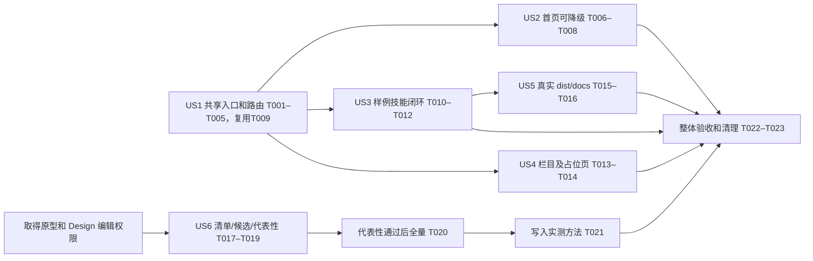

# Agent Foundry 文档站框架：功能分析

**分析依据（2026-11-26）**：当前 [需求及澄清](../../spec.md)、[总体方案](../../plan.md)、[业务闭环](../../mvu.md)、[任务清单](../../tasks.md)、[数据模型](../../data-model.md)、[路由契约](../../contracts/site-navigation.md)、[技术研究](../../research.md)、[技术状态图](../../diagrams.md) 与 [验收指南](../../quickstart.md)。本分析用于阅读和追踪功能，不是实现证据、工程状态清单或业务验收报告。

## 当前源码基线与边界

仓库当前的 `apps/docs` 是使用 Nuxt Content 与 UnoCSS 的文档应用，现有动态内容路由查询 `docs` 集合，未查到页面时返回 404；应用目前仅有 `default` 布局、catch-all 文档页和文档侧栏/目录组件。相关源码位置为 `apps/docs/nuxt.config.ts`、`apps/docs/content.config.ts`、`apps/docs/app/pages/[...slug].vue`、`apps/docs/app/layouts/default.vue` 及 `apps/docs/app/components/`。这是本轮核对时的项目事实，并不代表新规格的模块、布局和交互已经交付。

文档框架仍处于 Spec/Plan/Tasks 规划阶段。Nuxt UI 与 Three.js 尚未成为 docs 应用依赖；技能真实 `dist/docs`、Figma 原型访问/可运行源码和可编辑目标文件权限目前均为外部前置。下文所述新页面和组件均为计划位置。任务状态只读取 [tasks.md](../../tasks.md)，不从本页有无说明推断完成。

## 全局入口、兼容地址与四套布局

**业务分析**：读者从首页或任一模块出发，可借共享品牌回首页、借四个一级入口切换模块。技能集合子菜单只在技能模块出现，未知文档给出 404。用户已保存的 `/`、`/skills`、`/mcp`、`/workflow`、`/getting-started/installation` 应继续直达并支持刷新；新增项目开发入口为 `/development`。此项支撑 US1、FR-001/002/008/009、SC-001/004。

**关键判断与技术关系**：布局为 `home`、`skill`、`work-with-speckit`、`empty`；MCP 和项目开发文档共用 `empty` 但入口、标题和说明保持独立。项目开发文档地址已定为 `/development`。T002 建立五模块和样例集合最小路由骨架，兼容当前 Nuxt Content catch-all；T009 提供共享技能样例数据，保证 US1 无需等待详情实现即可操作集合子菜单。共享导航组件消费经 Nuxt UI 集成验证后的组件能力。计划文件位置详见相关 Task。

**流程与验收**：T001 先验证 Nuxt UI/UnoCSS 集成；T002 建模块及样例集合最小路由骨架；T009 准备集合子菜单和目录共用的样例数据；T003–T005 实现并核对品牌、桌面/手机菜单、集合子菜单、兼容地址和 404。US1 独立验收依赖上述基础，但不等待 US2–US4 的正式内容；构建通过不代替可操作性结果。

## 首页章节与模型失败降级

**业务分析**：访客纵向阅读 Skills、MCP 两个全屏示例章节，了解包名和占位内容。3D 提供视觉内容但不是阅读前置；任一模型加载失败或设备不支持渲染时，该章节保留静态替代、文字和文档入口，另一章照常运行。此项支撑 US2、FR-003/004、SC-002。

**技术分析**：Plan 选择在当前 Nuxt SSR 页面内隔离浏览器专属 Three.js 运行部分，不把整页变为客户端专属。初始 HTML 仍应包含可读章节内容及回退；每个章节持有独立模型状态，失败路径只改变自己的模型区域并释放已初始化资源。Three.js 依赖和模型加载错误行为尚待 T006 真实技术验证；计划组件位置为 `apps/docs/app/components/ModelScene.client.vue`、`HomeSection.vue` 与 `apps/docs/app/pages/index.vue`。

**技术流程图**：[diagrams.md](../../diagrams.md#首页-3d-模型加载与独立回退) 描绘 SSR 正文与客户端模型分界、成功和失败状态。它是计划逻辑图，不是已验证的实现流程。

**Task 与验收**：T006 验证客户端隔离和异常/资源清理并更新状态图；T007 先交付不依赖模型的章节骨架；T008 接入独立模型。分别注入 Skills、MCP 模型失败，在桌面/手机确认只有对应模型回退、正文/导航仍可用。图上的实现路径须在实施后按实际代码核准。

## 技能集合、技能详情与目录

**业务分析**：技能包正式文档说明就绪前，读者打开 `/skills` 只能看到至少两个样例集合及每集合至少一个样例技能。读者从顶部集合入口或侧栏到达同一集合，能展开/收起集合、辨认当前项；技能详情显示技能名称、所属集合及「文档待补充」占位，集合页保留说明区域。手机目录可开关。此项支撑 US3、FR-005/008/009、SC-003/004。

**数据与技术关系**：T009 在共享前置阶段定义集合/技能样例数据，驱动全局子菜单和本地两级目录，避免路径分叉；集合标识和技能标识形成可直达层级。有效路径须存在对应数据，无效标识转为 404。计划数据位置 `apps/docs/app/data/skills.ts`，目录组件为 `apps/docs/app/components/SkillDirectory.vue`，集合/详情页面为 `apps/docs/app/pages/skills/[collection]/index.vue` 与 `[skill].vue`。不得复制现存九项紧急版说明。

**Task 与验收**：复用共享前置 T009；T010 实现左侧目录及桌面/移动操作，T011 交付集合/详情内容，T012 核验有效/无效直达与刷新。单一列表字符串相同不足以证明闭环；需实际点选两处入口并核对 URL、当前状态和详情内容。

## Spec Kit 栏目、MCP 与项目开发入口

**业务分析**：读者能在 Spec Kit 模块切换两个栏目，并看到与选中栏目匹配的占位标题/正文。MCP 和项目开发文档都有独立可直达页面，尽管共用简洁布局，内容不互相混淆。此项支撑 US4、FR-006/007/009、SC-004。

**技术与流程**：Spec Kit 栏目用可替换的栏目标识、名称、标题、正文驱动侧栏和内容；项目开发文档新地址定为 `/development`。计划文件为 `apps/docs/app/data/workflow.ts`、`apps/docs/app/pages/workflow/[section].vue`、`apps/docs/app/components/WorkflowNavigation.vue`、`apps/docs/app/pages/mcp.vue` 和 `apps/docs/app/pages/development.vue`。

**Task 与验收**：T013 实现栏目切换及选中/正文同步；T014 实现 MCP 与项目开发占位页。桌面、手机切换栏目，再对两类占位地址直接打开和刷新；同时确认共享品牌导航存在。

## 技能包集合说明的真实产物接入

**业务分析**：维护者在技能包正式产物可用后可为集合配置默认说明、指定说明或关闭说明。文件缺失时维护者能定位告警；读者看到该集合占位，其他有效集合仍正常展示。此项支撑 US5、FR-010、SC-005。

**技术分析**：源边界是技能包正式且已验收的 `dist/docs`，不是紧急版源码、临时复制文件或本地模拟成功。字段省略/`true` 选集合默认 README，字符串在本集合目录内选择指定文件，`false` 跳过读取；缺文件按集合隔离并继续处理其他集合。当前只有计划契约，没有可供真实联调的产物。可能涉及 `apps/docs/content.config.ts`、`apps/docs/nuxt.config.ts` 和消费组件，确切机制须等 T015 核对真实目录后确定。

**Task 与恢复**：T015 以发布验收过的真实产物记录来源和元数据，T016 据实际路径实施接入并逐类验收。恢复条件是技能包完成适用发布流程并交付真实 `dist/docs`。此前可验收 US3 样例目录，不得称正式跨包接入通过。

## Figma 原型到可编辑 Design 画板

**业务分析**：设计协作者希望一次启动覆盖实际原型清单，将页面、视图与会改变可见导航的展开状态转换到同一 Figma Design 文件，并继续编辑文字和布局。工具可行性必须先由小批实测，不根据工具宣传推断本项目支持。此项支撑 US6、FR-011–014、SC-006/007。

**清单与判定**：真实原型到手后按模块盘点可达页面/视图、适用桌面或手机视口、默认态及可见导航布局变化态；正文不同的 Spec Kit 栏目分别建项。比较 URL 批量导入、Figma MCP Code to canvas 和至少一种 AI 或脚本驱动的清单采集候选对真实页面/交互状态的覆盖。代表性批次至少首页加一个内页且桌面/手机适用版本一次产出至少四块画板；文字/布局可编辑、正文和导航状态相符，替代内容须逐项记录并获设计协作者确认；代表性通过后才能启动全量。每项状态区分通过、失败、缺前置、未执行。

**Task 与恢复**：T017 盘点真实清单；T018 比较覆盖；T019 代表性批次；T020 通过后全量批次；T021 全量通过后把可复现方法写入 Spec。产物及逐项证据保存在计划位置 `analysis/figma-conversion.md`。当前缺原型入口/可运行源码和目标文件编辑权限，因此这些 Task 受阻，不能冻结其余站点闭环，也不能填入猜测的方法。

## MVU 里程碑与流转

实际用户结果、闭环节点、依赖和验收以同级 [mvu.md](../../mvu.md) 为唯一详情来源；Task 身份及唯一工程 checkbox 以 [tasks.md](../../tasks.md) 为准。

| 里程碑         | 可观察结果                                                                  | 任务衔接                             |
| -------------- | --------------------------------------------------------------------------- | ------------------------------------ |
| 可浏览站点入口 | 桌面/手机可切换五个模块及样例集合、品牌可返回、有效旧地址直达、未知路径 404 | US1：T001–T005，复用 T009            |
| 首页可靠浏览   | 两章文字和静态替代不依赖 3D，独立模型失败不带走入口                         | US2：T006–T008                       |
| 样例技能导航   | 同源集合入口、详情直达、手机目录和错误地址符合契约                          | US3：T010–T012，复用 T009            |
| 其余模块可用   | Spec Kit 栏目状态同步，MCP 和开发文档内容独立                               | US4：T013–T014                       |
| 正式技能文档   | 真实产物五种规则通过，缺失只影响一个集合                                    | US5：T015–T016，依赖正式 `dist/docs` |
| 原型设计转换   | 代表性通过后全量画板 100% 映射并保留可复现方法                              | US6：T017–T021，依赖原型及编辑权限   |
| 收尾           | 已具备范围按指南留验收记录，过程产物清理及引用检查有依据                    | T022–T023                            |

上图是任务依赖的业务视图，不表示阻塞轨道已经执行。T022 只对已具备输入的交付范围验证；因缺外部前置而未执行的 US5/US6 项保留明确状态和恢复条件。T023 最后执行并保护正式交付、有效治理及验收证据。

## 不适用分析类别

- **后端/API 与持久化数据分析**：本规格是静态内容型 Nuxt 应用，没有业务服务、写入数据库或对外 HTTP API 要求；契约定义的是浏览器路由和可见行为，不新增 API。
- **部署/运行容量结论**：Spec 未要求部署方式、用户规模或量化性能目标；不基于现有开发配置推导生产部署验收。
- **Figma/真实产物实测结论**：属于计划内独立工作，不是当前证据。具体输入缺失时只保留任务、阻塞说明和恢复条件。
