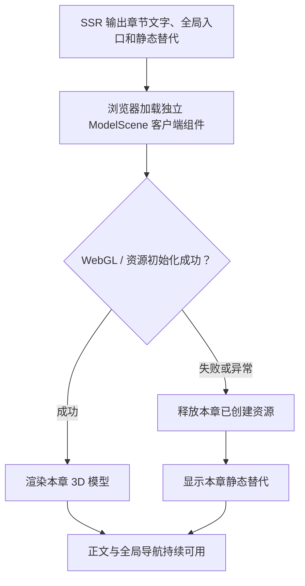

# 文档站技术图示

本文件只记录跨越客户端加载、运行状态和回退的核心关系；每图一事。图中代码路径是计划位置，实施后须按真实源码更新。当前没有实际模型资产、运行证据或已交付转换结果。

## 首页 3D 模型加载与独立回退

**用途**：解释单个章节模型从浏览器初始化到成功渲染或回退静态内容的状态关系。此处“客户端”指访客的浏览器，“回退”指模型不可用时仍显示静态替代，并非跳转离开页面。

**计划代码位置**：`apps/docs/app/components/ModelScene.client.vue` 提供浏览器端模型区域；`apps/docs/app/components/HomeSection.vue` 持有包名、正文、静态替代与模型区域；`apps/docs/app/pages/index.vue` 组合 Skills 和 MCP 章节。

**边界**：Skills 与 MCP 各自拥有模型状态；一个章节失败不触发另一章节回退。无论模型状态如何，正文、静态替代和共享菜单必须可读、可操作。实现时须依据实际加载/卸载路径补齐资源清理和异常分支，并用逐章故障注入验证。
