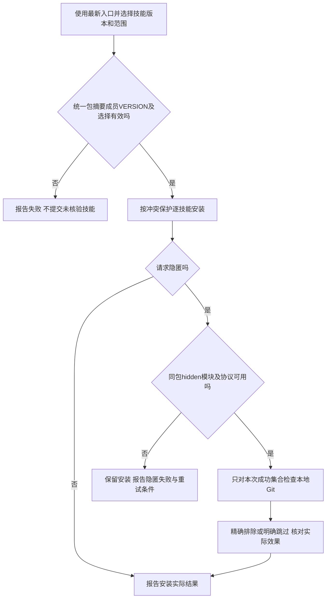
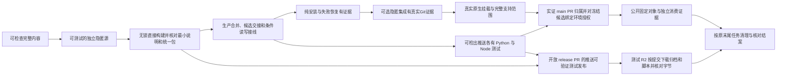
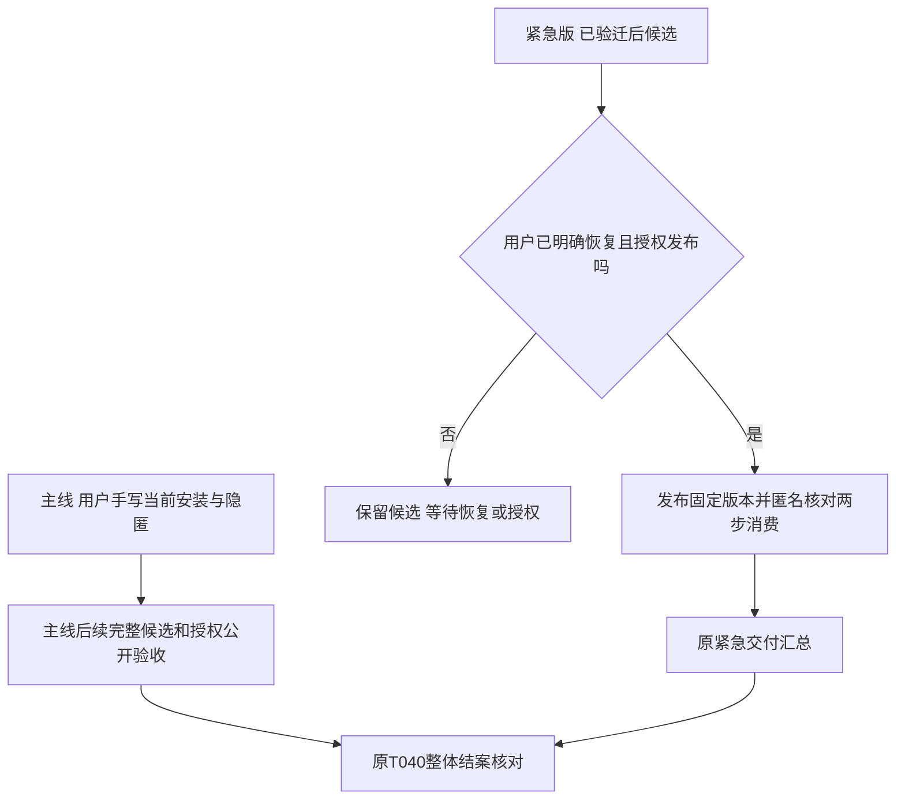

# 技能分发的用户流程与闭环转接

来源为[功能分析](README.md)、[当前规格](../../spec.md)和明确读取的[闭环详情](../../mvu.md)/[Task清单](../../tasks.md)。图中节点是用户结果与验收条件，不是新Task身份或工程状态；技术流程引用[diagrams](../../diagrams.md)，完整依赖引用[logic-flow](../../diagrams/logic-flow.md)。本轮只做Mermaid文本核对，未渲染。

## 用户取得技能与选择隐匿

统一包下载或核验失败时停止安装。包可信且技能完整后，隐匿模块失败时保留已装技能并报告失败。curl 插件生成 `dist/curl/install.sh`，引擎交付 `dist/engine/install.sh` 及 `dist/engine/script/` 下的脚本。相关任务为 T012、T016～T021 和 T033～T036。[功能分析](README.md)

## 主线里程碑流转

先在隔离范围验证生产部署接线。T056 的 R2 条件读写供 T095 复用，归档与推送检查就绪后再验测试环境按提交取件。实际生产验收核对合并提交、候选、平台权限、必需检查和完整消费证据。两类结果汇入 T040。实际或计划位置为 `packages/skills/build/ci/`、`.github/workflows/` 和 `analysis/acceptance/`。[任务依赖图](../../diagrams/logic-flow.md) · [闭环详情](../../mvu.md)

## 两条线的公开交付关系

紧急版当前全线冻结，主线先做构建验收。两线分别使用 `packages/skills/` 和 `packages/skills-distribution-urgent/` 的源码及产物。紧急版恢复后按 T091～T093 接续，总体结案由 T040 核对原前置。[冻结决定](../../spec.md#2026-11-23-紧急版冻结) · [任务清单](../../tasks.md)
