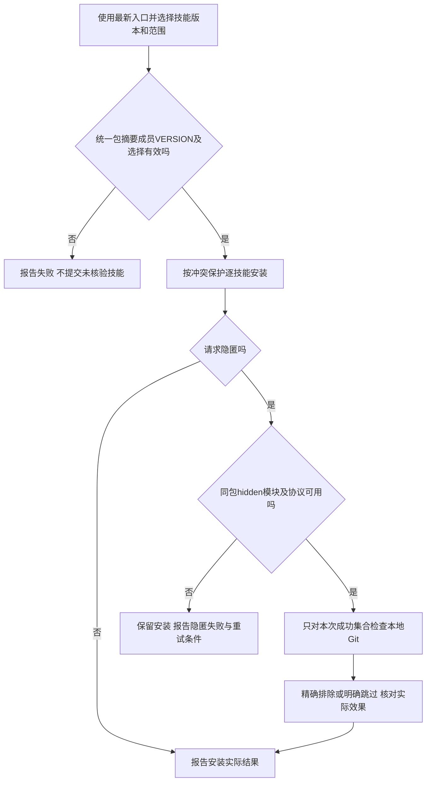
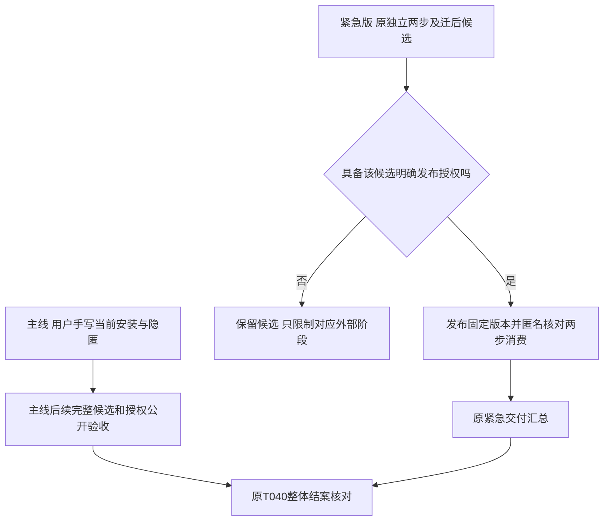

# 技能分发的用户流程与闭环转接

来源为[功能分析](README.md)、[当前规格](../../spec.md)和明确读取的[闭环详情](../../mvu.md)/[Task清单](../../tasks.md)。图中节点是用户结果与验收条件，不是新Task身份或工程状态；技术流程引用[diagrams](../../diagrams.md)，完整依赖引用[logic-flow](../../diagrams/logic-flow.md)。本轮只做Mermaid文本核对，未渲染。

## 用户取得技能与选择隐匿

大白话：统一包下载或核验失败不能装；包可信且技能完整之后，仅hidden模块失败保留成功安装。位置：vite-plugin-curl 生成 dist/curl/install.sh 和 dist/script/hidden-install.sh。归档及隐匿成功集合接入留后续任务，Task关联为T012/T016～T021和T033～T036，实际代码及范围见[功能分析](README.md)。非Spec Kit及挂载条件属于后置阶段，不在本图假装已经执行。

## 主线里程碑流转

大白话：每一步都以该职责的真实输入和验收放行下一步；当前局部演示不等于整条链完成。当前先核对本地构建。T076 的输入检查、T034 的隐匿材料及 T077 的输出可独立于版本表推进。流水线后续进行正式归档与 R2 版本表管理。完整平台/挂载近期后置，未验事实仍保留。实际/计划位置为build/plugins、script/old、build/ci、workflow与analysis/acceptance；Task职责和原MVU-001/002/004/005/008/009分别在[原清单](../../tasks.md)及[mvu](../../mvu.md)，不在本图复制它们的当前状态。

## 两条线的公开交付关系

大白话：紧急版有自己的证据与授权，不等主线重写，也不因主线Plan/Tasks而自动取得发布许可。代码位置为packages/skills与packages/skills-distribution-urgent各自源码/输出，紧急T090～T093及主线迁后职责沿原Task读取。这个业务转接只解释两线独立和最终汇合，T040仍等待其全部原前置，不由图中少量节点代替完整依赖。
