# 技术流程图：分发核验与阶段状态

## 2026-11-16 最新入口与固定辅助包

本图为当前主线设计，替代下文旧Node唯一启动、双安装入口及Git主线发布假设。图示不代表实现通过，紧急版仍采用自身两步流程。

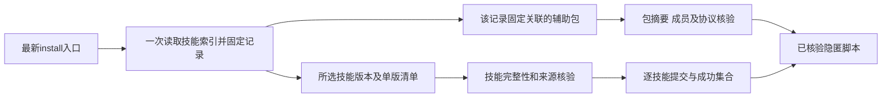

大白话：入口可以更新，历史技能仍用其登记过的脚本包；同次发布统一读取package.json.version；实际最新入口可新于所选技能和它的同版辅助包，分别追溯实际来源。代码位置：`packages/skills/build/plugins/vite-plugin-curl/install.source.sh`（当前只有基础技能下载复制，关联及阶段核验待实现）；持久记录和新清单位置见[curl契约](contracts/curl-delivery.md)。

## 2026-11-16 隐匿失败不抹去安装成功

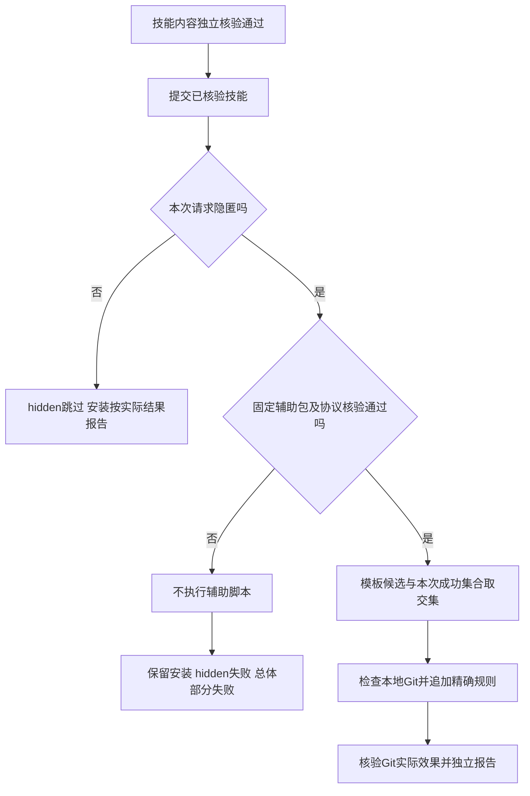

大白话：只有技能自己核验失败才不能进入提交；隐匿包失败不阻止独立安装，已成功技能保留。图画出的是依赖关系，不要求串行下载阻塞安装；即使包错误先于技能写入发现，也按同一规则处理。代码位置：入口`install.source.sh`与`vite-plugin-curl/hidden-install.template.ts`；独立Bash输出与归档已接线，下载调用及成功集合协议仍待原安装/隐匿Task验证。

## 2026-11-16 构建派生与最终归档

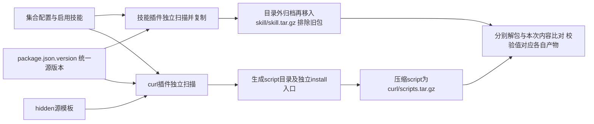

大白话：两个插件各自扫描、交付和打包，不等待对方的目录；skill包最终放进skill目录，script包放在script目录外，都不包含自身。代码位置：`packages/skills/build/plugins/vite-plugin-skill/index.ts`、`vite-plugin-curl/index.ts`与唯一`vite.config.ts`；上述基础归档已有实现，正式过滤、清单和版本仍待原Task。不要求跨构建哈希相同，发布时冻结选定产物；图中校验值表示核验关系，不表示插件已生成校验文件或安装入口已接通。

历史技术图（旧入口与旧推进顺序，当前依赖以logic-flow为准）

2026-11-10 按当前 spec、plan 与数据模型同步 Increment、实施准备、旧入口迁移及 Agent 在线来源；唯一公开入口仍为 node script/index.mjs。下图区分已具备的只读数据查询与后续安装、挂载流程，图示不代表完整平台或业务验收。来源：[plan.md](plan.md)、[data-model.md](data-model.md)。

## 本次优先交付链：构建及占位 → Actions → 真实挂载

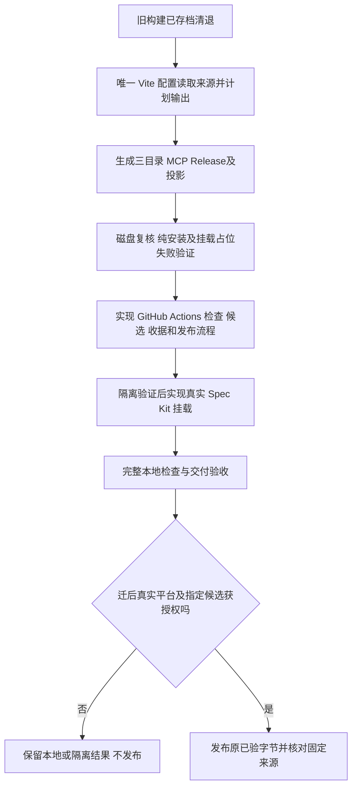

术语：占位只表示原生能力未实现，挂载请求非零且没有受管写入；关闭挂载时独立判断纯安装。Actions实现可以先行，正式full/ready仍等待真实挂载、完整门禁和真实平台；开发先后不改变运行时构建与候选的字节约束。

位置：packages/skills/vite.config.ts、build/plugins、build/distribution、script/mount-entry与计划的build/ci及skills workflow。依据[本轮顺序](requirements/discussions/2026-11-10-build-actions-mount-order.md)，详细任务见[逻辑图](diagrams/logic-flow.md)。本轮仅更新规划，没有实施或运行该新流程。

## 上传前内容与上传后平台身份

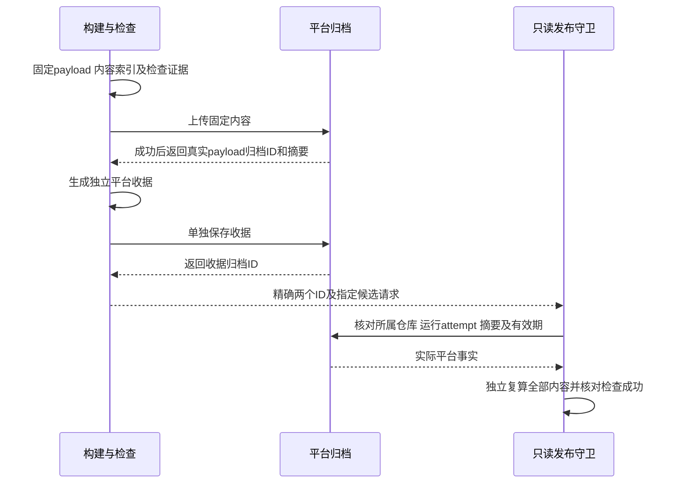

术语：payload是未来公开文件；内容索引说明这些字节；平台收据证明它们被哪次上传保存。ID在成功上传后才产生，不能预写进包含自己的归档；收据本身的ID由请求定位。具体字段见 [数据模型](data-model.md)，只有可信实际平台记录才能用于正式发布，合成材料仅用于隔离实验。

计划位置：build/ci/candidate.mjs、skills-check.yml与skills-release.yml；它们当前未实现，不代表已经上传或完成宿主验证。

## 安装与官方预检的 Agent 来源

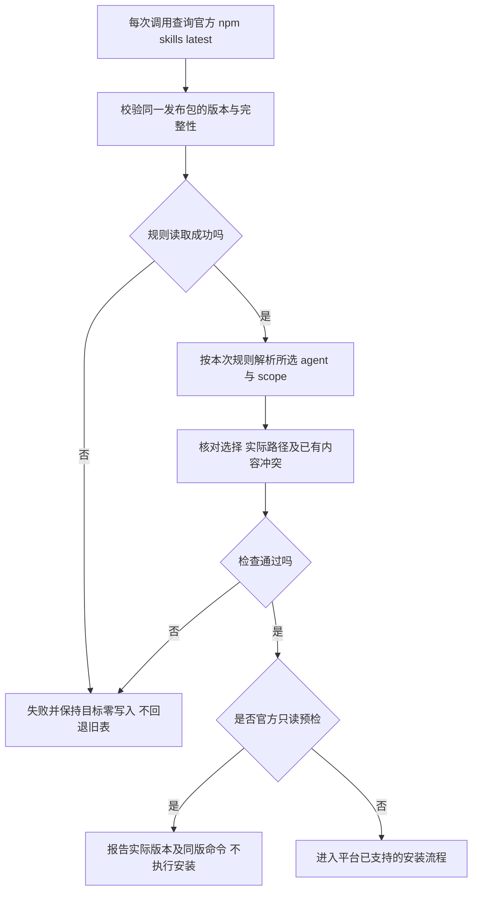

术语：latest 是本次查询的渠道；version/integrity 是实际取得包的版本与完整性证据，同次规则和建议 CLI 一致，下次重查。自有技能 release 版本及来源提交仍固定。读取器只提供数据，不执行 CLI 入口、准备 npm 缓存或写目标；规则布局变化须明确失败。普通安装的后续能力仍受各任务实际支持范围限制。

实现位置：`packages/skills/script/install-skills/read-agents.mjs` 及安装平台脚本。构建原样复制脚本，不查询在线数据，不维护包根 distribution 或 agents.json。已有验证见[在线来源记录](analysis/acceptance/online-agent-source.md)，未宣称未来上游或完整跨平台通过。

## 单技能提交状态

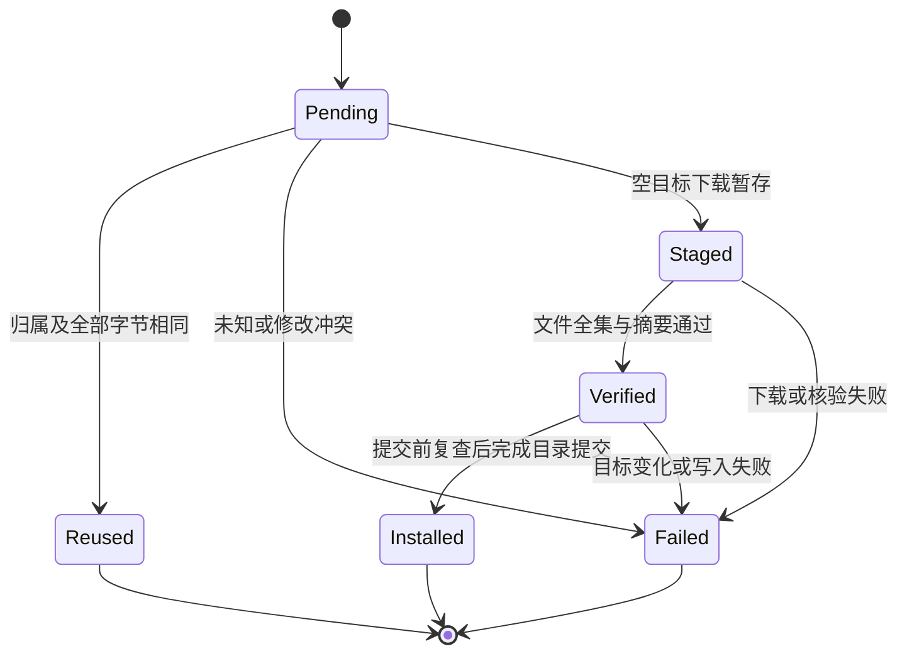

术语：Pending＝待处理；Staged＝文件只在临时目录；Verified＝文件已验完整；Installed＝已经交付；Reused＝现有同版内容通过重验；Failed＝失败，不参与挂载。逐技能成功不等于整批成功。

计划位置：`packages/skills/script/install-skills/install-skills.sh` 及 .ps1 的安装与归属核验。

## 内部挂载顺序

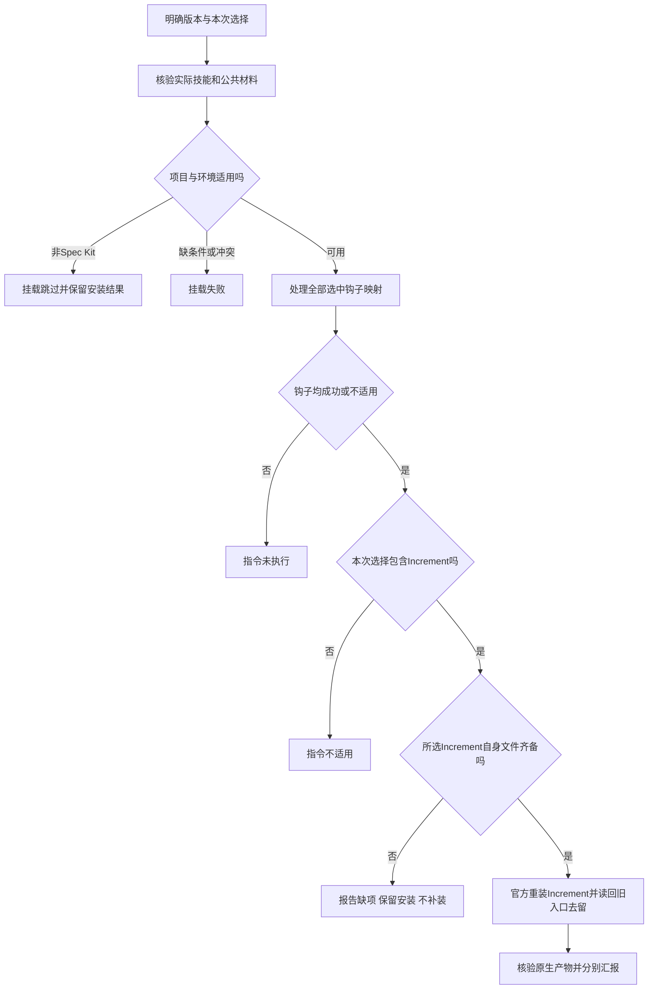

术语：公共材料＝独立取得的同版脚本与发布清单；映射＝技能需要注册哪些动作；原生产物＝Specify CLI实际创建的文件与配置。环境检查不是自动安装前置工具。仅本次所选 Increment 自身齐备后每次官方重装，不要求三暂停模式，技能安装可复用不代表命令跳过。

计划位置：`packages/skills/script/mount-entry/`、`register-hooks/`；已存在且复用：`packages/skills/script/register-commands/`。外部整体验收尚未通过。

## 精确排除的判定

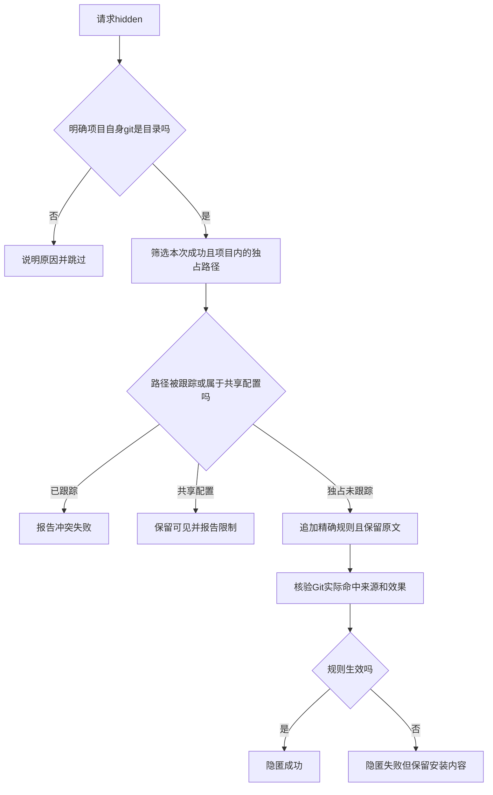

术语：hidden＝让Git普通未跟踪列表不显示本地文件；独占路径＝只含本次安装器拥有的内容；共享配置＝多个功能共同使用的文件，不能整体隐藏；命中来源＝实际让Git忽略该路径的规则位置。

计划位置：`packages/skills/script/install-skills/install-skills.sh` 及 .ps1 的 Git 排除能力。规范状态与公开返回格式见数据模型。

## 直接源码迁移、候选与来源身份（2026-11-10 更新）

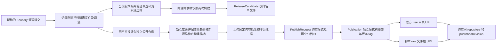

源码由用户直接迁移，新仓库维护依赖配置；本功能不导出工程包或生成配置投影。ReleaseCandidate 是白名单安装内容，与源码范围分别限定。迁移后的源码 SHA 变化，须在新仓库重建和重新授权。官方 tree URL 负责目录发现，raw URL 用于逐文件下载，两者对应同一发布提交；发布 SHA 与源码 SHA 分别保存。候选索引及 CI 报告在安装发布根之外。

计划位置：`packages/skills/build/ci/{run,candidate,publish}.mjs` 与两份 skills workflow，尚未实施；数据和调用见 [数据模型](data-model.md) 及 [流水线契约](contracts/pipeline.md)。本图是设计关系，不表示已经完成迁移或构建实验。

## 发布写入与核验分开记录

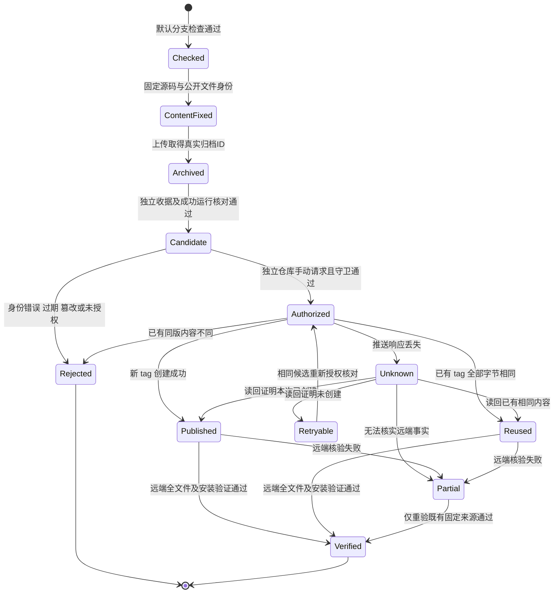

Authorized 表示明确候选的发布授权通过；Published 表示写入已发生；Verified 表示该运行请求的远端校验通过，完整支持矩阵及独立使用者验收仍按原任务分别判断；Partial 保留已知 ref 和尚未验证的部分，不能重写成“从未发布”。响应丢失先读远端，未知状态不能盲目重推。并发请求仅尝试无 force 创建一个新 tag，以远端实际结果裁决；同版不同内容始终拒绝。

计划位置：`packages/skills/build/ci/publish.mjs`、release workflow 和 PipelineRun 报告；本期只在临时 bare Git 验证状态分支，真实 Actions/HTTPS/安装在迁后补证。Foundry 模式不会进入真实 Authorized/Published 阶段。

## 旧入口迁移中的用户内容保护

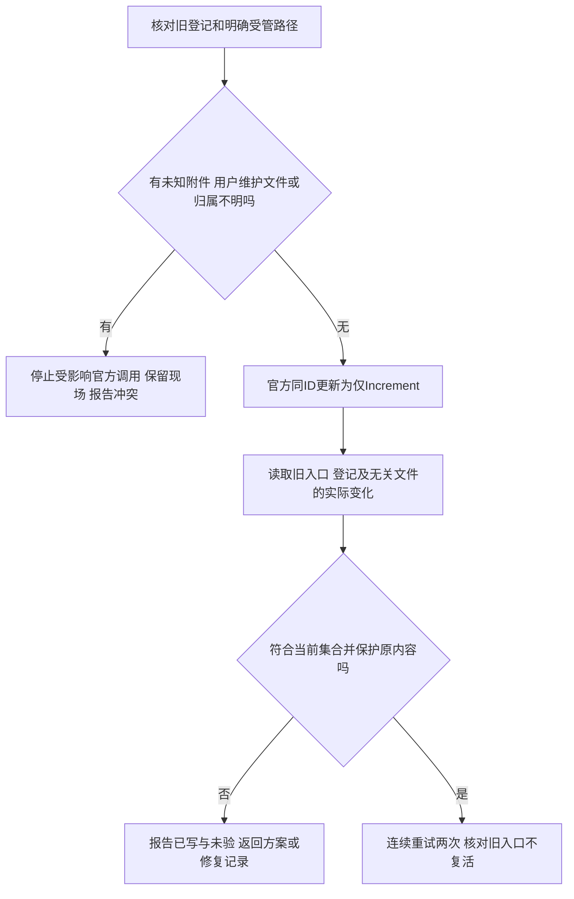

术语：受管＝有明确来源和官方登记的对象；未知附件＝无法证明属于可替换交付的额外内容；同 ID 更新＝官方先移除旧登记再注册新集合。仅检查明确受影响目录，不增加永久指纹或自动搬移用户文件。

计划位置：packages/skills/script/mount-entry、register-commands 与 register-hooks 双平台模块。D-MOUNT 尚未实际运行；本图不说明真实用户目录已迁移。

## 紧急版阶段关系与发布事实（2026-11-12）

依据[最新spec](spec.md)、[方案](plan.md)、[模型](data-model.md)和[紧急契约](contracts/urgent-release.md)，替代原紧急图的仓库外目录与连续发布关系；上方原主线图和顺序完整保留。本轮仅设计，未搬移或运行产品验证。

### 工作区内汇合并在本地验证后连续推进

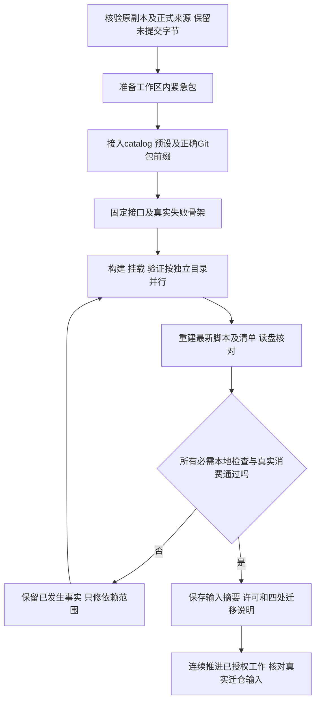

大白话：工作区紧急包是packages/skills-distribution-urgent，和主线源码/输出分离。Git包前缀用于在仓库根正确定位包的实际源码，不再要求包根就是Git根。完整本地消费包括真实官方安装、所选hooks先行、Increment及Codex完整加载，不能仅靠单元测试或文件存在。按本轮豁免取消固定暂停，在已有授权和真实前置内连续推进；公开操作仍须适用明确授权。

计划位置：packages/skills-distribution-urgent/{src,build,script,tests,dist}及发布根外本地验收材料；当前目录尚未创建，旧副本保留为来源。Tasks和逐项方案的旧路径待后续同步，本图不改工程状态。

### 用户迁移后才能进入公开阶段

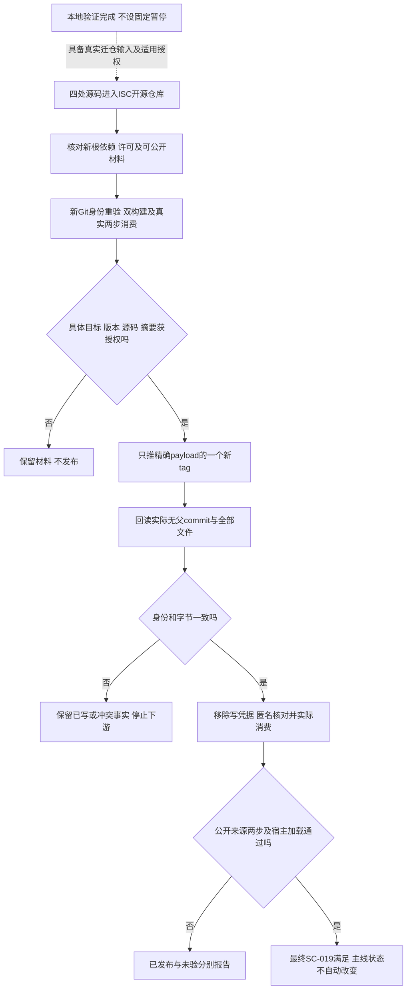

大白话：四处源码指紧急目录、packages/skills、specs/skills、apps/mcp；公开源码可以保留eval，但技能发布和安装仍排除它。tag指向承载精确公开文件的无父提交，sourceRevision则追溯对应的新仓库源码，两者不能混写。网络断连先回读，不从退出码推断没有发布；源码迁移、发布与匿名消费分别需要真实证据。

计划位置：迁后新仓库根配置、紧急包内部发布工具、skills-v<version>和自有Linux/Codex消费项目；许可/依赖/私有依据与MCP旧manifest缺口进入迁移说明。原PlatformReceipt与full/ready资格不参与，不伪造Actions收据。本图只作文本结构核验，未声明渲染通过。

