# 业务流程图：技能分发与安装后挂载

2026-11-10先在Plan阶段生成，后由本轮task-increment按用户顺序复用artifact-business-flow更新，依据[spec](../spec.md)、[plan](../plan.md)、研究及模型刷新；本次Tasks已衔接共同交付的优先级和前置，实际执行依赖见[logic-flow](logic-flow.md)。US1～US7当前范围保持，MVU-007/T053和三暂停模式只留历史；图示不表示能力已交付。

## 紧急版：同工作区验证完成后连续推进（2026-11-12）

本节由本次Plan的artifact-business-flow hook依据[最新spec](../spec.md)、[当前方案](../plan.md)、[研究](../research.md)和[紧急契约](../contracts/urgent-release.md)刷新，取代原紧急路径的仓库外位置与自动衔接发布关系。所有新目标位置为计划，原副本已发生实现与验收范围分别保留；本轮没有搬移或运行产品验证，下方原主线图保持。

### 维护者完成本地验证并连续交接

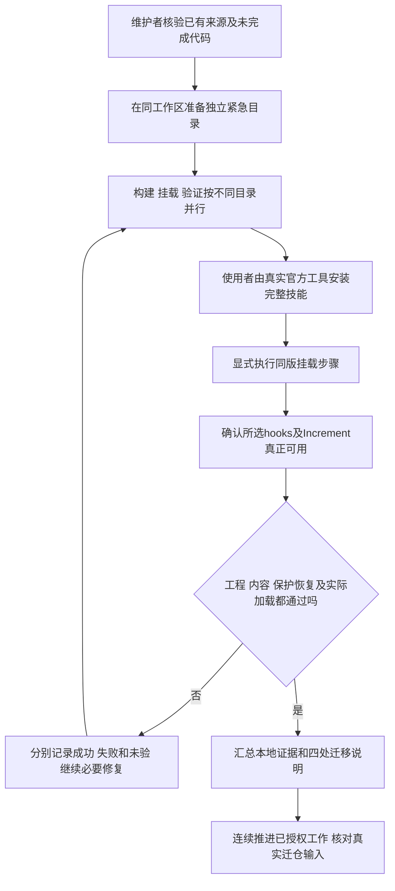

大白话：独立目录指当前工作区packages/skills-distribution-urgent，不是另一个Git仓库；它与用户手写的packages/skills主线及输出分离。hooks是所选技能随工作流事件执行的动作，须先成功或明确不适用，再处理Increment。实际加载要求Codex完整读取正文和附件，不能只看文件存在或CLI退出0；旧入口迁移、用户内容保护和失败恢复也要实测。全部本地验证通过后连续推进具备前置的已授权工作，不另索取阶段或逐Task方案确认；搬移或发布仍核对适用明确授权。

计划位置：packages/skills-distribution-urgent的src/build/script/tests/dist及本Spec验收记录。旧仓库外副本保留为恢复来源，package依赖、Git包前缀和原测试假设须适配；不复制旧Git、node_modules、锁、输出或环境文件。任务身份和checkbox保持，旧Tasks路径在后续阶段同步。本图只核对文本结构，未声称Mermaid渲染通过。

### 迁入开源仓库后从固定版本实际使用

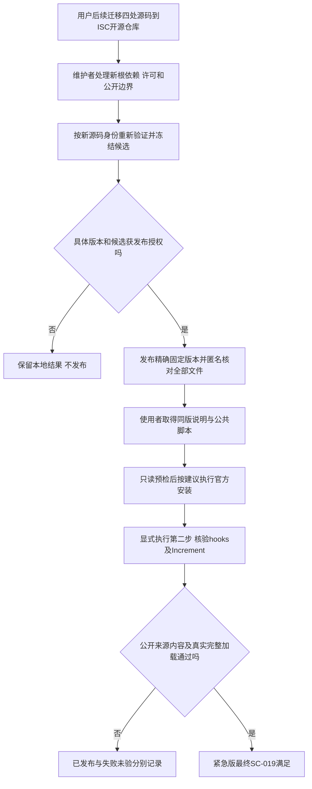

大白话：四处源码是紧急目录、packages/skills、specs/skills、apps/mcp。eval源码和样本可保留在开源仓库，用于维护与测试，但正式技能发布、列出和安装仍排除eval；使用者安装来源是精确发布物固定树，不是源码仓库根。源码迁移不等于MCP已兼容或可以线上部署，已有manifest缺口单列；公开前还要核对specs及archive中的私有依据，保留ISC和适用第三方许可。

计划位置：后续新仓库根配置与四处相对目录、仅含获准payload的固定版本树、自有Linux/Codex消费项目。本地结果不能替代迁后重验，发布授权不由Plan或本地通过自动取得；不改原full/ready准入、不造Actions收据，也不自动完成主线其他范围。

## 本次优先：先检查内容，再验证 Actions，最后接通挂载

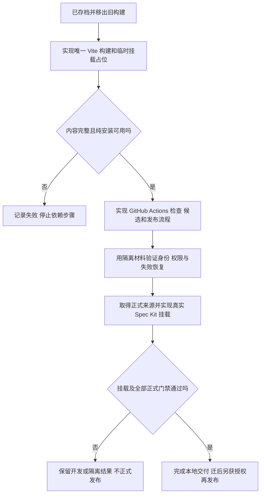

术语：纯安装是显式关闭挂载后读取完整技能及附件；占位会明确报告未实现，不模拟成功。Actions是GitHub的检查与发布流程，本阶段先实现并隔离验证，真实平台结果仍待迁后核对。正式挂载和全部发布门禁齐备之前，不能发布含占位的正式版本。

计划位置：packages/skills/vite.config.ts、build/plugins、build/distribution、script/mount-entry和两份skills workflow。来源为[本轮明确顺序](../requirements/discussions/2026-11-10-build-actions-mount-order.md)和更新后的[逻辑图](logic-flow.md)；T064清退证据保留，本轮没有编写或运行这些新能力。

## 保存候选后再取得真实平台身份

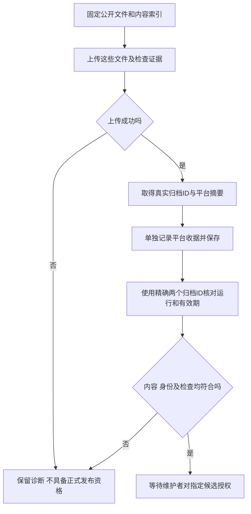

术语：内容索引说明实际文件和摘要；归档ID是成功上传后平台分配的编号；平台收据将这些字节与实际运行对应起来。收据放在公开文件之外，自身上传ID由请求定位，不回写自己。下载了同名文件或索引自称成功，都不足以取得发布资格。

计划位置：build/ci/candidate.mjs、skills-check.yml及release的只读guard；字段见 [数据模型](../data-model.md)。真实平台运行尚未执行，本地合成记录仅用于明确标注的隔离实验。

## 官方入口按需安装

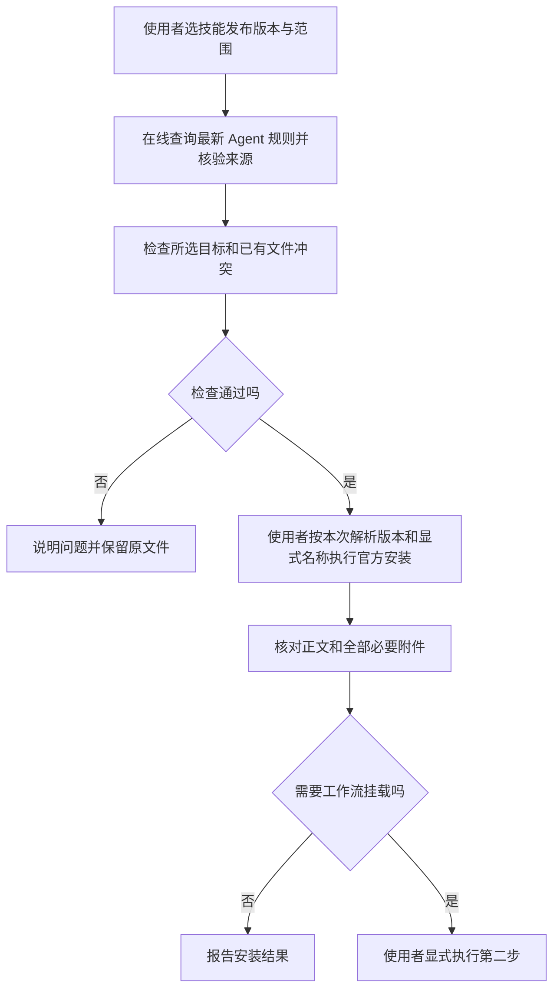

术语表：技能发布版本＝本次自有技能内容固定；最新 Agent 规则＝每次查询官方 npm skills latest，同次规则、CLI 与报告版本一致，下次重新查询；技能范围＝整包、分类、单个或多个技能；冲突＝目标里已有不能自动替换的内容；附件＝技能正文引用的材料；第二步＝单独调用同版本公共挂载入口。在线查询或完整性、规则布局失败时目标零写入、不提供可执行建议；不回退静态表。官方命令本身不会自动运行本包挂载脚本。

计划位置：`packages/skills/script/install-skills/` 的只读读取器 read-agents.mjs 及平台检查；现有 `packages/skills/README.md` 发布说明源；`packages/skills/script/mount-entry/`。

## 下载脚本安装并报告结果

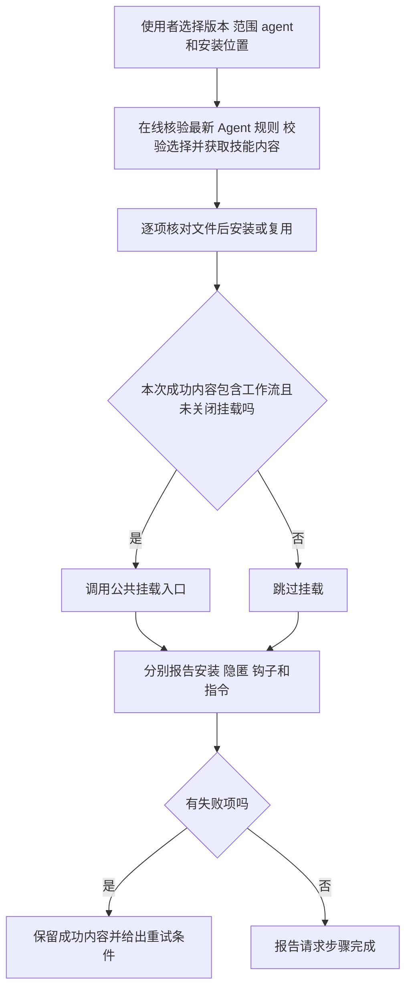

术语表：agent＝读取技能的编码工具；安装位置＝当前项目或工具允许的用户全局位置；复用＝现有同版完整文件无需再写；本次成功内容＝本次选择中实际核验完整的技能，不包括自动扫描出的历史技能；重试＝修复原因后重新核验；仅本次所选 Increment 每次经官方重装，不要求三个暂停模式。

计划位置：`packages/skills/script/install-skills/` 平台脚本；结果格式见 [data-model.md](../data-model.md)。

## 将所选技能接入工作流

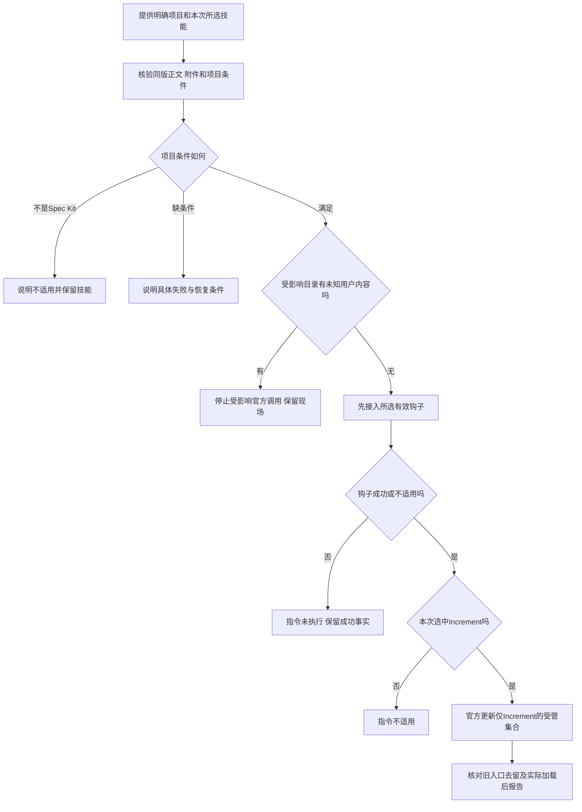

术语：钩子＝阶段前后运行的动作；Increment＝用户主动调用的闭环规划入口；受管集合＝有明确来源及官方登记的本包入口；未知用户内容＝不能当作可替换文件的用户附件或维护文件。只选 Increment 不需要 Pair/Tutor/Direct；全局安装仍需明确挂载项目。官方更新可能先卸载旧目录，故未知内容在调用前停止。

计划位置：packages/skills/script/mount-entry、register-hooks、register-commands 双平台模块；两入口与工作区复用实际链路。迁移/保护规则见 [contracts/mount.md](../contracts/mount.md)，D-MOUNT 实验未执行。

## 实施准备同版交付与加载

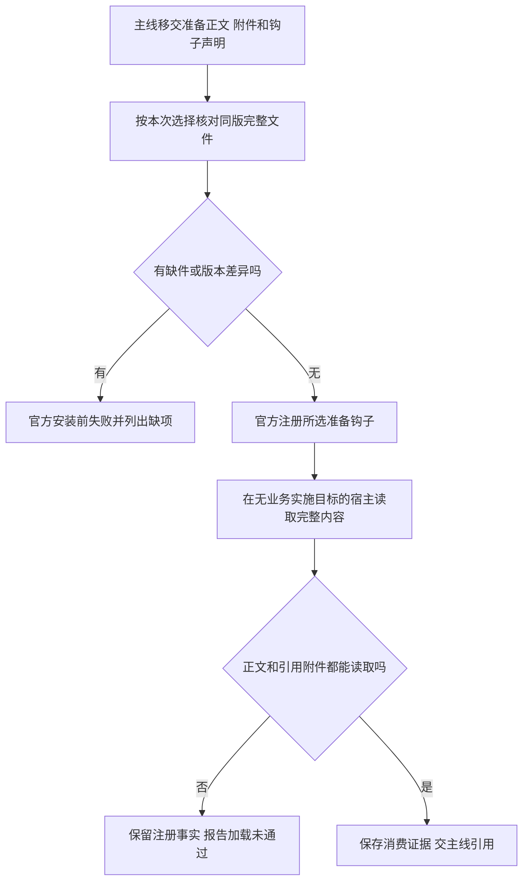

术语：准备能力＝主线选定的 implementation-preparation；同版＝正文、附件、hook 声明与本次固定技能版本一致；完整加载＝实际宿主能读取所需内容。它接入原生 before_implement，不新增 Implement 包装指令，也不在安装时实施业务。主线负责讨论、认可方案与逐 Task 门禁，分发的加载证据不能抵扣这些行为验收。

计划位置：主线 packages/skills/src/skills/workflow/implementation-preparation（尚未交付）与本包现有构建、安装、register-hooks；模型见 [data-model.md](../data-model.md)，验证设计为 D-PREP。

## 可选地隐藏本地新增文件

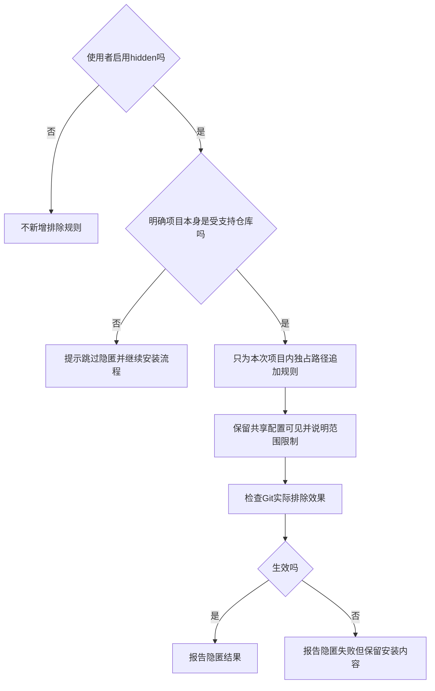

术语表：hidden＝让Git的普通未跟踪列表不显示部分本地文件；排除规则＝只在本机生效的忽略记录；独占路径＝本次安装器拥有的目录或文件；共享配置＝其他功能也在使用的配置，不能整文件隐藏；受支持仓库＝明确项目中 .git 是目录的普通仓库，worktree和submodule首版跳过。

计划位置：`packages/skills/script/install-skills/` 平台脚本的排除能力；约定见 [contracts/mount.md](../contracts/mount.md)。

## 本版本交付并迁移独立工程

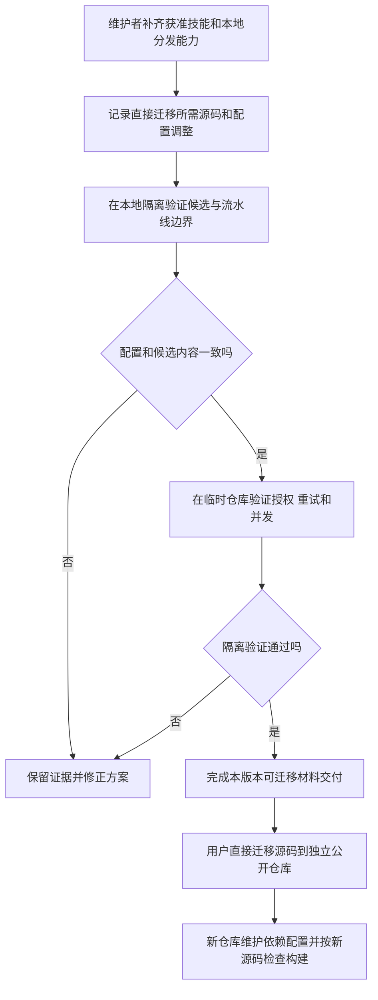

术语表：独立工程＝后续可以自行维护、检查和构建的项目源码，包含获准技能、必要配置、脚本及流水线，不含画像和内部材料；候选＝准备交付给使用者安装的确定文件集合，来自 release.json.files 加清单自身；隔离验证＝在自有临时目录和 Git 目标验证，不发布到真实仓库。新仓库的源码身份变化后重新检查，不能沿用旧候选的授权。

计划位置：`packages/skills/build/ci/`、`.github/workflows/skills-check.yml`、`.github/workflows/skills-release.yml`；这些入口尚未实施。复用已有 `packages/skills/build/distribution/`；指南见 [quickstart.md](../quickstart.md)。本次仅规划，不创建真实仓库或发布。

## 迁移后首次发布并验收

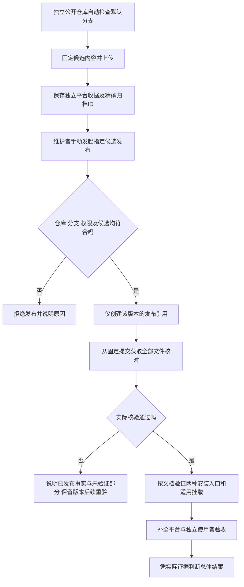

术语表：默认分支＝仓库的主要维护分支；候选身份＝具体源码、版本、运行及文件摘要的组合；发布引用＝永久指向该版文件提交的 Git tag；同版同内容可复用，不同内容不能覆盖。固定来源有两种地址：官方安装用目录浏览 URL，脚本下载用原始文件 URL，两者必须绑定同仓库同提交。远端验收必须实际获取和运行；独立使用者指仅按交付文档操作的其他人。发布写入和后续验证分别记录，失败不删除已发布版本。

计划位置：上述 release workflow、`build/ci/publish.mjs` 及安装预检的来源转换；结果结构见 [pipeline 契约](../contracts/pipeline.md)。迁后由新仓库自主执行，不依赖 Foundry 长期代发；真实验收保留原 T032/T038 与总体验收条件，现有流水线 Task 已保留，当前新增消费范围待下一次 tasks 衔接。

## 当前规划反馈与主线回填

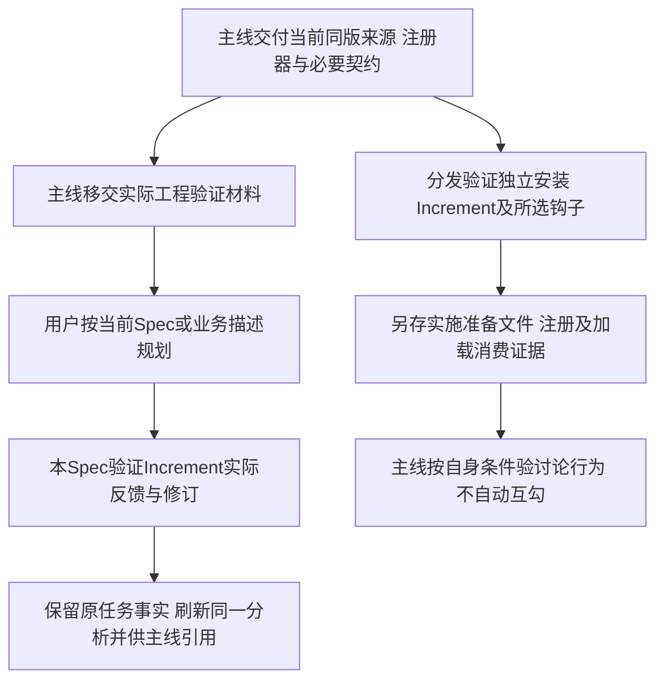

术语：真实反馈＝用户实际参与规划后的修订，不能从代码或材料推断；消费证据＝同版交付、原生注册与实际可读取；回填＝主线引用分发证据并按自己的条件判断。Tutor/Pair/Direct 专项移出本期测试、移交和结案，旧 T053 身份与历史仍保留，不再等待本期补测。

产物位置：本功能 analysis/acceptance、T052 的真实 Increment 证据及后续消费记录；主线引用实际结果。T053 的暂停标记及旧收尾依赖待 speckit-tasks 更新，本图不改工程 checkbox，不在安装阶段发起业务实现。旧五/四入口及其他模式验收图的事实保留在原历史与验收记录中。
