# 逻辑流程图：紧急版本按豁免连续推进，主线顺序保留

## 本轮主线图范围（2026-11-12）

依据[主线范围纠正](../requirements/raw/2026-11-12-main-curl-only.md)，本图后半主线执行图移除官方skills专属T013～T015节点及阻塞边，T016接T012；T021保留curl内容与恢复，T027保留curl自动挂载。已完成节点只保留历史，紧急版图及T078～T093不变；文本图核查不代表重新渲染或产品验证。

更新日期：2026-11-12。调用场景：speckit-tasks完成后实际执行artifact-logic-flow，同步当前[任务清单](../tasks.md)、[闭环详情](../mvu.md)及[紧急契约](../contracts/urgent-release.md)。适用任务：紧急T078～T093及保留的65项主线任务。原图由task-increment按用户明确顺序生成，来源见[原讨论](../requirements/discussions/2026-11-10-build-actions-mount-order.md)；下方原主线部分与顺序完整保留，暂停T053与撤回身份不进入执行图。

## 紧急路径依赖增量（2026-11-12）

复用T078～T093共16项身份，均待办；全功能81项有效任务、18项累计完成、63项待办。紧急部分23条边，新增T085→T084共享保护接口依赖，T093→T040仍为唯一总收尾汇合边；连同原主线113条显式依赖共136条。主线尚未完成插件、Actions及全矩阵不是紧急前置，原状态与验收不变。

箭头只表示任务正文的明确依赖，跨图节点为阅读定位重复，边按后项所属图仅绘一次。P须等全部前置实际完成且文件/临时项目互不竞争；package/catalog/预设、Vite、源清单、共享helper与最终身份由协调者收口。图示不代表已开工或工程通过。目标代码均在同工作区`packages/skills-distribution-urgent/`，不在旧独立副本继续实施。

### 工作区基础与US1内容安装

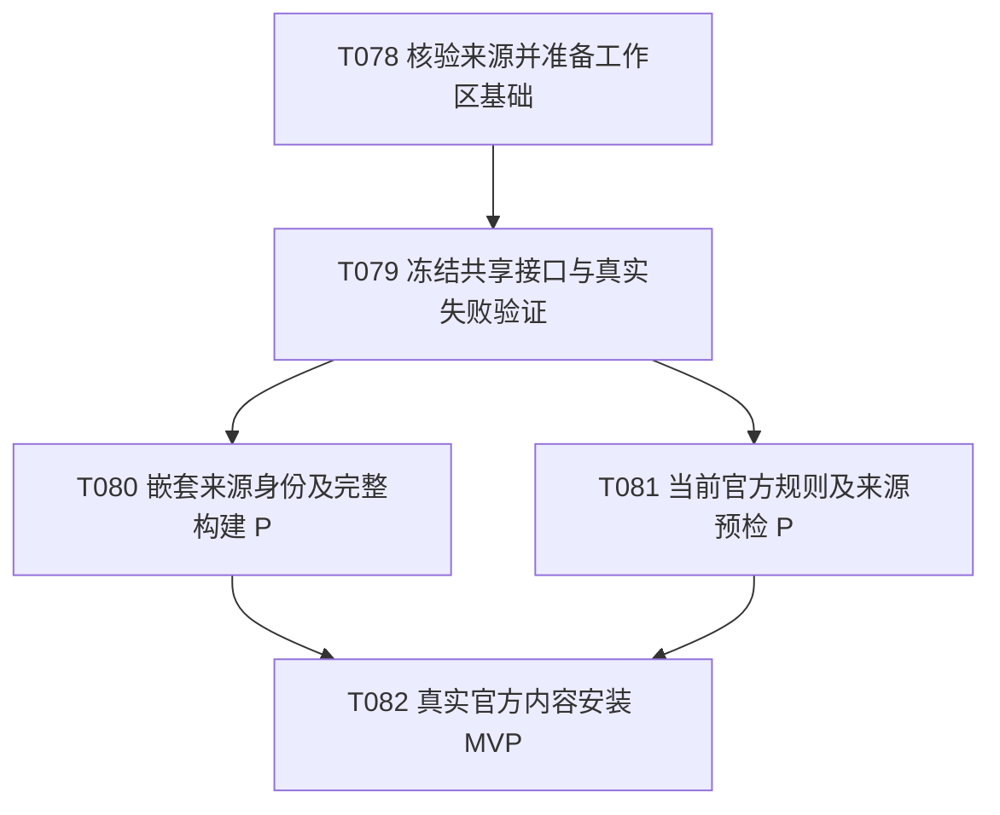

T079后，构建T080与在线预检T081可按不同文件并行；T082等待两者，在真实官方工具验证9项完整安装、eval及未选技能为0。代码位置：目标包package/config、build、script/install-skills及tests/official-install.test.mjs。来源身份覆盖实际相关输入及workspace依赖；无关脏文件不代替相关输入检查。

### US3真实挂载与完整宿主加载

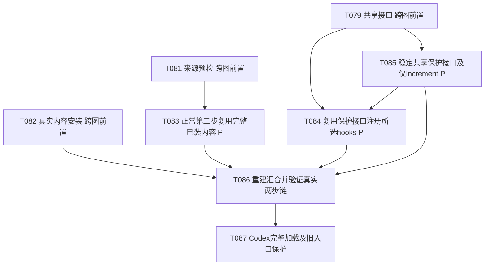

T083等待T081，可与不同目录的T085并行。T085由协调者独占`script/lib/managed-state.mjs`，稳定接口后才开始T084；P不代表两者可同时改共享文件。T086等待四项汇合、重建当前脚本/集中配置/候选，再验证hooks先行、失败不装Increment；T087验证实际注册/派发/完整Codex读取、旧3/4/5入口迁移及用户修改保护。代码位置：目标包script/mount-entry、register-hooks、register-commands、lib/managed-state.mjs及对应tests。

### US5本地验证与连续交接

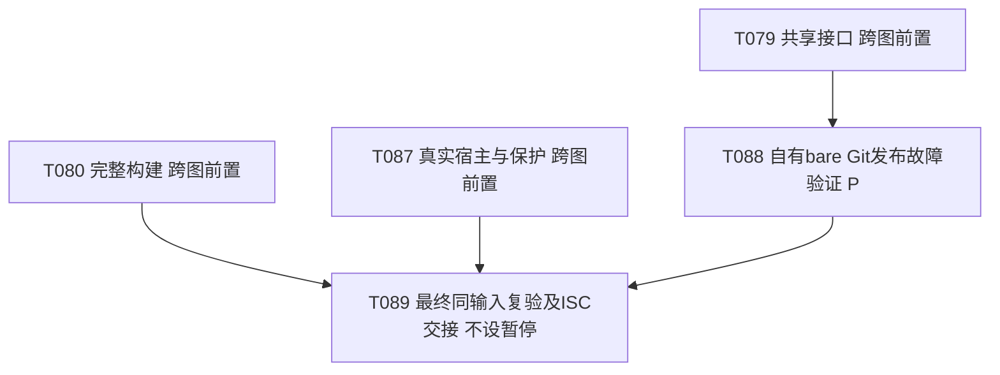

T088只操作自有bare Git，可与构建/运行模块并行。T089在README等最终修改后，按同一实际输入复验适用工程检查、双构建、真实两步/宿主及保护，交接四处源码、ISC、公开前私有材料处理、根依赖与MCP旧manifest缺口。**全部必需本地验证结束后按已有授权连续推进，豁免中间阶段及逐Task方案重复确认；T090需真实迁仓输入，搬仓、建仓、推送和发布仍核对适用明确授权。** 缺远端不阻断本地；真实发布与公开消费仍未验。位置：目标包build/publish.mjs、README/LICENSE及本Spec的analysis/acceptance/urgent-handoff.md。

### 用户迁移后独立启动公开交付

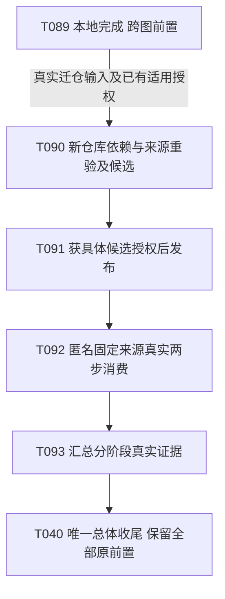

紧急版不再另索取阶段继续确认；依赖满足仍不新增发布授权。用户实际将紧急包、packages/skills、specs/skills、apps/mcp移至新开源仓库且必要输入具备后，T090核对新Git根/实际依赖/ISC及公开材料，以新身份重验；不能直接沿用Foundry SHA或旧候选。T091另需绑定repository/version/sourceRevision/candidateDigest的明确授权，T092匿名验证全集及实际消费。T093不回写已发布字节、不自动完成主线；T040仍等待原T039/T052/T060/T062及T093，紧急公开交付不等待T040。位置：新仓库目标包dist/release.json、内部发布驱动及本Spec的analysis/acceptance/urgent-*.md。

推荐从T078→T079准备，再分配互不竞争的构建、运行模块和bare Git验证；T082为内容MVP，本次本地目标为T087/T088汇合至T089后连续推进具备前置的已授权工作。最终SC-019仍须迁后T090～T093真实结果。必需前置失败只阻断对应下游，CLI退出0、文件存在、旧存档或占位均不能抵扣实际验证。本轮核对Mermaid文本与任务图边，未运行图形渲染。

## 如何阅读

箭头只表示显式前置：构建与占位先验，Actions实现及隔离验证其次，真实挂载最后接通；完整本地交付和迁后真实发布仍等待全部原门禁。跨阶段节点标记来源，依赖边按目标阶段仅绘制一次。P仅表示满足前置且文件独立的机会，不授权派代理或并发写共享输出。外部来源、宿主和发布授权仍按任务文字，不造伪任务节点。

## Phase 1：Setup，保护既有进度与重做边界

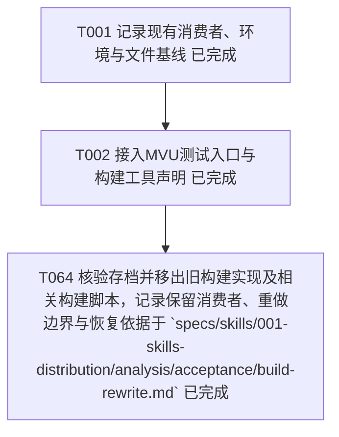

任务记录：[tasks.md](../tasks.md)。计划代码/证据位置：`specs/skills/001-skills-distribution/analysis/acceptance/baseline.md`；`packages/skills/package.json`；`specs/skills/001-skills-distribution/analysis/acceptance/build-rewrite.md`。已完成身份只保留原范围，不自动验收新能力。

## Phase 2：Foundational，保留的已验共享骨架

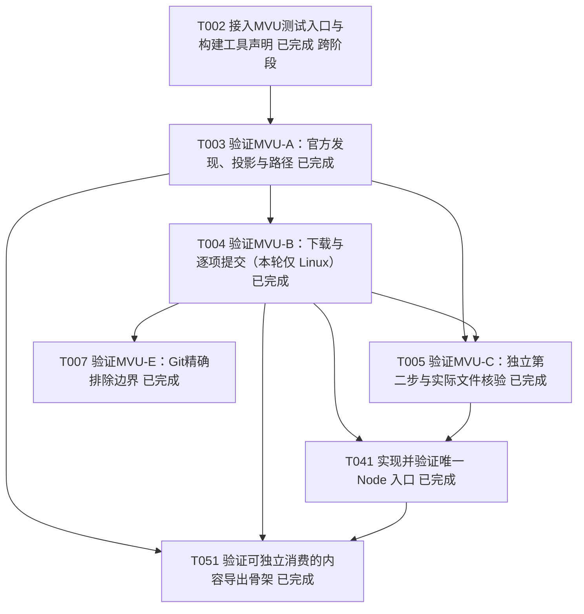

跨阶段前置：T002；缺失或未通过时不推进依赖项。

任务记录：[tasks.md](../tasks.md)。计划代码/证据位置：`packages/skills/tests/distribution/mvu-a.mjs`；`packages/skills/tests/distribution/mvu-b.mjs`；`packages/skills/tests/distribution/mvu-c.mjs`；`packages/skills/script/index.mjs`；`packages/skills/tests/distribution/content-export.mjs`；`packages/skills/tests/distribution/mvu-e.mjs`。已完成身份只保留原范围，不自动验收新能力。

## Phase 3：先实现构建配置与临时挂载占位（P1）

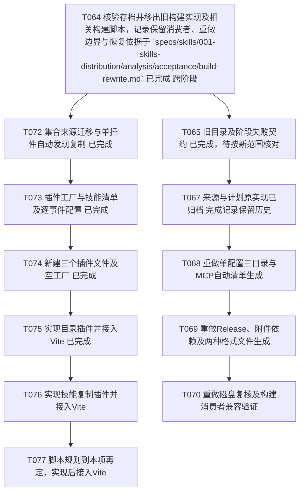

跨阶段前置：T064；缺失或未通过时不推进依赖项。T074～T077箭头为用户指定的工程实施顺序，各插件运行时独立读源；脚本生成规则在T077开工前另行讨论。

任务记录：[tasks.md](../tasks.md)。计划代码/证据位置：`packages/skills/tests/distribution/build-pipeline.test.mjs`；`packages/skills/build/distribution/{models,validate,export}.ts`；`packages/skills/vite.config.ts`；`packages/skills/build/plugins/{content,scripts,mcp-manifest}.ts`；`packages/skills/script/mount-entry/mount-entry.{sh,ps1}`；`packages/skills/build/distribution/{models,validate,projection,references,export}.ts`；`packages/skills/build/plugins/distribution.ts`；`packages/skills/build/distribution/verify.ts`；`packages/skills/tests/distribution/{build-pipeline.test.mjs,content-export.mjs,test-build-config.mjs}`。已完成身份只保留原范围，不自动验收新能力。

## Phase 4：再实现 GitHub Actions 发布流水线（P1）

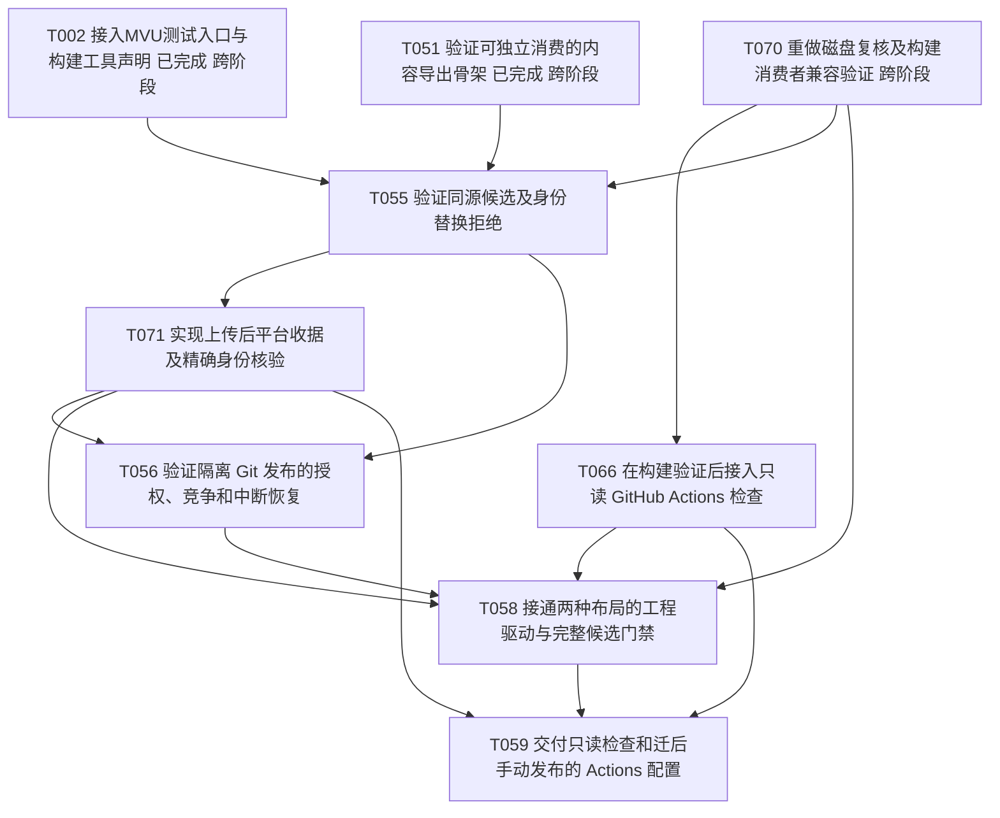

跨阶段前置：T002、T051、T070；缺失或未通过时不推进依赖项。

任务记录：[tasks.md](../tasks.md)。计划代码/证据位置：`.github/workflows/skills-check.yml`；`packages/skills/tests/distribution/pipeline-workflow.test.mjs`；`packages/skills/build/ci/candidate.mjs`；`packages/skills/tests/distribution/pipeline-contract.test.mjs`；`packages/skills/build/ci/publish.mjs`；`packages/skills/build/ci/run.mjs`；`.github/workflows/skills-release.yml`。已完成身份只保留原范围，不自动验收新能力。

## Phase 5：US1，正式同版内容与纯安装前置（P1）

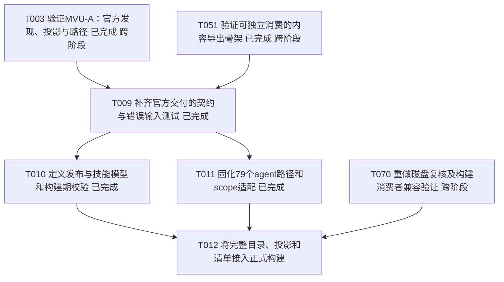

跨阶段前置：T003、T051、T070；缺失或未通过时不推进依赖项。

任务记录：[tasks.md](../tasks.md)。计划代码/证据位置：`packages/skills/tests/distribution/official-contract.test.mjs`；`packages/skills/build/distribution/models.ts`；`packages/skills/distribution/agents.json`；`packages/skills/build/distribution/export.ts`；`packages/skills/script/install-skills/install-skills.{sh,ps1}`；`packages/skills/README.md`；`specs/skills/001-skills-distribution/analysis/acceptance/us1.md`。已完成身份只保留原范围，不自动验收新能力。

## Phase 6：US2，下载安装与恢复前置（P1）

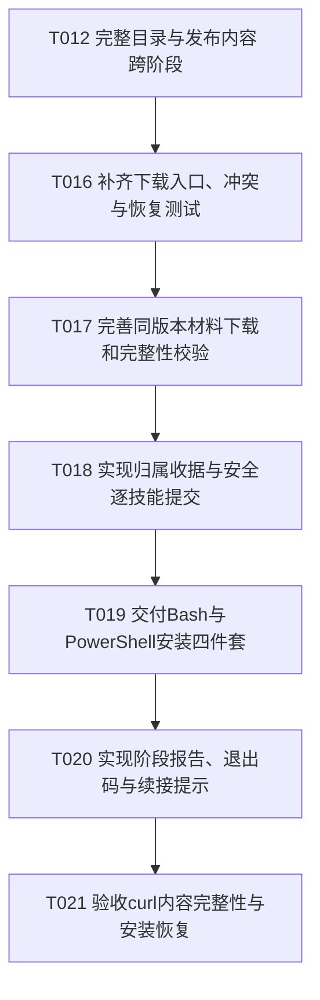

跨阶段前置：T012；缺失或未通过时不推进依赖项。

任务记录：[tasks.md](../tasks.md)。计划代码/证据位置：`packages/skills/tests/distribution/install-contract.test.mjs`；`packages/skills/script/install-skills/install-skills.{sh,ps1}`；`packages/skills/script/install-skills/install-skills.sh`；`specs/skills/001-skills-distribution/analysis/acceptance/us2.md`。已完成身份只保留原范围，不自动验收新能力。

## Phase 7：最后实现真实 Spec Kit 挂载（P1）

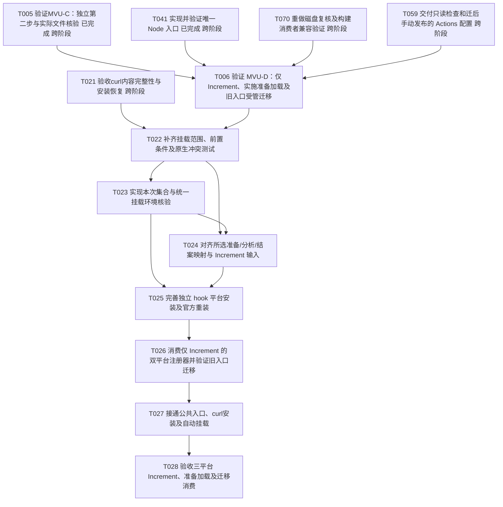

跨阶段前置：T005、T021、T041、T059、T070；缺失或未通过时不推进依赖项。

任务记录：[tasks.md](../tasks.md)。计划代码/证据位置：`packages/skills/tests/distribution/mvu-d.mjs`；`packages/skills/tests/distribution/mount-contract.test.mjs`；`packages/skills/script/mount-entry/mount-entry.{sh,ps1}`；`packages/skills/script/mount-entry/mount-entry.sh`；`packages/skills/script/register-hooks/register-hooks.sh`；`packages/skills/script/register-commands/register-commands.sh`；`specs/skills/001-skills-distribution/analysis/acceptance/us3.md`。已完成身份只保留原范围，不自动验收新能力。

## Phase 8：US5，完整发布材料（P1）

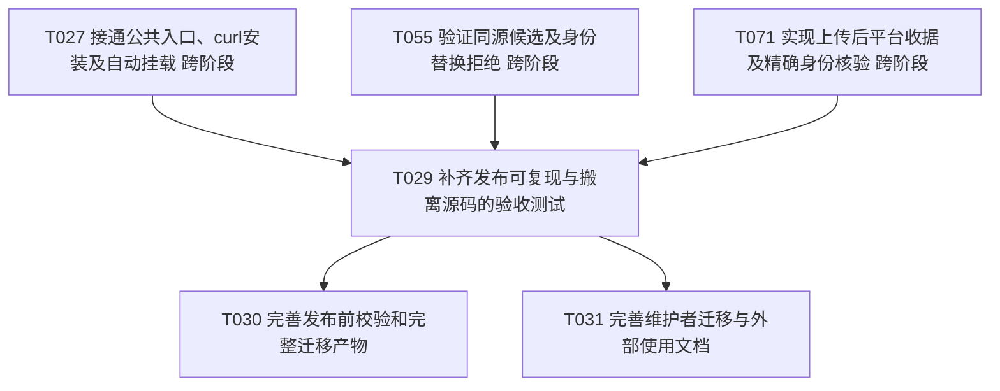

跨阶段前置：T027、T055、T071；缺失或未通过时不推进依赖项。

任务记录：[tasks.md](../tasks.md)。计划代码/证据位置：`packages/skills/tests/distribution/release-contract.test.mjs`；`packages/skills/build/distribution/verify.ts`；`packages/skills/README.md`。已完成身份只保留原范围，不自动验收新能力。

## Phase 9：US4，可选精确隐匿（P2）

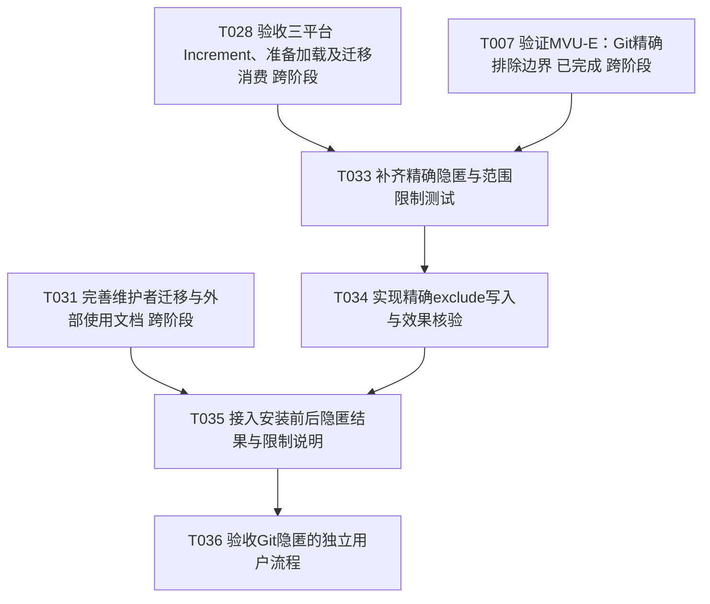

跨阶段前置：T007、T028、T031；缺失或未通过时不推进依赖项。

任务记录：[tasks.md](../tasks.md)。计划代码/证据位置：`packages/skills/tests/distribution/hidden-contract.test.mjs`；`packages/skills/script/install-skills/install-skills.{sh,ps1}`；`specs/skills/001-skills-distribution/analysis/acceptance/us4.md`。已完成身份只保留原范围，不自动验收新能力。

## Phase 10：US6，真实 Increment 规划与反馈（P1，交付后置）

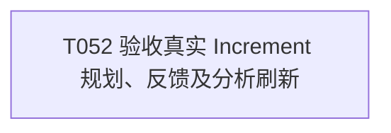

任务记录：[tasks.md](../tasks.md)。计划代码/证据位置：`specs/skills/001-skills-distribution/analysis/acceptance/increment-behavior.md`。已完成身份只保留原范围，不自动验收新能力。

## Phase 11：完整消费、本地矩阵与可迁移交付验收

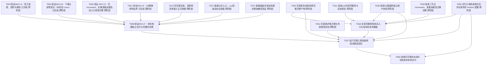

跨阶段前置：T003、T004、T006、T007、T012、T021、T027、T028、T030、T031、T036、T059、T070；缺失或未通过时不推进依赖项。

任务记录：[tasks.md](../tasks.md)。计划代码/证据位置：`packages/skills/tests/distribution/matrix.mjs`；`packages/skills/tests/distribution/mvu-f.mjs`；`specs/skills/001-skills-distribution/analysis/acceptance/regression.md`；`specs/skills/001-skills-distribution/analysis/acceptance/pipeline-local.md`。已完成身份只保留原范围，不自动验收新能力。

## Phase 12：迁后平台、真实发布及唯一末尾收尾

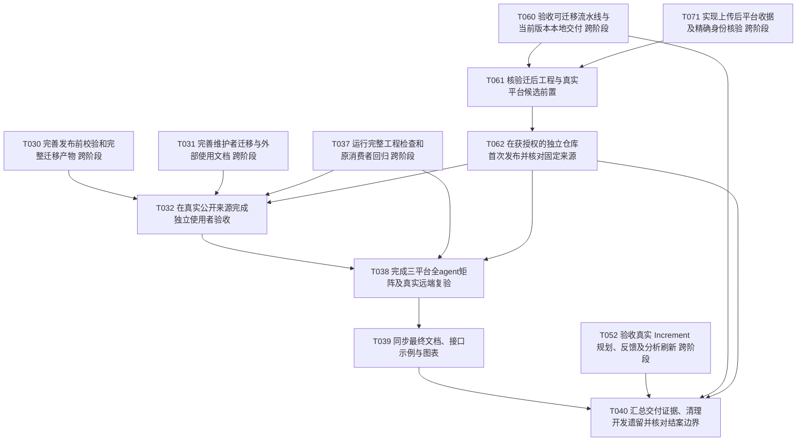

跨阶段前置：T030、T031、T037、T052、T060、T071；缺失或未通过时不推进依赖项。

任务记录：[tasks.md](../tasks.md)。计划代码/证据位置：`specs/skills/001-skills-distribution/analysis/acceptance/pipeline-remote.md`；`specs/skills/001-skills-distribution/analysis/acceptance/us5-remote.md`；`specs/skills/001-skills-distribution/analysis/acceptance/matrix.md`；`packages/skills/README.md`；`specs/skills/001-skills-distribution/analysis/acceptance/distribution.md`。已完成身份只保留原范围，不自动验收新能力。

## 推荐执行顺序与检查点

当前由用户手写修改，AI完成本轮文档同步后等待，不自动沿图推进或修改代码。下列箭头保留工程依赖；既有状态和历史验证不代表未来手写版本已经验收。

T072/T073已完成集合来源、工厂封装及技能选择内容构建，T074文件骨架和T075目录插件已完成，接下来按T076技能复制插件→T077脚本生成插件推进；脚本细节到T077讨论，再对齐相应旧Task。T067原实现归档，T065及原T068～T070图中旧接口只保留显式依赖历史，不代表当前前置能力可用，不能据累计完成直接推进。Actions、真实挂载、完整矩阵及正式发布继续有独立验收。

T066/T067不再并行；有效待办P组仅T030/T031，在前置满足、文件独立且不竞争输出时推进。占位或缺真实挂载证据不得进入正式full/ready，局部isolated检查不等于发布成功。

原图由Increment刷新；本轮保留旧边并增加T073→T074→T075→T076→T077四条工程顺序边，共113条显式依赖；其余历史边保持，待用户方向确定后对齐。当前集合构建见[T073验收](../analysis/acceptance/plugin-skill-config.md)，挂载、MCP内容和Actions仍未完成。未执行Mermaid渲染，不冒充实际平台验证。
