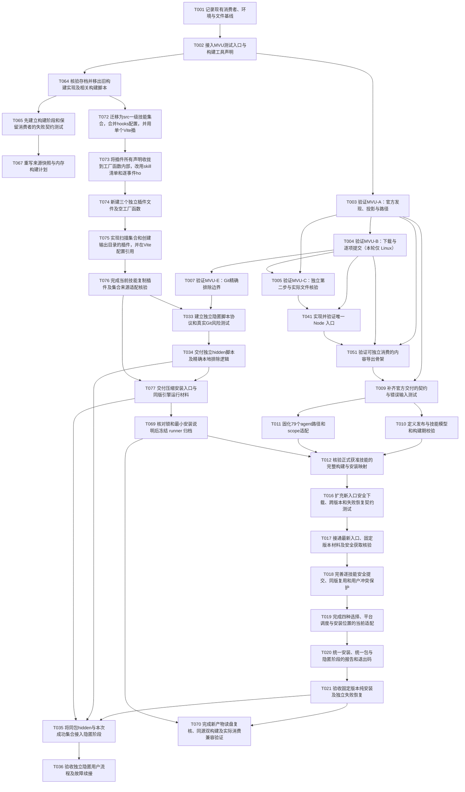
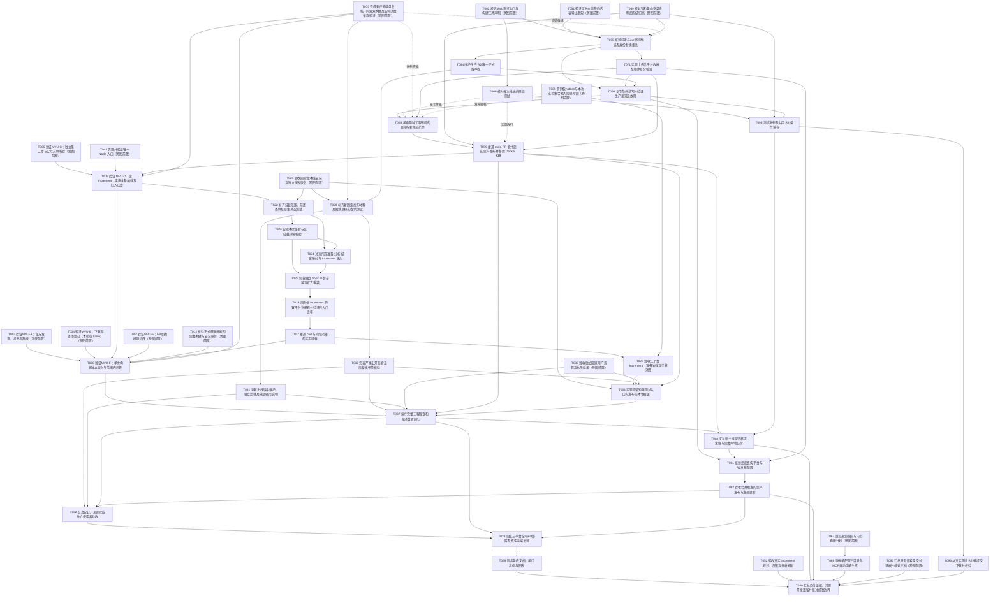
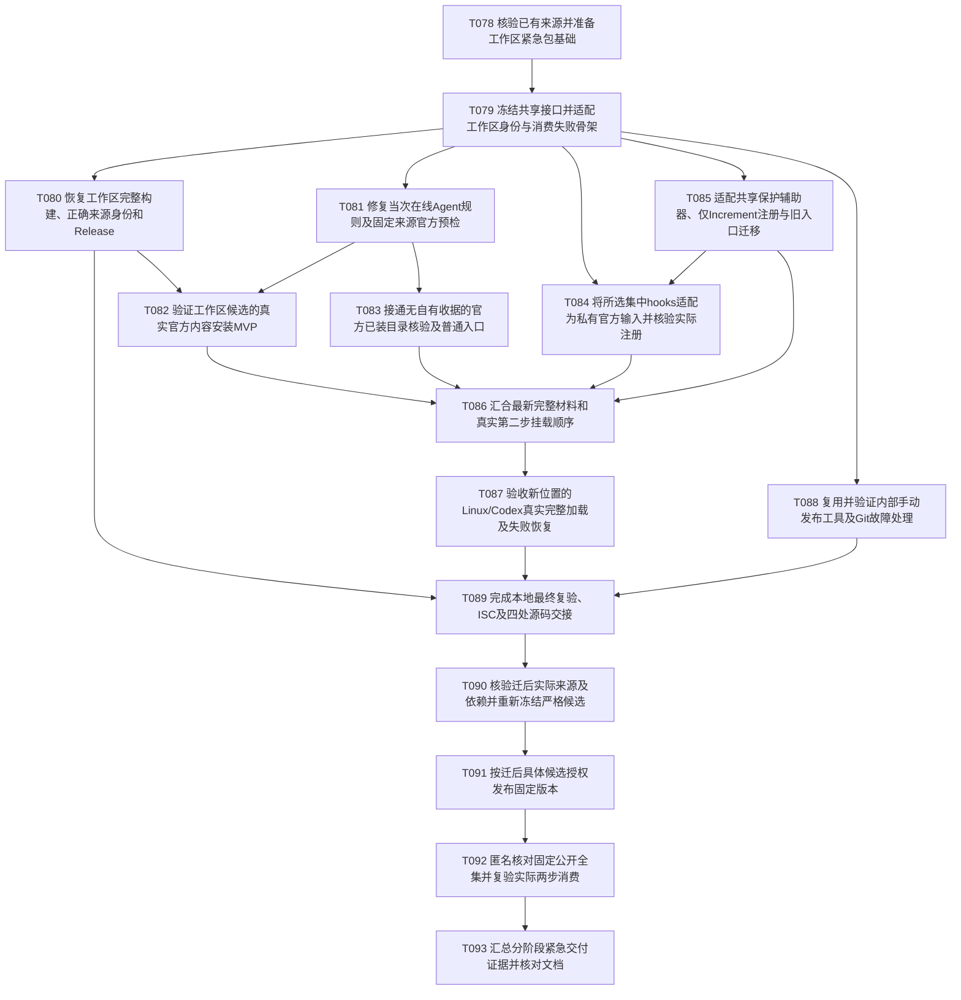

# 任务依赖图：技能构建与发布

下图记录 2026-11-23 的任务依赖。图中每条依赖边按当时的任务正文绘制，跨图节点用于定位。[任务清单](../tasks.md) · [同级闭环](../mvu.md)

2026-11-24 主线部署重写的事件、作业和产物交接见[现行流程图](../diagrams.md#主线-r2-部署与产物交接)。原正式任务保留当时身份与依赖并处于冻结范围。

## 主线当前：基础、版本、独立脚本与安装

本地构建位置为 packages/skills 的现行 Vite 插件及技能扫描。T076、T034 为 T077 提供输入和验收，T069 随后续流水线归档，T070 按实际安装结果复核。版本表由后置 T094 随流水线在 R2 维护。

## 主线：推送测试、发布、真实挂载与完整验收

实际及计划位置为 `packages/skills/build/ci/`、`.github/workflows/` 与 `analysis/acceptance/`。T056 先接共用 R2 条件读写，T095 用于后续测试发布。T096 记录真实测试 R2 下载，T061/T062 核对生产平台、候选授权及真实生产来源。

## 紧急版：原独立两步与具体候选授权

紧急版当前全线冻结，恢复基线为 T090 已验迁后候选。用户明确恢复后，T091 仍须取得具体候选授权。代码在 `packages/skills-distribution-urgent/`，候选沿本线独立记录。[冻结决定](../spec.md#2026-11-23-紧急版冻结)
