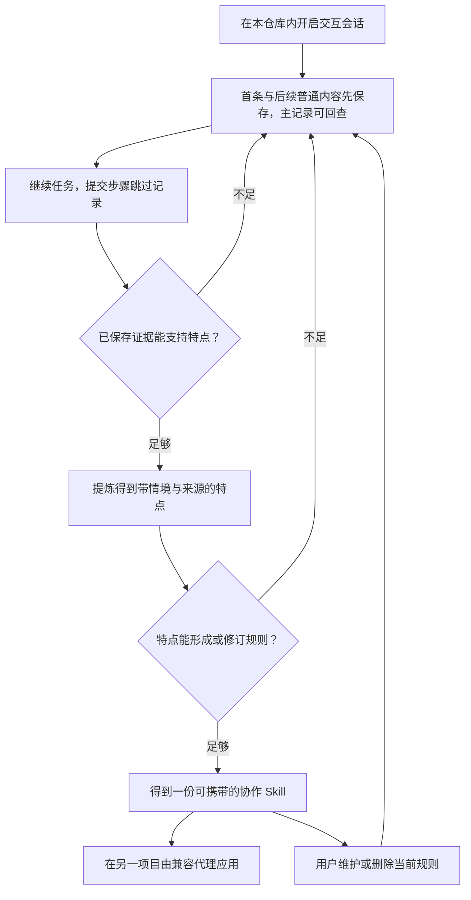

# 功能分析 · 从 Codex 对话生成协作 Skill

本功能让使用者回查本仓库内的真实 Codex CLI 协作过程，再将有依据的特点转为一份可携带的协作 Skill。本文依据[规格及澄清](../../spec.md)、[原始需求](../../requirements/raw/2026-11-19-conversation-to-skill.md)、[需求确认](../../requirements/discussions/2026-11-19-open-questions.md)、[总体方案](../../plan.md)、[同级 MVU](../../mvu.md)、[任务清单](../../tasks.md)、[数据模型](../../data-model.md)和[接口契约](../../contracts/collaboration-workflow.md)解释各功能。

T001～T003 已完成候选核查、隔离样例和共用资料契约。按用户确认，旧 `shadow-profile` 原样归档，三个旧对话候选清出维护目录，项目安装和主线交付已撤下旧入口。旧候选的复用经验及原字节快照仍可回查。旧索引版的隔离运行结果见 T014，派发流程和便携产物由后续任务承接。[T001 核查](../preparation.md) · [T002 环境与回归](../environment.md) · [退役证据](../shadow-retirement.md) · [T014 实测](../recording-acceptance.md)

拉取前本地候选阶段的历史前置证据见 [T004 真实模型候选验证](../recording-host.md#真实模型的候选验证2026-11-23)与 [T005 工具内容来源](../content-source.md)。首条先于业务、普通末轮、日期与范围对照已实测；工具原值、流式返回、附件及受控子代理主会话活动也已核对。权限受限时的元数据来源、中间发言缺口及长输出截断按实际证据保留；该阶段不代表最终入口交付，后续状态沿上段 T014 实测及当前任务记录。

## 自动保存会话并回查完整内容

新版记录规划按会话开启日建立主记录。首条用户原话在业务动作前保存并读回，正常最终回复发送结束后在当轮自动保存全文并读回。按宿主轮次保留发起、同轮补充和实发回复。轮次有实际详情且文件可打开时，主记录提供「查看经过」，用于回查可取得的进度、工具内容和对应事件的附件原件。两次调用产生同名且内容不同的附件时，各事件链接各自打开对应原件。仓库外会话和非交互运行跳过记录，已纳入会话中的工具活动仍按原会话归属。 [主记录与附件规格](../../spec.md#详情文件与附件) · [最终回复保存时机确认](../../spec.md#最终回复保存时机确认)

这覆盖 US1 的 [MVU-001、002](../../mvu.md)。T001～T003 已核查候选、隔离环境和共用定位。T004 和 T005 分别核对当前方式下的实际时点、归属和内容来源，T006 固定回归。T007～T010 定义归属、成对文档、触发和内容采集规则，T013 整合记录 Skill，T014 验收最终入口及保存结果。

记录规则由 `conversation-recording/SKILL.md` 及资料契约承接。核对会话身份与来源后，在实际写入时按 FR-003 根据项目证据选择或复核资料根，新版将主记录、详情和附件保存到 Git 工作区可见的位置。T033 用 T035 验收过的项目级入口交接普通启动、实际目录选择和 Git 可见性的工作区试用。T004 的项目 Hook、T014 的仓库外试验及 T033 仅安装 Skill 的 `.data/` 实测为当时的宿主证据。 [现行规格](../../spec.md#functional-requirements) · [历史试用](../../implementation/T033.md#2026-11-24-项目内落盘修订) · [T004 实测](../recording-host.md)

2026-11-20 的无 hook 受控验证曾取得工具环境会话 ID、父 CLI 的入口参数及恢复前目录、匹配线程文件名中的开启日期信号，并取证首条保存及末轮预存。后续真实复验确认在 0.171.0 前台分页入口中，需按当前轮次元数据和实际可核实归属判定。隔离项目约定明确入口后，停止前首条已落盘，同次启动后续轮可续写，受测非交互及无法核实的恢复零写入。T004 技术前置完成，正式来源仍由 T014 验收。[受控技术核查](../recording-host.md#ai-直接方式的技术核查2026-11-20) · [真实复验](../recording-host.md#记录时序与首期范围复验2026-11-23)

T005 先用受控子代理工具样例核对可取得来源，T015/T018 再检查实际派发链，T022 对最终入口生成的详情逐项比对主会话可取得的工具原值、顺序及父轮/子线程关联。只有截断或路径线索的字段需标明实际缺口。完整留存须有可验证的原值，缺少此类来源时回到方案调整。

记录工具自身的活动按用途划界。保存记录、复制记录附件、核对断点和读回确认由内部调用完成。业务工具、用户要求查阅记录及提炼和分析派发按各自阶段保留。T014 复验了同一工具的内部调用和业务调用，原 T006 断言已使用最终安装来源的真实观测通过。[T014 验收](../recording-acceptance.md#2026-11-24-最终安装来源补验)

T003 已将共用布局、真实身份与块定位、部分保存确认、恢复去重和父子交接整理为[资料契约附件](../../../../../packages/skills/src/profile/conversation-recording/references/storage-contract.md)，方案与核对沿[原 Task 方案](../../implementation/T003.md)。附件在自身正文内写全约定，原仓库的模型来源路径仅供维护核查；T013/T014 的实施及验收对应旧索引版。T034 更新正文、模板和资料契约，T035 已在隔离 CLI 复验新版，T033 已通过本地复制安装的手动试用。这些证据不覆盖新追加的分隔功能。[T035 复验](../recording-acceptance.md#2026-11-26-三个-hook-独立执行复验) · [T033 手动试用](../../implementation/T033.md#2026-11-26-当前工作区手动试用通过)

用户打开主记录时，需能一眼分辨相邻的发起、补充和回复，即使它们位于同一轮。按 [FR-018 / SC-011](../../spec.md#主记录样式)，[T036](../../tasks.md#主记录消息块分隔) 同步调整模板和实际写入。现有模板展示轮次块，实际文件由记录入口与共用模块写入，单改模板不能证明输出已变化。复用现有记录夹具验证多行原文、正文中相同符号以及恢复续写后分隔和详情链接仍正确；普通对话可单独验收，主、子代理时间线的分隔等事件来源和采集能力具备后补验。分隔仅是展示层变更，沿用既有[记录流程图](../../diagrams.md)，不增加事件处理流程。 [用户原话](../../requirements/raw/2026-11-26-recording-message-block-separators.md) · [记录闭环](../../mvu.md#mvu-001-自动保存首条消息与末轮回复)

## 并行、恢复与写失败后的连续工作

使用者同时运行两个会话时，即使文字相同也应分别保存。关闭或中断后恢复时，项目记录 Skill 核实恢复后的有效目录与原会话均属于同一仓库，再从断点在原日期的两份文件续写。归属不符或无法核实时跳过新增、续写及正文补读，既有记录仍可查。每个真实事件只保存一次，已经丢失原文的部分保留缺档。[最新范围确认](../../requirements/raw/2026-11-23-resume-effective-directory.md)

正常写入失败时，用户先看到受影响块或附件的缺口，再继续任务。资料重新可写且原文仍可取得时，可重试保存。已经确认的块仍可作为后续输入。

T004/T007 核定范围，T006 固定相同文本、并发及失败回归。T011 已验证会话写入协调、断点核对和跨日续写。统一共用资料契约后，先前失败的旧会话也在原日期的成对文件中成功续写两次。T012 在已核实的同次启动内实测四种写入失败，均先提示受影响的记录再继续任务。索引和附件在解除阻挡后沿原轮次补写，已丢失的原文继续保留缺档。T014 按正式入口核对恢复和写入失败。[MVU-003、004](../../mvu.md) · [T011 收尾证据](../../implementation/T011.md#2026-11-24-对齐共用资料契约) · [T012 隔离验收](../../implementation/T012.md#2026-11-23-隔离验收结果) · [会话保存与继续任务图](../../diagrams.md#会话先保存再继续任务)

## 提交步骤跳过记录

项目记录保留原始请求、提交前和两次提交间的修复以及后续普通对话。每次实际提交开始到它的结果回复发出期间应零写入，验收对照项目工作区和暂存区是否有记录造成的新增差异。 [MVU-005](../../mvu.md#mvu-005-提交步骤跳过记录) · [记录验收](../../quickstart.md#记录验收)

T014 和 T035 的隔离验收为本次复验提供基线。当前项目的 `ce0fab3` 提交轮次把实际提交内容写入详情，最终回复也写入主记录，SC-004 在该场景未通过。当前先处理 P0 T037，沿用实际安装副本和宿主事件顺序复现，修复后从正式安装来源复验。 [现场证据](../recording-acceptance.md#2026-11-26-当前工作区提交停写回归) · [P0 任务](../../tasks.md#p0-提交停写回归)

## 提前归档并退役旧入口

旧 `shadow-profile` 已原样移入本 Spec 归档，活动源码、启用项、项目安装副本和主线生成产物已清除。历史规格与 `.specify/memory/user-shadow/` 继续可追溯，首次提炼使用新流程的确认记录。自动记录在新入口可用前暂停。[归档源码](../../archive/shadow-profile/SKILL.md) · [退役证据](../shadow-retirement.md)。

对应 US4 的 [MVU-006](../../mvu.md)。T027 核对完整归档和字节，T028 通过现有 Bash 同步撤下项目副本并刷新主线交付。T029 在 T014 通过后完成正式新入口的发现、读取及普通任务记录，旧入口发现数为零。[同步脚本](../../../../../scripts/dev/actions/link-skills/link-skills.sh) · [切换补验](../shadow-retirement.md#2026-11-24-新旧入口切换补验)

2026-11-20 复核当前安装现场时，曾通过已有同步路径移除重新出现的旧副本，并用新宿主确认仓库根和 `packages/skills` 的旧入口发现数均为零。2026-11-24 安装前后以新宿主强制刷新，两处旧入口发现数均为零。[历史复核](../shadow-retirement.md#当前工作区复核2026-11-20) · [当前安装核对](../../implementation/T033.md#2026-11-24-安装核对)

T014 的恢复补验及 T029 的新入口核验使用临时仓库。T033 的当前工作区新会话结果见实测证据，该实测使用旧索引布局。T035 在隔离仓库复验新版后，T033 在记录里程碑最后刷新当前工作区安装，由用户从主记录打开详情并给出结论。后续提炼阶段按任务清单的当前推进安排执行。[验收顺序](../../spec.md#记录验收与试用顺序) · [实测证据](../../implementation/T033.md#2026-11-24-当前工作区新会话实测) · [当前推进安排](../../tasks.md#依赖与实际执行顺序)

## 从多项目资料提炼有依据的特点

父代理收到已确认材料的线索后，只有证据足以支持特点才真实派发提炼子代理。一次明确持续偏好或纠正可支持提炼，普通行为需要积累；这是当前规划的判断方式，不能当作用户永久个人偏好。子代理逐项保存独立特点文档，解释情境与依据，保留来源仓库、项目目录、会话、轮次和详情块。父代理读回核验结果，用户无需逐项人工确认。

对应 US2 的 [MVU-007、008](../../mvu.md)。T015 验证普通任务下可取得资料线索并真实派发，T016 定义特点格式和材料资格，T017 实现独立入口，T022 验证两个项目的实际材料及结果。新位置为 `conversation-extraction/SKILL.md` 和 `references/trait-format.md`，独立提炼入口仍待建立。

首次自动提炼必须使用记录入口真实生成且确认落盘的本仓库材料。仓库外来源、旧影子画像及未确认内容是反例，不能因文件可读就进入交接。两项目经验可以汇总，单项目决定仍保留其情境，已有合格对话可再次参与后续处理。来源、确认及真实子线程共同构成证据；启动子代理或返回一句成功说明不足以证明产物已保存。

## 独立分析并生成可携带的协作 Skill

父代理单独判断已有特点能否形成或修订规则；即使本轮没有待提炼证据，已确认特点仍可直接触发分析。分析子代理将多个项目的特点整理为带情境的可执行规则，保留规则与特点的多对多关联，先保存独立候选，再由父代理核对并采纳为一份完整目录。原始对话、附件及溯源留在本地资料区，便携目录只包含规则入口及必要资源。

T018 验证独立派发。T019 和 T020 在分析 Skill 定义如何使用现有工具保存本地规则、依据和便携目录。T021 整合分析入口。版本核对、规则、关联及目录采纳与删除采用同一写入协调边界。同版本候选最多一项采纳成功，过期候选保留供核查。已有工具的实际协调效果由 T019 回归及 T022 两父会话交错验收核对。 [MVU-009、010](../../mvu.md) · [共享规则采纳图](../../diagrams.md#多个父会话更新同一份协作-skill)

T022 从实际交付来源刷新三份流程入口，核对版本或源码快照、完整正文和必要文档资源，验证父/子代理实际读取和执行。用三组普通任务核对派发数 `0/0`、`1/0`、`0/1`、规则溯源、目录格式和跨项目应用。SC-006 要求使用者将同一产物带到另一项目，由兼容代理仅凭目录发现、读取并应用规则。调研时缺少可用兼容宿主，该项仍待验收。 [验收指南](../../quickstart.md#流程-skill-最终来源消费) · [调研](../../research.md) · [独立阶段判断图](../../diagrams.md#父代理分别判断两个阶段)

## 删除当前规则并允许以后重新形成

用户删除一条规则时，当前 Skill 同步移除该规则，只支撑它的特点及失效关联可以清理，共享特点继续支撑其他规则，原始对话及附件保留。删除期间，基于旧版本发出的分析结果不能覆盖当前删除决定；之后一次符合条件的新处理仍可从已有或新增合格记录重新形成规则。

T023 固定两条规则、独占与共享依据及迟到结果的回归。T024/T025 在分析 Skill 中定义 AI 使用现有工具维护、删除、核对旧回传和推进版本的规则。T026 刷新安装副本并验证真实读取，用两个父会话的分析与删除交错以及一次后续提炼与分析，核对删除持续生效、较新内容完整且规则能在下一次有效处理中重新形成。 [MVU-011](../../mvu.md) · [旧结果处理图](../../diagrams.md#删除后如何处理迟到的旧分析)

## 业务流程

下图说明使用者得到结果的先后关系。实现规划位置为三个 `packages/skills/src/profile/conversation-*` 入口及各自资源，真实工程前置见原 Task。

图中判断分别由父代理作出、满足时由对应子代理执行；技术调用与恢复/版本逻辑以[既有图示导航](../../diagrams.md)为准。写入失败按实际缺口继续，派发失败或回传未确认时保留当前有效产物，不推定对应阶段完成。

## 里程碑与流转

下表只解释交付结果与任务定位；每个闭环的节点、验收和依赖由 [mvu.md](../../mvu.md) 集中维护，工程状态由 [tasks.md](../../tasks.md) 唯一维护。

| 里程碑 | 可观察结果及任务衔接 |
| --- | --- |
| 记录 | 归档、撤下并核对旧入口（T027～T029），验证记录、恢复与停写（T004～T014、T034/T035），在当前工作区完成安装与试用（T033）。当前优先处理实际提交停写回归。 [P0 T037](../../tasks.md#p0-提交停写回归) |
| 提炼 | T015 仍按当前推进安排暂缓。启动后父代理按真实记录派发，特点能回查原始依据并保留跨项目情境（T015～T017），在 T022 的实际材料验收中复核与分析的衔接。 [推进安排](../../tasks.md#依赖与实际执行顺序) |
| 分析 | 独立派发后生成一份 Skill，并在另一项目实际使用（T018～T022）；维护还能删除、保护共享依据及在新处理中重新形成规则（T023～T026）。 |

该图对应规划的功能推进，代码位置仍是前述三个入口和本 Spec 证据目录。T030 汇总必要工程检查及实际业务证据并核对最终来源与已消费快照，T031 核对交付说明，T032 在最后清理开发过程文件、代码段和文档片段，保护正式交付、有效治理、历史事实、证据及复用探针骨架；用途不明内容保留并说明定位与处理条件。收尾或清理改变最终流程来源时须刷新正式入口、核对读取并复验受影响流程，不能沿用旧快照结果。

## 当前证据边界与恢复入口

旧入口的归档、同步、交付清单和真实 CLI 发现结果见[退役证据](../shadow-retirement.md)。新记录的宿主时点、完整采集、故障恢复与提交，以及真实派发和兼容消费仍由[验收指南](../../quickstart.md)的原任务取证。

默认 setup-tasks 因缺少 `.specify/feature.json` 无法定位；本次用用户明确的 `specs/skills/002-conversation-to-skill` 作为 `SPECIFY_FEATURE_DIRECTORY`，并设置 `SPECIFY_FEATURE_NO_PERSIST=1` 后取得模板及设计材料，没有创建全局定位文件。后续操作也应以明确 Spec 或有效项目定位为准。

执行中若来源、宿主接口或实际采集能力不满足假设，沿对应原 Task 记录输入与失败证据，仅暂停受影响下游并回到方案调整。不得由文档存在、配置启用或格式检查推定业务能力已交付；实际任务开工沿项目共同准备、认可方案及有效授权恢复。
