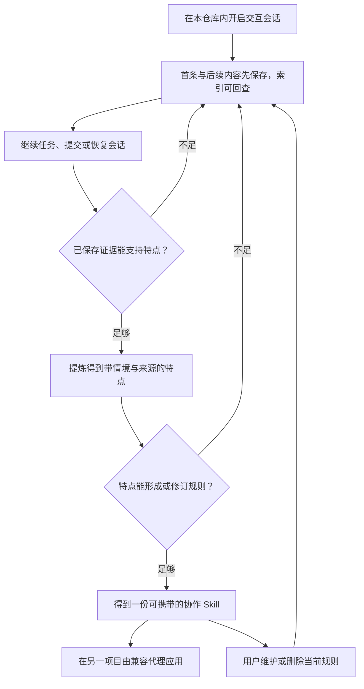

# 功能分析 · 从 Codex 对话生成协作 Skill

本功能让使用者回查本仓库内的真实 Codex CLI 协作过程，再将有依据的特点转为一份可携带的协作 Skill。本文依据[规格及澄清](../../spec.md)、[原始需求](../../requirements/raw/2026-11-19-conversation-to-skill.md)、[需求确认](../../requirements/discussions/2026-11-19-open-questions.md)、[总体方案](../../plan.md)、[同级 MVU](../../mvu.md)、[任务清单](../../tasks.md)、[数据模型](../../data-model.md)和[接口契约](../../contracts/collaboration-workflow.md)解释各功能。

当前完成的是任务、分析及[一致性规划修订](../../requirements/discussions/2026-11-19-open-questions.md#一致性分析后的修订2026-11-19)，没有实现新记录链、派发流程、便携产物或旧入口退役。当前实际源码仍有[旧记录候选](../../../../../packages/skills/src/profile/conversation-recording/SKILL.md)、[旧分析候选](../../../../../packages/skills/src/profile/conversation-analysis/SKILL.md)、[摘要候选](../../../../../packages/skills/src/profile/conversation-summary/SKILL.md)及[旧画像源](../../../../../packages/skills/src/profile/shadow-profile/SKILL.md)，[集合配置](../../../../../packages/skills/src/profile/collection.config.ts)仍启用旧画像。正式记录等实现脚本及新提炼目录仍为待建位置，不能据此推断交付；现有候选的复用边界、实际主线扫描、根同步来源及安装副本差异已有 [T001 核查证据](../preparation.md)（2026-11-20），T002 另已提供隔离样例 helper 和 [环境/回归证据](../environment.md)，八项真实文件系统、Git 与工具输出回归通过，目标包 lint/check-types 通过；hook 信任、目标 CLI 实际派发与第二兼容宿主仍未运行或缺前置，后续业务运行验收证据仍待取得。

## 自动保存会话并回查完整内容

用户从本仓库根目录或子目录打开交互式 CLI 后，记录入口应自动纳入会话，先保存已发生的首条消息再推进任务。用户从索引看到本轮内容、结果及实际改动文件，再定位详情中的发言、工具名称、完整可取得参数和输出以及附件原件，包括主会话中可取得的子代理派发、交互和回传工具活动。正常关闭即保存已产生的末轮回复，用户无需再发一条消息触发补存。仓库外会话和非交互运行不建立记录；已纳入会话中的工具可以在仓库外运行，其活动仍归原会话。

这覆盖 US1 的 [MVU-001、002](../../mvu.md)。T004 验证接入身份和时点，T005 验证完整内容来源，T006 固定回归，T007～T010 承接归属、成对文档、接入及内容采集，T013 交付记录入口，T014 取得真实验收。T001～T003 先核查候选、隔离环境和共用定位。旧记录候选目前按日期写项目内原文、不保存完整工具和附件，末轮依赖下一轮补存，不能直接作为新功能通过证据。

技术方案将身份与会话来源一起绑定，将资料默认存于仓库外的 `records/YYYY-MM-DD/`，每会话各有索引和详情，详情与附件确认后才更新索引。计划接入位置是 `conversation-recording/scripts/host.ts` 及配套脚本；候选采用 `.codex/hooks.json`，实际可用性须按目标 CLI 版本运行验证。[调研](../../research.md)已有只读接口依据，尚无真实运行证据。T005 先用受控子代理工具样例核对可取得来源，T015/T018 再检查实际派发链，T022 对最终流程入口生成的详情逐项比对工具原值、顺序及父轮/子线程关联；不扩展为子线程内部独立日志。只有截断或路径线索的字段需标明实际缺口；无法验证完整来源时应调整方案，不能把摘要解释成完整记录。

T003 已将共用布局、真实身份与块定位、部分保存确认、恢复去重和父子交接整理为[资料契约附件](../../../../../packages/skills/src/profile/conversation-recording/references/storage-contract.md)，方案与核对沿[原 Task 方案](../../implementation/T003.md)。附件在自身正文内写全约定，原仓库的模型来源路径仅供维护核查；旧入口改造及正式安装消费仍由 T013 和相应验收承接，保存契约不表示已经实现记录能力。

## 并行、恢复与写失败后的连续工作

使用者同时运行两个会话时，即使文字相同也应分别保存。中断后从仓库内恢复原本属于本仓库的会话，仍续写原开启日期的两份文件；同一真实事件重复恢复只补写一次，无法核实的部分继续显示缺口。恢复前本次入口目录与原会话归属都要核对，避免恢复加载历史目录后扩大记录范围。

正常写入失败时，用户先看到受影响块或附件的缺口，再继续任务；资料重新可写后只补可核实部分。已经确认的块仍可作为后续输入。业务目标是保留可回查经过并继续当前工作，不要求不可控中断绝对无缺档。

这对应 [MVU-003、004](../../mvu.md)。T004/T007 核定范围，T006 固定相同文本、并发及失败回归，T011 处理会话内短时协调、断点和历史补读，T012 处理部分写入及提示，T014 运行跨日两次恢复与失败验收。计划实现位于 `conversation-recording/scripts/recovery.ts`、`failures.ts`。相关技术数据流沿[会话保存与继续任务图](../../diagrams.md#会话先保存再继续任务)阅读，本文不维护另一份恢复状态机。

## 提交后继续记录且无新增 Git 差异

用户要求撰写提交说明并提交时，记录应覆盖提交前工作、提交动作、结果及后续回复。资料默认在业务仓库外，使持续写入与业务仓库的工作区、暂存区分开；验收比较的是自动记录引入的新增差异均为零，而非假定用户工作区本来干净。

对应 [MVU-005](../../mvu.md)。T002 准备已知 Git 基线，T008 落实资料位置，T014 在隔离样例仓库做一次真实提交，再核对 status、工作区 diff 和暂存区 diff 及后续记录。实际操作见[记录验收](../../quickstart.md#记录验收)。本轮没有执行该提交，也没有改动本仓库暂存区。

## 新记录可用后归档并退役旧入口

维护者先取得新记录的隔离验收，再将旧 `shadow-profile` 完整原样移入本 Spec 归档，撤下活动源码、启用项和项目安装副本。历史规格与 `.specify/memory/user-shadow/` 保持可追溯，首次提炼仍只使用新流程的确认记录。退役须经正常同步后的真实技能发现确认，移走源文件本身不能证明入口消失。

对应 US4 的 [MVU-006](../../mvu.md)。T027 核对归档完整文件清单与字节，T028 调整实际活动接线，T029 执行主线扫描、常规同步、旧 profile 定向同步和新 CLI 发现。其前置是 T014；任务按故事优先级编排章节，实际在 US2 前执行。现有[同步脚本](../../../../../scripts/dev/actions/link-skills/link-skills.sh)会保留来源未声明的安装条目，根 `package.json` 的 `skills:link` 另有当前来源，均须核对，不能只删除主线配置便假设完成切换。不接管紧急版无关源码或主线未完成构建插件。

## 从多项目资料提炼有依据的特点

父代理收到已确认材料的线索后，只有证据足以支持特点才真实派发提炼子代理。一次明确持续偏好或纠正可支持提炼，普通行为需要积累；这是当前规划的判断方式，不能当作用户永久个人偏好。子代理逐项保存独立特点文档，解释情境与依据，保留来源仓库、项目目录、会话、轮次和详情块。父代理读回核验结果，用户无需逐项人工确认。

对应 US2 的 [MVU-007、008](../../mvu.md)。T015 验证普通任务下可取得资料线索并真实派发，T016 定义特点格式和材料资格，T017 实现独立入口，T022 验证两个项目的实际材料及结果。新位置为 `conversation-extraction/SKILL.md` 和 `references/trait-format.md`，当前没有这一入口；旧摘要候选不是提炼的等价交付。

首次自动提炼必须使用记录入口真实生成且确认落盘的本仓库材料。仓库外来源、旧影子画像及未确认内容是反例，不能因文件可读就进入交接。两项目经验可以汇总，单项目决定仍保留其情境，已有合格对话可再次参与后续处理。来源、确认及真实子线程共同构成证据；启动子代理或返回一句成功说明不足以证明产物已保存。

## 独立分析并生成可携带的协作 Skill

父代理单独判断已有特点能否形成或修订规则；即使本轮没有待提炼证据，已确认特点仍可直接触发分析。分析子代理将多个项目的特点整理为带情境的可执行规则，保留规则与特点的多对多关联，先保存独立候选，再由父代理核对并采纳为一份完整目录。原始对话、附件及溯源留在本地资料区，便携目录只包含规则入口及必要资源。

对应 [MVU-009、010](../../mvu.md)。T018 验证独立派发，T019 建立本地规则及依据关系，T020 生成目录，T021 改造分析入口并启用三个独立流程 Skill。当前分析候选直接从原文形成旧结论并回接画像，这一行为须按新职责替换。计划的本地规则与目录输出脚本位于 `conversation-analysis/scripts/rules.ts`、`skill-output.ts`。同一资料区和 Skill 的版本核对、规则/关联/目录采纳及删除采用同一写入协调边界；同版本候选最多一项按原版本成功，另一项保留核查并重新判断，不能覆盖较新的有效结果或自动合并。T019 固定并发与部分失败回归，T022 使用两个父会话实际交错验证，技术流程见[共享规则采纳图](../../diagrams.md#多个父会话更新同一份协作-skill)。

T022 先从实际交付来源刷新三份最终流程安装入口，核对版本或源码快照、完整正文和必要脚本/附件，并取得父/子代理真实读取相应安装副本的证据，再用三组普通任务验证提炼/分析派发数 `0/0`、`1/0`、`0/1`，再核对每条规则溯源、目录规范和跨项目实际应用。候选探针、最终流程入口消费和生成 Skill 的独立消费分别取证，读取维护源不能代替正式安装入口。门禁及后续来源变更复验见[验收指南](../../quickstart.md#流程-skill-最终来源消费)。格式通过仅证明目录可读，SC-006 还要求使用者将同一产物带到另一项目，由兼容代理仅凭目录发现、读取并完成代表性规则应用。[调研](../../research.md)记录当时缺少可用兼容宿主，该项仍是实施验收前置，不可用 agent 演练代替用户实际消费。父子调用关系沿[独立阶段判断图](../../diagrams.md#父代理分别判断两个阶段)阅读。

## 删除当前规则并允许以后重新形成

用户删除一条规则时，当前 Skill 同步移除该规则，只支撑它的特点及失效关联可以清理，共享特点继续支撑其他规则，原始对话及附件保留。删除期间，基于旧版本发出的分析结果不能覆盖当前删除决定；之后一次符合条件的新处理仍可从已有或新增合格记录重新形成规则。

对应 US3 的 [MVU-011](../../mvu.md)。T023 固定两条规则、独占/共享依据及迟到结果的回归；T024 实现维护入口及删除，T025 在同一共享协调边界内处理旧回传，删除同时推进当前版本；T026 在 T024/T025 修改后刷新最终流程安装副本并证明真实读取，随后用两个父会话的分析/删除交错及新提炼/分析流程验证当前结果不回退且规则可再次形成。计划位置为 `conversation-analysis/scripts/rule-maintenance.ts` 和 `rules.ts`，技术流程沿[旧结果处理图](../../diagrams.md#删除后如何处理迟到的旧分析)阅读。版本核对只约束本地候选采纳，不表示发布到外部服务，也不设置永久禁止重新生成的名单。

## 业务流程

下图说明使用者得到结果的先后关系。实现规划位置为三个 `packages/skills/src/profile/conversation-*` 入口及各自资源，真实工程前置见原 Task。

图中判断分别由父代理作出、满足时由对应子代理执行；技术调用与恢复/版本逻辑以[既有图示导航](../../diagrams.md)为准。写入失败按实际缺口继续，派发失败或回传未确认时保留当前有效产物，不推定对应阶段完成。

## 里程碑与流转

下表只解释交付结果与任务定位；每个闭环的节点、验收和依赖由 [mvu.md](../../mvu.md) 集中维护，工程状态由 [tasks.md](../../tasks.md) 唯一维护。

| 里程碑 | 可观察结果及任务衔接 |
| --- | --- |
| 记录 | US1 交付可回查、可恢复且提交无新增差异的记录（T004～T014），随后 US4 核对归档并完成旧入口切换（T027～T029）。MVP 可先验收 US1，记录里程碑还包含切换。 |
| 提炼 | 父代理按真实记录派发，特点能回查原始依据并保留跨项目情境（T015～T017），在 T022 的实际材料验收中复核与分析的衔接。 |
| 分析 | 独立派发后生成一份 Skill，并在另一项目实际使用（T018～T022）；维护还能删除、保护共享依据及在新处理中重新形成规则（T023～T026）。 |

该图对应规划的功能推进，代码位置仍是前述三个入口和本 Spec 证据目录。T030 汇总必要工程检查及实际业务证据并核对最终来源与已消费快照，T031 核对交付说明，T032 在最后清理开发过程文件、代码段和文档片段，保护正式交付、有效治理、历史事实、证据及复用探针骨架；用途不明内容保留并说明定位与处理条件。收尾或清理改变最终流程来源时须刷新正式入口、核对读取并复验受影响流程，不能沿用旧快照结果。

## 当前证据边界与恢复入口

当前可核对的是需求、规划、旧候选源码和本次已保存的任务关联与一致性修订；[验收指南](../../quickstart.md)要求的真实 CLI 时点、完整采集、故障/恢复、提交、真实派发、兼容消费及退役后发现均尚待工程 Task 执行取证。本轮没有改动任务勾选或创造验收通过记录。

默认 setup-tasks 因缺少 `.specify/feature.json` 无法定位；本次用用户明确的 `specs/skills/002-conversation-to-skill` 作为 `SPECIFY_FEATURE_DIRECTORY`，并设置 `SPECIFY_FEATURE_NO_PERSIST=1` 后取得模板及设计材料，没有创建全局定位文件。后续操作也应以明确 Spec 或有效项目定位为准。

执行中若来源、宿主接口或实际采集能力不满足假设，沿对应原 Task 记录输入与失败证据，仅暂停受影响下游并回到方案调整。不得由文档存在、配置启用或格式检查推定业务能力已交付；实际任务开工沿项目共同准备、认可方案及有效授权恢复。
