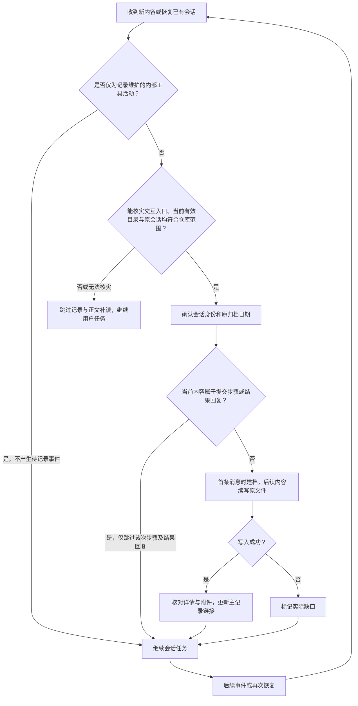
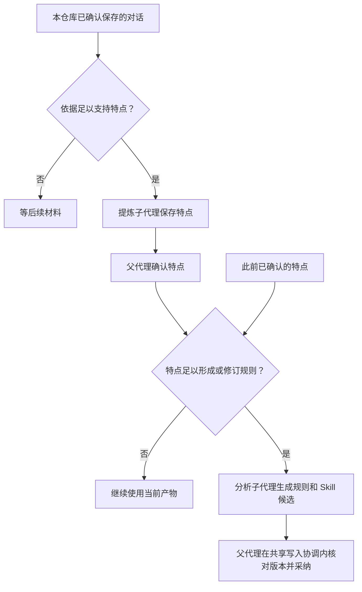
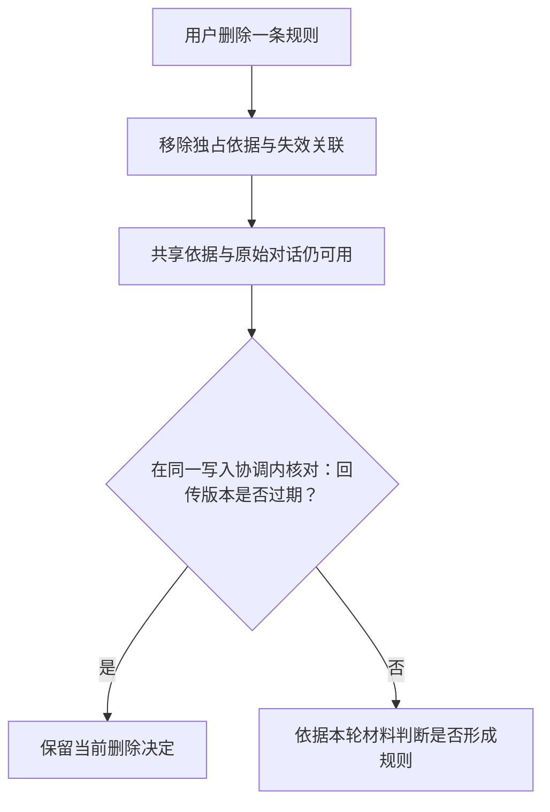
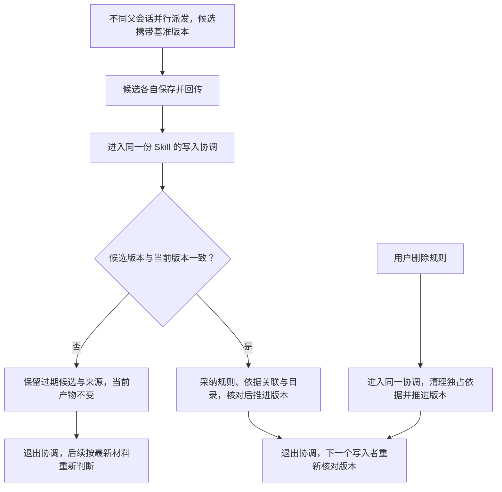

# 关键流程图 · 从 Codex 对话生成协作 Skill

## 会话先保存，再继续任务

规则位置为规划中的 `packages/skills/src/profile/conversation-recording/SKILL.md`。AI 用现有工具核对工作目录和原会话来源，在首条消息出现时为范围内的会话建档。首条原话先写入主记录，详情可打开后补上链接。若同名附件内容不同，分别保存原件，各详情事件指向自己的文件。仅为记录维护产生的内部工具活动不进入待记录集合；同轮提交失败后、重试前的修复按普通业务内容处理，每次提交及其结果回复分别跳过。

## 父代理分别判断两个阶段

规则位于规划中的提炼和分析 Skill 入口。父代理通过已有工具派发，能支持一条特点时启动提炼。此前确认的特点也可直接进入分析判断。

## 删除后如何处理迟到的旧分析

规则位于规划中的 `packages/skills/src/profile/conversation-analysis/SKILL.md`。AI 用现有工具删除当前规则，之后仍可用真实材料重新形成规则。

## 多个父会话更新同一份协作 Skill

规则位于规划中的 `packages/skills/src/profile/conversation-analysis/SKILL.md`。以同一资料区和协作 Skill 为写入协调范围，AI 使用现有工具在同一边界内核对版本、采纳与删除。并发效果由 T019、T022 和 T026 核对，失败及恢复见[数据模型](data-model.md)。

