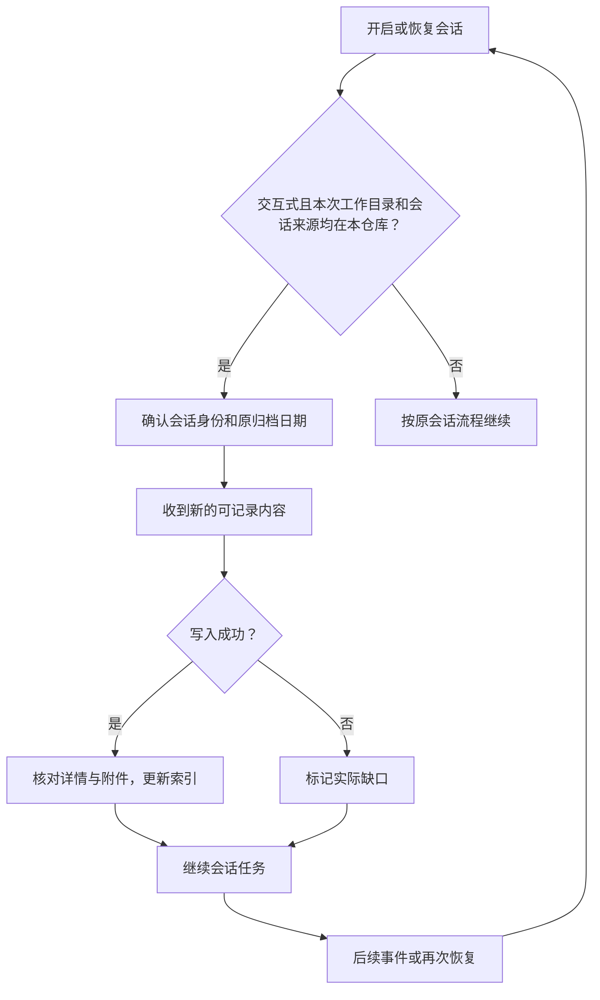
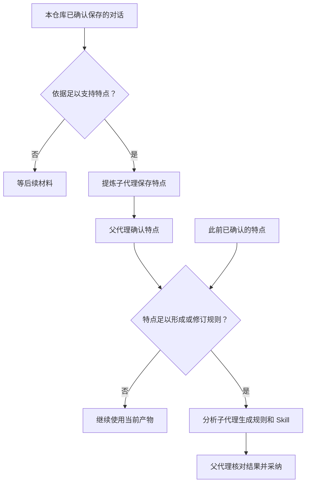
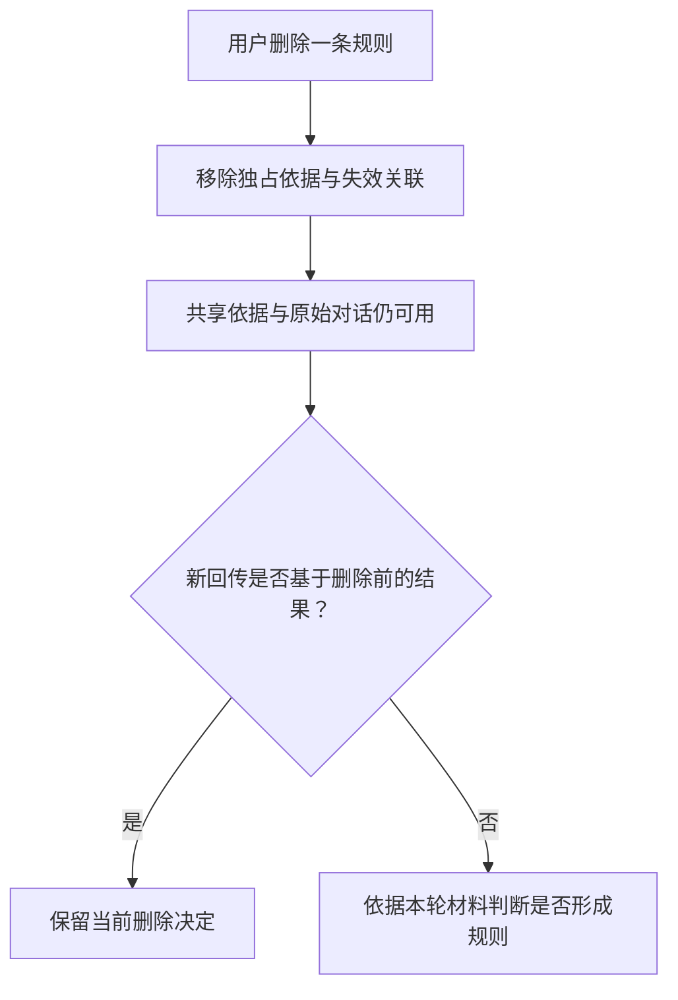

# 关键流程图 · 从 Codex 对话生成协作 Skill

## 会话先保存，再继续任务

代码位置（规划）为 `packages/skills/src/profile/conversation-recording/` 的接入与写入配套。先核对交互式会话的工作目录及原会话来源，再为本仓库范围内的会话建立记录。详情确认后索引才能指到真实内容。

## 父代理分别判断两个阶段

代码位置（规划）为 `packages/skills/src/profile/conversation-extraction/` 与 `packages/skills/src/profile/conversation-analysis/`。能支持一条特点时启动提炼。此前确认的特点也可直接进入分析判断。

## 删除后如何处理迟到的旧分析

代码位置（规划）为 `packages/skills/src/profile/conversation-analysis/` 的规则维护配套。删除对当前产物生效，之后重新使用真实材料仍可形成规则。

