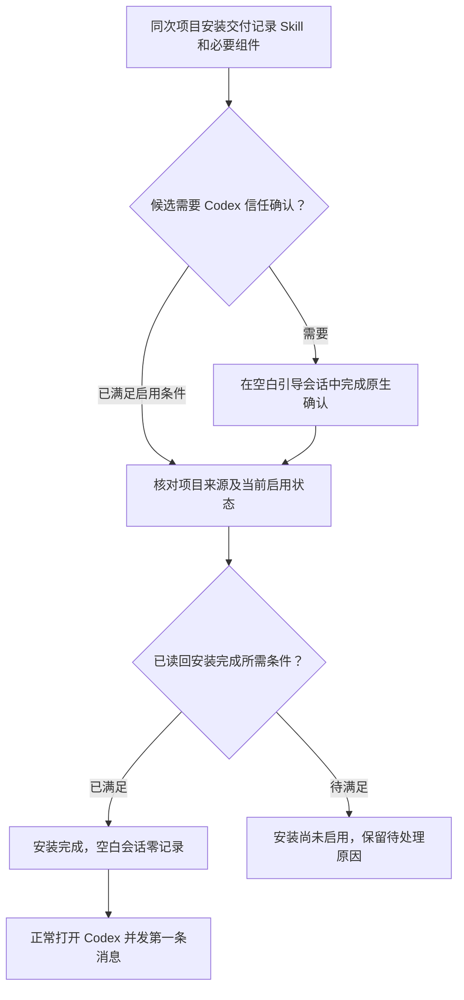
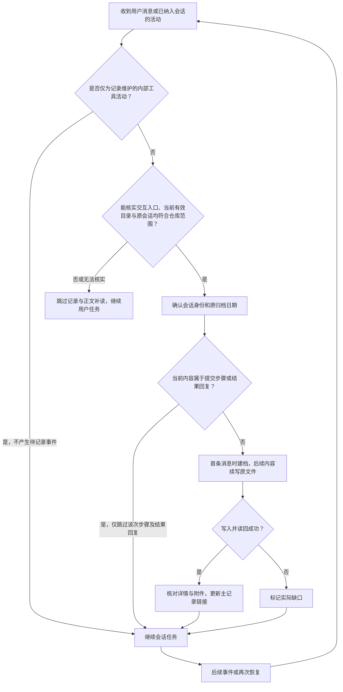
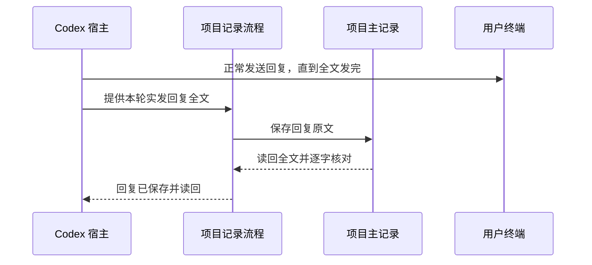
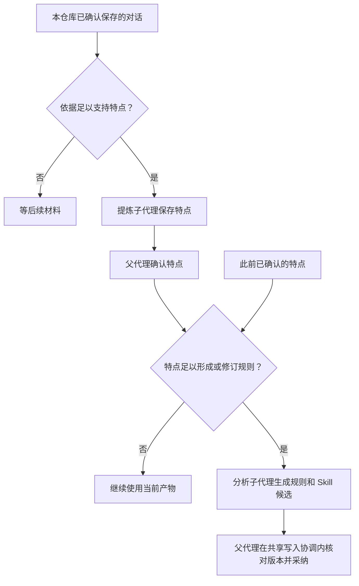
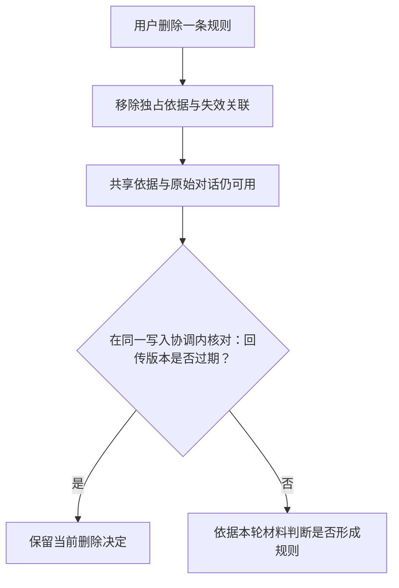
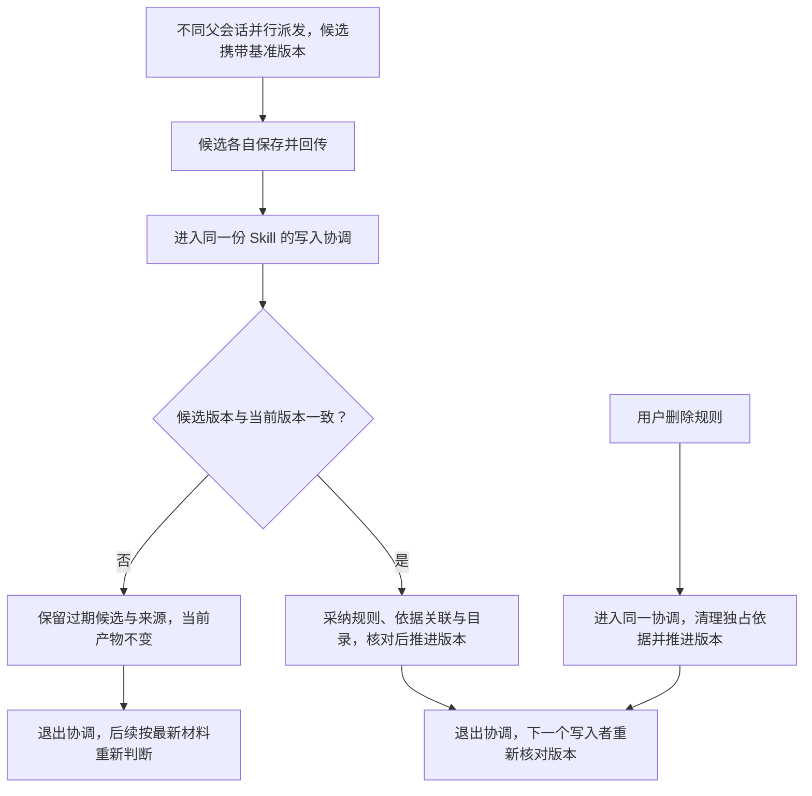

# 关键流程图 · 从 Codex 对话生成协作 Skill

## 项目安装与首次启用

首次启用的位置是主线 `profile` 集合的项目级安装入口。现有 Spec Kit 开发挂载脚本提供集中声明、核对来源和登记到项目的参考。图中的信任及自动启用路径由 T035 在 Codex CLI 上复验。 [记录集合](../../../packages/skills/src/profile/collection.config.ts) · [挂载参考](../../../scripts/dev/mount-speckit.sh)

## 会话先保存，再继续任务

现有范围规则位于记录 Skill 的 `references/session-scope.md`，保存规则位于 `references/save-events.md`。候选须用回调时点可取得的宿主证据确认范围，再沿这些规则保存。首条原话先写入并读回，详情可打开后补上链接。同轮提交失败后、重试前的修复按普通业务内容处理。 [范围规则](../../../packages/skills/src/profile/conversation-recording/references/session-scope.md) · [保存规则](../../../packages/skills/src/profile/conversation-recording/references/save-events.md)

## 正常最终回复的发送顺序

图中是 FR-002 现行验收顺序。T035 优先验证 Codex 的 `Stop` 回调，在宿主发完回复后自动保存并读回全文。记录 Skill 当前时序规则随 T035 候选的正式切换更新。 [现有 Skill 时序](../../../packages/skills/src/profile/conversation-recording/references/recording-timing.md) · [宿主证据](research.md#正常最终回复结束后的保存与读回)

## 父代理分别判断两个阶段

规则位于规划中的提炼和分析 Skill 入口。父代理通过已有工具派发，能支持一条特点时启动提炼。此前确认的特点也可直接进入分析判断。

## 删除后如何处理迟到的旧分析

规则位于规划中的 `packages/skills/src/profile/conversation-analysis/SKILL.md`。AI 用现有工具删除当前规则，之后仍可用真实材料重新形成规则。

## 多个父会话更新同一份协作 Skill

规则位于规划中的 `packages/skills/src/profile/conversation-analysis/SKILL.md`。以同一资料区和协作 Skill 为写入协调范围，AI 使用现有工具在同一边界内核对版本、采纳与删除。并发效果由 T019、T022 和 T026 核对，失败及恢复见[数据模型](data-model.md)。

