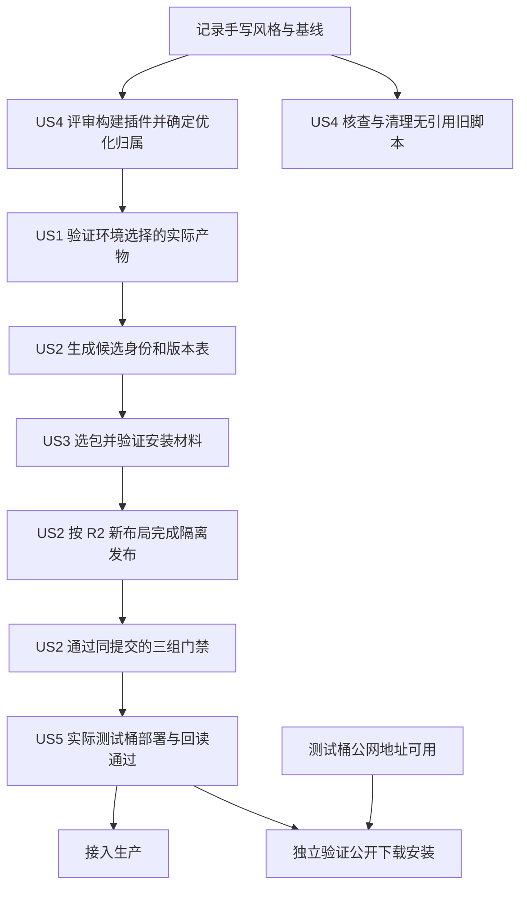

# 主线技能构建与发布功能分析

本页解释当前计划。运行现状依据源码与已记录的基线。实现、测试桶回读和公网验收由任务及其实际证据判定。2026-11-25 用户确认按每个原功能点设一个里程碑。 [发布原始需求](../../../../../temp/b/1.md) · [评审原始需求](../../../../../temp/b/2.md) · [规格与已确认事项](../../spec.md) · [总体方案](../../plan.md) · [里程碑详情](../../mvu.md) · [任务清单](../../tasks.md)

## 构建插件评审与优化

维护者需要知道每个插件如何影响构建、安装和验证。评审从用户手写代码和已知基线开始，依据实际调用确定优化归属。当前已知自定义输出目录和动态挂载类型检查问题。环境、版本和安装专项由相关任务处理，共用本里程碑的风格及证据。评审交付是记录和可复查的回归，适用流程见各正常入口。 [评审调研](../../research.md#评审范围与手写源码依据) · [里程碑](../../mvu.md#构建插件评审与优化) · [T001 至 T003](../../tasks.md#构建插件评审与优化)

## 旧脚本引用核查与清理

仓库仍有失效的默认脚本路径和可覆盖的动态路径。维护者先区分历史夹具、实际消费者和待核实用途，再删除已有证据支持的旧文件。引擎仍消费的旧归档内隐匿路径由其原接口负责。此项的工作流是调用链追溯、处置和回归取证，可与插件评审独立开展。 [旧脚本调研](../../research.md#评审范围与手写源码依据) · [里程碑](../../mvu.md#旧脚本引用核查与清理) · [T004 至 T005](../../tasks.md#旧脚本引用核查与清理)

## 环境机制

集合作者配置启用条件，维护者从技能、插件、隐匿和挂载观察同次选择。当前 Vite 入口仍逐处扫描。拟在配置解析时传递实际 mode 和一次选择结果，普通构建使用原来的默认值，测试与生产显式选择对应环境。开发及 release 可用的 profile 不随 prod 交付。容器验收从明确提交执行现有 Dockerfile 并导出实际构建材料。 [构建契约](../../contracts/build-and-publish.md#构建入口) · [选择与派生流程](../../diagrams.md#一次构建共享同一份技能选择) · [里程碑](../../mvu.md#环境机制) · [T006 至 T008](../../tasks.md#环境机制)

## 临时版本管理

一次独立发布产生一个时间戳，连接包内 VERSION、固定归档键和版本表条目。索引准备时只有明确缺失才可初始化，历史保留。安装者使用固定入口选择首条或指定条目，下载后核对 SHA-256、长度和包内时间戳再写项目。现行入口仍用示例根和 MD5，正式版本工具接管与故障回退已留待后续。 [数据模型](../../data-model.md) · [安装技术流程](../../diagrams.md#安装器核对同一个选中版本) · [里程碑](../../mvu.md#临时版本管理) · [T009 至 T012](../../tasks.md#临时版本管理)

## R2 目录结构修改

现行公共流程按提交和运行标识上传，计划迁为两个环境各自的固定归档键和根入口、根索引。同目标从读表到写回排队。归档与安装入口验过后才登记版本，明确失败终止该次发布，提交结果不明时只记录可复核证据。隔离验证先提供实际发布路径，三组门禁通过后再进入测试桶回读。生产接入依赖该回读，每次生产发布须通过其所选提交的三组门禁。公网安装依赖真实地址，早期需认证的历史地址经授权切换后，单独核对历史版本的安装结果。 [发布契约](../../contracts/build-and-publish.md#r2-写入与核验顺序) · [发布技术流程](../../diagrams.md#同目标串行准备与写入) · [里程碑](../../mvu.md#r2-目录结构修改) · [T013 至 T015](../../tasks.md#r2-目录结构修改) · [T018 至 T021](../../tasks.md#环境接入与验收)

## 测试流水线

现行 skills-test 固定放行。计划以环境产物、实际首条安装和隔离两次发布作为三组输入，接入同一提交的运行。用例失败、跳过或缺工具均阻止部署。已有 Node 与 Python 基线可供回归，旧工作流缺文件的失败及未来的实际 R2 回读各自留证。 [用例与证据](../../quickstart.md#2-在同一提交运行三组门禁) · [里程碑](../../mvu.md#测试流水线) · [T016 至 T017](../../tasks.md#测试流水线)

## 里程碑流转

同一个 R2 里程碑先完成隔离发布，再接续真实部署。图中两步通过测试流水线的放行结果衔接。故事标记对应 [任务清单中的独立验收](../../tasks.md#用户故事与独立验收)，并行前置见 [并行安排](../../tasks.md#并行安排)。归属和验收信号见 [里程碑详情](../../mvu.md)。具体代码位置分别见 [构建、发布及安装流程图](../../diagrams.md)。

