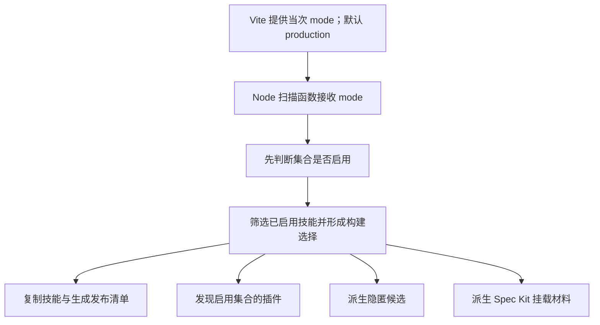
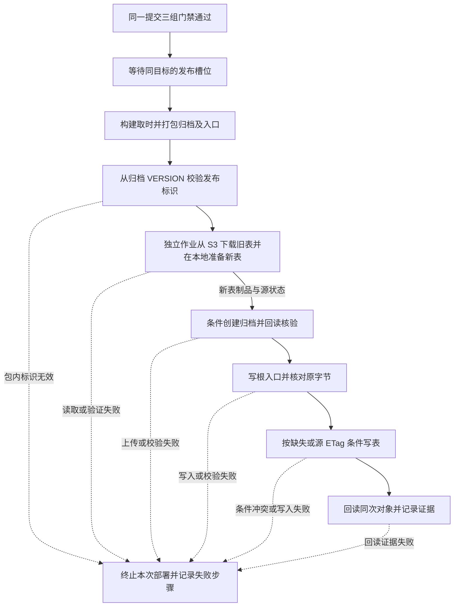
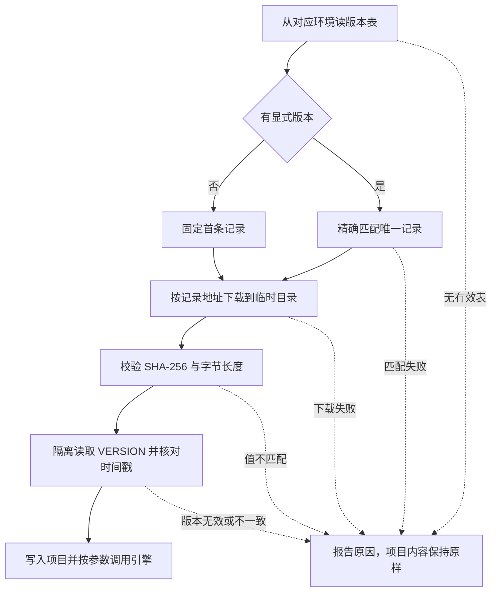

# 流程图：主线技能构建与发布

## 一次构建共享同一份技能选择

构建选择是本轮允许交付的集合和技能名单。副作用由各自插件负责。

**代码位置** [Vite 配置](../../../packages/skills/vite.config.ts) · [扫描](../../../packages/skills/build/utils/scan-skills.ts) · [技能插件](../../../packages/skills/build/plugins/vite-plugin-skill/index.ts) · [引擎插件](../../../packages/skills/build/plugins/vite-plugin-engine/index.ts) · [隐匿插件](../../../packages/skills/build/plugins/vite-plugin-engine/sub-plugins/vite-plugin-hidden-install/index.ts) · [挂载插件](../../../packages/skills/src/workflow/plugin/vite-plugin-speckit-mount/index.ts)

## 同目标串行准备与写入

版本表是安装器选包的依据。最后写表成功才登记新版本。ETag 是读取现有表时取得的对象标识，用它防止别人修改过的版本表被覆盖。

**代码位置** [测试入口](../../../.github/workflows/skills-deploy-release.yml) · [现行门禁](../../../.github/workflows/skills-test.yml) · [版本插件](../../../packages/skills/build/plugins/vite-plugin-version/index.ts) · [公共工作流](../../../.github/workflows/skills-deploy-common.yml)

后续发布在上一次释放目标槽位后读取表。测试环境的门禁和实际 S3 回读满足生产接入条件。公网安装按单独前置验收。

## 安装器核对同一个选中版本

选择一条记录后，版本标识和下载地址固定到该次安装。完整性校验先于项目写入。

**代码位置** [根入口生成](../../../packages/skills/build/plugins/vite-plugin-curl/index.ts) · [安装器源](../../../packages/skills/build/plugins/vite-plugin-curl/install.source.sh) · [同包引擎](../../../packages/skills/build/plugins/vite-plugin-engine/install.source.sh)

