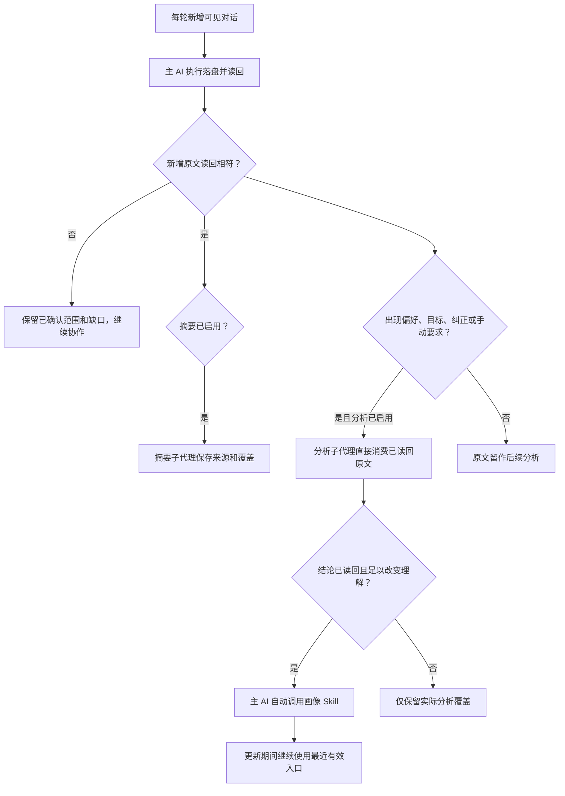
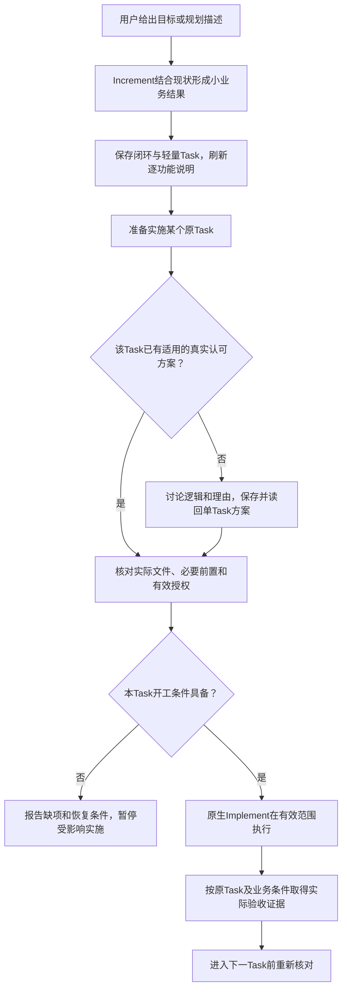
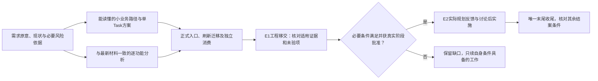

# 分析流转说明

本页补充[功能说明](README.md)的两项阅读关系，不复制活动闭环定义、工程状态或既有技术流程。职责与调用图沿[diagrams.md](../../diagrams.md)，实际依赖以[tasks.md](../../tasks.md)为准，闭环结果和验收信号以[mvu.md](../../mvu.md)为准。图均为解释，未执行渲染，不据此认定宿主或业务通过。

## 2026-11-18 四个独立 Skill 的业务判断

按[三项真实澄清](../../spec.md#session-2026-11-18)，用户可独立启用对话落盘；全组启用时，从已读回原文分别启动摘要及符合条件的分析，画像取决于结论有效变化。以下是业务判断，调用与提交技术图统一沿 [diagrams.md](../../diagrams.md#2026-11-18-原文读回后的四个-skill-调用)，拟建来源为 packages/skills/src/profile 下四份 SKILL.md。

大白话是记录可单独交付，摘要和分析各按自己的条件推进，摘要失败不拖住分析。当前纠正立即用于协作，入口更新可稍后完成。T119 验当前宿主交接，T115/T120/T121/T116 完善各来源，T117 另验共享提交及遗忘，T122/T118 核对集合与最终消费，原 T112/T080 保留真实应用和结案条件。业务定义回 [MVU-011](../../mvu.md#mvu-011)，没有新增工程状态。

共享验收前，独立用例按隔离根及目标文件单写入者执行，T120 不依赖 T117 的完成。启动或恢复记录前先读取模型定义的同级暂停控制；暂停不因复制或清理对话根解除。整根替换与在途摘要/分析的拒收组合由 T117 验证，根/锁身份的技术判断沿[技术图](../../diagrams.md#2026-11-18-两个会话的资料提交)，不在本页另建流程副本。

## 从想法到可继续实施的范围

大白话：先看懂一小步的结果，再讨论怎样实现；规划不是实施认可，技术通过也不是业务已完成。判断属于当前 Task，不能自动传给下一项。正式维护位置为 packages/skills/src/workflow/task-increment/SKILL.md 与 implementation-preparation/SKILL.md；原生 before_implement 的完整脚本接线仍待原注册任务，当前证据见[准备契约](../../contracts/implementation-preparation.md)。

## 当前范围的里程碑如何衔接

当前四入口支线沿[任务依赖](../../diagrams/logic-flow.md#2026-11-18-四个独立-skill-任务依赖)推进，业务里程碑的唯一详情在 [MVU-011](../../mvu.md#mvu-011)。独立落盘的局部结果不等待全组交付，也不等待旧正式安装或 E1。其可观察结果衔接如下，位置为本 Spec 的任务/验收记录与四份计划维护源；真实能力尚待逐项实证。

图中结果是阅读定位，不额外定义活动闭环、Task 或完成条件。T119 的候选不抵扣 T118 最终来源复验，T112 应用与 T080 总体条件分别验收。下图继续说明原工作线的工程移交和结案关系。

大白话：分析帮助阅读，入口和独立消费者证明交付能被实际使用；工程移交后还要真实使用反馈，最后才核对结案。本图表示汇合关系，不要求所有独立资料工作串行，也不新增审批点或复制任务依赖。对应产物在本 Spec 的 requirements、implementation、analysis、mvu.md 和 tasks.md；规划/准备及资料职责的活动定义沿[mvu 原文](../../mvu.md)读取，迁移与 E1/E2 的具体顺序沿[原任务依赖](../../tasks.md#依赖图与推荐顺序)。

构建产物消费按[既有指令](../../requirements/raw/2026-11-11-defer-build-validation.md)暂跳过，不能凭图越过必要补验；暂停模式和未确认的遥测建议不进入本期流转。失败恢复沿[既有技术图](../../diagrams.md#多文件保存与恢复)，分别报告已写、未写及续接入口，不宣称跨文件事务。
