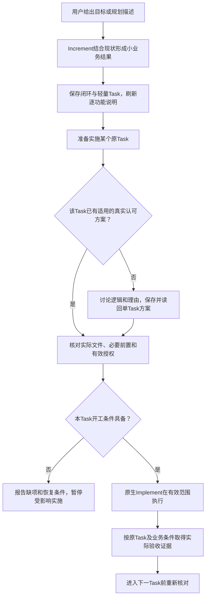
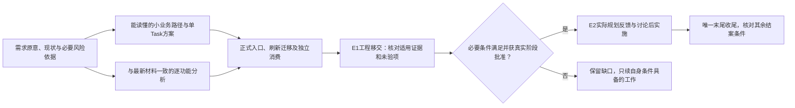

# 分析流转说明

本页补充[功能说明](README.md)的两项阅读关系，不复制活动闭环定义、工程状态或既有技术流程。职责与调用图沿[diagrams.md](../../diagrams.md)，实际依赖以[tasks.md](../../tasks.md)为准，闭环结果和验收信号以[mvu.md](../../mvu.md)为准。图均为解释，未执行渲染，不据此认定宿主或业务通过。

## 从想法到可继续实施的范围

大白话：先看懂一小步的结果，再讨论怎样实现；规划不是实施认可，技术通过也不是业务已完成。判断属于当前 Task，不能自动传给下一项。正式维护位置为 packages/skills/src/workflow/task-increment/SKILL.md 与 implementation-preparation/SKILL.md；原生 before_implement 的完整脚本接线仍待原注册任务，当前证据见[准备契约](../../contracts/implementation-preparation.md)。

## 当前范围的里程碑如何衔接

2026-11-14 新增的影子画像近期链独立采用源码复制路线：最小技术证伪→完善同一来源→最终复制和故障验证→项目启用→真实机会应用，再把结果汇入原末尾收尾。任务关系见[新增 P0 图](../../diagrams/logic-flow.md#2026-11-14-p0-增量us14-源码复制先行)，活动闭环与判断依据沿[MVU-011](../../mvu.md#mvu-011)，不在本页重复定义。该链不等待旧正式安装或 E1，也不代表自动恢复其他会话的工作；下图继续说明原工作线的移交与结案关系。

大白话：分析帮助阅读，入口和独立消费者证明交付能被实际使用；工程移交后还要真实使用反馈，最后才核对结案。本图表示汇合关系，不要求所有独立资料工作串行，也不新增审批点或复制任务依赖。对应产物在本 Spec 的 requirements、implementation、analysis、mvu.md 和 tasks.md；规划/准备及资料职责的活动定义沿[mvu 原文](../../mvu.md)读取，迁移与 E1/E2 的具体顺序沿[原任务依赖](../../tasks.md#依赖图与推荐顺序)。

构建产物消费按[既有指令](../../requirements/raw/2026-11-11-defer-build-validation.md)暂跳过，不能凭图越过必要补验；暂停模式和未确认的遥测建议不进入本期流转。失败恢复沿[既有技术图](../../diagrams.md#多文件保存与恢复)，分别报告已写、未写及续接入口，不宣称跨文件事务。
