# 技术图与导航：共同准备、轻量规划与当前交付

## 2026-11-18 原文读回后的四个 Skill 调用

维护位置拟定为 `packages/skills/src/profile/{conversation-recording,conversation-summary,conversation-analysis,shadow-profile}/SKILL.md`。当前摘要与分析都使用同一批已读回原文，触发条件各自判断。原文确认后的协作、摘要和分析可以各自推进。

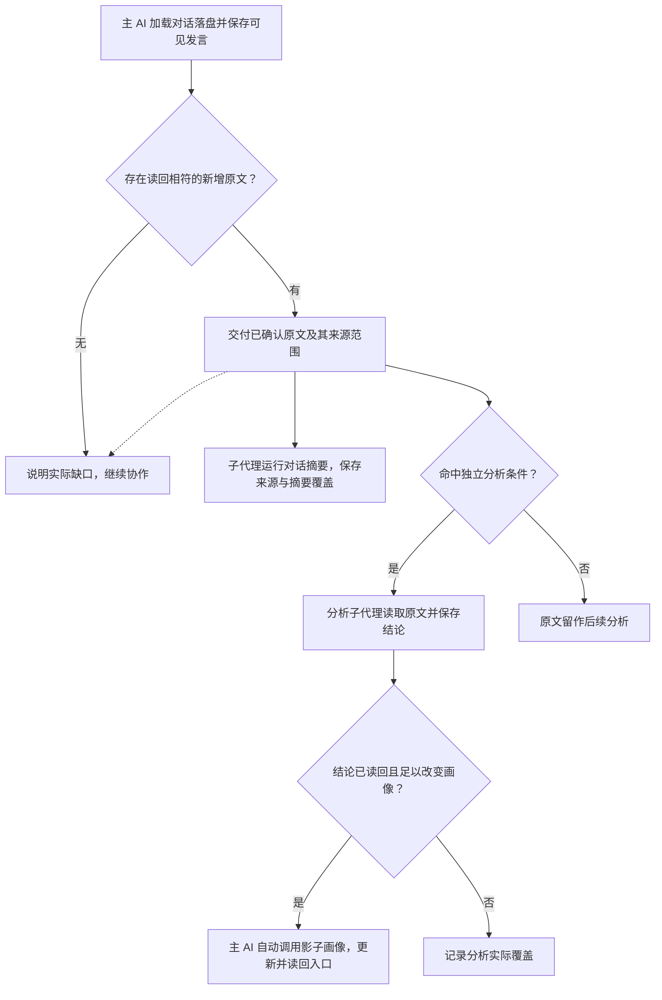

大白话是原文可靠保存后，摘要和分析各做各的。普通问答也有记录和摘要，只有符合条件的分析才会启动。画像更新取决于已经确认的认识变化，主 AI 在更新期间可以沿用最近有效入口。下一轮仍可见的上一轮真实 final 可以补存。

## 2026-11-18 两个会话的资料提交

计划位置为四个 Skill 的保存与恢复段落，以[契约](contracts/shadow-profile.md#保存查询与恢复)和[资料模型](data-model.md#共享提交与失效)为准。下图描述项目内共享文件的写入判断。

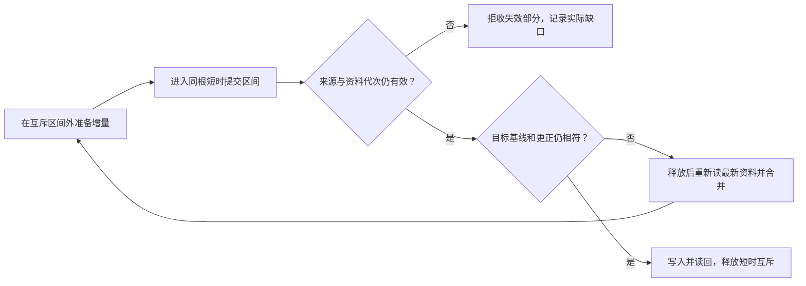

大白话是写之前再看一次有效来源和当前文件。别人先保存时，从最新内容合并。遗忘先让旧来源失效，晚到的摘要或分析也检查同一条件。实际互斥及两会话交错由 TV-14 取证。

以下 11 月 14 日及更早的图保留当时的接入方案和证据范围。[旧事件图](history/retired-shadow-runtime-2026-11-18/diagrams.before.md)

## 2026-11-14 影子画像：源码复制与项目接入

计划来源：`packages/skills/src/profile/shadow-profile/SKILL.md`；复用位置：`scripts/dev/actions/link-skills/link-skills.sh`；项目副本：`.agents/skills/shadow-profile/`。本图是计划，不代表来源已创建或宿主行为通过，正式安装留待主线完成。契约见 [shadow-profile](contracts/shadow-profile.md)，操作见 [TV-13](quickstart.md#tv-13影子画像源码复制与每轮行为)。

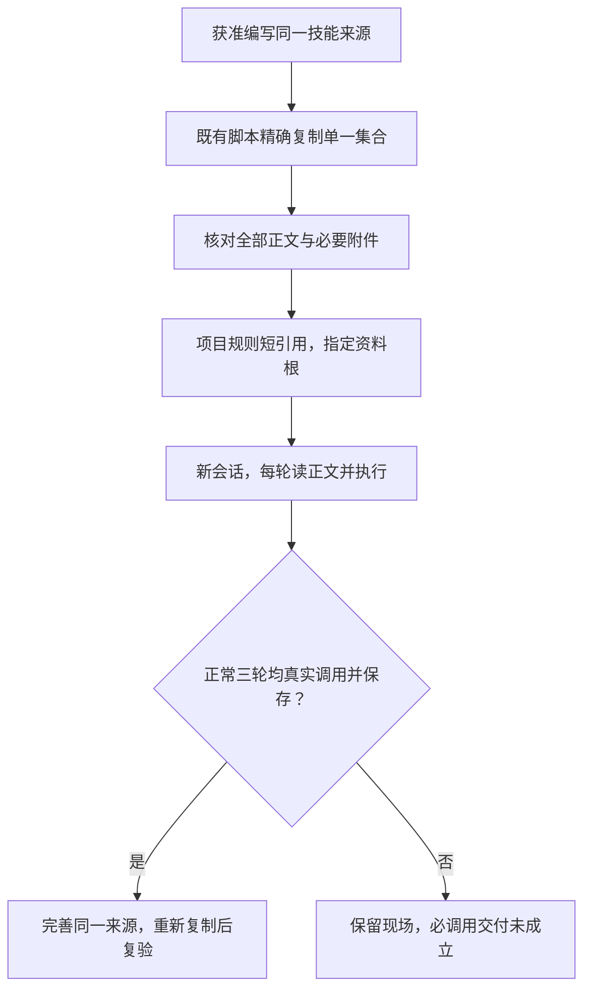

大白话：复制只是把来源放到技能目录；项目短引用负责明确每轮调用，真实轨迹才证明执行。主线构建和安装器不在这条近期链路中，不能用“文件放好了”替代每轮验证。

## 2026-11-14 影子画像：保存、缺档与恢复

计划规则位置同上，内容关系见[增量模型](data-model.md#2026-11-14-影子画像增量模型)。本图只说明记录保存与故障恢复，不表示工程 Task 或独立状态服务。

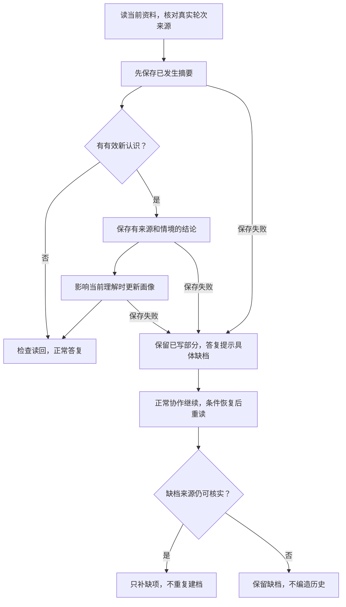

大白话：摘要是发生过什么，结论是有依据的认识，画像是当前有效理解。保存失败不阻断正常回答，多文件部分成功不会自动回滚；同一资料根串行写，旧会话先重读再合并，不保证任意并发事务。

更新：2026-11-10。来源：[计划](plan.md)、[准备契约](contracts/implementation-preparation.md)、[模型](data-model.md)、[注册契约](contracts/registration.md)。图示是设计，不表示实际宿主/挂载/业务验证已通过。每图一事，plan不塞流程图；小闭环内容以[mvu.md](mvu.md)为准。

当前逐功能阅读入口见[功能说明](analysis/spec-analysis/README.md)，其[业务判断与里程碑流转](analysis/spec-analysis/flows.md)只补阅读关系；技术职责、调用及保存恢复继续复用本页既有图示，不维护冲突副本。分析本身不代表工程或用户验收。

2026-11-14 后置分析衔接：任务图已[补入 P0 源码复制链](diagrams/logic-flow.md#2026-11-14-p0-增量us14-源码复制先行)，当前增加 T108～T112 并以 T112→T080 汇合，旧依赖保留；下段 50 项/86 条等统计保留其当时范围，不能作为本增量计数或实施证据。影子画像的技术职责/保存图仍复用本页开头两图，不新增重复流程。

当前[业务图](diagrams/business-flow.md)由after_plan按新范围刷新；[任务逻辑图](diagrams/logic-flow.md)已随本轮Tasks刷新，覆盖50项有效身份及86条显式依赖；17项完成事实只作前置引用、33项待办按真实依赖推进，9项暂停不进入当前阻塞边。[旧状态图](diagrams/state-transitions.md)只作历史来源。

## 共同准备的实际消费路径

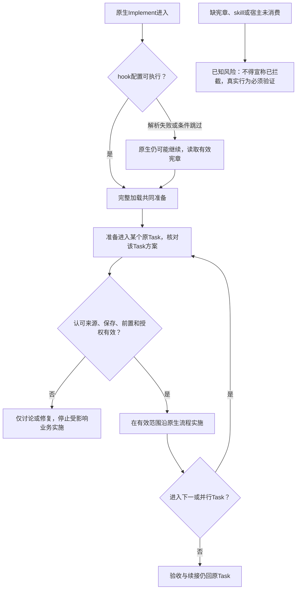

大白话：宪章是工作流共同条件，hook只是提前叫出准备。实线表示候选应遵守的流程，不代表有程序锁；原生模板缺宪章可跳过，真实宿主必须证明读取及每Task停止，否则TV-10失败并回到设计。

计划位置：.specify/memory/constitution.md的后续修订、packages/skills/src/skills/workflow/implementation-preparation/；原生消费事实在.agents/skills/speckit-implement/SKILL.md第93～100行及任务循环。验证见[TV-10](quickstart.md#tv-10共同准备逐-task-与异常停止)，不修改该生成副本。

## Task、方案与唯一工程状态

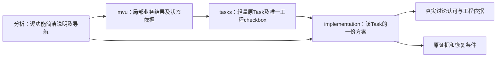

大白话：讨论文件解释如何按认可思路实现，工程完成仍只在原Task判断。MVU摘要和分析不是第二份工程进度，文件存在也不是用户已认可。

产物位置：所属Spec的tasks.md、implementation/<Task ID>.md、mvu.md及analysis/spec-analysis/；[准备契约](contracts/implementation-preparation.md)规定真实形成后才保存方案，不提前制造确认。

## 四正式入口与非发现来源

旧四入口定位保留用于历史引用；本期只交付Increment正式规划入口与可发现的共同准备，三模式研发/生成/测试暂停。当前关系如下。

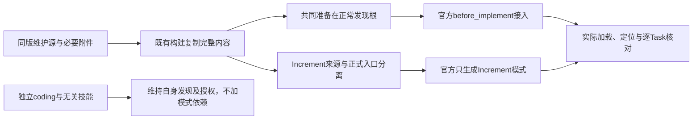

大白话：维护源、安装和实际读取是不同步骤；图中“核对”须有真实宿主证据，登记hook不代表已经停止无方案实施。准备保持可发现，Increment来源布局仍须TV-08当前子集验证。

计划位置：packages/skills/src/skills/workflow/implementation-preparation、task-increment及script/register-hooks、register-commands、install-skills、mount-entry、工作区link-skills。来源/附件见[注册契约](contracts/registration.md)，均未因图示而通过。

## 通用规则：节点验证与页面依赖

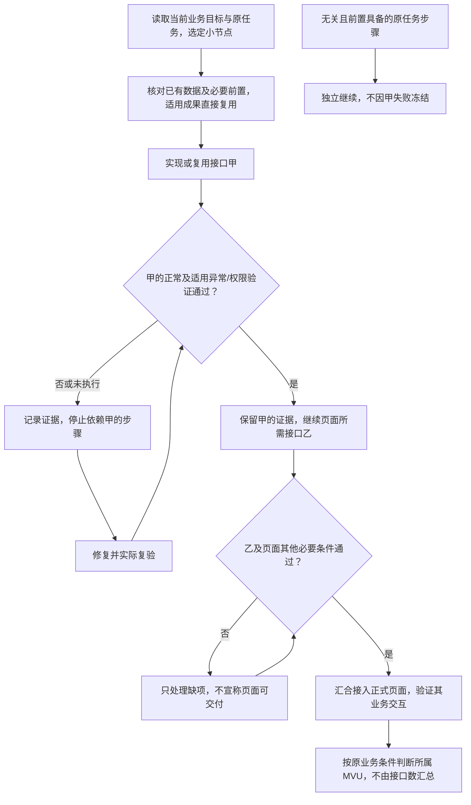

大白话：接口甲只是这次能单独验证的小范围，MVU 是它服务的业务闭环；甲通过后仍要等待页面所需的乙及其他条件。验证方式按职责选择，已有数据可复用，无数据或页面职责的节点说明不适用，不凑齐所有层。图展示一种有依赖的推荐路径，不强制无依赖接口串行。

计划来源：packages/skills/src/skills/coding/business-node-delivery/SKILL.md；节点与实际证据归原 Task 内步骤，关系见 [通用契约](contracts/business-node-delivery.md) 和 [TV-07](quickstart.md#tv-07通用业务节点实施顺序)。本图说明设计关系；独立来源及隔离样例的实际结果见 [TV-07 证据](analysis/acceptance/tv-07-business-delivery.md)，不以图示认定整个业务或后续模式已通过。

## 通用规则：自身触发与上下文职责

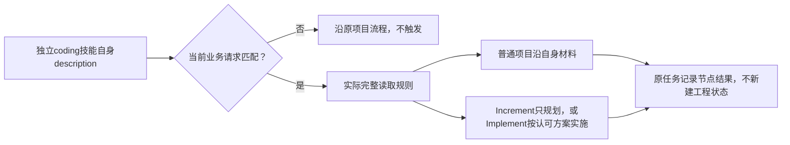

大白话：description用于发现，实际读取和行为还须分别验。business-node-delivery维持独立通用性，准备和Increment不增加其链接、显式调用或安装依赖；三模式上下文测试暂停。

来源位置：packages/skills/src/skills/coding/business-node-delivery/SKILL.md；既有构建和动态发现复用，[TV-07](quickstart.md#tv-07通用业务节点实施顺序)只消费当前适用子集。

## 可选描述的规划顺序（2026-11-09，待实现）

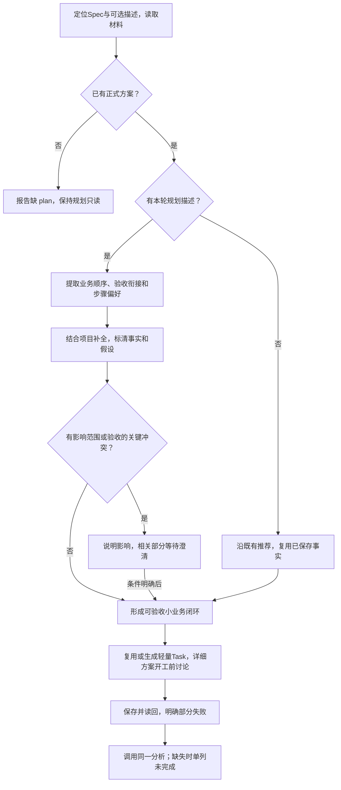

大白话：描述是用户的思路，未必是完整方案；AI 补足有依据的缺口，不能把猜测当用户确认。先明确每一小块业务怎样算做成，再安排工程步骤；已有代码可直接复用。

计划位置：packages/skills/src/skills/workflow/task-increment/SKILL.md；输入输出契约为 contracts/increment-description.md；验证路径为 T087→T088→T089。本轮未执行新行为，不由图示推导技术通过。

## Increment 的材料分支

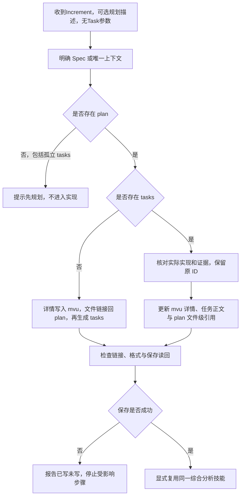

大白话：plan 是总体方案及文件级引用，mvu.md 是四项小闭环说明，tasks 是工程工作与进度；业务闭环是一项能观察并判断完成的用户结果；ID 是原任务标识，重排不等于换身份。

代码位置：packages/skills/src/skills/workflow/task-increment/SKILL.md（T052 已建立最小骨架，完整实现和集成按后续任务验收）；产物位置：所属 Spec 的 plan.md、mvu.md、tasks.md、analysis/spec-analysis/README.md。

## 技术验证只约束依赖步骤

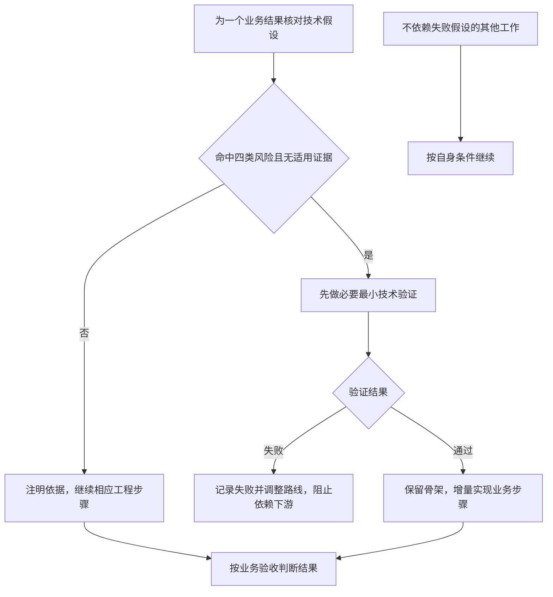

大白话：技术假设是“这个方案依赖某能力可用”的判断；验证骨架是已证明可用、后面继续扩充的小实现。技术验证通过不能代替业务结果完成。

规则位置：.specify/memory/constitution.md 第III条；独立 mvu 治理及部分工程已有证据，完整消费仍待 T086；计划消费代码位置：task-increment、共同准备及原生Implement；证据由原 Task 链接 analysis/acceptance/。

## Tutor 的单 Task 补齐边界

**暂停参考**：以下原图保留当时定义，本期不研发、不执行此测试或要求恢复。

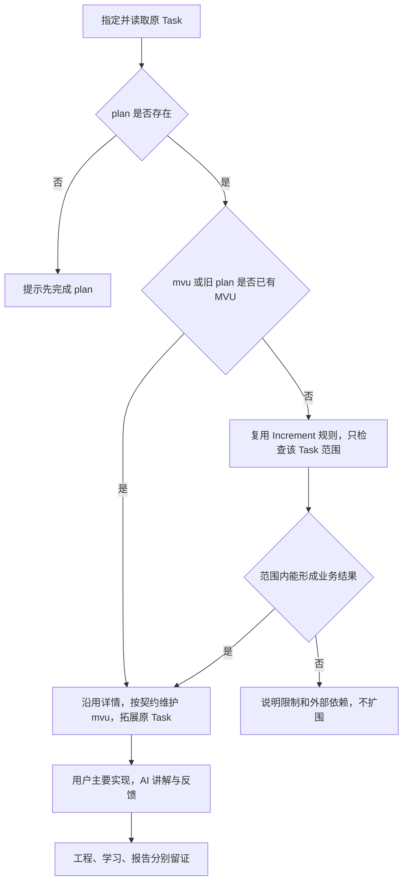

大白话：补齐是在当前任务边界内说明业务结果，不把其他任务收进来；外部 Task 只作为先做什么的引用。AI 代写一个局部不改变后续默认分工。

代码位置：packages/skills/src/skills/workflow/task-tutor/SKILL.md（待重构）；资料位置：原 tasks.md 段、learning/<Task ID>/，正式共同报告位于 personal-hub 既有博客。

## 多文件保存与恢复

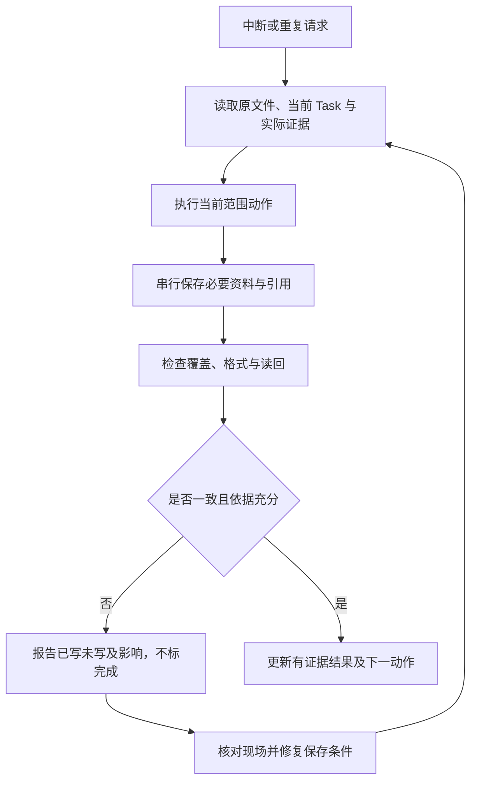

大白话：读回是确认文件实际写对；多文件没有自动事务，失败不假称全部撤销。工程状态只在原 Task，学习资料和分析只引用；受影响步骤先停，无关工作按自身条件处理。

代码/规则位置：共同准备、Increment及工作流宪章第VII条（新规则尚待正式修订）；产物位置：plan/mvu/tasks、learning、analysis/acceptance，不建立 state.json。

## 受管迁移与安装顺序

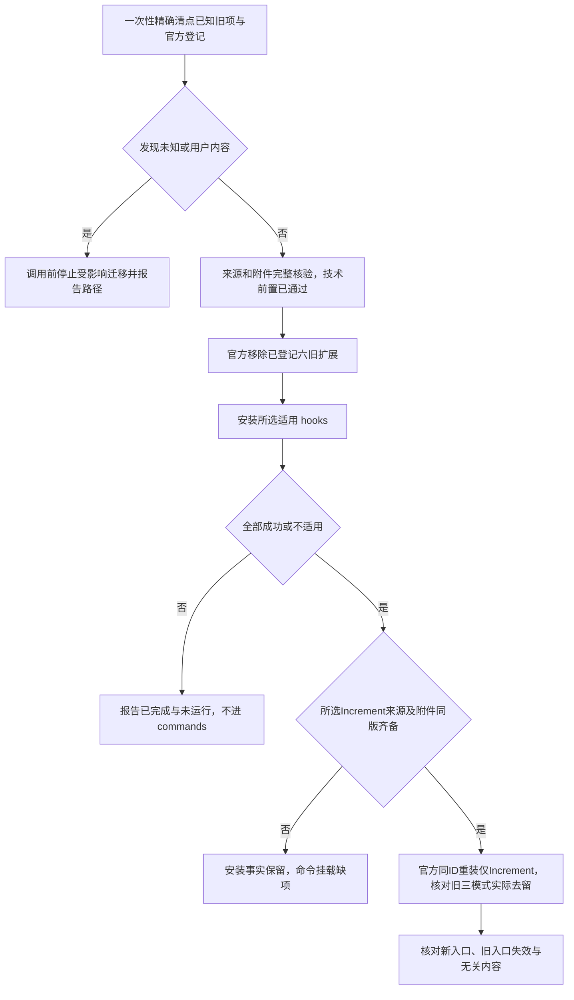

大白话：hooks 是阶段动作，commands 是主动调用入口；force 交给官方按来源重装。清点只为本次旧项迁移，不变成日常全目录扫描或持久所有权系统；官方卸载不天然保护目录内额外用户附件。

代码位置：packages/skills/script/register-hooks/、register-commands/ 及 scripts/dev/actions/link-skills/（待更新）；声明来源：准备、分析、结案三项来源同目录speckit-hooks.json；精确范围见 [注册契约](contracts/registration.md)。

## 影子摘要与结论更新

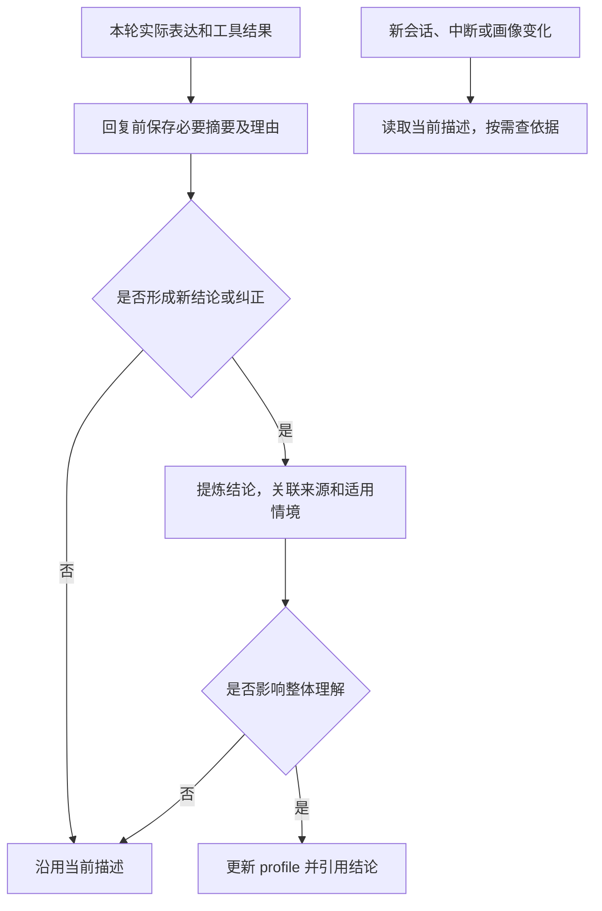

大白话：摘要保留发生经过，结论提炼有效理解，profile 是当前协作描述。只服务本仓库；没有后台监听，不提前编造未来回复，技术选择不自动成为永久偏好。

规则/位置：项目 AGENTS.md 的仓库协作记录约定；工作流宪章及独立提示词不复制仓库画像规则；实际资料：.specify/memory/user-shadow/conversations/、conclusions/、profile.md。

## 清理记录的保存与完成判断

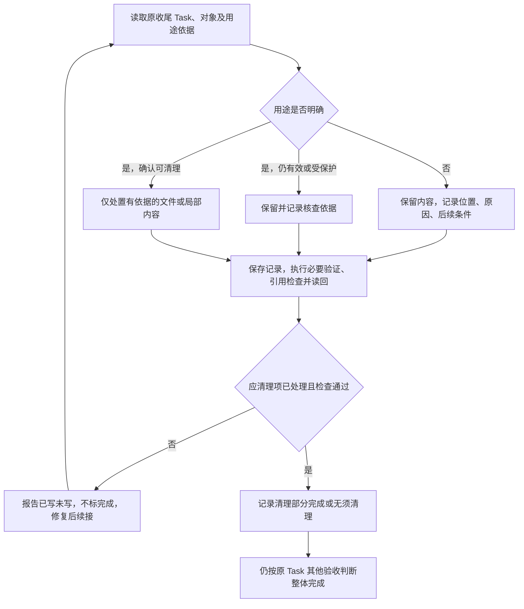

大白话：对象既可是一份文件，也可是文件中的代码段、文档段落或注释；“保留待核实”说明资料还在，并不表示已删除。所有候选逐项核对后才汇总清理结果；无须清理也有核查依据，清理部分完成不等于整个需求结束。

计划规则位置：.specify/memory/constitution.md 第 VII 条（当前7.0.0继续保留原清理要求）；消费位置：task-increment/SKILL.md 及原生任务生成流程读取目标治理。记录位置：原 tasks.md 收尾任务、计划中的 analysis/acceptance/cleanup-validation.md 与 T080 的 revision-summary.md；字段见 [模型](data-model.md#清理对象与记录约束)。MVU-007/TV-04 已映射到 [T081 治理](tasks.md#t081) 与 [T082 隔离验证](tasks.md#t082)，tasks 的依赖图已包含它们以及 T053/T054/T080 的阻塞边；原治理/隔离结果按 T081/T082/T054 证据范围复用，T080 实际清理及新文档消费仍待实施。本图说明保存与完成判断，不替代有双路径冲突的历史业务图。
