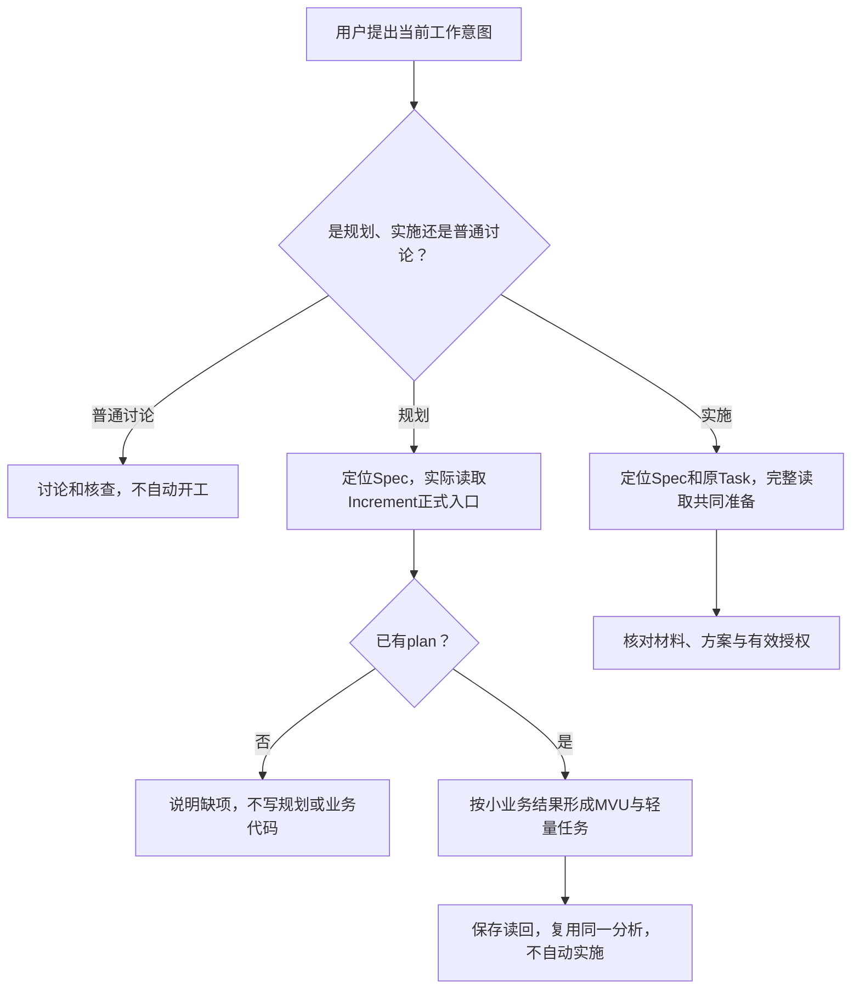
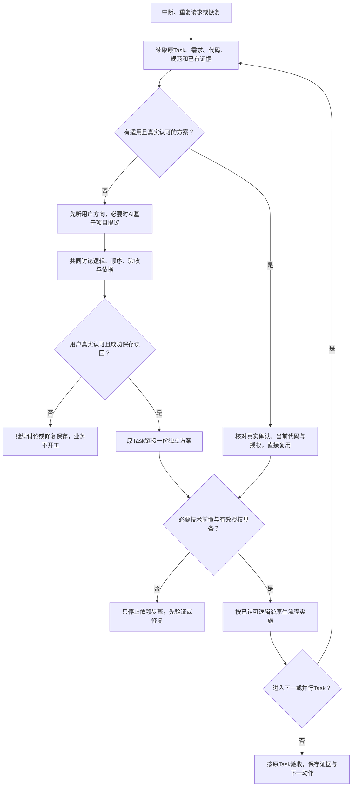
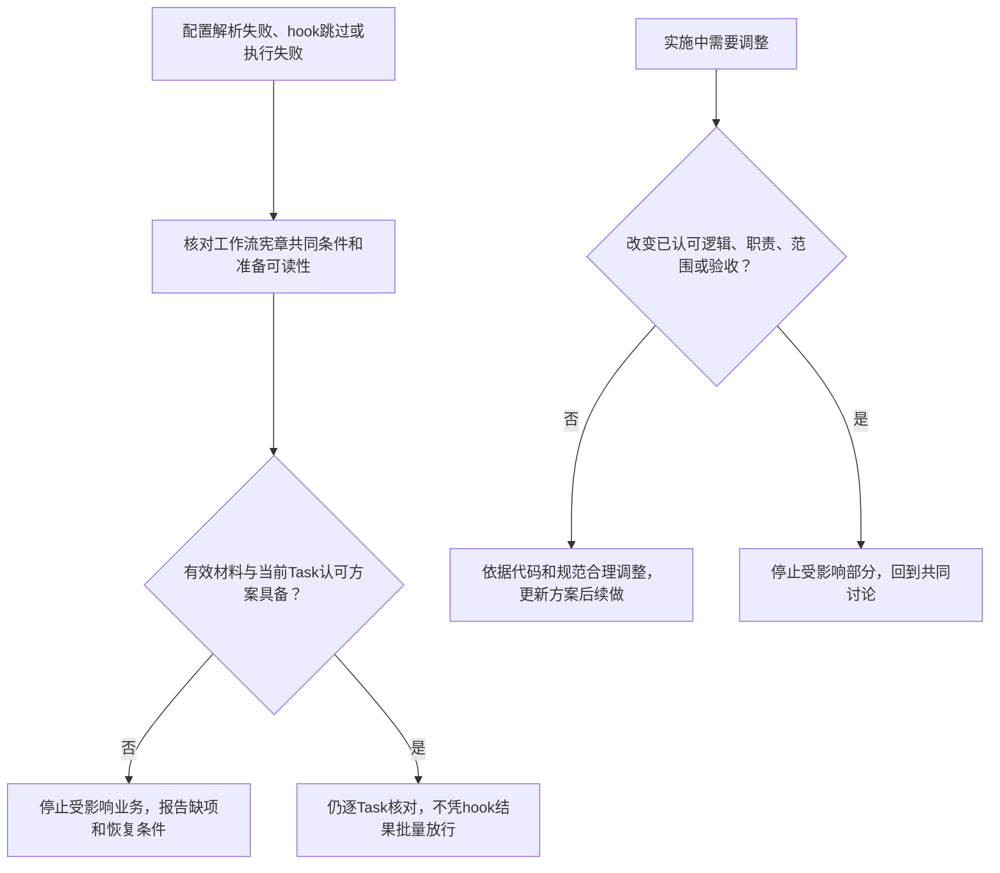
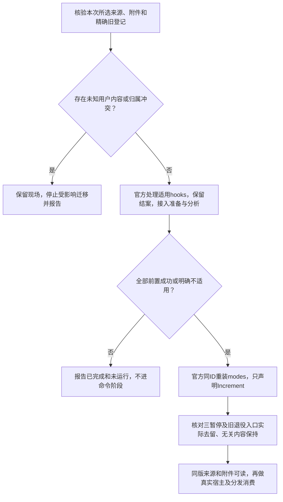
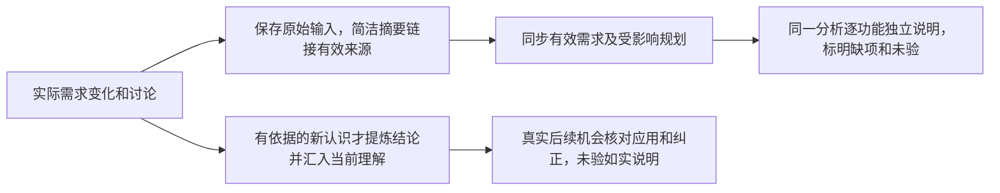
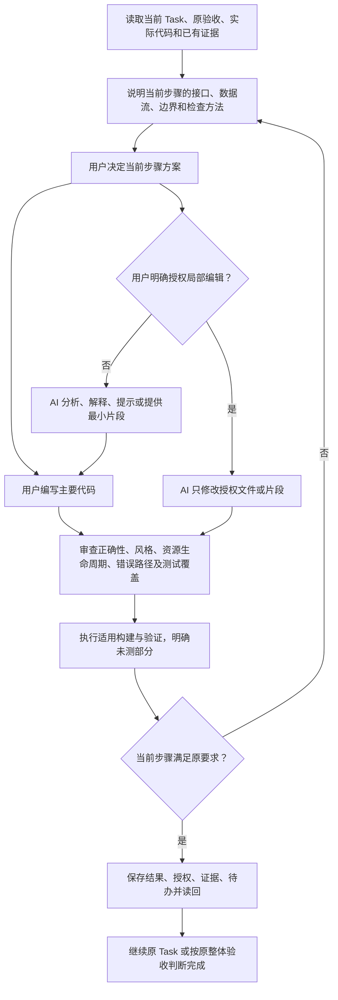
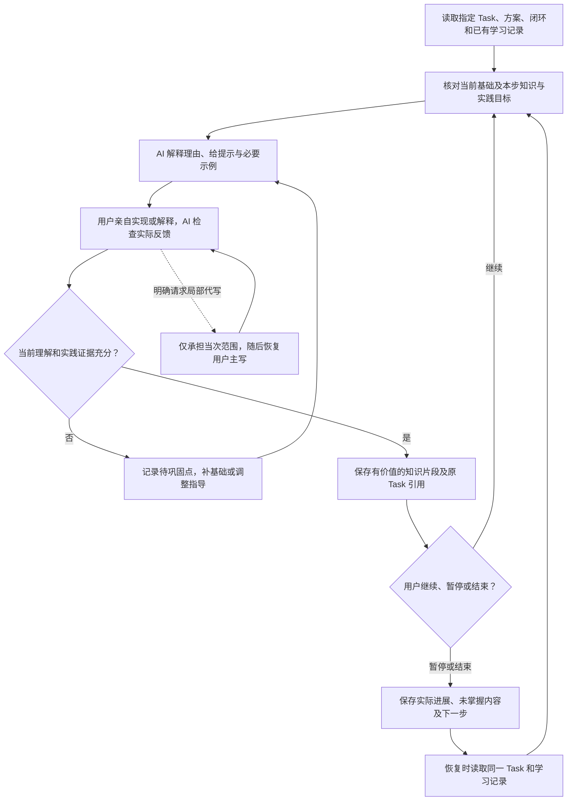
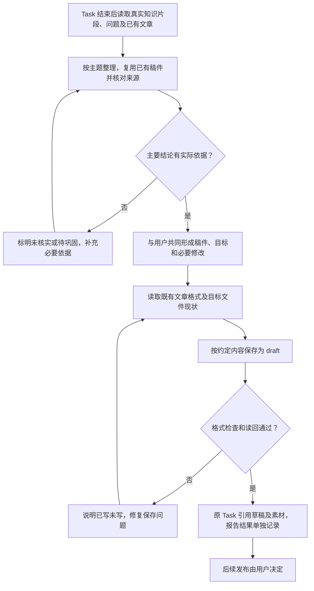

# 业务流程图：先讨论认可，再按原 Task 实施

更新：2026-11-10。调用场景：本次speckit-plan的after_plan/artifact-business-flow；来源：[规格](../spec.md)、[计划](../plan.md)、[准备契约](../contracts/implementation-preparation.md)、[注册契约](../contracts/registration.md)。本次复用已有图目标，新路径存在、旧根候选不存在，无双路径冲突。图是待实施流程，不代表实际门禁、挂载或业务已通过；工程状态仍在原tasks，三模式历史流程保留暂停标记。

## 自然语言与显式指令进入同一正式模式

本节保留旧定位，当前只表示Implement准备与Increment规划，不再指四模式共同发现。

大白话：用户不必先报模式名，但宿主必须真实选择并完整读取对应能力；描述匹配不等于已经加载。Increment只规划，实施仍由原生Implement承担，三种暂停模式不参与本期入口测试。

计划位置：workflow/task-increment和workflow/implementation-preparation；原生入口消费见[TV-09](../quickstart.md#tv-09自然语言与显式调用的同入口行为)。未初始化、定位歧义或能力缺失按契约停止相关动作，不自动改其他项目。

## 原任务内逐步推进、跨模式续接和恢复

本节保留历史定位，活动流程收敛为原Task讨论后实施与恢复，不再测试跨模式切换。

大白话：一Task一方案帮助用户审阅实现逻辑，原任务清单仍是唯一工程进度。A的认可不能放行未讨论的B；已有适用认可不用重新审批。方案存在、讨论结束或技术联通都不自动代表Task或业务通过。

产物位置：所属Spec的tasks.md、implementation/<Task ID>.md、mvu.md与analysis/acceptance；计划来源：implementation-preparation，实际停止及恢复由[TV-10](../quickstart.md#tv-10共同准备逐-task-与异常停止)验证。

MVP先用T103最小候选验证，再由T104经已核实的官方路线刷新同一隔离目标至正式维护源，核对实际CLI版本、配置、正文及全部必要附件并真实完整读取、复验；T105在这份正式源官方安装上验方案。2026-11-11用户已要求[构建相关暂跳过](../tasks.md#当前构建相关内容暂跳过2026-11-11)，构建产物刷新及回归保留待补验，不阻止T105消费已验证的非构建职责，不把跳过记通过。候选通过不抵扣正式来源，隔离刷新不以全量注册或真实项目迁移为前置。

## 准备异常与方案变更

大白话：当前官方模板遇配置异常可能继续，因此图中停止是必须验证的agent行为，不是天然程序锁。缺宪章或宿主漏读不得宣称已被拦截；真实验证失败就回设计。普通内部写法可合理调整，业务实质变化才重新讨论。

计划规则：已正式修订的工作流宪章7.0.0、待实施的共同准备及[准备契约](../contracts/implementation-preparation.md)；配置/条件/多Task异常的证据必须在真实宿主产生，本轮没有执行这些行为。

## 来源归位、官方挂载和同版交付

大白话：保留源码不等于继续挂载；缩减列表也不等于已清除旧入口。官方可能整目录删除受管技能，须在调用前保护未知附件。只安装来源、正式生成、全文读取和行为验收各是不同结果。

计划位置：packages/skills/script/register-hooks、register-commands、mount-entry、install-skills及scripts/dev/actions/link-skills。固定CLI和失败恢复见[TV-11](../quickstart.md#tv-11官方缩减挂载与保护)，本轮没有执行安装或迁移。

## 需求追溯、画像和逐功能分析

大白话：需求原文保留来路，摘要帮助快速理解，分析解释功能而不复制工程状态。画像是有情境的理解，不把一次Task选择泛化成永久偏好，不用日志数量证明效果。

产物位置：requirements/raw、discussions、prompts、README、analysis/spec-analysis；画像按目标项目已有记录约定维护，不在对外技能硬编码个人路径。双触发及实际应用见[TV-12](../quickstart.md#tv-12原文方案画像和逐功能分析)。

## 旧机制替换与有效内容保护

保留原六技能、Review/Guide/Explore退役的有效范围和真实证据；删除调用不删除原文、快照、文章、任务身份或用途待核实内容。收尾沿原T080按文件与局部内容的实际用途处置，原业务/工程验收和阶段批准仍须满足，三模式暂停不计通过。实际清理见[工作流契约](../contracts/workflow.md#任务清单的末尾清理契约)，本图不授权批量删除。

## Pair 用户主写与逐步审查

**暂停参考**：以下三种模式相关原流程只保留历史，不属于本期研发、测试或结案条件。

大白话：接口和数据流说明当前代码如何与其他部分交换信息；资源生命周期包括连接、文件等何时取得与释放。沿用旧图的用户主写、局部授权和反复审查，Task仍是唯一工程对象；局部编辑授权不会自动扩展到重构、提交、推送或发布。保存失败走上一流程的恢复分支。

计划位置：packages/skills/src/skills/workflow/task-pair/SKILL.md；结果写回原Task。此处保留模式职责，不新增Pair专项学习或业务行为验收；公共入口与角色边界按US11核验。

## Tutor 持续学习、反馈和知识片段

**暂停参考**：本节不参与当前研发、测试或结案，不记作通过。

大白话：沿用旧图的“了解基础、讲解、实践、反馈、补基础、暂停恢复”循环，资料改为原Task关联的知识片段。知识片段记录真实问题、关键解释、关联代码及理解或待巩固点；普通进度不强造知识，AI示例和自动测试不算用户掌握，结束会话也不算工程或学习通过。

计划位置：packages/skills/src/skills/workflow/task-tutor/SKILL.md及其references/learning-report.md；过程资料位于目标Spec的learning/<Task ID>/，由原Task引用，不另存工程进度。已有闭环复用、缺闭环单Task补齐及缺plan分支见[任务定位契约](../contracts/workflow.md)。

## Tutor 与用户共同整理学习报告

**暂停参考**：本节不参与当前研发、测试或结案，不记作通过。

大白话：沿用旧图中收集素材、主题去重、核实结论、复用文章、草稿保存和读回检查的有效步骤，报告由Tutor与用户共同整理。现行流程没有独立Review模式或两次确认门禁；学习、工程和报告分别判断，不自动发布，也不覆盖用户尚未确认的其他文章。

计划位置：task-tutor/SKILL.md与references/learning-report.md；正式草稿位于apps/personal-hub/content/blog/，写前读取该应用当前内容schema与文章，按实际格式使用status: draft。需求依据为FR-029，不将旧Review专项验收恢复为前置。
