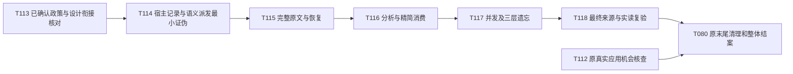
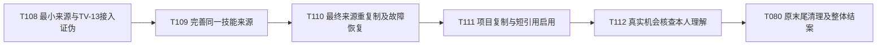
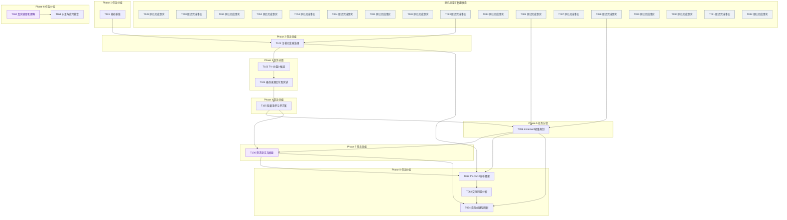
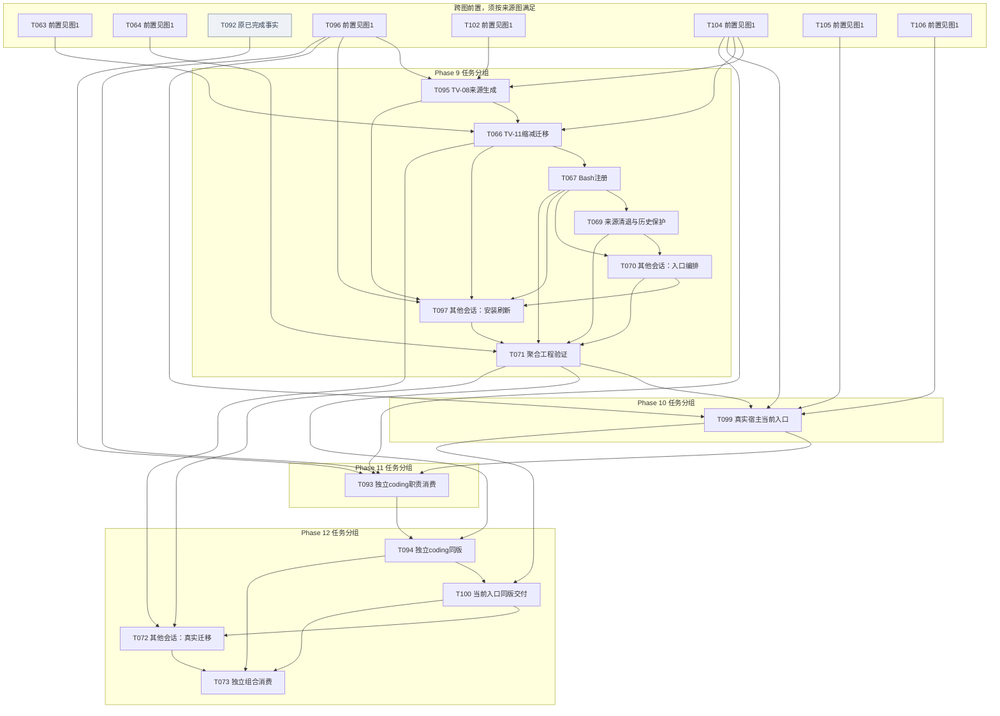
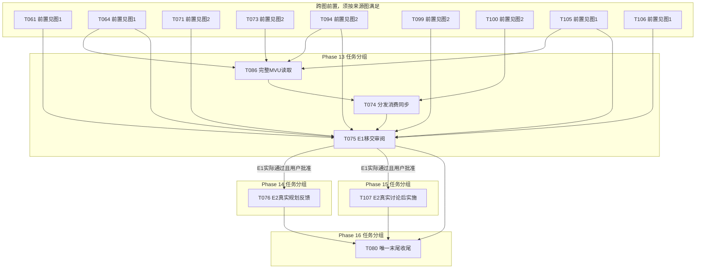

# 任务逻辑图：共同准备、当前交付与结案

## 2026-11-16 完整对话增量任务依赖

唯一工程输入为 [tasks.md](../tasks.md)。本图仅表示原分阶段任务依赖；本次5项政策和Phase 1设计已保存，技术图见[diagrams.md](../diagrams.md)。来源仍为 `packages/skills/src/profile/shadow-profile/SKILL.md`，计划附件为同Skill的 `scripts/shadow_runtime.py` 与 `references/host-contract.md`；TV-14证据沿原 `analysis/acceptance/fixtures/tv-14/`。本次未创建实现或更改原Task工程状态。

大白话：政策和设计已经形成原Task可核对输入，下一步先证明宿主真能记录完整对话、随会话结束及实际触发分析；原文可靠后再完善分析、并发和最终交付。旧T112及其他原收尾前置保持，图只新增一条支线，不表示任务实施、已接受建议或可以跳过原结案条件。此链全部串行，未新增[P]并行工程任务。

## 2026-11-14 P0 增量：US14 源码复制先行

唯一工程输入为[tasks.md](../tasks.md)当前 P0 阶段。新增 T108～T112 五个身份及五条依赖；原 48 个有效身份和原工作线依赖保留，不重开完成事项，也不给旧任务增加本增量工程前置。以下原图的计数属于其 2026-11-12 范围，新增链以本图补齐，工程 checkbox 仍只在 tasks。

大白话：先证明当前接入每轮实际执行，再完善同一份技能，最终来源重复制验证后才在项目启用，最后核查真实使用；T080 仍须满足原工作线全部条件，不因新增支线局部通过自动结案。真实机会缺失如实未验，不把正式安装或旧 E1 作为该支线前置。

计划代码位置为 packages/skills/src/profile/shadow-profile/SKILL.md，复制复用 scripts/dev/actions/link-skills/link-skills.sh；项目副本及 AGENTS 在 T111 范围核对，来源和轨迹由原 Task 证据关联。本图不表示源码、复制或行为已交付。

按[用户分工](../requirements/raw/2026-11-12-publishing-mounting-other-session.md)，T070/T097/T072对应的入口、安装刷新及真实挂载实现由其他会话处理。保留这些节点和依赖供交付核对，不表示本会话继续实施，也不代表它们已通过；本会话的后续工作流验证只消费真实可用结果。

更新：2026-11-12。调用场景：发布/挂载跨会话分工同步，保留有效依赖，按原artifact-logic-flow规则同步。唯一任务输入为[tasks.md](../tasks.md)当前待执行区、已完成可复用身份及显式依赖；排除9项暂停、2项PowerShell废弃和T001～T048历史做法。新路径存在、旧根候选不存在，无双路径冲突。本图覆盖48项有效身份、76条显式依赖（其中2条标注E1通过及用户批准条件），不表示已执行新的工程或行为验证；工程checkbox只在原tasks。

## 读图规则与共同条件

箭头表示源任务的有效结果具备后才能开始目标任务；跨图引用保留相同ID，不是新Task。灰色节点是原已完成事实的引用，无新增任务或进度；历史完成过程的旧依赖不重新变成待办。紫色节点有[P]标记，仅在其共同前置已满足、有效授权覆盖且文件不冲突时并行。阶段分组不新增用户批准点，失败只挡其依赖下游。

2026-11-11用户要求[构建相关暂跳过](../tasks.md#当前构建相关内容暂跳过2026-11-11)。当前图中T104等混合任务的出边只核对下游实际需要且已有证据的非构建职责；T104→T105使用正式维护源的官方安装与完整读取，不等待构建产物。构建、dist同版及构建产物消费仍保留待补验，不记通过；其他技术与真实行为前置继续适用，不能用此说明越过尚未完成的非构建依赖。

每个Task实际开工前都须有适用真实认可方案；hook存在或一次成功不放行未讨论任务。E1、真实用户E2、业务/工程验收及最终结案分别判断；原三模式专项、跨模式、学习/报告不作为本期前置。图示不是程序锁，也不构成实施授权。

## 图1：准备、轻量规划与记录内容

大白话：先核对现状与已生效的7.0.0治理，再验证无方案时是否真的停止；候选通过后完善生产来源，经官方路线刷新隔离最终来源，核对版本/正文/附件并真实完整读取复验。T060独立按现有真实资料推进，不等待T104。轻量清单、用户理解和需求摘要按各自依赖形成，分析明确消费这些有效输入，不用旧八栏目或日志数量代替可用结果。

任务记录位置：[当前清单](../tasks.md)；对应代码/产物精确位置及验收在各原Task中维护，图不复制详细方案或工程checkbox。

## 图2：官方注册、真实入口与迁移

大白话：先证明官方缩减和保护方法可行，再沿Bash完善注册/安装；只有当前来源与工程具备，才核对真实宿主是否发现并完整读取。实际迁移只续原T072未完部分，独立coding和入口同版分别核对。未知附件或失败只停止受影响链。

任务记录位置：[当前清单](../tasks.md)；对应代码/产物精确位置及验收在各原Task中维护，图不复制详细方案或工程checkbox。

## 图3：完整消费、真实反馈与最终结案

大白话：完整消费和分发材料具备后才报告E1；E1实际通过并获批准，才能做后续真实用户反馈。T080始终末尾，清理部分完成不等于所有用户/平台/业务条件已满足，不能自动勾总体结案。

任务记录位置：[当前清单](../tasks.md)；对应代码/产物精确位置及验收在各原Task中维护，图不复制详细方案或工程checkbox。

## 推荐执行顺序与并行检查

主线为T101→T102→T103→T104→T105→T096；T060可与T101从现有真实资料独立启动，随后T061；T106依自身前置推进。T062→T063→T064的分析与当前来源具备后，沿图2经T095/T066、Bash注册/安装、T071、T099/T093/T094/T100，再到T072/T073。图3汇合完整读取与分发同步，经T075后分别取得T076/T107真实反馈，最后T080综合收尾。

- PowerShell接入已按[用户要求](../requirements/raw/2026-11-12-remove-powershell.md)移出本期，T068/T098废弃，图中不保留阻塞边；Bash注册T067及来源清退T069已交付，T070/T097及T072的安装/挂载职责由其他会话承接，本会话跳过实现；边仍表示真实交付前置，不因跳过而满足。共同README、包构建、聚合测试、证据和状态回填串行。
- T060与T106：画像T060无新增工程前置，需求T106依自身前置，可在不同文件进行记录消费；不并发修改同一摘要/profile，T106与T096/T104的共同消费者编辑仍须串行。
- T076与T107：仅在E1及真实批准后，用户选择不同已授权样本时可交错验收；不因并行机会假造用户确认或启动未讨论Task。

## 技术前置与检查点

TV-10由T102治理复核→T103隔离候选→T104最终来源官方刷新/实读复验落实，T105在最终来源验方案，每次无方案/异常/逐Task误开工都回Plan；TV-11由T095/T104/T063→T066落实，官方缩减和未知保护通过后才接后续实现；TV-12分别由T105、T106、T060/T061、T062～T064落实。成功骨架保留供增量，旧TV-02/04/05/06/07仅复用适用事实。详细输入与信号见[验证指南](../quickstart.md)，图的箭头不能代替实际结果。

本次只按任务重建逻辑图，无真实宿主、CLI迁移、业务或平台验收。当前after_tasks仍调用旧artifact-logic-flow；新综合分析来源及其挂载待T062～T064和后续当前注册交付，不冒称本轮已生成该分析。
