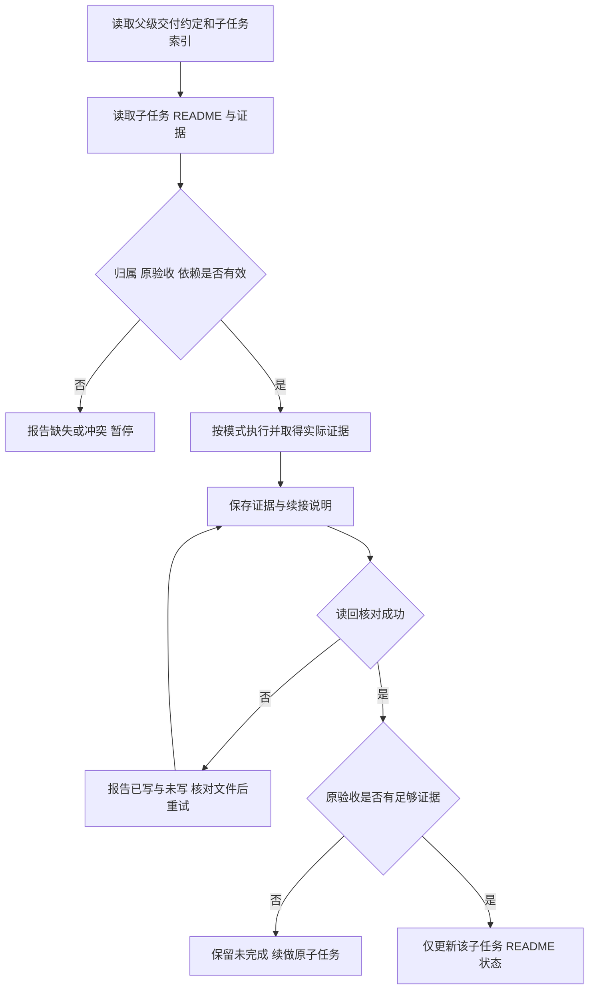
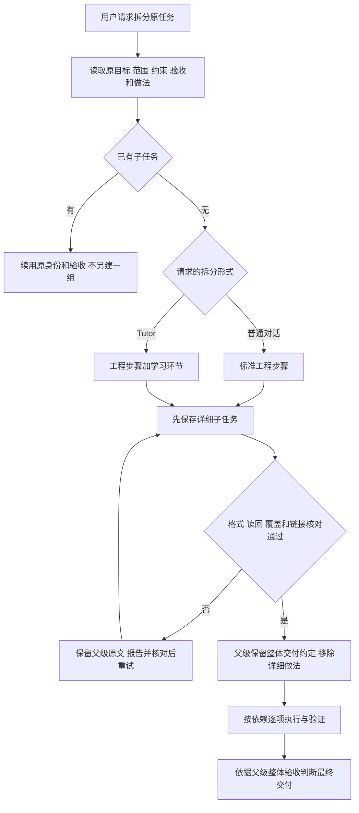

# 技术流程：目录 Markdown 的保存与恢复

来源：contracts/workflow.md；更新 2026-10-31。取消 JSON 状态提交图，不新增子任务管理脚本。

术语：索引是指向原记录的链接；读回核对是确认文件确实保存了本次内容；原验收是开始前约定的通过标准。位置：<FD>/tasks.md、sub-task/<Subtask ID>/README.md 和 evidence.md；执行者为 agent，不存在 state.py 或 state.json。完成不自动勾父任务或代表学习通过；此图不承诺跨文件事务。

## 从未拆分到父级整体交付约定

术语：整体交付约定回答“交付什么、怎样算整体完成”；详细做法回答“这一步在哪里、怎么做、怎么验”。覆盖核对表示原要求都能在父级约定和子任务中找到去处。位置：权威规则为 `.specify/memory/constitution.md` VII；消费位置计划为 `packages/skills/src/skills/workflow/task-*/SKILL.md`；实际记录位于原 Spec 的 `tasks.md` 和子任务目录。T035～T038 尚未实施，本图是设计，不表示行为已通过。
