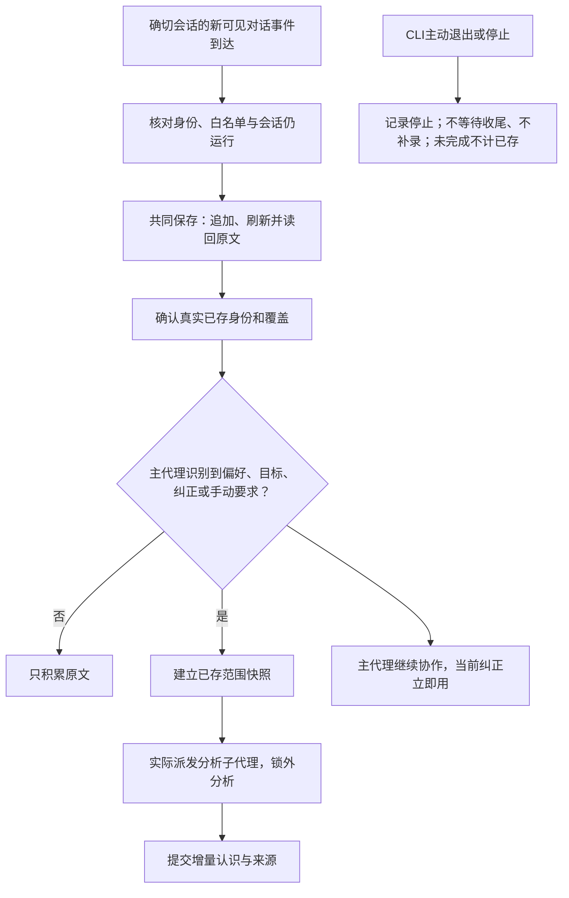
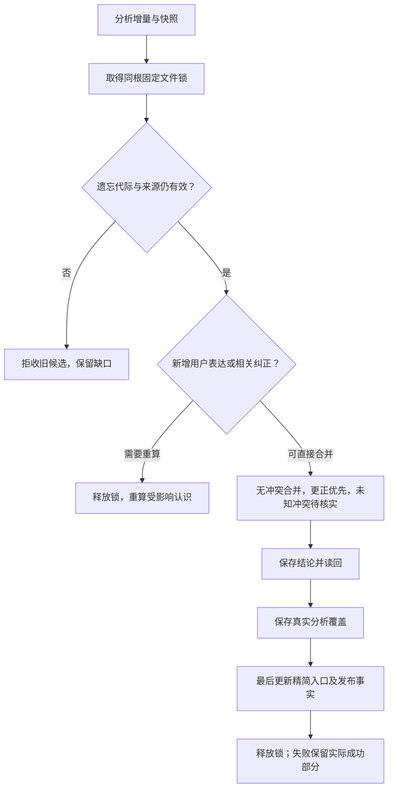
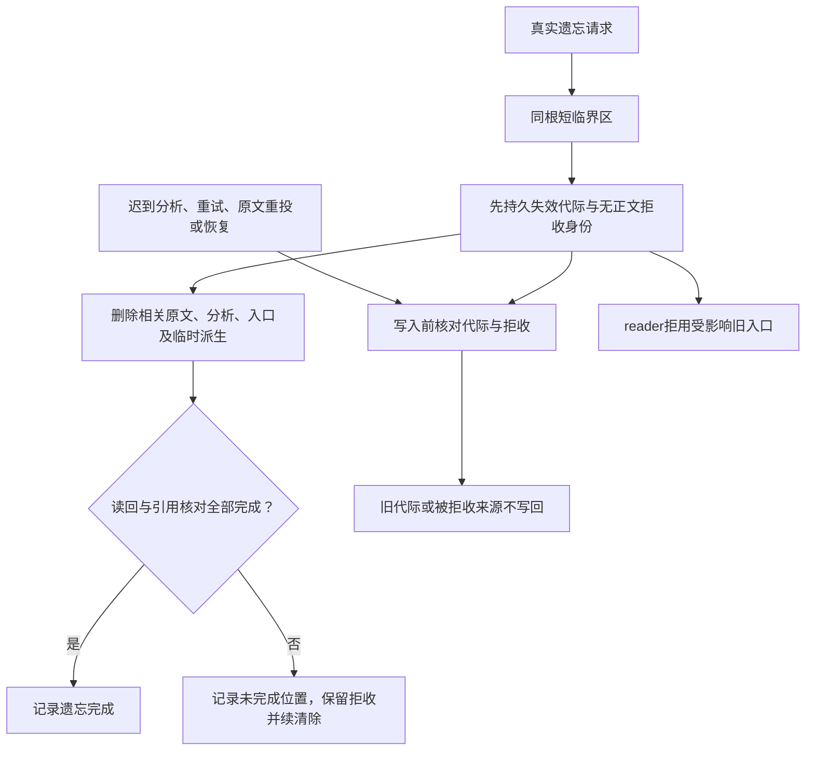

## 2026-11-16 原文事件与主代理语义触发

计划代码：`packages/skills/src/profile/shadow-profile/scripts/shadow_runtime.py`（记录/快照）及同目录上一层 `SKILL.md`（主代理判断/实际派发）；代码尚未创建，本图是设计。按[11月17日纠正](requirements/discussions/2026-11-17-record-on-dialogue.md)，先验证来源版本/身份及新消息事件，不再等待额外结束信号；退出不收尾、不补录，未完成不计成功。大白话：消息自动存，只有有价值信号才启动分析，正常任务继续。

## 2026-11-16 共享入口的短临界区

计划代码：同源 `scripts/shadow_runtime.py` 的snapshot/commit职责；模型在锁外，锁仅串行核对和I/O。大白话：先看分析期间有没有新纠正，再合并；仅重读旧画像不够。单文件替换不代表多文件事务，原文件锁不反复删建。

## 2026-11-16 遗忘先失效再删除

计划代码：同源 `scripts/shadow_runtime.py` 的forget/commit/capture/inspect共同校验；落点是 `conclusions/coverage.md` 和三层资料。大白话：先让旧结果失效，才能删除；重启也不能把旧内容写回来。只保存无正文身份拒收依据，不自动处理Git历史。

下方11月14日及更早图保留原范围；摘要串行和下一轮补记不适用于本次新原文目标。当前验收见[TV-14](quickstart.md#tv-14完整对话惰性分析与共同发布)，本次没有渲染或运行这些业务流程。

