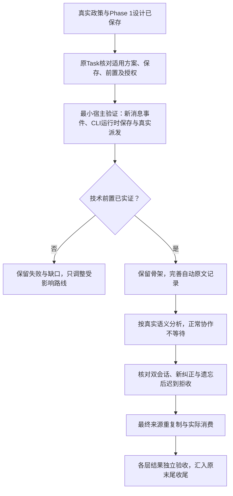

## 2026-11-16 完整对话增量的业务判断

使用者要得到可核查原文和可消费理解。[5项政策](../../spec.md#session-2026-11-16)与[Phase 1设计](../../plan.md#2026-11-16-当前设计完整对话惰性分析与精简入口)已保存，本次tasks同步原职责；原[T113](../../tasks.md#t113)先复用这些材料核对原验收与保存衔接，不重复询问政策或自动勾选。技术图已在[diagrams.md](../../diagrams.md)表达事件记录/语义触发、共同发布和遗忘失效，必要附件计划为 `packages/skills/src/profile/shadow-profile/scripts/shadow_runtime.py` 和 `references/host-contract.md`，本次未创建实现。

大白话：需求已说清，接下来要证明宿主真能按它运行；不能把任务更新当成技术通过。消息事件自动保存和语义触发分析分别核对，分析积压/失败时主代理继续任务，当前纠正立即应用。业务状态只沿[mvu.md](../../mvu.md#mvu-011)及原任务，图不新增状态服务、工程身份或批准点。

发布时先检查新到用户纠正和遗忘代际，再决定合并、重算或拒收，不能按分析完成先后选胜者。遗忘前的在途分析、排队发布、重试、恢复及原文重投迟到均不得回写已删除内容；删除中断时reader不能继续消费受影响旧入口。按[11月17日纠正](../../requirements/discussions/2026-11-17-record-on-dialogue.md)，新对话到达即记录；主动退出不等待收尾、不补录，未完成只记真实覆盖。独立结束信号不再是开工前置，正常运行消息完整性仍须验证。

重试额度沿真实触发来源绑定，coverage先持久预留再派发；重启/换子代理/更新快照不重置，结果不明保留缺口不盲目补派发，新真实触发或用户新手动要求才另起一轮。短文件锁仅协调画像运行期资料，工程状态仍在原Task。详细规则见[计数与恢复](../../data-model.md#分析轮次重试计数与中断恢复)，TV-14已列中断交错，均待实际执行。

可观察里程碑是可靠原文、独立分析/精简、双会话/遗忘安全、最终入口实读，分别由原Task及TV-14举证。局部MVP到原文链，不能替代整条业务闭环；原T112真实机会和T080完整结案条件保持，当前没有新产品实验结果。

